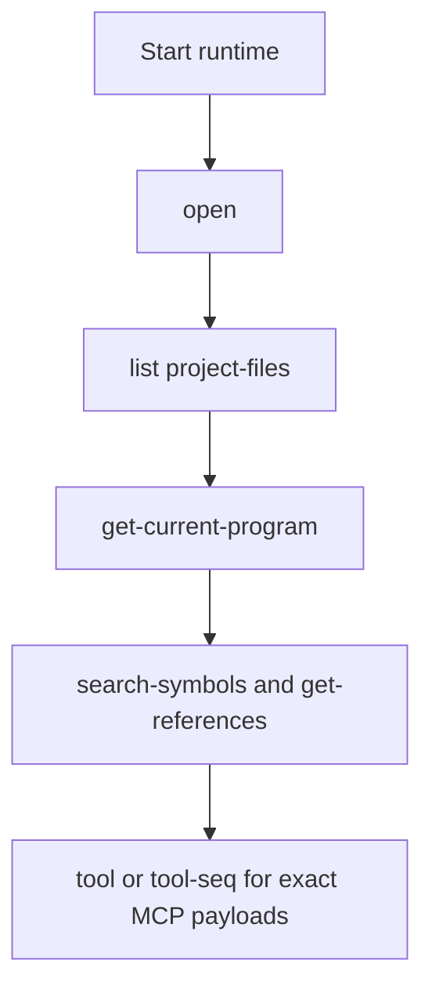

# AgentDecompile Usage Guide

Install and first start live in [README.md](README.md). This page is the day-to-day operator manual. Current recovery uses the existing 8080 action catalog under [AGENTS.md](AGENTS.md); CLI snippets below document implementation and general usage, not a recovery bypass. Do not start duplicate servers or use automatic local fallback for the current recovery mission.



If you run from a local clone instead of the published repo:

```bash
git clone https://github.com/bolabaden/agentdecompile
uvx --from /path/to/agentdecompile/ --with-editable ./agentdecompile agentdecompile-cli ...
uvx --from /path/to/agentdecompile/ --with-editable ./agentdecompile agentdecompile-server ...
uvx --from /path/to/agentdecompile/ --with-editable ./agentdecompile agentdecompile-proxy ...
```

## Endpoints

- Canonical MCP HTTP: `http://127.0.0.1:8080/mcp`
- Compatibility: `http://127.0.0.1:8080/mcp/message`
- `/` and `/api` return API index metadata
- `/docs` is Swagger UI
- `/api/mcp` is not supported

Prefer `--mcp-server-url http://127.0.0.1:8080/mcp` in examples. The CLI also accepts the base URL and normalizes it. Explicit `--server-url`, `--host`, or `--port` stay authoritative and fail instead of being ignored.

Implementation behavior outside the current recovery mission: when you do not pass an explicit backend, the CLI treats unreachable default or env URLs as recoverable: reuse a cached local server, auto-start one, or fall back to in-process local execution.

## Status scope

`agentdecompile-cli status` and `tool status '{}'` report the current connection's
read-only project listing. The result identifies its scope as `connection-session`;
it does not inspect a recovery workspace or certify a recovery result. This CLI
shorthand also works in `tool-seq` and uses that sequence's existing connection.
A failed project listing fails direct status commands and the status sequence step.

For a recovery run, supply its directory explicitly:

```bash
agentdecompile-cli status --work_dir /path/to/run
agentdecompile-cli tool status '{"workDir":"/path/to/run"}'
```

The MCP `status` tool retains its required `workDir` contract. Explicit empty or
unknown arguments are not treated as the no-argument shorthand.

`execute-script` labels the selected program as **Context Program**. This is the
program available to the script, not evidence that the script executed or read
that binary; a script can work only with files or URLs. The JSON field
`executedProgram` remains unchanged for existing consumers.

## Script execution and time budgets

`execute-script` and `eval` run inside the server process. Their `timeout`
parameter is accepted for compatibility, but **is not enforced**. It cannot stop
an infinite Python loop or terminate Ghidra/native work. Set deadlines on the
operations the script performs and use small batches.

Script stdout and stderr are captured and returned when execution completes;
`print(..., flush=True)` does not stream progress to the CLI. An outer process
timeout can end the client's wait before it receives any output. It does not
guarantee that the server script has stopped: the provider retains its program
and conflict context until the worker finishes. Check the operation's outcome
before retrying a script that changes state.

Budget for the whole batch. Four sequential operations with 15-second limits
need at least 60 seconds of operation allowance, plus connection and response
overhead; a 45-second wrapper can cut them off. For example, with the batch
source already in the shell variable `SCRIPT`, this allows a 100-second client
wait:

```bash
timeout 100s agentdecompile-cli --server-url http://127.0.0.1:8080 \
  execute-script --code "$SCRIPT"
```

If a Python `subprocess.run` wraps that command, give its own timeout a larger
budget, such as 105 seconds. These are client wait limits, not server execution
deadlines or a guarantee the batch will finish. In particular,
[`urllib.request.urlopen(timeout=15)`](https://docs.python.org/3/library/urllib.request.html#urllib.request.urlopen)
limits blocking operations such as connecting, not the entire request or batch;
do not treat four such calls as a strict 60-second wall-clock bound. Use separate
script calls when you need each completed result before starting the next.

## Sessions

Each standalone CLI command is a fresh session unless you use `tool-seq`.

When no `mcp-session-id` (or session cookie) is sent, the server uses a single default session. Sequential CLI runs can reuse that session. For multi-session or multi-user use, send a distinct session id.

**Session IDs are not authentication.** Do not treat `mcp-session-id` or the default session as access control. Protocol rules: [docs/session-handling.md](docs/session-handling.md).

Direct tool commands, `tool`, and `tool-seq` exit non-zero for MCP `isError: true`,
structured `success: false`, or a text part headed `## Error` or
`## Modification conflict`, even when the envelope has `isError: false`.
Results are displayed before direct commands exit, including script stdout,
stderr, and traceback when the server supplies them. Error-shaped text inside
a successful script's captured output does not make its response a failure.

Add `--verbose` on the CLI, server, or proxy when you need transport diagnostics.

## Workbench

The operator UI is `/dashboard` on the same HTTP server as `/mcp`. Default: `http://127.0.0.1:8080/dashboard`.

Reuse the existing listener. Read `GET /api/v1/actions`, select a listed action and its parameters, and inspect the resulting job and evidence. Do not infer missing analysis from an empty page; first check selected project/program and corpus binding.

Open an already-analyzed Ghidra project and use the functions already there. Do not call `analyze-program` unless that program has no analysis yet. Force only an explicitly requested retry or work shown to be invalid.

`AGENT_DECOMPILE_WEBUI_*` still starts an optional sidecar if you set it. Corpus recovery does not use that port.

## Shared Ghidra Server

Do not set `AGENT_DECOMPILE_PROJECT_PATH` in the same launch when the goal is a shared repository. Prefer separate editor entries for local vs shared.

```bash
export AGENT_DECOMPILE_GHIDRA_SERVER_HOST="YOUR_GHIDRA_HOST"
export AGENT_DECOMPILE_GHIDRA_SERVER_PORT="13100"
export AGENT_DECOMPILE_GHIDRA_SERVER_USERNAME="<set-in-user-env>"
export AGENT_DECOMPILE_GHIDRA_SERVER_PASSWORD="<set-in-user-env>"
export AGENT_DECOMPILE_GHIDRA_SERVER_REPOSITORY="<set-in-user-env>"
```

Those credentials authenticate Ghidra Server, not the MCP HTTP listener. See [docs/MCP_CONFIGURATION_SECURITY.md](docs/MCP_CONFIGURATION_SECURITY.md).

## Workflows

Public fixture: `tests/fixtures/test_x86_64`. Other examples use `/path/to/binary`.

### Open, list, inspect

```bash
uv run agentdecompile-cli --server-url http://127.0.0.1:8080/mcp \
  tool-seq '[{"name":"open","arguments":{"path":"tests/fixtures/test_x86_64"}},{"name":"list-project-files","arguments":{}},{"name":"get-current-program","arguments":{}}]'
```

Convenience forms (same session only if you use `tool-seq`):

```bash
uv run agentdecompile-cli --server-url http://127.0.0.1:8080/mcp open tests/fixtures/test_x86_64
uv run agentdecompile-cli --server-url http://127.0.0.1:8080/mcp list project-files
uv run agentdecompile-cli --server-url http://127.0.0.1:8080/mcp search-symbols --query main
uv run agentdecompile-cli --server-url http://127.0.0.1:8080/mcp get-functions --identifier main
```

### Import and export

```bash
uv run agentdecompile-cli import-binary /path/to/binary
uv run agentdecompile-cli tool export '{"programPath":"/path/to/binary","outputPath":"./analysis.sarif","format":"sarif"}'
```

Full parameter guide: [docs/IMPORT_EXPORT_GUIDE.md](docs/IMPORT_EXPORT_GUIDE.md).

### Context pieces

Extra notes, dumps, and archives merge by address. They stay advisory until objdiff. See [docs/CONTEXT_FUSION.md](docs/CONTEXT_FUSION.md).

### Fast triage

1. `agentdecompile-cli --mcp-server-url http://127.0.0.1:8080/mcp tool --list-tools`
2. `list project-files`
3. `get-current-program`
4. Use `tool-seq` when state must survive
5. Shared-server auth failures: check `AGENT_DECOMPILE_GHIDRA_SERVER_*` before retry loops
6. If local import succeeded but later errors mention `127.0.0.1:13100`, check whether shared-server env leaked into a local path

## Failure states

| Symptom | Check | Next |
|---------|-------|------|
| `No program loaded` | Did `open` / `import-binary` run in this session? | Use `tool-seq` or pass `programPath` |
| Shared-server `NotConnectedException` plus `FailedLoginException` | Host, port, username, password, repo | [docs/MCP_CONFIGURATION_SECURITY.md](docs/MCP_CONFIGURATION_SECURITY.md) |
| Tool content has `## Error` but process exit is 0 | Payload text, not transport | Treat payload as authoritative |
| Convenience flag missing | `agentdecompile-cli <command> -h` | Use raw `tool` for exact MCP keys |
| Local VC probe looks like success | Content may still say checkout failed | Trust payload semantics |
| Empty SARIF | Selected program, binding and existing analysis | Reuse valid analysis; analyze only proven missing/invalid work |

Typical unresolved-program payload:

```json
{
  "success": false,
  "error": "Program path '...' was provided but could not be resolved/opened ...",
  "nextSteps": [
    "Call `list-project-files` to discover the exact program path.",
    "Call `import-binary` to import if the file is not yet in the project."
  ]
}
```

## Environment variables

`AGENTDECOMPILE_*` aliases mirror the `AGENT_DECOMPILE_*` names below.

| Variable(s) | Scope | Purpose |
|----------|---------|---------|
| `GHIDRA_INSTALL_DIR` | Runtime | Path to Ghidra |
| `AGENT_DECOMPILE_BACKEND_URL` | Runtime | Remote MCP backend for proxy |
| `AGENT_DECOMPILE_MCP_SERVER_URL` | Runtime/CLI | MCP URL for CLI connect and proxy |
| `AGENT_DECOMPILE_SERVER_URL` | Runtime/CLI | Legacy server URL alias |
| `AGENT_DECOMPILE_MCP_SERVER_HOST`, `AGENT_DECOMPILE_MCP_SERVER_PORT` | Runtime/CLI | Host/port when composing MCP URLs |
| `AGENT_DECOMPILE_HOST` | Runtime | MCP HTTP bind host |
| `AGENT_DECOMPILE_PORT` | Runtime | MCP HTTP bind port |
| `AGENT_DECOMPILE_PROJECT_PATH` | Runtime/CLI | Local project or `.gpr` |
| `AGENT_DECOMPILE_PROJECT_NAME` | Runtime/CLI | Local project name |
| `AGENT_DECOMPILE_DEFAULT_PROJECT_DIR` | Runtime | Default project directory |
| `AGENT_DECOMPILE_GHIDRA_SERVER_HOST`, `AGENT_DECOMPILE_HTTP_GHIDRA_SERVER_HOST`, `AGENT_DECOMPILE_SERVER_HOST`, `AGENT_DECOMPILE_GHIDRA_HOST` | Runtime/CLI | Shared Ghidra host |
| `AGENT_DECOMPILE_GHIDRA_SERVER_PORT`, `AGENT_DECOMPILE_HTTP_GHIDRA_SERVER_PORT`, `AGENT_DECOMPILE_SERVER_PORT`, `AGENT_DECOMPILE_GHIDRA_PORT` | Runtime/CLI | Shared Ghidra port |
| `AGENT_DECOMPILE_GHIDRA_SERVER_USERNAME`, `AGENT_DECOMPILE_SERVER_USERNAME`, `AGENT_DECOMPILE_GHIDRA_USERNAME` | Runtime/CLI | Shared Ghidra username |
| `AGENT_DECOMPILE_GHIDRA_SERVER_PASSWORD`, `AGENT_DECOMPILE_SERVER_PASSWORD`, `AGENT_DECOMPILE_GHIDRA_PASSWORD` | Runtime/CLI | Shared Ghidra password |
| `AGENT_DECOMPILE_GHIDRA_SERVER_REPOSITORY`, `AGENT_DECOMPILE_HTTP_GHIDRA_SERVER_REPOSITORY`, `AGENT_DECOMPILE_REPOSITORY`, `AGENT_DECOMPILE_GHIDRA_REPOSITORY` | Runtime/CLI | Shared repository name |
| `AGENT_DECOMPILE_AUTH_ENABLED` | Runtime | Require MCP HTTP auth |
| `AGENT_DECOMPILE_TLS_CERT`, `AGENT_DECOMPILE_TLS_KEY` | Runtime | TLS paths for HTTPS |
| `AGENT_DECOMPILE_PYGHIDRA_VMARGS` | Runtime/tests | Extra JVM args |
| `AGENT_DECOMPILE_CLI_OP_TIMEOUT` | CLI | Per-tool timeout |
| `AGENT_DECOMPILE_MCP_BIND_TIMEOUT` | Runtime | Bind timeout |
| `AGENT_DECOMPILE_SESSION_GRACE_PERIOD` | Runtime | Session cleanup grace |
| `AGENT_DECOMPILE_DEBUG` | Runtime | Debug logging |
| `AGENT_DECOMPILE_TOOL_SURFACE` | Runtime | `full`, `curated`, or `legacy` |
| `AGENT_DECOMPILE_DISABLE_TOOLS` | Runtime | Comma-separated hide list |
| `AGENT_DECOMPILE_ENABLE_TOOLS` | Runtime | Explicit allow-list |
| `AGENT_DECOMPILE_ENABLE_LEGACY_TOOLS`, `AGENT_DECOMPILE_SHOW_LEGACY_TOOLS` | Runtime | Re-advertise aliases |
| `AGENT_DECOMPILE_AUTO_CHECKIN` | Runtime | Auto check-in after setters |
| `AGENT_DECOMPILE_AUTO_MATCH_PROPAGATE` | Runtime | Auto `match-function` after setters |
| `AGENT_DECOMPILE_AUTO_MATCH_TARGET_PATHS` | Runtime | Propagation targets |
| `AGENT_DECOMPILE_JVM_EPOCH` | Runtime | Force shared-session refresh |
| `AGENT_DECOMPILE_LOCAL_MODE` | CLI | Force local-mode CLI |
| `AGENT_DECOMPILE_PROGRAM_PATH` | CLI | Default program path |
| `AGENT_DECOMPILE_PROGRAM` | CLI | Legacy program alias |
| `AGENT_DECOMPILE_BINARY_NAME` | CLI | Default `binaryName` |
| `AGENT_DECOMPILE_WEBUI_ENABLED`, `AGENT_DECOMPILE_WEBUI` | Runtime | Optional leftover sidecar on/off. Workbench is `/dashboard` on 8080. |
| `AGENT_DECOMPILE_EXCHANGE_ENABLED` | Runtime | Experimental donated-compute work exchange on the proxy. Off by default; `--enable-exchange` / `--no-enable-exchange` win over the variable. Contributions stay proposals until the local compile and objdiff gate verifies them. See [the exchange plan](docs/plans/2026-09-08-donated-compute-work-exchange.md). |
| `AGENT_DECOMPILE_WEBUI_HOST` | Runtime | Leftover sidecar bind host |
| `AGENT_DECOMPILE_WEBUI_PORT` | Runtime | Leftover sidecar bind port |
| `AGENT_DECOMPILE_WEBUI_BACKEND_URL` | Runtime | Leftover sidecar backend override |
| `AGENT_DECOMPILE_TEST_SERVER_URL` | Tests | External live server |
| `AGENT_DECOMPILE_STRESS_COPIES_PER_SEED` | Tests | Stress fixture copies |
| `AGENT_DECOMPILE_PROFILE_DIR` | Tests | Profile output dir |
| `AGENT_DECOMPILE_PROFILE_ANALYZER` | Tests | Analyzer script path |
| `AGENT_DECOMPILE_PROFILE_SEARCH_EVERYTHING` | Tests | Search profiling |

### HTTP headers for shared-server requests

| Environment variable | HTTP equivalent |
|----------|---------|
| `AGENT_DECOMPILE_GHIDRA_SERVER_HOST` | `X-Ghidra-Server-Host` |
| `AGENT_DECOMPILE_GHIDRA_SERVER_PORT` | `X-Ghidra-Server-Port` |
| `AGENT_DECOMPILE_GHIDRA_SERVER_REPOSITORY` | `X-Ghidra-Repository` |
| `AGENT_DECOMPILE_GHIDRA_SERVER_USERNAME` + password | `Authorization: Basic <base64>` |
| same username / password | `X-Agent-Server-Username` / `X-Agent-Server-Password` |

Credential precedence: `Authorization: Basic` then the `X-Agent-Server-*` pair. Never hardcode passwords in `mcp.json`.

## Naming

Canonical MCP tool names are kebab-case. JSON keys are camelCase. Convenience CLI flags are not always 1:1 with raw tool keys. Use `-h` or `agentdecompile-cli alias <tool-name>`. Prefer `search-symbols` over `search-symbols-by-name`. Prefer `open` over `switch-project`.

Modifying tools may return a `conflictId`. Complete the change with `resolve-modification-conflict`. Do not retry the same setter to force overwrite.

## Related docs

- [README.md](README.md) — install and start paths
- [docs/INDEX.md](docs/INDEX.md) — hub
- [docs/CORPUS_PIPELINE.md](docs/CORPUS_PIPELINE.md) — multi-binary recovery
- [docs/IMPORT_EXPORT_GUIDE.md](docs/IMPORT_EXPORT_GUIDE.md) — import/export
- [docs/MCP_CONFIGURATION_SECURITY.md](docs/MCP_CONFIGURATION_SECURITY.md) — bind, auth, `mcp.json`
- [docs/session-handling.md](docs/session-handling.md) — session id rules
- [CONCEPTS.md](CONCEPTS.md) — vocabulary
- [docs/CONTEXT_FUSION.md](docs/CONTEXT_FUSION.md) — merge notes and address-keyed conflicts
- [TOOLS_LIST.md](TOOLS_LIST.md) — tool parameters

### Workbench implementation and runtime reuse

Use the existing 8080 workbench. Static workbench source and the React frontend
coexist; see the [interface guide](src/agentdecompile_recovery/corpus/dashboard/frontend/README.md)
for source and packaged route distinctions. Do not start 5174 or infer completed
migration from generated assets.

`corpus.export-hookpack` is implemented and advertised through parser
introspection. [Runtime reuse](docs/RUNTIME_REUSE.md) describes the existing
KotorPhasor consumer, target bindings and unverified readiness/behavior gates.
An exported pack is not proof of a safe call or recovered source.


## Durable continuation and verification controls

The September 22 foundation adds controls to the existing action catalog and CLI
implementation parsers. Recovery operations still use the existing 8080 action
catalog, discovered through `GET /api/v1/actions`; CLI names below identify the
implementation contract and are not instructions to bypass that catalog.

| Action | New behavior / parameters |
|---|---|
| `corpus.recovery-orchestrator` | Requires explicit `input-basis` for dispatch; `max-failed-exits` defaults to 3, `backoff` to 30 seconds and `success-backoff` to 300. Worker defaults are 1. `status` reads without dispatch; `once` performs one admission cycle and does not establish completion. |
| `corpus.verify-byteexact` | `cache-input-manifest` declares the compiler dependency closure; `transient-retry-seconds` defaults to 300. Cache identity uses content, relevant database rows, tool code and declared environment. |
| `corpus.verify-periodic` | `full-interval-seconds` defaults to 86400, `force-full` requests an explicit fresh pass. Legacy `full-every` defaults to 0. Failed full attempts consume the time interval too. |

The supervisor persists its state in the output directory's `.supervision` folder.
Its lock excludes other instances of this supervisor for that output root; it does
not prove exclusive ownership of all external compiler, Ghidra, Wine or corpus
writers. Unknown prior launches remain `needs_reconciliation`, even when their stage
is now disabled. Do not delete state to bypass a reservation or exhausted allowance.
A zero process exit records a completed pass, never recovery acceptance. The explicit
input basis must describe a real changed input set; arbitrary new labels are not a
repair. Automatic input-basis generation and cross-provider ownership reconciliation
remain roadmap work.

A cache manifest is a JSON object such as:

```json
{
  "complete": true,
  "files": ["toolchain/compiler.exe", "toolchain/runtime.dll", "include/header.h"],
  "environment": ["INCLUDE", "LIB"]
}
```

File paths resolve relative to the manifest. Include every material toolchain,
header, runtime and configuration dependency; completeness is asserted by the
provider, not automatically discovered by the verifier. Without complete closure,
a fresh comparison can run, but later unchanged cached positives are withheld with
`cache-basis-incomplete` rather than silently trusted or continuously recompiled.
Transient/unclassified failures expire under a rate limit. This TTL is not a total
objective spending cap. Only known deterministic compiler diagnostics are classified
as `compile-rejected`. Local function comparisons retain their existing comparison
semantics and do not establish fresh whole-image byte identity.

Preparation now records retry decisions, reasons, remaining attempts and wake
conditions. Both preparation interfaces expose them under **Recorded continuation
decisions**. Same-input resume preserves attempts, including after unrelated KB
writes. Unknown job outcomes hold the affected action while independent eligible
comparisons can proceed. A missing job during cancellation is not proof its work
stopped. The displayed history is a record, not proof every old condition remains
active. See the [roadmap](docs/plans/2026-09-22-autonomous-capability-product-roadmap.md)
and [verification receipt](docs/verification/2026-09-22-autonomy-foundation.md).


### External diagnostic report reader

`corpus.normalize-validation-report` is a read-only catalog action and CLI command.
It takes `provider` (`reagent-benchmark` or `reccmp-compare`) and `report` (a JSON
report file), returning a normalized diagnostic proposal. It does not run the
provider or accept recovery claims. Invalid/empty/unknown-schema reports return
`invalid_output` and CLI exit 2; CLI exit 0 means normalization succeeded.

A ReAgent benchmark can meet its expected negative while the candidate mismatches.
The reader retains those separate outcomes. reccmp scores retain their comparison
scope, omitted-entity caveat and unknown eligible denominator. A standalone report
cannot prove input identity, freshness or the actual provider revision. Those gaps
remain explicit for the future execution adapter and independent acceptor.

### Resource reservations after uncertain outcomes

Catalog jobs now expose `resourceDisposition`, `resourceKeys` and
`ownershipUnresolved`. Unknown child/remote outcomes and failed terminal receipt
writes retain identity/pair/Ghidra reservations in the existing job receipt store.
A receipt-root owner lock serializes admission authorities for that directory;
restart restores reservations before admitting scoped work. Unrelated resources
can proceed after the worker slot is released. Both activity surfaces show unknown
ownership, and React suppresses its retry shortcut for a quarantined job.

`workbench.resource-reconciliation-report` inspects a job's retained reservation;
`workbench.resource-reconcile` repairs a stale reservation only when a qualified
terminal release was already durably committed. Both accept `job_id`. The same
eligible repair runs during the next scoped admission. The initial qualified local
provider is `corpus.logical-build`; unknown remote/crash outcomes remain reserved.
Internal clearance binds the exact attempt, arguments, resource keys, process and
receipt generation. Child log claims and caller-supplied proof cannot release keys.

These changes do not infer clearance from age or a stopped coordinator. General
reconciliation of uncertain provider outcomes remains forthcoming. Different receipt roots,
external writers and deliberately detached children require the broader resource
contract; this local authority is not proof of universal writer exclusion.

### Cached evidence for ReAgent

`corpus.export-reagent-snapshot` exports selected existing `func_knowledge` rows
without live analysis. Its parameters are `kb`, `program`, repeated `address`, a
new `destination`, and optional `max_functions` (default 100, maximum 1000). The
action creates private artifacts and is marked mutating; the input cache is opened
read-only. Use the catalog for recovery operations.

The schema-1 snapshot preserves available source and assembly, records row/file
hashes, and publishes its manifest last. Missing context remains explicit gaps.
A cache program name is not verified original-binary identity. See the
[actual cached-evidence consumer receipt](docs/verification/2026-09-22-reagent-cache-export.md).

### Reusing local comparison evidence

Current source ingestion and collection require `sourceSha256` from the observation
that actually compiled those source bytes. Old coverage flags paired only by function
name remain historical evidence. Revalidate through the existing catalog route for
current-source verification; do not add a digest to an old success by hand. Rejected
files remain candidates. Collection preserves exact verified bytes and moves stale
prior verified output under `unverified/`, reporting each preserved path.

This local source binding does not establish semantic identity, complete compiler
inputs or linked contribution. See the [verification scope](docs/verification/2026-09-26-current-source-binding.md).

Recovered-source ingestion now persists nullable `source_sha256`. Legacy rows remain
unbound until a producer supplies a checked observation; schema migration does not
hash today's files as proof of historical compilation. Covered automatic skip readers
recheck current source bytes, and database-backed packaging exports the same checked
byte snapshot. New restoration ledger rows are reused/unverified, even if their stored
source digest matches. See the [consumer freshness receipt](docs/verification/2026-09-26-recovered-source-freshness.md).

### Seed comparison reuse inputs

`corpus.seed-validation` accepts `compile-input-manifest` (CLI
`--compile-input-manifest`). It forwards the existing closure declaration format:
`complete: true`, a nonempty `files` list resolved relative to the manifest, and an
optional `environment` list. Known compiler/context/verifier inputs are also included;
receipts retain the basis digest and completeness state, without environment values.

The configured audit API accepts the compiler provider, object parsers and optional
objdiff checker. Missing compiler/verifier setup or an incomplete declaration cannot
qualify positive reuse. The standalone command still requires its supported compiler
configuration path to be completed for real compilation; the manifest option alone
is not a compiler setup. Fresh attempts and reusable positive evidence remain distinct.
See the [compile-input receipt](docs/verification/2026-09-27-seed-compile-input-basis.md).

### Preparation admission allocations

The existing action catalog exposes `workbench.prepare.maxActionAdmissions` as an
optional nonnegative initial allocation. Omit it for Unlimited accounting. Resume
preserves the current allocation and spending. To revise an inactive preparation,
use `workbench.workflow-control` with `operation: "admission-budget"`, its
`preparation_id`, current `expectedAllocationRevision`, and a new total
`maxActionAdmissions`; explicit `unlimited: true` allows null. Active preparations
must pause and drain first. Existing nonpaused queued work remains eligible; paused
work requires resume. These are action admissions, not CPU/token/provider costs.
See the [accounting contract and proof](docs/verification/2026-09-27-objective-admission-accounting.md).

Original stored binary export is documented in [binary extraction](docs/BINARY_EXTRACTION.md).
