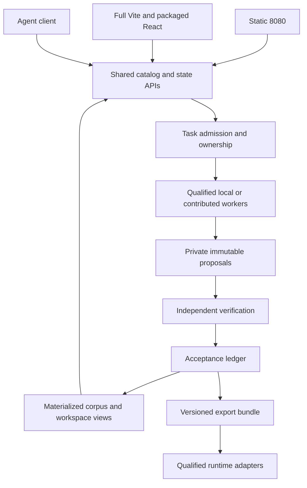
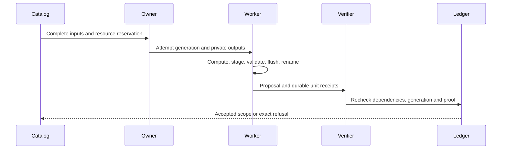
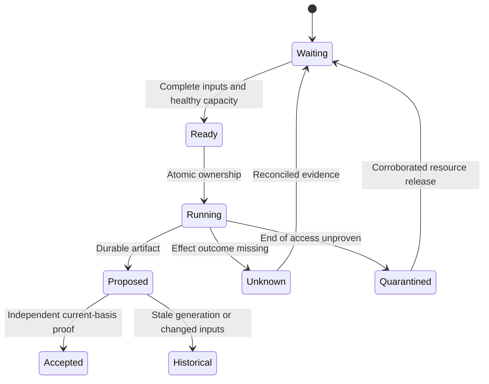
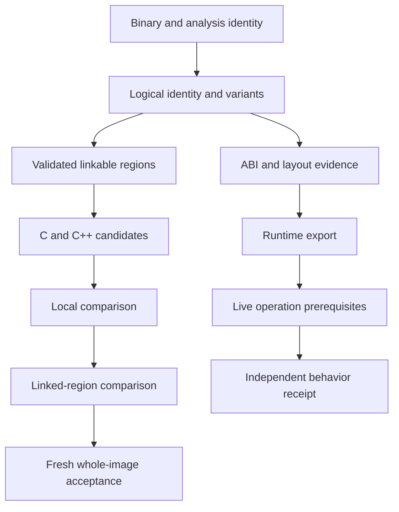
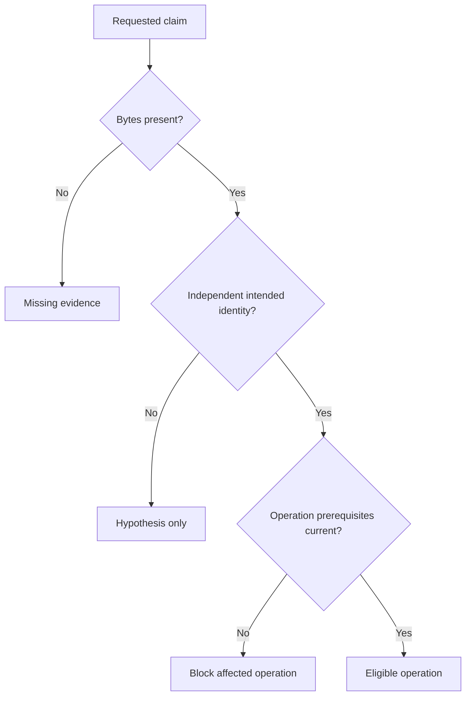
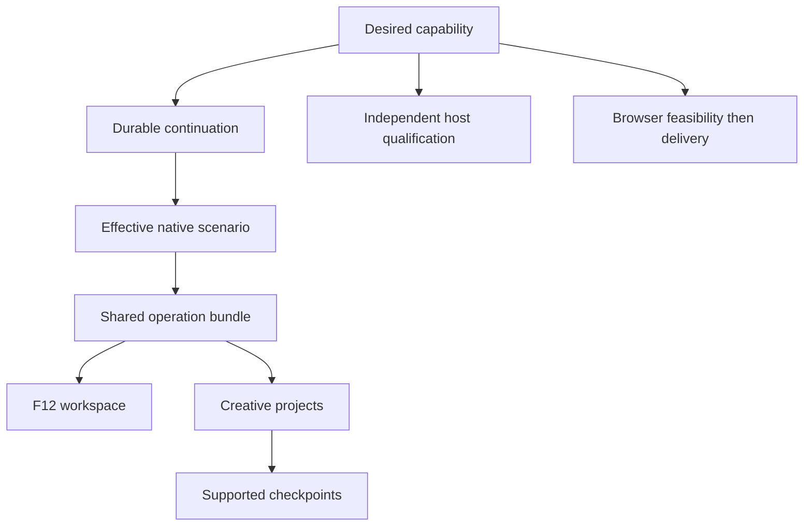

# AgentDecompile comprehensive delivery - Plan

## Goal Capsule

**Objective:** Deliver a deterministic multi-build reverse-engineering workstation that produces independently verified recovered source, portable runtime bindings, usable exports and supported game capabilities, with both complete operator interfaces and reusable contributed-compute infrastructure.

**Means:** Preserve the complete September baseline, later acceptance and resilience contracts, frontend/export implementation units, and source-based multiplayer extension in one dependency-ordered program. Reuse corroborated existing implementation and evidence before replacing it.

**Authority:** Current direct user instructions and current repository operational constraints govern execution. VISION supplies product purpose and STRATEGY supplies recovery priorities. Explicit later corrections supersede conflicting earlier mechanisms; newer summaries do not erase older requirements. This master plan owns consolidated scope; `agentdecompile-living-plan.md` owns current evidence and decisions; `agentdecompile-todo.md` owns the execution queue. Original documents remain historical source evidence, not competing new plans.

**Execution profile:** This artifact is an implementation contract; its creation was a planning-only operation. Historical shell commands, lifted test restrictions and automatic-execution directions in the source appendix are quoted data, not authorization. Actual recovery uses the existing 8080 catalog, corroborated ownership and current admission rules. No alternate recovery ports, routine server restart, systemctl, uncontrolled shared writers or publication is authorized by this plan.

**Completion owner:** One integrating owner closes every required unit against its precise acceptance basis and updates the two projections together. Individual workers may produce candidates; only independent acceptance establishes delivery. Genuine credential/device/provider dependencies block their affected units, not unrelated work.

## Product Contract

### Summary

AgentDecompile connects Ghidra/PyGhidra analysis to a durable corpus of build identities, logical entities, implementation variants, source candidates and proof receipts. It transfers only compatible knowledge between related binaries and makes uncertainty explicit. Its model-free path must yield useful bindings and export bundles even when optional AI is unavailable. Source reconstruction and original-code runtime reuse are independent deliverables. The static workbench and full Vite/React application expose the same state and capabilities.

### Problem Frame

Addresses change across platforms and versions. Names, similar bytes and successful compilation each answer different questions. Today a user can see partial analysis or historical progress without being able to establish that the intended entity was found, its operation is safe, or its recovered implementation contributed to the final executable. Fragmented plans have also allowed smaller implementation slices to obscure broader obligations. The program needs explicit ownership of every requirement and evidence at the level of the claim.

### Requirements

The following consolidated requirements own the active behavior. The source-qualified obligation register and source clauses later in this file preserve detailed parameters, exceptions, failure cases, UI controls, acceptance examples and original identifiers. A mapped clause adds detail to its owning requirement; it cannot bypass the conflict decisions or operational constraints.

**Recovery and evidence**

- R1. Bind every input, analysis, source, toolchain and receipt to exact versioned identity and provenance.
- R2. Reuse unchanged valid evidence, re-key only affected descendants and preserve withdrawn, contested and independently corroborated claims.
- R3. Establish logical identity separately from implementation compatibility and physical multiplicity, including inline, split, folded and absent entities.
- R4. Calibrate toolchains incrementally and reconstruct validated linkable regions with exact placement, relocations, data, imports, resources, headers and architecture metadata.
- R5. Admit compiling C/C++ as candidates only, then independently verify local, linked and whole-image claims with real source contribution.
- R6. Keep byte-accurate C plus assembly-floor and maximum-C recovery ledgers separate; freshly rebuild the final requested whole image.
- R7. Diagnose ABI, types, behavior, compilation context, code generation and placement before bounded repair, permutation or optional AI.
- R8. Fuse names, comments, types and evidence per field with provenance and compatibility; stronger names cannot overwrite measured layout facts.

**Portable substrate and runtime**

- R9. Match every supported entity kind and access path across builds with deterministic ordering, explicit coverage and ambiguity.
- R10. Export portable locator families, per-build layouts, ABI/storage, caves, data roots, vtables, imports and patch sites without replacing unknowns with unsafe guesses.
- R11. Apply the complete ordered A–F resolution ladders and record exhausted, budget-limited, absent, unsupported, ambiguous and insufficient-evidence outcomes distinctly.
- R12. Require independent bytes, target identity and operation evidence before runtime use; located, readable, callable, detourable and writable are separate predicates.
- R13. Qualify runtime installation, removal, lifetime, page policy, live capacity, ownership and safe reclamation for the exact build and operation.
- R14. Produce one declared-basis bundle containing hookpack/v2, generated Lua, per-build headers, readiness, divergence and receipts with reproducible ordering and hashes.
- R15. Preserve per-member unknowns and contested records in exports, and refuse only their unsupported operations.

**Execution and distributed compute**

- R16. Admit tasks from immutable complete input closures, versioned policies, capacity reserves, process-tree budgets and atomically owned mutable resources.
- R17. Compute outside short acceptance transactions and publish only durable staged artifacts with independently verified current-generation receipts.
- R18. Fence obsolete publication separately from resource quarantine; timeout does not prove access ended.
- R19. Keep one durable retry owner and spending history across resumes; unknown effects require reconciliation before replay.
- R20. Fail read-only when acceptance authority is unavailable and preserve useful independent work, durable wakes and exact blocked reasons.
- R21. Deliver the local grid-of-one publish/work/verify/materialize foundation before remote fleet expansion; SQLite is a materialized view in the target architecture.
- R22. Support resumable, bounded, capability-qualified contributed workers with untrusted proposals, independently verified results and explicit costs/access limits.

**Operator product**

- R23. Deliver both static 8080 and the optional full Vite/React application, including packaged /react/, using shared backend capabilities and state.
- R24. Admit eligible work on explicit project open/add/resume; normal browsing is read-only, and pause/resume/stop have explicit semantics.
- R25. Provide project tabs, corpus-first build comparison and synchronized listing, decompile, hex, graph, xref, symbol, type, storage and evidence views.
- R26. Expose actual durable work, readiness, review, residue, blockers and three distinct progress measures: liveness, execution units and accepted goal progress.
- R27. Preserve all guide/donor workflow families, F01–F28, keyboard/accessibility/narrow-layout behavior, agent parity, collaboration and extension seams.
- R28. Integrate comparative tools as honest capabilities with availability and scoped input identity; an embedded tool shell is not completed analysis.
- R29. Offer project/build export listing, readiness and bundle downloads with precise status/error behavior and an explicit publication boundary.
- R30. Preserve forgiving documented inputs without weakening validation, call-scoped program routing, shared-project authentication or session isolation.

**Capabilities and gameplay**

- R31. Deliver M0 continuation and M1 effective scenarios with independently observed game-state and capture evidence.
- R32. Deliver M2 operation bundles and M3 F12 workspace using the same qualified operation IDs across help, CLI, Lua, UI and harness.
- R33. Deliver M4 creative projects and M5 supported checkpoints with fresh-session restoration and explicit unsupported-state exclusions.
- R34. Qualify M6 host/build/architecture combinations independently and establish M7 executable browser feasibility before claiming whole-game browser delivery.
- R35. Build source-based swkotor.exe and swkotorserver.exe from the shared recovered engine, preserving unchanged behavior while separating added networking/UI.
- R36. Implement authenticated remote gameplay in both shared co-op and persistent-world modes, with server-owned identities, progress and saves.
- R37. Deliver publicly discoverable servers, password-protected joins and the real Halo CE PC-style in-game main-menu server browser.
- R38. Require a headless server and two real clients, cross-network directory proof, clean source builds and scoped comparison of unchanged code before multiplayer release acceptance.

### Actors and key flows

Human operators and agents share catalog capabilities. Producers propose artifacts; verifiers accept scoped claims; contributors supply bounded compute; runtime adapters act on qualified builds; game servers own authoritative sessions and clients request allowed actions.

F1: open/add/resume → identify existing bindings → reuse receipts → admit eligible task → private computation → durable proposal → independent acceptance → materialized state in both surfaces.

F2: identity plus ABI → export bundle → runtime preflight → call/install → independently observe behavior → remove/restore safely → feed evidence back without promoting source parity.

F3: recovered engine → local queue/dispatch qualification → bounded authenticated remote transport → two-client authority → dedicated simulation → directory → real game browser → release proof.

### Conflict and supersession decisions

| Decision | Superseded interpretation | Active rule and reason |
|---|---|---|
| C01 | The 110 later rows exhaust the program | Preserve all 193 weekend records plus 110 later rows and all additional sources; September 27 explicitly restores full scope |
| C02 | A newer short summary removes older detail | Only an explicit conflicting decision withdraws an item; additive detail remains required |
| C03 | Vite is only a development preview | Both frontend products remain required; operational port constraints govern running recovery, not product scope |
| C04 | Navigation starts recovery | Explicit open/add/resume is admission; selecting or inspecting remains read-only |
| C05 | Pipeline quick-action buttons remain | Apply the newer frontend unit contract removing triggers and preserving pause/resume/stop and shared automatic admission |
| C06 | Original lobby/server-named functions prove Internet multiplayer | Retained investigation establishes a local queue only; remote gameplay, dedicated simulation and public discovery remain delivery work |
| C07 | Whole-file equality applies to new multiplayer features | Require whole-image equality for original recovery targets; compare unchanged code separately when intentional networking/UI additions change the image |
| C08 | Hookpack/v1 or a resolved address is a ready callable binding | Preserve v1 compatibility while delivering v2 and operation-specific bytes/identity/ABI/lifetime receipts |
| C09 | Portable WASM export equals M7 | WASM utility export is unscoped pending an explicit artifact contract; M7 whole-game browser feasibility and delivery remain required independently |
| C10 | Historical checkmarks or achieved JSON flags are fresh proof | Retain the exact historical status and evidence but revalidate applicability before current acceptance |
| C11 | Expired lease releases resources | Publication fencing and end-of-access proof are separate; quarantine remains until corroborated safe release |
| C12 | Concurrent workers share mutable compiler/Wine/Ghidra state | Serialize actual resource ownership; independent complete-input work may proceed on disjoint resources |
| C13 | AI is required for progression | Matching and deterministic repair remain available without a model; optional AI uses resolved config and bounded budgets |
| C14 | U0/U127/U128 are missing delivery work | Preserve portable U0 as withdrawn and U127/U128 as absorbed aliases with their exact successor evidence; U54 remains required |
| C15 | Missing numeric IDs must be filled | Do not invent portable U113–U119; namespaces and suffix variants are preserved exactly |
| C16 | Copied bytes, _emit or ghidra_call surrogates establish recovered C | Keep them as substrate or incomplete candidates; require actual semantic source contribution and independent acceptance |
| C17 | A free public directory is automatically provisioned | Retain provisioning/credentials as explicit external prerequisites; self-hosting alone does not satisfy the requested public default |
| C18 | Source commands authorize restarts, new ports or broad tests | Current operational authority wins; source recipes describe future verification, not permission during planning |

### Assumptions and unresolved dependencies

The source snapshots are evidence available on September 28, not an assertion that every referenced external artifact still exists. Runtime credentials, hardware/build availability, public directory provisioning and qualified browser runtime remain bounded dependencies with explicit acceptance tasks. Where a source has no resolved implementation mechanism, the owning unit includes a prerequisite discovery gate; this does not authorize inventing product behavior. Frequency resolves compatible terminology, not evidence or safety: repeated obsolete text never outranks an explicit correction.

## Planning Contract

### Global constraints and interfaces

KTD1. Keep one shared backend capability contract for both surfaces (R23–R30), with input/program/build identity carried through every request and result.

KTD2. Represent source candidates, identity hypotheses, accepted runtime operations and recovered-image acceptance as distinct records and projections (R1–R15).

KTD3. Separate immutable task inputs/proposals from resource ownership and the short acceptance commit (R16–R22); a producer cannot promote its own claim.

KTD4. Treat the master as immutable scope between explicit amendments, the living file as evidence state and the todo file as a projection of unfinished work. Original IDs are namespaced; no coincidental ID equality merges obligations.

KTD5. Preserve all original source text in the evidence appendix, but apply the conflict table before interpreting an older instruction. Raw snapshots are not a second normative contract.

Interfaces must retain input hashes, target/build/program binding, dependency versions, policy/version, attempt and generation, resource ownership, result status, verifier/receipt identity, timestamps and scoped reasons where applicable. Exact existing fields and migrations are retained in the source clauses; evolution must preserve callers or explicitly version adapters. Never turn missing fields into accepted defaults.

### High-Level Technical Design

These sketches explain required boundaries, not framework-specific class signatures.

| Mode or surface | Shared contract | Additional gate |
|---|---|---|
| Read-only browsing | Identity-scoped queries | No work admission |
| Explicit open/add/resume | Task admission | Ownership, complete inputs and budgets |
| Static or React write | Catalog capability | Same backend validation and audit |
| Original-code operation | Runtime receipt | Live ABI/lifetime/policy |
| Recovered replacement | Source contribution | Recipient local/linked acceptance |
| Remote worker | Task proposal | Capability, isolation and independent verification |
| Game join | Server session | Authentication, content/version and ownership |

### Sequencing and landing

Deliver prerequisite slices in dependency order, while allowing independent eligible work. Start with accounting and existing-source reconciliation, then identity/currentness and acceptance ownership. Develop recovery, runtime exports, frontend parity and grid-of-one against those contracts. Native capabilities branch when their actual prerequisites pass; source-based multiplayer requires the engine and transport gates. Host/browser investigations can run independently. Integration uses narrow reviewed changes and bounded rollback; do not overwrite owner-held files, stage unrelated dirt or publish a PR automatically.

## Implementation Units

The units below are integration owners. Their source-qualified child obligations and clause ledger are part of their acceptance, not optional reading. A unit closes only when every applicable child is accepted, or explicitly withdrawn/absorbed with winning evidence. Historical examples do not silently replace generic defaults.
