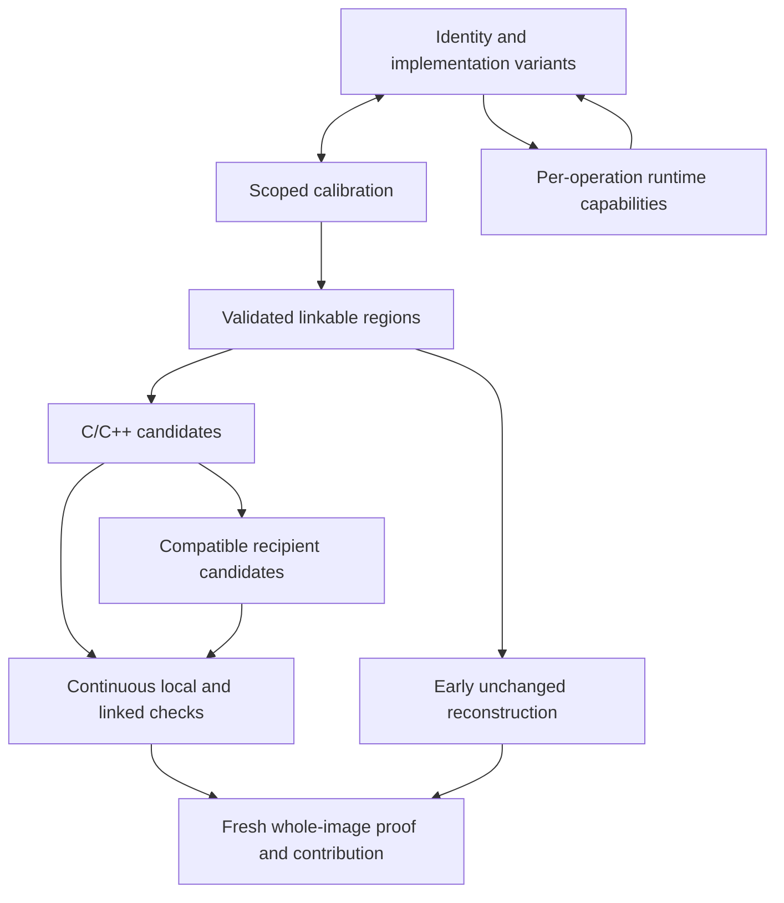

# Corpus pipeline

**Audience:** operators and agents who will recover more than one binary.  
**Reading level:** a 16-year-old who can compile C.

## What this is

AgentDecompile treats related binaries as a corpus while keeping each build's
behavior, layout and physical instances distinct. Identify related entities,
refine platform/toolchain facts, reconstruct validated linkable regions, produce
C/C++ candidates and distribute eligible candidates to compatible recipients.
Verify continuously; start reconstruction checks early. Terminal acceptance still
requires a fresh whole-image rebuild with proven source contribution and byte
comparison. Keep C+assembly-floor and max-C separately accounted.
[STRATEGY.md](../STRATEGY.md) owns policy; the
[implementation delta](plans/2026-09-22-recovery-contracts-and-validation-plan.md)
separates required contracts from delivered behavior.

Reuse valid unchanged analysis. Changed dependencies invalidate affected work,
not the entire corpus. A logical identity or compile receipt cannot authorize a
verified replacement. Optional reccmp and ReAgent checks contribute their own
scoped evidence; they do not replace objdiff or whole-file acceptance.



Runtime exports use known-build identity/RVA/live checks or supported unknown-build
discovery. [RUNTIME_REUSE.md](RUNTIME_REUSE.md) distinguishes export, ABI and object
lifetime checks, installation/removal, and observed behavior. Runtime calls do not
increase recovered-source coverage. Use the existing catalog to inspect available
operations; source-described actions are not a fresh live observation.

## Corpus database compatibility

[`corpus.store.connect(path, *, read_only=False, create=True)`](../src/agentdecompile_recovery/corpus/store.py)
is the canonical connection API; its baseline DDL and existing versioned
migrations are the single initialization path. Explicit writable paths retain
creation and migration behavior. `create=False` requires an existing file at
SQLite open. Read-only admission never migrates or backfills: it requires the
current schema version and matching migration version/name ledger. Future
versions refuse in either mode. Migration operations require the existing 8080
catalog and its ownership checks.

Migration 10 (`stabs_schema_ownership`) adopts the two nullable STABS attribution
columns on `func` and their source-file index; the existing `stabs_type` table
and indexes remain canonical. Migration validates known v9 shapes before any
DDL and preserves stored values, including NULL. STABS writers now require the
complete current ledger and schema; `ensure_columns` validates without repairing
or committing caller work. Raw or outdated handles must pass through the owned
migration path first. Current read-only admission also checks these postconditions.
Binary deletion independently admits frozen v9/v10/v11 profiles; historical
optional fields stay optional only in their original profiles.
Type, recovered-source and other persistent DDL owners remain separate
unfinished work. These are source contracts, not a fresh migration or live receipt.

Migration 11 (`decomp_schema_ownership`) owns the corpus `decomp` table/index
and singleton `decomp_schema_state`. Its observed pre-migration mode preserves
logical absence versus installed-empty witnesses and table-wide skeleton versus
AST selection, including historical NULL/empty AST values. It generates no
fingerprints or source evidence. `decomp_read_state` inspects supported ledgered
v9/v10/v11 stores; `require_decomp_schema` and canonical read-only connection
admission require complete current v11. Missing/corrupt state refuses rather
than guessing. Skeleton-mode integrity checking may scan the AST column.

Explicit `attach_store`/`persist_code` materialize AST mode. Compatibility
`ensure_decomp_columns` changes skeleton to AST without backfilling old rows;
logical absence remains absent. It never commits an existing caller transaction.
`persist_code` still commits caller work on success; operation failure uses its
savepoint while SQLite retains the outer transaction. Transaction loss or an
unacknowledged commit cannot be represented as successful rollback. Independent
part stores remain separate. The matcher-input-v2 projection includes selector
and selected values, invalidating older comparison inventories. Frozen v11
deletion retains global state even after removing the last binary. No installed
consumer, migration execution, fingerprint provenance upgrade or byte proof is
established by these source changes.

The deprecated [`corpus.db`](../src/agentdecompile_recovery/corpus/db.py) facade
retains public symbols and the exact historical module-relative `DB_PATH`.
Omitting a path emits `FutureWarning` with that path and now refuses missing-file
creation; configured/workbench selections never redirect it. Existing writable
legacy files now pass through canonical migrations. Export and inventory readers
refuse outdated stores instead of migrating them. Removing the facade still
requires explicit-path migration of every caller and a public compatibility
removal decision; broader DDL-ledger and per-binary delete ownership remain open.
New manifest roles are `donor` and `member`; legacy read-side `anchor`, NULL and
unknown stored roles are preserved without normalization.

## Catalog operations and CLI reference

Use the existing 8080 workbench and `GET /api/v1/actions` for recovery; inspect
advertised parameters rather than inventing action names or argv. The following
CLI forms document implementation only and do not authorize a direct bypass.

```bash
uv run agentdecompile-corpus init --id my-corpus --out target/corpus.json
uv run agentdecompile-corpus add-binary --corpus target/corpus.json \
  --id debug-build --path /path/to/debug-binary --debug stabs --donor
uv run agentdecompile-corpus add-binary --corpus target/corpus.json \
  --id release-build --path /path/to/release-binary
uv run agentdecompile-corpus run --corpus target/corpus.json \
  --snapshot-dir target/extracts --work-dir target/corpus-run \
  --stop-after compile
# Leftover AI is a later stage. Do not pass --llm to skip the floor.
uv run agentdecompile-corpus run --corpus target/corpus.json \
  --snapshot-dir target/extracts --work-dir target/corpus-run \
  --stop-after leftover-recover
```

`--stop-after compile` stays accepted. It means stop after donor C compile
(`recover-source`), not after the assembly-floor link. Use
`apply-cross-build` when compiling C exists. Use `verify-byte-accuracy`
only when you are ready to compare bytes. Use `--force` only when you mean
to redo analysis or C-replace.

```bash
uv run agentdecompile-corpus export-hookpack --db target/corpus.sqlite --out target/hookpack.json
```

`agentdecompile-cli corpus …` is the same CLI. Identity work uses
`init-store`, `apply-stabs`, `logical-build`, `match-pair`, `merge-parts`.
Project emit uses `genproject` and `ingest-recovered`. Compile Ghidra C with
`ghidra-bulk` (default `--mode compile-only`; `--mode semantic` refuses
invented layout). Copy compiling C onto bound siblings with `cross-place`.
The dashboard that used to live on 8791 is `/dashboard` on the MCP HTTP server.
Run work from that overview (and from a function or binary page): the same
cataloged `agentdecompile-corpus` and MCP tools as the CLI. There is no
separate actions page. Recovery and job logs live on Overview. Functions,
logical identities, review, relationships, and builds share one browse page
at `/dashboard/functions` (live search, configurable page size including All).

```bash
uv run agentdecompile-corpus extract-stabs --binary /path/to/mach-o --id debug-build \
  --out-dir target/extracts
```

That writes `{id}.functions.json` from Mach-O STABS (`N_SO` / `N_FUN`), which
is the donor layout. Identity matching uses the kotorxid multi-signal scorer
when extract rows carry strings/constants/structure; otherwise it falls back
to name+size. Ghidra C is normalized before compile: HighFunction / p-code /
ClangTokenGroup facts, then Clang AST passes (SCRIBE-style). `--mode semantic`
refuses invented layout or ABI. `--mode compile-only` (default) may still
use `GhidraBlob`, `ghidra_call()`, and diagnostic stubs so the knowledge-db
compile-rate baseline does not regress. Compile rate is not byte-accuracy.

## Rules you cannot skip

- Names: human, then STABS, then symbols, then Ghidra, then placeholders.
  A placeholder never replaces a better name.
- `__asm`, naked functions, `_emit`, and `.byte` bodies are not recovered
  source. They do not get copied.
- Identity matching (which function is which) is not the same as copying
  source. Source copy waits for compile.
- Do not re-run `analyze-program` on a program that already has analysis.
  Opening an existing project reuses that analysis.
- Live pages share the MCP HTTP server (default 8080): `/dashboard` (was
  :8791), `/atlas` (was :5173), `/report` (was :3000). Their labels do
  not complete a stage.

## Browser pages (same port as `/mcp`)

The same HTTP listener serves `/app`, `/dashboard`, `/atlas`, `/report`, and
`/mcp`. Set `AGENT_DECOMPILE_CORPUS_DB`, `AGENT_DECOMPILE_CORPUS_WORK_DIR`,
`AGENT_DECOMPILE_ATLAS_PROJECT_ROOT`, and optionally
`AGENT_DECOMPILE_REPORT_HTML` when you want live data. Empty pages are
honest, not complete. Old 8791 / 5173 / 3000 processes are leftovers.

Stage table: [corpus/README.md](corpus/README.md).
