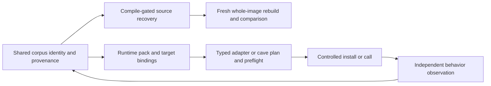

# Runtime reuse and recovery

Initial assessment: 2026-09-20; source reconciliation: 2026-09-27. [STRATEGY.md](../STRATEGY.md) owns pipeline policy;
[AGENTS.md](../AGENTS.md) owns operations. This is an integration contract and
source-based assessment, not a completed runtime delivery claim.

KotorPhasor already consumes original binaries and can provide observations to
the shared corpus. It is not a replacement recovery engine. Runtime reuse may
branch after sufficient identity and ABI evidence, before whole-image recovery.
Calling original code never counts its bytes as recovered source.

## Existing implementation and evidence

AgentDecompile paths below are in this repository. KotorPhasor paths refer to
the read-only sibling checkout `/run/media/brunner56/MyBook/Workspaces/KotorPhasor`.
Source inspection establishes implementation, not successful execution on every build.

| Requirement | Implemented or observed | Unverified or missing |
|---|---|---|
| Corpus export | [export_hookpack.py](../src/agentdecompile_recovery/corpus/export_hookpack.py) exports `agentdecompile.hookpack/v1` from logical functions, identities and instances. `corpus.export-hookpack` was observed in the live 8080 catalog on 2026-09-20; [catalog.py](../src/agentdecompile_recovery/corpus/dashboard/actions/catalog.py) introspects public parsers. | Catalog listing does not prove an export succeeded. The exporter emits site kinds, required flags and optional field offset/size through site policy. Complete typed operation ABI, lifetime, inverse/oracle and cave-patch contracts remain absent. |
| Executable admission | KotorPhasor `src/runtime/runtime.cpp` and `src/image/load.cpp` check known build identity, live code sections and code hash before resolution. Proxy and ELF preload initialization exist. | A pack cannot admit an arbitrary unknown executable. All-build and other-architecture support are not established. |
| Pack loading and resolution | `src/hooks/registry.cpp` loads v1 packs, selected build slugs and optional per-build overlays. Matching address hints are accepted; stale/missing hints can fall back to a unique executable-region scan. | An instance without expected bytes remains address-based. A matching hint is not globally uniqueness-checked. A shared signature string is not a universal runtime resolver or ABI. The exporter can emit `adapter_key`, aliases, image base and stored/computed SHA-256 when available. The inspected KotorPhasor v1 parser still binds literal site names and does not consume those adapter mappings or the exported binary SHA-256. Runtime image admission and optional overlays remain separate mechanisms; generated-pack identity and adapter-role binding are not yet established. |
| Detour installation | `src/hooks/trampoline.hpp` implements x86-32 five-byte jumps, whole-instruction displacement and supported relative-branch relocation; unsupported cases refuse. Hook-set failure rolls back installed detours. | Caller must establish quiescence. Rollback is not atomic concurrent patching. |
| Typed native calls | `src/hooks/thiscall.hpp` supplies typed C++ adapters for Windows ECX versus ELF stack `this`; `src/harness/fields.hpp` supplies field access. Missing sites/null objects refuse. | Native call sites fix arguments/returns; the registry does not interpret prototypes. Aggregate returns, varargs and x86-64 are excluded by this adapter. ARM source presence is not active support. |
| VM and events | `src/api/routines.cpp` marshals `nwscript.call`; runtime registration keeps NWScript and `kp.*` native APIs distinct. Event bodies and the Lua host dispatch callbacks. Harness commands queue work for the game thread. | Action closures are excluded from VM calls. The single-client harness is not a generally safe concurrent native-call endpoint. |
| Code caves | `docs/user/codecaves.md` describes unused executable padding; `src/api/memory.cpp` supports raw writes. | Raw writes do not validate payload capacity, semantics or machine code, and provide no automatic undo. A cave inventory is not an installable patch. |
| Live behavior | Historical `tmp/demos/cursed/10_rancor_roulette.report.json` records success for `k1_steam_103_unpacked`. | Video was not replayed in this assessment; no fresh export → resolve → typed call → observed behavior run, K1 GOG proof, cross-process multiplayer proof or source-built client/server proof was established. K2 hook loading and compilation do not establish gameplay. |

The exporter derives optional 8–24 byte unique windows from available raw images
through its format mapper. This establishes source routing, not every format's correctness. Raw-file uniqueness is distinct from runtime executable-region
uniqueness. KotorPhasor's `kp.mem.findsig` can select an occurrence (default
first); it does not carry the resolver's `find_unique` guarantee. Neither
mechanism replaces the corpus identity cascade in STRATEGY.

## First generated native operation — source assessment, 2026-09-27

The September 22 M1/M2 roadmap can start with one Windows K1 GOG player-model
scale operation: identify → snapshot → resize → restore. KotorPhasor's
`src/api/model.cpp`, `model_backend.cpp` and `model_lua.cpp` already implement
the typed setter, protected capture, readback and restore path. This is source
feasibility, not a fresh game receipt. Its `model_profiles.cpp` entries remain
compiled constants; they are not independently accepted corpus evidence.

The next implementation should generate one versioned operation bundle and bind
it to that existing adapter. Include independently qualified entity roles,
exact build identity, RVA/live guards, root recipe and field extents, ABI/types,
units, thread/lifetime rules, inverse and independent observations. Help and
harness requirements must reference that same revision. The exporter must
corroborate its declared image digest against the actual image supplying bytes.
The consumer must enforce the exported digest and unambiguous adapter-role mapping;
its current `src/hooks/registry.cpp` v1 parser does neither. Model binding currently
precedes hookpack resolution in `src/runtime/runtime.cpp`; generated binding must
follow admitted-pack validation. A hardcoded fallback cannot count as generated use.

The [generated-operation contract increment](verification/2026-09-27-generated-operation-contract.md)
now implements the exporter-side exact raw-image/role checks and the KotorPhasor
parser/runtime-side selected digest plus adapter-key/alias support. Model binding
now waits for an admitted generated operation and uses its resolved role addresses;
compiled profile data remains the distinct ABI/layout guard. Independent generated
layout evidence, lifetime evidence and live runtime acceptance remain open.

Qualify one owned, stationary fixture first. Existing captures check epoch,
IDs and pointers but cannot detect exact address reuse. Require stable actor/world
lifetime, no load or competing scale writer, and refusal when ownership cannot be
established. Correlate baseline/change/restoration with an independent observation
of the same actor and run; the setter's own success log is insufficient. Verify
restored base and effective scale and continued gameplay. This inverse restores
model scale only; it is not a world checkpoint. Missing fixture, observer or
lifetime evidence blocks this scenario while unrelated work continues.

No export-to-native run, M1 mixed-batch continuation or M2 generated operation
acceptance was performed in this assessment. Source detail and snapshot hashes
are retained in `/home/brunner56/Documents/AgentDecompile-native-next-audit-20260927.md`.

## Integration contract (required work, not a new implemented API)

Keep readiness states separate: discovered → identity-supported → resolved →
installable/installed → call-observed → behavior-observed. Each needs the exact
binary identity, site/region, inputs, tool/runtime revision, execution context,
evidence and limitations. Resolution alone is never a universal C-call promise.

- **Call sites:** known prototype and ABI, object lifetime, argument/return
  ownership, game-thread/context constraints and a supported native adapter.
  Metadata alone cannot synthesize a trusted call.
- **Detours and trampolines:** validated overwritten instructions, relocation
  support, saved originals, restoration and quiescence. Ordinary detours allocate
  their own trampolines; they do not require static caves.
- **Caves:** anchor and offset, capacity, original bytes, architecture and
  provenance, plus payload bounds, relocations, restoration and quiescence.
- **Source recovery:** compiling C, objdiff-0 functions and whole-image identity
  retain their separate gates. Runtime observations may refine names, types,
  field hypotheses and behavior evidence with provenance; they cannot promote
  source parity or overwrite stronger evidence wholesale.

Use the generic corpus/export core with target adapters and build profiles.
All BioWare corpus builds remain in recovery scope; future other games remain
in scope for the generic design, but require real adapter and ABI work.

## Capability refinement — 2026-09-22 (required, not delivered)

[The recovery-contract plan](plans/2026-09-22-recovery-contracts-and-validation-plan.md)
extends this integration contract. Exact known build: verify image identity → recorded
RVA → expected live bytes/structure, then independently establish intended target
entity identity before requested operation preflight. A signature derived from the
label-selected address proves presence only. See the binding predicates and
Foo/Bar counterexample in the linked contract plan. Unknown or
changed builds use bounded discovery. Resolution is independent of the readable,
callable, detourable and writable capabilities, each of which carries evidence and
runtime conditions. Cache dynamic-root recipes, not unbounded-lifetime pointers.

Executable allocation is policy-dependent; slack/zero-filled storage is not
inherently expendable. Unsupported process mitigation yields a named refusal.
Installation and removal require a tested thread/lifetime protocol, including
safe trampoline reclamation. Suspending threads plus moving instruction pointers
is not a universal synchronization strategy. A byte journal restores recorded
patches, not arbitrary side effects of code already executed. Typed calls require
valid objects, supported prototypes, ownership and game-thread context.

New evidence can reduce trusted coverage. Unknown builds can remain absent,
inlined-only, ambiguous, unsupported, insufficient-evidence or budget-exhausted;
ingesting a runtime observation alone does not make every entity known or callable.

## Operator workflow

Use the existing 8080 workbench and `GET /api/v1/actions`; inspect the advertised
parameters for `corpus.export-hookpack` and submit through that catalog when
export is authorized. Reuse identity, analysis and receipts after corroborating
their target and provenance. Inspect the exported pack before choosing a
supported target adapter. Complete resolution/preflight, controlled installation
or call, independent observed state/event checks and provenance feedback as
separately authorized runtime work. No new runtime verb or automatic injection
route is claimed here. The current documentation task performs none of those
runtime actions.

The [execution design](plans/2026-09-22-task-acceptance-and-continuation-design.md)
specifies scenario prerequisite selection, same-run oracle/video correlation,
command-ID outcome reconciliation and separate status observation while mutation is
owned. Missing source reconstruction does not block verified original-code use.
Missing authentication, fixture or adapter blocks only dependent scenarios; healthy
independent analysis and capabilities continue. These are future design contracts,
not fresh runtime evidence.
