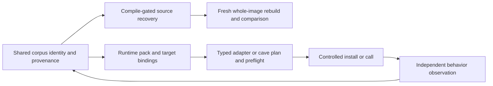

# Runtime reuse and recovery

Assessment: 2026-09-20. [STRATEGY.md](../STRATEGY.md) owns pipeline policy;
[AGENTS.md](../AGENTS.md) owns operations. This is an integration contract and
source-based assessment, not a completed runtime delivery claim.

KotorPhasor already consumes original binaries and can provide observations to
the shared corpus. It is not a replacement recovery engine. Runtime reuse may
branch after sufficient identity and ABI evidence, before whole-image recovery.
Calling original code never counts its bytes as recovered source.

## Existing implementation and evidence

AgentDecompile paths below are in this repository. KotorPhasor paths refer to
the read-only sibling checkout `/run/media/brunner56/MyBook/Workspaces/KotorPhasor`.
Source inspection establishes implementation, not successful execution on every build.

| Requirement | Implemented or observed | Unverified or missing |
|---|---|---|
| Corpus export | [export_hookpack.py](../src/agentdecompile_recovery/corpus/export_hookpack.py) exports `agentdecompile.hookpack/v1` from logical functions, identities and instances. `corpus.export-hookpack` was observed in the live 8080 catalog on this date; [catalog.py](../src/agentdecompile_recovery/corpus/dashboard/actions/catalog.py) introspects public parsers. | Catalog listing does not prove an export succeeded. Schema lacks complete ABI, site-kind, field-extent and cave-patch contracts. |
| Executable admission | KotorPhasor `src/runtime/runtime.cpp` and `src/image/load.cpp` check known build identity, live code sections and code hash before resolution. Proxy and ELF preload initialization exist. | A pack cannot admit an arbitrary unknown executable. All-build and other-architecture support are not established. |
| Pack loading and resolution | `src/hooks/registry.cpp` loads v1 packs, selected build slugs and optional per-build overlays. Matching address hints are accepted; stale/missing hints can fall back to a unique executable-region scan. | An instance without expected bytes remains address-based. A matching hint is not globally uniqueness-checked. A shared signature string is not a universal runtime resolver or ABI. Export keys from `best_name`/`canon_key` need explicit mapping to adapter keys such as `vm.run_script`; overlay merging matches literal names, not semantic aliases. Exported build rows omit image base/hash, so profile/overlay binding must supply required metadata. |
| Detour installation | `src/hooks/trampoline.hpp` implements x86-32 five-byte jumps, whole-instruction displacement and supported relative-branch relocation; unsupported cases refuse. Hook-set failure rolls back installed detours. | Caller must establish quiescence. Rollback is not atomic concurrent patching. |
| Typed native calls | `src/hooks/thiscall.hpp` supplies typed C++ adapters for Windows ECX versus ELF stack `this`; `src/harness/fields.hpp` supplies field access. Missing sites/null objects refuse. | Native call sites fix arguments/returns; the registry does not interpret prototypes. Aggregate returns, varargs and x86-64 are excluded by this adapter. ARM source presence is not active support. |
| VM and events | `src/api/routines.cpp` marshals `nwscript.call`; runtime registration keeps NWScript and `kp.*` native APIs distinct. Event bodies and the Lua host dispatch callbacks. Harness commands queue work for the game thread. | Action closures are excluded from VM calls. The single-client harness is not a generally safe concurrent native-call endpoint. |
| Code caves | `docs/user/codecaves.md` describes unused executable padding; `src/api/memory.cpp` supports raw writes. | Raw writes do not validate payload capacity, semantics or machine code, and provide no automatic undo. A cave inventory is not an installable patch. |
| Live behavior | Historical `tmp/demos/cursed/10_rancor_roulette.report.json` records success for `k1_steam_103_unpacked`. | Video was not replayed in this assessment; no fresh export → resolve → typed call → observed behavior run, K1 GOG proof, cross-process multiplayer proof or source-built client/server proof was established. K2 hook loading and compilation do not establish gameplay. |

The exporter currently derives optional 8–24 byte unique windows from PE raw
images. Raw-file uniqueness is distinct from runtime executable-region
uniqueness. KotorPhasor's `kp.mem.findsig` can select an occurrence (default
first); it does not carry the resolver's `find_unique` guarantee. Neither
mechanism replaces the corpus identity cascade in STRATEGY.

## Integration contract (required work, not a new implemented API)

Keep readiness states separate: discovered → identity-supported → resolved →
installable/installed → call-observed → behavior-observed. Each needs the exact
binary identity, site/region, inputs, tool/runtime revision, execution context,
evidence and limitations. Resolution alone is never a universal C-call promise.

- **Call sites:** known prototype and ABI, object lifetime, argument/return
  ownership, game-thread/context constraints and a supported native adapter.
  Metadata alone cannot synthesize a trusted call.
- **Detours and trampolines:** validated overwritten instructions, relocation
  support, saved originals, restoration and quiescence. Ordinary detours allocate
  their own trampolines; they do not require static caves.
- **Caves:** anchor and offset, capacity, original bytes, architecture and
  provenance, plus payload bounds, relocations, restoration and quiescence.
- **Source recovery:** compiling C, objdiff-0 functions and whole-image identity
  retain their separate gates. Runtime observations may refine names, types,
  field hypotheses and behavior evidence with provenance; they cannot promote
  source parity or overwrite stronger evidence wholesale.

Use the generic corpus/export core with target adapters and build profiles.
All BioWare corpus builds remain in recovery scope; future other games remain
in scope for the generic design, but require real adapter and ABI work.

## Operator workflow

Use the existing 8080 workbench and `GET /api/v1/actions`; inspect the advertised
parameters for `corpus.export-hookpack` and submit through that catalog when
export is authorized. Reuse identity, analysis and receipts after corroborating
their target and provenance. Inspect the exported pack before choosing a
supported target adapter. Complete resolution/preflight, controlled installation
or call, independent observed state/event checks and provenance feedback as
separately authorized runtime work. No new runtime verb or automatic injection
route is claimed here. The current documentation task performs none of those
runtime actions.
