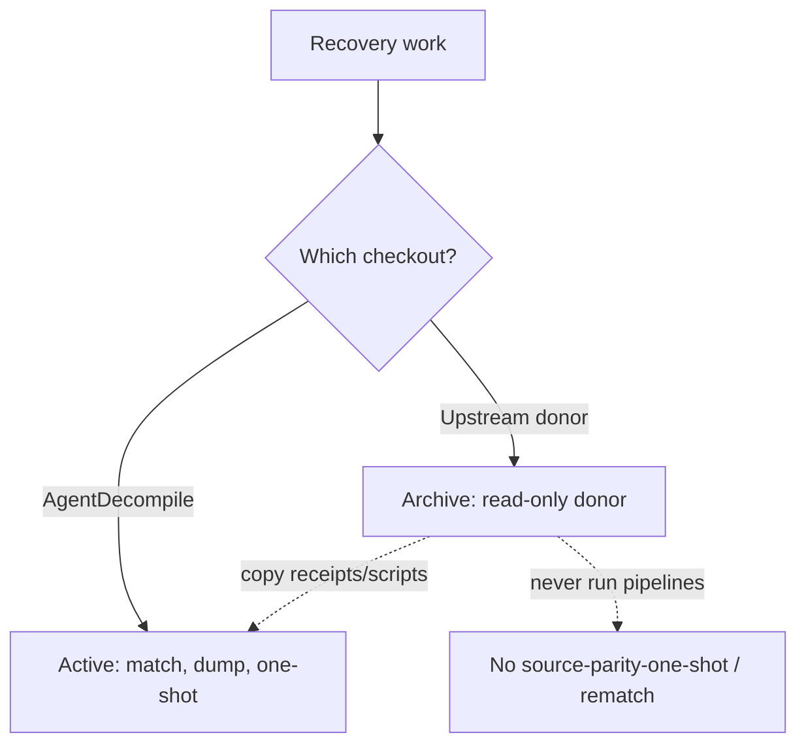

# Upstream donor archive (read-only)

**Status:** archived donor checkout. Not an active recovery product.

## Hard rule

Do **not** run recovery pipelines from the upstream donor checkout:

- No `source-parity-one-shot`
- No `swkotor-match-*` rematches
- No new feature work under that tree

All matching recovery, dumps, and one-shot implementations live in **AgentDecompile**.
Operate through the existing 8080 workbench and `GET /api/v1/actions`; follow
[AGENTS.md](../AGENTS.md) for reuse, process ownership and mission constraints.

## What the upstream donor checkout still is

- Historical receipts, inventories, and matched sources under its `target/` (copy/symlink into AgentDecompile `target/` if needed)
- Donor of scripts and ideas already folded into `src/agentdecompile_recovery/`

## What "done" looks like for swkotor dumps

A dump is an artifact, not terminal recovery. See [CRITICAL_PATH.md](CRITICAL_PATH.md)
for implementation reference and [STRATEGY.md](../STRATEGY.md) for fresh whole-image
acceptance. [Runtime reuse](RUNTIME_REUSE.md) describes the separate original-binary
consumer; it does not make the archived donor an active recovery checkout.
