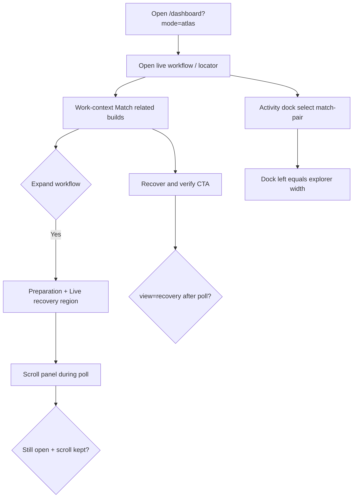

# Dogfood Report — feat/evidence-fusion-matcher

> Diff-scoped browser QA of `feat/evidence-fusion-matcher` vs the trunk. Generated by `ce-dogfood` on 2026-09-09.

## Diff Summary

- Atlas work-context: persisted expandable workflow panel (preparation + recovery brief), sticky chrome, separate Recover CTA, PrefDetails, Activity dock left=explorer width, UnifiedActivity scroll/filter stability, Section `minHeight`.
- Dogfood find+fix: URL/`open()` session refresh was forcing `view` back to overview (Recover & verify appeared broken).
- Built `static/react/` assets served live on `:8080` without process restart.
- Broader branch corpus fusion matcher: not browser-exercised beyond prep “Match related builds” status.

## Personas

- **Recovery operator** (inferred from AGENTS/STRATEGY) — needs live matching status readable while jobs poll; Recover CTA must stick.
- **Atlas power user** — Compare builds without chrome that resets under them.

## Flows Tested

## Test Matrix & Results

| # | Flow | Journey / Scenario | Status | Issue | Fix | Commit |
|---|------|--------------------|--------|-------|-----|--------|
| 1 | Workflow | Atlas shell loads with work-context controls | Pass | - | - | - |
| 2 | Workflow | Expand persists across reload (pref true) | Pass | - | - | - |
| 3 | Workflow | Scroll panel mid-poll; stays open at scrollTop | Pass | - | - | - |
| 4 | Workflow | Recover & verify navigates and survives poll | Fixed | `open()` effect reset view on sessions refresh | Guard openKey + only reset view on project change | _(this commit)_ |
| 5 | Activity | Select corpus.match-pair; dock usable | Pass | Short log; Follow release N/A | - | - |
| 6 | Activity | Dock left matches explorer width (320px) | Pass | - | - | - |
| 7 | Analysis | PrefDetails on embeddings with binary selected | Skipped | Project-only selection had no AtlasAnalysis | Needs binary tree member | - |
| 8 | Feel/a11y | Toggle aria-label; panel region; summary aria-expanded | Fixed | Glyph-only name; unmount broke aria-controls | aria-label, keep panel `hidden`, dual ARIA, hit targets | _(this commit)_ |

## What Was Fixed

### Session refresh forced overview — _(pending SHA)_
- **Symptom:** Recover & verify click left Compare builds; DOM click set recovery then poll restored overview.
- **Root cause:** `useEffect([open, sessions.loading])` re-called `open()` whenever `open` identity changed; `open` always `setView(overview)`.
- **Fix:** `AtlasApp.tsx` — skip re-open when `openKey` matches; only change view when project identity changes (or addr targets functions).
- **Regression test:** Browser replay (agent-browser): recover → wait 4–5s → `viewAfterPoll=recovery`. No meaningful unit extract without pulling `open` into a pure helper; replay documented here.

### Workflow disclosure a11y/feel — _(pending SHA)_
- **Symptom:** Toggle announced as “▾”; panel unmounted when collapsed; Recover hidden ≤1000px in an earlier draft.
- **Fix:** `aria-label` on toggle; summary `aria-expanded`/`aria-controls`; panel stays mounted with `hidden`; 40px hit targets; tabular-nums on live counters; activity muted contrast bump.
- **Regression test:** Browser eval of `aria-label` / `summaryExpanded` / Recover CTA present.

## Paper Cuts (by persona)

- **Recovery operator** — dual disclosure controls (chevron + summary) — low — deferred (intentional discoverability).
- **Recovery operator** — embeddings PrefDetails not covered without binary — deferred.
- **Atlas power user** — activity list re-anchor disabled after any scroll — low — deferred (stability preferred).

## Console Errors

None observed on Atlas recover path in agent-browser `errors` samples. Lighthouse separately reported favicon 404 (pre-existing / infra).

## Human Verifications

Not applicable.

## Decisions for a Human

### Gzip + immutable cache for hashed React assets
- **What's broken:** Lab LH reports ~356 KiB savings; assets served without Content-Encoding; `Cache-Control: no-cache` despite hashes.
- **Why escalated:** Server middleware / `react_api.py` trade-offs affect all surfaces.
- **Options:** Starlette GZipMiddleware + immutable hashed paths vs reverse-proxy compression only.
- **Recommendation:** Enable gzip/brotli at the HTTP layer serving `static/react/assets/*` with long-cache on content-hashed filenames.

### ResizeBar `aria-valuenow`
- Shared separator control lacks valuemin/max/now — product decision on announcing pixel sizes vs omit role.

## Learnings

- Atlas is `?mode=atlas` (production); bare `/dashboard` is workbench App — dogfood must force the mode under test.
- Preferential `open()` tied to callback identity + polling is a silent UX killer (view thrash).
- Expanding workflow into a primary panel is the right fix for “collapsed strip”; still need not to remount it.

## Final Status

**Ready with fixes** for the Atlas collapse/workflow UX scoped in this dogfood. Matrix items 1–6 and 8 pass after fix; 7 skipped. Automated frontend vitest (`activityDisplay`, `preparationProgress`) green. Full corpus matcher suite not re-run (out of browser scope). Lab Lighthouse desktop Perf 99 / A11y 87 — compression and contrast follow-ups escalated.
