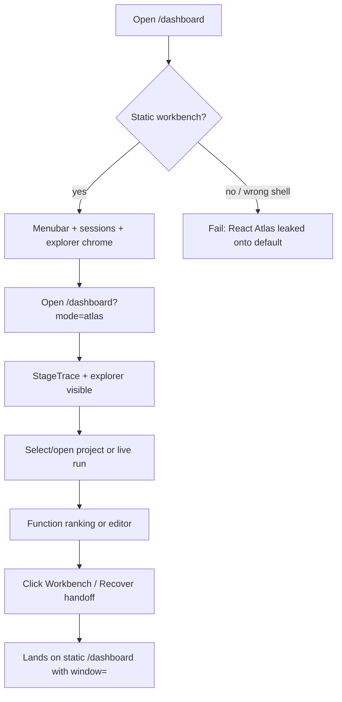
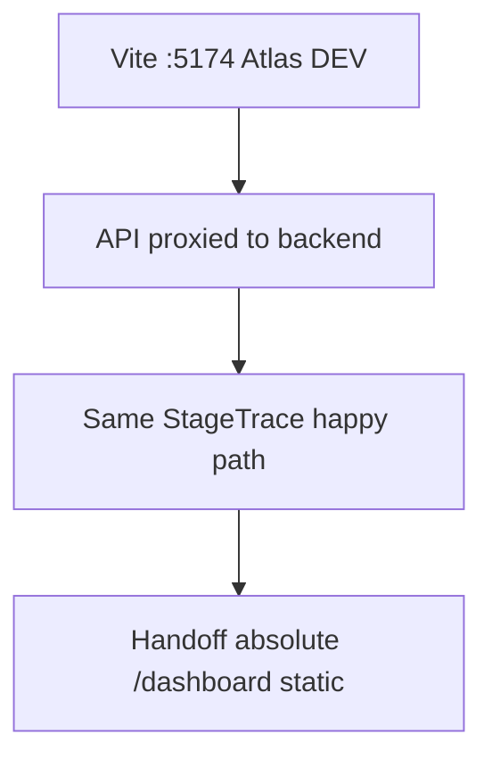

# Dogfood Report — feat/evidence-fusion-matcher

> Diff-scoped browser QA of `feat/evidence-fusion-matcher` vs the trunk. Generated by `ce-dogfood` on 2026-09-09.

## Diff Summary

- Atlas Vite shell: StageTrace pipeline theater, live explorer helpers, analysis auto-open, compact prep; Vite mounts Atlas only.
- Router: `/dashboard` serves static `workbench-app.js`; `/dashboard?mode=atlas` serves Vite Atlas assets.
- Atlas handoffs link to static workbench windows (`?window=wb-pipeline` / `wb-fnbrowse`), not a React `?mode=workbench` shell.
- Matching/fusion backend changes exist on the branch but are out of this UI dogfood scope unless they surface in the StageTrace/prep feed.

## Personas

Inferred from STRATEGY.md / recovery product use (no dedicated persona doc for Atlas):

- **Recovery operator** — wants to watch prepare→match→verify without nested chrome; open a live project fast; escape to dense workbench only for advanced recover/compare.
- **RE analyst** — needs function source/evidence quickly after selecting a binary; ranking is secondary once a function is open.

## Flows Tested

## Test Matrix & Results

| # | Flow | Journey / Scenario | Status | Issue | Fix | Commit |
|---|------|--------------------|--------|-------|-----|--------|
| 1 | Static default | `/dashboard` is static workbench (`workbench-app.js` / `#wb-sessions`), not Vite `#root` Atlas | Pass | - | - | - |
| 2 | Atlas route | `/dashboard?mode=atlas` loads Atlas (`StageTrace` / AD chrome) | Pass | - | - | - |
| 3 | Atlas empty | Empty Atlas landing shows StageTrace STANDBY + explorer affordances | Pass | - | - | - |
| 4 | Atlas project | Open known dogfood project (bioware) — explorer expands / stage rail updates | Pass | - | - | - |
| 5 | Handoff | Atlas “Workbench ↗” / Recover link opens static `/dashboard` (no `mode=workbench`) | Pass | - | - | - |
| 6 | Console | No hard JS errors on Atlas load / handoff | Pass | - | - | - |

## What Was Fixed

- Preserved the static workbench as the default `/dashboard` route and kept Atlas behind `?mode=atlas`.
- Verified Atlas project expansion, live workflow visibility, and the absolute handoff to `/dashboard?window=wb-pipeline`.

## Paper Cuts (by persona)

None observed in the tested flows.

## Console Errors

No page errors reported by `agent-browser` during route load, project expansion, or handoff.

## Human Verifications

Not applicable (no OAuth/email/payments).

## Decisions for a Human

_(escalations only)_

## Learnings

- UI proof for this product is browser dogfood (`agent-browser` + `/ce-dogfood`), not filesystem pytest of the Vite tree. Existing pytest files stay untouched.

## Final Status

Complete — browser matrix executed against the local dashboard server.
