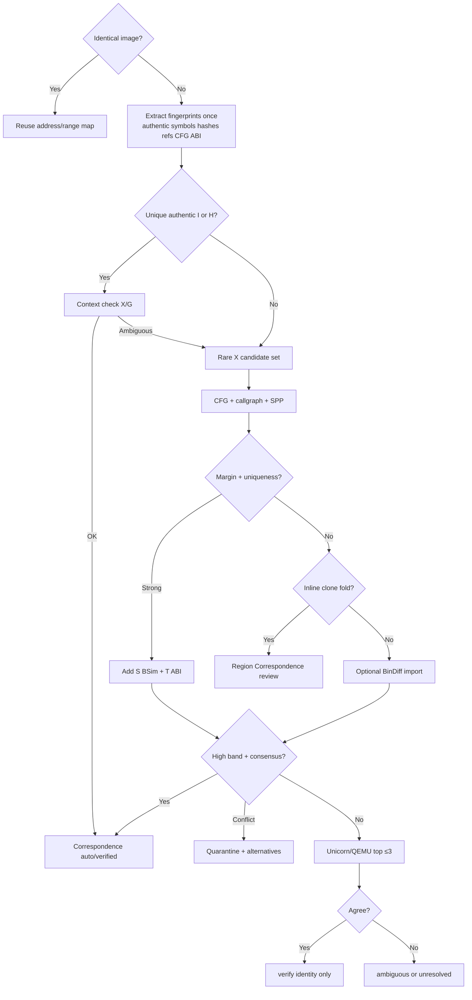

# Evidence-Fusion Cross-Binary Matcher - Plan

**Target repo:** AgentDecompile

**Product Contract preservation:** authored in this plan (`ce-plan-bootstrap`). STRATEGY Approach deepened 2026-09-09 (identity ≠ equality ≠ behavior; extract-once; preserve ambiguity; separate identity vs type/source gates). Builds on existing cascade modules (`callgraph_propagate`, `cfg_signature`, `mnemonic_spp`, `match_islands`, `block_inline`) and `second_opinion` BinDiff import.

## Goal Capsule

- **Objective:** Turn corpus cross-binary matching into a staged, evidence-driven cascade: identical-image short-circuit, authentic provenance/symbols, unique exact/reloc hashes, rare refs and C++ metadata, neighborhood propagation, structure/BSim/ABI, optional BinExport/BinDiff, Unicorn only on residues. Candidate generation ≠ acceptance. Preserve ambiguity. Separate Correspondence statuses from type/source/parity gates. Precision of auto-accept over recall.
- **Authority:** `STRATEGY.md` Approach + Identity ladder step, then this Product Contract, then existing `PAIR_POLICY` / pinned kinds. Dashboard copy is not authority.
- **Stop when:** `corpus.match-pair` / `match_store.match_binaries` fuse independent channels with uniqueness + margin; Correspondence can express 1↔1, clone, inline, thunk, split/fold, and unresolved/ambiguous; identical images skip function matching; heuristic prior names never count as authentic symbols; structural stays `verify`; inline stays `review`; BSim significance participates in-cascade; reloc-normalized hashes seed unique matches; optional BinExport + Unicorn behind flags; claim text separates identity, code equality, behavior, and objdiff-0.
- **Do not:** Re-analyze a Ghidra program that already has analysis; claim byte match from cascade scores; auto-bind tiny wrappers from cosine alone; treat transitive bridges as independent corroboration; auto-copy ABI types/source on identity bind; make BinDiff/Unicorn a hard dependency; rewrite the recovery ladder past identity; invent second dashboard ports; force unique pairs when evidence is absent.
- **Execution profile:** Code. Prefer focused pytest on cascade modules; smoke `match-pair` against a tiny SQLite fixture. Emulation/BinExport units use smoke or skip-if-tool-missing.
- **Tail ownership:** Keep unrelated NDS/language/dashboard dirt out of commits for this plan.

---

## Product Contract

### Summary

Cross-build identity is an evidence-fusion problem. Extract fingerprints once; short-circuit identical images; generate candidates cheaply; accept only with independent support; propagate through distinctive neighborhoods; quarantine conflicts; escalate cost only for a named unresolved question. Keep **cross-build identity**, **code equality**, and **behavioral equivalence** as separate stored properties. A Correspondence record must support ordinary matches, clones, inlines, thunks, split regions, and folded/aliased implementations—not only `addr→addr, confidence=0.99`. Identity bind does not auto-authorize type/layout/source copy.

### Problem Frame

Operators bind `logical_id` across related C/C++ builds so recovery can propagate. Today several channels exist but are not fused as independent evidence: there is no reloc-normalized hash family; BSim significance lives in prep/`symbol_map` rather than the cascade; ABI fields are extracted but barely scored; BinDiff is import-only second opinion; nothing emulates residue candidates. Names previously written by a matcher can be mistaken for authentic symbols. Pairwise all-pairs scoring and transitive bridges can invent false confidence. Inlining, cloning, and ICF already break forced 1↔1 assumptions. Similarity scores are still treated too close to identity claims.

### Requirements

- R1. Cascade failover order: identical-image shortcut → authentic symbols/debug → reloc-normalized instruction hashes → rare string/const/import composites (+ C++/dispatch metadata when available) → CFG + call-graph (+ SPP) → BSim similarity **and** significance → ABI/type corroboration → optional BinExport/BinDiff → Unicorn/QEMU on ≤3 candidates → leave unresolved/ambiguous.
- R2. Independent evidence channels (`I`,`H`,`X`,`G`,`S`,`T`,`M`,`D`); correlated hash variants stay one channel. Legend: I=symbol/debug, H=reloc/instr/mnemonic hashes, X=rare refs (+ C++ metadata), G=CFG/call-graph/SPP, S=BSim, T=ABI/type, M=BinExport/BinDiff second opinion, D=Unicorn/QEMU.
- R3. Auto-accept requires uniqueness in the target and a clear margin over the runner-up; tiny functions take a hard penalty. Candidate generation (hash lookup, fuzzy retrieval) is not acceptance.
- R4. Structural islands remain `status=verify`; block-hash inlines remain `status=review`; both stay in `PINNED_KINDS` so persist cannot promote them to `auto`.
- R5. Binding `logical_id` from `auto`/`verify` is identity evidence, not objdiff-0 and not code-equality or behavioral-equivalence proof. Parity claims stay on the recovery ladder; objdiff is rebuild validation, not a cross-architecture identity oracle.
- R6. Do not re-analyze an already-analyzed Ghidra program as part of match-pair (SQLite-only). Extract once; compare many times from immutable feature records. Extract/BSim ingest remain separate prep stages.
- R7. Hook-pack export still emits one portable signature family even when binding used multiple channels.
- R8. When neighbors match but no candidate clears threshold, switch to region / containment matching rather than inventing a 1↔1 pair. Support clone/inline/thunk/split/fold Correspondence kinds.
- R9. BinExport/BinDiff and Unicorn/QEMU are optional tools: skip cleanly when absent; never block cheap cascade stages.
- R10. Auto-match precision is optimized before overall recall; unresolved/ambiguous is preferred over wrong propagation. Do not manufacture a unique identity when distinguishing evidence is absent.
- R11. Store and report **cross-build identity**, **code equality** (raw and/or named normalization), and **behavioral equivalence** as separate properties on Correspondence (or linked fields)—never collapse into one score.
- R12. Before function matching, detect identical (or content-verified identical) executable images and reuse the established address/range mapping; do not infer identity from filenames, timestamps, or version strings alone.
- R13. Distinguishing **authentic** symbols/debug (validated PDB/DWARF/build-id/dSYM association where applicable) from **heuristically assigned** names written by a prior matcher run; only authentic names feed channel `I`.
- R14. Identity acceptance does not automatically copy prototypes, field offsets, recovered source bodies, or ABI-sensitive types; those use separate approval gates (propagation / type / source / parity).
- R15. Conflict handling: quarantine contradictory anchors, trace evidence dependencies, invalidate descendants of a bad seed before continuing; keep runner-up and ambiguity sets.
- R16. Multi-build donor scheduling: prefer nearby same-arch/toolchain bridges and a spanning forest; do not treat transitive edges derived from one seed as independent corroboration.
- R17. Indexed retrieval over exhaustive pairwise scoring for leftover stages; expand shortlists when evidence is weak; approximate-search miss ≠ proof of absence.
- R18. LLM (and learned embeddings) may propose hypotheses only; never create a trusted identity edge without independently checkable evidence (aligns STRATEGY ladder).

### Actors

- A1. Corpus operator / agent driving `/dashboard` preparation and `corpus.match-pair`.
- A2. Implementer extending `match_store` / extract without breaking concurrent pair jobs.

### Key Flows

- F1. Identical image: content/layout verified equal → reuse range map; skip function matching.
- F2. Cheap pair: authentic symbol or unique hash seeds → context check → call-graph propagate → `auto` rows.
- F3. Hard pair: rare-ref candidate set → structural/SPP → BSim significance corroboration → ABI filter → optional BinDiff import → emulate top ≤3 → accept, ambiguity set, or unresolved.
- F4. Non-1↔1: strong neighborhood + distinctive constants inside a larger host → `inline`/`review` or region Correspondence, never forced auto identity.
- F5. Conflict: competing assignments in a component → quarantine, keep alternatives, do not pick an arbitrary winner.

### Acceptance Examples

- AE1. Covers R1/R3. Unique reloc-normalized hash present once on each side seeds an `auto` match; the same hash on forty targets does not.
- AE2. Covers R4. Structural island persists as `verify` through `run_pair` / `persist_status`.
- AE3. Covers R5/R11. `bind_identities` may attach `verify` rows; claim text never calls that objdiff-0 or behavioral equivalence.
- AE4. Covers R9. With Unicorn absent, cascade still completes; emulation stage records skipped.
- AE5. Covers R12. Two binaries with identical content hashes reuse mapping without inventing function pairs.
- AE6. Covers R13. A name previously written by the matcher does not seed channel `I` on a later run.
- AE7. Covers R14. Accepting identity does not mutate sibling prototypes/source without a separate gate.

### Scope Boundaries

**In scope:** Corpus matcher cascade, Correspondence/status vocabulary, identical-image shortcut, authentic vs heuristic name provenance, fingerprint extract/store, BSim fusion, ABI discriminator, region/inline path, donor-schedule guidance in match orchestration, optional BinExport helper + existing BinDiff import, Unicorn/QEMU harness gated by flags, separate identity vs type/source/parity gates (docs + API seams), CONCEPTS/STRATEGY alignment, tests.

**Deferred for later:** Full Ghidra Version Tracking + FID product stage; Diaphora beyond existing import; neural/GNN matchers; theorem-proving / BinHunt-class symbolic tier; corpus-wide pairwise BinDiff of every binary; full LogicalFunction/CodeInstance ORM rewrite if current `identity`/`match` tables can carry Correspondence fields incrementally.

**Outside this product's identity:** Claiming verified readable C from cascade scores alone; requiring BinDiff or Unicorn for every preparation run; promising complete mapping with zero mistakes at negligible cost.

### Success Criteria

- Auto rows that fire on unique exact evidence stay high-precision on fixture pairs.
- Hard cases escalate through channels without inventing pairs under C<70-equivalent policy.
- Ambiguity/unresolved counts remain visible; no silent unique pick from a pruned shortlist alone.
- Prep `match-pair` remains SQLite-only and concurrency-safe.
- Missing optional tools skip without failing the cheap cascade.
- Heuristic names never masquerade as authentic symbol evidence.

### Key Decisions

- KD1. Evidence-fusion cascade, not a universal fuzzy matcher. (session-settled: user-directed — chosen over single-score similarity: dump + STRATEGY Approach.)
- KD2. Include Unicorn/QEMU verification and optional BinExport/BinDiff in this plan. (session-settled: user-directed — chosen over in-tree-only ranks through ABI+BSim.)
- KD3. Identity bind (`auto`/`verify`) ≠ byte proof (objdiff 0). Preserve both ladders. (session-settled: user-approved — chosen over requiring objdiff before any bind: would freeze propagation.)
- KD4. Structural=`verify`, inline=`review`, pinned through persist. (session-settled: user-approved — chosen over auto-bind from graph/SPP alone.)
- KD5. Identity ≠ code equality ≠ behavioral equivalence; store separately. (session-settled: user-directed — methodology dump §1.)
- KD6. Candidate generation ≠ acceptance; preserve ambiguity rather than force 1↔1. (session-settled: user-directed — methodology dump Stages D–F.)
- KD7. Identity acceptance does not auto-copy types/source; separate gates. (session-settled: user-directed — methodology dump Stage H.)

---

## Planning Contract

### Assumptions

- Existing kotorxid rows may lack `block_hashes` / new hash columns until re-extract; cascade must treat empty as “no evidence.”
- BSim databases may already exist from prep; fusion reads stored vectors/results rather than forcing re-ingest during match-pair.
- Unicorn and BinExport may be absent on operator machines; units must degrade.

### Key Technical Decisions

- KTD1. Add reloc-normalized hash family on extract (`H_reloc` / `H_instr` / `H_mnemonic`; keep `H_raw` optional) and unique-index them like string anchors. (Governs R1, R3)
- KTD2. Introduce an explicit channel confidence helper used at persist/bind time; keep `PAIR_POLICY` for scored identity rounds; pin cascade kinds. Do not sum correlated hash variants as independent channels. (Governs R2, R3, R4)
- KTD3. Fuse BSim by mutual-best + significance threshold (reuse `BSIM_TRUSTED_SIGNIFICANCE` / eval APIs), as corroboration or seed only when uniqueness holds — never sole auto on tiny funcs. (Governs R1, R10)
- KTD4. ABI/type is a bonus/penalty discriminator, not an auto-match channel alone. (Governs R1)
- KTD5. BinDiff remains `second_opinion` at `verify` with distinct `run=` namespace; add optional BinExport generation as a prep/helper, not a match-pair hard dep. (Governs R9; session-settled: user-directed — include BinExport/BinDiff.)
- KTD6. Unicorn/QEMU runs only after static evidence clears the high band defined by the KTD2 helper (aligned to same_platform verify/auto floors + uniqueness) and ≤3 candidates remain; dynamic agreement cannot rescue weak static alone. (Governs R1, R9; session-settled: user-directed — include emulation.)
- KTD7. Prefer new signals in `match.evidence` JSON; add `func` columns only for indexed fingerprints (hashes), with `ensure_func_columns` migration. (Governs R6)
- KTD8. R7 hook-pack one-family guarantee is verified by documentation + a thin export assertion in U8 (or residual if export code is untouched this round). (Governs R7)
- KTD9. Extend match/identity evidence toward a Correspondence model: relation kind (1↔1, clone, inline, thunk, split, fold), status (verified / strongly_supported / tentative / ambiguous / unresolved), alternatives[], and separate flags for code_equality / identity / behavioral_check — prefer incremental columns/JSON over a full ORM rewrite. (Governs R8, R11, R15; session-settled: user-directed — KD5/KD6.)
- KTD10. Identical-image short-circuit uses content hash + image layout check before any function matcher; filename/version string alone never triggers. (Governs R12)
- KTD11. Symbol channel `I` requires authentic provenance; names tagged as matcher-inferred (prior `auto`/`verify` writeback) are excluded from `I` seeds. (Governs R13)
- KTD12. Propagation/type/source/parity remain separate gates; `bind_identities` must not imply type or source copy. (Governs R14, R5; session-settled: user-directed — KD7.)
- KTD13. Donor scheduling: group by arch/ABI/toolchain overlap; prefer spanning-forest nearby pairs; transitive chains count as one evidential lineage for corroboration accounting. (Governs R16, R17)

### High-Level Technical Design



Matcher node labels `auto` / `verify` / `review` are persist statuses (identity evidence). They are not STRATEGY “Verified readable C” (objdiff 0). Separate gates apply after identity for types, source, and parity.

Channel model (directional):

```text
Channels: I=authentic symbol/debug · H=reloc/instr/mnemonic hashes (one channel) · X=rare refs / C++ metadata · G=CFG/call-graph/SPP · S=BSim · T=ABI/type · M=BinExport/BinDiff second opinion · D=Unicorn/QEMU
base from strongest primary channel
C = min(99, base + independent corroboration − penalties)
tiny / non-unique / tight margin → penalty or refuse auto
gen ≠ accept · transitive chain ≠ independent corroboration
```

Map confidence bands onto the helper in KTD2 before coding emulation gates: high band ≈ existing same_platform `auto`/`verify` floors with uniqueness; refuse inventing pairs below the review floor. Do not treat C as interchangeable with raw `score_features` output.

### Alternative Approaches Considered

- **Universal BSim/embedding matcher first** — rejected; STRATEGY and the dump put deterministic unique evidence first; tiny funcs fake similarity 1.0.
- **Require BinDiff for every pair** — rejected; optional second opinion; expensive and not always installed.
- **Objdiff before any identity bind** — rejected; would stall cross-place; keep bind vs parity separate (KD3).
- **Force 1↔1 assignment always** — rejected; preserve ambiguity/clone/inline Correspondence (KD6).
- **Treat prior matcher names as symbols** — rejected; authentic vs heuristic provenance (R13).

### Risks

- Wrong `auto` contaminates call-graph propagation — mitigate with uniqueness, margin, tiny penalty, pinned kinds, quarantine (R15).
- Schema drift on live kotorxid DB — `ensure_func_columns` + empty-as-absent; incremental Correspondence JSON (KTD9).
- Emulation false confidence — cap dynamic bonus; require strong static first.
- Transitive bridge false corroboration — count lineage once (KTD13).
- Heuristic name pollution — exclude inferred names from channel `I` (KTD11).

---

## Implementation Units

### U1. Reloc-normalized hash fingerprints

- **Goal:** Extract and index `H_reloc` / `H_instr` / `H_mnemonic` (optional `H_raw`) so unique exact bodies seed matches.
- **Requirements:** R1, R3, R6
- **Dependencies:** none
- **Files:**
  - `src/agentdecompile_recovery/corpus/features.py`
  - `src/agentdecompile_recovery/corpus/extract.py`
  - `src/agentdecompile_recovery/corpus/store.py`
  - `src/agentdecompile_recovery/corpus/match_store.py`
  - `src/agentdecompile_recovery/corpus/callgraph_propagate.py`
  - `tests/test_corpus_features.py`
  - `tests/test_callgraph_propagate.py`
- **Approach:**
  1. During tier2, canonicalize instructions (mask relocation/address immediates) and compute hash family.
  2. Persist on `func` with `ensure_func_columns`; load in `Binary`.
  3. Seed mapping via `unique_index_anchors` on each hash key; require target uniqueness.
- **Patterns to follow:** `block_mnemonic_hash`, `interesting_string` uniqueness, `ensure_func_columns` for `block_hashes`.
- **Test scenarios:**
  - Identical reloc-normalized bodies unique on each side → anchor `auto`.
  - Same digest on two targets → no unique anchor.
  - Empty/missing hashes → no crash; cascade continues.
- **Verification:** New tests green; extract of a fixture program writes nonempty hash fields when disassembly exists.

### U2. Channel confidence and tiny-function policy

- **Goal:** Score primary + independent corroboration with penalties; keep pinned kinds authoritative at persist.
- **Requirements:** R2, R3, R4, R10
- **Dependencies:** U1
- **Files:**
  - `src/agentdecompile_recovery/corpus/match_engine.py`
  - `src/agentdecompile_recovery/corpus/propagate.py`
  - `src/agentdecompile_recovery/corpus/callgraph_propagate.py`
  - `tests/test_callgraph_propagate.py`
  - `tests/test_corpus_match_status.py`
- **Approach:**
  1. Add a small confidence helper (base by primary kind + bonuses for other channels − penalties).
  2. Apply tiny-instruction and non-uniqueness penalties before `auto`.
  3. Keep `persist_status` pinning structural/inline/callgraph/anchor.
- **Execution note:** Characterization-first on current `status_for` / `PAIR_POLICY` behavior before tightening auto.
- **Patterns to follow:** `PAIR_POLICY`, `persist_status`, `PINNED_KINDS`.
- **Test scenarios:**
  - Structural row stays `verify` after persist helper.
  - Sub-threshold tiny unique string alone does not become `auto` without corroboration (policy as implemented).
  - Sole-candidate margin remains score-based (`candidate_margin`).
  - Multiple `H_*` variants on one body count as one `H` channel (no stacked corroboration).
  - Claim/docstring: `verify` bind is not described as objdiff-0.
- **Verification:** Existing cascade tests still pass; new policy tests cover pin + penalty.

### U3. Fuse BSim significance into the cascade

- **Goal:** Use BSim similarity **and** significance (and top1−top2 margin) as cascade evidence, not prep-only indexing.
- **Requirements:** R1, R10
- **Dependencies:** U2
- **Files:**
  - `src/agentdecompile_recovery/corpus/match_store.py`
  - `src/agentdecompile_recovery/corpus/bsim_eval.py` (or thin adapter)
  - `src/agentdecompile_recovery/symbol_map.py` (threshold constant reuse)
  - `tests/test_callgraph_propagate.py` or new `tests/test_match_bsim_fuse.py`
- **Approach:**
  1. When BSim hits exist for the pair, propose mutual-best candidates with significance ≥ trusted threshold.
  2. Treat as seed if unique + margin, else corroboration bonus on an existing candidate.
  3. Never auto-accept on similarity alone for trivial sizes.
- **Patterns to follow:** `BSIM_TRUSTED_SIGNIFICANCE`, `bsim_eval` result shape, prep BSim stage skip-if-done.
- **Test scenarios:**
  - High similarity / low significance → no auto.
  - Mutual-best with significance + margin **and target uniqueness** → verify or auto per policy.
  - Missing BSim DB → no-op, cascade continues.
- **Verification:** Unit tests with stubbed BSim rows; no Ghidra required.

### U4. ABI / prototype discriminator

- **Goal:** Use recovered calling convention / arity / return class to reject incompatible candidates and boost compatible ones.
- **Requirements:** R1, R10
- **Dependencies:** U2
- **Files:**
  - `src/agentdecompile_recovery/corpus/match_engine.py`
  - `src/agentdecompile_recovery/corpus/features.py` (if normalization needed)
  - `tests/test_callgraph_propagate.py`
- **Approach:**
  1. Normalize ABI vector from existing tier1 fields (CC, param_count, return width class if available).
  2. Hard-incompatible → reject or heavy penalty; compatible → small corroboration only.
- **Patterns to follow:** existing `canon_arity` weight; do not invent source-language prototypes as identity.
- **Test scenarios:**
  - Compatible arity/CC → score improves but alone insufficient for auto.
  - Incompatible arity → candidate dropped or fails verify gate.
- **Verification:** Focused unit tests on discriminator helper.

### U5. Region matching when 1↔1 breaks

- **Goal:** When neighborhoods match but function boundaries disagree, emit region/inline evidence instead of a false pair.
- **Requirements:** R8, R4
- **Dependencies:** U2
- **Files:**
  - `src/agentdecompile_recovery/corpus/block_inline.py`
  - `src/agentdecompile_recovery/corpus/match_islands.py`
  - `src/agentdecompile_recovery/corpus/match_store.py`
  - `tests/test_block_inline.py`
- **Approach:**
  1. Extend containment triggers: distinctive X refs inside a larger host; CFG subgraph containment when block hashes exist.
  2. Persist as `kind=inline` / `review` (or new `region` pinned kind if needed — prefer reuse).
- **Patterns to follow:** `leftover_inlines`, nonempty `block_hashes` gate.
- **Test scenarios:**
  - Missing body hashes ⊂ unique host → review inline.
  - Split across two hosts → no hit.
  - No hashes → no false region claim.
  - Strong neighborhood + distinctive constants inside a larger host → `inline`/`review`, not `auto`.
- **Verification:** Existing + new block_inline tests green.

### U6. Optional BinExport + BinDiff second opinion

- **Goal:** Generate BinExport when the tool exists; keep BinDiff/Diaphora imports as `verify` under distinct `run=` namespaces.
- **Requirements:** R9, R5
- **Dependencies:** U2
- **Files:**
  - `src/agentdecompile_recovery/corpus/second_opinion.py`
  - new helper `src/agentdecompile_recovery/corpus/binexport.py`
  - `tests/` for import path / skip-if-missing
- **Approach:**
  1. Document and implement optional headless BinExport invocation when extension present (canonical module path above).
  2. Leave `import_bindiff` at `verify`; do not call `bind_identities` from import alone unless operator opts in.
  3. Allow cascade to read second-opinion `verify` rows as corroboration when present.
- **Patterns to follow:** `second_opinion` module docstring (“never creates canonical identities” by default).
- **Test scenarios:**
  - Import fixture BinDiff table → `verify` rows, distinct run key.
  - Missing BinExport binary → skip receipt, no exception.
- **Verification:** Import tests without Ghidra; BinExport smoke skipped when tool absent.

### U7. Unicorn/QEMU leftover verification

- **Goal:** Emulate reference + ≤3 candidates; compare normalized side effects; bump confidence only when static already strong.
- **Requirements:** R1, R9, R10
- **Dependencies:** U2, U3
- **Files:**
  - new `src/agentdecompile_recovery/corpus/emulate_verify.py` (or similar)
  - wire from `match_store` / `propagate` behind flag/env
  - `tests/test_emulate_verify.py`
- **Approach:**
  1. Minimal Unicorn harness: map code + RO data, hook imports, capture return + write set + call sequence.
  2. Gate: only unresolved high static band; skip if Unicorn missing.
  3. Agreement → match status `verify` (identity evidence only; not objdiff-0).
- **Execution note:** Prefer smoke/runtime verification with skip-if-missing over heavy unit mocks of CPU state.
- **Patterns to follow:** optional-tool skip style used elsewhere in recovery; never rescue weak static (below the plan's high-confidence band) with dynamic agreement alone.
- **Test scenarios:**
  - Tool missing → skipped, cascade ok.
  - Stub agreement path marks verify when enabled with fake backend.
  - Weak static candidate refused even if fake dynamic agrees.
- **Verification:** Tests pass with Unicorn absent; optional local smoke when installed.

### U8. Claim-boundary docs and CONCEPTS alignment

- **Goal:** Make identity vs code equality vs behavior vs parity vocabulary consistent; document separate gates and Correspondence.
- **Requirements:** R5, R7, R11, R14, R18
- **Dependencies:** U2
- **Files:**
  - `CONCEPTS.md`
  - `docs/solutions/` short learning entry (optional)
  - matcher module docstrings as needed
- **Approach:** Document evidence-fusion cascade, Correspondence kinds/statuses, portable signature vs multi-channel bind, verify≠objdiff, identity≠type/source copy, LLM never alone creates identity.
- **Test expectation:** none -- documentation only.
- **Verification:** CONCEPTS entries present; STRATEGY already updated 2026-09-09.

### U9. Correspondence evidence model

- **Goal:** Persist relation kind, status band, alternatives, and separate identity / code-equality / behavior flags without forcing addr→addr only.
- **Requirements:** R8, R10, R11, R15
- **Dependencies:** U2
- **Files:**
  - `src/agentdecompile_recovery/corpus/match_store.py`
  - `src/agentdecompile_recovery/corpus/propagate.py`
  - `src/agentdecompile_recovery/corpus/store.py` (schema if needed)
  - `tests/test_correspondence_model.py` (new) or extend `tests/test_corpus_match_status.py`
- **Approach:**
  1. Extend `match.evidence` (and/or thin columns) with `relation`, `status_band`, `alternatives`, `code_equality`, `identity_claim`, `behavior_checked`.
  2. Map existing kinds (`structural`, `inline`, anchors) onto Correspondence vocabulary; keep persist pinning.
  3. On conflict, store ambiguity set rather than arbitrary winner; support quarantine flag.
- **Patterns to follow:** existing `match.evidence` JSON; `PINNED_KINDS`; KTD9 incrementalism.
- **Test scenarios:**
  - Duplicate fingerprint → ambiguity group, no sole `auto`.
  - Inline relation persists as review with `relation=inline`.
  - Quarantine flag blocks descendant propagation from a revoked seed.
- **Verification:** New tests green; existing cascade tests still pass.

### U10. Identical-image short-circuit

- **Goal:** Skip function matching when two registered builds are content-verified identical; reuse range mapping.
- **Requirements:** R12, R6
- **Dependencies:** none
- **Files:**
  - `src/agentdecompile_recovery/corpus/match_store.py` (or small `identical_image.py`)
  - `src/agentdecompile_recovery/corpus/store.py` / binary metadata
  - `tests/test_identical_image.py`
- **Approach:**
  1. Compare content hash (and optional layout fingerprint); refuse filename/version-only equality.
  2. On hit, write identity mapping from existing ranges / 1:1 VA reuse receipt; do not run leftover cascade.
- **Patterns to follow:** prep skip-if-done receipts; SQLite-only pair path.
- **Test scenarios:**
  - Same content hash → mapping reused, no scored leftover pairs required.
  - Same filename different content → no short-circuit.
- **Verification:** Unit tests with fixture digests; no Ghidra.

### U11. Authentic vs heuristic symbol provenance

- **Goal:** Channel `I` only from authentic symbols/debug; exclude matcher-inferred names.
- **Requirements:** R13, R1
- **Dependencies:** U9
- **Files:**
  - `src/agentdecompile_recovery/corpus/features.py`
  - `src/agentdecompile_recovery/corpus/extract.py`
  - `src/agentdecompile_recovery/corpus/callgraph_propagate.py` / unique symbol anchors
  - `tests/test_symbol_provenance.py`
- **Approach:**
  1. Tag symbol source on extract (`debug`, `export`, `user`, `matcher_inferred`).
  2. Unique-symbol seeding filters to authentic tags only.
  3. Document that build-id/PDB/dSYM validation is best-effort when artifacts exist; missing debug → no fake authenticity.
- **Patterns to follow:** existing symbol uniqueness; do not invent PDB validation if artifact absent.
- **Test scenarios:**
  - Matcher-inferred name alone → no `I` seed.
  - Export/debug name unique both sides → may seed `auto` under existing uniqueness rules.
- **Verification:** Focused unit tests; extract fixture tags present when metadata exists.

### U12. Donor schedule and corroboration accounting

- **Goal:** Prefer nearby donor pairs; do not count transitive edges from one seed as independent channels.
- **Requirements:** R16, R17
- **Dependencies:** U2, U9
- **Files:**
  - `src/agentdecompile_recovery/corpus/match_store.py` or prep orchestration in `workflow.py` / jobs
  - `tests/test_donor_schedule.py`
- **Approach:**
  1. Schedule helper: group by arch/ABI; pick spanning-forest edges by cheap overlap.
  2. Evidence helper: when scoring corroboration, collapse chain-derived edges to one lineage.
  3. Document that all-pairs remains available for operators; forest is default schedule, not a ban.
- **Patterns to follow:** prep job ordering; avoid rewriting the whole dashboard in this unit.
- **Test scenarios:**
  - Three binaries A→B→C from one seed → corroboration count does not triple.
  - Cross-arch pair not preferred over same-arch when both available (schedule preference).
- **Verification:** Unit tests on schedule/accounting helpers; orchestration wiring optional if CLI already picks pairs.

---

## Verification Contract

- Focused: `pytest tests/test_callgraph_propagate.py tests/test_cfg_signature.py tests/test_mnemonic_spp.py tests/test_block_inline.py tests/test_corpus_features.py tests/test_corpus_match_status.py` plus new U3/U7/U9–U12 tests.
- Regression: `tests/test_corpus_pipeline.py::test_matcher_accepts_shared_rare_string`.
- Claim boundary: tests or docstring checks that `verify`/`bind_identities` language never asserts objdiff-0 or behavioral equivalence.
- Provenance: inferred names excluded from `I`.
- Optional tools: skip-if-missing paths exercised.
- R6 smoke (when practical): `match-pair` fixture path does not call Ghidra analyze.
- No claim of byte match from cascade scores in new copy.

## Definition of Done

- All U1–U12 complete or explicitly deferred with reason in residual notes.
- Cascade tests green; pinned structural/inline behavior preserved.
- Correspondence can express ambiguity/non-1↔1 without inventing pairs.
- Identical-image short-circuit and authentic-symbol filter covered by tests.
- Optional BinExport/Unicorn do not break SQLite-only `match-pair`.
- STRATEGY + CONCEPTS describe evidence-fusion + identity≠equality≠behavior; hook-pack still one family.
- Implementer can run `ce-work` without inventing channel order or collapsing gates.

## Appendix

### Research breadcrumbs

- Existing cascade: `match_store.match_binaries`, `callgraph_propagate`, `match_islands`, `persist_status`.
- BSim significance constant: `symbol_map.BSIM_TRUSTED_SIGNIFICANCE`.
- BinDiff import: `second_opinion.import_bindiff` (verify, distinct run).
- Institutional: claim boundary / match-function ≠ bytecode (`docs/solutions/architecture-patterns/decomp-matching-toolchain.md`).
- External method dumps (user-supplied 2026-09-09): hierarchical failover; identity vs equality vs behavior; extract-once; gen≠accept; Correspondence; identical-image shortcut; authentic vs heuristic names; separate identity vs type/source gates; donor spanning forest; preserve ambiguity; Unicorn last; Khaos warning on fission/fusion.
