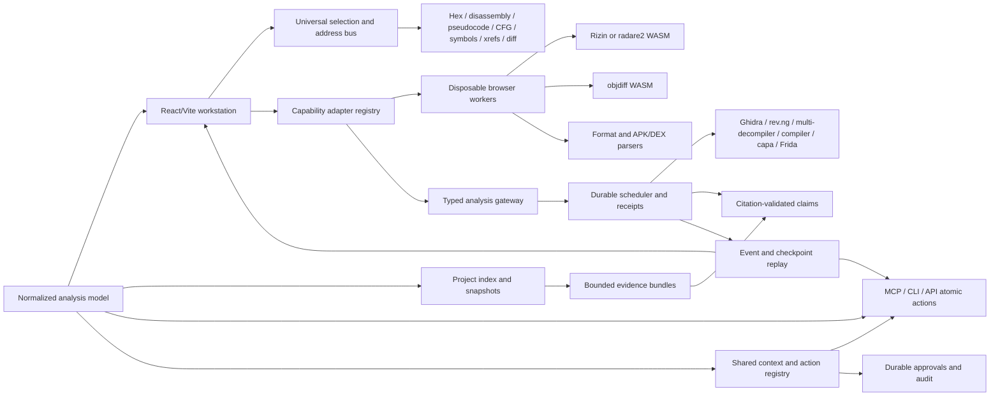
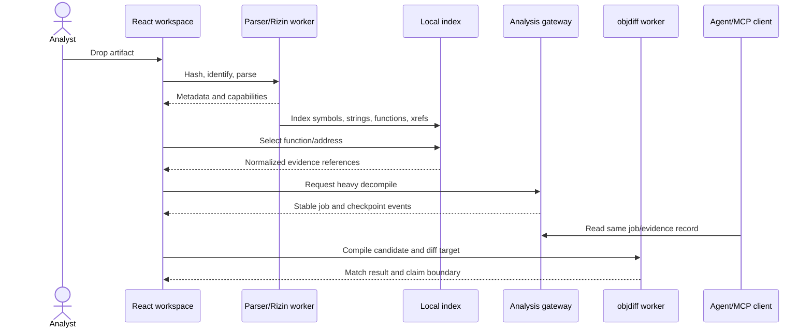
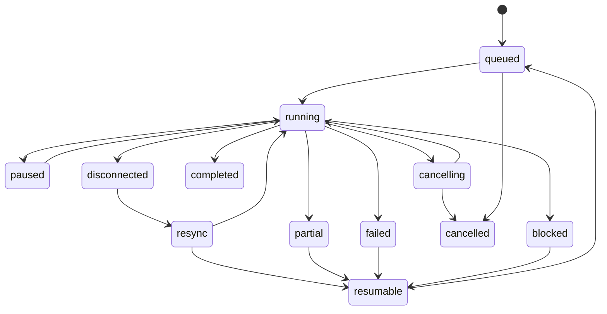

# AgentDecompile local-first reverse-engineering workbench

## Goal Capsule

- **Objective:** Replace the current split Atlas/static Vite experience with one React/Vite local-first reverse-engineering workstation that presents binary context, analysis evidence, matching recovery, jobs, and optional providers through shared contracts.
- **Authority:** `VISION.md`, `STRATEGY.md`, `CONCEPTS.md`, and the existing 8080 workbench remain product authority; this plan supersedes the prior “leave Atlas untouched” boundary for the Vite redesign.
- **Initial delivery:** P0 local analyst ingest/explore/evidence slice; P1 shared contracts, local project runtime, Rizin/parser workers, disassembly/hex/symbol/xref/CFG/search, and durable job recovery; P2 objdiff boundary, gateway jobs, and multi-decompiler result presentation.
- **Deferred delivery:** P3-P5 capabilities are represented by capability seams and explicit empty/deferred states; capa, embeddings, APK/DEX, collaboration, plugins, Frida, and enterprise hardening are not required for the first shippable slice.
- **Stop condition:** Do not claim source correctness, identity, or byte parity from visualization, a `logical_id`, a score, or a completed job without the relevant evidence receipt.

## Product Contract

### Summary

Create one workstation whose first-release wedge is analyst ingest → explore → evidence inspection, then extend that same context into heavy analysis and matching recovery. Agents, workers, and gateways are supporting actors that must use the same atomic actions and durable records without displacing the analyst workflow. The browser should remain useful offline/local-first while the existing backend, MCP, and CLI surfaces expose the same atomic actions and durable records.

### Problem Frame

The current product splits the 8080 workbench, Atlas Vite application, static pages, action catalog, and recovery workflows across different interaction models. The Vite surface is not yet a binary-analysis IDE, and UI-only state would diverge from MCP/CLI jobs and evidence. The redesign must improve the visual language without creating a second domain implementation or weakening claim boundaries.

### Actors

- A1. Analyst — opens artifacts, navigates functions and relationships, inspects claims, edits candidates, and approves mutations.
- A2. Agent client — discovers capabilities, reads the same project/evidence/job records, and performs permitted atomic actions.
- A3. Local worker runtime — parses and analyzes untrusted artifacts in disposable workers with bounded resources.
- A4. Optional analysis gateway — schedules isolated Ghidra, rev.ng, multi-decompiler, compiler, capa, or Frida providers.

### Requirements

**Core model and navigation**

- R1. The frontend uses a versioned normalized model for artifacts, binaries, addresses, functions, instructions, basic blocks, xrefs, decompiler results, findings, artifacts, revisions, and claim boundaries.
- R2. One universal selection/navigation bus links project, binary, function, address, `logical_id`, region, and evidence references across explorer, hex, disassembly, pseudocode, CFG, symbols, xrefs, diff, search, and inspector views.
- R3. Providers advertise capabilities and views degrade explicitly when a capability is unavailable; the UI must not render unavailable analysis as empty success.

**Local-first analysis**

- R4. Artifact ingest identifies format/hash/architecture and stores content-addressed metadata and snapshots locally before optional gateway use.
- R5. Disposable workers support cancellation, restart, bounded resource use, and structured failure for parser, Rizin/WASM, objdiff/WASM, and future APK/DEX providers.
- R6. Exact search, structured relationship queries, and optional disableable semantic indexing share one project index and expose freshness/version state.

**Jobs, evidence, and parity**

- R7. Long-running work has stable job, batch, and provider-attempt IDs; idempotency keys; queued/running/paused/disconnected/resync/cancelling/failed/completed/partial/resumable/blocked/cancelled states; progress, checkpoints, cancellation acknowledgment, retry, and durable receipts.
- R8. Evidence records cite source artifacts, addresses or regions, tool/provider, revision, confidence, hypotheses, alternatives, and unresolved gaps. Identity, code equality, behavioral equivalence, source recovery, and objdiff proof remain separate claims.
- R9. Every non-human-only UI action has an enumerable equivalent atomic MCP/CLI/API action or a documented human-only reason. UI, agents, workers, and gateway read/write the same durable records and shared context envelope.
- R10. AI consumes bounded evidence bundles, validates citations before rendering, distinguishes observed facts/inferences/recommendations/unknowns, and cannot silently execute shell commands, patches, uploads, promotions, or external publication.

**Matching-decomp workflow**

- R11. A matching workspace supports edit candidate → compile → diff → inspect mismatch → iterate, with objdiff as the byte-proof boundary and without treating similarity or `logical_id` as proof.
- R12. Multi-decompiler and provider results are comparable through normalized result envelopes with engine/version, provenance, limits, errors, and retention status.

**Trust and lifecycle**

- R13. Secret entry, credential consent, destructive deletion, irreversible promotion, and external publication require explicit human approval; agents cannot escalate permissions.
- R14. Browser disconnect, worker failure, gateway outage, retries, and concurrent UI/agent edits preserve or clearly surface durable state, conflicts, ownership, claim invalidation, and recovery actions.

### Key Product Decisions

- P1. The normalized analysis model is the domain source of truth; React state is a projection.
- P2. The first shippable release is P0-P2 local analysis plus heavy-provider seams, not every provider in the research brief.
- P3. The 8080 workbench and Vite frontend converge on one delivery path; `?mode=atlas` becomes a compatibility alias or redirect after the replacement is launchable.
- P4. Matching recovery is a recipe inside the Substrate product, not the product identity; claim boundaries remain visible in every surface.
- P5. One canonical lifecycle vocabulary is shared by workers, gateway, API, MCP, CLI, and UI; partial or disconnected work is never presented as completed.
- P6. Browser storage owns local artifact bytes and analysis snapshots; the backend owns shared jobs, evidence receipts, approvals, and approved mutations. Synchronization uses explicit outbox/replay and conflict envelopes.

### Key Flows

- F1. **Ingest and explore:** analyst drops PE/ELF/Mach-O/APK/object → worker hashes/parses → project index records metadata → explorer opens function/disassembly/hex views.
- F2. **Navigate evidence:** analyst selects a function or address → universal bus updates disassembly, pseudocode, CFG, xrefs, search, inspector, and evidence citations.
- F3. **Heavy analysis:** analyst requests Ghidra or another provider → gateway schedules a durable job → UI and agent observe identical progress/checkpoints/results → provider failure remains inspectable and resumable.
- F4. **Match candidate:** analyst edits a draft → compiles with a selected preset → objdiff compares target/candidate → mismatches and receipts return to the same workspace.
- F5. **AI question:** analyst asks about selected evidence → bounded evidence bundle is retrieved → claims are citation-validated → unsupported conclusions remain hypotheses or unknowns.
- F6. **Reconnect:** browser closes or worker/gateway disconnects → project/job records reload by stable IDs → resume/retry is offered without duplicate mutations.

### Acceptance Examples

- AE1. With the gateway unavailable, a dropped ELF remains browsable through local format metadata, strings, symbols, disassembly, and search.
- AE2. Selecting a function at one address updates every linked view without losing the deep link or confusing a `logical_id` with byte equality.
- AE3. An agent starts analysis and retrieves the same job ID, progress, checkpoint, evidence, and terminal status shown in the UI.
- AE4. A failed worker returns structured failure and partial evidence; retrying with the same idempotency key does not create a duplicate mutation.
- AE5. A candidate that compiles but does not objdiff-match is displayed as compiling-but-unverified, never as verified source.
- AE6. An AI response cites resolvable evidence IDs and addresses; a stale artifact marks prior claims stale after revision change.
- AE7. Destructive deletion, credential use, promotion, and publication are blocked until an explicit analyst approval.
- AE8. Reopening the packaged `/dashboard` and the Vite development entry presents the same project state and supported capabilities.
- AE9. A browser reconnects after a worker or gateway disconnect and shows the same job ID, checkpoint cursor, partial evidence, and resumability without duplicating work.
- AE10. A concurrent agent and browser edit preserve both versions and require explicit resolution for drafts, claims, approvals, or destructive operations.
- AE11. A bookmarked legacy deep link preserves project, binary, address, filters, and evidence context when redirected to the canonical workstation URL.

### Scope Boundaries

**In scope:** the React/Vite workstation shell; normalized frontend/provider contracts; content-addressed local project state; disposable parser/Rizin/objdiff workers; explorer and universal navigation; hex/disassembly/pseudocode/CFG/symbol/xref/search views; durable jobs and evidence; Ghidra/multi-decompiler/compiler adapters; matching-decomp workspace; MCP/CLI/API parity; migration of the current Atlas/static delivery path.

**Deferred for later:** capa findings, embeddings, APK/DEX worker, collaboration/presence, plugin SDK, Git/CI progress, Frida/mobile runtime provider, rev.ng production deployment, enterprise auth and distributed scheduling.

**Outside this product's identity:** unrestricted remote shell, opaque AI automation, address-only identity, score-as-proof, source copied from unverified wrappers, and a frontend-only parallel state store.

### Success Criteria

- One supported workstation route can ingest, inspect, search, schedule analysis, inspect evidence, and run the edit/compile/diff loop without switching product surfaces.
- Local-first workflows remain useful without the optional gateway, and gateway results converge into the same durable project model.
- Every visible proof claim names its evidence and claim boundary; no UI status implies objdiff proof without an objdiff receipt.
- MCP/CLI/API calls and UI operations expose stable IDs, structured errors, lifecycle state, and equivalent durable outcomes.
- The packaged server serves the new frontend without Node installed at runtime.

### Sources and Research

- Repository strategy and vocabulary: `STRATEGY.md`, `CONCEPTS.md`.
- Existing implementation patterns: `src/agentdecompile_recovery/corpus/dashboard/frontend/src/{App.tsx,contracts.ts,workspaceState.ts,sessionSync.ts,PersistentExplorer.tsx,CodeBrowser.tsx,Actions.tsx,Surfaces.tsx}`, `src/agentdecompile_recovery/corpus/dashboard/{router.py,react_api.py,workbench.py,actions/}`, and `frontend/README.md`.
- Institutional learnings: `docs/solutions/architecture-patterns/agent-native-mcp-patterns.md`, `agent-native-discovery-arc.md`, `decomp-matching-toolchain.md`, `program-analysis-coordinator.md`, `capabilities-mcp-resource.md`, `vision-substrate-expand-islands-not-funnel.md`, and `docs/plans/2026-08-31-2100-feat-workbench-ux-overhaul-plan.md`.
- External landscape: RzWeb (`github.com/indalok/rzweb`) for browser-local Rizin workers and IndexedDB; objdiff-web (`github.com/encounter/objdiff-web`) for typed Rust/WASM diffing; decomp.me for compile/diff iteration; Decompiler Explorer for isolated runner jobs; Rev·Deck (`github.com/biniamf/ai-reverse-engineering`) for bounded evidence-first AI; radare2/Rizin for analysis breadth; Grapefruit for an isolated Frida provider; decomp.dev for progress indexing; rev.ng for optional declarative heavy analysis.
- License boundary: audit LGPL Rizin/radare2 components and plugin licenses before bundling; keep unclear-license Rev·Deck architecture conceptual until verified. Do not copy code or assets from external projects.

---

## Planning Contract

### Key Technical Decisions

- KTD1. Make a versioned backend/OpenAPI JSON Schema boundary canonical for domain, action, lifecycle, context, and error envelopes. Generate or adapt frontend/Python bindings from it; `contracts.ts`, `actions/openapi.py`, and `react_api.py` must not become competing schema authorities.
- KTD2. Use a capability-negotiated adapter registry. Local Rizin/WASM and objdiff/WASM are optional providers behind typed boundaries; unavailable capabilities produce explicit `unsupported`, `pending`, or `unavailable` states.
- KTD3. Use content hashes as local artifact identity and revisions as evidence identity. Filenames remain display metadata; project membership and logical identity remain separate.
- KTD4. Use a typed execution protocol with separate boundaries for untrusted artifact workers, provider execution, scheduling, and domain persistence. Browser workers handle fast private parsing/analysis; isolated asynchronous gateway jobs handle heavy providers. Artifact transfer, quotas, cancellation, crash recovery, and immutable result envelopes are explicit.
- KTD5. Treat jobs as durable state machines with append-only event history, ordered checkpoints, and a current materialized status. Distinguish `job_id`, `batch_id`, and provider-attempt IDs; stable idempotency scope, leases, heartbeats, replay cursors, cancellation acknowledgment, and resumability are mandatory.
- KTD6. Keep agent permissions narrower than analyst permissions. Inspect/propose/execute are distinct modes; irreversible actions require approval and audit events.
- KTD7. Preserve the current selection/deep-link/session patterns and catalog-driven action runner. Replace visual composition and delivery routing rather than inventing freeform command execution.
- KTD8. Embeddings are optional and disableable. Exact and structured indexes must work without a model, network, or vector store.
- KTD9. Verification follows the user's constraint: use inline terminal commands, live API calls, and browser/UI/design checks; do not run saved filesystem test suites during implementation of this plan.
- KTD10. Browser disconnect never cancels or duplicates durable work. Gateway/provider loss yields status-unknown until resynchronization; partial evidence is retained but cannot satisfy completion or proof claims.
- KTD11. Conflicts preserve local and remote versions. Field-level merging is limited to explicitly mergeable metadata; drafts, claims, approvals, and destructive mutations require an explicit resolution record.
- KTD12. Agent parity is proven by an action matrix and shared context envelope covering project/session, active selection, revision, capabilities, freshness, permissions, approvals, job summaries, claim boundaries, and pagination on success and structured errors.
- KTD13. Rollout uses a reversible strangler path: feature-flagged shell, dual-read session/selection migration, compatibility redirects, canary default-route adoption, and static fallback until telemetry and live checks justify removal.
- KTD14. Contract versions use a compatibility matrix with additive evolution, explicit migration adapters, a deprecation window, and removal evidence. Legacy envelopes remain readable during rollout but are not a second schema authority.
- KTD15. IndexedDB artifacts are durable local inputs; indexes are rebuildable derivatives identified by source revision and schema fingerprint, with completeness markers and resumable rebuilds. Unsupported or untrusted indexes fall back to explicit stale/partial states.

### High-Level Technical Design

### Assumptions

- The current React/Vite package remains the frontend build boundary and `static/react` remains the packaged asset boundary unless implementation proves a better compatible layout.
- The existing 8080 action catalog and durable batch/job records are authoritative starting points for backend parity; consolidation must establish one owner before adding new gateway abstractions.
- Initial local workers may begin as typed seams with a minimal parser implementation if a production Rizin/objdiff WASM build is not already vendored; the plan must not fake provider results.
- Existing workspace/session state is migrated through versioned adapters rather than silently discarded.
- Browser verification may use installed `agent-browser`, inline Playwright scripts, `curl`, and direct handler calls. Focused test files remain implementation guidance and may be updated, but saved filesystem test suites are not executed.
- The first release targets analyst ingest/explore/evidence completion as the product validation gate; parity and provider breadth support that wedge rather than define independent release scope.

### Sequencing

U1 canonical contracts and parity registry → U2 local runtime, artifact store, and adapter registry → U3 minimal worker/index slice → U4 consolidated durable jobs and provider envelopes → U5 navigation extraction and workstation shell → U6 objdiff/matching workspace → U7 evidence-first AI and approval boundaries → U8 packaged migration and live verification.

---

## Implementation Units

### U1. Normalize analysis, capability, and project contracts

- **Priority:** P1 dependency for the P0 vertical slice.
- **Goal:** Establish the shared model that UI, local workers, gateway jobs, MCP, and CLI can consume without screen-specific types.
- **Requirements:** R1, R2, R3, R8, R9, R12, R14.
- **Dependencies:** None.
- **Files:** `src/agentdecompile_recovery/corpus/dashboard/frontend/src/contracts.ts`, new frontend contract modules under `src/agentdecompile_recovery/corpus/dashboard/frontend/src/analysis/`, `src/agentdecompile_recovery/corpus/dashboard/react_api.py`, `src/agentdecompile_recovery/corpus/dashboard/actions/openapi.py`, `tests/test_dashboard_openapi_catalog.py`, focused frontend contract tests under `src/agentdecompile_recovery/corpus/dashboard/frontend/src/*.test.ts`.
- **Approach:** Define canonical versioned envelopes for artifacts, selections, capabilities, evidence, revisions, jobs, provider results, shared context, actions, approvals, conflicts, and structured failures. Publish an action-parity matrix with canonical UI/MCP/CLI/API identifiers, primitive versus convenience workflow classification, mutability, approval requirements, capability, and human-only rationale. Reuse the existing `Selection`, API request, action catalog, and claim-boundary semantics. Include stable IDs, timestamps, provider/version, status, provenance, freshness, and pagination fields. Keep address and `logical_id` distinct.
- **Patterns to follow:** `contracts.ts`, `CONCEPTS.md`, `agent-native-mcp-patterns.md`, dynamic capability resource patterns.
- **Test scenarios:** A normalized function record preserves address, `logical_id`, binary hash, and revision independently; an unsupported provider returns a typed capability state rather than an empty result; malformed action/error envelopes retain machine-readable details and shared context; every primary UI action maps to one stable atomic action or an explicit human-only rationale; UI and agent payloads serialize the same stable identifiers.
- **Verification:** A documented schema map can trace every primary view and action to a normalized record and every record to an MCP/CLI/API-compatible envelope.

### U2. Build local-first project state and adapter registry

- **Priority:** P0 for local ingest and recovery.
- **Goal:** Make local artifact bytes, metadata, snapshots, revisions, and provider capabilities durable and recoverable before optional gateway use.
- **Requirements:** R3, R4, R5, R6, R14.
- **Dependencies:** U1.
- **Files:** new modules under `src/agentdecompile_recovery/corpus/dashboard/frontend/src/runtime/`, `src/agentdecompile_recovery/corpus/dashboard/frontend/src/storage/`, `src/agentdecompile_recovery/corpus/dashboard/frontend/src/providers/`, `src/agentdecompile_recovery/corpus/dashboard/frontend/src/workspaceState.ts`, `src/agentdecompile_recovery/corpus/dashboard/frontend/src/sessionSync.ts`, `src/agentdecompile_recovery/corpus/dashboard/frontend/src/projectLocator.ts`, focused frontend tests.
- **Approach:** Add a versioned IndexedDB-backed project store for content-addressed artifact bytes and local analysis snapshots, with localStorage retained only for small preferences. Define the local confidentiality model, origin/profile isolation, explicit export/purge, retention limits, and encryption/key handling where deployment requires it. Define artifact validation before persistence or analysis: canonical path/root handling, special-file and unsafe-link rejection, format allowlisting, archive expansion limits, and per-artifact CPU/memory/storage quotas. Keep backend-owned jobs, evidence receipts, approvals, and approved mutations authoritative; synchronize through an outbox, replay cursor, revision checks, and structured conflicts. Define source/target schemas, dual-read migration, rollback to server state, and preservation of in-flight revisions. Define adapter registration and capability discovery independent of screens. Make migration explicit, conflict-aware, and retryable.
- **Patterns to follow:** existing debounced revision persistence in `workspaceState.ts`, session synchronization, content-addressed binary registration, authoritative persistence learnings.
- **Test scenarios:** A dropped artifact reloads by hash after refresh; unsafe paths, special files, disallowed formats, and oversized archives are rejected before analysis; a corrupt or unsupported store version reports migration failure without deleting state and can roll back to server state; concurrent revision updates preserve local and remote versions with explicit resolution; gateway absence leaves local metadata/search available; storage quota or disabled IndexedDB produces a visible read-only degraded state; same-hash artifacts from different paths remain one content identity with separate project membership.
- **Verification:** Offline/local mode can open a project and recover its selection, snapshots, and capability inventory after reload.

### U3. Add disposable parser/Rizin workers and local project index

- **Priority:** P0 for analyst ingest and explore.
- **Goal:** Provide the first real browser-native analysis slice: format metadata, strings, symbols, functions, instructions, xrefs, CFG, hex, and exact search.
- **Requirements:** R2, R4, R5, R6, R8.
- **Dependencies:** U1, U2.
- **Files:** new worker modules under `src/agentdecompile_recovery/corpus/dashboard/frontend/src/workers/`, `src/agentdecompile_recovery/corpus/dashboard/frontend/src/index/`, view adapters under `src/agentdecompile_recovery/corpus/dashboard/frontend/src/views/`, `src/agentdecompile_recovery/corpus/dashboard/frontend/vite.config.ts`, `src/agentdecompile_recovery/corpus/dashboard/frontend/package.json` if WASM dependencies are approved, focused frontend tests.
- **Approach:** Use one disposable worker context per analysis session/artifact. Define message envelopes with request ID, revision, cancellation, progress, result, and structured error. Terminate workers on cancellation, parse failure, quota breach, or stale revision. Separate parser/worker protocol from index construction, and let both consume U1 provider/capability contracts. Start with one real artifact format and exact search before expanding format/provider coverage. Separate exact indexes from structured relationship indexes; leave embeddings as an optional provider.
- **Patterns to follow:** RzWeb worker/IndexedDB boundary, bounded `PersistentExplorer` pagination, Monaco worker packaging, existing selection bus.
- **Test scenarios:** A valid small PE/ELF yields metadata and bounded function rows; an empty or malformed artifact yields a visible parse failure and terminated worker; cancellation prevents stale results from updating a newer selection; an old worker message is ignored after revision change; search returns exact symbol/string/address matches with revision metadata; CFG/xref views show unsupported rather than fabricated relationships.
- **Verification:** Browser interaction on a real artifact can move from ingest to disassembly, hex, symbol, xref, CFG, and search without a backend request.

### U4. Unify durable jobs, gateway providers, and receipts

- **Priority:** P1 for durable recovery and heavy analysis.
- **Goal:** Route heavy analysis through a typed, resumable job lifecycle shared by UI, MCP, CLI, and gateway providers.
- **Requirements:** R7, R8, R9, R12, R14.
- **Dependencies:** U1, U2.
- **Files:** `src/agentdecompile_recovery/corpus/dashboard/react_api.py`, `src/agentdecompile_recovery/corpus/dashboard/router.py`, `src/agentdecompile_recovery/corpus/dashboard/workbench.py`, `src/agentdecompile_recovery/corpus/dashboard/actions/jobs.py`, `src/agentdecompile_recovery/corpus/dashboard/actions/catalog.py`, new frontend job/provider modules, `tests/test_dashboard_actions.py`, `tests/test_workbench_workflows.py`, focused frontend tests.
- **Approach:** Consolidate the existing `react_api.py` batch/lease lifecycle and `actions/jobs.py` job/history lifecycle into one owner before adding gateway abstractions. Map existing receipts and in-flight jobs into the owner with compatibility reads, deploy ordering, rollback behavior, and no orphaning on restart. Require authenticated callers, project-scoped authorization, and artifact/revision binding for dashboard/API/gateway operations. Reuse the durable batch runner and catalog instead of adding freeform commands. Define one event schema, ordered checkpoint cursor, lease/heartbeat, cancellation acknowledgment, provider-attempt identity, idempotency scope, partial-result retention, and terminal receipt linkage. Normalize provider envelopes for Ghidra, rev.ng, multi-decompiler, compiler, and future providers. Keep external execution isolated with quotas and retention policy.
- **Patterns to follow:** existing `_batch_lease`, owner recovery, activity receipts, `decomp-matching-toolchain.md`, program-analysis coordinator.
- **Test scenarios:** Unauthorized and cross-project callers are denied; two independent jobs run concurrently and expose distinct job, batch, and attempt IDs; browser disconnect and reload replay events from the same checkpoint cursor without duplicate submission; retry with the same idempotency key returns the original mutation/result; worker/provider timeout becomes status-unknown until resync and then resumable failure with partial evidence; cancellation distinguishes acknowledgment from completion; MCP/API and UI read the same terminal receipt; stale ownership is surfaced and reconciled rather than silently rerun.
- **Verification:** Inline API calls and browser inspection show identical job lifecycle, receipts, cancellation, and retry behavior across the frontend and action catalog.

### U5. Replace Atlas/static composition with the workstation shell

- **Priority:** P0 for the analyst ingest/explore/evidence vertical slice; P1 for full migration.
- **Goal:** Deliver one professional React/Vite workspace inspired by the named reverse-engineering tools while preserving current useful workflows and accessibility.
- **Requirements:** R2, R3, R4, R6, R8, R9, R14.
- **Dependencies:** U1-U3.
- **Files:** `src/agentdecompile_recovery/corpus/dashboard/frontend/src/App.tsx`, `AtlasApp.tsx`, `Surfaces.tsx`, `PersistentExplorer.tsx`, `CodeBrowser.tsx`, `SourceEditor.tsx`, `Actions.tsx`, `UnifiedActivity.tsx`, `style.css`, view-specific styles, `src/agentdecompile_recovery/corpus/dashboard/react_api.py`, `src/agentdecompile_recovery/corpus/dashboard/router.py`, compatibility routes, frontend/browser verification artifacts.
- **Approach:** First extract the existing navigation/session controller rather than creating a second selection implementation. Use the navigator as the primary task entry, central views as the primary work area, and inspector/job/activity docks as contextual status; define collapse, resize, persistence, logical DOM order, and focus restoration. Each region has explicit initial, no-project, no-selection, loading, empty, partial, stale, unavailable, conflict, offline/read-only, and recovered states. Then compose the new shell: project/binary/function navigator, tabbed central analysis views, evidence inspector, job rail, and bottom activity/proof dock. Preserve project sessions, selection, command palette, action catalog, activity dock, drafts, keyboard paths, and deep links. Keep action execution catalog-driven and every claim boundary adjacent to status. Stage the default-route cutover behind the reversible rollout in KTD13.
- **Patterns to follow:** current `App.tsx` selection and session model, `PersistentExplorer`, `CodeBrowser`, `SourceEditor`, existing accessibility fixes, one-page workbench plans, RzWeb/radare2/decomp.me visual affordances without copying assets.
- **Test scenarios:** `/dashboard` and Vite dev entry open the same shell; selecting a function synchronizes all views and URL state; keyboard tree navigation, tabs, palette, dialogs, and focus restoration invoke the same action IDs as pointer interaction; missing capabilities show explicit unavailable states; local draft never overwrites read-only evidence; legacy Atlas links redirect or open a compatibility mode without a second source of truth; narrow viewport preserves access to explorer, center, inspector, and activity.
- **Verification:** Live browser checks cover ingest, project open, function selection, address navigation, evidence inspection, drafts, resize/layout persistence, action submission, keyboard parity, and compatibility routes.

### U6. Add objdiff and matching-decomp workspace

- **Priority:** P2.
- **Goal:** Support edit → compile → diff → iterate with an explicit byte-proof boundary.
- **Requirements:** R8, R11, R12, R14.
- **Dependencies:** U1, U4, U5.
- **Files:** new `src/agentdecompile_recovery/corpus/dashboard/frontend/src/matching/` and `src/agentdecompile_recovery/corpus/dashboard/frontend/src/views/Diff*` modules, `src/agentdecompile_recovery/corpus/dashboard/frontend/package.json`, provider registry, `src/agentdecompile_recovery/corpus/dashboard/actions/catalog.py`, `src/agentdecompile_recovery/corpus/dashboard/actions/jobs.py`, `tests/test_run_decomp_match.py`, focused frontend tests.
- **Approach:** Bind objdiff through a typed WASM/provider adapter where supported and through the existing cataloged backend match tool otherwise. Preserve candidate drafts and compiler preset metadata. Render compiling, linked, structurally similar, and objdiff-verified as separate states. Surface mismatch regions and receipts; never promote a match from `logical_id`, score, or compile success alone.
- **Patterns to follow:** `decomp-matching-toolchain.md`, existing SourceEditor draft semantics, claim boundaries in `CONCEPTS.md`.
- **Test scenarios:** Candidate edits persist per project/binary/function; compile success with nonzero diff remains unverified; objdiff zero creates a proof receipt tied to exact target/candidate revisions; invalid compiler preset yields structured failure without losing draft; mismatch output navigates to the relevant function/block/address; retry is idempotent.
- **Verification:** A real candidate loop can be run through the browser and action API, with receipts proving each separate stage.

### U7. Add evidence-first AI and human approval boundaries

- **Priority:** P2, except approval primitives required by any earlier mutation.
- **Goal:** Make AI a bounded evidence consumer and proposal surface, not an opaque execution path.
- **Requirements:** R8, R10, R13, R14.
- **Dependencies:** U1, U2, U4, U5.
- **Files:** new `src/agentdecompile_recovery/corpus/dashboard/frontend/src/evidence/` and `src/agentdecompile_recovery/corpus/dashboard/frontend/src/ai/` modules, `src/agentdecompile_recovery/corpus/dashboard/actions/`, `src/agentdecompile_recovery/corpus/dashboard/react_api.py`, MCP capability/context providers, focused frontend and API contract tests.
- **Approach:** Build evidence bundles from bounded indexed records and provider receipts. Validate citation IDs and revisions before rendering. Label facts, hypotheses, recommendations, and unknowns. Model AI loading, streaming, cancellation, timeout, provider-unavailable, partial-response, invalid/stale-citation, retry, and approval-pending states; only validated claims render as supported conclusions. Separate inspect/propose/execute permissions. Require a durable approval bound to authenticated human identity, exact action parameters, target revision, expiry, and audit event; reject boolean confirmation without that record. Handle secrets ephemerally or through an approved secret manager with redaction, retention, and access auditing. Mark claims stale when source revisions change.
- **Patterns to follow:** auditable prompt design, agent-native MCP patterns, capabilities resource, evidence-fusion claim boundaries.
- **Test scenarios:** AI output with valid citations renders linked evidence; loading, partial, timeout, cancellation, unavailable, and stale-citation states never present an incomplete answer as final; invalid or stale citations are rejected or visibly marked; a proposed rename does not mutate until an actor-bound approval record exists; `confirm=true` without that record is denied; an agent attempting destructive or external actions is blocked; secrets are absent from logs and durable job records; a revised artifact marks old claims stale; gateway outage leaves evidence browsing usable.
- **Verification:** Inline tool calls and browser inspection show auditable evidence, approval gates, structured denials, and no silent write-back.

### U8. Migrate packaging, routes, and live delivery

- **Priority:** P1 for supported delivery; P2 cleanup after rollback evidence.
- **Goal:** Make the new shell the supported packaged and development experience without breaking Node-free server delivery or established fallback contracts.
- **Requirements:** R2, R3, R9, AE8.
- **Dependencies:** U5-U7.
- **Files:** `src/agentdecompile_recovery/corpus/dashboard/router.py`, `src/agentdecompile_recovery/corpus/dashboard/react_api.py`, `src/agentdecompile_recovery/corpus/dashboard/frontend/vite.config.ts`, `src/agentdecompile_recovery/corpus/dashboard/frontend/package.json`, `pyproject.toml`, `src/agentdecompile_recovery/corpus/dashboard/frontend/README.md`, compatibility/fallback handlers, focused browser/API verification notes.
- **Approach:** Publish a route mapping for `/dashboard`, legacy windows, Atlas aliases, and deep links covering redirect status, query/fragment preservation, unknown-window handling, and canonical selection parameters. Define the supported contract-version matrix, additive compatibility rules, migration adapters, deprecation window, and removal evidence for legacy envelopes. Change route selection only after the replacement shell handles the core flows. Use a feature flag, dual-read session/selection migration, canary default-route adoption, compatibility redirects, and static fallback. A stale target preserves the original context and offers nearest-valid-context plus search/reselect actions before changing the URL. Ensure packaged assets include workers/WASM and the installed server does not require Node. Remove dead parallel composition only after live delivery, rollback, and fallback behavior are verified.
- **Patterns to follow:** current `ASSETS` delivery, security headers, Vite output boundary, frontend README, existing 8080 workbench route behavior.
- **Test scenarios:** Packaged `/dashboard` serves without Node; Vite dev proxy reaches actual handlers; assets and worker files load under the configured base path; legacy routes preserve project, binary, address, filters, and evidence deep-link semantics without redirect loops; missing functions produce a visible stale-target state; feature-flag rollback returns to the static fallback; stale/missing assets produce a visible deployment failure rather than a blank page; `/openapi.json` and `/docs` expose the same action IDs used by the shell.
- **Verification:** Inline build/type-check commands plus live browser/API checks confirm packaged and development delivery, with no saved filesystem test suite execution.

---

## Verification Contract

- **Required proof:** Use inline terminal commands for frontend type-check/build and direct `curl`/Python or browser tool calls against real dashboard handlers. Use live browser/UI/design review for interaction, accessibility, responsive layout, claim labels, and route delivery.
- **Forbidden for this plan:** Do not run saved filesystem test suites or invoke the repository's test runner. Existing test files remain implementation guidance and may be updated, but verification is runtime/browser/inline only per the user constraint.
- **Frontend build gate:** The Vite package type-checks and builds successfully; packaged assets include worker/WASM outputs and remain Node-free at server runtime.
- **Contract gate:** `/openapi.json`, `/docs`, MCP capability discovery, and the frontend adapter registry expose compatible capability/action identifiers and structured envelopes.
- **Runtime gate:** Live browser flow covers drop/open, local parse, project selection, function/address navigation, search, evidence inspection, job submission, reconnect, draft persistence, compile/diff, and explicit unavailable/error states.
- **Parity gate:** At least one UI action and the equivalent API/MCP action produce the same stable record, job ID, receipt, and claim boundary.
- **Security gate:** Untrusted input is processed in disposable contexts with bounded uploads/resources; destructive, credential, promotion, and publication paths require explicit approval; no freeform shell or unvalidated AI write-back exists.
- **Honesty gate:** `logical_id`, similarity, compile/link, decompiler output, and job completion never render as objdiff proof without a matching receipt.

## Definition of Done

- R1-R14 and AE1-AE11 are implemented or explicitly represented by a named deferred capability state.
- The new React/Vite shell is the supported `/dashboard` experience, with compatibility routing and no second source-of-truth Atlas state.
- Local artifact/project/index state survives reload and remains useful without the optional gateway.
- Workers, jobs, providers, evidence, claims, approvals, conflicts, and shared context expose cancellation, failure, revision, provenance, and recovery semantics.
- UI, MCP, CLI, and API use the same atomic action, lifecycle, context, and record contracts, with an enumerable parity matrix.
- The matching workspace distinguishes candidate, compile, linked, structural, and objdiff-verified states.
- AI citations, approval gates, stale claims, and unsupported conclusions are visible and auditable.
- Live packaged and Vite development verification passes using inline commands and browser/UI checks, without running saved filesystem test suites.
- All abandoned experimental paths and obsolete duplicate delivery code are removed or explicitly retained as compatibility fallbacks; no dead parallel frontend remains undocumented.
