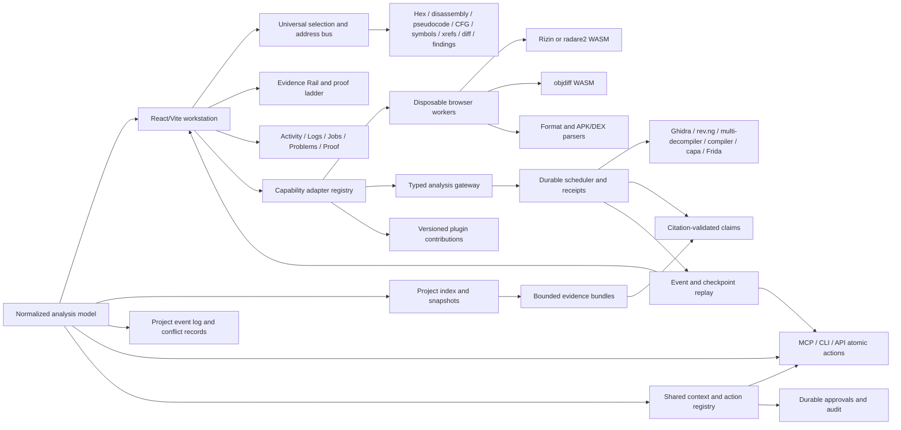
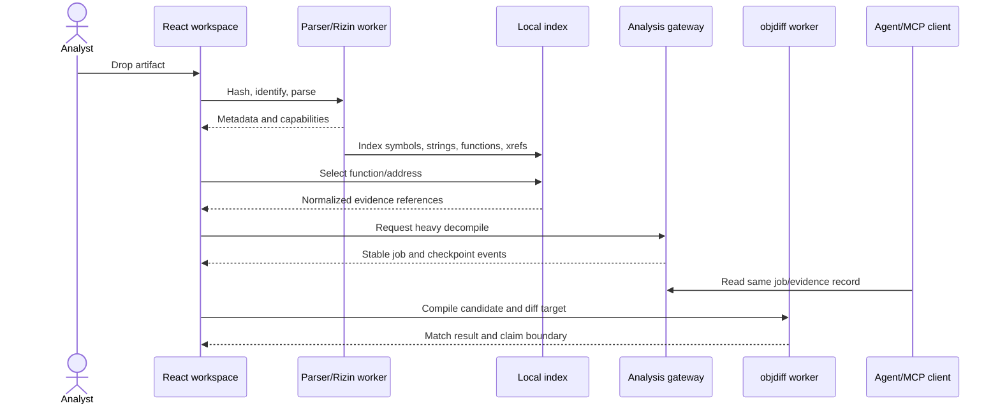
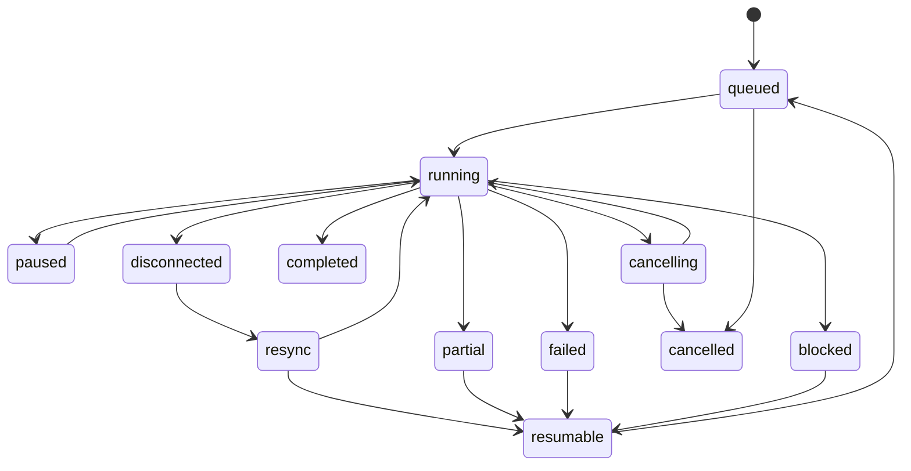
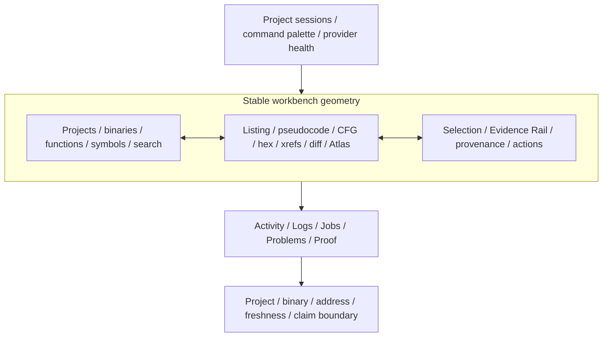
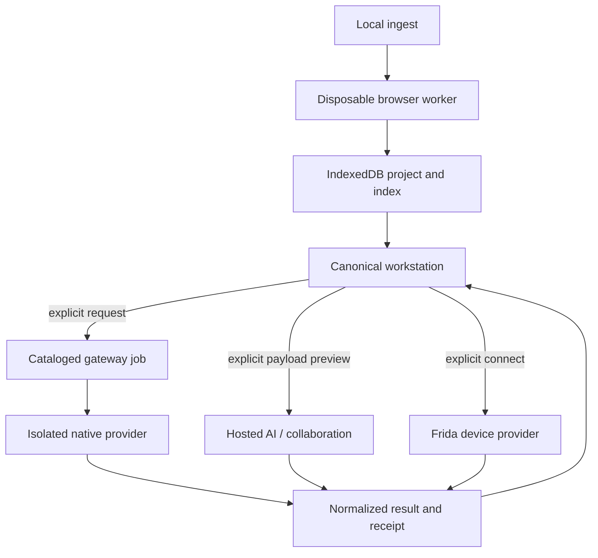

# AgentDecompile local-first reverse-engineering workbench - Plan

## Goal Capsule

- **Objective:** Replace the current split Atlas/static Vite experience with one React/Vite local-first reverse-engineering workstation that presents binary context, analysis evidence, matching recovery, jobs, and optional providers through shared contracts.
- **Authority:** `VISION.md`, `STRATEGY.md`, `CONCEPTS.md`, and the existing 8080 workbench remain product authority; this plan supersedes the prior “leave Atlas untouched” boundary for the Vite redesign.
- **Means:** Complete the existing React/Vite seams as verified vertical slices behind one normalized capability API, then add local and service-backed providers without creating another workspace or proof vocabulary (KTD1-KTD20).
- **Delivery:** The plan covers the full P0-P5 frontend roadmap. P0-P2 establish the canonical shell, local analysis, durable jobs, objdiff, provider comparison, and evidence-first AI; P3-P5 add findings, similarity, APK/DEX, collaboration, plugins, Git/CI progress, dynamic mobile analysis, and cross-cutting hardening.
- **Tail ownership:** The strategy's byte-accurate corpus recovery wedge ships through the canonical shell and backend objdiff loop before provider breadth. Later roadmap stages then extend that proven workstation; each optional engine can be disabled independently while the workstation retains honest local and recorded evidence states.
- **Stop condition:** Do not claim source correctness, identity, or byte parity from visualization, a `logical_id`, a score, or a completed job without the relevant evidence receipt.

## Implementation Progress

- **2026-09-10 — canonical P0 shell and local-ingest slice:** the Vite entry now renders the full workstation shell instead of the parallel Atlas composition. The Evidence inspector is present by default, the Activity dock remains persistent, the footer keeps the unverified claim boundary visible, and primary splitters expose truthful ARIA values plus coarse keyboard resize, reset, and collapse/restore behavior.
- **2026-09-10 — normalized local project runtime:** multi-file PE/ELF ingest now preserves repeated artifacts in one content-addressed IndexedDB project, captures bounded parser observations as identity evidence, creates normalized binary records, and restores them after reload. Exact SHA-256 is the only automatic bridge to an existing corpus binding; unseen and ambiguous hashes remain explicit.
- **2026-09-10 — candidate-bound matching job:** `workbench.match-candidate` accepts a browser draft only through an approved server-side preset ID, snapshots and re-hashes the bound target object, compiles the named function, and applies a strict two-sided objdiff-zero proof gate. The action is danger/approval gated, redacts source from job listings, and returns a revision-bound receipt; compile success and mismatch remain unverified.
- **Verification so far:** the frontend unit suite passed 52 tests before the matching UI bridge; the real Vite page ingested an ELF fixture and the 4,042,752-byte K1 GOG executable, persisted both across reload, and exposed accessible splitter values with verified 64-pixel coarse resize, reset, and dock collapse/restore. Ruff, Python compilation, and diff checks pass for the matching backend. Final combined TypeScript, pytest, packaged `:8767`, and representative matching proof checks remain open because MyBook reads entered sustained uninterruptible I/O wait during this slice; no completion claim is made from the running processes.

## Product Contract

### Summary

Complete one workstation that carries an analyst from artifact ingestion through navigation, evidence, matching, semantic triage, collaboration, and optional dynamic providers without changing context or proof semantics. Agents, workers, and gateways are supporting actors that use the same atomic actions and durable records. The browser remains useful offline/local-first while optional services extend capability without becoming a second product surface.

### Problem Frame

The current product splits the 8080 workbench, Atlas Vite application, static pages, action catalog, and recovery workflows across different interaction models. The Vite surface is not yet a binary-analysis IDE, and UI-only state would diverge from MCP/CLI jobs and evidence. The redesign must improve the visual language without creating a second domain implementation or weakening claim boundaries.

### Actors

- A1. Analyst — opens artifacts, navigates functions and relationships, inspects claims, edits candidates, and approves mutations.
- A2. Agent client — discovers capabilities, reads the same project/evidence/job records, and performs permitted atomic actions.
- A3. Local worker runtime — parses and analyzes untrusted artifacts in disposable workers with bounded resources.
- A4. Optional analysis gateway — schedules isolated Ghidra, rev.ng, multi-decompiler, compiler, capa, or Frida providers.

### Requirements

**Core model and navigation**

- R1. The frontend uses a versioned normalized model for artifacts, binaries, addresses, functions, instructions, basic blocks, xrefs, decompiler results, findings, revisions, and claim boundaries.
- R2. One universal selection/navigation bus links project, binary, function, address, `logical_id`, region, and evidence references across explorer, hex, disassembly, pseudocode, CFG, symbols, xrefs, diff, search, and inspector views.
- R3. Providers advertise capabilities and views degrade explicitly when a capability is unavailable; the UI must not render unavailable analysis as empty success.

**Local-first analysis**

- R4. Artifact ingest identifies format/hash/architecture and stores content-addressed metadata and snapshots locally before optional gateway use.
- R5. Disposable workers support cancellation, restart, bounded resource use, and structured failure for parser, Rizin/WASM, objdiff/WASM, and future APK/DEX providers.
- R6. Exact search, structured relationship queries, and optional disableable semantic indexing share one project index and expose freshness/version state.

**Jobs, evidence, and parity**

- R7. Long-running work has stable job, batch, and provider-attempt IDs; idempotency keys; queued/running/paused/disconnected/resync/cancelling/failed/completed/partial/resumable/blocked/cancelled states; progress, checkpoints, cancellation acknowledgment, retry, and durable receipts.
- R8. Evidence records cite source artifacts, addresses or regions, tool/provider, revision, confidence, hypotheses, alternatives, and unresolved gaps. Identity, code equality, behavioral equivalence, source recovery, and objdiff proof remain separate claims.
- R9. Every non-human-only UI action has an enumerable equivalent atomic MCP/CLI/API action or a documented human-only reason. UI, agents, workers, and gateway read/write the same durable records and shared context envelope.
- R10. AI consumes bounded evidence bundles, validates citations before rendering, distinguishes observed facts/inferences/recommendations/unknowns, and cannot silently execute shell commands, patches, uploads, promotions, or external publication.

**Matching-decomp workflow**

- R11. A matching workspace supports edit candidate → compile → diff → inspect mismatch → iterate, with objdiff as the byte-proof boundary and without treating similarity or `logical_id` as proof.
- R12. Multi-decompiler and provider results are comparable through normalized result envelopes with engine/version, provenance, limits, errors, and retention status.

**Trust and lifecycle**

- R13. Secret entry, credential consent, destructive deletion, irreversible promotion, and external publication require explicit human approval; agents cannot escalate permissions.
- R14. Browser disconnect, worker failure, gateway outage, retries, and concurrent UI/agent edits preserve or clearly surface durable state, conflicts, ownership, claim invalidation, and recovery actions.

**Workbench design and accessibility**

- R15. One dense, stable shell provides project sessions, a navigator, linked analysis tabs, a persistent Evidence Rail, and an Activity/Logs/Jobs/Problems/Proof dock with keyboard-resizable regions, focus restoration, and viewport-class persistence.
- R16. Every primary pane distinguishes initial, loading-with-retained-content, measured-empty, unsupported, unavailable, partial, stale, offline/read-only, conflict, reconnecting, approval-required, failed, and durably recovered states without relying on color alone.
- R17. A three-layer primitive-to-semantic-to-component token system owns color, typography, spacing, density, focus, evidence, and lifecycle styling; component styles do not introduce competing palettes or raw status colors.

**Extended providers and project intelligence**

- R18. Capability findings, exact and optional semantic similarity, APK/DEX analysis, alternate decompilers, collaboration events, plugin contributions, Git/CI progress, and dynamic mobile data normalize into the same artifact, selection, finding, result, event, and evidence contracts.
- R19. Remote analysis, hosted models, collaboration, plugins, and live-device providers are independently opt-in, disclose payload and destination, and fail closed when authentication, authorization, audit, isolation, retention, or capability prerequisites are unavailable.
- R20. The canonical Vite and packaged React entries expose the same supported actions and state; generated assets, worker bundles, WASM components, and optional providers cannot create a frontend-only fork.

### Key Product Decisions

- P1. The normalized analysis model is the domain source of truth; React state is a projection.
- P2. P0-P2 remain the first shippable release gate, but this plan owns the complete P0-P5 Vite roadmap rather than stopping at placeholder seams. **Governs R18-R20.**
- P3. The 8080 workbench and Vite frontend converge on one delivery path; `?mode=atlas` becomes a compatibility alias or redirect after the replacement is launchable.
- P4. Matching recovery is a recipe inside the Substrate product, not the product identity; claim boundaries remain visible in every surface.
- P5. One canonical lifecycle vocabulary is shared by workers, gateway, API, MCP, CLI, and UI; partial or disconnected work is never presented as completed.
- P6. Browser storage owns local artifact bytes and analysis snapshots; the backend owns shared jobs, evidence receipts, approvals, and approved mutations. Synchronization uses explicit outbox/replay and conflict envelopes.
- P7. The shell uses a persistent Evidence Rail and fixed resizable regions rather than cards or free-floating panels. **Governs R15-R17.**
- P8. Later providers are real capability plugins, not decorative tabs; unavailable engines remain explicit until their security and distribution gates pass. **Governs R18-R20.**

### Key Flows

- F1. **Ingest and explore:** analyst drops PE/ELF/Mach-O/APK/object → worker hashes/parses → project index records metadata → explorer opens function/disassembly/hex views.
- F2. **Navigate evidence:** analyst selects a function or address → universal bus updates disassembly, pseudocode, CFG, xrefs, search, inspector, and evidence citations.
- F3. **Heavy analysis:** analyst requests Ghidra or another provider → gateway schedules a durable job → UI and agent observe identical progress/checkpoints/results → provider failure remains inspectable and resumable.
- F4. **Match candidate:** analyst edits a draft → compiles with a selected preset → objdiff compares target/candidate → mismatches and receipts return to the same workspace.
- F5. **AI question:** analyst asks about selected evidence → bounded evidence bundle is retrieved → claims are citation-validated → unsupported conclusions remain hypotheses or unknowns.
- F6. **Reconnect:** browser closes or worker/gateway disconnects → project/job records reload by stable IDs → resume/retry is offered without duplicate mutations.
- F7. **Capability triage:** analyst opens a finding or similarity result → the shared selection moves to cited functions/addresses → the Evidence Rail shows provenance and claim limits → unsupported local context remains visible.
- F8. **Collaborate safely:** analyst shares annotations or project events → synchronization transmits only the authorized event scope → conflicts preserve both versions → binary bytes remain separately authorized.
- F9. **Dynamic target:** analyst explicitly connects a device/provider → capability and trust prerequisites are checked → runtime events normalize into the same selection/evidence model → disconnect retains the last durable record without implying liveness.

### Acceptance Examples

- AE1. With the gateway unavailable, a dropped ELF remains browsable through local format metadata, strings, symbols, disassembly, and search.
- AE2. Selecting a function at one address updates every linked view without losing the deep link or confusing a `logical_id` with byte equality.
- AE3. An agent starts analysis and retrieves the same job ID, progress, checkpoint, evidence, and terminal status shown in the UI.
- AE4. A failed worker returns structured failure and partial evidence; retrying with the same idempotency key does not create a duplicate mutation.
- AE5. A candidate that compiles but does not objdiff-match is displayed as compiling-but-unverified, never as verified source.
- AE6. An AI response cites resolvable evidence IDs and addresses; a stale artifact marks prior claims stale after revision change.
- AE7. Destructive deletion, credential use, promotion, and publication are blocked until an explicit analyst approval.
- AE8. Reopening the packaged `/dashboard` and the Vite development entry presents the same project state and supported capabilities.
- AE9. A browser reconnects after a worker or gateway disconnect and shows the same job ID, checkpoint cursor, partial evidence, and resumability without duplicating work.
- AE10. A concurrent agent and browser edit preserve both versions and require explicit resolution for drafts, claims, approvals, or destructive operations.
- AE11. A bookmarked legacy deep link preserves project, binary, address, filters, and evidence context when redirected to the canonical workstation URL.
- AE12. A capability finding, APK method, alternate decompiler result, collaboration event, or runtime symbol can navigate through the same address/selection bus without inventing a second entity identity.
- AE13. At 1440, 1024, 768, and 390 CSS pixels, every shell region remains reachable, proof state stays visible, and collapse/restore preserves selection and keyboard focus.
- AE14. A provider that lacks its runtime, license approval, authentication, or isolation policy renders unavailable with remediation; it never produces sample data or a false empty result.
- AE15. Collaboration, hosted AI, plugin loading, and live-device connection show destination and payload scope before transmission or activation, and cancellation/disconnect leaves an auditable record.

### Scope Boundaries

**In scope:** the complete React/Vite operator surface and its required shared contracts: content-addressed local projects; disposable parser/Rizin/objdiff/APK workers; linked hex/disassembly/pseudocode/CFG/symbol/xref/search/diff/findings/similarity views; durable jobs/evidence; Ghidra and alternate-decompiler results; matching recovery; evidence-first AI; collaboration events; plugin and Git/CI surfaces; an isolated Frida provider; MCP/CLI/API parity; and one packaged/Vite delivery path.

#### Deferred to Follow-Up Work

- Production deployment and licensing of proprietary or mixed-license decompilers after their adapters and unavailable states are proven.
- Internet-scale multi-tenant scheduling, enterprise SSO/RBAC, and hosted binary object storage beyond the local/trusted-team deployment model.
- Arbitrary in-process third-party code; the plugin SDK remains declarative or isolated until a separate execution-sandbox review approves more authority.

**Outside this product's identity:** unrestricted remote shell, opaque AI automation, address-only identity, score-as-proof, source copied from unverified wrappers, and a frontend-only parallel state store.

### Success Criteria

- One supported workstation route can ingest, inspect, search, schedule analysis, inspect evidence, and run the edit/compile/diff loop without switching product surfaces.
- Local-first workflows remain useful without the optional gateway, and gateway results converge into the same durable project model.
- Every visible proof claim names its evidence and claim boundary; no UI status implies objdiff proof without an objdiff receipt.
- MCP/CLI/API calls and UI operations expose stable IDs, structured errors, lifecycle state, and equivalent durable outcomes.
- The packaged server serves the new frontend without Node installed at runtime.
- Every in-scope P3-P5 capability is demonstrated against its stated real provider before full-roadmap completion. A tested unavailable state is an interim safety gate only; it neither completes the provider unit nor satisfies its requirement.
- The canonical shell passes keyboard-only, responsive, state-transition, and token-consistency review in both Vite and packaged delivery.

### Sources and Research

- Repository strategy and vocabulary: `STRATEGY.md`, `CONCEPTS.md`.
- Existing implementation patterns: `src/agentdecompile_recovery/corpus/dashboard/frontend/src/{App.tsx,contracts.ts,workspaceState.ts,sessionSync.ts,PersistentExplorer.tsx,CodeBrowser.tsx,Actions.tsx,Surfaces.tsx}`, `src/agentdecompile_recovery/corpus/dashboard/{router.py,react_api.py,workbench.py,actions/}`, and `frontend/README.md`.
- Current implementation gap: normalized TypeScript contracts, an IndexedDB store, a disposable metadata worker, provider-unavailable matching/AI surfaces, and route changes exist in the working tree, but `frontend/src/main.tsx` still renders `AtlasApp` while the local artifact panel is mounted only in `App`. No Rizin or objdiff runtime dependency currently supplies functions, instructions, xrefs, CFG, or byte-diff results.
- Institutional learnings: `docs/solutions/architecture-patterns/agent-native-mcp-patterns.md`, `agent-native-discovery-arc.md`, `decomp-matching-toolchain.md`, `program-analysis-coordinator.md`, `capabilities-mcp-resource.md`, `vision-substrate-expand-islands-not-funnel.md`, and `docs/plans/2026-08-31-2100-feat-workbench-ux-overhaul-plan.md`.
- External landscape: RzWeb (`github.com/indalok/rzweb`) for browser-local Rizin workers and IndexedDB; objdiff-web (`github.com/encounter/objdiff-web`) for typed Rust/WASM diffing; decomp.me for compile/diff iteration; Decompiler Explorer for isolated runner jobs; Rev·Deck (`github.com/biniamf/ai-reverse-engineering`) for bounded evidence-first AI; radare2/Rizin for analysis breadth; Grapefruit for an isolated Frida provider; decomp.dev for progress indexing; rev.ng for optional declarative heavy analysis.
- License boundary: audit LGPL Rizin/radare2 components and plugin licenses before bundling; keep unclear-license Rev·Deck architecture conceptual until verified. Do not copy code or assets from external projects.

---

## Planning Contract

**Product Contract preservation:** changed: R15-R20 and AE12-AE15 expand the prior P0-P2 implementation scope to the full P0-P5 Vite roadmap named in the supplied research brief; R1-R14 and AE1-AE11 retain their original meaning.

### Key Technical Decisions

- KTD1. Make one versioned Pydantic contract module the hand-authored authority for domain, action, lifecycle, context, and error envelopes. Emit OpenAPI/JSON Schema as build artifacts, generate TypeScript bindings from those artifacts, and fail a no-diff drift check when generated contracts are stale; `contracts.ts`, `actions/openapi.py`, and `react_api.py` must not become competing schema authorities.
- KTD2. Use a capability-negotiated adapter registry. Local Rizin/WASM and objdiff/WASM are optional providers behind typed boundaries; unavailable capabilities produce explicit `unsupported`, `pending`, or `unavailable` states.
- KTD3. Use content hashes as local artifact identity and revisions as evidence identity. Filenames remain display metadata; project membership and logical identity remain separate.
- KTD4. Use a typed execution protocol with separate boundaries for untrusted artifact workers, provider execution, scheduling, and domain persistence. Browser workers handle fast private parsing/analysis within input-size, WASM-linear-memory, output-count, and wall-clock caps; isolated asynchronous gateway jobs provide hard CPU/memory isolation for larger or riskier work. Artifact transfer, quotas, cancellation, crash recovery, and immutable result envelopes are explicit.
- KTD5. Treat jobs as durable state machines with append-only event history, ordered checkpoints, and a current materialized status. Distinguish `job_id`, `batch_id`, and provider-attempt IDs; stable idempotency scope, leases, heartbeats, replay cursors, cancellation acknowledgment, and resumability are mandatory.
- KTD6. Keep agent permissions narrower than analyst permissions. Inspect/propose/execute are distinct modes; irreversible actions require approval and audit events.
- KTD7. Preserve the current selection/deep-link/session patterns and catalog-driven action runner. Replace visual composition and delivery routing rather than inventing freeform command execution.
- KTD8. Embeddings are optional and disableable. Exact and structured indexes must work without a model, network, or vector store.
- KTD9. Verification combines focused Vitest and pytest coverage, TypeScript/build gates, direct API/MCP probes, and live browser checks against both Vite and packaged assets. A build or rendered screen alone is not functional proof.
- KTD10. Browser disconnect never cancels or duplicates durable work. Gateway/provider loss yields status-unknown until resynchronization; partial evidence is retained but cannot satisfy completion or proof claims.
- KTD11. Conflicts preserve local and remote versions. Field-level merging is limited to explicitly mergeable metadata; drafts, claims, approvals, and destructive mutations require an explicit resolution record.
- KTD12. Agent parity is proven by an action matrix and shared context envelope covering project/session, active selection, revision, capabilities, freshness, permissions, approvals, job summaries, claim boundaries, and pagination on success and structured errors.
- KTD13. Rollout uses a reversible strangler path: feature-flagged shell, dual-read session/selection migration, compatibility redirects, canary default-route adoption, and static fallback until telemetry and live checks justify removal.
- KTD14. Contract versions use a compatibility matrix with additive evolution, explicit migration adapters, a deprecation window, and removal evidence. Legacy envelopes remain readable during rollout but are not a second schema authority.
- KTD15. IndexedDB artifacts are local inputs only while browser persistence is granted and observable; the workstation requests persistent storage where supported, displays persistence/eviction risk, and offers a recoverable project export before browser-only bytes are treated as durable. Indexes are rebuildable derivatives identified by source revision and schema fingerprint, with completeness markers and resumable rebuilds. Evicted or unsupported inputs restore as missing-input projects, never valid recovered projects; unsupported or untrusted indexes fall back to explicit stale/partial states.
- KTD16. Keep one React composition root. Fold useful `App` controls into the shipped shell, reduce `AtlasApp` to integrated views or compatibility routing, and make `/dashboard` plus Vite enter the same selection/session controller.
- KTD17. Use fixed, keyboard-resizable workbench regions and a persistent Evidence Rail. Store pane sizes by viewport class, preserve focus and scroll across collapse, and use a one-region switcher below desktop width rather than reordering the workspace.
- KTD18. Consolidate styling through primitive, semantic, and component tokens. Borders and surface shifts provide depth; evidence and lifecycle colors map through semantic tokens and retain text or icon labels.
- KTD19. Integrate later capabilities as isolated adapters with explicit activation policy. Browser workers receive hostile bytes but no secrets or shell; browser-side third-party contributions are declarative only; executable plugins and native providers receive cataloged jobs through capability-brokered gateway processes. Dashboard and gateway HTTP bind to loopback by default, and non-loopback service is rejected unless it is behind configured authenticated TLS termination. Hosted, collaborative, plugin, and device boundaries disclose payload, destination, authority, and retention.
- KTD20. Execute with subagent-driven development: one fresh implementation owner at a time for overlapping product files, followed by task-scoped spec and quality review and a final whole-branch review. Parallel agents are reserved for independent research, fixtures, or review surfaces; implementers do not spawn nested implementers.

### High-Level Technical Design

### Assumptions

- The current React/Vite package remains the frontend build boundary and `static/react` remains the packaged asset boundary unless implementation proves a better compatible layout.
- The existing 8080 action catalog and durable batch/job records are authoritative starting points for backend parity; consolidation must establish one owner before adding new gateway abstractions.
- Initial local workers may begin as typed seams with a minimal parser implementation if a production Rizin/objdiff WASM build is not already vendored; the plan must not fake provider results.
- Existing workspace/session state is migrated through versioned adapters rather than silently discarded.
- Browser verification may use installed `agent-browser`, Playwright, `curl`, and direct handler calls. Focused Vitest and pytest coverage must run for changed behavior before the live browser and packaged-wheel gates.
- The first release targets analyst ingest/explore/evidence completion as the product validation gate; parity and provider breadth support that wedge rather than define independent release scope.
- The initial Evidence Rail layout is vertical in the right inspector on wide screens and collapses into an inspector region below 1280 CSS pixels. An attended prototype may revise this before the shell unit commits the final geometry.

### Sequencing

Reconcile the dirty baseline before implementation. Then execute U1 contract authority → U2 local persistence → U3 parser/index slice → U19 security-policy foundations → U4 durable jobs → U9 shell design contract → U5 canonical shell → U6 backend matching/objdiff wedge → U10 linked local views and Rizin decision → U11 multi-decompiler → U7 evidence-first AI → U8 initial packaged canary → U12-U15/U17-U18 extended providers with a U8 packaged checkpoint after each → U16 final hardening → U8 final cutover and duplicate removal.

---

## System-Wide Impact

- **Analysts:** gain one stable workspace, but project/session migration and provider availability must remain explicit so no local evidence disappears during cutover.
- **Agent clients:** receive the same capabilities, context, actions, jobs, and receipts as the UI; new UI-only actions are defects unless intentionally human-only.
- **Operations:** inherit worker/WASM packaging, provider isolation, quotas, audit, retention, and rollback duties; Node remains a build-time dependency only.
- **Contributors:** work against one contract authority and one React composition root. Generated assets are release-owner output, not feature-worker source.
- **Security and legal reviewers:** must approve engine redistribution, remote data boundaries, plugin authority, collaboration storage, and device access before those capabilities register as available.

---

## Design Contract

The shell should feel like a quiet local instrument: graphite surfaces, stable geometry, compact controls, monospace evidence, and color reserved for address, focus, lifecycle, and proof semantics. Borders and surface shifts provide depth. Cards, ornamental gradients, floating dashboards, and global green success styling are outside the visual language.

| Region | Wide default | Bounds / collapse behavior |
|---|---:|---|
| Navigator | 288 px | 240-520 px; becomes a side region below 1024 px |
| Evidence inspector | 320 px | 280-480 px; hidden behind the Inspector region below 1280 px |
| Activity dock | 200 px | 120 px-65vh; never reordered above the editor |
| Splitter | 1 px rule | 6 px hit zone; 16 px arrow step; 64 px with Shift; Enter collapse/restore; Home reset |

Tokens follow three layers: primitive scales own raw color, spacing, typography, radius, and motion; semantic tokens own chassis, pane, well, overlay, line, ink, address, selection, focus, activity, recorded evidence, warning, fault, and evidence tiers; component tokens own entity rows, editor tabs, splitters, status badges, progress, actions, receipts, code surfaces, dialogs, and empty states. Component CSS consumes component or semantic tokens only.

The UI uses one compact sans-serif stack and the existing monospace stack for addresses, code, hashes, sizes, durations, counts, and progress. Default visual control and row heights stay compact, while isolated icon controls receive at least a 40-pixel pointer target. Tabular numerals are mandatory for measured values.

Every entity row, editor tab, status badge, progress indicator, action, receipt, code surface, and empty state implements the applicable R16 variants. A verified visual treatment requires an exact receipt bound to target and candidate revisions. Unsupported, unavailable, partial, stale, conflict, and recovered states never share the verified treatment.

U9 owns a component-state matrix for every primary pane and shared component. Each row names the applicable R16 states, whether prior content remains visible, exact status copy, primary remediation, focus destination/return behavior, and whether a transition is announced through a live region. This matrix is the implementation and browser-test authority; panes must not independently invent lifecycle behavior.

---

## Risks & Dependencies

| Risk or dependency | Consequence | Mitigation / gate |
|---|---|---|
| Dirty in-flight frontend, job, route, and generated-asset changes | Parallel work can overwrite or falsely claim existing work | Establish an exact commit/handoff inventory before U1; never use destructive cleanup |
| Two React composition roots | Local runtime and proof UX remain unreachable or divergent | KTD16 and U5 select one root before adding more screens |
| Rizin/radare2 LGPL and binary provenance | Redistribution or update path may be unacceptable | License review, pinned artifact, attribution, integrity, and bundle audit before U10 activation |
| WASM performance and browser memory limits | Large or hostile binaries freeze or crash the workspace | Disposable workers, quotas, progress, cancellation, restart, bounded fixtures, and degraded states |
| Separate batch/job owners | Reconnect, retry, and proof receipts can diverge | Consolidate lifecycle ownership in U4 before service-backed providers |
| Compiler, Ghidra, capa, rev.ng, and Frida execution | Native tooling widens command, filesystem, device, and data exposure | Cataloged jobs, isolated directories, no-network default, authentication, authorization, audit, and explicit activation |
| Collaboration and hosted AI | Proprietary bytes/source/evidence can cross machine boundaries | Per-payload consent, separate binary authorization, retention controls, citation validation, and no model-driven mutation |
| Plugin extensibility | Third-party code can become an ambient privileged runtime | Declarative browser contributions, integrity/version checks, declared permissions, capability-brokered process isolation for executable code, and fail-closed loading |
| Generated asset drift | Packaged and Vite behavior can differ despite shared source | U8 is the sole generated-asset owner and runs identical browser scenarios against both delivery modes |

---

## Phased Delivery

1. **Baseline, contracts, and policy foundations:** reconcile the working tree, finish U1-U3, U19, and U4 in that order, and prove the existing local metadata slice without changing the supported route.
2. **Canonical workstation:** execute U9 and U5 so the shipped Vite root exposes existing Ghidra-backed analysis, catalog actions, and the Evidence Rail through one composition root.
3. **Recovery wedge, local expansion, and first release:** execute U6 first against existing Ghidra/cataloged backend matching, then U10, U11, and U7, preserving separate compile, similarity, provider, and objdiff claims; complete U8's initial packaging/canary milestone while retaining the static fallback.
4. **Mandatory product checkpoint:** before U12-U18 start, record successful ingest, navigation, evidence inspection, and edit/compile/objdiff completion on representative real corpus projects through the packaged canary. Proceed only when those flows retain exact job/evidence identities, no P1 workflow defect remains, and analyst/operator observations support extending the same shell; otherwise fix P0-P2 without opening provider-breadth units.
5. **Project intelligence and formats:** execute U12 and U13 with exact search/local analysis remaining independently useful.
6. **Shared and extensible operation:** execute U14, U17, and U18 after U19's authorization, isolation, conflict, and audit foundations are stable.
7. **Dynamic analysis and closure:** execute U15, close U16 across the whole system, then complete U8's P3-P5 asset integration, exercised rollback, duplicate removal, and final browser proof.

---

## Execution and Review Model

Implementation uses a controller-owned ledger and fresh agents per unit under KTD20. The controller creates the task brief and assigns one implementation owner with explicit files and integration contracts. That owner does not spawn helpers or reviewers. A separate reviewer evaluates the exact task diff for spec compliance and code quality; fix rounds return to the original implementer before a scoped re-review. Parallel agents may research independent providers, prepare non-overlapping fixtures, or review security/accessibility, but overlapping implementation remains sequential. A final most-capable reviewer examines the entire branch and all deferred or adjudicated findings before cutover.

---

## Implementation Units

| Unit | Title | Primary files | Depends on |
|---|---|---|---|
| U1 | Canonical contracts and parity | `analysis/`, action schemas | — |
| U2 | Local project state | `runtime/`, `storage/`, providers | U1 |
| U3 | Parser workers and exact index | `workers/`, `index/` | U1, U2 |
| U19 | Security and provider policy foundations | auth, approval, isolation, quotas, audit | U1-U3 |
| U4 | Durable jobs and gateway envelopes | dashboard jobs/API | U1, U2, U19 |
| U9 | Workbench design contract | shell primitives and CSS | U1, U2 |
| U5 | Canonical React shell | `App`, `AtlasApp`, navigation, activity | U1-U3, U9 |
| U6 | Objdiff matching workspace | `matching/`, diff adapter | U1, U4, U5 |
| U10 | Linked analysis views and local engine | `views/`, Rizin adapter | U3, U5 |
| U11 | Heavy decompiler comparison | provider/result views | U4, U5, U10 |
| U7 | Evidence-first AI and approvals | `evidence/`, `ai/`, policy API | U1, U2, U4, U5, U11, U19 |
| U12 | Findings and similarity | findings/index providers | U5, U10, U11, U19 |
| U13 | APK/DEX provider | Android workers and views | U2, U3, U5, U10 |
| U14 | Collaboration and conflict sync | events and project sync | U1, U2, U4, U5, U19 |
| U15 | Dynamic mobile provider | Frida gateway and runtime views | U4, U5, U11, U19 |
| U17 | Plugin SDK | plugin manifests and registry | U1, U4, U5, U11, U19 |
| U18 | Git/CI progress | project progress and webhook/poll adapters | U4-U6, U14, U19 |
| U16 | Final cross-cutting hardening | policy, quotas, audit, accessibility | U1-U7, U9-U15, U17-U19 |
| U8 | Packaging and cutover | routes, build, packaged assets | Initial: U5-U7, U9-U11, U19; final: U12-U18 |

### U1. Normalize analysis, capability, and project contracts

- **Priority:** P0 prerequisite for the local ingest/explore vertical slice.
- **Goal:** Establish the shared model that UI, local workers, gateway jobs, MCP, and CLI can consume without screen-specific types.
- **Requirements:** R1, R2, R3, R8, R9, R12, R14.
- **Dependencies:** None.
- **Files:** `src/agentdecompile_recovery/corpus/dashboard/frontend/src/contracts.ts`, new frontend contract modules under `src/agentdecompile_recovery/corpus/dashboard/frontend/src/analysis/`, `src/agentdecompile_recovery/corpus/dashboard/react_api.py`, `src/agentdecompile_recovery/corpus/dashboard/actions/openapi.py`, `tests/test_dashboard_openapi_catalog.py`, focused frontend contract tests under `src/agentdecompile_recovery/corpus/dashboard/frontend/src/*.test.ts`.
- **Approach:** Create one versioned Pydantic contract module for artifacts, selections, capabilities, evidence, revisions, jobs, provider results, shared context, actions, approvals, conflicts, and structured failures. Emit its OpenAPI/JSON Schema into a documented generated-artifact directory, generate TypeScript bindings from that artifact with one checked-in package command, and add a no-diff generation check to frontend and Python CI. Publish an action-parity matrix with canonical UI/MCP/CLI/API identifiers, primitive versus convenience workflow classification, mutability, approval requirements, capability, and human-only rationale. Reuse the existing `Selection`, API request, action catalog, and claim-boundary semantics. Include stable IDs, timestamps, provider/version, status, provenance, freshness, and pagination fields. Keep address and `logical_id` distinct.
- **Patterns to follow:** `contracts.ts`, `CONCEPTS.md`, `agent-native-mcp-patterns.md`, dynamic capability resource patterns.
- **Test scenarios:** A normalized function record preserves address, `logical_id`, binary hash, and revision independently; an unsupported provider returns a typed capability state rather than an empty result; malformed action/error envelopes retain machine-readable details and shared context; every primary UI action maps to one stable atomic action or an explicit human-only rationale; UI and agent payloads serialize the same stable identifiers.
- **Verification:** A documented schema map can trace every primary view and action to a normalized record and every record to an MCP/CLI/API-compatible envelope; regenerating OpenAPI/JSON Schema and TypeScript bindings leaves no diff.

### U2. Build local-first project state and adapter registry

- **Priority:** P0 for local ingest and recovery.
- **Goal:** Make local artifact bytes, metadata, snapshots, revisions, and provider capabilities durable and recoverable before optional gateway use.
- **Requirements:** R3, R4, R5, R6, R14.
- **Dependencies:** U1.
- **Files:** new modules under `src/agentdecompile_recovery/corpus/dashboard/frontend/src/runtime/`, `src/agentdecompile_recovery/corpus/dashboard/frontend/src/storage/`, `src/agentdecompile_recovery/corpus/dashboard/frontend/src/providers/`, `src/agentdecompile_recovery/corpus/dashboard/frontend/src/workspaceState.ts`, `src/agentdecompile_recovery/corpus/dashboard/frontend/src/sessionSync.ts`, `src/agentdecompile_recovery/corpus/dashboard/frontend/src/projectLocator.ts`, focused frontend tests.
- **Approach:** Add a versioned IndexedDB-backed project store for content-addressed artifact bytes and local analysis snapshots, with localStorage retained only for small preferences. Request persistent browser storage where supported, display granted/denied/unknown persistence state and eviction risk, and provide recoverable project export before depending on browser-only bytes. Define the local confidentiality model, origin/profile isolation, explicit export/purge, retention limits, and encryption/key handling where deployment requires it. Split artifact validation by ingress: browser `File` ingestion enforces byte length, format, archive expansion, filename metadata, and worker limits; backend/gateway path ingestion performs canonical-root, special-file, and symlink checks before opening a path. Keep backend-owned jobs, evidence receipts, approvals, and approved mutations authoritative; synchronize through an outbox, replay cursor, revision checks, and structured conflicts. Define source/target schemas, dual-read migration, rollback to server state, preservation of in-flight revisions, and an eviction path that restores metadata as missing-input rather than claiming a valid project. Define adapter registration and capability discovery independent of screens. Make migration explicit, conflict-aware, and retryable.
- **Patterns to follow:** existing debounced revision persistence in `workspaceState.ts`, session synchronization, content-addressed binary registration, authoritative persistence learnings.
- **Test scenarios:** A dropped artifact reloads by hash after refresh; persistent-storage granted/denied/unknown states are visible; a project export can restore browser-only inputs; simulated eviction restores metadata as missing-input and requests re-import rather than claiming success; browser ingestion rejects disallowed formats and oversized archives without claiming path-level inspection; backend/gateway path ingestion rejects out-of-root paths, special files, and unsafe symlinks before opening them; a corrupt or unsupported store version reports migration failure without deleting state and can roll back to server state; concurrent revision updates preserve local and remote versions with explicit resolution; gateway absence leaves local metadata/search available; storage quota or disabled IndexedDB produces a visible read-only degraded state; same-hash artifacts from different paths remain one content identity with separate project membership.
- **Verification:** Offline/local mode can open a project and recover its selection, snapshots, and capability inventory after reload.

### U3. Add disposable parser workers and the exact metadata index

- **Priority:** P0 for analyst ingest and explore.
- **Goal:** Provide the first real browser-native metadata slice: artifact identity, format metadata, available strings, hex, and exact search, while reporting relationship analysis as unsupported until U10 supplies the local engine.
- **Requirements:** R2, R4, R5, R6, R8.
- **Dependencies:** U1, U2.
- **Files:** new worker modules under `src/agentdecompile_recovery/corpus/dashboard/frontend/src/workers/`, `src/agentdecompile_recovery/corpus/dashboard/frontend/src/index/`, metadata/hex adapters under `src/agentdecompile_recovery/corpus/dashboard/frontend/src/views/`, and focused frontend tests.
- **Approach:** Use one disposable worker context per analysis session/artifact. Define message envelopes with request ID, revision, cancellation, progress, result, and structured error. Terminate workers on cancellation, parse failure, quota breach, or stale revision. Separate parser/worker protocol from index construction, and let both consume U1 provider/capability contracts. Start with one real artifact format and exact search before expanding format/provider coverage. Separate exact indexes from structured relationship indexes; leave embeddings as an optional provider.
- **Patterns to follow:** RzWeb worker/IndexedDB boundary, bounded `PersistentExplorer` pagination, Monaco worker packaging, existing selection bus.
- **Test scenarios:** A valid small PE/ELF yields identity, format metadata, available strings, and bounded hex rows; an empty or malformed artifact yields a visible parse failure and terminated worker; cancellation prevents stale results from updating a newer selection; an old worker message is ignored after revision change; search returns exact metadata/string/address matches with revision metadata; function, CFG, disassembly, and xref views show unsupported rather than fabricated relationships.
- **Verification:** Browser interaction on a real artifact can move from ingest to metadata, hex, and exact search without a backend request, while every not-yet-supported relationship view states the missing capability.

### U4. Unify durable jobs, gateway providers, and receipts

- **Priority:** P1 for durable recovery and heavy analysis.
- **Goal:** Route heavy analysis through a typed, resumable job lifecycle shared by UI, MCP, CLI, and gateway providers.
- **Requirements:** R7, R8, R9, R12, R14.
- **Dependencies:** U1, U2, U19.
- **Files:** `src/agentdecompile_recovery/corpus/dashboard/react_api.py`, `src/agentdecompile_recovery/corpus/dashboard/router.py`, `src/agentdecompile_recovery/corpus/dashboard/workbench.py`, `src/agentdecompile_recovery/corpus/dashboard/actions/jobs.py`, `src/agentdecompile_recovery/corpus/dashboard/actions/catalog.py`, `src/agentdecompile_cli/mcp_server/providers/workflow.py`, corresponding CLI routing, new frontend job/provider modules, `tests/test_dashboard_actions.py`, `tests/test_workbench_workflows.py`, and focused frontend/MCP tests.
- **Approach:** Consolidate the existing `react_api.py` batch/lease lifecycle and `actions/jobs.py` job/history lifecycle into one owner before adding gateway abstractions. Map existing receipts and in-flight jobs into the owner with compatibility reads, deploy ordering, rollback behavior, and no orphaning on restart. Require authenticated callers, project-scoped authorization, and artifact/revision binding for dashboard/API/gateway operations. Bind dashboard and gateway HTTP to loopback by default; reject non-loopback startup unless configured behind trusted authenticated TLS termination, and never accept credentials or artifact payloads over cleartext remote transport. Reuse the durable batch runner and catalog instead of adding freeform commands. Define one event schema, ordered checkpoint cursor, lease/heartbeat, cancellation acknowledgment, provider-attempt identity, idempotency scope, partial-result retention, and terminal receipt linkage. Normalize provider envelopes for Ghidra, rev.ng, multi-decompiler, compiler, and future providers. Keep external execution isolated with quotas and retention policy.
- **Patterns to follow:** existing `_batch_lease`, owner recovery, activity receipts, `decomp-matching-toolchain.md`, program-analysis coordinator.
- **Test scenarios:** Unauthorized and cross-project callers are denied; loopback startup succeeds while non-loopback cleartext startup or credential/artifact requests fail without configured trusted TLS termination; two independent jobs run concurrently and expose distinct job, batch, and attempt IDs; browser disconnect and reload replay events from the same checkpoint cursor without duplicate submission; retry with the same idempotency key returns the original mutation/result; worker/provider timeout becomes status-unknown until resync and then resumable failure with partial evidence; cancellation distinguishes acknowledgment from completion; MCP/API and UI read the same terminal receipt; stale ownership is surfaced and reconciled rather than silently rerun.
- **Verification:** One long-running job started through the existing MCP workflow provider can be inspected, replayed, cancelled, and reopened by CLI, direct API, and browser under the same job ID, lifecycle, receipt, and claim boundary.

### U5. Replace Atlas/static composition with the workstation shell

- **Priority:** P0 for the analyst ingest/explore/evidence vertical slice; P1 for full migration.
- **Goal:** Deliver one professional React/Vite workspace inspired by the named reverse-engineering tools while preserving current useful workflows and accessibility.
- **Requirements:** R2, R3, R4, R6, R8, R9, R14-R17, R20.
- **Dependencies:** U1-U3, U9.
- **Files:** `src/agentdecompile_recovery/corpus/dashboard/frontend/src/App.tsx`, `AtlasApp.tsx`, `Surfaces.tsx`, `PersistentExplorer.tsx`, `CodeBrowser.tsx`, `SourceEditor.tsx`, `Actions.tsx`, `UnifiedActivity.tsx`, `style.css`, view-specific styles, `src/agentdecompile_recovery/corpus/dashboard/react_api.py`, `src/agentdecompile_recovery/corpus/dashboard/router.py`, compatibility routes, frontend/browser verification artifacts.
- **Approach:** First choose the shipped composition root and extract the existing navigation/session controller rather than creating a second selection implementation. Use fixed workbench regions per KTD17: project sessions and provider health in the top chrome; navigator at left; linked editor tabs in the center; Evidence Rail and contextual actions at right; Activity/Logs/Jobs/Problems/Proof at bottom; canonical selection, freshness, and claim boundary in the status bar. Each region implements R16 states, logical DOM order, splitter keyboard semantics, focus restoration, and viewport-class persistence. Preserve project sessions, selection, command palette, action catalog, activity follow mode, drafts, keyboard paths, and deep links. Keep action execution catalog-driven and every claim boundary adjacent to status. Stage the default-route cutover behind KTD13 and KTD16.
- **Patterns to follow:** current `App.tsx` selection and session model, `PersistentExplorer`, `CodeBrowser`, `SourceEditor`, existing accessibility fixes, one-page workbench plans, RzWeb/radare2/decomp.me visual affordances without copying assets.
- **Test scenarios:** `/dashboard` and Vite dev entry open the same shell; selecting a function synchronizes all views and URL state; keyboard tree navigation, tabs, palette, dialogs, and focus restoration invoke the same action IDs as pointer interaction; missing capabilities show explicit unavailable states; local draft never overwrites read-only evidence; legacy Atlas links redirect or open a compatibility mode without a second source of truth; narrow viewport preserves access to explorer, center, inspector, and activity.
- **Verification:** Live browser checks cover ingest, project open, function selection, address navigation, evidence inspection, drafts, resize/layout persistence, action submission, keyboard parity, and compatibility routes.

### U6. Add objdiff and matching-decomp workspace

- **Priority:** P2.
- **Goal:** Support edit → compile → diff → iterate with an explicit byte-proof boundary.
- **Requirements:** R8, R11, R12, R14.
- **Dependencies:** U1, U4, U5.
- **Files:** new `src/agentdecompile_recovery/corpus/dashboard/frontend/src/matching/` and `src/agentdecompile_recovery/corpus/dashboard/frontend/src/views/Diff*` modules, `src/agentdecompile_recovery/corpus/dashboard/frontend/package.json`, provider registry, `src/agentdecompile_recovery/corpus/dashboard/actions/catalog.py`, `src/agentdecompile_recovery/corpus/dashboard/actions/jobs.py`, `tests/test_run_decomp_match.py`, focused frontend tests.
- **Approach:** Ship the strategy-critical recovery loop first against existing Ghidra-backed normalized views and the cataloged backend match tool. Bind objdiff through a typed WASM/provider adapter later where supported without changing the result contract. Preserve candidate drafts and compiler preset metadata. Render compiling, linked, structurally similar, and objdiff-verified as separate states. Surface mismatch regions and receipts; never promote a match from `logical_id`, score, or compile success alone.
- **Patterns to follow:** `decomp-matching-toolchain.md`, existing SourceEditor draft semantics, claim boundaries in `CONCEPTS.md`.
- **Test scenarios:** Candidate edits persist per project/binary/function; compile success with nonzero diff remains unverified; objdiff zero creates a proof receipt tied to exact target/candidate revisions; invalid compiler preset yields structured failure without losing draft; mismatch output navigates to the relevant function/block/address; retry is idempotent.
- **Verification:** A real candidate loop can be run through the browser and action API, with receipts proving each separate stage.

### U7. Add evidence-first AI and human approval boundaries

- **Priority:** P2, except approval primitives required by any earlier mutation.
- **Goal:** Make AI a bounded evidence consumer and proposal surface, not an opaque execution path.
- **Requirements:** R8, R10, R13, R14.
- **Dependencies:** U1, U2, U4, U5, U11, U19.
- **Files:** new `src/agentdecompile_recovery/corpus/dashboard/frontend/src/evidence/` and `src/agentdecompile_recovery/corpus/dashboard/frontend/src/ai/` modules, `src/agentdecompile_recovery/corpus/dashboard/actions/`, `src/agentdecompile_recovery/corpus/dashboard/react_api.py`, MCP capability/context providers, focused frontend and API contract tests.
- **Approach:** Build evidence bundles from bounded indexed records and provider receipts. Validate citation IDs and revisions before rendering. Label facts, hypotheses, recommendations, and unknowns. Model AI loading, streaming, cancellation, timeout, provider-unavailable, partial-response, invalid/stale-citation, retry, and approval-pending states; only validated claims render as supported conclusions. Separate inspect/propose/execute permissions. Require a durable approval bound to authenticated human identity, exact action parameters, target revision, expiry, audit event, and unique operation/idempotency identity; atomically consume it once, retain revocation/consumption state, return the original result for an approved retry, and deny concurrent or later replay. Reject boolean confirmation without that record. Handle secrets ephemerally or through an approved secret manager with redaction, retention, and access auditing. Mark claims stale when source revisions change.
- **Patterns to follow:** auditable prompt design, agent-native MCP patterns, capabilities resource, evidence-fusion claim boundaries.
- **Test scenarios:** AI output with valid citations renders linked evidence; loading, partial, timeout, cancellation, unavailable, and stale-citation states never present an incomplete answer as final; invalid or stale citations are rejected or visibly marked; a proposed rename does not mutate until an actor-bound approval record exists; `confirm=true` without that record is denied; the first approved mutation atomically consumes its approval, same-idempotency retries return the original result, and concurrent or later replay is denied; an agent attempting destructive or external actions is blocked; secrets are absent from logs and durable job records; a revised artifact marks old claims stale; gateway outage leaves evidence browsing usable.
- **Verification:** Inline tool calls and browser inspection show auditable evidence, approval gates, structured denials, and no silent write-back.

### U9. Establish the workbench design system and interaction contract

- **Priority:** P0 before the shell is recomposed.
- **Goal:** Turn the current overlapping styles and transitional layout into one dense, stable, accessible operator workbench.
- **Requirements:** R15-R17, R20, AE13.
- **Dependencies:** U1, U2.
- **Files:** `src/agentdecompile_recovery/corpus/dashboard/frontend/src/style.css`, `ui.tsx`, `atlas.css`, `explorer.css`, `unified-activity.css`, `editor.css`, `code-browser.css`, `actions.css`, new focused layout/token tests under `src/agentdecompile_recovery/corpus/dashboard/frontend/src/`.
- **Approach:** Consolidate primitive, semantic, and component tokens per KTD18. Define navigator, center, inspector, dock, and status-region dimensions, splitter bounds, viewport classes, focus restoration, logical DOM order, and component variants before U5 changes composition. Add the component-state matrix required by the Design Contract: for each primary pane and shared component, name every applicable R16 state, retained-content behavior, exact status copy, remediation action, focus destination/return, and transition-only live-region announcement. Use the existing app as the visual substrate; if the persistent inspector versus compact Evidence Rail remains unclear, run an attended throwaway overlay comparing those variants at 1440×900 and 1024×768. Any generated UI prompt must state goal, format, layout, type system, material/color semantics, exact UI copy, constraints, and negative prompt, changing only one variable per iteration.
- **Patterns to follow:** existing compact controls and activity dock; `design-system` three-layer tokens; `design-first-ui-prompting`; the dense IDA/Ghidra/x64dbg spatial model without copying external assets.
- **Test scenarios:** keyboard splitter resize clamps and restores the last size; collapsed regions retain selection and restore focus; a 390-pixel region switcher exposes Navigate, Analyze, Inspect, and Activity without hiding proof state; unsupported and stale evidence remain distinguishable without color; token audit rejects component-local status colors.
- **Verification:** Design review at 1440, 1024, 768, and 390 CSS pixels confirms stable hierarchy, reachable regions, visible claim boundaries, and one token authority.

### U10. Complete linked analysis views and the local Rizin provider

- **Priority:** P1 core analyst workflow.
- **Goal:** Deliver real local functions, instructions, hex, symbols, strings, xrefs, CFG, and search through linked views rather than metadata-only ingest.
- **Requirements:** R2-R6, R8, R15-R18, AE1, AE2, AE12, AE14.
- **Dependencies:** U3, U5.
- **Files:** new provider modules under `src/agentdecompile_recovery/corpus/dashboard/frontend/src/providers/rizin/`, view modules under `frontend/src/views/`, `frontend/src/index/projectIndex.ts`, worker configuration, `package.json`, lockfile, and focused provider/view tests with small PE and ELF fixtures.
- **Approach:** First adapt existing Ghidra-backed data into the normalized selection model so linked views are useful while local analysis is integrated. Vendor or pin an audited Rizin/radare2 WASM artifact only after license, provenance, bundle-size, and packaging review. Run one engine context per artifact in a disposable worker with progress, cancellation, artifact-byte/WASM-linear-memory/output-count/wall-clock caps, revision checks, and kill/restart. When an artifact exceeds that safe browser envelope, report local analysis unavailable and offer only an approved quota-enforced gateway provider. Convert engine output at the adapter boundary; React views consume only normalized records.
- **Execution note:** Prove each provider result against deterministic binary fixtures before expanding format coverage.
- **Patterns to follow:** current worker protocol and project index; RzWeb/r2web worker isolation; existing Ghidra evidence surfaces.
- **Test scenarios:** a PE and ELF expose stable function and instruction identities; selecting an address synchronizes listing, hex, CFG, xrefs, inspector, and URL; malformed input and worker timeout terminate without freezing the shell; a stale worker result cannot overwrite a newer revision; unsupported architecture renders unavailable; local results survive reload with freshness metadata.
- **Verification:** With the backend offline, a real artifact can be ingested, searched, navigated, disassembled, graphed, and inspected without fabricated data.

### U11. Add Ghidra and alternate-decompiler comparison

- **Priority:** P2 after durable jobs and linked views.
- **Goal:** Compare normalized pseudocode and type results from multiple heavy providers in the same function context.
- **Requirements:** R7-R9, R12, R18-R20, AE3, AE9, AE12, AE14.
- **Dependencies:** U4, U5, U10.
- **Files:** new modules under `frontend/src/providers/decompilers/` and `frontend/src/views/decompiler/`, dashboard provider/job adapters, action catalog metadata, and focused provider-result tests.
- **Approach:** Keep Ghidra as the first real service-backed adapter. Add alternate engines only through the same asynchronous result envelope with engine/version, artifact revision, retention, warnings, limits, partial output, and structured failure. Present comparable outputs as linked tabs or panes without implying consensus or correctness. Proprietary engines require separately configured licensed providers.
- **Patterns to follow:** existing catalog jobs and Ghidra surfaces; Dogbolt job/result separation; Rev·Deck typed gateway concept without copying unclear-license code.
- **Test scenarios:** two engine results retain distinct provenance; one provider can fail while another remains usable; switching results preserves selection and scroll; stale output is marked after artifact revision; unavailable licensing or runtime produces remediation; reconnect restores the same attempt IDs and partial results.
- **Verification:** One function can be requested from Ghidra and one alternate adapter, compared, deep-linked, and reopened with exact provider provenance.

### U12. Add capability findings and optional similarity intelligence

- **Priority:** P3.
- **Goal:** Turn capa-style semantic findings and Mizuchi-style prioritization into navigable evidence without making embeddings mandatory.
- **Requirements:** R6, R8, R18-R20, AE12, AE14.
- **Dependencies:** U5, U10, U11, U19.
- **Files:** new `frontend/src/findings/` and `frontend/src/similarity/` modules, index/provider adapters, dashboard capability actions, and focused finding/search tests.
- **Approach:** Normalize capability matches into `Finding` records whose locations navigate through the universal selection. Add exact and structured prioritization first; keep vector indexing in a separate disableable provider with model/version, source revision, completeness, and privacy state. Run capa through a bounded local service or approved worker and persist only normalized results and receipts.
- **Patterns to follow:** capa result hierarchy; Mizuchi function-priority concepts; existing exact project index and claim-boundary UI.
- **Test scenarios:** a finding opens every cited address; stale or partial findings remain visible with limits; exact search works with embeddings disabled; semantic results cite model and corpus revision; a failed capability scan retains prior durable findings without showing success; unindexed functions remain explicitly unmeasured.
- **Verification:** Real structured findings and similarity results navigate to deterministic evidence and can be disabled without degrading core search.

### U13. Add an APK/DEX local provider

- **Priority:** P3 after the generic worker and view contracts stabilize.
- **Goal:** Analyze APK structure, manifest/resources, signatures, DEX classes/methods, Smali, and decompiled witnesses inside the same project model.
- **Requirements:** R4-R6, R8, R18-R20, AE12-AE14.
- **Dependencies:** U2, U3, U5, U10.
- **Files:** new provider and worker modules under `frontend/src/providers/android/`, Android-specific views under `frontend/src/views/android/`, storage/index adapters, worker assets, and focused APK/DEX fixture tests.
- **Approach:** Treat ZIP, AXML, resources, signatures, and each DEX as bounded provider stages. Enforce file-count, decompressed-size, nesting, memory, and wall-clock quotas before persistence. Map classes, methods, strings, and code regions to normalized entities while retaining Android-specific metadata as provider extensions. Decompiler output remains a witness unless separately compiled and verified.
- **Patterns to follow:** APKMan worker/cache architecture; current artifact worker protocol and content-addressed store.
- **Test scenarios:** a small signed multi-DEX APK exposes manifest, resources, classes, and Smali; a zip bomb and excessive file count stop before expansion; malformed AXML or one bad DEX yields partial results; cancellation terminates the worker; reload restores cached analysis by hash; comparison never labels decompiled Java as verified source.
- **Verification:** An APK remains fully local while its generic and Android-specific entities participate in global search, navigation, evidence, and project export.

### U14. Add collaboration and conflict-safe project synchronization

- **Priority:** P4 after local ownership and durable job semantics are stable.
- **Goal:** Share annotations, renames, drafts, findings, and analysis events without silently merging binaries, claims, approvals, or conflicting edits.
- **Requirements:** R9, R13, R14, R18-R20, AE10, AE12, AE15.
- **Dependencies:** U1, U2, U4, U5, U19.
- **Files:** new frontend event/sync modules under `frontend/src/collaboration/`, dashboard project-event endpoints and persistence, conflict UI, MCP/API parity metadata, and focused synchronization tests.
- **Approach:** Synchronize an append-only project event log and materialized views, not React state. Binary bytes use separately authorized storage. Merge only explicitly commutative metadata; drafts, claims, approvals, destructive actions, and revision conflicts preserve both versions until an actor records a resolution. Expose one resolver from both the affected record and Problems dock: show base, local, and remote versions side by side; allow editable merging only for declared mergeable metadata; preserve both versions on cancel; and require a durable resolution record before a conflict can close. Presence is advisory and cannot own jobs or proofs.
- **Patterns to follow:** existing outbox and revision conflicts; decomp.me collaboration concepts; durable action/event records.
- **Test scenarios:** offline edits replay once after reconnect; concurrent compatible annotations merge; conflicting drafts preserve both variants; binary upload remains separately unauthorized; an agent cannot approve its own escalation; reconnect restores event cursor and does not duplicate jobs; conflict resolution is visible through UI and MCP/API.
- **Verification:** Two sessions can share allowed project events, disconnect, reconnect, and resolve a conflict without data loss or proof-state inflation.

### U15. Add an isolated dynamic-mobile provider

- **Priority:** P5.
- **Goal:** Expose Frida-backed devices, processes, modules, symbols, memory results, hooks, files, SQLite data, and runtime events without widening the static-analysis trust core.
- **Requirements:** R7-R9, R13, R14, R18-R20, AE12, AE14, AE15.
- **Dependencies:** U4, U5, U11, U19.
- **Files:** new gateway modules under `src/agentdecompile_recovery/corpus/dashboard/providers/frida/`, frontend modules under `frontend/src/providers/frida/` and `frontend/src/views/runtime/`, policy/config docs, and focused device-session tests.
- **Approach:** Bind the provider to loopback by default and require authenticated TLS plus project authorization for remote use. Model device and process lifecycle separately from artifact analysis. Normalize runtime symbols and events into address/evidence records with target identity and capture time. Require explicit activation for hooks, memory writes, file changes, and exports; disconnect retains last durable state but marks it non-live.
- **Patterns to follow:** Grapefruit session/agent concepts and its network warning; existing job lifecycle and approval policy.
- **Test scenarios:** attach and clean disconnect preserve target identity; device loss marks results stale/non-live; read-only inspection works without mutation approval; hook or write requests are denied without actor-bound approval; remote unauthenticated access is blocked; large memory scans respect quotas and cancellation; runtime navigation does not overwrite static artifact identity.
- **Verification:** A real authorized device session can be inspected and disconnected while static analysis remains usable and every runtime mutation is auditable.

### U19. Establish security and provider-policy foundations

- **Priority:** P1 before any remote, hosted, collaborative, plugin, or live-device capability can register.
- **Goal:** Supply the authorization, approval, isolation, quota, audit, retention, and activation primitives that later providers consume instead of reimplementing security policy.
- **Requirements:** R5, R7, R9, R10, R13, R14, R19, R20, AE4, AE7, AE9, AE14, AE15.
- **Dependencies:** U1-U3.
- **Files:** dashboard authentication/authorization middleware, project policy and approval persistence, provider execution policy modules, frontend consent/approval primitives, audit/retention schemas, MCP/CLI policy routing, and focused policy tests.
- **Approach:** Define immutable human, agent, and service actor identities plus project-scoped capability grants with issuer, expiry, revocation, and shared middleware decisions across UI, API, MCP, and CLI. Agents cannot self-escalate, issue grants, or approve irreversible work. Use durable actor-bound approvals tied to exact parameters, target revision, expiry, audit event, and single-use operation identity. Enforce exact Host/Origin validation and per-session CSRF protection on every state-changing browser endpoint before the first canary. Define provider classes for browser-local, isolated native, hosted external, collaboration, plugin, and live-device boundaries, each with allowed payloads, destination disclosure, retention, network, filesystem, secret, quota, cancellation, and purge policy. Browser workers enforce artifact-byte, WASM-linear-memory, output-record, and wall-clock caps; any job requiring hard total CPU or memory isolation is unavailable locally and routes only to a quota-enforced gateway. Providers fail closed until their policy and remediation are available.
- **Patterns to follow:** current security headers and catalog permissions; agent-native action parity; idarem loopback/token posture; existing approval and audit semantics where present.
- **Test scenarios:** human, agent, and service grants issue, expire, and revoke predictably; cross-project and agent self-escalation/approval attempts fail; loopback is the default and remote cleartext transport cannot start or accept credentials/artifacts; malicious Host/Origin requests and missing/invalid CSRF tokens cannot submit actions, cancel jobs, approve work, upload artifacts, or invoke server controls; `confirm=true` cannot replace an actor-bound approval; expired, revision-mismatched, consumed, or replayed approvals fail; every external boundary previews destination and payload scope; browser-limit overflow terminates the worker or offers an isolated gateway route; secrets are redacted from logs, events, and IndexedDB; purge removes exactly the selected retention scope; an unavailable policy prevents provider registration.
- **Verification:** UI, API, MCP, and CLI share the same actor, project, approval, provider-policy, audit, and denial records before any U12-U18 external capability is enabled.

### U16. Close cross-cutting security, reliability, performance, and accessibility hardening

- **Priority:** Continuous gates, with final closure before cutover.
- **Goal:** Make the complete provider set safe and predictable under hostile inputs, outages, long sessions, and keyboard-only use.
- **Requirements:** R5-R10, R13-R20, AE4, AE6-AE15.
- **Dependencies:** U1-U7, U9-U15, U17-U19.
- **Files:** worker and gateway policy modules, security headers and auth middleware, audit/approval persistence, shared React primitives, performance instrumentation, threat-model and operations docs, and focused security/accessibility/reliability tests.
- **Approach:** Verify and close the foundations introduced by U19 across every implemented provider: CSP, authenticated project authorization, CSRF/origin policy, secret redaction, resource quotas, no-network defaults, signed/pinned worker assets, durable audit, and retention/purge rules per KTD19. Virtualize large lists and bounded graphs; measure worker startup, index freshness, interaction latency, memory pressure, and reconnect duration. Complete keyboard alternatives for Monaco and graph views, transition-only announcements, reduced motion, contrast, and expanded hit targets.
- **Execution note:** Add characterization and adversarial fixtures before changing shared lifecycle or authorization behavior.
- **Patterns to follow:** current security headers and virtualized lists; idarem loopback/token posture; Rev·Deck evidence and isolation concepts; project agent-native audit.
- **Test scenarios:** hostile archives and malformed binaries cannot exhaust the UI indefinitely; cross-project and unauthenticated calls are denied; secrets do not reach logs or IndexedDB; worker and gateway timeouts retain inspectable partial state; 10k-function navigation remains responsive; polling does not steal focus or repeat announcements; Monaco and graphs have keyboard alternatives; purge and retention honor exact scope.
- **Verification:** Threat-model, accessibility, performance, and failure-injection reviews pass against real local and service-backed workflows.

### U17. Publish a versioned, isolated plugin SDK

- **Priority:** P4 after core contracts survive multiple built-in providers.
- **Goal:** Let third parties contribute analyzers, views, commands, and result normalizers without receiving ambient workspace authority.
- **Requirements:** R3, R9, R13, R18-R20, AE12, AE14, AE15.
- **Dependencies:** U1, U4, U5, U11, U19.
- **Files:** new manifest/contracts under `frontend/src/plugins/` and dashboard plugin registry modules, capability documentation, sample isolated plugin, and compatibility/security tests.
- **Approach:** Version a declarative manifest and capability contract. Limit browser-side third-party contributions to declarative views, commands, and normalized data bindings. Run all executable plugin code in isolated gateway processes behind capability-brokered RPC with no ambient credentials, direct project storage, or network access unless the exact capability is granted. Require declared permissions, origin, version, integrity, resource limits, and user activation. Reject incompatible versions and unsigned or unapproved production bundles without loading code.
- **Patterns to follow:** provider registry; Rizin/radare2 plugin concepts at the capability level; existing action catalog and shared context envelope.
- **Test scenarios:** a sample plugin registers one capability and declarative view; version mismatch remains disabled; direct API, IndexedDB, credential, project-storage, and network access attempts fail without declared broker capabilities; isolated process crash leaves the shell intact; uninstall preserves provider receipts as unavailable historical evidence; UI and MCP discover the same contribution.
- **Verification:** The sample plugin installs, runs in isolation, reports provenance, and can be disabled without changing core contracts or project data.

### U18. Add Git and CI progress integration

- **Priority:** P4 for matching-decomp projects.
- **Goal:** Show function-level matching progress, history, and CI evidence beside the same drafts and objdiff receipts used in the workstation.
- **Requirements:** R8, R9, R11, R13, R18-R20, AE5, AE12, AE15.
- **Dependencies:** U4-U6, U14, U19.
- **Files:** new `frontend/src/progress/` modules, dashboard repository/CI adapters, action catalog entries, provider configuration docs, and focused progress/webhook tests.
- **Approach:** Derive progress from versioned objdiff and project receipts rather than editable percentages. Support authenticated polling first and webhooks only after signature validation, replay protection, and project mapping are proven. Make repository publication and PR actions explicit, separately approved mutations. Treat decomp.dev as interaction inspiration only until its license is clarified.
- **Patterns to follow:** existing job history and proof receipts; Git provider abstractions; decomp.dev progress concepts without copying source.
- **Test scenarios:** a new objdiff receipt updates function and project history; revoked credentials degrade to read-only local history; duplicate webhook delivery is idempotent; invalid signatures are denied; branch/project mismatch does not update the wrong corpus; publication and PR mutations require approval; UI and MCP report identical progress provenance.
- **Verification:** A real matching project can trace each progress change to a commit, job, and objdiff receipt without treating CI success as byte proof.

### U8. Migrate packaging, routes, and live delivery

- **Priority:** P1 for the supported P0-P2 delivery canary; final cleanup after P3-P5 rollback evidence.
- **Goal:** Make the new shell the supported packaged and development experience without breaking Node-free server delivery or established fallback contracts.
- **Requirements:** R2, R3, R9, R15-R20, AE8, AE11-AE15.
- **Dependencies:** Initial packaging/canary milestone: U5-U7, U9-U11, U19. Final asset integration, cutover, and duplicate-removal milestone: U12-U18.
- **Files:** `src/agentdecompile_recovery/corpus/dashboard/router.py`, `src/agentdecompile_recovery/corpus/dashboard/react_api.py`, `src/agentdecompile_recovery/corpus/dashboard/frontend/vite.config.ts`, `src/agentdecompile_recovery/corpus/dashboard/frontend/package.json`, `pyproject.toml`, `src/agentdecompile_recovery/corpus/dashboard/frontend/README.md`, compatibility/fallback handlers, focused browser/API verification notes.
- **Approach:** Publish a route mapping for `/dashboard`, legacy windows, Atlas aliases, and deep links covering redirect status, query/fragment preservation, unknown-window handling, and canonical selection parameters. Define the supported contract-version matrix, additive compatibility rules, migration adapters, deprecation window, and removal evidence for legacy envelopes. After U5-U7/U9-U11/U19, package the P0-P2 shell, workers, and WASM behind a feature-flagged canary while retaining the static fallback. The U8 release owner then runs a repeatable provider-integration checkpoint after each U12-U15 and U17-U18 unit: rebuild `static/react` from canonical source, record the generated-asset manifest, and run that provider's packaged smoke and rollback check; feature owners do not edit generated assets. A stale target preserves the original context and offers nearest-valid-context plus search/reselect actions before changing the URL. Ensure the installed server does not require Node. Remove dead parallel composition only after U12-U18, final hardening, live delivery, rollback, and fallback behavior are verified.
- **Patterns to follow:** current `ASSETS` delivery, security headers, Vite output boundary, frontend README, existing 8080 workbench route behavior.
- **Test scenarios:** Packaged `/dashboard` serves without Node; Vite dev proxy reaches actual handlers; assets and worker files load under the configured base path; legacy routes preserve project, binary, address, filters, and evidence deep-link semantics without redirect loops; missing functions produce a visible stale-target state; feature-flag rollback returns to the static fallback; stale/missing assets produce a visible deployment failure rather than a blank page; `/openapi.json` and `/docs` expose the same action IDs used by the shell.
- **Verification:** Focused frontend and dashboard tests, type-check/build, installed-wheel smoke, direct API/MCP probes, and the same Playwright scenarios against packaged and Vite delivery all pass before the fallback is retired.

---

## Verification Contract

- **Baseline gate:** Before implementation, reconcile the current dirty frontend, route, job, and generated-asset changes into an exact handoff or isolated worktree. Record current route behavior and failing tests without overwriting unrelated work.
- **Automated gate:** Run `npm run test`, `npm run check`, and `npm run build` in the frontend plus focused pytest targets for every changed dashboard/provider contract. Run the broader relevant suites before cutover.
- **Frontend build gate:** The Vite package type-checks and builds successfully; packaged assets include worker/WASM outputs and remain Node-free at server runtime.
- **Contract gate:** `/openapi.json`, `/docs`, MCP capability discovery, and the frontend adapter registry expose compatible capability/action identifiers and structured envelopes.
- **Runtime gate:** Live browser flow covers two consecutive artifact ingests, reload/offline recovery, function/address navigation, linked local views, worker cancel/restart, evidence, jobs, reconnect, drafts, compile/diff, findings, provider comparison, collaboration conflict, plugin activation, and explicit unavailable/error states.
- **Responsive and accessibility gate:** Run the same primary flows at 1440, 1024, 768, and 390 CSS pixels with keyboard-only navigation, splitter controls, focus return, reduced motion, graph/Monaco alternatives, and transition-only announcements.
- **Parity gate:** Exhaustively check every non-human-only action-matrix row. UI, API, MCP, and CLI must expose matching action identifiers, permissions, structured success/error envelopes, stable records, lifecycle states, job IDs, receipts, and claim boundaries; every exception names its human-only reason.
- **Provider gate:** Rizin, objdiff, Ghidra, alternate decompiler, capa, embeddings, APK/DEX, AI, collaboration, plugins, Git/CI, and Frida each pass the real-provider verification stated in its unit before full-roadmap completion. Unregistered/unavailable with tested remediation is an acceptable interim safety state, not unit completion.
- **Security gate:** Untrusted browser input is constrained by artifact-byte, WASM-linear-memory, output-count, and wall-clock caps with terminate/reload recovery; work requiring hard total CPU/memory isolation uses a quota-enforced gateway. Cross-project access is denied; destructive, credential, upload, plugin, device, promotion, and publication paths require explicit approval; no freeform shell or unvalidated AI write-back exists.
- **Packaging gate:** A freshly built wheel serves `/dashboard` with Node absent. Every JS, CSS, worker, and WASM asset returns the correct content type and security headers, and the legacy fallback rollback is exercised.
- **Honesty gate:** `logical_id`, similarity, compile/link, decompiler output, and job completion never render as objdiff proof without a matching receipt.

## Definition of Done

- R1-R20 and AE1-AE15 are implemented. Every in-scope provider unit passes its real-provider verification; any provider still disabled remains explicitly incomplete or is moved to a separately approved deferred plan.
- The new React/Vite shell is the supported `/dashboard` experience, with compatibility routing and no second source-of-truth Atlas state.
- Local artifact/project/index state survives reload and remains useful without the optional gateway.
- Workers, jobs, providers, evidence, claims, approvals, conflicts, and shared context expose cancellation, failure, revision, provenance, and recovery semantics.
- UI, MCP, CLI, and API use the same atomic action, lifecycle, context, and record contracts, with an enumerable parity matrix.
- The matching workspace distinguishes candidate, compile, linked, structural, and objdiff-verified states.
- AI citations, approval gates, stale claims, and unsupported conclusions are visible and auditable.
- Findings, similarity, APK/DEX, collaboration, plugin, Git/CI, and dynamic-mobile surfaces use the same selection, evidence, lifecycle, permission, and claim contracts.
- Live packaged and Vite development verification passes the same automated, browser, responsive, accessibility, security, and provider scenarios.
- The task ledger shows a task-scoped spec and quality review for every implementation unit, no unresolved load-bearing findings, and one clean whole-branch review.
- All abandoned experimental paths and obsolete duplicate delivery code are removed or explicitly retained as compatibility fallbacks; no dead parallel frontend remains undocumented.
