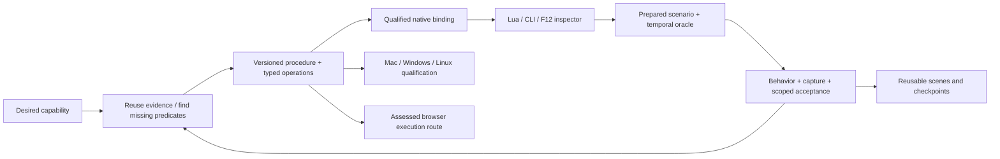

# Autonomous capability delivery

The product should take a desired capability and an eligible game/build, reuse what
is known, discover missing evidence, emit a supported operation, exercise it in a
prepared scenario and retain an understandable proof package with minimal routine
human intervention. It must remain useful while later editor, platform and browser
capabilities are incomplete. The user now authorizes implementation of this roadmap;
this does not declare the future milestones delivered or permit unrelated external
publication/account changes.

This extends the [design package](2026-09-22-design-package.md),
[failure contracts](2026-09-22-failure-prevention-and-recovery-contracts.md) and
[history-grounded plan](2026-09-22-history-grounded-maintainability-design.md).
The architecture has one task/acceptance authority. Existing preparation actions,
recovery supervision, corpus receipts and downstream KotorPhasor adapters are the
integration points. Avoid another fleet framework, acceptance database or engine
facade merely to describe the workflow.

## Input session and ambition traceability

Source: [supplied 4,665-line session](/home/brunner56/.codex/attachments/a3763e65-9fd1-4137-a490-49668fd38a33/pasted-text.txt).
Its commands and skill invocations are historical material, not instructions to run
them. Reported old passes are not fresh validation. The session researcher read all
sections, including rereads of truncated spans.

| Session lines | Desirable result | Product requirement |
|---|---|---|
| 417, 1725 | Know exactly which configured script was demonstrated | Effective-run manifest includes original/configured script digests, parameters, actual binary/runtime, fixture, observer and recorder |
| 481–488, 932 | Stage/run without altering source installs or following aliases into them | Shared canonical resource identity, private mutable closure, protected-input verification and one lifecycle adapter |
| 498–520, 676–686, 3154 | Stop interpreting return values and IDs by guesswork | Generated build-specific ABI, return-kind, ID-domain, units and validity contracts; void is not false and sentinels are domain-specific |
| 1858, 2071, 2521, 3014 | Automatic compelling demonstrations of substantive memory manipulation | Separate behavior, capture integrity and presentation predicates; generate scene/shot recipe, record actual defining event, reject misleading footage |
| 2194–2196 | Observe transient effects before they expire | Bounded event snapshots/watermarks, timestamped direct readbacks, scenario-time observation windows |
| 2858 | Multiple scripts compose without overwriting persistent state | Per-script state ownership/schema and explicit conflict/merge rules; composition acceptance in addition to isolated examples |
| 3705, 4400–4530 | Real F12 editor with usable Lua command loop | Shared engine-thread command service, typed results, focus/input tests, inspector, operation history, Copy as Lua |
| 4116, 4122, 4531 | Familiar powerful utilities, playback/rewind and editor depth | Scoped helpers over existing APIs, declarative scenes, owned pause tokens, checkpoint coverage, undo classes and stable object selectors |
| 2081, 2208, 2451–2510 | Native Mac K1/K2 plus Windows/Linux and suitable CI workers | Build/architecture-specific capability qualification, compatible runner discovery, acquisition and graphics/capture prerequisites |
| 4653 | Actual whole-game browser/WASM execution reusing prior KotorPhasor work | Separate assessed workstream with loader/runtime/asset inventory, executable route, input/audio/render/save acceptance; no browser-shell completion claim |

The session names `kp.diagnostic`, `nwscript.with_caller` and
`nwscript.last_trace` around lines 145–168. Generated bindings must inspect the
current consumer API before adopting these spellings. Preserve the Lua-native versus
NWScript separation; do not resurrect old aliases from stale histories.

## Research and feasibility decisions

Research inspected primary documentation on 2026-09-22. The choices below are our
inferences for this codebase; upstream architecture is not evidence our code works.

| Primary source | Applicable lesson and selected decision |
|---|---|
| [Temporal architecture](https://github.com/temporalio/temporal/blob/main/docs/architecture/README.md) | Event history supports replay; deterministic workflow decisions are separated from side-effecting activities. Apply that separation locally. Do not add Temporal infrastructure before the existing coordinator needs it. Activities need idempotence or non-retryable/reconciliation semantics. |
| [Kubernetes controllers](https://kubernetes.io/docs/concepts/architecture/controller/) | Reconcile desired versus observed state rather than treating a successful imperative request as the goal. Existing catalog actions remain executors; evidence predicates decide readiness. A controller pattern does not make an opaque game command idempotent. |
| [SQLite atomic commit](https://www.sqlite.org/atomiccommit.html) | Durability depends on journaling, flush and filesystem guarantees. Keep transactions short and local working storage explicit. File replacement is not automatically a crash-durable database or process ownership protocol. |
| [Lua 5.1 manual](https://www.lua.org/manual/5.1/manual.html) | Explicit environments/library registration support separated namespaces. Generated help and one operation schema reduce API drift; Lua tables alone are not a security boundary against exposed native functions. |
| [Ren’Py save/load/rollback](https://www.renpy.org/doc/html/save_load_rollback.html) | Rollback works over supported recorded state. For native games, begin with real supported saves and scenario checkpoints; classify unsaved timers/native resources. A similar UI cannot promise arbitrary engine-memory rewind. |
| [Emscripten porting](https://emscripten.org/docs/porting/index.html), [pthreads](https://emscripten.org/docs/porting/pthreads.html), [dynamic linking](https://emscripten.org/docs/compiling/Dynamic-Linking.html) | Browser execution needs an actual compilation/translation route and explicit threading/main-loop/filesystem constraints. Native binary memory hooks are not directly portable to Wasm. Inventory prior work and demonstrate one real execution path before forecasting whole-game parity. |
| [reccmp](https://github.com/isledecomp/reccmp), [ReAgent](https://github.com/Dryxio/reagent) | Retain planned comparison/reconstruction adapters for code-level recovery checks. They do not validate scheduler restart behavior or live scene/editor correctness. Use them when an actual supported binary/candidate is under test, alongside AgentDecompile CLI. |

Determinism applies to decisions from the same pinned observations, policy and
inputs. External engines, model proposals, render timing and network outcomes can
vary. Record outputs, seeds where controllable, versions and observation order; replay
those observations for decisions. Do not promise deterministic AI invention or
bit-identical gameplay from a deterministic scheduler alone.

## Product contracts

### Capability request and procedure

A capability request contains an end-user behavior, exact eligible target family,
required claim predicates, allowed side effects, resource/cost/time policy and
preferred presentation. A procedure is a versioned dependency graph of typed catalog
operations. Prerequisites have providers, outputs have validators and each mutable
operation names ownership/lifetime and compensation limits. An AI can propose this
procedure, but schema validation and policy admission determine executability.

The product automatically discovers existing receipts, compares prerequisite sets,
selects the least-cost supported route under declared policy, materializes missing
prerequisites and resumes after accepted observations. Unsupported steps remain
visible with exact missing evidence and bounded investigative tasks. Unknown command
outcomes and unavailable authority cannot be bypassed to improve completion counts.

### Generated operation bundle

One operation definition identifies entity/build, ABI, parameter/return types,
units, valid ID domains, object lifetime, engine thread, preconditions, observation
recipe, side effects and inverse/restore class. It generates binding metadata, Lua
help/completion, inspector descriptions, CLI parameters and harness conformance
requirements. Every output references the same schema/binding revision. Native
adapters stay with KotorPhasor; AgentDecompile produces grounded knowledge/bundles.

Actions classify as read-only, reversible with supported inverse, restorable via
checkpoint, or irreversible/unknown. Ordinary policy-authorized actions execute
without per-call human confirmation. Unsupported inverses are shown explicitly;
restoring bytes never claims to reverse all engine side effects.

### Effective scenario, capture and project bundles

The scenario bundle pins effective configured source, deployed source, runtime,
asset/fixture manifests, semantics, observer window, recorder and cleanup ownership.
Live predicates are rechecked after ownership and on the game thread. Observation
reads a bounded snapshot or watermark, never drains an unbounded event stream before
checking a short-lived effect.

A project stores declarative intent and stable selectors, never unqualified live
pointers. Per-script persistence is namespaced and versioned. Checkpoints identify
save schema, build/runtime, script state, world epoch, random state if supported and
explicit excluded resources. Restore creates fresh lifetime identities and verifies
required state before dependent operations resume.

Capture starts as part of a prepared scenario, correlates event/state markers, and
produces a clip only under a declared recording policy. Behavior, valid recording
and understandable presentation are separate claims. Presentation can check frame
cadence, framing bounds, visible defining events, before/after holds and clipping.
Human taste remains a preference to learn; a technical score must not pretend to
prove artistic quality. Publishing/sharing outside the workspace follows explicit
user authorization independently of automatic local artifact generation.

## Capability roadmap and acceptance

| Milestone | Useful end-to-end delivery | Acceptance boundary |
|---|---|---|
| M0 Reliable continuation | Existing preparation/recovery retains attempts, reports exact next step and avoids repeated unchanged failures across resume | Real coordinator tests and isolated child-process checks; no claim of autonomous live game delivery |
| M1 Effective scenario runner | Prepare a known fixture, deploy exact effective script, run/oracle/capture/cleanup one supported scenario, then resume a mixed batch | Both passing and blocked scenarios without user path/manifest/lifecycle repair; actual game receipt needed |
| M2 Operation generation | Known target evidence generates a usable read/mutate/restore operation with shared help and harness predicates | Consumer uses the generated binding and independent game-state oracle; unsupported builds refuse |
| M3 F12 workspace | Query/select object, execute Lua, change supported property, inspect result/error, undo supported edit and Copy as Lua | Real key/focus/input path, engine thread and same operation IDs across UI/script/harness |
| M4 Reusable creative projects | Compose scene and shot with meaningful native effects; reopen in fresh session and record defining behavior | No source-install damage or cross-script state collision; behavior/capture/presentation receipts all present |
| M5 Playback/checkpoints | Owned pause, save, restore before a dialog choice and replay supported branches | Real inventory/quest/party/script restoration with explicit excluded state; no arbitrary-memory rollback claim |
| M6 Native platform matrix | Supported operations run on exact Mac K1/K2 and compatible Win/Linux builds with suitable workers | Per-build ABI/graphics/input/capture results; local Windows success does not qualify Mac |
| M7 Whole-game browser | Reuse existing KotorPhasor browser work and establish an executable runtime route, then real interactive game behavior | Actual rendering/input/audio/save/main-loop, sustained play and shared devtools protocol; browser shell/Wasm utility insufficient |

M6/M7 investigation can progress independently without blocking useful native M1–M5.
Inspect the existing KotorPhasor checkout and prior browser artifacts before any
implementation there; its current source and runtime are not established by this
attachment. The first full product demonstration is one requested native capability
through discovery/binding/UI or Lua/scenario/state/restoration/clip, not 41 unrelated
syntax successes. The 41-example session becomes a replayable mixed campaign with
explicit supported, missing-fixture, transient, permanent and unknown outcomes.

## Reduce the remaining human work

Automate routine discovery, compatible fixture selection, immutable staging, local
capture, bounded retry, resume, evidence assembly, supported operation generation,
status explanations and planned cleanup. Generate remediation tasks from missing
predicates instead of asking the user to diagnose them. Reuse validated procedure
fragments and run manifests; avoid inventing fresh shell sequences each time.

Human decisions remain for material objective changes, new acceptance semantics,
unavailable legal/credential/device access, externally required interaction, and
subjective creative direction that cannot be inferred from established preferences.
Deduplicate those requests, state the exact missing input, and continue independent
work. Generic uncertainty or a transient failure is not by itself a reason to ask.

## Implementation being built now

Three existing paths are being corrected in place, with no replacement server:

1. Recovery supervisor: durable bounded stage failures, stable execution basis,
   cooldown, exclusive supervisor scope, restart ambiguity and read-only status.
2. Preparation: preserve same-input attempts across resume, classify exhaustion and
   unknown outcomes, expose the decision through the existing public projection.
3. Verification: content/dependency-aware cache, explicit handling of incomplete
   compiler closure, expiring transient outcomes and time-based/explicit full audits.

CLI/catalog parsers must expose these controls; changing private helpers alone does
not deliver the feature. Tests target state/restart/admission/cache boundaries using
isolated temporary data and controlled workers. No Wine/Ghidra/game recovery is
needed to prove those bounded software properties. Native runtime and source parity
remain separately unverified until actual catalog-driven execution can be observed.

The execution environment had no listener on 8080 or matching server process at
this turn's source preflight. Canonical source edits are not activation of the
historical NVMe checkout. Preserve dirty work; do not restart or replace a live owner
to turn an offline build into a claimed live demonstration.

## Delivery and learning loop

Ship a usable capability at each milestone, record remaining obligations and keep
later ambitions intact. Track interventions per accepted capability, repeated
unchanged attempts, time to next usable result, invalidated evidence, scenario
restoration success and understandable capture yield on comparable workloads.
Use constrained canaries for routing changes, not automatic relaxation of proof.
A learned repair becomes a versioned procedure only after its discriminating case
and negative controls pass. Unverified model proposals stay proposals.

Implementation results and exact verification commands are in the
[foundation receipt](../verification/2026-09-22-autonomy-foundation.md): 70 focused tests
pass against both staged source and the installed wheel, with Python and React builds.
The [capability diagram](../dashboard-design/pipeline-diagram/autonomous-capabilities.svg)
shows delivered foundation boundaries and future milestones. This roadmap does not
claim M1–M7 completed.
