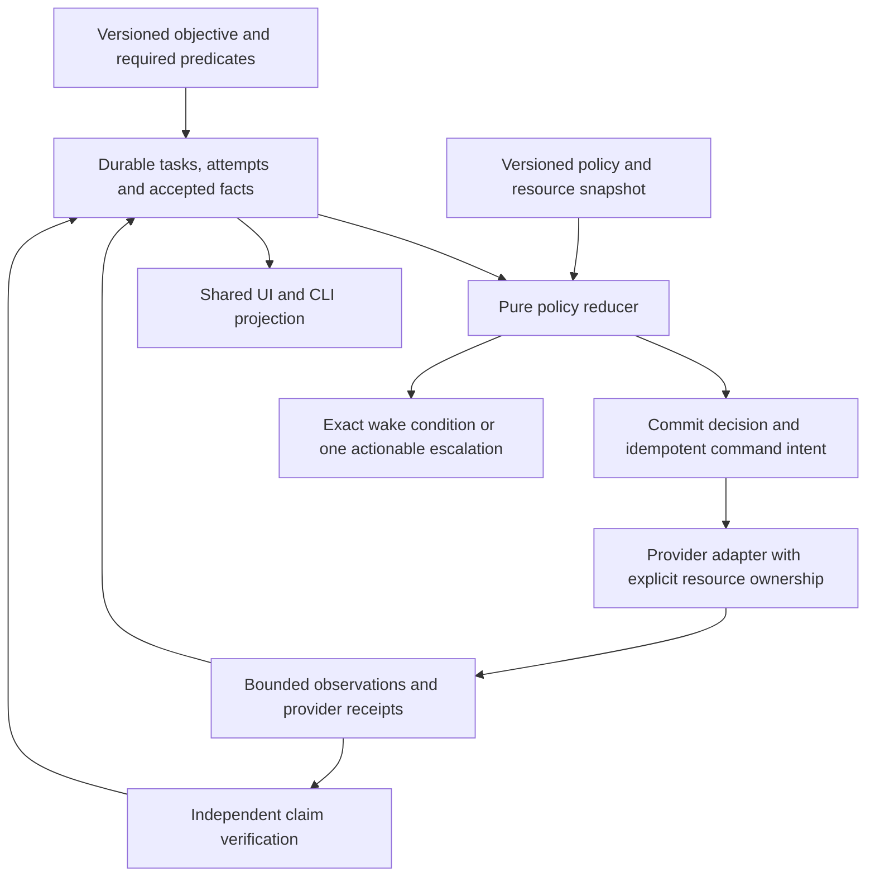

# History-grounded recovery and harness maintainability

The strongest common bottleneck is repeated reconstruction of operational truth by
humans: what is running, what it owns, which inputs changed, what actually passed,
and whether another attempt has a reason to succeed. The recommended coding path
is one durable reconciliation loop over explicit contracts, with deterministic
policy and narrow tool adapters. AI proposes hypotheses and patches; it does not
own retry accounting, resource release or acceptance.

This extends the [active design package](2026-09-22-design-package.md) and
[task contracts](2026-09-22-task-acceptance-and-continuation-design.md). It records
historical evidence and inspected source, not current runtime measurements. No
software implementation, server request, build, recovery or test was performed.

## Evidence selection and limits

Research began with the local memory index and the accessible
`/home/brunner56/boden_wizard_chat_context` archive layout. Recent project-specific
Codex transcripts provided the direct evidence below. This is a targeted sample,
not an exhaustive search of every AI platform or a measured frequency ranking.
“Biggest” means potential lost time, repeated manual diagnosis, or invalidation of
claimed results in this sample. Historical tool output outranks assistant summaries;
a transcript quotation is not a fresh reproduction. No historical PID or resource
condition is assumed to persist today.

## Historical incident ledger

| ID / system | Recorded evidence | Bottleneck and impact | Required software response |
|---|---|---|---|
| H01 AgentDecompile | [Raw supervisor output](/home/brunner56/.codex/sessions/2026/09/16/rollout-2026-09-16T18-55-33-01a0aca5-acc2-7011-abdf-aba17449c646.jsonl:422) repeatedly relaunches cascade after rc=1; [error output](/home/brunner56/.codex/sessions/2026/09/16/rollout-2026-09-16T18-55-33-01a0aca5-acc2-7011-abdf-aba17449c646.jsonl:428) repeats `_RAW_IMAGE` UnboundLocalError. | Fixed-delay supervision repeats a deterministic failure instead of advancing recovery. | Normalize failure fingerprint + relevant basis; persist spending; circuit that provider/basis until an actual fix or changed prerequisite is verified. Other providers/tasks remain eligible. |
| H02 AgentDecompile | [Verification log](/home/brunner56/.codex/sessions/2026/09/16/rollout-2026-09-16T18-55-33-01a0aca5-acc2-7011-abdf-aba17449c646.jsonl:384): full pass 24 took 14,149 seconds; following incremental passes took 32 seconds and then one second each; another full pass scheduled at 30. | Full work scheduled by pass count can dominate useful computation when inputs barely change. The record alone does not prove all full audits were unnecessary. | Dependency-keyed invalidation; reserve full audits for a stated correctness trigger or bounded audit policy. Record why, estimated cost and whether the audit found missed invalidation. Never skip the requested fresh final acceptance rebuild. |
| H03 Test harness | [Raw response](/home/brunner56/.codex/sessions/2026/09/16/rollout-2026-09-16T12-21-32-01a0ab3c-efc3-74a0-96b0-b4afe3f194bc.jsonl:108) reports `busy: another client is connected` while event observations remain available; [process output](/home/brunner56/.codex/sessions/2026/09/16/rollout-2026-09-16T12-21-32-01a0ab3c-efc3-74a0-96b0-b4afe3f194bc.jsonl:203) records a D-state game process. | Connection/resource contention obscures behavioral diagnosis. A timeout or disconnected controller does not prove the game stopped. | Independent observation path, one mutation owner, ownership-aware client teardown and quarantine of uncertain resource access. Never relabel contention as gameplay failure. |
| H04 Test harness | [Assistant claim](/home/brunner56/.codex/sessions/2026/09/16/rollout-2026-09-16T12-21-32-01a0ab3c-efc3-74a0-96b0-b4afe3f194bc.jsonl:431) says tmpfs removes storage queue dependence; [later process output](/home/brunner56/.codex/sessions/2026/09/16/rollout-2026-09-16T12-21-32-01a0ab3c-efc3-74a0-96b0-b4afe3f194bc.jsonl:519) shows the copy into tmpfs itself blocked in `blk_mq_get_tag`. | Moving the destination does not remove dependencies on the failing source. Repeated improvised staging consumes time without creating a launchable fixture. | Verify complete input closure on healthy persistent storage before admission; bounded isolated storage probes and copy workers. A partial copy never marks a fixture ready. |
| H05 KotorPhasor route automation | [Raw harness progress](/home/brunner56/.codex/sessions/2026/09/10/rollout-2026-09-10T00-25-47-01a088ae-66c0-7560-952c-541d93d1f774_01a089c7-7ca9-7f33-b386-6b4022c4a3a7.jsonl:33303): 11 consecutive zero-delta updates, zero frontier advances, 71.9 minutes since the last frontier advance, `needs_strategy_review=true`, next gate `escape_pod`. | Activity continues after the current approach stops earning goal progress. A warning that only a developer interprets leaves the loop dependent on supervision. | Turn stagnation into a policy transition: inspect the unmet predicate, select a distinct supported strategy, schedule missing evidence, or wait on exact prerequisites. Preserve budgets across restarts and continuation prompts. |
| H06 KotorPhasor delivery | [Historical status statement](/home/brunner56/.codex/sessions/2026/09/19/rollout-2026-09-19T23-51-07-01a0bd27-5651-7f72-8f6f-190bc6def196.jsonl:96) separates 16/16 offline tests and 41 syntax checks from limited live movement/position evidence and incomplete full multiplayer. This row is explicitly a saved assistant assessment, not a new execution receipt. | Adjacent success counts invite scope inflation: an API migration, transport slice or syntax check can look like completed gameplay. | Typed feature/build/scenario acceptance matrix. Generate readiness from exact predicates; preserve partial results without marking the encompassing objective complete. |
| H07 Delivery infrastructure | [Raw CI annotation](/home/brunner56/.codex/sessions/2026/09/19/rollout-2026-09-19T23-51-07-01a0bd27-5651-7f72-8f6f-190bc6def196.jsonl:966) says the job did not start because of account payments/spending limits. | External capability unavailable before compilation; code edits and retries cannot repair this cause. | Mark external-action-required once; retain local evidence; resume on restored entitlement. Never grant or infer CI acceptance from local checks. |
| H08 Harness fixtures | [Returned scenario documentation](/home/brunner56/.codex/sessions/2026/09/16/rollout-2026-09-16T12-21-32-01a0ab3c-efc3-74a0-96b0-b4afe3f194bc.jsonl:131) requires conscious Bastila and notes she is absent on Endar; [validation-ledger update](/home/brunner56/.codex/sessions/2026/09/16/rollout-2026-09-16T12-21-32-01a0ab3c-efc3-74a0-96b0-b4afe3f194bc.jsonl:240) leaves the meditation oracle unvalidated. | Scenario prerequisites are rediscovered manually after selecting an unsuitable fixture. | Typed fixture predicates and compatible fixture selection before mutation; missing actor remains a prerequisite, not a behavior verdict. |
| H09 Harness lifecycle | [Process output](/home/brunner56/.codex/sessions/2026/09/16/rollout-2026-09-16T12-21-32-01a0ab3c-efc3-74a0-96b0-b4afe3f194bc.jsonl:319) shows wineboot initialization; [recorded patch](/home/brunner56/.codex/sessions/2026/09/16/rollout-2026-09-16T12-21-32-01a0ab3c-efc3-74a0-96b0-b4afe3f194bc.jsonl:340) adds an initialized-prefix guard to the console driver. The patch is not successful live recording evidence. | Launchers duplicate lifecycle logic and diverge, so fixes must be rediscovered in each consumer. | One prefix/launch adapter with shared initialization, ownership and teardown contracts used by recorder, scenario and live controller. |
| H10 AgentDecompile evidence | [Artifact output](/home/brunner56/.codex/sessions/2026/09/16/rollout-2026-09-16T18-55-33-01a0aca5-acc2-7011-abdf-aba17449c646.jsonl:56) reports 18,578 compiling C functions, 1,617 marked byte-exact, 16,961 compiling-not-exact, max-C `byte_identical:false`, `receiptsPartial:true`. | Source quantity and package completion can outpace the requested byte-accuracy goal. These stored fields alone are not a fresh whole-image proof. | Keep contribution, local match, full-image equality and runtime behavior separately queryable; prioritize the unmet objective predicate. |
| H11 Shared resource capacity | [Historical memory/process capture](/home/brunner56/.codex/sessions/2026/09/16/rollout-2026-09-16T18-55-33-01a0aca5-acc2-7011-abdf-aba17449c646.jsonl:384) shows about 6 GiB available RAM, 31 MiB free swap and nonzero memory PSI. | Nested jobs can exceed an independently chosen per-launcher budget. This does not prove all light work was unsafe. | Shared process-tree reservations, measured resource classes and margins; preserve eligibility for unrelated lightweight work. |

The highest-leverage order is H01/H05 (stop futile repetition), H03/H04/H08/H09/H11 (make work
admissible and contain ownership/storage failures), then H06/H10 (make acceptance
truthful and visible). H02 reduces wasted verification cost without weakening the
final gate. H07 is a bounded external dependency, not an autonomous repair promise.

## Current code: reuse before introducing new machinery

These are source observations from the design pass, not claims about the current
serving revision. The later [foundation implementation](../verification/2026-09-22-autonomy-foundation.md)
supersedes the supervisor and verification-cache observations below. The remaining
proposals are still obligations; this table is retained as the before-state.

| Existing seam | Observed behavior | Proposed change |
|---|---|---|
| [recovery_orchestrator.py](../../src/agentdecompile_recovery/corpus/recovery_orchestrator.py:119) | In-memory process map and restart cooldown; verifier spec uses `--full-every 6`. | Keep compatibility entry point; route eligible work through the durable decision/attempt contract. Remove overlapping retry authority as each adapter migrates. |
| [grid task normalization](../../src/agentdecompile_grid/tasks/spec.py:54), [frontier fold](../../src/agentdecompile_grid/log/frontier.py:265) | Canonical parameters and event-to-state reduction already exist. | Reuse normalization and event contracts through explicit translation; establish the corpus acceptance ledger as authority. Do not create another competing scheduler/database or require distributed grid deployment. |
| [autonomous_policy.py](../../src/agentdecompile_recovery/autonomous_policy.py:31) | Attempts counted from supplied history; chooser also reads rewrite-queue state near line 123. | Persist basis-scoped history, then supply a frozen observation snapshot to a pure chooser. A changed filename/PID is not a changed hypothesis. |
| [jobs.py progress](../../src/agentdecompile_recovery/corpus/dashboard/actions/jobs.py:162) | Structured/log percentages, `ok` → 100, queued → 4. | Expose liveness, durable work and accepted goal delta separately. Retain legacy percent only as labeled compatibility presentation. Unknown is a valid value. |
| [jobs.py completion](../../src/agentdecompile_recovery/corpus/dashboard/actions/jobs.py:551) | Exit zero maps to job `ok`; finally releases local admission. Archive branch already recognizes unresolved ownership/quarantine near line 510. | Generalize typed execution/output/access outcomes; executor return does not by itself authorize acceptance or resource release. This source observation does not establish a live unsafe release occurred. |
| [grid verifier policy](../../src/agentdecompile_grid/verify/policy.py:51) | Signer/key invitation lineage is used for independence. | Keep attribution checks; separately evaluate semantic evidence roots. Two keys inheriting one wrong label are not two independent facts. |

## Coding architecture: one reconciliation loop, small deterministic core

Suggested interface shapes are design contracts, not implemented APIs:

- `decide(objective, facts, attempts, resources, policy, observed_time)` returns
  eligible actions, refusal reasons and wake conditions with no hidden I/O.
- `execute(command_id, attempt_id, generation, manifest)` returns execution
  outcome, immutable output references, progress observations and access status.
- `accept(proposal, evidence, policy)` verifies claim scope and roots outside the
  write transaction, then rechecks current generation/dependencies in a short commit.
- `project(state, objective_id)` produces the same readiness and reasons for the
  dashboard, CLI, agents and reports.

The durable local store owns task state, retry spending, reservations, command
intents and accepted-claim references. Reuse the existing corpus/event contracts;
cache projections are rebuildable. Avoid dual writes to independent acceptance
stores. Existing grid records may be imported with stable origin IDs, but a record
must identify which authority accepted it. Use schema migrations and explicit
versions, not silent reinterpretation of old receipts.

Persist command intent before launch and reconcile it on restart. Delivery can be
at-least-once; external mutations are not magically exactly-once. An adapter must
state whether a command is idempotent, deduplicated by the provider, observable
through an operation ID, or ambiguous after interruption. An ambiguous native call
requires reconciliation against state/postconditions before any replay. Restart
replays decisions and observations, not blindly every side effect.

## Self-healing is a bounded policy, with a reason to expect a different result

| Outcome | Automatic next step | Re-entry condition |
|---|---|---|
| Transient provider failure | Retry with bounded backoff/jitter under one persisted owner | Remaining budget and provider readiness |
| Same deterministic error | Open circuit for exact provider/input basis; preserve diagnostic bundle | Relevant code/tool/input revision changed and prerequisite check passed |
| Missing fact or fixture | Schedule an allowed prerequisite producer or use an independently eligible provider | Accepted dependency appears |
| Uncertain process access | Fence publication; keep resource quarantine; run independent work elsewhere | Corroborated end of access, not elapsed lease alone |
| Stale accepted evidence | Withdraw only dependent claims; schedule revalidation | New evidence against current versions |
| Wrong hypothesis / no frontier advance | Choose an explicitly different hypothesis or diagnostic with an expected discriminating observation | New semantic basis, not cosmetic edits or another agent name |
| External account/consent dependency | One persistent actionable escalation; continue independent work | Explicit restored capability or authorized decision |

A changed failure message does not automatically earn a new retry budget. Persist
both provider-level attempt limits and objective-wide expenditure to prevent
hypothesis churn. Conversely, zero accepted-goal delta is not alone evidence of a
stalled long-running compile: distinguish fresh durable units from heartbeat-only
activity, and honor the admitted progress/checkpoint contract. A discovery task may
produce useful accepted negative evidence, but it must not inflate recovered-source
coverage. Configure these policies per task class with safe defaults and bounded
exceptions; do not scatter tunable timeouts throughout every launcher.

## Reduce developer nitpicking at the contract boundary

1. **One objective, explicit finish conditions.** Translate natural-language intent
   into a versioned objective once. Keep required and optional capabilities separate.
   A new user message can refine scope; it cannot silently reset spent attempts or
   lower proof requirements. Show the change before using revised acceptance rules.
2. **One provider contract.** Ghidra, reccmp, ReAgent, compiler and harness adapters
   declare supported inputs, progress units, retry semantics, side effects, resource
   closure, checkpointing, cancellation and evidence outputs. Provider-specific
   quirks stay there. Missing instrumentation reports unknown.
3. **One fixture contract.** A scenario declares target hash, save/module, required
   actors/state, controller, oracle, recorder and teardown. Validate readiness before
   acquiring/mutating the live game. Produce or select a compatible fixture only
   through a defined permitted action; absence is not a failed behavior test.
4. **One reviewable change contract.** A repair proposal records diagnosis, expected
   changed predicate, patch/input delta, permitted scope, validation and rollback
   limits. Run it in isolated state during a later authorized implementation phase.
   Promote through the ordinary gate. An agent cannot rewrite its own success rule.
5. **One presentation contract.** Every task answers: what capability is requested;
   what was accepted; what is running; what blocks this task; what happens next; what
   exact event will wake it. Progress bars derive from known units. Independent
   useful work remains visible when a sibling is blocked.
6. **One source of policy.** Typed/versioned policy defaults, shared reason codes and
   generated reference documentation keep CLI, dashboard and agent behavior aligned.
   New providers pass the same conformance scenarios. Avoid independent UI retry
   buttons that bypass admission and ownership.

Desired operator experience: “K1 hook-read capability accepted. One compiler route
is paused for repeated E_RAW_IMAGE under revision X. Cached K2 identity work is
running. A corrected provider revision will wake the paused route.” Each statement
links to its receipt, owner or wake condition; it never asks the developer to infer
state from process lists and scattered logs.

## Incremental implementation sequence and future falsifiers

These were future work packages when the design was authored. The later explicit
build request authorizes implementation; the session audit records completion.

| Step | Bounded implementation | Decisive future check |
|---|---|---|
| 1 | Add objective/task/attempt identities and typed outcomes at existing seams; additive job projection fields | Exit-zero/no-valid-output shows execution complete but zero acceptance; queued work has no invented measured percent |
| 2 | Extract pure policy and persist basis-scoped retries/command intent | Replay the same snapshot after restart: same decision, no reset budget, ambiguous command not replayed |
| 3 | Adapt resource admission and quarantine, starting with one compiler and one harness route | Timed-out owner still accessing state prevents reuse; unrelated ready task proceeds |
| 4 | Add failure classification, circuit/wake rules and fixture prerequisites | Repeated `_RAW_IMAGE` stops boundedly; missing actor schedules/selects a valid fixture without asserting gameplay failure |
| 5 | Make dependency invalidation and independent acceptance authoritative | Changed type invalidates affected claims only; two signers sharing wrong seed fail identity; full final gate still required |
| 6 | Project one state model into dashboard/CLI and retire duplicated watcher retry loops per migrated provider | UI and CLI give identical status/reason/next action; interrupted work resumes without manual state repair |

Do not switch every provider at once. Shadow the pure decisions against retained
historical events first with side effects disabled, inspect disagreements, then
migrate one adapter under a single ownership handoff. Do not run old and new
launchers as competing writers. Export a resumable checkpoint and preserve old
receipts; rollback changes which compatible coordinator owns future commands, not
accepted historical evidence. No distributed platform is required for the first
single-host delivery.

Future history-derived conformance cases: H01 repeated deterministic crash; H02
unchanged pass/audit trigger; H03 busy observation versus mutation; H04 partial staged
closure; H05 zero-frontier churn with a long-running-progress control; H06 partial
feature evidence; H07 external capability denial; H08 fixture mismatch; H09 duplicate initialization;
H10 compiling-source versus whole-image claim; H11 nested resource pressure. Pair every refusal with an
unaffected-ready-work control. Supplement the existing RC01–10/A01–20 cases rather
than create a second incompatible acceptance framework. All cases are **NOT RUN**.

## Measure maintenance cost and goal progress

Collect a baseline before tuning; no improvement percentage is asserted here.
Report operator interventions per accepted capability, repeated identical attempts,
useful accepted results per resource-hour, invalidated claims, stale publication
rejections, resume-without-repair rate, time with eligible work stranded, and age of
actionable blockers. Count escalations and unsafe retries separately: hiding alerts
must not look like reduced maintenance. Compare equivalent target/fixture/toolchain
cohorts; a changed workload cannot establish an efficiency win.

Continual progress is conditional on available evidence, resources and viable
methods. The system can guarantee bounded repetition, truthful accounting and
continued eligible work. It cannot guarantee discovery of every unknown ABI, repair
of a blocked kernel/device, or completion without required external access. When
nothing useful is eligible, durable waiting with a precise wake condition is the
correct outcome. The developer should decide new scope or supply genuinely missing
access, rather than repeatedly reconstruct routine execution state.

## Review and static verification

Independent review checked the current-source claims, single acceptance authority,
provider migration, bounded healing and preserved final gate; no substantive
architecture blocker was found. A broken Markdown table boundary was corrected.
All 25 local evidence/source link targets exist; all 11 incidents are in one table;
code fences pair, trailing-whitespace checks pass, and scoped Git diff checks pass.
These checks establish document integrity only. The historical replay/conformance
cases remain unexecuted.

## Mandatory failure-response refinement

The [prevention and recovery contracts](2026-09-22-failure-prevention-and-recovery-contracts.md)
expand these findings into required detection, containment, repair/reroute, wake
and acceptance behavior. They cover failures in the recovery machinery itself and
retain this document as the historical rationale and current-source integration map.
