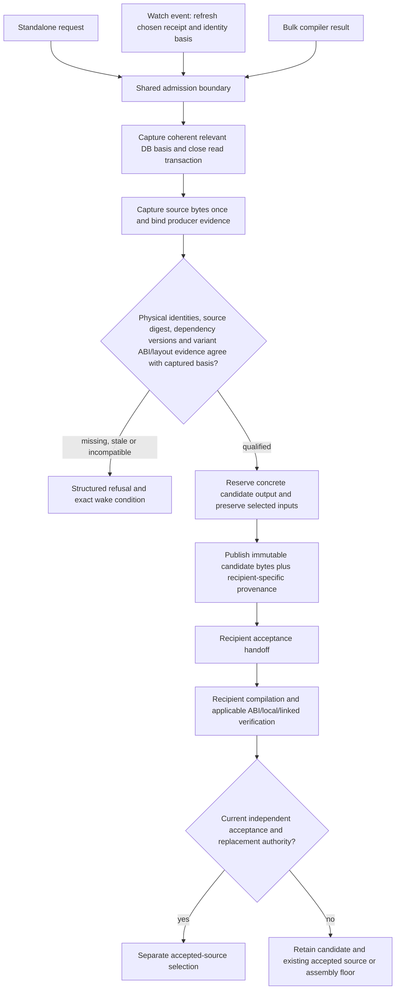
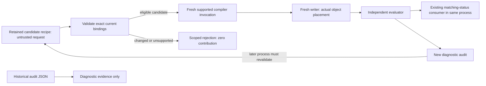
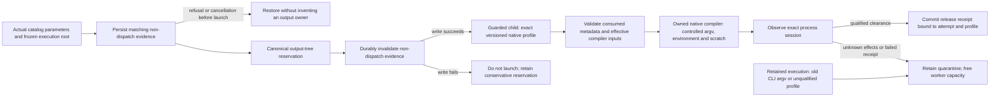

# Task acceptance, continuation and failure containment

This is a design specification, not deployed functionality or permission to run
workers. [STRATEGY](../../STRATEGY.md) remains recovery authority; the
[recovery contracts plan](2026-09-22-recovery-contracts-and-validation-plan.md)
defines the source, region and tool evidence consumed here. The supplied hindsight
review is historical design input, not a diagnosis of the current host. All
acceptance scenarios below are specifications **not run**.

## 1. Governing contract and scope

Missing evidence blocks the claim requiring it. An unhealthy resource blocks its
dependent work. Neither creates a platform-wide or project-wide stop by default.
A task is eligible when its exact prerequisites are satisfied, its mutable resource
set can be owned, and a compatible environment has capacity. Original-code
read/call/hook capabilities do not require recovered C; replacement and whole-image
claims retain their independent requirements. No task may lower those requirements
to finish sooner. A deadline ends an attempt, not the requested objective.

Historical observations motivate the mechanisms; they are not current measurements.
In particular, the recorded `-j3` ceiling is a proposed conservative shared compiler
budget for future execution, subject to the active operational policy. It is not
three workers per agent and is not permission to launch any worker in this design
phase. ReAgent, reccmp, objdiff and AgentDecompile CLI fit the same adapter contract;
which can substantiate a claim depends on their supported inputs and evidence.

## 2. Task and acceptance schemas

Extend the existing corpus/receipt system; do not create a competing acceptance
database. IDs below are stable identifiers; digests identify immutable content;
policy revisions and dependency versions are explicit values, not latest aliases.

| Task field | Required meaning |
|---|---|
| `task_id`, `objective_id`, `capability_id` | Durable unit, overall objective and requested usable result |
| `kind`, `subject_ids`, `basis_digest` | Operation, exact target/entities and complete relevant input basis |
| `input_manifest`, `analysis_snapshot` | Content hashes, locations, origin, dependency closure and analysis revision |
| `prerequisite_sets` | OR of alternatives, each an AND of typed required claims and versions |
| `provider_constraints`, `provider_alternatives` | Supported format/architecture/ABI/tool features and compatible providers |
| `mutable_resource_ids` | Complete exclusive resource set; immutable inputs require no writer lease |
| `resource_profile` | Process-tree memory estimate and uncertainty, CPU/child slots, I/O class, scratch and enforcement requirements |
| `progress_contract`, `checkpoint_schema` | Durable work-unit identity, terminal unit outcomes, checkpoint/resume version |
| `output_contract`, `acceptance_policy_id` | Artifact schema and pinned independent acceptance rules |
| `priority`, `ready_since`, `aging_credit` | Capability dependency priority and persistent eligible waiting age |
| `attempt_policy`, `retry_owner` | Deadline, class-specific limits/backoff and exactly one retry authority |
| `state`, `blocked_on`, `wake_conditions` | Current status, precise unsatisfied sets and events that can change it |

| Acceptance record field | Required meaning |
|---|---|
| `proposal_id`, `attempt_id`, `generation` | Producer result and publication authority generation |
| `claim_kind`, `claim_scope` | Exact fact: identity, ABI, tested behavior, local/linked match, contribution, whole-file equality or runtime capability |
| `subject_manifest`, `dependency_versions` | Exact target/source/toolchain/scenario/artifacts and evidence roots |
| `policy_revision`, `verifier_identity` | Rules fixed before production and separate acceptance authority |
| `observations`, `raw_artifact_digests` | Retained results and immutable raw reports, including negative observations |
| `assumptions`, `bounds`, `unsupported` | Scope limits; no conversion from bounded test agreement to equivalence |
| `outcome`, `reason_codes` | Accepted, rejected, stale, insufficient evidence or unsupported with actionable reasons |
| `supersedes`, `accepted_at`, `transaction_id` | Append-only history and atomic ledger commit identity |

A producer cannot write accepted status, modify acceptance policy, or replace raw
observations. The acceptance coordinator checks schema, target/input digests,
relevant dependency versions, independent evidence lineage, current publication
generation and operation-specific predicates. It computes outside the write
transaction; the short transaction rechecks versions/generation and commits once.
An idempotency key over proposal, claim and policy prevents duplicate acceptance.
Conflicting equally supported proposals remain contested; arrival order is not a
tie-breaker. Content-hash sorting can stabilize presentation, never manufacture truth.

The binding predicates in the [recovery contracts plan](2026-09-22-recovery-contracts-and-validation-plan.md) are authoritative; their RC-01–10 examples complement the orchestration cases here. For scheduling, those predicates remain distinct: target bytes exist at the claimed
region; target-side boundary/identity evidence identifies the intended entity;
the requested operation satisfies ABI/layout/live-state requirements. A signature
extracted at a donor-suggested address cannot prove that donor's label. Withdrawal
marks unsupported dependent claims stale and removes their current export references;
independent corroboration may preserve a claim through explicit reevaluation.
Historical receipts remain immutable. Repairs unblock only the new relevant basis.

### Cross-place admission and recipient candidates

The September 27 source audit makes this existing recovery contract concrete at
three entry points: standalone cross-place, its watcher and the bulk-recovery
placement hook. A saved list of compiled addresses cannot authorize current source
bytes. A logical identity join cannot establish implementation interchangeability.
The shared boundary must validate a captured source artifact against producer
evidence and current source/recipient dependencies, then publish only a candidate.

The candidate receipt binds donor and recipient binary contents/physical instances,
producer source bytes, compiler/dependency scope, compatibility evidence, transformed
candidate bytes and publication basis. Qualification must be possible for supported
current inputs; refusing every request is not a functioning implementation. A watch
iteration rechecks relevant dependencies and honors the same selected receipt type
as standalone placement. A no-compile exploratory path is explicitly unadmitted and
separate from qualified candidates. Candidate publication is deterministic,
idempotent and interruption-safe; it cannot create recovery credit, replace a
recipient source file or write through aliases into protected inputs.

Watch holds candidate-output ownership throughout its lifetime, but must allow
identity and matching producers to advance between passes. Capture a bounded,
coherent SQLite snapshot of relevant facts, close the reader before compilation
or waiting, and publish immutable observed-basis proposals. SQLite-managed sidecar
coordination is an explicit shared-reader contract; read-only SQL is not a claim
of zero filesystem effects. A full-corpus copy or an indefinite database-wide
reservation per watcher does not meet the tandem-work requirement. Any compiler
proof obtained independently of the database is explicitly source/image-scoped
and bound to the captured basis through its checked physical identities.

Reuse valid process-local positive authority and bounded negative decisions for
unchanged inputs. Reserve attempt/scratch budgets before work; distinguish
deterministic refusal from bounded infrastructure retries and name what change
wakes blocked work. Neither negative evidence nor serialized audit JSON can create
positive producer authority. Current-basis acceptance remains a recipient-side gate.

The acceptance handoff does not invent recipient verification: supported recipients
must pass their actual checks, and unavailable adapters produce a local blocked
reason while other eligible candidates continue. A source digest records bytes;
producer/identity/compatibility authority must also be corroborated. Existing
target-local completion guards remain in force. This diagram specifies required
behavior; current implementation and proof are tracked in the
[living ledger](2026-09-27-implementation-progress-and-live-track.md#active-source-repair-cross-place-admission).

### Fresh source revalidation after process loss

The current supported native source-contribution backend holds compiler/writer
capabilities only in the producing process. Retained JSON remains an audit record;
reopening it cannot recreate that authority. A bounded restart route therefore
accepts an explicit candidate recipe as untrusted work input, verifies the caller's
exact target, corpus/binary, selected-function and source-digest bindings, and
freshly produces eligible candidates in one new private workspace. Supported DB
paths must reach the exact caller-selected file through every existing SQLite
consumer; URI metacharacters are explicitly unsupported in this bounded route. It uses the
existing compiler identity gate, writer and independent evaluator. One changed
candidate receives no credit while an independent valid sibling can advance.

The coordinator must not import compiler commands, old object paths, accepted flags,
invocation IDs or historical writer maps as authority. Output must not overwrite
inputs or an earlier result. Fresh work is explicit and bounded; valid observations
still available in the current process do not trigger automatic recompilation.
Copied floor bytes preserve image content without earning source contribution or
whole-image compiler credit. This route establishes fresh revalidation after loss;
durable trust without reexecution and catalog-driven game-target qualification
remain separate unfinished contracts.

## 3. State transitions and recovery

Task states are `proposed → waiting → ready → admitted → running → awaiting_acceptance
→ accepted`. Alternate terminal outcomes per basis are `negative`, `unsupported`
and `cancelled`; retriable interruptions enter `retry_wait`, missing prerequisites
enter `waiting`, and exhausted attempts enter `budget_exhausted`. Resource occupancy
is not a negative scientific result. A rejected proposal can leave its task ready
for a changed hypothesis while preserving the rejection. An accepted claim made
stale returns the affected objective dependency to waiting without deleting history.

A task reaches `accepted` only when every mandatory output and claim contract has
a terminal result and every success predicate required by its pinned acceptance
policy passes. Accepted partial claims remain reusable but do not complete the task.
Optional diagnostics can be unsupported only when the predeclared policy permits
that outcome. A task ending `unsupported`, `negative`, `cancelled` or
`budget_exhausted` does not achieve its overall objective: unmet capability predicates
remain visible, with compatible alternatives or prerequisite-producing tasks. The
objective is complete only when all its mandatory capability predicates are satisfied
by current accepted receipts; terminal task counts are never its completion rule.

| Attempt field | Persistence requirement |
|---|---|
| `attempt_id`, `task_id`, `basis_digest`, `generation` | Never reused; distinct private output namespace |
| `provider_id`, `environment_manifest`, `ownership_record` | Actual execution environment and owner identities |
| `started_at`, `deadline`, `last_heartbeat` | Liveness timestamps, independent of progress |
| `completed_unit_ids`, `checkpoint_digest`, `execution_cursor` | Durable units and resumable position |
| `accepted_claim_ids`, `goal_delta` | Goal progress from acceptance receipts only |
| `failure_class`, `retry_count`, `next_eligible_at` | Retry history survives coordinator and conversation restarts |
| `cancel_requested`, `exit_observation`, `access_clearance` | Request, observed outcome and proof resources are safe are separate |

Liveness means a process/connection exists. Execution progress means a distinct unit
has a durable terminal result, including a legitimate non-match. Goal progress
means new accepted evidence or a usable capability. Repeating the same unit/basis
and changing child PIDs increments neither durable progress counter. External
uninstrumented jobs may truthfully report `progress_unknown`. They remain external
owners unless explicitly adopted under an ownership/lifecycle agreement.

On coordinator restart, restore accepted receipts and retry state, reconcile actual
owners, retain uncertain resources in quarantine, discover private completed results
by manifest, and revalidate before acceptance. Do not relaunch a task merely because
its old heartbeat stopped. Completed-unit checkpoint publication precedes progress
acknowledgment; an interrupted acknowledgment can be replayed idempotently.

## 4. Dependency-local admission and priorities

Evaluate all declared prerequisite alternatives against current claim versions.
For each ready task, choose a compatible healthy provider and reserve its complete
resource set atomically; if reservation fails, release temporary reservations and
leave the task ready. Never wait holding half a set. Admission uses a shared budget
including nested subprocesses, not independent per-agent limits.

Keep measured units separate. A preparation action admission is not a provider
call, token, CPU-second or monetary charge. For the same-process MCP route, an
explicit tool-dispatch allocation counts every actual `tools/call` intent,
including project/program prerequisites, session retries and check-in. Cached
local observations do not spend a remote-call allowance. Commit each reservation
before dispatch; a lost response or crash cannot refund it or authorize a second
request with the same reservation. Preserve spending and disclose unknown prior
usage when migrating existing objectives.

Nested dispatch authority must come from a private capability bound to the
current coordinator lease and parent attempt. Receipt JSON, request parameters,
argv and environment variables cannot recreate it. A late child whose coordinator
lost its lease cannot overwrite a resumed objective or spend its new allocation.
Quota refusal carries its exact exhausted dimension and allocation-revision wake
condition through all wrappers; it cannot become an ordinary retry that burns
more root admissions. Refusing a later check-in does not prove earlier effects
were cleared or saved. Such incomplete lifecycle work retains the corresponding
ownership uncertainty. The MCP dispatch boundary does not measure provider-internal
fan-out, external subprocess usage, tokens or money; those remain separate
contracts in the shared objective budget.

Retain unresolved-effect evidence monotonically through nested provider envelopes
and later budget refusals. Decode supported object/list/JSON-string envelopes
before replacing a failed response with session-repair output. Transport copies
of the same payload (`parsed`, text and raw MCP content) are not extra provider
nesting: they must neither hide uncertainty nor falsely quarantine an ordinary
function-list result. Include both negative uncertainty cases and a successful
normal-envelope case in this boundary's acceptance checks.

Memory admission uses measured process-tree peak plus uncertainty/headroom, current
available capacity, reservations, pressure trends, resource-limit events, scratch
capacity and storage health. Swap occupancy is telemetry, not a universal veto;
a no-swap environment can qualify, and spare swap does not prove capacity. Unknown
profiles require a bounded profiling attempt on an eligible isolated worker. If
required process-tree enforcement is unavailable, route to a capable worker or
mark that class blocked; do not assume enforcement exists. Tmpfs charges the same
memory budget and never serves as the only durable receipt store.

Among feasible tasks for admitted objectives in the same scheduling class, use
requested-capability dependency contribution, then aging credit, then stable task
ID for ordinary ranking. Preserve ready age across unrelated retries and coordinator
restarts. Aging increases at a declared interval up to a cap. At the cap, the oldest
feasible task receives the next compatible capacity reservation **ahead of ordinary
capability priority**, including a large task that would otherwise lose to small
work. Backfill is permitted only when it cannot delay that reservation. Aging does
not authorize overload: resource-infeasible tasks produce a capacity prerequisite.

Cross-class precedence is explicit versioned policy, not an implicit starvation
escape hatch. An urgent override can defer a reservation only through a recorded
policy-authorized event naming requester/authority, reason, affected reservation,
expiry and rescheduling decision. Its deferral remains visible in fairness reports;
it does not reset waiting age. Permanent capacity loss, permanently dominant class
policy or repeated authorized urgent overrides prevent a starvation guarantee and
must be reported as such. This is a proposed fairness mechanism, not a realized
fairness benchmark or proof of a runtime scheduling bound.

When no task is runnable, persist a minimal blocked dependency set per objective
and subscribe to its wake events: receipt/version change, resource release, provider
recovery, capacity change or authorized budget change. Timer expiry wakes only a
scheduled retry/provider probe. A new chat message does not reset counters. Unrelated
ready work continues whenever its complete inputs, outputs and resources qualify.

## 5. Resource ownership, fencing and quarantine

| Resource record | Meaning |
|---|---|
| `resource_id`, `kind`, `host_id`, `namespace` | Exact Program/corpus-writer/output/PDB/Wine/save/display/port/channel/storage identity |
| `owner_kind`, `owner_id`, `process_start_identity` | Managed/external owner with stable start identity, command/cwd/target provenance |
| `lock_handle`, `generation`, `lease_deadline` | Atomic lock plus publication fence, never a PID-file-only lock |
| `access_state`, `publication_state` | Access: free/owned/quarantined; publication: current/revoked |
| `bundle_members`, `clearance_receipt` | Complete scenario/resource bundle and explicit evidence permitting reuse |

Publication authority and access safety are separate state machines. Lease expiry
revokes the old generation's acceptance authority; it does not stop a process or
release its resources. Suspected old access changes owned to quarantined. Clearance
requires observed termination with no remaining descendant/handle access, verified
release through the owning system, or a newly provisioned genuinely disjoint bundle.
A byte match, elapsed timeout, changed PID or successful new lock-file write is not
clearance. OS-uninterruptible workers may retain resources indefinitely; their
quarantine blocks dependents but does not block independent bundles.

Example: attempt A at generation 12 stalls writing its private result. Generation
13 may run B only on independently safe resources. A later returns a byte-matching
result. Preserve A's immutable artifact as historical evidence; reject its stale
publication. Reconsidering that artifact requires a new independently checked
proposal against current inputs and policy; it cannot overwrite B's output or clear
A's resource quarantine. Even identical result digests do not waive the fence.

Keep Program mutation, corpus acceptance, compilation and live-scenario ownership
separate. Shared read-only tool installations are allowed. Compilation owns its
private intermediates/PDB/temp/Wine state. A multiplayer scenario can own several
processes as one explicit bundle; it need not serialize unrelated immutable analysis.
Do not hold a corpus write transaction while waiting for a compiler, model or game.

Action resource declarations must name actual mutable state and its clearance
mechanism. Do not infer ownership from generic parameter names: a compiler path
is usually a read-only input, and catalog fields can retain CLI spellings such as
`out-dir`. For filesystem trees, equal and ancestor/descendant paths conflict even
when their resource kinds differ. Freeze the execution root and resolved claims
for the attempt; an execution-root change cannot silently redirect a reserved job.

Qualify providers incrementally with both a successful release and an uncertain
outcome. The first local-output implementation target is
`corpus.export-reagent-snapshot` and its `destination` field: synchronous private
file writes with a read-only SQLite source. Its executor must bind clearance to
the same job, attempt, claims, argv and observed process before releasing the
reservation. A success label alone, an injected executor without that observation,
or another action's local-clearance proof cannot release it. Restoring a historical
`released` label must apply the same qualification. Compiler/Wine/project/store
providers each need their own explicit mutable bundle and lifetime qualification;
this local-output contract does not establish their coverage.

### Qualifying the native package verifier

The next compiler ownership boundary is the existing `recover.verify-package`
action. Freeze its actual package/manifest interpretation and effective output
path into the dispatched command. Reserve that whole output tree, including
compiler scratch and diagnostic files, before mutation. A compiler executable is
an input; its pathname alone is not a mutable compiler resource.

Qualification belongs to a versioned execution profile. The guarded child must
validate the metadata it actually reads, construct both syntax and object commands
from supported semantic inputs, pin compiler/dependency/resource identities, and
control Python startup plus native compiler environment and configuration. Parent
preflight cannot authorize arbitrary metadata flags loaded later. C and C++ source
acceptance remain distinct from lifetime clearance: a syntax failure may release
ownership only after the same qualified process-session proof.

Selected source, metadata, manifest and target-byte-slice inputs must be protected
from output aliasing; disabling code comparison does not stop the verifier from
reading a target slice. This declared-input check does not establish complete
transitive include closure. Legacy verification receipts may predate output keys:
recover the exact claim from their original execution root and parameters where
possible, and retain uncertainty when those inputs are missing or ambiguous.

Release and restoration must check the same guarded-launch/profile binding. An
old unguarded command, injected executor success or a user-supplied profile label
cannot inherit the new contract. Unsupported flags, wrappers, code-comparison
providers and Wine retain their separate unfinished qualification. Keep unchanged
direct CLI interfaces compatible; current mission operations still use the catalog.

A request rejected before dispatch must not become a permanent output owner after
restoration. Persist explicit, versioned evidence of non-dispatch for the actual
queued attempt, bound to its job and frozen execution inputs. Invalidate that
evidence durably before invoking any executor; if persistence fails, do not launch.
This distinguishes a modern refusal or cancellation before admission from a
historical receipt whose execution is unknown. An attempt UUID or missing process
field alone cannot establish non-dispatch. Missing or mismatched evidence keeps
the historical conservative behavior. Removing a rejected request's package must
not block unrelated resource admission when valid non-dispatch evidence survives.

## 6. Bounded failure continuation

Only the coordinator owns outer retries. Adapters declare internal retries and
must disable them or charge them to the same attempt budget. Backoff/jitter values,
retry limits and resource ceilings are versioned policy, never hidden defaults.

| Failure class | Continuation rule |
|---|---|
| Deterministic compile/match rejection | Cache negative result for exact basis; retry only changed hypothesis/basis |
| Compiler/provider transient crash | Preserve units, bounded retry in fresh private environment when safe |
| Resource profile exceeded | Close admission for class, checkpoint-and-exit managed restartable work when possible; resize or route |
| Provider outage | Open circuit after policy threshold; compatible provider or bounded health probe after cooldown |
| Uncertain identity | Create targeted evidence task; keep binding out of accepted catalog |
| Occupied external resource | Wait on release; continue unrelated tasks; never kill external owner |
| Changed dependency | Retain proposal as historical; reject current acceptance and schedule relevant recomputation |
| Deadline exhausted | Preserve objective and receipts; explicit budget-exhausted attempt and next prerequisite |
| Unknown non-idempotent outcome | Observe by command ID/state before replay; never retry mutation blindly |

Cancellation acknowledgment is not proof of exit. Suspended workers still consume
memory; pausing admission does not reclaim it. Checkpoint-and-exit is the preferred
managed recovery boundary where supported. Host-loss failover needs independent
replicas and a compatible alternate environment already available; retries cannot
create the only missing input copy.

## 7. Prepared storage and durable publication

A prepared bundle manifest lists every direct and indirect input with content
hash, size, origin and required availability: binaries, compiler/linker components,
headers/libraries, language specifications, analysis exports, Wine configuration,
scenario assets and saves. State is `preparing → verified → launchable`; incomplete
or changed closure is never launchable. Archive replication has separate pending,
complete and failed states and does not gate work whose complete durable inputs and
outputs are on healthy working storage.

The coordinator and receipts live on healthy persistent working storage. Potentially
blocking probes/copies execute in bounded isolated workers; at most the configured
per-device outstanding operations may exist. A timeout quarantines that device's
operation/resource, not a promise of termination. Copying toward NVMe or tmpfs while
reading a stalled source still depends on that source. Preparation before failure
is what permits independent continuation.

Publication protocol: write an attempt-specific temporary artifact on the destination
filesystem; validate content/schema; flush artifact and required directory metadata
according to the declared durability policy; rename within that filesystem; publish
a content-addressed manifest reference only after all referenced artifacts are durable.
For multi-file output, immutable blobs precede one committed manifest. The previous
complete manifest remains available until commit. Cross-filesystem rename is not
assumed atomic. Interrupted temporaries are unreferenced and can be reconciled later.
Live SQLite inputs require consistent backup/export, including transactional state;
arbitrary copying of an active main file is not a snapshot protocol. Replication
receipts state achieved durability/failure domains instead of claiming host failover
from a local flush alone.

## 8. Runtime scenario and observation contracts

| Scenario field | Required meaning |
|---|---|
| `scenario_id`, `build_digest`, `fixture_digest` | Exact executable and declared starting save/module/state |
| `required_capabilities`, `party_state`, `script_state` | Operation-level identity/ABI/layout and in-game prerequisites |
| `input_driver`, `display_requirements`, `authentication` | Supported control path and external runtime dependencies |
| `resource_bundle`, `ordered_actions` | Owned files/save/Wine/display/ports/channel and action ordering |
| `preconditions`, `postconditions`, `oracle` | Observable predicates and independent evidence source |
| `recording_contract`, `recorder_preflight` | Required continuous action coverage and usable recording checks |
| `command_ids`, `idempotency_class`, `reconciliation` | Safe outcome lookup after connection loss |
| `teardown`, `restoration_limits` | Fixture cleanup, hook removal and limits of rollback |

Select fixtures/drivers satisfying declarations before admission. Missing Bastila
for a party-dependent action creates a fixture prerequisite, not a failed behavior
claim. A console-dependent action needs a compatible declared input/display path.
A destructive module transition is last or uses a fresh fixture branch. Preflight
the recorder before the important action. Preserve the existing separation of
`nwscript.call(...)` engine bridging and `kp.log(...)` host facilities, and distinct
runtime INI, operator TOML and scenario TOML ownership; these are adapter constraints,
not a requirement to embed KotorPhasor into the generic recovery core. A lexical scanner reports only the syntax/patterns it actually checks; it must not claim full Lua data-flow analysis or runtime argument correctness from token matching.

Observation is read-only and available separately from the single-owner mutation
channel. Expose owner, active command ID, engine progress and last outcome while
mutations queue. On disconnect, query durable command state and engine predicates.
If effect cannot be established, record unknown outcome and restore/reconcile before
continuing; exactly-once effects are not promised for an unobservable engine command.

Store behavioral oracle and video receipts separately. A successful postcondition
with failed recording earns scoped behavioral evidence, not video-qualified success.
Combined acceptance requires both from the same run/action interval; an old oracle
cannot be paired with unrelated new footage. Steam authentication blocks dependent
Steam live scenarios, not static Steam analysis or eligible non-Steam scenarios.

## 9. Worked dependency and accounting examples

**Original-code feature before source recovery.** Requested capability is reading
an inventory count then calling a supported original method. Tasks require exact
build identity, target-side method identity, per-build field offset, supported ABI,
live object lifetime and thread context. Source reconstruction may continue in
parallel. Missing method identity blocks only the call; independently verified read
can be exported as readable-only. A compiled replacement remains a separate task
with local/linked/contribution acceptance.

**One drive fails.** Task A needs an unstaged compiler library on archive device X;
A waits on storage/input preparation. Task B has its entire manifest and durable
output destination on healthy Y and no resources on X; B remains admissible. Merely
placing B's executable on Y while its Wine prefix remains on X fails the closure
check. The coordinator never touches X synchronously to report the block.

**Coverage withdrawal.** One seed suggests ten sibling labels. Rejecting that seed
invalidates only descendants without other sufficient independent roots, withdraws
current generated bindings and recomputes exports. Correct bytes at those addresses
do not retain the semantic claim. Unaffected identities remain usable. New repaired
evidence creates a new basis; there is no permanent platform ban.

**Exhaustive reporting.** Choose a named inventory snapshot and count mutually
exclusive physical-instance representation buckets: accepted source, candidate
source, preserved region, unclassified and excluded-with-reason. Every inventory
member appears exactly once; overlapping code extents are measured separately by
union of byte ranges. Independent evidence facts are additional dimensions, never
summed as representation totals. The historical 24,240/24,242 discrepancy remains
unexplained history; this design requires explicit unclassified members or a failing
accounting check rather than inventing two recovered functions. Transport/startup,
behavior-qualified and video-qualified build counts use different receipt filters.

## 10. Failure-injection acceptance specifications — not run

Each row must demonstrate rejection of the bad case **and** continuation of a
specified unrelated ready task under available capacity. Reports retain raw events,
ledger snapshots, immutable inputs and acceptance policy. This is future work.

| ID | Injected case | Required observable result |
|---|---|---|
| A01 | Correct bytes with false function label | Binding rejected for identity evidence; independent target accepted |
| A02 | Withdraw shared donor root | Unsupported descendants stale/export withdrawn; independently rooted claim survives |
| A03 | Kill compiler after N durable units | N receipts retained, partial output unpublished; resume without redoing valid N |
| A04 | Churn child PIDs on identical failing input | No false progress; one retry owner and finite total attempts |
| A05 | Hang one device operation | Bounded probe count and responsive coordinator; complete cached task elsewhere finishes |
| A06 | Omit indirect staged library or fixture | Bundle never launchable; unrelated complete bundle runs |
| A07 | Late old worker with correct result | Private historical result retained, stale acceptance rejected, resource quarantine retained |
| A08 | Restart coordinator during retry wait | Same consumed budget/next eligibility/owner generation; no duplicate launch |
| A09 | Occupy mutation channel | Status observation responds; conflicting mutation waits; independent analysis finishes |
| A10 | Missing party member/driver/authentication | Precise prerequisite task, no behavioral failure falsely recorded |
| A11 | Recorder fails after successful oracle | Behavioral receipt retained, combined success refused; same-action rerun required |
| A12 | Disconnect after non-idempotent action | Command reconciled or outcome unknown; no automatic duplicate action |
| A13 | Interrupt destination copy/manifest commit | Previous complete manifest usable; no manifest references partial output |
| A14 | Expired lease but old worker still alive | No resource reuse without clearance; disjoint provisioned bundle can proceed |
| A15 | Near-full swap with qualified small task; spare swap with overloaded class | First judged on complete admission basis; second refused despite swap capacity |
| A16 | Large eligible task surrounded by small work | Persisted aging reservation overrides ordinary same-class priority; safe backfill does not delay it; urgent exceptions are visible |
| A17 | Change acceptance policy/input during verification | Short commit recheck rejects stale proposal; immutable report retained |
| A18 | Wrong Lua bridge arguments/config owner/log prefix | Relevant adapter safeguard rejects mutation; read-only status unaffected |
| A19 | Lose only host/input replica | Explicit unavailable dependency, no invented failover; independently replicated task remains eligible |
| A20 | Shuffle valid proposal completion order | Same accepted/contested semantic result; arrival order changes no truth decision |

Measure useful completed units, accepted claims by kind, retry amplification,
interruption loss, refusal false positives and time to next requested capability.
Process count and heartbeat rate are diagnostic telemetry only. Thresholds belong
to versioned workload policies established before a future run; this document does
not invent benchmark results or universally optimal numeric limits.

## 11. Delivery order and conditional guarantees

1. Evidence typing, lineage withdrawal, exhaustive inventory and capability-specific
   readiness; prove A01/A02 before accelerating production.
2. One verifier/compiler adapter with immutable inputs, private outputs, durable
   units, ownership/fencing and independently accepted proposals; prove interruption,
   stale output and restart behavior before adding concurrency.
3. Common admission/retry interface for remaining adapters; prepared storage,
   publication and scenario contracts with their failure scenarios.
4. Widen parallelism and remote providers only after containment and resume gates.
   Remote workers submit immutable artifacts/receipts; they never write corpus state
   directly. A remote verifier sharing the same faulty oracle is not independent.

Worker-failure containment, coordinator restart recovery and host-loss failover are
separate capabilities. The conditional guarantee is: while complete valid inputs,
permissions, suitable capacity and a compatible worker exist, a failed task does
not stop unrelated ready work; accepted durable receipts survive the declared
interruption class; resume does not duplicate unsafe mutations or weaken acceptance.
Durability beyond a failed host/device requires previously verified independent
replication. Uninterruptible resource holders, missing sole inputs, unavailable
permissions and unknown non-idempotent effects can prevent dependent work indefinitely.
Those limits remain visible, with exact wake conditions and the objective preserved.

## 12. Design review referent and requirement map

Claim: generic verified/running labels cannot establish safe useful progress.
Referent: correct bytes under a false label, and changing compiler PIDs for repeated
inputs. Checked: this design separates semantic acceptance (section 2), durable
execution versus goal progress (3), publication versus resource access (5), and
receipt-derived accounting (9). Verdict: the contract covers the demonstrated
failure mechanisms on paper; A01/A04/A07/A08 are required runtime proof, not supplied
by this document.

| Supplied recommendation | Design location |
|---|---|
| Evidence-specific refusal, no platform ban | 1, 2, 9; A01/A02 |
| Original-code capability independent of source | 1, 9 |
| Task-specific capacity and shared nested budgets | 4; A15/A16 |
| Liveness/execution/goal progress, persisted retries | 3, 6; A03/A04/A08 |
| Dependency-local scheduling, capability priority/aging | 4, 9; A05/A16 |
| Resource bundles, atomic ownership, stale workers | 5; A07/A14 |
| Bounded failures and one retry layer | 6; A04/A08 |
| Complete staging, publication and storage isolation | 7; A05/A06/A13/A19 |
| Declarative scenarios, observation/mutation, joint video | 8; A09–A12/A18 |
| Independent acceptance and negative safeguards | 2, 10; A01–A20 |
| Exhaustive totals and distinct evidence scope | 9 |
| Conditional guarantees and phased delivery | 11 |

Design completeness means contracts, transitions, worked counterexamples,
continuation behavior and future acceptance predicates are specified. It does not
mean these mechanisms have been implemented, executed, benchmarked or validated.

## History-grounded coding sequence

The [maintainability extension](2026-09-22-history-grounded-maintainability-design.md)
maps eleven historical incidents and current source seams to the future coding
sequence for these contracts. It adds explicit command-intent reconciliation,
shared launcher lifecycle, pure policy decisions, and maintenance-cost measures.
It does not authorize or claim implementation.

## Prevention, repair and control-plane failure refinement

The [failure prevention and recovery contracts](2026-09-22-failure-prevention-and-recovery-contracts.md)
are mandatory refinements of these task/acceptance schemas and A01–A20 scenarios.
They define shared healing budgets, durable wakeup reconciliation, fixture
revalidation at mutation, command/budget atomicity, authority-outage behavior and
unknown-failure containment. They do not introduce another retry owner or allow
any recovery route to weaken the original claim predicates.
