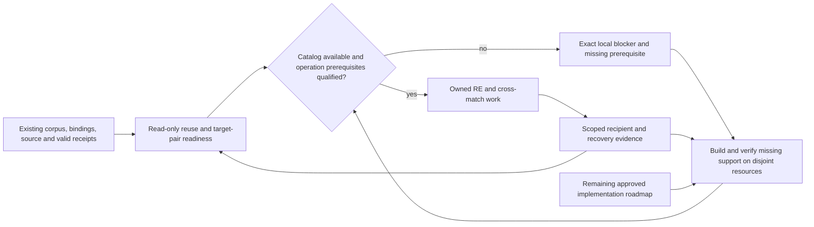

# September 18–21 design program progress and usable live track

The [September 18–21 design scope](2026-09-27-weekend-design-scope.md) is the
baseline this living plan and `STRATEGY.md` represent. It includes the full
[September 21 portable-substrate plan](2026-09-21-portable-signatures-codecaves-generic-plan.md),
its Phases 0–15 and named units, the distributed design, workstation requirements,
brainstorm decisions and diagrams. The [September 22 design package](2026-09-22-design-package.md)
and [autonomous capability roadmap](2026-09-22-autonomous-capability-product-roadmap.md)
add later refinements and adopted capabilities. This ledger reports implementation
state and puts useful RE/cross-match work alongside supporting implementation. It does not
create another recovery order, acceptance authority or scheduler. `STRATEGY.md`,
the [session obligation audit](2026-09-22-session-obligation-audit.md), its
110-item register, `FRONTEND_INTENT.md` and `DELIVERY_STATUS.md` retain those roles.

The weekend requirements remain in scope even when the September 22 summary omits
them. Later explicit user changes and conflict resolutions refine that baseline;
document date alone never supersedes it. Historical completion labels remain
non-current evidence and must be qualified before an implementation claim.
For each subsequent implementation slice, identify its original plan units and
affected diagram views, preserve their remaining acceptance requirements, and
record explicit supersessions. Source, installed-artifact and live outcomes
remain separate; closing a slice does not close its parent weekend workstream.

## Weekend workstreams retained in full

| Required workstream | Detailed plan | Current delivery interpretation |
|---|---|---|
| Deterministic signatures, ABI, cave plans, divergence and format/platform seams | Portable plan Phases 0–7, 10–11 | Preserve every original unit and its acceptance; narrow later increments do not close the whole substrate |
| Every entity, field/layout, data root and ordered accessor | Portable plan Phases 8–9 | Function matching alone does not satisfy entity or data-access coverage |
| Complete export bundle: hookpack/v2, Lua, headers and readiness/divergence evidence | Portable plan Phase 12 | Required product output, not an optional runtime example |
| Exhaustive applicable fallback ladders and learn-build feedback | Portable plan Phase 13, ladders A–F | Keep structured residue and ambiguity; bounded attempts do not justify silently dropping applicable methods |
| Autonomous visible workspace in both surfaces | Portable plan Phase 14; September 20–21 workstation/consolidated design | Automatic eligible project admission, scoped pause/resume, actual work, readiness/review/residue and starvation/hang views remain required |
| Reusable compute/state substrate and grid-of-one | Portable plan Phase 15; distributed-compute design | Required architecture and adapters; fleet expansion follows local qualification without blocking safe existing local RE |
| Recovery and original-code runtime reuse | STRATEGY and consolidated design; subsequent M0–M7 extensions | Advance both on their own prerequisites; whole-image source and live runtime claims keep separate acceptance |

The [weekend scope index](2026-09-27-weekend-design-scope.md) links the requirement
ledger, goal, audits, risks, brainstorm synthesis and diagram sources. The 110 later
contract rows do not replace the full weekend D/U unit set. A full per-unit current
implementation requalification remains open; this scope correction is not a claim
that historical checked units pass against today's checkout or installed package.
The [unit delivery ledger](2026-09-27-weekend-unit-delivery.json) provides 193
source-qualified records with definition/acceptance spans: 190 required, one
withdrawn and two absorbed. Its initial source/test/installed/live states are
unverified, with remaining work and dependencies explicitly unassessed. This
closes the identifier-accounting gap, not the per-unit qualification work, and
does not imply 193 implementations are absent.
The first scoped updates record D1's inspected ordering mechanisms, D3's accepted
`.16` destination/basis repair, and D9's `.15` backfill plus `.16` cascade cases as
partial evidence. Their broader acceptance remains open; no original unit is marked
complete from these supporting observations.
Frontend qualification must include all F01–F28, U104–U112, the workstation's eight
tasks and both guide/donor capability inventories linked by that index. The recent
projection/evidence increments cover only a small part of that workspace contract.

## Highest priority: useful RE and cross-matching alongside implementation

The user's latest directive makes this an explicit two-track delivery goal. Keep
the complete weekend unit set, later 110-item register and M0–M7 scope; prioritize a safely runnable
reverse-engineering/cross-build matching lane and build its missing support in
parallel. Completion of every reliability or UI feature is not a prerequisite for
all recovery work. Each operation still needs its own qualified inputs, resource
ownership and acceptance route.

| Priority | Operational track | Supporting implementation track |
|---|---|---|
| 1 | Reconcile existing 8080 ownership, corpus/program bindings, valid analysis, recovered source and receipts; select one concrete target/build pair | Use the latest qualified package (`.16`), preserving the individual `.14` ownership, `.15` admission and `.16` matching proof boundaries; keep truthful status/blocked reasons visible |
| 2 | Resume eligible catalog-owned RE/identity/matching work using unchanged valid evidence; independent targets may proceed on disjoint owned resources | Implement only the missing admission, provider, binding or comparison prerequisite that prevents the next useful operation |
| 3 | Compile and compare candidates for compatible recipients, retaining source, identity, ABI and byte claims separately | Expand durable ownership/reconciliation, shared budgets/circuits and recipient-specific acceptance from observed gaps |
| 4 | Keep advancing the per-target recovery ladder and corpus roll-up while runtime reuse progresses independently | Deliver the remainder of M0–M7 incrementally without making unrelated milestones global blockers |

A fresh 2026-09-27 listener check still found no 8080 service. Catalog operations
therefore remain blocked pending ownership/availability diagnosis; no alternate
server or direct recovery CLI is substituted. Read-only reuse/binding preparation
and disjoint implementation work continue. The active goal includes every remaining
directive, not just this first operational lane. Update this ledger with the exact
selected target/build pair and missing prerequisites when the readiness audit lands.

The bounded readiness audit now selects existing GOG K1 → Amazon K1 evidence in
the NVMe corpus (binary IDs 8 → 6, qualified by exact paths and image digests,
not those numeric IDs alone). The first read-only review, match `1008017`, now
corroborates all 107/101 cached instruction bytes against uniquely mapped original
image spans and bounded independent disassembly. Contradictory observable body
operations support a rejection proposal for this weak one-to-one candidate;
the durable row still says `review`. No new match run, identity
write or source propagation has been submitted. The two suspicious recovered-source
logical/name joins now have bounded physical corroboration, detailed below;
source lineage and producer acceptance remain open. Existing Ghidra and unrelated
Wine owners remain untouched. The report is retained at
`/home/brunner56/Documents/AgentDecompile-re-crossmatch-readiness-2026-09-27.md`.
The subsequent byte-backed packet is
`/home/brunner56/Documents/AgentDecompile-crossmatch-1008017-evidence.md`; it corrects
the cache lookup keys to bare program names, distinct from corpus `/K1/…` paths.
Before any future catalog review mutation, recheck the directed pair, row version,
status and image/span identities. This evidence does not identify the correct
alternate counterpart or prove recovered-source parity.

### Continuation session 7a1c2b (2026-09-27, late morning)

#### Branch consolidation follow-up (September 28, 2026 UTC)

The resumed branch audit started at `666cfac` (19 local commits after `8b4706d`).
All 127 changed Python files parsed; this is source syntax evidence only. The
previous verification checkout's `pytest.log` was empty, so no test pass is claimed.
The audit found that committed cross-place/catalog paths imported an untracked
`native_verify_contract.py`; `9fe9d96` retains that module and its existing ownership
tests. Native execution remains unqualified in this continuation.

`fc4ca10` ports the multiplayer investigation from `0b7305b`, excluding its
worktree-specific environment file. Evidence remains historical and reused; JSON
and relative documentation links were checked without recovery or game execution.

The CLI integration worktree has another active owner. Its moving tip was not
merged. The inventory covers 115 local/cached origin refs, 22 already ancestors
of the audit baseline. Older-branch patch-equivalence checks repeatedly timed out
under disk I/O stalls and remain unresolved. No branch deletion, push, PR action,
filesystem test, build, server start or recovery action occurred. Port 8080 had no
listener. Installed `.16`/`.18` acceptance is unchanged by this source audit.

Machine-local report and partial inventory:
`/home/brunner56/agentdecompile-deliverables/2026-09-28-branch-consolidation/report.md`.

Evidence lives under `/home/brunner56/agentdecompile-deliverables/`. Each packet has
its own report, capture script and checksums. The results fall into five evidence
classes.

**Live and whole-image: none.** 8080 still has no owner, and no catalog operation ran.
The diagnosis (`2026-09-27-continuation-session-7a1c2b/8080-diagnosis.md`)
found these facts:
- The kotorxid watchdog serves 8791, 8173 and 3000, not 8080.
- The live corpus DB is `~/agentdecompile-nvme/agentdecompile_projects/db/kotorxid.sqlite`.
- A second, clean checkout at `~/agentdecompile-nvme/AgentDecompile` (e557468) is the
  likely historical serving root. Today's MyBook source work is not in it.

The host has also regressed since earlier checks:
- `/home/linuxbrew` is gone, and objdump went with it.
- `/usr/bin/python3` is 3.12.
- There is no clang or Wine on PATH.
- A stray `pathlib.py` in the 3.14 user site-packages shadows the standard library.

**Installed: `.16` remains the latest accepted artifact.** The user authorized ending
the Codex `.17` run, and it was terminated. Its log already showed two failures in
`test_byteexact_target_observation.py`, so `.17` is not accepted. An independent review
confirmed four things:
- The eight overlay members hash-match.
- No match-review or frontend content leaked into the package.
- `task-only.diff` is identical in both places.
- The containment diff is present.

The review also found a `..` path bug in `cross_place_checkpoint.py` that can
permanently strand the publication index. The package owner is fixing the failures
and that bug for a `.18` candidate.

**Synthetic, staged source.** Every item below ran on the `.16` wheel plus an
overlay, with module origins asserted.
- **Match-review backend and migrations together:** 90 passed, 3 skipped. The skips
  are clang-only. This supersedes the old 18-case backend gate. The catalog tests ran
  against the `.16` CLI, not the checkout's changed CLI.
- **Match-review frontend:** 20 passed, and `tsc` now reports 0 errors.
  - Decisions carry the backend token and selection.
  - HTTP 202 is shown as pending, and a result appears only when the job is terminal.
  - Every surface pages by match ID. Retired score cursors are refused by name.
  - The mounted-consumer check is blocked on 8080, and the Vite bundle needs
    regeneration.
- **P1.4 recipient-specific acceptance** (`recipient_acceptance.py`): 15 passed on a
  controller rerun. The agent's own "green" artifacts were actually a mutation run.
  Order independence is covered at derivation level only.
- **P2 COFF relocation roundtrip and move check** (`coff_fixup_roundtrip.py`): 17
  passed.
- **P2-f recovered-project manifest and validator** (`recovered_project_manifest.py`):
  34 passed.
- **G4 lifecycle-owner record and fail-closed reconciliation** (`runtime_lifecycle.py`):
  18 passed.

None of these new modules has a consumer yet. The proposed integration diffs are kept
in their packets and have not been applied.

**Read-only RE.** The GOG K1 → Amazon K1 member-assignment study compared calling
contracts: receiver M or C, return M or nothing, and list offsets.
- GOG 0x00447fa0 matches Amazon 0x0040ceb0.
- Amazon 0x00412b50 is a wrapper on the containing object. It runs the same core but
  forms C+0x10 and returns nothing.
- GOG 0x0046e240 does not correspond to 0x00412b50.

Rows 1004010 (0.99) and 1004712 (0.98) score high only because the v1
struct/mnemonic channels cannot see calling contracts. The ties were stored as
`review` with no recorded alternative. A contract-aware matcher feature is being
built as its own module. Every match row stays unaccepted.

**Findings routed elsewhere:**
- P1.3 reccmp/ReAgent is blocked beyond 8080. There is no execution action, no
  original/rebuild/PDB set, and neither tool is installed. A request packet is ready.
- M3–M5 inventory: the F12 console, the harness and the hook pack each use their own
  operation IDs. Undo, Copy as Lua, an owned pause and checkpoint identity do not
  exist. The next offline slices are in KotorPhasor, where one writer holds the
  harness tree.
- The proposed G3 session-scoped ownership patch does not apply to the KotorPhasor
  peer's current base. Their writer will port its intent later.

Two further read-only evidence results now advance that selected pair:

- Historical `CGameEffect::SetObjectID` row logical ID 12850 has complete recorded
  machine bytes equal to GOG `0x005036f0`, whose current logical ID is 12831.
  Historical `CAppManager::GetObjectTableManager` logical ID 12869 maps in the same
  way to `0x00401060`, current logical ID 12850. Address-specific cache/source
  semantics corroborate the association. This supports stale logical associations,
  without establishing their cause or byte-verified source. Both original recorded
  source paths are missing. A follow-up located two historical mirror copies of
  each source, all byte-identical to the surviving NVMe candidates, and August 21
  coverage assertions with matching physical bytes. Those rows omit source/target
  digests and compiler/object/compare bindings; the bounded search found no exact
  producer receipt. Preserve candidate status and seek fresh qualified acceptance
  unless a new precise historical receipt locator is found. A distinct same-basename
  SetObjectID assembly file was ruled out.
  Evidence: `/home/brunner56/Documents/AgentDecompile-recovered-source-binding-evidence-2026-09-27.md`.
- Match `1004010`, GOG `0x00447fa0` → Amazon `0x00412b50`, has score 0.9902 but zero
  margin. Complete cached instruction bytes match both original image spans, with
  independent bounded disassembly. Similar pointer-registration behavior has
  different receiver offsets (`this` versus `this + 0x10`) and return-register
  behavior. This is a variant/layout-sensitive hypothesis, not proven unique
  identity or interchangeable source. Retain review; no row was changed.
  Evidence: `/home/brunner56/Documents/AgentDecompile-crossmatch-1004010-evidence.md`.

These packets are useful RE progress alongside implementation; none creates
catalog acceptance, source compilation credit or runtime permission. The specific
next evidence is independent source-lineage/producer proof for the two historical
rows, and receiver/field/call-site/alternative-match corroboration for `1004010`.

A subsequent read-only neighborhood capture corroborated the caller's four direct
callee destinations from original E8 displacements and retained call edges, then
compared cached instructions with original image bytes and bounded disassembly.
Two GOG callee listings are sparse: their recorded sizes count 68/67 instruction
bytes across 71/70-byte bounding spans. One omitted range is the actual stack
adjustment after a call. The two Amazon listings cover their captured spans.
Listed-byte equality therefore cannot be promoted to complete contiguous coverage;
cache consumers must preserve missing ranges and distinguish body-byte counts from
image extents. This directly grounds portable-plan **U6b**, whose definition already
requires raw-image, decode-bounded extents rather than Ghidra body partitions.
It also informs variant evidence; it is not a completed cache-consumer or U6b repair.
The retained same-pair/run alternatives include a second GOG source, match
`1004712`, for the same Amazon destination. A subsequent capture corroborated all
73 competitor bytes against the original image and independently disassembled
them (handle `63047`, exit 0). Both GOG candidates call the same two routines,
but the competitor's pointed-object list sits at +0 while the original candidate
and Amazon use +4. This strengthens the original candidate's local layout evidence
without resolving Amazon's receiver+0x10 and return-contract differences or
proving uniqueness. `1004010` remains in review. Evidence and
the bounded findings are retained in
`/home/brunner56/agentdecompile-deliverables/2026-09-27-crossmatch-neighborhood/`.
Capture handle `55258` exited 0; the prior capture's noncontiguous-cache refusal
and source are retained. No corpus rows or recovery state changed.
Independent packet review approved these scoped observations and recomputed the
span hashes, gaps and direct-call destinations; it did not recapture the live
files or databases. Sampled before/after row equality does not exclude intervening
ABA changes or establish a coherent multi-database snapshot.

The subsequent caller investigation found actual GOG caller-side receiver
adjustments of +0x10 at callsites `0x00423571` and `0x004237a2`, corroborated
against original bytes. Amazon's candidate performs the same offset adjustment
inside its own body. This supports investigating an adjustment moved across the
call boundary; it does not prove the containing type, wrapper identity or match.
Two sampled GOG callsites also overwrite the callee's returned EAX, narrowing
where the return-contract difference may matter. The exact Amazon endpoint query
found no retained incoming call edges, which is missing evidence rather than proof
that no executable calls exist. The three-lowest-caller selection and raw evidence
are retained in `/home/brunner56/agentdecompile-deliverables/receiver-callers/`.

The serving boundary remains specific: no 8080 listener, and the historical NVMe
runtime differs from the accepted canonical/package source. Locate and reconcile
the intended execution root and DB/cache/program bindings before catalog mutation.
Do not convert that blocker into blanket reanalysis or a new server/CLI route.

## Immediate delivery: useful and continuously updating

### Accepted admission; active implementation: cross-place continuation

**Current state:** bounded candidate admission is accepted in `.15`; destination
match isolation and its basis revision are accepted in `.16`, the latest qualified
artifact. Automatic continuation beyond the 128-key process bound is being
implemented and reviewed. Its source changes have not passed installed or live
qualification. The paragraphs below retain the earlier repair history; their
failed or pending states do not override the final accepted receipts.

The active continuation change covers durable attempt reservations, exact
source/receipt publication enrollment, fair finite inventory epochs, resumable
large-tree import, inherited physical output ownership through compiler descendants,
and same-job generation transitions after authoritative session clearance. Current
review findings include the rejected directory-cookie starvation case, directory
sync failure/retry handling, and strict checkpoint state/deadline validation. Each
requires product evidence before this work can be accepted; static parsing and
design review alone are insufficient. The detailed requirements and diagrams are
in the [continuation contract](2026-09-22-task-acceptance-and-continuation-design.md#cross-place-admission-and-recipient-candidates).

The first frozen journal gate passed **11 product cases in 46.11 seconds** on
September 27 (terminal handle `82368`, exit 0). The isolated environment used the
accepted `.16` wheel plus seven exact source overlays; all nine observed product
module origins were inside that environment, and the loaded checkpoint/admission
hashes matched the frozen inputs. Evidence is retained in
`/home/brunner56/cross-place-continuation-evidence/journal-run1/` (`pytest.log`,
`result.json`, `origins.json`, `input-hashes.json`). A preceding runner startup
failure lacked pytest and executed no cases; its script and result remain separate.
The passing cases cover interrupted paired publication, external-conflict
preservation, event/sequence/latest-binding recovery, 129-entry two-chunk inventory
import, and changed or missing journal input refusal. This is source-overlay
protocol evidence, not a newly built installed artifact, physical storage-failure
proof, native 129-candidate qualification, session-lifetime acceptance or live RE.
Those broader continuation gates remain open.

A separate frozen-source gate subsequently passed **15 product cases in 7.26
seconds** (terminal handle `61723`, exit 0): 13 checkpoint-integrity cases and two
receipt-context/finite-epoch cases. It used a private copy of the native gate's
frozen source overlays, with nine isolated product origins and exact matching
checkpoint/admission hashes. Evidence is retained in
`/home/brunner56/cross-place-continuation-evidence/integrity-context-run1/`.
This establishes the tested failed-sync retry, corrupted-record refusal,
receipt-specific cursor and sealed-epoch behavior. It does not add native compiler,
catalog restoration, live-service or physical storage-failure acceptance. The
native 129-recipient gate is a distinct run and must reach its own terminal result.

The catalog lifecycle snapshot `d61f70df` passed a separate **14-case source-overlay
gate in 25.08 seconds** (terminal handle `65103`, exit 0). Evidence is retained in
`/home/brunner56/cross-place-continuation-evidence/lifecycle-run1/`; all 211 observed
product origins were isolated and the loaded jobs hash matched the frozen input.
Three cases exercised real tiny Python children through the executor/session
observer; the other eleven used synthetic records, mocked process observations or
local lock checks. Independent review still requires stop-aware reader shutdown
when a survivor holds an output pipe and full restored Scan source/path/device/inode
validation. The passing cases do not close those gaps or establish actual catalog
native rollover. Both repairs were assigned before final lifecycle acceptance.

The subsequent lifecycle repair `2439f1b5` passed **19 cases in 16.65 seconds**
(terminal handle `61101`, exit 0), with 211 isolated product origins and the exact
frozen jobs hash. Evidence is retained in
`/home/brunner56/cross-place-continuation-evidence/lifecycle-run2/`. The selection
adds four source-identity refusals and an actual silent-survivor pipe case.
Independent review found the two scoped product findings addressed; it still
requires hardening the survivor fixture's own readiness/cleanup handoff against
partial-marker failure. The successful run does not prove that untested failure
path. Preserve both runs and complete the fixture correction before further
execution or a final lifecycle qualification claim.

The test-only readiness repair was then independently cleared for a controlled
run. Its complete/malformed/missing readiness selection passed **3 cases in 11.05
seconds** (terminal handle `97221`, exit 0), retaining the same product jobs hash
`2439f1b5`. Evidence is in
`/home/brunner56/cross-place-continuation-evidence/lifecycle-run3/`. These three
cases replace and extend the earlier survivor fixture; do not report the two runs
as 22 distinct lifecycle requirements. Independent final evidence review approved
the tested source-overlay lifecycle scope, corroborating all 211 product origins
in the full run and 43 in the focused run, their hashes and both terminal results.
The disposition is retained in
`/home/brunner56/cross-place-continuation-evidence/lifecycle-review.md`.
The compiler-descendant result below subsequently qualifies its separate frozen
scope. Actual native catalog rollover, new installed-artifact and live qualification
remain open.

The frozen native capacity gate reached its authoritative terminal result:
**1 case passed in 1347.60 seconds** (handle `2230`, exit 0). It compiled candidates
for 129 physically distinct recipient PE images, with 129 distinct native compiler
invocations and retained object evidence. The guarded generations returned `75`
then `0`, crossing the production 128-key bound; unchanged replay reported 129
idempotent results and created no additional workspaces. Independent review checked
the retained manifests, object hashes, recipient identities, frozen inputs and
observed child execution evidence. Artifacts are retained under
`/home/brunner56/cross-place-continuation-evidence/`, including
`native129-terminal.json` and `standalone-capacity-review.md`. This qualifies
standalone guarded continuation on source hash `2bcabdf7`; it does not establish
native rollover through the catalog or general recipient compatibility.

A later standalone lifecycle repair passed **4 cases in 2.55 seconds** (handle
`25371`, exit 0), with exact source hash `6baa9aea` and isolated module origins.
It covers cancellation before spawn, cleanup after an owner callback fails,
bounded pipe-reader shutdown and cancellation-aware watch delay. The pipe fixture
retains a private write endpoint; it does not simulate a surviving compiler.
Independent review approved this bounded scope in the same review report.
Evidence is retained in
`/home/brunner56/cross-place-continuation-evidence/standalone-run1/`.
These four cases and the native capacity case exercised different frozen source
versions; neither substitutes for integrated qualification of the final changes.

The separate compiler-descendant gate passed **3 cases in 13.03 seconds** (handle
`93635`, exit 0). It observed a real Clang compiler retaining the inherited output
lock after both Python supervisors exited, refused a competing owner until the
compiler completed, and exercised early worker/compiler identity-handoff failures.
The terminal receipt records executable/argument/descriptor evidence and all eight
listed process identities absent afterward. Two additional stdout-only identities
from deliberately failed marker handoffs are covered by the passing cleanup
assertions, not by that receipt's identity list. Evidence is retained in
`/home/brunner56/cross-place-continuation-evidence/compiler3-terminal.json` and its
associated frozen configuration and log. Independent evidence review approved the
scoped result in `compiler-crash-fixture-review.md`, including the retained native
object and 26 isolated product origins. These cases establish one actual compiler
survival result and two injected cleanup results on that frozen configuration;
they do not qualify later source revisions, an installed package or live gameplay.

Two compatibility repairs remain in progress before integrated qualification:
preserve the exact explicit source directory in watch mode, and retain complete
multi-generation result counts and rows through a bounded, integrity-checked report
transport. Small one-shot results must remain one complete JSON response; larger
results must explicitly identify omitted inline rows and the complete artifact.
Artifact contents never replace actual process/session clearance. Adapt existing
watch fixtures to finite worker generations while preserving their cancellation,
concurrent-writer, receipt-refresh and output-ownership assertions. Complete the
relevant regression, installed-artifact and independent-review gates afterward.

Pre-execution review of the compatibility changes found three additional gaps:
restored jobs still used basename lookup, the new explicit source parameter was
not frozen against the supplied execution root, and displayed inline results were
not checked against the hashed report. Source repairs now share the selector,
normalize that input and validate the full artifact and bounded inline page before
aggregation. A focused gate ended with **22 passed and 3 failed in 177.30 seconds**
(handle `31980`, exit 1), so integrated qualification remains open. Nine report
transport cases and the guarded native negative replay passed within that failing
selection. The three failures identified missing selected-receipt path/hash in the
durable qualification key, manifest import incorrectly requiring an external source
to reside under the output directory, and a lease-contention fixture mistakenly
using the same reentrant owner thread. Repairs must preserve exact receipt/source
identity and prove contention from an independent owner. A separately identified
publication durability gap also remains open: creating staged entries and renaming
published files require an uncached directory fsync at those mutation boundaries.
Successful ancestor-identity caching cannot stand in for those new barriers.
Preserve the completed earlier snapshots and qualify the revised integrated source
before building or accepting its installed artifact.

The repaired focused gate then ended with **16 passed and 1 failed in 71.85
seconds** (handle `55989`, exit 1). The prior three failures were resolved; the
remaining new restoration fixture expected `failed` where the undispatched
cancellation contract returns `cancelled` with ownership released. Its expectation
was corrected without changing product behavior. A combined continuation source
gate now runs under handle `13928` against explicit frozen inputs, including the
full relevant admission routes and bounded large-inventory checks. Its frozen bulk
module predates the separate extent repair below; final integrated qualification
must include that reviewed change. Neither partial results nor this running gate
qualify a release.

### Parallel implementation from actual RE findings

The sparse-cache audit traced an actual defective consumer: `load_asm_fallback`
passed counted cache body bytes to contiguous raw-image slicing in both ASM seeding
and failed-C fallback. For the observed GOG 68/71 and 67/70 records this would omit
the entire terminal three-byte return. This finding does not prove those historical
outputs were generated or accepted. The repair introduces one shared, lazy extent
qualification path: exact original-image digest/mapping, bounded selected cache
bytes, independent raw-byte decoding and closed direct control flow. It retains
raw gaps and the return; unsupported authority remains explicitly unavailable.

The first extent gate passed **10 cases in 0.74 seconds** (handle `91065`, exit 0)
and received scoped independent source/evidence review. A subsequent performance
repair replaced eager loading of all assembly strings with bounded indexed reads
for the selected function. That snapshot passed **11 cases in 1.13 seconds**
(handle `38427`, exit 0). Evidence lives in
`/home/brunner56/cache-extent-evidence/`. These use actual bounded objdump on private
synthetic PE images and check both consumers; compilation is mocked. They establish
bounded original-byte substrate behavior, not relocation correctness, whole-image
recovery, automatic repair of historical seeds, full U6b completion or a new
installed release. The later performance snapshot awaits its scoped review.

**Ruling:** advance the independent match-review core while continuation packaging
and executable analysis proceed — the user explicitly requested maximum parallel
delivery, and these new modules have no overlapping implementation owner. Keep the
core out of the continuation package and unregistered until its migration,
selection/admission and route contracts qualify; the cost of a wrong interface
choice is local rework, not a live corpus mutation.

The new `match_review.py` and `match_review_schema.py` implement coherent observed
basis tokens, per-match/per-binary ABA revisions, strict bounded decisions and
atomic status-plus-audit updates. An initial isolated core gate passed **18 cases
in 13.14 seconds** (handle `37183`, exit 0). Independent review found integer-range
and rollback-cleanup gaps; their repair, plus streaming migration backfill, passed
**21 cases in 12.32 seconds** (handle `41391`, exit 0). Evidence is retained in
`/home/brunner56/match-review-core1-y__hv_n5/` and
`/home/brunner56/match-review-core2-_6m8ojtk/`. These are isolated source modules
with namespace scaffolding and synthetic databases, not an installed product.
Migration registration, actual selected-context/admission guards, managed restore
incarnation rotation, catalog/HTTP parity and both mounted consumers remain open.
The core supports portable-plan U17/U106/U109 without completing those units.

#### Admission repair history and accepted evidence

The September 27 source audit traced the catalog's cross-place action through
standalone placement, watch mode and the direct `ghidra_bulk` hook. Address-only
compile/byteexact receipt sets admit subsequently edited source; the existing writer
can replace a recipient assembly floor. Logical identity alone does not qualify
recipient variant/ABI/layout compatibility. Existing target-local recovery queue
checks limit this finding: the copy does not automatically become accepted recovery.
The historical recovered-source name joins are a separate investigation, not the
demonstrated cause of this defect.

Implementation was assigned against the existing
[candidate admission contract](2026-09-22-task-acceptance-and-continuation-design.md#cross-place-admission-and-recipient-candidates).
The task covers bound producer evidence, one shared admission path for all three
callers, refreshed watch dependencies, separate immutable candidate publication,
and actual output ownership. Its positive gate is current compatible candidate
distribution; its negative gates include edited source, stale dependencies,
incompatible recipients and preservation of accepted source/assembly floors.
At that initial stage, source implementation, independent review and installed qualification were pending;
no historical receipt or source-audit finding is promoted to a fresh test result.
External task evidence is maintained in
`/home/brunner56/Documents/AgentDecompile-cross-place-admission-brief.md` and
`/home/brunner56/Documents/AgentDecompile-reuse-admission-audit.md`.

The preflight found no existing general implementation-variant/ABI/layout authority.
The implementation therefore includes a first explicitly bounded provider for
self-contained scalar constant-return PE functions, using fresh actual compilation
and independently checked donor/recipient machine behavior. This provider must not
promote labels or close general compatibility. Broader sources retain useful
unadmitted proposals and named missing-evidence/provider reasons; the complete
weekend variant, field/layout, callee and recipient-acceptance requirements remain
open. A caller-supplied compatibility verdict cannot authorize publication.

Initial source fixtures passed 47 cases with one instrumentation failure; that
fixture was corrected. Independent review found dependency/evidence integrity and
database/restoration gaps, addressed in the frozen first repair at source level.
An earlier broader verification run was interrupted after required source findings
superseded that snapshot, and is not passing evidence. Installed qualification
had not started. The next repair was necessary for tandem work: an unlimited
watch must not reserve the database indefinitely and starve matching producers.
It must capture only the relevant coherent snapshot, close the reader before
compile/wait, retain candidate-output ownership, and publish observed-basis
proposals requiring current recipient acceptance. Repeated unchanged negative
attempts also need bounded retries and scratch. Source verification and both
scoped reviews must qualify that revised contract before a new package is accepted.

The second repaired snapshot completed isolated source verification with **194
passed and 3 failed** (222.64 seconds). Its new tests exercised a real guarded watch
alongside a catalog logical-build, coherent capture and actual byteexact producer;
this is synthetic product evidence, not live-corpus qualification. One failing
determinism fixture supplied a non-SQLite placeholder; two existing executor
fixtures lacked the staged import path in ordinary Python children. Independently,
both reviewers required source-address-local index capture (unrelated rows then
exhausted the query bound), and execution review required an unconditional attempt
ceiling across allocation/write/revalidation failures. A third focused repair
then remained in progress; no `.15` artifact had yet been accepted. The second run and frozen reviews remain
retained under `/home/brunner56/cross-place-admission-evidence/`.

Both independent reviewers approved the third repair at source level. Its focused
isolated source run completed with **24 passed** in 272.63 seconds, including the
three previously failing cases; one unknown-marker warning remains. Parent and
ordinary-child origin guards recorded staged imports. An additional real native
negative/replay fixture passed separately. The `.15` artifact then passed **203
installed checks** in 289.00 seconds and received independent final bounded
approval; the [receipt](../verification/2026-09-27-cross-place-admission.md)
records artifact lineage and corrected actual/synthetic evidence classifications.
A controller/reviewer audit found a
separate continuation gap: after 128 distinct qualification keys, the current
process refuses new keys, but an unlimited watch neither exits nor advances a
resumable chunk. Existing valid cached keys still work. This bounds resource use
but does **not** provide continuous corpus-scale progress. A `.15` qualification
may establish only the bounded admission safety increment; the cross-place task
remains open. Its next required increment precedes match-review work: a terminal
budget-exhausted checkpoint, durable cursor/chunk and retained per-basis failure
budgets, followed by catalog-owned continuation after session clearance. Restarting
from the first sorted source or evicting negative state would repeat/starve work
and does not satisfy this requirement.

Before that larger continuation change, the first per-unit source audit found a
small correctness prerequisite in portable-plan D3: conflict demotion in
`bind_identities` omitted the destination binary from its UPDATE predicate. A loser
in one build could therefore demote a different build's same-address match. A focused
repair is accepted in `.16`, with 32 affected installed checks and independent
artifact approval. The [D3 receipt](../verification/2026-09-27-d3-destination-scope.md)
records its explicit algorithm-basis revision and old-basis export refusal, without
claiming universal direct-mutator enforcement. This does not repair or rebaseline
the live corpus. D1 and D9 retain broader branch/operational qualification work;
selected `.16` cascade cases are now recorded in their scoped evidence. Audit evidence:
`/home/brunner56/Documents/AgentDecompile-D1-D3-D9-source-qualification.md`.

### Queued repair: match-review freshness

Original scope: portable-plan U17, U106 and U109, plus current-version acceptance.
This slice must preserve optional review overrides and cannot make human triage a
global progress gate. The mounted-consumer preflight found additional concrete
defects: active static single review omits the required match ID and shows success
before checking the response; batch uses an undefined API property and a legacy row
selector. The mounted React WorkstationApp has no review queue; changing unmounted
Surfaces.Review cannot satisfy that consumer. The next slice therefore includes
shared coherent reads, atomic decision/audit, catalog exposure and both actual
consumer paths. Its external acceptance brief is
`/home/brunner56/Documents/AgentDecompile-match-review-acceptance-brief.md`;
the source trace is `AgentDecompile-match-review-integration-preflight.md` in the
same directory. Full U17 relation/evidence and Compare workspace scope remains open.

The subsequent execution map is retained at
`/home/brunner56/cross-place-continuation-evidence/match-review-next-map.md`.
It identifies the existing corpus-selection route as an activation integration
point, without claiming an existing managed restore lifecycle. The repair will use
the forward migration registry, a shared review service, and the same admitted
catalog mutation path for HTTP and agent consumers. A submitted job is pending
until its decision result is terminal; both mounted consumers must reflect that
distinction. Changes to `dashboard/actions/jobs.py` wait for the current
continuation owner's coherent freeze and explicit handoff. The map is a source-
grounded implementation dependency plan, not implementation or runtime evidence.

The next review-workflow repair is also concrete: current single/batch match-decision
routes and both UI submitters use match IDs without binding the observed database,
run, directed pair and evidence. Recomputed rows can reuse an ID or change its
basis while remaining in review. The required repair is a shared observed-basis
token and atomic stale refusal for both routes/consumers, including whole-batch
precondition handling and selected-database identity. This source-grounded scenario
is recorded in `/home/brunner56/Documents/AgentDecompile-match-review-freshness-audit.md`;
it has not been reproduced or fixed. Catalog exposure must be established before
claiming an agent-operable review path. The retained RE packets must not be submitted
by ID alone. Cross-place repair is the current source task; this requirement remains
queued rather than becoming an untracked caveat.

### Weekend Phase 12 qualification: U87–U90 remain open

The bounded September 27 source/consumer audit qualifies these original portable-plan
units separately from later contract identifiers:

| Portable-plan unit | Current source evidence | Remaining required outcome |
|---|---|---|
| U87 | Deterministic v1 hook-pack writer and existing basis checks; no aggregate bundle command located | Fixed multi-exporter order, content-addressed artifact tree, complete `bundle.json` and all mandatory artifact verification/publication gates |
| U88 | No pack-v2-only Lua generator/command located | Require-able address-free module with the declared entity/accessor/call/hook helpers and structured unresolved-operation failures |
| U89 | Existing per-build header producer strips layout assertions; acquisition flattens pointer/composite/union information | Exact layouts, retained size checks, typed ABI-aware declarations and build/toolchain/basis manifest through that existing producer path |
| U90 | No readiness/v1 coverage projection/command located | Complete entity-by-build locator coverage, separate observed status, environment/adapter limitations and human-readable capability readiness |

The actual KotorPhasor consumer currently reads v1 and bounded operation roles;
changing the format label would not implement v2. The v1 export command also needs
qualification of its output ownership. These are current source findings from
`/home/brunner56/Documents/AgentDecompile-weekend-export-bundle-readiness.md`,
not executed acceptance results. The full Phase 12 output remains required while
cross-place and independent useful RE work advance; none of these rows is waived.

The first usable workflow is:

> Open an existing analyzed target, inspect its recorded source and evidence, see
> the exact current operation or blocked reason, the next automatic action, budget
> and freshness, then inspect the receipt when accepted work advances.

Build this first on the required static `/dashboard`, then qualify packaged `/react/`
against the same backend state. Existing code already polls preparations every two
seconds and jobs every 1.5 seconds and persists job/stage/ownership facts. Extend that
path instead of introducing another server or progress store.
Entity evidence already has a shared activity SSE/cursor/replay route with HTTP
fallback. Extend that route for target/candidate-bound claims and receipt links;
the preparation poll and entity stream have different roles. Passive evidence
hydration must avoid function-detail's lazy observation-admission path. Recorded
receipt JSON cannot recreate trusted process-local contribution observations.

| Step | Deliverable | Acceptance needed |
|---|---|---|
| L0.1 Activation identity | Resolve the intended 8080 owner, cwd, loaded module, revision, catalog root and state root | Same process/state identity before and after supported update; when no listener exists, record the blocker and do not substitute another port |
| L0.2 Truthful projection | One bounded versioned view of target identity, execution state, accepted claim scope, receipts, measured units, freshness, retry/wake reason, resource ownership and admission spending | Read-only hydration never admits recovery; execution completion and accepted capability remain separate |
| L0.3 Static consumer | Show the projection, stale/disconnected state, timestamps, receipts and exact next action in `/dashboard` | Retained data always shows observation time and unknown freshness after disconnect |
| L0.4 React consumer | Show the same fields and semantics in packaged `/react/` | Field/state parity against the same backend response; wall-clock limits remain distinct from action-admission allocation |
| L0.5 Identity-safe updates | Preserve exact corpus/build/address through reload, history navigation and rapid target switches | Late response cannot redraw another target; browsing sends no recovery POST |
| L0.6 Live qualification | Observe one existing target, source/receipt and retained or owned work record; disconnect/reconnect; switch targets; reload | Actual existing 8080 browser at desktop and 598x912, unchanged service/state identity, no fabricated progress |

The current preflight found no 8080 listener, so L0.1 and L0.6 have no fresh live
receipt. Source preparation, projection tests and package review may proceed, while
activation remains a separately reported boundary. Do not use `systemctl`, start an
alternate port or replace an unknown owner.

## Current accounting

The [preparation freshness/admission slice](../verification/2026-09-27-live-projection.md)
now implements part of L0.2–L0.5 in both frontends. Twelve focused tests, TypeScript,
static syntax and an isolated production build passed after independent review.
The prepared asset archive has source hashes and recorded dependency versions.
It has not been activated. The subsequent scoped evidence increment below adds
historical receipt links; current accepted-claim projection and live/browser
qualification remain open. This changes useful source behavior without closing M0.
The subsequent clean lockfile installation, 18 focused/adjacent checks, TypeScript
check and production rebuild passed with Vitest 5.0.1. The locked bundle and per-file
asset manifest are retained in the receipt and handed to the next wheel stage.

The [scoped activity-evidence increment](../verification/2026-09-27-live-evidence.md)
now wires the existing activity route into static Explorer and both React evidence
views, with current source-digest checks, historical named witnesses and explicit
unavailable contribution. Selection/reset races are corrected. Eight source and
eight installed backend cases, 12 frontend cases, TypeScript and the locked build
passed after independent review. All rows remain unaccepted; actual target-currentness,
trusted contribution observations and live browser qualification are open.

The [qualified local-output ownership increment](../verification/2026-09-27-resource-claims.md)
advances P0.3 for the actual ReAgent snapshot export action. One explicit destination
contract replaces generic parameter-name inference; qualified local clearance can
release it, while uncertain and historical unqualified claims remain reserved.
Focused tests and independent review are tracked in that receipt; the increment
is included in `.12` and its installed regression selection. It does not qualify
compiler/Wine/project/store lifecycles or close M0.

The [nested MCP budget increment](../verification/2026-09-27-nested-mcp-budget.md)
now implements a separate tool-dispatch allocation for preparation-owned jobs.
Project/program setup, primary requests, session retries and check-in share the
same durable objective allowance. Backend source checks passed 113 cases after
correcting unresolved-effect replay with spare budget. Both frontends passed 38
cases on the matching locked runtime, full TypeScript and a fresh production build.
Both source reviews are approved; the `.12` wheel passed all 113 installed checks,
and independent artifact review approved. Provider-internal work, external subprocess usage, shared circuits and live
qualification remain open.

The contract register has 110 items: **100 unverified, eight partial, one
superseded and one achieved**. The partial items are D13, D15, D16, D31, D36,
D44, D47 and RC-02. D49 is superseded by the later build authorization; D50 records the
completed collaborative design review. These counts measure accepted contract
states, not percentage of engineering effort.

Documentation coverage is substantially complete. Implementation is partial. M0 has
a packaged foundation and bounded acceptance prerequisites; M1–M7 have no terminal
acceptance. The latest recorded package is the native ownership increment `.14`,
with all 139 installed checks passing and independent artifact approval. It preserves
the fresh-revalidation increment `.13`, with all 60 of its installed checks passing
and independent artifact approval. It preserves the
nested MCP/resource increment `.12`, whose 113 installed checks and independent
artifact review passed.
It preserves the generated-operation increment `.11`, whose own source and installed
selection passed 42 checks. The scoped activity-evidence
increment `.10` has eight installed backend checks and the newly built frontend. It preserves
the verified `.9` source-contribution backend, whose separate installed suite passed
149 checks after independent review. It proves bounded actual COFF placement and discard/overwrite refusal;
it does not prove general linking, non-export identity, named contribution composition,
ABI correctness, whole-image source recovery or live activation. See the
[exact receipt](../verification/2026-09-27-source-contribution.md).

## Milestone status and todo

| Milestone | Status | Next useful outcome | Remaining acceptance boundary |
|---|---|---|---|
| M0 Reliable continuation | Partial | Complete L0 and preserve attempts with an exact next action | General owner reconciliation, complete dependency/resource closure, nested/provider budgets and circuits, durable wakes, scoped acceptance/withdrawal and live consumer qualification |
| M1 Effective scenario runner | Open | Qualify G3 lease reconciliation and G4 lifecycle ownership against one exact effective operation manifest without mutable-game fallback paths | Exact effective script/target/runtime/fixture manifest, one lifecycle owner, passing and blocked actual-game receipts without manual path repair |
| M2 Generated operations | Partial preparation | Export and consume one K1 GOG model-scale generated operation; carry its revision into G3 | Independent entity, ABI, lifetime and thread predicates; shared binding/help/CLI/harness revision; unsupported-build negative |
| M3 F12 workspace | Open | Query/select, run Lua, edit a supported property, inspect result/error, undo and Copy as Lua | Real key/focus/input and engine-thread path with the same operation IDs across consumers |
| M4 Creative projects and captures | Open | Reopen a scene/shot in a fresh session and record a defining native effect | Stable selectors, namespaced state, protected inputs and separate behavior/capture/presentation receipts |
| M5 Playback and checkpoints | Open | Owned pause plus supported save/restore and branch replay | Inventory/quest/party/script verification, fresh lifetime identities and explicit excluded state |
| M6 Native platform matrix | Open | Qualify exact Mac K1/K2 and compatible Windows/Linux capability rows | Per-build ABI, graphics, input and capture receipts on capable workers |
| M7 Whole-game browser | Open; feasibility work | Inventory prior KotorPhasor work and establish an executable route | Actual render/input/audio/save/main-loop behavior and sustained play |

The [native source assessment](../RUNTIME_REUSE.md#first-generated-native-operation--source-assessment-2026-09-27)
identifies an existing protected model-scale adapter for the first M1/M2 slice.
Generated pack identity/role enforcement and native role consumption now exist. A
scenario-level operation pin, exported-hook-pack preflight and explicit staged-byte
identity checks now exist. Actual process ownership reconciliation and independent
live observation are still missing, so existing native source does not close M1/M2.

The [generated-operation contract increment](../verification/2026-09-27-generated-operation-contract.md)
now supplies the exporter-side raw-image/role handoff and KotorPhasor parser/runtime
identity/adapter gating. The native model adapter consumes the five resolved generated
role addresses only after it verifies the loaded image digest and admitted operation.
Its compiled profile remains the independently guarded ABI/layout source. No ABI call,
actor/world lifetime check, engine fixture, independent observation or restoration ran,
so M1/M2 remain open.

## Active M1/M2 readiness sequence

The current implementation supplies a **fail-closed effective-scenario admission
record** carrying the same generated-operation revision from AgentDecompile through
the KotorPhasor scenario runner. Its offline preflight and staged lease are partial
G3 delivery. The next boundary is actual process ownership reconciliation and a live
mutation intent/outcome receipt; a scenario TOML, hook pack or native parser test
does not establish runtime authorization.

| Order | State | Work product | Required refusal or evidence |
|---|---|---|---|
| G1 | Partial | `agentdecompile.operation-contract/v1` exporter emits target digest, unique roles, resolved sites, byte windows and role metadata | Export refuses absent/ambiguous roles, stale raw image, missing selected target or wrong pack digest |
| G2 | Partial | KotorPhasor hook-pack parser and native model bridge retain selected target identity and consume exact generated role addresses | Reader rejects a wrong target/role/site/address/byte declaration; runtime keeps model/animation unavailable when pack digest, operation, or a role is missing |
| G3 | Partial | Scenario pin/preflight and staged-copy gate are implemented; a stable stage lock and canonical prepared lease block unsafe successor admission before any staged-game mutation, with one-shot cleanup and terminal quarantine/release semantics | Qualify full lease reconciliation against actual process ownership and record live mutation intent/outcome under that lease; no path may be inferred from a source basename |
| G4 | Next | One lifecycle owner creates immutable staging, records the effective manifest and obtains fixture/process ownership | Unknown, competing or stale ownership becomes a recorded blocked result with a bounded wake condition; it never becomes an alternate launch or manual repair instruction |
| G5 | Later | On the game thread, execute the supported snapshot → resize → independent before/during/after observation → restore → cleanup route | Actor/world epoch, ABI, thread, observation and restore predicates each produce a scoped receipt; failure keeps the exact failed predicate and cleanup result |
| G6 | Later | Replay one passing and one deliberately unsupported/blocked scenario from durable manifests | A fresh runner reproduces the manifest outcome without source-path, process, fixture or lifecycle repair by the operator |

G3 is deliberately the active boundary. Its first offline schema/report increment now
preserves the complete identity pin without allowing a route name or path to stand in
for it, and compares contract/hook-pack target identity before `GameSession` exists.
Staging admission now compares explicitly located deployed-script, fixture and installed
runtime bytes under a stable stage lock, with a prepared manifest lease admitted before
any mutable-game staging. It never infers a destination from a source basename or
claims a rejected predecessor lease. The remaining G3 work is qualified reconciliation
against actual game/process ownership and a live mutation intent/outcome receipt. This work
does not launch a game, create a recovery job, start a web service or imply M1/M2
acceptance. G4–G6 require separate qualified live authority and evidence.

M6 and M7 research can proceed independently. It cannot be relabeled success when an
executable route or required host is absent.

## Active next source increment

[P0.4 fresh revalidation after process loss](../verification/2026-09-27-fresh-source-revalidation.md)
now has independently approved source. A bounded retained
recipe requests new supported compilation and exact placement; imported audit JSON
never restores producer authority. The decisive synthetic acceptance route spans
three processes: old audits receive zero credit, a changed candidate is rejected
while its valid sibling is freshly produced and credited, and a later process still
cannot accept the new audit alone. The final new-module suite passed 27 cases;
the `.13` package passed the complete 60-case installed selection and independent
artifact review approved. This is
synthetic product evidence, not a recovery operation. The detailed flow is in the
[acceptance design](2026-09-22-task-acceptance-and-continuation-design.md#fresh-source-revalidation-after-process-loss).

[P0.3 native package-verifier ownership](../verification/2026-09-27-native-verify-ownership.md) is now delivered as the bounded `.14` increment after the `.13`
source-revalidation artifact was accepted. It uses the actual `recover.verify-package`
output tree, with enforcement inside the child that reads compiler metadata and
launches the compiler. The design includes the guarded execution/clearance flow;
source validation and independent review corrected predispatch-restoration and
cancellation-window defects. Source checks passed 139 cases before a separately
reviewed two-case fixture repair. All 139 final installed checks pass and independent
artifact review approved. The first profile
will not grant Wine, arbitrary flags or external wrappers automatic release.

## Implementation order after the live track

1. Finish P0.4 linked source-contribution acceptance: actual compiler-owned object,
   independent re-evaluation, physical placement into a typed hole, zero credit for a
   discarded replacement or copied fallback, and preservation of unrelated valid work.
2. Close P0.3 general owner reconciliation for compiler, Wine prefix, project, output
   and store resources. Unknown ownership remains reserved until qualified evidence
   clears the exact resource. `recover.verify-package` now has a bounded, independently
   approved native Clang profile without code comparison in `.14`; arbitrary flags/wrappers, extra
   writable paths, environment caches and MSVC/Wine require separate coverage.
3. Complete P1.1/P1.2 shared objective/provider budgets, recovery circuits, transitive
   dependency closure, durable wake cursor/outbox and restart reconciliation.
4. Run P1.3 one catalog-owned reccmp original/rebuild/PDB comparison and one configured
   ReAgent candidate-consuming check with raw and normalized receipts.
5. Complete P1.4 recipient-specific acceptance, dependency lineage, generation recheck,
   scoped withdrawal and deterministic replay.
6. Deliver P2 trustworthy region/fixup roundtrip, compiled replacement, toolchain/group
   calibration and relocatable isle-like project output. Advance one independent vanilla
   read/mutate/restore route through M1/M2 without waiting for all recovered source.
7. Build M3–M5 and qualify M6/M7 incrementally. Expand distributed scale after a local
   lane is correct and resumable.
8. Claim terminal recovery only after a fresh current source/toolchain build, object
   evidence, exact-placement relink and whole-file comparison for that exact variant.

The live track owns frontend and projection files. The contribution track owns its
COFF/relink/selection consumers. Coordinate any shared `preparation.py` or `jobs.py`
changes before assigning a writer. Actual corpus/Ghidra/compiler/Wine/game state keeps
one qualified writer. Read-only audit, provider-interface research and platform/browser
inventory may proceed concurrently.

## Design and diagram status

| Artifact family | Design state | Software state |
|---|---|---|
| Recovery overview: `agentdecompile-recovery-pipeline` SVG/draw.io/PNG + generator | Current September 22 design; canonical and Documents SVG hashes match | Stages and lanes are partly implemented; whole-image acceptance remains open. 8080 has no owner today, so stage 8 acceptance cannot run; two differently-dated copies of `kotorxid.sqlite` exist and which is authoritative is unresolved (session 7a1c2b) |
| Execution contracts SVG/draw.io/PNG + generator | Complete design for admission, evidence, fencing, quarantine and progress | Late-worker and acceptance scenarios remain partly or wholly unverified. Four new modules landed as source with synthetic tests only and no consumer wired in: recipient-specific acceptance, the COFF relocation roundtrip, the recovered-project manifest, and the runtime lifecycle owner (session 7a1c2b) |
| Resilience contracts SVG/draw.io/PNG + generator | Complete design for detect/classify/repair/wait/resume and control-plane failures | Retry/quarantine/freshness/accounting slices exist; full FP matrix remains open |
| Autonomous capabilities SVG/draw.io/PNG | M0 partly verified; M1–M7 acceptance remains future | M2 now has partial preparation in the milestone table; the diagram's future-delivery label denotes missing acceptance, not absence of source |

No diagram topology changed in this reconciliation, so the rendered artifacts were not
regenerated. Update their source and all formats together when an actual design contract
changes, then keep the Documents overview synchronized.

Session 7a1c2b also proposed, but did not merge, a calling-contract veto for the
matching lane (Lane A), and prepared package `.18` (built, not yet qualified —
its qualification rerun is blocked on a host capacity gate). Neither changes
diagram topology while unmerged/unqualified; see the pipeline diagram README's
["diagram regeneration pending"](../dashboard-design/pipeline-diagram/README.md#diagram-regeneration-pending--2026-09-27)
note for the specific edit a merged veto would need.

## Reporting rule

Every bounded increment gets a dated receipt containing exact source revision/hashes,
package identity, checks actually run, independent review and remaining boundaries.
Update this ledger, `DELIVERY_STATUS.md`, the obligation audit/register and the relevant
diagram label only when that evidence changes. Source presence, a green job, a screenshot,
copied bytes or a running process never upgrades the claim by itself.
