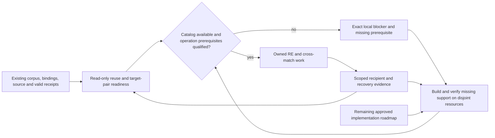

# September 18–21 design program progress and usable live track

The [September 18–21 design scope](2026-09-27-weekend-design-scope.md) is the
baseline this living plan and `STRATEGY.md` represent. It includes the full
[September 21 portable-substrate plan](2026-09-21-portable-signatures-codecaves-generic-plan.md),
its Phases 0–15 and named units, the distributed design, workstation requirements,
brainstorm decisions and diagrams. The [September 22 design package](2026-09-22-design-package.md)
and [autonomous capability roadmap](2026-09-22-autonomous-capability-product-roadmap.md)
add later refinements and adopted capabilities. This ledger reports implementation
state and puts useful RE/cross-match work alongside supporting implementation. It does not
create another recovery order, acceptance authority or scheduler. `STRATEGY.md`,
the [session obligation audit](2026-09-22-session-obligation-audit.md), its
110-item register, `FRONTEND_INTENT.md` and `DELIVERY_STATUS.md` retain those roles.

The weekend requirements remain in scope even when the September 22 summary omits
them. Later explicit user changes and conflict resolutions refine that baseline;
document date alone never supersedes it. Historical completion labels remain
non-current evidence and must be qualified before an implementation claim.
For each subsequent implementation slice, identify its original plan units and
affected diagram views, preserve their remaining acceptance requirements, and
record explicit supersessions. Source, installed-artifact and live outcomes
remain separate; closing a slice does not close its parent weekend workstream.

## Weekend workstreams retained in full

| Required workstream | Detailed plan | Current delivery interpretation |
|---|---|---|
| Deterministic signatures, ABI, cave plans, divergence and format/platform seams | Portable plan Phases 0–7, 10–11 | Preserve every original unit and its acceptance; narrow later increments do not close the whole substrate |
| Every entity, field/layout, data root and ordered accessor | Portable plan Phases 8–9 | Function matching alone does not satisfy entity or data-access coverage |
| Complete export bundle: hookpack/v2, Lua, headers and readiness/divergence evidence | Portable plan Phase 12 | Required product output, not an optional runtime example |
| Exhaustive applicable fallback ladders and learn-build feedback | Portable plan Phase 13, ladders A–F | Keep structured residue and ambiguity; bounded attempts do not justify silently dropping applicable methods |
| Autonomous visible workspace in both surfaces | Portable plan Phase 14; September 20–21 workstation/consolidated design | Automatic eligible project admission, scoped pause/resume, actual work, readiness/review/residue and starvation/hang views remain required |
| Reusable compute/state substrate and grid-of-one | Portable plan Phase 15; distributed-compute design | Required architecture and adapters; fleet expansion follows local qualification without blocking safe existing local RE |
| Recovery and original-code runtime reuse | STRATEGY and consolidated design; subsequent M0–M7 extensions | Advance both on their own prerequisites; whole-image source and live runtime claims keep separate acceptance |

The [weekend scope index](2026-09-27-weekend-design-scope.md) links the requirement
ledger, goal, audits, risks, brainstorm synthesis and diagram sources. The 110 later
contract rows do not replace the full weekend D/U unit set. A full per-unit current
implementation requalification remains open; this scope correction is not a claim
that historical checked units pass against today's checkout or installed package.
Frontend qualification must include all F01–F28, U104–U112, the workstation's eight
tasks and both guide/donor capability inventories linked by that index. The recent
projection/evidence increments cover only a small part of that workspace contract.

## Highest priority: useful RE and cross-matching alongside implementation

The user's latest directive makes this an explicit two-track delivery goal. Keep
the complete weekend unit set, later 110-item register and M0–M7 scope; prioritize a safely runnable
reverse-engineering/cross-build matching lane and build its missing support in
parallel. Completion of every reliability or UI feature is not a prerequisite for
all recovery work. Each operation still needs its own qualified inputs, resource
ownership and acceptance route.

| Priority | Operational track | Supporting implementation track |
|---|---|---|
| 1 | Reconcile existing 8080 ownership, corpus/program bindings, valid analysis, recovered source and receipts; select one concrete target/build pair | Use the accepted `.14` native ownership increment and keep truthful status/blocked reasons visible |
| 2 | Resume eligible catalog-owned RE/identity/matching work using unchanged valid evidence; independent targets may proceed on disjoint owned resources | Implement only the missing admission, provider, binding or comparison prerequisite that prevents the next useful operation |
| 3 | Compile and compare candidates for compatible recipients, retaining source, identity, ABI and byte claims separately | Expand durable ownership/reconciliation, shared budgets/circuits and recipient-specific acceptance from observed gaps |
| 4 | Keep advancing the per-target recovery ladder and corpus roll-up while runtime reuse progresses independently | Deliver the remainder of M0–M7 incrementally without making unrelated milestones global blockers |

A fresh 2026-09-27 listener check still found no 8080 service. Catalog operations
therefore remain blocked pending ownership/availability diagnosis; no alternate
server or direct recovery CLI is substituted. Read-only reuse/binding preparation
and disjoint implementation work continue. The active goal includes every remaining
directive, not just this first operational lane. Update this ledger with the exact
selected target/build pair and missing prerequisites when the readiness audit lands.

The bounded readiness audit now selects existing GOG K1 → Amazon K1 evidence in
the NVMe corpus (binary IDs 8 → 6, qualified by exact paths and image digests,
not those numeric IDs alone). The first read-only review, match `1008017`, now
corroborates all 107/101 cached instruction bytes against uniquely mapped original
image spans and bounded independent disassembly. Contradictory observable body
operations support a rejection proposal for this weak one-to-one candidate;
the durable row still says `review`. No new match run, identity
write or source propagation has been submitted. The two suspicious recovered-source
logical/name joins now have bounded physical corroboration, detailed below;
source lineage and producer acceptance remain open. Existing Ghidra and unrelated
Wine owners remain untouched. The report is retained at
`/home/brunner56/Documents/AgentDecompile-re-crossmatch-readiness-2026-09-27.md`.
The subsequent byte-backed packet is
`/home/brunner56/Documents/AgentDecompile-crossmatch-1008017-evidence.md`; it corrects
the cache lookup keys to bare program names, distinct from corpus `/K1/…` paths.
Before any future catalog review mutation, recheck the directed pair, row version,
status and image/span identities. This evidence does not identify the correct
alternate counterpart or prove recovered-source parity.

Two further read-only evidence results now advance that selected pair:

- Historical `CGameEffect::SetObjectID` row logical ID 12850 has complete recorded
  machine bytes equal to GOG `0x005036f0`, whose current logical ID is 12831.
  Historical `CAppManager::GetObjectTableManager` logical ID 12869 maps in the same
  way to `0x00401060`, current logical ID 12850. Address-specific cache/source
  semantics corroborate the association. This supports stale logical associations,
  without establishing their cause or byte-verified source. Both original recorded
  source paths are missing. A follow-up located two historical mirror copies of
  each source, all byte-identical to the surviving NVMe candidates, and August 21
  coverage assertions with matching physical bytes. Those rows omit source/target
  digests and compiler/object/compare bindings; the bounded search found no exact
  producer receipt. Preserve candidate status and seek fresh qualified acceptance
  unless a new precise historical receipt locator is found. A distinct same-basename
  SetObjectID assembly file was ruled out.
  Evidence: `/home/brunner56/Documents/AgentDecompile-recovered-source-binding-evidence-2026-09-27.md`.
- Match `1004010`, GOG `0x00447fa0` → Amazon `0x00412b50`, has score 0.9902 but zero
  margin. Complete cached instruction bytes match both original image spans, with
  independent bounded disassembly. Similar pointer-registration behavior has
  different receiver offsets (`this` versus `this + 0x10`) and return-register
  behavior. This is a variant/layout-sensitive hypothesis, not proven unique
  identity or interchangeable source. Retain review; no row was changed.
  Evidence: `/home/brunner56/Documents/AgentDecompile-crossmatch-1004010-evidence.md`.

These packets are useful RE progress alongside implementation; none creates
catalog acceptance, source compilation credit or runtime permission. The specific
next evidence is independent source-lineage/producer proof for the two historical
rows, and receiver/field/call-site/alternative-match corroboration for `1004010`.

The serving boundary remains specific: no 8080 listener, and the historical NVMe
runtime differs from the accepted canonical/package source. Locate and reconcile
the intended execution root and DB/cache/program bindings before catalog mutation.
Do not convert that blocker into blanket reanalysis or a new server/CLI route.

## Immediate delivery: useful and continuously updating

### Active source repair: cross-place admission

The September 27 source audit traced the catalog's cross-place action through
standalone placement, watch mode and the direct `ghidra_bulk` hook. Address-only
compile/byteexact receipt sets admit subsequently edited source; the existing writer
can replace a recipient assembly floor. Logical identity alone does not qualify
recipient variant/ABI/layout compatibility. Existing target-local recovery queue
checks limit this finding: the copy does not automatically become accepted recovery.
The historical recovered-source name joins are a separate investigation, not the
demonstrated cause of this defect.

Implementation is now assigned against the existing
[candidate admission contract](2026-09-22-task-acceptance-and-continuation-design.md#cross-place-admission-and-recipient-candidates).
The task covers bound producer evidence, one shared admission path for all three
callers, refreshed watch dependencies, separate immutable candidate publication,
and actual output ownership. Its positive gate is current compatible candidate
distribution; its negative gates include edited source, stale dependencies,
incompatible recipients and preservation of accepted source/assembly floors.
Source implementation, independent review and installed qualification are pending;
no historical receipt or source-audit finding is promoted to a fresh test result.
External task evidence is maintained in
`/home/brunner56/Documents/AgentDecompile-cross-place-admission-brief.md` and
`/home/brunner56/Documents/AgentDecompile-reuse-admission-audit.md`.

The preflight found no existing general implementation-variant/ABI/layout authority.
The implementation therefore includes a first explicitly bounded provider for
self-contained scalar constant-return PE functions, using fresh actual compilation
and independently checked donor/recipient machine behavior. This provider must not
promote labels or close general compatibility. Broader sources retain useful
unadmitted proposals and named missing-evidence/provider reasons; the complete
weekend variant, field/layout, callee and recipient-acceptance requirements remain
open. A caller-supplied compatibility verdict cannot authorize publication.

Initial source fixtures passed 47 cases with one instrumentation failure; that
fixture was corrected. Independent review found dependency/evidence integrity and
database/restoration gaps, addressed in the frozen first repair at source level.
An earlier broader verification run was interrupted after required source findings
superseded that snapshot, and is not passing evidence. Installed qualification
has not started. The next repair is necessary for tandem work: an unlimited
watch must not reserve the database indefinitely and starve matching producers.
It must capture only the relevant coherent snapshot, close the reader before
compile/wait, retain candidate-output ownership, and publish observed-basis
proposals requiring current recipient acceptance. Repeated unchanged negative
attempts also need bounded retries and scratch. Source verification and both
scoped reviews must qualify that revised contract before a new package is accepted.

### Queued repair: match-review freshness

The next review-workflow repair is also concrete: current single/batch match-decision
routes and both UI submitters use match IDs without binding the observed database,
run, directed pair and evidence. Recomputed rows can reuse an ID or change its
basis while remaining in review. The required repair is a shared observed-basis
token and atomic stale refusal for both routes/consumers, including whole-batch
precondition handling and selected-database identity. This source-grounded scenario
is recorded in `/home/brunner56/Documents/AgentDecompile-match-review-freshness-audit.md`;
it has not been reproduced or fixed. Catalog exposure must be established before
claiming an agent-operable review path. The retained RE packets must not be submitted
by ID alone. Cross-place repair is the current source task; this requirement remains
queued rather than becoming an untracked caveat.

### Weekend Phase 12 qualification: U87–U90 remain open

The bounded September 27 source/consumer audit qualifies these original portable-plan
units separately from later contract identifiers:

| Portable-plan unit | Current source evidence | Remaining required outcome |
|---|---|---|
| U87 | Deterministic v1 hook-pack writer and existing basis checks; no aggregate bundle command located | Fixed multi-exporter order, content-addressed artifact tree, complete `bundle.json` and all mandatory artifact verification/publication gates |
| U88 | No pack-v2-only Lua generator/command located | Require-able address-free module with the declared entity/accessor/call/hook helpers and structured unresolved-operation failures |
| U89 | Existing per-build header producer strips layout assertions; acquisition flattens pointer/composite/union information | Exact layouts, retained size checks, typed ABI-aware declarations and build/toolchain/basis manifest through that existing producer path |
| U90 | No readiness/v1 coverage projection/command located | Complete entity-by-build locator coverage, separate observed status, environment/adapter limitations and human-readable capability readiness |

The actual KotorPhasor consumer currently reads v1 and bounded operation roles;
changing the format label would not implement v2. The v1 export command also needs
qualification of its output ownership. These are current source findings from
`/home/brunner56/Documents/AgentDecompile-weekend-export-bundle-readiness.md`,
not executed acceptance results. The full Phase 12 output remains required while
cross-place and independent useful RE work advance; none of these rows is waived.

The first usable workflow is:

> Open an existing analyzed target, inspect its recorded source and evidence, see
> the exact current operation or blocked reason, the next automatic action, budget
> and freshness, then inspect the receipt when accepted work advances.

Build this first on the required static `/dashboard`, then qualify packaged `/react/`
against the same backend state. Existing code already polls preparations every two
seconds and jobs every 1.5 seconds and persists job/stage/ownership facts. Extend that
path instead of introducing another server or progress store.
Entity evidence already has a shared activity SSE/cursor/replay route with HTTP
fallback. Extend that route for target/candidate-bound claims and receipt links;
the preparation poll and entity stream have different roles. Passive evidence
hydration must avoid function-detail's lazy observation-admission path. Recorded
receipt JSON cannot recreate trusted process-local contribution observations.

| Step | Deliverable | Acceptance needed |
|---|---|---|
| L0.1 Activation identity | Resolve the intended 8080 owner, cwd, loaded module, revision, catalog root and state root | Same process/state identity before and after supported update; when no listener exists, record the blocker and do not substitute another port |
| L0.2 Truthful projection | One bounded versioned view of target identity, execution state, accepted claim scope, receipts, measured units, freshness, retry/wake reason, resource ownership and admission spending | Read-only hydration never admits recovery; execution completion and accepted capability remain separate |
| L0.3 Static consumer | Show the projection, stale/disconnected state, timestamps, receipts and exact next action in `/dashboard` | Retained data always shows observation time and unknown freshness after disconnect |
| L0.4 React consumer | Show the same fields and semantics in packaged `/react/` | Field/state parity against the same backend response; wall-clock limits remain distinct from action-admission allocation |
| L0.5 Identity-safe updates | Preserve exact corpus/build/address through reload, history navigation and rapid target switches | Late response cannot redraw another target; browsing sends no recovery POST |
| L0.6 Live qualification | Observe one existing target, source/receipt and retained or owned work record; disconnect/reconnect; switch targets; reload | Actual existing 8080 browser at desktop and 598x912, unchanged service/state identity, no fabricated progress |

The current preflight found no 8080 listener, so L0.1 and L0.6 have no fresh live
receipt. Source preparation, projection tests and package review may proceed, while
activation remains a separately reported boundary. Do not use `systemctl`, start an
alternate port or replace an unknown owner.

## Current accounting

The [preparation freshness/admission slice](../verification/2026-09-27-live-projection.md)
now implements part of L0.2–L0.5 in both frontends. Twelve focused tests, TypeScript,
static syntax and an isolated production build passed after independent review.
The prepared asset archive has source hashes and recorded dependency versions.
It has not been activated. The subsequent scoped evidence increment below adds
historical receipt links; current accepted-claim projection and live/browser
qualification remain open. This changes useful source behavior without closing M0.
The subsequent clean lockfile installation, 18 focused/adjacent checks, TypeScript
check and production rebuild passed with Vitest 5.0.1. The locked bundle and per-file
asset manifest are retained in the receipt and handed to the next wheel stage.

The [scoped activity-evidence increment](../verification/2026-09-27-live-evidence.md)
now wires the existing activity route into static Explorer and both React evidence
views, with current source-digest checks, historical named witnesses and explicit
unavailable contribution. Selection/reset races are corrected. Eight source and
eight installed backend cases, 12 frontend cases, TypeScript and the locked build
passed after independent review. All rows remain unaccepted; actual target-currentness,
trusted contribution observations and live browser qualification are open.

The [qualified local-output ownership increment](../verification/2026-09-27-resource-claims.md)
advances P0.3 for the actual ReAgent snapshot export action. One explicit destination
contract replaces generic parameter-name inference; qualified local clearance can
release it, while uncertain and historical unqualified claims remain reserved.
Focused tests and independent review are tracked in that receipt; the increment
is included in `.12` and its installed regression selection. It does not qualify
compiler/Wine/project/store lifecycles or close M0.

The [nested MCP budget increment](../verification/2026-09-27-nested-mcp-budget.md)
now implements a separate tool-dispatch allocation for preparation-owned jobs.
Project/program setup, primary requests, session retries and check-in share the
same durable objective allowance. Backend source checks passed 113 cases after
correcting unresolved-effect replay with spare budget. Both frontends passed 38
cases on the matching locked runtime, full TypeScript and a fresh production build.
Both source reviews are approved; the `.12` wheel passed all 113 installed checks,
and independent artifact review approved. Provider-internal work, external subprocess usage, shared circuits and live
qualification remain open.

The contract register has 110 items: **100 unverified, eight partial, one
superseded and one achieved**. The partial items are D13, D15, D16, D31, D36,
D44, D47 and RC-02. D49 is superseded by the later build authorization; D50 records the
completed collaborative design review. These counts measure accepted contract
states, not percentage of engineering effort.

Documentation coverage is substantially complete. Implementation is partial. M0 has
a packaged foundation and bounded acceptance prerequisites; M1–M7 have no terminal
acceptance. The latest recorded package is the native ownership increment `.14`,
with all 139 installed checks passing and independent artifact approval. It preserves
the fresh-revalidation increment `.13`, with all 60 of its installed checks passing
and independent artifact approval. It preserves the
nested MCP/resource increment `.12`, whose 113 installed checks and independent
artifact review passed.
It preserves the generated-operation increment `.11`, whose own source and installed
selection passed 42 checks. The scoped activity-evidence
increment `.10` has eight installed backend checks and the newly built frontend. It preserves
the verified `.9` source-contribution backend, whose separate installed suite passed
149 checks after independent review. It proves bounded actual COFF placement and discard/overwrite refusal;
it does not prove general linking, non-export identity, named contribution composition,
ABI correctness, whole-image source recovery or live activation. See the
[exact receipt](../verification/2026-09-27-source-contribution.md).

## Milestone status and todo

| Milestone | Status | Next useful outcome | Remaining acceptance boundary |
|---|---|---|---|
| M0 Reliable continuation | Partial | Complete L0 and preserve attempts with an exact next action | General owner reconciliation, complete dependency/resource closure, nested/provider budgets and circuits, durable wakes, scoped acceptance/withdrawal and live consumer qualification |
| M1 Effective scenario runner | Open | Qualify G3 lease reconciliation and G4 lifecycle ownership against one exact effective operation manifest without mutable-game fallback paths | Exact effective script/target/runtime/fixture manifest, one lifecycle owner, passing and blocked actual-game receipts without manual path repair |
| M2 Generated operations | Partial preparation | Export and consume one K1 GOG model-scale generated operation; carry its revision into G3 | Independent entity, ABI, lifetime and thread predicates; shared binding/help/CLI/harness revision; unsupported-build negative |
| M3 F12 workspace | Open | Query/select, run Lua, edit a supported property, inspect result/error, undo and Copy as Lua | Real key/focus/input and engine-thread path with the same operation IDs across consumers |
| M4 Creative projects and captures | Open | Reopen a scene/shot in a fresh session and record a defining native effect | Stable selectors, namespaced state, protected inputs and separate behavior/capture/presentation receipts |
| M5 Playback and checkpoints | Open | Owned pause plus supported save/restore and branch replay | Inventory/quest/party/script verification, fresh lifetime identities and explicit excluded state |
| M6 Native platform matrix | Open | Qualify exact Mac K1/K2 and compatible Windows/Linux capability rows | Per-build ABI, graphics, input and capture receipts on capable workers |
| M7 Whole-game browser | Open; feasibility work | Inventory prior KotorPhasor work and establish an executable route | Actual render/input/audio/save/main-loop behavior and sustained play |

The [native source assessment](../RUNTIME_REUSE.md#first-generated-native-operation--source-assessment-2026-09-27)
identifies an existing protected model-scale adapter for the first M1/M2 slice.
Generated pack identity/role enforcement and native role consumption now exist. A
scenario-level operation pin, exported-hook-pack preflight and explicit staged-byte
identity checks now exist. Actual process ownership reconciliation and independent
live observation are still missing, so existing native source does not close M1/M2.

The [generated-operation contract increment](../verification/2026-09-27-generated-operation-contract.md)
now supplies the exporter-side raw-image/role handoff and KotorPhasor parser/runtime
identity/adapter gating. The native model adapter consumes the five resolved generated
role addresses only after it verifies the loaded image digest and admitted operation.
Its compiled profile remains the independently guarded ABI/layout source. No ABI call,
actor/world lifetime check, engine fixture, independent observation or restoration ran,
so M1/M2 remain open.

## Active M1/M2 readiness sequence

The current implementation supplies a **fail-closed effective-scenario admission
record** carrying the same generated-operation revision from AgentDecompile through
the KotorPhasor scenario runner. Its offline preflight and staged lease are partial
G3 delivery. The next boundary is actual process ownership reconciliation and a live
mutation intent/outcome receipt; a scenario TOML, hook pack or native parser test
does not establish runtime authorization.

| Order | State | Work product | Required refusal or evidence |
|---|---|---|---|
| G1 | Partial | `agentdecompile.operation-contract/v1` exporter emits target digest, unique roles, resolved sites, byte windows and role metadata | Export refuses absent/ambiguous roles, stale raw image, missing selected target or wrong pack digest |
| G2 | Partial | KotorPhasor hook-pack parser and native model bridge retain selected target identity and consume exact generated role addresses | Reader rejects a wrong target/role/site/address/byte declaration; runtime keeps model/animation unavailable when pack digest, operation, or a role is missing |
| G3 | Partial | Scenario pin/preflight and staged-copy gate are implemented; a stable stage lock and canonical prepared lease block unsafe successor admission before any staged-game mutation, with one-shot cleanup and terminal quarantine/release semantics | Qualify full lease reconciliation against actual process ownership and record live mutation intent/outcome under that lease; no path may be inferred from a source basename |
| G4 | Next | One lifecycle owner creates immutable staging, records the effective manifest and obtains fixture/process ownership | Unknown, competing or stale ownership becomes a recorded blocked result with a bounded wake condition; it never becomes an alternate launch or manual repair instruction |
| G5 | Later | On the game thread, execute the supported snapshot → resize → independent before/during/after observation → restore → cleanup route | Actor/world epoch, ABI, thread, observation and restore predicates each produce a scoped receipt; failure keeps the exact failed predicate and cleanup result |
| G6 | Later | Replay one passing and one deliberately unsupported/blocked scenario from durable manifests | A fresh runner reproduces the manifest outcome without source-path, process, fixture or lifecycle repair by the operator |

G3 is deliberately the active boundary. Its first offline schema/report increment now
preserves the complete identity pin without allowing a route name or path to stand in
for it, and compares contract/hook-pack target identity before `GameSession` exists.
Staging admission now compares explicitly located deployed-script, fixture and installed
runtime bytes under a stable stage lock, with a prepared manifest lease admitted before
any mutable-game staging. It never infers a destination from a source basename or
claims a rejected predecessor lease. The remaining G3 work is qualified reconciliation
against actual game/process ownership and a live mutation intent/outcome receipt. This work
does not launch a game, create a recovery job, start a web service or imply M1/M2
acceptance. G4–G6 require separate qualified live authority and evidence.

M6 and M7 research can proceed independently. It cannot be relabeled success when an
executable route or required host is absent.

## Active next source increment

[P0.4 fresh revalidation after process loss](../verification/2026-09-27-fresh-source-revalidation.md)
now has independently approved source. A bounded retained
recipe requests new supported compilation and exact placement; imported audit JSON
never restores producer authority. The decisive synthetic acceptance route spans
three processes: old audits receive zero credit, a changed candidate is rejected
while its valid sibling is freshly produced and credited, and a later process still
cannot accept the new audit alone. The final new-module suite passed 27 cases;
the `.13` package passed the complete 60-case installed selection and independent
artifact review approved. This is
synthetic product evidence, not a recovery operation. The detailed flow is in the
[acceptance design](2026-09-22-task-acceptance-and-continuation-design.md#fresh-source-revalidation-after-process-loss).

[P0.3 native package-verifier ownership](../verification/2026-09-27-native-verify-ownership.md) is now delivered as the bounded `.14` increment after the `.13`
source-revalidation artifact was accepted. It uses the actual `recover.verify-package`
output tree, with enforcement inside the child that reads compiler metadata and
launches the compiler. The design includes the guarded execution/clearance flow;
source validation and independent review corrected predispatch-restoration and
cancellation-window defects. Source checks passed 139 cases before a separately
reviewed two-case fixture repair. All 139 final installed checks pass and independent
artifact review approved. The first profile
will not grant Wine, arbitrary flags or external wrappers automatic release.

## Implementation order after the live track

1. Finish P0.4 linked source-contribution acceptance: actual compiler-owned object,
   independent re-evaluation, physical placement into a typed hole, zero credit for a
   discarded replacement or copied fallback, and preservation of unrelated valid work.
2. Close P0.3 general owner reconciliation for compiler, Wine prefix, project, output
   and store resources. Unknown ownership remains reserved until qualified evidence
   clears the exact resource. `recover.verify-package` now has a bounded, independently
   approved native Clang profile without code comparison in `.14`; arbitrary flags/wrappers, extra
   writable paths, environment caches and MSVC/Wine require separate coverage.
3. Complete P1.1/P1.2 shared objective/provider budgets, recovery circuits, transitive
   dependency closure, durable wake cursor/outbox and restart reconciliation.
4. Run P1.3 one catalog-owned reccmp original/rebuild/PDB comparison and one configured
   ReAgent candidate-consuming check with raw and normalized receipts.
5. Complete P1.4 recipient-specific acceptance, dependency lineage, generation recheck,
   scoped withdrawal and deterministic replay.
6. Deliver P2 trustworthy region/fixup roundtrip, compiled replacement, toolchain/group
   calibration and relocatable isle-like project output. Advance one independent vanilla
   read/mutate/restore route through M1/M2 without waiting for all recovered source.
7. Build M3–M5 and qualify M6/M7 incrementally. Expand distributed scale after a local
   lane is correct and resumable.
8. Claim terminal recovery only after a fresh current source/toolchain build, object
   evidence, exact-placement relink and whole-file comparison for that exact variant.

The live track owns frontend and projection files. The contribution track owns its
COFF/relink/selection consumers. Coordinate any shared `preparation.py` or `jobs.py`
changes before assigning a writer. Actual corpus/Ghidra/compiler/Wine/game state keeps
one qualified writer. Read-only audit, provider-interface research and platform/browser
inventory may proceed concurrently.

## Design and diagram status

| Artifact family | Design state | Software state |
|---|---|---|
| Recovery overview: `agentdecompile-recovery-pipeline` SVG/draw.io/PNG + generator | Current September 22 design; canonical and Documents SVG hashes match | Stages and lanes are partly implemented; whole-image acceptance remains open |
| Execution contracts SVG/draw.io/PNG + generator | Complete design for admission, evidence, fencing, quarantine and progress | Late-worker and acceptance scenarios remain partly or wholly unverified |
| Resilience contracts SVG/draw.io/PNG + generator | Complete design for detect/classify/repair/wait/resume and control-plane failures | Retry/quarantine/freshness/accounting slices exist; full FP matrix remains open |
| Autonomous capabilities SVG/draw.io/PNG | M0 partly verified; M1–M7 acceptance remains future | M2 now has partial preparation in the milestone table; the diagram's future-delivery label denotes missing acceptance, not absence of source |

No diagram topology changed in this reconciliation, so the rendered artifacts were not
regenerated. Update their source and all formats together when an actual design contract
changes, then keep the Documents overview synchronized.

## Reporting rule

Every bounded increment gets a dated receipt containing exact source revision/hashes,
package identity, checks actually run, independent review and remaining boundaries.
Update this ledger, `DELIVERY_STATUS.md`, the obligation audit/register and the relevant
diagram label only when that evidence changes. Source presence, a green job, a screenshot,
copied bytes or a running process never upgrades the claim by itself.
