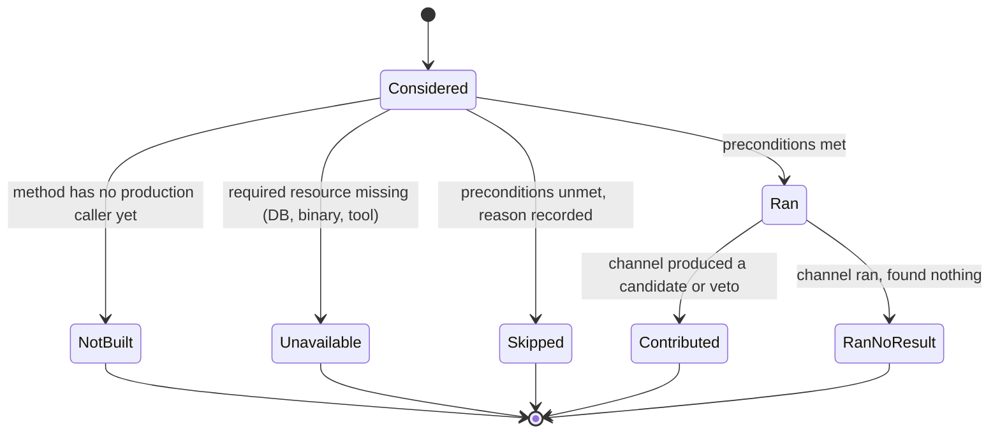
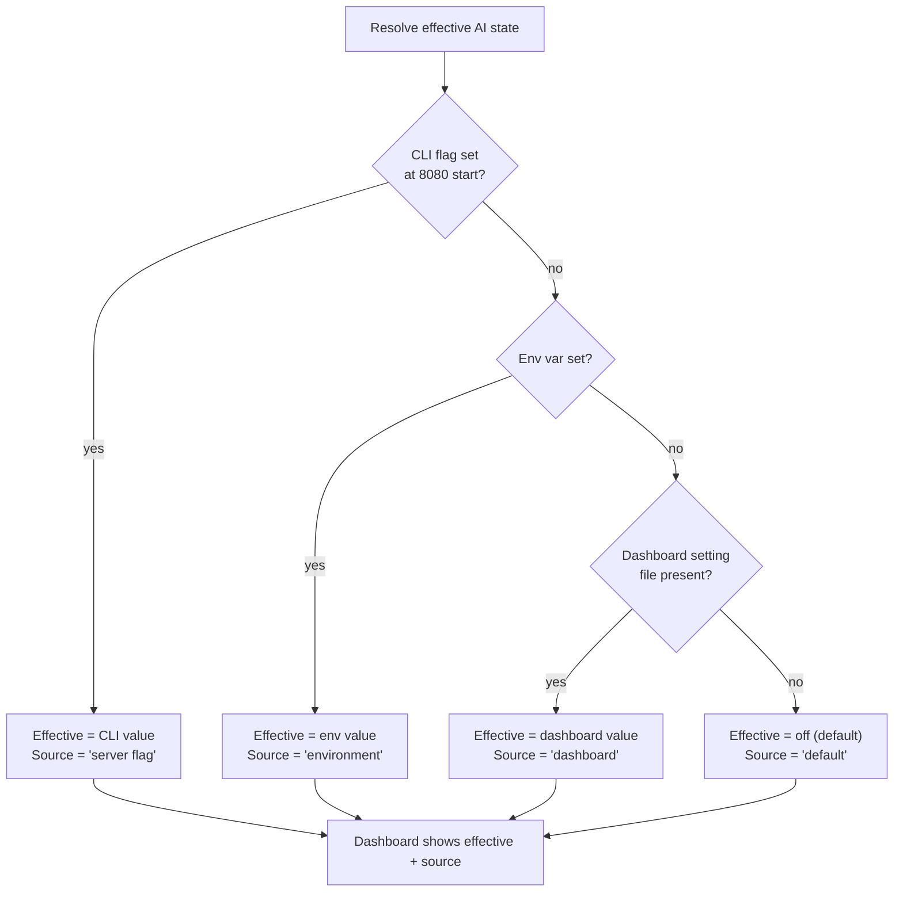

# Static CodeBrowser Project Tabs - Plan

## Goal Capsule

**Objective:** An operator reverse-engineering a set of related builds works in one browser tab per project. They see every build, its code, its cross-build matches and its call graph at once, in the layout they already know from Ghidra's CodeBrowser. The recovery pipeline's automatic work shows as state they can read and pause, never as buttons they must press. Every cross-matching method stays available and visible, targeted AI is one operator-controlled toggle, and both frontends read one honest, reconciled progress picture.

**Means:** Rebuild the static dashboard on port 8080 as a CodeBrowser-parity workspace where a tab holds a project (KTD1-KTD4, KTD9 below). Close the cross-matching availability gaps the research found (KTD1-KTD4). Add one precedence-ruled AI toggle (KTD5-KTD6). Bring the Vite workstation and the report/progress spine into scope, built from the components already live in `frontend/src/workstation` (KTD7-KTD9).

**Product authority:** The user's 2026-09-28 directives, `docs/FRONTEND_INTENT.md`, and the 2026-09-28 scope-change directives recorded under Product Contract Preservation below. This plan now covers the static dashboard, cross-matching availability, the targeted-AI toggle, the Vite workstation and the report/progress spine.

**Source implementation update:** [September 28 implementation and acceptance boundaries](../FRONTEND_IMPLEMENTATION_STATUS.md). Commit `ef08633` implements a substantial subset; the plan is not complete.

**Execution profile:** Multi-phase implementation plan for `ce-work` or an equivalent executor. Start phases A–C in order; Phase A's U8 finishes after B supplies U14. D (Vite) and E (report spine) can run in parallel after B, honoring individual dependencies; neither phase depends on the other. G (exports and runtime reuse) follows its own unit dependencies. U43 adds report-backed matrix counts after U8 and U26. F (U30, tests last) follows all implementation units, including G and U43. Phase names are grouping labels, not additional dependency edges.

**Stop conditions:** Stop and return to planning if an owner-locked file (see Planning Contract) must be edited to close a requirement, or if a unit's fix requires renumbering the `match` table's primary key or removing a column another live consumer reads.

## Product Contract

### Summary

Replace the static dashboard's action tabs and pipeline buttons with Ghidra CodeBrowser parity. A browser tab holds a project whose binaries are peers on one shared cursor. A cross-build map dock shows the call graph and matcher together, with every matching method's status visible. Pipeline progress is shown and can be paused, never triggered. Targeted AI is one toggle with one precedence rule. The Vite workstation and a shared report/progress spine are now in scope, built from the already-live workstation components.

### Problem Frame

The static dashboard grew around the pipeline's steps. Its menus mostly offer buttons for work the pipeline already schedules on its own. Ghidra's own model has a second cost: only one program drives the cursor at a time, so comparing builds means loading and switching between them.

Research since the first draft narrowed three more gaps. The matcher's channel model looks complete on paper but two channels never contribute in practice (BSim persistence, the ABI veto), one channel is missing metadata it claims to carry (X), and one stage is mislabeled under the wrong channel (the P-code skeleton stage under `M`). Targeted AI has four disagreeing defaults across five entry points and no operator-facing switch. The Vite workstation already has live components for half of what `docs/FRONTEND_INTENT.md` asks for, but the shipped bundle is a week stale and several reusable pieces sit behind dead root components. Progress reporting has at least three disagreeing counts for the same corpus, and no gate stops a mismatched count from reaching an outside publishing step.

### Product Contract Preservation

Scope changed on 2026-09-28. R1-R26, F1-F4, AE1-AE7 keep their IDs and meaning from the prior requirements-only draft. Four changes below extend the contract; they do not narrow or reinterpret an existing R, F or AE.

- changed: Cross-matching methods must have high availability — every method and channel (Z, I, H, X, G, S, T, M, D, donor scheduling, review decisions) is available with an ordered fallback, none blocks matching, and BSim especially never blocks. Reason: research found BSim hits are never persisted so channel S never contributes, X lacks C++/RTTI metadata, the P-code skeleton stage is mislabeled as channel M, the contract veto has no production caller, and match rows carry no queryable kind/confidence/algorithm. Adds R27-R34.
- changed: Targeted AI (stage 6 leftovers, and any LLM rewrite path) becomes one optional implementation, switched by an env var, a CLI flag at 8080 server start, and a dashboard setting, with one documented precedence rule, a visible value source, live application where possible, and no dependency from the deterministic path. Reason: five entry points (frontdoor, `ghidra-bulk --llm-cleanup`, `corpus run --llm`, the MCP recovery provider, the rewrite-worker skill) disagree on defaults and none is operator-switchable. Adds R35-R38.
- changed: The Vite workstation (objdiff-web first; decomp.me scratch, Dogbolt compare, RzWeb/r2web views, an APKMan-style container tree, a pipeline stage DAG with retry-on-failure, a lane E fleet roster, a spectator view) and the report spine (a per-binary-and-version objdiff-shaped `report.json`, a tier-split verified-vs-advisory progress display in both UIs, a count-reconciliation gate before any outside publishing, and publishing as its own approved step) move from Deferred into scope. Reason: `STRATEGY.md`'s "One catalog, two surfaces" track names both as committed, and research found live components (`ScratchWorkspace`, `MatchReview`, `CompareView`, `integration/boundaries.ts`, `PreparationActivity`) that make this buildable now rather than speculative. Adds R39-R50.
- changed: Operator user-research outputs — JTBD-derived acceptance examples and a usability task list per delivered slice, mapped to Ghidra-guide chapters and the 2026-09-28 directives — join the Verification Contract. Reason: the JTBD/journey research (`design:user-research` output) already produced eight usability tasks (T1-T8) with named success criteria; carrying them forward avoids re-deriving verification from scratch. Adds AE8-AE15 and the Usability Test Plan subsection.

The exports contract below incorporates `/tmp/exports-spec.md` (20 requirements and 12 units). The 13 doc-review resolutions from `/tmp/review-decisions.md` are decisions by the plan owner's delegate under the hands-off directive, not decisions attributed to the user. Original IDs remain stable; the split from U8 is U43. Historical draft implementation-status observations below are research leads that require source verification before implementation or completion claims.

### Actors

- A1. Operator: a person reading, naming and reviewing code across related builds while the pipeline runs.
- A2. Agent client: an automated caller acting through the same backend. It reads the same state the operator sees.
- A3. Recovery pipeline: admits and runs work on its own. The interface observes it.
- A4. Spectator: a second viewer following the operator's session read-only (Vite workstation only).

### Requirements

**Pipeline-owned work is never a control**

- R1. No menu item, tab, toolbar button or panel button starts, reruns or duplicates work the recovery pipeline schedules on its own. This covers these stages: analysis; protection preparation; fact extraction; similarity indexing; matching; calibration; source recovery; cross-build placement; leftover recovery; byte verification.
- R2. Three events admit the pipeline's eligible missing work without a separate action: opening a project, adding a binary to a project, and registering a binary. Reopening material that already has receipts does not redo that work.
- R3. After admission, the interface shows a one-line receipt naming the admitted run, its generation and its queue position.
- R4. Pause, resume and stop are the only workflow controls. They appear wherever run state is shown, pre-scoped to the run in view.
- R5. Operator edits stay available as explicit user actions: rename; comments; bookmarks; retyping and data-type edits; accept or reject of match candidates, singly and in batches; opening, creating and saving projects; adding binaries.
- R6. An expert command palette stays available for low-level catalog actions. It is not the path for routine pipeline work.
- R7. The backend enforces R1 through its classification of which actions and modes change state. A new pipeline trigger added to a static surface fails that check.
- R8. R1 through R7 apply to every static surface served on 8080, including the explorer page.

**CodeBrowser parity**

- R9. The workspace follows Ghidra's stock CodeBrowser arrangement: the Symbol Tree and Program Trees in the left rail, with the Data Type Manager below them; the Listing and Decompiler in the center, with secondary providers tabbed alongside the Decompiler; Console and Bookmarks at the bottom; Data Type Preview as a thin strip.
- R10. Every CodeBrowser provider that the Ghidra reversing guide uses is present: Listing (address, bytes, mnemonic, operands, cross-reference and comment fields, with a function header); Decompiler; Symbol Tree; Program Trees; Data Type Manager; Memory Map; Bytes; Defined Strings; Symbol Table and References; Functions table; Function Graph; Function Call Trees and Call Graph; Bookmarks; Console; Function Comparison; Equates; Relocations.
- R11. Providers that only show data are read-only views. Providers that edit data do so only through R5's explicit user actions.
- R12. One program location drives every connected provider. Selecting an address, symbol or cross-reference in any provider moves the others. No tab switch or new search is needed.
- R13. Navigation matches Ghidra: back and forward history; go-to by address or name; previous and next function; highlight of the selected token wherever it recurs; an overview strip marking locations across the program.
- R14. The layout uses the page for content. Providers dock and tab like Ghidra's. No space goes to controls that R1 excludes.

**Project as tab**

- R15. A browser tab holds one project. Every binary in the project is a peer in that tab, not a hidden sibling of one active program.
- R16. Each peer shows whether it is readable locally, loading, queued for a serialized read, or blocked. A blocked peer shows the backend's own next step, for example that server credentials are required.
- R17. Selecting a function in one peer aligns the other peers to the same identity where one is bound. A peer without a binding shows "no identity binding". It is never an empty or hidden lane.
- R18. A project with tens of binaries stays usable, up to the corpus's ninety. A light track is one corpus-only row showing build name, readiness (R16), current stage and selected-function identity-binding availability; selection shows only the bound function name/address. It performs no live Ghidra reads and loads no Listing or Decompiler. Click or Enter focuses it and loads its providers. Each pane has at most one focused peer; unfocusing restores its light track.

**Call graph and matcher together**

- R19. A cross-build map is a docked view in the project tab. It shows the call graph across builds and the matcher's results together, on the same selection.
- R20. The map includes a matrix with one cell per pair of builds. Each cell shows match status and counts. A pair the pipeline never scheduled reads "not scheduled", which differs from a pair that failed.
- R21. Match results appear with the function in context. They show as marks at the function header in the Listing and Decompiler, and as edges on the call graph.
- R22. Match review shows status, match kind, score, confidence and algorithm. The operator can accept or reject one candidate, or a batch chosen by build pair and score band.
- R23. A byte-level match from object comparison and a match by name, signature or call graph always carry different labels.

**Pipeline state display**

- R24. Pipeline progress for the project is visible inside the workspace. The bottom activity dock shows the current stage per binary and the run's state.
- R25. A blocked state names its cause and the next step. It never shows a generic error.
- R26. The interface shows only state observed from the backend. It shows no simulated progress and no invented percentages.

**Cross-matching method availability**

- R27. Every cross-match method and channel — Z (identical image), I (authentic symbols), H (hashes), X (rare refs and C++/RTTI metadata), G (call-graph/CFG/SPP), S (BSim), T (ABI/contract veto), M (BinExport/BinDiff), D (emulation), donor scheduling and review decisions — is available with an ordered fallback. None blocks matching; BSim (S) unavailability especially never blocks the pipeline.
- R28. For any candidate pair or function, both frontends show, per method, whether it ran, was skipped (with a named reason), is unavailable, or is not built yet.
- R29. Match rows carry queryable kind, confidence and algorithm rather than only an evidence-JSON blob, so review can filter and sort without parsing evidence.
- R30. The cross-build matrix cell distinguishes a pair the donor scheduler never selected ("not scheduled") from a pair that ran and failed, and shows the scheduling reason (explicit pair, spanning-forest edge, hub-to-anchor link).
- R31. Channel S (BSim) persists its hits to a queryable store, so BSim results reach the matcher's fusion step and the availability display instead of permanently reading unavailable.
- R32. Channel X carries C++/RTTI/vtable/dispatch metadata, not only rare strings and constants.
- R33. The P-code/decompiler-skeleton exact-fingerprint stage carries its own channel label, distinct from channel M (BinExport/BinDiff), so confidence scoring and the availability display do not conflate the two methods.
- R34. The ABI/contract veto (channel T) has a production caller in the identity/propagation path so an incompatible high-score tie can resolve when enabled. It ships default-off as "available, off"; corpus-wide enabling requires KTD4's shadow-run validation.

**Targeted AI toggle**

- R35. Targeted AI (stage 6 leftover recovery, and any LLM rewrite path) is switched by exactly three surfaces: an environment variable, a CLI flag on the 8080 server start command, and a dashboard setting.
- R36. One documented precedence rule resolves the three surfaces to a single effective value. The dashboard shows which surface supplied the current value.
- R37. A change to the env var or the dashboard setting applies to the next job without a server restart. The CLI flag is fixed at process start, and the dashboard names that limit.
- R38. The deterministic recovery path (compile, repair, propagate, verify) never depends on targeted AI being enabled.

**Vite workstation**

- R39. The Vite workstation's main view is objdiff-web-first: an instruction-aligned two-column diff with register highlighting, navigable mismatches and a symbol tree.
- R40. A decomp.me-style scratch view lets the operator iterate a candidate against the catalog's compile and objdiff actions, extending the existing scratch workflow.
- R41. A Dogbolt-style compare view shows multiple decompiler outputs side by side, using only optional licensed local runners; it never uploads to the public Dogbolt service.
- R42. RzWeb/r2web-style expert views sit behind the workstation's one normalized selection, never a second selection store.
- R43. An APKMan-style container tree generalizes to any supported container or format, reusing the existing format-provider pattern.
- R44. A pipeline stage graph shows stage dependencies as a DAG with edges, and retries a stage only after that stage fails — never as a manual re-run control.
- R45. A lane E fleet roster shows donor and recipient decisions across a batch, reusing the existing match-review batch-decision contract.
- R46. Spectating is local, opt-in and off by default. The operator enables it on the same local host as the dashboard and creates a revocable token shown once. After first use the token travels in a header or cookie, never remains in the URL. Backend authorization restricts it to read-only access. The activity dock shows connected spectator count and supports revoking all tokens; this plan sets up no remote exposure.

**Report and progress spine**

- R47. The corpus produces an objdiff-shaped `report.json` per binary and version, generated from the corpus database, not only consumed from an external objdiff run.
- R48. Both frontends show progress as a tier-split bar: verified (byte-exact, relocation-aware objdiff 0) kept separate from advisory (compiling Ghidra C), never merged into one number.
- R49. A count-reconciliation gate runs before any decomp.dev publishing step. It fails closed when the accounting buckets (accepted source, candidate source, preserved region, unclassified, excluded-with-reason) do not exhaustively and exactly cover the inventory.
- R50. Publishing to decomp.dev is its own explicit, separately approved step. It never runs as a side effect of generating `report.json`.

**Export bundle**
- R51. The corpus provides one deterministic `export-bundle` verb that produces every
  required artifact in the export artifact contract below from (store + basis) with no manual finishing step, and refuses to emit
  if any artifact fails its own verify gate.
- R52. Re-running `export-bundle` under an identical basis over an unchanged store
  produces a byte-identical output tree; this is the acceptance test for the bundle, not
  a separate claim.
- R53. `bundle.json` names the basis, the corpus-manifest hash, and every artifact's
  own content hash, so a consumer can verify what it received without re-deriving it.
- R54. The recovered-source-variants row in the bundle is optional; its absence is
  recorded with a `not_in_scope` receipt rather than a missing file with no explanation.

**Lua**
- R55. The corpus generates a `require`-able Lua module purely from a hook pack (v2),
  never from the store directly, so the module is reproducible from the pack alone.
- R56. Every generated accessor, entry/handle helper, and call stub raises a
  structured error naming the entity and the resolution status attempted, on any
  non-resolved status; only a `describe()` helper may return without raising.
- R57. The generator refuses to emit a typed call stub for any entity whose ABI block
  confidence is below the declared threshold, rather than emitting a stub that can
  silently misinterpret arguments.
- R58. No literal address appears anywhere in generated Lua source; every access goes
  through resolve/field/entry/handle indirection.
- R59. The generated module's determinism (sorted emission order, no timestamps) is
  verified the same way as every other export: identical pack in, byte-identical module
  out.

**Codecave / injection**
- R60. Cave discovery validates every candidate against decode-derived instruction
  ranges (never an analyzer's function-body model), against relocation/data-reference/PC-
  relative targets, and against two decode-derived function boundaries, before it is
  emitted as a candidate.
- R61. A cave entry in the pack is a plan template (anchor, offset, capacity
  requirement, relocation rules, restoration data, per-build coverage) — never a fixed
  VA+bytes pair, and never itself a permission to patch memory.
- R62. The corpus ships multiple candidate caves per anchor where more than one valid
  candidate exists, so a consumer is not stranded when the first candidate is absent on a
  given build.
- R63. The pack records, per architecture, whether a codecave/detour adapter exists
  for that architecture at all; an architecture with no adapter is refused loudly in the
  export, not silently dropped from the pack.

**WASM**
- R64. Before any WASM-usable export of the hook pack, generated bindings, or the
  runtime harness itself is promised anywhere in the frontends plan, that requirement is
  logged as a distinct, currently unscoped item — it must not be implied by the existing
  browser-lane compute-donation work or the workbench's own local-analysis WASM provider,
  neither of which exports the pack.
- R65. If a WASM-consumable export is later authorized, it carries the same evidence
  requirements as every other export in the export artifact contract below (identity vs. locator separation, per-build
  instance status, expected-bytes-or-none, ABI confidence) — a browser runtime target is
  not exempt from the honesty rules.

**Surfacing in both frontends**
- R66. The static 8080 workbench lists every export artifact per project and per
  binary, with its readiness status, and offers it for download; this is a required
  surface, not optional richness reserved for the other frontend.
- R67. The Vite/React frontend shows export readiness per entity (not only per
  artifact), using the same closed status set and the same `observed_status` axis the
  pack itself carries, so the two frontends never disagree about what "ready" means for a
  given entity.
- R68. The Vite/React frontend shows the export bundle build itself as a pipeline
  output (an artifact with a receipt), not as a live-progress pipeline stage a user
  triggers by clicking through steps.
- R69. No export action is exposed as a pipeline "run" trigger button on either
  surface; exports are produced by the existing autonomous-admission model (opening a
  project, adding binaries, or resuming prior work admits eligible export work) and the
  only workflow controls are the existing pause/resume/stop (R4), never a per-export Start button.
- R70. Both frontends draw the readiness report's plain-language "what you can do on
  this build" summary somewhere a user encounters before they see a download link, so a
  download is never presented as more finished than the readiness data says it is.

### Key Flows

- F1. Open a project and start reading
  - **Trigger:** The operator opens a project in a new browser tab.
  - **Actors:** A1, A3
  - **Steps:**
    1. The tab shows the project's binaries as peers, each with its readiness (R15, R16).
    2. The pipeline admits missing work, and the admission receipt appears (R2, R3).
    3. The operator selects a function in any peer. The Listing, Decompiler, Symbol Tree and call trees follow (R12).
  - **Outcome:** The operator reads code while the pipeline works. Nothing asked them to start it.
  - **Covered by:** R2, R3, R12, R15, R16

- F2. Compare a function across builds
  - **Trigger:** The operator selects a function that exists in several builds.
  - **Actors:** A1
  - **Steps:**
    1. Bound peers align to the same identity (R17).
    2. The cross-build map shows the function's callers and callees across builds, with match edges (R19, R21).
    3. The matrix shows which build pairs were compared (R20).
  - **Outcome:** The call graph and matcher are visible together for one selection.
  - **Covered by:** R17, R19, R20, R21

- F3. Review matches in bulk
  - **Trigger:** The operator opens review for a build pair.
  - **Actors:** A1
  - **Steps:**
    1. Review lists candidates with status, kind, score, confidence and algorithm (R22).
    2. The operator accepts every candidate above a score band for that pair in one action.
    3. The two match kinds keep their separate labels (R23).
  - **Outcome:** Review scales to large sets of candidates.
  - **Covered by:** R22, R23

- F4. Pause the pipeline
  - **Trigger:** The operator needs the machine for something else.
  - **Actors:** A1, A3
  - **Steps:**
    1. The activity dock shows the run and its stage (R24).
    2. The operator pauses the run in view, then resumes it later (R4).
  - **Outcome:** The pipeline stops and resumes, and no start control exists.
  - **Covered by:** R4, R24

- F5. Inspect a candidate with an unavailable method
  - **Trigger:** The operator opens a match candidate where BSim (or another channel) is unavailable.
  - **Actors:** A1
  - **Steps:**
    1. Each channel's row shows ran / skipped:reason / unavailable / not-built (R28).
    2. The matcher's decision used the available channels; the unavailable one narrowed evidence, it did not stop matching (R27).
    3. The operator can still accept or reject the candidate.
  - **Outcome:** One missing method never blocks review.
  - **Covered by:** R27, R28

- F6. Toggle targeted AI
  - **Trigger:** The operator wants stage 6 leftover recovery to use bounded LLM cleanup on the next run.
  - **Actors:** A1
  - **Steps:**
    1. The operator sets the dashboard setting or a supported live environment-setting surface. A startup CLI override is reported as fixed for the serving process; this flow does not restart it.
    2. The dashboard shows the effective value and which surface supplied it (R36).
    3. The next job picks up the change; the CLI-flag case is named as fixed at process start (R37).
  - **Outcome:** One switch, one precedence rule, no silent default drift.
  - **Covered by:** R35, R36, R37

- F7. Publish verified progress
  - **Trigger:** The operator wants to publish a binary's progress externally.
  - **Actors:** A1
  - **Steps:**
    1. `report.json` is generated for the binary and version (R47).
    2. The count-reconciliation gate checks the accounting buckets exhaustively cover the inventory (R49).
    3. A gate failure blocks publishing and names the unreconciled count; a pass requires the operator's explicit approval before anything is sent outside (R50).
  - **Outcome:** No published number can silently disagree with the corpus.
  - **Covered by:** R47, R49, R50

### Acceptance Examples

- AE1. **Covers R1, R8.** The redesigned static surfaces are in place. The check lists every menu, tab and button. None of them starts or reruns analysis, matching, recovery, placement or verification. Neither the "Run pipeline" control nor the "Start workflow" control exists.
- AE2. **Covers R2, R3.** A project holds a binary that has no analysis yet. When the operator opens the project, the admission receipt appears. The operator pressed nothing.
- AE3. **Covers R12.** The Listing shows a call. When the operator activates its target, the Decompiler, Symbol Tree and call trees move to the target without a tab switch.
- AE4. **Covers R17.** A function is bound in two of three peers. When the operator selects it, two peers align. The third shows "no identity binding".
- AE5. **Covers R20.** The pipeline compared a spanning subset of build pairs in a project. When the operator views the matrix, the pairs it did not compare read "not scheduled".
- AE6. **Covers R23.** One pair matched on object bytes, and another matched on name only. When both appear in review, their kind labels differ.
- AE7. **Covers R16, R25.** A peer needs server credentials before it can be read. When the tab loads, the peer shows a blocked state that names the credential step.
- AE8. **Covers R27, F5 (JTBD-6).** The BSim database is absent for a project. When the operator opens a match candidate, channel S shows "unavailable: reason", the other channels still decide, and review is not blocked.
- AE9. **Covers R35, R36, F6 (JTBD-7).** The operator toggles targeted AI through the env var, the server flag and the dashboard, in turn. Each time, the effective state and its source are shown; when off, stage 6 reads "disabled by operator", not "pending".
- AE10. **Covers R2 (JTBD-1).** The operator reopens a known project. The same binaries, annotations, receipts, job owners and selection return. No reanalysis job starts and no Start button appears.
- AE11. **Covers R1, R14 (JTBD-2).** The operator counts pipeline-stage buttons across the redesigned surface. The count is zero; only pause/resume/stop and the expert palette remain.
- AE12. **Covers R9, R10 (JTBD-3).** The operator opens a class and its struct from the Symbol Tree or Data Type Manager. The path takes fewer than three gestures and triggers no destructive-action prompt.
- AE13. **Covers R19, R20 (JTBD-4).** The operator opens the call graph and match review for the same entity. Both are visible at once, on one selection, without hiding either.
- AE14. **Covers R48 (JTBD-8).** The operator views a binary's progress. Verified and advisory counts render as separate segments; the export or report never merges them into one recovered number.
- AE15. **Covers R49, R50 (JTBD-8).** A binary's accounting buckets do not exhaustively cover its inventory. Publishing is blocked and names the gap; no report reaches an outside site until the operator approves a passing gate.

- AE16. **Covers R46.** Spectating starts disabled. An operator creates a token and a local spectator follows the same selection/stage. Write requests using that token are rejected by the backend; the dock counts the viewer; revoking all tokens terminates access. The token is absent from the URL after first use.
- AE17. **Covers R51–R59.** Identical store/basis inputs produce identical complete bundle trees. Required-artifact verification failure publishes no partial bundle; optional source absence has a `not_in_scope` receipt. Lua reads only the pack, contains no literal addresses and refuses low-confidence calls/non-resolved access.
- AE18. **Covers R60–R65.** Decode-overlapping cave candidates are rejected; valid multiple candidates retain restoration and adapter evidence. Missing adapters are explicit refusals. WASM pack export is explicitly unscoped, never inferred from browser compute or local analysis.
- AE19. **Covers R66–R70.** Both frontends show the same entity/build statuses and a readiness summary before artifact downloads. Bundle output carries a receipt and no export Start control exists.

### Success Criteria

- The operator can work through every chapter of the Ghidra reversing guide in the static workspace: orient; symbols and types; listing and decompiler; call trees; memory map and bookmarks; signatures; structures and vtables; templates; diagnosis.
- No static surface offers a control for pipeline-owned work, and the backend classification check in R7 passes.
- For any selected function in a multi-build project, the call graph and matcher results are visible together, and every method's status (ran/skipped/unavailable/not-built) is visible for that function.
- The guide's flows produce no console errors and reach no dead controls.
- The operator can complete each usability task in the Usability Test Plan (Verification Contract) against its named success criterion.

### Scope Boundaries

**Deferred to Follow-Up Work**

- WASM-consumable pack/bindings/harness target design and execution remain unscoped (R64/R65, U40). This plan delivers an explicit scope receipt, not a WASM implementation. Original-byte runtime calls and recovered-source variants remain governed by their separate recovery/runtime acceptance contracts.
- Publishing statistics to decomp.dev itself (R50 covers the gate and the approval step; the publishing integration's own delivery, and resolving decomp.dev's license, are follow-up work once R47-R49 land).
- Distributed-compute lane E scheduling beyond the fleet roster's display (`grid_lanes/cascade.py` already exists; scaling it across workers is a separate track).
- Native decompiler tier (JVM-free replay) — tracked separately in `STRATEGY.md`'s own track, not part of this plan.

**Outside this product's identity**

- A second job or selection store in the static surface or the Vite workstation.
- Any control that starts pipeline stages by hand, including run buttons for single stages.
- Uploading binaries or decompiler output to the public Dogbolt service.
- Auto-publishing a report to an outside site as a side effect of generating it.

### Key Decisions

- Builds are peers. This replaces Version Tracking's source and destination pair. Ghidra's limit of one active program is what the project tab removes, so no build drops to a secondary role.
- The cross-build map is a dock inside the CodeBrowser layout, not the tab's landing view. This keeps CodeBrowser parity and adds the one view Ghidra cannot show.
- Full provider parity is required. Delivery may start with the providers the guide's first chapters use: Listing, Decompiler, Symbol Tree, call trees, cross-references and the cross-build map.
- The menubar stays, without an Analysis menu, because analysis belongs to the pipeline. The items that remain follow Ghidra's naming: navigation, search, window, help and file operations on projects.
- Method availability is shown, not hidden or defaulted to "not run". `Governs R27, R28.`
- Targeted AI is a toggle, not a removed capability. `Governs R35-R38.`
- The Vite workstation and the report spine build from live workstation components first, and add net-new views only where research found no reusable component. `Governs R39-R50.`

### Dependencies / Assumptions

- Peers read at the same time only if the backend scopes its live-read path to each project and binary. Today one active locator is shared across the whole process (`src/agentdecompile_recovery/corpus/dashboard/mcp_bridge.py:20-26`, `CONTEXT_LOCK` and the global `_ACTIVE_LOCATOR`). U3 resolves this before R15 and R18 can hold.
- Admission on open and register (R2) is new behavior. Today only adding a program to an open project admits work; `workbench.py:1131-1135` admits prepare only on add-to-project.
- `src/agentdecompile_recovery/corpus/ghidra_project.py:1445` `_dedupe_project_sessions` hides all but one project session; U4 resolves this before multiple peers can stay open.
- Assumption: menubar contents beyond removing Analysis follow Ghidra's naming. The user said the top menu holds useless buttons but did not say what should replace them.
- Assumption: in large projects, peers not in focus render as light tracks rather than full workspaces.
- Live decompiler reads of the shared repository need server credentials. A local copy of the project reads without them.
- The draft research reported the shipped Vite bundle (`static/react`) behind its source; verify current source/bundle correspondence before claiming delivery. Necessary implementation work follows current session authority and existing 8080 serving constraints.
- Owner-locked files (Planning Contract) cannot be edited by any unit in this plan; units that would otherwise touch them call the existing entry points instead.

### Risks and decision preservation

- KTD3 backfill changes scores only, never a recorded operator decision. A decided row whose new score would flip the decision is flagged for review.
- Every Vite view U18–U23 and each matrix cell defines loading, empty and failed states with an actionable backend reason; no missing data is rendered as success.
- Export research identified three gaps: hook pack v2 unbuilt (U33), ABI storage dropped at extraction and export (U31), and no WASM target design (U40). The first two require implementation; the last requires explicit scope disclosure and cannot be reported as a delivered target.

### Outstanding Questions

All prior outstanding questions are resolved for planning purposes below; none blocks `implementation-ready` readiness.

- How the cross-build call graph performs across tens of builds, and whether it loads a piece at a time. **Deferred** — U8's Approach states the default (progressive load past a peer-count threshold); tuning the threshold is an implementation-time detail, not a blocker.
- Which existing static panels are removed, merged or rehomed as CodeBrowser providers, and how existing deep links keep working. **Deferred** — resolved per-provider inside U6's Approach; no product-level ambiguity remains.
- Whether the explorer page folds into the project-tab workspace or stays a separate view under R8. **Deferred** — U2 keeps it a separate view that still satisfies R1-R8; folding it in is a future simplification, not required for this plan's Definition of Done.

<!-- ce-section: work-relationships -->
### How This Work Fits Together

The 2026-09-28 directives, and the 2026-09-28 scope-change directives above, cover five areas, all now owned by this plan:

- **Static CodeBrowser workspace** (Phase A) and **matching availability** (Phase B) share the same backend match store and identity tables.
- **Targeted AI toggle** (Phase C) is read by both the static dashboard's stage-6 leftover recovery and the corpus CLI's LLM cleanup path; it has no UI dependency on Phase A or D.
- **Vite workstation** (Phase D) and **report spine** (Phase E) share the one catalog, one job store and one claim model that Phase A's static surface also reads (`STRATEGY.md`, "One catalog, two surfaces"). Phase D's stage graph and fleet roster read the same activity and match-review contracts Phase A's activity dock and match review use.

Phase B's availability display (R27-R34) is consumed by both Phase A's cross-build map (R19-R23) and Phase D's fleet roster (R45). Phase E's `report.json` (R47) feeds Phase A's and Phase D's progress displays (R24-R26, R48) identically — one producer, two consumers.

Phase G produces the common pack, Lua bindings, cave plans, headers, readiness/divergence reports and bundle consumed by both surfaces. U43 consumes U26 independently of the core U8 matrix.

### Sources / Research

- `docs/FRONTEND_INTENT.md`: the split between surfaces, "no Start button", and the single store.
- `docs/ideation/2026-09-28-frontends-redesign-ideation.html`: ranked ideas and their evidence, including the decomp.dev progress-card idea (lines 85, 90, 296-312) and the "89 directed pairs" donor-scheduling figure (line 136).
- `docs/dashboard-design/2026-09-28-static-codebrowser-guide-redesign.md`: earlier redesign slices built on the guide, including the wb-sessions "one tab per project" vs. `renderEditorBody` "one pane at a time" conflict (sec 2.1) this plan resolves in U7-U8.
- `docs/dashboard-design/pipeline-diagram/README.md`: pipeline stages and lanes.
- `docs/plans/2026-09-09-0334-feat-evidence-fusion-matcher-plan.md`: the 8-channel cascade (R1, R2), BSim's mutual-best-plus-significance rule (KTD3 there), and R9's optional-tool skip list that omits BSim's own fallback chain — the gap Phase B closes.
- `STRATEGY.md` "One catalog, two surfaces" and "Corpus recovery pipeline" tracks: the two-frontend split, the targeted-AI precedence requirement, and the `report.json` / decomp.dev publishing sequencing this plan's Phase C and E implement.
- Operator user research (JTBD, journey map, affinity themes, usability task list): the eight JTBDs and T1-T8 usability tasks behind AE8-AE15 and the Verification Contract's Usability Test Plan. Two of its citations (JTBD-1's `docs/FRONTEND_INTENT.md:83-88` and the "per-stage buttons stay banned" cite at `:432-433`) failed spot-check on line range; the underlying claims held on independent re-read and are restated here without the unverified line numbers.

---

## Export artifact contract

### Export 1 Export bundle (`corpus.export-bundle`, designed-only)
One deterministic verb that runs every required exporter below in a fixed order into a
content-addressed directory, writes a `bundle.json` naming the basis, the corpus-manifest
hash, and each artifact's hash, and refuses to emit if any artifact fails its own verify
gate. Re-running under an identical basis must yield a byte-identical tree. Consumers: the
static workbench (browse/download), any downstream tool that wants "everything the corpus
knows" in one fetch.

### Export 2 Hook pack (`agentdecompile.hookpack`, v1 implemented / v2 designed)
The central artifact. Root carries `format`, a `basis` object, a pack hash, and a
corpus-manifest hash. Per build: slug, content hash, image base, arch/bits/format,
compiler spec, and (in v2) unpack state and CFG-instrumentation flags. Per entity
(v1: functions only, called `sites[]`; v2: any of ~30 kinds, called `entities[]`):
identity, ABI block, locator family (ordered fallback list, each carrying a portability
flag, uniqueness/margin evidence, and expected-bytes or region verification), per-build
instances with resolution status, and a closed status set per member
(`resolved / pinned / degraded(reason) / ambiguous / unresolved / contested`) distinct
from an `observed_status`. In v2 the pack also carries `caves[]`: anchor, offset,
capacity, original bytes, relocation rules, restoration data, and per-build coverage.
Consumers: the runtime harness (primary), the generated Lua module (reads the pack, not
the store), the per-build header generator, the readiness/divergence reports.

### Export 3 Generated Lua bindings (designed-only)
A `require`-able Lua module generated purely from a hook pack (never from the store
directly, so it is reproducible from the pack alone): named roots, one typed accessor
table per struct (typed getters/setters from the field map), `entry()`/`handle()`
helpers bound to those descriptors, typed call stubs generated only where the ABI block
expresses enough confidence to call safely (refuses to generate otherwise), and hook
helpers per site kind. Every generated accessor raises a structured error
(`{status, entity, members_tried}`) on any non-resolved status instead of returning a
value; only a `describe()` helper is allowed to return without raising. No literal
address ever appears in the generated source. Consumer: mod/script authors writing Lua
against a build, through the runtime harness's Lua host.

### Export 4 Codecave / call plans and code injection
Two related but distinct things:
- **Cave discovery**: candidate injection sites found in a build's image (uniform-filler
  runs in executable sections, validated against decoded instruction ranges, not against
  an analyzer's function-body model, and never assumed unused just because bytes look
  blank). Emitted as `caves[]` plan templates in the pack, anchored to a decode-derived
  function boundary, with per-build capacity coverage — never a fixed VA+bytes.
- **Injection/detour mechanics** live in the runtime harness (a separate repository), not
  the corpus: length-disassembly, relocation of displaced instructions, thread
  quiescence, and restoration bookkeeping. The corpus's job stops at the plan (anchor +
  capacity requirement + relocation rules); the harness's job is to execute the plan and
  own thread safety. The two are named separately in every honesty rule below so a plan
  is never mistaken for permission to patch.

### Export 5 Hook pack format versions
- **v1** (implemented): `sites[]` (functions only), simple `instances[]`, best/majority
  signature per site, an optional `operations[]` block for tightly validated native call
  contracts.
- **v2** (designed): `entities[]` replacing `sites[]`, the full locator-family model,
  `caves[]`, structured ABI blocks, struct field maps with correspondence, and a closed
  status set. v1 stays available under `--format v1` until a refuse-on-unknown consumer
  path lands; consumers must ignore unknown entity kinds and refuse unknown formats
  outright.

### Export 6 Per-build C/C++ headers and build manifest
Per-build struct/prototype headers with exact per-build layouts (bitfields, unions, real
pointee types, not the byte-array fallback), a size-check assertion per struct as a
determinism guard, vtable slot enums, constants/enums, and a manifest naming the build
hash, toolchain identity, and basis. Consumers: native mod authors, recompilation and
matching-decompilation workflows that need real types rather than opaque offsets.

### Export 7 Readiness report
Per entity × per build: the closed status set plus `observed_status`; per build:
environment facts (unpack state, CFG instrumentation, integrity checks, endianness,
pointer width, missing adapters); a plain-language "what a mod can and cannot do on this
build" summary. This is the honest counterpart to "ready to go" and is meant to be read
first, before any other artifact. Consumers: everyone — reviewers, mod authors, the
surfaces (below).

### Export 8 Divergence report
Per-entity cross-build classification: `1↔1 structural match`, `1↔N split-or-inlined
candidate`, or `diverged, no confident counterpart`, computed from integer graph
components (node/edge symmetric differences, neighborhood symmetric difference) against
versioned rational thresholds — no floats, no forced 1-to-1 mapping. Includes field-map,
vtable-slot, and table deltas between any two builds. Consumers: reviewers deciding
whether a match is trustworthy, mod authors porting a mod from one build to another.

### Export 9 Recovered source variants and manifests (optional, out of this plan's scope)
Byte-accurate C + assembly floor and max-C variants with build instructions and
verification status. Named here because the export bundle's `bundle.json` lists it, but
its gates belong to the separate source-recovery program scope; absent, it is recorded
with a `not_in_scope` receipt rather than silently omitted.

### Export 10 Receipts
Content-addressed receipts for every artifact, keyed by `hash(inputs + basis)`. An
identical-basis re-run is a cache hit. Consumers: determinism verification, audit,
anything that wants to know an export is reproducible before trusting it.

### Export 11 WASM / browser-facing targets
No export in this plan emits a WASM build of a hook pack, bindings, or the runtime
harness itself. What the source docs do name, in a browser/WASM context, is distinct
from the entity exports above and must not be conflated with them:
- A **separate roadmap workstream** ("whole-game browser execution") that
  would run an entire build inside a browser via an emulation route, with the runtime
  harness proxying calls into it. This is assessed feasibility, not a delivered export;
  nothing in the corpus produces this today. A job result, syntax pass, browser shell, or
  a WASM utility running does not itself prove this delivery.
- The **local-first workbench's own analysis tooling** (a separate, optional disassembly
  provider) may run as WASM inside a browser worker for its own UI purposes. This has
  nothing to do with the hook pack, Lua bindings, or codecave plans — it is the
  workbench's local analysis path, gated on its own license/provenance/size review.
- A **distributed-compute browser lane** accepts a narrow, low-trust task set from
  volunteer browser tabs (parity-checking two compiled objects via a WASM parity
  checker, proposing rewrites, permuter search) — never a toolchain or analyzer task,
  because a browser tab's own capability proof (a fixture-derived receipt) cannot
  demonstrate those. This is a compute-donation mechanism, not an export target for mod
  authors.
None of the three is "a WASM-usable export of the hook pack." If the frontends plan needs
a WASM-consumable pack, that is an unscoped requirement today and should be logged as a
gap (see report), not implied by any of the above.

The U40 documentation receipt is recorded in [export scope](../EXPORT_SCOPE.md).
Its `not_in_scope` applies to the unspecified WASM export target, not to the
independent M7 whole-game browser delivery objective authorized for implementation.

### Evidence every export must carry, and the honesty rules

- **Identity before locator.** An entity's identity (that it *is* logical entity X across
  builds) is a separate evidence chain from the *locator* used to find its address on one
  build at runtime. A resolved address is not proof of a stable C-call interface — it is
  proof of an address, nothing about calling convention, object lifetime, or thread
  context.
- **Per-build instance, not a global address.** Every entity carries one instance per
  build it was found on, each with its own resolution status; there is no single
  "the address" for an entity across builds.
- **Expected bytes, never invented.** A locator's `expected_bytes` are copied from a
  registered image only when the window is unique; a site with no unique window is
  marked `not_unique` or `no_image`, never filled with a guess.
- **ABI/layout confidence is explicit.** Custom parameter storage, hidden return
  pointers, `this`/varargs collapse, and aggregate-by-value rules can all invert a naive
  ABI read; every ABI block records its own confidence and provenance, and low-confidence
  ABIs must not get a generated call stub.
- **Readiness and divergence are first-class, not a display afterthought.** The closed
  status set (`resolved / pinned / degraded / ambiguous / unresolved / contested`) and the
  three-way divergence class must be exported alongside the data itself, not computed
  only for a UI to show.
- **Unknowns stay explicit.** `ambiguous`, `unresolved`, and `contested` records are
  structured outputs, not blockers that wait indefinitely for a human — but they must
  never be silently promoted to `resolved` or dropped.
- **Original-byte calls are not recovered source.** Calling into a build's own original
  code through a resolved call site never counts as recovered C, no matter how confident
  the resolution.
- **A resolved locator is not an install permission.** A cave plan template or a detour
  target is a plan; actually patching memory requires the runtime harness's own
  quiescence, capacity, and restoration guarantees on top of it.
- **Basis and reproducibility travel with every artifact.** Every export carries the
  determinism basis and corpus-manifest hash it was produced under; re-running the same
  basis over the same store must produce a byte-identical artifact.

### Export implementation status — draft research snapshot

| Export | Status | Evidence |
|---|---|---|
| Hook pack v1 (`sites[]`, `instances[]`) | **Implemented** | `src/agentdecompile_recovery/corpus/export_hookpack.py:126` `export_hookpack()`; `FORMAT = "agentdecompile.hookpack/v1"` at `export_hookpack.py:33`; wired into the CLI at `src/agentdecompile_recovery/corpus/cli.py:1050-1073` (`export-hookpack` / `export-hook-pack` / verify-export). |
| Hook pack `expected_bytes` uniqueness | **Implemented** | `unique_window()`, `export_hookpack.py:57-67`, shortest-unique-slice search, `None` when not unique. |
| Optional operation contracts in the pack | **Implemented (narrow)** | `src/agentdecompile_recovery/corpus/operation_contract.py`, `bind_operations()`; only serializes an operation when every named adapter role has a byte-bound instance on the exact target image (`operation_contract.py:1-8` docstring). |
| Hook pack v2 (`entities[]`, `caves[]`, structured ABI, closed status set) | **Designed-only** | No `entities[]`, `caves[]`, or v2 format constant anywhere in `export_hookpack.py`; the plan's own "Format bump" note (portable-signatures plan, "Target artifact" section) says v2 lands "behind `--format v2`" and has not landed. |
| Cave discovery | **Designed-only** | No cave-discovery code found under `src/` (`grep -rln "codecave\|cave" src/ --include=*.py` matches only an unrelated CLI registry file); plan unit U12 is unimplemented. |
| Codecave/detour mechanics (length-disasm, relocation, restore) | **Implemented, but in the runtime harness, not this repo** | `docs/RUNTIME_REUSE.md` table: `trampoline.hpp` "implements x86-32 five-byte jumps, whole-instruction displacement and supported relative-branch relocation; unsupported cases refuse"; that repo is out of scope for the corpus's own export code. |
| ABI/parameter export (`storage_pieces`, `varargs`, thiscall/fastcall) | **Partial, largely un-exported** | The plan's U8 describes the per-parameter storage collector already existing at `[CLI] guide_function.py:7-38`, but the batch recovery path "drops it at extraction (`features.py:131` records type names only) and the exporter drops it again (`export_hookpack.py:120`)" — i.e. the data is collected upstream but never reaches the pack. |
| Struct field export | **Partial, lossy** | `export_types.py` exists and is wired into `pipeline.py:237-258` and `kx_cli.py:428`, but per the plan's U11b it "renders every pointer as `void *` and every nested composite as a byte array" — byte-accurate offsets, not typed field access. |
| Per-build C/C++ headers | **Partial** | `src/agentdecompile_recovery/corpus/build_types_header.py` exists (sanitizes field names, strips `_sizecheck_` asserts while counting them) and is called from `pipeline.py:237-238` and `kx_cli.py:490`; it does not yet carry the full manifest (build hash + toolchain identity + basis) the plan's U89 specifies. |
| Generated Lua bindings | **Designed-only** | No `export_lua_bindings.py` or any Lua-code-generation module under `src/agentdecompile_recovery/corpus/`; the only `.lua` references in the corpus code are in `context_export.py:35`, which just classifies `.lua` as a source-file extension for an unrelated generic file-context exporter, not runtime bindings. |
| Export bundle verb (`corpus.export-bundle`) | **Designed-only** | No such verb in `cli.py`; only `export-hookpack`/`export-hook-pack`/`verify-export` exist. |
| Readiness report | **Designed-only** | No `readiness_report.py` under `src/agentdecompile_recovery/corpus/`. |
| Divergence computation | **Designed-only** | `docs/plans/.../portable-signatures-codecaves-generic-plan.md` Phase 5 (U14-U17b) describes `corpus/divergence.py` as a unit to build; no such module exists in `src/agentdecompile_recovery/corpus/`. |
| Runtime pack consumption (v1 parser) | **Implemented, narrow** | `docs/RUNTIME_REUSE.md`: `src/hooks/registry.cpp` (runtime harness repo) "loads v1 packs, selected build slugs and optional per-build overlays"; does not yet consume `adapter_key`, aliases, or the exported SHA-256 per the same doc. |
| WASM-usable export of the hook pack / bindings | **Missing — not designed** | No document in the priority list names a WASM export of the pack itself; WASM appears only for (a) an unauthorized whole-game-in-browser workstream (`docs/RUNTIME_REUSE.md` M7 section), (b) the workbench's own optional local-analysis provider (`docs/plans/2026-09-09-0630-feat-local-first-re-workbench-plan.md` R5/R20/KTD2/KTD4), and (c) a distributed-compute browser lane limited to parity-checking and rewrite proposals (`docs/plans/2026-09-21-distributed-compute-design.md`, U154). |

## Planning Contract

### Planning-time constraints (numbered KTDs)

- KTD1. Match-method status renders from a five-state enum — `ran`, `skipped:<reason>`, `unavailable`, `not-built`, `not-scheduled` (pair-level only) — read from the skip-reason strings `match_store.py` already writes (for example `skipped/missing_bsim_hit_table`, `skipped/no_pairwise_bindiff_adapter`, `skipped/residue_path_not_configured`, `skipped/no_embedding_evidence_store`) plus two new reasons this plan adds for the X-channel metadata gap and the not-yet-wired contract veto. No new state machine; the enum only names states the code already distinguishes. Operator enablement is a separate field: an implemented but disabled veto renders "available, off" with `skipped:operator_disabled`, not `not-built`. `Governs R27, R28, R30.`
- KTD2. BSim persistence adds a `bsim_hit` table populated by the existing Ghidra BSim ingest/preparation stage (`src/agentdecompile_recovery/corpus/dashboard/preparation.py`'s BSim stage is owner-locked — this unit calls it, it does not edit it). The matcher's already-implemented `_fuse_bsim` (`src/agentdecompile_recovery/corpus/match_store.py:308-375`) reads the new table unchanged; inspect the actual stage output first; if it is not queryable, a separate read-only BSim query job supplies the hits without editing the locked stage. Fusion changes are needed only if observed shapes differ. `Governs R31.`
- KTD3. The P-code/decompiler-skeleton stage gets its own `primary_channel` value, distinct from `'M'`, with its own `channel_confidence.py` base score (not BinDiff's 66). Existing rows already written with `primary_channel='M'` for this stage need a one-time backfill to the new value so history does not silently split. `Governs R33.`
- KTD4. The contract veto (`_contract_veto`, `src/agentdecompile_recovery/corpus/match_store.py:389,707-760,850-873`) gets a caller in the identity/propagation path (`identity.py` or `propagate.py`, per the actual best/runner-up selection point found during implementation) that passes `contract_features`. It ships default-off and availability reads "available, off". Before corpus-wide enablement, shadow-evaluate all current best/runner-up pairs without applying vetoes, report the count of changed decisions, and review at least 50 changed decisions. Default-on is permitted only with sampled error rate strictly below 5%; insufficient changed cases keep it off. `Governs R34.`
- KTD5. Targeted-AI precedence: CLI flag (fixed at 8080 server start) > env var > dashboard setting > compiled default (off). This follows the existing work-exchange tri-state pattern (`src/agentdecompile_cli/server.py:1085-1096,1178-1193`, `_set_env_from_args`), which already resolves a CLI/env pair and re-exports the resolved value to `os.environ` so child jobs see it. (session-settled: user-directed — chosen over leaving the existing 0-vs-1 rewrite-budget default drift unresolved: the user's 2026-09-28 directive requires one documented precedence rule, so this plan states CLI > env > dashboard > default explicitly and reconciles the drift as part of landing it.) `Governs R35, R36, R38.`
- KTD6. The dashboard AI setting persists like the existing notifications settings page: `GET`/`POST /dashboard/api/settings/ai` reads and writes a JSON file under `AGENT_DECOMPILE_CORPUS_WORK_DIR`, read fresh on every call so a change applies without a restart. The CLI flag is the one surface that cannot apply live; the dashboard names that limit per R37. `Governs R36, R37.`
- KTD7. `report.json` generation reuses `decomp_match.py`'s existing objdiff-report parsing shape (`units[].measures.matched_percent` etc.) but as a producer over the corpus database instead of a consumer of an external objdiff project's output. This keeps one schema for both directions. `Governs R47.`
- KTD8. The count-reconciliation gate implements the exhaustive-accounting design already specified in `docs/plans/2026-09-22-task-acceptance-and-continuation-design.md:650-657`: mutually exclusive buckets (accepted source, candidate source, preserved region, unclassified, excluded-with-reason), each corpus member appearing exactly once, fail rather than invent a missing count. `Governs R49.`
- KTD9. Vite views build from the already-live workstation components first: `CompareView`/`DiffEvidence`/`integration/boundaries.ts` for objdiff-web (R39), `ScratchWorkspace` for the decomp.me view (R40), `PreparationActivity`/`activity.ts` extended with `EntityActivity.dependencies[]` edges for the stage graph (R44), `MatchReview` for the fleet roster (R45). Dogbolt compare, RzWeb/r2web views, the APKMan-style tree and the spectator view are net-new (R41-R43, R46); research found no reusable component for any of them. `Governs R39-R46.`

- KTD10. One upstream MCP session per open (project, binary) peer, with explicit program paths on every read and one writer per program. Probe concurrent-session support; if unsupported, serialize reads and expose R16's queued state. One backend process per project is rejected for memory cost at ninety binaries. `Governs R15–R18; delegate decision.`

### High-Level Technical Design

**Unit dependency and phase diagram.**

```mermaid
flowchart TB
  subgraph PhaseA["Phase A: Static 8080 CodeBrowser"]
    U1["U1 Landed: trigger removal (af761fe)"]
    U2["U2 actions.js quick actions + R7 check"]
    U3["U3 Per-call locator scoping"]
    U4["U4 Multi-project session support"]
    U5["U5 Admission on open/register"]
    U6["U6 CodeBrowser providers"]
    U7["U7 Project-as-tab layer"]
    U8["U8 Cross-build map dock"]
    U1 --> U2
    U3 --> U4
    U4 --> U7
    U5 --> U7
    U6 --> U8
    U7 --> U8
  end
  subgraph PhaseB["Phase B: Matching availability"]
    U9["U9 BSim hit persistence"]
    U10["U10 X channel C++/RTTI metadata"]
    U11["U11 Relabel P-code skeleton stage"]
    U12["U12 Wire contract veto"]
    U13["U13 Match row kind/confidence/algorithm columns"]
    U14["U14 Per-pair/function availability surface"]
    U9 --> U14
    U10 --> U14
    U11 --> U13
    U12 --> U14
    U13 --> U14
  end
  subgraph PhaseC["Phase C: AI toggle"]
    U15["U15 Config precedence resolver"]
    U16["U16 Wire resolver into rewrite + LLM-cleanup paths"]
    U17["U17 Dashboard AI setting"]
    U15 --> U16
    U15 --> U17
  end
  subgraph PhaseD["Phase D: Vite workstation"]
    U18["U18 objdiff-web main view"]
    U19["U19 decomp.me scratch view"]
    U20["U20 Dogbolt compare view"]
    U21["U21 RzWeb/r2web views"]
    U22["U22 APKMan container tree"]
    U23["U23 Pipeline stage DAG"]
    U24["U24 Lane E fleet roster"]
    U25["U25 Spectator view"]
    U18 --> U19
    U18 --> U20
    U18 --> U21
    U18 --> U25
  end
  subgraph PhaseE["Phase E: Report spine"]
    U26["U26 report.json generation"]
    U27["U27 Tier-split progress bar"]
    U28["U28 Count-reconciliation gate"]
    U29["U29 Explicit publish step"]
    U26 --> U27
    U26 --> U28
    U28 --> U29
  end
  subgraph PhaseF["Phase F: Tests last"]
    U30["U30 Write tests from verification sequences"]
  end
  U7 --> U24
  U14 --> U24
  U14 --> U8
  U8 --> U43["U43 Tier-split matrix counts"]
  U26 --> U43
  subgraph PhaseG["Phase G: Exports and runtime reuse"]
    U31["U31 ABI storage bridge"] --> U33["U33 Hook pack v2"]
    U32["U32 Typed fields"] --> U33
    U33 --> U34["U34 Cave discovery"]
    U33 --> U35["U35 Lua bindings"]
    U33 --> U37["U37 Readiness report"]
    U32 --> U36["U36 Header manifest"]
    U33 --> U38["U38 Divergence report"]
    U33 --> U39["U39 Export bundle"]
    U34 --> U39
    U35 --> U39
    U36 --> U39
    U37 --> U39
    U38 --> U39
    U40["U40 WASM scope receipt"] --> U39
    U37 --> U41["U41 Static export surface"]
    U39 --> U41
    U33 --> U42["U42 Vite export surface"]
    U37 --> U42
    U39 --> U42
  end
  U43 --> U30
  PhaseG --> PhaseF
  PhaseA --> PhaseF
  PhaseB --> PhaseF
  PhaseC --> PhaseF
  PhaseD --> PhaseF
  PhaseE --> PhaseF
```

**Per-method availability status flow (Phase B).**

**Targeted-AI precedence flow (Phase C).**

### Execution preconditions (not planning blockers)

- Verify existing dependencies and the frontend source/package paths before implementation. The user has authorized hands-off implementation in this session; do not ask again for routine necessary implementation work. This does not authorize tests or builds for documentation validation, another server/port, or external publication.
- `docs/dashboard-design/pipeline-diagram/README.md` is the reference diagram for stage names; units that add or relabel a channel (U11) update the generator (`docs/dashboard-design/pipeline-diagram/generate_pipeline_diagram.py`) so the two stay in sync.

### Owner-locked files (must not be edited; call, don't edit)

- `src/agentdecompile_recovery/corpus/dashboard/actions/catalog.py`
- `src/agentdecompile_recovery/corpus/dashboard/actions/jobs.py`
- `src/agentdecompile_recovery/corpus/dashboard/preparation.py`
- `src/agentdecompile_recovery/corpus/dashboard/protection.py`
- `src/agentdecompile_recovery/corpus/dashboard/capability_continuation.py`

Every unit below that would otherwise touch one of these calls its existing entry point (an action row, a job launch, a preparation stage, a continuation call) instead of editing the file.

### Serving-process and verification authority

Current AGENTS.md supersedes the handoff's retired jurigged/restart recipes. Before Python edits, corroborate PID/start time, cwd, loaded module `__file__`, source revision and checkout ownership. Use the standalone in-process reloader documented in `docs/PYTHON_HOT_RELOAD.md`; inspect `/health`, verify the real consumer and unchanged process/state identities. A rejected reload is a blocker to activation, not permission to restart or overwrite another owner's tree. Do not use systemctl, Restart/Shutdown, alternate servers or alternate ports.

### Tests-last constraint and current mission

U30 remains the last test-authoring unit and covers U1–U29, U31–U42 and U43. Per-unit test paths and scenarios below are future acceptance specifications, not instructions to run filesystem tests, test suites or builds for documentation validation. During this consolidation use read-only diff/link/source checks only. Authorized live recovery validation goes through the existing 8080 action catalog after ownership and resource checks. CLI references are implementation references, not recovery operating instructions. The full Vite product may be served at `/react/` on existing 8080; do not start 5174 for verification. Any outstanding acceptance sequence must remain explicitly unverified until actually observed under current authority.

---

## Implementation Units

### Unit Index

| U-ID | Title | Files touched | Depends on |
|---|---|---|---|
| U1 | Landed: pipeline-trigger removal | `static/workbench-app.js`, `static/explorer-page.js` | — |
| U2 | Remove remaining quick actions + R7 check | `static/actions.js`, `src/agentdecompile_cli/registry.py`, `src/agentdecompile_cli/mcp_server/program_metadata.py` | U1 |
| U3 | Per-call locator scoping | `src/agentdecompile_recovery/corpus/dashboard/mcp_bridge.py` | — |
| U4 | Multi-project session support | `src/agentdecompile_recovery/corpus/ghidra_project.py` | U3 |
| U5 | Admission on open/register | `src/agentdecompile_recovery/corpus/dashboard/workbench.py` | — |
| U6 | CodeBrowser provider build-out | `src/agentdecompile_recovery/ghidra_db/*`, dashboard panels | — |
| U7 | Project-as-tab layer | `static/workbench-app.js`, `static/workbench.js` | U4, U5 |
| U8 | Cross-build map dock | `static/workbench-app.js`, dashboard panels/callgraph.py | U6, U7, U14 |
| U9 | BSim hit persistence | `src/agentdecompile_recovery/corpus/match_store.py`, new `bsim_hit` schema | — |
| U10 | X channel C++/RTTI metadata | `src/agentdecompile_recovery/corpus/match_store.py`, `features.py` | — |
| U11 | Relabel P-code skeleton stage | `src/agentdecompile_recovery/corpus/match_store.py`, `channel_confidence.py` | — |
| U12 | Wire contract veto | `src/agentdecompile_recovery/corpus/identity.py` or `propagate.py`, `contract_features.py` | — |
| U13 | Match row kind/confidence/algorithm columns | `src/agentdecompile_recovery/corpus/propagate.py`, schema migration | U11 |
| U14 | Per-pair/function availability surface | dashboard panels/callgraph.py, `static/workbench-app.js`, `frontend/src/workstation` | U9, U10, U12, U13 |
| U15 | Config precedence resolver | `src/agentdecompile_cli/server.py` | — |
| U16 | Wire resolver into rewrite + LLM-cleanup paths | `src/agentdecompile_recovery/frontdoor.py`, `rewrite_provider.py`, `plugin_pipeline.py`, `corpus/llm_cleanup.py`, `corpus/cli.py`, `corpus/ghidra_bulk.py`, `autonomy_budget.py`, `autonomous_policy.py` | U15 |
| U17 | Dashboard AI setting | `src/agentdecompile_recovery/corpus/dashboard/settings_page.py`, `router.py` | U15 |
| U18 | objdiff-web main view | `frontend/src/workstation/CompareView.tsx`, `views/DiffEvidence.tsx`, `integration/boundaries.ts` | — |
| U19 | decomp.me scratch view | `frontend/src/scratch/ScratchWorkspace.tsx` | U18 |
| U20 | Dogbolt compare view | `frontend/src/workstation/` (new component) | U18 |
| U21 | RzWeb/r2web expert views | `frontend/src/workstation/` (new component) | U18 |
| U22 | APKMan container tree | `frontend/src/workers/artifactParser.worker.ts`, `runtime/localProject.ts` | — |
| U23 | Pipeline stage DAG | `frontend/src/PreparationActivity.tsx`, `activity.ts` | — |
| U24 | Lane E fleet roster | `frontend/src/workstation/MatchReview.tsx` | U7, U14 |
| U25 | Spectator view | `frontend/src/workstation/WorkstationApp.tsx` (new read-only mode) | U18 |
| U26 | report.json generation | `src/agentdecompile_cli/mcp_utils/decomp_match.py`, new report generator module | — |
| U27 | Tier-split progress bar | `static/workbench-app.js`, `frontend/src/Surfaces.tsx` (or its live successor) | U26 |
| U28 | Count-reconciliation gate | `src/agentdecompile_recovery/corpus/export_run_report.py`, new reconciliation module | U26 |
| U29 | Explicit publish step | dashboard action row (new, catalog-compatible), router.py | U28 |
| U30 | Write tests from verification sequences | test files listed per unit | U1–U29, U31–U43 |
| U31 | Bridge the ABI storage collector into the batch/export path | See unit file ownership below | — |
| U32 | Typed struct field export (replace `void *`/byte-array fallback) | See unit file ownership below | — |
| U33 | Hook pack v2 format: `entities[]`, closed status set, basis-carrying root | See unit file ownership below | U31, U32 |
| U34 | Cave discovery into `caves[]` | See unit file ownership below | U33 |
| U35 | Generated Lua bindings module | See unit file ownership below | U33 |
| U36 | Per-build header manifest completion | See unit file ownership below | U32 |
| U37 | Readiness report exporter | See unit file ownership below | U33 |
| U38 | Divergence computation and report exporter | See unit file ownership below | U33 (external decoder prerequisite in unit) |
| U39 | `export-bundle` verb | See unit file ownership below | U33, U34, U35, U36, U37, U38, U40 |
| U40 | WASM export scoping receipt | See unit file ownership below | — |
| U41 | 8080 workbench: export listing, readiness, and download per project/binary | See unit file ownership below | U37, U39 |
| U42 | Vite/React: export readiness per entity + bundle build as pipeline output | See unit file ownership below | U33, U37, U39 |
| U43 | Tier-split counts in cross-build matrix cells | See unit file ownership below | U8, U26 |

### U1. Landed: pipeline-trigger removal

**Goal:** Record the already-landed baseline so later units build on it without re-doing it.

**Requirements:** R1, R4, R8

**Dependencies:** none

**Files:** `src/agentdecompile_recovery/corpus/dashboard/static/workbench-app.js`, `src/agentdecompile_recovery/corpus/dashboard/static/explorer-page.js`

**Approach:**
- Commit `af761fe` already removed every pipeline-stage trigger from `workbench-app.js` and `explorer-page.js`, and added pause/resume/stop through the `workbench.workflow-control` action.
- This unit's only work is verification: confirm the commit is on the branch this plan builds from, and confirm no later commit reintroduced a trigger.
- The residual gap this commit left — `static/actions.js` still lists `corpus.ghidra-bulk`/`cross-place`/`propagate-source`/`logical-build`/`run` quick actions — is U2, not this unit.

**Test scenarios:**
- Test expectation: none -- verification-only unit; U2's scenarios cover the remaining gap.

**Verification:** `git log --oneline | grep af761fe` shows the commit is present; `grep -n "onRun\|QUICK_ACTION_SETS.pipeline" static/workbench-app.js static/explorer-page.js` returns no pipeline-stage trigger.

---

### U2. Remove remaining quick actions and add the R7 enforcement check

**Goal:** Close the residual gap U1 left and make R7 a real backend check instead of a convention.

**Requirements:** R1, R7, R8

**Dependencies:** U1

**Files:** `src/agentdecompile_recovery/corpus/dashboard/static/actions.js`, `src/agentdecompile_cli/registry.py`, `src/agentdecompile_cli/mcp_server/program_metadata.py`

**Approach:**
1. Remove the `corpus.ghidra-bulk`, `cross-place`, `propagate-source`, `logical-build` and `run` quick-action entries from `static/actions.js`; route any still-needed low-level access through the expert command palette (R6).
2. Implement the R7 check using `registry._STATE_WRITING_TOOLS` (`src/agentdecompile_cli/registry.py`) and `mcp_server/program_metadata.py`, not `dashboard/actions/catalog.py` — `catalog.py` is owner-locked, and the task packet names these two files as the intended classification source.
3. The check classifies each static-surface action by whether it appears in `_STATE_WRITING_TOOLS`; a static action that writes pipeline state and is not one of R5's explicit edits fails the check.
4. Wire the check to run over the full static action inventory (`actions.js`, `workbench-app.js`, `explorer-page.js`) so a new pipeline trigger added later fails it.

**Test scenarios:**
- Happy path: run the check against the current `static/` tree after step 1; it passes with zero violations.
- Edge case: temporarily reintroduce a `corpus.ghidra-bulk` quick action in a scratch copy; the check flags it.
- Edge case: an R5 explicit edit action (rename, comment, bookmark) is correctly excluded from the violation list.

**Verification:** The check runs as a script against `static/actions.js`, `workbench-app.js`, `explorer-page.js` and reports zero violations; manually confirm the five removed quick actions are gone from the rendered palette.

---

### U3. Per-call locator scoping

**Goal:** Let two or more project peers read live state at the same time, which R15 and R18 need.

**Requirements:** R15, R18

**Dependencies:** none

**Files:** `src/agentdecompile_recovery/corpus/dashboard/mcp_bridge.py`

**Approach:**
1. `mcp_bridge.py:20-26` holds `CONTEXT_LOCK` and a single global `_ACTIVE_LOCATOR`, serializing every live read behind one process-wide lock.
2. Scope the locator per (project, binary) pair instead of globally: replace the single global with a dict keyed by that pair, each entry holding its own lock.
3. Open one upstream MCP session per (project, binary) peer and pass its explicit program path on every read. Verify multiple concurrent sessions from one process are supported; otherwise serialize reads and expose queued peer state. Preserve the existing one-writer-per-program transaction guard.
4. Keep a narrow global lock only around the dict's own mutation (insert/remove an entry), not around the read itself.
5. Confirm this file is not in the owner-locked list before editing (it is not — only `catalog.py`, `jobs.py`, `preparation.py`, `protection.py` and `capability_continuation.py` are locked).

**Test scenarios:**
- Happy path: two peers in different projects issue concurrent live reads; each returns its own program data, matching a direct single-peer read; unsupported concurrency instead produces an explicit queued state.
- Edge case: two peers in the *same* project and binary issue concurrent reads; they still serialize correctly (no corrupted read).
- Error path: a locator for a project/binary pair that was never registered raises the existing not-found behavior, not a new error.

**Verification:** A scripted concurrent-read check (two threads, two distinct project/binary pairs) compares each result against a direct single-peer read and confirms no cross-program leakage. Record session capability and either real concurrency or explicit queued serialization; single-pair behavior stays unchanged.

---

### U4. Multi-project session support

**Goal:** Stop hiding all but one open project so R15's peer model can hold across projects, not just within one.

**Requirements:** R15, R18

**Dependencies:** U3

**Files:** `src/agentdecompile_recovery/corpus/ghidra_project.py`

**Approach:**
1. `ghidra_project.py:1445` `_dedupe_project_sessions` collapses multiple open project sessions to one, which conflicts with a browser tab holding a project while other tabs hold others.
2. Change the dedupe key from "one session total" to "one session per project", so distinct projects keep distinct sessions while a duplicate open of the *same* project still dedupes.
3. Depends on U3's per-pair locator scoping being in place first, since multiple live sessions now need to read concurrently.

**Test scenarios:**
- Happy path: open project A in one tab and project B in another; both sessions stay live and readable.
- Edge case: open project A twice (two tabs, same project); the existing dedupe-to-one behavior still applies within that project.
- Integration: a peer read in project A's tab does not disturb project B's session state.

**Verification:** Manual two-tab check against the running dashboard: both projects' peers show live (not blocked) state at the same time.

---

### U5. Admission on open and register

**Goal:** Make R2's "three events admit work" true for open and register, not only add-to-project.

**Requirements:** R2, R3

**Dependencies:** none

**Files:** `src/agentdecompile_recovery/corpus/dashboard/workbench.py`

**Approach:**
1. `workbench.py:1131-1135` admits prepare work only when a binary is added to an open project; `registerLocator` and plain `open` do not admit.
2. Extend the same admission call to fire on `registerLocator` and `open`, guarded by the existing "has receipts, don't redo" check R2 already requires.
3. `workbench.py` is not in the owner-locked list, so this is a direct edit, not a call-through.
4. Respect the hot-reload constraint: no signature change to the existing admission function; add the new call sites, not a new parameter.

**Test scenarios:**
- Happy path: open a project whose binary has no analysis receipts; the admission receipt (R3) appears without a separate action.
- Happy path: register a new locator; the same admission fires.
- Edge case: reopen a project whose binaries already have receipts; no new admission fires, and no duplicate run starts.

**Verification:** Open a fixture project with a not-yet-analyzed binary; confirm the one-line admission receipt (run, generation, queue position) appears within the same request/response cycle as the open.

---

### U6. CodeBrowser provider build-out

**Goal:** Deliver the CodeBrowser providers R10 requires, including the four ghidra_db readers the task packet flags as missing.

**Requirements:** R9, R10, R11, R13

**Dependencies:** none

**Files:** `src/agentdecompile_recovery/ghidra_db/*` (readers), relevant `src/agentdecompile_recovery/corpus/dashboard/panels/*.py` and `static/workbench-app.js` provider wiring

**Approach:**
1. `ghidra_db` already has readers for symbols, functions, comments, memory blocks and composite data types. It has none for Equates, Relocations, Bookmarks or Defined Strings — add four readers following the existing readers' pattern (`ghidra_db/program.py`, `store.py`).
2. Wire each new reader into its CodeBrowser provider panel: Equates, Relocations, Bookmarks, Defined Strings.
3. For the providers that already have partial coverage (Listing as `<pre>` text, per JTBD-3 research), rebuild as a structured field-per-row view: address, bytes, mnemonic, operands, cross-reference and comment fields, with a function header (R10's Listing requirement).
4. Every provider here is read-only (R11) except where R5 already names an explicit edit action (rename, comment, bookmark, retype); wire those through the existing edit actions, not through a new write path in the provider itself.
5. Function Graph, Function Call Trees, Call Graph, Functions table and Memory Map reuse the existing call-graph and function-table backend endpoints; this unit's new work is the four missing readers and the Listing rebuild.

**Test scenarios:**
- Happy path: open a binary with equates, relocations, bookmarks and defined strings; each provider renders real data, not an empty panel.
- Happy path: the rebuilt Listing shows address/bytes/mnemonic/operands/xref/comment columns and a function header for a known function.
- Edge case: a binary with none of one data kind (for example, no bookmarks) shows an empty state, not an error.
- Integration: selecting an address in the Listing updates the Bytes and Defined Strings providers per R12 (tested fully in U7/U8, but this unit's providers must expose the hook).

**Verification:** Each of the seventeen R10 providers renders real backend data for a fixture binary; the four new readers pass a round-trip read against a binary known to carry equates/relocations/bookmarks/strings.

---

### U7. Project-as-tab layer

**Goal:** Make a browser tab hold a project with its binaries as peers on one shared cursor (R15-R18).

**Requirements:** R15, R16, R17, R18

**Dependencies:** U4, U5

**Files:** `src/agentdecompile_recovery/corpus/dashboard/static/workbench-app.js`, `src/agentdecompile_recovery/corpus/dashboard/static/workbench.js`

**Approach:**
1. The existing `wb-sessions` tab strip (`workbench-app.js:5549-5614`) already gives "one tab per open project"; keep it as the outer tab layer.
2. Replace `renderEditorBody`'s single active-pane model (`workbench-app.js:4848-5422`, "one pane at a time, switched by `centerTab`") with a peer-lane layout: every binary in the project renders as a lane inside the tab, not behind a `centerTab` switch.
3. Each peer lane shows its readiness state (readable / loading / blocked, with the backend's named next step for blocked) per R16.
4. Selecting a function in one peer looks up the shared identity binding and aligns bound peers to it; an unbound peer renders "no identity binding" rather than an empty lane (R17).
5. A light track is one corpus-only row: build name, R16 readiness, current stage and selected-function identity binding. Selection shows bound name/address only, with no Listing/Decompiler or live Ghidra read. Click or Enter focuses that peer and loads U6 providers; at most one peer per pane is focused and unfocusing restores the row.
6. This is the change that resolves the JTBD-4 conflict the research flagged between "one tab per project" and "one active program drives the cursor" — the project tab now holds the peers, and the cursor is shared, not switched.

**Test scenarios:**
- Happy path: open a project with three binaries; all three render as peer lanes in one tab.
- Happy path: select a function bound in two of three peers; two align, the third reads "no identity binding" (AE4).
- Edge case: a project at the corpus's ninety-binary ceiling stays usable — peers out of focus render light, and bringing any one into focus works.
- Integration: a peer whose live read is blocked (server credentials required) shows the blocked state with the named next step, and does not block the other peers' lanes from rendering (R16, R25).

**Verification:** Manual check against a fixture multi-binary project: all peers visible at once, shared-selection alignment matches AE4's example, no lane silently disappears at the ninety-binary ceiling in a scaled fixture.

---

### U8. Cross-build map dock

**Goal:** Show the call graph and matcher together, on one selection, inside the project tab (R19-R23).

**Requirements:** R19, R20, R21, R22, R23

**Dependencies:** U6, U7, U14

**Files:** `src/agentdecompile_recovery/corpus/dashboard/static/workbench-app.js`, `src/agentdecompile_recovery/corpus/dashboard/panels/callgraph.py`

**Approach:**
1. `panels/callgraph.py` already has the identity join needed to relate a function across builds; this unit adds the dock UI, not a new backend join.
2. Dock the cross-build map inside the CodeBrowser layout (Key Decision), not as the tab's landing view.
3. The matrix has one cell per build pair; a pair the donor scheduler never selected reads "not scheduled" (fed by U14's availability surface), distinct from a pair that ran and failed.
4. Match results render as marks at the function header in the Listing/Decompiler (from U6) and as edges on the call graph, for the function currently selected via U7's shared cursor.
5. Review (R22) reuses the existing match-review paging and batch-decision contract (`match_review.py`, `dashboard/actions/match_review.py`) — this unit is the display and batch-selection UI over that existing contract, not a new review backend.
6. Byte-level (object comparison) and name/signature/call-graph matches keep visually distinct labels (R23) — reuse the `kind` column U13 adds rather than inferring the label from evidence JSON.

7. Matrix match status/counts come directly from corpus data and have no Phase E dependency. Verified/advisory report counts are added separately by U43. Define loading, empty and failed states per cell.

**Test scenarios:**
- Happy path: select a function present in three builds; the map shows callers/callees across builds with match edges, and the matrix shows which pairs were compared (F2, AE5).
- Happy path: review a build pair's candidates; accept every candidate above a score band in one action (F3).
- Edge case: a byte-level match and a name-only match appear in the same review batch; their kind labels differ (AE6).
- Integration: the matrix's "not scheduled" cells match U14's donor-scheduling reason surface exactly — no cell is unexplained.

**Verification:** Manual check against a fixture multi-build project: F2 and F3's flows both complete as described; AE5 and AE6 hold on real matrix/review data.

---

### U9. BSim hit persistence

**Goal:** Make channel S (BSim) actually contribute, per KTD2.

**Requirements:** R27, R31

**Dependencies:** none

**Files:** `src/agentdecompile_recovery/corpus/match_store.py`, new schema addition for a `bsim_hit` table

**Approach:**
0. Inspect current BSim stage output read-only and record its shape in the unit receipt. If it produces no queryable hits, use a separate read-only BSim query job after the stage; do not edit the owner-locked stage.
1. `_fuse_bsim` (`match_store.py:308-375,686-705,947-977`) already implements the mutual-best-plus-significance rule against a `bsim_hit` table that no code creates or fills; the live corpus lacks it, so every pair records `skipped/missing_bsim_hit_table`.
2. Add the `bsim_hit` table (schema: at minimum function address, BSim database id, candidate address, significance, self-significance — match the fields `_fuse_bsim` already reads).
3. Populate it from the existing Ghidra BSim ingest/preparation stage (`dashboard/preparation.py`'s BSim stage is owner-locked — call its existing output path, do not edit `preparation.py` itself; if the stage does not currently write a queryable result, run the separate read-only query job and persist its results outside the locked stage).
4. Change fusion logic only if the observed producer shape differs from the existing reader contract; otherwise supply its existing input unchanged.

**Test scenarios:**
- Happy path: a project with a populated BSim database and the new `bsim_hit` table; `_fuse_bsim` produces `kind=bsim` verify rows where mutual-best-plus-significance holds.
- Edge case: BSim database present but the significance threshold (30.0) is not met for any pair; no row is forced, and the skip reason changes from `missing_bsim_hit_table` to a threshold-specific reason.
- Edge case: BSim database entirely absent; the pair still records `unavailable`, not a crash, and matching still completes on the other channels (R27).

**Verification:** Query the corpus DB after a matching run on a fixture project with a populated BSim database; confirm rows with `kind=bsim` exist where expected, and `skipped/missing_bsim_hit_table` no longer appears when the table is populated.

---

### U10. X channel C++/RTTI metadata

**Goal:** Give channel X the C++/RTTI/vtable/dispatch metadata the plan's own channel legend already claims it carries.

**Requirements:** R27, R32

**Dependencies:** none

**Files:** `src/agentdecompile_recovery/corpus/match_store.py`, `src/agentdecompile_recovery/corpus/features.py`

**Approach:**
1. Today `match_store.py:502-503` seeds channel X anchors from unique strings and constants only; no RTTI, vtable or C++ dispatch metadata exists anywhere in `match_store.py` or `features.py`.
2. Add extraction of C++/RTTI/vtable metadata as a new feature source (mirroring the existing string/constant anchor pattern in shape: extract once, persist, seed `unique_index_anchors` only when unique).
3. Feed the new metadata into the same X-channel seeding path `match_store.py:502-503` already uses, so it becomes one more anchor source under the existing channel, not a new channel.
4. Until this unit lands, U14's availability surface must show X as partial (metadata subset only) rather than implying full coverage — coordinate the wording with U14.

**Test scenarios:**
- Happy path: a binary with distinguishable RTTI/vtable structures produces new X-channel anchors from that metadata, in addition to the existing string/constant anchors.
- Edge case: a binary with no C++ metadata (pure C) falls back to the existing string/constant behavior unchanged.
- Integration: the new anchors go through the same uniqueness/margin rules as existing X-channel anchors — no new acceptance path is introduced.

**Verification:** Run matching on a fixture binary pair with known C++ vtables; confirm new anchors trace to RTTI/vtable metadata (not just strings) in the evidence JSON.

---

### U11. Relabel the P-code skeleton stage

**Goal:** Stop scoring the P-code/decompiler-skeleton stage with BinDiff's base score under a shared `M` label.

**Requirements:** R27, R33

**Dependencies:** none

**Files:** `src/agentdecompile_recovery/corpus/match_store.py`, `src/agentdecompile_recovery/corpus/channel_confidence.py`

**Approach:**
1. `match_store.py:661-682` tags the P-code skeleton exact-fingerprint stage with `primary_channel='M'`, `kind=structural`, `stage=pcode_il_ast`; `channel_confidence.py:23-24` scores `M`/bindiff at base 66, so this stage inherits BinDiff's score though it is not BinDiff.
2. Add a new `primary_channel` value (for example `'K'` or `'pcode'`) distinct from `'M'`, used only by this stage.
3. Add its own base score in `channel_confidence.py`'s `BASE` table, distinct from `M`'s 66 — pick the value from where the stage actually sits in the cascade (after CFG/SPP, before BSim and fuzzy scoring, per research), roughly between `G`'s 72 and `S`'s 68.
4. Backfill existing `match` rows written with `primary_channel='M'` and `stage='pcode_il_ast'` to the new value, so historical data does not silently misreport as BinDiff.
5. Never change recorded operator decisions during backfill; flag decided rows whose new score would flip their decision for review.
6. Update `docs/dashboard-design/pipeline-diagram/generate_pipeline_diagram.py` so the diagram's channel legend matches (execution precondition already named in Planning Contract).

**Test scenarios:**
- Happy path: a fresh P-code skeleton match writes the new `primary_channel` value, not `'M'`.
- Happy path: `channel_confidence.py` scores the new channel with its own base, not 66.
- Edge case: an existing row with `primary_channel='M'`, `stage='pcode_il_ast'` is backfilled correctly and does not double-count as both M and the new channel.
- Regression: a true BinDiff/BinExport match (channel M, no `pcode_il_ast` stage) is unaffected — still scores at base 66.

**Verification:** Run matching on a fixture pair that exercises both the P-code skeleton path and a real BinExport/BinDiff import; confirm they now carry distinct `primary_channel` values and distinct base scores.

---

### U12. Wire the contract veto

**Goal:** Give the ABI/contract veto a production caller so R34 holds.

**Requirements:** R27, R34

**Dependencies:** none

**Files:** `src/agentdecompile_recovery/corpus/identity.py` or `src/agentdecompile_recovery/corpus/propagate.py` (whichever owns the actual best/runner-up selection point — confirm during implementation), `src/agentdecompile_recovery/corpus/contract_features.py`

**Approach:**
1. `_contract_veto` (`match_store.py:389,707-760,850-873`) already handles the best/runner-up pair correctly (drops a lone `Unwind@` hard negative, vetoes `ret_cleanup` incompatibility, keeps or promotes the survivor under review) but has no caller passing `contract_features` in `identity.py`, `propagate.py` or `evaluate.py`.
2. Add the call at the point the best/runner-up pair is chosen, passing `contract_features` from the same source `_contract_veto` already expects.
3. Ship default-off with availability "available, off". Shadow-evaluate every current best/runner-up pair without applying the veto, report changed-decision count and review at least 50 changed decisions. Only a sampled error rate below 5% permits default-on; otherwise preserve off and the shadow receipt.

**Test scenarios:**
- Happy path: a known high-score tie with an incompatible calling contract resolves instead of staying ambiguous, once the flag is on.
- Edge case: a lone `Unwind@` hard negative is dropped as designed, not treated as a tie-breaker.
- Regression: a tie with *compatible* contracts on both sides is unaffected — still resolves (or stays ambiguous) exactly as before the veto was wired.

**Verification:** Require the corpus-wide shadow receipt, at least 50 reviewed changed decisions and sampled error rate below 5% before any default-on change. Too few cases do not satisfy the gate. Also re-run matching on the fixture pair(s) that produced the 0.99/0.98 ties found in research; confirm the veto resolves them once contract features differ, and leaves them ambiguous when contracts genuinely match.

---

### U13. Match row kind/confidence/algorithm columns

**Goal:** Let review and the availability display filter and sort without parsing evidence JSON.

**Requirements:** R22, R27, R29

**Dependencies:** U11

**Files:** `src/agentdecompile_recovery/corpus/propagate.py`, a schema migration for the `match` table

**Approach:**
1. Today the `match` table has `id, run, src/dst binary+addr, score, margin, evidence TEXT, status, relation, src_end, dst_end`; `kind`, `primary_channel`, `channels`, `status_band` and `alternatives` live only inside the `evidence` JSON blob, which `propagate.py:74-77,114-120,258-261` already writes.
2. Add three columns to `match`: `kind`, `confidence` (numeric, already computed by `channel_confidence.py`), `algorithm` (the `primary_channel` value, post-U11's relabel).
3. Populate them at write time in `propagate.py`, from the same values it already puts into the evidence JSON — this is a column promotion, not a new computation.
4. Backfill existing rows from their evidence JSON in one pass.
5. This depends on U11 landing first so `algorithm` reflects the post-relabel channel values, not the pre-relabel conflated ones.

**Test scenarios:**
- Happy path: a fresh match row has `kind`, `confidence` and `algorithm` populated and matching the same values in its evidence JSON.
- Edge case: a backfilled historical row's new columns match what its evidence JSON already said.
- Integration: review UI (U8) can filter/sort on the new columns without touching evidence JSON.

**Verification:** Query the `match` table after a fresh run and after backfill; spot-check ten rows' new columns against their evidence JSON for exact agreement.

---

### U14. Per-pair and per-function availability surface

**Goal:** Show, for any pair or function, which methods ran, skipped (with reason), are unavailable, or are not built — in both frontends.

**Requirements:** R27, R28, R30

**Dependencies:** U9, U10, U12, U13

**Files:** `src/agentdecompile_recovery/corpus/dashboard/panels/callgraph.py`, `src/agentdecompile_recovery/corpus/dashboard/static/workbench-app.js`, `frontend/src/workstation/coverageMatrix.tsx` (or its live successor)

**Approach:**
1. Build a per-pair, per-function availability response from KTD1's five-state enum, reading the skip-reason strings already written by each channel's code path (`match_store.py:1027` for M, `:1028` for D, `:1030` for embeddings/AI, plus U9's new BSim reasons and U10/U12's new not-built-until-landed reasons where those units have not yet shipped).
2. Surface it in the static dashboard's cross-build map (U8) at the matrix-cell level (R30: "not scheduled" vs. failed) and at the per-function channel-row level (R28).
3. `coverageMatrix.tsx` already renders one row per build for a logical identity but "openly says per-build locator status is not sent by the server" — this unit is the backend gap that component names; extend the server response it already consumes, not the component's rendering logic.
4. Surface the donor-scheduling reason (explicit pair, spanning-forest edge, hub-to-anchor link) alongside "not scheduled", reading `donor_schedule.py`'s existing `spanning_forest_pairs` output.

**Test scenarios:**
- Happy path: a function with BSim unavailable shows `unavailable: reason` for channel S while other channels show their real status (AE8).
- Happy path: a build pair the donor scheduler never selected shows "not scheduled" with its scheduling reason, distinct from a pair that ran and failed (AE5, R30).
- Edge case: a channel this plan has not yet landed (X's metadata subset before U10, or the veto before U12) shows `not-built`, not a false `unavailable` or `skipped`.
- Integration: the static dashboard (U8) and the Vite fleet roster (U24) read the same availability response and render consistent status for the same pair.

**Verification:** Load a fixture project with a known-unavailable BSim database; confirm the per-function channel row and the matrix cell both show correct, consistent status per AE8 and AE5.

---

### U15. Config precedence resolver

**Goal:** Implement one CLI > env > dashboard > default resolution for the AI toggle (KTD5).

**Requirements:** R35, R36, R38

**Dependencies:** none

**Files:** `src/agentdecompile_cli/server.py`

**Approach:**
1. Follow the existing work-exchange tri-state pattern exactly: `server.py:1085-1096` (flags in `build_proxy_parser`), `:1178-1193` (resolve + `os.environ` export), `:433-455` (`_set_env_from_args`, the generic CLI-to-env mapper).
2. Add a CLI flag (for example `--enable-targeted-ai`/`--no-enable-targeted-ai`, default `None`) to the 8080 server's argument parser, resolved against an env var (for example `AGENT_DECOMPILE_TARGETED_AI_ENABLED`), which is resolved against the dashboard setting file (U17), which falls back to compiled-default off.
3. Export the resolved value to `os.environ` so child jobs see the same decision, matching the existing pattern.
4. Both `agentdecompile-server` and `agentdecompile-proxy` mount the dashboard (`mcp_server/server.py:682-684`, `mcp_server/proxy_server.py:353-355`), so the resolver must run in both entry points, not only one.
5. This unit resolves the value; U16 wires it into the actual rewrite and LLM-cleanup call sites.

**Test scenarios:**
- Happy path: CLI flag set to enabled; effective value is enabled regardless of env or dashboard.
- Happy path: no CLI flag, env var set; effective value follows env.
- Happy path: no CLI flag, no env var, dashboard setting present; effective value follows dashboard.
- Edge case: none of the three set; effective value is the compiled default (off).
- Integration: resolved value is present in `os.environ` for a spawned child job.

**Verification:** Check resolver inputs for each precedence combination without starting/restarting a server; separately observe the existing consumer's effective value/source through 8080. Preserve startup-source provenance when propagating effective values to child jobs; an exported effective value must not become a synthetic environment override that permanently masks dashboard changes.

---

### U16. Wire the resolver into the rewrite and LLM-cleanup paths

**Goal:** Make the resolved AI state actually gate stage-6 leftover recovery and the LLM-cleanup entry points, and fix the 0-vs-1 default drift.

**Requirements:** R35, R38

**Dependencies:** U15

**Files:** `src/agentdecompile_cli/mcp_server/providers/recovery.py`, `src/agentdecompile_recovery/frontdoor.py`, `src/agentdecompile_recovery/rewrite_provider.py`, `src/agentdecompile_recovery/plugin_pipeline.py`, `src/agentdecompile_recovery/corpus/llm_cleanup.py`, `src/agentdecompile_recovery/corpus/cli.py`, `src/agentdecompile_recovery/corpus/ghidra_bulk.py`, `src/agentdecompile_recovery/autonomy_budget.py`, `src/agentdecompile_recovery/autonomous_policy.py`

**Approach:**
0. R35 names the three user-facing configuration surfaces: environment variable, CLI flag on the 8080 server start command, dashboard setting. U15/U17 resolve those inputs; this unit routes that one decision through frontdoor (`frontdoor.py`, `rewrite_provider.py`, `plugin_pipeline.py`), `ghidra-bulk --llm-cleanup` (`corpus/ghidra_bulk.py`, `llm_cleanup.py`), `corpus run --llm` (`corpus/cli.py`), MCP recovery (`src/agentdecompile_cli/mcp_server/providers/recovery.py`) and the rewrite-worker skill/budget modules. Their legacy options cannot become a fourth configuration precedence source.
1. Today six entry points disagree: `frontdoor.py` defaults the rewrite budget to 0 (disabled); `autonomy_budget.py:21-26` defaults `DEFAULT_MAX_REWRITE_REQUESTS_PER_FUNCTION` to 1 with a comment against 0; `autonomous_policy.py:223-227` falls back to `or 0`; `ghidra_bulk.py --llm-cleanup` defaults `True`; `corpus/cli.py run --llm` defaults off; the rewrite-worker skill says the default is 1.
2. Make U15's resolved value the single source of truth for whether targeted AI runs at all; keep the *budget* (how many rewrite requests per function) as a separate, still-tunable number that only takes effect when the resolved state is enabled.
3. Reconcile the drift: set every entry point's off-state to mean the same thing (targeted AI does not run), and every on-state to use the same default budget — pick `autonomy_budget.py`'s existing `DEFAULT_MAX_REWRITE_REQUESTS_PER_FUNCTION = 1` as that shared default, since it already carries a documented rationale against 0.
4. `workflow.py`'s hard-coded `'autonomous': True` for leftover-recover stays — that flag means "run leftover recovery," not "run the AI rewrite." Gate the *rewrite* call inside that path on U15's resolved state, not on removing the `autonomous: True` flag.
5. `rewriteFulfillment`'s dead `'queue'` context switch (`plugin_pipeline.py:544`) stays dead — it is out of this plan's scope; do not wire it as part of this unit.
6. The MCP recovery provider (`mcp_server/providers/recovery.py:78-80,153,165`) reads the same resolved state so MCP-triggered runs match dashboard-triggered runs.
7. R38: confirm the deterministic path (compile, repair via supported helpers, propagate, verify) has no code path that branches on the AI state except the rewrite/LLM-cleanup call sites themselves.

**Test scenarios:**
- Happy path: resolved state enabled, default budget; a leftover-recovery run that previously never reached `rewrite_provider.fulfill_rewrite` now reaches it.
- Happy path: resolved state disabled; `corpus run --llm`, `ghidra-bulk --llm-cleanup` and the in-process rewrite path all skip, and `leftover-recover.json` records `ran=false` with a reason naming the operator-disabled state (not a generic "opt-in" message).
- Edge case: MCP-triggered recovery (`autonomous` provider default false) still follows the same resolved state as a dashboard-triggered run.
- Regression: the deterministic path (compile/repair/propagate/verify) produces identical output whether AI is enabled or disabled, when no AI proposal is actually needed (R38).

**Verification:** Run leftover recovery once with the resolved state enabled and once disabled, on the same fixture binary; confirm the enabled run reaches the rewrite provider and the disabled run does not, and confirm the deterministic-only parts of both runs produce identical output.

---

### U17. Dashboard AI setting

**Goal:** Give the operator a dashboard control for the AI toggle, applying live per KTD6.

**Requirements:** R36, R37

**Dependencies:** U15

**Files:** `src/agentdecompile_recovery/corpus/dashboard/settings_page.py`, `src/agentdecompile_recovery/corpus/dashboard/router.py`

**Approach:**
1. Follow the existing notifications settings pattern exactly: `router.py:130-165` and `settings_page.py:10` already implement `GET`/`POST /dashboard/api/settings/notifications`, reading/writing a JSON file under `AGENT_DECOMPILE_CORPUS_WORK_DIR`, read fresh on every call.
2. Add `GET`/`POST /dashboard/api/settings/ai` following the same shape.
3. Render the effective value and its source (`server flag` / `environment` / `dashboard` / `default`) wherever the AI state is shown — the dashboard settings panel itself, and the stage-6 activity dock entry from U8/U24.
4. Name the CLI flag's process-start limit explicitly (R37). If a server flag or environment setting overrides the dashboard, disable its toggle and show inline text naming that source. This UI does not offer or request a server restart.

**Test scenarios:**
- Happy path: set the dashboard AI setting; the next job (not a running one) picks up the change without a server restart.
- Happy path: the settings panel shows the correct source label for each of the four precedence states.
- Edge case: the dashboard setting is overridden by a higher-precedence CLI flag; the UI shows the CLI flag as the source, not the dashboard value the operator just set (KTD5's precedence, surfaced honestly).

**Verification:** Toggle the dashboard setting with no CLI flag or env var set; confirm the next job picks up the new state and the UI shows `source: dashboard`; then set an env var and confirm the UI now shows `source: environment` even though the dashboard file still holds the old value.

---

### U18. objdiff-web main view

**Goal:** Deliver an objdiff-web-first main view in the Vite workstation (R39).

**Requirements:** R39

**Dependencies:** none

**Files:** `frontend/src/workstation/CompareView.tsx`, `frontend/src/views/DiffEvidence.tsx`, `frontend/src/integration/boundaries.ts`

**Approach:**
0. Embedding the reference tools is rejected because they cannot join the shared ProgramLocation/job store (R12/R42) and would add a second backend data path. Reimplement against their data shapes and reuse the existing objdiff integration where present.
1. `CompareView.tsx` today reads `GET {API}/function` and renders only recorded mismatch lists and receipts, with no live diff; `DiffEvidence.tsx` is a flat summary/address/expected-actual/histogram list. Neither has objdiff-web's instruction-aligned two-column rendering, register highlighting or symbol tree — this is net-new work, not a reskin.
2. Build the two-column instruction-aligned diff as a new rendering mode inside `CompareView`, reusing `integration/boundaries.ts`'s existing `MatchPhase` state machine and `parseMatchPayload` (schema `agentdecompile.workbench-match-candidate.v1`) for the underlying data — do not invent a second match-payload schema.
3. Before this lands, move `integration/boundaries.ts`'s `MatchPhase` type import out of the dead `matching/MatchingWorkspace.tsx` (research flagged this as a needed pre-step before the dead roots can be deleted) — relocate the type to `integration/boundaries.ts` itself or a shared types module.
4. Add register highlighting and a symbol tree as new sub-components; source symbol data from the same backend endpoints U6's providers use.

**Test scenarios:**
- Happy path: a function with recorded mismatches renders as a two-column instruction-aligned diff with register differences highlighted.
- Happy path: clicking a mismatch in the diff navigates the symbol tree to the relevant symbol.
- Edge case: a function with `objdiff-verified` status (per `boundaries.ts`'s existing consistency check: differences==0, objdiffExit==0, matching revisions) renders as a clean match, not a diff view.
- Regression: `MatchPhase`'s relocation out of `MatchingWorkspace.tsx` does not break `ScratchWorkspace`'s existing use of the same type (checked again in U19).

**Verification:** Load a fixture function with known mismatches in the Vite product on existing 8080 `/react/`; confirm the two-column diff renders correctly and matches `boundaries.ts`'s phase classification.

---

### U19. decomp.me scratch view

**Goal:** Extend the live scratch workflow into a full decomp.me-style view (R40).

**Requirements:** R40

**Dependencies:** U18

**Files:** `frontend/src/scratch/ScratchWorkspace.tsx`

**Approach:**
1. `ScratchWorkspace.tsx` is already live in the Matching tab: it stores scratches locally (`scratch/records.ts`), supports preset/target/revision binding, runs compile+objdiff via `workbench.match-candidate`, and watches the job via `boundaries.ts`.
2. This unit extends its layout and iteration UX toward decomp.me's shape (side-by-side source/target, live recompile-on-edit feedback) without changing its underlying action or schema.
3. Reuse U18's two-column diff rendering for the scratch's compile-result display, so both views share one diff component.

**Test scenarios:**
- Happy path: create a scratch bound to a known preset/target/revision; edit source, trigger compile+objdiff, see the result in U18's diff component.
- Edge case: a scratch with no bound preset shows a clear "no target selected" state rather than a failed compile.
- Integration: the scratch's job polling still uses the existing `/api/v1/jobs/{id}` contract unchanged.

**Verification:** Create and iterate a scratch in the Vite product on existing 8080 `/react/`; confirm compile+objdiff results render through the shared diff component from U18.

---

### U20. Dogbolt compare view

**Goal:** Add a Dogbolt-style multi-decompiler compare view, licensed-local-only (R41).

**Requirements:** R41

**Dependencies:** U18

**Files:** `frontend/src/workstation/` (new component)

**Approach:**
0. Embedding the reference tools is rejected because they cannot join the shared ProgramLocation/job store (R12/R42) and would add a second backend data path. Reimplement against their data shapes and reuse the existing objdiff integration where present.
1. Research found no existing component for this — it is net new.
2. Build a side-by-side multi-decompiler output view, sourcing each decompiler's output from optional licensed local runners configured by the operator; never call or upload to the public Dogbolt service (R41, Scope Boundaries).
3. Reuse U18's diff rendering primitives for aligning outputs where useful, but this view compares *decompiler outputs* to each other, not to a ground truth — keep it a distinct component from `CompareView`.
4. Gate the view entirely on whether at least one licensed local runner is configured; render an explicit "no local decompiler runner configured" state otherwise, never a silent empty panel.

**Test scenarios:**
- Happy path: two configured local runners produce side-by-side output for the same function.
- Edge case: no runner configured; the view shows the explicit unconfigured state, not an error or empty panel.
- Regression: no network call to any public Dogbolt endpoint occurs, confirmed by inspecting outbound requests during a test session.

**Verification:** Configure one local runner in a fixture environment; confirm output renders and confirm (via network inspection) zero calls to any public Dogbolt host.

---

### U21. RzWeb/r2web expert views

**Goal:** Add RzWeb/r2web-style expert views behind the workstation's one normalized selection (R42).

**Requirements:** R42

**Dependencies:** U18

**Files:** `frontend/src/workstation/` (new component)

**Approach:**
0. Embedding the reference tools is rejected because they cannot join the shared ProgramLocation/job store (R12/R42) and would add a second backend data path. Reimplement against their data shapes and reuse the existing objdiff integration where present.
1. Research found no existing component for this — net new.
2. Build the expert view(s) as consumers of the workstation's existing selection state (the same one `CompareView`, `ScratchWorkspace` and U6's providers read) — never introduce a second selection store, per R42 and the FRONTEND_INTENT §8 constraint research cited.
3. RzWeb is LGPL-3.0 licensed; if any RzWeb code or assets are reused rather than reimplemented against its data shapes, review the license obligation before merging (flag explicitly in this unit's PR description, not silently).

**Test scenarios:**
- Happy path: selecting a function in the Listing (or any other provider) updates the expert view to the same function, with no separate selection action needed.
- Edge case: a function with no disassembly data available (for example, a stripped region) shows an explicit empty state.
- License check: if any RzWeb source is reused, the license review is documented before merge; if none is reused, this scenario is not applicable.

**Verification:** Select a function in the Listing; confirm the expert view follows without a separate click, using the shared selection state.

---

### U22. APKMan container tree

**Goal:** Generalize a container/format tree view (R43).

**Requirements:** R43

**Dependencies:** none

**Files:** `frontend/src/workers/artifactParser.worker.ts`, `frontend/src/runtime/localProject.ts`

**Approach:**
1. Reuse the existing `workers/artifactParser.worker.ts` (container/format parsing) and `runtime/localProject.ts` (local container project handling) — research names these as the pieces to reuse for local container parsing.
2. Build the tree view as a new panel reading the parser worker's output; generalize the parser to any container/format it does not yet handle, following its existing provider pattern rather than adding a parallel one-off parser.
3. The hidden `Providers` tab and the unused `providers/registry.ts` `ProviderRegistry` (currently no importers) are candidate integration points — wire the container tree through that registry if it fits the existing provider contract, rather than bypassing it.

**Test scenarios:**
- Happy path: load a supported container format; the tree renders its structure using the existing parser worker.
- Edge case: an unsupported container format shows an explicit "format not supported" state, not a crash.
- Integration: the tree view registers through `providers/registry.ts` if that registry's contract fits; document the decision either way in the unit's PR.

**Verification:** Load a fixture container of a currently-supported format; confirm the tree renders correctly via the existing worker.

---

### U23. Pipeline stage DAG

**Goal:** Show stage dependencies as a DAG with edges, retrying only on failure (R44).

**Requirements:** R44

**Dependencies:** none

**Files:** `frontend/src/PreparationActivity.tsx`, `frontend/src/activity.ts`

**Approach:**
1. `StageTrace.tsx` has a fixed linear 6-stage placeholder but is dead (only `AtlasApp.tsx` imports it, and `AtlasApp.tsx` is itself dead) — do not resurrect it; build the DAG from the live components instead.
2. `PreparationActivity.tsx` is live: it polls `{API}/preparations` every 2s and posts `workbench.workflow-control`. `activity.ts`'s `EntityActivity.dependencies[]` is the only existing dependency data.
3. Extend `PreparationActivity` to render `dependencies[]` as DAG edges between stages, replacing the linear placeholder model entirely.
4. Retry is stage-scoped and fires only after that stage's own failure — reuse the existing `workbench.workflow-control` action for retry, never a manual per-stage run control (this is the same R1/R44 pipeline-owned-work constraint the static surface already enforces).

**Test scenarios:**
- Happy path: a project with stages that have real dependency edges renders them as a DAG, not a flat list.
- Happy path: a failed stage shows a retry control scoped to that stage; retrying re-triggers only that stage via `workflow-control`.
- Edge case: a stage with no dependencies renders as a root node with no incoming edges.
- Regression: no manual "run this stage" control exists anywhere in the DAG view (R1 still applies here).

**Verification:** Load a fixture project mid-pipeline with at least one failed stage; confirm the DAG renders real edges from `dependencies[]` and the retry control only appears on the failed stage.

---

### U24. Lane E fleet roster

**Goal:** Show donor/recipient decisions across a batch, reusing the match-review batch contract (R45).

**Requirements:** R45

**Dependencies:** U7, U14

**Files:** `frontend/src/workstation/MatchReview.tsx`

**Approach:**
1. `MatchReview.tsx` is already live: paged review via `GET {API}/match-review?after_id&limit`, batch decisions via `POST {API}/match-decide-batch` (202 + job polling), typed refusal codes. The static mirror in `workbench-app.js` reuses the same contract.
2. Build the fleet roster as a new view mode over the same `MatchReview` data and actions — one row per donor/recipient decision across the batch, not a new decision backend.
3. Pull per-row method availability from U14's surface so the roster shows, per row, which channels backed that decision.
4. Depends on U7 (project-as-tab, so the roster can scope to the project in view) and U14 (availability data).

**Test scenarios:**
- Happy path: a batch of pending decisions renders as a roster with donor/recipient pairs and their backing channels.
- Happy path: accepting a batch selection by build pair and score band works identically to the existing `MatchReview` batch action.
- Integration: a row's channel-availability display matches U14's per-pair surface for the same pair.

**Verification:** Load a fixture batch of pending review candidates; confirm the roster renders correctly and a batch accept produces the same job/refusal-code behavior as the existing `MatchReview` component.

---

### U25. Spectator view

**Goal:** Let a second viewer follow the operator's session read-only (R46).

**Requirements:** R46

**Dependencies:** U18

**Files:** `frontend/src/workstation/WorkstationApp.tsx` (new read-only mode), existing dashboard settings/authentication/router extension points outside owner-locked files

**Approach:**
1. Research found no existing component for this — net new.
2. Add a read-only mode to `WorkstationApp` that subscribes to the same activity SSE stream (`activity.ts`'s `EventSource {API}/activity/events`) the operator's session already uses, and mirrors the operator's current selection without accepting any write action.
3. Spectating is disabled until the operator enables it locally. Create revocable tokens shown once; after first use send via header/cookie and remove from URL. Enforce read-only token permissions at backend write endpoints as well as disabling UI actions. Share the existing selection/job store, show viewer count in the activity dock, support revoke-all and configure no remote exposure.

**Test scenarios:**
- Happy path: a spectator session mirrors the operator's selection changes in near-real-time via the activity stream.
- Edge case: a spectator token attempts a direct write request; the backend rejects it even if UI controls are bypassed.
- Integration: multiple spectators can follow the same operator session without conflicting with each other or the operator.

**Verification:** AE16 must hold, including off-by-default, token removal from URL, direct-write rejection and revoke-all. Open an operator session and a spectator session against the same project; confirm the spectator's view follows the operator's selection and that no write control is reachable in spectator mode.

---

### U26. report.json generation

**Goal:** Produce an objdiff-shaped `report.json` per binary and version from the corpus database (R47).

**Requirements:** R47

**Dependencies:** none

**Files:** `src/agentdecompile_cli/mcp_utils/decomp_match.py`, a new report-generator module

**Approach:**
1. `decomp_match.py` today only *consumes* an objdiff project's `report.json` (parsing `units[].measures.matched_percent`/`fuzzy_match_percent`, computing an unweighted mean). Nothing generates a corpus-shaped equivalent.
2. Add a new module that walks the corpus database for a given binary and version, and emits the same `units[].measures` shape `decomp_match.py` already parses — one schema for both directions (KTD7).
3. Keep the corpus-DB-to-report generation separate from `export_run_report.py`'s existing recovery-run-shaped export (`config.promptsDir`, `results[].postMatchPhase`) — that export answers a different question (run summary) and stays as-is; this unit's `report.json` is the objdiff-shaped progress artifact R47 asks for.
4. Weight the overall percentage by unit size to match objdiff/decomp.dev convention, correcting the existing unweighted-mean approach `decomp_match.py:183-184` uses for the *consumption* side (note this as a deliberate improvement over the existing consumer behavior, flagged for the consumer's own follow-up if it should also switch to weighted).

**Test scenarios:**
- Happy path: generate `report.json` for a fixture binary/version with known matched/fuzzy percentages; confirm the shape round-trips through `decomp_match.py`'s existing parser.
- Edge case: a binary with zero recovered units produces a valid (empty-but-well-formed) report, not an error.
- Integration: the size-weighted overall percentage differs correctly from an unweighted mean on a fixture with uneven unit sizes.

**Verification:** Generate `report.json` for a fixture binary; parse it back through `decomp_match.py`'s existing `_parse`/`_summarize_objdiff_report` functions and confirm no shape mismatch.

---

### U27. Tier-split progress bar

**Goal:** Show verified vs. advisory progress as separate segments in both UIs (R48).

**Requirements:** R48

**Dependencies:** U26

**Files:** `src/agentdecompile_recovery/corpus/dashboard/static/workbench-app.js`, `frontend/src/Surfaces.tsx` (or its live successor component, since `Surfaces.tsx` itself is currently reachable only through the dead `App.tsx` root — confirm the live equivalent before editing)

**Approach:**
1. Reuse the existing tier vocabulary from `package_readable_index.py:23-32`: verified-byte-exact and advisory-ghidra, already documented as "never merged into a single recovered number."
2. Render `report.json` (U26) as a solid segment for verified and a hatched segment for advisory, per binary and version, in both the static dashboard's headline (`workbench-app.js`'s existing `CorpusHeadline` renderer) and the Vite workstation's equivalent live component.
3. Before editing `Surfaces.tsx`, confirm whether its progress-display responsibilities have moved to a live `WorkstationApp` sub-component (research flagged `Surfaces.tsx` as dead-root-only); if so, edit the live component instead and note the correction in this unit's PR.

**Test scenarios:**
- Happy path: a binary with both verified and advisory contributions renders two visually distinct segments summing correctly.
- Edge case: a binary with only advisory contributions (no verified) renders zero-width verified segment, not a missing bar.
- Regression: no code path merges the two tiers into one combined number anywhere in either renderer (AE14).

**Verification:** Load a fixture binary with mixed verified/advisory contributions in both UIs; confirm the tier split renders correctly and matches AE14.

---

### U28. Count-reconciliation gate

**Goal:** Fail closed before publishing when the accounting buckets do not exhaustively cover the inventory (R49).

**Requirements:** R49

**Dependencies:** U26

**Files:** `src/agentdecompile_recovery/corpus/export_run_report.py`, a new reconciliation module

**Approach:**
1. Implement KTD8's exhaustive-accounting design: mutually exclusive buckets — accepted source, candidate source, preserved region, unclassified, excluded-with-reason — each corpus member appears exactly once, byte extents unioned separately.
2. This closes the gap research found between disagreeing counts for the same corpus (a row-count sum, a stale per-binary receipt union under old rules, and the function-table denominator all disagreeing) — the gate's job is to catch exactly that kind of disagreement before it reaches a report.
3. Run the gate against `report.json` (U26) before any publish action (U29) is enabled; a failing gate blocks the publish action entirely, not just warns.
4. Fail with a named unreconciled count and the bucket(s) involved — never silently invent the missing count (KTD8's explicit rule).

**Test scenarios:**
- Happy path: a binary whose buckets exhaustively and exactly cover its inventory passes the gate.
- Happy path: a binary with a known undercounted bucket (fixture with a deliberately missing entry) fails the gate and names the gap.
- Edge case: a corpus member appearing in two buckets simultaneously (double-count) fails the gate with a distinct "not mutually exclusive" reason.

**Verification:** Run the gate against one fixture that reconciles cleanly and one that does not; confirm the pass/fail outcome and the named-gap message in the failing case (AE15).

---

### U29. Explicit publish step

**Goal:** Make publishing to decomp.dev its own approved step, never a side effect of generating `report.json` (R50).

**Requirements:** R50

**Dependencies:** U28

**Files:** a new dashboard action row (catalog-compatible, not added to the owner-locked `catalog.py` directly — follow the existing pattern for registering a new action outside that file, or route the addition through whatever the catalog's own extension point is), `src/agentdecompile_recovery/corpus/dashboard/router.py`

**Approach:**
1. Add a publish action that only runs after U28's gate passes for the target binary/version; the action itself requires an explicit operator confirmation (mirroring the existing dangerous-action confirm pattern research found in `catalog.py`'s `DANGEROUS_CORPUS`/`DANGEROUS_ARGV_FLAGS` handling, without editing that owner-locked file — call its confirm contract, don't duplicate its logic).
2. The action is disabled (not hidden) when the gate has not passed, with the gate's failure reason shown inline.
3. decomp.dev's own license is unestablished per `FRONTEND_INTENT.md`; this unit implements the gate-and-approve mechanism only — it does not implement the actual outbound network call to decomp.dev (Scope Boundaries: "Deferred to Follow-Up Work").

4. A confirmed but unsent approval is labeled "Approved. Publishing is not connected yet." Never present approval as a completed publish.

**Test scenarios:**
- Happy path: with a passing gate, the operator confirms publish; the action records the approval and (per Scope Boundaries) stops short of an actual outbound call until that follow-up work lands.
- Edge case: with a failing gate, the publish action is visibly disabled and shows the gate's failure reason (AE15).
- Regression: no code path reaches this action automatically as a side effect of `report.json` generation (R50).

**Verification:** Attempt publish with a failing gate (disabled, reason shown) and with a passing gate (confirmable, approval recorded) on fixture data; confirm neither path issues an actual outbound network call.

---

### U30. Write tests from verification sequences

**Goal:** Convert the most-run inline verification commands from U1–U29 and U31–U43 into the repo's test suites.

**Requirements:** all (test coverage for R1–R70)

**Dependencies:** U1–U29 and U31–U43

**Files:** test files under each touched component's existing test layout — for Python units, `tests/` paths mirroring `src/agentdecompile_recovery/corpus/test_match_store.py`-style existing conventions; for frontend units, `frontend/src/**/*.test.tsx` under Vitest, matching `package.json`'s existing `test` script.

**Approach:**
1. This is the only unit that creates test files (Planning Contract's tests-last constraint).
2. For each unit U1–U29 and U31–U43, take the verification command sequence actually run during that unit's implementation (heredocs, curl calls, DB queries, browser checks) and convert the most-run ones into permanent tests.
3. Group by phase: Phase A/B (Python, pytest-style), Phase C (Python, config-resolution unit tests), Phase D (Vitest component tests), Phase E (Python, report/reconciliation tests), Phase G (export/receipt tests) and U43 (matrix counts).
4. Prioritize the acceptance examples (AE1–AE19) as integration-level tests, since they already name concrete inputs and expected outcomes.

**Test scenarios:**
- Test expectation: this unit's own scenarios are exactly its Approach — no additional meta-test layer is needed.

**Verification:** The repo's existing test command (`pytest` for Python, `npm run test` / `vitest run` for frontend, per `frontend/package.json`'s scripts) passes with the new tests included; AE1–AE19 each have at least one corresponding test.

---

## Phase G — Exports and runtime reuse

### U31. Bridge the ABI storage collector into the batch/export path
- **Goal:** Get the already-collected per-parameter storage data (`storage_pieces`,
  `function_properties`) from the CLI tree into the hook pack instead of being dropped at
  extraction and again at export.
- **Requirements:** R55, R57 (Lua stub confidence depends on this data existing).
- **Dependencies:** none within this phase; depends on the existing CLI-tree collector.
- **Files:** `src/agentdecompile_cli/mcp_server/providers/guide_function.py` (`storage_pieces`, `function_properties`, verified in this repository); `src/agentdecompile_recovery/corpus/extract.py`, `migrations.py`, `store.py`, and this repo's
  `src/agentdecompile_recovery/corpus/export_hookpack.py` (currently drops ABI data at
  line ~120); the batch extraction path around `features.py` (type names only today).
- **Approach:** Persist `storage_pieces` output into a `func_param` table
  (`binary_id, addr, ordinal, name, type, pieces_json`) plus a `func.return_storage`
  column; reuse the same shape as the exporter's ABI source rather than inventing a
  second schema. Keep ABI persistence additive and preserve byte-identical v1 export compatibility; expose the richer ABI through the explicit v2 path.
- **Test scenarios (named, not written here):** a fixture build with a known
  register-passed parameter round-trips through extraction into the pack's ABI block
  unchanged; a fixture with stack-passed parameters keeps its offsets; a build with no
  collected storage data exports an ABI block explicitly marked low-confidence rather
  than empty.
- **Verification:** `tests/corpus/test_export_hookpack_abi.py` (new, written last).

### U32. Typed struct field export (replace `void *`/byte-array fallback)
- **Goal:** Emit real pointee types and nested composite references instead of the
  current lossy byte-accurate-only field export.
- **Requirements:** R55 (Lua accessors need typed fields to be useful).
- **Dependencies:** none.
- **Files:** `src/agentdecompile_recovery/corpus/export_types.py` (the `void *`/byte-array
  fallback the plan names); keep its existing `_sizecheck_`-style determinism guard.
- **Approach:** Add a pointee-type and nested-composite-reference field alongside the
  existing offset/size, without removing the byte-accurate fallback for genuinely
  undetermined fields — only replace it where a type is actually known.
- **Test scenarios:** a struct with a known pointer field emits the pointee type name; an
  unresolved field still emits the byte-accurate fallback rather than a fabricated type.
- **Verification:** `tests/corpus/test_export_types.py` (new, written last).

### U33. Hook pack v2 format: `entities[]`, closed status set, basis-carrying root
- **Goal:** Land the v2 pack shape (entity catalog beyond functions, closed status set,
  locator-family model) behind `--format v2`, with v1 unchanged as the default.
- **Requirements:** R61, R63.
- **Dependencies:** U31, U32 (v2 entities carry the ABI/field data those units add).
- **Files:** `src/agentdecompile_recovery/corpus/export_hookpack.py`
  (`FORMAT = "agentdecompile.hookpack/v1"` at line 33; add a v2 constant and a
  `--format` branch); `src/agentdecompile_recovery/corpus/cli.py:1050-1073` (wire the new
  flag through `export-hookpack`).
- **Approach:** Keep v1 `sites[]` output unchanged under `--format v1`; v2 replaces it with `entities[]` and adds `caves[]`, basis and closed per-build status. Readers refuse unknown format versions and ignore unknown entity kinds without upgrading their status. Default remains v1 until the refusing consumer exists.
- **Test scenarios:** `--format v1` output is byte-identical to today's; `--format v2`
  output includes at least one non-function entity kind on a fixture store; an unknown
  entity kind in a hand-crafted v2 pack is ignored, not rejected, by a lenient reader
  fixture.
- **Verification:** `tests/corpus/test_export_hookpack_v2.py` (new, written last).

### U34. Cave discovery into `caves[]`
- **Goal:** Implement cave-candidate discovery and validation, writing directly into the
  v2 pack's `caves[]` — no separate artifact or verb.
- **Requirements:** R60, R61, R62.
- **Dependencies:** U33 (needs the v2 `caves[]` slot to exist); depends on the existing
  decoder used elsewhere in the corpus for instruction-range validation (identify the
  concrete module before starting — the portable-signatures plan calls it "the U4 decoder", unrelated to this plan's U4 session unit).
  Do not touch `corpus/dashboard/actions/catalog.py`, `corpus/dashboard/actions/jobs.py`,
  `corpus/dashboard/preparation.py`, `corpus/dashboard/protection.py`, or
  `corpus/dashboard/capability_continuation.py` — those are owner-locked; advertise the
  new capability through the existing action-catalog mechanism without editing those
  files directly (coordinate with their owner for the wiring).
- **Files:** new module for cave discovery under `src/agentdecompile_recovery/corpus/`
  (name to match the existing exporter naming convention, e.g.
  `export_hookpack.py`-adjacent); `export_hookpack.py` for the `caves[]` write path.
- **Approach:** Enumerate uniform-filler runs in executable sections from the raw image;
  reject anything covered by a decoded instruction range, anything that is a relocation
  or data-reference target, and anything not bounded by two decoded function ends;
  anchor each surviving candidate to the nearest function whose tail passes the existing
  uniqueness-with-margin test.
- **Test scenarios:** a fixture image with a known padding run produces exactly one cave
  candidate anchored correctly; a filler run that overlaps a decoded instruction range
  produces zero candidates; a fixture with two valid candidates near one anchor emits
  both, ordered largest-first.
- **Verification:** `tests/corpus/test_cave_discovery.py` (new, written last).

### U35. Generated Lua bindings module
- **Goal:** Build a new exporter that consumes a v2 hook pack (never the store) and
  generates a `require`-able Lua module per corpus.
- **Requirements:** R55, R56, R57, R58, R59.
- **Dependencies:** U33 (needs v2 entities + ABI blocks + closed status set to generate
  against).
- **Files:** new `src/agentdecompile_recovery/corpus/export_lua_bindings.py`; wire a new
  `export-lua-bindings` (or `corpus.export-lua-bindings`) verb into
  `src/agentdecompile_recovery/corpus/cli.py` alongside the existing `export-hookpack`
  verb registration (around line 404/1050).
- **Approach:** Read the pack only; emit named roots, per-struct accessor tables with
  typed getters/setters from the field map, `entry()`/`handle()` helpers, typed call
  stubs only where ABI confidence clears the threshold, and hook helpers per site kind;
  sort all emission deterministically with no timestamps; every generated
  getter/setter/entry/handle wraps its body to raise `{status, entity, members_tried}` on
  non-resolved status.
- **Test scenarios:** a fixture v2 pack with one resolved struct and one unresolved
  struct generates accessors for the resolved one and a raising stub for the unresolved
  one; regenerating from the identical pack produces a byte-identical module; a pack with
  a low-confidence ABI function generates no call stub for it and records why in
  `describe()`.
- **Verification:** `tests/corpus/test_export_lua_bindings.py` (new, written last).

### U36. Per-build header manifest completion
- **Goal:** Extend the existing per-build header generator with the full manifest (build
  hash, toolchain identity, basis) the export bundle needs, without adding a second
  header path.
- **Requirements:** part of the export-bundle contract (R51, R53).
- **Dependencies:** U32, plus the existing basis module.
- **Files:** `src/agentdecompile_recovery/corpus/build_types_header.py` (extend, do not
  fork); its call sites at `pipeline.py:237-238` and `kx_cli.py:490`.
- **Approach:** Add a manifest emission alongside the existing header text, naming the
  build's content hash, toolchain identity, and the declared basis object already used by
  `export_hookpack.py`'s `basis()` call.
- **Test scenarios:** a fixture build's header manifest names the same basis hash as that
  build's hook pack; two runs under an unchanged basis produce byte-identical manifests.
- **Verification:** `tests/corpus/test_build_types_header_manifest.py` (new, written
  last).

### U37. Readiness report exporter
- **Goal:** New exporter that reads the pack's coverage matrices and produces both a
  human-readable report and a versioned JSON (`readiness/v1`).
- **Requirements:** R66, R69, R70.
- **Dependencies:** U33 (needs the closed status set per entity × build to summarize).
- **Files:** new `src/agentdecompile_recovery/corpus/readiness_report.py`; a new verb
  (`corpus.readiness-report`) registered the same way as `export-hookpack` in `cli.py`.
- **Approach:** Pure function of (pack + basis): per entity × build status row, per-build
  environment facts (unpack state, CFG instrumentation, integrity checks, missing
  adapters), and a plain-language summary sentence per build.
- **Test scenarios:** a fixture pack with one fully resolved build and one degraded build
  produces two summary sentences that differ in the expected way; the JSON schema version
  is present and stable across re-runs.
- **Verification:** `tests/corpus/test_readiness_report.py` (new, written last).

### U38. Divergence computation and report exporter
- **Goal:** Implement the deterministic divergence metric (node/edge symmetric
  differences, neighborhood symmetric difference, integer components, rational
  thresholds) and a report exporter over it.
- **Requirements:** R66 (divergence feeds the entity readiness picture on both
  surfaces).
- **Dependencies:** U33, plus the decode-driven block-hash basis named by the portable-signatures plan (its U4/U6b, not this plan's session units; confirm the concrete module before starting);
  the divergence module itself should be new and pure.
- **Files:** new `src/agentdecompile_recovery/corpus/divergence.py`; a report exporter
  consuming it, following the same pack-only-input pattern as U37.
- **Approach:** Compute integer-only components on sorted key multisets; classify
  `1↔1 / split-or-inlined / diverged` by cross-multiplication against versioned rational
  thresholds — no floats, no division; persist components alongside the classification.
- **Test scenarios:** two structurally identical fixture builds classify `1↔1`; a fixture
  pair with one function split into two on the second build classifies
  `split-or-inlined` with the split direction recorded; swapping the pair's order swaps
  the `_A/_B` components but not the class.
- **Verification:** `tests/corpus/test_divergence.py` (new, written last).

### U39. `export-bundle` verb
- **Goal:** One verb that runs every exporter above (plus the existing hook pack v1/v2
  and operation-contract exporters) in a fixed order into a content-addressed tree, with
  a `bundle.json` manifest and a gate that refuses partial emission.
- **Requirements:** R51, R52, R53, R54.
- **Dependencies:** U33, U34, U35, U36, U37, U38, U40. Implementation may land incrementally, but a successful bundle requires every required exporter and gate; unavailable required work cannot be marked not_in_scope.
- **Files:** new `src/agentdecompile_recovery/corpus/export_bundle.py`; wire into
  `cli.py` next to `export-hookpack`'s registration; do not edit the owner-locked
  dashboard action files listed under U34 — coordinate catalog wiring with their owner.
- **Approach:** Fixed exporter order; per-artifact verify-gate check before writing;
  `bundle.json` with basis, corpus-manifest hash, and per-artifact content hash; the
  recovered-source-variants row is written as a `not_in_scope` receipt when source
  recovery is out of scope for the current run.
- **Test scenarios:** a fixture store with all exporters available produces a bundle
  whose re-run under the identical basis is byte-identical; a fixture missing a required exporter prerequisite fails closed with a named reason and publishes no partial tree. Only optional recovered-source or explicitly unscoped WASM rows receive `not_in_scope` receipts.
- **Verification:** `tests/corpus/test_export_bundle.py` (new, written last).

### U40. WASM export scoping receipt
- **Goal:** Not an export — an explicit refusal/scoping unit so the frontends plan cannot
  silently imply a WASM-consumable pack exists.
- **Requirements:** R64, R65.
- **Dependencies:** none.
- **Files:** a short addition to whichever doc in this repo tracks export scope (align
  with wherever `bundle.json`'s `not_in_scope` convention is documented, e.g. near
  `export_bundle.py`'s docstring from U39).
- **Approach:** Record, in the same `not_in_scope`-receipt style the bundle already uses
  for optional rows, that a WASM-consumable pack/bindings/harness export is currently
  unscoped, distinct from the browser-lane compute-donation and local-analysis-provider
  WASM uses that already exist elsewhere in the codebase.
- **Test scenarios:** none — this is a documentation/receipt unit, not runtime behavior;
  no test path applies.
- **Verification:** reviewed as part of the export-bundle documentation, not a test file.

### U41. 8080 workbench: export listing, readiness, and download per project/binary
- **Goal:** Surface every export bundle artifact per project and per binary on the
  required static workbench, with readiness shown alongside.
- **Requirements:** R66, R69, R70.
- **Dependencies:** U37 (readiness data), U39 (bundle to list).
- **Files:** the existing 8080 action/catalog surface (coordinate with the owner-locked
  `corpus/dashboard/actions/catalog.py` rather than editing it directly — this unit adds
  a read/download route and a rendering panel, not a new admission action).
- **Approach:** List bundle artifacts per project/binary with their readiness summary
  from U37's report; offer download; no per-export "run" control, consistent with the
  existing autonomous-admission model.
- **Test scenarios:** a fixture project with a built bundle shows every artifact with its
  readiness line; a project with no bundle yet shows nothing to download rather than a
  broken link.
- **Verification:** `tests/dashboard/test_export_listing_8080.py` (new, written last).

### U42. Vite/React: export readiness per entity + bundle build as pipeline output
- **Goal:** Show export readiness per entity (not just per artifact) using the same
  closed status set the pack carries, and show the bundle build as a pipeline output
  artifact rather than a triggerable stage.
- **Requirements:** R67, R68, R69, R70.
- **Dependencies:** U33 (closed status set), U37 (readiness summary), U39 (bundle as an artifact with a receipt).
- **Files:** the Vite/React frontend tree (existing corpus-first logical view, per the
  main plan's surface-ownership rule — `wb-logical`/`Logical`-equivalent view); no
  changes to the owner-locked dashboard action files.
- **Approach:** Reuse U41's status vocabulary and glyphs, keeping runtime readiness distinct from identity-edge status; show U37's plain-language readiness summary before downloads; render the bundle build as a
  receipt-backed artifact card, not a Run button; remove or refuse to add any per-export
  trigger control.
- **Test scenarios:** a fixture entity's readiness status renders identically (same
  status value) on both the 8080 matrix and the Vite view for the same underlying JSON
  row; no export-related button in the Vite view issues a "run" API call — only a
  download/view action.
- **Verification:** `tests/frontend/test_export_readiness_vite.py` (new, written last).

---

### U43. Tier-split counts in cross-build matrix cells

**Goal:** Add report-backed verified/advisory counts without coupling the core matrix to Phase E.

**Requirements:** R20, R26, R48

**Dependencies:** U8, U26

**Files:** `src/agentdecompile_recovery/corpus/dashboard/static/workbench-app.js`, the shared report consumer used by the Vite matrix where present.

**Approach:** Read U26's report for each cell's exact build/version basis; display verified and advisory separately, alongside U8's corpus match counts. Missing, stale or failed report data is explicit, never zero or invented progress. Keep one producer shared by both surfaces.

**Test scenarios:** Mixed-tier fixture counts remain separate; an absent report leaves the core U8 matrix usable with an unavailable-count reason; changing selection never shows another pair's counts.

**Verification:** Observe AE14 on matrix cells and compare each tier to its exact report basis; retain the observed receipt. Permanent tests are authored in U30.

---

## Verification Contract

| Area | Command | Applies to | Done signal |
|---|---|---|---|
| Python unit/integration tests | `pytest` (repo-standard invocation) | Phases A, B, C, E, F, G; U43 | All tests pass, including U30's additions |
| Frontend unit tests | `npm run test` (Vitest, per `frontend/package.json`) | Phase D, F, G; U43 | All tests pass |
| Frontend build check | `npm run build` (`tsc --noEmit && vite build`) — implementation acceptance only; never documentation validation | Phase D | Build succeeds with no type errors |
| Static-surface action classification | The R7 check built in U2 | Phases A, B (any new action) | Zero violations |
| Backend static checks | repo-standard lint/type check for the touched Python modules | All Python-touching units | Passes |
| Manual browser verification | Load the running 8080 dashboard and the Vite product on existing 8080 `/react/` against fixture projects; walk F1–F7 and AE1–AE19 | All phases | Each flow completes as described; each AE holds |
| Documentation source review | Read-only diff, local-link and requirement/unit cross-reference checks | This plan document itself | No broken added references, missing IDs or contradictory scope claims |

The commands above describe implementation acceptance only and are subordinate to current AGENTS.md. None is run for this documentation merge. No dev-server startup, restart or direct recovery CLI is authorized by a verification recipe. Use the existing 8080 catalog and `/react/` when observing live behavior; retain unobserved checks as pending.

### Usability Test Plan

Per-slice, operator-run, mapped to Ghidra-guide chapters and the 2026-09-28 directives. Run each task against the delivered slice once its units land.

| Task | Guide chapters / directive | Delivered by | Success criterion |
|---|---|---|---|
| T1. Reopen a known project | ch.2, directive on resume | U5, U7 | Same selection and receipts return; no reanalysis job; no Start button (AE10) |
| T2. Find a class and open its struct | ch.4-5 | U6 | Fewer than three gestures; no destructive-action prompt (AE12) |
| T3. Step through a function in the Listing | ch.6-7 | U6, U7 | Per-instruction rows; clickable xrefs; Decompiler follows; Back restores the viewport |
| T4. Open the call graph and Match review for one entity side by side | ch.8, directive 2 | U8 | Both visible at once, one selection (AE13) |
| T5. Count pipeline-stage buttons | directive 1 | U1, U2 | Zero; only pause/resume/stop and the expert palette (AE11) |
| T6. Open a match candidate with BSim's database absent | directives 4, 5 | U9, U14 | Channel S shows `unavailable: reason`; other channels still decide; nothing is blocked (AE8) |
| T7. Toggle targeted AI via env, server flag and dashboard | directive 5 | U15, U16, U17 | Effective state and its source are shown each time; when off, stage 6 reads "disabled by operator" (AE9) |
| T8. Diagnose a residue case, then export | ch.15, export flow | U26, U27, U28 | Evidence-driven diagnosis; export/report discloses floor vs. unverified parts (AE14, AE15) |
| T9. Compare decompiler outputs | R41 | U20 | Compare two outputs for one function and name the difference without changing the selection |
| T10. Follow an expert-view xref | R42 | U21 | Follow a cross-reference without losing the shared selection |
| T11. Follow as a spectator | R46 | U25 | Identify the current pipeline stage from the same local read-only session; AE16 holds |

T9–T11 cover the Vite product on its existing 8080 `/react/` surface; publish approval remains a separate U29 check.

---

## Definition of Done

- Every R1–R70 has at least one implementation unit and at least one verification path (unit test, AE, or usability task) that would fail if the requirement regressed.
- AE1–AE19 all hold against a running fixture environment (static 8080 and, where Vite-scoped, the product at existing 8080 `/react/`).
- The R7 enforcement check (U2) runs clean over the full static action inventory, with no manual exception list.
- No owner-locked file (`catalog.py`, `jobs.py`, `preparation.py`, `protection.py`, `capability_continuation.py`) has a diff against its state at plan start.
- The current standalone in-process reload contract holds, with serving PID/state identities and actual consumer activation observed; no server restart is used as verification.
- T1–T11 meet their success criteria; R51–R70 meet AE17–AE19, including explicit WASM scope disclosure rather than a false WASM-delivery claim.
- U43 report counts and all Phase G required artifacts are observed against their declared basis; no partial bundle passes.
- U30 has landed: the test files named in the Verification Contract exist and pass.
- No dead-end or abandoned-approach code remains from units that changed direction during implementation (for example, if U27's target component turns out to be neither `Surfaces.tsx` nor a single successor, the unit's final PR contains only the component it actually edited, not scaffolding for a path not taken).
- Read-only review of this plan's added text preserves generic export terminology and validates requirement/unit links; no ephemeral `/tmp` validation script is a completion dependency.
- Every unit's Approach that cites an owner-locked file states which existing entry point it calls, not a proposed edit to that file.
