# AgentDecompile comprehensive delivery - Plan

## Goal Capsule

**Objective:** Deliver a deterministic multi-build reverse-engineering workstation that produces independently verified recovered source, portable runtime bindings, usable exports and supported game capabilities, with both complete operator interfaces and reusable contributed-compute infrastructure.

**Means:** Preserve the complete September baseline, later acceptance and resilience contracts, frontend/export implementation units, and source-based multiplayer extension in one dependency-ordered program. Reuse corroborated existing implementation and evidence before replacing it.

**Authority:** Current direct user instructions and current repository operational constraints govern execution. VISION supplies product purpose and STRATEGY supplies recovery priorities. Explicit later corrections supersede conflicting earlier mechanisms; newer summaries do not erase older requirements. This master plan owns consolidated scope and acceptance; `agentdecompile-todo.md` owns the execution queue. Evidence is stored with the owning task report, durable receipt, or acceptance artifact. Original documents remain historical source evidence, not competing new plans.

**Execution profile:** This artifact is an implementation contract; its creation was a planning-only operation. Historical shell commands, lifted test restrictions and automatic-execution directions in the source appendix are quoted data, not authorization. Actual recovery uses the existing 8080 catalog, corroborated ownership and current admission rules. No alternate recovery ports, routine server restart, systemctl, uncontrolled shared writers or publication is authorized by this plan.

**Completion owner:** One integrating owner closes every required unit against its precise acceptance basis and updates the two projections together. Individual workers may produce candidates; only independent acceptance establishes delivery. Genuine credential/device/provider dependencies block their affected units, not unrelated work.

## Product Contract

### Summary

AgentDecompile connects Ghidra/PyGhidra analysis to a durable corpus of build identities, logical entities, implementation variants, source candidates and proof receipts. It transfers only compatible knowledge between related binaries and makes uncertainty explicit. Its model-free path must yield useful bindings and export bundles even when optional AI is unavailable. Source reconstruction and original-code runtime reuse are independent deliverables. The static workbench and full Vite/React application expose the same state and capabilities.

### Problem Frame

Addresses change across platforms and versions. Names, similar bytes and successful compilation each answer different questions. Today a user can see partial analysis or historical progress without being able to establish that the intended entity was found, its operation is safe, or its recovered implementation contributed to the final executable. Fragmented plans have also allowed smaller implementation slices to obscure broader obligations. The program needs explicit ownership of every requirement and evidence at the level of the claim.

### Requirements

The following consolidated requirements own the active behavior. The source-qualified obligation register and source clauses later in this file preserve detailed parameters, exceptions, failure cases, UI controls, acceptance examples and original identifiers. A mapped clause adds detail to its owning requirement; it cannot bypass the conflict decisions or operational constraints.

**Recovery and evidence**

- R1. Bind every input, analysis, source, toolchain and receipt to exact versioned identity and provenance.
- R2. Reuse unchanged valid evidence, re-key only affected descendants and preserve withdrawn, contested and independently corroborated claims.
- R3. Establish logical identity separately from implementation compatibility and physical multiplicity, including inline, split, folded and absent entities.
- R4. Calibrate toolchains incrementally and reconstruct validated linkable regions with exact placement, relocations, data, imports, resources, headers and architecture metadata.
- R5. Admit compiling C/C++ as candidates only, then independently verify local, linked and whole-image claims with real source contribution.
- R6. Keep byte-accurate C plus assembly-floor and maximum-C recovery ledgers separate; freshly rebuild the final requested whole image.
- R7. Diagnose ABI, types, behavior, compilation context, code generation and placement before bounded repair, permutation or optional AI.
- R8. Fuse names, comments, types and evidence per field with provenance and compatibility; stronger names cannot overwrite measured layout facts.

**Portable substrate and runtime**

- R9. Match every supported entity kind and access path across builds with deterministic ordering, explicit coverage and ambiguity.
- R10. Export portable locator families, per-build layouts, ABI/storage, caves, data roots, vtables, imports and patch sites without replacing unknowns with unsafe guesses.
- R11. Apply the complete ordered A–F resolution ladders and record exhausted, budget-limited, absent, unsupported, ambiguous and insufficient-evidence outcomes distinctly.
- R12. Require independent bytes, target identity and operation evidence before runtime use; located, readable, callable, detourable and writable are separate predicates.
- R13. Qualify runtime installation, removal, lifetime, page policy, live capacity, ownership and safe reclamation for the exact build and operation.
- R14. Produce one declared-basis bundle containing hookpack/v2, generated Lua, per-build headers, readiness, divergence and receipts with reproducible ordering and hashes.
- R15. Preserve per-member unknowns and contested records in exports, and refuse only their unsupported operations.

**Execution and distributed compute**

- R16. Admit tasks from immutable complete input closures, versioned policies, capacity reserves, process-tree budgets and atomically owned mutable resources.
- R17. Compute outside short acceptance transactions and publish only durable staged artifacts with independently verified current-generation receipts.
- R18. Fence obsolete publication separately from resource quarantine; timeout does not prove access ended.
- R19. Keep one durable retry owner and spending history across resumes; unknown effects require reconciliation before replay.
- R20. Fail read-only when acceptance authority is unavailable and preserve useful independent work, durable wakes and exact blocked reasons.
- R21. Deliver the local grid-of-one publish/work/verify/materialize foundation before remote fleet expansion; SQLite is a materialized view in the target architecture.
- R22. Support resumable, bounded, capability-qualified contributed workers with untrusted proposals, independently verified results and explicit costs/access limits.

**Operator product**

- R23. Deliver both static 8080 and the optional full Vite/React application, including packaged /react/, using shared backend capabilities and state.
- R24. Admit eligible work on explicit project open/add/resume; normal browsing is read-only, and pause/resume/stop have explicit semantics.
- R25. Provide project tabs, corpus-first build comparison and synchronized listing, decompile, hex, graph, xref, symbol, type, storage and evidence views.
- R26. Expose actual durable work, readiness, review, residue, blockers and three distinct progress measures: liveness, execution units and accepted goal progress.
- R27. Preserve all guide/donor workflow families, F01–F28, keyboard/accessibility/narrow-layout behavior, agent parity, collaboration and extension seams.
- R28. Integrate comparative tools as honest capabilities with availability and scoped input identity; an embedded tool shell is not completed analysis.
- R29. Offer project/build export listing, readiness and bundle downloads with precise status/error behavior and an explicit publication boundary.
- R30. Preserve forgiving documented inputs without weakening validation, call-scoped program routing, shared-project authentication or session isolation.

**Capabilities and gameplay**

- R31. Deliver M0 continuation and M1 effective scenarios with independently observed game-state and capture evidence.
- R32. Deliver M2 operation bundles and M3 F12 workspace using the same qualified operation IDs across help, CLI, Lua, UI and harness.
- R33. Deliver M4 creative projects and M5 supported checkpoints with fresh-session restoration and explicit unsupported-state exclusions.
- R34. Qualify M6 host/build/architecture combinations independently and establish M7 executable browser feasibility before claiming whole-game browser delivery.
- R35. Build source-based swkotor.exe and swkotorserver.exe from the shared recovered engine, preserving unchanged behavior while separating added networking/UI.
- R36. Implement authenticated remote gameplay in both shared co-op and persistent-world modes, with server-owned identities, progress and saves.
- R37. Deliver publicly discoverable servers, password-protected joins and the real Halo CE PC-style in-game main-menu server browser.
- R38. Require a headless server and two real clients, cross-network directory proof, clean source builds and scoped comparison of unchanged code before multiplayer release acceptance.

### Actors and key flows

Human operators and agents share catalog capabilities. Producers propose artifacts; verifiers accept scoped claims; contributors supply bounded compute; runtime adapters act on qualified builds; game servers own authoritative sessions and clients request allowed actions.

F1: open/add/resume → identify existing bindings → reuse receipts → admit eligible task → private computation → durable proposal → independent acceptance → materialized state in both surfaces.

F2: identity plus ABI → export bundle → runtime preflight → call/install → independently observe behavior → remove/restore safely → feed evidence back without promoting source parity.

F3: recovered engine → local queue/dispatch qualification → bounded authenticated remote transport → two-client authority → dedicated simulation → directory → real game browser → release proof.

### Conflict and supersession decisions

| Decision | Superseded interpretation | Active rule and reason |
|---|---|---|
| C01 | The 110 later rows exhaust the program | Preserve all 193 weekend records plus 110 later rows and all additional sources; September 27 explicitly restores full scope |
| C02 | A newer short summary removes older detail | Only an explicit conflicting decision withdraws an item; additive detail remains required |
| C03 | Vite is only a development preview | Both frontend products remain required; operational port constraints govern running recovery, not product scope |
| C04 | Navigation starts recovery | Explicit open/add/resume is admission; selecting or inspecting remains read-only |
| C05 | Pipeline quick-action buttons remain | Apply the newer frontend unit contract removing triggers and preserving pause/resume/stop and shared automatic admission |
| C06 | Original lobby/server-named functions prove Internet multiplayer | Retained investigation establishes a local queue only; remote gameplay, dedicated simulation and public discovery remain delivery work |
| C07 | Whole-file equality applies to new multiplayer features | Require whole-image equality for original recovery targets; compare unchanged code separately when intentional networking/UI additions change the image |
| C08 | Hookpack/v1 or a resolved address is a ready callable binding | Preserve v1 compatibility while delivering v2 and operation-specific bytes/identity/ABI/lifetime receipts |
| C09 | Portable WASM export equals M7 | WASM utility export is unscoped pending an explicit artifact contract; M7 whole-game browser feasibility and delivery remain required independently |
| C10 | Historical checkmarks or achieved JSON flags are fresh proof | Retain the exact historical status and evidence but revalidate applicability before current acceptance |
| C11 | Expired lease releases resources | Publication fencing and end-of-access proof are separate; quarantine remains until corroborated safe release |
| C12 | Concurrent workers share mutable compiler/Wine/Ghidra state | Serialize actual resource ownership; independent complete-input work may proceed on disjoint resources |
| C13 | AI is required for progression | Matching and deterministic repair remain available without a model; optional AI uses resolved config and bounded budgets |
| C14 | U0/U127/U128 are missing delivery work | Preserve portable U0 as withdrawn and U127/U128 as absorbed aliases with their exact successor evidence; U54 remains required |
| C15 | Missing numeric IDs must be filled | Do not invent portable U113–U119; namespaces and suffix variants are preserved exactly |
| C16 | Copied bytes, _emit or ghidra_call surrogates establish recovered C | Keep them as substrate or incomplete candidates; require actual semantic source contribution and independent acceptance |
| C17 | A free public directory is automatically provisioned | Retain provisioning/credentials as explicit external prerequisites; self-hosting alone does not satisfy the requested public default |
| C18 | Source commands authorize restarts, new ports or broad tests | Current operational authority wins; source recipes describe future verification, not permission during planning |
| C19 | Analyzer lifetime is effectively unbounded | Portable U65 yields to bounded progress/deadline/checkpoint and containment contracts; legitimate long work renews through evidence |
| C20 | Genericity requires deleting named research | Generic defaults remain engine-independent; fixtures, adapters, user intent and provenance keep their real names |
| C21 | Recovery Start ban removes contribution consent | Browser contribution retains explicit opt-in Start; normal recovery has no pipeline Start controls |
| C22 | All old completed input work must be reimplemented | Preserve and reconcile the 13 forgiving-input tasks and their implementation before adding missing acceptance |
| C23 | Grid role alone qualifies computation | Capability canaries qualify worker lanes; signing/verifying/applying roles and current publication constraints remain separate |
| C24 | Runtime feedback may directly establish identity | Keep runtime claims and independent binding separate; non-discriminating evidence cannot authenticate the chosen label |

### Assumptions and unresolved dependencies

The source snapshots are evidence available on September 28, not an assertion that every referenced external artifact still exists. Runtime credentials, hardware/build availability, public directory provisioning and qualified browser runtime remain bounded dependencies with explicit acceptance tasks. Where a source has no resolved implementation mechanism, the owning unit includes a prerequisite discovery gate; this does not authorize inventing product behavior. Frequency resolves compatible terminology, not evidence or safety: repeated obsolete text never outranks an explicit correction.

## Planning Contract

### Global constraints and interfaces

KTD1. Keep one shared backend capability contract for both surfaces (R23–R30), with input/program/build identity carried through every request and result.

KTD2. Represent source candidates, identity hypotheses, accepted runtime operations and recovered-image acceptance as distinct records and projections (R1–R15).

KTD3. Separate immutable task inputs/proposals from resource ownership and the short acceptance commit (R16–R22); a producer cannot promote its own claim.

KTD4. Treat the master as immutable scope between explicit amendments, the living file as evidence state and the todo file as a projection of unfinished work. Original IDs are namespaced; no coincidental ID equality merges obligations.

KTD5. Preserve all original source text in the evidence appendix, but apply the conflict table before interpreting an older instruction. Raw snapshots are not a second normative contract.

Interfaces must retain input hashes, target/build/program binding, dependency versions, policy/version, attempt and generation, resource ownership, result status, verifier/receipt identity, timestamps and scoped reasons where applicable. Exact existing fields and migrations are retained in the source clauses; evolution must preserve callers or explicitly version adapters. Never turn missing fields into accepted defaults.

### High-Level Technical Design

These sketches explain required boundaries, not framework-specific class signatures.

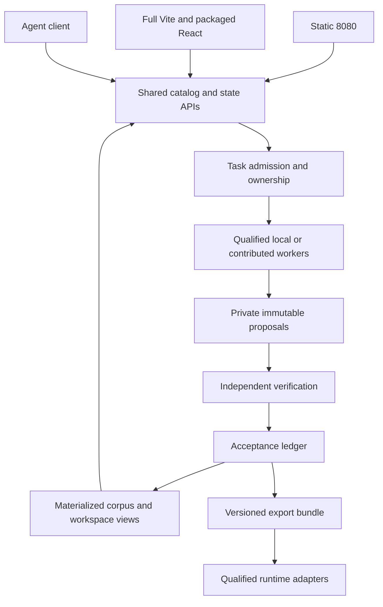

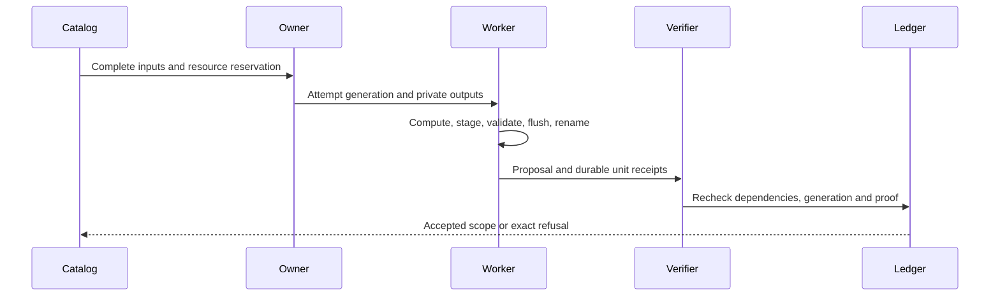

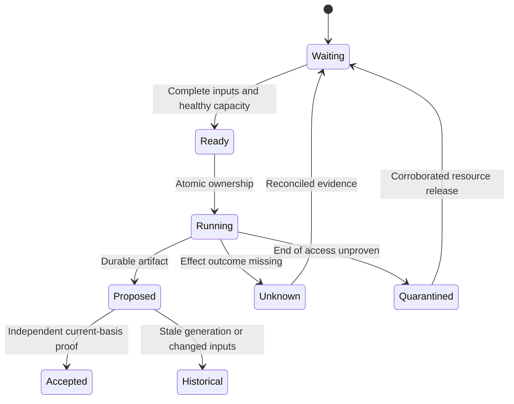

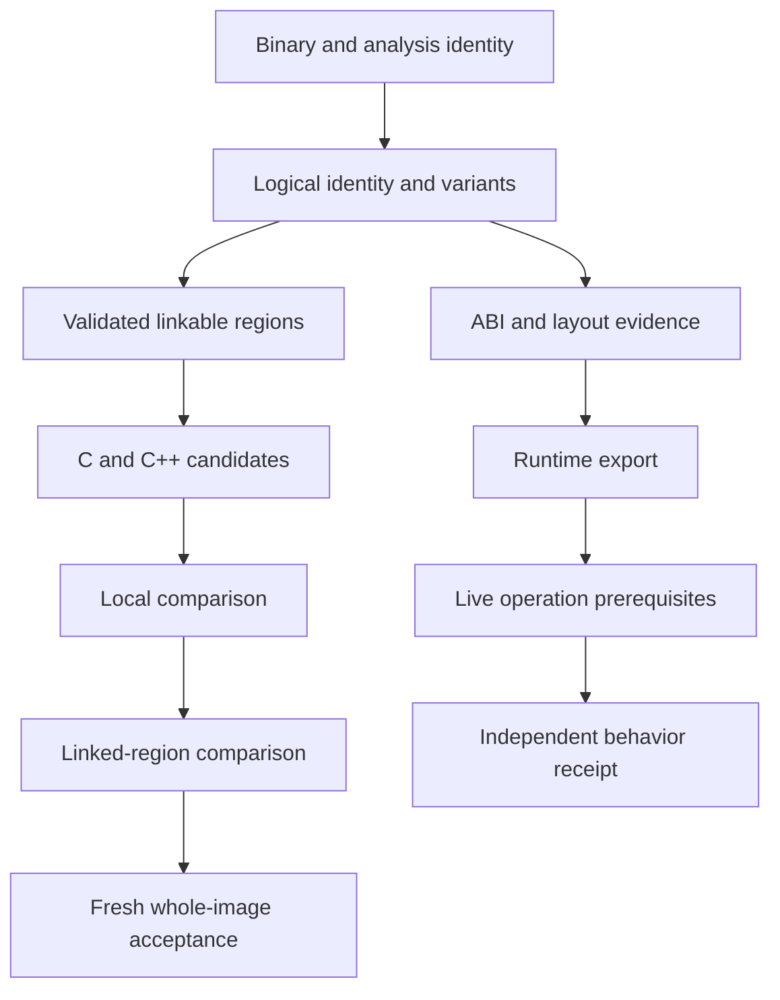

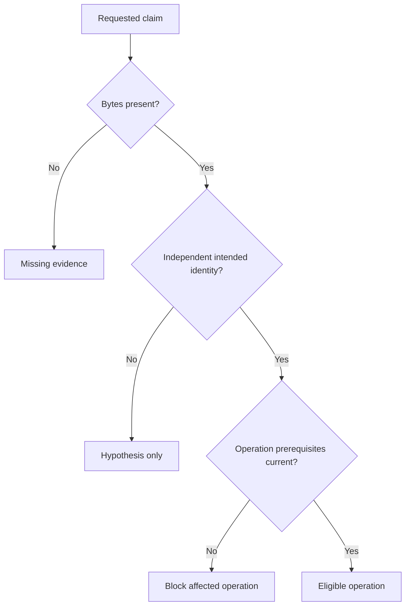

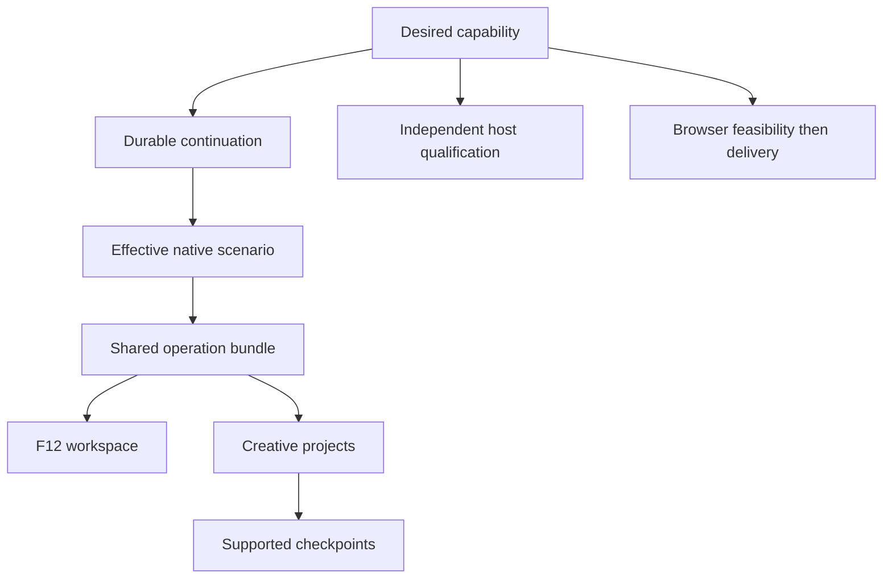

| Mode or surface | Shared contract | Additional gate |
|---|---|---|
| Read-only browsing | Identity-scoped queries | No work admission |
| Explicit open/add/resume | Task admission | Ownership, complete inputs and budgets |
| Static or React write | Catalog capability | Same backend validation and audit |
| Original-code operation | Runtime receipt | Live ABI/lifetime/policy |
| Recovered replacement | Source contribution | Recipient local/linked acceptance |
| Remote worker | Task proposal | Capability, isolation and independent verification |
| Game join | Server session | Authentication, content/version and ownership |

### Sequencing and landing

Deliver prerequisite slices in dependency order, while allowing independent eligible work. Start with accounting and existing-source reconciliation, then identity/currentness and acceptance ownership. Develop recovery, runtime exports, frontend parity and grid-of-one against those contracts. Native capabilities branch when their actual prerequisites pass; source-based multiplayer requires the engine and transport gates. Host/browser investigations can run independently. Integration uses narrow reviewed changes and bounded rollback; do not overwrite owner-held files, stage unrelated dirt or publish a PR automatically.

## Implementation Units

The units below are integration owners. Each named child has one accountable integration owner. Each source clause has one coverage owner, responsible for preserving and applying every detail through the relevant child acceptance. Clause ownership is not a prerequisite edge: cross-cutting clauses close at final integration without blocking independently accepted earlier slices. A unit closes its own acceptance predicates and assigned named children; it does not inherit unrelated downstream acceptance merely because a source section mentions it. Historical examples do not silently replace generic defaults.

### Unit index

| Unit | Deliverable | Prerequisite units | Primary implementation seam |
|---|---|---|---|
| U1 | Scope, truth and evidence authority | None; reconciliation can start read-only | src/agentdecompile_recovery/corpus/ ingest, ledger, packaging and parity consumers |
| U2 | Determinism, schema and generic data seams | U1 | src/agentdecompile_recovery/corpus/ schema, migrations, logical and basis modules |
| U3 | Identity, field fusion and compatible cross-build reuse | U1, U2 | src/agentdecompile_recovery/corpus/ identity, match_store, propagation and recipient acceptance |
| U4 | Recover, calibrate, reconstruct and compare | U1, U2 | src/agentdecompile_recovery/ compiler, reconstruction, collect_source and finish_binary paths |
| U5 | Portable entities, signatures, roots and layouts | U2, U3 | src/agentdecompile_recovery/corpus/ entity, signature, layout, ABI and decoder providers |
| U6 | Runtime consumer, caves and safe mutation | U5, U9 | Corpus runtime export interfaces and qualified KotorPhasor consumer adapters |
| U7 | Exhaustive bounded fallback and learning | U5, U6 | Corpus resolver and learn-build adapters; ordered member receipts |
| U8 | Complete deterministic export bundle | U5, U7 | src/agentdecompile_recovery/corpus/ export modules and recovered-project packaging |
| U9 | One durable task authority, resource admission and failure continuation | U1 | src/agentdecompile_recovery/corpus/dashboard/ preparation, continuation, action and ownership boundaries |
| U10 | External verification and portable recovered projects | U1, U4, U9 | src/agentdecompile_recovery/corpus/external_execution.py and recovered-project recipe adapters |
| U11 | Reusable donated compute foundation and adapters | U1, U9 | agentdecompile_grid package, exchange and corpus task-kind adapters |
| U12 | Autonomous capability product M1–M7 | U6, U9 | Shared capability catalog, scenario manifests and KotorPhasor operation/UI/harness adapters |
| U13 | Source and package reconciliation | None; reconciliation can start read-only | Existing backend/provider, static workbench and Vite modules named below; no duplicate root |
| U14 | Project lifecycle, admission and tab contexts | U13, U29, U9 | Existing backend/provider, static workbench and Vite modules named below; no duplicate root |
| U15 | Shared selection, navigation and accessible shell | U13 | Existing backend/provider, static workbench and Vite modules named below; no duplicate root |
| U16 | Full CodeBrowser and Ghidra guide parity | U15, U29 | Existing backend/provider, static workbench and Vite modules named below; no duplicate root |
| U17 | Corpus and KotORXID integration | U15, U1 | Existing backend/provider, static workbench and Vite modules named below; no duplicate root |
| U18 | Match evidence, availability and review | U15, U3 | Existing backend/provider, static workbench and Vite modules named below; no duplicate root |
| U19 | Compare and recovery workspaces | U15, U4 | Existing backend/provider, static workbench and Vite modules named below; no duplicate root |
| U20 | Actual work visualization, supervision and spectators | U15, U9 | Existing backend/provider, static workbench and Vite modules named below; no duplicate root |
| U21 | Metric and publish contract | U17, U1 | Existing backend/provider, static workbench and Vite modules named below; no duplicate root |
| U22 | Optional AI and bounded context | U14, U9 | Existing backend/provider, static workbench and Vite modules named below; no duplicate root |
| U23 | ABI and type data preservation | U5 | Existing backend/provider, static workbench and Vite modules named below; no duplicate root |
| U24 | Hook pack v2 and compatible readers | U23, U2 | Existing backend/provider, static workbench and Vite modules named below; no duplicate root |
| U25 | Cave discovery and safe injection plans | U5 | Existing backend/provider, static workbench and Vite modules named below; no duplicate root |
| U26 | Generated Lua and C/C++ build headers | U23, U24 | Existing backend/provider, static workbench and Vite modules named below; no duplicate root |
| U27 | Readiness and divergence | U3, U24 | Existing backend/provider, static workbench and Vite modules named below; no duplicate root |
| U28 | Atomic export bundle and delivery | U24, U25, U26, U27 | Existing backend/provider, static workbench and Vite modules named below; no duplicate root |
| U29 | Explicit MCP program dispatch | U13 | Existing backend/provider, static workbench and Vite modules named below; no duplicate root |
| U30 | Input and ownership simplification preservation | U13 | Existing backend/provider, static workbench and Vite modules named below; no duplicate root |
| U31 | Browser rewrite contributor | U11 | Existing backend/provider, static workbench and Vite modules named below; no duplicate root |
| U32 | Durable exchange proposal lifecycle | U9 | Existing backend/provider, static workbench and Vite modules named below; no duplicate root |
| U33 | Source baseline and identity | U4 | Existing shared backend and static/Vite consumer modules identified in the unit; multiplayer additions belong to shared recovered-engine/runtime adapters |
| U34 | Local transport and dispatch | U33 | Existing shared backend and static/Vite consumer modules identified in the unit; multiplayer additions belong to shared recovered-engine/runtime adapters |
| U35 | Remote gameplay | U34, U9 | Existing shared backend and static/Vite consumer modules identified in the unit; multiplayer additions belong to shared recovered-engine/runtime adapters |
| U36 | Dedicated executable | U35 | Existing shared backend and static/Vite consumer modules identified in the unit; multiplayer additions belong to shared recovered-engine/runtime adapters |
| U37 | Directory | U35 | Existing shared backend and static/Vite consumer modules identified in the unit; multiplayer additions belong to shared recovered-engine/runtime adapters |
| U38 | In-game browser | U35, U37 | Existing shared backend and static/Vite consumer modules identified in the unit; multiplayer additions belong to shared recovered-engine/runtime adapters |
| U39 | Release proof | U36, U38 | Existing shared backend and static/Vite consumer modules identified in the unit; multiplayer additions belong to shared recovered-engine/runtime adapters |
| U40 | Semantic findings and extensibility | U16, U17 | Existing backend/provider, static workbench and Vite modules named below; no duplicate root |
| U41 | Collaboration, CI and controlled reporting | U1, U13 | Existing backend/provider, static workbench and Vite modules named below; no duplicate root |
| U42 | Packaging, standalone reload and final integration | U13 | Existing backend/provider, static workbench and Vite modules named below; no duplicate root |

### U1. Scope, truth and evidence authority

- **Requirements:** R1–R8; assigned named obligations and applicable source details are mandatory; cross-cutting clause coverage does not add unrelated prerequisite edges.
- **Dependencies:** Read-only reconciliation may begin immediately. These denote consumed predicates, not a requirement to finish every unrelated child of a predecessor.
- **Files and interfaces:** src/agentdecompile_recovery/corpus/ ingest, ledger, packaging and parity consumers. Preserve existing public routing and inspect current symbols before changes; paths in archived contracts are version-specific leads.
- **Execution:** reconcile retained implementation and evidence first; implement the missing vertical slice, exercise the named positive and refusal cases, then integrate the real consumer and capture the required proof.

Integrate producer and consumer claim semantics before multiplying candidate throughput. Reuse existing `corpus/ingest_recovered.py`, `rebuild_ledger.py`, `collect_source.py`, `verify_legacy_recovered.py`, `recover_named_ghidra.py`, `restore_recovered_tree.py`, `package_authoritative.py`, `finish_binary.py`, and `dashboard/byte_parity.py` paths. Introduce or reuse one evaluator that records exact source digest, target snapshot digest, dependency/toolchain basis, claim kind/scope, raw observations, verifier, policy and generation. Candidate compilation, anonymous local byte match, semantic name binding, linked source contribution and whole-image equality remain different records. Do not silently treat `real_c=1` as accepted recovery. Existing embedded-PE-export witness closes only that witness lane; add other qualified identity roots with their own evidence.

Acceptance: Foo-labelled Bar bytes refuse semantic acceptance while an independently identified entity succeeds; editing source under same filename invalidates prior source comparison; an eliminated/floor-overwritten compiled replacement gets zero contribution; a changed policy or dependency before commit rejects publication; unrelated valid evidence survives. Preserve unaccepted candidates for later improvement. Map session portable-plan-2026-09-21:D01–portable-plan-2026-09-21:D15,portable-plan-2026-09-21:D21–portable-plan-2026-09-21:D28,portable-plan-2026-09-21:D32,RC01–RC08,RC10 and all affected portable ordering/basis units.

- **Completion:** close assigned named child obligations and unit-specific predicates against the exact input/version scope; discharge owned source-clause coverage through explicit child evidence or contextual disposition; record changed paths, verification receipts, and remaining blocked predicates on the owning todo item or in its task report. Commit only owned, reviewed changes during a separately authorized implementation run.

### U2. Determinism, schema and generic data seams

- **Requirements:** R1–R3,R9–R10,R14; assigned named obligations and applicable source details are mandatory; cross-cutting clause coverage does not add unrelated prerequisite edges.
- **Dependencies:** U1. These denote consumed predicates, not a requirement to finish every unrelated child of a predecessor.
- **Files and interfaces:** src/agentdecompile_recovery/corpus/ schema, migrations, logical and basis modules. Preserve existing public routing and inspect current symbols before changes; paths in archived contracts are version-specific leads.
- **Execution:** reconcile retained implementation and evidence first; implement the missing vertical slice, exercise the named positive and refusal cases, then integrate the real consumer and capture the required proof.

Repair total SQL and reduction order, rowid backfill, content-hash tie breaks and stable entity keys; preserve previous_keys after true membership changes. Unify schema DDL/migrations and delete registries before adding binary/platform columns. Add store-derived determinism basis, per-kind cache projections, canonical serialization and strict refusal of missing/mixed basis. Keep declarative target data packs separate from L1 engine-agnostic algorithms and L2 format/platform adapters. Format mappings include PE/ELF/Mach-O/XBE and architecture/endian/container qualification instead of hardcoded x86 defaults. Data migrations preserve unknown legacy meaning and roll back only through validated compatible routes.

Dependencies: portable portable-plan-2026-09-21:D1–portable-plan-2026-09-21:D9,portable-plan-2026-09-21:U5c,portable-plan-2026-09-21:U7/portable-plan-2026-09-21:U7b,portable-plan-2026-09-21:U19a,portable-plan-2026-09-21:U21a–c,portable-plan-2026-09-21:U22,portable-plan-2026-09-21:U25,portable-plan-2026-09-21:U29,portable-plan-2026-09-21:U54,portable-plan-2026-09-21:U62,portable-plan-2026-09-21:U69/portable-plan-2026-09-21:U70/portable-plan-2026-09-21:U76/portable-plan-2026-09-21:U77/portable-plan-2026-09-21:U82; schema first, then platform fields, then donor admission. Acceptance: fresh binary IDs, reversed insertion, randomized traversal/completion and stable content yield byte-identical declared-basis exports and equal canonical semantic rows; content changes invalidate only affected keys. Rebaseline never launders legacy unbound evidence into current proof.

- **Completion:** close assigned named child obligations and unit-specific predicates against the exact input/version scope; discharge owned source-clause coverage through explicit child evidence or contextual disposition; record changed paths, verification receipts, and remaining blocked predicates on the owning todo item or in its task report. Commit only owned, reviewed changes during a separately authorized implementation run.

### U3. Identity, field fusion and compatible cross-build reuse

- **Requirements:** R2–R3,R8–R9; assigned named obligations and applicable source details are mandatory; cross-cutting clause coverage does not add unrelated prerequisite edges.
- **Dependencies:** U1, U2. These denote consumed predicates, not a requirement to finish every unrelated child of a predecessor.
- **Files and interfaces:** src/agentdecompile_recovery/corpus/ identity, match_store, propagation and recipient acceptance. Preserve existing public routing and inspect current symbols before changes; paths in archived contracts are version-specific leads.
- **Execution:** reconcile retained implementation and evidence first; implement the missing vertical slice, exercise the named positive and refusal cases, then integrate the real consumer and capture the required proof.

Maintain logical entity→implementation variant→physical instance multiplicity; folded bodies, inlined occurrences and split regions are explicit. Identity/calibration feed back to one another. Use authoritative debug/provenance, unique exact evidence, rare references/neighborhood, structural/BSim and applicable second opinions in cheap-first order. Donor source distribution requires compilation plus recipient variant/ABI/layout compatibility; every recipient has independent acceptance. Name priority is human→STABS/source→symbol/demangled→meaningful analysis→placeholder, per field; name preference does not override measured types/layouts. Add BSim persistence and per-kind structural divergence. Match review requires the observed pair/basis freshness and durable decision history.

Dependencies: U1/U2; portable portable-plan-2026-09-21:U5d,portable-plan-2026-09-21:U14–portable-plan-2026-09-21:U17b,portable-plan-2026-09-21:U30–portable-plan-2026-09-21:U39,portable-plan-2026-09-21:U48–portable-plan-2026-09-21:U53,portable-plan-2026-09-21:U70,portable-plan-2026-09-21:U79; runtime claims are separate inputs. Acceptance: donor x+1 cannot replace recipient x+2 solely on logical family; independent supporting roots survive another seed's withdrawal; new collisions may reduce accepted coverage. Preserve split/inline/diverged interpretation and all rejected alternatives.

- **Completion:** close assigned named child obligations and unit-specific predicates against the exact input/version scope; discharge owned source-clause coverage through explicit child evidence or contextual disposition; record changed paths, verification receipts, and remaining blocked predicates on the owning todo item or in its task report. Commit only owned, reviewed changes during a separately authorized implementation run.

### U4. Recover, calibrate, reconstruct and compare

- **Requirements:** R4–R7; assigned named obligations and applicable source details are mandatory; cross-cutting clause coverage does not add unrelated prerequisite edges.
- **Dependencies:** U1, U2. These denote consumed predicates, not a requirement to finish every unrelated child of a predecessor.
- **Files and interfaces:** src/agentdecompile_recovery/ compiler, reconstruction, collect_source and finish_binary paths. Preserve existing public routing and inspect current symbols before changes; paths in archived contracts are version-specific leads.
- **Execution:** reconcile retained implementation and evidence first; implement the missing vertical slice, exercise the named positive and refusal cases, then integrate the real consumer and capture the required proof.

Build trustworthy linkable regions containing bytes/boundaries, fixups, associated data, unwind/exception/TLS metadata and original-image provenance. Keep recovery fragments, compilation TU/LTCG groups and emitted comparison regions distinct. Calibrate exact compiler/linker/header/library/options/platform/group scope; probe legacy switches. Prove unchanged extract→emit→place→compare early, then prove compiled replacement owns the compared output. Prefer deterministic behavior-preserving preprocessing/repair, diagnose types/ABI/context/codegen/placement first, then applicable permutation and bounded AI residue. Continuous local and linked parity feeds reconstruction; final exact-placement hash is separate.

Acceptance: wrong reconstructed addend fails against linked original; discard/folding/fallback cannot confer C credit; FP/NaN/exception-sensitive repairs preserve required behavior; complete current source undergoes fresh compiler/toolchain and whole-image comparison. Record C+assembly-floor and max-C independently, with floor bytes excluded from recovered-C count. Region/instruction-only receipts never close whole-image acceptance.

- **Completion:** close assigned named child obligations and unit-specific predicates against the exact input/version scope; discharge owned source-clause coverage through explicit child evidence or contextual disposition; record changed paths, verification receipts, and remaining blocked predicates on the owning todo item or in its task report. Commit only owned, reviewed changes during a separately authorized implementation run.

### U5. Portable entities, signatures, roots and layouts

- **Requirements:** R9–R12; assigned named obligations and applicable source details are mandatory; cross-cutting clause coverage does not add unrelated prerequisite edges.
- **Dependencies:** U2, U3. These denote consumed predicates, not a requirement to finish every unrelated child of a predecessor.
- **Files and interfaces:** src/agentdecompile_recovery/corpus/ entity, signature, layout, ABI and decoder providers. Preserve existing public routing and inspect current symbols before changes; paths in archived contracts are version-specific leads.
- **Execution:** reconcile retained implementation and evidence first; implement the missing vertical slice, exercise the named positive and refusal cases, then integrate the real consumer and capture the required proof.

Implement all entity kinds: functions, globals/strings/tables, structures/fields, vtables/inheritance/RTTI, imports/exports/dispatch/script tables, patch points/calls/immediates, sections/relocs/unwind/TLS, object lifecycle/allocator and integrity ranges. Use masked raw-image patterns, section-scoped unique windows, anchor-relative locators, ordered roots and deref chains with verification. Persist register/stack/join/custom storage losslessly, varargs/no-return, raw calling conventions, `this`, sret allocator/register/storage, per-build field layouts including unknown opaque spans. A pointer-width ratio is only a search hint.

Dependencies: U2 platform/schema; U3 entity model; portable-plan-2026-09-21:U8–portable-plan-2026-09-21:U11b,portable-plan-2026-09-21:U30–portable-plan-2026-09-21:U47,portable-plan-2026-09-21:U61/portable-plan-2026-09-21:U63,portable-plan-2026-09-21:U69–portable-plan-2026-09-21:U79,portable-plan-2026-09-21:U83–portable-plan-2026-09-21:U86. In particular portable-plan-2026-09-21:U32a field rows precede struct export, portable-plan-2026-09-21:U79 qualified RTTI precedes portable vtable correspondence, portable-plan-2026-09-21:U40/portable-plan-2026-09-21:U41 supply root facts, and ABI bridge portable-plan-2026-09-21:U8 must stop both storage-loss boundaries. Acceptance: all-stripped fixtures still have non-name struct evidence; positional vtable alignment alone never becomes accepted method identity; nonstandard ABI refuses unsupported native use; exact per-build layout and bounds survive export/consume.

- **Completion:** close assigned named child obligations and unit-specific predicates against the exact input/version scope; discharge owned source-clause coverage through explicit child evidence or contextual disposition; record changed paths, verification receipts, and remaining blocked predicates on the owning todo item or in its task report. Commit only owned, reviewed changes during a separately authorized implementation run.

### U6. Runtime consumer, caves and safe mutation

- **Requirements:** R12–R13; assigned named obligations and applicable source details are mandatory; cross-cutting clause coverage does not add unrelated prerequisite edges.
- **Dependencies:** U5, U9. These denote consumed predicates, not a requirement to finish every unrelated child of a predecessor.
- **Files and interfaces:** Corpus runtime export interfaces and qualified KotorPhasor consumer adapters. Preserve existing public routing and inspect current symbols before changes; paths in archived contracts are version-specific leads.
- **Execution:** reconcile retained implementation and evidence first; implement the missing vertical slice, exercise the named positive and refusal cases, then integrate the real consumer and capture the required proof.

Deliver C++/Lua v2 consumer and version negotiation with refuse-on-unknown before enabling v2-only payloads. Use target build identity and expected bytes, then independent semantic identity and operation preflight. Implement descriptor-driven generated native thunks, architecture/endian/module/rebase/PIE support, runtime resolver and supported read/call/mutate operations. Cave plans carry origin, capacity, branches, relocated instruction proof, protection/CFG/integrity policy and restoration contract. Install/remove/quiescence and safe resource release require live evidence; generation expiry is not proof old worker/thread ceased access. Registry keys prevent overlapping mods/claims. Data-only supported rollback cannot imply reversal of game side effects, and unsafe active code claims block unload.

Dependencies: U5, portable portable-plan-2026-09-21:U23/portable-plan-2026-09-21:U46 before portable-plan-2026-09-21:U12/portable-plan-2026-09-21:U13/portable-plan-2026-09-21:U13b, portable-plan-2026-09-21:U24,portable-plan-2026-09-21:U55–portable-plan-2026-09-21:U60,portable-plan-2026-09-21:U67/portable-plan-2026-09-21:U13c,portable-plan-2026-09-21:U71–portable-plan-2026-09-21:U80,portable-plan-2026-09-21:U86. Acceptance: unsupported architecture/ABI refuses specifically; tampering/mixed build misses refuse; active trampoline return blocks reclamation; cross-mod collision refuses; writable/readable/callable/detourable are separately reported. KotorPhasor is runtime adapter consumer, not duplicate recovery engine.

- **Completion:** close assigned named child obligations and unit-specific predicates against the exact input/version scope; discharge owned source-clause coverage through explicit child evidence or contextual disposition; record changed paths, verification receipts, and remaining blocked predicates on the owning todo item or in its task report. Commit only owned, reviewed changes during a separately authorized implementation run.

### U7. Exhaustive bounded fallback and learning

- **Requirements:** R11–R13; assigned named obligations and applicable source details are mandatory; cross-cutting clause coverage does not add unrelated prerequisite edges.
- **Dependencies:** U5, U6. These denote consumed predicates, not a requirement to finish every unrelated child of a predecessor.
- **Files and interfaces:** Corpus resolver and learn-build adapters; ordered member receipts. Preserve existing public routing and inspect current symbols before changes; paths in archived contracts are version-specific leads.
- **Execution:** reconcile retained implementation and evidence first; implement the missing vertical slice, exercise the named positive and refusal cases, then integrate the real consumer and capture the required proof.

Preserve six ladders: changed function bytes; missing/undersized cave; unresolved data root; moved/stripped field; vtable/dispatch slot; unknown build. Retain every ordered member and discriminator in source. Runtime structural members pin same decoder revision as export; mismatch refuses those members. Via-caller/callee, inverse data refs, constructor-derived roots/fields, neighbor mapping, structural comparison, inline/split regions, offline residue, executable allocation/image extension and shape probes are distinct strategies. Learn-build records member outcomes in runtime claims; independent bind promotes them. Budget stop differs from exhausted applicable methods.

Dependencies: U5/U6, portable-plan-2026-09-21:U91–portable-plan-2026-09-21:U103; not every method applicable to every entity. Acceptance: exact reason per member/build, no zero-address success, no forced identity, deterministic negatives require changed hypothesis. Unknown build can gain qualified partial capabilities without pretending all members are supported.

- **Completion:** close assigned named child obligations and unit-specific predicates against the exact input/version scope; discharge owned source-clause coverage through explicit child evidence or contextual disposition; record changed paths, verification receipts, and remaining blocked predicates on the owning todo item or in its task report. Commit only owned, reviewed changes during a separately authorized implementation run.

### U8. Complete deterministic export bundle

- **Requirements:** R14–R15; assigned named obligations and applicable source details are mandatory; cross-cutting clause coverage does not add unrelated prerequisite edges.
- **Dependencies:** U5, U7. These denote consumed predicates, not a requirement to finish every unrelated child of a predecessor.
- **Files and interfaces:** src/agentdecompile_recovery/corpus/ export modules and recovered-project packaging. Preserve existing public routing and inspect current symbols before changes; paths in archived contracts are version-specific leads.
- **Execution:** reconcile retained implementation and evidence first; implement the missing vertical slice, exercise the named positive and refusal cases, then integrate the real consumer and capture the required proof.

One declared-basis export tree contains hookpack/v2, generated Lua, per-build C/C++ headers/manifests, readiness, divergence, receipts, and qualified recovered-source/comparison projects at their independent proof scope. Export all entities, ordered locators, ABI/cave/accessor evidence and unsupported/ambiguous candidates rather than dropping inconvenient rows. Lua contains no literal address dependency; unsupported calling shapes refuse. Headers preserve actual build layouts and opaque unknowns. Build/project recipes use logical digest-bound inputs and relative paths; exports stage/validate/flush/rename before short reference commit, keeping old complete output readable after interruption.

Dependencies: portable-plan-2026-09-21:U87–portable-plan-2026-09-21:U90 after entity/ABI/resolver, portable-plan-2026-09-21:U88 after portable-plan-2026-09-21:U13c; source projects additionally U4/U10. Acceptance: repeat on one basis yields byte-identical bundle and canonical rows; independent consumer executes only supported qualified operations; unknown/contested rows remain explicit; clean supported host resolves recipe inputs without author-machine paths. Export generation alone does not establish ready-to-call or live readiness.

- **Completion:** close assigned named child obligations and unit-specific predicates against the exact input/version scope; discharge owned source-clause coverage through explicit child evidence or contextual disposition; record changed paths, verification receipts, and remaining blocked predicates on the owning todo item or in its task report. Commit only owned, reviewed changes during a separately authorized implementation run.

### U9. One durable task authority, resource admission and failure continuation

- **Requirements:** R16–R20,R31; assigned named obligations and applicable source details are mandatory; cross-cutting clause coverage does not add unrelated prerequisite edges.
- **Dependencies:** U1. These denote consumed predicates, not a requirement to finish every unrelated child of a predecessor.
- **Files and interfaces:** src/agentdecompile_recovery/corpus/dashboard/ preparation, continuation, action and ownership boundaries. Preserve existing public routing and inspect current symbols before changes; paths in archived contracts are version-specific leads.
- **Execution:** reconcile retained implementation and evidence first; implement the missing vertical slice, exercise the named positive and refusal cases, then integrate the real consumer and capture the required proof.

Extend existing preparation/coordinator/recovery adapters rather than adding another goal engine. Task contracts carry objective/capability identity, complete input closure, alternative prerequisite sets (OR-of-AND), mutable resources, measured process-tree profile, persistent ready age, deadline/progress/checkpoint, output and fixed acceptance policy. Atomic intent reserves objective allowance before dispatch; parent identity reaches nested wrappers/MCP/provider/compiler attempts. Unknown post-intent outcome retains charge; allocation revision adds future allowance without erasing history. One retry owner and provider circuit; no new message, basis or wrapper reset. Distinguish liveness, durable units and accepted goal delta.

Compute on immutable snapshots outside DB transaction; publish staged artifact references in a short version/fence/policy-checked commit. Persist wake predicates/cursors without lost-event windows. Missing proof blocks its claim; failed storage/provider blocks dependent tasks; unrelated fully supplied work continues. Owned/quarantined/free access state is independent of current/revoked publication state. Atomic full-resource acquisition or release; external owners never adopted/killed. Storage probes bounded away from scheduler. Lost authority is read-only and blocks new mutation until continuity reconciles. Migration, corrupt evidence, bad policy, unavailable verifier, classifier defects and budget unknowns have named repair/wake contracts.

Acceptance must retain every A01–A20 and FP01–FP30 paired-negative/unaffected-control case, not only retry happy path. Current partial native verifier/retry/recipient slices do not close durable general ownership, real provider verification, transitive withdrawal, policy races or live activation. This is M0 foundation but full M0 remains open until all requirements qualify.

- **Completion:** close assigned named child obligations and unit-specific predicates against the exact input/version scope; discharge owned source-clause coverage through explicit child evidence or contextual disposition; record changed paths, verification receipts, and remaining blocked predicates on the owning todo item or in its task report. Commit only owned, reviewed changes during a separately authorized implementation run.

### U10. External verification and portable recovered projects

- **Requirements:** R4–R6,R17; assigned named obligations and applicable source details are mandatory; cross-cutting clause coverage does not add unrelated prerequisite edges.
- **Dependencies:** U1, U4, U9. These denote consumed predicates, not a requirement to finish every unrelated child of a predecessor.
- **Files and interfaces:** src/agentdecompile_recovery/corpus/external_execution.py and recovered-project recipe adapters. Preserve existing public routing and inspect current symbols before changes; paths in archived contracts are version-specific leads.
- **Execution:** reconcile retained implementation and evidence first; implement the missing vertical slice, exercise the named positive and refusal cases, then integrate the real consumer and capture the required proof.

Provide immutable adapter request/report envelopes around pinned reccmp/ReAgent; retain raw reports, version, target/source/recipe digests, requested claim and unknown/not-run/unsupported/stale outcomes. Reuse external tools through process interfaces; central acceptance alone confers AgentDecompile claims. reccmp diagnoses comparable supported binaries, ReAgent actual recovered projects and benchmark scenarios; neither GREEN nor exit0 proves equality. `corpus/external_execution.py` catalog actions stage isolated destinations, bind ownership and safe timeout/enforcement, reject paths overlapping protected inputs, retain unknown external clearance. Recipe resolver refuses missing inputs rather than following arbitrary absolute author paths.

Acceptance: actual target and rebuilt/candidate consumed, supported comparison and negative tool cases retained; indirect closure complete; verifier failure cannot self-certify; changed input/policy refuses old result; clean-host project preparation and source contribution/whole-image gates independent. Historical synthetic canaries remain scoped evidence only.

- **Completion:** close assigned named child obligations and unit-specific predicates against the exact input/version scope; discharge owned source-clause coverage through explicit child evidence or contextual disposition; record changed paths, verification receipts, and remaining blocked predicates on the owning todo item or in its task report. Commit only owned, reviewed changes during a separately authorized implementation run.

### U11. Reusable donated compute foundation and adapters

- **Requirements:** R21–R22; assigned named obligations and applicable source details are mandatory; cross-cutting clause coverage does not add unrelated prerequisite edges.
- **Dependencies:** U1, U9. These denote consumed predicates, not a requirement to finish every unrelated child of a predecessor.
- **Files and interfaces:** agentdecompile_grid package, exchange and corpus task-kind adapters. Preserve existing public routing and inspect current symbols before changes; paths in archived contracts are version-specific leads.
- **Execution:** reconcile retained implementation and evidence first; implement the missing vertical slice, exercise the named positive and refusal cases, then integrate the real consumer and capture the required proof.

Implement content-addressed immutable objects, per-partition signed logs and conditional heads, bounded ready/verification frontier and replayed materialized SQLite views. Publish/work/verify/materialize locally first, then S3 conditional PUT, static mirror, peer HTTP, outbound HTTPS presigned write-once transport. Ed25519 identities/invites/revocation/rate limits and capability canaries determine actual eligible lanes; every result is a proposal, even fleet-owned. Independent verifier keys and acceptance rules reject bad hashes/receipts. Task IDs use per-kind basis projections; compaction/pruning preserves required history and durable outcomes.

Reconcile portable-plan-2026-09-21:U125 integration names before expansion: task-kinds entrypoint, vocabulary and actual landed interfaces. Include toolchain manifests/canaries, analyzer packed-program canaries, parity canaries, sandbox and idle policy, cloud fleet verbs, compile/group/parity/analyzer/import/decompile/identity/delta-bind/BSim/residue/export/window/relink/attestation adapters, browser module-worker contribution, similarity applier and bundle manifest. Preserve all51 Phase15 records and shared acceptance. Performance numbers labeled measured versus estimates, report two compile-pass populations, and never assume donated node role grants correctness.

Acceptance: grid-of-one actual cycle; stale heads/CAS starvation, stopped peer/provider, duplicate events, bad output, verifier overload/frontier, resume and compaction tested under bounded contracts; worker canary determines supported architecture; incomplete packed-program/library input refuses; adapters consume real task contracts; offline/replayed view deterministic. A successful skeleton historical receipt does not qualify all adapters/fleet.

- **Completion:** close assigned named child obligations and unit-specific predicates against the exact input/version scope; discharge owned source-clause coverage through explicit child evidence or contextual disposition; record changed paths, verification receipts, and remaining blocked predicates on the owning todo item or in its task report. Commit only owned, reviewed changes during a separately authorized implementation run.

### U12. Autonomous capability product M1–M7

- **Requirements:** R31–R34; assigned named obligations and applicable source details are mandatory; cross-cutting clause coverage does not add unrelated prerequisite edges.
- **Dependencies:** U6, U9. These denote consumed predicates, not a requirement to finish every unrelated child of a predecessor.
- **Files and interfaces:** Shared capability catalog, scenario manifests and KotorPhasor operation/UI/harness adapters. Preserve existing public routing and inspect current symbols before changes; paths in archived contracts are version-specific leads.
- **Execution:** reconcile retained implementation and evidence first; implement the missing vertical slice, exercise the named positive and refusal cases, then integrate the real consumer and capture the required proof.

One generated operation schema feeds Lua/help/CLI/F12/harness: entity/build, ABI, return kind, units/ID domain, lifetime/thread, preconditions, observation, effects and inverse/restore class. Capability requests resolve valid receipts and missing prerequisite tasks automatically. Effective scenario manifest pins original/configured/deployed script, target/runtime/assets/fixture, observer window, recorder and cleanup owner. Recheck live predicate after ownership on engine thread; bounded snapshots capture short-lived effects.

M1: real prepared scenario and mixed passed/blocked batch without routine human path/manifest/lifecycle repair. M2: actual consumer binding plus independent native-state oracle, unsupported build refusal. M3: F12 real keyboard/focus/input, engine-thread Lua, inspector/edit/results/error/undo/CopyAsLua with shared operation IDs. M4: declarative scene/shot and stable selectors, namespaced script state, fresh-session reopen and defining-effect capture; no protected-install damage/collision. M5: owned pause/save/restore and replay dialog branches; actual inventory/quest/party/script restoration plus explicit exclusions, fresh lifetimes and no arbitrary-memory rewind claim. M6: exact native Mac K1/K2 and compatible Windows/Linux per-build ABI/graphics/input/capture qualification. M7: assess prior KotorPhasor browser work, prove executable runtime route then sustained actual rendering/input/audio/save/main loop and shared devtools.

M6/M7 research can run independently; neither blocks safe M1–M5. Product demo is one complete requested capability through discovery→binding→UI/Lua→scenario→state observation→supported restoration→clip. Behavior, capture integrity and understandable presentation have separate receipts. Local clip creation never authorizes external publication. Human exceptions are deduplicated exact missing credentials/device/external steps or material acceptance changes, not routine transient failures.

- **Completion:** close assigned named child obligations and unit-specific predicates against the exact input/version scope; discharge owned source-clause coverage through explicit child evidence or contextual disposition; record changed paths, verification receipts, and remaining blocked predicates on the owning todo item or in its task report. Commit only owned, reviewed changes during a separately authorized implementation run.

### U13. Source and package reconciliation

- **Requirements:** R23–R30; assigned named obligations and applicable source details are mandatory; cross-cutting clause coverage does not add unrelated prerequisite edges.
- **Dependencies:** Read-only reconciliation may begin immediately. These denote consumed predicates, not a requirement to finish every unrelated child of a predecessor.
- **Files and interfaces:** Existing backend/provider, static workbench and Vite modules named below; no duplicate root. Preserve existing public routing and inspect current symbols before changes; paths in archived contracts are version-specific leads.
- **Execution:** reconcile retained implementation and evidence first; implement the missing vertical slice, exercise the named positive and refusal cases, then integrate the real consumer and capture the required proof.

- Inputs: delivery reconciliation; current canonical authority; September28 implementation status and worktree plan.
- Reconcile canonical, serving module and isolated branch per file; retain dirty/untracked owner changes and full source/package inventory. Preserve WorkstationApp as Vite root, existing static shell and /react/ base. Do not remount old App/AtlasApp preparation effects or create a parallel root/backend.
- Own main.tsx, vite.config.ts, router/react_api/unified_pages routing and package-data declarations only where concrete diffs require it.
- Acceptance: complete source/revision manifest; selection-preserving compatibility redirects for window=wb-*, binary_hash,function_id,project_id/query/fragment; static remains useful without Node. Asset rollout stages new hashed assets first and atomic index last, retaining old lazy chunks. Serving identity/reloader acceptance and browser receipts are later gates; no restart implied.

- **Completion:** close assigned named child obligations and unit-specific predicates against the exact input/version scope; discharge owned source-clause coverage through explicit child evidence or contextual disposition; record changed paths, verification receipts, and remaining blocked predicates on the owning todo item or in its task report. Commit only owned, reviewed changes during a separately authorized implementation run.

### U14. Project lifecycle, admission and tab contexts

- **Requirements:** R23–R30; assigned named obligations and applicable source details are mandatory; cross-cutting clause coverage does not add unrelated prerequisite edges.
- **Dependencies:** U13, U29, U9. These denote consumed predicates, not a requirement to finish every unrelated child of a predecessor.
- **Files and interfaces:** Existing backend/provider, static workbench and Vite modules named below; no duplicate root. Preserve existing public routing and inspect current symbols before changes; paths in archived contracts are version-specific leads.
- **Execution:** reconcile retained implementation and evidence first; implement the missing vertical slice, exercise the named positive and refusal cases, then integrate the real consumer and capture the required proof.

- Create/open/save/save-as/import/export .gpr/shared/local locator; drag/drop binaries,folders/context; one active mutation target with retained project view tabs. Exact locator, availability and identity remain visible. Shared repo→folders/domain files/program hierarchy stays correct.
- Resume/import reuses program_binding, corpus, cached Ghidra state, annotations and valid receipts. Deduplicate SHA256 artifacts while retaining aliases; group related builds by evidence. Merge preview reports actual additions/reuse/skips/conflicts and per-field donor provenance; do not hide original locations or overwrite human work.
- Durably admit explicit open/register once, close admission dialog, show acknowledged work; passive selection/refresh never starts analysis. Unknown/unavailable paths are not empty new projects. Reconcile native session isolation before parallel read claims.
- Seams: workbench admission, ghidra_project, mcp_bridge; static workbench-app/workbench and existing Vite workspace state. Source frontend-plan-2026-09-28:U3–frontend-plan-2026-09-28:U7; F01–F06,F23.
- Acceptance: duplicate import, unavailable resume, overlap merge, two-project switching, reconnect/double-submit, conflicting metadata, actual saved export containing promised members. Source-only open admission already exists; live acceptance remains open.

- **Completion:** close assigned named child obligations and unit-specific predicates against the exact input/version scope; discharge owned source-clause coverage through explicit child evidence or contextual disposition; record changed paths, verification receipts, and remaining blocked predicates on the owning todo item or in its task report. Commit only owned, reviewed changes during a separately authorized implementation run.

### U15. Shared selection, navigation and accessible shell

- **Requirements:** R23–R30; assigned named obligations and applicable source details are mandatory; cross-cutting clause coverage does not add unrelated prerequisite edges.
- **Dependencies:** U13. These denote consumed predicates, not a requirement to finish every unrelated child of a predecessor.
- **Files and interfaces:** Existing backend/provider, static workbench and Vite modules named below; no duplicate root. Preserve existing public routing and inspect current symbols before changes; paths in archived contracts are version-specific leads.
- **Execution:** reconcile retained implementation and evidence first; implement the missing vertical slice, exercise the named positive and refusal cases, then integrate the real consumer and capture the required proof.

- Logical entity plus concrete project/build/revision/address is the selection key; checked batch set is separate. Async responses are key-bound; target switches cannot reuse dangerous checked addresses/drafts. Retain absent counterpart explanation and last valid decompile function while viewing data.
- Connect Listing/Decompile/Hex/CFG/callgraph/xrefs/types/evidence/diff; deep links and Back/Forward restore viewport. One Functions surface, persistent resizable panes, dense rows, command palette, keyboard/context menus and bottom activity dock. Scroll/focus/editor drafts survive refresh; inactive retained tools do not receive competing selection updates.
- Acceptance: logical/build switch, stale response, data-address navigation, draft conflict, range/select-all and narrow layout; keyboard/screen reader/reduced motion equivalents. F07–F12 and unified workstation Tasks3–4.

- **Completion:** close assigned named child obligations and unit-specific predicates against the exact input/version scope; discharge owned source-clause coverage through explicit child evidence or contextual disposition; record changed paths, verification receipts, and remaining blocked predicates on the owning todo item or in its task report. Commit only owned, reviewed changes during a separately authorized implementation run.

### U16. Full CodeBrowser and Ghidra guide parity

- **Requirements:** R23–R30; assigned named obligations and applicable source details are mandatory; cross-cutting clause coverage does not add unrelated prerequisite edges.
- **Dependencies:** U15, U29. These denote consumed predicates, not a requirement to finish every unrelated child of a predecessor.
- **Files and interfaces:** Existing backend/provider, static workbench and Vite modules named below; no duplicate root. Preserve existing public routing and inspect current symbols before changes; paths in archived contracts are version-specific leads.
- **Execution:** reconcile retained implementation and evidence first; implement the missing vertical slice, exercise the named positive and refusal cases, then integrate the real consumer and capture the required proof.

- Continuous virtualized instruction/data listing including address,bytes,mnemonic,operands,labels,comments,flow,xrefs; navigable symbols/classes/namespaces/functions/imports/exports; no guessed exact-symbol resolution.
- Token/address mapping synchronizes decompiler and listing where evidence exists; local variables classified through HighFunction and edited by identity, not treated as program addresses. Unreachable-code option, dataflow/extraout/unaff/stack-slot diagnosis and hypothesis-driven repair preserve machine evidence.
- Type archive/category browser, pointer-noise filters, uses, structure/union/enum/array/pointer/function-type grids and layout edits; concrete template instances, C++classes/inheritance and vtable slot/target/caller evidence retain ambiguity.
- Function editor preserves namespace,return,parameters,varargs,inline,no-return,thunk,fixup and program-supported convention. Actual editable multi-piece register/stack return and parameter storage validates register widths, ordinals, piece sizes, overlap and stack offsets; exact-target draft/conflict transaction followed by refresh.
- Memory map,bookmarks and categories, incoming/outgoing xrefs/call trees, scripts and Ghidra exporter choices. Dedicated byte patch/assemble UX when scope requires: original bytes/exact target/preview/conflict transaction/post-read; unrestricted script is not ordinary patch UX.
- Seams: CodeBrowser,FunctionEditor,GuideWorkflows,SourceEditor and existing MCP providers; source guide matrix chapters1–16 and frontend-plan-2026-09-28:U6. Acceptance must enumerate all16 chapters; storage source fix a6bbe36 does not imply live mutation accepted.

- **Completion:** close assigned named child obligations and unit-specific predicates against the exact input/version scope; discharge owned source-clause coverage through explicit child evidence or contextual disposition; record changed paths, verification receipts, and remaining blocked predicates on the owning todo item or in its task report. Commit only owned, reviewed changes during a separately authorized implementation run.

### U17. Corpus and KotORXID integration

- **Requirements:** R23–R30; assigned named obligations and applicable source details are mandatory; cross-cutting clause coverage does not add unrelated prerequisite edges.
- **Dependencies:** U15, U1. These denote consumed predicates, not a requirement to finish every unrelated child of a predecessor.
- **Files and interfaces:** Existing backend/provider, static workbench and Vite modules named below; no duplicate root. Preserve existing public routing and inspect current symbols before changes; paths in archived contracts are version-specific leads.
- **Execution:** reconcile retained implementation and evidence first; implement the missing vertical slice, exercise the named positive and refusal cases, then integrate the real consumer and capture the required proof.

- Port semantics rather than donor server: overview/mission scope, generic build inventory(platform,architecture,format,duplicates,exclusions), concrete-function search/filter/paging, logical identity members and sibling navigation, cross-build matrices, bounded depth1/2 callers/callees graph with omissions and structured accessibility fallback.
- Separate readable C, compiling C,ASM floors,function equality,whole-image receipts; max-C and byte-accurate variants; chosen runs,compile tallies,reconstruction/package artifacts; STABS names/source paths/provenance; Ghidra knowledge/cache/server visibility/missing-program gaps.
- Confined text artifact browser with roots,suffix/size/entry bounds; database metadata/query summary instead of raw download; processes/logs observational unless catalog-authorized control. Directive evidence missing paths explicit. Global search/context tabs, large-source on-demand truncation, graph pan/zoom where useful, fingerprint/first-seen-broken/freshness/I/O budget are retained gaps.
- Acceptance: every route/inventory family maps into shared navigation; bounded indexed queries and exact metric-to-set navigation, source/age, inaccessible/missing/failed/stale/excluded states. Donor source presence is historical evidence, not mounted proof.

- **Completion:** close assigned named child obligations and unit-specific predicates against the exact input/version scope; discharge owned source-clause coverage through explicit child evidence or contextual disposition; record changed paths, verification receipts, and remaining blocked predicates on the owning todo item or in its task report. Commit only owned, reviewed changes during a separately authorized implementation run.

### U18. Match evidence, availability and review

- **Requirements:** R23–R30; assigned named obligations and applicable source details are mandatory; cross-cutting clause coverage does not add unrelated prerequisite edges.
- **Dependencies:** U15, U3. These denote consumed predicates, not a requirement to finish every unrelated child of a predecessor.
- **Files and interfaces:** Existing backend/provider, static workbench and Vite modules named below; no duplicate root. Preserve existing public routing and inspect current symbols before changes; paths in archived contracts are version-specific leads.
- **Execution:** reconcile retained implementation and evidence first; implement the missing vertical slice, exercise the named positive and refusal cases, then integrate the real consumer and capture the required proof.

- Persist BSim query hits; add named C++/RTTI channel anchors; distinguish K P-code skeleton evidence from M BinDiff; qualify contract veto without promoting shadow observations. Store match kind/confidence/algorithm and uncertainty per pair/function. Always-available deterministic matching is independent of optional AI.
- Per-pair/function availability explains unavailable providers/prerequisites, not fabricated results. Cross-build dock/matrix links evidence and counterpart details. Stable match-ID paging rejects old score cursors; select all decidable page rows, token+selection required, confirm intended mutation and show pending until terminal outcome. Rejected alternatives retained.
- Seams: match_store/features/channel_confidence/contract_features/identity/propagate/schema, dashboard callgraph panels and both frontend-plan-2026-09-28:U14 surfaces. Source frontend-plan-2026-09-28:U8–frontend-plan-2026-09-28:U14; older read-only donor review does not prohibit newer authorized review workflow.
- Acceptance: restart persistence, channel provenance, contract conflict, stale decision, pending/failure results, absent producer shown. Source batch lacks admitted BSim producer and full veto qualification.

- **Completion:** close assigned named child obligations and unit-specific predicates against the exact input/version scope; discharge owned source-clause coverage through explicit child evidence or contextual disposition; record changed paths, verification receipts, and remaining blocked predicates on the owning todo item or in its task report. Commit only owned, reviewed changes during a separately authorized implementation run.

### U19. Compare and recovery workspaces

- **Requirements:** R23–R30; assigned named obligations and applicable source details are mandatory; cross-cutting clause coverage does not add unrelated prerequisite edges.
- **Dependencies:** U15, U4. These denote consumed predicates, not a requirement to finish every unrelated child of a predecessor.
- **Files and interfaces:** Existing backend/provider, static workbench and Vite modules named below; no duplicate root. Preserve existing public routing and inspect current symbols before changes; paths in archived contracts are version-specific leads.
- **Execution:** reconcile retained implementation and evidence first; implement the missing vertical slice, exercise the named positive and refusal cases, then integrate the real consumer and capture the required proof.

- objdiff-style target/candidate instruction alignment,register differences, symbols,paging,mismatch jumps and receipt basis; exact source/compiler/flags/ABI, diagnostics and attempt history link to selection. decomp.me-style retained scratch shares verified boundary.
- Local licensed multi-decompiler/Dogbolt witnesses compare alternatives without equating agreement to proof. RzWeb/r2web-style expert assembly/source/xrefs/evidence use existing providers; no external donor code implied. APKMan-style bounded format/container hierarchy preserves offsets/hash/parent provenance, unsupported/encrypted/packed state and safe extraction budgets. Current ELF/PE section tree is partial, not archive parity.
- Seams frontend-plan-2026-09-28:U18–frontend-plan-2026-09-28:U22; CompareView,DiffEvidence,boundaries,ScratchWorkspace,artifactParser.worker/localProject.
- Acceptance: actual backend receipt, malformed/truncated inputs, worker cancellation, format gaps and no UI fake controls; bounded client/provider and donor license qualification.

- **Completion:** close assigned named child obligations and unit-specific predicates against the exact input/version scope; discharge owned source-clause coverage through explicit child evidence or contextual disposition; record changed paths, verification receipts, and remaining blocked predicates on the owning todo item or in its task report. Commit only owned, reviewed changes during a separately authorized implementation run.

### U20. Actual work visualization, supervision and spectators

- **Requirements:** R23–R30; assigned named obligations and applicable source details are mandatory; cross-cutting clause coverage does not add unrelated prerequisite edges.
- **Dependencies:** U15, U9. These denote consumed predicates, not a requirement to finish every unrelated child of a predecessor.
- **Files and interfaces:** Existing backend/provider, static workbench and Vite modules named below; no duplicate root. Preserve existing public routing and inspect current symbols before changes; paths in archived contracts are version-specific leads.
- **Execution:** reconcile retained implementation and evidence first; implement the missing vertical slice, exercise the named positive and refusal cases, then integrate the real consumer and capture the required proof.

- Evidence-bound stage DAG, active lanes and dependent branches show actual extraction, candidate alignments, identity decisions, field propagation,source diff,compiler diagnostics,instruction and whole-image deltas, runtime trace. No simulated motion/invented ETA. Freeze/step/history/reduced-motion and inspectable event basis.
- One coordinator supplies scope,pause/resume/stop and durable intent IDs; unknown effect reconciles, expired lease is not safe release, quarantine names resource, disconnected snapshot is dated/read-only, no queued hidden mutations. Retain independent ready work and exact wake condition with budget spent. Read-only spectator mode mirrors authorized selection without exposing mutation/secrets.
- Fleet roster shows actual capability,lease,resource limits,cancellation/evidence and LaneE status. Contributor/operations distinction remains explicit.
- Seams frontend-plan-2026-09-28:U23–frontend-plan-2026-09-28:U25 and canonical activity/preparation projections. Acceptance includes event ordering/reconnect/stale tab/double-click/quarantine/store loss/slow-but-progressing, accessibility and spectator permission boundaries.

- **Completion:** close assigned named child obligations and unit-specific predicates against the exact input/version scope; discharge owned source-clause coverage through explicit child evidence or contextual disposition; record changed paths, verification receipts, and remaining blocked predicates on the owning todo item or in its task report. Commit only owned, reviewed changes during a separately authorized implementation run.

### U21. Metric and publish contract

- **Requirements:** R23–R30; assigned named obligations and applicable source details are mandatory; cross-cutting clause coverage does not add unrelated prerequisite edges.
- **Dependencies:** U17, U1. These denote consumed predicates, not a requirement to finish every unrelated child of a predecessor.
- **Files and interfaces:** Existing backend/provider, static workbench and Vite modules named below; no duplicate root. Preserve existing public routing and inspect current symbols before changes; paths in archived contracts are version-specific leads.
- **Execution:** reconcile retained implementation and evidence first; implement the missing vertical slice, exercise the named positive and refusal cases, then integrate the real consumer and capture the required proof.

- report.json generator, weighted objdiff consumer, disjoint member accounting and independent extent unions; per-entity matrix tier counts and source-vs-byte proof separation. Every rendered percentage needs entity,scope,measure,numerator,denominator,freshness,evidence and count-to-set equality.
- No double-counting split/merged regions, overlapping extents or ASM floor as C. Missing independent acceptance provider stays explicit. Publication is an explicit authorized step after reconciliation gate; local artifact existence does not authorize external release.
- Seams frontend-plan-2026-09-28:U26–frontend-plan-2026-09-28:U29,frontend-plan-2026-09-28:U43. Acceptance: count gaps/double counting, denominator changes, stale receipts, tier-split bars/matrix and publish refusal; source report batch exists but acceptance provider,matrix,publish approval open.

- **Completion:** close assigned named child obligations and unit-specific predicates against the exact input/version scope; discharge owned source-clause coverage through explicit child evidence or contextual disposition; record changed paths, verification receipts, and remaining blocked predicates on the owning todo item or in its task report. Commit only owned, reviewed changes during a separately authorized implementation run.

### U22. Optional AI and bounded context

- **Requirements:** R23–R30; assigned named obligations and applicable source details are mandatory; cross-cutting clause coverage does not add unrelated prerequisite edges.
- **Dependencies:** U14, U9. These denote consumed predicates, not a requirement to finish every unrelated child of a predecessor.
- **Files and interfaces:** Existing backend/provider, static workbench and Vite modules named below; no duplicate root. Preserve existing public routing and inspect current symbols before changes; paths in archived contracts are version-specific leads.
- **Execution:** reconcile retained implementation and evidence first; implement the missing vertical slice, exercise the named positive and refusal cases, then integrate the real consumer and capture the required proof.

- Single precedence resolver feeds server/frontdoor/rewrite/plugin/cleanup/bulk/budgets/policy plus protected setting UI; capture decision at admission and propagate immutable child basis. AI off prevents model calls and preserves all deterministic work.
- Bounded provenance context bundles selected function/callers/callees/types/strings/diagnostics/witnesses; preview externally sent payload, cite retrieved sources, small-model utility. Optional embedding/cloud proximity never accepts identity.
- Seams frontend-plan-2026-09-28:U15–frontend-plan-2026-09-28:U17,F19,F21; acceptance real off/on admitted job, permission/CSRF/stale settings and consistent CLI/API/UI defaults. Current source implementation not mounted proof.

- **Completion:** close assigned named child obligations and unit-specific predicates against the exact input/version scope; discharge owned source-clause coverage through explicit child evidence or contextual disposition; record changed paths, verification receipts, and remaining blocked predicates on the owning todo item or in its task report. Commit only owned, reviewed changes during a separately authorized implementation run.

### U23. ABI and type data preservation

- **Requirements:** R14–R15; assigned named obligations and applicable source details are mandatory; cross-cutting clause coverage does not add unrelated prerequisite edges.
- **Dependencies:** U5. These denote consumed predicates, not a requirement to finish every unrelated child of a predecessor.
- **Files and interfaces:** Existing backend/provider, static workbench and Vite modules named below; no duplicate root. Preserve existing public routing and inspect current symbols before changes; paths in archived contracts are version-specific leads.
- **Execution:** reconcile retained implementation and evidence first; implement the missing vertical slice, exercise the named positive and refusal cases, then integrate the real consumer and capture the required proof.

- Carry return/parameter storage through both lossy collector/batch/export seams, preserve ordered pieces and actual target ABI. Export typed struct fields/offsets/sizes instead of generic void*/byte fallback where evidence supports type; unknown stays explicit.
- frontend-plan-2026-09-28:U31–frontend-plan-2026-09-28:U32; providers/_collectors,bulk/batch/export paths and header/type exporters. Acceptance fixture/real record passes end-to-end without lost storage/layout; no generic register/pointer defaults.

- **Completion:** close assigned named child obligations and unit-specific predicates against the exact input/version scope; discharge owned source-clause coverage through explicit child evidence or contextual disposition; record changed paths, verification receipts, and remaining blocked predicates on the owning todo item or in its task report. Commit only owned, reviewed changes during a separately authorized implementation run.

### U24. Hook pack v2 and compatible readers

- **Requirements:** R14–R15; assigned named obligations and applicable source details are mandatory; cross-cutting clause coverage does not add unrelated prerequisite edges.
- **Dependencies:** U23, U2. These denote consumed predicates, not a requirement to finish every unrelated child of a predecessor.
- **Files and interfaces:** Existing backend/provider, static workbench and Vite modules named below; no duplicate root. Preserve existing public routing and inspect current symbols before changes; paths in archived contracts are version-specific leads.
- **Execution:** reconcile retained implementation and evidence first; implement the missing vertical slice, exercise the named positive and refusal cases, then integrate the real consumer and capture the required proof.

- Basis-carrying root plus entities[] for every entity class; per-build coverage,aliases,identity/range references,ABI/layout,data-root factory candidates,call/injection plans,patch hash and closed resolver status with reasons. Preserve v1 consumer compatibility through explicit format paths.
- Unresolved/ambiguous/contested records remain exportable evidence; runtime supported operation has separate presence/identity/operation prerequisites and observed_status axis. Verify consumer actually uses adapter_key,aliases,exact hashes; older v1 parser did not.
- frontend-plan-2026-09-28:U33; source pack exists but qualified native adapters remain open.

- **Completion:** close assigned named child obligations and unit-specific predicates against the exact input/version scope; discharge owned source-clause coverage through explicit child evidence or contextual disposition; record changed paths, verification receipts, and remaining blocked predicates on the owning todo item or in its task report. Commit only owned, reviewed changes during a separately authorized implementation run.

### U25. Cave discovery and safe injection plans

- **Requirements:** R14–R15; assigned named obligations and applicable source details are mandatory; cross-cutting clause coverage does not add unrelated prerequisite edges.
- **Dependencies:** U5. These denote consumed predicates, not a requirement to finish every unrelated child of a predecessor.
- **Files and interfaces:** Existing backend/provider, static workbench and Vite modules named below; no duplicate root. Preserve existing public routing and inspect current symbols before changes; paths in archived contracts are version-specific leads.
- **Execution:** reconcile retained implementation and evidence first; implement the missing vertical slice, exercise the named positive and refusal cases, then integrate the real consumer and capture the required proof.

- Image-bound cave discovery with evidence for candidate occupancy,anchor+offset+capacity requirements,region alignment/protection and relocations; cave fallback,allocation policy and refusal outcomes explicit. Empty list is not discovery evidence. Call/install/removal,lifetime and reclaim proof separate.
- frontend-plan-2026-09-28:U34 with external image producers; acceptance exact build/bytes,overlap/insufficient capacity/unsupported dynamic code and stale discovery; no installed hook proof from serialization.

- **Completion:** close assigned named child obligations and unit-specific predicates against the exact input/version scope; discharge owned source-clause coverage through explicit child evidence or contextual disposition; record changed paths, verification receipts, and remaining blocked predicates on the owning todo item or in its task report. Commit only owned, reviewed changes during a separately authorized implementation run.

### U26. Generated Lua and C/C++ build headers

- **Requirements:** R14–R15; assigned named obligations and applicable source details are mandatory; cross-cutting clause coverage does not add unrelated prerequisite edges.
- **Dependencies:** U23, U24. These denote consumed predicates, not a requirement to finish every unrelated child of a predecessor.
- **Files and interfaces:** Existing backend/provider, static workbench and Vite modules named below; no duplicate root. Preserve existing public routing and inspect current symbols before changes; paths in archived contracts are version-specific leads.
- **Execution:** reconcile retained implementation and evidence first; implement the missing vertical slice, exercise the named positive and refusal cases, then integrate the real consumer and capture the required proof.

- frontend-plan-2026-09-28:U35 typed Lua names/struct accessors,table/handle/ID domains,return and parameter ABI,lifetime/effect/restore/refusal behavior,shared operation IDs; frontend-plan-2026-09-28:U36 per-build typed headers,layout/prototype/convention/storage assertions and manifest/compiler assumptions. No literal addresses as portable API.
- Consumer host adapter must qualify actual operations. Generated Lua fake-adapter software checks are not live game proof. Headers parse/compile does not prove binary layout. Preserve separate basis for every build and optional source variant.

- **Completion:** close assigned named child obligations and unit-specific predicates against the exact input/version scope; discharge owned source-clause coverage through explicit child evidence or contextual disposition; record changed paths, verification receipts, and remaining blocked predicates on the owning todo item or in its task report. Commit only owned, reviewed changes during a separately authorized implementation run.

### U27. Readiness and divergence

- **Requirements:** R14–R15; assigned named obligations and applicable source details are mandatory; cross-cutting clause coverage does not add unrelated prerequisite edges.
- **Dependencies:** U3, U24. These denote consumed predicates, not a requirement to finish every unrelated child of a predecessor.
- **Files and interfaces:** Existing backend/provider, static workbench and Vite modules named below; no duplicate root. Preserve existing public routing and inspect current symbols before changes; paths in archived contracts are version-specific leads.
- **Execution:** reconcile retained implementation and evidence first; implement the missing vertical slice, exercise the named positive and refusal cases, then integrate the real consumer and capture the required proof.

- frontend-plan-2026-09-28:U37 readiness per entity/build: resolved,pinned,degraded,ambiguous,unresolved,contested plus independently observed runtime status and missing exact prerequisites. frontend-plan-2026-09-28:U38 meaningful divergence classes1↔1/split/inlined/diverged,field/map/slot deltas and why; qualified decoder/graph producer required; never invent graph from missing metadata.
- Acceptance denominator reconciles full declared entity set; unsupported operation refusal and collision-caused coverage reduction retained; report is not automatic capability promotion.

- **Completion:** close assigned named child obligations and unit-specific predicates against the exact input/version scope; discharge owned source-clause coverage through explicit child evidence or contextual disposition; record changed paths, verification receipts, and remaining blocked predicates on the owning todo item or in its task report. Commit only owned, reviewed changes during a separately authorized implementation run.

### U28. Atomic export bundle and delivery

- **Requirements:** R14–R15; assigned named obligations and applicable source details are mandatory; cross-cutting clause coverage does not add unrelated prerequisite edges.
- **Dependencies:** U24, U25, U26, U27. These denote consumed predicates, not a requirement to finish every unrelated child of a predecessor.
- **Files and interfaces:** Existing backend/provider, static workbench and Vite modules named below; no duplicate root. Preserve existing public routing and inspect current symbols before changes; paths in archived contracts are version-specific leads.
- **Execution:** reconcile retained implementation and evidence first; implement the missing vertical slice, exercise the named positive and refusal cases, then integrate the real consumer and capture the required proof.

- frontend-plan-2026-09-28:U39 content-addressed deterministic bundle with required pack,Lua,caves,headers,readiness,divergence,receipts and explicit optional exclusion receipts; every artifact input basis/version/hash/provenance and dependency closure retained. Validate/stage/flush/rename before acceptance transaction; missing required artifact blocks publication.
- frontend-plan-2026-09-28:U40 precise WASM consumer target discovery remains explicit missing definition (ABI,memory model,operation boundary,architectures,consumer verification); M7 remains required elsewhere. frontend-plan-2026-09-28:U41 static project/binary readiness/download and frontend-plan-2026-09-28:U42 Vite per-entity pipeline output consume shared scoped reader. Complete named source ZIP with manifests/build instructions/missing/floor disclosure if selected, never plausible empty export.
- Acceptance immutable hash validation,traversal protection,stale basis,missing cave/graph prerequisite,reproducible ordering,reopen complete artifact,correct content type/filename and both UI routes. Current source routes not mounted/live accepted.

- **Completion:** close assigned named child obligations and unit-specific predicates against the exact input/version scope; discharge owned source-clause coverage through explicit child evidence or contextual disposition; record changed paths, verification receipts, and remaining blocked predicates on the owning todo item or in its task report. Commit only owned, reviewed changes during a separately authorized implementation run.

### U29. Explicit MCP program dispatch

- **Requirements:** R23–R30; assigned named obligations and applicable source details are mandatory; cross-cutting clause coverage does not add unrelated prerequisite edges.
- **Dependencies:** U13. These denote consumed predicates, not a requirement to finish every unrelated child of a predecessor.
- **Files and interfaces:** Existing backend/provider, static workbench and Vite modules named below; no duplicate root. Preserve existing public routing and inspect current symbols before changes; paths in archived contracts are version-specific leads.
- **Execution:** reconcile retained implementation and evidence first; implement the missing vertical slice, exercise the named positive and refusal cases, then integrate the real consumer and capture the required proof.

- Preserve September10 five units: manager/base optional keyword-only program_info with omitted sentinel distinct explicitNone; precedence requested programPath→supplied override→session→lifecycle. No dispatch-time singleton writes; direct2argument compatibility only lifecycle fallback. Thread value through prerequisites,conflict replay,auto-match/check-in and helpers/wrappers.
- Migrate all dispatch reachable provider handlers/bookmarks/comments/constants/data/dataflow/types/decompiler/dissect/enums/functions/getfunction/memory/strings/structures/symbols/vtable/xrefs. Key callgraph/decompiler caches to explicit program. Project/import activation explicitly changes handler-local context for subsequent work while lifecycle fan-out remains future-call default.
- No ContextVar/provider/manager lock substitute, no CONTEXT_LOCK changes. Acceptance deterministic A-paused/B-dispatched/A-resumed isolation; reentrant prerequisite/cancellation; lifecycle activation concurrent caller unaffected; full actual response paths not tools/list schema only. Keep source TOCTOU completion distinct from arbitrary Ghidra concurrent-mutation safety.

- **Completion:** close assigned named child obligations and unit-specific predicates against the exact input/version scope; discharge owned source-clause coverage through explicit child evidence or contextual disposition; record changed paths, verification receipts, and remaining blocked predicates on the owning todo item or in its task report. Commit only owned, reviewed changes during a separately authorized implementation run.

### U30. Input and ownership simplification preservation

- **Requirements:** R23–R30; assigned named obligations and applicable source details are mandatory; cross-cutting clause coverage does not add unrelated prerequisite edges.
- **Dependencies:** U13. These denote consumed predicates, not a requirement to finish every unrelated child of a predecessor.
- **Files and interfaces:** Existing backend/provider, static workbench and Vite modules named below; no duplicate root. Preserve existing public routing and inspect current symbols before changes; paths in archived contracts are version-specific leads.
- **Execution:** reconcile retained implementation and evidence first; implement the missing vertical slice, exercise the named positive and refusal cases, then integrate the real consumer and capture the required proof.

- Retain all13 completed tasks as source-integrated-but-live-unaccepted obligations: Click token normalization; registry/executor lookup; redundant provider spelling removal; native Click derived shortcuts/default omissions; container package consolidation; shared dependency-closed x86 decoder; provider enrollment tuple; owner-defined danger/duration; operation identity admission; pipeline presentation derivation; shared stage predicates; compatible workspace defaults; remaining7shortcut wiring.
- Preserve exact command/short-option/semantic alias/unknown forwarding/False/0/empty/None/tuple/JSON behavior; do not normalize opaque values/nested keys. Registry canonical-first vs provider last-spelling precedence stays intentional. Existing33stage keys/hash semantics,38functions/18tables decoder manifest and differing return-second-arg table stay distinct. Provider order/collision/failure continuation remains.
- DB/pair admission overlap matrix and release after setup/status/cwd/persistence failures must match actual ownership; cancel-before-acquire cannot free another owner. Existing resource scopes and external owners untouched. No generic registries/permutation frameworks/file quotas.
- Historical Task10 preserves stage launchers, but newer frontend contract removes normal stage launch affordances; preserve shared presentation metadata while dropping obsolete UI actions. Branch-only completion requires integration reconciliation and appropriate future proof.

- **Completion:** close assigned named child obligations and unit-specific predicates against the exact input/version scope; discharge owned source-clause coverage through explicit child evidence or contextual disposition; record changed paths, verification receipts, and remaining blocked predicates on the owning todo item or in its task report. Commit only owned, reviewed changes during a separately authorized implementation run.

### U31. Browser rewrite contributor

- **Requirements:** R21–R22; assigned named obligations and applicable source details are mandatory; cross-cutting clause coverage does not add unrelated prerequisite edges.
- **Dependencies:** U11. These denote consumed predicates, not a requirement to finish every unrelated child of a predecessor.
- **Files and interfaces:** Existing backend/provider, static workbench and Vite modules named below; no duplicate root. Preserve existing public routing and inspect current symbols before changes; paths in archived contracts are version-specific leads.
- **Execution:** reconcile retained implementation and evidence first; implement the missing vertical slice, exercise the named positive and refusal cases, then integrate the real consumer and capture the required proof.

- One opt-in worker/tab,one rewrite lease,user-selected supported OpenAI/Anthropic direct adapter,transient key/lease/prompt/candidate memory only. Persist only provider/model preferences; worker Stop clears key,lease safely expires. Hidden tab finishes/heartbeats current lease then stops polling until visible. Disabled exchange stays inert.
- Canonical trust/readable-C prompt; bounded provider retries; original idempotency key on identical submit; no compile,objdiff,identity writes or verified labels. Fixed documented CSP origins,no wildcard/arbitrary egress/credential proxy. Shared accessible control both shells, worker packaging compatibility path.
- Acceptance204claim,fenced-C extraction,stable retry,lease rejection,provider failure no terminal submit,disabled state,visibility,secrets absent storage/logs and opt-in consent. Automated verification does not contact provider.

- **Completion:** close assigned named child obligations and unit-specific predicates against the exact input/version scope; discharge owned source-clause coverage through explicit child evidence or contextual disposition; record changed paths, verification receipts, and remaining blocked predicates on the owning todo item or in its task report. Commit only owned, reviewed changes during a separately authorized implementation run.

### U32. Durable exchange proposal lifecycle

- **Requirements:** R21–R22; assigned named obligations and applicable source details are mandatory; cross-cutting clause coverage does not add unrelated prerequisite edges.
- **Dependencies:** U9. These denote consumed predicates, not a requirement to finish every unrelated child of a predecessor.
- **Files and interfaces:** Existing backend/provider, static workbench and Vite modules named below; no duplicate root. Preserve existing public routing and inspect current symbols before changes; paths in archived contracts are version-specific leads.
- **Execution:** reconcile retained implementation and evidence first; implement the missing vertical slice, exercise the named positive and refusal cases, then integrate the real consumer and capture the required proof.

- Awaiting-verification artifacts retained until genuine coordinator acknowledgement; failed-only pruning removes own receipts. Idempotency scoped worker+lease+unit+artifact/verdict; unsafe legacy receipt cannot acknowledge. Initial submit and replay both await durable snapshot; failed write retry survives reload.
- Trusted producer per-destination routing,never submitted-artifact routing; identical content-addressed work may serve multiple destinations. Durable/idempotent transfer to localqueue with distinct forwarded acknowledgement; dryrun/exception retains unresolved work.
- Every accepted rewrite reaches attempt_candidate compile/objdiff directly regardless source-shape search/compilerfamily/builtinvariant; transferred candidate never marked verified. No process-wide lock/CONTEXT_LOCK/route-shape change invented to simplify durability.
- Acceptance crash-before/after-snapshot,retry/crossworker/crossunit,multidestination,restart,compilerfamilies. Objdiff lane economics remains unmeasured until genuine retained PE/COFF pair; NDS/ARM output does not satisfy it.

- **Completion:** close assigned named child obligations and unit-specific predicates against the exact input/version scope; discharge owned source-clause coverage through explicit child evidence or contextual disposition; record changed paths, verification receipts, and remaining blocked predicates on the owning todo item or in its task report. Commit only owned, reviewed changes during a separately authorized implementation run.

### U33. Source baseline and identity

- **Requirements:** R35–R38; assigned named obligations and applicable source details are mandatory; cross-cutting clause coverage does not add unrelated prerequisite edges.
- **Dependencies:** U4. These denote consumed predicates, not a requirement to finish every unrelated child of a predecessor.
- **Files and interfaces:** Existing shared backend and static/Vite consumer modules identified in the unit; multiplayer additions belong to shared recovered-engine/runtime adapters. Preserve existing public routing and inspect current symbols before changes; paths in archived contracts are version-specific leads.
- **Execution:** reconcile retained implementation and evidence first; implement the missing vertical slice, exercise the named positive and refusal cases, then integrate the real consumer and capture the required proof.

Bind the chosen executable, Ghidra database,
   compiler/toolchain, function inventory, source files and receipts to hashes.
   Recover necessary declarations, data, globals, RTTI/vtables, imports, resources
   and startup. Establish a clean C/C++ link and an actual original-game launch.
   Keep unverified code and substrate separate; never count `_emit` or copied PE
   regions as semantic source recovery.

- **Completion:** close assigned named child obligations and unit-specific predicates against the exact input/version scope; discharge owned source-clause coverage through explicit child evidence or contextual disposition; record changed paths, verification receipts, and remaining blocked predicates on the owning todo item or in its task report. Commit only owned, reviewed changes during a separately authorized implementation run.

### U34. Local transport and dispatch

- **Requirements:** R35–R38; assigned named obligations and applicable source details are mandatory; cross-cutting clause coverage does not add unrelated prerequisite edges.
- **Dependencies:** U33. These denote consumed predicates, not a requirement to finish every unrelated child of a predecessor.
- **Files and interfaces:** Existing shared backend and static/Vite consumer modules identified in the unit; multiplayer additions belong to shared recovered-engine/runtime adapters. Preserve existing public routing and inspect current symbols before changes; paths in archived contracts are version-specific leads.
- **Execution:** reconcile retained implementation and evidence first; implement the missing vertical slice, exercise the named positive and refusal cases, then integrate the real consumer and capture the required proof.

Recover initialization, send, receive,
   connection control and application callbacks. Correct calling conventions and
   all arguments from disassembly/callers. Validate queue wrap, framing, object
   identity and lifecycle against the original process before changing transport.

- **Completion:** close assigned named child obligations and unit-specific predicates against the exact input/version scope; discharge owned source-clause coverage through explicit child evidence or contextual disposition; record changed paths, verification receipts, and remaining blocked predicates on the owning todo item or in its task report. Commit only owned, reviewed changes during a separately authorized implementation run.

### U35. Remote gameplay

- **Requirements:** R35–R38; assigned named obligations and applicable source details are mandatory; cross-cutting clause coverage does not add unrelated prerequisite edges.
- **Dependencies:** U34, U9. These denote consumed predicates, not a requirement to finish every unrelated child of a predecessor.
- **Files and interfaces:** Existing shared backend and static/Vite consumer modules identified in the unit; multiplayer additions belong to shared recovered-engine/runtime adapters. Preserve existing public routing and inspect current symbols before changes; paths in archived contracts are version-specific leads.
- **Execution:** reconcile retained implementation and evidence first; implement the missing vertical slice, exercise the named positive and refusal cases, then integrate the real consumer and capture the required proof.

Add a versioned, bounded, authenticated transport with
   reliable ordering where engine messages require it. Validate packet lengths
   and message kinds before dispatch. Assign server-owned player identities;
   never trust client-provided ownership. Prove two real clients see the same
   authoritative world, then implement both required gameplay modes, reconnect,
   disconnect cleanup and content/build compatibility checks.

- **Completion:** close assigned named child obligations and unit-specific predicates against the exact input/version scope; discharge owned source-clause coverage through explicit child evidence or contextual disposition; record changed paths, verification receipts, and remaining blocked predicates on the owning todo item or in its task report. Commit only owned, reviewed changes during a separately authorized implementation run.

### U36. Dedicated executable

- **Requirements:** R35–R38; assigned named obligations and applicable source details are mandatory; cross-cutting clause coverage does not add unrelated prerequisite edges.
- **Dependencies:** U35. These denote consumed predicates, not a requirement to finish every unrelated child of a predecessor.
- **Files and interfaces:** Existing shared backend and static/Vite consumer modules identified in the unit; multiplayer additions belong to shared recovered-engine/runtime adapters. Preserve existing public routing and inspect current symbols before changes; paths in archived contracts are version-specific leads.
- **Execution:** reconcile retained implementation and evidence first; implement the missing vertical slice, exercise the named positive and refusal cases, then integrate the real consumer and capture the required proof.

Separate simulation startup/tick/shutdown from the
   rendering/audio/window path. Prove module loading, scripts, AI, combat and
   saves run without a local player or rendering context. Build
   `swkotorserver.exe` from the shared recovered engine and new server entrypoint.

- **Completion:** close assigned named child obligations and unit-specific predicates against the exact input/version scope; discharge owned source-clause coverage through explicit child evidence or contextual disposition; record changed paths, verification receipts, and remaining blocked predicates on the owning todo item or in its task report. Commit only owned, reviewed changes during a separately authorized implementation run.

### U37. Directory

- **Requirements:** R35–R38; assigned named obligations and applicable source details are mandatory; cross-cutting clause coverage does not add unrelated prerequisite edges.
- **Dependencies:** U35. These denote consumed predicates, not a requirement to finish every unrelated child of a predecessor.
- **Files and interfaces:** Existing shared backend and static/Vite consumer modules identified in the unit; multiplayer additions belong to shared recovered-engine/runtime adapters. Preserve existing public routing and inspect current symbols before changes; paths in archived contracts are version-specific leads.
- **Execution:** reconcile retained implementation and evidence first; implement the missing vertical slice, exercise the named positive and refusal cases, then integrate the real consumer and capture the required proof.

Implement register, heartbeat, list and expiry against a
   provisioned provider. OpenSpy is a plausible GameSpy replacement, but no
   automatic new-game provisioning was verified. EOS is a free hosted candidate
   requiring a developer product/credentials/SDK. A self-hosted directory can be
   a fallback, but does not satisfy the requested free public default on its own.
   Verify public discoverability from another network before claiming success.

- **Directory acceptance:** Public metadata includes endpoint, server identity, mode, map, protocol/build/content identity, session-derived counts and passwordRequired only. Verify endpoint ownership and stale expiry. Never publish the actual password, reusable password hash or admin credential; password verification belongs to the authenticated/encrypted game join exchange. Clients measure their own ping and reject incompatible content.

- **Completion:** close assigned named child obligations and unit-specific predicates against the exact input/version scope; discharge owned source-clause coverage through explicit child evidence or contextual disposition; record changed paths, verification receipts, and remaining blocked predicates on the owning todo item or in its task report. Commit only owned, reviewed changes during a separately authorized implementation run.

### U38. In-game browser

- **Requirements:** R35–R38; assigned named obligations and applicable source details are mandatory; cross-cutting clause coverage does not add unrelated prerequisite edges.
- **Dependencies:** U35, U37. These denote consumed predicates, not a requirement to finish every unrelated child of a predecessor.
- **Files and interfaces:** Existing shared backend and static/Vite consumer modules identified in the unit; multiplayer additions belong to shared recovered-engine/runtime adapters. Preserve existing public routing and inspect current symbols before changes; paths in archived contracts are version-specific leads.
- **Execution:** reconcile retained implementation and evidence first; implement the missing vertical slice, exercise the named positive and refusal cases, then integrate the real consumer and capture the required proof.

Add a real button to the recovered main menu and enter a
   game UI screen with server rows, selection highlight, sortable server/map/
   players/ping columns, a password lock icon, Internet/LAN choice, filters,
   refresh, direct connect, join and back. Use a restrained blue/translucent
   science-fiction visual treatment matching Halo CE PC's density and navigation.
   Implement loading, empty, timeout, incompatible-version, full-server and
   incorrect-password states. Route Join to the proven remote gameplay path.

- **Completion:** close assigned named child obligations and unit-specific predicates against the exact input/version scope; discharge owned source-clause coverage through explicit child evidence or contextual disposition; record changed paths, verification receipts, and remaining blocked predicates on the owning todo item or in its task report. Commit only owned, reviewed changes during a separately authorized implementation run.

### U39. Release proof

- **Requirements:** R35–R38; assigned named obligations and applicable source details are mandatory; cross-cutting clause coverage does not add unrelated prerequisite edges.
- **Dependencies:** U36, U38. These denote consumed predicates, not a requirement to finish every unrelated child of a predecessor.
- **Files and interfaces:** Existing shared backend and static/Vite consumer modules identified in the unit; multiplayer additions belong to shared recovered-engine/runtime adapters. Preserve existing public routing and inspect current symbols before changes; paths in archived contracts are version-specific leads.
- **Execution:** reconcile retained implementation and evidence first; implement the missing vertical slice, exercise the named positive and refusal cases, then integrate the real consumer and capture the required proof.

Build both Windows executables from a clean source checkout;
   record toolchain and artifact hashes. Run one headless server plus two clients,
   verify gameplay/joins/disconnects and the real main-menu browser, capture
   evidence, and measure unchanged recovered code with objdiff. Whole executable
   byte identity is not an acceptance criterion for newly added functionality.

- **Completion:** close assigned named child obligations and unit-specific predicates against the exact input/version scope; discharge owned source-clause coverage through explicit child evidence or contextual disposition; record changed paths, verification receipts, and remaining blocked predicates on the owning todo item or in its task report. Commit only owned, reviewed changes during a separately authorized implementation run.

### U40. Semantic findings and extensibility

- **Requirements:** R23–R30; assigned named obligations and applicable source details are mandatory; cross-cutting clause coverage does not add unrelated prerequisite edges.
- **Dependencies:** U16, U17. These denote consumed predicates, not a requirement to finish every unrelated child of a predecessor.
- **Files and interfaces:** Existing backend/provider, static workbench and Vite modules named below; no duplicate root. Preserve existing public routing and inspect current symbols before changes; paths in archived contracts are version-specific leads.
- **Execution:** reconcile retained implementation and evidence first; implement the missing vertical slice, exercise the named positive and refusal cases, then integrate the real consumer and capture the required proof.

Make Atlas/semantic rule, capability and match hierarchies navigable to exact code locations with static/dynamic evidence separated. Retain language/engine extension seams and provider-unavailable states. Connect F01–F28 and the donor/guide inventory to real shared backend operations. Acceptance: each inventory workflow has a reachable action or explicit scoped missing prerequisite; a semantic finding resolves to the selected program and evidence rather than a fabricated universal claim.

- **Completion:** close assigned named child obligations and unit-specific predicates against the exact input/version scope; discharge owned source-clause coverage through explicit child evidence or contextual disposition; record changed paths, verification receipts, and remaining blocked predicates on the owning todo item or in its task report. Commit only owned, reviewed changes during a separately authorized implementation run.

### U41. Collaboration, CI and controlled reporting

- **Requirements:** R23–R30; assigned named obligations and applicable source details are mandatory; cross-cutting clause coverage does not add unrelated prerequisite edges.
- **Dependencies:** U1, U13. These denote consumed predicates, not a requirement to finish every unrelated child of a predecessor.
- **Files and interfaces:** Existing backend/provider, static workbench and Vite modules named below; no duplicate root. Preserve existing public routing and inspect current symbols before changes; paths in archived contracts are version-specific leads.
- **Execution:** reconcile retained implementation and evidence first; implement the missing vertical slice, exercise the named positive and refusal cases, then integrate the real consumer and capture the required proof.

Preserve linkable analysis, durable workspace sharing, CI consumers, plugin/docs/code consolidation, and explicitly authorized report integrations including historical Discord reporting. Use bounded redacted payloads and retained evidence basis. External publication and messaging require current authorization. Acceptance: a second qualified reader/CI consumer resolves the same artifact basis, revoked access refuses, and local report generation does not transmit data.

- **Completion:** close assigned named child obligations and unit-specific predicates against the exact input/version scope; discharge owned source-clause coverage through explicit child evidence or contextual disposition; record changed paths, verification receipts, and remaining blocked predicates on the owning todo item or in its task report. Commit only owned, reviewed changes during a separately authorized implementation run.

### U42. Packaging, standalone reload and final integration

- **Requirements:** R23–R30; assigned named obligations and applicable source details are mandatory; cross-cutting clause coverage does not add unrelated prerequisite edges.
- **Dependencies:** U13. These denote consumed predicates, not a requirement to finish every unrelated child of a predecessor.
- **Files and interfaces:** Existing backend/provider, static workbench and Vite modules named below; no duplicate root. Preserve existing public routing and inspect current symbols before changes; paths in archived contracts are version-specific leads.
- **Execution:** reconcile retained implementation and evidence first; implement the missing vertical slice, exercise the named positive and refusal cases, then integrate the real consumer and capture the required proof.

Reconcile source and package manifests, standalone in-process reload, asset version retention and documentation across the canonical and implementation worktrees without overwriting owner changes. Validate the actual consumer on unchanged process/state identities when authorized. Acceptance: rejected edit leaves the serving state intact, stale chunks remain retrievable during atomic index rollout, installed files match the selected revision, and both complete interfaces satisfy their scenario matrices.

- **Completion:** close assigned named child obligations and unit-specific predicates against the exact input/version scope; discharge owned source-clause coverage through explicit child evidence or contextual disposition; record changed paths, verification receipts, and remaining blocked predicates on the owning todo item or in its task report. Commit only owned, reviewed changes during a separately authorized implementation run.

## Verification Contract

No software test suite, build, game run or live service probe was performed to create this plan. Source recipes below name future verification. Admission, ownership and the then-current authorization must be satisfied before executing them.

| Gate | Required evidence | Failure behavior |
|---|---|---|
| V1 Source coverage | Every snapshot source, named obligation and source clause has a stable ID and owner; original statuses and dispositions preserved | Unmapped/missing material blocks the completeness claim |
| V2 Software behavior | Exact positive, edge, refusal and integration cases from the owning unit and inherited contract; current revision and environment recorded | Failed predicate stays open; unrelated units continue |
| V3 Determinism | Same declared basis under reordered ingest/completion produces equal canonical semantic rows and byte-identical declared exports | Name differing key/artifact; no blanket SQLite-byte identity claim |
| V4 Recovery | Actual current source contribution, target/toolchain identity, local/linked scopes, fresh requested whole-image compile/link/hash comparison | Compilation/copied floor bytes do not earn source credit |
| V5 Runtime | Presence, independent identity, live operation preflight, behavior oracle and supported restoration for exact build | Refuse affected operation; preserve evidence |
| V6 Continuation | Every A and FP paired-negative case, unaffected control, stale publication race, quarantine, unknown-effect reconciliation and budget persistence | No blind replay or reset; exact durable wake |
| V7 Frontend parity | Both real consumers exercise the complete workflow matrix; keyboard, narrow viewport, error/loading/stale/read-only states and actual backend effects | Source/component presence cannot close browser acceptance |
| V8 Export consumer | Complete immutable bundle, same-basis artifacts, actual qualified consumer and explicit unsupported records | Missing required output blocks publishing the bundle |
| V9 Distributed foundation | Actual publish/work/verify/materialize, restart/replay, bad result, revoked worker and provider failure with complete inputs | Untrusted proposals never self-accept |
| V10 Capability product | Independent game behavior, capture integrity, presentation and restoration, separately for M0–M7 and each qualified host/build | A browser shell or successful job is insufficient |
| V11 Multiplayer | Clean source builds, headless server plus two real clients, both modes, public discovery, password/refusal/reconnect and real game UI | Local queue or synthetic socket test cannot close gameplay |

Specific test names, example commands, fixtures and expected outcomes from the input documents are preserved verbatim in the obligation records and source clauses. Before a future execution, bind each recipe to the current checkout and applicable unit; do not run an obsolete command merely because it appears in the appendix. Test-first work should capture a concrete missing behavior or negative case before its minimal implementation. Documentation-only changes use read-only link, source and diff checks.

## Definition of Done

The program is complete only when every required named obligation and applicable source clause has its owning unit's acceptance evidence, with all genuine supersessions linked to their winning decision. All 193 weekend records remain accounted for, including three disposed aliases; all 110 later rows retain their independent meanings; all 43 frontend units, F01–F28, guide chapters, diagram lanes, multiplayer modes and capability milestones remain covered.

Both frontends must consume the same qualified backend behavior. Complete exported artifacts, actual runtime capabilities and recovered source each need their own receipts. Cleanup removes abandoned experimental changes without deleting useful historical evidence. Source/installed/live status, host qualification and authorized publication are independently reported. A plan coverage count, test count or source commit never satisfies product completion.

## Source-qualified obligation register

IDs below are preserved namespaces, not aliases for this plan's U numbers. The owner is responsible for integration and gathering any additional producers/consumers identified in the full record. Required child obligations stay open until current applicable acceptance is established. Withdrawn/absorbed/superseded rows remain visible without becoming fabricated implementation work.

### portable-plan-2026-09-21:D1

**Owner:** U2. **Requirement disposition:** required. **Original source:** `docs/plans/2026-09-27-weekend-unit-delivery.json`.

- **D1 `logical.py:39-64`** — the driving SELECT has no `ORDER BY` — and there are **two**

**Active interpretation:** Apply C01–C24 where relevant; all non-conflicting predicates remain required.

The following complete source record retains original acceptance, dependency, successor and historical evidence fields. Its status is historical, not a fresh result.

```json
{
  "key": "portable-plan-2026-09-21:D1",
  "id": "D1",
  "sourceNamespace": "portable-plan-2026-09-21",
  "source": {
    "path": "docs/plans/2026-09-21-portable-signatures-codecaves-generic-plan.md",
    "sha256": "3fe90a781fd79f93bd648adbc2e2e5653db0a95f159b4aa051ab36e34a71dc74",
    "definitionLine": 560,
    "phase": 0,
    "phaseAnchor": {
      "line": 555,
      "heading": "Phase 0 — the minimal ordering fix set (makes the hookpack byte-reproducible today)"
    }
  },
  "definition": {
    "sourcePath": "docs/plans/2026-09-21-portable-signatures-codecaves-generic-plan.md",
    "sourceSha256": "3fe90a781fd79f93bd648adbc2e2e5653db0a95f159b4aa051ab36e34a71dc74",
    "startLine": 560,
    "endLine": 566,
    "role": "complete-definition-with-subordinate-acceptance",
    "text": "- **D1 `logical.py:39-64`** — the driving SELECT has no `ORDER BY` — and there are **two**\n  SELECT branches (the `canon.DRM_EXCLUDED`-gated one and the ungated one); both need it.\n  (`DRM_EXCLUDED` is an empty `set()` — a DRM mechanism with no data, which is also why the\n  packed/DRM target class has no representation yet; see the matrix.) `logical_function.id`,\n  `best_name`, `best_signature` and identity confidence are assigned in row order, and every\n  downstream `logical_id` inherits it. Fix: `ORDER BY f.canon_key, f.binary_id, f.addr`;\n  total tie-break in `rank` `(len, pri, bid)`; `:152` key `(-n_instr, binary_id, addr)`.",
    "textSha256": "2915f0a33167d60f274279da9bfe25d631beba47f5aae96f3d37b1df39866bbe"
  },
  "sharedDefinitionWith": [],
  "supplementaryRequirements": [
    {
      "sourcePath": "docs/plans/2026-09-21-portable-signatures-codecaves-generic-plan.md",
      "sourceSha256": "3fe90a781fd79f93bd648adbc2e2e5653db0a95f159b4aa051ab36e34a71dc74",
      "startLine": 555,
      "endLine": 559,
      "role": "phase-wide-ordering-acceptance",
      "text": "### Phase 0 — the minimal ordering fix set (makes the hookpack byte-reproducible today)\n**D1–D7 landed** (`16f0823`, `a0db224`, `5225722`, `559dc46`); D8 and D9 below remain.\nThese are prerequisites for everything above, and for **divergence determinism, which\ninherits the `logical_id` cascade's determinism**. Gate wording everywhere: \"canonical\nsorted row-set equality including `match.id`\", never \"byte-for-byte\":",
      "textSha256": "896aff96cae2a219fe88c8285104b65c541d9a71fe3b331d976631080c36d3d9"
    },
    {
      "sourcePath": "docs/plans/2026-09-21-portable-signatures-codecaves-generic-plan.md",
      "sourceSha256": "3fe90a781fd79f93bd648adbc2e2e5653db0a95f159b4aa051ab36e34a71dc74",
      "startLine": 512,
      "endLine": 554,
      "role": "binding-determinism-decisions",
      "text": "### Binding design decisions (RE-analysis review)\n1. **Mask = decode-identified address operands ∪ format relocation-table entries**, computed\n   over the **raw file image**, never from Ghidra's analysis references. Reloc-table-only\n   under-masks: relative `call/jmp rel32`, x64 RIP-relative `disp32`, and jump-table-relative\n   operands are position-relative and absent from `.reloc`. Leave non-address immediates\n   literal (struct sizes/constants carry the discriminative signal). Mask scope is\n   determined by decode semantics — it is **not** a tunable knob.\n   **1b. Candidate-address class.** When the format carries no relocation table\n   (`reloc_table_present=false`), an immediate whose value falls inside any mapped section's\n   VA range is classed candidate-address and masked; this class is part of\n   `masking_rule_version`. The window selector adds criterion (iii): zero candidate-address\n   bytes, preferring such windows before applying the total order. A window that cannot\n   avoid them is recorded with coverage `degraded(candidate_address)` for that build.\n2. **Window selection uses a provably total order**: among windows meeting (i) a minimum\n   literal-byte floor and (ii) uniqueness-with-margin against the *declared* corpus, choose\n   by **(literal-content length asc, section-relative offset asc, full masked-pattern\n   lexicographic)**. Mask-density is dropped as a criterion (preferring more-masked selects\n   *less* discriminative content). Scan order pinned to (section index, offset asc); margin\n   definition is part of the algorithm version. Uniqueness is per build over its executable\n   region; `margin` = min over covered builds; consensus = intersection; both stored.\n3. **Coverage is keyed by build slug, stored as sorted lists, and the corpus manifest hash\n   is in the pack** — uniqueness is evaluated against the current build set, so adding a\n   build legitimately changes the canonical window; determinism is \"pure function of (sorted\n   build-image hashes + decoder revision + algorithm version).\" D1/D2/D3 tie-breaks and every\n   \"best\" pick use `binary.content_sha256`, never rowid or slug; NULL refuses; changing the\n   key is a versioned change.\n4. **Cave anchor = the nearest-*preceding* function with a unique tail** (the *maximum*\n   function-start offset below the cave in the same section), walking backward only if the\n   nearest lacks a unique tail. Not the lowest-offset one — distance maximizes drift. The\n   tail goes through the same mask/total-order/uniqueness machinery; the cave offset is\n   stored **anchor-relative**, capacity as a *requirement* verified live, and the cave's\n   per-build resolvability inherits the anchor's coverage.\n5. **Divergence = integer components + cross-multiplied rational thresholds, never a float,\n   never a division** (`a/b > t ⇔ a·t_den > t_num·b`). Store `nodes_only_in_A/B`,\n   `edge_symdiff`, `neighborhood_symdiff`, `size_A/B`. CFG node identity across builds is a\n   **build-invariant key** (position in deterministic reverse-postorder from entry, successor\n   tie-break by decode order, plus masked-content hash) — never a VA. Symmetric differences\n   run over **sorted** invariant keys / sorted `logical_id`s. Thresholds are **named,\n   versioned parameters recorded in the basis**, not code constants. Output is a 3-way\n   deterministic classification — **`1↔1 structural match` / `1↔N split-or-inlined\n   candidate` / `diverged, no confident counterpart`** — not one boolean; a single\n   `too_different` flag would collapse the split/inlined case STRATEGY and F07 require.\n",
      "textSha256": "0afe4d0d6e8fd545c6d036c9f43eb60ff7a901b4ececa493200923f24f4c6ff9"
    }
  ],
  "acceptance": {
    "status": "unassessed",
    "capture": "Complete source span retains subordinate cases and named tests; shared group acceptance is intentionally not divided or inferred.",
    "sourceSpans": [
      {
        "startLine": 560,
        "endLine": 566
      }
    ],
    "parsedSubrequirements": null
  },
  "requirementStatus": "required",
  "supersededBy": [],
  "supersessionEvidence": [],
  "historicalClaims": [],
  "delivery": {
    "source": {
      "status": "partial",
      "evidence": [
        {
          "date": "2026-09-27",
          "path": "/home/brunner56/Documents/AgentDecompile-D1-D3-D9-source-qualification.md",
          "sha256": "b137dcc947207e10dc39b2892a16c298d7ad9af15e58ee357098806df3fd9231",
          "scope": "Read-only named ordering/backfill mechanisms; not universal runtime acceptance"
        }
      ]
    },
    "test": {
      "status": "unverified",
      "evidence": []
    },
    "installed": {
      "status": "unverified",
      "evidence": []
    },
    "live": {
      "status": "unverified",
      "evidence": []
    }
  },
  "remaining": {
    "status": "partially-assessed",
    "items": [
      "Fresh qualification of both logical SELECT branches, including nonempty DRM_EXCLUDED.",
      "Complete applicable cascade and consumer acceptance; present ordering code does not prove all execution paths."
    ]
  },
  "evidence": [
    {
      "date": "2026-09-27",
      "path": "/home/brunner56/Documents/AgentDecompile-D1-D3-D9-source-qualification.md",
      "sha256": "b137dcc947207e10dc39b2892a16c298d7ad9af15e58ee357098806df3fd9231",
      "scope": "Read-only named ordering/backfill mechanisms; not universal runtime acceptance"
    }
  ],
  "dependencies": {
    "status": "unassessed",
    "items": null
  },
  "relatedContracts": [],
  "relatedDiagramViews": [],
  "owner": null,
  "lastDeliveryReview": null,
  "lastReviewed": "2026-09-27"
}
```

### portable-plan-2026-09-21:D2

**Owner:** U2. **Requirement disposition:** required. **Original source:** `docs/plans/2026-09-27-weekend-unit-delivery.json`.

- **D2 `export_hookpack.py:71,74,85`** — three unordered SELECTs → pack array/object order;

**Active interpretation:** Apply C01–C24 where relevant; all non-conflicting predicates remain required.

The following complete source record retains original acceptance, dependency, successor and historical evidence fields. Its status is historical, not a fresh result.

```json
{
  "key": "portable-plan-2026-09-21:D2",
  "id": "D2",
  "sourceNamespace": "portable-plan-2026-09-21",
  "source": {
    "path": "docs/plans/2026-09-21-portable-signatures-codecaves-generic-plan.md",
    "sha256": "3fe90a781fd79f93bd648adbc2e2e5653db0a95f159b4aa051ab36e34a71dc74",
    "definitionLine": 567,
    "phase": 0,
    "phaseAnchor": {
      "line": 555,
      "heading": "Phase 0 — the minimal ordering fix set (makes the hookpack byte-reproducible today)"
    }
  },
  "definition": {
    "sourcePath": "docs/plans/2026-09-21-portable-signatures-codecaves-generic-plan.md",
    "sourceSha256": "3fe90a781fd79f93bd648adbc2e2e5653db0a95f159b4aa051ab36e34a71dc74",
    "startLine": 567,
    "endLine": 571,
    "role": "complete-definition-with-subordinate-acceptance",
    "text": "- **D2 `export_hookpack.py:71,74,85`** — three unordered SELECTs → pack array/object order;\n  `:119` site-key **last-wins collision** when two logicals share `best_name`; `:26`\n  `Counter.most_common` count-ties by insertion order. Fix: `ORDER BY id` / `ORDER BY\n  i.binary_id, i.addr`; stable `max(items, key=(count, value))`; disambiguate collisions\n  as `f\"{key}__{lid}\"`; `json.dumps(sort_keys=True)`.",
    "textSha256": "a5916b0306e3ce9088d23de353ac33ca6965e961f700eb710e4857d238b5dda9"
  },
  "sharedDefinitionWith": [],
  "supplementaryRequirements": [
    {
      "sourcePath": "docs/plans/2026-09-21-portable-signatures-codecaves-generic-plan.md",
      "sourceSha256": "3fe90a781fd79f93bd648adbc2e2e5653db0a95f159b4aa051ab36e34a71dc74",
      "startLine": 555,
      "endLine": 559,
      "role": "phase-wide-ordering-acceptance",
      "text": "### Phase 0 — the minimal ordering fix set (makes the hookpack byte-reproducible today)\n**D1–D7 landed** (`16f0823`, `a0db224`, `5225722`, `559dc46`); D8 and D9 below remain.\nThese are prerequisites for everything above, and for **divergence determinism, which\ninherits the `logical_id` cascade's determinism**. Gate wording everywhere: \"canonical\nsorted row-set equality including `match.id`\", never \"byte-for-byte\":",
      "textSha256": "896aff96cae2a219fe88c8285104b65c541d9a71fe3b331d976631080c36d3d9"
    },
    {
      "sourcePath": "docs/plans/2026-09-21-portable-signatures-codecaves-generic-plan.md",
      "sourceSha256": "3fe90a781fd79f93bd648adbc2e2e5653db0a95f159b4aa051ab36e34a71dc74",
      "startLine": 512,
      "endLine": 554,
      "role": "binding-determinism-decisions",
      "text": "### Binding design decisions (RE-analysis review)\n1. **Mask = decode-identified address operands ∪ format relocation-table entries**, computed\n   over the **raw file image**, never from Ghidra's analysis references. Reloc-table-only\n   under-masks: relative `call/jmp rel32`, x64 RIP-relative `disp32`, and jump-table-relative\n   operands are position-relative and absent from `.reloc`. Leave non-address immediates\n   literal (struct sizes/constants carry the discriminative signal). Mask scope is\n   determined by decode semantics — it is **not** a tunable knob.\n   **1b. Candidate-address class.** When the format carries no relocation table\n   (`reloc_table_present=false`), an immediate whose value falls inside any mapped section's\n   VA range is classed candidate-address and masked; this class is part of\n   `masking_rule_version`. The window selector adds criterion (iii): zero candidate-address\n   bytes, preferring such windows before applying the total order. A window that cannot\n   avoid them is recorded with coverage `degraded(candidate_address)` for that build.\n2. **Window selection uses a provably total order**: among windows meeting (i) a minimum\n   literal-byte floor and (ii) uniqueness-with-margin against the *declared* corpus, choose\n   by **(literal-content length asc, section-relative offset asc, full masked-pattern\n   lexicographic)**. Mask-density is dropped as a criterion (preferring more-masked selects\n   *less* discriminative content). Scan order pinned to (section index, offset asc); margin\n   definition is part of the algorithm version. Uniqueness is per build over its executable\n   region; `margin` = min over covered builds; consensus = intersection; both stored.\n3. **Coverage is keyed by build slug, stored as sorted lists, and the corpus manifest hash\n   is in the pack** — uniqueness is evaluated against the current build set, so adding a\n   build legitimately changes the canonical window; determinism is \"pure function of (sorted\n   build-image hashes + decoder revision + algorithm version).\" D1/D2/D3 tie-breaks and every\n   \"best\" pick use `binary.content_sha256`, never rowid or slug; NULL refuses; changing the\n   key is a versioned change.\n4. **Cave anchor = the nearest-*preceding* function with a unique tail** (the *maximum*\n   function-start offset below the cave in the same section), walking backward only if the\n   nearest lacks a unique tail. Not the lowest-offset one — distance maximizes drift. The\n   tail goes through the same mask/total-order/uniqueness machinery; the cave offset is\n   stored **anchor-relative**, capacity as a *requirement* verified live, and the cave's\n   per-build resolvability inherits the anchor's coverage.\n5. **Divergence = integer components + cross-multiplied rational thresholds, never a float,\n   never a division** (`a/b > t ⇔ a·t_den > t_num·b`). Store `nodes_only_in_A/B`,\n   `edge_symdiff`, `neighborhood_symdiff`, `size_A/B`. CFG node identity across builds is a\n   **build-invariant key** (position in deterministic reverse-postorder from entry, successor\n   tie-break by decode order, plus masked-content hash) — never a VA. Symmetric differences\n   run over **sorted** invariant keys / sorted `logical_id`s. Thresholds are **named,\n   versioned parameters recorded in the basis**, not code constants. Output is a 3-way\n   deterministic classification — **`1↔1 structural match` / `1↔N split-or-inlined\n   candidate` / `diverged, no confident counterpart`** — not one boolean; a single\n   `too_different` flag would collapse the split/inlined case STRATEGY and F07 require.\n",
      "textSha256": "0afe4d0d6e8fd545c6d036c9f43eb60ff7a901b4ececa493200923f24f4c6ff9"
    }
  ],
  "acceptance": {
    "status": "unassessed",
    "capture": "Complete source span retains subordinate cases and named tests; shared group acceptance is intentionally not divided or inferred.",
    "sourceSpans": [
      {
        "startLine": 567,
        "endLine": 571
      }
    ],
    "parsedSubrequirements": null
  },
  "requirementStatus": "required",
  "supersededBy": [],
  "supersessionEvidence": [],
  "historicalClaims": [],
  "delivery": {
    "source": {
      "status": "unverified",
      "evidence": []
    },
    "test": {
      "status": "unverified",
      "evidence": []
    },
    "installed": {
      "status": "unverified",
      "evidence": []
    },
    "live": {
      "status": "unverified",
      "evidence": []
    }
  },
  "remaining": {
    "status": "unassessed",
    "items": null,
    "note": "No missing-implementation or completion inference from this baseline import."
  },
  "evidence": [],
  "dependencies": {
    "status": "unassessed",
    "items": null
  },
  "relatedContracts": [],
  "relatedDiagramViews": [],
  "owner": null,
  "lastDeliveryReview": null
}
```

### portable-plan-2026-09-21:D3

**Owner:** U2. **Requirement disposition:** required. **Original source:** `docs/plans/2026-09-27-weekend-unit-delivery.json`.

- **D3 `propagate.py:157-209` `bind_identities`** — candidate SELECT unordered; sort on

**Active interpretation:** Apply C01–C24 where relevant; all non-conflicting predicates remain required.

The following complete source record retains original acceptance, dependency, successor and historical evidence fields. Its status is historical, not a fresh result.

```json
{
  "key": "portable-plan-2026-09-21:D3",
  "id": "D3",
  "sourceNamespace": "portable-plan-2026-09-21",
  "source": {
    "path": "docs/plans/2026-09-21-portable-signatures-codecaves-generic-plan.md",
    "sha256": "3fe90a781fd79f93bd648adbc2e2e5653db0a95f159b4aa051ab36e34a71dc74",
    "definitionLine": 572,
    "phase": 0,
    "phaseAnchor": {
      "line": 555,
      "heading": "Phase 0 — the minimal ordering fix set (makes the hookpack byte-reproducible today)"
    }
  },
  "definition": {
    "sourcePath": "docs/plans/2026-09-21-portable-signatures-codecaves-generic-plan.md",
    "sourceSha256": "3fe90a781fd79f93bd648adbc2e2e5653db0a95f159b4aa051ab36e34a71dc74",
    "startLine": 572,
    "endLine": 591,
    "role": "complete-definition-with-subordinate-acceptance",
    "text": "- **D3 `propagate.py:157-209` `bind_identities`** — candidate SELECT unordered; sort on\n  `conf` only; first-wins decides winner/loser and persists both to `identity` and `match`.\n  **Ties are the common case, not the edge case:** `callgraph_propagate.py:18`\n  `PROPAGATION_SCORE = 1.0` gives every propagated pair identical confidence, so large tie\n  groups resolve by *query-plan order* into the first-wins race. Also `:167-170`\n  `logical_members` is built from an unordered `SELECT` keyed `(logical_id, binary_id)`\n  last-write-wins, and the schema's unique index is only `(binary_id, addr)`\n  (`store.py:117`), so two addrs in one binary can share a `logical_id` and seed the\n  conflict decision non-reproducibly. Fix: `ORDER BY m.dst_binary, m.dst_addr,\n  i.logical_id, m.src_binary, m.src_addr` (and `ORDER BY logical_id, binary_id, addr` on\n  `:169`); total sort key `(-conf, dst_binary, dst_addr, logical_id, src_binary, src_addr)`.\n  **Recorded choice — dst-major, not src-major.** Either key is a total order and either\n  makes the result reproducible, but they select *different winners* in the first-wins race\n  and therefore produce different `identity` tables and different\n  `logical_id_binary_conflict` demotions. Dst-major makes \"which source claims this\n  destination\" the decided question — the thing the race actually resolves — rather than a\n  side effect of scan order. This ordering is part of the **algorithm version** in the\n  determinism basis; changing it is a versioned change, not a refactor. **Verdict (landed):** D1–D7 are in; the remaining risk is rowid-keyed tie-breaks (D8)\n  and the rowid backfill (D9). (Int-keyed sets/dicts were never the issue — CPython doesn't\n  randomize int hashing; the instability was SQL plan order + stable-sort ties.)",
    "textSha256": "d7e528316cde0bd0cb430d11f55f9bc907f042b391c5f406396751025d7bfc99"
  },
  "sharedDefinitionWith": [],
  "supplementaryRequirements": [
    {
      "sourcePath": "docs/plans/2026-09-21-portable-signatures-codecaves-generic-plan.md",
      "sourceSha256": "3fe90a781fd79f93bd648adbc2e2e5653db0a95f159b4aa051ab36e34a71dc74",
      "startLine": 555,
      "endLine": 559,
      "role": "phase-wide-ordering-acceptance",
      "text": "### Phase 0 — the minimal ordering fix set (makes the hookpack byte-reproducible today)\n**D1–D7 landed** (`16f0823`, `a0db224`, `5225722`, `559dc46`); D8 and D9 below remain.\nThese are prerequisites for everything above, and for **divergence determinism, which\ninherits the `logical_id` cascade's determinism**. Gate wording everywhere: \"canonical\nsorted row-set equality including `match.id`\", never \"byte-for-byte\":",
      "textSha256": "896aff96cae2a219fe88c8285104b65c541d9a71fe3b331d976631080c36d3d9"
    },
    {
      "sourcePath": "docs/plans/2026-09-21-portable-signatures-codecaves-generic-plan.md",
      "sourceSha256": "3fe90a781fd79f93bd648adbc2e2e5653db0a95f159b4aa051ab36e34a71dc74",
      "startLine": 512,
      "endLine": 554,
      "role": "binding-determinism-decisions",
      "text": "### Binding design decisions (RE-analysis review)\n1. **Mask = decode-identified address operands ∪ format relocation-table entries**, computed\n   over the **raw file image**, never from Ghidra's analysis references. Reloc-table-only\n   under-masks: relative `call/jmp rel32`, x64 RIP-relative `disp32`, and jump-table-relative\n   operands are position-relative and absent from `.reloc`. Leave non-address immediates\n   literal (struct sizes/constants carry the discriminative signal). Mask scope is\n   determined by decode semantics — it is **not** a tunable knob.\n   **1b. Candidate-address class.** When the format carries no relocation table\n   (`reloc_table_present=false`), an immediate whose value falls inside any mapped section's\n   VA range is classed candidate-address and masked; this class is part of\n   `masking_rule_version`. The window selector adds criterion (iii): zero candidate-address\n   bytes, preferring such windows before applying the total order. A window that cannot\n   avoid them is recorded with coverage `degraded(candidate_address)` for that build.\n2. **Window selection uses a provably total order**: among windows meeting (i) a minimum\n   literal-byte floor and (ii) uniqueness-with-margin against the *declared* corpus, choose\n   by **(literal-content length asc, section-relative offset asc, full masked-pattern\n   lexicographic)**. Mask-density is dropped as a criterion (preferring more-masked selects\n   *less* discriminative content). Scan order pinned to (section index, offset asc); margin\n   definition is part of the algorithm version. Uniqueness is per build over its executable\n   region; `margin` = min over covered builds; consensus = intersection; both stored.\n3. **Coverage is keyed by build slug, stored as sorted lists, and the corpus manifest hash\n   is in the pack** — uniqueness is evaluated against the current build set, so adding a\n   build legitimately changes the canonical window; determinism is \"pure function of (sorted\n   build-image hashes + decoder revision + algorithm version).\" D1/D2/D3 tie-breaks and every\n   \"best\" pick use `binary.content_sha256`, never rowid or slug; NULL refuses; changing the\n   key is a versioned change.\n4. **Cave anchor = the nearest-*preceding* function with a unique tail** (the *maximum*\n   function-start offset below the cave in the same section), walking backward only if the\n   nearest lacks a unique tail. Not the lowest-offset one — distance maximizes drift. The\n   tail goes through the same mask/total-order/uniqueness machinery; the cave offset is\n   stored **anchor-relative**, capacity as a *requirement* verified live, and the cave's\n   per-build resolvability inherits the anchor's coverage.\n5. **Divergence = integer components + cross-multiplied rational thresholds, never a float,\n   never a division** (`a/b > t ⇔ a·t_den > t_num·b`). Store `nodes_only_in_A/B`,\n   `edge_symdiff`, `neighborhood_symdiff`, `size_A/B`. CFG node identity across builds is a\n   **build-invariant key** (position in deterministic reverse-postorder from entry, successor\n   tie-break by decode order, plus masked-content hash) — never a VA. Symmetric differences\n   run over **sorted** invariant keys / sorted `logical_id`s. Thresholds are **named,\n   versioned parameters recorded in the basis**, not code constants. Output is a 3-way\n   deterministic classification — **`1↔1 structural match` / `1↔N split-or-inlined\n   candidate` / `diverged, no confident counterpart`** — not one boolean; a single\n   `too_different` flag would collapse the split/inlined case STRATEGY and F07 require.\n",
      "textSha256": "0afe4d0d6e8fd545c6d036c9f43eb60ff7a901b4ececa493200923f24f4c6ff9"
    }
  ],
  "acceptance": {
    "status": "unassessed",
    "capture": "Complete source span retains subordinate cases and named tests; shared group acceptance is intentionally not divided or inferred.",
    "sourceSpans": [
      {
        "startLine": 572,
        "endLine": 591
      }
    ],
    "parsedSubrequirements": null
  },
  "requirementStatus": "required",
  "supersededBy": [],
  "supersessionEvidence": [],
  "historicalClaims": [
    {
      "sourcePath": "docs/plans/2026-09-21-portable-signatures-codecaves-generic-plan.md",
      "line": 589,
      "text": "  determinism basis; changing it is a versioned change, not a refactor. **Verdict (landed):** D1–D7 are in; the remaining risk is rowid-keyed tie-breaks (D8)",
      "authority": "historical-claim-only; not-current-delivery-proof"
    }
  ],
  "delivery": {
    "source": {
      "status": "partial",
      "evidence": [
        {
          "date": "2026-09-27",
          "path": "docs/verification/2026-09-27-d3-destination-scope.md",
          "artifactVersion": "2.0.1.dev0+autonomy20260927.16",
          "artifactSha256": "8350bb2cb99bf630cfe88e5fd2d888ab4b88703c95c15261d6afe8ecc8d9e5e5",
          "claim": "Destination-scoped conflict demotion, phase0.4 basis/prior-phase0.3 resolution, and committed cascade fixture; one affected installed selection passed32 cases.",
          "result": "bounded installed scope approved by independent artifact review; no live corpus repair or universal basis enforcement"
        }
      ]
    },
    "test": {
      "status": "partial",
      "evidence": [
        {
          "date": "2026-09-27",
          "path": "docs/verification/2026-09-27-d3-destination-scope.md",
          "artifactVersion": "2.0.1.dev0+autonomy20260927.16",
          "artifactSha256": "8350bb2cb99bf630cfe88e5fd2d888ab4b88703c95c15261d6afe8ecc8d9e5e5",
          "claim": "Destination-scoped conflict demotion, phase0.4 basis/prior-phase0.3 resolution, and committed cascade fixture; one affected installed selection passed32 cases.",
          "result": "bounded installed scope approved by independent artifact review; no live corpus repair or universal basis enforcement"
        }
      ]
    },
    "installed": {
      "status": "partial",
      "evidence": [
        {
          "date": "2026-09-27",
          "path": "docs/verification/2026-09-27-d3-destination-scope.md",
          "artifactVersion": "2.0.1.dev0+autonomy20260927.16",
          "artifactSha256": "8350bb2cb99bf630cfe88e5fd2d888ab4b88703c95c15261d6afe8ecc8d9e5e5",
          "claim": "Destination-scoped conflict demotion, phase0.4 basis/prior-phase0.3 resolution, and committed cascade fixture; one affected installed selection passed32 cases.",
          "result": "bounded installed scope approved by independent artifact review; no live corpus repair or universal basis enforcement"
        }
      ]
    },
    "live": {
      "status": "unverified",
      "evidence": []
    }
  },
  "remaining": {
    "status": "partially-assessed",
    "items": [
      "Historical mis-demoted corpus rows remain uncorrected; authorized current-basis recomputation/rebaseline is separate.",
      "Direct bind/logical/build mutators lack universal basis enforcement; actual export-entry refusal does not establish every caller gate.",
      "Live selected-corpus qualification is unverified; original full acceptance remains authoritative."
    ]
  },
  "evidence": [
    {
      "date": "2026-09-27",
      "path": "docs/verification/2026-09-27-d3-destination-scope.md",
      "artifactVersion": "2.0.1.dev0+autonomy20260927.16",
      "artifactSha256": "8350bb2cb99bf630cfe88e5fd2d888ab4b88703c95c15261d6afe8ecc8d9e5e5",
      "claim": "Destination-scoped conflict demotion, phase0.4 basis/prior-phase0.3 resolution, and committed cascade fixture; one affected installed selection passed32 cases.",
      "result": "bounded installed scope approved by independent artifact review; no live corpus repair or universal basis enforcement"
    }
  ],
  "dependencies": {
    "status": "unassessed",
    "items": null
  },
  "relatedContracts": [],
  "relatedDiagramViews": [],
  "owner": null,
  "lastDeliveryReview": null,
  "lastReviewed": "2026-09-27"
}
```

### portable-plan-2026-09-21:D4

**Owner:** U2. **Requirement disposition:** required. **Original source:** `docs/plans/2026-09-27-weekend-unit-delivery.json`.

- **D4 `match_store.py:60-68,666,703`** — func SELECT unordered feeds the greedy cascade;

**Active interpretation:** Apply C01–C24 where relevant; all non-conflicting predicates remain required.

The following complete source record retains original acceptance, dependency, successor and historical evidence fields. Its status is historical, not a fresh result.

```json
{
  "key": "portable-plan-2026-09-21:D4",
  "id": "D4",
  "sourceNamespace": "portable-plan-2026-09-21",
  "source": {
    "path": "docs/plans/2026-09-21-portable-signatures-codecaves-generic-plan.md",
    "sha256": "3fe90a781fd79f93bd648adbc2e2e5653db0a95f159b4aa051ab36e34a71dc74",
    "definitionLine": 592,
    "phase": 0,
    "phaseAnchor": {
      "line": 555,
      "heading": "Phase 0 — the minimal ordering fix set (makes the hookpack byte-reproducible today)"
    }
  },
  "definition": {
    "sourcePath": "docs/plans/2026-09-21-portable-signatures-codecaves-generic-plan.md",
    "sourceSha256": "3fe90a781fd79f93bd648adbc2e2e5653db0a95f159b4aa051ab36e34a71dc74",
    "startLine": 592,
    "endLine": 596,
    "role": "complete-definition-with-subordinate-acceptance",
    "text": "- **D4 `match_store.py:60-68,666,703`** — func SELECT unordered feeds the greedy cascade;\n  `for b in cands` iterates a set; `scored.sort` ties on `(score, margin)` keep row order.\n  Fix: `ORDER BY addr`; `sorted(cands)`; sort key `(-score, -margin, a, b)`; round persisted\n  score/margin to 4 dp (`match_engine` already does; `match_store` doesn't — a last-ULP\n  difference can flip the 0.62/0.70 verify gate).",
    "textSha256": "eadf1c8337448d4604dca45ca3fcb7ac611ae5cb1f3b7fbb4c2caf94ab2bb4ea"
  },
  "sharedDefinitionWith": [],
  "supplementaryRequirements": [
    {
      "sourcePath": "docs/plans/2026-09-21-portable-signatures-codecaves-generic-plan.md",
      "sourceSha256": "3fe90a781fd79f93bd648adbc2e2e5653db0a95f159b4aa051ab36e34a71dc74",
      "startLine": 555,
      "endLine": 559,
      "role": "phase-wide-ordering-acceptance",
      "text": "### Phase 0 — the minimal ordering fix set (makes the hookpack byte-reproducible today)\n**D1–D7 landed** (`16f0823`, `a0db224`, `5225722`, `559dc46`); D8 and D9 below remain.\nThese are prerequisites for everything above, and for **divergence determinism, which\ninherits the `logical_id` cascade's determinism**. Gate wording everywhere: \"canonical\nsorted row-set equality including `match.id`\", never \"byte-for-byte\":",
      "textSha256": "896aff96cae2a219fe88c8285104b65c541d9a71fe3b331d976631080c36d3d9"
    },
    {
      "sourcePath": "docs/plans/2026-09-21-portable-signatures-codecaves-generic-plan.md",
      "sourceSha256": "3fe90a781fd79f93bd648adbc2e2e5653db0a95f159b4aa051ab36e34a71dc74",
      "startLine": 512,
      "endLine": 554,
      "role": "binding-determinism-decisions",
      "text": "### Binding design decisions (RE-analysis review)\n1. **Mask = decode-identified address operands ∪ format relocation-table entries**, computed\n   over the **raw file image**, never from Ghidra's analysis references. Reloc-table-only\n   under-masks: relative `call/jmp rel32`, x64 RIP-relative `disp32`, and jump-table-relative\n   operands are position-relative and absent from `.reloc`. Leave non-address immediates\n   literal (struct sizes/constants carry the discriminative signal). Mask scope is\n   determined by decode semantics — it is **not** a tunable knob.\n   **1b. Candidate-address class.** When the format carries no relocation table\n   (`reloc_table_present=false`), an immediate whose value falls inside any mapped section's\n   VA range is classed candidate-address and masked; this class is part of\n   `masking_rule_version`. The window selector adds criterion (iii): zero candidate-address\n   bytes, preferring such windows before applying the total order. A window that cannot\n   avoid them is recorded with coverage `degraded(candidate_address)` for that build.\n2. **Window selection uses a provably total order**: among windows meeting (i) a minimum\n   literal-byte floor and (ii) uniqueness-with-margin against the *declared* corpus, choose\n   by **(literal-content length asc, section-relative offset asc, full masked-pattern\n   lexicographic)**. Mask-density is dropped as a criterion (preferring more-masked selects\n   *less* discriminative content). Scan order pinned to (section index, offset asc); margin\n   definition is part of the algorithm version. Uniqueness is per build over its executable\n   region; `margin` = min over covered builds; consensus = intersection; both stored.\n3. **Coverage is keyed by build slug, stored as sorted lists, and the corpus manifest hash\n   is in the pack** — uniqueness is evaluated against the current build set, so adding a\n   build legitimately changes the canonical window; determinism is \"pure function of (sorted\n   build-image hashes + decoder revision + algorithm version).\" D1/D2/D3 tie-breaks and every\n   \"best\" pick use `binary.content_sha256`, never rowid or slug; NULL refuses; changing the\n   key is a versioned change.\n4. **Cave anchor = the nearest-*preceding* function with a unique tail** (the *maximum*\n   function-start offset below the cave in the same section), walking backward only if the\n   nearest lacks a unique tail. Not the lowest-offset one — distance maximizes drift. The\n   tail goes through the same mask/total-order/uniqueness machinery; the cave offset is\n   stored **anchor-relative**, capacity as a *requirement* verified live, and the cave's\n   per-build resolvability inherits the anchor's coverage.\n5. **Divergence = integer components + cross-multiplied rational thresholds, never a float,\n   never a division** (`a/b > t ⇔ a·t_den > t_num·b`). Store `nodes_only_in_A/B`,\n   `edge_symdiff`, `neighborhood_symdiff`, `size_A/B`. CFG node identity across builds is a\n   **build-invariant key** (position in deterministic reverse-postorder from entry, successor\n   tie-break by decode order, plus masked-content hash) — never a VA. Symmetric differences\n   run over **sorted** invariant keys / sorted `logical_id`s. Thresholds are **named,\n   versioned parameters recorded in the basis**, not code constants. Output is a 3-way\n   deterministic classification — **`1↔1 structural match` / `1↔N split-or-inlined\n   candidate` / `diverged, no confident counterpart`** — not one boolean; a single\n   `too_different` flag would collapse the split/inlined case STRATEGY and F07 require.\n",
      "textSha256": "0afe4d0d6e8fd545c6d036c9f43eb60ff7a901b4ececa493200923f24f4c6ff9"
    }
  ],
  "acceptance": {
    "status": "unassessed",
    "capture": "Complete source span retains subordinate cases and named tests; shared group acceptance is intentionally not divided or inferred.",
    "sourceSpans": [
      {
        "startLine": 592,
        "endLine": 596
      }
    ],
    "parsedSubrequirements": null
  },
  "requirementStatus": "required",
  "supersededBy": [],
  "supersessionEvidence": [],
  "historicalClaims": [],
  "delivery": {
    "source": {
      "status": "unverified",
      "evidence": []
    },
    "test": {
      "status": "unverified",
      "evidence": []
    },
    "installed": {
      "status": "unverified",
      "evidence": []
    },
    "live": {
      "status": "unverified",
      "evidence": []
    }
  },
  "remaining": {
    "status": "unassessed",
    "items": null,
    "note": "No missing-implementation or completion inference from this baseline import."
  },
  "evidence": [],
  "dependencies": {
    "status": "unassessed",
    "items": null
  },
  "relatedContracts": [],
  "relatedDiagramViews": [],
  "owner": null,
  "lastDeliveryReview": null
}
```

### portable-plan-2026-09-21:D5

**Owner:** U2. **Requirement disposition:** required. **Original source:** `docs/plans/2026-09-27-weekend-unit-delivery.json`.

- **D5 `match_engine.py:73-78` `cosine()`** — sums over a `set` of **string** keys →

**Active interpretation:** Apply C01–C24 where relevant; all non-conflicting predicates remain required.

The following complete source record retains original acceptance, dependency, successor and historical evidence fields. Its status is historical, not a fresh result.

```json
{
  "key": "portable-plan-2026-09-21:D5",
  "id": "D5",
  "sourceNamespace": "portable-plan-2026-09-21",
  "source": {
    "path": "docs/plans/2026-09-21-portable-signatures-codecaves-generic-plan.md",
    "sha256": "3fe90a781fd79f93bd648adbc2e2e5653db0a95f159b4aa051ab36e34a71dc74",
    "definitionLine": 597,
    "phase": 0,
    "phaseAnchor": {
      "line": 555,
      "heading": "Phase 0 — the minimal ordering fix set (makes the hookpack byte-reproducible today)"
    }
  },
  "definition": {
    "sourcePath": "docs/plans/2026-09-21-portable-signatures-codecaves-generic-plan.md",
    "sourceSha256": "3fe90a781fd79f93bd648adbc2e2e5653db0a95f159b4aa051ab36e34a71dc74",
    "startLine": 597,
    "endLine": 600,
    "role": "complete-definition-with-subordinate-acceptance",
    "text": "- **D5 `match_engine.py:73-78` `cosine()`** — sums over a `set` of **string** keys →\n  float accumulation order is `PYTHONHASHSEED`-dependent; `na`/`nb` also sum over\n  `a.values()` in dict-insertion order. Fix: `for k in sorted(keys)` and sort both value\n  sums.",
    "textSha256": "69f3381a3087b344d6b892f74c0eeda7a42445703aaabdced08056c072c6a73b"
  },
  "sharedDefinitionWith": [],
  "supplementaryRequirements": [
    {
      "sourcePath": "docs/plans/2026-09-21-portable-signatures-codecaves-generic-plan.md",
      "sourceSha256": "3fe90a781fd79f93bd648adbc2e2e5653db0a95f159b4aa051ab36e34a71dc74",
      "startLine": 555,
      "endLine": 559,
      "role": "phase-wide-ordering-acceptance",
      "text": "### Phase 0 — the minimal ordering fix set (makes the hookpack byte-reproducible today)\n**D1–D7 landed** (`16f0823`, `a0db224`, `5225722`, `559dc46`); D8 and D9 below remain.\nThese are prerequisites for everything above, and for **divergence determinism, which\ninherits the `logical_id` cascade's determinism**. Gate wording everywhere: \"canonical\nsorted row-set equality including `match.id`\", never \"byte-for-byte\":",
      "textSha256": "896aff96cae2a219fe88c8285104b65c541d9a71fe3b331d976631080c36d3d9"
    },
    {
      "sourcePath": "docs/plans/2026-09-21-portable-signatures-codecaves-generic-plan.md",
      "sourceSha256": "3fe90a781fd79f93bd648adbc2e2e5653db0a95f159b4aa051ab36e34a71dc74",
      "startLine": 512,
      "endLine": 554,
      "role": "binding-determinism-decisions",
      "text": "### Binding design decisions (RE-analysis review)\n1. **Mask = decode-identified address operands ∪ format relocation-table entries**, computed\n   over the **raw file image**, never from Ghidra's analysis references. Reloc-table-only\n   under-masks: relative `call/jmp rel32`, x64 RIP-relative `disp32`, and jump-table-relative\n   operands are position-relative and absent from `.reloc`. Leave non-address immediates\n   literal (struct sizes/constants carry the discriminative signal). Mask scope is\n   determined by decode semantics — it is **not** a tunable knob.\n   **1b. Candidate-address class.** When the format carries no relocation table\n   (`reloc_table_present=false`), an immediate whose value falls inside any mapped section's\n   VA range is classed candidate-address and masked; this class is part of\n   `masking_rule_version`. The window selector adds criterion (iii): zero candidate-address\n   bytes, preferring such windows before applying the total order. A window that cannot\n   avoid them is recorded with coverage `degraded(candidate_address)` for that build.\n2. **Window selection uses a provably total order**: among windows meeting (i) a minimum\n   literal-byte floor and (ii) uniqueness-with-margin against the *declared* corpus, choose\n   by **(literal-content length asc, section-relative offset asc, full masked-pattern\n   lexicographic)**. Mask-density is dropped as a criterion (preferring more-masked selects\n   *less* discriminative content). Scan order pinned to (section index, offset asc); margin\n   definition is part of the algorithm version. Uniqueness is per build over its executable\n   region; `margin` = min over covered builds; consensus = intersection; both stored.\n3. **Coverage is keyed by build slug, stored as sorted lists, and the corpus manifest hash\n   is in the pack** — uniqueness is evaluated against the current build set, so adding a\n   build legitimately changes the canonical window; determinism is \"pure function of (sorted\n   build-image hashes + decoder revision + algorithm version).\" D1/D2/D3 tie-breaks and every\n   \"best\" pick use `binary.content_sha256`, never rowid or slug; NULL refuses; changing the\n   key is a versioned change.\n4. **Cave anchor = the nearest-*preceding* function with a unique tail** (the *maximum*\n   function-start offset below the cave in the same section), walking backward only if the\n   nearest lacks a unique tail. Not the lowest-offset one — distance maximizes drift. The\n   tail goes through the same mask/total-order/uniqueness machinery; the cave offset is\n   stored **anchor-relative**, capacity as a *requirement* verified live, and the cave's\n   per-build resolvability inherits the anchor's coverage.\n5. **Divergence = integer components + cross-multiplied rational thresholds, never a float,\n   never a division** (`a/b > t ⇔ a·t_den > t_num·b`). Store `nodes_only_in_A/B`,\n   `edge_symdiff`, `neighborhood_symdiff`, `size_A/B`. CFG node identity across builds is a\n   **build-invariant key** (position in deterministic reverse-postorder from entry, successor\n   tie-break by decode order, plus masked-content hash) — never a VA. Symmetric differences\n   run over **sorted** invariant keys / sorted `logical_id`s. Thresholds are **named,\n   versioned parameters recorded in the basis**, not code constants. Output is a 3-way\n   deterministic classification — **`1↔1 structural match` / `1↔N split-or-inlined\n   candidate` / `diverged, no confident counterpart`** — not one boolean; a single\n   `too_different` flag would collapse the split/inlined case STRATEGY and F07 require.\n",
      "textSha256": "0afe4d0d6e8fd545c6d036c9f43eb60ff7a901b4ececa493200923f24f4c6ff9"
    }
  ],
  "acceptance": {
    "status": "unassessed",
    "capture": "Complete source span retains subordinate cases and named tests; shared group acceptance is intentionally not divided or inferred.",
    "sourceSpans": [
      {
        "startLine": 597,
        "endLine": 600
      }
    ],
    "parsedSubrequirements": null
  },
  "requirementStatus": "required",
  "supersededBy": [],
  "supersessionEvidence": [],
  "historicalClaims": [],
  "delivery": {
    "source": {
      "status": "unverified",
      "evidence": []
    },
    "test": {
      "status": "unverified",
      "evidence": []
    },
    "installed": {
      "status": "unverified",
      "evidence": []
    },
    "live": {
      "status": "unverified",
      "evidence": []
    }
  },
  "remaining": {
    "status": "unassessed",
    "items": null,
    "note": "No missing-implementation or completion inference from this baseline import."
  },
  "evidence": [],
  "dependencies": {
    "status": "unassessed",
    "items": null
  },
  "relatedContracts": [],
  "relatedDiagramViews": [],
  "owner": null,
  "lastDeliveryReview": null
}
```

### portable-plan-2026-09-21:D6

**Owner:** U2. **Requirement disposition:** required. **Original source:** `docs/plans/2026-09-27-weekend-unit-delivery.json`.

- **D6 `callgraph_propagate.py:131`** — `dependencies` evidence list in `mapping` insertion

**Active interpretation:** Apply C01–C24 where relevant; all non-conflicting predicates remain required.

The following complete source record retains original acceptance, dependency, successor and historical evidence fields. Its status is historical, not a fresh result.

```json
{
  "key": "portable-plan-2026-09-21:D6",
  "id": "D6",
  "sourceNamespace": "portable-plan-2026-09-21",
  "source": {
    "path": "docs/plans/2026-09-21-portable-signatures-codecaves-generic-plan.md",
    "sha256": "3fe90a781fd79f93bd648adbc2e2e5653db0a95f159b4aa051ab36e34a71dc74",
    "definitionLine": 601,
    "phase": 0,
    "phaseAnchor": {
      "line": 555,
      "heading": "Phase 0 — the minimal ordering fix set (makes the hookpack byte-reproducible today)"
    }
  },
  "definition": {
    "sourcePath": "docs/plans/2026-09-21-portable-signatures-codecaves-generic-plan.md",
    "sourceSha256": "3fe90a781fd79f93bd648adbc2e2e5653db0a95f159b4aa051ab36e34a71dc74",
    "startLine": 601,
    "endLine": 602,
    "role": "complete-definition-with-subordinate-acceptance",
    "text": "- **D6 `callgraph_propagate.py:131`** — `dependencies` evidence list in `mapping` insertion\n  order, persisted into `match.evidence`. Fix: `sorted(parents)`.",
    "textSha256": "30145488309ca99bbfae987c9da1f2449f66e834b47d3557f7c3bd080673f80f"
  },
  "sharedDefinitionWith": [],
  "supplementaryRequirements": [
    {
      "sourcePath": "docs/plans/2026-09-21-portable-signatures-codecaves-generic-plan.md",
      "sourceSha256": "3fe90a781fd79f93bd648adbc2e2e5653db0a95f159b4aa051ab36e34a71dc74",
      "startLine": 555,
      "endLine": 559,
      "role": "phase-wide-ordering-acceptance",
      "text": "### Phase 0 — the minimal ordering fix set (makes the hookpack byte-reproducible today)\n**D1–D7 landed** (`16f0823`, `a0db224`, `5225722`, `559dc46`); D8 and D9 below remain.\nThese are prerequisites for everything above, and for **divergence determinism, which\ninherits the `logical_id` cascade's determinism**. Gate wording everywhere: \"canonical\nsorted row-set equality including `match.id`\", never \"byte-for-byte\":",
      "textSha256": "896aff96cae2a219fe88c8285104b65c541d9a71fe3b331d976631080c36d3d9"
    },
    {
      "sourcePath": "docs/plans/2026-09-21-portable-signatures-codecaves-generic-plan.md",
      "sourceSha256": "3fe90a781fd79f93bd648adbc2e2e5653db0a95f159b4aa051ab36e34a71dc74",
      "startLine": 512,
      "endLine": 554,
      "role": "binding-determinism-decisions",
      "text": "### Binding design decisions (RE-analysis review)\n1. **Mask = decode-identified address operands ∪ format relocation-table entries**, computed\n   over the **raw file image**, never from Ghidra's analysis references. Reloc-table-only\n   under-masks: relative `call/jmp rel32`, x64 RIP-relative `disp32`, and jump-table-relative\n   operands are position-relative and absent from `.reloc`. Leave non-address immediates\n   literal (struct sizes/constants carry the discriminative signal). Mask scope is\n   determined by decode semantics — it is **not** a tunable knob.\n   **1b. Candidate-address class.** When the format carries no relocation table\n   (`reloc_table_present=false`), an immediate whose value falls inside any mapped section's\n   VA range is classed candidate-address and masked; this class is part of\n   `masking_rule_version`. The window selector adds criterion (iii): zero candidate-address\n   bytes, preferring such windows before applying the total order. A window that cannot\n   avoid them is recorded with coverage `degraded(candidate_address)` for that build.\n2. **Window selection uses a provably total order**: among windows meeting (i) a minimum\n   literal-byte floor and (ii) uniqueness-with-margin against the *declared* corpus, choose\n   by **(literal-content length asc, section-relative offset asc, full masked-pattern\n   lexicographic)**. Mask-density is dropped as a criterion (preferring more-masked selects\n   *less* discriminative content). Scan order pinned to (section index, offset asc); margin\n   definition is part of the algorithm version. Uniqueness is per build over its executable\n   region; `margin` = min over covered builds; consensus = intersection; both stored.\n3. **Coverage is keyed by build slug, stored as sorted lists, and the corpus manifest hash\n   is in the pack** — uniqueness is evaluated against the current build set, so adding a\n   build legitimately changes the canonical window; determinism is \"pure function of (sorted\n   build-image hashes + decoder revision + algorithm version).\" D1/D2/D3 tie-breaks and every\n   \"best\" pick use `binary.content_sha256`, never rowid or slug; NULL refuses; changing the\n   key is a versioned change.\n4. **Cave anchor = the nearest-*preceding* function with a unique tail** (the *maximum*\n   function-start offset below the cave in the same section), walking backward only if the\n   nearest lacks a unique tail. Not the lowest-offset one — distance maximizes drift. The\n   tail goes through the same mask/total-order/uniqueness machinery; the cave offset is\n   stored **anchor-relative**, capacity as a *requirement* verified live, and the cave's\n   per-build resolvability inherits the anchor's coverage.\n5. **Divergence = integer components + cross-multiplied rational thresholds, never a float,\n   never a division** (`a/b > t ⇔ a·t_den > t_num·b`). Store `nodes_only_in_A/B`,\n   `edge_symdiff`, `neighborhood_symdiff`, `size_A/B`. CFG node identity across builds is a\n   **build-invariant key** (position in deterministic reverse-postorder from entry, successor\n   tie-break by decode order, plus masked-content hash) — never a VA. Symmetric differences\n   run over **sorted** invariant keys / sorted `logical_id`s. Thresholds are **named,\n   versioned parameters recorded in the basis**, not code constants. Output is a 3-way\n   deterministic classification — **`1↔1 structural match` / `1↔N split-or-inlined\n   candidate` / `diverged, no confident counterpart`** — not one boolean; a single\n   `too_different` flag would collapse the split/inlined case STRATEGY and F07 require.\n",
      "textSha256": "0afe4d0d6e8fd545c6d036c9f43eb60ff7a901b4ececa493200923f24f4c6ff9"
    }
  ],
  "acceptance": {
    "status": "unassessed",
    "capture": "Complete source span retains subordinate cases and named tests; shared group acceptance is intentionally not divided or inferred.",
    "sourceSpans": [
      {
        "startLine": 601,
        "endLine": 602
      }
    ],
    "parsedSubrequirements": null
  },
  "requirementStatus": "required",
  "supersededBy": [],
  "supersessionEvidence": [],
  "historicalClaims": [],
  "delivery": {
    "source": {
      "status": "unverified",
      "evidence": []
    },
    "test": {
      "status": "unverified",
      "evidence": []
    },
    "installed": {
      "status": "unverified",
      "evidence": []
    },
    "live": {
      "status": "unverified",
      "evidence": []
    }
  },
  "remaining": {
    "status": "unassessed",
    "items": null,
    "note": "No missing-implementation or completion inference from this baseline import."
  },
  "evidence": [],
  "dependencies": {
    "status": "unassessed",
    "items": null
  },
  "relatedContracts": [],
  "relatedDiagramViews": [],
  "owner": null,
  "lastDeliveryReview": null
}
```

### portable-plan-2026-09-21:D7

**Owner:** U2. **Requirement disposition:** required. **Original source:** `docs/plans/2026-09-27-weekend-unit-delivery.json`.

- **D7. Audit-and-fix the surfaces the determinism audit did not reach**, so no unaudited

**Active interpretation:** Apply C01–C24 where relevant; all non-conflicting predicates remain required.

The following complete source record retains original acceptance, dependency, successor and historical evidence fields. Its status is historical, not a fresh result.

```json
{
  "key": "portable-plan-2026-09-21:D7",
  "id": "D7",
  "sourceNamespace": "portable-plan-2026-09-21",
  "source": {
    "path": "docs/plans/2026-09-21-portable-signatures-codecaves-generic-plan.md",
    "sha256": "3fe90a781fd79f93bd648adbc2e2e5653db0a95f159b4aa051ab36e34a71dc74",
    "definitionLine": 607,
    "phase": 0,
    "phaseAnchor": {
      "line": 555,
      "heading": "Phase 0 — the minimal ordering fix set (makes the hookpack byte-reproducible today)"
    }
  },
  "definition": {
    "sourcePath": "docs/plans/2026-09-21-portable-signatures-codecaves-generic-plan.md",
    "sourceSha256": "3fe90a781fd79f93bd648adbc2e2e5653db0a95f159b4aa051ab36e34a71dc74",
    "startLine": 607,
    "endLine": 616,
    "role": "complete-definition-with-subordinate-acceptance",
    "text": "- **D7. Audit-and-fix the surfaces the determinism audit did not reach**, so no unaudited\n  path can leak order into a persisted value: `ghidra_bulk.py` compile-queue row selection\n  (the `rows` that feed the `ThreadPoolExecutor.map`) and `raw_image_path` resolution;\n  `block_inline.inline_hits`; `correspondence.enrich_evidence`; `channel_confidence.py`;\n  `canon.canonicalize`; `symbol_provenance.authentic_named_index` (returns a dict of lists\n  in `funcs` order — inherits D4); and `store.py` `ensure_binary_columns`, whose\n  `recovery_family='unclassified:' || id` backfill persists a value derived from row-id\n  assignment order, written by whichever connection wins the lock, with failures swallowed. Same rule everywhere: any SELECT feeding a persisted or\n  first-wins decision gets a total `ORDER BY`; any set/dict that reaches a hash or artifact\n  is sorted first; any \"best/preferred\" pick has a total key ending in the actual bytes.",
    "textSha256": "91f108466f71335f154f8cfa9818dfb8c9381aa5124b186af08346124720799f"
  },
  "sharedDefinitionWith": [],
  "supplementaryRequirements": [
    {
      "sourcePath": "docs/plans/2026-09-21-portable-signatures-codecaves-generic-plan.md",
      "sourceSha256": "3fe90a781fd79f93bd648adbc2e2e5653db0a95f159b4aa051ab36e34a71dc74",
      "startLine": 555,
      "endLine": 559,
      "role": "phase-wide-ordering-acceptance",
      "text": "### Phase 0 — the minimal ordering fix set (makes the hookpack byte-reproducible today)\n**D1–D7 landed** (`16f0823`, `a0db224`, `5225722`, `559dc46`); D8 and D9 below remain.\nThese are prerequisites for everything above, and for **divergence determinism, which\ninherits the `logical_id` cascade's determinism**. Gate wording everywhere: \"canonical\nsorted row-set equality including `match.id`\", never \"byte-for-byte\":",
      "textSha256": "896aff96cae2a219fe88c8285104b65c541d9a71fe3b331d976631080c36d3d9"
    },
    {
      "sourcePath": "docs/plans/2026-09-21-portable-signatures-codecaves-generic-plan.md",
      "sourceSha256": "3fe90a781fd79f93bd648adbc2e2e5653db0a95f159b4aa051ab36e34a71dc74",
      "startLine": 512,
      "endLine": 554,
      "role": "binding-determinism-decisions",
      "text": "### Binding design decisions (RE-analysis review)\n1. **Mask = decode-identified address operands ∪ format relocation-table entries**, computed\n   over the **raw file image**, never from Ghidra's analysis references. Reloc-table-only\n   under-masks: relative `call/jmp rel32`, x64 RIP-relative `disp32`, and jump-table-relative\n   operands are position-relative and absent from `.reloc`. Leave non-address immediates\n   literal (struct sizes/constants carry the discriminative signal). Mask scope is\n   determined by decode semantics — it is **not** a tunable knob.\n   **1b. Candidate-address class.** When the format carries no relocation table\n   (`reloc_table_present=false`), an immediate whose value falls inside any mapped section's\n   VA range is classed candidate-address and masked; this class is part of\n   `masking_rule_version`. The window selector adds criterion (iii): zero candidate-address\n   bytes, preferring such windows before applying the total order. A window that cannot\n   avoid them is recorded with coverage `degraded(candidate_address)` for that build.\n2. **Window selection uses a provably total order**: among windows meeting (i) a minimum\n   literal-byte floor and (ii) uniqueness-with-margin against the *declared* corpus, choose\n   by **(literal-content length asc, section-relative offset asc, full masked-pattern\n   lexicographic)**. Mask-density is dropped as a criterion (preferring more-masked selects\n   *less* discriminative content). Scan order pinned to (section index, offset asc); margin\n   definition is part of the algorithm version. Uniqueness is per build over its executable\n   region; `margin` = min over covered builds; consensus = intersection; both stored.\n3. **Coverage is keyed by build slug, stored as sorted lists, and the corpus manifest hash\n   is in the pack** — uniqueness is evaluated against the current build set, so adding a\n   build legitimately changes the canonical window; determinism is \"pure function of (sorted\n   build-image hashes + decoder revision + algorithm version).\" D1/D2/D3 tie-breaks and every\n   \"best\" pick use `binary.content_sha256`, never rowid or slug; NULL refuses; changing the\n   key is a versioned change.\n4. **Cave anchor = the nearest-*preceding* function with a unique tail** (the *maximum*\n   function-start offset below the cave in the same section), walking backward only if the\n   nearest lacks a unique tail. Not the lowest-offset one — distance maximizes drift. The\n   tail goes through the same mask/total-order/uniqueness machinery; the cave offset is\n   stored **anchor-relative**, capacity as a *requirement* verified live, and the cave's\n   per-build resolvability inherits the anchor's coverage.\n5. **Divergence = integer components + cross-multiplied rational thresholds, never a float,\n   never a division** (`a/b > t ⇔ a·t_den > t_num·b`). Store `nodes_only_in_A/B`,\n   `edge_symdiff`, `neighborhood_symdiff`, `size_A/B`. CFG node identity across builds is a\n   **build-invariant key** (position in deterministic reverse-postorder from entry, successor\n   tie-break by decode order, plus masked-content hash) — never a VA. Symmetric differences\n   run over **sorted** invariant keys / sorted `logical_id`s. Thresholds are **named,\n   versioned parameters recorded in the basis**, not code constants. Output is a 3-way\n   deterministic classification — **`1↔1 structural match` / `1↔N split-or-inlined\n   candidate` / `diverged, no confident counterpart`** — not one boolean; a single\n   `too_different` flag would collapse the split/inlined case STRATEGY and F07 require.\n",
      "textSha256": "0afe4d0d6e8fd545c6d036c9f43eb60ff7a901b4ececa493200923f24f4c6ff9"
    }
  ],
  "acceptance": {
    "status": "unassessed",
    "capture": "Complete source span retains subordinate cases and named tests; shared group acceptance is intentionally not divided or inferred.",
    "sourceSpans": [
      {
        "startLine": 607,
        "endLine": 616
      }
    ],
    "parsedSubrequirements": null
  },
  "requirementStatus": "required",
  "supersededBy": [],
  "supersessionEvidence": [],
  "historicalClaims": [],
  "delivery": {
    "source": {
      "status": "unverified",
      "evidence": []
    },
    "test": {
      "status": "unverified",
      "evidence": []
    },
    "installed": {
      "status": "unverified",
      "evidence": []
    },
    "live": {
      "status": "unverified",
      "evidence": []
    }
  },
  "remaining": {
    "status": "unassessed",
    "items": null,
    "note": "No missing-implementation or completion inference from this baseline import."
  },
  "evidence": [],
  "dependencies": {
    "status": "unassessed",
    "items": null
  },
  "relatedContracts": [],
  "relatedDiagramViews": [],
  "owner": null,
  "lastDeliveryReview": null
}
```

### portable-plan-2026-09-21:D8

**Owner:** U2. **Requirement disposition:** required. **Original source:** `docs/plans/2026-09-27-weekend-unit-delivery.json`.

- **D8. Rowid tie-breaks.** `logical.py:48,60`, `propagate.py:168,209` and

**Active interpretation:** Apply C01–C24 where relevant; all non-conflicting predicates remain required.

The following complete source record retains original acceptance, dependency, successor and historical evidence fields. Its status is historical, not a fresh result.

```json
{
  "key": "portable-plan-2026-09-21:D8",
  "id": "D8",
  "sourceNamespace": "portable-plan-2026-09-21",
  "source": {
    "path": "docs/plans/2026-09-21-portable-signatures-codecaves-generic-plan.md",
    "sha256": "3fe90a781fd79f93bd648adbc2e2e5653db0a95f159b4aa051ab36e34a71dc74",
    "definitionLine": 617,
    "phase": 0,
    "phaseAnchor": {
      "line": 555,
      "heading": "Phase 0 — the minimal ordering fix set (makes the hookpack byte-reproducible today)"
    }
  },
  "definition": {
    "sourcePath": "docs/plans/2026-09-21-portable-signatures-codecaves-generic-plan.md",
    "sourceSha256": "3fe90a781fd79f93bd648adbc2e2e5653db0a95f159b4aa051ab36e34a71dc74",
    "startLine": 617,
    "endLine": 620,
    "role": "complete-definition-with-subordinate-acceptance",
    "text": "- **D8. Rowid tie-breaks.** `logical.py:48,60`, `propagate.py:168,209` and\n  `export_hookpack.py:138,150,165` order and tie-break on `binary_id`/`id` (rowids); the\n  harness pins `binary.id`, so build-ingest order is never perturbed. Fix per design\n  decision 3: key on `binary.content_sha256`, never rowid or slug; NULL refuses.",
    "textSha256": "4220084c2cfcd7ea1bd46bde7793282bf023f3f1d72a7b9180ad252eb86fee5f"
  },
  "sharedDefinitionWith": [],
  "supplementaryRequirements": [
    {
      "sourcePath": "docs/plans/2026-09-21-portable-signatures-codecaves-generic-plan.md",
      "sourceSha256": "3fe90a781fd79f93bd648adbc2e2e5653db0a95f159b4aa051ab36e34a71dc74",
      "startLine": 555,
      "endLine": 559,
      "role": "phase-wide-ordering-acceptance",
      "text": "### Phase 0 — the minimal ordering fix set (makes the hookpack byte-reproducible today)\n**D1–D7 landed** (`16f0823`, `a0db224`, `5225722`, `559dc46`); D8 and D9 below remain.\nThese are prerequisites for everything above, and for **divergence determinism, which\ninherits the `logical_id` cascade's determinism**. Gate wording everywhere: \"canonical\nsorted row-set equality including `match.id`\", never \"byte-for-byte\":",
      "textSha256": "896aff96cae2a219fe88c8285104b65c541d9a71fe3b331d976631080c36d3d9"
    },
    {
      "sourcePath": "docs/plans/2026-09-21-portable-signatures-codecaves-generic-plan.md",
      "sourceSha256": "3fe90a781fd79f93bd648adbc2e2e5653db0a95f159b4aa051ab36e34a71dc74",
      "startLine": 512,
      "endLine": 554,
      "role": "binding-determinism-decisions",
      "text": "### Binding design decisions (RE-analysis review)\n1. **Mask = decode-identified address operands ∪ format relocation-table entries**, computed\n   over the **raw file image**, never from Ghidra's analysis references. Reloc-table-only\n   under-masks: relative `call/jmp rel32`, x64 RIP-relative `disp32`, and jump-table-relative\n   operands are position-relative and absent from `.reloc`. Leave non-address immediates\n   literal (struct sizes/constants carry the discriminative signal). Mask scope is\n   determined by decode semantics — it is **not** a tunable knob.\n   **1b. Candidate-address class.** When the format carries no relocation table\n   (`reloc_table_present=false`), an immediate whose value falls inside any mapped section's\n   VA range is classed candidate-address and masked; this class is part of\n   `masking_rule_version`. The window selector adds criterion (iii): zero candidate-address\n   bytes, preferring such windows before applying the total order. A window that cannot\n   avoid them is recorded with coverage `degraded(candidate_address)` for that build.\n2. **Window selection uses a provably total order**: among windows meeting (i) a minimum\n   literal-byte floor and (ii) uniqueness-with-margin against the *declared* corpus, choose\n   by **(literal-content length asc, section-relative offset asc, full masked-pattern\n   lexicographic)**. Mask-density is dropped as a criterion (preferring more-masked selects\n   *less* discriminative content). Scan order pinned to (section index, offset asc); margin\n   definition is part of the algorithm version. Uniqueness is per build over its executable\n   region; `margin` = min over covered builds; consensus = intersection; both stored.\n3. **Coverage is keyed by build slug, stored as sorted lists, and the corpus manifest hash\n   is in the pack** — uniqueness is evaluated against the current build set, so adding a\n   build legitimately changes the canonical window; determinism is \"pure function of (sorted\n   build-image hashes + decoder revision + algorithm version).\" D1/D2/D3 tie-breaks and every\n   \"best\" pick use `binary.content_sha256`, never rowid or slug; NULL refuses; changing the\n   key is a versioned change.\n4. **Cave anchor = the nearest-*preceding* function with a unique tail** (the *maximum*\n   function-start offset below the cave in the same section), walking backward only if the\n   nearest lacks a unique tail. Not the lowest-offset one — distance maximizes drift. The\n   tail goes through the same mask/total-order/uniqueness machinery; the cave offset is\n   stored **anchor-relative**, capacity as a *requirement* verified live, and the cave's\n   per-build resolvability inherits the anchor's coverage.\n5. **Divergence = integer components + cross-multiplied rational thresholds, never a float,\n   never a division** (`a/b > t ⇔ a·t_den > t_num·b`). Store `nodes_only_in_A/B`,\n   `edge_symdiff`, `neighborhood_symdiff`, `size_A/B`. CFG node identity across builds is a\n   **build-invariant key** (position in deterministic reverse-postorder from entry, successor\n   tie-break by decode order, plus masked-content hash) — never a VA. Symmetric differences\n   run over **sorted** invariant keys / sorted `logical_id`s. Thresholds are **named,\n   versioned parameters recorded in the basis**, not code constants. Output is a 3-way\n   deterministic classification — **`1↔1 structural match` / `1↔N split-or-inlined\n   candidate` / `diverged, no confident counterpart`** — not one boolean; a single\n   `too_different` flag would collapse the split/inlined case STRATEGY and F07 require.\n",
      "textSha256": "0afe4d0d6e8fd545c6d036c9f43eb60ff7a901b4ececa493200923f24f4c6ff9"
    }
  ],
  "acceptance": {
    "status": "unassessed",
    "capture": "Complete source span retains subordinate cases and named tests; shared group acceptance is intentionally not divided or inferred.",
    "sourceSpans": [
      {
        "startLine": 617,
        "endLine": 620
      }
    ],
    "parsedSubrequirements": null
  },
  "requirementStatus": "required",
  "supersededBy": [],
  "supersessionEvidence": [],
  "historicalClaims": [],
  "delivery": {
    "source": {
      "status": "unverified",
      "evidence": []
    },
    "test": {
      "status": "unverified",
      "evidence": []
    },
    "installed": {
      "status": "unverified",
      "evidence": []
    },
    "live": {
      "status": "unverified",
      "evidence": []
    }
  },
  "remaining": {
    "status": "unassessed",
    "items": null,
    "note": "No missing-implementation or completion inference from this baseline import."
  },
  "evidence": [],
  "dependencies": {
    "status": "unassessed",
    "items": null
  },
  "relatedContracts": [],
  "relatedDiagramViews": [],
  "owner": null,
  "lastDeliveryReview": null
}
```

### portable-plan-2026-09-21:D9

**Owner:** U2. **Requirement disposition:** required. **Original source:** `docs/plans/2026-09-27-weekend-unit-delivery.json`.

- **D9. `store.py:293` backfills `recovery_family='unclassified:' \|\| id`** — a value

**Active interpretation:** Apply C01–C24 where relevant; all non-conflicting predicates remain required.

The following complete source record retains original acceptance, dependency, successor and historical evidence fields. Its status is historical, not a fresh result.

```json
{
  "key": "portable-plan-2026-09-21:D9",
  "id": "D9",
  "sourceNamespace": "portable-plan-2026-09-21",
  "source": {
    "path": "docs/plans/2026-09-21-portable-signatures-codecaves-generic-plan.md",
    "sha256": "3fe90a781fd79f93bd648adbc2e2e5653db0a95f159b4aa051ab36e34a71dc74",
    "definitionLine": 621,
    "phase": 0,
    "phaseAnchor": {
      "line": 555,
      "heading": "Phase 0 — the minimal ordering fix set (makes the hookpack byte-reproducible today)"
    }
  },
  "definition": {
    "sourcePath": "docs/plans/2026-09-21-portable-signatures-codecaves-generic-plan.md",
    "sourceSha256": "3fe90a781fd79f93bd648adbc2e2e5653db0a95f159b4aa051ab36e34a71dc74",
    "startLine": 621,
    "endLine": 624,
    "role": "complete-definition-with-subordinate-acceptance",
    "text": "- **D9. `store.py:293` backfills `recovery_family='unclassified:' || id`** — a value\n  derived from rowid assignment order (the `:288-290` comment calls it safe; false once\n  build order moves). Derive it from `content_sha256`; add `recovery_family` to the harness\n  dump.",
    "textSha256": "a35d37b9450b9dd29d62fa323c166aefa0a21da35d462a98b9af1221b2bea6ad"
  },
  "sharedDefinitionWith": [],
  "supplementaryRequirements": [
    {
      "sourcePath": "docs/plans/2026-09-21-portable-signatures-codecaves-generic-plan.md",
      "sourceSha256": "3fe90a781fd79f93bd648adbc2e2e5653db0a95f159b4aa051ab36e34a71dc74",
      "startLine": 555,
      "endLine": 559,
      "role": "phase-wide-ordering-acceptance",
      "text": "### Phase 0 — the minimal ordering fix set (makes the hookpack byte-reproducible today)\n**D1–D7 landed** (`16f0823`, `a0db224`, `5225722`, `559dc46`); D8 and D9 below remain.\nThese are prerequisites for everything above, and for **divergence determinism, which\ninherits the `logical_id` cascade's determinism**. Gate wording everywhere: \"canonical\nsorted row-set equality including `match.id`\", never \"byte-for-byte\":",
      "textSha256": "896aff96cae2a219fe88c8285104b65c541d9a71fe3b331d976631080c36d3d9"
    },
    {
      "sourcePath": "docs/plans/2026-09-21-portable-signatures-codecaves-generic-plan.md",
      "sourceSha256": "3fe90a781fd79f93bd648adbc2e2e5653db0a95f159b4aa051ab36e34a71dc74",
      "startLine": 512,
      "endLine": 554,
      "role": "binding-determinism-decisions",
      "text": "### Binding design decisions (RE-analysis review)\n1. **Mask = decode-identified address operands ∪ format relocation-table entries**, computed\n   over the **raw file image**, never from Ghidra's analysis references. Reloc-table-only\n   under-masks: relative `call/jmp rel32`, x64 RIP-relative `disp32`, and jump-table-relative\n   operands are position-relative and absent from `.reloc`. Leave non-address immediates\n   literal (struct sizes/constants carry the discriminative signal). Mask scope is\n   determined by decode semantics — it is **not** a tunable knob.\n   **1b. Candidate-address class.** When the format carries no relocation table\n   (`reloc_table_present=false`), an immediate whose value falls inside any mapped section's\n   VA range is classed candidate-address and masked; this class is part of\n   `masking_rule_version`. The window selector adds criterion (iii): zero candidate-address\n   bytes, preferring such windows before applying the total order. A window that cannot\n   avoid them is recorded with coverage `degraded(candidate_address)` for that build.\n2. **Window selection uses a provably total order**: among windows meeting (i) a minimum\n   literal-byte floor and (ii) uniqueness-with-margin against the *declared* corpus, choose\n   by **(literal-content length asc, section-relative offset asc, full masked-pattern\n   lexicographic)**. Mask-density is dropped as a criterion (preferring more-masked selects\n   *less* discriminative content). Scan order pinned to (section index, offset asc); margin\n   definition is part of the algorithm version. Uniqueness is per build over its executable\n   region; `margin` = min over covered builds; consensus = intersection; both stored.\n3. **Coverage is keyed by build slug, stored as sorted lists, and the corpus manifest hash\n   is in the pack** — uniqueness is evaluated against the current build set, so adding a\n   build legitimately changes the canonical window; determinism is \"pure function of (sorted\n   build-image hashes + decoder revision + algorithm version).\" D1/D2/D3 tie-breaks and every\n   \"best\" pick use `binary.content_sha256`, never rowid or slug; NULL refuses; changing the\n   key is a versioned change.\n4. **Cave anchor = the nearest-*preceding* function with a unique tail** (the *maximum*\n   function-start offset below the cave in the same section), walking backward only if the\n   nearest lacks a unique tail. Not the lowest-offset one — distance maximizes drift. The\n   tail goes through the same mask/total-order/uniqueness machinery; the cave offset is\n   stored **anchor-relative**, capacity as a *requirement* verified live, and the cave's\n   per-build resolvability inherits the anchor's coverage.\n5. **Divergence = integer components + cross-multiplied rational thresholds, never a float,\n   never a division** (`a/b > t ⇔ a·t_den > t_num·b`). Store `nodes_only_in_A/B`,\n   `edge_symdiff`, `neighborhood_symdiff`, `size_A/B`. CFG node identity across builds is a\n   **build-invariant key** (position in deterministic reverse-postorder from entry, successor\n   tie-break by decode order, plus masked-content hash) — never a VA. Symmetric differences\n   run over **sorted** invariant keys / sorted `logical_id`s. Thresholds are **named,\n   versioned parameters recorded in the basis**, not code constants. Output is a 3-way\n   deterministic classification — **`1↔1 structural match` / `1↔N split-or-inlined\n   candidate` / `diverged, no confident counterpart`** — not one boolean; a single\n   `too_different` flag would collapse the split/inlined case STRATEGY and F07 require.\n",
      "textSha256": "0afe4d0d6e8fd545c6d036c9f43eb60ff7a901b4ececa493200923f24f4c6ff9"
    }
  ],
  "acceptance": {
    "status": "unassessed",
    "capture": "Complete source span retains subordinate cases and named tests; shared group acceptance is intentionally not divided or inferred.",
    "sourceSpans": [
      {
        "startLine": 621,
        "endLine": 624
      }
    ],
    "parsedSubrequirements": null
  },
  "requirementStatus": "required",
  "supersededBy": [],
  "supersessionEvidence": [],
  "historicalClaims": [],
  "delivery": {
    "source": {
      "status": "partial",
      "evidence": [
        {
          "date": "2026-09-27",
          "path": "/home/brunner56/Documents/AgentDecompile-D1-D3-D9-source-qualification.md",
          "sha256": "b137dcc947207e10dc39b2892a16c298d7ad9af15e58ee357098806df3fd9231",
          "scope": "Read-only named ordering/backfill mechanisms; not universal runtime acceptance"
        }
      ]
    },
    "test": {
      "status": "partial",
      "evidence": [
        {
          "date": "2026-09-27",
          "path": "docs/verification/2026-09-27-cross-place-admission.md",
          "artifactVersion": "2.0.1.dev0+autonomy20260927.15",
          "artifactSha256": "204048d9c6446c9c617e38c04f58503f1844b35936fb00276f3d2e9ef5a70fb1",
          "claim": "Five recovery-family backfill cases in test_determinism_surfaces.py ran in the accepted 203-case installed selection; only this D9 subset is qualified.",
          "tests": [
            "test_recovery_family_backfill_is_a_function_of_content_hash",
            "test_recovery_family_backfill_is_insert_order_invariant",
            "test_recovery_family_rowid_form_is_rewritten_to_the_hash_form",
            "test_recovery_family_without_content_hash_stays_null_and_is_counted",
            "test_ensure_binary_columns_tolerates_readonly_but_not_other_errors"
          ],
          "result": "passed; full D9 acceptance not inferred"
        },
        {
          "date": "2026-09-27",
          "path": "docs/verification/2026-09-27-d3-destination-scope.md",
          "artifactVersion": "2.0.1.dev0+autonomy20260927.16",
          "artifactSha256": "8350bb2cb99bf630cfe88e5fd2d888ab4b88703c95c15261d6afe8ecc8d9e5e5",
          "claim": "Seven existing cascade fixture cases in .16 compare full sorted row sets, including recovery_family and match.id, across shuffled layouts. Backfill-specific cases remain linked separately to .15.",
          "result": "bounded installed scope approved by independent artifact review; no live corpus repair or universal basis enforcement"
        }
      ]
    },
    "installed": {
      "status": "partial",
      "evidence": [
        {
          "date": "2026-09-27",
          "path": "docs/verification/2026-09-27-cross-place-admission.md",
          "artifactVersion": "2.0.1.dev0+autonomy20260927.15",
          "artifactSha256": "204048d9c6446c9c617e38c04f58503f1844b35936fb00276f3d2e9ef5a70fb1",
          "claim": "Five recovery-family backfill cases in test_determinism_surfaces.py ran in the accepted 203-case installed selection; only this D9 subset is qualified.",
          "tests": [
            "test_recovery_family_backfill_is_a_function_of_content_hash",
            "test_recovery_family_backfill_is_insert_order_invariant",
            "test_recovery_family_rowid_form_is_rewritten_to_the_hash_form",
            "test_recovery_family_without_content_hash_stays_null_and_is_counted",
            "test_ensure_binary_columns_tolerates_readonly_but_not_other_errors"
          ],
          "result": "passed; full D9 acceptance not inferred"
        },
        {
          "date": "2026-09-27",
          "path": "docs/verification/2026-09-27-d3-destination-scope.md",
          "artifactVersion": "2.0.1.dev0+autonomy20260927.16",
          "artifactSha256": "8350bb2cb99bf630cfe88e5fd2d888ab4b88703c95c15261d6afe8ecc8d9e5e5",
          "claim": "Seven existing cascade fixture cases in .16 compare full sorted row sets, including recovery_family and match.id, across shuffled layouts. Backfill-specific cases remain linked separately to .15.",
          "result": "bounded installed scope approved by independent artifact review; no live corpus repair or universal basis enforcement"
        }
      ]
    },
    "live": {
      "status": "unverified",
      "evidence": []
    }
  },
  "remaining": {
    "status": "partially-assessed",
    "items": [
      "Real corpus backfill completion remains unverified; absent hashes and refused writes are not success.",
      "Broader caller/operational acceptance is not inferred from the selected synthetic backfill and cascade fixture gates."
    ]
  },
  "evidence": [
    {
      "date": "2026-09-27",
      "path": "/home/brunner56/Documents/AgentDecompile-D1-D3-D9-source-qualification.md",
      "sha256": "b137dcc947207e10dc39b2892a16c298d7ad9af15e58ee357098806df3fd9231",
      "scope": "Read-only named ordering/backfill mechanisms; not universal runtime acceptance"
    },
    {
      "date": "2026-09-27",
      "path": "docs/verification/2026-09-27-cross-place-admission.md",
      "artifactVersion": "2.0.1.dev0+autonomy20260927.15",
      "artifactSha256": "204048d9c6446c9c617e38c04f58503f1844b35936fb00276f3d2e9ef5a70fb1",
      "claim": "Five recovery-family backfill cases in test_determinism_surfaces.py ran in the accepted 203-case installed selection; only this D9 subset is qualified.",
      "tests": [
        "test_recovery_family_backfill_is_a_function_of_content_hash",
        "test_recovery_family_backfill_is_insert_order_invariant",
        "test_recovery_family_rowid_form_is_rewritten_to_the_hash_form",
        "test_recovery_family_without_content_hash_stays_null_and_is_counted",
        "test_ensure_binary_columns_tolerates_readonly_but_not_other_errors"
      ],
      "result": "passed; full D9 acceptance not inferred"
    },
    {
      "date": "2026-09-27",
      "path": "docs/verification/2026-09-27-d3-destination-scope.md",
      "artifactVersion": "2.0.1.dev0+autonomy20260927.16",
      "artifactSha256": "8350bb2cb99bf630cfe88e5fd2d888ab4b88703c95c15261d6afe8ecc8d9e5e5",
      "claim": "Seven existing cascade fixture cases in .16 compare full sorted row sets, including recovery_family and match.id, across shuffled layouts. Backfill-specific cases remain linked separately to .15.",
      "result": "bounded installed scope approved by independent artifact review; no live corpus repair or universal basis enforcement"
    }
  ],
  "dependencies": {
    "status": "unassessed",
    "items": null
  },
  "relatedContracts": [],
  "relatedDiagramViews": [],
  "owner": null,
  "lastDeliveryReview": null,
  "lastReviewed": "2026-09-27"
}
```

### portable-plan-2026-09-21:U1

**Owner:** U5. **Requirement disposition:** required. **Original source:** `docs/plans/2026-09-27-weekend-unit-delivery.json`.

- **U1. Emit `image_base` + `sha256` + `arch`/`bits` per binary.** `export_hookpack.py:133`;

**Active interpretation:** Apply C01–C24 where relevant; all non-conflicting predicates remain required.

The following complete source record retains original acceptance, dependency, successor and historical evidence fields. Its status is historical, not a fresh result.

```json
{
  "key": "portable-plan-2026-09-21:U1",
  "id": "U1",
  "sourceNamespace": "portable-plan-2026-09-21",
  "source": {
    "path": "docs/plans/2026-09-21-portable-signatures-codecaves-generic-plan.md",
    "sha256": "3fe90a781fd79f93bd648adbc2e2e5653db0a95f159b4aa051ab36e34a71dc74",
    "definitionLine": 731,
    "phase": 1,
    "phaseAnchor": {
      "line": 730,
      "heading": "Phase 1 — Close the exporter↔consumer asymmetry (exporter side; the consumer half is U23)"
    }
  },
  "definition": {
    "sourcePath": "docs/plans/2026-09-21-portable-signatures-codecaves-generic-plan.md",
    "sourceSha256": "3fe90a781fd79f93bd648adbc2e2e5653db0a95f159b4aa051ab36e34a71dc74",
    "startLine": 731,
    "endLine": 732,
    "role": "complete-definition-with-subordinate-acceptance",
    "text": "- **U1. Emit `image_base` + `sha256` + `arch`/`bits` per binary.** `export_hookpack.py:133`;\n  data already in the `binary` row. Consumer already reads them (`registry.cpp:346,398`).",
    "textSha256": "3db12dde2fda02b7fadf51fc30c9013031ed46ad24801ff878ce3fb042b47fb3"
  },
  "sharedDefinitionWith": [],
  "supplementaryRequirements": [],
  "acceptance": {
    "status": "unassessed",
    "capture": "Complete source span retains subordinate cases and named tests; shared group acceptance is intentionally not divided or inferred.",
    "sourceSpans": [
      {
        "startLine": 731,
        "endLine": 732
      }
    ],
    "parsedSubrequirements": null
  },
  "requirementStatus": "required",
  "supersededBy": [],
  "supersessionEvidence": [],
  "historicalClaims": [],
  "delivery": {
    "source": {
      "status": "unverified",
      "evidence": []
    },
    "test": {
      "status": "unverified",
      "evidence": []
    },
    "installed": {
      "status": "unverified",
      "evidence": []
    },
    "live": {
      "status": "unverified",
      "evidence": []
    }
  },
  "remaining": {
    "status": "unassessed",
    "items": null,
    "note": "No missing-implementation or completion inference from this baseline import."
  },
  "evidence": [],
  "dependencies": {
    "status": "unassessed",
    "items": null
  },
  "relatedContracts": [],
  "relatedDiagramViews": [],
  "owner": null,
  "lastDeliveryReview": null
}
```

### portable-plan-2026-09-21:U2

**Owner:** U5. **Requirement disposition:** required. **Original source:** `docs/plans/2026-09-27-weekend-unit-delivery.json`.

- **U2. Always carry per-instance `expected_bytes`** and a per-site instance-window list the

**Active interpretation:** Apply C01–C24 where relevant; all non-conflicting predicates remain required.

The following complete source record retains original acceptance, dependency, successor and historical evidence fields. Its status is historical, not a fresh result.

```json
{
  "key": "portable-plan-2026-09-21:U2",
  "id": "U2",
  "sourceNamespace": "portable-plan-2026-09-21",
  "source": {
    "path": "docs/plans/2026-09-21-portable-signatures-codecaves-generic-plan.md",
    "sha256": "3fe90a781fd79f93bd648adbc2e2e5653db0a95f159b4aa051ab36e34a71dc74",
    "definitionLine": 733,
    "phase": 1,
    "phaseAnchor": {
      "line": 730,
      "heading": "Phase 1 — Close the exporter↔consumer asymmetry (exporter side; the consumer half is U23)"
    }
  },
  "definition": {
    "sourcePath": "docs/plans/2026-09-21-portable-signatures-codecaves-generic-plan.md",
    "sourceSha256": "3fe90a781fd79f93bd648adbc2e2e5653db0a95f159b4aa051ab36e34a71dc74",
    "startLine": 733,
    "endLine": 734,
    "role": "complete-definition-with-subordinate-acceptance",
    "text": "- **U2. Always carry per-instance `expected_bytes`** and a per-site instance-window list the\n  resolver can try in turn; relax the all-builds-agree gate (`export_hookpack.py:113`).",
    "textSha256": "86fcae18c3b422b7341c1dfd0bc49f42c752c3ba022dc719c271ccbd15758ce1"
  },
  "sharedDefinitionWith": [],
  "supplementaryRequirements": [],
  "acceptance": {
    "status": "unassessed",
    "capture": "Complete source span retains subordinate cases and named tests; shared group acceptance is intentionally not divided or inferred.",
    "sourceSpans": [
      {
        "startLine": 733,
        "endLine": 734
      }
    ],
    "parsedSubrequirements": null
  },
  "requirementStatus": "required",
  "supersededBy": [],
  "supersessionEvidence": [],
  "historicalClaims": [],
  "delivery": {
    "source": {
      "status": "unverified",
      "evidence": []
    },
    "test": {
      "status": "unverified",
      "evidence": []
    },
    "installed": {
      "status": "unverified",
      "evidence": []
    },
    "live": {
      "status": "unverified",
      "evidence": []
    }
  },
  "remaining": {
    "status": "unassessed",
    "items": null,
    "note": "No missing-implementation or completion inference from this baseline import."
  },
  "evidence": [],
  "dependencies": {
    "status": "unassessed",
    "items": null
  },
  "relatedContracts": [],
  "relatedDiagramViews": [],
  "owner": null,
  "lastDeliveryReview": null
}
```

### portable-plan-2026-09-21:U3

**Owner:** U5. **Requirement disposition:** required. **Original source:** `docs/plans/2026-09-27-weekend-unit-delivery.json`.

- **U3. Emit site-`kind` + `required` + field `offset/size`.** Exporter change

**Active interpretation:** Apply C01–C24 where relevant; all non-conflicting predicates remain required.

The following complete source record retains original acceptance, dependency, successor and historical evidence fields. Its status is historical, not a fresh result.

```json
{
  "key": "portable-plan-2026-09-21:U3",
  "id": "U3",
  "sourceNamespace": "portable-plan-2026-09-21",
  "source": {
    "path": "docs/plans/2026-09-21-portable-signatures-codecaves-generic-plan.md",
    "sha256": "3fe90a781fd79f93bd648adbc2e2e5653db0a95f159b4aa051ab36e34a71dc74",
    "definitionLine": 735,
    "phase": 1,
    "phaseAnchor": {
      "line": 730,
      "heading": "Phase 1 — Close the exporter↔consumer asymmetry (exporter side; the consumer half is U23)"
    }
  },
  "definition": {
    "sourcePath": "docs/plans/2026-09-21-portable-signatures-codecaves-generic-plan.md",
    "sourceSha256": "3fe90a781fd79f93bd648adbc2e2e5653db0a95f159b4aa051ab36e34a71dc74",
    "startLine": 735,
    "endLine": 737,
    "role": "complete-definition-with-subordinate-acceptance",
    "text": "- **U3. Emit site-`kind` + `required` + field `offset/size`.** Exporter change\n  (`export_hookpack.py:120`); the *kind classification* input is engine policy → an L3\n  data-pack/adapter, not core (R6). Consumer reads them (`registry.cpp:312,364,417`).",
    "textSha256": "7731650497e81218c23edb8b6454f3ea224bd6e84631109f9457d3dcc5245164"
  },
  "sharedDefinitionWith": [],
  "supplementaryRequirements": [],
  "acceptance": {
    "status": "unassessed",
    "capture": "Complete source span retains subordinate cases and named tests; shared group acceptance is intentionally not divided or inferred.",
    "sourceSpans": [
      {
        "startLine": 735,
        "endLine": 737
      }
    ],
    "parsedSubrequirements": null
  },
  "requirementStatus": "required",
  "supersededBy": [],
  "supersessionEvidence": [],
  "historicalClaims": [],
  "delivery": {
    "source": {
      "status": "unverified",
      "evidence": []
    },
    "test": {
      "status": "unverified",
      "evidence": []
    },
    "installed": {
      "status": "unverified",
      "evidence": []
    },
    "live": {
      "status": "unverified",
      "evidence": []
    }
  },
  "remaining": {
    "status": "unassessed",
    "items": null,
    "note": "No missing-implementation or completion inference from this baseline import."
  },
  "evidence": [],
  "dependencies": {
    "status": "unassessed",
    "items": null
  },
  "relatedContracts": [],
  "relatedDiagramViews": [],
  "owner": null,
  "lastDeliveryReview": null
}
```

### portable-plan-2026-09-21:U1b

**Owner:** U5. **Requirement disposition:** required. **Original source:** `docs/plans/2026-09-27-weekend-unit-delivery.json`.

- **U1b. Adapter-key mapping + semantic-alias/overlay merge on the exporter side.**

**Active interpretation:** Apply C01–C24 where relevant; all non-conflicting predicates remain required.

The following complete source record retains original acceptance, dependency, successor and historical evidence fields. Its status is historical, not a fresh result.

```json
{
  "key": "portable-plan-2026-09-21:U1b",
  "id": "U1b",
  "sourceNamespace": "portable-plan-2026-09-21",
  "source": {
    "path": "docs/plans/2026-09-21-portable-signatures-codecaves-generic-plan.md",
    "sha256": "3fe90a781fd79f93bd648adbc2e2e5653db0a95f159b4aa051ab36e34a71dc74",
    "definitionLine": 738,
    "phase": 1,
    "phaseAnchor": {
      "line": 730,
      "heading": "Phase 1 — Close the exporter↔consumer asymmetry (exporter side; the consumer half is U23)"
    }
  },
  "definition": {
    "sourcePath": "docs/plans/2026-09-21-portable-signatures-codecaves-generic-plan.md",
    "sourceSha256": "3fe90a781fd79f93bd648adbc2e2e5653db0a95f159b4aa051ab36e34a71dc74",
    "startLine": 738,
    "endLine": 745,
    "role": "complete-definition-with-subordinate-acceptance",
    "text": "- **U1b. Adapter-key mapping + semantic-alias/overlay merge on the exporter side.**\n  RUNTIME_REUSE names the gap: export keys (`best_name`/`canon_key`) \"need explicit mapping\n  to adapter keys (e.g. a script-VM run-script adapter key); overlay merging matches literal names, not\n  semantic aliases,\" and today merging lives only in the runtime host (`registry.cpp:467-493`\n  `merge_overlay` over a hand-authored per-build overlay file). Add an L3\n  data-pack-driven `site_key → adapter_key` map and an alias table to the exporter so a\n  site carries its adapter key and known aliases in the pack; make the merge deterministic\n  (sorted alias lists, collision → explicit `__{lid}` disambiguation, never last-wins).",
    "textSha256": "8d83e33973476b2114bea22d32d7861f423e979ed35fbb7772ddb6a8da9d0af1"
  },
  "sharedDefinitionWith": [],
  "supplementaryRequirements": [],
  "acceptance": {
    "status": "unassessed",
    "capture": "Complete source span retains subordinate cases and named tests; shared group acceptance is intentionally not divided or inferred.",
    "sourceSpans": [
      {
        "startLine": 738,
        "endLine": 745
      }
    ],
    "parsedSubrequirements": null
  },
  "requirementStatus": "required",
  "supersededBy": [],
  "supersessionEvidence": [],
  "historicalClaims": [],
  "delivery": {
    "source": {
      "status": "unverified",
      "evidence": []
    },
    "test": {
      "status": "unverified",
      "evidence": []
    },
    "installed": {
      "status": "unverified",
      "evidence": []
    },
    "live": {
      "status": "unverified",
      "evidence": []
    }
  },
  "remaining": {
    "status": "unassessed",
    "items": null,
    "note": "No missing-implementation or completion inference from this baseline import."
  },
  "evidence": [],
  "dependencies": {
    "status": "unassessed",
    "items": null
  },
  "relatedContracts": [],
  "relatedDiagramViews": [],
  "owner": null,
  "lastDeliveryReview": null
}
```

### portable-plan-2026-09-21:U4

**Owner:** U5. **Requirement disposition:** required. **Original source:** `docs/plans/2026-09-27-weekend-unit-delivery.json`.

- **U4. Reloc/immediate-masked byte pattern** per function, computed over the **raw file

**Active interpretation:** Apply C01–C24 where relevant; all non-conflicting predicates remain required.

The following complete source record retains original acceptance, dependency, successor and historical evidence fields. Its status is historical, not a fresh result.

```json
{
  "key": "portable-plan-2026-09-21:U4",
  "id": "U4",
  "sourceNamespace": "portable-plan-2026-09-21",
  "source": {
    "path": "docs/plans/2026-09-21-portable-signatures-codecaves-generic-plan.md",
    "sha256": "3fe90a781fd79f93bd648adbc2e2e5653db0a95f159b4aa051ab36e34a71dc74",
    "definitionLine": 748,
    "phase": 2,
    "phaseAnchor": {
      "line": 747,
      "heading": "Phase 2 — Portable signature core (the \"find it across all builds\" ask) — L1/L2"
    }
  },
  "definition": {
    "sourcePath": "docs/plans/2026-09-21-portable-signatures-codecaves-generic-plan.md",
    "sourceSha256": "3fe90a781fd79f93bd648adbc2e2e5653db0a95f159b4aa051ab36e34a71dc74",
    "startLine": 748,
    "endLine": 756,
    "role": "complete-definition-with-subordinate-acceptance",
    "text": "- **U4. Reloc/immediate-masked byte pattern** per function, computed over the **raw file\n  image** by a **named, versioned decoder** — not from Ghidra's analysis references. There\n  is no decoder revision to record today (`pyproject.toml` pins `pyghidra>=3.0.2` floating;\n  no capstone/iced dependency; canonical's `decode_x86.py` is pattern matchers, not a\n  length-disassembler). Decoder = one pure length-and-operand decoder library with Python and C++ bindings,\n  pinned by version; U91 embeds the same library and revision. The analyzer's disassembler\n  is evidence, never a mask input. Mask = decode-identified address operands ∪\n  format relocation entries (design decision 1). The `features.py:185-192` operand loop is the\n  integration point, but its *inputs* change to the decoder; store `func.mask_pattern`.",
    "textSha256": "55160fc437dc391b22b3fa9f59fb4114c8cb9524ccf59a0df13deea3f92b325b"
  },
  "sharedDefinitionWith": [],
  "supplementaryRequirements": [],
  "acceptance": {
    "status": "unassessed",
    "capture": "Complete source span retains subordinate cases and named tests; shared group acceptance is intentionally not divided or inferred.",
    "sourceSpans": [
      {
        "startLine": 748,
        "endLine": 756
      }
    ],
    "parsedSubrequirements": null
  },
  "requirementStatus": "required",
  "supersededBy": [],
  "supersessionEvidence": [],
  "historicalClaims": [],
  "delivery": {
    "source": {
      "status": "partial",
      "evidence": [
        {
          "date": "2026-09-27",
          "path": "/home/brunner56/agentdecompile-deliverables/2026-09-27-p2-recovered-projects/report.md",
          "sha256": "9dc7e08d441c456c4bd9faacc9fa44f6070368e2f272eb8eb851b0435c05034c",
          "claim": "New module coff_fixup_roundtrip.py (place(): i386 DIR32/DIR32NB/REL32; AMD64 ADDR64/ADDR32/ADDR32NB/REL32-REL32_5) and roundtrip_region()/check_replacement(), run against a synthetic COFF region only. Not wired into source_contribution.py, jobs.py, preparation.py or the catalog; no real object, compiler, linker or objdump was used. Covers the masked byte-pattern place()/roundtrip mechanics on synthetic regions only; no named, versioned decoder over a real raw file image is exercised.",
          "result": "17 passed in 0.20s, exitCode 0, stage built from the accepted .16 wheel plus the two-file overlay, origins asserted. 7 deliberate mutations each caught by at least one test."
        }
      ]
    },
    "test": {
      "status": "partial",
      "evidence": [
        {
          "date": "2026-09-27",
          "path": "/home/brunner56/agentdecompile-deliverables/2026-09-27-p2-recovered-projects/report.md",
          "sha256": "9dc7e08d441c456c4bd9faacc9fa44f6070368e2f272eb8eb851b0435c05034c",
          "claim": "New module coff_fixup_roundtrip.py (place(): i386 DIR32/DIR32NB/REL32; AMD64 ADDR64/ADDR32/ADDR32NB/REL32-REL32_5) and roundtrip_region()/check_replacement(), run against a synthetic COFF region only. Not wired into source_contribution.py, jobs.py, preparation.py or the catalog; no real object, compiler, linker or objdump was used. Covers the masked byte-pattern place()/roundtrip mechanics on synthetic regions only; no named, versioned decoder over a real raw file image is exercised.",
          "result": "17 passed in 0.20s, exitCode 0, stage built from the accepted .16 wheel plus the two-file overlay, origins asserted. 7 deliberate mutations each caught by at least one test."
        }
      ]
    },
    "installed": {
      "status": "unverified",
      "evidence": []
    },
    "live": {
      "status": "unverified",
      "evidence": []
    }
  },
  "remaining": {
    "status": "unassessed",
    "items": null,
    "note": "No missing-implementation or completion inference from this baseline import."
  },
  "evidence": [],
  "dependencies": {
    "status": "unassessed",
    "items": null
  },
  "relatedContracts": [],
  "relatedDiagramViews": [],
  "owner": null,
  "lastDeliveryReview": null
}
```

### portable-plan-2026-09-21:U5

**Owner:** U5. **Requirement disposition:** required. **Original source:** `docs/plans/2026-09-27-weekend-unit-delivery.json`.

- **U5. `logical_signature` table** keyed by `logical_id`: consensus masked pattern +

**Active interpretation:** Apply C01–C24 where relevant; all non-conflicting predicates remain required.

The following complete source record retains original acceptance, dependency, successor and historical evidence fields. Its status is historical, not a fresh result.

```json
{
  "key": "portable-plan-2026-09-21:U5",
  "id": "U5",
  "sourceNamespace": "portable-plan-2026-09-21",
  "source": {
    "path": "docs/plans/2026-09-21-portable-signatures-codecaves-generic-plan.md",
    "sha256": "3fe90a781fd79f93bd648adbc2e2e5653db0a95f159b4aa051ab36e34a71dc74",
    "definitionLine": 757,
    "phase": 2,
    "phaseAnchor": {
      "line": 747,
      "heading": "Phase 2 — Portable signature core (the \"find it across all builds\" ask) — L1/L2"
    }
  },
  "definition": {
    "sourcePath": "docs/plans/2026-09-21-portable-signatures-codecaves-generic-plan.md",
    "sourceSha256": "3fe90a781fd79f93bd648adbc2e2e5653db0a95f159b4aa051ab36e34a71dc74",
    "startLine": 757,
    "endLine": 761,
    "role": "complete-definition-with-subordinate-acceptance",
    "text": "- **U5. `logical_signature` table** keyed by `logical_id`: consensus masked pattern +\n  structural hash + **cross-build `find_unique` + coverage**; build beside `logical.py`\n  (a new `corpus/signatures.py`), consume in `export_hookpack._preferred_signature`.\n  Uniqueness per design decision 2; uncovered builds recompute hits==1 in the executable\n  region live; packed margin advisory; coverage `uncovered`.",
    "textSha256": "716ae53c1aeaae23836621e1bc4560c877ea5c51f6d0e6457ee80c88a9afd4f5"
  },
  "sharedDefinitionWith": [],
  "supplementaryRequirements": [],
  "acceptance": {
    "status": "unassessed",
    "capture": "Complete source span retains subordinate cases and named tests; shared group acceptance is intentionally not divided or inferred.",
    "sourceSpans": [
      {
        "startLine": 757,
        "endLine": 761
      }
    ],
    "parsedSubrequirements": null
  },
  "requirementStatus": "required",
  "supersededBy": [],
  "supersessionEvidence": [],
  "historicalClaims": [],
  "delivery": {
    "source": {
      "status": "unverified",
      "evidence": []
    },
    "test": {
      "status": "unverified",
      "evidence": []
    },
    "installed": {
      "status": "unverified",
      "evidence": []
    },
    "live": {
      "status": "unverified",
      "evidence": []
    }
  },
  "remaining": {
    "status": "unassessed",
    "items": null,
    "note": "No missing-implementation or completion inference from this baseline import."
  },
  "evidence": [],
  "dependencies": {
    "status": "unassessed",
    "items": null
  },
  "relatedContracts": [],
  "relatedDiagramViews": [],
  "owner": null,
  "lastDeliveryReview": null
}
```

### portable-plan-2026-09-21:U6

**Owner:** U5. **Requirement disposition:** required. **Original source:** `docs/plans/2026-09-27-weekend-unit-delivery.json`.

- **U6. Region-scoped, interior-anchored windows** (executable section only; prefer

**Active interpretation:** Apply C01–C24 where relevant; all non-conflicting predicates remain required.

The following complete source record retains original acceptance, dependency, successor and historical evidence fields. Its status is historical, not a fresh result.

```json
{
  "key": "portable-plan-2026-09-21:U6",
  "id": "U6",
  "sourceNamespace": "portable-plan-2026-09-21",
  "source": {
    "path": "docs/plans/2026-09-21-portable-signatures-codecaves-generic-plan.md",
    "sha256": "3fe90a781fd79f93bd648adbc2e2e5653db0a95f159b4aa051ab36e34a71dc74",
    "definitionLine": 762,
    "phase": 2,
    "phaseAnchor": {
      "line": 747,
      "heading": "Phase 2 — Portable signature core (the \"find it across all builds\" ask) — L1/L2"
    }
  },
  "definition": {
    "sourcePath": "docs/plans/2026-09-21-portable-signatures-codecaves-generic-plan.md",
    "sourceSha256": "3fe90a781fd79f93bd648adbc2e2e5653db0a95f159b4aa051ab36e34a71dc74",
    "startLine": 762,
    "endLine": 765,
    "role": "complete-definition-with-subordinate-acceptance",
    "text": "- **U6. Region-scoped, interior-anchored windows** (executable section only; prefer\n  distinctive interior bytes over the prologue frame-size immediate). `export_hookpack.py:56`.\n  Add a section-scoped, tail-anchored window primitive beside `unique_window` (`:56` is\n  whole-file, entry-anchored).",
    "textSha256": "e1a6ac5ecaaf43b58a6fd36e305a26158de8b5dbdb25ce3f4bc5931e289b69f6"
  },
  "sharedDefinitionWith": [],
  "supplementaryRequirements": [],
  "acceptance": {
    "status": "unassessed",
    "capture": "Complete source span retains subordinate cases and named tests; shared group acceptance is intentionally not divided or inferred.",
    "sourceSpans": [
      {
        "startLine": 762,
        "endLine": 765
      }
    ],
    "parsedSubrequirements": null
  },
  "requirementStatus": "required",
  "supersededBy": [],
  "supersessionEvidence": [],
  "historicalClaims": [],
  "delivery": {
    "source": {
      "status": "unverified",
      "evidence": []
    },
    "test": {
      "status": "unverified",
      "evidence": []
    },
    "installed": {
      "status": "unverified",
      "evidence": []
    },
    "live": {
      "status": "unverified",
      "evidence": []
    }
  },
  "remaining": {
    "status": "unassessed",
    "items": null,
    "note": "No missing-implementation or completion inference from this baseline import."
  },
  "evidence": [],
  "dependencies": {
    "status": "unassessed",
    "items": null
  },
  "relatedContracts": [],
  "relatedDiagramViews": [],
  "owner": null,
  "lastDeliveryReview": null
}
```

### portable-plan-2026-09-21:U7

**Owner:** U5. **Requirement disposition:** required. **Original source:** `docs/plans/2026-09-27-weekend-unit-delivery.json`.

- **U7. Rewire VA→offset to the correct mapper that already exists (one-import fix).**

**Active interpretation:** Apply C01–C24 where relevant; all non-conflicting predicates remain required.

The following complete source record retains original acceptance, dependency, successor and historical evidence fields. Its status is historical, not a fresh result.

```json
{
  "key": "portable-plan-2026-09-21:U7",
  "id": "U7",
  "sourceNamespace": "portable-plan-2026-09-21",
  "source": {
    "path": "docs/plans/2026-09-21-portable-signatures-codecaves-generic-plan.md",
    "sha256": "3fe90a781fd79f93bd648adbc2e2e5653db0a95f159b4aa051ab36e34a71dc74",
    "definitionLine": 766,
    "phase": 2,
    "phaseAnchor": {
      "line": 747,
      "heading": "Phase 2 — Portable signature core (the \"find it across all builds\" ask) — L1/L2"
    }
  },
  "definition": {
    "sourcePath": "docs/plans/2026-09-21-portable-signatures-codecaves-generic-plan.md",
    "sourceSha256": "3fe90a781fd79f93bd648adbc2e2e5653db0a95f159b4aa051ab36e34a71dc74",
    "startLine": 766,
    "endLine": 785,
    "role": "complete-definition-with-subordinate-acceptance",
    "text": "- **U7. Rewire VA→offset to the correct mapper that already exists (one-import fix).**\n  **Landed (`f935db7`):** `_file_offset` (`export_hookpack.py:82-90`) calls\n  `mapper_for(image, load_base)`; the PE32-only duplicates are retired; remaining:\n  `exact_corpus.py:121` still calls `pe_mapper` directly. Original finding, for the record:\n  Three VA→offset implementations exist: the correct `exact_universal.mapper_for`\n  (`:116-117`, dispatching `pe_mapper`/`elf_mapper`/`macho_mapper`; `pe_mapper:41-44` reads\n  the optional-header magic and uses `<Q` ImageBase when `0x20B` — **PE32+ handled\n  correctly**) and two broken PE32-only duplicates (`genproject.py:37-57`,\n  `exact_corpus.py:24`, both reading a 4-byte ImageBase). `export_hookpack._file_offset:61-67`\n  imports the broken one, so x64 windows are silently garbage. Fix: swap the import in\n  `export_hookpack` (and retire the duplicates in `genproject`/`exact_corpus`,\n  `recover_named_ghidra.py:513`). **The highest-leverage single edit in the plan — but\n  necessary, not sufficient:** `pe_mapper` subtracts the *file-header* ImageBase, while\n  `func.addr` is Ghidra's *loaded* address and `binary.image_base` (`store.py:31`) is stored\n  but never consulted (`exact_universal.py:251` calls `va2off(addr)` directly). For PIE\n  ELF, Mach-O, or any rebased import the swap alone still yields wrong offsets. The mapper\n  must accept the load base and compute `off = va2off(addr - binary.image_base +\n  format_base)`; add PIE ELF to the target matrix.\n  **Coverage caveat (closed):** XBE landed with U7b (`exact_universal.py:174`; `mapper_for`\n  `:200`).",
    "textSha256": "8532fbbfd180f375a913e1c37a95eb573e3a0404653cf54478ae7ff8830b8e19"
  },
  "sharedDefinitionWith": [],
  "supplementaryRequirements": [],
  "acceptance": {
    "status": "unassessed",
    "capture": "Complete source span retains subordinate cases and named tests; shared group acceptance is intentionally not divided or inferred.",
    "sourceSpans": [
      {
        "startLine": 766,
        "endLine": 785
      }
    ],
    "parsedSubrequirements": null
  },
  "requirementStatus": "required",
  "supersededBy": [],
  "supersessionEvidence": [],
  "historicalClaims": [
    {
      "sourcePath": "docs/plans/2026-09-21-portable-signatures-codecaves-generic-plan.md",
      "line": 767,
      "text": "  **Landed (`f935db7`):** `_file_offset` (`export_hookpack.py:82-90`) calls",
      "authority": "historical-claim-only; not-current-delivery-proof"
    },
    {
      "sourcePath": "docs/plans/2026-09-21-portable-signatures-codecaves-generic-plan.md",
      "line": 768,
      "text": "  `mapper_for(image, load_base)`; the PE32-only duplicates are retired; remaining:",
      "authority": "historical-claim-only; not-current-delivery-proof"
    },
    {
      "sourcePath": "docs/plans/2026-09-21-portable-signatures-codecaves-generic-plan.md",
      "line": 784,
      "text": "  **Coverage caveat (closed):** XBE landed with U7b (`exact_universal.py:174`; `mapper_for`",
      "authority": "historical-claim-only; not-current-delivery-proof"
    }
  ],
  "delivery": {
    "source": {
      "status": "unverified",
      "evidence": []
    },
    "test": {
      "status": "unverified",
      "evidence": []
    },
    "installed": {
      "status": "unverified",
      "evidence": []
    },
    "live": {
      "status": "unverified",
      "evidence": []
    }
  },
  "remaining": {
    "status": "unassessed",
    "items": null,
    "note": "No missing-implementation or completion inference from this baseline import."
  },
  "evidence": [],
  "dependencies": {
    "status": "unassessed",
    "items": null
  },
  "relatedContracts": [],
  "relatedDiagramViews": [],
  "owner": null,
  "lastDeliveryReview": null
}
```

### portable-plan-2026-09-21:U7b

**Owner:** U5. **Requirement disposition:** required. **Original source:** `docs/plans/2026-09-27-weekend-unit-delivery.json`.

- **U7b. XBE mapper + container detection (any `.xbe` build).** **Landed (`f935db7`)** —

**Active interpretation:** Apply C01–C24 where relevant; all non-conflicting predicates remain required.

The following complete source record retains original acceptance, dependency, successor and historical evidence fields. Its status is historical, not a fresh result.

```json
{
  "key": "portable-plan-2026-09-21:U7b",
  "id": "U7b",
  "sourceNamespace": "portable-plan-2026-09-21",
  "source": {
    "path": "docs/plans/2026-09-21-portable-signatures-codecaves-generic-plan.md",
    "sha256": "3fe90a781fd79f93bd648adbc2e2e5653db0a95f159b4aa051ab36e34a71dc74",
    "definitionLine": 786,
    "phase": 2,
    "phaseAnchor": {
      "line": 747,
      "heading": "Phase 2 — Portable signature core (the \"find it across all builds\" ask) — L1/L2"
    }
  },
  "definition": {
    "sourcePath": "docs/plans/2026-09-21-portable-signatures-codecaves-generic-plan.md",
    "sourceSha256": "3fe90a781fd79f93bd648adbc2e2e5653db0a95f159b4aa051ab36e34a71dc74",
    "startLine": 786,
    "endLine": 802,
    "role": "complete-definition-with-subordinate-acceptance",
    "text": "- **U7b. XBE mapper + container detection (any `.xbe` build).** **Landed (`f935db7`)** —\n  `xbe_mapper` at `exact_universal.py:174`; container detection remains open. Add `xbe_mapper`\n  to `exact_universal.mapper_for` and XBE detection to `agentdecompile_recovery/containers/detect.py` /\n  `registry.py` (the registry already hosts NDS, so the plug-in shape exists). XBE layout\n  (all little-endian, header at file offset 0): magic `\"XBEH\"` @`0x000`; **base address**\n  @`0x104`; size of headers @`0x108`; size of image @`0x10C`; **number of sections**\n  @`0x11C`; **section-headers pointer (VA)** @`0x120`; entry point @`0x128` and kernel-thunk\n  @`0x158` are **XOR-obfuscated** (retail vs debug keys — decode both, pick the one that\n  lands inside the image; record which). Each 56-byte section header: flags @`+0x00`,\n  **virtual address** @`+0x04`, virtual size @`+0x08`, **raw address** (file offset) @`+0x0C`,\n  raw size @`+0x10`, name-pointer @`+0x14`, plus digest. `va2off(va)`: find the section\n  with `vaddr ≤ va < vaddr + max(vsize, rsize)`, return `raw + (va − vaddr)` — the same\n  contract as `pe_mapper`. Section flags give `r/w/x`, so the executable-region scope for\n  U6/U12 comes for free. Mark the XOR-decoded entry/thunk as *derived*, never as a\n  signature input. Add an XBE row to `targets.inspect_magic` (`\"XBEH\"` → format `xbe`,\n  arch `x86`, bits `32`). Detour width for XBE is x86-32 — it selects the existing L2\n  adapter; the engine adapter is the current engine's existing L3.",
    "textSha256": "24282dcacc1928d6d03f67d936c4b7fd050de2f64a17cdb9f87e5c88786356df"
  },
  "sharedDefinitionWith": [],
  "supplementaryRequirements": [],
  "acceptance": {
    "status": "unassessed",
    "capture": "Complete source span retains subordinate cases and named tests; shared group acceptance is intentionally not divided or inferred.",
    "sourceSpans": [
      {
        "startLine": 786,
        "endLine": 802
      }
    ],
    "parsedSubrequirements": null
  },
  "requirementStatus": "required",
  "supersededBy": [],
  "supersessionEvidence": [],
  "historicalClaims": [
    {
      "sourcePath": "docs/plans/2026-09-21-portable-signatures-codecaves-generic-plan.md",
      "line": 786,
      "text": "- **U7b. XBE mapper + container detection (any `.xbe` build).** **Landed (`f935db7`)** —",
      "authority": "historical-claim-only; not-current-delivery-proof"
    }
  ],
  "delivery": {
    "source": {
      "status": "unverified",
      "evidence": []
    },
    "test": {
      "status": "unverified",
      "evidence": []
    },
    "installed": {
      "status": "unverified",
      "evidence": []
    },
    "live": {
      "status": "unverified",
      "evidence": []
    }
  },
  "remaining": {
    "status": "unassessed",
    "items": null,
    "note": "No missing-implementation or completion inference from this baseline import."
  },
  "evidence": [],
  "dependencies": {
    "status": "unassessed",
    "items": null
  },
  "relatedContracts": [],
  "relatedDiagramViews": [],
  "owner": null,
  "lastDeliveryReview": null
}
```

### portable-plan-2026-09-21:U5b

**Owner:** U5. **Requirement disposition:** required. **Original source:** `docs/plans/2026-09-27-weekend-unit-delivery.json`.

- **U5b. Anchor-relative locators + verification hashes (runtime locator family members

**Active interpretation:** Apply C01–C24 where relevant; all non-conflicting predicates remain required.

The following complete source record retains original acceptance, dependency, successor and historical evidence fields. Its status is historical, not a fresh result.

```json
{
  "key": "portable-plan-2026-09-21:U5b",
  "id": "U5b",
  "sourceNamespace": "portable-plan-2026-09-21",
  "source": {
    "path": "docs/plans/2026-09-21-portable-signatures-codecaves-generic-plan.md",
    "sha256": "3fe90a781fd79f93bd648adbc2e2e5653db0a95f159b4aa051ab36e34a71dc74",
    "definitionLine": 803,
    "phase": 2,
    "phaseAnchor": {
      "line": 747,
      "heading": "Phase 2 — Portable signature core (the \"find it across all builds\" ask) — L1/L2"
    }
  },
  "definition": {
    "sourcePath": "docs/plans/2026-09-21-portable-signatures-codecaves-generic-plan.md",
    "sourceSha256": "3fe90a781fd79f93bd648adbc2e2e5653db0a95f159b4aa051ab36e34a71dc74",
    "startLine": 803,
    "endLine": 811,
    "role": "complete-definition-with-subordinate-acceptance",
    "text": "- **U5b. Anchor-relative locators + verification hashes (runtime locator family members\n  b/c).** For each `logical_signature`, also emit (b) an **anchor-relative** descriptor —\n  resolve a unique nearby **format-table** entry — import thunk / IAT slot, export, or\n  string-table content — chosen by the same total order as U6, then a signed relative\n  offset — for sites whose own bytes are not unique. Never a Ghidra-derived reference\n  (`getReferencesFrom`). When a build has no exports and its imports are resolved only\n  through a packed IAT, member (b) records *degraded* coverage for that build rather than\n  falling back to analysis data; and (c) a **region content hash** over the masked window for post-resolve\n  verification (the runtime refuses on mismatch). Coverage per member, sorted by slug.",
    "textSha256": "99e9a965150501b832830a2193927df10da547e8a9487ae6f8f09346c9ab7029"
  },
  "sharedDefinitionWith": [],
  "supplementaryRequirements": [],
  "acceptance": {
    "status": "unassessed",
    "capture": "Complete source span retains subordinate cases and named tests; shared group acceptance is intentionally not divided or inferred.",
    "sourceSpans": [
      {
        "startLine": 803,
        "endLine": 811
      }
    ],
    "parsedSubrequirements": null
  },
  "requirementStatus": "required",
  "supersededBy": [],
  "supersessionEvidence": [],
  "historicalClaims": [],
  "delivery": {
    "source": {
      "status": "unverified",
      "evidence": []
    },
    "test": {
      "status": "unverified",
      "evidence": []
    },
    "installed": {
      "status": "unverified",
      "evidence": []
    },
    "live": {
      "status": "unverified",
      "evidence": []
    }
  },
  "remaining": {
    "status": "unassessed",
    "items": null,
    "note": "No missing-implementation or completion inference from this baseline import."
  },
  "evidence": [],
  "dependencies": {
    "status": "unassessed",
    "items": null
  },
  "relatedContracts": [],
  "relatedDiagramViews": [],
  "owner": null,
  "lastDeliveryReview": null
}
```

### portable-plan-2026-09-21:U5c

**Owner:** U5. **Requirement disposition:** required. **Original source:** `docs/plans/2026-09-27-weekend-unit-delivery.json`.

- **U5c. Determinism basis in every pack + two-level verification (ships in order step 1,

**Active interpretation:** Apply C01–C24 where relevant; all non-conflicting predicates remain required.

The following complete source record retains original acceptance, dependency, successor and historical evidence fields. Its status is historical, not a fresh result.

```json
{
  "key": "portable-plan-2026-09-21:U5c",
  "id": "U5c",
  "sourceNamespace": "portable-plan-2026-09-21",
  "source": {
    "path": "docs/plans/2026-09-21-portable-signatures-codecaves-generic-plan.md",
    "sha256": "3fe90a781fd79f93bd648adbc2e2e5653db0a95f159b4aa051ab36e34a71dc74",
    "definitionLine": 812,
    "phase": 2,
    "phaseAnchor": {
      "line": 747,
      "heading": "Phase 2 — Portable signature core (the \"find it across all builds\" ask) — L1/L2"
    }
  },
  "definition": {
    "sourcePath": "docs/plans/2026-09-21-portable-signatures-codecaves-generic-plan.md",
    "sourceSha256": "3fe90a781fd79f93bd648adbc2e2e5653db0a95f159b4aa051ab36e34a71dc74",
    "startLine": 812,
    "endLine": 832,
    "role": "complete-definition-with-subordinate-acceptance",
    "text": "- **U5c. Determinism basis in every pack + two-level verification (ships in order step 1,\n  not Phase 2).** Emit the basis object (decoder revision + processor-spec hash, algorithm\n  version, masking-rule version, threshold parameter set, sorted corpus-manifest hash) at\n  the pack root. Then two gates, because one is blind to most defects:\n  (a) **Export byte-diff** (`corpus.verify-determinism`): re-run the export on a temp copy\n  of the store and byte-diff the packs. Cheap — but it only detects D2, since D1/D3–D6 run\n  *upstream* of the store contents.\n  (b) **Cascade determinism harness** (landed, `e47d387`; this wording is the gate): snapshot\n  one extraction's fixture tables and run the cascade from the snapshot under three\n  layouts: (i) canonical insert; (ii) fresh DB, rows inserted in a seeded shuffled order\n  with fresh rowids, **and `binary` rows inserted in shuffled order so `binary.id`\n  differs**; (iii) layout (ii) followed by `VACUUM; ANALYZE`. Compare `identity`, `match`\n  (including `id`), `logical_function` and `recovery_family` as sorted canonical JSON\n  row-sets against (i). Both (ii) and (iii) are required: with `ANALYZE` statistics the\n  planner tends to serve unordered SELECTs from `ix_func_bin_addr`, which hides\n  insertion-order defects; (ii) exposes them. Removing either layout is a versioned change\n  to the gate. `FIXTURE_TABLES` gains the BSim vector table (U5d) and `runtime_claim`\n  (U99); a missing-table skip fails the harness; `generate_fixture` emits a synthetic\n  `content_sha256` per `binary` row (the fixture has no raw images, so `backfill.py:35-43`\n  cannot). Needs no Ghidra re-run, so it does not collide with STRATEGY's never-re-analyze\n  rule. A non-empty diff fails and names the first differing row.",
    "textSha256": "d1294d3081f53db027c3700e1311773903687ddca7f5c1950ff45ab02e4f9ccd"
  },
  "sharedDefinitionWith": [],
  "supplementaryRequirements": [],
  "acceptance": {
    "status": "unassessed",
    "capture": "Complete source span retains subordinate cases and named tests; shared group acceptance is intentionally not divided or inferred.",
    "sourceSpans": [
      {
        "startLine": 812,
        "endLine": 832
      }
    ],
    "parsedSubrequirements": null
  },
  "requirementStatus": "required",
  "supersededBy": [],
  "supersessionEvidence": [],
  "historicalClaims": [
    {
      "sourcePath": "docs/plans/2026-09-21-portable-signatures-codecaves-generic-plan.md",
      "line": 819,
      "text": "  (b) **Cascade determinism harness** (landed, `e47d387`; this wording is the gate): snapshot",
      "authority": "historical-claim-only; not-current-delivery-proof"
    }
  ],
  "delivery": {
    "source": {
      "status": "unverified",
      "evidence": []
    },
    "test": {
      "status": "unverified",
      "evidence": []
    },
    "installed": {
      "status": "unverified",
      "evidence": []
    },
    "live": {
      "status": "unverified",
      "evidence": []
    }
  },
  "remaining": {
    "status": "unassessed",
    "items": null,
    "note": "No missing-implementation or completion inference from this baseline import."
  },
  "evidence": [],
  "dependencies": {
    "status": "unassessed",
    "items": null
  },
  "relatedContracts": [],
  "relatedDiagramViews": [],
  "owner": null,
  "lastDeliveryReview": null
}
```

### portable-plan-2026-09-21:U5d

**Owner:** U5. **Requirement disposition:** required. **Original source:** `docs/plans/2026-09-27-weekend-unit-delivery.json`.

- **U5d. Persist BSim vectors as a first-class identity channel (gap 6).** `bsim_eval.py`

**Active interpretation:** Apply C01–C24 where relevant; all non-conflicting predicates remain required.

The following complete source record retains original acceptance, dependency, successor and historical evidence fields. Its status is historical, not a fresh result.

```json
{
  "key": "portable-plan-2026-09-21:U5d",
  "id": "U5d",
  "sourceNamespace": "portable-plan-2026-09-21",
  "source": {
    "path": "docs/plans/2026-09-21-portable-signatures-codecaves-generic-plan.md",
    "sha256": "3fe90a781fd79f93bd648adbc2e2e5653db0a95f159b4aa051ab36e34a71dc74",
    "definitionLine": 833,
    "phase": 2,
    "phaseAnchor": {
      "line": 747,
      "heading": "Phase 2 — Portable signature core (the \"find it across all builds\" ask) — L1/L2"
    }
  },
  "definition": {
    "sourcePath": "docs/plans/2026-09-21-portable-signatures-codecaves-generic-plan.md",
    "sourceSha256": "3fe90a781fd79f93bd648adbc2e2e5653db0a95f159b4aa051ab36e34a71dc74",
    "startLine": 833,
    "endLine": 840,
    "role": "complete-definition-with-subordinate-acceptance",
    "text": "- **U5d. Persist BSim vectors as a first-class identity channel (gap 6).** `bsim_eval.py`\n  is eval-only and `_fuse_bsim` reads an optional external `bsim_hit` table; the CLI tree's\n  `batch_bsim.py` only collects XML paths on disk. Persist the LSH vectors produced by\n  `bsim_ops.generatesigs` into the store (a `func_bsim` table keyed `(binary_id, addr)`),\n  and consume them in `match_store` as a cascade channel (still *behind* the cheaper\n  channels per STRATEGY) with deterministic ordering (`ORDER BY src_addr, dst_addr`,\n  sorted `by_src`). Vectors are identity-time evidence — they are producers of the\n  locator family, never runtime resolvers.",
    "textSha256": "28c5f7484d6a55afbc51fb08d9cad856bf806a977e5f0f0ab3861b3aa6dca201"
  },
  "sharedDefinitionWith": [],
  "supplementaryRequirements": [],
  "acceptance": {
    "status": "unassessed",
    "capture": "Complete source span retains subordinate cases and named tests; shared group acceptance is intentionally not divided or inferred.",
    "sourceSpans": [
      {
        "startLine": 833,
        "endLine": 840
      }
    ],
    "parsedSubrequirements": null
  },
  "requirementStatus": "required",
  "supersededBy": [],
  "supersessionEvidence": [],
  "historicalClaims": [],
  "delivery": {
    "source": {
      "status": "unverified",
      "evidence": []
    },
    "test": {
      "status": "unverified",
      "evidence": []
    },
    "installed": {
      "status": "unverified",
      "evidence": []
    },
    "live": {
      "status": "unverified",
      "evidence": []
    }
  },
  "remaining": {
    "status": "unassessed",
    "items": null,
    "note": "No missing-implementation or completion inference from this baseline import."
  },
  "evidence": [],
  "dependencies": {
    "status": "unassessed",
    "items": null
  },
  "relatedContracts": [],
  "relatedDiagramViews": [],
  "owner": null,
  "lastDeliveryReview": null
}
```

### portable-plan-2026-09-21:U6b

**Owner:** U5. **Requirement disposition:** required. **Original source:** `docs/plans/2026-09-27-weekend-unit-delivery.json`.

- **U6b. Canonicalization layer for extents and blocks.** The audit found extents come

**Active interpretation:** Apply C01–C24 where relevant; all non-conflicting predicates remain required.

The following complete source record retains original acceptance, dependency, successor and historical evidence fields. Its status is historical, not a fresh result.

```json
{
  "key": "portable-plan-2026-09-21:U6b",
  "id": "U6b",
  "sourceNamespace": "portable-plan-2026-09-21",
  "source": {
    "path": "docs/plans/2026-09-21-portable-signatures-codecaves-generic-plan.md",
    "sha256": "3fe90a781fd79f93bd648adbc2e2e5653db0a95f159b4aa051ab36e34a71dc74",
    "definitionLine": 841,
    "phase": 2,
    "phaseAnchor": {
      "line": 747,
      "heading": "Phase 2 — Portable signature core (the \"find it across all builds\" ask) — L1/L2"
    }
  },
  "definition": {
    "sourcePath": "docs/plans/2026-09-21-portable-signatures-codecaves-generic-plan.md",
    "sourceSha256": "3fe90a781fd79f93bd648adbc2e2e5653db0a95f159b4aa051ab36e34a71dc74",
    "startLine": 841,
    "endLine": 849,
    "role": "complete-definition-with-subordinate-acceptance",
    "text": "- **U6b. Canonicalization layer for extents and blocks.** The audit found extents come\n  from `f.getBody()` and blocks from `BasicBlockModel` (analysis-derived). Define every\n  signature window as a **byte range over the raw file image anchored at a decode-stable\n  point** (function entry from the symbol/export/reloc-derived entry set, or the\n  identity-time accepted entry), with the window's extent bounded by decode + the format\n  section table — never by Ghidra's function-body model. For CFG-structural signatures,\n  derive block boundaries from a deterministic decode-driven flow walk (branch targets +\n  fall-through) so the MD-index/RPO keys don't move when auto-analysis re-partitions.\n  Keep Ghidra's model as *evidence* for identity; keep it out of the hash inputs.",
    "textSha256": "00f8dcbf0f6c7756f137b37c485f7e949a982aa133d9a61ab009e4050cb907ed"
  },
  "sharedDefinitionWith": [],
  "supplementaryRequirements": [],
  "acceptance": {
    "status": "unassessed",
    "capture": "Complete source span retains subordinate cases and named tests; shared group acceptance is intentionally not divided or inferred.",
    "sourceSpans": [
      {
        "startLine": 841,
        "endLine": 849
      }
    ],
    "parsedSubrequirements": null
  },
  "requirementStatus": "required",
  "supersededBy": [],
  "supersessionEvidence": [],
  "historicalClaims": [],
  "delivery": {
    "source": {
      "status": "unverified",
      "evidence": []
    },
    "test": {
      "status": "unverified",
      "evidence": []
    },
    "installed": {
      "status": "unverified",
      "evidence": []
    },
    "live": {
      "status": "unverified",
      "evidence": []
    }
  },
  "remaining": {
    "status": "unassessed",
    "items": null,
    "note": "No missing-implementation or completion inference from this baseline import."
  },
  "evidence": [
    {
      "date": "2026-09-27",
      "path": "/home/brunner56/agentdecompile-deliverables/2026-09-27-crossmatch-neighborhood/findings.md",
      "artifactSha256": "66733b4b37e0a3c12833caa5e8bea383263740f549c31459a01119226bacd8aa",
      "claim": "Read-only original-image corroboration found two sparse GOG cached callee listings: 68/67 counted instruction bytes over 71/70-byte bounding spans, including an omitted stack adjustment. All listed bytes matched; missing ranges remain explicit.",
      "result": "Independent packet review approved the bounded observation. This grounds the existing raw-image/decode extent requirement; it does not qualify a cache consumer, canonical decoder, installed artifact or U6b completion."
    }
  ],
  "dependencies": {
    "status": "unassessed",
    "items": null
  },
  "relatedContracts": [],
  "relatedDiagramViews": [],
  "owner": null,
  "lastDeliveryReview": null
}
```

### portable-plan-2026-09-21:U8

**Owner:** U6. **Requirement disposition:** required. **Original source:** `docs/plans/2026-09-27-weekend-unit-delivery.json`.

- **U8. Bridge the CLI tree's structured storage collector into the batch path.** The

**Active interpretation:** Apply C01–C24 where relevant; all non-conflicting predicates remain required.

The following complete source record retains original acceptance, dependency, successor and historical evidence fields. Its status is historical, not a fresh result.

```json
{
  "key": "portable-plan-2026-09-21:U8",
  "id": "U8",
  "sourceNamespace": "portable-plan-2026-09-21",
  "source": {
    "path": "docs/plans/2026-09-21-portable-signatures-codecaves-generic-plan.md",
    "sha256": "3fe90a781fd79f93bd648adbc2e2e5653db0a95f159b4aa051ab36e34a71dc74",
    "definitionLine": 852,
    "phase": 3,
    "phaseAnchor": {
      "line": 851,
      "heading": "Phase 3 — ABI/param export for Lua (the \"params/codecaves in Lua\" ask) — L1 + L3"
    }
  },
  "definition": {
    "sourcePath": "docs/plans/2026-09-21-portable-signatures-codecaves-generic-plan.md",
    "sourceSha256": "3fe90a781fd79f93bd648adbc2e2e5653db0a95f159b4aa051ab36e34a71dc74",
    "startLine": 852,
    "endLine": 862,
    "role": "complete-definition-with-subordinate-acceptance",
    "text": "- **U8. Bridge the CLI tree's structured storage collector into the batch path.** The\n  per-parameter storage collector is `[CLI] guide_function.py:7-18` (`storage_pieces` →\n  `{size, register | stackOffset}`) and `:31-38` (`function_properties`: `customStorage`,\n  `returnStorage`, per-parameter storage). `[CLI] _collectors.py:486-506` carries\n  `{name,type,ordinal}` only and `:236` stringifies a local-symbol representative; neither\n  is an ABI source (`[CLI] getfunction.py:185-227` is only the `set_storage` JSON schema). The batch recovery tree drops it at extraction (`features.py:131`\n  records type names only) and the exporter drops it again (`export_hookpack.py:120`).\n  Fix: persist the `storage_pieces` output in `func_param(binary_id, addr, ordinal, name,\n  type, pieces_json)` plus `func.return_storage`, and reuse the `function_properties`-shaped\n  output as the exporter's ABI source. **Architecture-agnostic — carries\n  x64 register storage for free**, bypassing the 32-bit `ret imm` / `@N` heuristics.",
    "textSha256": "5161e75613887e1953706ec9faae12ddbe7fb718b5f0dfa5ef253c3f7c57bb79"
  },
  "sharedDefinitionWith": [],
  "supplementaryRequirements": [],
  "acceptance": {
    "status": "unassessed",
    "capture": "Complete source span retains subordinate cases and named tests; shared group acceptance is intentionally not divided or inferred.",
    "sourceSpans": [
      {
        "startLine": 852,
        "endLine": 862
      }
    ],
    "parsedSubrequirements": null
  },
  "requirementStatus": "required",
  "supersededBy": [],
  "supersessionEvidence": [],
  "historicalClaims": [],
  "delivery": {
    "source": {
      "status": "unverified",
      "evidence": []
    },
    "test": {
      "status": "unverified",
      "evidence": []
    },
    "installed": {
      "status": "unverified",
      "evidence": []
    },
    "live": {
      "status": "unverified",
      "evidence": []
    }
  },
  "remaining": {
    "status": "unassessed",
    "items": null,
    "note": "No missing-implementation or completion inference from this baseline import."
  },
  "evidence": [],
  "dependencies": {
    "status": "unassessed",
    "items": null
  },
  "relatedContracts": [],
  "relatedDiagramViews": [],
  "owner": null,
  "lastDeliveryReview": null
}
```

### portable-plan-2026-09-21:U9

**Owner:** U6. **Requirement disposition:** required. **Original source:** `docs/plans/2026-09-27-weekend-unit-delivery.json`.

- **U9. Persist `varargs`/`no_return`** (recovered at `features.py:135`, add columns).

**Active interpretation:** Apply C01–C24 where relevant; all non-conflicting predicates remain required.

The following complete source record retains original acceptance, dependency, successor and historical evidence fields. Its status is historical, not a fresh result.

```json
{
  "key": "portable-plan-2026-09-21:U9",
  "id": "U9",
  "sourceNamespace": "portable-plan-2026-09-21",
  "source": {
    "path": "docs/plans/2026-09-21-portable-signatures-codecaves-generic-plan.md",
    "sha256": "3fe90a781fd79f93bd648adbc2e2e5653db0a95f159b4aa051ab36e34a71dc74",
    "definitionLine": 863,
    "phase": 3,
    "phaseAnchor": {
      "line": 851,
      "heading": "Phase 3 — ABI/param export for Lua (the \"params/codecaves in Lua\" ask) — L1 + L3"
    }
  },
  "definition": {
    "sourcePath": "docs/plans/2026-09-21-portable-signatures-codecaves-generic-plan.md",
    "sourceSha256": "3fe90a781fd79f93bd648adbc2e2e5653db0a95f159b4aa051ab36e34a71dc74",
    "startLine": 863,
    "endLine": 863,
    "role": "complete-definition-with-subordinate-acceptance",
    "text": "- **U9. Persist `varargs`/`no_return`** (recovered at `features.py:135`, add columns).",
    "textSha256": "90a0485a215bfa827a01c04df729cb078075a18922a77e713c4c94c82cad957f"
  },
  "sharedDefinitionWith": [],
  "supplementaryRequirements": [],
  "acceptance": {
    "status": "unassessed",
    "capture": "Complete source span retains subordinate cases and named tests; shared group acceptance is intentionally not divided or inferred.",
    "sourceSpans": [
      {
        "startLine": 863,
        "endLine": 863
      }
    ],
    "parsedSubrequirements": null
  },
  "requirementStatus": "required",
  "supersededBy": [],
  "supersessionEvidence": [],
  "historicalClaims": [],
  "delivery": {
    "source": {
      "status": "unverified",
      "evidence": []
    },
    "test": {
      "status": "unverified",
      "evidence": []
    },
    "installed": {
      "status": "unverified",
      "evidence": []
    },
    "live": {
      "status": "unverified",
      "evidence": []
    }
  },
  "remaining": {
    "status": "unassessed",
    "items": null,
    "note": "No missing-implementation or completion inference from this baseline import."
  },
  "evidence": [],
  "dependencies": {
    "status": "unassessed",
    "items": null
  },
  "relatedContracts": [],
  "relatedDiagramViews": [],
  "owner": null,
  "lastDeliveryReview": null
}
```

### portable-plan-2026-09-21:U10

**Owner:** U6. **Requirement disposition:** required. **Original source:** `docs/plans/2026-09-27-weekend-unit-delivery.json`.

- **U10. Stop collapsing thiscall/fastcall** (`propagate_conventions.py:13`); keep raw

**Active interpretation:** Apply C01–C24 where relevant; all non-conflicting predicates remain required.

The following complete source record retains original acceptance, dependency, successor and historical evidence fields. Its status is historical, not a fresh result.

```json
{
  "key": "portable-plan-2026-09-21:U10",
  "id": "U10",
  "sourceNamespace": "portable-plan-2026-09-21",
  "source": {
    "path": "docs/plans/2026-09-21-portable-signatures-codecaves-generic-plan.md",
    "sha256": "3fe90a781fd79f93bd648adbc2e2e5653db0a95f159b4aa051ab36e34a71dc74",
    "definitionLine": 864,
    "phase": 3,
    "phaseAnchor": {
      "line": 851,
      "heading": "Phase 3 — ABI/param export for Lua (the \"params/codecaves in Lua\" ask) — L1 + L3"
    }
  },
  "definition": {
    "sourcePath": "docs/plans/2026-09-21-portable-signatures-codecaves-generic-plan.md",
    "sourceSha256": "3fe90a781fd79f93bd648adbc2e2e5653db0a95f159b4aa051ab36e34a71dc74",
    "startLine": 864,
    "endLine": 865,
    "role": "complete-definition-with-subordinate-acceptance",
    "text": "- **U10. Stop collapsing thiscall/fastcall** (`propagate_conventions.py:13`); keep raw\n  convention; surface `class_source`/`n_source` confidence.",
    "textSha256": "31e7c72b0fcd4a196813ec0e37f2b3c9f81de378985321f61cfaaf241a1fce79"
  },
  "sharedDefinitionWith": [],
  "supplementaryRequirements": [],
  "acceptance": {
    "status": "unassessed",
    "capture": "Complete source span retains subordinate cases and named tests; shared group acceptance is intentionally not divided or inferred.",
    "sourceSpans": [
      {
        "startLine": 864,
        "endLine": 865
      }
    ],
    "parsedSubrequirements": null
  },
  "requirementStatus": "required",
  "supersededBy": [],
  "supersessionEvidence": [],
  "historicalClaims": [],
  "delivery": {
    "source": {
      "status": "unverified",
      "evidence": []
    },
    "test": {
      "status": "unverified",
      "evidence": []
    },
    "installed": {
      "status": "unverified",
      "evidence": []
    },
    "live": {
      "status": "unverified",
      "evidence": []
    }
  },
  "remaining": {
    "status": "unassessed",
    "items": null,
    "note": "No missing-implementation or completion inference from this baseline import."
  },
  "evidence": [],
  "dependencies": {
    "status": "unassessed",
    "items": null
  },
  "relatedContracts": [],
  "relatedDiagramViews": [],
  "owner": null,
  "lastDeliveryReview": null
}
```

### portable-plan-2026-09-21:U11

**Owner:** U6. **Requirement disposition:** required. **Original source:** `docs/plans/2026-09-27-weekend-unit-delivery.json`.

- **U11. Structured ABI block in the pack** from U8/U9 data (`export_hookpack.py:120`,

**Active interpretation:** Apply C01–C24 where relevant; all non-conflicting predicates remain required.

The following complete source record retains original acceptance, dependency, successor and historical evidence fields. Its status is historical, not a fresh result.

```json
{
  "key": "portable-plan-2026-09-21:U11",
  "id": "U11",
  "sourceNamespace": "portable-plan-2026-09-21",
  "source": {
    "path": "docs/plans/2026-09-21-portable-signatures-codecaves-generic-plan.md",
    "sha256": "3fe90a781fd79f93bd648adbc2e2e5653db0a95f159b4aa051ab36e34a71dc74",
    "definitionLine": 866,
    "phase": 3,
    "phaseAnchor": {
      "line": 851,
      "heading": "Phase 3 — ABI/param export for Lua (the \"params/codecaves in Lua\" ask) — L1 + L3"
    }
  },
  "definition": {
    "sourcePath": "docs/plans/2026-09-21-portable-signatures-codecaves-generic-plan.md",
    "sourceSha256": "3fe90a781fd79f93bd648adbc2e2e5653db0a95f159b4aa051ab36e34a71dc74",
    "startLine": 866,
    "endLine": 870,
    "role": "complete-definition-with-subordinate-acceptance",
    "text": "- **U11. Structured ABI block in the pack** from U8/U9 data (`export_hookpack.py:120`,\n  reusing `canon.split_signature`); **export vtable/inheritance** from `rtti_recover.py`\n  (present in both trees at `agentdecompile_recovery/rtti_recover.py`) via the `vtable` table **whose DDL U33 owns** (U11 emits only what U33 defines, recording\n  `abi_walk=format-derived` in provenance until U79 lands) and\n  `sites[].kind = vtable` entries with slot index.",
    "textSha256": "c27817781b5853fc75945b1cf1fb5c77fa5413cfec8a9eec9e8f888b9f4c296b"
  },
  "sharedDefinitionWith": [],
  "supplementaryRequirements": [],
  "acceptance": {
    "status": "unassessed",
    "capture": "Complete source span retains subordinate cases and named tests; shared group acceptance is intentionally not divided or inferred.",
    "sourceSpans": [
      {
        "startLine": 866,
        "endLine": 870
      }
    ],
    "parsedSubrequirements": null
  },
  "requirementStatus": "required",
  "supersededBy": [],
  "supersessionEvidence": [],
  "historicalClaims": [],
  "delivery": {
    "source": {
      "status": "unverified",
      "evidence": []
    },
    "test": {
      "status": "unverified",
      "evidence": []
    },
    "installed": {
      "status": "unverified",
      "evidence": []
    },
    "live": {
      "status": "unverified",
      "evidence": []
    }
  },
  "remaining": {
    "status": "unassessed",
    "items": null,
    "note": "No missing-implementation or completion inference from this baseline import."
  },
  "evidence": [],
  "dependencies": {
    "status": "unassessed",
    "items": null
  },
  "relatedContracts": [],
  "relatedDiagramViews": [],
  "owner": null,
  "lastDeliveryReview": null
}
```

### portable-plan-2026-09-21:U11b

**Owner:** U6. **Requirement disposition:** required. **Original source:** `docs/plans/2026-09-27-weekend-unit-delivery.json`.

- **U11b. Typed struct fields for marshalling.** `export_types.py:71-89` renders every

**Active interpretation:** Apply C01–C24 where relevant; all non-conflicting predicates remain required.

The following complete source record retains original acceptance, dependency, successor and historical evidence fields. Its status is historical, not a fresh result.

```json
{
  "key": "portable-plan-2026-09-21:U11b",
  "id": "U11b",
  "sourceNamespace": "portable-plan-2026-09-21",
  "source": {
    "path": "docs/plans/2026-09-21-portable-signatures-codecaves-generic-plan.md",
    "sha256": "3fe90a781fd79f93bd648adbc2e2e5653db0a95f159b4aa051ab36e34a71dc74",
    "definitionLine": 871,
    "phase": 3,
    "phaseAnchor": {
      "line": 851,
      "heading": "Phase 3 — ABI/param export for Lua (the \"params/codecaves in Lua\" ask) — L1 + L3"
    }
  },
  "definition": {
    "sourcePath": "docs/plans/2026-09-21-portable-signatures-codecaves-generic-plan.md",
    "sourceSha256": "3fe90a781fd79f93bd648adbc2e2e5653db0a95f159b4aa051ab36e34a71dc74",
    "startLine": 871,
    "endLine": 875,
    "role": "complete-definition-with-subordinate-acceptance",
    "text": "- **U11b. Typed struct fields for marshalling.** `export_types.py:71-89` renders every\n  pointer as `void *` and every nested composite as a byte array — byte-accurate offsets,\n  lossy semantics, useless for typed field access from Lua. Emit the real pointee type and\n  nested composite reference (with a stable name) alongside the offset/size, keeping the\n  existing `_sizecheck_` assertion as the determinism guard on layout.",
    "textSha256": "249745449d301fd66d3c589fa46028bcee08d9de0fff36201674879ea2ca4082"
  },
  "sharedDefinitionWith": [],
  "supplementaryRequirements": [],
  "acceptance": {
    "status": "unassessed",
    "capture": "Complete source span retains subordinate cases and named tests; shared group acceptance is intentionally not divided or inferred.",
    "sourceSpans": [
      {
        "startLine": 871,
        "endLine": 875
      }
    ],
    "parsedSubrequirements": null
  },
  "requirementStatus": "required",
  "supersededBy": [],
  "supersessionEvidence": [],
  "historicalClaims": [],
  "delivery": {
    "source": {
      "status": "unverified",
      "evidence": []
    },
    "test": {
      "status": "unverified",
      "evidence": []
    },
    "installed": {
      "status": "unverified",
      "evidence": []
    },
    "live": {
      "status": "unverified",
      "evidence": []
    }
  },
  "remaining": {
    "status": "unassessed",
    "items": null,
    "note": "No missing-implementation or completion inference from this baseline import."
  },
  "evidence": [],
  "dependencies": {
    "status": "unassessed",
    "items": null
  },
  "relatedContracts": [],
  "relatedDiagramViews": [],
  "owner": null,
  "lastDeliveryReview": null
}
```

### portable-plan-2026-09-21:U12

**Owner:** U6. **Requirement disposition:** required. **Original source:** `docs/plans/2026-09-27-weekend-unit-delivery.json`.

- **U12. Cave discovery writes into `hookpack/v2` `caves[]` — no separate artifact, no

**Active interpretation:** Apply C01–C24 where relevant; all non-conflicting predicates remain required.

The following complete source record retains original acceptance, dependency, successor and historical evidence fields. Its status is historical, not a fresh result.

```json
{
  "key": "portable-plan-2026-09-21:U12",
  "id": "U12",
  "sourceNamespace": "portable-plan-2026-09-21",
  "source": {
    "path": "docs/plans/2026-09-21-portable-signatures-codecaves-generic-plan.md",
    "sha256": "3fe90a781fd79f93bd648adbc2e2e5653db0a95f159b4aa051ab36e34a71dc74",
    "definitionLine": 878,
    "phase": 4,
    "phaseAnchor": {
      "line": 877,
      "heading": "Phase 4 — Codecave discovery + Lua patch path (greenfield top gap) — L1 core + L2/L3 + the runtime host"
    }
  },
  "definition": {
    "sourcePath": "docs/plans/2026-09-21-portable-signatures-codecaves-generic-plan.md",
    "sourceSha256": "3fe90a781fd79f93bd648adbc2e2e5653db0a95f159b4aa051ab36e34a71dc74",
    "startLine": 878,
    "endLine": 893,
    "role": "complete-definition-with-subordinate-acceptance",
    "text": "- **U12. Cave discovery writes into `hookpack/v2` `caves[]` — no separate artifact, no\n  second verb** (the one exporter verb is `export-hookpack`, `cli.py:195`; advertise via\n  `corpus/dashboard/actions/introspect.py` — not the stale root `introspect.py`). Enumerate\n  ≥N-byte uniform-filler runs in executable sections from the raw image. **Cave candidacy is\n  validated, not assumed** (a run of filler bytes is not proof of unused space): a candidate\n  must be (i) not covered by any instruction range from the **U4 decoder** — never the\n  analyzer's function-body model (the prior pass recorded corpus function ends \"a few bytes\n  short\", which reports a false cave inside the previous function's tail); (ii) not a\n  relocation target, data-reference target, or PC-relative load target (the literal-pool\n  case; ARM stays refused until a per-arch guard (iv) exists); (iii) bounded by two\n  U4-decoded function ends. **One anchor rule, decode-derived, never a Ghidra naming predicate**\n  (`non-FUN_` is analysis-derived and empty on a stripped image): anchor = the function with\n  the greatest decoded entry offset below the cave in the same section whose tail passes the\n  U6 uniqueness-with-margin test, walking backward only if the nearest fails; stripped\n  images use the identity-time accepted entry set. Emit the cave-plan template; group across\n  builds by the `logical_entity` machinery; record per-build capacity coverage.",
    "textSha256": "703351179deb523c82bee390717583f7ba5ad2a5889a4f3f597debcf8c1e8e13"
  },
  "sharedDefinitionWith": [],
  "supplementaryRequirements": [],
  "acceptance": {
    "status": "unassessed",
    "capture": "Complete source span retains subordinate cases and named tests; shared group acceptance is intentionally not divided or inferred.",
    "sourceSpans": [
      {
        "startLine": 878,
        "endLine": 893
      }
    ],
    "parsedSubrequirements": null
  },
  "requirementStatus": "required",
  "supersededBy": [],
  "supersessionEvidence": [],
  "historicalClaims": [],
  "delivery": {
    "source": {
      "status": "unverified",
      "evidence": []
    },
    "test": {
      "status": "unverified",
      "evidence": []
    },
    "installed": {
      "status": "unverified",
      "evidence": []
    },
    "live": {
      "status": "unverified",
      "evidence": []
    }
  },
  "remaining": {
    "status": "unassessed",
    "items": null,
    "note": "No missing-implementation or completion inference from this baseline import."
  },
  "evidence": [],
  "dependencies": {
    "status": "unassessed",
    "items": null
  },
  "relatedContracts": [],
  "relatedDiagramViews": [],
  "owner": null,
  "lastDeliveryReview": null
}
```

### portable-plan-2026-09-21:U13

**Owner:** U6. **Requirement disposition:** required. **Original source:** `docs/plans/2026-09-27-weekend-unit-delivery.json`.

- **U13. A cave helper in the runtime host's Lua API** — capacity-checked writes + restoration bookkeeping,

**Active interpretation:** Apply C01–C24 where relevant; all non-conflicting predicates remain required.

The following complete source record retains original acceptance, dependency, successor and historical evidence fields. Its status is historical, not a fresh result.

```json
{
  "key": "portable-plan-2026-09-21:U13",
  "id": "U13",
  "sourceNamespace": "portable-plan-2026-09-21",
  "source": {
    "path": "docs/plans/2026-09-21-portable-signatures-codecaves-generic-plan.md",
    "sha256": "3fe90a781fd79f93bd648adbc2e2e5653db0a95f159b4aa051ab36e34a71dc74",
    "definitionLine": 894,
    "phase": 4,
    "phaseAnchor": {
      "line": 877,
      "heading": "Phase 4 — Codecave discovery + Lua patch path (greenfield top gap) — L1 core + L2/L3 + the runtime host"
    }
  },
  "definition": {
    "sourcePath": "docs/plans/2026-09-21-portable-signatures-codecaves-generic-plan.md",
    "sourceSha256": "3fe90a781fd79f93bd648adbc2e2e5653db0a95f159b4aa051ab36e34a71dc74",
    "startLine": 894,
    "endLine": 900,
    "role": "complete-definition-with-subordinate-acceptance",
    "text": "- **U13. A cave helper in the runtime host's Lua API** — capacity-checked writes + restoration bookkeeping,\n  reusing the detour engine's length-disassembler/relocation/restore (`trampoline.hpp:71,147`).\n  the runtime host is a separate repo (the sibling runtime-host repo);\n  land it there as its own change. Depends on U23's mask-aware `find_unique(value, mask)`:\n  the cave anchor is a masked tail window (design decision 4) and\n  `RH/src/api/memory.cpp:697-706` is all-`0xFF` today, so it cannot evaluate it — U23/U46\n  land before this unit (see the order).",
    "textSha256": "267d87a4bc35ce5d6f305065ec5bad8916cfef06cb30cbfe1d14feddf76611d8"
  },
  "sharedDefinitionWith": [],
  "supplementaryRequirements": [],
  "acceptance": {
    "status": "unassessed",
    "capture": "Complete source span retains subordinate cases and named tests; shared group acceptance is intentionally not divided or inferred.",
    "sourceSpans": [
      {
        "startLine": 894,
        "endLine": 900
      }
    ],
    "parsedSubrequirements": null
  },
  "requirementStatus": "required",
  "supersededBy": [],
  "supersessionEvidence": [],
  "historicalClaims": [],
  "delivery": {
    "source": {
      "status": "unverified",
      "evidence": []
    },
    "test": {
      "status": "unverified",
      "evidence": []
    },
    "installed": {
      "status": "unverified",
      "evidence": []
    },
    "live": {
      "status": "unverified",
      "evidence": []
    }
  },
  "remaining": {
    "status": "unassessed",
    "items": null,
    "note": "No missing-implementation or completion inference from this baseline import."
  },
  "evidence": [],
  "dependencies": {
    "status": "unassessed",
    "items": null
  },
  "relatedContracts": [],
  "relatedDiagramViews": [],
  "owner": null,
  "lastDeliveryReview": null
}
```

### portable-plan-2026-09-21:U13b

**Owner:** U6. **Requirement disposition:** required. **Original source:** `docs/plans/2026-09-27-weekend-unit-delivery.json`.

- **U13b. Arch-gate the the runtime host runtime so it can consume 64-bit / non-x86 packs.**

**Active interpretation:** Apply C01–C24 where relevant; all non-conflicting predicates remain required.

The following complete source record retains original acceptance, dependency, successor and historical evidence fields. Its status is historical, not a fresh result.

```json
{
  "key": "portable-plan-2026-09-21:U13b",
  "id": "U13b",
  "sourceNamespace": "portable-plan-2026-09-21",
  "source": {
    "path": "docs/plans/2026-09-21-portable-signatures-codecaves-generic-plan.md",
    "sha256": "3fe90a781fd79f93bd648adbc2e2e5653db0a95f159b4aa051ab36e34a71dc74",
    "definitionLine": 901,
    "phase": 4,
    "phaseAnchor": {
      "line": 877,
      "heading": "Phase 4 — Codecave discovery + Lua patch path (greenfield top gap) — L1 core + L2/L3 + the runtime host"
    }
  },
  "definition": {
    "sourcePath": "docs/plans/2026-09-21-portable-signatures-codecaves-generic-plan.md",
    "sourceSha256": "3fe90a781fd79f93bd648adbc2e2e5653db0a95f159b4aa051ab36e34a71dc74",
    "startLine": 901,
    "endLine": 912,
    "role": "complete-definition-with-subordinate-acceptance",
    "text": "- **U13b. Arch-gate the the runtime host runtime so it can consume 64-bit / non-x86 packs.**\n  `thiscall.hpp:75` `#error x86-32 only` and `trampoline.hpp:46` `static_assert(sizeof(void*)\n  == 4)` hard-block any 64-bit target (any 64-bit target). Replace with the L2\n  architecture adapter: detour width, relocation model and relative-branch reach selected\n  by the pack's `arch`/`bits`, with the x86-32 five-byte detour as the first adapter and an\n  x86-64 adapter (14-byte absolute jump or RIP-relative + trampoline within ±2 GiB) as the\n  second. Refuse packs whose `arch` has no adapter, loudly. ARM stays refused until a cave\n  policy handles literal pools in `.text` (`codecaves.md:45`). x86-64 L2 rule: in the\n  displaced window, `disp32` RIP-relative memory operands are recomputed iff the trampoline\n  is within ±2 GiB of the original (U101 near-alloc); `jmp/call [rip+disp32]` are rewritten\n  to an absolute island; any other RIP-relative form, or a trampoline out of reach, is\n  `Unrelocatable`.",
    "textSha256": "f51bbdf029b84478c49278a5be5689d10e40942fc8a8c6425484c28afbc1d2dd"
  },
  "sharedDefinitionWith": [],
  "supplementaryRequirements": [],
  "acceptance": {
    "status": "unassessed",
    "capture": "Complete source span retains subordinate cases and named tests; shared group acceptance is intentionally not divided or inferred.",
    "sourceSpans": [
      {
        "startLine": 901,
        "endLine": 912
      }
    ],
    "parsedSubrequirements": null
  },
  "requirementStatus": "required",
  "supersededBy": [],
  "supersessionEvidence": [],
  "historicalClaims": [],
  "delivery": {
    "source": {
      "status": "unverified",
      "evidence": []
    },
    "test": {
      "status": "unverified",
      "evidence": []
    },
    "installed": {
      "status": "unverified",
      "evidence": []
    },
    "live": {
      "status": "unverified",
      "evidence": []
    }
  },
  "remaining": {
    "status": "unassessed",
    "items": null,
    "note": "No missing-implementation or completion inference from this baseline import."
  },
  "evidence": [],
  "dependencies": {
    "status": "unassessed",
    "items": null
  },
  "relatedContracts": [],
  "relatedDiagramViews": [],
  "owner": null,
  "lastDeliveryReview": null
}
```

### portable-plan-2026-09-21:U14

**Owner:** U3. **Requirement disposition:** required. **Original source:** `docs/plans/2026-09-27-weekend-unit-delivery.json`.

- **U14. `corpus/divergence.py`** — a pure, deterministic metric. **Hard dependency:

**Active interpretation:** Apply C01–C24 where relevant; all non-conflicting predicates remain required.

The following complete source record retains original acceptance, dependency, successor and historical evidence fields. Its status is historical, not a fresh result.

```json
{
  "key": "portable-plan-2026-09-21:U14",
  "id": "U14",
  "sourceNamespace": "portable-plan-2026-09-21",
  "source": {
    "path": "docs/plans/2026-09-21-portable-signatures-codecaves-generic-plan.md",
    "sha256": "3fe90a781fd79f93bd648adbc2e2e5653db0a95f159b4aa051ab36e34a71dc74",
    "definitionLine": 915,
    "phase": 5,
    "phaseAnchor": {
      "line": 914,
      "heading": "Phase 5 — Cross-build divergence (the \"too different, display it\" ask) — L1"
    }
  },
  "definition": {
    "sourcePath": "docs/plans/2026-09-21-portable-signatures-codecaves-generic-plan.md",
    "sourceSha256": "3fe90a781fd79f93bd648adbc2e2e5653db0a95f159b4aa051ab36e34a71dc74",
    "startLine": 915,
    "endLine": 934,
    "role": "complete-definition-with-subordinate-acceptance",
    "text": "- **U14. `corpus/divergence.py`** — a pure, deterministic metric. **Hard dependency:\n  U4 + U6b** (node keys are masked block hashes over U6b's decode-driven partition). Node\n  key `k(n) = masked_block_hash(n)`; `(in_deg, out_deg)` is only a pairing tie-break among\n  equal hashes; RPO position (successor tie-break by decode order) orders equal keys within\n  one build only and never enters cross-build equality. Let `K_A, K_B` be the sorted\n  **multisets** of keys and `E_X = {(k(u), k(v))}` the edge multisets; `size_A=|K_A|`,\n  `size_B=|K_B|`, `nodes_only_in_A=|K_A∖K_B|`, `nodes_only_in_B=|K_B∖K_A|`,\n  `edge_symdiff=|E_A△E_B|` (multiset differences). Neighbourhood `N(f)` = depth-1\n  `{(key(g), caller)} ∪ {(key(g), callee)}` over `stable_key`, excluding U48 library\n  entities; unbound neighbours are counted in `nbr_unbound_A/B` and stay out of the\n  symdiff; `neighborhood_symdiff=|N_A△N_B|`, `nbr_A=|N_A|`, `nbr_B=|N_B|`. Emits **integer\n  components** only (generalizing the callee-jaccard at `match_engine.py:211`) — no float,\n  no division. Classification with versioned rationals `d=(d_num,d_den)`, `u`, `s`: `1↔1`\n  iff `(nodes_only_in_A+nodes_only_in_B)·d_den ≤ d_num·(size_A+size_B)` and\n  `neighborhood_symdiff·u_den ≤ u_num·(nbr_A+nbr_B)`; `split-or-inlined` iff not `1↔1`\n  and (`block_inline` yields a containment hit for the pair or\n  `min(nodes_only_in_A,nodes_only_in_B)·s_den ≤ s_num·min(size_A,size_B)`), direction\n  recorded as a field; `diverged` otherwise. Swapping A/B swaps the `_A/_B` components and\n  the direction field; the class is unchanged. Thresholds are per pair class, like\n  `PAIR_POLICY`.",
    "textSha256": "bf024973b6771433806195dc42e9e62e1f4d664bb30f962474554d8da12844d6"
  },
  "sharedDefinitionWith": [],
  "supplementaryRequirements": [],
  "acceptance": {
    "status": "unassessed",
    "capture": "Complete source span retains subordinate cases and named tests; shared group acceptance is intentionally not divided or inferred.",
    "sourceSpans": [
      {
        "startLine": 915,
        "endLine": 934
      }
    ],
    "parsedSubrequirements": null
  },
  "requirementStatus": "required",
  "supersededBy": [],
  "supersessionEvidence": [],
  "historicalClaims": [],
  "delivery": {
    "source": {
      "status": "unverified",
      "evidence": []
    },
    "test": {
      "status": "unverified",
      "evidence": []
    },
    "installed": {
      "status": "unverified",
      "evidence": []
    },
    "live": {
      "status": "unverified",
      "evidence": []
    }
  },
  "remaining": {
    "status": "unassessed",
    "items": null,
    "note": "No missing-implementation or completion inference from this baseline import."
  },
  "evidence": [],
  "dependencies": {
    "status": "unassessed",
    "items": null
  },
  "relatedContracts": [],
  "relatedDiagramViews": [],
  "owner": null,
  "lastDeliveryReview": null
}
```

### portable-plan-2026-09-21:U15

**Owner:** U3. **Requirement disposition:** required. **Original source:** `docs/plans/2026-09-27-weekend-unit-delivery.json`.

- **U15. Classify + store + gate:** evaluate thresholds by cross-multiplication against

**Active interpretation:** Apply C01–C24 where relevant; all non-conflicting predicates remain required.

The following complete source record retains original acceptance, dependency, successor and historical evidence fields. Its status is historical, not a fresh result.

```json
{
  "key": "portable-plan-2026-09-21:U15",
  "id": "U15",
  "sourceNamespace": "portable-plan-2026-09-21",
  "source": {
    "path": "docs/plans/2026-09-21-portable-signatures-codecaves-generic-plan.md",
    "sha256": "3fe90a781fd79f93bd648adbc2e2e5653db0a95f159b4aa051ab36e34a71dc74",
    "definitionLine": 935,
    "phase": 5,
    "phaseAnchor": {
      "line": 914,
      "heading": "Phase 5 — Cross-build divergence (the \"too different, display it\" ask) — L1"
    }
  },
  "definition": {
    "sourcePath": "docs/plans/2026-09-21-portable-signatures-codecaves-generic-plan.md",
    "sourceSha256": "3fe90a781fd79f93bd648adbc2e2e5653db0a95f159b4aa051ab36e34a71dc74",
    "startLine": 935,
    "endLine": 951,
    "role": "complete-definition-with-subordinate-acceptance",
    "text": "- **U15. Classify + store + gate:** evaluate thresholds by cross-multiplication against\n  **recorded, versioned parameters** into a 3-way classification — `1↔1 structural match` /\n  `1↔N split-or-inlined candidate` / `diverged, no confident counterpart` — and persist the\n  components on `match`. **Do not add a parallel taxonomy:** map the class onto the\n  *existing* `match.relation` vocabulary (`correspondence.py:13` `RELATION_KINDS` = eight\n  kinds: `one_to_one, clone, inline, thunk, split, fold, region, unroll`) — `1↔1` →\n  `one_to_one`; `split-or-inlined` → `inline`/`split`/`fold`/`unroll`; `diverged` →\n  `region` (the kind STRATEGY mandates: \"match regions—not forced 1↔1\"), which today has no\n  producer. `bind_identities` already admits only `relation='one_to_one'`\n  (`propagate.py:163`), so the gate is mostly \"populate `relation` truthfully\". In `match_store.py:707` a pass that\n  classifies as split/inlined or diverged emits `status=\"review\"` with the class as the\n  reason (never a silent `auto`); `propagate.persist_status` bars those classes from `auto`. Admit `region` to\n  `OPERATIONAL_RELATION_KINDS` (`correspondence.py:17`; `enrich_evidence` raises on it today)\n  with a producer note; add `split, fold, unroll, clone` to `PINNED_KINDS` (`propagate.py:11`);\n  identity binding stays gated on `relation == 'one_to_one'` (`:118`).\n  Depends on the **Phase 0 cascade-determinism fixes (D1, D3, D4)** — neighborhood symdiff\n  over `logical_id` inherits `bind_identities`' determinism.",
    "textSha256": "a12f941fbd28dc333fa1010cc0b31b314e2bdaa1849e8134bcde20e81854471c"
  },
  "sharedDefinitionWith": [],
  "supplementaryRequirements": [],
  "acceptance": {
    "status": "unassessed",
    "capture": "Complete source span retains subordinate cases and named tests; shared group acceptance is intentionally not divided or inferred.",
    "sourceSpans": [
      {
        "startLine": 935,
        "endLine": 951
      }
    ],
    "parsedSubrequirements": null
  },
  "requirementStatus": "required",
  "supersededBy": [],
  "supersessionEvidence": [],
  "historicalClaims": [],
  "delivery": {
    "source": {
      "status": "unverified",
      "evidence": []
    },
    "test": {
      "status": "unverified",
      "evidence": []
    },
    "installed": {
      "status": "unverified",
      "evidence": []
    },
    "live": {
      "status": "unverified",
      "evidence": []
    }
  },
  "remaining": {
    "status": "unassessed",
    "items": null,
    "note": "No missing-implementation or completion inference from this baseline import."
  },
  "evidence": [],
  "dependencies": {
    "status": "unassessed",
    "items": null
  },
  "relatedContracts": [],
  "relatedDiagramViews": [],
  "owner": null,
  "lastDeliveryReview": null
}
```

### portable-plan-2026-09-21:U16

**Owner:** U3. **Requirement disposition:** required. **Original source:** `docs/plans/2026-09-27-weekend-unit-delivery.json`.

- **U16. Per-`logical_id` rollup** at `bind_identities` (`propagate.py:215`) — "structural

**Active interpretation:** Apply C01–C24 where relevant; all non-conflicting predicates remain required.

The following complete source record retains original acceptance, dependency, successor and historical evidence fields. Its status is historical, not a fresh result.

```json
{
  "key": "portable-plan-2026-09-21:U16",
  "id": "U16",
  "sourceNamespace": "portable-plan-2026-09-21",
  "source": {
    "path": "docs/plans/2026-09-21-portable-signatures-codecaves-generic-plan.md",
    "sha256": "3fe90a781fd79f93bd648adbc2e2e5653db0a95f159b4aa051ab36e34a71dc74",
    "definitionLine": 952,
    "phase": 5,
    "phaseAnchor": {
      "line": 914,
      "heading": "Phase 5 — Cross-build divergence (the \"too different, display it\" ask) — L1"
    }
  },
  "definition": {
    "sourcePath": "docs/plans/2026-09-21-portable-signatures-codecaves-generic-plan.md",
    "sourceSha256": "3fe90a781fd79f93bd648adbc2e2e5653db0a95f159b4aa051ab36e34a71dc74",
    "startLine": 952,
    "endLine": 953,
    "role": "complete-definition-with-subordinate-acceptance",
    "text": "- **U16. Per-`logical_id` rollup** at `bind_identities` (`propagate.py:215`) — \"structural\n  spread across N builds.\"",
    "textSha256": "745d68fc4b065c981d29c8f6fe5db81dfa053483f3b3f05d1468d64a2603d01b"
  },
  "sharedDefinitionWith": [],
  "supplementaryRequirements": [],
  "acceptance": {
    "status": "unassessed",
    "capture": "Complete source span retains subordinate cases and named tests; shared group acceptance is intentionally not divided or inferred.",
    "sourceSpans": [
      {
        "startLine": 952,
        "endLine": 953
      }
    ],
    "parsedSubrequirements": null
  },
  "requirementStatus": "required",
  "supersededBy": [],
  "supersessionEvidence": [],
  "historicalClaims": [],
  "delivery": {
    "source": {
      "status": "unverified",
      "evidence": []
    },
    "test": {
      "status": "unverified",
      "evidence": []
    },
    "installed": {
      "status": "unverified",
      "evidence": []
    },
    "live": {
      "status": "unverified",
      "evidence": []
    }
  },
  "remaining": {
    "status": "unassessed",
    "items": null,
    "note": "No missing-implementation or completion inference from this baseline import."
  },
  "evidence": [],
  "dependencies": {
    "status": "unassessed",
    "items": null
  },
  "relatedContracts": [],
  "relatedDiagramViews": [],
  "owner": null,
  "lastDeliveryReview": null
}
```

### portable-plan-2026-09-21:U17

**Owner:** U3. **Requirement disposition:** required. **Original source:** `docs/plans/2026-09-27-weekend-unit-delivery.json`.

- **U17. Display.** `review_queue_json` (`pages.py:771-772` today: no `relation`, names

**Active interpretation:** Apply C01–C24 where relevant; all non-conflicting predicates remain required.

The following complete source record retains original acceptance, dependency, successor and historical evidence fields. Its status is historical, not a fresh result.

```json
{
  "key": "portable-plan-2026-09-21:U17",
  "id": "U17",
  "sourceNamespace": "portable-plan-2026-09-21",
  "source": {
    "path": "docs/plans/2026-09-21-portable-signatures-codecaves-generic-plan.md",
    "sha256": "3fe90a781fd79f93bd648adbc2e2e5653db0a95f159b4aa051ab36e34a71dc74",
    "definitionLine": 954,
    "phase": 5,
    "phaseAnchor": {
      "line": 914,
      "heading": "Phase 5 — Cross-build divergence (the \"too different, display it\" ask) — L1"
    }
  },
  "definition": {
    "sourcePath": "docs/plans/2026-09-21-portable-signatures-codecaves-generic-plan.md",
    "sourceSha256": "3fe90a781fd79f93bd648adbc2e2e5653db0a95f159b4aa051ab36e34a71dc74",
    "startLine": 954,
    "endLine": 962,
    "role": "complete-definition-with-subordinate-acceptance",
    "text": "- **U17. Display.** `review_queue_json` (`pages.py:771-772` today: no `relation`, names\n  hard-coded `\"\"`, `ORDER BY score DESC LIMIT ?` with no tie-break) returns per row:\n  `match_id, run, src_binary_slug, src_addr, src_name, dst_binary_slug, dst_addr, dst_name,\n  score, status, relation, divergence_class, components{nodes_only_in_A, nodes_only_in_B,\n  edge_symdiff, neighborhood_symdiff, size_A, size_B, nbr_A, nbr_B}, thresholds_version,\n  producing_channel, channel_weight, reason`; total order `status, relation, score DESC,\n  src_binary_slug, src_addr, dst_binary_slug, dst_addr`. A **Divergence** column in 8080\n  `ReviewReact` (`workbench-app.js:907-929`); the 5174 shell gains the same columns when\n  REC N3 lands (U109). `Surfaces.tsx` is unmounted and is not the target (U106).",
    "textSha256": "57deb44722e71b048291c8af5981d59222c67884342196f0862b55be31d3dba6"
  },
  "sharedDefinitionWith": [],
  "supplementaryRequirements": [],
  "acceptance": {
    "status": "unassessed",
    "capture": "Complete source span retains subordinate cases and named tests; shared group acceptance is intentionally not divided or inferred.",
    "sourceSpans": [
      {
        "startLine": 954,
        "endLine": 962
      }
    ],
    "parsedSubrequirements": null
  },
  "requirementStatus": "required",
  "supersededBy": [],
  "supersessionEvidence": [],
  "historicalClaims": [],
  "delivery": {
    "source": {
      "status": "unverified",
      "evidence": []
    },
    "test": {
      "status": "unverified",
      "evidence": []
    },
    "installed": {
      "status": "unverified",
      "evidence": []
    },
    "live": {
      "status": "unverified",
      "evidence": []
    }
  },
  "remaining": {
    "status": "unassessed",
    "items": null,
    "note": "No missing-implementation or completion inference from this baseline import."
  },
  "evidence": [],
  "dependencies": {
    "status": "unassessed",
    "items": null
  },
  "relatedContracts": [],
  "relatedDiagramViews": [],
  "owner": null,
  "lastDeliveryReview": null
}
```

### portable-plan-2026-09-21:U0

**Owner:** U3. **Requirement disposition:** withdrawn. **Original source:** `docs/plans/2026-09-27-weekend-unit-delivery.json`.

- **(U0 withdrawn.)** `func.block_hashes` is already computed and persisted; what is wrong

**Active interpretation:** Apply C01–C24 where relevant; all non-conflicting predicates remain required.

The following complete source record retains original acceptance, dependency, successor and historical evidence fields. Its status is historical, not a fresh result.

```json
{
  "key": "portable-plan-2026-09-21:U0",
  "id": "U0",
  "sourceNamespace": "portable-plan-2026-09-21",
  "source": {
    "path": "docs/plans/2026-09-21-portable-signatures-codecaves-generic-plan.md",
    "sha256": "3fe90a781fd79f93bd648adbc2e2e5653db0a95f159b4aa051ab36e34a71dc74",
    "definitionLine": 963,
    "phase": 5,
    "phaseAnchor": {
      "line": 914,
      "heading": "Phase 5 — Cross-build divergence (the \"too different, display it\" ask) — L1"
    }
  },
  "definition": {
    "sourcePath": "docs/plans/2026-09-21-portable-signatures-codecaves-generic-plan.md",
    "sourceSha256": "3fe90a781fd79f93bd648adbc2e2e5653db0a95f159b4aa051ab36e34a71dc74",
    "startLine": 963,
    "endLine": 966,
    "role": "complete-definition-with-subordinate-acceptance",
    "text": "- **(U0 withdrawn.)** `func.block_hashes` is already computed and persisted; what is wrong\n  is its *basis* (Ghidra `BasicBlockModel` blocks). U6b re-derives block hashes from the\n  decode-driven flow walk; U22's backfill repopulates the column under the new basis, which\n  is what actually lights up the split/inline/fold detector deterministically.",
    "textSha256": "a1d0ec7dd8af0b387c5fb49303ed78e3be864ad7efce459eacad7f9282d4a7d1"
  },
  "sharedDefinitionWith": [],
  "supplementaryRequirements": [],
  "acceptance": {
    "status": "unassessed",
    "capture": "Complete source span retains subordinate cases and named tests; shared group acceptance is intentionally not divided or inferred.",
    "sourceSpans": [
      {
        "startLine": 963,
        "endLine": 966
      }
    ],
    "parsedSubrequirements": null
  },
  "requirementStatus": "withdrawn",
  "supersededBy": [
    "portable-plan-2026-09-21:U6b",
    "portable-plan-2026-09-21:U22"
  ],
  "supersessionEvidence": [
    {
      "sourcePath": "docs/plans/2026-09-21-portable-signatures-codecaves-generic-plan.md",
      "sourceSha256": "3fe90a781fd79f93bd648adbc2e2e5653db0a95f159b4aa051ab36e34a71dc74",
      "startLine": 963,
      "endLine": 966,
      "role": "explicit-withdrawal-and-successor-work",
      "text": "- **(U0 withdrawn.)** `func.block_hashes` is already computed and persisted; what is wrong\n  is its *basis* (Ghidra `BasicBlockModel` blocks). U6b re-derives block hashes from the\n  decode-driven flow walk; U22's backfill repopulates the column under the new basis, which\n  is what actually lights up the split/inline/fold detector deterministically.",
      "textSha256": "a1d0ec7dd8af0b387c5fb49303ed78e3be864ad7efce459eacad7f9282d4a7d1"
    }
  ],
  "historicalClaims": [
    {
      "sourcePath": "docs/plans/2026-09-21-portable-signatures-codecaves-generic-plan.md",
      "line": 963,
      "text": "- **(U0 withdrawn.)** `func.block_hashes` is already computed and persisted; what is wrong",
      "authority": "historical-claim-only; not-current-delivery-proof"
    }
  ],
  "delivery": {
    "source": {
      "status": "unverified",
      "evidence": []
    },
    "test": {
      "status": "unverified",
      "evidence": []
    },
    "installed": {
      "status": "unverified",
      "evidence": []
    },
    "live": {
      "status": "unverified",
      "evidence": []
    }
  },
  "remaining": {
    "status": "unassessed",
    "items": null,
    "note": "No missing-implementation or completion inference from this baseline import."
  },
  "evidence": [],
  "dependencies": {
    "status": "unassessed",
    "items": null
  },
  "relatedContracts": [],
  "relatedDiagramViews": [],
  "owner": null,
  "lastDeliveryReview": null
}
```

### portable-plan-2026-09-21:U17b

**Owner:** U3. **Requirement disposition:** required. **Original source:** `docs/plans/2026-09-27-weekend-unit-delivery.json`.

- **U17b. Gate the CLI `match-function` tool with the same classification.** The only

**Active interpretation:** Apply C01–C24 where relevant; all non-conflicting predicates remain required.

The following complete source record retains original acceptance, dependency, successor and historical evidence fields. Its status is historical, not a fresh result.

```json
{
  "key": "portable-plan-2026-09-21:U17b",
  "id": "U17b",
  "sourceNamespace": "portable-plan-2026-09-21",
  "source": {
    "path": "docs/plans/2026-09-21-portable-signatures-codecaves-generic-plan.md",
    "sha256": "3fe90a781fd79f93bd648adbc2e2e5653db0a95f159b4aa051ab36e34a71dc74",
    "definitionLine": 967,
    "phase": 5,
    "phaseAnchor": {
      "line": 914,
      "heading": "Phase 5 — Cross-build divergence (the \"too different, display it\" ask) — L1"
    }
  },
  "definition": {
    "sourcePath": "docs/plans/2026-09-21-portable-signatures-codecaves-generic-plan.md",
    "sourceSha256": "3fe90a781fd79f93bd648adbc2e2e5653db0a95f159b4aa051ab36e34a71dc74",
    "startLine": 967,
    "endLine": 979,
    "role": "complete-definition-with-subordinate-acceptance",
    "text": "- **U17b. Gate the CLI `match-function` tool with the same classification.** The only\n  cross-build neighborhood comparison in either tree is `[CLI] getfunction.py:1212-1231`\n  `_call_graph_overlap` — source-normalized recall (`shared/(source_callers+callees)`),\n  name-keyed, ephemeral, and used **only as a tiebreaker** (`:1333`); the sole filter is the\n  name/signature score (`:1329`). A name-matched candidate with `callGraphOverlap == 0.0` is\n  accepted at `similarityScore: 1.0`, then **propagated (rename/prototype/comments) and\n  checked in to the shared Ghidra project** (`:1306-1320, 1373+`). That is the forced-match\n  failure in the tree that *writes*. Symmetrize it (missing/extra, not recall), route it\n  through U14/U15's classification, and refuse to propagate `split-or-inlined`/`diverged`\n  candidates without review. `_call_graph_overlap` is the starting point to reuse, not a\n  second implementation — but reuse only its caller/callee collection (it divides at\n  `:1230` and is first-wins on strict `>` at `:1333`); compute U14's integer components\n  over names as keys — no ratio, no float; candidate order `(score desc, class rank, name)`.",
    "textSha256": "29bca767345663600bf82c1f257df4ac2cd053b0c5bb86fc3ce2f35111d870e0"
  },
  "sharedDefinitionWith": [],
  "supplementaryRequirements": [],
  "acceptance": {
    "status": "unassessed",
    "capture": "Complete source span retains subordinate cases and named tests; shared group acceptance is intentionally not divided or inferred.",
    "sourceSpans": [
      {
        "startLine": 967,
        "endLine": 979
      }
    ],
    "parsedSubrequirements": null
  },
  "requirementStatus": "required",
  "supersededBy": [],
  "supersessionEvidence": [],
  "historicalClaims": [],
  "delivery": {
    "source": {
      "status": "unverified",
      "evidence": []
    },
    "test": {
      "status": "unverified",
      "evidence": []
    },
    "installed": {
      "status": "unverified",
      "evidence": []
    },
    "live": {
      "status": "unverified",
      "evidence": []
    }
  },
  "remaining": {
    "status": "unassessed",
    "items": null,
    "note": "No missing-implementation or completion inference from this baseline import."
  },
  "evidence": [],
  "dependencies": {
    "status": "unassessed",
    "items": null
  },
  "relatedContracts": [],
  "relatedDiagramViews": [],
  "owner": null,
  "lastDeliveryReview": null
}
```

### portable-plan-2026-09-21:U18

**Owner:** U6. **Requirement disposition:** required. **Original source:** `docs/plans/2026-09-27-weekend-unit-delivery.json`.

- **U18. One ABI adapter** consolidating the 4 MSVC-x86 copies (`ghidra_bulk.fix_thiscall`,

**Active interpretation:** Apply C01–C24 where relevant; all non-conflicting predicates remain required.

The following complete source record retains original acceptance, dependency, successor and historical evidence fields. Its status is historical, not a fresh result.

```json
{
  "key": "portable-plan-2026-09-21:U18",
  "id": "U18",
  "sourceNamespace": "portable-plan-2026-09-21",
  "source": {
    "path": "docs/plans/2026-09-21-portable-signatures-codecaves-generic-plan.md",
    "sha256": "3fe90a781fd79f93bd648adbc2e2e5653db0a95f159b4aa051ab36e34a71dc74",
    "definitionLine": 982,
    "phase": 6,
    "phaseAnchor": {
      "line": 981,
      "heading": "Phase 6 — Genericity hardening (the \"any game\" ask) — L2/L3 adapters"
    }
  },
  "definition": {
    "sourcePath": "docs/plans/2026-09-21-portable-signatures-codecaves-generic-plan.md",
    "sourceSha256": "3fe90a781fd79f93bd648adbc2e2e5653db0a95f159b4aa051ab36e34a71dc74",
    "startLine": 982,
    "endLine": 984,
    "role": "complete-definition-with-subordinate-acceptance",
    "text": "- **U18. One ABI adapter** consolidating the 4 MSVC-x86 copies (`ghidra_bulk.fix_thiscall`,\n  `high_emit._thiscall_to_fastcall`, `ctxtypes.py:98`, `genproject.symbol_for/write_prompt`);\n  selected by target profile. Highest-leverage 64-bit unlock.",
    "textSha256": "8590617ecb7c8d67fda6d3f26288468c2f9d2c61fbf18312f2e2f716fbb39717"
  },
  "sharedDefinitionWith": [],
  "supplementaryRequirements": [],
  "acceptance": {
    "status": "unassessed",
    "capture": "Complete source span retains subordinate cases and named tests; shared group acceptance is intentionally not divided or inferred.",
    "sourceSpans": [
      {
        "startLine": 982,
        "endLine": 984
      }
    ],
    "parsedSubrequirements": null
  },
  "requirementStatus": "required",
  "supersededBy": [],
  "supersessionEvidence": [],
  "historicalClaims": [],
  "delivery": {
    "source": {
      "status": "unverified",
      "evidence": []
    },
    "test": {
      "status": "unverified",
      "evidence": []
    },
    "installed": {
      "status": "unverified",
      "evidence": []
    },
    "live": {
      "status": "unverified",
      "evidence": []
    }
  },
  "remaining": {
    "status": "unassessed",
    "items": null,
    "note": "No missing-implementation or completion inference from this baseline import."
  },
  "evidence": [],
  "dependencies": {
    "status": "unassessed",
    "items": null
  },
  "relatedContracts": [],
  "relatedDiagramViews": [],
  "owner": null,
  "lastDeliveryReview": null
}
```

### portable-plan-2026-09-21:U19

**Owner:** U6. **Requirement disposition:** required. **Original source:** `docs/plans/2026-09-27-weekend-unit-delivery.json`.

- **U19. Compiler/toolchain profile** as a target-selected object (promote `TOOLCHAIN_SCRIPTS`

**Active interpretation:** Apply C01–C24 where relevant; all non-conflicting predicates remain required.

The following complete source record retains original acceptance, dependency, successor and historical evidence fields. Its status is historical, not a fresh result.

```json
{
  "key": "portable-plan-2026-09-21:U19",
  "id": "U19",
  "sourceNamespace": "portable-plan-2026-09-21",
  "source": {
    "path": "docs/plans/2026-09-21-portable-signatures-codecaves-generic-plan.md",
    "sha256": "3fe90a781fd79f93bd648adbc2e2e5653db0a95f159b4aa051ab36e34a71dc74",
    "definitionLine": 985,
    "phase": 6,
    "phaseAnchor": {
      "line": 981,
      "heading": "Phase 6 — Genericity hardening (the \"any game\" ask) — L2/L3 adapters"
    }
  },
  "definition": {
    "sourcePath": "docs/plans/2026-09-21-portable-signatures-codecaves-generic-plan.md",
    "sourceSha256": "3fe90a781fd79f93bd648adbc2e2e5653db0a95f159b4aa051ab36e34a71dc74",
    "startLine": 985,
    "endLine": 987,
    "role": "complete-definition-with-subordinate-acceptance",
    "text": "- **U19. Compiler/toolchain profile** as a target-selected object (promote `TOOLCHAIN_SCRIPTS`\n  + `COMPILER_PROFILES`; add GCC/clang/x64/ARM; drop the Wine/MSVC-only default in\n  `ghidra_bulk._find_compiler`).",
    "textSha256": "25fe4d12df7a080ba7646d20b26d6ecbfcaff314bec04872aeb555ece3c8b072"
  },
  "sharedDefinitionWith": [],
  "supplementaryRequirements": [],
  "acceptance": {
    "status": "unassessed",
    "capture": "Complete source span retains subordinate cases and named tests; shared group acceptance is intentionally not divided or inferred.",
    "sourceSpans": [
      {
        "startLine": 985,
        "endLine": 987
      }
    ],
    "parsedSubrequirements": null
  },
  "requirementStatus": "required",
  "supersededBy": [],
  "supersessionEvidence": [],
  "historicalClaims": [],
  "delivery": {
    "source": {
      "status": "unverified",
      "evidence": []
    },
    "test": {
      "status": "unverified",
      "evidence": []
    },
    "installed": {
      "status": "unverified",
      "evidence": []
    },
    "live": {
      "status": "unverified",
      "evidence": []
    }
  },
  "remaining": {
    "status": "unassessed",
    "items": null,
    "note": "No missing-implementation or completion inference from this baseline import."
  },
  "evidence": [],
  "dependencies": {
    "status": "unassessed",
    "items": null
  },
  "relatedContracts": [],
  "relatedDiagramViews": [],
  "owner": null,
  "lastDeliveryReview": null
}
```

### portable-plan-2026-09-21:U19a

**Owner:** U6. **Requirement disposition:** required. **Original source:** `docs/plans/2026-09-27-weekend-unit-delivery.json`.

- **U19a. Data-pack registry.** One loader for L3 packs: root path from config, `pack.json`

**Active interpretation:** Apply C01–C24 where relevant; all non-conflicting predicates remain required.

The following complete source record retains original acceptance, dependency, successor and historical evidence fields. Its status is historical, not a fresh result.

```json
{
  "key": "portable-plan-2026-09-21:U19a",
  "id": "U19a",
  "sourceNamespace": "portable-plan-2026-09-21",
  "source": {
    "path": "docs/plans/2026-09-21-portable-signatures-codecaves-generic-plan.md",
    "sha256": "3fe90a781fd79f93bd648adbc2e2e5653db0a95f159b4aa051ab36e34a71dc74",
    "definitionLine": 988,
    "phase": 6,
    "phaseAnchor": {
      "line": 981,
      "heading": "Phase 6 — Genericity hardening (the \"any game\" ask) — L2/L3 adapters"
    }
  },
  "definition": {
    "sourcePath": "docs/plans/2026-09-21-portable-signatures-codecaves-generic-plan.md",
    "sourceSha256": "3fe90a781fd79f93bd648adbc2e2e5653db0a95f159b4aa051ab36e34a71dc74",
    "startLine": 988,
    "endLine": 992,
    "role": "complete-definition-with-subordinate-acceptance",
    "text": "- **U19a. Data-pack registry.** One loader for L3 packs: root path from config, `pack.json`\n  (`schema_version, engine_class, arch_class, entries`), sorted discovery, content hash\n  recorded in the basis (`data_packs[]`). An unknown engine plugs in by dropping a pack;\n  core never enumerates engines. Acceptance: a fixture pack loads; removing it yields\n  `missing_adapter`, never a default.",
    "textSha256": "01d37e37700919be378da8e90eb6414f08a11a75c34f8fac81f976d94f98c131"
  },
  "sharedDefinitionWith": [],
  "supplementaryRequirements": [],
  "acceptance": {
    "status": "unassessed",
    "capture": "Complete source span retains subordinate cases and named tests; shared group acceptance is intentionally not divided or inferred.",
    "sourceSpans": [
      {
        "startLine": 988,
        "endLine": 992
      }
    ],
    "parsedSubrequirements": null
  },
  "requirementStatus": "required",
  "supersededBy": [],
  "supersessionEvidence": [],
  "historicalClaims": [],
  "delivery": {
    "source": {
      "status": "unverified",
      "evidence": []
    },
    "test": {
      "status": "unverified",
      "evidence": []
    },
    "installed": {
      "status": "unverified",
      "evidence": []
    },
    "live": {
      "status": "unverified",
      "evidence": []
    }
  },
  "remaining": {
    "status": "unassessed",
    "items": null,
    "note": "No missing-implementation or completion inference from this baseline import."
  },
  "evidence": [],
  "dependencies": {
    "status": "unassessed",
    "items": null
  },
  "relatedContracts": [],
  "relatedDiagramViews": [],
  "owner": null,
  "lastDeliveryReview": null
}
```

### portable-plan-2026-09-21:U20

**Owner:** U6. **Requirement disposition:** required. **Original source:** `docs/plans/2026-09-27-weekend-unit-delivery.json`.

- **U20. Remove `arch='x86' AND bits=32` SQL gates** (`recover_named_ghidra.py:99`,

**Active interpretation:** Apply C01–C24 where relevant; all non-conflicting predicates remain required.

The following complete source record retains original acceptance, dependency, successor and historical evidence fields. Its status is historical, not a fresh result.

```json
{
  "key": "portable-plan-2026-09-21:U20",
  "id": "U20",
  "sourceNamespace": "portable-plan-2026-09-21",
  "source": {
    "path": "docs/plans/2026-09-21-portable-signatures-codecaves-generic-plan.md",
    "sha256": "3fe90a781fd79f93bd648adbc2e2e5653db0a95f159b4aa051ab36e34a71dc74",
    "definitionLine": 993,
    "phase": 6,
    "phaseAnchor": {
      "line": 981,
      "heading": "Phase 6 — Genericity hardening (the \"any game\" ask) — L2/L3 adapters"
    }
  },
  "definition": {
    "sourcePath": "docs/plans/2026-09-21-portable-signatures-codecaves-generic-plan.md",
    "sourceSha256": "3fe90a781fd79f93bd648adbc2e2e5653db0a95f159b4aa051ab36e34a71dc74",
    "startLine": 993,
    "endLine": 995,
    "role": "complete-definition-with-subordinate-acceptance",
    "text": "- **U20. Remove `arch='x86' AND bits=32` SQL gates** (`recover_named_ghidra.py:99`,\n  `permuter_harness.py:786`) → profile-driven filters. Relax `elf_target.is_elf_i386` to\n  accept x86_64 ELF (a one-check win for any 64-bit ELF sibling build).",
    "textSha256": "943e3ebb96e90f3951725cc2df1f5e535fb581b7ee30d40fbf11ca1722c988aa"
  },
  "sharedDefinitionWith": [],
  "supplementaryRequirements": [],
  "acceptance": {
    "status": "unassessed",
    "capture": "Complete source span retains subordinate cases and named tests; shared group acceptance is intentionally not divided or inferred.",
    "sourceSpans": [
      {
        "startLine": 993,
        "endLine": 995
      }
    ],
    "parsedSubrequirements": null
  },
  "requirementStatus": "required",
  "supersededBy": [],
  "supersessionEvidence": [],
  "historicalClaims": [],
  "delivery": {
    "source": {
      "status": "unverified",
      "evidence": []
    },
    "test": {
      "status": "unverified",
      "evidence": []
    },
    "installed": {
      "status": "unverified",
      "evidence": []
    },
    "live": {
      "status": "unverified",
      "evidence": []
    }
  },
  "remaining": {
    "status": "unassessed",
    "items": null,
    "note": "No missing-implementation or completion inference from this baseline import."
  },
  "evidence": [],
  "dependencies": {
    "status": "unassessed",
    "items": null
  },
  "relatedContracts": [],
  "relatedDiagramViews": [],
  "owner": null,
  "lastDeliveryReview": null
}
```

### portable-plan-2026-09-21:U21

**Owner:** U6. **Requirement disposition:** required. **Original source:** `docs/plans/2026-09-27-weekend-unit-delivery.json`.

Keep generic core defaults engine-independent while retaining named fixture, adapter and research provenance (C20)

**Active interpretation:** C20; product-name purge cannot erase named evidence or target-specific adapter data.

The following complete source record retains original acceptance, dependency, successor and historical evidence fields. Its status is historical, not a fresh result.

```json
{
  "key": "portable-plan-2026-09-21:U21",
  "id": "U21",
  "sourceNamespace": "portable-plan-2026-09-21",
  "source": {
    "path": "docs/plans/2026-09-21-portable-signatures-codecaves-generic-plan.md",
    "sha256": "3fe90a781fd79f93bd648adbc2e2e5653db0a95f159b4aa051ab36e34a71dc74",
    "definitionLine": 996,
    "phase": 6,
    "phaseAnchor": {
      "line": 981,
      "heading": "Phase 6 — Genericity hardening (the \"any game\" ask) — L2/L3 adapters"
    }
  },
  "definition": {
    "sourcePath": "docs/plans/2026-09-21-portable-signatures-codecaves-generic-plan.md",
    "sourceSha256": "3fe90a781fd79f93bd648adbc2e2e5653db0a95f159b4aa051ab36e34a71dc74",
    "startLine": 996,
    "endLine": 1012,
    "role": "complete-definition-with-subordinate-acceptance",
    "text": "- **U21. Purge every product, binary, and project name from AgentDecompile — code, docs,\n  comments, labels, defaults, and data — and enforce it.** Known code offenders: module-level\n  hardcoded corpus paths at `text_permuter_watch.py:33-40`, `dashboard/byte_parity.py:20`,\n  `dashboard/panels/crossmatch.py:112` (a product-named signature-DB path),\n  `dashboard/workflow.py:228` (a product-named data-pack filename); cosmetic labels in\n  `corpus_report.py`, `dashboard/panels/binaries.py:94` (`GAME_LABEL`), and docstrings in\n  `recovery_orchestrator.py`, `consolidate_corpus.py`, `kx_cli.py`, `whole_image_relink.py`;\n  legacy product-prefixed marker aliases in `source_claims.py:22-25` / `verify_packages.py:27`.\n  Everything product-specific moves to an external L3 data pack keyed by build profile.\n  **Docs are in scope too:** the canonical `STRATEGY.md`, `FRONTEND_INTENT.md`,\n  `RUNTIME_REUSE.md`, `CONCEPTS.md` and the 2026-09-20 dashboard-design docs name specific\n  products, binaries, and the runtime repo — rewrite them by class. **Enforcement:** extend\n  `scripts/check-anonymization.sh` (already the CI step at `test-unit.yml:39-40`; fails\n  today on 34 files): pattern moved to an env-pointed file outside the repo, `docs/` added\n  to the scan set, the `docs/plans/**` exclusion dropped, token class widened to\n  product/binary/project names — so the rule cannot be satisfied by hiding the names in the\n  linter. Split into three units, in this order:",
    "textSha256": "209335a9d8708c9aa7912300cd9a6b4a348ee583157464d700f291d0738a754b"
  },
  "sharedDefinitionWith": [],
  "supplementaryRequirements": [
    {
      "sourcePath": "docs/plans/2026-09-21-portable-signatures-codecaves-generic-plan.md",
      "sourceSha256": "3fe90a781fd79f93bd648adbc2e2e5653db0a95f159b4aa051ab36e34a71dc74",
      "startLine": 1013,
      "endLine": 1017,
      "role": "shared-three-slice-acceptance",
      "text": "- **U21c. Gate.** The extended script ratchets against a recorded baseline, then zero.\n- **U21a. Scrub `src/`.** 57 files; 8 file renames with import shims; the `db.py` default\n  path; the exporter docstring.\n- **U21b. Rewrite docs by class.** 49 files. Acceptance for the three: the gate returns 0\n  over `src/` and `docs/`.",
      "textSha256": "0913b72bc747cb98bba3a0104563d2f0b2c214d22fa99151e4e52041986681d6"
    }
  ],
  "acceptance": {
    "status": "unassessed",
    "capture": "Complete source span retains subordinate cases and named tests; shared group acceptance is intentionally not divided or inferred.",
    "sourceSpans": [
      {
        "startLine": 996,
        "endLine": 1012
      }
    ],
    "parsedSubrequirements": null
  },
  "requirementStatus": "required",
  "supersededBy": [],
  "supersessionEvidence": [],
  "historicalClaims": [],
  "delivery": {
    "source": {
      "status": "unverified",
      "evidence": []
    },
    "test": {
      "status": "unverified",
      "evidence": []
    },
    "installed": {
      "status": "unverified",
      "evidence": []
    },
    "live": {
      "status": "unverified",
      "evidence": []
    }
  },
  "remaining": {
    "status": "unassessed",
    "items": null,
    "note": "No missing-implementation or completion inference from this baseline import."
  },
  "evidence": [],
  "dependencies": {
    "status": "unassessed",
    "items": null
  },
  "relatedContracts": [],
  "relatedDiagramViews": [],
  "owner": null,
  "lastDeliveryReview": null
}
```

### portable-plan-2026-09-21:U21c

**Owner:** U6. **Requirement disposition:** required. **Original source:** `docs/plans/2026-09-27-weekend-unit-delivery.json`.

- **U21c. Gate.** The extended script ratchets against a recorded baseline, then zero.

**Active interpretation:** Apply C01–C24 where relevant; all non-conflicting predicates remain required.

The following complete source record retains original acceptance, dependency, successor and historical evidence fields. Its status is historical, not a fresh result.

```json
{
  "key": "portable-plan-2026-09-21:U21c",
  "id": "U21c",
  "sourceNamespace": "portable-plan-2026-09-21",
  "source": {
    "path": "docs/plans/2026-09-21-portable-signatures-codecaves-generic-plan.md",
    "sha256": "3fe90a781fd79f93bd648adbc2e2e5653db0a95f159b4aa051ab36e34a71dc74",
    "definitionLine": 1013,
    "phase": 6,
    "phaseAnchor": {
      "line": 981,
      "heading": "Phase 6 — Genericity hardening (the \"any game\" ask) — L2/L3 adapters"
    }
  },
  "definition": {
    "sourcePath": "docs/plans/2026-09-21-portable-signatures-codecaves-generic-plan.md",
    "sourceSha256": "3fe90a781fd79f93bd648adbc2e2e5653db0a95f159b4aa051ab36e34a71dc74",
    "startLine": 1013,
    "endLine": 1013,
    "role": "complete-definition-with-subordinate-acceptance",
    "text": "- **U21c. Gate.** The extended script ratchets against a recorded baseline, then zero.",
    "textSha256": "26b87265c875b7dd428546248ff9b808578c12db3550c7c51b62c0a853a5e705"
  },
  "sharedDefinitionWith": [],
  "supplementaryRequirements": [
    {
      "sourcePath": "docs/plans/2026-09-21-portable-signatures-codecaves-generic-plan.md",
      "sourceSha256": "3fe90a781fd79f93bd648adbc2e2e5653db0a95f159b4aa051ab36e34a71dc74",
      "startLine": 1013,
      "endLine": 1017,
      "role": "shared-three-slice-acceptance",
      "text": "- **U21c. Gate.** The extended script ratchets against a recorded baseline, then zero.\n- **U21a. Scrub `src/`.** 57 files; 8 file renames with import shims; the `db.py` default\n  path; the exporter docstring.\n- **U21b. Rewrite docs by class.** 49 files. Acceptance for the three: the gate returns 0\n  over `src/` and `docs/`.",
      "textSha256": "0913b72bc747cb98bba3a0104563d2f0b2c214d22fa99151e4e52041986681d6"
    }
  ],
  "acceptance": {
    "status": "unassessed",
    "capture": "Complete source span retains subordinate cases and named tests; shared group acceptance is intentionally not divided or inferred.",
    "sourceSpans": [
      {
        "startLine": 1013,
        "endLine": 1013
      }
    ],
    "parsedSubrequirements": null
  },
  "requirementStatus": "required",
  "supersededBy": [],
  "supersessionEvidence": [],
  "historicalClaims": [],
  "delivery": {
    "source": {
      "status": "unverified",
      "evidence": []
    },
    "test": {
      "status": "unverified",
      "evidence": []
    },
    "installed": {
      "status": "unverified",
      "evidence": []
    },
    "live": {
      "status": "unverified",
      "evidence": []
    }
  },
  "remaining": {
    "status": "unassessed",
    "items": null,
    "note": "No missing-implementation or completion inference from this baseline import."
  },
  "evidence": [],
  "dependencies": {
    "status": "unassessed",
    "items": null
  },
  "relatedContracts": [],
  "relatedDiagramViews": [],
  "owner": null,
  "lastDeliveryReview": null
}
```

### portable-plan-2026-09-21:U21a

**Owner:** U6. **Requirement disposition:** required. **Original source:** `docs/plans/2026-09-27-weekend-unit-delivery.json`.

- **U21a. Scrub `src/`.** 57 files; 8 file renames with import shims; the `db.py` default

**Active interpretation:** Apply C01–C24 where relevant; all non-conflicting predicates remain required.

The following complete source record retains original acceptance, dependency, successor and historical evidence fields. Its status is historical, not a fresh result.

```json
{
  "key": "portable-plan-2026-09-21:U21a",
  "id": "U21a",
  "sourceNamespace": "portable-plan-2026-09-21",
  "source": {
    "path": "docs/plans/2026-09-21-portable-signatures-codecaves-generic-plan.md",
    "sha256": "3fe90a781fd79f93bd648adbc2e2e5653db0a95f159b4aa051ab36e34a71dc74",
    "definitionLine": 1014,
    "phase": 6,
    "phaseAnchor": {
      "line": 981,
      "heading": "Phase 6 — Genericity hardening (the \"any game\" ask) — L2/L3 adapters"
    }
  },
  "definition": {
    "sourcePath": "docs/plans/2026-09-21-portable-signatures-codecaves-generic-plan.md",
    "sourceSha256": "3fe90a781fd79f93bd648adbc2e2e5653db0a95f159b4aa051ab36e34a71dc74",
    "startLine": 1014,
    "endLine": 1015,
    "role": "complete-definition-with-subordinate-acceptance",
    "text": "- **U21a. Scrub `src/`.** 57 files; 8 file renames with import shims; the `db.py` default\n  path; the exporter docstring.",
    "textSha256": "5b30af512b6742e9746853b646b9707d950546ddeaad751f37c0161fb324d77f"
  },
  "sharedDefinitionWith": [],
  "supplementaryRequirements": [
    {
      "sourcePath": "docs/plans/2026-09-21-portable-signatures-codecaves-generic-plan.md",
      "sourceSha256": "3fe90a781fd79f93bd648adbc2e2e5653db0a95f159b4aa051ab36e34a71dc74",
      "startLine": 1013,
      "endLine": 1017,
      "role": "shared-three-slice-acceptance",
      "text": "- **U21c. Gate.** The extended script ratchets against a recorded baseline, then zero.\n- **U21a. Scrub `src/`.** 57 files; 8 file renames with import shims; the `db.py` default\n  path; the exporter docstring.\n- **U21b. Rewrite docs by class.** 49 files. Acceptance for the three: the gate returns 0\n  over `src/` and `docs/`.",
      "textSha256": "0913b72bc747cb98bba3a0104563d2f0b2c214d22fa99151e4e52041986681d6"
    }
  ],
  "acceptance": {
    "status": "unassessed",
    "capture": "Complete source span retains subordinate cases and named tests; shared group acceptance is intentionally not divided or inferred.",
    "sourceSpans": [
      {
        "startLine": 1014,
        "endLine": 1015
      }
    ],
    "parsedSubrequirements": null
  },
  "requirementStatus": "required",
  "supersededBy": [],
  "supersessionEvidence": [],
  "historicalClaims": [],
  "delivery": {
    "source": {
      "status": "unverified",
      "evidence": []
    },
    "test": {
      "status": "unverified",
      "evidence": []
    },
    "installed": {
      "status": "unverified",
      "evidence": []
    },
    "live": {
      "status": "unverified",
      "evidence": []
    }
  },
  "remaining": {
    "status": "unassessed",
    "items": null,
    "note": "No missing-implementation or completion inference from this baseline import."
  },
  "evidence": [],
  "dependencies": {
    "status": "unassessed",
    "items": null
  },
  "relatedContracts": [],
  "relatedDiagramViews": [],
  "owner": null,
  "lastDeliveryReview": null
}
```

### portable-plan-2026-09-21:U21b

**Owner:** U6. **Requirement disposition:** required. **Original source:** `docs/plans/2026-09-27-weekend-unit-delivery.json`.

- **U21b. Rewrite docs by class.** 49 files. Acceptance for the three: the gate returns 0

**Active interpretation:** Apply C01–C24 where relevant; all non-conflicting predicates remain required.

The following complete source record retains original acceptance, dependency, successor and historical evidence fields. Its status is historical, not a fresh result.

```json
{
  "key": "portable-plan-2026-09-21:U21b",
  "id": "U21b",
  "sourceNamespace": "portable-plan-2026-09-21",
  "source": {
    "path": "docs/plans/2026-09-21-portable-signatures-codecaves-generic-plan.md",
    "sha256": "3fe90a781fd79f93bd648adbc2e2e5653db0a95f159b4aa051ab36e34a71dc74",
    "definitionLine": 1016,
    "phase": 6,
    "phaseAnchor": {
      "line": 981,
      "heading": "Phase 6 — Genericity hardening (the \"any game\" ask) — L2/L3 adapters"
    }
  },
  "definition": {
    "sourcePath": "docs/plans/2026-09-21-portable-signatures-codecaves-generic-plan.md",
    "sourceSha256": "3fe90a781fd79f93bd648adbc2e2e5653db0a95f159b4aa051ab36e34a71dc74",
    "startLine": 1016,
    "endLine": 1017,
    "role": "complete-definition-with-subordinate-acceptance",
    "text": "- **U21b. Rewrite docs by class.** 49 files. Acceptance for the three: the gate returns 0\n  over `src/` and `docs/`.",
    "textSha256": "941c2dd51ce87ec707f92ae6bf18647e8cdad21e85599be415ebc9d946c6cc4e"
  },
  "sharedDefinitionWith": [],
  "supplementaryRequirements": [
    {
      "sourcePath": "docs/plans/2026-09-21-portable-signatures-codecaves-generic-plan.md",
      "sourceSha256": "3fe90a781fd79f93bd648adbc2e2e5653db0a95f159b4aa051ab36e34a71dc74",
      "startLine": 1013,
      "endLine": 1017,
      "role": "shared-three-slice-acceptance",
      "text": "- **U21c. Gate.** The extended script ratchets against a recorded baseline, then zero.\n- **U21a. Scrub `src/`.** 57 files; 8 file renames with import shims; the `db.py` default\n  path; the exporter docstring.\n- **U21b. Rewrite docs by class.** 49 files. Acceptance for the three: the gate returns 0\n  over `src/` and `docs/`.",
      "textSha256": "0913b72bc747cb98bba3a0104563d2f0b2c214d22fa99151e4e52041986681d6"
    }
  ],
  "acceptance": {
    "status": "unassessed",
    "capture": "Complete source span retains subordinate cases and named tests; shared group acceptance is intentionally not divided or inferred.",
    "sourceSpans": [
      {
        "startLine": 1016,
        "endLine": 1017
      }
    ],
    "parsedSubrequirements": null
  },
  "requirementStatus": "required",
  "supersededBy": [],
  "supersessionEvidence": [],
  "historicalClaims": [],
  "delivery": {
    "source": {
      "status": "unverified",
      "evidence": []
    },
    "test": {
      "status": "unverified",
      "evidence": []
    },
    "installed": {
      "status": "unverified",
      "evidence": []
    },
    "live": {
      "status": "unverified",
      "evidence": []
    }
  },
  "remaining": {
    "status": "unassessed",
    "items": null,
    "note": "No missing-implementation or completion inference from this baseline import."
  },
  "evidence": [],
  "dependencies": {
    "status": "unassessed",
    "items": null
  },
  "relatedContracts": [],
  "relatedDiagramViews": [],
  "owner": null,
  "lastDeliveryReview": null
}
```

### portable-plan-2026-09-21:U22

**Owner:** U6. **Requirement disposition:** required. **Original source:** `docs/plans/2026-09-27-weekend-unit-delivery.json`.

- **U22. Schema migration, versioning, and backfill.** New tables/columns (`func_param`,

**Active interpretation:** Apply C01–C24 where relevant; all non-conflicting predicates remain required.

The following complete source record retains original acceptance, dependency, successor and historical evidence fields. Its status is historical, not a fresh result.

```json
{
  "key": "portable-plan-2026-09-21:U22",
  "id": "U22",
  "sourceNamespace": "portable-plan-2026-09-21",
  "source": {
    "path": "docs/plans/2026-09-21-portable-signatures-codecaves-generic-plan.md",
    "sha256": "3fe90a781fd79f93bd648adbc2e2e5653db0a95f159b4aa051ab36e34a71dc74",
    "definitionLine": 1022,
    "phase": 7,
    "phaseAnchor": {
      "line": 1019,
      "heading": "Phase 7 — Lifecycle, safety, and verification (gap pass)"
    }
  },
  "definition": {
    "sourcePath": "docs/plans/2026-09-21-portable-signatures-codecaves-generic-plan.md",
    "sourceSha256": "3fe90a781fd79f93bd648adbc2e2e5653db0a95f159b4aa051ab36e34a71dc74",
    "startLine": 1022,
    "endLine": 1038,
    "role": "complete-definition-with-subordinate-acceptance",
    "text": "- **U22. Schema migration, versioning, and backfill.** New tables/columns (`func_param`,\n  `logical_signature`, `func_bsim`, `vtable`, `match.divergence` + components,\n  `func.mask_pattern`, re-based `func.block_hashes`). **Landed at `f5f6a88`:** `PRAGMA user_version` + a `schema_migration` ledger, strict\n  migrations (any error raises), lock-tolerant data backfill (`store.py:291-298` keeps the\n  lock/readonly tolerance for the concurrent-watcher case), and the `corpus.backfill` frame.\n  **Remaining:** the ledger owns every DDL site (`store.py`, `db.py` until U82,\n  `export_types.py`, `propagate_types.py`, `stabs_link.py`, `decompile.py`); a per-table\n  per-binary delete registry so `remove_binary` (`store.py:209`) removes every per-binary\n  row; migration 2 adds `binary.basis_hash`, `decoder_revision`, `analyzer_version` and\n  makes `content_sha256` a cascade precondition. **Backfill is a raw-image re-extraction pass, and it must be scheduled and\n  costed:** masked patterns, decode-based block hashes, and storage are computable from\n  *existing* Ghidra state + the raw image in a read-only pass (no re-analysis — STRATEGY\n  holds), but over the full corpus it is a real job: a cataloged, resumable, receipted verb\n  (`corpus.backfill-signatures`). **Pre-fix identity data is not grandfathered silently:**\n  `identity`/`logical_function` rows produced under the pre-D1/D3 nondeterministic cascade\n  are, by this plan's own verdict, not reproducible — re-baseline them via U25 on the first\n  run under the new basis and record the supersession.",
    "textSha256": "c2ef193323dbdb334bbd245f61b127ad0519f386bee2ada826660f0d8bef626d"
  },
  "sharedDefinitionWith": [],
  "supplementaryRequirements": [],
  "acceptance": {
    "status": "unassessed",
    "capture": "Complete source span retains subordinate cases and named tests; shared group acceptance is intentionally not divided or inferred.",
    "sourceSpans": [
      {
        "startLine": 1022,
        "endLine": 1038
      }
    ],
    "parsedSubrequirements": null
  },
  "requirementStatus": "required",
  "supersededBy": [],
  "supersessionEvidence": [],
  "historicalClaims": [
    {
      "sourcePath": "docs/plans/2026-09-21-portable-signatures-codecaves-generic-plan.md",
      "line": 1024,
      "text": "  `func.mask_pattern`, re-based `func.block_hashes`). **Landed at `f5f6a88`:** `PRAGMA user_version` + a `schema_migration` ledger, strict",
      "authority": "historical-claim-only; not-current-delivery-proof"
    },
    {
      "sourcePath": "docs/plans/2026-09-21-portable-signatures-codecaves-generic-plan.md",
      "line": 1027,
      "text": "  **Remaining:** the ledger owns every DDL site (`store.py`, `db.py` until U82,",
      "authority": "historical-claim-only; not-current-delivery-proof"
    }
  ],
  "delivery": {
    "source": {
      "status": "unverified",
      "evidence": []
    },
    "test": {
      "status": "unverified",
      "evidence": []
    },
    "installed": {
      "status": "unverified",
      "evidence": []
    },
    "live": {
      "status": "unverified",
      "evidence": []
    }
  },
  "remaining": {
    "status": "unassessed",
    "items": null,
    "note": "No missing-implementation or completion inference from this baseline import."
  },
  "evidence": [],
  "dependencies": {
    "status": "unassessed",
    "items": null
  },
  "relatedContracts": [],
  "relatedDiagramViews": [],
  "owner": null,
  "lastDeliveryReview": null
}
```

### portable-plan-2026-09-21:U23

**Owner:** U6. **Requirement disposition:** required. **Original source:** `docs/plans/2026-09-27-weekend-unit-delivery.json`.

- **U23. Runtime-host consumption of pack v2 + version negotiation (this is real C++).**

**Active interpretation:** Apply C01–C24 where relevant; all non-conflicting predicates remain required.

The following complete source record retains original acceptance, dependency, successor and historical evidence fields. Its status is historical, not a fresh result.

```json
{
  "key": "portable-plan-2026-09-21:U23",
  "id": "U23",
  "sourceNamespace": "portable-plan-2026-09-21",
  "source": {
    "path": "docs/plans/2026-09-21-portable-signatures-codecaves-generic-plan.md",
    "sha256": "3fe90a781fd79f93bd648adbc2e2e5653db0a95f159b4aa051ab36e34a71dc74",
    "definitionLine": 1039,
    "phase": 7,
    "phaseAnchor": {
      "line": 1019,
      "heading": "Phase 7 — Lifecycle, safety, and verification (gap pass)"
    }
  },
  "definition": {
    "sourcePath": "docs/plans/2026-09-21-portable-signatures-codecaves-generic-plan.md",
    "sourceSha256": "3fe90a781fd79f93bd648adbc2e2e5653db0a95f159b4aa051ab36e34a71dc74",
    "startLine": 1039,
    "endLine": 1055,
    "role": "complete-definition-with-subordinate-acceptance",
    "text": "- **U23. Runtime-host consumption of pack v2 + version negotiation (this is real C++).**\n  Today `registry.cpp:336` accepts only the exact string `agentdecompile.hookpack/v1`; any\n  other `format` **silently falls through to the legacy address-table parser** (`:398`),\n  and nothing parses locator families, ABI blocks, caves, coverage, or the basis. Also the\n  resolver's `find_unique` (`memory.cpp:697-706`) uses an all-`0xFF` mask — **it cannot\n  evaluate a masked window at all**; only the Lua-facing `findsig` parses wildcards. So the\n  plan's *primary* runtime locator is unusable by the pack loader until this unit lands. Add:\n  a **mask-aware `find_unique(value, mask)`** with the uniqueness check; a v2 loader that\n  refuses unknown formats loudly (never falls through); v2 detection by `format`; signature-family **try-in-turn**\n  resolution (masked window → anchor-relative → verify hash; refuse if the verify hash\n  mismatches); cave-plan resolution (locate anchor, apply relative offset, **verify actual\n  capacity and expected original bytes live**, refuse on shortfall); ABI-descriptor-driven\n  marshalling replacing hand-written per-site adapters, gated by `abi.confidence` (refuse\n  low-confidence/derived ABIs for writes). v1 packs keep loading unchanged, and the exporter\n  gains a `--format v1|v2` switch so existing consumers keep working through the\n  transition. This is the other half of the contract; the exporter side alone delivers\n  nothing runnable.",
    "textSha256": "1e260bf811562258de2b925243e66513fc37533ffe537d376e16781b7754790c"
  },
  "sharedDefinitionWith": [],
  "supplementaryRequirements": [],
  "acceptance": {
    "status": "unassessed",
    "capture": "Complete source span retains subordinate cases and named tests; shared group acceptance is intentionally not divided or inferred.",
    "sourceSpans": [
      {
        "startLine": 1039,
        "endLine": 1055
      }
    ],
    "parsedSubrequirements": null
  },
  "requirementStatus": "required",
  "supersededBy": [],
  "supersessionEvidence": [],
  "historicalClaims": [],
  "delivery": {
    "source": {
      "status": "unverified",
      "evidence": []
    },
    "test": {
      "status": "unverified",
      "evidence": []
    },
    "installed": {
      "status": "unverified",
      "evidence": []
    },
    "live": {
      "status": "unverified",
      "evidence": []
    }
  },
  "remaining": {
    "status": "unassessed",
    "items": null,
    "note": "No missing-implementation or completion inference from this baseline import."
  },
  "evidence": [],
  "dependencies": {
    "status": "unassessed",
    "items": null
  },
  "relatedContracts": [],
  "relatedDiagramViews": [],
  "owner": null,
  "lastDeliveryReview": null
}
```

### portable-plan-2026-09-21:U24

**Owner:** U6. **Requirement disposition:** required. **Original source:** `docs/plans/2026-09-27-weekend-unit-delivery.json`.

- **U24. Pack integrity.** Packs drive code patching, so a tampered or stale pack is a

**Active interpretation:** Apply C01–C24 where relevant; all non-conflicting predicates remain required.

The following complete source record retains original acceptance, dependency, successor and historical evidence fields. Its status is historical, not a fresh result.

```json
{
  "key": "portable-plan-2026-09-21:U24",
  "id": "U24",
  "sourceNamespace": "portable-plan-2026-09-21",
  "source": {
    "path": "docs/plans/2026-09-21-portable-signatures-codecaves-generic-plan.md",
    "sha256": "3fe90a781fd79f93bd648adbc2e2e5653db0a95f159b4aa051ab36e34a71dc74",
    "definitionLine": 1056,
    "phase": 7,
    "phaseAnchor": {
      "line": 1019,
      "heading": "Phase 7 — Lifecycle, safety, and verification (gap pass)"
    }
  },
  "definition": {
    "sourcePath": "docs/plans/2026-09-21-portable-signatures-codecaves-generic-plan.md",
    "sourceSha256": "3fe90a781fd79f93bd648adbc2e2e5653db0a95f159b4aa051ab36e34a71dc74",
    "startLine": 1056,
    "endLine": 1061,
    "role": "complete-definition-with-subordinate-acceptance",
    "text": "- **U24. Pack integrity.** Packs drive code patching, so a tampered or stale pack is a\n  code-execution hazard. Emit a pack-level sha256 over canonical bytes, per-site expected\n  originals (already partly there), and the basis object; the consumer refuses a pack whose\n  hash mismatches its manifest, whose basis it does not recognize, or whose target\n  `sha256` does not match the loaded image. Optional detached signature; never optional\n  hash check.",
    "textSha256": "51a14eedb5bf136563a790b6d7f79b39d03ca19c1587638d8f442acb72b07aa8"
  },
  "sharedDefinitionWith": [],
  "supplementaryRequirements": [],
  "acceptance": {
    "status": "unassessed",
    "capture": "Complete source span retains subordinate cases and named tests; shared group acceptance is intentionally not divided or inferred.",
    "sourceSpans": [
      {
        "startLine": 1056,
        "endLine": 1061
      }
    ],
    "parsedSubrequirements": null
  },
  "requirementStatus": "required",
  "supersededBy": [],
  "supersessionEvidence": [],
  "historicalClaims": [],
  "delivery": {
    "source": {
      "status": "unverified",
      "evidence": []
    },
    "test": {
      "status": "unverified",
      "evidence": []
    },
    "installed": {
      "status": "unverified",
      "evidence": []
    },
    "live": {
      "status": "unverified",
      "evidence": []
    }
  },
  "remaining": {
    "status": "unassessed",
    "items": null,
    "note": "No missing-implementation or completion inference from this baseline import."
  },
  "evidence": [],
  "dependencies": {
    "status": "unassessed",
    "items": null
  },
  "relatedContracts": [],
  "relatedDiagramViews": [],
  "owner": null,
  "lastDeliveryReview": null
}
```

### portable-plan-2026-09-21:U25

**Owner:** U6. **Requirement disposition:** required. **Original source:** `docs/plans/2026-09-27-weekend-unit-delivery.json`.

- **U25. Re-baseline procedure when the determinism basis changes.** A decoder/Ghidra

**Active interpretation:** Apply C01–C24 where relevant; all non-conflicting predicates remain required.

The following complete source record retains original acceptance, dependency, successor and historical evidence fields. Its status is historical, not a fresh result.

```json
{
  "key": "portable-plan-2026-09-21:U25",
  "id": "U25",
  "sourceNamespace": "portable-plan-2026-09-21",
  "source": {
    "path": "docs/plans/2026-09-21-portable-signatures-codecaves-generic-plan.md",
    "sha256": "3fe90a781fd79f93bd648adbc2e2e5653db0a95f159b4aa051ab36e34a71dc74",
    "definitionLine": 1062,
    "phase": 7,
    "phaseAnchor": {
      "line": 1019,
      "heading": "Phase 7 — Lifecycle, safety, and verification (gap pass)"
    }
  },
  "definition": {
    "sourcePath": "docs/plans/2026-09-21-portable-signatures-codecaves-generic-plan.md",
    "sourceSha256": "3fe90a781fd79f93bd648adbc2e2e5653db0a95f159b4aa051ab36e34a71dc74",
    "startLine": 1062,
    "endLine": 1068,
    "role": "complete-definition-with-subordinate-acceptance",
    "text": "- **U25. Re-baseline procedure when the determinism basis changes.** A decoder/Ghidra\n  upgrade or a masking-rule/threshold change legitimately changes every signature. Rule:\n  never silently mix bases in one store. On basis change, run a full deterministic\n  re-export into a *new* pack version, byte-diff against the prior pack, record the\n  supersession (old basis → new basis, per-site changes) as a receipt, and keep the prior\n  pack loadable. Divergence classifications are re-evaluated against the recorded threshold\n  parameters of the *new* basis and the delta reported, not overwritten.",
    "textSha256": "66acc06bcacfaba3f7d9e3c0e46aaf4c98b6f60364301adf911f5914938f9518"
  },
  "sharedDefinitionWith": [],
  "supplementaryRequirements": [],
  "acceptance": {
    "status": "unassessed",
    "capture": "Complete source span retains subordinate cases and named tests; shared group acceptance is intentionally not divided or inferred.",
    "sourceSpans": [
      {
        "startLine": 1062,
        "endLine": 1068
      }
    ],
    "parsedSubrequirements": null
  },
  "requirementStatus": "required",
  "supersededBy": [],
  "supersessionEvidence": [],
  "historicalClaims": [],
  "delivery": {
    "source": {
      "status": "unverified",
      "evidence": []
    },
    "test": {
      "status": "unverified",
      "evidence": []
    },
    "installed": {
      "status": "unverified",
      "evidence": []
    },
    "live": {
      "status": "unverified",
      "evidence": []
    }
  },
  "remaining": {
    "status": "unassessed",
    "items": null,
    "note": "No missing-implementation or completion inference from this baseline import."
  },
  "evidence": [],
  "dependencies": {
    "status": "unassessed",
    "items": null
  },
  "relatedContracts": [],
  "relatedDiagramViews": [],
  "owner": null,
  "lastDeliveryReview": null
}
```

### portable-plan-2026-09-21:U26

**Owner:** U6. **Requirement disposition:** required. **Original source:** `docs/plans/2026-09-27-weekend-unit-delivery.json`.

- **U26. Signature ⇄ identity conflict rule.** When a runtime-resolved site (by locator)

**Active interpretation:** Apply C01–C24 where relevant; all non-conflicting predicates remain required.

The following complete source record retains original acceptance, dependency, successor and historical evidence fields. Its status is historical, not a fresh result.

```json
{
  "key": "portable-plan-2026-09-21:U26",
  "id": "U26",
  "sourceNamespace": "portable-plan-2026-09-21",
  "source": {
    "path": "docs/plans/2026-09-21-portable-signatures-codecaves-generic-plan.md",
    "sha256": "3fe90a781fd79f93bd648adbc2e2e5653db0a95f159b4aa051ab36e34a71dc74",
    "definitionLine": 1069,
    "phase": 7,
    "phaseAnchor": {
      "line": 1019,
      "heading": "Phase 7 — Lifecycle, safety, and verification (gap pass)"
    }
  },
  "definition": {
    "sourcePath": "docs/plans/2026-09-21-portable-signatures-codecaves-generic-plan.md",
    "sourceSha256": "3fe90a781fd79f93bd648adbc2e2e5653db0a95f159b4aa051ab36e34a71dc74",
    "startLine": 1069,
    "endLine": 1076,
    "role": "complete-definition-with-subordinate-acceptance",
    "text": "- **U26. Signature ⇄ identity conflict rule.** When a runtime-resolved site (by locator)\n  disagrees with the identity-bound `logical_id` for that build/address, or two logical\n  functions' locators resolve to the same site, **never auto-rebind** (bytes are not\n  identity — STRATEGY). Emit `identity_locator_conflict` with both claims and their\n  evidence into the review queue; the pack marks the site `contested` for that build. Intra-entity rule: two members of one\n  entity resolving to different addresses on one build → `contested` with both members'\n  evidence; no member outranks another by ladder position. Members after the first hit run\n  in verify mode and may confirm or contest, never replace.",
    "textSha256": "af5e6bb4e8a953feaa6d1498871e4b6c95e16962af86115b3804e150006b8bfc"
  },
  "sharedDefinitionWith": [],
  "supplementaryRequirements": [],
  "acceptance": {
    "status": "unassessed",
    "capture": "Complete source span retains subordinate cases and named tests; shared group acceptance is intentionally not divided or inferred.",
    "sourceSpans": [
      {
        "startLine": 1069,
        "endLine": 1076
      }
    ],
    "parsedSubrequirements": null
  },
  "requirementStatus": "required",
  "supersededBy": [],
  "supersessionEvidence": [],
  "historicalClaims": [],
  "delivery": {
    "source": {
      "status": "unverified",
      "evidence": []
    },
    "test": {
      "status": "unverified",
      "evidence": []
    },
    "installed": {
      "status": "unverified",
      "evidence": []
    },
    "live": {
      "status": "unverified",
      "evidence": []
    }
  },
  "remaining": {
    "status": "unassessed",
    "items": null,
    "note": "No missing-implementation or completion inference from this baseline import."
  },
  "evidence": [],
  "dependencies": {
    "status": "unassessed",
    "items": null
  },
  "relatedContracts": [],
  "relatedDiagramViews": [],
  "owner": null,
  "lastDeliveryReview": null
}
```

### portable-plan-2026-09-21:U27

**Owner:** U6. **Requirement disposition:** required. **Original source:** `docs/plans/2026-09-27-weekend-unit-delivery.json`.

- **U27. Stripped and symbol-poor builds.** Name/symbol-keyed pieces (canon keys, the CLI

**Active interpretation:** Apply C01–C24 where relevant; all non-conflicting predicates remain required.

The following complete source record retains original acceptance, dependency, successor and historical evidence fields. Its status is historical, not a fresh result.

```json
{
  "key": "portable-plan-2026-09-21:U27",
  "id": "U27",
  "sourceNamespace": "portable-plan-2026-09-21",
  "source": {
    "path": "docs/plans/2026-09-21-portable-signatures-codecaves-generic-plan.md",
    "sha256": "3fe90a781fd79f93bd648adbc2e2e5653db0a95f159b4aa051ab36e34a71dc74",
    "definitionLine": 1077,
    "phase": 7,
    "phaseAnchor": {
      "line": 1019,
      "heading": "Phase 7 — Lifecycle, safety, and verification (gap pass)"
    }
  },
  "definition": {
    "sourcePath": "docs/plans/2026-09-21-portable-signatures-codecaves-generic-plan.md",
    "sourceSha256": "3fe90a781fd79f93bd648adbc2e2e5653db0a95f159b4aa051ab36e34a71dc74",
    "startLine": 1077,
    "endLine": 1081,
    "role": "complete-definition-with-subordinate-acceptance",
    "text": "- **U27. Stripped and symbol-poor builds.** Name/symbol-keyed pieces (canon keys, the CLI\n  `match-function` overlap, anchor-by-symbol) degrade to empty on stripped images. The\n  locator family must still resolve from masked bytes and import/string anchors; coverage\n  records *which member* resolved per build; identity-time evidence for stripped builds\n  leans on the byte/structural channels by design. No unit may assume names exist.",
    "textSha256": "8e3174d77feff73d161b6422b11b8c255892a1c4b5ecf0a22f4c7244aeff1237"
  },
  "sharedDefinitionWith": [],
  "supplementaryRequirements": [],
  "acceptance": {
    "status": "unassessed",
    "capture": "Complete source span retains subordinate cases and named tests; shared group acceptance is intentionally not divided or inferred.",
    "sourceSpans": [
      {
        "startLine": 1077,
        "endLine": 1081
      }
    ],
    "parsedSubrequirements": null
  },
  "requirementStatus": "required",
  "supersededBy": [],
  "supersessionEvidence": [],
  "historicalClaims": [],
  "delivery": {
    "source": {
      "status": "unverified",
      "evidence": []
    },
    "test": {
      "status": "unverified",
      "evidence": []
    },
    "installed": {
      "status": "unverified",
      "evidence": []
    },
    "live": {
      "status": "unverified",
      "evidence": []
    }
  },
  "remaining": {
    "status": "unassessed",
    "items": null,
    "note": "No missing-implementation or completion inference from this baseline import."
  },
  "evidence": [],
  "dependencies": {
    "status": "unassessed",
    "items": null
  },
  "relatedContracts": [],
  "relatedDiagramViews": [],
  "owner": null,
  "lastDeliveryReview": null
}
```

### portable-plan-2026-09-21:U28

**Owner:** U6. **Requirement disposition:** required. **Original source:** `docs/plans/2026-09-27-weekend-unit-delivery.json`.

- **U28. Verification and test plan** (the no-tests guard is lifted). (a) **Determinism

**Active interpretation:** Apply C01–C24 where relevant; all non-conflicting predicates remain required.

The following complete source record retains original acceptance, dependency, successor and historical evidence fields. Its status is historical, not a fresh result.

```json
{
  "key": "portable-plan-2026-09-21:U28",
  "id": "U28",
  "sourceNamespace": "portable-plan-2026-09-21",
  "source": {
    "path": "docs/plans/2026-09-21-portable-signatures-codecaves-generic-plan.md",
    "sha256": "3fe90a781fd79f93bd648adbc2e2e5653db0a95f159b4aa051ab36e34a71dc74",
    "definitionLine": 1082,
    "phase": 7,
    "phaseAnchor": {
      "line": 1019,
      "heading": "Phase 7 — Lifecycle, safety, and verification (gap pass)"
    }
  },
  "definition": {
    "sourcePath": "docs/plans/2026-09-21-portable-signatures-codecaves-generic-plan.md",
    "sourceSha256": "3fe90a781fd79f93bd648adbc2e2e5653db0a95f159b4aa051ab36e34a71dc74",
    "startLine": 1082,
    "endLine": 1113,
    "role": "complete-definition-with-subordinate-acceptance",
    "text": "- **U28. Verification and test plan** (the no-tests guard is lifted). (a) **Determinism\n  CI:** export twice from a temp copy of a fixture store under an identical basis and\n  byte-diff (U5c's verb, wired into CI). (b) **Mapper round-trips** on synthetic headers\n  for every format the matrix claims (PE32, PE32+, ELF32/64, Mach-O, XBE): known\n  VA → expected offset, including section-boundary and out-of-image cases. (c) **Masking\n  property tests:** two synthetic images differing only in relocated/relative operands\n  yield identical masked patterns; differing in a literal immediate yield different ones.\n  (d) **Divergence metric tests:** symmetric, integer-only, order-independent under node\n  relabeling; the 3-way classification is stable under `PYTHONHASHSEED` sweeps. (e)\n  **Cascade determinism:** the U5c(b) harness under all three layouts, including the\n  build-order shuffle (o), comparing `identity`, `match` (incl. `id`), `logical_function`\n  and `recovery_family` as sorted canonical row-sets — the D1/D3/D4/D8 acceptance.\n  (f) **Cave discovery:** on a fixture image, discovered caves are identical across runs\n  and every anchor's uniqueness claim holds against the whole executable region.\n  (g) **ABI (Phase 3):** ABI-block schema validation + U64 recompile-and-diff on a fixture.\n  (h) **Entities (Phase 8):** entity pack round-trip and `logical_entity` migration\n  idempotence. (i) **Data locators (Phase 9):** a synthetic image with known roots; each\n  family member disabled in turn; the expected member resolves and total failure yields\n  a structured `unresolved`. (j) **Host (U23):** v1/v2 negotiation and refuse-on-unknown-\n  format. (k) **Write journal (U73/U80):** rollback round-trip. (l) **Bundle (Phase 12):**\n  U88's generated module passes U47's lint and resolves every fixture entity; U90's JSON\n  validates against `readiness/v1`. (m) **Ladders (Phase 13):** on a fixture pair, disable\n  the masked window and confirm each ladder member resolves in order.\n  (n) **Divergence fixtures:** an injected inlined pair, split pair and diverged pair each\n  classify to their class, land as `status='review'`, and `match-function` refuses to\n  propagate them. (o) **Build-order shuffle** in (e): `binary` rows inserted in shuffled\n  order with fresh ids. (p) **Key-stability run:** fixture + one added build, then\n  remove/re-add; every `stable_key` unchanged. (q) **Name gate:**\n  `scripts/check-anonymization.sh` returns 0 over `src/` and `docs/`. (r) **Attestation:**\n  receipts from the real corpus (U28x) are compared each loop iteration; a regression in\n  any verb blocks the wave. **U28 holds cross-cutting gates only; every other unit names\n  its acceptance test in its own bullet.**",
    "textSha256": "3fb2434767fcf42be38449d7f19c56f16897120142a7821b90700706d10adb7f"
  },
  "sharedDefinitionWith": [],
  "supplementaryRequirements": [],
  "acceptance": {
    "status": "unassessed",
    "capture": "Complete source span retains subordinate cases and named tests; shared group acceptance is intentionally not divided or inferred.",
    "sourceSpans": [
      {
        "startLine": 1082,
        "endLine": 1113
      }
    ],
    "parsedSubrequirements": null
  },
  "requirementStatus": "required",
  "supersededBy": [],
  "supersessionEvidence": [],
  "historicalClaims": [],
  "delivery": {
    "source": {
      "status": "partial",
      "evidence": [
        {
          "date": "2026-09-27",
          "path": "/home/brunner56/agentdecompile-deliverables/2026-09-27-p2-recovered-projects/report.md",
          "sha256": "9dc7e08d441c456c4bd9faacc9fa44f6070368e2f272eb8eb851b0435c05034c",
          "claim": "New module coff_fixup_roundtrip.py (place(): i386 DIR32/DIR32NB/REL32; AMD64 ADDR64/ADDR32/ADDR32NB/REL32-REL32_5) and roundtrip_region()/check_replacement(), run against a synthetic COFF region only. Not wired into source_contribution.py, jobs.py, preparation.py or the catalog; no real object, compiler, linker or objdump was used. Covers only sub-item (b), mapper round-trips, and only via the synthetic COFF region/place() roundtrip, not the full per-format (PE32/PE32+/ELF32/64/Mach-O/XBE) matrix. The other U28 sub-items are not addressed here.",
          "result": "17 passed in 0.20s, exitCode 0, stage built from the accepted .16 wheel plus the two-file overlay, origins asserted. 7 deliberate mutations each caught by at least one test."
        }
      ]
    },
    "test": {
      "status": "partial",
      "evidence": [
        {
          "date": "2026-09-27",
          "path": "/home/brunner56/agentdecompile-deliverables/2026-09-27-p2-recovered-projects/report.md",
          "sha256": "9dc7e08d441c456c4bd9faacc9fa44f6070368e2f272eb8eb851b0435c05034c",
          "claim": "New module coff_fixup_roundtrip.py (place(): i386 DIR32/DIR32NB/REL32; AMD64 ADDR64/ADDR32/ADDR32NB/REL32-REL32_5) and roundtrip_region()/check_replacement(), run against a synthetic COFF region only. Not wired into source_contribution.py, jobs.py, preparation.py or the catalog; no real object, compiler, linker or objdump was used. Covers only sub-item (b), mapper round-trips, and only via the synthetic COFF region/place() roundtrip, not the full per-format (PE32/PE32+/ELF32/64/Mach-O/XBE) matrix. The other U28 sub-items are not addressed here.",
          "result": "17 passed in 0.20s, exitCode 0, stage built from the accepted .16 wheel plus the two-file overlay, origins asserted. 7 deliberate mutations each caught by at least one test."
        }
      ]
    },
    "installed": {
      "status": "unverified",
      "evidence": []
    },
    "live": {
      "status": "unverified",
      "evidence": []
    }
  },
  "remaining": {
    "status": "unassessed",
    "items": null,
    "note": "No missing-implementation or completion inference from this baseline import."
  },
  "evidence": [],
  "dependencies": {
    "status": "unassessed",
    "items": null
  },
  "relatedContracts": [],
  "relatedDiagramViews": [],
  "owner": null,
  "lastDeliveryReview": null
}
```

### portable-plan-2026-09-21:U28x

**Owner:** U6. **Requirement disposition:** required. **Original source:** `docs/plans/2026-09-27-weekend-unit-delivery.json`.

- **U28x. Inline-CLI attestation against the real corpus** (`corpus attest`, cataloged

**Active interpretation:** Apply C01–C24 where relevant; all non-conflicting predicates remain required.

The following complete source record retains original acceptance, dependency, successor and historical evidence fields. Its status is historical, not a fresh result.

```json
{
  "key": "portable-plan-2026-09-21:U28x",
  "id": "U28x",
  "sourceNamespace": "portable-plan-2026-09-21",
  "source": {
    "path": "docs/plans/2026-09-21-portable-signatures-codecaves-generic-plan.md",
    "sha256": "3fe90a781fd79f93bd648adbc2e2e5653db0a95f159b4aa051ab36e34a71dc74",
    "definitionLine": 1114,
    "phase": 7,
    "phaseAnchor": {
      "line": 1019,
      "heading": "Phase 7 — Lifecycle, safety, and verification (gap pass)"
    }
  },
  "definition": {
    "sourcePath": "docs/plans/2026-09-21-portable-signatures-codecaves-generic-plan.md",
    "sourceSha256": "3fe90a781fd79f93bd648adbc2e2e5653db0a95f159b4aa051ab36e34a71dc74",
    "startLine": 1114,
    "endLine": 1123,
    "role": "complete-definition-with-subordinate-acceptance",
    "text": "- **U28x. Inline-CLI attestation against the real corpus** (`corpus attest`, cataloged\n  read-only). Runs a declared set of corpus verbs against a **copy-on-write temp copy** of\n  a real store — never the live file — each under a **per-verb deadline**: a verb that\n  overruns is reported as `hang` with the verb name and elapsed time, never waited on\n  (risk register H2/H4). Emits sorted JSON receipts, one per verb, with build slugs\n  **hashed** so no product token can reach a receipt, into a receipts directory outside\n  the repo; diffs against the previous attestation. Exit codes: 0 same, 3 changed, 4 hang\n  or failure. Acceptance: on a synthetic two-build store the verb produces byte-identical\n  receipts twice and reports a change (exit 3) after one row is edited; a verb that\n  sleeps past its deadline is reported as `hang` (exit 4).",
    "textSha256": "2f0644ed47211d974b51c8ff1a440db4117fae08670373c408cc1ab0b1fe38d6"
  },
  "sharedDefinitionWith": [],
  "supplementaryRequirements": [],
  "acceptance": {
    "status": "unassessed",
    "capture": "Complete source span retains subordinate cases and named tests; shared group acceptance is intentionally not divided or inferred.",
    "sourceSpans": [
      {
        "startLine": 1114,
        "endLine": 1123
      }
    ],
    "parsedSubrequirements": null
  },
  "requirementStatus": "required",
  "supersededBy": [],
  "supersessionEvidence": [],
  "historicalClaims": [],
  "delivery": {
    "source": {
      "status": "unverified",
      "evidence": []
    },
    "test": {
      "status": "unverified",
      "evidence": []
    },
    "installed": {
      "status": "unverified",
      "evidence": []
    },
    "live": {
      "status": "unverified",
      "evidence": []
    }
  },
  "remaining": {
    "status": "unassessed",
    "items": null,
    "note": "No missing-implementation or completion inference from this baseline import."
  },
  "evidence": [],
  "dependencies": {
    "status": "unassessed",
    "items": null
  },
  "relatedContracts": [],
  "relatedDiagramViews": [],
  "owner": null,
  "lastDeliveryReview": null
}
```

### portable-plan-2026-09-21:U29

**Owner:** U6. **Requirement disposition:** required. **Original source:** `docs/plans/2026-09-27-weekend-unit-delivery.json`.

- **U29. Concurrency × determinism.** The companion recommendations doc widens

**Active interpretation:** Apply C01–C24 where relevant; all non-conflicting predicates remain required.

The following complete source record retains original acceptance, dependency, successor and historical evidence fields. Its status is historical, not a fresh result.

```json
{
  "key": "portable-plan-2026-09-21:U29",
  "id": "U29",
  "sourceNamespace": "portable-plan-2026-09-21",
  "source": {
    "path": "docs/plans/2026-09-21-portable-signatures-codecaves-generic-plan.md",
    "sha256": "3fe90a781fd79f93bd648adbc2e2e5653db0a95f159b4aa051ab36e34a71dc74",
    "definitionLine": 1124,
    "phase": 7,
    "phaseAnchor": {
      "line": 1019,
      "heading": "Phase 7 — Lifecycle, safety, and verification (gap pass)"
    }
  },
  "definition": {
    "sourcePath": "docs/plans/2026-09-21-portable-signatures-codecaves-generic-plan.md",
    "sourceSha256": "3fe90a781fd79f93bd648adbc2e2e5653db0a95f159b4aa051ab36e34a71dc74",
    "startLine": 1124,
    "endLine": 1140,
    "role": "complete-definition-with-subordinate-acceptance",
    "text": "- **U29. Concurrency × determinism.** The companion recommendations doc widens\n  parallelism (per-environment compile pools, laned worker cap, parallel pairwise\n  compare). Every such change must keep persisted outputs independent of thread timing:\n  collect results by **submission index** (`ThreadPoolExecutor.map`, already the pattern —\n  never `as_completed` into a persisted order), and serialize all persisted writes through\n  the single deterministic commit path with the total orders from Phase 0. Add this as an\n  acceptance check on each concurrency change. **Specifically:** the companion doc's C4\n  (parallelize `run_pair` inside `bind_store_cascade`) would make `match.id` race-dependent\n  — the very defect Phase 0 names (`propagate.py:71`). C4 is **barred** until it collects\n  results and inserts in a sorted total order (or assigns deterministic ids).\n  **Catalog flags (grill 6):** `backfill` → `mutating`, `long_running`,\n  `identity_scope=\"database\"` (it rewrites the D8 tie-break key); `export-bundle` /\n  `export-hookpack` → output-tree scoped; `verify-determinism` → read-only on temp\n  copies; `attest` (U28x) → read-only temp copy. The dashboard's admission loop\n  (`jobs.py:363-386`) must see these before the design's pause-drain can be truthful —\n  risk register H5 (admission cannot drain what it cannot see) and H6 (lane starvation\n  at the acceptance point). U104 lands the flags.",
    "textSha256": "06bccf9a4b3b851d95da3f11a6342b476ee237156637979c99659031a6e58d1e"
  },
  "sharedDefinitionWith": [],
  "supplementaryRequirements": [],
  "acceptance": {
    "status": "unassessed",
    "capture": "Complete source span retains subordinate cases and named tests; shared group acceptance is intentionally not divided or inferred.",
    "sourceSpans": [
      {
        "startLine": 1124,
        "endLine": 1140
      }
    ],
    "parsedSubrequirements": null
  },
  "requirementStatus": "required",
  "supersededBy": [],
  "supersessionEvidence": [],
  "historicalClaims": [],
  "delivery": {
    "source": {
      "status": "unverified",
      "evidence": []
    },
    "test": {
      "status": "unverified",
      "evidence": []
    },
    "installed": {
      "status": "unverified",
      "evidence": []
    },
    "live": {
      "status": "unverified",
      "evidence": []
    }
  },
  "remaining": {
    "status": "unassessed",
    "items": null,
    "note": "No missing-implementation or completion inference from this baseline import."
  },
  "evidence": [],
  "dependencies": {
    "status": "unassessed",
    "items": null
  },
  "relatedContracts": [],
  "relatedDiagramViews": [],
  "owner": null,
  "lastDeliveryReview": null
}
```

### portable-plan-2026-09-21:U30

**Owner:** U5. **Requirement disposition:** required. **Original source:** `docs/plans/2026-09-27-weekend-unit-delivery.json`.

- **U30. `entities[]` in pack v2 + `logical_entity` store — THE single identity schema.**

**Active interpretation:** Apply C01–C24 where relevant; all non-conflicting predicates remain required.

The following complete source record retains original acceptance, dependency, successor and historical evidence fields. Its status is historical, not a fresh result.

```json
{
  "key": "portable-plan-2026-09-21:U30",
  "id": "U30",
  "sourceNamespace": "portable-plan-2026-09-21",
  "source": {
    "path": "docs/plans/2026-09-21-portable-signatures-codecaves-generic-plan.md",
    "sha256": "3fe90a781fd79f93bd648adbc2e2e5653db0a95f159b4aa051ab36e34a71dc74",
    "definitionLine": 1150,
    "phase": 8,
    "phaseAnchor": {
      "line": 1146,
      "heading": "Phase 8 — Entity coverage beyond functions (the memory-mod / injection substrate)"
    }
  },
  "definition": {
    "sourcePath": "docs/plans/2026-09-21-portable-signatures-codecaves-generic-plan.md",
    "sourceSha256": "3fe90a781fd79f93bd648adbc2e2e5653db0a95f159b4aa051ab36e34a71dc74",
    "startLine": 1150,
    "endLine": 1175,
    "role": "complete-definition-with-subordinate-acceptance",
    "text": "- **U30. `entities[]` in pack v2 + `logical_entity` store — THE single identity schema.**\n  Ownership rule for every later unit: `logical_entity(kind, …)` is the one logical table\n  and `identity` gains a `kind` column; U41's `logical_data`/`data_identity` and U32's\n  `logical_struct`/`struct_instance` are **`kind` partitions (or views) of these two\n  tables, never parallel tables**. Generalize `logical_function`\n  → a `logical_entity(kind, …)` table (functions remain a kind) with per-kind shape and\n  per-build instances; the exporter emits `entities[]`; `kind` is the dispatch key for the\n  consumer. Deterministic ids per Phase 0 rules. `identity` PK → `(binary_id, kind, addr)`;\n  `ux_identity_bin_addr` → `ux_identity_bin_kind_addr` (`store.py:117,120`; a `patch_point`\n  at instruction 0 shares its function's address). `logical.build()` (`logical.py:32-33`\n  wipes all of `identity` today) and every deleter scope to `WHERE kind='function'`; each\n  kind has its own builder. `logical_entity.stable_key TEXT UNIQUE NOT NULL` is a pure\n  function of the entity's own members: function → authentic `canon_key`, else sha256 of the\n  sorted multiset of members' U4 masked-body hashes; struct → donor name else\n  this-fingerprint hash; vtable → owning struct key; global/string → content hash else\n  `(function key, instr_index, operand_slot)`; slot → `(vtable key, method key)`. Ordinal\n  ids never leave the store; pack keys are `stable_key`, never `__{lid}`; a key changed by a\n  joining build is kept in `previous_keys[]`. **U30 owns the closed status set and its\n  rollup** — one function every emitter and report calls. Per entity × build: (i) two\n  verified members disagree, or locator vs identity → `contested`; (ii) else nothing\n  resolved-and-verified → `ambiguous` if any member returned an indistinguishable candidate\n  set, else `unresolved`; (iii) else the first member in family order that resolved and\n  verified → `resolved(member)`, `degraded(member, reason)` under a weaker precondition,\n  `pinned(member)` for `module_rva`/`section_offset` (`portable:false`). Display order only,\n  never a rollup: contested, unresolved, ambiguous, pinned, degraded, resolved. Runtime\n  observations (U68/U99) go to a separate `observed_status` and never overwrite pack status.",
    "textSha256": "1eea851afdaa4681882ff6341f501fbf9f7cf428f1ebbde8342dce0a13093b3b"
  },
  "sharedDefinitionWith": [],
  "supplementaryRequirements": [],
  "acceptance": {
    "status": "unassessed",
    "capture": "Complete source span retains subordinate cases and named tests; shared group acceptance is intentionally not divided or inferred.",
    "sourceSpans": [
      {
        "startLine": 1150,
        "endLine": 1175
      }
    ],
    "parsedSubrequirements": null
  },
  "requirementStatus": "required",
  "supersededBy": [],
  "supersessionEvidence": [],
  "historicalClaims": [],
  "delivery": {
    "source": {
      "status": "unverified",
      "evidence": []
    },
    "test": {
      "status": "unverified",
      "evidence": []
    },
    "installed": {
      "status": "unverified",
      "evidence": []
    },
    "live": {
      "status": "unverified",
      "evidence": []
    }
  },
  "remaining": {
    "status": "unassessed",
    "items": null,
    "note": "No missing-implementation or completion inference from this baseline import."
  },
  "evidence": [],
  "dependencies": {
    "status": "unassessed",
    "items": null
  },
  "relatedContracts": [],
  "relatedDiagramViews": [],
  "owner": null,
  "lastDeliveryReview": null
}
```

### portable-plan-2026-09-21:U31

**Owner:** U5. **Requirement disposition:** required. **Original source:** `docs/plans/2026-09-27-weekend-unit-delivery.json`.

- **U31. Data-entity identity via the xref-from-identified-code cascade** (globals,

**Active interpretation:** Apply C01–C24 where relevant; all non-conflicting predicates remain required.

The following complete source record retains original acceptance, dependency, successor and historical evidence fields. Its status is historical, not a fresh result.

```json
{
  "key": "portable-plan-2026-09-21:U31",
  "id": "U31",
  "sourceNamespace": "portable-plan-2026-09-21",
  "source": {
    "path": "docs/plans/2026-09-21-portable-signatures-codecaves-generic-plan.md",
    "sha256": "3fe90a781fd79f93bd648adbc2e2e5653db0a95f159b4aa051ab36e34a71dc74",
    "definitionLine": 1176,
    "phase": 8,
    "phaseAnchor": {
      "line": 1146,
      "heading": "Phase 8 — Entity coverage beyond functions (the memory-mod / injection substrate)"
    }
  },
  "definition": {
    "sourcePath": "docs/plans/2026-09-21-portable-signatures-codecaves-generic-plan.md",
    "sourceSha256": "3fe90a781fd79f93bd648adbc2e2e5653db0a95f159b4aa051ab36e34a71dc74",
    "startLine": 1176,
    "endLine": 1181,
    "role": "complete-definition-with-subordinate-acceptance",
    "text": "- **U31. Data-entity identity via the xref-from-identified-code cascade** (globals,\n  singletons, strings, constants, tables). Cheap-first: symbols/debug info → **xref from\n  an identified function** (function logical id + decode-stable instruction index + operand\n  slot → a deterministic data locator) → content hash (strings, constant pools) → data-\n  section masked adjacency. Persist `logical_data` instances with the referencing-site\n  provenance. Uniqueness/margin and coverage exactly as for code.",
    "textSha256": "7eac1311b8ea3f042a73ad9336ea0291a43154242c48d7f9b83f23d2f541cc7a"
  },
  "sharedDefinitionWith": [],
  "supplementaryRequirements": [],
  "acceptance": {
    "status": "unassessed",
    "capture": "Complete source span retains subordinate cases and named tests; shared group acceptance is intentionally not divided or inferred.",
    "sourceSpans": [
      {
        "startLine": 1176,
        "endLine": 1181
      }
    ],
    "parsedSubrequirements": null
  },
  "requirementStatus": "required",
  "supersededBy": [],
  "supersessionEvidence": [],
  "historicalClaims": [],
  "delivery": {
    "source": {
      "status": "unverified",
      "evidence": []
    },
    "test": {
      "status": "unverified",
      "evidence": []
    },
    "installed": {
      "status": "unverified",
      "evidence": []
    },
    "live": {
      "status": "unverified",
      "evidence": []
    }
  },
  "remaining": {
    "status": "unassessed",
    "items": null,
    "note": "No missing-implementation or completion inference from this baseline import."
  },
  "evidence": [],
  "dependencies": {
    "status": "unassessed",
    "items": null
  },
  "relatedContracts": [],
  "relatedDiagramViews": [],
  "owner": null,
  "lastDeliveryReview": null
}
```

### portable-plan-2026-09-21:U32a

**Owner:** U5. **Requirement disposition:** required. **Original source:** `docs/plans/2026-09-27-weekend-unit-delivery.json`.

- **U32a. Field rows, not C blobs (prerequisite for every struct unit).** Add

**Active interpretation:** Apply C01–C24 where relevant; all non-conflicting predicates remain required.

The following complete source record retains original acceptance, dependency, successor and historical evidence fields. Its status is historical, not a fresh result.

```json
{
  "key": "portable-plan-2026-09-21:U32a",
  "id": "U32a",
  "sourceNamespace": "portable-plan-2026-09-21",
  "source": {
    "path": "docs/plans/2026-09-21-portable-signatures-codecaves-generic-plan.md",
    "sha256": "3fe90a781fd79f93bd648adbc2e2e5653db0a95f159b4aa051ab36e34a71dc74",
    "definitionLine": 1206,
    "phase": 8,
    "phaseAnchor": {
      "line": 1146,
      "heading": "Phase 8 — Entity coverage beyond functions (the memory-mod / injection substrate)"
    }
  },
  "definition": {
    "sourcePath": "docs/plans/2026-09-21-portable-signatures-codecaves-generic-plan.md",
    "sourceSha256": "3fe90a781fd79f93bd648adbc2e2e5653db0a95f159b4aa051ab36e34a71dc74",
    "startLine": 1206,
    "endLine": 1212,
    "role": "complete-definition-with-subordinate-acceptance",
    "text": "- **U32a. Field rows, not C blobs (prerequisite for every struct unit).** Add\n  `ghidra_field(binary_id, type_name, ordinal, offset, size, name, dt_kind, pointee_type,\n  element_type, array_count, bit_offset, bit_size, comment)` beside `ghidra_type`; extend\n  `export_types.export` (`:186-208`) to emit rows from `dt.getComponents()` including\n  `BitFieldDataType`, `Pointer.getDataType()`, `Array.getElementType()/getNumElements()`\n  and union members. Fix the `:113` bitfield drop and `:107` union collapse; record real\n  alignment. Keep `emit_struct` + `_sizecheck_` as the layout guard.",
    "textSha256": "925782e51c84cac93f5ad141799f9fb84015aea2dc9af8fac44bc1d55aa0f2e2"
  },
  "sharedDefinitionWith": [],
  "supplementaryRequirements": [],
  "acceptance": {
    "status": "unassessed",
    "capture": "Complete source span retains subordinate cases and named tests; shared group acceptance is intentionally not divided or inferred.",
    "sourceSpans": [
      {
        "startLine": 1206,
        "endLine": 1212
      }
    ],
    "parsedSubrequirements": null
  },
  "requirementStatus": "required",
  "supersededBy": [],
  "supersessionEvidence": [],
  "historicalClaims": [],
  "delivery": {
    "source": {
      "status": "unverified",
      "evidence": []
    },
    "test": {
      "status": "unverified",
      "evidence": []
    },
    "installed": {
      "status": "unverified",
      "evidence": []
    },
    "live": {
      "status": "unverified",
      "evidence": []
    }
  },
  "remaining": {
    "status": "unassessed",
    "items": null,
    "note": "No missing-implementation or completion inference from this baseline import."
  },
  "evidence": [],
  "dependencies": {
    "status": "unassessed",
    "items": null
  },
  "relatedContracts": [],
  "relatedDiagramViews": [],
  "owner": null,
  "lastDeliveryReview": null
}
```

### portable-plan-2026-09-21:U32b

**Owner:** U5. **Requirement disposition:** required. **Original source:** `docs/plans/2026-09-27-weekend-unit-delivery.json`.

- **U32b. Parse STABS field bodies** (new `corpus/stabs_fields.py`, fed from

**Active interpretation:** Apply C01–C24 where relevant; all non-conflicting predicates remain required.

The following complete source record retains original acceptance, dependency, successor and historical evidence fields. Its status is historical, not a fresh result.

```json
{
  "key": "portable-plan-2026-09-21:U32b",
  "id": "U32b",
  "sourceNamespace": "portable-plan-2026-09-21",
  "source": {
    "path": "docs/plans/2026-09-21-portable-signatures-codecaves-generic-plan.md",
    "sha256": "3fe90a781fd79f93bd648adbc2e2e5653db0a95f159b4aa051ab36e34a71dc74",
    "definitionLine": 1213,
    "phase": 8,
    "phaseAnchor": {
      "line": 1146,
      "heading": "Phase 8 — Entity coverage beyond functions (the memory-mod / injection substrate)"
    }
  },
  "definition": {
    "sourcePath": "docs/plans/2026-09-21-portable-signatures-codecaves-generic-plan.md",
    "sourceSha256": "3fe90a781fd79f93bd648adbc2e2e5653db0a95f159b4aa051ab36e34a71dc74",
    "startLine": 1213,
    "endLine": 1215,
    "role": "complete-definition-with-subordinate-acceptance",
    "text": "- **U32b. Parse STABS field bodies** (new `corpus/stabs_fields.py`, fed from\n  `stabs_type.stab`) — the cheapest *true* per-field map including bit offsets/sizes for\n  any build that carries debug info; those builds become the **name/layout donors**.",
    "textSha256": "4d18119f26e9ff7313fecdcc9ab0c73e61189b5fef332476283739a96792e5d7"
  },
  "sharedDefinitionWith": [],
  "supplementaryRequirements": [],
  "acceptance": {
    "status": "unassessed",
    "capture": "Complete source span retains subordinate cases and named tests; shared group acceptance is intentionally not divided or inferred.",
    "sourceSpans": [
      {
        "startLine": 1213,
        "endLine": 1215
      }
    ],
    "parsedSubrequirements": null
  },
  "requirementStatus": "required",
  "supersededBy": [],
  "supersessionEvidence": [],
  "historicalClaims": [],
  "delivery": {
    "source": {
      "status": "unverified",
      "evidence": []
    },
    "test": {
      "status": "unverified",
      "evidence": []
    },
    "installed": {
      "status": "unverified",
      "evidence": []
    },
    "live": {
      "status": "unverified",
      "evidence": []
    }
  },
  "remaining": {
    "status": "unassessed",
    "items": null,
    "note": "No missing-implementation or completion inference from this baseline import."
  },
  "evidence": [],
  "dependencies": {
    "status": "unassessed",
    "items": null
  },
  "relatedContracts": [],
  "relatedDiagramViews": [],
  "owner": null,
  "lastDeliveryReview": null
}
```

### portable-plan-2026-09-21:U32c

**Owner:** U5. **Requirement disposition:** required. **Original source:** `docs/plans/2026-09-27-weekend-unit-delivery.json`.

- **U32c. Field-access fingerprint extractor.** Two paths, both deterministic: (a)

**Active interpretation:** Apply C01–C24 where relevant; all non-conflicting predicates remain required.

The following complete source record retains original acceptance, dependency, successor and historical evidence fields. Its status is historical, not a fresh result.

```json
{
  "key": "portable-plan-2026-09-21:U32c",
  "id": "U32c",
  "sourceNamespace": "portable-plan-2026-09-21",
  "source": {
    "path": "docs/plans/2026-09-21-portable-signatures-codecaves-generic-plan.md",
    "sha256": "3fe90a781fd79f93bd648adbc2e2e5653db0a95f159b4aa051ab36e34a71dc74",
    "definitionLine": 1216,
    "phase": 8,
    "phaseAnchor": {
      "line": 1146,
      "heading": "Phase 8 — Entity coverage beyond functions (the memory-mod / injection substrate)"
    }
  },
  "definition": {
    "sourcePath": "docs/plans/2026-09-21-portable-signatures-codecaves-generic-plan.md",
    "sourceSha256": "3fe90a781fd79f93bd648adbc2e2e5653db0a95f159b4aa051ab36e34a71dc74",
    "startLine": 1216,
    "endLine": 1225,
    "role": "complete-definition-with-subordinate-acceptance",
    "text": "- **U32c. Field-access fingerprint extractor.** Two paths, both deterministic: (a)\n  **offline** over stored decompiled C using the `ghidra_bulk.py` shapes plus\n  `readability_rewrite.py:183-191` `_N_M_` (offset,size) sub-access views — no Ghidra\n  boot; (b) **live** — extend `high_emit._pcode_from_high` (`:425-463`) to keep\n  `PTRSUB/PTRADD/LOAD/STORE` with `(base HighVariable type, offset, size, r/w)`, populate\n  `TokenFact.field_offset` from `ClangFieldToken.getOffset()`, and replace\n  `_fields_from_program` with a per-struct map. Persist\n  `field_access(binary_id, func_addr, struct_name|null, offset, size, kind)`; aggregate per\n  struct per build into the sorted multiset. Join through `identity.logical_id` so the\n  **same logical function's accesses on two builds yield field pairs even with no names**.",
    "textSha256": "f816c34ff06d43a59a7146d74f421651c17135396fc8d92be7b1b05e70c65628"
  },
  "sharedDefinitionWith": [],
  "supplementaryRequirements": [],
  "acceptance": {
    "status": "unassessed",
    "capture": "Complete source span retains subordinate cases and named tests; shared group acceptance is intentionally not divided or inferred.",
    "sourceSpans": [
      {
        "startLine": 1216,
        "endLine": 1225
      }
    ],
    "parsedSubrequirements": null
  },
  "requirementStatus": "required",
  "supersededBy": [],
  "supersessionEvidence": [],
  "historicalClaims": [],
  "delivery": {
    "source": {
      "status": "unverified",
      "evidence": []
    },
    "test": {
      "status": "unverified",
      "evidence": []
    },
    "installed": {
      "status": "unverified",
      "evidence": []
    },
    "live": {
      "status": "unverified",
      "evidence": []
    }
  },
  "remaining": {
    "status": "unassessed",
    "items": null,
    "note": "No missing-implementation or completion inference from this baseline import."
  },
  "evidence": [],
  "dependencies": {
    "status": "unassessed",
    "items": null
  },
  "relatedContracts": [],
  "relatedDiagramViews": [],
  "owner": null,
  "lastDeliveryReview": null
}
```

### portable-plan-2026-09-21:U32

**Owner:** U5. **Requirement disposition:** required. **Original source:** `docs/plans/2026-09-27-weekend-unit-delivery.json`.

- **U32. `logical_struct` + per-build field map + correspondence (U30 applied to structs).**

**Active interpretation:** Apply C01–C24 where relevant; all non-conflicting predicates remain required.

The following complete source record retains original acceptance, dependency, successor and historical evidence fields. Its status is historical, not a fresh result.

```json
{
  "key": "portable-plan-2026-09-21:U32",
  "id": "U32",
  "sourceNamespace": "portable-plan-2026-09-21",
  "source": {
    "path": "docs/plans/2026-09-21-portable-signatures-codecaves-generic-plan.md",
    "sha256": "3fe90a781fd79f93bd648adbc2e2e5653db0a95f159b4aa051ab36e34a71dc74",
    "definitionLine": 1226,
    "phase": 8,
    "phaseAnchor": {
      "line": 1146,
      "heading": "Phase 8 — Entity coverage beyond functions (the memory-mod / injection substrate)"
    }
  },
  "definition": {
    "sourcePath": "docs/plans/2026-09-21-portable-signatures-codecaves-generic-plan.md",
    "sourceSha256": "3fe90a781fd79f93bd648adbc2e2e5653db0a95f159b4aa051ab36e34a71dc74",
    "startLine": 1226,
    "endLine": 1239,
    "role": "complete-definition-with-subordinate-acceptance",
    "text": "- **U32. `logical_struct` + per-build field map + correspondence (U30 applied to structs).**\n  Tables `logical_struct(id, canon_name, …)`, `struct_instance(logical_id, binary_id,\n  type_name, size)`, `field_corr(logical_id, field_key, binary_id, offset, size, type,\n  state)` with states `same / shifted / resized / retyped / added / removed / reordered /\n  ambiguous`. Build beside `logical.py:31 build()`; seed identity from (a) exact/canon\n  name (`canon.strip_templates`, `canon.py:35`), (b) `propagate_types.plan_adoptions`\n  donors (`:54-63`) reinterpreted as *instances*, not copies, (c) STABS/RTTI names, (d)\n  **name-free seed:** cluster identity-bound functions by this/param-0 access multiset\n  (U32c); a cluster present on ≥2 builds seeds a `logical_struct` with `canon_name=null`.\n  `field_corr.field_key` = donor field name when any build has one, else `f@0x<offset>` on\n  the recorded reference build (`logical_struct.ref_binary_id`).\n  Replace `apply_adoptions`' fill-empty with a **per-field precedence merge** (the\n  bidirectional fusion STRATEGY specifies but code never implemented). Reading a field\n  \"by name\" on any build resolves through this map. Extends U11b.",
    "textSha256": "94ac63caa8a645dcf78c22f0953cfa4bf702654ba5b893c09dfd1bff4088484e"
  },
  "sharedDefinitionWith": [],
  "supplementaryRequirements": [],
  "acceptance": {
    "status": "unassessed",
    "capture": "Complete source span retains subordinate cases and named tests; shared group acceptance is intentionally not divided or inferred.",
    "sourceSpans": [
      {
        "startLine": 1226,
        "endLine": 1239
      }
    ],
    "parsedSubrequirements": null
  },
  "requirementStatus": "required",
  "supersededBy": [],
  "supersessionEvidence": [],
  "historicalClaims": [],
  "delivery": {
    "source": {
      "status": "unverified",
      "evidence": []
    },
    "test": {
      "status": "unverified",
      "evidence": []
    },
    "installed": {
      "status": "unverified",
      "evidence": []
    },
    "live": {
      "status": "unverified",
      "evidence": []
    }
  },
  "remaining": {
    "status": "unassessed",
    "items": null,
    "note": "No missing-implementation or completion inference from this baseline import."
  },
  "evidence": [],
  "dependencies": {
    "status": "unassessed",
    "items": null
  },
  "relatedContracts": [],
  "relatedDiagramViews": [],
  "owner": null,
  "lastDeliveryReview": null
}
```

### portable-plan-2026-09-21:U32d

**Owner:** U5. **Requirement disposition:** required. **Original source:** `docs/plans/2026-09-27-weekend-unit-delivery.json`.

- **U32d. Stripped-build struct matching.** Candidates for logical struct S on build B:

**Active interpretation:** Apply C01–C24 where relevant; all non-conflicting predicates remain required.

The following complete source record retains original acceptance, dependency, successor and historical evidence fields. Its status is historical, not a fresh result.

```json
{
  "key": "portable-plan-2026-09-21:U32d",
  "id": "U32d",
  "sourceNamespace": "portable-plan-2026-09-21",
  "source": {
    "path": "docs/plans/2026-09-21-portable-signatures-codecaves-generic-plan.md",
    "sha256": "3fe90a781fd79f93bd648adbc2e2e5653db0a95f159b4aa051ab36e34a71dc74",
    "definitionLine": 1240,
    "phase": 8,
    "phaseAnchor": {
      "line": 1146,
      "heading": "Phase 8 — Entity coverage beyond functions (the memory-mod / injection substrate)"
    }
  },
  "definition": {
    "sourcePath": "docs/plans/2026-09-21-portable-signatures-codecaves-generic-plan.md",
    "sourceSha256": "3fe90a781fd79f93bd648adbc2e2e5653db0a95f159b4aa051ab36e34a71dc74",
    "startLine": 1240,
    "endLine": 1245,
    "role": "complete-definition-with-subordinate-acceptance",
    "text": "- **U32d. Stripped-build struct matching.** Candidates for logical struct S on build B:\n  the functions bound to S's accessor functions via `identity` (`propagate.py:142\n  bind_identities`) → their `this`/param-0 access sets; score by fingerprint overlap +\n  size + constructor identity; report through `correspondence.enrich_evidence`\n  (`correspondence.py:34`) status bands, never a bare float. Same-size same-type field\n  swaps stay `ambiguous` — recorded, not guessed.",
    "textSha256": "34119a149f1290e193250638685e804fe4e8746c59081a331dabf9689e1555a6"
  },
  "sharedDefinitionWith": [],
  "supplementaryRequirements": [],
  "acceptance": {
    "status": "unassessed",
    "capture": "Complete source span retains subordinate cases and named tests; shared group acceptance is intentionally not divided or inferred.",
    "sourceSpans": [
      {
        "startLine": 1240,
        "endLine": 1245
      }
    ],
    "parsedSubrequirements": null
  },
  "requirementStatus": "required",
  "supersededBy": [],
  "supersessionEvidence": [],
  "historicalClaims": [],
  "delivery": {
    "source": {
      "status": "unverified",
      "evidence": []
    },
    "test": {
      "status": "unverified",
      "evidence": []
    },
    "installed": {
      "status": "unverified",
      "evidence": []
    },
    "live": {
      "status": "unverified",
      "evidence": []
    }
  },
  "remaining": {
    "status": "unassessed",
    "items": null,
    "note": "No missing-implementation or completion inference from this baseline import."
  },
  "evidence": [],
  "dependencies": {
    "status": "unassessed",
    "items": null
  },
  "relatedContracts": [],
  "relatedDiagramViews": [],
  "owner": null,
  "lastDeliveryReview": null
}
```

### portable-plan-2026-09-21:U33

**Owner:** U5. **Requirement disposition:** required. **Original source:** `docs/plans/2026-09-27-weekend-unit-delivery.json`.

- **U33. VTable slot correspondence + inheritance.** Persist only address-resolved slot

**Active interpretation:** Apply C01–C24 where relevant; all non-conflicting predicates remain required.

The following complete source record retains original acceptance, dependency, successor and historical evidence fields. Its status is historical, not a fresh result.

```json
{
  "key": "portable-plan-2026-09-21:U33",
  "id": "U33",
  "sourceNamespace": "portable-plan-2026-09-21",
  "source": {
    "path": "docs/plans/2026-09-21-portable-signatures-codecaves-generic-plan.md",
    "sha256": "3fe90a781fd79f93bd648adbc2e2e5653db0a95f159b4aa051ab36e34a71dc74",
    "definitionLine": 1246,
    "phase": 8,
    "phaseAnchor": {
      "line": 1146,
      "heading": "Phase 8 — Entity coverage beyond functions (the memory-mod / injection substrate)"
    }
  },
  "definition": {
    "sourcePath": "docs/plans/2026-09-21-portable-signatures-codecaves-generic-plan.md",
    "sourceSha256": "3fe90a781fd79f93bd648adbc2e2e5653db0a95f159b4aa051ab36e34a71dc74",
    "startLine": 1246,
    "endLine": 1256,
    "role": "complete-definition-with-subordinate-acceptance",
    "text": "- **U33. VTable slot correspondence + inheritance.** Persist only address-resolved slot\n  targets from the `[CLI] vtable.py:144-177` slot walk into `vtable(binary_id, class, addr,\n  slot, func_addr)`; retire `rtti_recover.align_vtable_methods` (`:198-233` zips corpus\n  methods positionally — the index fallacy this unit forbids); `vtable` gains\n  `logical_method_id` via `identity.logical_id` and slots match across builds on that\n  column; add base-class/offset parsing\n  (Itanium `__class_type_info` arrays / MSVC `RTTIBaseClassArray`) — today only names\n  (`rtti_recover.py:81-119`). Build a per-build `slot → logical method` map; match slots\n  across builds by **method identity, not index**; surface `reordered / inserted /\n  removed`. Pack `kind=vtable` carries the map, so virtual hooking targets a *method* and\n  the consumer resolves the slot per build.",
    "textSha256": "b96c61fb9358076a2ba135f8931100b7bd27c99254759d911b7ba979669b8e53"
  },
  "sharedDefinitionWith": [],
  "supplementaryRequirements": [],
  "acceptance": {
    "status": "unassessed",
    "capture": "Complete source span retains subordinate cases and named tests; shared group acceptance is intentionally not divided or inferred.",
    "sourceSpans": [
      {
        "startLine": 1246,
        "endLine": 1256
      }
    ],
    "parsedSubrequirements": null
  },
  "requirementStatus": "required",
  "supersededBy": [],
  "supersessionEvidence": [],
  "historicalClaims": [],
  "delivery": {
    "source": {
      "status": "unverified",
      "evidence": []
    },
    "test": {
      "status": "unverified",
      "evidence": []
    },
    "installed": {
      "status": "unverified",
      "evidence": []
    },
    "live": {
      "status": "unverified",
      "evidence": []
    }
  },
  "remaining": {
    "status": "unassessed",
    "items": null,
    "note": "No missing-implementation or completion inference from this baseline import."
  },
  "evidence": [],
  "dependencies": {
    "status": "unassessed",
    "items": null
  },
  "relatedContracts": [],
  "relatedDiagramViews": [],
  "owner": null,
  "lastDeliveryReview": null
}
```

### portable-plan-2026-09-21:U34a

**Owner:** U5. **Requirement disposition:** required. **Original source:** `docs/plans/2026-09-27-weekend-unit-delivery.json`.

- **U34a. Accessor descriptor recovery (all missing today).** `grep stride\|bitfield` hits

**Active interpretation:** Apply C01–C24 where relevant; all non-conflicting predicates remain required.

The following complete source record retains original acceptance, dependency, successor and historical evidence fields. Its status is historical, not a fresh result.

```json
{
  "key": "portable-plan-2026-09-21:U34a",
  "id": "U34a",
  "sourceNamespace": "portable-plan-2026-09-21",
  "source": {
    "path": "docs/plans/2026-09-21-portable-signatures-codecaves-generic-plan.md",
    "sha256": "3fe90a781fd79f93bd648adbc2e2e5653db0a95f159b4aa051ab36e34a71dc74",
    "definitionLine": 1257,
    "phase": 8,
    "phaseAnchor": {
      "line": 1146,
      "heading": "Phase 8 — Entity coverage beyond functions (the memory-mod / injection substrate)"
    }
  },
  "definition": {
    "sourcePath": "docs/plans/2026-09-21-portable-signatures-codecaves-generic-plan.md",
    "sourceSha256": "3fe90a781fd79f93bd648adbc2e2e5653db0a95f159b4aa051ab36e34a71dc74",
    "startLine": 1257,
    "endLine": 1270,
    "role": "complete-definition-with-subordinate-acceptance",
    "text": "- **U34a. Accessor descriptor recovery (all missing today).** `grep stride|bitfield` hits\n  nothing relevant; `wchar16` is only a primitive name (`ctxtypes.py:20`); the sole\n  accessor-ish recovery is the live vtable slot walk. Recover deterministically: **table\n  stride** from `INT_MULT`-by-constant feeding `PTRADD` in the U32c live path (plus\n  `shl`/`imul`-by-constant indexing at decode level) and **count/capacity** from loop\n  bounds and compare-immediates; **handle/id → pointer** formats from mask/shift on an id\n  feeding a table index; **bitfields** from `BitFieldDataType` (U32a) and mask/shift\n  patterns; **string** encoding/length rule from the reader routine's element width and\n  terminator; **repeated sub-struct blocks** from fixed-stride offset series inside one\n  struct; **enums** from switch tables and STABS `=e`. Emit\n  `array_table(root, stride, count, elem_struct)`, `handle(table, index_bits, salt_bits)`,\n  `bitfield(byte_off, mask, shift)`, `string(off, encoding, len_kind)`,\n  `sub_block(base, stride, count)`, `enum(values)` per build; the Lua API exposes them\n  (`entry`, `handle`, `bit`, `str`, `wstr`).",
    "textSha256": "31d40fb1e5ba0349a675b17d291df642368d1f406f89ac4a82c6a6388b62423c"
  },
  "sharedDefinitionWith": [],
  "supplementaryRequirements": [],
  "acceptance": {
    "status": "unassessed",
    "capture": "Complete source span retains subordinate cases and named tests; shared group acceptance is intentionally not divided or inferred.",
    "sourceSpans": [
      {
        "startLine": 1257,
        "endLine": 1270
      }
    ],
    "parsedSubrequirements": null
  },
  "requirementStatus": "required",
  "supersededBy": [],
  "supersessionEvidence": [],
  "historicalClaims": [],
  "delivery": {
    "source": {
      "status": "unverified",
      "evidence": []
    },
    "test": {
      "status": "unverified",
      "evidence": []
    },
    "installed": {
      "status": "unverified",
      "evidence": []
    },
    "live": {
      "status": "unverified",
      "evidence": []
    }
  },
  "remaining": {
    "status": "unassessed",
    "items": null,
    "note": "No missing-implementation or completion inference from this baseline import."
  },
  "evidence": [],
  "dependencies": {
    "status": "unassessed",
    "items": null
  },
  "relatedContracts": [],
  "relatedDiagramViews": [],
  "owner": null,
  "lastDeliveryReview": null
}
```

### portable-plan-2026-09-21:U34

**Owner:** U5. **Requirement disposition:** required. **Original source:** `docs/plans/2026-09-27-weekend-unit-delivery.json`.

- **U34. Instruction-level entities: patch points, call sites, immediates.** Decode-stable

**Active interpretation:** Apply C01–C24 where relevant; all non-conflicting predicates remain required.

The following complete source record retains original acceptance, dependency, successor and historical evidence fields. Its status is historical, not a fresh result.

```json
{
  "key": "portable-plan-2026-09-21:U34",
  "id": "U34",
  "sourceNamespace": "portable-plan-2026-09-21",
  "source": {
    "path": "docs/plans/2026-09-21-portable-signatures-codecaves-generic-plan.md",
    "sha256": "3fe90a781fd79f93bd648adbc2e2e5653db0a95f159b4aa051ab36e34a71dc74",
    "definitionLine": 1271,
    "phase": 8,
    "phaseAnchor": {
      "line": 1146,
      "heading": "Phase 8 — Entity coverage beyond functions (the memory-mod / injection substrate)"
    }
  },
  "definition": {
    "sourcePath": "docs/plans/2026-09-21-portable-signatures-codecaves-generic-plan.md",
    "sourceSha256": "3fe90a781fd79f93bd648adbc2e2e5653db0a95f159b4aa051ab36e34a71dc74",
    "startLine": 1271,
    "endLine": 1277,
    "role": "complete-definition-with-subordinate-acceptance",
    "text": "- **U34. Instruction-level entities: patch points, call sites, immediates.** Decode-stable\n  instruction indexing within a function (index in decode order from the entry, never a\n  VA); an **interior masked anchor** for each site (same total-order selection as U6);\n  operand offset/width for immediates; the **live register/stack contract** at the site\n  from decompiler dataflow (`[CLI] dataflow.py`) so a mid-function hook knows what to\n  preserve and where locals live (`site_frame`, `site_regs`). Divergence: `present /\n  moved / absent / operand-changed`.",
    "textSha256": "abc8c528497fc00a2c99292fe21cd701ce32e8cd559d4256dec537a1f14d3c41"
  },
  "sharedDefinitionWith": [],
  "supplementaryRequirements": [],
  "acceptance": {
    "status": "unassessed",
    "capture": "Complete source span retains subordinate cases and named tests; shared group acceptance is intentionally not divided or inferred.",
    "sourceSpans": [
      {
        "startLine": 1271,
        "endLine": 1277
      }
    ],
    "parsedSubrequirements": null
  },
  "requirementStatus": "required",
  "supersededBy": [],
  "supersessionEvidence": [],
  "historicalClaims": [],
  "delivery": {
    "source": {
      "status": "unverified",
      "evidence": []
    },
    "test": {
      "status": "unverified",
      "evidence": []
    },
    "installed": {
      "status": "unverified",
      "evidence": []
    },
    "live": {
      "status": "unverified",
      "evidence": []
    }
  },
  "remaining": {
    "status": "unassessed",
    "items": null,
    "note": "No missing-implementation or completion inference from this baseline import."
  },
  "evidence": [],
  "dependencies": {
    "status": "unassessed",
    "items": null
  },
  "relatedContracts": [],
  "relatedDiagramViews": [],
  "owner": null,
  "lastDeliveryReview": null
}
```

### portable-plan-2026-09-21:U35

**Owner:** U5. **Requirement disposition:** required. **Original source:** `docs/plans/2026-09-27-weekend-unit-delivery.json`.

- **U35. Object lifecycle descriptors + library-signature DB.** `sizeof` from

**Active interpretation:** Apply C01–C24 where relevant; all non-conflicting predicates remain required.

The following complete source record retains original acceptance, dependency, successor and historical evidence fields. Its status is historical, not a fresh result.

```json
{
  "key": "portable-plan-2026-09-21:U35",
  "id": "U35",
  "sourceNamespace": "portable-plan-2026-09-21",
  "source": {
    "path": "docs/plans/2026-09-21-portable-signatures-codecaves-generic-plan.md",
    "sha256": "3fe90a781fd79f93bd648adbc2e2e5653db0a95f159b4aa051ab36e34a71dc74",
    "definitionLine": 1278,
    "phase": 8,
    "phaseAnchor": {
      "line": 1146,
      "heading": "Phase 8 — Entity coverage beyond functions (the memory-mod / injection substrate)"
    }
  },
  "definition": {
    "sourcePath": "docs/plans/2026-09-21-portable-signatures-codecaves-generic-plan.md",
    "sourceSha256": "3fe90a781fd79f93bd648adbc2e2e5653db0a95f159b4aa051ab36e34a71dc74",
    "startLine": 1278,
    "endLine": 1285,
    "role": "complete-definition-with-subordinate-acceptance",
    "text": "- **U35. Object lifecycle descriptors + library-signature DB.** `sizeof` from\n  allocation-site arguments, constructor/destructor identity, allocator kind → a `spawn`\n  descriptor per class. **Consume U48's library-signature database** (U48 owns it and\n  `func.is_library`; source per toolchain: Ghidra's shipped `.fidb` where one exists, else\n  import-adjacent heuristics with `is_library` marked `heuristic`) so\n  CRT/library/compiler-generated functions are **excluded from cross-build identity\n  matching** (the classic false-positive source) while remaining locatable as hook targets\n  (`kind=library_fn`, `allocator`).",
    "textSha256": "a198d18ae6e8dd9e8753f8e39af876ca76aaa62bbba459d690a2413c205a8c37"
  },
  "sharedDefinitionWith": [],
  "supplementaryRequirements": [],
  "acceptance": {
    "status": "unassessed",
    "capture": "Complete source span retains subordinate cases and named tests; shared group acceptance is intentionally not divided or inferred.",
    "sourceSpans": [
      {
        "startLine": 1278,
        "endLine": 1285
      }
    ],
    "parsedSubrequirements": null
  },
  "requirementStatus": "required",
  "supersededBy": [],
  "supersessionEvidence": [],
  "historicalClaims": [
    {
      "sourcePath": "docs/plans/2026-09-21-portable-signatures-codecaves-generic-plan.md",
      "line": 1284,
      "text": "  matching** (the classic false-positive source) while remaining locatable as hook targets",
      "authority": "historical-claim-only; not-current-delivery-proof"
    }
  ],
  "delivery": {
    "source": {
      "status": "unverified",
      "evidence": []
    },
    "test": {
      "status": "unverified",
      "evidence": []
    },
    "installed": {
      "status": "unverified",
      "evidence": []
    },
    "live": {
      "status": "unverified",
      "evidence": []
    }
  },
  "remaining": {
    "status": "unassessed",
    "items": null,
    "note": "No missing-implementation or completion inference from this baseline import."
  },
  "evidence": [],
  "dependencies": {
    "status": "unassessed",
    "items": null
  },
  "relatedContracts": [],
  "relatedDiagramViews": [],
  "owner": null,
  "lastDeliveryReview": null
}
```

### portable-plan-2026-09-21:U36

**Owner:** U5. **Requirement disposition:** required. **Original source:** `docs/plans/2026-09-27-weekend-unit-delivery.json`.

- **U36. Imports, exports, dispatch/callback and script-VM tables.** Imports/exports by

**Active interpretation:** Apply C01–C24 where relevant; all non-conflicting predicates remain required.

The following complete source record retains original acceptance, dependency, successor and historical evidence fields. Its status is historical, not a fresh result.

```json
{
  "key": "portable-plan-2026-09-21:U36",
  "id": "U36",
  "sourceNamespace": "portable-plan-2026-09-21",
  "source": {
    "path": "docs/plans/2026-09-21-portable-signatures-codecaves-generic-plan.md",
    "sha256": "3fe90a781fd79f93bd648adbc2e2e5653db0a95f159b4aa051ab36e34a71dc74",
    "definitionLine": 1286,
    "phase": 8,
    "phaseAnchor": {
      "line": 1146,
      "heading": "Phase 8 — Entity coverage beyond functions (the memory-mod / injection substrate)"
    }
  },
  "definition": {
    "sourcePath": "docs/plans/2026-09-21-portable-signatures-codecaves-generic-plan.md",
    "sourceSha256": "3fe90a781fd79f93bd648adbc2e2e5653db0a95f159b4aa051ab36e34a71dc74",
    "startLine": 1286,
    "endLine": 1290,
    "role": "complete-definition-with-subordinate-acceptance",
    "text": "- **U36. Imports, exports, dispatch/callback and script-VM tables.** Imports/exports by\n  name (ordinal-only imports resolved through the library's export table); `dispatch_table`\n  / `vm_opcode_table` entities with `index → logical function` maps, populated for the\n  engine's script/event system by the L3 data pack (this is where the script-API name→key\n  map lives — never in core). Enables hooking one script command or event portably.",
    "textSha256": "da4eba2f3f0f24e544d876208389e4f7663c76c1db83d849403717cf148b2ee9"
  },
  "sharedDefinitionWith": [],
  "supplementaryRequirements": [],
  "acceptance": {
    "status": "unassessed",
    "capture": "Complete source span retains subordinate cases and named tests; shared group acceptance is intentionally not divided or inferred.",
    "sourceSpans": [
      {
        "startLine": 1286,
        "endLine": 1290
      }
    ],
    "parsedSubrequirements": null
  },
  "requirementStatus": "required",
  "supersededBy": [],
  "supersessionEvidence": [],
  "historicalClaims": [],
  "delivery": {
    "source": {
      "status": "unverified",
      "evidence": []
    },
    "test": {
      "status": "unverified",
      "evidence": []
    },
    "installed": {
      "status": "unverified",
      "evidence": []
    },
    "live": {
      "status": "unverified",
      "evidence": []
    }
  },
  "remaining": {
    "status": "unassessed",
    "items": null,
    "note": "No missing-implementation or completion inference from this baseline import."
  },
  "evidence": [],
  "dependencies": {
    "status": "unassessed",
    "items": null
  },
  "relatedContracts": [],
  "relatedDiagramViews": [],
  "owner": null,
  "lastDeliveryReview": null
}
```

### portable-plan-2026-09-21:U37

**Owner:** U5. **Requirement disposition:** required. **Original source:** `docs/plans/2026-09-27-weekend-unit-delivery.json`.

- **U37. Format/structural entities.** Sections, relocation table, exception/unwind tables,

**Active interpretation:** Apply C01–C24 where relevant; all non-conflicting predicates remain required.

The following complete source record retains original acceptance, dependency, successor and historical evidence fields. Its status is historical, not a fresh result.

```json
{
  "key": "portable-plan-2026-09-21:U37",
  "id": "U37",
  "sourceNamespace": "portable-plan-2026-09-21",
  "source": {
    "path": "docs/plans/2026-09-21-portable-signatures-codecaves-generic-plan.md",
    "sha256": "3fe90a781fd79f93bd648adbc2e2e5653db0a95f159b4aa051ab36e34a71dc74",
    "definitionLine": 1291,
    "phase": 8,
    "phaseAnchor": {
      "line": 1146,
      "heading": "Phase 8 — Entity coverage beyond functions (the memory-mod / injection substrate)"
    }
  },
  "definition": {
    "sourcePath": "docs/plans/2026-09-21-portable-signatures-codecaves-generic-plan.md",
    "sourceSha256": "3fe90a781fd79f93bd648adbc2e2e5653db0a95f159b4aa051ab36e34a71dc74",
    "startLine": 1291,
    "endLine": 1295,
    "role": "complete-definition-with-subordinate-acceptance",
    "text": "- **U37. Format/structural entities.** Sections, relocation table, exception/unwind tables,\n  TLS, resources, static initializers, entry point / main loop — extracted deterministically\n  from the format via the container registry. Includes an **unwind-validity check** for any\n  injected code on x64 (injected regions must register unwind info or be unwindable), and\n  section permissions feeding W^X handling for caves.",
    "textSha256": "4859c1b6391bf67bf7504cf60b48002f3699579291692b6981a1f88cb79e28e6"
  },
  "sharedDefinitionWith": [],
  "supplementaryRequirements": [],
  "acceptance": {
    "status": "unassessed",
    "capture": "Complete source span retains subordinate cases and named tests; shared group acceptance is intentionally not divided or inferred.",
    "sourceSpans": [
      {
        "startLine": 1291,
        "endLine": 1295
      }
    ],
    "parsedSubrequirements": null
  },
  "requirementStatus": "required",
  "supersededBy": [],
  "supersessionEvidence": [],
  "historicalClaims": [],
  "delivery": {
    "source": {
      "status": "unverified",
      "evidence": []
    },
    "test": {
      "status": "unverified",
      "evidence": []
    },
    "installed": {
      "status": "unverified",
      "evidence": []
    },
    "live": {
      "status": "unverified",
      "evidence": []
    }
  },
  "remaining": {
    "status": "unassessed",
    "items": null,
    "note": "No missing-implementation or completion inference from this baseline import."
  },
  "evidence": [],
  "dependencies": {
    "status": "unassessed",
    "items": null
  },
  "relatedContracts": [],
  "relatedDiagramViews": [],
  "owner": null,
  "lastDeliveryReview": null
}
```

### portable-plan-2026-09-21:U38

**Owner:** U5. **Requirement disposition:** required. **Original source:** `docs/plans/2026-09-27-weekend-unit-delivery.json`.

- **U38. Integrity / anti-tamper routine identification.** Behavioral signature (self-

**Active interpretation:** Apply C01–C24 where relevant; all non-conflicting predicates remain required.

The following complete source record retains original acceptance, dependency, successor and historical evidence fields. Its status is historical, not a fresh result.

```json
{
  "key": "portable-plan-2026-09-21:U38",
  "id": "U38",
  "sourceNamespace": "portable-plan-2026-09-21",
  "source": {
    "path": "docs/plans/2026-09-21-portable-signatures-codecaves-generic-plan.md",
    "sha256": "3fe90a781fd79f93bd648adbc2e2e5653db0a95f159b4aa051ab36e34a71dc74",
    "definitionLine": 1296,
    "phase": 8,
    "phaseAnchor": {
      "line": 1146,
      "heading": "Phase 8 — Entity coverage beyond functions (the memory-mod / injection substrate)"
    }
  },
  "definition": {
    "sourcePath": "docs/plans/2026-09-21-portable-signatures-codecaves-generic-plan.md",
    "sourceSha256": "3fe90a781fd79f93bd648adbc2e2e5653db0a95f159b4aa051ab36e34a71dc74",
    "startLine": 1296,
    "endLine": 1299,
    "role": "complete-definition-with-subordinate-acceptance",
    "text": "- **U38. Integrity / anti-tamper routine identification.** Behavioral signature (self-\n  hashing loops over `.text`, CRC tables over image ranges) → `integrity_check` entities\n  with the ranges they cover, so a patch inside a checked range is flagged *before* it\n  silently trips the check. Surfaced, never auto-disabled.",
    "textSha256": "b464c52c8d45f59b806f16181e56b7add4a5e960ab5fd3c72d2b6263dc36ba82"
  },
  "sharedDefinitionWith": [],
  "supplementaryRequirements": [],
  "acceptance": {
    "status": "unassessed",
    "capture": "Complete source span retains subordinate cases and named tests; shared group acceptance is intentionally not divided or inferred.",
    "sourceSpans": [
      {
        "startLine": 1296,
        "endLine": 1299
      }
    ],
    "parsedSubrequirements": null
  },
  "requirementStatus": "required",
  "supersededBy": [],
  "supersessionEvidence": [],
  "historicalClaims": [],
  "delivery": {
    "source": {
      "status": "unverified",
      "evidence": []
    },
    "test": {
      "status": "unverified",
      "evidence": []
    },
    "installed": {
      "status": "unverified",
      "evidence": []
    },
    "live": {
      "status": "unverified",
      "evidence": []
    }
  },
  "remaining": {
    "status": "unassessed",
    "items": null,
    "note": "No missing-implementation or completion inference from this baseline import."
  },
  "evidence": [],
  "dependencies": {
    "status": "unassessed",
    "items": null
  },
  "relatedContracts": [],
  "relatedDiagramViews": [],
  "owner": null,
  "lastDeliveryReview": null
}
```

### portable-plan-2026-09-21:U39

**Owner:** U5. **Requirement disposition:** required. **Original source:** `docs/plans/2026-09-27-weekend-unit-delivery.json`.

- **U39. Per-kind divergence + display.** Extend U14–U17 so the divergence signal and the

**Active interpretation:** Apply C01–C24 where relevant; all non-conflicting predicates remain required.

The following complete source record retains original acceptance, dependency, successor and historical evidence fields. Its status is historical, not a fresh result.

```json
{
  "key": "portable-plan-2026-09-21:U39",
  "id": "U39",
  "sourceNamespace": "portable-plan-2026-09-21",
  "source": {
    "path": "docs/plans/2026-09-21-portable-signatures-codecaves-generic-plan.md",
    "sha256": "3fe90a781fd79f93bd648adbc2e2e5653db0a95f159b4aa051ab36e34a71dc74",
    "definitionLine": 1300,
    "phase": 8,
    "phaseAnchor": {
      "line": 1146,
      "heading": "Phase 8 — Entity coverage beyond functions (the memory-mod / injection substrate)"
    }
  },
  "definition": {
    "sourcePath": "docs/plans/2026-09-21-portable-signatures-codecaves-generic-plan.md",
    "sourceSha256": "3fe90a781fd79f93bd648adbc2e2e5653db0a95f159b4aa051ab36e34a71dc74",
    "startLine": 1300,
    "endLine": 1303,
    "role": "complete-definition-with-subordinate-acceptance",
    "text": "- **U39. Per-kind divergence + display.** Extend U14–U17 so the divergence signal and the\n  review/compare UI are per entity kind: field-map delta, slot delta, table delta, patch-\n  point absence, constant folded — each rendered in the shared-entity workspace, not only\n  for functions.",
    "textSha256": "ddf1cf5a3a02cf14617bb8f1b61892f9e62cc8a032b8db849d009f3c8a9300cf"
  },
  "sharedDefinitionWith": [],
  "supplementaryRequirements": [],
  "acceptance": {
    "status": "unassessed",
    "capture": "Complete source span retains subordinate cases and named tests; shared group acceptance is intentionally not divided or inferred.",
    "sourceSpans": [
      {
        "startLine": 1300,
        "endLine": 1303
      }
    ],
    "parsedSubrequirements": null
  },
  "requirementStatus": "required",
  "supersededBy": [],
  "supersessionEvidence": [],
  "historicalClaims": [],
  "delivery": {
    "source": {
      "status": "unverified",
      "evidence": []
    },
    "test": {
      "status": "unverified",
      "evidence": []
    },
    "installed": {
      "status": "unverified",
      "evidence": []
    },
    "live": {
      "status": "unverified",
      "evidence": []
    }
  },
  "remaining": {
    "status": "unassessed",
    "items": null,
    "note": "No missing-implementation or completion inference from this baseline import."
  },
  "evidence": [],
  "dependencies": {
    "status": "unassessed",
    "items": null
  },
  "relatedContracts": [],
  "relatedDiagramViews": [],
  "owner": null,
  "lastDeliveryReview": null
}
```

### portable-plan-2026-09-21:U40

**Owner:** U5. **Requirement disposition:** required. **Original source:** `docs/plans/2026-09-27-weekend-unit-delivery.json`.

- **U40. Capture data-reference targets (one new column, many readers).** Touch set:

**Active interpretation:** Apply C01–C24 where relevant; all non-conflicting predicates remain required.

The following complete source record retains original acceptance, dependency, successor and historical evidence fields. Its status is historical, not a fresh result.

```json
{
  "key": "portable-plan-2026-09-21:U40",
  "id": "U40",
  "sourceNamespace": "portable-plan-2026-09-21",
  "source": {
    "path": "docs/plans/2026-09-21-portable-signatures-codecaves-generic-plan.md",
    "sha256": "3fe90a781fd79f93bd648adbc2e2e5653db0a95f159b4aa051ab36e34a71dc74",
    "definitionLine": 1335,
    "phase": 9,
    "phaseAnchor": {
      "line": 1305,
      "heading": "Phase 9 — Data roots, accessors, and the runtime resolver (the memory-mod substrate)"
    }
  },
  "definition": {
    "sourcePath": "docs/plans/2026-09-21-portable-signatures-codecaves-generic-plan.md",
    "sourceSha256": "3fe90a781fd79f93bd648adbc2e2e5653db0a95f159b4aa051ab36e34a71dc74",
    "startLine": 1335,
    "endLine": 1347,
    "role": "complete-definition-with-subordinate-acceptance",
    "text": "- **U40. Capture data-reference targets (one new column, many readers).** Touch set:\n  `features.py`, `extract.py`, `store.py`+`db.py` (until U82), `match_store.py`,\n  `prompt_evidence.py`, `genproject.py`; `determinism_harness.generate_fixture` emits\n  `data_ref_targets` (today `snapshot()` picks columns from `PRAGMA table_info`, so a new\n  column rides along as NULL and the harness is blind to it). `instr_index` = U34's\n  decode-order-from-entry definition in every producer, recorded in `algorithm_version`.\n  `features.py:204-213`: replace the count with a list of `{to, instr_index, operand_slot,\n  ref_type, is_write, string_at_to?}` persisted as `func.data_ref_targets` (keep the count\n  for compatibility); emit string **addresses** beside content at `:206-211`. Split\n  `:191` into a **typed operand-position channel** (immediates by role: index stride,\n  mask, shift, compare bound, absolute address) instead of one magnitude filter — and do\n  **not** un-mask `hash_reloc` (`fingerprint_hashes.py:26` masks absolute addresses on\n  purpose so function identity survives data relocation); add a parallel channel.",
    "textSha256": "e0a0314b22cf0ce9cf5713c643341a123989492760ca801435c01cf29177627b"
  },
  "sharedDefinitionWith": [],
  "supplementaryRequirements": [],
  "acceptance": {
    "status": "unassessed",
    "capture": "Complete source span retains subordinate cases and named tests; shared group acceptance is intentionally not divided or inferred.",
    "sourceSpans": [
      {
        "startLine": 1335,
        "endLine": 1347
      }
    ],
    "parsedSubrequirements": null
  },
  "requirementStatus": "required",
  "supersededBy": [],
  "supersessionEvidence": [],
  "historicalClaims": [],
  "delivery": {
    "source": {
      "status": "unverified",
      "evidence": []
    },
    "test": {
      "status": "unverified",
      "evidence": []
    },
    "installed": {
      "status": "unverified",
      "evidence": []
    },
    "live": {
      "status": "unverified",
      "evidence": []
    }
  },
  "remaining": {
    "status": "unassessed",
    "items": null,
    "note": "No missing-implementation or completion inference from this baseline import."
  },
  "evidence": [],
  "dependencies": {
    "status": "unassessed",
    "items": null
  },
  "relatedContracts": [],
  "relatedDiagramViews": [],
  "owner": null,
  "lastDeliveryReview": null
}
```

### portable-plan-2026-09-21:U41

**Owner:** U5. **Requirement disposition:** required. **Original source:** `docs/plans/2026-09-27-weekend-unit-delivery.json`.

- **U41. Data-item persistence (`kind=global\|string\|table\|…` partitions of U30's

**Active interpretation:** Apply C01–C24 where relevant; all non-conflicting predicates remain required.

The following complete source record retains original acceptance, dependency, successor and historical evidence fields. Its status is historical, not a fresh result.

```json
{
  "key": "portable-plan-2026-09-21:U41",
  "id": "U41",
  "sourceNamespace": "portable-plan-2026-09-21",
  "source": {
    "path": "docs/plans/2026-09-21-portable-signatures-codecaves-generic-plan.md",
    "sha256": "3fe90a781fd79f93bd648adbc2e2e5653db0a95f159b4aa051ab36e34a71dc74",
    "definitionLine": 1348,
    "phase": 9,
    "phaseAnchor": {
      "line": 1305,
      "heading": "Phase 9 — Data roots, accessors, and the runtime resolver (the memory-mod substrate)"
    }
  },
  "definition": {
    "sourcePath": "docs/plans/2026-09-21-portable-signatures-codecaves-generic-plan.md",
    "sourceSha256": "3fe90a781fd79f93bd648adbc2e2e5653db0a95f159b4aa051ab36e34a71dc74",
    "startLine": 1348,
    "endLine": 1357,
    "role": "complete-definition-with-subordinate-acceptance",
    "text": "- **U41. Data-item persistence (`kind=global|string|table|…` partitions of U30's\n  `logical_entity`/`identity` — not new tables).** Mirror the row shape of\n  `logical_function`/`identity` (`store.py:95-120`, same `ux_*_bin_addr` uniqueness):\n  `data_item(binary_id, addr, size, section, kind, name, name_origin, type_hint,\n  initial_bytes_sha)`, `logical_data(id, canon_key, kind, best_name)`,\n  `data_identity(logical_id, binary_id, addr, confidence, method, evidence)`. Populate\n  from U40 targets, STABS statics (new `stabs_link.py` branch beside `:202`), ELF\n  `STT_OBJECT`, PE exports, Ghidra labels/defined data (`[CLI] memory.py:309`), and\n  acquisition-bundle `global` entities (`acquisition_bundle.py:89-101`) — today the only\n  root registry, recipe-less and absolute.",
    "textSha256": "b69f1607fcc9cff2685f7836d1426d84a8a2accf0a6a55c0d177ae789b79f54a"
  },
  "sharedDefinitionWith": [],
  "supplementaryRequirements": [],
  "acceptance": {
    "status": "unassessed",
    "capture": "Complete source span retains subordinate cases and named tests; shared group acceptance is intentionally not divided or inferred.",
    "sourceSpans": [
      {
        "startLine": 1348,
        "endLine": 1357
      }
    ],
    "parsedSubrequirements": null
  },
  "requirementStatus": "required",
  "supersededBy": [],
  "supersessionEvidence": [],
  "historicalClaims": [],
  "delivery": {
    "source": {
      "status": "unverified",
      "evidence": []
    },
    "test": {
      "status": "unverified",
      "evidence": []
    },
    "installed": {
      "status": "unverified",
      "evidence": []
    },
    "live": {
      "status": "unverified",
      "evidence": []
    }
  },
  "remaining": {
    "status": "unassessed",
    "items": null,
    "note": "No missing-implementation or completion inference from this baseline import."
  },
  "evidence": [],
  "dependencies": {
    "status": "unassessed",
    "items": null
  },
  "relatedContracts": [],
  "relatedDiagramViews": [],
  "owner": null,
  "lastDeliveryReview": null
}
```

### portable-plan-2026-09-21:U42

**Owner:** U5. **Requirement disposition:** required. **Original source:** `docs/plans/2026-09-27-weekend-unit-delivery.json`.

- **U42. `corpus/data_locator.py` — the locator family + resolver contract.** Per root, the

**Active interpretation:** Apply C01–C24 where relevant; all non-conflicting predicates remain required.

The following complete source record retains original acceptance, dependency, successor and historical evidence fields. Its status is historical, not a fresh result.

```json
{
  "key": "portable-plan-2026-09-21:U42",
  "id": "U42",
  "sourceNamespace": "portable-plan-2026-09-21",
  "source": {
    "path": "docs/plans/2026-09-21-portable-signatures-codecaves-generic-plan.md",
    "sha256": "3fe90a781fd79f93bd648adbc2e2e5653db0a95f159b4aa051ab36e34a71dc74",
    "definitionLine": 1358,
    "phase": 9,
    "phaseAnchor": {
      "line": 1305,
      "heading": "Phase 9 — Data roots, accessors, and the runtime resolver (the memory-mod substrate)"
    }
  },
  "definition": {
    "sourcePath": "docs/plans/2026-09-21-portable-signatures-codecaves-generic-plan.md",
    "sourceSha256": "3fe90a781fd79f93bd648adbc2e2e5653db0a95f159b4aa051ab36e34a71dc74",
    "startLine": 1358,
    "endLine": 1371,
    "role": "complete-definition-with-subordinate-acceptance",
    "text": "- **U42. `corpus/data_locator.py` — the locator family + resolver contract.** Per root, the\n  ordered descriptor from §7: `symbol` → `xref_from_function {logical_id, instr_index,\n  operand_slot}` (decode the operand from `expected_bytes`/decode, generalizing the\n  hardcoded shapes in `source_parity_synthesize.py:618-630`) → `anchor_relative {anchor:\n  export|import_iat|string_addr, delta}` → `masked_scan {section, pattern, mask,\n  hit_offset}` (**a new scanner** — generalize `unique_window` to a mask; region-scoped) →\n  `pointer_chain` (U43) → `vtable_rtti` → `module_rva {rva}` last — an entity resolved only\n  by `module_rva` is `pinned(member)`, `portable:false`, and that flag propagates to U44\n  instances, U47 port, U88 `describe` and U90 rows. Contract modeled on\n  `ModuleResolver.resolve` + `context_pack` semantics: try in order; **verify** (byte\n  compare at the data offset + declared size/type/alignment/section-permission + shape\n  check); memoize by `(content_sha256, logical_data.id)`; return `{addr, member,\n  channel_index, verified_by}`; statuses come from U30's closed set and rollup; on total failure `status: unresolved`\n  with per-member reasons — never `0`/`None`.",
    "textSha256": "65fd4b4f8898ede29a94c2826fdc6535f34bd713f6a406ce3b7736f2b6ef392d"
  },
  "sharedDefinitionWith": [],
  "supplementaryRequirements": [],
  "acceptance": {
    "status": "unassessed",
    "capture": "Complete source span retains subordinate cases and named tests; shared group acceptance is intentionally not divided or inferred.",
    "sourceSpans": [
      {
        "startLine": 1358,
        "endLine": 1371
      }
    ],
    "parsedSubrequirements": null
  },
  "requirementStatus": "required",
  "supersededBy": [],
  "supersessionEvidence": [],
  "historicalClaims": [],
  "delivery": {
    "source": {
      "status": "unverified",
      "evidence": []
    },
    "test": {
      "status": "unverified",
      "evidence": []
    },
    "installed": {
      "status": "unverified",
      "evidence": []
    },
    "live": {
      "status": "unverified",
      "evidence": []
    }
  },
  "remaining": {
    "status": "unassessed",
    "items": null,
    "note": "No missing-implementation or completion inference from this baseline import."
  },
  "evidence": [],
  "dependencies": {
    "status": "unassessed",
    "items": null
  },
  "relatedContracts": [],
  "relatedDiagramViews": [],
  "owner": null,
  "lastDeliveryReview": null
}
```

### portable-plan-2026-09-21:U43

**Owner:** U5. **Requirement disposition:** required. **Original source:** `docs/plans/2026-09-27-weekend-unit-delivery.json`.

- **U43. Pointer-chain / deref-path descriptors** (greenfield). `{base: <root id>,

**Active interpretation:** Apply C01–C24 where relevant; all non-conflicting predicates remain required.

The following complete source record retains original acceptance, dependency, successor and historical evidence fields. Its status is historical, not a fresh result.

```json
{
  "key": "portable-plan-2026-09-21:U43",
  "id": "U43",
  "sourceNamespace": "portable-plan-2026-09-21",
  "source": {
    "path": "docs/plans/2026-09-21-portable-signatures-codecaves-generic-plan.md",
    "sha256": "3fe90a781fd79f93bd648adbc2e2e5653db0a95f159b4aa051ab36e34a71dc74",
    "definitionLine": 1372,
    "phase": 9,
    "phaseAnchor": {
      "line": 1305,
      "heading": "Phase 9 — Data roots, accessors, and the runtime resolver (the memory-mod substrate)"
    }
  },
  "definition": {
    "sourcePath": "docs/plans/2026-09-21-portable-signatures-codecaves-generic-plan.md",
    "sourceSha256": "3fe90a781fd79f93bd648adbc2e2e5653db0a95f159b4aa051ab36e34a71dc74",
    "startLine": 1372,
    "endLine": 1378,
    "role": "complete-definition-with-subordinate-acceptance",
    "text": "- **U43. Pointer-chain / deref-path descriptors** (greenfield). `{base: <root id>,\n  steps: [{deref, offset, size}], expect: {kind, align}}`; single-step primitive from the\n  `vtable.py` walk; chains are discovered **offline from stored p-code** (U32c(a)) once U45 widens the op\n  set — never from a timed live decompile (`collect_function_data_flow`,\n  `[CLI] _collectors.py:188-336`, runs under `timeout_s=30`); canonical chain per root =\n  min by `(hops, base member rank, offsets)`; offline validation verifies hops only through\n  initialized image data, else `unverified_offline`, verified at runtime.",
    "textSha256": "6a488db4e393b7d79bf0f255acbe3ed6a99661eaf137cf26c5738d58278e7fb1"
  },
  "sharedDefinitionWith": [],
  "supplementaryRequirements": [],
  "acceptance": {
    "status": "unassessed",
    "capture": "Complete source span retains subordinate cases and named tests; shared group acceptance is intentionally not divided or inferred.",
    "sourceSpans": [
      {
        "startLine": 1372,
        "endLine": 1378
      }
    ],
    "parsedSubrequirements": null
  },
  "requirementStatus": "required",
  "supersededBy": [],
  "supersessionEvidence": [],
  "historicalClaims": [],
  "delivery": {
    "source": {
      "status": "unverified",
      "evidence": []
    },
    "test": {
      "status": "unverified",
      "evidence": []
    },
    "installed": {
      "status": "unverified",
      "evidence": []
    },
    "live": {
      "status": "unverified",
      "evidence": []
    }
  },
  "remaining": {
    "status": "unassessed",
    "items": null,
    "note": "No missing-implementation or completion inference from this baseline import."
  },
  "evidence": [],
  "dependencies": {
    "status": "unassessed",
    "items": null
  },
  "relatedContracts": [],
  "relatedDiagramViews": [],
  "owner": null,
  "lastDeliveryReview": null
}
```

### portable-plan-2026-09-21:U44

**Owner:** U5. **Requirement disposition:** required. **Original source:** `docs/plans/2026-09-27-weekend-unit-delivery.json`.

- **U44. Per-root recipes + coverage in the pack.** Extend `export_hookpack.export:158`

**Active interpretation:** Apply C01–C24 where relevant; all non-conflicting predicates remain required.

The following complete source record retains original acceptance, dependency, successor and historical evidence fields. Its status is historical, not a fresh result.

```json
{
  "key": "portable-plan-2026-09-21:U44",
  "id": "U44",
  "sourceNamespace": "portable-plan-2026-09-21",
  "source": {
    "path": "docs/plans/2026-09-21-portable-signatures-codecaves-generic-plan.md",
    "sha256": "3fe90a781fd79f93bd648adbc2e2e5653db0a95f159b4aa051ab36e34a71dc74",
    "definitionLine": 1379,
    "phase": 9,
    "phaseAnchor": {
      "line": 1305,
      "heading": "Phase 9 — Data roots, accessors, and the runtime resolver (the memory-mod substrate)"
    }
  },
  "definition": {
    "sourcePath": "docs/plans/2026-09-21-portable-signatures-codecaves-generic-plan.md",
    "sourceSha256": "3fe90a781fd79f93bd648adbc2e2e5653db0a95f159b4aa051ab36e34a71dc74",
    "startLine": 1379,
    "endLine": 1384,
    "role": "complete-definition-with-subordinate-acceptance",
    "text": "- **U44. Per-root recipes + coverage in the pack.** Extend `export_hookpack.export:158`\n  with `entities[kind=global|singleton|table|string|…]`: the ordered family, per-build\n  `instances[]` with `resolved_by`, `expected_bytes` at the data offset (`unique_window`\n  is already `(image, offset, size)`-agnostic), and a coverage matrix `{member: hits/of}`\n  (like `:113-120`). Add the CLI verb beside `export-hookpack` (`cli.py:194-200`). Fix the\n  `_preferred_signature:114` `most_common` tie while there.",
    "textSha256": "de17f9ef6db53754ea072f7bcb8940815d61eada5408f6cc4f8149e194c83491"
  },
  "sharedDefinitionWith": [],
  "supplementaryRequirements": [],
  "acceptance": {
    "status": "unassessed",
    "capture": "Complete source span retains subordinate cases and named tests; shared group acceptance is intentionally not divided or inferred.",
    "sourceSpans": [
      {
        "startLine": 1379,
        "endLine": 1384
      }
    ],
    "parsedSubrequirements": null
  },
  "requirementStatus": "required",
  "supersededBy": [],
  "supersessionEvidence": [],
  "historicalClaims": [],
  "delivery": {
    "source": {
      "status": "unverified",
      "evidence": []
    },
    "test": {
      "status": "unverified",
      "evidence": []
    },
    "installed": {
      "status": "unverified",
      "evidence": []
    },
    "live": {
      "status": "unverified",
      "evidence": []
    }
  },
  "remaining": {
    "status": "unassessed",
    "items": null,
    "note": "No missing-implementation or completion inference from this baseline import."
  },
  "evidence": [],
  "dependencies": {
    "status": "unassessed",
    "items": null
  },
  "relatedContracts": [],
  "relatedDiagramViews": [],
  "owner": null,
  "lastDeliveryReview": null
}
```

### portable-plan-2026-09-21:U45

**Owner:** U5. **Requirement disposition:** required. **Original source:** `docs/plans/2026-09-27-weekend-unit-delivery.json`.

- **U45. Accessor recovery (all blockers named).** (a) **Lossless type export** — same

**Active interpretation:** Apply C01–C24 where relevant; all non-conflicting predicates remain required.

The following complete source record retains original acceptance, dependency, successor and historical evidence fields. Its status is historical, not a fresh result.

```json
{
  "key": "portable-plan-2026-09-21:U45",
  "id": "U45",
  "sourceNamespace": "portable-plan-2026-09-21",
  "source": {
    "path": "docs/plans/2026-09-21-portable-signatures-codecaves-generic-plan.md",
    "sha256": "3fe90a781fd79f93bd648adbc2e2e5653db0a95f159b4aa051ab36e34a71dc74",
    "definitionLine": 1385,
    "phase": 9,
    "phaseAnchor": {
      "line": 1305,
      "heading": "Phase 9 — Data roots, accessors, and the runtime resolver (the memory-mod substrate)"
    }
  },
  "definition": {
    "sourcePath": "docs/plans/2026-09-21-portable-signatures-codecaves-generic-plan.md",
    "sourceSha256": "3fe90a781fd79f93bd648adbc2e2e5653db0a95f159b4aa051ab36e34a71dc74",
    "startLine": 1385,
    "endLine": 1399,
    "role": "complete-definition-with-subordinate-acceptance",
    "text": "- **U45. Accessor recovery (all blockers named).** (a) **Lossless type export** — same\n  fix as U32a: `render_field_type` returns `\"\"` for `Structure|Union|Array`\n  (`export_types.py:87-89`) so element type, stride and count die before reaching the\n  DB; keep `Array(elem,count)/Pointer(target)/Enum(members)` as structured JSON.\n  (b) **Stride/count pass** — widen `high_emit._pcode_from_high:439` to keep\n  `INT_MULT/INT_LEFT/PTRADD/PTRSUB/LOAD/STORE`; stride = constant input to\n  `INT_MULT`/`INT_LEFT` feeding `PTRADD`; count = the `INT_LESS/INT_SLESS` bound (a loaded\n  count field or immediate); lift the `0x100` floor (U40). (c) **Bitfield pass** —\n  `INT_AND`/`INT_RIGHT` with constant mask on a `LOAD` of `base+off` → `{byte_off, bit,\n  width}`. (d) **Handle format** — on the id-resolver-shaped function, recover the index\n  mask (`INT_AND`), salt shift (`INT_RIGHT`) and the backing table root. (e) **String\n  rule** — from the `Data` type (`TerminatedCString` vs `TerminatedUnicode` vs a\n  `{ptr,len}` string struct) emit `{encoding, length_rule}`. (f) **Descriptor emitter**\n  into pack v2 `entities[]` (table/handle/bitfield/string/sub_block/enum), shaped to the\n  runtime host's `Field`/`Layout` consumer schema.",
    "textSha256": "18a8f1f411a5e976f648f237a0bc5065be1188d1597270c6f8629438c701a425"
  },
  "sharedDefinitionWith": [],
  "supplementaryRequirements": [],
  "acceptance": {
    "status": "unassessed",
    "capture": "Complete source span retains subordinate cases and named tests; shared group acceptance is intentionally not divided or inferred.",
    "sourceSpans": [
      {
        "startLine": 1385,
        "endLine": 1399
      }
    ],
    "parsedSubrequirements": null
  },
  "requirementStatus": "required",
  "supersededBy": [],
  "supersessionEvidence": [],
  "historicalClaims": [],
  "delivery": {
    "source": {
      "status": "unverified",
      "evidence": []
    },
    "test": {
      "status": "unverified",
      "evidence": []
    },
    "installed": {
      "status": "unverified",
      "evidence": []
    },
    "live": {
      "status": "unverified",
      "evidence": []
    }
  },
  "remaining": {
    "status": "unassessed",
    "items": null,
    "note": "No missing-implementation or completion inference from this baseline import."
  },
  "evidence": [],
  "dependencies": {
    "status": "unassessed",
    "items": null
  },
  "relatedContracts": [],
  "relatedDiagramViews": [],
  "owner": null,
  "lastDeliveryReview": null
}
```

### portable-plan-2026-09-21:U46

**Owner:** U5. **Requirement disposition:** required. **Original source:** `docs/plans/2026-09-27-weekend-unit-delivery.json`.

- **U46. Runtime host: make the resolver real (this is C++ + Lua; pairs with U23).**

**Active interpretation:** Apply C01–C24 where relevant; all non-conflicting predicates remain required.

The following complete source record retains original acceptance, dependency, successor and historical evidence fields. Its status is historical, not a fresh result.

```json
{
  "key": "portable-plan-2026-09-21:U46",
  "id": "U46",
  "sourceNamespace": "portable-plan-2026-09-21",
  "source": {
    "path": "docs/plans/2026-09-21-portable-signatures-codecaves-generic-plan.md",
    "sha256": "3fe90a781fd79f93bd648adbc2e2e5653db0a95f159b4aa051ab36e34a71dc74",
    "definitionLine": 1400,
    "phase": 9,
    "phaseAnchor": {
      "line": 1305,
      "heading": "Phase 9 — Data roots, accessors, and the runtime resolver (the memory-mod substrate)"
    }
  },
  "definition": {
    "sourcePath": "docs/plans/2026-09-21-portable-signatures-codecaves-generic-plan.md",
    "sourceSha256": "3fe90a781fd79f93bd648adbc2e2e5653db0a95f159b4aa051ab36e34a71dc74",
    "startLine": 1400,
    "endLine": 1430,
    "role": "complete-definition-with-subordinate-acceptance",
    "text": "- **U46. Runtime host: make the resolver real (this is C++ + Lua; pairs with U23).**\n  Findings and fixes, each anchored in the runtime host repo:\n  - **Admission is by slug filename only.** The pack's `expected_sha256()` is parsed\n    (`registry.cpp:401-403`) but **never compared to the live image**; three identity keys\n    exist (file sha256 `load.cpp:328`, slug `:330-334`, deciphered-text sha256 `:444`) and\n    **Lua receives only the slug** (`compat.cpp:632`). Fix: compare `expected_sha256` to the\n    live image at admission (`runtime.cpp:412`); expose `runtime_base`, `image_sha256`,\n    `text_sha256` to Lua beside `build`; admit **unknown builds in signature-only mode**.\n  - **Memo keyed by module base, not image hash** (`memory.cpp:50-53,620` key =\n    `scan_base|len|sig`) — two builds at the same base share a cache, and misses are cached\n    too. Fix: key on `text_sha256`/`image_sha256`.\n  - **Field sites are never verified** (`registry.cpp:511` skips them); globals are never\n    shape-probed. Fix: verify every entity kind per U42's contract.\n  - **Object-id → pointer resolver is declared but never wired** (`structs.hpp:194-196`\n    `set_address_resolver`; sole caller is a test fake in the host's `tools/` struct-test harness), so\n    `struct.view(id)` is inert in the shipped runtime. Fix: wire it from the pack's handle\n    descriptor (U45(d)).\n  - **Struct field maps are compiled in** (`structs.cpp:25` reads a generated\n    `structs_<product>.inc`; the generator accepts one product flag). Fix: move field maps\n    into the pack (the parser already handles `kind=field` with `offset/size`,\n    `registry.cpp:311-319`) so `field(struct, name)` is per-build data, not code.\n  - **Missing locator families in the host:** no export lookup (`GetProcAddress`/`dlsym`\n    — none in `src/platform/*.cpp`), and scan regions are **executable-only by design**\n    (`memory.hpp:50-57`) so no data/rdata string or adjacency scan. Fix: add both, plus a\n    data-section region set. `find_unique` needs the mask overload (U23). Expose\n    `at_index` (`fields.hpp:138-144`, C++-only today) and a `resolve(site) → {addr,\n    family, verified} | structured-failure` to Lua; keep `readbit` (LSB-0), string readers,\n    and RVA-delta as-is.\n  - **Pack vs host split:** host keeps scan/probe/memo/region bounds/`at_index`/verify;\n    pack carries locator families, per-build field maps, handle formats, expected bytes,\n    string rules, coverage. The pack format string is the seam (`registry.cpp:336`).",
    "textSha256": "cc9236d0c3249cddbb6e6b04cfdc2f4880687b80bb0f37096e2ff879ed1f8ba7"
  },
  "sharedDefinitionWith": [],
  "supplementaryRequirements": [],
  "acceptance": {
    "status": "unassessed",
    "capture": "Complete source span retains subordinate cases and named tests; shared group acceptance is intentionally not divided or inferred.",
    "sourceSpans": [
      {
        "startLine": 1400,
        "endLine": 1430
      }
    ],
    "parsedSubrequirements": null
  },
  "requirementStatus": "required",
  "supersededBy": [],
  "supersessionEvidence": [],
  "historicalClaims": [],
  "delivery": {
    "source": {
      "status": "unverified",
      "evidence": []
    },
    "test": {
      "status": "unverified",
      "evidence": []
    },
    "installed": {
      "status": "unverified",
      "evidence": []
    },
    "live": {
      "status": "unverified",
      "evidence": []
    }
  },
  "remaining": {
    "status": "unassessed",
    "items": null,
    "note": "No missing-implementation or completion inference from this baseline import."
  },
  "evidence": [],
  "dependencies": {
    "status": "unassessed",
    "items": null
  },
  "relatedContracts": [],
  "relatedDiagramViews": [],
  "owner": null,
  "lastDeliveryReview": null
}
```

### portable-plan-2026-09-21:U47

**Owner:** U5. **Requirement disposition:** required. **Original source:** `docs/plans/2026-09-27-weekend-unit-delivery.json`.

- **U47. Mod-script lint + port-a-mod tooling.** A lint that rejects any literal address

**Active interpretation:** Apply C01–C24 where relevant; all non-conflicting predicates remain required.

The following complete source record retains original acceptance, dependency, successor and historical evidence fields. Its status is historical, not a fresh result.

```json
{
  "key": "portable-plan-2026-09-21:U47",
  "id": "U47",
  "sourceNamespace": "portable-plan-2026-09-21",
  "source": {
    "path": "docs/plans/2026-09-21-portable-signatures-codecaves-generic-plan.md",
    "sha256": "3fe90a781fd79f93bd648adbc2e2e5653db0a95f159b4aa051ab36e34a71dc74",
    "definitionLine": 1431,
    "phase": 9,
    "phaseAnchor": {
      "line": 1305,
      "heading": "Phase 9 — Data roots, accessors, and the runtime resolver (the memory-mod substrate)"
    }
  },
  "definition": {
    "sourcePath": "docs/plans/2026-09-21-portable-signatures-codecaves-generic-plan.md",
    "sourceSha256": "3fe90a781fd79f93bd648adbc2e2e5653db0a95f159b4aa051ab36e34a71dc74",
    "startLine": 1431,
    "endLine": 1435,
    "role": "complete-definition-with-subordinate-acceptance",
    "text": "- **U47. Mod-script lint + port-a-mod tooling.** A lint that rejects any literal address\n  in a mod script (the only memory access is `resolve`/`field`/`entry`/`handle`); a\n  `port` verb that takes a mod authored against one build and reports, per target build,\n  which roots/fields/accessors resolve and which are `unresolved`/`ambiguous`; a per-build\n  coverage report and a diff-two-builds report built from the same coverage data.",
    "textSha256": "c13c67b6544fb921a9d612408b74cc2be92491c69b0e54532d21d8186ff9992e"
  },
  "sharedDefinitionWith": [],
  "supplementaryRequirements": [],
  "acceptance": {
    "status": "unassessed",
    "capture": "Complete source span retains subordinate cases and named tests; shared group acceptance is intentionally not divided or inferred.",
    "sourceSpans": [
      {
        "startLine": 1431,
        "endLine": 1435
      }
    ],
    "parsedSubrequirements": null
  },
  "requirementStatus": "required",
  "supersededBy": [],
  "supersessionEvidence": [],
  "historicalClaims": [],
  "delivery": {
    "source": {
      "status": "unverified",
      "evidence": []
    },
    "test": {
      "status": "unverified",
      "evidence": []
    },
    "installed": {
      "status": "unverified",
      "evidence": []
    },
    "live": {
      "status": "unverified",
      "evidence": []
    }
  },
  "remaining": {
    "status": "unassessed",
    "items": null,
    "note": "No missing-implementation or completion inference from this baseline import."
  },
  "evidence": [],
  "dependencies": {
    "status": "unassessed",
    "items": null
  },
  "relatedContracts": [],
  "relatedDiagramViews": [],
  "owner": null,
  "lastDeliveryReview": null
}
```

### portable-plan-2026-09-21:U48

**Owner:** U2. **Requirement disposition:** required. **Original source:** `docs/plans/2026-09-27-weekend-unit-delivery.json`.

- **U48. Library / CRT exclusion set** (L1 + L3 data pack). Identify library functions

**Active interpretation:** Apply C01–C24 where relevant; all non-conflicting predicates remain required.

The following complete source record retains original acceptance, dependency, successor and historical evidence fields. Its status is historical, not a fresh result.

```json
{
  "key": "portable-plan-2026-09-21:U48",
  "id": "U48",
  "sourceNamespace": "portable-plan-2026-09-21",
  "source": {
    "path": "docs/plans/2026-09-21-portable-signatures-codecaves-generic-plan.md",
    "sha256": "3fe90a781fd79f93bd648adbc2e2e5653db0a95f159b4aa051ab36e34a71dc74",
    "definitionLine": 1440,
    "phase": 10,
    "phaseAnchor": {
      "line": 1437,
      "heading": "Phase 10 — Practice-derived units (every documented failure mode, addressed)"
    }
  },
  "definition": {
    "sourcePath": "docs/plans/2026-09-21-portable-signatures-codecaves-generic-plan.md",
    "sourceSha256": "3fe90a781fd79f93bd648adbc2e2e5653db0a95f159b4aa051ab36e34a71dc74",
    "startLine": 1440,
    "endLine": 1445,
    "role": "complete-definition-with-subordinate-acceptance",
    "text": "- **U48. Library / CRT exclusion set** (L1 + L3 data pack). Identify library functions\n  (a FunctionID/FLIRT-style DB plus import-adjacent heuristics); persist `func.is_library`;\n  **exclude** them from `find_unique` candidates (U5), cave anchors (U12), and\n  `neighborhood_symdiff` counts (U14) — BinDiff's \"only non-library functions are\n  considered\". They stay locatable as hook targets (`kind=library_fn`). Without this, CRT\n  bodies identical across unrelated binaries become \"unique\" anchors.",
    "textSha256": "852f3184b9e8211a9c2397d40fefb1d4bae15fb98307abf0d888d23239e89381"
  },
  "sharedDefinitionWith": [],
  "supplementaryRequirements": [],
  "acceptance": {
    "status": "unassessed",
    "capture": "Complete source span retains subordinate cases and named tests; shared group acceptance is intentionally not divided or inferred.",
    "sourceSpans": [
      {
        "startLine": 1440,
        "endLine": 1445
      }
    ],
    "parsedSubrequirements": null
  },
  "requirementStatus": "required",
  "supersededBy": [],
  "supersessionEvidence": [],
  "historicalClaims": [],
  "delivery": {
    "source": {
      "status": "unverified",
      "evidence": []
    },
    "test": {
      "status": "unverified",
      "evidence": []
    },
    "installed": {
      "status": "unverified",
      "evidence": []
    },
    "live": {
      "status": "unverified",
      "evidence": []
    }
  },
  "remaining": {
    "status": "unassessed",
    "items": null,
    "note": "No missing-implementation or completion inference from this baseline import."
  },
  "evidence": [],
  "dependencies": {
    "status": "unassessed",
    "items": null
  },
  "relatedContracts": [],
  "relatedDiagramViews": [],
  "owner": null,
  "lastDeliveryReview": null
}
```

### portable-plan-2026-09-21:U49

**Owner:** U2. **Requirement disposition:** required. **Original source:** `docs/plans/2026-09-27-weekend-unit-delivery.json`.

- **U49. Identical-body collision rule.** When two `logical_id`s share a masked body

**Active interpretation:** Apply C01–C24 where relevant; all non-conflicting predicates remain required.

The following complete source record retains original acceptance, dependency, successor and historical evidence fields. Its status is historical, not a fresh result.

```json
{
  "key": "portable-plan-2026-09-21:U49",
  "id": "U49",
  "sourceNamespace": "portable-plan-2026-09-21",
  "source": {
    "path": "docs/plans/2026-09-21-portable-signatures-codecaves-generic-plan.md",
    "sha256": "3fe90a781fd79f93bd648adbc2e2e5653db0a95f159b4aa051ab36e34a71dc74",
    "definitionLine": 1446,
    "phase": 10,
    "phaseAnchor": {
      "line": 1437,
      "heading": "Phase 10 — Practice-derived units (every documented failure mode, addressed)"
    }
  },
  "definition": {
    "sourcePath": "docs/plans/2026-09-21-portable-signatures-codecaves-generic-plan.md",
    "sourceSha256": "3fe90a781fd79f93bd648adbc2e2e5653db0a95f159b4aa051ab36e34a71dc74",
    "startLine": 1446,
    "endLine": 1449,
    "role": "complete-definition-with-subordinate-acceptance",
    "text": "- **U49. Identical-body collision rule.** When two `logical_id`s share a masked body\n  (templates, ICF), the masked-window member is marked `ambiguous` for those builds and\n  the family is forced to the anchor-relative / callee-identity member — FLIRT's\n  leaf-collision behaviour, made explicit rather than implicit in U5.",
    "textSha256": "336834d34c0c8c6ed657eb0c67eb7977a77796ce5a6bb9097c927992dcc71f21"
  },
  "sharedDefinitionWith": [],
  "supplementaryRequirements": [],
  "acceptance": {
    "status": "unassessed",
    "capture": "Complete source span retains subordinate cases and named tests; shared group acceptance is intentionally not divided or inferred.",
    "sourceSpans": [
      {
        "startLine": 1446,
        "endLine": 1449
      }
    ],
    "parsedSubrequirements": null
  },
  "requirementStatus": "required",
  "supersededBy": [],
  "supersessionEvidence": [],
  "historicalClaims": [],
  "delivery": {
    "source": {
      "status": "unverified",
      "evidence": []
    },
    "test": {
      "status": "unverified",
      "evidence": []
    },
    "installed": {
      "status": "unverified",
      "evidence": []
    },
    "live": {
      "status": "unverified",
      "evidence": []
    }
  },
  "remaining": {
    "status": "unassessed",
    "items": null,
    "note": "No missing-implementation or completion inference from this baseline import."
  },
  "evidence": [],
  "dependencies": {
    "status": "unassessed",
    "items": null
  },
  "relatedContracts": [],
  "relatedDiagramViews": [],
  "owner": null,
  "lastDeliveryReview": null
}
```

### portable-plan-2026-09-21:U50

**Owner:** U2. **Requirement disposition:** required. **Original source:** `docs/plans/2026-09-27-weekend-unit-delivery.json`.

- **U50. Packed / compressed-image gate.** Detect (entropy, section-name, entry-in-last-

**Active interpretation:** Apply C01–C24 where relevant; all non-conflicting predicates remain required.

The following complete source record retains original acceptance, dependency, successor and historical evidence fields. Its status is historical, not a fresh result.

```json
{
  "key": "portable-plan-2026-09-21:U50",
  "id": "U50",
  "sourceNamespace": "portable-plan-2026-09-21",
  "source": {
    "path": "docs/plans/2026-09-21-portable-signatures-codecaves-generic-plan.md",
    "sha256": "3fe90a781fd79f93bd648adbc2e2e5653db0a95f159b4aa051ab36e34a71dc74",
    "definitionLine": 1450,
    "phase": 10,
    "phaseAnchor": {
      "line": 1437,
      "heading": "Phase 10 — Practice-derived units (every documented failure mode, addressed)"
    }
  },
  "definition": {
    "sourcePath": "docs/plans/2026-09-21-portable-signatures-codecaves-generic-plan.md",
    "sourceSha256": "3fe90a781fd79f93bd648adbc2e2e5653db0a95f159b4aa051ab36e34a71dc74",
    "startLine": 1450,
    "endLine": 1454,
    "role": "complete-definition-with-subordinate-acceptance",
    "text": "- **U50. Packed / compressed-image gate.** Detect (entropy, section-name, entry-in-last-\n  section heuristics, or an explicit profile flag); **refuse to sign or cave a packed\n  image**; require the unpacked image and record the *unpacked* hash in the basis and\n  `binaries[].sha256`; `binary.unpack_state` becomes a first-class attribute (the\n  `DRM_EXCLUDED` set is empty today).",
    "textSha256": "c8bf861e347f178b82aa5901e1d97c9856123f489cc69b6d37a414a3d7d5d083"
  },
  "sharedDefinitionWith": [],
  "supplementaryRequirements": [],
  "acceptance": {
    "status": "unassessed",
    "capture": "Complete source span retains subordinate cases and named tests; shared group acceptance is intentionally not divided or inferred.",
    "sourceSpans": [
      {
        "startLine": 1450,
        "endLine": 1454
      }
    ],
    "parsedSubrequirements": null
  },
  "requirementStatus": "required",
  "supersededBy": [],
  "supersessionEvidence": [],
  "historicalClaims": [],
  "delivery": {
    "source": {
      "status": "unverified",
      "evidence": []
    },
    "test": {
      "status": "unverified",
      "evidence": []
    },
    "installed": {
      "status": "unverified",
      "evidence": []
    },
    "live": {
      "status": "unverified",
      "evidence": []
    }
  },
  "remaining": {
    "status": "unassessed",
    "items": null,
    "note": "No missing-implementation or completion inference from this baseline import."
  },
  "evidence": [],
  "dependencies": {
    "status": "unassessed",
    "items": null
  },
  "relatedContracts": [],
  "relatedDiagramViews": [],
  "owner": null,
  "lastDeliveryReview": null
}
```

### portable-plan-2026-09-21:U51

**Owner:** U2. **Requirement disposition:** required. **Original source:** `docs/plans/2026-09-27-weekend-unit-delivery.json`.

- **U51. Anchor definition for U5b.** An anchor is the **reference site** or the **import

**Active interpretation:** Apply C01–C24 where relevant; all non-conflicting predicates remain required.

The following complete source record retains original acceptance, dependency, successor and historical evidence fields. Its status is historical, not a fresh result.

```json
{
  "key": "portable-plan-2026-09-21:U51",
  "id": "U51",
  "sourceNamespace": "portable-plan-2026-09-21",
  "source": {
    "path": "docs/plans/2026-09-21-portable-signatures-codecaves-generic-plan.md",
    "sha256": "3fe90a781fd79f93bd648adbc2e2e5653db0a95f159b4aa051ab36e34a71dc74",
    "definitionLine": 1455,
    "phase": 10,
    "phaseAnchor": {
      "line": 1437,
      "heading": "Phase 10 — Practice-derived units (every documented failure mode, addressed)"
    }
  },
  "definition": {
    "sourcePath": "docs/plans/2026-09-21-portable-signatures-codecaves-generic-plan.md",
    "sourceSha256": "3fe90a781fd79f93bd648adbc2e2e5653db0a95f159b4aa051ab36e34a71dc74",
    "startLine": 1455,
    "endLine": 1457,
    "role": "complete-definition-with-subordinate-acceptance",
    "text": "- **U51. Anchor definition for U5b.** An anchor is the **reference site** or the **import\n  name / IAT slot** or **string bytes** — never an import-thunk's bytes (`FF 25 <abs>`\n  masks to nothing). Specify the exact byte range hashed per anchor kind.",
    "textSha256": "3aa9690237b47b02af8f289597156791445608acfc39bebce1d361034cd6efe7"
  },
  "sharedDefinitionWith": [],
  "supplementaryRequirements": [],
  "acceptance": {
    "status": "unassessed",
    "capture": "Complete source span retains subordinate cases and named tests; shared group acceptance is intentionally not divided or inferred.",
    "sourceSpans": [
      {
        "startLine": 1455,
        "endLine": 1457
      }
    ],
    "parsedSubrequirements": null
  },
  "requirementStatus": "required",
  "supersededBy": [],
  "supersessionEvidence": [],
  "historicalClaims": [],
  "delivery": {
    "source": {
      "status": "unverified",
      "evidence": []
    },
    "test": {
      "status": "unverified",
      "evidence": []
    },
    "installed": {
      "status": "unverified",
      "evidence": []
    },
    "live": {
      "status": "unverified",
      "evidence": []
    }
  },
  "remaining": {
    "status": "unassessed",
    "items": null,
    "note": "No missing-implementation or completion inference from this baseline import."
  },
  "evidence": [],
  "dependencies": {
    "status": "unassessed",
    "items": null
  },
  "relatedContracts": [],
  "relatedDiagramViews": [],
  "owner": null,
  "lastDeliveryReview": null
}
```

### portable-plan-2026-09-21:U52

**Owner:** U2. **Requirement disposition:** required. **Original source:** `docs/plans/2026-09-27-weekend-unit-delivery.json`.

- **U52. Record `reloc_table_present` per build.** Old 32-bit images commonly set

**Active interpretation:** Apply C01–C24 where relevant; all non-conflicting predicates remain required.

The following complete source record retains original acceptance, dependency, successor and historical evidence fields. Its status is historical, not a fresh result.

```json
{
  "key": "portable-plan-2026-09-21:U52",
  "id": "U52",
  "sourceNamespace": "portable-plan-2026-09-21",
  "source": {
    "path": "docs/plans/2026-09-21-portable-signatures-codecaves-generic-plan.md",
    "sha256": "3fe90a781fd79f93bd648adbc2e2e5653db0a95f159b4aa051ab36e34a71dc74",
    "definitionLine": 1458,
    "phase": 10,
    "phaseAnchor": {
      "line": 1437,
      "heading": "Phase 10 — Practice-derived units (every documented failure mode, addressed)"
    }
  },
  "definition": {
    "sourcePath": "docs/plans/2026-09-21-portable-signatures-codecaves-generic-plan.md",
    "sourceSha256": "3fe90a781fd79f93bd648adbc2e2e5653db0a95f159b4aa051ab36e34a71dc74",
    "startLine": 1458,
    "endLine": 1461,
    "role": "complete-definition-with-subordinate-acceptance",
    "text": "- **U52. Record `reloc_table_present` per build.** Old 32-bit images commonly set\n  `IMAGE_FILE_RELOCS_STRIPPED`; then decision 1's reloc half is empty and decode-only\n  masking carries the whole load. Coverage and the masking-rule version must say so;\n  never let \"decode ∪ reloc\" silently mean \"decode only\".",
    "textSha256": "89ad6256c660ec8784011d04a183c986a9e3aa3b67131ed35cac424fdc15e3a3"
  },
  "sharedDefinitionWith": [],
  "supplementaryRequirements": [],
  "acceptance": {
    "status": "unassessed",
    "capture": "Complete source span retains subordinate cases and named tests; shared group acceptance is intentionally not divided or inferred.",
    "sourceSpans": [
      {
        "startLine": 1458,
        "endLine": 1461
      }
    ],
    "parsedSubrequirements": null
  },
  "requirementStatus": "required",
  "supersededBy": [],
  "supersessionEvidence": [],
  "historicalClaims": [],
  "delivery": {
    "source": {
      "status": "partial",
      "evidence": [
        {
          "date": "2026-09-27",
          "path": "/home/brunner56/agentdecompile-deliverables/2026-09-27-p2-recovered-projects/report.md",
          "sha256": "9dc7e08d441c456c4bd9faacc9fa44f6070368e2f272eb8eb851b0435c05034c",
          "claim": "New module coff_fixup_roundtrip.py (place(): i386 DIR32/DIR32NB/REL32; AMD64 ADDR64/ADDR32/ADDR32NB/REL32-REL32_5) and roundtrip_region()/check_replacement(), run against a synthetic COFF region only. Not wired into source_contribution.py, jobs.py, preparation.py or the catalog; no real object, compiler, linker or objdump was used. Exercises reloc-present roundtrip paths only on synthetic COFF data; reloc_table_present recording on a real build is not exercised.",
          "result": "17 passed in 0.20s, exitCode 0, stage built from the accepted .16 wheel plus the two-file overlay, origins asserted. 7 deliberate mutations each caught by at least one test."
        }
      ]
    },
    "test": {
      "status": "partial",
      "evidence": [
        {
          "date": "2026-09-27",
          "path": "/home/brunner56/agentdecompile-deliverables/2026-09-27-p2-recovered-projects/report.md",
          "sha256": "9dc7e08d441c456c4bd9faacc9fa44f6070368e2f272eb8eb851b0435c05034c",
          "claim": "New module coff_fixup_roundtrip.py (place(): i386 DIR32/DIR32NB/REL32; AMD64 ADDR64/ADDR32/ADDR32NB/REL32-REL32_5) and roundtrip_region()/check_replacement(), run against a synthetic COFF region only. Not wired into source_contribution.py, jobs.py, preparation.py or the catalog; no real object, compiler, linker or objdump was used. Exercises reloc-present roundtrip paths only on synthetic COFF data; reloc_table_present recording on a real build is not exercised.",
          "result": "17 passed in 0.20s, exitCode 0, stage built from the accepted .16 wheel plus the two-file overlay, origins asserted. 7 deliberate mutations each caught by at least one test."
        }
      ]
    },
    "installed": {
      "status": "unverified",
      "evidence": []
    },
    "live": {
      "status": "unverified",
      "evidence": []
    }
  },
  "remaining": {
    "status": "unassessed",
    "items": null,
    "note": "No missing-implementation or completion inference from this baseline import."
  },
  "evidence": [],
  "dependencies": {
    "status": "unassessed",
    "items": null
  },
  "relatedContracts": [],
  "relatedDiagramViews": [],
  "owner": null,
  "lastDeliveryReview": null
}
```

### portable-plan-2026-09-21:U53

**Owner:** U2. **Requirement disposition:** required. **Original source:** `docs/plans/2026-09-27-weekend-unit-delivery.json`.

- **U53. Producing-channel weight on divergence classes.** Record which cascade channel

**Active interpretation:** Apply C01–C24 where relevant; all non-conflicting predicates remain required.

The following complete source record retains original acceptance, dependency, successor and historical evidence fields. Its status is historical, not a fresh result.

```json
{
  "key": "portable-plan-2026-09-21:U53",
  "id": "U53",
  "sourceNamespace": "portable-plan-2026-09-21",
  "source": {
    "path": "docs/plans/2026-09-21-portable-signatures-codecaves-generic-plan.md",
    "sha256": "3fe90a781fd79f93bd648adbc2e2e5653db0a95f159b4aa051ab36e34a71dc74",
    "definitionLine": 1462,
    "phase": 10,
    "phaseAnchor": {
      "line": 1437,
      "heading": "Phase 10 — Practice-derived units (every documented failure mode, addressed)"
    }
  },
  "definition": {
    "sourcePath": "docs/plans/2026-09-21-portable-signatures-codecaves-generic-plan.md",
    "sourceSha256": "3fe90a781fd79f93bd648adbc2e2e5653db0a95f159b4aa051ab36e34a71dc74",
    "startLine": 1462,
    "endLine": 1464,
    "role": "complete-definition-with-subordinate-acceptance",
    "text": "- **U53. Producing-channel weight on divergence classes.** Record which cascade channel\n  produced a match and its weight (BinDiff's similarity × algorithm-confidence), so a\n  `1↔1 structural match` from a weak channel is not treated like one from symbols.",
    "textSha256": "8879a90b996f984bf2c0aa07571367a15bf2f55ce7eb5ee4f12eb180c5f972b8"
  },
  "sharedDefinitionWith": [],
  "supplementaryRequirements": [],
  "acceptance": {
    "status": "unassessed",
    "capture": "Complete source span retains subordinate cases and named tests; shared group acceptance is intentionally not divided or inferred.",
    "sourceSpans": [
      {
        "startLine": 1462,
        "endLine": 1464
      }
    ],
    "parsedSubrequirements": null
  },
  "requirementStatus": "required",
  "supersededBy": [],
  "supersessionEvidence": [],
  "historicalClaims": [],
  "delivery": {
    "source": {
      "status": "unverified",
      "evidence": []
    },
    "test": {
      "status": "unverified",
      "evidence": []
    },
    "installed": {
      "status": "unverified",
      "evidence": []
    },
    "live": {
      "status": "unverified",
      "evidence": []
    }
  },
  "remaining": {
    "status": "unassessed",
    "items": null,
    "note": "No missing-implementation or completion inference from this baseline import."
  },
  "evidence": [],
  "dependencies": {
    "status": "unassessed",
    "items": null
  },
  "relatedContracts": [],
  "relatedDiagramViews": [],
  "owner": null,
  "lastDeliveryReview": null
}
```

### portable-plan-2026-09-21:U54

**Owner:** U2. **Requirement disposition:** required. **Original source:** `docs/plans/2026-09-27-weekend-unit-delivery.json`.

- **U54. Land the full determinism basis** — absorbed into the normative basis object in

**Active interpretation:** Apply C01–C24 where relevant; all non-conflicting predicates remain required.

The following complete source record retains original acceptance, dependency, successor and historical evidence fields. Its status is historical, not a fresh result.

````json
{
  "key": "portable-plan-2026-09-21:U54",
  "id": "U54",
  "sourceNamespace": "portable-plan-2026-09-21",
  "source": {
    "path": "docs/plans/2026-09-21-portable-signatures-codecaves-generic-plan.md",
    "sha256": "3fe90a781fd79f93bd648adbc2e2e5653db0a95f159b4aa051ab36e34a71dc74",
    "definitionLine": 1465,
    "phase": 10,
    "phaseAnchor": {
      "line": 1437,
      "heading": "Phase 10 — Practice-derived units (every documented failure mode, addressed)"
    }
  },
  "definition": {
    "sourcePath": "docs/plans/2026-09-21-portable-signatures-codecaves-generic-plan.md",
    "sourceSha256": "3fe90a781fd79f93bd648adbc2e2e5653db0a95f159b4aa051ab36e34a71dc74",
    "startLine": 1465,
    "endLine": 1471,
    "role": "complete-definition-with-subordinate-acceptance",
    "text": "- **U54. Land the full determinism basis** — absorbed into the normative basis object in\n  the Determinism section: the full analyzer option set (Ghidra #5531 is exactly this\n  drift), compiler-spec id, processor-spec/loader revision (#2792), timeout policy (U65),\n  toolchain identity per build (decomp.me/dtk style — what objdiff/permuter receipts cite),\n  filler set (U58), data-pack hashes (U19a), seeds. Every field store-derived or a pinned\n  constant; per-binary `basis_hash`; refuse on unknown/empty/mixed. U25's re-baseline\n  triggers on any change.",
    "textSha256": "498d6ec485d7c527e66baf812f5ee2eece8bab4770137ae7ee8cbc9e44fa16af"
  },
  "sharedDefinitionWith": [],
  "supplementaryRequirements": [
    {
      "sourcePath": "docs/plans/2026-09-21-portable-signatures-codecaves-generic-plan.md",
      "sourceSha256": "3fe90a781fd79f93bd648adbc2e2e5653db0a95f159b4aa051ab36e34a71dc74",
      "startLine": 460,
      "endLine": 494,
      "role": "normative-determinism-basis-definition",
      "text": "## Determinism — a hard requirement, and what it takes\n\nThe user's bar: **same inputs → byte-identical signatures, caves, matches, and pack**, every\nrun. Most RE tools can't; we can, because the core signals are pure functions of the binary\nand the nondeterminism lives in *how we serialize, order, and tie-break* — which we control.\n\n**\"Deterministic\" is only meaningful relative to a declared basis.** Every pack records a\n**determinism basis**. This object is normative (U54 lands it; U5c emits it):\n\n```\nbasis = {\n  basis_version;\n  decoder{name, version}                        -- from binary.decoder_revision\n  analyzer{version, processor_spec_hash, compiler_spec_ids, options_hash,\n           timeout_policy, loader_revision}     -- from binary\n  algorithm_version                             -- incl. the tie-break key version\n  masking_rule_version                          -- ≠ \"none\" once U4 lands\n  threshold_params                              -- live serialization of PAIR_POLICY,\n      CONTENT_FLOOR(S), channel_confidence.BASE and penalties, cfg slack,\n      BSim {trusted_significance, margin, tiny_n_instr, tiny_sim},\n      window {min_n, max_n}, divergence {d, u, s}; empty is a gate failure\n  filler_set;\n  external_channels{bsim_generator_revision};\n  data_packs[{id, schema_version, sha256}]      -- sorted\n  seeds; toolchain_identity_hash; corpus_manifest_hash\n}\n```\n\nEnforcement: every field derives from store-recorded values or pinned package constants,\nnever from the process environment at export; each `binary` row carries\n`basis_hash = sha256(basis minus corpus_manifest_hash)` written at ingest (migration 2);\nexport, the harness and `export-bundle` refuse when any field is absent, \"unknown\" or\nempty, or when the store holds more than one distinct `binary.basis_hash`, naming the field\nand both bases. `schema_migration.basis_hash` uses the same object. Any field change → U25.\nAcceptance = re-run under an identical basis, byte-diff the pack, expect zero.",
      "textSha256": "c569e148f0a49345f85e87e9ee96d7b3aa88bec6256851f5ee34723ea2b9c211"
    }
  ],
  "acceptance": {
    "status": "unassessed",
    "capture": "Complete source span retains subordinate cases and named tests; shared group acceptance is intentionally not divided or inferred.",
    "sourceSpans": [
      {
        "startLine": 1465,
        "endLine": 1471
      }
    ],
    "parsedSubrequirements": null
  },
  "requirementStatus": "required",
  "supersededBy": [],
  "supersessionEvidence": [],
  "historicalClaims": [
    {
      "sourcePath": "docs/plans/2026-09-21-portable-signatures-codecaves-generic-plan.md",
      "line": 1465,
      "text": "- **U54. Land the full determinism basis** — absorbed into the normative basis object in",
      "authority": "historical-claim-only; not-current-delivery-proof"
    }
  ],
  "delivery": {
    "source": {
      "status": "unverified",
      "evidence": []
    },
    "test": {
      "status": "unverified",
      "evidence": []
    },
    "installed": {
      "status": "unverified",
      "evidence": []
    },
    "live": {
      "status": "unverified",
      "evidence": []
    }
  },
  "remaining": {
    "status": "unassessed",
    "items": null,
    "note": "No missing-implementation or completion inference from this baseline import."
  },
  "evidence": [],
  "dependencies": {
    "status": "unassessed",
    "items": null
  },
  "relatedContracts": [],
  "relatedDiagramViews": [],
  "owner": null,
  "lastDeliveryReview": null
}
````

### portable-plan-2026-09-21:U55

**Owner:** U2. **Requirement disposition:** required. **Original source:** `docs/plans/2026-09-27-weekend-unit-delivery.json`.

- **U55. Thread quiescence is mandatory in the C++ helper (U13/U23).** Suspend all other

**Active interpretation:** Apply C01–C24 where relevant; all non-conflicting predicates remain required.

The following complete source record retains original acceptance, dependency, successor and historical evidence fields. Its status is historical, not a fresh result.

```json
{
  "key": "portable-plan-2026-09-21:U55",
  "id": "U55",
  "sourceNamespace": "portable-plan-2026-09-21",
  "source": {
    "path": "docs/plans/2026-09-21-portable-signatures-codecaves-generic-plan.md",
    "sha256": "3fe90a781fd79f93bd648adbc2e2e5653db0a95f159b4aa051ab36e34a71dc74",
    "definitionLine": 1472,
    "phase": 10,
    "phaseAnchor": {
      "line": 1437,
      "heading": "Phase 10 — Practice-derived units (every documented failure mode, addressed)"
    }
  },
  "definition": {
    "sourcePath": "docs/plans/2026-09-21-portable-signatures-codecaves-generic-plan.md",
    "sourceSha256": "3fe90a781fd79f93bd648adbc2e2e5653db0a95f159b4aa051ab36e34a71dc74",
    "startLine": 1472,
    "endLine": 1475,
    "role": "complete-definition-with-subordinate-acceptance",
    "text": "- **U55. Thread quiescence is mandatory in the C++ helper (U13/U23).** Suspend all other\n  threads, fix any IP inside the patched or trampoline ranges (`SetThreadContext`), resume\n  — Detours/MinHook/safetyhook all do this. The Lua host cannot; **refuse any patch from\n  Lua that bypasses the quiescing helper.**",
    "textSha256": "de10dd0fcf6a297c45afdc0bfa0c3fb54226d4c8e4b17f5a45f02f8beae3161e"
  },
  "sharedDefinitionWith": [],
  "supplementaryRequirements": [],
  "acceptance": {
    "status": "unassessed",
    "capture": "Complete source span retains subordinate cases and named tests; shared group acceptance is intentionally not divided or inferred.",
    "sourceSpans": [
      {
        "startLine": 1472,
        "endLine": 1475
      }
    ],
    "parsedSubrequirements": null
  },
  "requirementStatus": "required",
  "supersededBy": [],
  "supersessionEvidence": [],
  "historicalClaims": [],
  "delivery": {
    "source": {
      "status": "unverified",
      "evidence": []
    },
    "test": {
      "status": "unverified",
      "evidence": []
    },
    "installed": {
      "status": "unverified",
      "evidence": []
    },
    "live": {
      "status": "unverified",
      "evidence": []
    }
  },
  "remaining": {
    "status": "unassessed",
    "items": null,
    "note": "No missing-implementation or completion inference from this baseline import."
  },
  "evidence": [],
  "dependencies": {
    "status": "unassessed",
    "items": null
  },
  "relatedContracts": [],
  "relatedDiagramViews": [],
  "owner": null,
  "lastDeliveryReview": null
}
```

### portable-plan-2026-09-21:U56

**Owner:** U2. **Requirement disposition:** required. **Original source:** `docs/plans/2026-09-27-weekend-unit-delivery.json`.

- **U56. Control Flow Guard handling.** Per-site `cfg_target_required` for anything

**Active interpretation:** Apply C01–C24 where relevant; all non-conflicting predicates remain required.

The following complete source record retains original acceptance, dependency, successor and historical evidence fields. Its status is historical, not a fresh result.

```json
{
  "key": "portable-plan-2026-09-21:U56",
  "id": "U56",
  "sourceNamespace": "portable-plan-2026-09-21",
  "source": {
    "path": "docs/plans/2026-09-21-portable-signatures-codecaves-generic-plan.md",
    "sha256": "3fe90a781fd79f93bd648adbc2e2e5653db0a95f159b4aa051ab36e34a71dc74",
    "definitionLine": 1476,
    "phase": 10,
    "phaseAnchor": {
      "line": 1437,
      "heading": "Phase 10 — Practice-derived units (every documented failure mode, addressed)"
    }
  },
  "definition": {
    "sourcePath": "docs/plans/2026-09-21-portable-signatures-codecaves-generic-plan.md",
    "sourceSha256": "3fe90a781fd79f93bd648adbc2e2e5653db0a95f159b4aa051ab36e34a71dc74",
    "startLine": 1476,
    "endLine": 1480,
    "role": "complete-definition-with-subordinate-acceptance",
    "text": "- **U56. Control Flow Guard handling.** Per-site `cfg_target_required` for anything\n  reached by an *indirect* call (vtable-slot sites, cave stubs); consumer reads the image's\n  load-config `GuardFlags`; use default-valid `VirtualProtect` semantics (never\n  `PAGE_TARGETS_NO_UPDATE`) or `SetProcessValidCallTargets`; direct `jmp rel32` detours are\n  not gated. Record per build whether the image is CFG-instrumented.",
    "textSha256": "ee4669f48c16949cba71e486e7fcd66cf6fa429097d0261040ce2a418b694822"
  },
  "sharedDefinitionWith": [],
  "supplementaryRequirements": [],
  "acceptance": {
    "status": "unassessed",
    "capture": "Complete source span retains subordinate cases and named tests; shared group acceptance is intentionally not divided or inferred.",
    "sourceSpans": [
      {
        "startLine": 1476,
        "endLine": 1480
      }
    ],
    "parsedSubrequirements": null
  },
  "requirementStatus": "required",
  "supersededBy": [],
  "supersessionEvidence": [],
  "historicalClaims": [],
  "delivery": {
    "source": {
      "status": "unverified",
      "evidence": []
    },
    "test": {
      "status": "unverified",
      "evidence": []
    },
    "installed": {
      "status": "unverified",
      "evidence": []
    },
    "live": {
      "status": "unverified",
      "evidence": []
    }
  },
  "remaining": {
    "status": "unassessed",
    "items": null,
    "note": "No missing-implementation or completion inference from this baseline import."
  },
  "evidence": [],
  "dependencies": {
    "status": "unassessed",
    "items": null
  },
  "relatedContracts": [],
  "relatedDiagramViews": [],
  "owner": null,
  "lastDeliveryReview": null
}
```

### portable-plan-2026-09-21:U57

**Owner:** U2. **Requirement disposition:** required. **Original source:** `docs/plans/2026-09-27-weekend-unit-delivery.json`.

- **U57. Cave ownership / claim tokens.** Claim identity = `(pack_sha, cave_id,

**Active interpretation:** Apply C01–C24 where relevant; all non-conflicting predicates remain required.

The following complete source record retains original acceptance, dependency, successor and historical evidence fields. Its status is historical, not a fresh result.

```json
{
  "key": "portable-plan-2026-09-21:U57",
  "id": "U57",
  "sourceNamespace": "portable-plan-2026-09-21",
  "source": {
    "path": "docs/plans/2026-09-21-portable-signatures-codecaves-generic-plan.md",
    "sha256": "3fe90a781fd79f93bd648adbc2e2e5653db0a95f159b4aa051ab36e34a71dc74",
    "definitionLine": 1481,
    "phase": 10,
    "phaseAnchor": {
      "line": 1437,
      "heading": "Phase 10 — Practice-derived units (every documented failure mode, addressed)"
    }
  },
  "definition": {
    "sourcePath": "docs/plans/2026-09-21-portable-signatures-codecaves-generic-plan.md",
    "sourceSha256": "3fe90a781fd79f93bd648adbc2e2e5653db0a95f159b4aa051ab36e34a71dc74",
    "startLine": 1481,
    "endLine": 1485,
    "role": "complete-definition-with-subordinate-acceptance",
    "text": "- **U57. Cave ownership / claim tokens.** Claim identity = `(pack_sha, cave_id,\n  build_sha256)`; the ownership table maps claim → resolved range; the consumer refuses a\n  cave already claimed (MinHook's `ALREADY_CREATED` semantics extended\n  to byte ranges); collisions across packs or with third-party patches are recorded, never\n  silently overwritten.",
    "textSha256": "ab6ff259e9c7469413a686792d85f3bf8da4a9f25a2dcc3ab88cd097b5da8d0f"
  },
  "sharedDefinitionWith": [],
  "supplementaryRequirements": [],
  "acceptance": {
    "status": "unassessed",
    "capture": "Complete source span retains subordinate cases and named tests; shared group acceptance is intentionally not divided or inferred.",
    "sourceSpans": [
      {
        "startLine": 1481,
        "endLine": 1485
      }
    ],
    "parsedSubrequirements": null
  },
  "requirementStatus": "required",
  "supersededBy": [],
  "supersessionEvidence": [],
  "historicalClaims": [],
  "delivery": {
    "source": {
      "status": "unverified",
      "evidence": []
    },
    "test": {
      "status": "unverified",
      "evidence": []
    },
    "installed": {
      "status": "unverified",
      "evidence": []
    },
    "live": {
      "status": "unverified",
      "evidence": []
    }
  },
  "remaining": {
    "status": "unassessed",
    "items": null,
    "note": "No missing-implementation or completion inference from this baseline import."
  },
  "evidence": [],
  "dependencies": {
    "status": "unassessed",
    "items": null
  },
  "relatedContracts": [],
  "relatedDiagramViews": [],
  "owner": null,
  "lastDeliveryReview": null
}
```

### portable-plan-2026-09-21:U58

**Owner:** U2. **Requirement disposition:** required. **Original source:** `docs/plans/2026-09-27-weekend-unit-delivery.json`.

- **U58. Filler and padding provenance in U12.** The allowed filler set is a toolchain

**Active interpretation:** Apply C01–C24 where relevant; all non-conflicting predicates remain required.

The following complete source record retains original acceptance, dependency, successor and historical evidence fields. Its status is historical, not a fresh result.

```json
{
  "key": "portable-plan-2026-09-21:U58",
  "id": "U58",
  "sourceNamespace": "portable-plan-2026-09-21",
  "source": {
    "path": "docs/plans/2026-09-21-portable-signatures-codecaves-generic-plan.md",
    "sha256": "3fe90a781fd79f93bd648adbc2e2e5653db0a95f159b4aa051ab36e34a71dc74",
    "definitionLine": 1486,
    "phase": 10,
    "phaseAnchor": {
      "line": 1437,
      "heading": "Phase 10 — Practice-derived units (every documented failure mode, addressed)"
    }
  },
  "definition": {
    "sourcePath": "docs/plans/2026-09-21-portable-signatures-codecaves-generic-plan.md",
    "sourceSha256": "3fe90a781fd79f93bd648adbc2e2e5653db0a95f159b4aa051ab36e34a71dc74",
    "startLine": 1486,
    "endLine": 1490,
    "role": "complete-definition-with-subordinate-acceptance",
    "text": "- **U58. Filler and padding provenance in U12.** The allowed filler set is a toolchain\n  parameter (`0x00/0x90/0xCC`), recorded in the basis, not a constant; require a\n  **uniform** run on an **executable** page (MinHook's hot-patch rule); record section\n  `FileAlignment`/function-alignment origin — cave \"free space\" and stage-8 rebuild\n  \"padding\" are the same bytes, so the rebuild can regenerate them.",
    "textSha256": "be2a5d10ee94329cc3ae7e3dadf553679da86a1c672acc74aa9025ae6e87f1d1"
  },
  "sharedDefinitionWith": [],
  "supplementaryRequirements": [],
  "acceptance": {
    "status": "unassessed",
    "capture": "Complete source span retains subordinate cases and named tests; shared group acceptance is intentionally not divided or inferred.",
    "sourceSpans": [
      {
        "startLine": 1486,
        "endLine": 1490
      }
    ],
    "parsedSubrequirements": null
  },
  "requirementStatus": "required",
  "supersededBy": [],
  "supersessionEvidence": [],
  "historicalClaims": [],
  "delivery": {
    "source": {
      "status": "unverified",
      "evidence": []
    },
    "test": {
      "status": "unverified",
      "evidence": []
    },
    "installed": {
      "status": "unverified",
      "evidence": []
    },
    "live": {
      "status": "unverified",
      "evidence": []
    }
  },
  "remaining": {
    "status": "unassessed",
    "items": null,
    "note": "No missing-implementation or completion inference from this baseline import."
  },
  "evidence": [],
  "dependencies": {
    "status": "unassessed",
    "items": null
  },
  "relatedContracts": [],
  "relatedDiagramViews": [],
  "owner": null,
  "lastDeliveryReview": null
}
```

### portable-plan-2026-09-21:U59

**Owner:** U2. **Requirement disposition:** required. **Original source:** `docs/plans/2026-09-27-weekend-unit-delivery.json`.

- **U59. Anti-tamper / integrity policy.** Build-profile flag `self_integrity_checks:

**Active interpretation:** Apply C01–C24 where relevant; all non-conflicting predicates remain required.

The following complete source record retains original acceptance, dependency, successor and historical evidence fields. Its status is historical, not a fresh result.

```json
{
  "key": "portable-plan-2026-09-21:U59",
  "id": "U59",
  "sourceNamespace": "portable-plan-2026-09-21",
  "source": {
    "path": "docs/plans/2026-09-21-portable-signatures-codecaves-generic-plan.md",
    "sha256": "3fe90a781fd79f93bd648adbc2e2e5653db0a95f159b4aa051ab36e34a71dc74",
    "definitionLine": 1491,
    "phase": 10,
    "phaseAnchor": {
      "line": 1437,
      "heading": "Phase 10 — Practice-derived units (every documented failure mode, addressed)"
    }
  },
  "definition": {
    "sourcePath": "docs/plans/2026-09-21-portable-signatures-codecaves-generic-plan.md",
    "sourceSha256": "3fe90a781fd79f93bd648adbc2e2e5653db0a95f159b4aa051ab36e34a71dc74",
    "startLine": 1491,
    "endLine": 1494,
    "role": "complete-definition-with-subordinate-acceptance",
    "text": "- **U59. Anti-tamper / integrity policy.** Build-profile flag `self_integrity_checks:\n  unknown | none | present` fed by U38's detection; when `present`, refuse resident cave\n  payloads (detours-only mode) unless the check's range is known and excluded; surface,\n  never auto-disable.",
    "textSha256": "17853377ef881070e4c0c363d151437b885b5fe68790c7d35f3907fd26f211c6"
  },
  "sharedDefinitionWith": [],
  "supplementaryRequirements": [],
  "acceptance": {
    "status": "unassessed",
    "capture": "Complete source span retains subordinate cases and named tests; shared group acceptance is intentionally not divided or inferred.",
    "sourceSpans": [
      {
        "startLine": 1491,
        "endLine": 1494
      }
    ],
    "parsedSubrequirements": null
  },
  "requirementStatus": "required",
  "supersededBy": [],
  "supersessionEvidence": [],
  "historicalClaims": [],
  "delivery": {
    "source": {
      "status": "unverified",
      "evidence": []
    },
    "test": {
      "status": "unverified",
      "evidence": []
    },
    "installed": {
      "status": "unverified",
      "evidence": []
    },
    "live": {
      "status": "unverified",
      "evidence": []
    }
  },
  "remaining": {
    "status": "unassessed",
    "items": null,
    "note": "No missing-implementation or completion inference from this baseline import."
  },
  "evidence": [],
  "dependencies": {
    "status": "unassessed",
    "items": null
  },
  "relatedContracts": [],
  "relatedDiagramViews": [],
  "owner": null,
  "lastDeliveryReview": null
}
```

### portable-plan-2026-09-21:U60

**Owner:** U2. **Requirement disposition:** required. **Original source:** `docs/plans/2026-09-27-weekend-unit-delivery.json`.

- **U60. Export-time detourability validation.** Run the MinHook-class length-disassembler

**Active interpretation:** Apply C01–C24 where relevant; all non-conflicting predicates remain required.

The following complete source record retains original acceptance, dependency, successor and historical evidence fields. Its status is historical, not a fresh result.

```json
{
  "key": "portable-plan-2026-09-21:U60",
  "id": "U60",
  "sourceNamespace": "portable-plan-2026-09-21",
  "source": {
    "path": "docs/plans/2026-09-21-portable-signatures-codecaves-generic-plan.md",
    "sha256": "3fe90a781fd79f93bd648adbc2e2e5653db0a95f159b4aa051ab36e34a71dc74",
    "definitionLine": 1495,
    "phase": 10,
    "phaseAnchor": {
      "line": 1437,
      "heading": "Phase 10 — Practice-derived units (every documented failure mode, addressed)"
    }
  },
  "definition": {
    "sourcePath": "docs/plans/2026-09-21-portable-signatures-codecaves-generic-plan.md",
    "sourceSha256": "3fe90a781fd79f93bd648adbc2e2e5653db0a95f159b4aa051ab36e34a71dc74",
    "startLine": 1495,
    "endLine": 1501,
    "role": "complete-definition-with-subordinate-acceptance",
    "text": "- **U60. Export-time detourability validation.** Run the MinHook-class length-disassembler\n  checks at export: ≥ jump-width bytes before any `ret`, no branch *into* the patch window\n  from elsewhere, no loop-family or unfixable RIP-relative instruction in the moved\n  prologue. Emit `detourable: false` + reason per site per build, so a site fails at\n  export, not at install. Uses the U4 decoder; the export-time verdict is advisory: the host\n  re-runs its own decoder at install (`RH/src/hooks/trampoline.hpp:71`) and refuses\n  independently; U62 records both decoder revisions.",
    "textSha256": "6b34f0d5f315b42215a4547448a0ad3d5ae6f078d72dfe1698398a6b1d1a56e8"
  },
  "sharedDefinitionWith": [],
  "supplementaryRequirements": [],
  "acceptance": {
    "status": "unassessed",
    "capture": "Complete source span retains subordinate cases and named tests; shared group acceptance is intentionally not divided or inferred.",
    "sourceSpans": [
      {
        "startLine": 1495,
        "endLine": 1501
      }
    ],
    "parsedSubrequirements": null
  },
  "requirementStatus": "required",
  "supersededBy": [],
  "supersessionEvidence": [],
  "historicalClaims": [],
  "delivery": {
    "source": {
      "status": "unverified",
      "evidence": []
    },
    "test": {
      "status": "unverified",
      "evidence": []
    },
    "installed": {
      "status": "unverified",
      "evidence": []
    },
    "live": {
      "status": "unverified",
      "evidence": []
    }
  },
  "remaining": {
    "status": "unassessed",
    "items": null,
    "note": "No missing-implementation or completion inference from this baseline import."
  },
  "evidence": [],
  "dependencies": {
    "status": "unassessed",
    "items": null
  },
  "relatedContracts": [],
  "relatedDiagramViews": [],
  "owner": null,
  "lastDeliveryReview": null
}
```

### portable-plan-2026-09-21:U61

**Owner:** U2. **Requirement disposition:** required. **Original source:** `docs/plans/2026-09-27-weekend-unit-delivery.json`.

- **U61. `this` / custom-storage normalization in U8.** Persist `hasCustomVariableStorage`

**Active interpretation:** Apply C01–C24 where relevant; all non-conflicting predicates remain required.

The following complete source record retains original acceptance, dependency, successor and historical evidence fields. Its status is historical, not a fresh result.

```json
{
  "key": "portable-plan-2026-09-21:U61",
  "id": "U61",
  "sourceNamespace": "portable-plan-2026-09-21",
  "source": {
    "path": "docs/plans/2026-09-21-portable-signatures-codecaves-generic-plan.md",
    "sha256": "3fe90a781fd79f93bd648adbc2e2e5653db0a95f159b4aa051ab36e34a71dc74",
    "definitionLine": 1502,
    "phase": 10,
    "phaseAnchor": {
      "line": 1437,
      "heading": "Phase 10 — Practice-derived units (every documented failure mode, addressed)"
    }
  },
  "definition": {
    "sourcePath": "docs/plans/2026-09-21-portable-signatures-codecaves-generic-plan.md",
    "sourceSha256": "3fe90a781fd79f93bd648adbc2e2e5653db0a95f159b4aa051ab36e34a71dc74",
    "startLine": 1502,
    "endLine": 1508,
    "role": "complete-definition-with-subordinate-acceptance",
    "text": "- **U61. `this` / custom-storage normalization in U8.** Persist `hasCustomVariableStorage`\n  and `getAutoParameterCount` per function (auto-param count is always 0 under custom\n  storage, so `this` becomes indistinguishable from an explicit first parameter); emit\n  `this` in **one canonical form** regardless of mode, or `args[]` is inconsistent between\n  CLI-edited and untouched functions. **New capture, not persistence:**\n  `getAutoParameterCount()` and `isAutoParameter()` are read nowhere in the tree today; add\n  them to the U8 collector before emitting the canonical form.",
    "textSha256": "5fe181f30bc99e8820d6450509c7356a6856c4c4ff9e98817becbbc17be41da0"
  },
  "sharedDefinitionWith": [],
  "supplementaryRequirements": [],
  "acceptance": {
    "status": "unassessed",
    "capture": "Complete source span retains subordinate cases and named tests; shared group acceptance is intentionally not divided or inferred.",
    "sourceSpans": [
      {
        "startLine": 1502,
        "endLine": 1508
      }
    ],
    "parsedSubrequirements": null
  },
  "requirementStatus": "required",
  "supersededBy": [],
  "supersessionEvidence": [],
  "historicalClaims": [],
  "delivery": {
    "source": {
      "status": "unverified",
      "evidence": []
    },
    "test": {
      "status": "unverified",
      "evidence": []
    },
    "installed": {
      "status": "unverified",
      "evidence": []
    },
    "live": {
      "status": "unverified",
      "evidence": []
    }
  },
  "remaining": {
    "status": "unassessed",
    "items": null,
    "note": "No missing-implementation or completion inference from this baseline import."
  },
  "evidence": [],
  "dependencies": {
    "status": "unassessed",
    "items": null
  },
  "relatedContracts": [],
  "relatedDiagramViews": [],
  "owner": null,
  "lastDeliveryReview": null
}
```

### portable-plan-2026-09-21:U62

**Owner:** U2. **Requirement disposition:** required. **Original source:** `docs/plans/2026-09-27-weekend-unit-delivery.json`.

- **U62. The C/D seam contract (one paragraph, binding).** `binaries[].sha256` **is** the

**Active interpretation:** Apply C01–C24 where relevant; all non-conflicting predicates remain required.

The following complete source record retains original acceptance, dependency, successor and historical evidence fields. Its status is historical, not a fresh result.

```json
{
  "key": "portable-plan-2026-09-21:U62",
  "id": "U62",
  "sourceNamespace": "portable-plan-2026-09-21",
  "source": {
    "path": "docs/plans/2026-09-21-portable-signatures-codecaves-generic-plan.md",
    "sha256": "3fe90a781fd79f93bd648adbc2e2e5653db0a95f159b4aa051ab36e34a71dc74",
    "definitionLine": 1509,
    "phase": 10,
    "phaseAnchor": {
      "line": 1437,
      "heading": "Phase 10 — Practice-derived units (every documented failure mode, addressed)"
    }
  },
  "definition": {
    "sourcePath": "docs/plans/2026-09-21-portable-signatures-codecaves-generic-plan.md",
    "sourceSha256": "3fe90a781fd79f93bd648adbc2e2e5653db0a95f159b4aa051ab36e34a71dc74",
    "startLine": 1509,
    "endLine": 1513,
    "role": "complete-definition-with-subordinate-acceptance",
    "text": "- **U62. The C/D seam contract (one paragraph, binding).** `binaries[].sha256` **is** the\n  stage-8 whole-file identity (the `build.sha1`-style gate) — one hash for the runtime\n  target check (U24) and the rebuild check; the basis's toolchain identity (U54) is the one\n  objdiff/permuter receipts cite; cave/padding bytes are shared data with the rebuild\n  (U58). Per-function objdiff is a gate; whole-file hash equality is the claim.",
    "textSha256": "f9e23b37c7e1f0fa458371d29ed4c1c329b9cae310595ad6d1025453c539d5ed"
  },
  "sharedDefinitionWith": [],
  "supplementaryRequirements": [],
  "acceptance": {
    "status": "unassessed",
    "capture": "Complete source span retains subordinate cases and named tests; shared group acceptance is intentionally not divided or inferred.",
    "sourceSpans": [
      {
        "startLine": 1509,
        "endLine": 1513
      }
    ],
    "parsedSubrequirements": null
  },
  "requirementStatus": "required",
  "supersededBy": [],
  "supersessionEvidence": [],
  "historicalClaims": [],
  "delivery": {
    "source": {
      "status": "unverified",
      "evidence": []
    },
    "test": {
      "status": "unverified",
      "evidence": []
    },
    "installed": {
      "status": "unverified",
      "evidence": []
    },
    "live": {
      "status": "unverified",
      "evidence": []
    }
  },
  "remaining": {
    "status": "unassessed",
    "items": null,
    "note": "No missing-implementation or completion inference from this baseline import."
  },
  "evidence": [],
  "dependencies": {
    "status": "unassessed",
    "items": null
  },
  "relatedContracts": [],
  "relatedDiagramViews": [],
  "owner": null,
  "lastDeliveryReview": null
}
```

### portable-plan-2026-09-21:U63

**Owner:** U2. **Requirement disposition:** required. **Original source:** `docs/plans/2026-09-27-weekend-unit-delivery.json`.

- **U63. sret triple + x64 rules.** Replace `ret.by_ref` with `ret.sret = {allocator,

**Active interpretation:** Apply C01–C24 where relevant; all non-conflicting predicates remain required.

The following complete source record retains original acceptance, dependency, successor and historical evidence fields. Its status is historical, not a fresh result.

```json
{
  "key": "portable-plan-2026-09-21:U63",
  "id": "U63",
  "sourceNamespace": "portable-plan-2026-09-21",
  "source": {
    "path": "docs/plans/2026-09-21-portable-signatures-codecaves-generic-plan.md",
    "sha256": "3fe90a781fd79f93bd648adbc2e2e5653db0a95f159b4aa051ab36e34a71dc74",
    "definitionLine": 1514,
    "phase": 10,
    "phaseAnchor": {
      "line": 1437,
      "heading": "Phase 10 — Practice-derived units (every documented failure mode, addressed)"
    }
  },
  "definition": {
    "sourcePath": "docs/plans/2026-09-21-portable-signatures-codecaves-generic-plan.md",
    "sourceSha256": "3fe90a781fd79f93bd648adbc2e2e5653db0a95f159b4aa051ab36e34a71dc74",
    "startLine": 1514,
    "endLine": 1519,
    "role": "complete-definition-with-subordinate-acceptance",
    "text": "- **U63. sret triple + x64 rules.** Replace `ret.by_ref` with `ret.sret = {allocator,\n  ptr_storage, returned_in}`; encode the x64 argument-right-shift when sret is present, the\n  ≤64-bit aggregate-by-value rule, and the x64 varargs int+float register duplication in\n  the L2 adapter (U13b/U18) — never inferred per site. **New capture:**\n  `getReturn().isForcedIndirect()` is read nowhere today; `ret.sret` has no producer until\n  the U8 collector reads it.",
    "textSha256": "62b5d41ea3e3ff645038192f39795f9105bdca7e2ffa13258eabd40f8037a6c4"
  },
  "sharedDefinitionWith": [],
  "supplementaryRequirements": [],
  "acceptance": {
    "status": "unassessed",
    "capture": "Complete source span retains subordinate cases and named tests; shared group acceptance is intentionally not divided or inferred.",
    "sourceSpans": [
      {
        "startLine": 1514,
        "endLine": 1519
      }
    ],
    "parsedSubrequirements": null
  },
  "requirementStatus": "required",
  "supersededBy": [],
  "supersessionEvidence": [],
  "historicalClaims": [],
  "delivery": {
    "source": {
      "status": "unverified",
      "evidence": []
    },
    "test": {
      "status": "unverified",
      "evidence": []
    },
    "installed": {
      "status": "unverified",
      "evidence": []
    },
    "live": {
      "status": "unverified",
      "evidence": []
    }
  },
  "remaining": {
    "status": "unassessed",
    "items": null,
    "note": "No missing-implementation or completion inference from this baseline import."
  },
  "evidence": [],
  "dependencies": {
    "status": "unassessed",
    "items": null
  },
  "relatedContracts": [],
  "relatedDiagramViews": [],
  "owner": null,
  "lastDeliveryReview": null
}
```

### portable-plan-2026-09-21:U64

**Owner:** U2. **Requirement disposition:** required. **Original source:** `docs/plans/2026-09-27-weekend-unit-delivery.json`.

- **U64. Recompile-and-diff ABI verification** (added to U28). From the exported ABI

**Active interpretation:** Apply C01–C24 where relevant; all non-conflicting predicates remain required.

The following complete source record retains original acceptance, dependency, successor and historical evidence fields. Its status is historical, not a fresh result.

```json
{
  "key": "portable-plan-2026-09-21:U64",
  "id": "U64",
  "sourceNamespace": "portable-plan-2026-09-21",
  "source": {
    "path": "docs/plans/2026-09-21-portable-signatures-codecaves-generic-plan.md",
    "sha256": "3fe90a781fd79f93bd648adbc2e2e5653db0a95f159b4aa051ab36e34a71dc74",
    "definitionLine": 1520,
    "phase": 10,
    "phaseAnchor": {
      "line": 1437,
      "heading": "Phase 10 — Practice-derived units (every documented failure mode, addressed)"
    }
  },
  "definition": {
    "sourcePath": "docs/plans/2026-09-21-portable-signatures-codecaves-generic-plan.md",
    "sourceSha256": "3fe90a781fd79f93bd648adbc2e2e5653db0a95f159b4aa051ab36e34a71dc74",
    "startLine": 1520,
    "endLine": 1523,
    "role": "complete-definition-with-subordinate-acceptance",
    "text": "- **U64. Recompile-and-diff ABI verification** (added to U28). From the exported ABI\n  block, compile a synthetic caller and compare its call-site codegen against the original\n  call sites (objdiff/reccmp style); a wrong convention shows as stack-adjust/register-move\n  diffs. This is the community's only real check of a recovered prototype.",
    "textSha256": "8748619f4e03c923f2ea3c5cdda223d489e9929d97ff5980099899d851f18bfd"
  },
  "sharedDefinitionWith": [],
  "supplementaryRequirements": [],
  "acceptance": {
    "status": "unassessed",
    "capture": "Complete source span retains subordinate cases and named tests; shared group acceptance is intentionally not divided or inferred.",
    "sourceSpans": [
      {
        "startLine": 1520,
        "endLine": 1523
      }
    ],
    "parsedSubrequirements": null
  },
  "requirementStatus": "required",
  "supersededBy": [],
  "supersessionEvidence": [],
  "historicalClaims": [],
  "delivery": {
    "source": {
      "status": "unverified",
      "evidence": []
    },
    "test": {
      "status": "unverified",
      "evidence": []
    },
    "installed": {
      "status": "unverified",
      "evidence": []
    },
    "live": {
      "status": "unverified",
      "evidence": []
    }
  },
  "remaining": {
    "status": "unassessed",
    "items": null,
    "note": "No missing-implementation or completion inference from this baseline import."
  },
  "evidence": [],
  "dependencies": {
    "status": "unassessed",
    "items": null
  },
  "relatedContracts": [],
  "relatedDiagramViews": [],
  "owner": null,
  "lastDeliveryReview": null
}
```

### portable-plan-2026-09-21:U65

**Owner:** U2. **Requirement disposition:** required. **Original source:** `docs/plans/2026-09-27-weekend-unit-delivery.json`.

Bound analyzer lifecycle with durable progress, deadlines and checkpoint continuation (C19 replaces effectively-unbounded wording)

**Active interpretation:** C19; original unbounded wording is superseded, other unit predicates remain required.

The following complete source record retains original acceptance, dependency, successor and historical evidence fields. Its status is historical, not a fresh result.

```json
{
  "key": "portable-plan-2026-09-21:U65",
  "id": "U65",
  "sourceNamespace": "portable-plan-2026-09-21",
  "source": {
    "path": "docs/plans/2026-09-21-portable-signatures-codecaves-generic-plan.md",
    "sha256": "3fe90a781fd79f93bd648adbc2e2e5653db0a95f159b4aa051ab36e34a71dc74",
    "definitionLine": 1524,
    "phase": 10,
    "phaseAnchor": {
      "line": 1437,
      "heading": "Phase 10 — Practice-derived units (every documented failure mode, addressed)"
    }
  },
  "definition": {
    "sourcePath": "docs/plans/2026-09-21-portable-signatures-codecaves-generic-plan.md",
    "sourceSha256": "3fe90a781fd79f93bd648adbc2e2e5653db0a95f159b4aa051ab36e34a71dc74",
    "startLine": 1524,
    "endLine": 1526,
    "role": "complete-definition-with-subordinate-acceptance",
    "text": "- **U65. Analyzer timeout policy.** Run extraction with an effectively unbounded\n  decompiler timeout, or persist per-function `timed_out` as data under the basis —\n  never let a wall-clock cutoff silently shape a persisted prototype.",
    "textSha256": "b44baf63543816970e279f723e2b76368c2d30b8b24cc36605e910e2ec2e3462"
  },
  "sharedDefinitionWith": [],
  "supplementaryRequirements": [],
  "acceptance": {
    "status": "unassessed",
    "capture": "Complete source span retains subordinate cases and named tests; shared group acceptance is intentionally not divided or inferred.",
    "sourceSpans": [
      {
        "startLine": 1524,
        "endLine": 1526
      }
    ],
    "parsedSubrequirements": null
  },
  "requirementStatus": "required",
  "supersededBy": [],
  "supersessionEvidence": [],
  "historicalClaims": [],
  "delivery": {
    "source": {
      "status": "unverified",
      "evidence": []
    },
    "test": {
      "status": "unverified",
      "evidence": []
    },
    "installed": {
      "status": "unverified",
      "evidence": []
    },
    "live": {
      "status": "unverified",
      "evidence": []
    }
  },
  "remaining": {
    "status": "unassessed",
    "items": null,
    "note": "No missing-implementation or completion inference from this baseline import."
  },
  "evidence": [],
  "dependencies": {
    "status": "unassessed",
    "items": null
  },
  "relatedContracts": [],
  "relatedDiagramViews": [],
  "owner": null,
  "lastDeliveryReview": null
}
```

### portable-plan-2026-09-21:U66

**Owner:** U2. **Requirement disposition:** required. **Original source:** `docs/plans/2026-09-27-weekend-unit-delivery.json`.

- **U66. Content-addressed receipts** (required — grill 6: the draw-the-work replay has

**Active interpretation:** Apply C01–C24 where relevant; all non-conflicting predicates remain required.

The following complete source record retains original acceptance, dependency, successor and historical evidence fields. Its status is historical, not a fresh result.

```json
{
  "key": "portable-plan-2026-09-21:U66",
  "id": "U66",
  "sourceNamespace": "portable-plan-2026-09-21",
  "source": {
    "path": "docs/plans/2026-09-21-portable-signatures-codecaves-generic-plan.md",
    "sha256": "3fe90a781fd79f93bd648adbc2e2e5653db0a95f159b4aa051ab36e34a71dc74",
    "definitionLine": 1527,
    "phase": 10,
    "phaseAnchor": {
      "line": 1437,
      "heading": "Phase 10 — Practice-derived units (every documented failure mode, addressed)"
    }
  },
  "definition": {
    "sourcePath": "docs/plans/2026-09-21-portable-signatures-codecaves-generic-plan.md",
    "sourceSha256": "3fe90a781fd79f93bd648adbc2e2e5653db0a95f159b4aa051ab36e34a71dc74",
    "startLine": 1527,
    "endLine": 1534,
    "role": "complete-definition-with-subordinate-acceptance",
    "text": "- **U66. Content-addressed receipts** (required — grill 6: the draw-the-work replay has\n  nothing to replay without it). Key every receipt by `hash(inputs + basis)` — `basis`\n  read as the kind's declared basis projection (design §2.8; U158), so an identical-basis\n  re-run is a cache hit, not a recompute (Bazel action-cache model), and a change to a\n  basis field the kind does not consume is a cache hit too; the receipt still carries the\n  full `basis_hash`. This is also the cheapest possible determinism check. Receipts carry\n  `{stable_key, build, operation, member, outcome}` so both surfaces can replay them\n  (CDP §6.1; U110). Acceptance: a recorded backfill replays identically on both surfaces.",
    "textSha256": "feb92eff885fc2f3a0ba8954a8e5a0f98e9f1a565fbcf76da0e4858e6d0ddbaf"
  },
  "sharedDefinitionWith": [],
  "supplementaryRequirements": [],
  "acceptance": {
    "status": "unassessed",
    "capture": "Complete source span retains subordinate cases and named tests; shared group acceptance is intentionally not divided or inferred.",
    "sourceSpans": [
      {
        "startLine": 1527,
        "endLine": 1534
      }
    ],
    "parsedSubrequirements": null
  },
  "requirementStatus": "required",
  "supersededBy": [],
  "supersessionEvidence": [],
  "historicalClaims": [],
  "delivery": {
    "source": {
      "status": "unverified",
      "evidence": []
    },
    "test": {
      "status": "unverified",
      "evidence": []
    },
    "installed": {
      "status": "unverified",
      "evidence": []
    },
    "live": {
      "status": "unverified",
      "evidence": []
    }
  },
  "remaining": {
    "status": "unassessed",
    "items": null,
    "note": "No missing-implementation or completion inference from this baseline import."
  },
  "evidence": [],
  "dependencies": {
    "status": "unassessed",
    "items": null
  },
  "relatedContracts": [],
  "relatedDiagramViews": [],
  "owner": null,
  "lastDeliveryReview": null
}
```

### portable-plan-2026-09-21:U67

**Owner:** U6. **Requirement disposition:** required. **Original source:** `docs/plans/2026-09-27-weekend-unit-delivery.json`.

- **U67. Per-site calling shape from the pack, never from `#if _WIN32`.**

**Active interpretation:** Apply C01–C24 where relevant; all non-conflicting predicates remain required.

The following complete source record retains original acceptance, dependency, successor and historical evidence fields. Its status is historical, not a fresh result.

```json
{
  "key": "portable-plan-2026-09-21:U67",
  "id": "U67",
  "sourceNamespace": "portable-plan-2026-09-21",
  "source": {
    "path": "docs/plans/2026-09-21-portable-signatures-codecaves-generic-plan.md",
    "sha256": "3fe90a781fd79f93bd648adbc2e2e5653db0a95f159b4aa051ab36e34a71dc74",
    "definitionLine": 1542,
    "phase": 11,
    "phaseAnchor": {
      "line": 1536,
      "heading": "Phase 11 — Unify the machine the mod runs on (cross-platform sweep)"
    }
  },
  "definition": {
    "sourcePath": "docs/plans/2026-09-21-portable-signatures-codecaves-generic-plan.md",
    "sourceSha256": "3fe90a781fd79f93bd648adbc2e2e5653db0a95f159b4aa051ab36e34a71dc74",
    "startLine": 1542,
    "endLine": 1550,
    "role": "complete-definition-with-subordinate-acceptance",
    "text": "- **U67. Per-site calling shape from the pack, never from `#if _WIN32`.**\n  `RH/src/runtime/hook_bodies.cpp:154-171` selects thiscall vs cdecl by platform macro\n  with a self-documented live bug (\"server-loop body above still assumes __thiscall on\n  both\"); `RH/src/api/enginestruct.cpp:29-37` binds every accessor as an unconditional\n  thiscall; the per-build sites file carries **126 `convention =` entries that nothing\n  parses**. Fix: the U11 ABI block carries `this_kind ∈ {ecx, stack, rdi, r0, …}`; the\n  loader parses it; every call goes through the descriptor-driven layer (U13c), which replaces the one\n  existing `CallShape` switch (`RH/src/harness/fields.hpp:60-70`). Delete the dead column or\n  make it load-bearing.",
    "textSha256": "e8f67e8f0e15eb257353c4e95a867944a65e527a41523721622afa2af58dee23"
  },
  "sharedDefinitionWith": [],
  "supplementaryRequirements": [],
  "acceptance": {
    "status": "unassessed",
    "capture": "Complete source span retains subordinate cases and named tests; shared group acceptance is intentionally not divided or inferred.",
    "sourceSpans": [
      {
        "startLine": 1542,
        "endLine": 1550
      }
    ],
    "parsedSubrequirements": null
  },
  "requirementStatus": "required",
  "supersededBy": [],
  "supersessionEvidence": [],
  "historicalClaims": [],
  "delivery": {
    "source": {
      "status": "unverified",
      "evidence": []
    },
    "test": {
      "status": "unverified",
      "evidence": []
    },
    "installed": {
      "status": "unverified",
      "evidence": []
    },
    "live": {
      "status": "unverified",
      "evidence": []
    }
  },
  "remaining": {
    "status": "unassessed",
    "items": null,
    "note": "No missing-implementation or completion inference from this baseline import."
  },
  "evidence": [],
  "dependencies": {
    "status": "unassessed",
    "items": null
  },
  "relatedContracts": [],
  "relatedDiagramViews": [],
  "owner": null,
  "lastDeliveryReview": null
}
```

### portable-plan-2026-09-21:U13c

**Owner:** U6. **Requirement disposition:** required. **Original source:** `docs/plans/2026-09-27-weekend-unit-delivery.json`.

- **U13c. Descriptor-driven native call layer in the host.** Every native call is a

**Active interpretation:** Apply C01–C24 where relevant; all non-conflicting predicates remain required.

The following complete source record retains original acceptance, dependency, successor and historical evidence fields. Its status is historical, not a fresh result.

```json
{
  "key": "portable-plan-2026-09-21:U13c",
  "id": "U13c",
  "sourceNamespace": "portable-plan-2026-09-21",
  "source": {
    "path": "docs/plans/2026-09-21-portable-signatures-codecaves-generic-plan.md",
    "sha256": "3fe90a781fd79f93bd648adbc2e2e5653db0a95f159b4aa051ab36e34a71dc74",
    "definitionLine": 1551,
    "phase": 11,
    "phaseAnchor": {
      "line": 1536,
      "heading": "Phase 11 — Unify the machine the mod runs on (cross-platform sweep)"
    }
  },
  "definition": {
    "sourcePath": "docs/plans/2026-09-21-portable-signatures-codecaves-generic-plan.md",
    "sourceSha256": "3fe90a781fd79f93bd648adbc2e2e5653db0a95f159b4aa051ab36e34a71dc74",
    "startLine": 1551,
    "endLine": 1561,
    "role": "complete-definition-with-subordinate-acceptance",
    "text": "- **U13c. Descriptor-driven native call layer in the host.** Every native call is a\n  compile-time template today (`RH/src/harness/fields.hpp:60-71` two-value `CallShape`;\n  `RH/src/api/enginestruct.cpp:29-37`); Lua reaches natives only through the fixed\n  VM-dispatch bridge. Add a runtime thunk layer — per-ABI generated thunks in `alloc_exec`\n  memory (default) or an embedded FFI — driven by the U11 ABI block (`this_kind`, per-arg\n  `{register|stack, width}`, `ret.sret`, `stack_cleanup`, `varargs`); expose\n  `call(entity, …)` to Lua. U88 emits a call stub only for ABIs this layer expresses, else\n  `call_stub: refused, reason`. U67's one `CallShape` switch becomes this layer. U101 `near`\n  is new platform work (both `alloc_exec` take `nullptr` today). Acceptance: a fixture\n  entity with sret + this + varargs is called through its descriptor on x86-32 and x86-64\n  fixtures; an inexpressible ABI yields the refusal, never a wrong call.",
    "textSha256": "7e8ad27bb7525135c5c3ca89be7db5d18f97ba8b6cf5f81099851ef58191caf8"
  },
  "sharedDefinitionWith": [],
  "supplementaryRequirements": [],
  "acceptance": {
    "status": "unassessed",
    "capture": "Complete source span retains subordinate cases and named tests; shared group acceptance is intentionally not divided or inferred.",
    "sourceSpans": [
      {
        "startLine": 1551,
        "endLine": 1561
      }
    ],
    "parsedSubrequirements": null
  },
  "requirementStatus": "required",
  "supersededBy": [],
  "supersessionEvidence": [],
  "historicalClaims": [],
  "delivery": {
    "source": {
      "status": "unverified",
      "evidence": []
    },
    "test": {
      "status": "unverified",
      "evidence": []
    },
    "installed": {
      "status": "unverified",
      "evidence": []
    },
    "live": {
      "status": "unverified",
      "evidence": []
    }
  },
  "remaining": {
    "status": "unassessed",
    "items": null,
    "note": "No missing-implementation or completion inference from this baseline import."
  },
  "evidence": [],
  "dependencies": {
    "status": "unassessed",
    "items": null
  },
  "relatedContracts": [],
  "relatedDiagramViews": [],
  "owner": null,
  "lastDeliveryReview": null
}
```

### portable-plan-2026-09-21:U68

**Owner:** U6. **Requirement disposition:** required. **Original source:** `docs/plans/2026-09-27-weekend-unit-delivery.json`.

- **U68. Unknown-build admission (signature-only mode) — the plan asserts it in §7; this

**Active interpretation:** Apply C01–C24 where relevant; all non-conflicting predicates remain required.

The following complete source record retains original acceptance, dependency, successor and historical evidence fields. Its status is historical, not a fresh result.

```json
{
  "key": "portable-plan-2026-09-21:U68",
  "id": "U68",
  "sourceNamespace": "portable-plan-2026-09-21",
  "source": {
    "path": "docs/plans/2026-09-21-portable-signatures-codecaves-generic-plan.md",
    "sha256": "3fe90a781fd79f93bd648adbc2e2e5653db0a95f159b4aa051ab36e34a71dc74",
    "definitionLine": 1562,
    "phase": 11,
    "phaseAnchor": {
      "line": 1536,
      "heading": "Phase 11 — Unify the machine the mod runs on (cross-platform sweep)"
    }
  },
  "definition": {
    "sourcePath": "docs/plans/2026-09-21-portable-signatures-codecaves-generic-plan.md",
    "sourceSha256": "3fe90a781fd79f93bd648adbc2e2e5653db0a95f159b4aa051ab36e34a71dc74",
    "startLine": 1562,
    "endLine": 1569,
    "role": "complete-definition-with-subordinate-acceptance",
    "text": "- **U68. Unknown-build admission (signature-only mode) — the plan asserts it in §7; this\n  unit owns it.** `RH/src/image/load.cpp:381-385` returns `UnrecognisedBuild`;\n  `runtime.cpp:331-337` treats any non-Ok as failure; `resolve()` bails on an empty build\n  (`:363-366`); a *known* build is refused if its `.text` hash isn't listed (`load.cpp:446-\n  451`); signature scan runs only *after* identity succeeds (`:412`). Add a `degraded`\n  path: derive scan regions from the live image, resolve every entity by locator family,\n  record coverage, refuse only `required` misses. Corpus side: `add-binary --admit-\n  unknown` (`AD/corpus/cli.py:94-106` requires only `--id --path` today).",
    "textSha256": "f8da4f33c80e445db72cd8e1adcab00c80ac86b76d0bd424f52848cb4c1e96ed"
  },
  "sharedDefinitionWith": [],
  "supplementaryRequirements": [],
  "acceptance": {
    "status": "unassessed",
    "capture": "Complete source span retains subordinate cases and named tests; shared group acceptance is intentionally not divided or inferred.",
    "sourceSpans": [
      {
        "startLine": 1562,
        "endLine": 1569
      }
    ],
    "parsedSubrequirements": null
  },
  "requirementStatus": "required",
  "supersededBy": [],
  "supersessionEvidence": [],
  "historicalClaims": [],
  "delivery": {
    "source": {
      "status": "unverified",
      "evidence": []
    },
    "test": {
      "status": "unverified",
      "evidence": []
    },
    "installed": {
      "status": "unverified",
      "evidence": []
    },
    "live": {
      "status": "unverified",
      "evidence": []
    }
  },
  "remaining": {
    "status": "unassessed",
    "items": null,
    "note": "No missing-implementation or completion inference from this baseline import."
  },
  "evidence": [],
  "dependencies": {
    "status": "unassessed",
    "items": null
  },
  "relatedContracts": [],
  "relatedDiagramViews": [],
  "owner": null,
  "lastDeliveryReview": null
}
```

### portable-plan-2026-09-21:U69

**Owner:** U6. **Requirement disposition:** required. **Original source:** `docs/plans/2026-09-27-weekend-unit-delivery.json`.

- **U69. Typed per-build platform/ABI descriptor.** New `binary` columns: `endian,

**Active interpretation:** Apply C01–C24 where relevant; all non-conflicting predicates remain required.

The following complete source record retains original acceptance, dependency, successor and historical evidence fields. Its status is historical, not a fresh result.

```json
{
  "key": "portable-plan-2026-09-21:U69",
  "id": "U69",
  "sourceNamespace": "portable-plan-2026-09-21",
  "source": {
    "path": "docs/plans/2026-09-21-portable-signatures-codecaves-generic-plan.md",
    "sha256": "3fe90a781fd79f93bd648adbc2e2e5653db0a95f159b4aa051ab36e34a71dc74",
    "definitionLine": 1570,
    "phase": 11,
    "phaseAnchor": {
      "line": 1536,
      "heading": "Phase 11 — Unify the machine the mod runs on (cross-platform sweep)"
    }
  },
  "definition": {
    "sourcePath": "docs/plans/2026-09-21-portable-signatures-codecaves-generic-plan.md",
    "sourceSha256": "3fe90a781fd79f93bd648adbc2e2e5653db0a95f159b4aa051ab36e34a71dc74",
    "startLine": 1570,
    "endLine": 1580,
    "role": "complete-definition-with-subordinate-acceptance",
    "text": "- **U69. Typed per-build platform/ABI descriptor.** New `binary` columns: `endian,\n  compiler_spec, os, pointer_size, wchar_width, bool_size, enum_size, default_packing,\n  this_kind`. `AD/corpus/inventory.py:102-106` already computes `endian` and\n  `compiler_spec` and **discards them** (`upsert_binary` never passes them; no column).\n  Fix `AD/targets.py:130-131`, which maps `EI_CLASS` not `e_machine` — **a 32-bit ARM ELF\n  is recorded as `x86`**; read `e_machine` + `EI_DATA`. Consumers: `export_types.py:27-59,\n  85-86` (real `wchar16/32`, enum width — today `\"int\" if len==4 else \"int\"`, `bool` forced\n  to `unsigned char`), and the host's scalar readers (`RH/src/api/memory.cpp:280-307`\n  host-native `memcpy`; `:364-383` wide strings hardcode 2-byte LE and narrow to Latin-1;\n  `wchar_t` is 4 bytes on POSIX builds; no `readptr` — `readdword` is the pointer reader;\n  `normalise_bit:314-318` truncates to 32 bits). Emit the descriptor in `binaries[]`.",
    "textSha256": "717c6f6cf0007ddeb7670d9e056b091fd43b2a3a7b78e8a9f4011e9974ddcd56"
  },
  "sharedDefinitionWith": [],
  "supplementaryRequirements": [],
  "acceptance": {
    "status": "unassessed",
    "capture": "Complete source span retains subordinate cases and named tests; shared group acceptance is intentionally not divided or inferred.",
    "sourceSpans": [
      {
        "startLine": 1570,
        "endLine": 1580
      }
    ],
    "parsedSubrequirements": null
  },
  "requirementStatus": "required",
  "supersededBy": [],
  "supersessionEvidence": [],
  "historicalClaims": [],
  "delivery": {
    "source": {
      "status": "unverified",
      "evidence": []
    },
    "test": {
      "status": "unverified",
      "evidence": []
    },
    "installed": {
      "status": "unverified",
      "evidence": []
    },
    "live": {
      "status": "unverified",
      "evidence": []
    }
  },
  "remaining": {
    "status": "unassessed",
    "items": null,
    "note": "No missing-implementation or completion inference from this baseline import."
  },
  "evidence": [],
  "dependencies": {
    "status": "unassessed",
    "items": null
  },
  "relatedContracts": [],
  "relatedDiagramViews": [],
  "owner": null,
  "lastDeliveryReview": null
}
```

### portable-plan-2026-09-21:U70

**Owner:** U6. **Requirement disposition:** required. **Original source:** `docs/plans/2026-09-27-weekend-unit-delivery.json`.

- **U70. Platform-gate every cross-build donor.** `AD/corpus/propagate_conventions.py:44-

**Active interpretation:** Apply C01–C24 where relevant; all non-conflicting predicates remain required.

The following complete source record retains original acceptance, dependency, successor and historical evidence fields. Its status is historical, not a fresh result.

```json
{
  "key": "portable-plan-2026-09-21:U70",
  "id": "U70",
  "sourceNamespace": "portable-plan-2026-09-21",
  "source": {
    "path": "docs/plans/2026-09-21-portable-signatures-codecaves-generic-plan.md",
    "sha256": "3fe90a781fd79f93bd648adbc2e2e5653db0a95f159b4aa051ab36e34a71dc74",
    "definitionLine": 1581,
    "phase": 11,
    "phaseAnchor": {
      "line": 1536,
      "heading": "Phase 11 — Unify the machine the mod runs on (cross-platform sweep)"
    }
  },
  "definition": {
    "sourcePath": "docs/plans/2026-09-21-portable-signatures-codecaves-generic-plan.md",
    "sourceSha256": "3fe90a781fd79f93bd648adbc2e2e5653db0a95f159b4aa051ab36e34a71dc74",
    "startLine": 1581,
    "endLine": 1586,
    "role": "complete-definition-with-subordinate-acceptance",
    "text": "- **U70. Platform-gate every cross-build donor.** `AD/corpus/propagate_conventions.py:44-\n  58,94-95` pools donors by *product* only and sniffs x86 `ret imm16` on any binary, so a\n  POSIX row inherits `ecx` from a Windows sibling; `propagate_types.py:76-86` adopts a\n  32-bit MSVC layout verbatim into a 64-bit or GCC sibling. Donor pool must match `(arch,\n  bits, endian, compiler_spec)`; otherwise record `skipped_cross_abi`. Gate\n  `match_engine.classify_pair:98-108` on the U69 descriptor, not just `(arch, bits)`.",
    "textSha256": "593c3e4261cf33607657094aa870ee47b08c9b64693bc8002b956cc94d843dff"
  },
  "sharedDefinitionWith": [],
  "supplementaryRequirements": [],
  "acceptance": {
    "status": "unassessed",
    "capture": "Complete source span retains subordinate cases and named tests; shared group acceptance is intentionally not divided or inferred.",
    "sourceSpans": [
      {
        "startLine": 1581,
        "endLine": 1586
      }
    ],
    "parsedSubrequirements": null
  },
  "requirementStatus": "required",
  "supersededBy": [],
  "supersessionEvidence": [],
  "historicalClaims": [],
  "delivery": {
    "source": {
      "status": "unverified",
      "evidence": []
    },
    "test": {
      "status": "unverified",
      "evidence": []
    },
    "installed": {
      "status": "unverified",
      "evidence": []
    },
    "live": {
      "status": "unverified",
      "evidence": []
    }
  },
  "remaining": {
    "status": "unassessed",
    "items": null,
    "note": "No missing-implementation or completion inference from this baseline import."
  },
  "evidence": [],
  "dependencies": {
    "status": "unassessed",
    "items": null
  },
  "relatedContracts": [],
  "relatedDiagramViews": [],
  "owner": null,
  "lastDeliveryReview": null
}
```

### portable-plan-2026-09-21:U71

**Owner:** U6. **Requirement disposition:** required. **Original source:** `docs/plans/2026-09-27-weekend-unit-delivery.json`.

- **U71. Per-build, per-platform struct layouts loaded from the pack** (extends U32/U46).

**Active interpretation:** Apply C01–C24 where relevant; all non-conflicting predicates remain required.

The following complete source record retains original acceptance, dependency, successor and historical evidence fields. Its status is historical, not a fresh result.

```json
{
  "key": "portable-plan-2026-09-21:U71",
  "id": "U71",
  "sourceNamespace": "portable-plan-2026-09-21",
  "source": {
    "path": "docs/plans/2026-09-21-portable-signatures-codecaves-generic-plan.md",
    "sha256": "3fe90a781fd79f93bd648adbc2e2e5653db0a95f159b4aa051ab36e34a71dc74",
    "definitionLine": 1587,
    "phase": 11,
    "phaseAnchor": {
      "line": 1536,
      "heading": "Phase 11 — Unify the machine the mod runs on (cross-platform sweep)"
    }
  },
  "definition": {
    "sourcePath": "docs/plans/2026-09-21-portable-signatures-codecaves-generic-plan.md",
    "sourceSha256": "3fe90a781fd79f93bd648adbc2e2e5653db0a95f159b4aa051ab36e34a71dc74",
    "startLine": 1587,
    "endLine": 1592,
    "role": "complete-definition-with-subordinate-acceptance",
    "text": "- **U71. Per-build, per-platform struct layouts loaded from the pack** (extends U32/U46).\n  Replace the compiled-in single-product layout include (`RH/src/api/structs.cpp:25`; the\n  generator accepts one product flag; `Kind::Ptr → uint32_t` at `:750`; research JSON\n  embeds absolute VAs in prose) with pack layouts keyed `(logical_struct, build)`; pointer\n  width from U69. Add a **`scaled`** correspondence state (offset = f(pointer width)) that\n  U32's vocabulary lacks — the 32→64-bit layout case.",
    "textSha256": "071e18e9e440a4ace52357c49fa2975169cd129e28957876fc100664d7c3a36b"
  },
  "sharedDefinitionWith": [],
  "supplementaryRequirements": [],
  "acceptance": {
    "status": "unassessed",
    "capture": "Complete source span retains subordinate cases and named tests; shared group acceptance is intentionally not divided or inferred.",
    "sourceSpans": [
      {
        "startLine": 1587,
        "endLine": 1592
      }
    ],
    "parsedSubrequirements": null
  },
  "requirementStatus": "required",
  "supersededBy": [],
  "supersessionEvidence": [],
  "historicalClaims": [],
  "delivery": {
    "source": {
      "status": "unverified",
      "evidence": []
    },
    "test": {
      "status": "unverified",
      "evidence": []
    },
    "installed": {
      "status": "unverified",
      "evidence": []
    },
    "live": {
      "status": "unverified",
      "evidence": []
    }
  },
  "remaining": {
    "status": "unassessed",
    "items": null,
    "note": "No missing-implementation or completion inference from this baseline import."
  },
  "evidence": [],
  "dependencies": {
    "status": "unassessed",
    "items": null
  },
  "relatedContracts": [],
  "relatedDiagramViews": [],
  "owner": null,
  "lastDeliveryReview": null
}
```

### portable-plan-2026-09-21:U72

**Owner:** U6. **Requirement disposition:** required. **Original source:** `docs/plans/2026-09-27-weekend-unit-delivery.json`.

- **U72. Rebase every site consumer; support PIE.** Three rebase paths exist

**Active interpretation:** Apply C01–C24 where relevant; all non-conflicting predicates remain required.

The following complete source record retains original acceptance, dependency, successor and historical evidence fields. Its status is historical, not a fresh result.

```json
{
  "key": "portable-plan-2026-09-21:U72",
  "id": "U72",
  "sourceNamespace": "portable-plan-2026-09-21",
  "source": {
    "path": "docs/plans/2026-09-21-portable-signatures-codecaves-generic-plan.md",
    "sha256": "3fe90a781fd79f93bd648adbc2e2e5653db0a95f159b4aa051ab36e34a71dc74",
    "definitionLine": 1593,
    "phase": 11,
    "phaseAnchor": {
      "line": 1536,
      "heading": "Phase 11 — Unify the machine the mod runs on (cross-platform sweep)"
    }
  },
  "definition": {
    "sourcePath": "docs/plans/2026-09-21-portable-signatures-codecaves-generic-plan.md",
    "sourceSha256": "3fe90a781fd79f93bd648adbc2e2e5653db0a95f159b4aa051ab36e34a71dc74",
    "startLine": 1593,
    "endLine": 1599,
    "role": "complete-definition-with-subordinate-acceptance",
    "text": "- **U72. Rebase every site consumer; support PIE.** Three rebase paths exist\n  (`RH/src/hooks/registry.cpp:503-531,572-574`, the harness adapter), one is **missing**:\n  `hook_bodies.cpp:248,293,300,306` and `runtime.cpp:590-604` call through raw\n  `site->addr` — masked only because every current image shares one base. `load.cpp:47-74`\n  assumes ELF is `EXEC` not `PIE` and a rebased image is *refused* (`:452-462`). Make\n  `AddressTable::find` return rebased addresses so raw `->addr` cannot be used; support\n  PIE ELF / Mach-O / shared-object live base (pairs with U7's load-base fix).",
    "textSha256": "bb6982e9c7e6cc5013688e15813c9ee253480e56fe008c0c0c4e39fc8a475ff2"
  },
  "sharedDefinitionWith": [],
  "supplementaryRequirements": [],
  "acceptance": {
    "status": "unassessed",
    "capture": "Complete source span retains subordinate cases and named tests; shared group acceptance is intentionally not divided or inferred.",
    "sourceSpans": [
      {
        "startLine": 1593,
        "endLine": 1599
      }
    ],
    "parsedSubrequirements": null
  },
  "requirementStatus": "required",
  "supersededBy": [],
  "supersessionEvidence": [],
  "historicalClaims": [],
  "delivery": {
    "source": {
      "status": "unverified",
      "evidence": []
    },
    "test": {
      "status": "unverified",
      "evidence": []
    },
    "installed": {
      "status": "unverified",
      "evidence": []
    },
    "live": {
      "status": "unverified",
      "evidence": []
    }
  },
  "remaining": {
    "status": "unassessed",
    "items": null,
    "note": "No missing-implementation or completion inference from this baseline import."
  },
  "evidence": [],
  "dependencies": {
    "status": "unassessed",
    "items": null
  },
  "relatedContracts": [],
  "relatedDiagramViews": [],
  "owner": null,
  "lastDeliveryReview": null
}
```

### portable-plan-2026-09-21:U73

**Owner:** U6. **Requirement disposition:** required. **Original source:** `docs/plans/2026-09-27-weekend-unit-delivery.json`.

- **U73. Protect and journal every write, with before-bytes.** `RH/src/api/structs.cpp:

**Active interpretation:** Apply C01–C24 where relevant; all non-conflicting predicates remain required.

The following complete source record retains original acceptance, dependency, successor and historical evidence fields. Its status is historical, not a fresh result.

```json
{
  "key": "portable-plan-2026-09-21:U73",
  "id": "U73",
  "sourceNamespace": "portable-plan-2026-09-21",
  "source": {
    "path": "docs/plans/2026-09-21-portable-signatures-codecaves-generic-plan.md",
    "sha256": "3fe90a781fd79f93bd648adbc2e2e5653db0a95f159b4aa051ab36e34a71dc74",
    "definitionLine": 1600,
    "phase": 11,
    "phaseAnchor": {
      "line": 1536,
      "heading": "Phase 11 — Unify the machine the mod runs on (cross-platform sweep)"
    }
  },
  "definition": {
    "sourcePath": "docs/plans/2026-09-21-portable-signatures-codecaves-generic-plan.md",
    "sourceSha256": "3fe90a781fd79f93bd648adbc2e2e5653db0a95f159b4aa051ab36e34a71dc74",
    "startLine": 1600,
    "endLine": 1608,
    "role": "complete-definition-with-subordinate-acceptance",
    "text": "- **U73. Protect and journal every write, with before-bytes.** `RH/src/api/structs.cpp:\n  735-756` struct-field writes do `is_readable` then a bare `memcpy` — **a W^X hole**;\n  `memory.cpp:146-151` restores non-exec pages to `ReadWrite` unconditionally (no\n  protection query), leaving read-only data writable forever; `WriteRecord{address,\n  width, kind, value, where}` (`memory.hpp:96-102`) keeps **no before-image**;\n  `set_write_observer` (`memory.cpp:708`) has zero production callers. Fix: route every\n  write through the `memory.cpp:122-168` funnel; extend the record with `before, build,\n  pack_sha, entity_id`; wire the observer to a persistent journal; restore the *prior*\n  protection from a page-permission map.",
    "textSha256": "0b421cc4510a4e1380525688f96dd36532488cee5a24f405576a5bcecc94f7d3"
  },
  "sharedDefinitionWith": [],
  "supplementaryRequirements": [],
  "acceptance": {
    "status": "unassessed",
    "capture": "Complete source span retains subordinate cases and named tests; shared group acceptance is intentionally not divided or inferred.",
    "sourceSpans": [
      {
        "startLine": 1600,
        "endLine": 1608
      }
    ],
    "parsedSubrequirements": null
  },
  "requirementStatus": "required",
  "supersededBy": [],
  "supersessionEvidence": [],
  "historicalClaims": [],
  "delivery": {
    "source": {
      "status": "unverified",
      "evidence": []
    },
    "test": {
      "status": "unverified",
      "evidence": []
    },
    "installed": {
      "status": "unverified",
      "evidence": []
    },
    "live": {
      "status": "unverified",
      "evidence": []
    }
  },
  "remaining": {
    "status": "unassessed",
    "items": null,
    "note": "No missing-implementation or completion inference from this baseline import."
  },
  "evidence": [],
  "dependencies": {
    "status": "unassessed",
    "items": null
  },
  "relatedContracts": [],
  "relatedDiagramViews": [],
  "owner": null,
  "lastDeliveryReview": null
}
```

### portable-plan-2026-09-21:U74

**Owner:** U6. **Requirement disposition:** required. **Original source:** `docs/plans/2026-09-27-weekend-unit-delivery.json`.

- **U74. Site/cave ownership registry + cross-mod collision refusal** (merges with U57).

**Active interpretation:** Apply C01–C24 where relevant; all non-conflicting predicates remain required.

The following complete source record retains original acceptance, dependency, successor and historical evidence fields. Its status is historical, not a fresh result.

```json
{
  "key": "portable-plan-2026-09-21:U74",
  "id": "U74",
  "sourceNamespace": "portable-plan-2026-09-21",
  "source": {
    "path": "docs/plans/2026-09-21-portable-signatures-codecaves-generic-plan.md",
    "sha256": "3fe90a781fd79f93bd648adbc2e2e5653db0a95f159b4aa051ab36e34a71dc74",
    "definitionLine": 1609,
    "phase": 11,
    "phaseAnchor": {
      "line": 1536,
      "heading": "Phase 11 — Unify the machine the mod runs on (cross-platform sweep)"
    }
  },
  "definition": {
    "sourcePath": "docs/plans/2026-09-21-portable-signatures-codecaves-generic-plan.md",
    "sourceSha256": "3fe90a781fd79f93bd648adbc2e2e5653db0a95f159b4aa051ab36e34a71dc74",
    "startLine": 1609,
    "endLine": 1615,
    "role": "complete-definition-with-subordinate-acceptance",
    "text": "- **U74. Site/cave ownership registry + cross-mod collision refusal** (merges with U57).\n  `HookSet::install` refuses only its *own* re-install (`registry.cpp:558-561`); nothing\n  stops a script writing into an installed trampoline or another script's cave; the host\n  API doc claims such writes \"are refused\" and self-flags it as **\"Spec only\"**. Ownership\n  table keyed by claim `(pack_sha, cave_id, build_sha256)` → resolved range (one identity\n  with U57); `store()` refuses writes into ranges owned by another\n  script, a detour, or a trampoline; `cave.claim(id, size)` in the Lua API.",
    "textSha256": "3c52ca12929e13199565a5dc815829f36e6eee224df79030c6dd975aff8caa6a"
  },
  "sharedDefinitionWith": [],
  "supplementaryRequirements": [],
  "acceptance": {
    "status": "unassessed",
    "capture": "Complete source span retains subordinate cases and named tests; shared group acceptance is intentionally not divided or inferred.",
    "sourceSpans": [
      {
        "startLine": 1609,
        "endLine": 1615
      }
    ],
    "parsedSubrequirements": null
  },
  "requirementStatus": "required",
  "supersededBy": [],
  "supersessionEvidence": [],
  "historicalClaims": [],
  "delivery": {
    "source": {
      "status": "unverified",
      "evidence": []
    },
    "test": {
      "status": "unverified",
      "evidence": []
    },
    "installed": {
      "status": "unverified",
      "evidence": []
    },
    "live": {
      "status": "unverified",
      "evidence": []
    }
  },
  "remaining": {
    "status": "unassessed",
    "items": null,
    "note": "No missing-implementation or completion inference from this baseline import."
  },
  "evidence": [],
  "dependencies": {
    "status": "unassessed",
    "items": null
  },
  "relatedContracts": [],
  "relatedDiagramViews": [],
  "owner": null,
  "lastDeliveryReview": null
}
```

### portable-plan-2026-09-21:U75

**Owner:** U6. **Requirement disposition:** required. **Original source:** `docs/plans/2026-09-27-weekend-unit-delivery.json`.

- **U75. Multi-module entity axis.** A build is a *set of modules* (exe + DLLs/.so/dylib,

**Active interpretation:** Apply C01–C24 where relevant; all non-conflicting predicates remain required.

The following complete source record retains original acceptance, dependency, successor and historical evidence fields. Its status is historical, not a fresh result.

```json
{
  "key": "portable-plan-2026-09-21:U75",
  "id": "U75",
  "sourceNamespace": "portable-plan-2026-09-21",
  "source": {
    "path": "docs/plans/2026-09-21-portable-signatures-codecaves-generic-plan.md",
    "sha256": "3fe90a781fd79f93bd648adbc2e2e5653db0a95f159b4aa051ab36e34a71dc74",
    "definitionLine": 1616,
    "phase": 11,
    "phaseAnchor": {
      "line": 1536,
      "heading": "Phase 11 — Unify the machine the mod runs on (cross-platform sweep)"
    }
  },
  "definition": {
    "sourcePath": "docs/plans/2026-09-21-portable-signatures-codecaves-generic-plan.md",
    "sourceSha256": "3fe90a781fd79f93bd648adbc2e2e5653db0a95f159b4aa051ab36e34a71dc74",
    "startLine": 1616,
    "endLine": 1622,
    "role": "complete-definition-with-subordinate-acceptance",
    "text": "- **U75. Multi-module entity axis.** A build is a *set of modules* (exe + DLLs/.so/dylib,\n  container overlays). Today `repo_path UNIQUE` = one file per build (`store.py:21`);\n  container overlays never become `binary` rows (`AD/containers/__init__.py:318-349`);\n  the host targets only `self_module_path()` (`runtime.cpp:201-211`), every\n  `module_base(name)` caller passes `nullptr`, scan regions are main-image-only\n  (`memory.hpp:69-70`). Add `entities[].module`, `binary.program_id + module_name`,\n  per-module scan regions and base resolution.",
    "textSha256": "b837c26d111a99a967a6c89d1e0e95ce5c2533f54bef3b3e058eef0c936064dd"
  },
  "sharedDefinitionWith": [],
  "supplementaryRequirements": [],
  "acceptance": {
    "status": "unassessed",
    "capture": "Complete source span retains subordinate cases and named tests; shared group acceptance is intentionally not divided or inferred.",
    "sourceSpans": [
      {
        "startLine": 1616,
        "endLine": 1622
      }
    ],
    "parsedSubrequirements": null
  },
  "requirementStatus": "required",
  "supersededBy": [],
  "supersessionEvidence": [],
  "historicalClaims": [],
  "delivery": {
    "source": {
      "status": "unverified",
      "evidence": []
    },
    "test": {
      "status": "unverified",
      "evidence": []
    },
    "installed": {
      "status": "unverified",
      "evidence": []
    },
    "live": {
      "status": "unverified",
      "evidence": []
    }
  },
  "remaining": {
    "status": "unassessed",
    "items": null,
    "note": "No missing-implementation or completion inference from this baseline import."
  },
  "evidence": [],
  "dependencies": {
    "status": "unassessed",
    "items": null
  },
  "relatedContracts": [],
  "relatedDiagramViews": [],
  "owner": null,
  "lastDeliveryReview": null
}
```

### portable-plan-2026-09-21:U76

**Owner:** U6. **Requirement disposition:** required. **Original source:** `docs/plans/2026-09-27-weekend-unit-delivery.json`.

- **U76. Endian-aware signature/decoder path.** Add `endian` to the determinism basis;

**Active interpretation:** Apply C01–C24 where relevant; all non-conflicting predicates remain required.

The following complete source record retains original acceptance, dependency, successor and historical evidence fields. Its status is historical, not a fresh result.

```json
{
  "key": "portable-plan-2026-09-21:U76",
  "id": "U76",
  "sourceNamespace": "portable-plan-2026-09-21",
  "source": {
    "path": "docs/plans/2026-09-21-portable-signatures-codecaves-generic-plan.md",
    "sha256": "3fe90a781fd79f93bd648adbc2e2e5653db0a95f159b4aa051ab36e34a71dc74",
    "definitionLine": 1623,
    "phase": 11,
    "phaseAnchor": {
      "line": 1536,
      "heading": "Phase 11 — Unify the machine the mod runs on (cross-platform sweep)"
    }
  },
  "definition": {
    "sourcePath": "docs/plans/2026-09-21-portable-signatures-codecaves-generic-plan.md",
    "sourceSha256": "3fe90a781fd79f93bd648adbc2e2e5653db0a95f159b4aa051ab36e34a71dc74",
    "startLine": 1623,
    "endLine": 1627,
    "role": "complete-definition-with-subordinate-acceptance",
    "text": "- **U76. Endian-aware signature/decoder path.** Add `endian` to the determinism basis;\n  big-endian variants through `features.py` mnemonic classes (no PPC classes today,\n  `:20-46`), the decoder gating, and the `exact_universal` mappers; stop raising on\n  big-endian ELF (`AD/inventory.py:553-554`). Without this the matrix's console-build\n  class has no representation at all.",
    "textSha256": "c045deec2ed90a7c35d9e073e3cfea93c653b2b181db5c4771f98fa2e790de33"
  },
  "sharedDefinitionWith": [],
  "supplementaryRequirements": [],
  "acceptance": {
    "status": "unassessed",
    "capture": "Complete source span retains subordinate cases and named tests; shared group acceptance is intentionally not divided or inferred.",
    "sourceSpans": [
      {
        "startLine": 1623,
        "endLine": 1627
      }
    ],
    "parsedSubrequirements": null
  },
  "requirementStatus": "required",
  "supersededBy": [],
  "supersessionEvidence": [],
  "historicalClaims": [],
  "delivery": {
    "source": {
      "status": "unverified",
      "evidence": []
    },
    "test": {
      "status": "unverified",
      "evidence": []
    },
    "installed": {
      "status": "unverified",
      "evidence": []
    },
    "live": {
      "status": "unverified",
      "evidence": []
    }
  },
  "remaining": {
    "status": "unassessed",
    "items": null,
    "note": "No missing-implementation or completion inference from this baseline import."
  },
  "evidence": [],
  "dependencies": {
    "status": "unassessed",
    "items": null
  },
  "relatedContracts": [],
  "relatedDiagramViews": [],
  "owner": null,
  "lastDeliveryReview": null
}
```

### portable-plan-2026-09-21:U77

**Owner:** U6. **Requirement disposition:** required. **Original source:** `docs/plans/2026-09-27-weekend-unit-delivery.json`.

- **U77. Unpack state + code-section hash as first-class build identity; one build

**Active interpretation:** Apply C01–C24 where relevant; all non-conflicting predicates remain required.

The following complete source record retains original acceptance, dependency, successor and historical evidence fields. Its status is historical, not a fresh result.

```json
{
  "key": "portable-plan-2026-09-21:U77",
  "id": "U77",
  "sourceNamespace": "portable-plan-2026-09-21",
  "source": {
    "path": "docs/plans/2026-09-21-portable-signatures-codecaves-generic-plan.md",
    "sha256": "3fe90a781fd79f93bd648adbc2e2e5653db0a95f159b4aa051ab36e34a71dc74",
    "definitionLine": 1628,
    "phase": 11,
    "phaseAnchor": {
      "line": 1536,
      "heading": "Phase 11 — Unify the machine the mod runs on (cross-platform sweep)"
    }
  },
  "definition": {
    "sourcePath": "docs/plans/2026-09-21-portable-signatures-codecaves-generic-plan.md",
    "sourceSha256": "3fe90a781fd79f93bd648adbc2e2e5653db0a95f159b4aa051ab36e34a71dc74",
    "startLine": 1628,
    "endLine": 1637,
    "role": "complete-definition-with-subordinate-acceptance",
    "text": "- **U77. Unpack state + code-section hash as first-class build identity; one build\n  registry.** Persist `unpack_state ∈ {plain, packed, dumped}`, `unpacked_of`, and\n  `code_sha256` on `binary` (writers: `unpack.py:93-139` returns a recovery family nobody\n  stores; `runtime_dump.py`; the dashboard writes filesystem receipts only); match on\n  `code_sha256` in `identical_image.py:74-90` so a DRM-wrapped image with identical code\n  short-circuits. **Unify the three unsynchronized build registries** (the host's Python\n  `BUILDS` dict, its per-build JSON files, the corpus `binary` row — one profile is in the\n  dict but recognisable nowhere at runtime) into one exported profile, and **delete the\n  hardcoded per-build receipt in C++** (`runtime.cpp:444-451` string-compares a build slug\n  and hardcodes field offsets — the exact anti-pattern §7 names). Extends U50.",
    "textSha256": "b279e862c2cea51263daaa3d1ee16441fcdd5de148d1022219f79afb853884b0"
  },
  "sharedDefinitionWith": [],
  "supplementaryRequirements": [],
  "acceptance": {
    "status": "unassessed",
    "capture": "Complete source span retains subordinate cases and named tests; shared group acceptance is intentionally not divided or inferred.",
    "sourceSpans": [
      {
        "startLine": 1628,
        "endLine": 1637
      }
    ],
    "parsedSubrequirements": null
  },
  "requirementStatus": "required",
  "supersededBy": [],
  "supersessionEvidence": [],
  "historicalClaims": [],
  "delivery": {
    "source": {
      "status": "unverified",
      "evidence": []
    },
    "test": {
      "status": "unverified",
      "evidence": []
    },
    "installed": {
      "status": "unverified",
      "evidence": []
    },
    "live": {
      "status": "unverified",
      "evidence": []
    }
  },
  "remaining": {
    "status": "unassessed",
    "items": null,
    "note": "No missing-implementation or completion inference from this baseline import."
  },
  "evidence": [],
  "dependencies": {
    "status": "unassessed",
    "items": null
  },
  "relatedContracts": [],
  "relatedDiagramViews": [],
  "owner": null,
  "lastDeliveryReview": null
}
```

### portable-plan-2026-09-21:U78

**Owner:** U6. **Requirement disposition:** required. **Original source:** `docs/plans/2026-09-27-weekend-unit-delivery.json`.

- **U78. Cross-build compatibility keys for save/network.** Network compatibility today

**Active interpretation:** Apply C01–C24 where relevant; all non-conflicting predicates remain required.

The following complete source record retains original acceptance, dependency, successor and historical evidence fields. Its status is historical, not a fresh result.

```json
{
  "key": "portable-plan-2026-09-21:U78",
  "id": "U78",
  "sourceNamespace": "portable-plan-2026-09-21",
  "source": {
    "path": "docs/plans/2026-09-21-portable-signatures-codecaves-generic-plan.md",
    "sha256": "3fe90a781fd79f93bd648adbc2e2e5653db0a95f159b4aa051ab36e34a71dc74",
    "definitionLine": 1638,
    "phase": 11,
    "phaseAnchor": {
      "line": 1536,
      "heading": "Phase 11 — Unify the machine the mod runs on (cross-platform sweep)"
    }
  },
  "definition": {
    "sourcePath": "docs/plans/2026-09-21-portable-signatures-codecaves-generic-plan.md",
    "sourceSha256": "3fe90a781fd79f93bd648adbc2e2e5653db0a95f159b4aa051ab36e34a71dc74",
    "startLine": 1638,
    "endLine": 1642,
    "role": "complete-definition-with-subordinate-acceptance",
    "text": "- **U78. Cross-build compatibility keys for save/network.** Network compatibility today\n  = *exact image sha256* (`runtime.cpp:456-468`, `transport.cpp:126-127`) — it refuses\n  byte-identical sibling builds. Replace with a hash of the **logical layout set the\n  transport touches**; give the serialized situation blob a build/basis header\n  (`events/situation.cpp:8-22` has none).",
    "textSha256": "5eac9b61b7957347226deb1fc1522e237c7a281308c45fd40d87a9cce3728a8d"
  },
  "sharedDefinitionWith": [],
  "supplementaryRequirements": [],
  "acceptance": {
    "status": "unassessed",
    "capture": "Complete source span retains subordinate cases and named tests; shared group acceptance is intentionally not divided or inferred.",
    "sourceSpans": [
      {
        "startLine": 1638,
        "endLine": 1642
      }
    ],
    "parsedSubrequirements": null
  },
  "requirementStatus": "required",
  "supersededBy": [],
  "supersessionEvidence": [],
  "historicalClaims": [],
  "delivery": {
    "source": {
      "status": "unverified",
      "evidence": []
    },
    "test": {
      "status": "unverified",
      "evidence": []
    },
    "installed": {
      "status": "unverified",
      "evidence": []
    },
    "live": {
      "status": "unverified",
      "evidence": []
    }
  },
  "remaining": {
    "status": "unassessed",
    "items": null,
    "note": "No missing-implementation or completion inference from this baseline import."
  },
  "evidence": [],
  "dependencies": {
    "status": "unassessed",
    "items": null
  },
  "relatedContracts": [],
  "relatedDiagramViews": [],
  "owner": null,
  "lastDeliveryReview": null
}
```

### portable-plan-2026-09-21:U79

**Owner:** U6. **Requirement disposition:** required. **Original source:** `docs/plans/2026-09-27-weekend-unit-delivery.json`.

- **U79. ABI-correct RTTI walk** (prerequisite for U33's slot maps on non-MSVC builds).

**Active interpretation:** Apply C01–C24 where relevant; all non-conflicting predicates remain required.

The following complete source record retains original acceptance, dependency, successor and historical evidence fields. Its status is historical, not a fresh result.

```json
{
  "key": "portable-plan-2026-09-21:U79",
  "id": "U79",
  "sourceNamespace": "portable-plan-2026-09-21",
  "source": {
    "path": "docs/plans/2026-09-21-portable-signatures-codecaves-generic-plan.md",
    "sha256": "3fe90a781fd79f93bd648adbc2e2e5653db0a95f159b4aa051ab36e34a71dc74",
    "definitionLine": 1643,
    "phase": 11,
    "phaseAnchor": {
      "line": 1536,
      "heading": "Phase 11 — Unify the machine the mod runs on (cross-platform sweep)"
    }
  },
  "definition": {
    "sourcePath": "docs/plans/2026-09-21-portable-signatures-codecaves-generic-plan.md",
    "sourceSha256": "3fe90a781fd79f93bd648adbc2e2e5653db0a95f159b4aa051ab36e34a71dc74",
    "startLine": 1643,
    "endLine": 1648,
    "role": "complete-definition-with-subordinate-acceptance",
    "text": "- **U79. ABI-correct RTTI walk** (prerequisite for U33's slot maps on non-MSVC builds).\n  `AD/rtti_recover.py:312-322` picks the ABI by *file format* (PE→MSVC, ELF→Itanium —\n  wrong for MinGW-PE and Mach-O) and `:209-210` skips `slot_count − 2` \"meta\" entries\n  regardless of ABI (MSVC meta is at index −1). Dispatch on the recorded `compiler_spec`\n  (U69); walk MSVC COL/TypeDescriptor/BaseClassArray vs Itanium `_ZTV/_ZTI`; handle vptr\n  position, multiple-inheritance thunks, vbase offsets.",
    "textSha256": "878cd2649c06d9a24431827af47c3a726db4b6679ec5993c45af658904ece4f1"
  },
  "sharedDefinitionWith": [],
  "supplementaryRequirements": [],
  "acceptance": {
    "status": "unassessed",
    "capture": "Complete source span retains subordinate cases and named tests; shared group acceptance is intentionally not divided or inferred.",
    "sourceSpans": [
      {
        "startLine": 1643,
        "endLine": 1648
      }
    ],
    "parsedSubrequirements": null
  },
  "requirementStatus": "required",
  "supersededBy": [],
  "supersessionEvidence": [],
  "historicalClaims": [],
  "delivery": {
    "source": {
      "status": "unverified",
      "evidence": []
    },
    "test": {
      "status": "unverified",
      "evidence": []
    },
    "installed": {
      "status": "unverified",
      "evidence": []
    },
    "live": {
      "status": "unverified",
      "evidence": []
    }
  },
  "remaining": {
    "status": "unassessed",
    "items": null,
    "note": "No missing-implementation or completion inference from this baseline import."
  },
  "evidence": [],
  "dependencies": {
    "status": "unassessed",
    "items": null
  },
  "relatedContracts": [],
  "relatedDiagramViews": [],
  "owner": null,
  "lastDeliveryReview": null
}
```

### portable-plan-2026-09-21:U80

**Owner:** U6. **Requirement disposition:** required. **Original source:** `docs/plans/2026-09-27-weekend-unit-delivery.json`.

- **U80. Pack hot-reload + rollback-on-reload.** Script reload exists (`RH/src/lua/

**Active interpretation:** Apply C01–C24 where relevant; all non-conflicting predicates remain required.

The following complete source record retains original acceptance, dependency, successor and historical evidence fields. Its status is historical, not a fresh result.

```json
{
  "key": "portable-plan-2026-09-21:U80",
  "id": "U80",
  "sourceNamespace": "portable-plan-2026-09-21",
  "source": {
    "path": "docs/plans/2026-09-21-portable-signatures-codecaves-generic-plan.md",
    "sha256": "3fe90a781fd79f93bd648adbc2e2e5653db0a95f159b4aa051ab36e34a71dc74",
    "definitionLine": 1649,
    "phase": 11,
    "phaseAnchor": {
      "line": 1536,
      "heading": "Phase 11 — Unify the machine the mod runs on (cross-platform sweep)"
    }
  },
  "definition": {
    "sourcePath": "docs/plans/2026-09-21-portable-signatures-codecaves-generic-plan.md",
    "sourceSha256": "3fe90a781fd79f93bd648adbc2e2e5653db0a95f159b4aa051ab36e34a71dc74",
    "startLine": 1649,
    "endLine": 1654,
    "role": "complete-definition-with-subordinate-acceptance",
    "text": "- **U80. Pack hot-reload + rollback-on-reload.** Script reload exists (`RH/src/lua/\n  host.cpp:384-420`, mtime-driven) but the address table and hook set are set once\n  (`runtime.cpp:818-823`) and reload does not undo the departing script's writes. Revert\n  journaled **data** writes (U73) in reverse journal order on reload; code patches (detours,\n  cave payloads) are reverted only through the U55 quiescing helper, otherwise reload\n  refuses to unload a script that owns a code claim; allow table replacement.",
    "textSha256": "08708641efb99830f1ba16e1ab1f1b9bfc7ed2c9fbd71c053931b730ae210dda"
  },
  "sharedDefinitionWith": [],
  "supplementaryRequirements": [],
  "acceptance": {
    "status": "unassessed",
    "capture": "Complete source span retains subordinate cases and named tests; shared group acceptance is intentionally not divided or inferred.",
    "sourceSpans": [
      {
        "startLine": 1649,
        "endLine": 1654
      }
    ],
    "parsedSubrequirements": null
  },
  "requirementStatus": "required",
  "supersededBy": [],
  "supersessionEvidence": [],
  "historicalClaims": [],
  "delivery": {
    "source": {
      "status": "unverified",
      "evidence": []
    },
    "test": {
      "status": "unverified",
      "evidence": []
    },
    "installed": {
      "status": "unverified",
      "evidence": []
    },
    "live": {
      "status": "unverified",
      "evidence": []
    }
  },
  "remaining": {
    "status": "unassessed",
    "items": null,
    "note": "No missing-implementation or completion inference from this baseline import."
  },
  "evidence": [],
  "dependencies": {
    "status": "unassessed",
    "items": null
  },
  "relatedContracts": [],
  "relatedDiagramViews": [],
  "owner": null,
  "lastDeliveryReview": null
}
```

### portable-plan-2026-09-21:U81

**Owner:** U6. **Requirement disposition:** required. **Original source:** `docs/plans/2026-09-27-weekend-unit-delivery.json`.

- **U81. Workflow verbs** (merges with U47): `corpus.diff-builds A B` (per-entity

**Active interpretation:** Apply C01–C24 where relevant; all non-conflicting predicates remain required.

The following complete source record retains original acceptance, dependency, successor and historical evidence fields. Its status is historical, not a fresh result.

```json
{
  "key": "portable-plan-2026-09-21:U81",
  "id": "U81",
  "sourceNamespace": "portable-plan-2026-09-21",
  "source": {
    "path": "docs/plans/2026-09-21-portable-signatures-codecaves-generic-plan.md",
    "sha256": "3fe90a781fd79f93bd648adbc2e2e5653db0a95f159b4aa051ab36e34a71dc74",
    "definitionLine": 1655,
    "phase": 11,
    "phaseAnchor": {
      "line": 1536,
      "heading": "Phase 11 — Unify the machine the mod runs on (cross-platform sweep)"
    }
  },
  "definition": {
    "sourcePath": "docs/plans/2026-09-21-portable-signatures-codecaves-generic-plan.md",
    "sourceSha256": "3fe90a781fd79f93bd648adbc2e2e5653db0a95f159b4aa051ab36e34a71dc74",
    "startLine": 1655,
    "endLine": 1660,
    "role": "complete-definition-with-subordinate-acceptance",
    "text": "- **U81. Workflow verbs** (merges with U47): `corpus.diff-builds A B` (per-entity\n  divergence from U14/U39), `corpus.coverage-by-entity` (\"entity X: resolved on {…},\n  member used; unresolved on {…}\" — today every report is a per-binary aggregate, the\n  closest thing is prose), and `corpus.port-mod --from A --to B` (re-resolve every\n  entity a script references; per-site status). Nothing today operates on a Lua script or\n  a hook set.",
    "textSha256": "340eb8469a54fc095809e9c3629f285a862d00bc3a7c37421c5017f067f50c85"
  },
  "sharedDefinitionWith": [],
  "supplementaryRequirements": [],
  "acceptance": {
    "status": "unassessed",
    "capture": "Complete source span retains subordinate cases and named tests; shared group acceptance is intentionally not divided or inferred.",
    "sourceSpans": [
      {
        "startLine": 1655,
        "endLine": 1660
      }
    ],
    "parsedSubrequirements": null
  },
  "requirementStatus": "required",
  "supersededBy": [],
  "supersessionEvidence": [],
  "historicalClaims": [],
  "delivery": {
    "source": {
      "status": "unverified",
      "evidence": []
    },
    "test": {
      "status": "unverified",
      "evidence": []
    },
    "installed": {
      "status": "unverified",
      "evidence": []
    },
    "live": {
      "status": "unverified",
      "evidence": []
    }
  },
  "remaining": {
    "status": "unassessed",
    "items": null,
    "note": "No missing-implementation or completion inference from this baseline import."
  },
  "evidence": [],
  "dependencies": {
    "status": "unassessed",
    "items": null
  },
  "relatedContracts": [],
  "relatedDiagramViews": [],
  "owner": null,
  "lastDeliveryReview": null
}
```

### portable-plan-2026-09-21:U82

**Owner:** U6. **Requirement disposition:** required. **Original source:** `docs/plans/2026-09-27-weekend-unit-delivery.json`.

- **U82. Schema unification** (prerequisite for every new `binary` column). Two `binary`

**Active interpretation:** Apply C01–C24 where relevant; all non-conflicting predicates remain required.

The following complete source record retains original acceptance, dependency, successor and historical evidence fields. Its status is historical, not a fresh result.

```json
{
  "key": "portable-plan-2026-09-21:U82",
  "id": "U82",
  "sourceNamespace": "portable-plan-2026-09-21",
  "source": {
    "path": "docs/plans/2026-09-21-portable-signatures-codecaves-generic-plan.md",
    "sha256": "3fe90a781fd79f93bd648adbc2e2e5653db0a95f159b4aa051ab36e34a71dc74",
    "definitionLine": 1661,
    "phase": 11,
    "phaseAnchor": {
      "line": 1536,
      "heading": "Phase 11 — Unify the machine the mod runs on (cross-platform sweep)"
    }
  },
  "definition": {
    "sourcePath": "docs/plans/2026-09-21-portable-signatures-codecaves-generic-plan.md",
    "sourceSha256": "3fe90a781fd79f93bd648adbc2e2e5653db0a95f159b4aa051ab36e34a71dc74",
    "startLine": 1661,
    "endLine": 1665,
    "role": "complete-definition-with-subordinate-acceptance",
    "text": "- **U82. Schema unification** (prerequisite for every new `binary` column). Two `binary`\n  DDLs exist (`AD/corpus/store.py:19-36` vs `AD/corpus/db.py:19-34`); `db.py` has a\n  product-named default path and one importer (`name_precedence.py:45`). `db.py` is deleted\n  and the importer repointed to `store.connect`; existing stores need no DDL change; the\n  `role` column keeps one documented vocabulary in `store.py`.",
    "textSha256": "430949c703894676f6f9c5c34387d00417d7980f396664772826103eb0723bb5"
  },
  "sharedDefinitionWith": [],
  "supplementaryRequirements": [],
  "acceptance": {
    "status": "unassessed",
    "capture": "Complete source span retains subordinate cases and named tests; shared group acceptance is intentionally not divided or inferred.",
    "sourceSpans": [
      {
        "startLine": 1661,
        "endLine": 1665
      }
    ],
    "parsedSubrequirements": null
  },
  "requirementStatus": "required",
  "supersededBy": [],
  "supersessionEvidence": [],
  "historicalClaims": [],
  "delivery": {
    "source": {
      "status": "unverified",
      "evidence": []
    },
    "test": {
      "status": "unverified",
      "evidence": []
    },
    "installed": {
      "status": "unverified",
      "evidence": []
    },
    "live": {
      "status": "unverified",
      "evidence": []
    }
  },
  "remaining": {
    "status": "unassessed",
    "items": null,
    "note": "No missing-implementation or completion inference from this baseline import."
  },
  "evidence": [],
  "dependencies": {
    "status": "unassessed",
    "items": null
  },
  "relatedContracts": [],
  "relatedDiagramViews": [],
  "owner": null,
  "lastDeliveryReview": null
}
```

### portable-plan-2026-09-21:U83

**Owner:** U6. **Requirement disposition:** required. **Original source:** `docs/plans/2026-09-27-weekend-unit-delivery.json`.

- **U83. Corpus-side unwind / TLS / SEH parsers** so U37's `unwind`/`tls` entities have

**Active interpretation:** Apply C01–C24 where relevant; all non-conflicting predicates remain required.

The following complete source record retains original acceptance, dependency, successor and historical evidence fields. Its status is historical, not a fresh result.

```json
{
  "key": "portable-plan-2026-09-21:U83",
  "id": "U83",
  "sourceNamespace": "portable-plan-2026-09-21",
  "source": {
    "path": "docs/plans/2026-09-21-portable-signatures-codecaves-generic-plan.md",
    "sha256": "3fe90a781fd79f93bd648adbc2e2e5653db0a95f159b4aa051ab36e34a71dc74",
    "definitionLine": 1666,
    "phase": 11,
    "phaseAnchor": {
      "line": 1536,
      "heading": "Phase 11 — Unify the machine the mod runs on (cross-platform sweep)"
    }
  },
  "definition": {
    "sourcePath": "docs/plans/2026-09-21-portable-signatures-codecaves-generic-plan.md",
    "sourceSha256": "3fe90a781fd79f93bd648adbc2e2e5653db0a95f159b4aa051ab36e34a71dc74",
    "startLine": 1666,
    "endLine": 1669,
    "role": "complete-definition-with-subordinate-acceptance",
    "text": "- **U83. Corpus-side unwind / TLS / SEH parsers** so U37's `unwind`/`tls` entities have\n  producers: `.pdata/.xdata` (today only section allowlists), SEH scope tables, the TLS\n  directory/index, Mach-O compact unwind; `.eh_frame` is parsed for ELF only. Pairs with\n  the host registering unwind info for x64 trampolines (none today).",
    "textSha256": "1860846a439569eb012aa538decc0538f4d9c8c52e246c819101693c66dd01a2"
  },
  "sharedDefinitionWith": [],
  "supplementaryRequirements": [],
  "acceptance": {
    "status": "unassessed",
    "capture": "Complete source span retains subordinate cases and named tests; shared group acceptance is intentionally not divided or inferred.",
    "sourceSpans": [
      {
        "startLine": 1666,
        "endLine": 1669
      }
    ],
    "parsedSubrequirements": null
  },
  "requirementStatus": "required",
  "supersededBy": [],
  "supersessionEvidence": [],
  "historicalClaims": [],
  "delivery": {
    "source": {
      "status": "unverified",
      "evidence": []
    },
    "test": {
      "status": "unverified",
      "evidence": []
    },
    "installed": {
      "status": "unverified",
      "evidence": []
    },
    "live": {
      "status": "unverified",
      "evidence": []
    }
  },
  "remaining": {
    "status": "unassessed",
    "items": null,
    "note": "No missing-implementation or completion inference from this baseline import."
  },
  "evidence": [],
  "dependencies": {
    "status": "unassessed",
    "items": null
  },
  "relatedContracts": [],
  "relatedDiagramViews": [],
  "owner": null,
  "lastDeliveryReview": null
}
```

### portable-plan-2026-09-21:U84

**Owner:** U6. **Requirement disposition:** required. **Original source:** `docs/plans/2026-09-27-weekend-unit-delivery.json`.

- **U84. Allocator identity per build** (feeds U35's `spawn`). Only name-based exclusion

**Active interpretation:** Apply C01–C24 where relevant; all non-conflicting predicates remain required.

The following complete source record retains original acceptance, dependency, successor and historical evidence fields. Its status is historical, not a fresh result.

```json
{
  "key": "portable-plan-2026-09-21:U84",
  "id": "U84",
  "sourceNamespace": "portable-plan-2026-09-21",
  "source": {
    "path": "docs/plans/2026-09-21-portable-signatures-codecaves-generic-plan.md",
    "sha256": "3fe90a781fd79f93bd648adbc2e2e5653db0a95f159b4aa051ab36e34a71dc74",
    "definitionLine": 1670,
    "phase": 11,
    "phaseAnchor": {
      "line": 1536,
      "heading": "Phase 11 — Unify the machine the mod runs on (cross-platform sweep)"
    }
  },
  "definition": {
    "sourcePath": "docs/plans/2026-09-21-portable-signatures-codecaves-generic-plan.md",
    "sourceSha256": "3fe90a781fd79f93bd648adbc2e2e5653db0a95f159b4aa051ab36e34a71dc74",
    "startLine": 1670,
    "endLine": 1672,
    "role": "complete-definition-with-subordinate-acceptance",
    "text": "- **U84. Allocator identity per build** (feeds U35's `spawn`). Only name-based exclusion\n  exists (`AD/corpus/canon.py:29-32`); map `operator new` / `malloc` / `HeapAlloc` /\n  mangled variants per build with the size-argument signature.",
    "textSha256": "d71293e112553f8a3a12743c06cbce0708cf3746308324f87db02ca12bf24616"
  },
  "sharedDefinitionWith": [],
  "supplementaryRequirements": [],
  "acceptance": {
    "status": "unassessed",
    "capture": "Complete source span retains subordinate cases and named tests; shared group acceptance is intentionally not divided or inferred.",
    "sourceSpans": [
      {
        "startLine": 1670,
        "endLine": 1672
      }
    ],
    "parsedSubrequirements": null
  },
  "requirementStatus": "required",
  "supersededBy": [],
  "supersessionEvidence": [],
  "historicalClaims": [],
  "delivery": {
    "source": {
      "status": "unverified",
      "evidence": []
    },
    "test": {
      "status": "unverified",
      "evidence": []
    },
    "installed": {
      "status": "unverified",
      "evidence": []
    },
    "live": {
      "status": "unverified",
      "evidence": []
    }
  },
  "remaining": {
    "status": "unassessed",
    "items": null,
    "note": "No missing-implementation or completion inference from this baseline import."
  },
  "evidence": [],
  "dependencies": {
    "status": "unassessed",
    "items": null
  },
  "relatedContracts": [],
  "relatedDiagramViews": [],
  "owner": null,
  "lastDeliveryReview": null
}
```

### portable-plan-2026-09-21:U85

**Owner:** U6. **Requirement disposition:** required. **Original source:** `docs/plans/2026-09-27-weekend-unit-delivery.json`.

- **U85. Localization / string-table entities.** Per-function string features exist

**Active interpretation:** Apply C01–C24 where relevant; all non-conflicting predicates remain required.

The following complete source record retains original acceptance, dependency, successor and historical evidence fields. Its status is historical, not a fresh result.

```json
{
  "key": "portable-plan-2026-09-21:U85",
  "id": "U85",
  "sourceNamespace": "portable-plan-2026-09-21",
  "source": {
    "path": "docs/plans/2026-09-21-portable-signatures-codecaves-generic-plan.md",
    "sha256": "3fe90a781fd79f93bd648adbc2e2e5653db0a95f159b4aa051ab36e34a71dc74",
    "definitionLine": 1673,
    "phase": 11,
    "phaseAnchor": {
      "line": 1536,
      "heading": "Phase 11 — Unify the machine the mod runs on (cross-platform sweep)"
    }
  },
  "definition": {
    "sourcePath": "docs/plans/2026-09-21-portable-signatures-codecaves-generic-plan.md",
    "sourceSha256": "3fe90a781fd79f93bd648adbc2e2e5653db0a95f159b4aa051ab36e34a71dc74",
    "startLine": 1673,
    "endLine": 1676,
    "role": "complete-definition-with-subordinate-acceptance",
    "text": "- **U85. Localization / string-table entities.** Per-function string features exist\n  (`features.py:206-212`); no string-table / localized-resource identity and the host has\n  no string-table site. Add `kind=string_table` with per-build lookup (index → content\n  hash), so text mods port across languages and builds.",
    "textSha256": "c72d524f9043e50a46cd122d07beaec6098793abe121148cca037c7c829829a7"
  },
  "sharedDefinitionWith": [],
  "supplementaryRequirements": [],
  "acceptance": {
    "status": "unassessed",
    "capture": "Complete source span retains subordinate cases and named tests; shared group acceptance is intentionally not divided or inferred.",
    "sourceSpans": [
      {
        "startLine": 1673,
        "endLine": 1676
      }
    ],
    "parsedSubrequirements": null
  },
  "requirementStatus": "required",
  "supersededBy": [],
  "supersessionEvidence": [],
  "historicalClaims": [],
  "delivery": {
    "source": {
      "status": "unverified",
      "evidence": []
    },
    "test": {
      "status": "unverified",
      "evidence": []
    },
    "installed": {
      "status": "unverified",
      "evidence": []
    },
    "live": {
      "status": "unverified",
      "evidence": []
    }
  },
  "remaining": {
    "status": "unassessed",
    "items": null,
    "note": "No missing-implementation or completion inference from this baseline import."
  },
  "evidence": [],
  "dependencies": {
    "status": "unassessed",
    "items": null
  },
  "relatedContracts": [],
  "relatedDiagramViews": [],
  "owner": null,
  "lastDeliveryReview": null
}
```

### portable-plan-2026-09-21:U86

**Owner:** U6. **Requirement disposition:** required. **Original source:** `docs/plans/2026-09-27-weekend-unit-delivery.json`.

- **U86. Integrity-check range awareness at runtime** (completes U38/U59). U38 identifies

**Active interpretation:** Apply C01–C24 where relevant; all non-conflicting predicates remain required.

The following complete source record retains original acceptance, dependency, successor and historical evidence fields. Its status is historical, not a fresh result.

```json
{
  "key": "portable-plan-2026-09-21:U86",
  "id": "U86",
  "sourceNamespace": "portable-plan-2026-09-21",
  "source": {
    "path": "docs/plans/2026-09-21-portable-signatures-codecaves-generic-plan.md",
    "sha256": "3fe90a781fd79f93bd648adbc2e2e5653db0a95f159b4aa051ab36e34a71dc74",
    "definitionLine": 1677,
    "phase": 11,
    "phaseAnchor": {
      "line": 1536,
      "heading": "Phase 11 — Unify the machine the mod runs on (cross-platform sweep)"
    }
  },
  "definition": {
    "sourcePath": "docs/plans/2026-09-21-portable-signatures-codecaves-generic-plan.md",
    "sourceSha256": "3fe90a781fd79f93bd648adbc2e2e5653db0a95f159b4aa051ab36e34a71dc74",
    "startLine": 1677,
    "endLine": 1680,
    "role": "complete-definition-with-subordinate-acceptance",
    "text": "- **U86. Integrity-check range awareness at runtime** (completes U38/U59). U38 identifies\n  checkers; nothing models \"this write lands in a checked range\" at runtime. The ownership\n  registry (U74) gains checked ranges from the pack; writes into them are refused unless\n  the profile's anti-tamper policy allows.",
    "textSha256": "1da809dff0f31728e21182bfd15915b7444cd95de11a89e0779cce7b9c39b90e"
  },
  "sharedDefinitionWith": [],
  "supplementaryRequirements": [],
  "acceptance": {
    "status": "unassessed",
    "capture": "Complete source span retains subordinate cases and named tests; shared group acceptance is intentionally not divided or inferred.",
    "sourceSpans": [
      {
        "startLine": 1677,
        "endLine": 1680
      }
    ],
    "parsedSubrequirements": null
  },
  "requirementStatus": "required",
  "supersededBy": [],
  "supersessionEvidence": [],
  "historicalClaims": [],
  "delivery": {
    "source": {
      "status": "unverified",
      "evidence": []
    },
    "test": {
      "status": "unverified",
      "evidence": []
    },
    "installed": {
      "status": "unverified",
      "evidence": []
    },
    "live": {
      "status": "unverified",
      "evidence": []
    }
  },
  "remaining": {
    "status": "unassessed",
    "items": null,
    "note": "No missing-implementation or completion inference from this baseline import."
  },
  "evidence": [],
  "dependencies": {
    "status": "unassessed",
    "items": null
  },
  "relatedContracts": [],
  "relatedDiagramViews": [],
  "owner": null,
  "lastDeliveryReview": null
}
```

### portable-plan-2026-09-21:U87

**Owner:** U8. **Requirement disposition:** required. **Original source:** `docs/plans/2026-09-27-weekend-unit-delivery.json`.

- **U87. `corpus.export-bundle` — one deterministic verb, one output tree.** Runs every

**Active interpretation:** Apply C01–C24 where relevant; all non-conflicting predicates remain required.

The following complete source record retains original acceptance, dependency, successor and historical evidence fields. Its status is historical, not a fresh result.

```json
{
  "key": "portable-plan-2026-09-21:U87",
  "id": "U87",
  "sourceNamespace": "portable-plan-2026-09-21",
  "source": {
    "path": "docs/plans/2026-09-21-portable-signatures-codecaves-generic-plan.md",
    "sha256": "3fe90a781fd79f93bd648adbc2e2e5653db0a95f159b4aa051ab36e34a71dc74",
    "definitionLine": 1699,
    "phase": 12,
    "phaseAnchor": {
      "line": 1698,
      "heading": "Phase 12 — The export bundle as a first-class deliverable"
    }
  },
  "definition": {
    "sourcePath": "docs/plans/2026-09-21-portable-signatures-codecaves-generic-plan.md",
    "sourceSha256": "3fe90a781fd79f93bd648adbc2e2e5653db0a95f159b4aa051ab36e34a71dc74",
    "startLine": 1699,
    "endLine": 1706,
    "role": "complete-definition-with-subordinate-acceptance",
    "text": "- **U87. `corpus.export-bundle` — one deterministic verb, one output tree.** Runs every\n  exporter in a fixed order into a content-addressed directory, writes a top-level\n  `bundle.json` (basis, corpus manifest hash, artifact list with hashes), and refuses to\n  emit if any artifact fails its own verify gate — the gate applies only to rows this plan's\n  units produce; the recovered-source row is optional and absent with a `not_in_scope`\n  receipt. Re-running under an identical basis\n  yields a byte-identical tree (this is the acceptance test, per U5c/U28). Cataloged on\n  the same action surface as `export-hookpack` (`cli.py`, `actions/catalog.py`).",
    "textSha256": "4d8a2a2a047ce5263f15e454d17a4eb593695f757426efaeaba7065720335bb2"
  },
  "sharedDefinitionWith": [],
  "supplementaryRequirements": [],
  "acceptance": {
    "status": "unassessed",
    "capture": "Complete source span retains subordinate cases and named tests; shared group acceptance is intentionally not divided or inferred.",
    "sourceSpans": [
      {
        "startLine": 1699,
        "endLine": 1706
      }
    ],
    "parsedSubrequirements": null
  },
  "requirementStatus": "required",
  "supersededBy": [],
  "supersessionEvidence": [],
  "historicalClaims": [],
  "delivery": {
    "source": {
      "status": "unverified",
      "evidence": []
    },
    "test": {
      "status": "unverified",
      "evidence": []
    },
    "installed": {
      "status": "unverified",
      "evidence": []
    },
    "live": {
      "status": "unverified",
      "evidence": []
    }
  },
  "remaining": {
    "status": "unassessed",
    "items": null,
    "note": "No missing-implementation or completion inference from this baseline import."
  },
  "evidence": [
    {
      "kind": "read-only-readiness-audit",
      "path": "/home/brunner56/Documents/AgentDecompile-weekend-export-bundle-readiness.md",
      "date": "2026-09-27",
      "scope": "U87",
      "authority": "source-inspection-lead; no completion credit",
      "effectOnDelivery": "none"
    }
  ],
  "dependencies": {
    "status": "unassessed",
    "items": null
  },
  "relatedContracts": [],
  "relatedDiagramViews": [],
  "owner": null,
  "lastDeliveryReview": null
}
```

### portable-plan-2026-09-21:U88

**Owner:** U8. **Requirement disposition:** required. **Original source:** `docs/plans/2026-09-27-weekend-unit-delivery.json`.

- **U88. Generated Lua binding module from the pack** (new `corpus/export_lua_bindings.py`,

**Active interpretation:** Apply C01–C24 where relevant; all non-conflicting predicates remain required.

The following complete source record retains original acceptance, dependency, successor and historical evidence fields. Its status is historical, not a fresh result.

```json
{
  "key": "portable-plan-2026-09-21:U88",
  "id": "U88",
  "sourceNamespace": "portable-plan-2026-09-21",
  "source": {
    "path": "docs/plans/2026-09-21-portable-signatures-codecaves-generic-plan.md",
    "sha256": "3fe90a781fd79f93bd648adbc2e2e5653db0a95f159b4aa051ab36e34a71dc74",
    "definitionLine": 1707,
    "phase": 12,
    "phaseAnchor": {
      "line": 1698,
      "heading": "Phase 12 — The export bundle as a first-class deliverable"
    }
  },
  "definition": {
    "sourcePath": "docs/plans/2026-09-21-portable-signatures-codecaves-generic-plan.md",
    "sourceSha256": "3fe90a781fd79f93bd648adbc2e2e5653db0a95f159b4aa051ab36e34a71dc74",
    "startLine": 1707,
    "endLine": 1721,
    "role": "complete-definition-with-subordinate-acceptance",
    "text": "- **U88. Generated Lua binding module from the pack** (new `corpus/export_lua_bindings.py`,\n  consuming `hookpack/v2` only — never the store — so it is reproducible from the pack\n  alone; cataloged as `corpus.export-lua-bindings`). A generator that turns pack v2 into\n  a `require`-able Lua module: roots by name; one accessor table per `logical_struct`\n  with typed getters/setters derived from the field map and per-field encoding (widths,\n  bitfields, strings via the string rule); `entry(table, i)` / `handle(table, id)` bound\n  to the accessor descriptors; typed call stubs per function generated from the ABI\n  block (refusing to generate for low-confidence ABIs); hook helpers per site kind;\n  `describe(entity)` returning the resolution status from the readiness data. The\n  generated module contains **no literal address** and passes U47's lint by\n  construction. Determinism: sorted emission, no timestamps. Every generated\n  getter/setter/entry/handle raises `error({status, entity, members_tried})` on any\n  non-`resolved` status; only `describe()` returns without raising; call stubs depend on\n  U13c; a generated module that can return `nil` for a resolved-looking read fails the U28\n  lint.",
    "textSha256": "423652f7750eed38561f55fff5eece13758da86929a51ecccd12e314a2819e4a"
  },
  "sharedDefinitionWith": [],
  "supplementaryRequirements": [],
  "acceptance": {
    "status": "unassessed",
    "capture": "Complete source span retains subordinate cases and named tests; shared group acceptance is intentionally not divided or inferred.",
    "sourceSpans": [
      {
        "startLine": 1707,
        "endLine": 1721
      }
    ],
    "parsedSubrequirements": null
  },
  "requirementStatus": "required",
  "supersededBy": [],
  "supersessionEvidence": [],
  "historicalClaims": [],
  "delivery": {
    "source": {
      "status": "unverified",
      "evidence": []
    },
    "test": {
      "status": "unverified",
      "evidence": []
    },
    "installed": {
      "status": "unverified",
      "evidence": []
    },
    "live": {
      "status": "unverified",
      "evidence": []
    }
  },
  "remaining": {
    "status": "unassessed",
    "items": null,
    "note": "No missing-implementation or completion inference from this baseline import."
  },
  "evidence": [
    {
      "kind": "read-only-readiness-audit",
      "path": "/home/brunner56/Documents/AgentDecompile-weekend-export-bundle-readiness.md",
      "date": "2026-09-27",
      "scope": "U88",
      "authority": "source-inspection-lead; no completion credit",
      "effectOnDelivery": "none"
    }
  ],
  "dependencies": {
    "status": "unassessed",
    "items": null
  },
  "relatedContracts": [],
  "relatedDiagramViews": [],
  "owner": null,
  "lastDeliveryReview": null
}
```

### portable-plan-2026-09-21:U89

**Owner:** U8. **Requirement disposition:** required. **Original source:** `docs/plans/2026-09-27-weekend-unit-delivery.json`.

- **U89. Per-build C/C++ headers + build manifest.** From U32a's field rows and U11's

**Active interpretation:** Apply C01–C24 where relevant; all non-conflicting predicates remain required.

The following complete source record retains original acceptance, dependency, successor and historical evidence fields. Its status is historical, not a fresh result.

```json
{
  "key": "portable-plan-2026-09-21:U89",
  "id": "U89",
  "sourceNamespace": "portable-plan-2026-09-21",
  "source": {
    "path": "docs/plans/2026-09-21-portable-signatures-codecaves-generic-plan.md",
    "sha256": "3fe90a781fd79f93bd648adbc2e2e5653db0a95f159b4aa051ab36e34a71dc74",
    "definitionLine": 1722,
    "phase": 12,
    "phaseAnchor": {
      "line": 1698,
      "heading": "Phase 12 — The export bundle as a first-class deliverable"
    }
  },
  "definition": {
    "sourcePath": "docs/plans/2026-09-21-portable-signatures-codecaves-generic-plan.md",
    "sourceSha256": "3fe90a781fd79f93bd648adbc2e2e5653db0a95f159b4aa051ab36e34a71dc74",
    "startLine": 1722,
    "endLine": 1726,
    "role": "complete-definition-with-subordinate-acceptance",
    "text": "- **U89. Per-build C/C++ headers + build manifest.** From U32a's field rows and U11's\n  ABI blocks: per-build headers with exact layouts (`_sizecheck_` asserts retained),\n  prototypes with conventions and storage attributes, vtable slot enums, constants and\n  enums with correct widths; a manifest naming build hash, toolchain identity (U54), and\n  basis. Extends `build_types_header.py` rather than adding a second header path.",
    "textSha256": "ce42c23fa22303624f0931d8333365f510e1d2664e8dbd36cd5a035a2e6a6164"
  },
  "sharedDefinitionWith": [],
  "supplementaryRequirements": [],
  "acceptance": {
    "status": "unassessed",
    "capture": "Complete source span retains subordinate cases and named tests; shared group acceptance is intentionally not divided or inferred.",
    "sourceSpans": [
      {
        "startLine": 1722,
        "endLine": 1726
      }
    ],
    "parsedSubrequirements": null
  },
  "requirementStatus": "required",
  "supersededBy": [],
  "supersessionEvidence": [],
  "historicalClaims": [],
  "delivery": {
    "source": {
      "status": "partial",
      "evidence": [
        {
          "date": "2026-09-27",
          "path": "/home/brunner56/agentdecompile-deliverables/2026-09-27-p2f-project-manifest/report.md",
          "sha256": "d65528559d180644eac49b3f8a81aca7dea6caa17cb482100cfd994172d4a93a",
          "claim": "New module recovered_project_manifest.py: per-unit source/provenance/toolchain/placement manifest schema (agentdecompile.recovered-project/v1) and validator, run against synthetic fixtures only. Covers the manifest part of per-build C/C++ header plus build-manifest delivery; does not extend build_types_header.py or exercise real ABI blocks/field rows. Not wired into package_project.py or the catalog.",
          "result": "34 passed in 0.53s, exitCode 0, stage built from the accepted .16 wheel plus the two-file overlay, origins asserted. 14 of 14 mutations caught (catching test names not captured)."
        }
      ]
    },
    "test": {
      "status": "partial",
      "evidence": [
        {
          "date": "2026-09-27",
          "path": "/home/brunner56/agentdecompile-deliverables/2026-09-27-p2f-project-manifest/report.md",
          "sha256": "d65528559d180644eac49b3f8a81aca7dea6caa17cb482100cfd994172d4a93a",
          "claim": "New module recovered_project_manifest.py: per-unit source/provenance/toolchain/placement manifest schema (agentdecompile.recovered-project/v1) and validator, run against synthetic fixtures only. Covers the manifest part of per-build C/C++ header plus build-manifest delivery; does not extend build_types_header.py or exercise real ABI blocks/field rows. Not wired into package_project.py or the catalog.",
          "result": "34 passed in 0.53s, exitCode 0, stage built from the accepted .16 wheel plus the two-file overlay, origins asserted. 14 of 14 mutations caught (catching test names not captured)."
        }
      ]
    },
    "installed": {
      "status": "unverified",
      "evidence": []
    },
    "live": {
      "status": "unverified",
      "evidence": []
    }
  },
  "remaining": {
    "status": "unassessed",
    "items": null,
    "note": "No missing-implementation or completion inference from this baseline import."
  },
  "evidence": [
    {
      "kind": "read-only-readiness-audit",
      "path": "/home/brunner56/Documents/AgentDecompile-weekend-export-bundle-readiness.md",
      "date": "2026-09-27",
      "scope": "U89",
      "authority": "source-inspection-lead; no completion credit",
      "effectOnDelivery": "none"
    }
  ],
  "dependencies": {
    "status": "unassessed",
    "items": null
  },
  "relatedContracts": [],
  "relatedDiagramViews": [],
  "owner": null,
  "lastDeliveryReview": null
}
```

### portable-plan-2026-09-21:U90

**Owner:** U8. **Requirement disposition:** required. **Original source:** `docs/plans/2026-09-27-weekend-unit-delivery.json`.

- **U90. Readiness report** (new `corpus/readiness_report.py` + a versioned JSON schema,

**Active interpretation:** Apply C01–C24 where relevant; all non-conflicting predicates remain required.

The following complete source record retains original acceptance, dependency, successor and historical evidence fields. Its status is historical, not a fresh result.

```json
{
  "key": "portable-plan-2026-09-21:U90",
  "id": "U90",
  "sourceNamespace": "portable-plan-2026-09-21",
  "source": {
    "path": "docs/plans/2026-09-21-portable-signatures-codecaves-generic-plan.md",
    "sha256": "3fe90a781fd79f93bd648adbc2e2e5653db0a95f159b4aa051ab36e34a71dc74",
    "definitionLine": 1727,
    "phase": 12,
    "phaseAnchor": {
      "line": 1698,
      "heading": "Phase 12 — The export bundle as a first-class deliverable"
    }
  },
  "definition": {
    "sourcePath": "docs/plans/2026-09-21-portable-signatures-codecaves-generic-plan.md",
    "sourceSha256": "3fe90a781fd79f93bd648adbc2e2e5653db0a95f159b4aa051ab36e34a71dc74",
    "startLine": 1727,
    "endLine": 1733,
    "role": "complete-definition-with-subordinate-acceptance",
    "text": "- **U90. Readiness report** (new `corpus/readiness_report.py` + a versioned JSON schema,\n  `readiness/v1`, consuming the pack's coverage matrices; cataloged as\n  `corpus.readiness-report`). A generated, human-readable report (and its JSON) from the\n  coverage matrices: per entity × build status, per-build environment facts (unpack\n  state, CFG, integrity checks, endianness, pointer width, missing L2/L3 adapters), and\n  a plain-language \"what you can do on this build\" summary. This is what a user reads\n  first; it is the honest counterpart of \"ready to go\".",
    "textSha256": "0ab16373e0b14cfb4e9d5c5749389e8782ef1060be8c6745acfced604687a255"
  },
  "sharedDefinitionWith": [],
  "supplementaryRequirements": [],
  "acceptance": {
    "status": "unassessed",
    "capture": "Complete source span retains subordinate cases and named tests; shared group acceptance is intentionally not divided or inferred.",
    "sourceSpans": [
      {
        "startLine": 1727,
        "endLine": 1733
      }
    ],
    "parsedSubrequirements": null
  },
  "requirementStatus": "required",
  "supersededBy": [],
  "supersessionEvidence": [],
  "historicalClaims": [],
  "delivery": {
    "source": {
      "status": "unverified",
      "evidence": []
    },
    "test": {
      "status": "unverified",
      "evidence": []
    },
    "installed": {
      "status": "unverified",
      "evidence": []
    },
    "live": {
      "status": "unverified",
      "evidence": []
    }
  },
  "remaining": {
    "status": "unassessed",
    "items": null,
    "note": "No missing-implementation or completion inference from this baseline import."
  },
  "evidence": [
    {
      "kind": "read-only-readiness-audit",
      "path": "/home/brunner56/Documents/AgentDecompile-weekend-export-bundle-readiness.md",
      "date": "2026-09-27",
      "scope": "U90",
      "authority": "source-inspection-lead; no completion credit",
      "effectOnDelivery": "none"
    }
  ],
  "dependencies": {
    "status": "unassessed",
    "items": null
  },
  "relatedContracts": [],
  "relatedDiagramViews": [],
  "owner": null,
  "lastDeliveryReview": null
}
```

### portable-plan-2026-09-21:U91

**Owner:** U7. **Requirement disposition:** required. **Original source:** `docs/plans/2026-09-27-weekend-unit-delivery.json`.

- **U91. Embedded decoder in the runtime host** — the **same** pure decoder library and revision U4 pins (a

**Active interpretation:** Apply C01–C24 where relevant; all non-conflicting predicates remain required.

The following complete source record retains original acceptance, dependency, successor and historical evidence fields. Its status is historical, not a fresh result.

```json
{
  "key": "portable-plan-2026-09-21:U91",
  "id": "U91",
  "sourceNamespace": "portable-plan-2026-09-21",
  "source": {
    "path": "docs/plans/2026-09-21-portable-signatures-codecaves-generic-plan.md",
    "sha256": "3fe90a781fd79f93bd648adbc2e2e5653db0a95f159b4aa051ab36e34a71dc74",
    "definitionLine": 1851,
    "phase": 13,
    "phaseAnchor": {
      "line": 1850,
      "heading": "Phase 13 — Exhaustive-ladder units"
    }
  },
  "definition": {
    "sourcePath": "docs/plans/2026-09-21-portable-signatures-codecaves-generic-plan.md",
    "sourceSha256": "3fe90a781fd79f93bd648adbc2e2e5653db0a95f159b4aa051ab36e34a71dc74",
    "startLine": 1851,
    "endLine": 1859,
    "role": "complete-definition-with-subordinate-acceptance",
    "text": "- **U91. Embedded decoder in the runtime host** — the **same** pure decoder library and revision U4 pins (a\n  mismatch → the host refuses structural members with `decoder_mismatch`), exposing\n  decode-to-mnemonic-class, operand extraction (`rel32`, RIP-relative, `[base+off]`), and a\n  flow walk sufficient for CFG MD-index / SPP. Scope: operand decode + live structural\n  members on unknown builds only; masks are produced offline by U4 and the runtime never\n  re-masks; masked compare needs no decoder (U23). The trampoline length-disassembler stays\n  for install-time safety (U60 advisory; U62 records both revisions). Results land in\n  `runtime_claim`. This single unit converts the runtime from\n  \"byte scanner\" to \"structural matcher\" and unlocks Ladders A-2..A-8, B-2, C-3, D-2..D-3.",
    "textSha256": "8875d46fd8b1335f6804029e3d4141b5e847619c1ea241a20e051ebc1611509b"
  },
  "sharedDefinitionWith": [],
  "supplementaryRequirements": [],
  "acceptance": {
    "status": "unassessed",
    "capture": "Complete source span retains subordinate cases and named tests; shared group acceptance is intentionally not divided or inferred.",
    "sourceSpans": [
      {
        "startLine": 1851,
        "endLine": 1859
      }
    ],
    "parsedSubrequirements": null
  },
  "requirementStatus": "required",
  "supersededBy": [],
  "supersessionEvidence": [],
  "historicalClaims": [],
  "delivery": {
    "source": {
      "status": "unverified",
      "evidence": []
    },
    "test": {
      "status": "unverified",
      "evidence": []
    },
    "installed": {
      "status": "unverified",
      "evidence": []
    },
    "live": {
      "status": "unverified",
      "evidence": []
    }
  },
  "remaining": {
    "status": "unassessed",
    "items": null,
    "note": "No missing-implementation or completion inference from this baseline import."
  },
  "evidence": [],
  "dependencies": {
    "status": "unassessed",
    "items": null
  },
  "relatedContracts": [],
  "relatedDiagramViews": [],
  "owner": null,
  "lastDeliveryReview": null
}
```

### portable-plan-2026-09-21:U92

**Owner:** U7. **Requirement disposition:** required. **Original source:** `docs/plans/2026-09-27-weekend-unit-delivery.json`.

- **U92. Via-caller / via-callee resolution** — pack carries, per function, its call-site

**Active interpretation:** Apply C01–C24 where relevant; all non-conflicting predicates remain required.

The following complete source record retains original acceptance, dependency, successor and historical evidence fields. Its status is historical, not a fresh result.

```json
{
  "key": "portable-plan-2026-09-21:U92",
  "id": "U92",
  "sourceNamespace": "portable-plan-2026-09-21",
  "source": {
    "path": "docs/plans/2026-09-21-portable-signatures-codecaves-generic-plan.md",
    "sha256": "3fe90a781fd79f93bd648adbc2e2e5653db0a95f159b4aa051ab36e34a71dc74",
    "definitionLine": 1860,
    "phase": 13,
    "phaseAnchor": {
      "line": 1850,
      "heading": "Phase 13 — Exhaustive-ladder units"
    }
  },
  "definition": {
    "sourcePath": "docs/plans/2026-09-21-portable-signatures-codecaves-generic-plan.md",
    "sourceSha256": "3fe90a781fd79f93bd648adbc2e2e5653db0a95f159b4aa051ab36e34a71dc74",
    "startLine": 1860,
    "endLine": 1861,
    "role": "complete-definition-with-subordinate-acceptance",
    "text": "- **U92. Via-caller / via-callee resolution** — pack carries, per function, its call-site\n  indices in each caller and its ordered callee list; resolver implements A-2/A-3.",
    "textSha256": "750ffce88751a8fb8818493d36099e7aab6fe7bccfd53275822b0bc3d8f7f239"
  },
  "sharedDefinitionWith": [],
  "supplementaryRequirements": [],
  "acceptance": {
    "status": "unassessed",
    "capture": "Complete source span retains subordinate cases and named tests; shared group acceptance is intentionally not divided or inferred.",
    "sourceSpans": [
      {
        "startLine": 1860,
        "endLine": 1861
      }
    ],
    "parsedSubrequirements": null
  },
  "requirementStatus": "required",
  "supersededBy": [],
  "supersessionEvidence": [],
  "historicalClaims": [],
  "delivery": {
    "source": {
      "status": "unverified",
      "evidence": []
    },
    "test": {
      "status": "unverified",
      "evidence": []
    },
    "installed": {
      "status": "unverified",
      "evidence": []
    },
    "live": {
      "status": "unverified",
      "evidence": []
    }
  },
  "remaining": {
    "status": "unassessed",
    "items": null,
    "note": "No missing-implementation or completion inference from this baseline import."
  },
  "evidence": [],
  "dependencies": {
    "status": "unassessed",
    "items": null
  },
  "relatedContracts": [],
  "relatedDiagramViews": [],
  "owner": null,
  "lastDeliveryReview": null
}
```

### portable-plan-2026-09-21:U93

**Owner:** U7. **Requirement disposition:** required. **Original source:** `docs/plans/2026-09-27-weekend-unit-delivery.json`.

- **U93. Inverse data-reference scan** — masked access-instruction signatures per root

**Active interpretation:** Apply C01–C24 where relevant; all non-conflicting predicates remain required.

The following complete source record retains original acceptance, dependency, successor and historical evidence fields. Its status is historical, not a fresh result.

```json
{
  "key": "portable-plan-2026-09-21:U93",
  "id": "U93",
  "sourceNamespace": "portable-plan-2026-09-21",
  "source": {
    "path": "docs/plans/2026-09-21-portable-signatures-codecaves-generic-plan.md",
    "sha256": "3fe90a781fd79f93bd648adbc2e2e5653db0a95f159b4aa051ab36e34a71dc74",
    "definitionLine": 1862,
    "phase": 13,
    "phaseAnchor": {
      "line": 1850,
      "heading": "Phase 13 — Exhaustive-ladder units"
    }
  },
  "definition": {
    "sourcePath": "docs/plans/2026-09-21-portable-signatures-codecaves-generic-plan.md",
    "sourceSha256": "3fe90a781fd79f93bd648adbc2e2e5653db0a95f159b4aa051ab36e34a71dc74",
    "startLine": 1862,
    "endLine": 1863,
    "role": "complete-definition-with-subordinate-acceptance",
    "text": "- **U93. Inverse data-reference scan** — masked access-instruction signatures per root\n  (C-3) and per function (A-4); relocation-aware section scan with uniqueness check.",
    "textSha256": "fe9a3c480b2a5e1f3c05154367ace74c385e7bb2f341cd7d9d3299a91d1c91aa"
  },
  "sharedDefinitionWith": [],
  "supplementaryRequirements": [],
  "acceptance": {
    "status": "unassessed",
    "capture": "Complete source span retains subordinate cases and named tests; shared group acceptance is intentionally not divided or inferred.",
    "sourceSpans": [
      {
        "startLine": 1862,
        "endLine": 1863
      }
    ],
    "parsedSubrequirements": null
  },
  "requirementStatus": "required",
  "supersededBy": [],
  "supersessionEvidence": [],
  "historicalClaims": [],
  "delivery": {
    "source": {
      "status": "unverified",
      "evidence": []
    },
    "test": {
      "status": "unverified",
      "evidence": []
    },
    "installed": {
      "status": "unverified",
      "evidence": []
    },
    "live": {
      "status": "unverified",
      "evidence": []
    }
  },
  "remaining": {
    "status": "unassessed",
    "items": null,
    "note": "No missing-implementation or completion inference from this baseline import."
  },
  "evidence": [],
  "dependencies": {
    "status": "unassessed",
    "items": null
  },
  "relatedContracts": [],
  "relatedDiagramViews": [],
  "owner": null,
  "lastDeliveryReview": null
}
```

### portable-plan-2026-09-21:U94

**Owner:** U7. **Requirement disposition:** required. **Original source:** `docs/plans/2026-09-27-weekend-unit-delivery.json`.

- **U94. Constructor-derived resolution** — vtable pointer from the resolved ctor (E-2),

**Active interpretation:** Apply C01–C24 where relevant; all non-conflicting predicates remain required.

The following complete source record retains original acceptance, dependency, successor and historical evidence fields. Its status is historical, not a fresh result.

```json
{
  "key": "portable-plan-2026-09-21:U94",
  "id": "U94",
  "sourceNamespace": "portable-plan-2026-09-21",
  "source": {
    "path": "docs/plans/2026-09-21-portable-signatures-codecaves-generic-plan.md",
    "sha256": "3fe90a781fd79f93bd648adbc2e2e5653db0a95f159b4aa051ab36e34a71dc74",
    "definitionLine": 1864,
    "phase": 13,
    "phaseAnchor": {
      "line": 1850,
      "heading": "Phase 13 — Exhaustive-ladder units"
    }
  },
  "definition": {
    "sourcePath": "docs/plans/2026-09-21-portable-signatures-codecaves-generic-plan.md",
    "sourceSha256": "3fe90a781fd79f93bd648adbc2e2e5653db0a95f159b4aa051ab36e34a71dc74",
    "startLine": 1864,
    "endLine": 1865,
    "role": "complete-definition-with-subordinate-acceptance",
    "text": "- **U94. Constructor-derived resolution** — vtable pointer from the resolved ctor (E-2),\n  method from slot (A-5).",
    "textSha256": "67994af766434ffb1924126987cdbb748361c5364c2d1fe2caa33738cbc5d8a2"
  },
  "sharedDefinitionWith": [],
  "supplementaryRequirements": [],
  "acceptance": {
    "status": "unassessed",
    "capture": "Complete source span retains subordinate cases and named tests; shared group acceptance is intentionally not divided or inferred.",
    "sourceSpans": [
      {
        "startLine": 1864,
        "endLine": 1865
      }
    ],
    "parsedSubrequirements": null
  },
  "requirementStatus": "required",
  "supersededBy": [],
  "supersessionEvidence": [],
  "historicalClaims": [],
  "delivery": {
    "source": {
      "status": "unverified",
      "evidence": []
    },
    "test": {
      "status": "unverified",
      "evidence": []
    },
    "installed": {
      "status": "unverified",
      "evidence": []
    },
    "live": {
      "status": "unverified",
      "evidence": []
    }
  },
  "remaining": {
    "status": "unassessed",
    "items": null,
    "note": "No missing-implementation or completion inference from this baseline import."
  },
  "evidence": [],
  "dependencies": {
    "status": "unassessed",
    "items": null
  },
  "relatedContracts": [],
  "relatedDiagramViews": [],
  "owner": null,
  "lastDeliveryReview": null
}
```

### portable-plan-2026-09-21:U95

**Owner:** U7. **Requirement disposition:** required. **Original source:** `docs/plans/2026-09-27-weekend-unit-delivery.json`.

- **U95. Positional neighbour resolution** — order-preserving placement between resolved

**Active interpretation:** Apply C01–C24 where relevant; all non-conflicting predicates remain required.

The following complete source record retains original acceptance, dependency, successor and historical evidence fields. Its status is historical, not a fresh result.

```json
{
  "key": "portable-plan-2026-09-21:U95",
  "id": "U95",
  "sourceNamespace": "portable-plan-2026-09-21",
  "source": {
    "path": "docs/plans/2026-09-21-portable-signatures-codecaves-generic-plan.md",
    "sha256": "3fe90a781fd79f93bd648adbc2e2e5653db0a95f159b4aa051ab36e34a71dc74",
    "definitionLine": 1866,
    "phase": 13,
    "phaseAnchor": {
      "line": 1850,
      "heading": "Phase 13 — Exhaustive-ladder units"
    }
  },
  "definition": {
    "sourcePath": "docs/plans/2026-09-21-portable-signatures-codecaves-generic-plan.md",
    "sourceSha256": "3fe90a781fd79f93bd648adbc2e2e5653db0a95f159b4aa051ab36e34a71dc74",
    "startLine": 1866,
    "endLine": 1867,
    "role": "complete-definition-with-subordinate-acceptance",
    "text": "- **U95. Positional neighbour resolution** — order-preserving placement between resolved\n  neighbours in the same section, confirmed structurally (A-6).",
    "textSha256": "03db2dd0c914c79ca226bdc370bc6f379836df8630fce66bc4a0e792f5d86147"
  },
  "sharedDefinitionWith": [],
  "supplementaryRequirements": [],
  "acceptance": {
    "status": "unassessed",
    "capture": "Complete source span retains subordinate cases and named tests; shared group acceptance is intentionally not divided or inferred.",
    "sourceSpans": [
      {
        "startLine": 1866,
        "endLine": 1867
      }
    ],
    "parsedSubrequirements": null
  },
  "requirementStatus": "required",
  "supersededBy": [],
  "supersessionEvidence": [],
  "historicalClaims": [],
  "delivery": {
    "source": {
      "status": "unverified",
      "evidence": []
    },
    "test": {
      "status": "unverified",
      "evidence": []
    },
    "installed": {
      "status": "unverified",
      "evidence": []
    },
    "live": {
      "status": "unverified",
      "evidence": []
    }
  },
  "remaining": {
    "status": "unassessed",
    "items": null,
    "note": "No missing-implementation or completion inference from this baseline import."
  },
  "evidence": [],
  "dependencies": {
    "status": "unassessed",
    "items": null
  },
  "relatedContracts": [],
  "relatedDiagramViews": [],
  "owner": null,
  "lastDeliveryReview": null
}
```

### portable-plan-2026-09-21:U96

**Owner:** U7. **Requirement disposition:** required. **Original source:** `docs/plans/2026-09-27-weekend-unit-delivery.json`.

- **U96. Runtime structural matching** — corpus fingerprints (mnemonic class sequence,

**Active interpretation:** Apply C01–C24 where relevant; all non-conflicting predicates remain required.

The following complete source record retains original acceptance, dependency, successor and historical evidence fields. Its status is historical, not a fresh result.

```json
{
  "key": "portable-plan-2026-09-21:U96",
  "id": "U96",
  "sourceNamespace": "portable-plan-2026-09-21",
  "source": {
    "path": "docs/plans/2026-09-21-portable-signatures-codecaves-generic-plan.md",
    "sha256": "3fe90a781fd79f93bd648adbc2e2e5653db0a95f159b4aa051ab36e34a71dc74",
    "definitionLine": 1868,
    "phase": 13,
    "phaseAnchor": {
      "line": 1850,
      "heading": "Phase 13 — Exhaustive-ladder units"
    }
  },
  "definition": {
    "sourcePath": "docs/plans/2026-09-21-portable-signatures-codecaves-generic-plan.md",
    "sourceSha256": "3fe90a781fd79f93bd648adbc2e2e5653db0a95f159b4aa051ab36e34a71dc74",
    "startLine": 1868,
    "endLine": 1869,
    "role": "complete-definition-with-subordinate-acceptance",
    "text": "- **U96. Runtime structural matching** — corpus fingerprints (mnemonic class sequence,\n  CFG MD-index, SPP) shipped per function with margin; matched live via U91 (A-7).",
    "textSha256": "0a41a085674ade193f95160fc0c461b0cf79c78511c5d71ad9612068e666fd40"
  },
  "sharedDefinitionWith": [],
  "supplementaryRequirements": [],
  "acceptance": {
    "status": "unassessed",
    "capture": "Complete source span retains subordinate cases and named tests; shared group acceptance is intentionally not divided or inferred.",
    "sourceSpans": [
      {
        "startLine": 1868,
        "endLine": 1869
      }
    ],
    "parsedSubrequirements": null
  },
  "requirementStatus": "required",
  "supersededBy": [],
  "supersessionEvidence": [],
  "historicalClaims": [],
  "delivery": {
    "source": {
      "status": "unverified",
      "evidence": []
    },
    "test": {
      "status": "unverified",
      "evidence": []
    },
    "installed": {
      "status": "unverified",
      "evidence": []
    },
    "live": {
      "status": "unverified",
      "evidence": []
    }
  },
  "remaining": {
    "status": "unassessed",
    "items": null,
    "note": "No missing-implementation or completion inference from this baseline import."
  },
  "evidence": [],
  "dependencies": {
    "status": "unassessed",
    "items": null
  },
  "relatedContracts": [],
  "relatedDiagramViews": [],
  "owner": null,
  "lastDeliveryReview": null
}
```

### portable-plan-2026-09-21:U97

**Owner:** U7. **Requirement disposition:** required. **Original source:** `docs/plans/2026-09-27-weekend-unit-delivery.json`.

- **U97. Region sites for inlined/split logic** — locate a function's fragments inside its

**Active interpretation:** Apply C01–C24 where relevant; all non-conflicting predicates remain required.

The following complete source record retains original acceptance, dependency, successor and historical evidence fields. Its status is historical, not a fresh result.

```json
{
  "key": "portable-plan-2026-09-21:U97",
  "id": "U97",
  "sourceNamespace": "portable-plan-2026-09-21",
  "source": {
    "path": "docs/plans/2026-09-21-portable-signatures-codecaves-generic-plan.md",
    "sha256": "3fe90a781fd79f93bd648adbc2e2e5653db0a95f159b4aa051ab36e34a71dc74",
    "definitionLine": 1870,
    "phase": 13,
    "phaseAnchor": {
      "line": 1850,
      "heading": "Phase 13 — Exhaustive-ladder units"
    }
  },
  "definition": {
    "sourcePath": "docs/plans/2026-09-21-portable-signatures-codecaves-generic-plan.md",
    "sourceSha256": "3fe90a781fd79f93bd648adbc2e2e5653db0a95f159b4aa051ab36e34a71dc74",
    "startLine": 1870,
    "endLine": 1871,
    "role": "complete-definition-with-subordinate-acceptance",
    "text": "- **U97. Region sites for inlined/split logic** — locate a function's fragments inside its\n  host bodies; emit `region` entities a hook can target (A-8).",
    "textSha256": "924a30144800c97fc13ff626a03d64cb4d8f718f37f33064aabed91aaee7d0a4"
  },
  "sharedDefinitionWith": [],
  "supplementaryRequirements": [],
  "acceptance": {
    "status": "unassessed",
    "capture": "Complete source span retains subordinate cases and named tests; shared group acceptance is intentionally not divided or inferred.",
    "sourceSpans": [
      {
        "startLine": 1870,
        "endLine": 1871
      }
    ],
    "parsedSubrequirements": null
  },
  "requirementStatus": "required",
  "supersededBy": [],
  "supersessionEvidence": [],
  "historicalClaims": [],
  "delivery": {
    "source": {
      "status": "unverified",
      "evidence": []
    },
    "test": {
      "status": "unverified",
      "evidence": []
    },
    "installed": {
      "status": "unverified",
      "evidence": []
    },
    "live": {
      "status": "unverified",
      "evidence": []
    }
  },
  "remaining": {
    "status": "unassessed",
    "items": null,
    "note": "No missing-implementation or completion inference from this baseline import."
  },
  "evidence": [],
  "dependencies": {
    "status": "unassessed",
    "items": null
  },
  "relatedContracts": [],
  "relatedDiagramViews": [],
  "owner": null,
  "lastDeliveryReview": null
}
```

### portable-plan-2026-09-21:U98

**Owner:** U7. **Requirement disposition:** required. **Original source:** `docs/plans/2026-09-27-weekend-unit-delivery.json`.

- **U98. Offline residue attack** — a cataloged verb that re-runs BSim + emulation-based

**Active interpretation:** Apply C01–C24 where relevant; all non-conflicting predicates remain required.

The following complete source record retains original acceptance, dependency, successor and historical evidence fields. Its status is historical, not a fresh result.

```json
{
  "key": "portable-plan-2026-09-21:U98",
  "id": "U98",
  "sourceNamespace": "portable-plan-2026-09-21",
  "source": {
    "path": "docs/plans/2026-09-21-portable-signatures-codecaves-generic-plan.md",
    "sha256": "3fe90a781fd79f93bd648adbc2e2e5653db0a95f159b4aa051ab36e34a71dc74",
    "definitionLine": 1872,
    "phase": 13,
    "phaseAnchor": {
      "line": 1850,
      "heading": "Phase 13 — Exhaustive-ladder units"
    }
  },
  "definition": {
    "sourcePath": "docs/plans/2026-09-21-portable-signatures-codecaves-generic-plan.md",
    "sourceSha256": "3fe90a781fd79f93bd648adbc2e2e5653db0a95f159b4aa051ab36e34a71dc74",
    "startLine": 1872,
    "endLine": 1873,
    "role": "complete-definition-with-subordinate-acceptance",
    "text": "- **U98. Offline residue attack** — a cataloged verb that re-runs BSim + emulation-based\n  fingerprinting over the current residue after each corpus change (A-10).",
    "textSha256": "91d90c6628c00c56c91d5dc67740bf26e88d9eb91e00fc109ec296929fdebeb9"
  },
  "sharedDefinitionWith": [],
  "supplementaryRequirements": [],
  "acceptance": {
    "status": "unassessed",
    "capture": "Complete source span retains subordinate cases and named tests; shared group acceptance is intentionally not divided or inferred.",
    "sourceSpans": [
      {
        "startLine": 1872,
        "endLine": 1873
      }
    ],
    "parsedSubrequirements": null
  },
  "requirementStatus": "required",
  "supersededBy": [],
  "supersessionEvidence": [],
  "historicalClaims": [],
  "delivery": {
    "source": {
      "status": "unverified",
      "evidence": []
    },
    "test": {
      "status": "unverified",
      "evidence": []
    },
    "installed": {
      "status": "unverified",
      "evidence": []
    },
    "live": {
      "status": "unverified",
      "evidence": []
    }
  },
  "remaining": {
    "status": "unassessed",
    "items": null,
    "note": "No missing-implementation or completion inference from this baseline import."
  },
  "evidence": [],
  "dependencies": {
    "status": "unassessed",
    "items": null
  },
  "relatedContracts": [],
  "relatedDiagramViews": [],
  "owner": null,
  "lastDeliveryReview": null
}
```

### portable-plan-2026-09-21:U99

**Owner:** U7. **Requirement disposition:** required. **Original source:** `docs/plans/2026-09-27-weekend-unit-delivery.json`.

- **U99. Learn-the-build loop** — runtime resolution results (per member, per entity) are

**Active interpretation:** Apply C01–C24 where relevant; all non-conflicting predicates remain required.

The following complete source record retains original acceptance, dependency, successor and historical evidence fields. Its status is historical, not a fresh result.

```json
{
  "key": "portable-plan-2026-09-21:U99",
  "id": "U99",
  "sourceNamespace": "portable-plan-2026-09-21",
  "source": {
    "path": "docs/plans/2026-09-21-portable-signatures-codecaves-generic-plan.md",
    "sha256": "3fe90a781fd79f93bd648adbc2e2e5653db0a95f159b4aa051ab36e34a71dc74",
    "definitionLine": 1874,
    "phase": 13,
    "phaseAnchor": {
      "line": 1850,
      "heading": "Phase 13 — Exhaustive-ladder units"
    }
  },
  "definition": {
    "sourcePath": "docs/plans/2026-09-21-portable-signatures-codecaves-generic-plan.md",
    "sourceSha256": "3fe90a781fd79f93bd648adbc2e2e5653db0a95f159b4aa051ab36e34a71dc74",
    "startLine": 1874,
    "endLine": 1877,
    "role": "complete-definition-with-subordinate-acceptance",
    "text": "- **U99. Learn-the-build loop** — runtime resolution results (per member, per entity) are\n  exported as a build report the corpus ingests as `runtime_claim` rows (§1) — never\n  `identity`; `bind_identities` confirms (promotes) or rejects (receipt + delete); the build becomes known (Ladder F). Deterministic: the\n  report is a pure function of the image + pack + basis.",
    "textSha256": "a763c355ab2e44f574162c89dec2866f0627aa0e0815dcc82c26af6ac9044afa"
  },
  "sharedDefinitionWith": [],
  "supplementaryRequirements": [],
  "acceptance": {
    "status": "unassessed",
    "capture": "Complete source span retains subordinate cases and named tests; shared group acceptance is intentionally not divided or inferred.",
    "sourceSpans": [
      {
        "startLine": 1874,
        "endLine": 1877
      }
    ],
    "parsedSubrequirements": null
  },
  "requirementStatus": "required",
  "supersededBy": [],
  "supersessionEvidence": [],
  "historicalClaims": [],
  "delivery": {
    "source": {
      "status": "unverified",
      "evidence": []
    },
    "test": {
      "status": "unverified",
      "evidence": []
    },
    "installed": {
      "status": "unverified",
      "evidence": []
    },
    "live": {
      "status": "unverified",
      "evidence": []
    }
  },
  "remaining": {
    "status": "unassessed",
    "items": null,
    "note": "No missing-implementation or completion inference from this baseline import."
  },
  "evidence": [],
  "dependencies": {
    "status": "unassessed",
    "items": null
  },
  "relatedContracts": [],
  "relatedDiagramViews": [],
  "owner": null,
  "lastDeliveryReview": null
}
```

### portable-plan-2026-09-21:U100

**Owner:** U7. **Requirement disposition:** required. **Original source:** `docs/plans/2026-09-27-weekend-unit-delivery.json`.

- **U100. Cave candidates, live discovery, section slack, header space** (B-1..B-4) —

**Active interpretation:** Apply C01–C24 where relevant; all non-conflicting predicates remain required.

The following complete source record retains original acceptance, dependency, successor and historical evidence fields. Its status is historical, not a fresh result.

```json
{
  "key": "portable-plan-2026-09-21:U100",
  "id": "U100",
  "sourceNamespace": "portable-plan-2026-09-21",
  "source": {
    "path": "docs/plans/2026-09-21-portable-signatures-codecaves-generic-plan.md",
    "sha256": "3fe90a781fd79f93bd648adbc2e2e5653db0a95f159b4aa051ab36e34a71dc74",
    "definitionLine": 1878,
    "phase": 13,
    "phaseAnchor": {
      "line": 1850,
      "heading": "Phase 13 — Exhaustive-ladder units"
    }
  },
  "definition": {
    "sourcePath": "docs/plans/2026-09-21-portable-signatures-codecaves-generic-plan.md",
    "sourceSha256": "3fe90a781fd79f93bd648adbc2e2e5653db0a95f159b4aa051ab36e34a71dc74",
    "startLine": 1878,
    "endLine": 1880,
    "role": "complete-definition-with-subordinate-acceptance",
    "text": "- **U100. Cave candidates, live discovery, section slack, header space** (B-1..B-4) —\n  N candidates per anchor in the pack; live discovery with the U12 validation rules via\n  U91; slack and header caves computed from headers.",
    "textSha256": "160453e274b2709f47da281fd74be0d90ea0428be5561725fb5296b6d1043696"
  },
  "sharedDefinitionWith": [],
  "supplementaryRequirements": [],
  "acceptance": {
    "status": "unassessed",
    "capture": "Complete source span retains subordinate cases and named tests; shared group acceptance is intentionally not divided or inferred.",
    "sourceSpans": [
      {
        "startLine": 1878,
        "endLine": 1880
      }
    ],
    "parsedSubrequirements": null
  },
  "requirementStatus": "required",
  "supersededBy": [],
  "supersessionEvidence": [],
  "historicalClaims": [],
  "delivery": {
    "source": {
      "status": "unverified",
      "evidence": []
    },
    "test": {
      "status": "unverified",
      "evidence": []
    },
    "installed": {
      "status": "unverified",
      "evidence": []
    },
    "live": {
      "status": "unverified",
      "evidence": []
    }
  },
  "remaining": {
    "status": "unassessed",
    "items": null,
    "note": "No missing-implementation or completion inference from this baseline import."
  },
  "evidence": [],
  "dependencies": {
    "status": "unassessed",
    "items": null
  },
  "relatedContracts": [],
  "relatedDiagramViews": [],
  "owner": null,
  "lastDeliveryReview": null
}
```

### portable-plan-2026-09-21:U101

**Owner:** U7. **Requirement disposition:** required. **Original source:** `docs/plans/2026-09-27-weekend-unit-delivery.json`.

- **U101. Executable allocation + image extension** — `mem.alloc_exec(size, near)` in the

**Active interpretation:** Apply C01–C24 where relevant; all non-conflicting predicates remain required.

The following complete source record retains original acceptance, dependency, successor and historical evidence fields. Its status is historical, not a fresh result.

```json
{
  "key": "portable-plan-2026-09-21:U101",
  "id": "U101",
  "sourceNamespace": "portable-plan-2026-09-21",
  "source": {
    "path": "docs/plans/2026-09-21-portable-signatures-codecaves-generic-plan.md",
    "sha256": "3fe90a781fd79f93bd648adbc2e2e5653db0a95f159b4aa051ab36e34a71dc74",
    "definitionLine": 1881,
    "phase": 13,
    "phaseAnchor": {
      "line": 1850,
      "heading": "Phase 13 — Exhaustive-ladder units"
    }
  },
  "definition": {
    "sourcePath": "docs/plans/2026-09-21-portable-signatures-codecaves-generic-plan.md",
    "sourceSha256": "3fe90a781fd79f93bd648adbc2e2e5653db0a95f159b4aa051ab36e34a71dc74",
    "startLine": 1881,
    "endLine": 1884,
    "role": "complete-definition-with-subordinate-acceptance",
    "text": "- **U101. Executable allocation + image extension** — `mem.alloc_exec(size, near)` in the\n  host with the platform's W^X sequence and (x64) near-allocation within ±2 GiB (B-5);\n  append-section for on-disk patches (B-6). Payload placement becomes universal; in-image\n  caves remain for residency-constrained cases.",
    "textSha256": "8f31c2465ca24c3a89f2388fd297b6cc2ff48e5a5862fdbb1cd6fac4a1662218"
  },
  "sharedDefinitionWith": [],
  "supplementaryRequirements": [],
  "acceptance": {
    "status": "unassessed",
    "capture": "Complete source span retains subordinate cases and named tests; shared group acceptance is intentionally not divided or inferred.",
    "sourceSpans": [
      {
        "startLine": 1881,
        "endLine": 1884
      }
    ],
    "parsedSubrequirements": null
  },
  "requirementStatus": "required",
  "supersededBy": [],
  "supersessionEvidence": [],
  "historicalClaims": [],
  "delivery": {
    "source": {
      "status": "unverified",
      "evidence": []
    },
    "test": {
      "status": "unverified",
      "evidence": []
    },
    "installed": {
      "status": "unverified",
      "evidence": []
    },
    "live": {
      "status": "unverified",
      "evidence": []
    }
  },
  "remaining": {
    "status": "unassessed",
    "items": null,
    "note": "No missing-implementation or completion inference from this baseline import."
  },
  "evidence": [],
  "dependencies": {
    "status": "unassessed",
    "items": null
  },
  "relatedContracts": [],
  "relatedDiagramViews": [],
  "owner": null,
  "lastDeliveryReview": null
}
```

### portable-plan-2026-09-21:U102

**Owner:** U7. **Requirement disposition:** required. **Original source:** `docs/plans/2026-09-27-weekend-unit-delivery.json`.

- **U102. Initializer- and shape-derived data roots** (C-7, C-9) — decode resolved static

**Active interpretation:** Apply C01–C24 where relevant; all non-conflicting predicates remain required.

The following complete source record retains original acceptance, dependency, successor and historical evidence fields. Its status is historical, not a fresh result.

```json
{
  "key": "portable-plan-2026-09-21:U102",
  "id": "U102",
  "sourceNamespace": "portable-plan-2026-09-21",
  "source": {
    "path": "docs/plans/2026-09-21-portable-signatures-codecaves-generic-plan.md",
    "sha256": "3fe90a781fd79f93bd648adbc2e2e5653db0a95f159b4aa051ab36e34a71dc74",
    "definitionLine": 1885,
    "phase": 13,
    "phaseAnchor": {
      "line": 1850,
      "heading": "Phase 13 — Exhaustive-ladder units"
    }
  },
  "definition": {
    "sourcePath": "docs/plans/2026-09-21-portable-signatures-codecaves-generic-plan.md",
    "sourceSha256": "3fe90a781fd79f93bd648adbc2e2e5653db0a95f159b4aa051ab36e34a71dc74",
    "startLine": 1885,
    "endLine": 1887,
    "role": "complete-definition-with-subordinate-acceptance",
    "text": "- **U102. Initializer- and shape-derived data roots** (C-7, C-9) — decode resolved static\n  initializers/constructors for store targets; value-shape probes over data sections with\n  second-member confirmation.",
    "textSha256": "36d893a221d62fead0f75305a9abca18c6745f6ebcdb0b595a83d108eaa06800"
  },
  "sharedDefinitionWith": [],
  "supplementaryRequirements": [],
  "acceptance": {
    "status": "unassessed",
    "capture": "Complete source span retains subordinate cases and named tests; shared group acceptance is intentionally not divided or inferred.",
    "sourceSpans": [
      {
        "startLine": 1885,
        "endLine": 1887
      }
    ],
    "parsedSubrequirements": null
  },
  "requirementStatus": "required",
  "supersededBy": [],
  "supersessionEvidence": [],
  "historicalClaims": [],
  "delivery": {
    "source": {
      "status": "unverified",
      "evidence": []
    },
    "test": {
      "status": "unverified",
      "evidence": []
    },
    "installed": {
      "status": "unverified",
      "evidence": []
    },
    "live": {
      "status": "unverified",
      "evidence": []
    }
  },
  "remaining": {
    "status": "unassessed",
    "items": null,
    "note": "No missing-implementation or completion inference from this baseline import."
  },
  "evidence": [],
  "dependencies": {
    "status": "unassessed",
    "items": null
  },
  "relatedContracts": [],
  "relatedDiagramViews": [],
  "owner": null,
  "lastDeliveryReview": null
}
```

### portable-plan-2026-09-21:U103

**Owner:** U7. **Requirement disposition:** required. **Original source:** `docs/plans/2026-09-27-weekend-unit-delivery.json`.

- **U103. Accessor-decode and constructor-derived field offsets** (D-2, D-3, D-5) — the

**Active interpretation:** Apply C01–C24 where relevant; all non-conflicting predicates remain required.

The following complete source record retains original acceptance, dependency, successor and historical evidence fields. Its status is historical, not a fresh result.

```json
{
  "key": "portable-plan-2026-09-21:U103",
  "id": "U103",
  "sourceNamespace": "portable-plan-2026-09-21",
  "source": {
    "path": "docs/plans/2026-09-21-portable-signatures-codecaves-generic-plan.md",
    "sha256": "3fe90a781fd79f93bd648adbc2e2e5653db0a95f159b4aa051ab36e34a71dc74",
    "definitionLine": 1888,
    "phase": 13,
    "phaseAnchor": {
      "line": 1850,
      "heading": "Phase 13 — Exhaustive-ladder units"
    }
  },
  "definition": {
    "sourcePath": "docs/plans/2026-09-21-portable-signatures-codecaves-generic-plan.md",
    "sourceSha256": "3fe90a781fd79f93bd648adbc2e2e5653db0a95f159b4aa051ab36e34a71dc74",
    "startLine": 1888,
    "endLine": 1890,
    "role": "complete-definition-with-subordinate-acceptance",
    "text": "- **U103. Accessor-decode and constructor-derived field offsets** (D-2, D-3, D-5) — the\n  stripped-build struct answer: exact per-build offsets from decoded accesses, offline\n  (U32c) and live (U91).",
    "textSha256": "531efea3635e2d082f9ca6b2c62050351c96696bce27cea57e83c4759df23c23"
  },
  "sharedDefinitionWith": [],
  "supplementaryRequirements": [],
  "acceptance": {
    "status": "unassessed",
    "capture": "Complete source span retains subordinate cases and named tests; shared group acceptance is intentionally not divided or inferred.",
    "sourceSpans": [
      {
        "startLine": 1888,
        "endLine": 1890
      }
    ],
    "parsedSubrequirements": null
  },
  "requirementStatus": "required",
  "supersededBy": [],
  "supersessionEvidence": [],
  "historicalClaims": [],
  "delivery": {
    "source": {
      "status": "unverified",
      "evidence": []
    },
    "test": {
      "status": "unverified",
      "evidence": []
    },
    "installed": {
      "status": "unverified",
      "evidence": []
    },
    "live": {
      "status": "unverified",
      "evidence": []
    }
  },
  "remaining": {
    "status": "unassessed",
    "items": null,
    "note": "No missing-implementation or completion inference from this baseline import."
  },
  "evidence": [],
  "dependencies": {
    "status": "unassessed",
    "items": null
  },
  "relatedContracts": [],
  "relatedDiagramViews": [],
  "owner": null,
  "lastDeliveryReview": null
}
```

### portable-plan-2026-09-21:U104

**Owner:** U20. **Requirement disposition:** required. **Original source:** `docs/plans/2026-09-27-weekend-unit-delivery.json`.

- **U104. Verb admission flags** (`corpus/cli.py`, `dashboard/actions/introspect.py`,

**Active interpretation:** Apply C01–C24 where relevant; all non-conflicting predicates remain required.

The following complete source record retains original acceptance, dependency, successor and historical evidence fields. Its status is historical, not a fresh result.

```json
{
  "key": "portable-plan-2026-09-21:U104",
  "id": "U104",
  "sourceNamespace": "portable-plan-2026-09-21",
  "source": {
    "path": "docs/plans/2026-09-21-portable-signatures-codecaves-generic-plan.md",
    "sha256": "3fe90a781fd79f93bd648adbc2e2e5653db0a95f159b4aa051ab36e34a71dc74",
    "definitionLine": 1898,
    "phase": 14,
    "phaseAnchor": {
      "line": 1892,
      "heading": "Phase 14 — Surfaces (both frontends draw what Phases 1–13 produce)"
    }
  },
  "definition": {
    "sourcePath": "docs/plans/2026-09-21-portable-signatures-codecaves-generic-plan.md",
    "sourceSha256": "3fe90a781fd79f93bd648adbc2e2e5653db0a95f159b4aa051ab36e34a71dc74",
    "startLine": 1898,
    "endLine": 1903,
    "role": "complete-definition-with-subordinate-acceptance",
    "text": "- **U104. Verb admission flags** (`corpus/cli.py`, `dashboard/actions/introspect.py`,\n  `dashboard/actions/jobs.py`). `backfill` → `mutating`, `long_running`,\n  `identity_scope=\"database\"`; `export-bundle` / `export-hookpack` → output-tree scope;\n  `verify-determinism` → read-only on temp copies; `attest` (U28x) → read-only temp\n  copy. The admission loop (`jobs.py:363-386`) reads them (H5/H6). Acceptance: pause\n  drains a running backfill; the catalog JSON shows the flags on all four verbs.",
    "textSha256": "022d876d0a4c3a5e054e6090f0e4647e864ad7b2448f2429dcb190f6f7d46579"
  },
  "sharedDefinitionWith": [],
  "supplementaryRequirements": [],
  "acceptance": {
    "status": "unassessed",
    "capture": "Complete source span retains subordinate cases and named tests; shared group acceptance is intentionally not divided or inferred.",
    "sourceSpans": [
      {
        "startLine": 1898,
        "endLine": 1903
      }
    ],
    "parsedSubrequirements": null
  },
  "requirementStatus": "required",
  "supersededBy": [],
  "supersessionEvidence": [],
  "historicalClaims": [],
  "delivery": {
    "source": {
      "status": "unverified",
      "evidence": []
    },
    "test": {
      "status": "unverified",
      "evidence": []
    },
    "installed": {
      "status": "unverified",
      "evidence": []
    },
    "live": {
      "status": "unverified",
      "evidence": []
    }
  },
  "remaining": {
    "status": "unassessed",
    "items": null,
    "note": "No missing-implementation or completion inference from this baseline import."
  },
  "evidence": [],
  "dependencies": {
    "status": "unassessed",
    "items": null
  },
  "relatedContracts": [],
  "relatedDiagramViews": [],
  "owner": null,
  "lastDeliveryReview": null
}
```

### portable-plan-2026-09-21:U105

**Owner:** U20. **Requirement disposition:** required. **Original source:** `docs/plans/2026-09-27-weekend-unit-delivery.json`.

- **U105. Autonomous start + single admission-scoped control.** Remove the per-stage

**Active interpretation:** Apply C01–C24 where relevant; all non-conflicting predicates remain required.

The following complete source record retains original acceptance, dependency, successor and historical evidence fields. Its status is historical, not a fresh result.

```json
{
  "key": "portable-plan-2026-09-21:U105",
  "id": "U105",
  "sourceNamespace": "portable-plan-2026-09-21",
  "source": {
    "path": "docs/plans/2026-09-21-portable-signatures-codecaves-generic-plan.md",
    "sha256": "3fe90a781fd79f93bd648adbc2e2e5653db0a95f159b4aa051ab36e34a71dc74",
    "definitionLine": 1904,
    "phase": 14,
    "phaseAnchor": {
      "line": 1892,
      "heading": "Phase 14 — Surfaces (both frontends draw what Phases 1–13 produce)"
    }
  },
  "definition": {
    "sourcePath": "docs/plans/2026-09-21-portable-signatures-codecaves-generic-plan.md",
    "sourceSha256": "3fe90a781fd79f93bd648adbc2e2e5653db0a95f159b4aa051ab36e34a71dc74",
    "startLine": 1904,
    "endLine": 1915,
    "role": "complete-definition-with-subordinate-acceptance",
    "text": "- **U105. Autonomous start + single admission-scoped control.** Remove the per-stage\n  Run buttons (`workbench-app.js:948-951`, `panels/steps.py:282-299`) and the \"Run\n  pipeline\" / \"Stages\" controls (`workbench-app.js:4791`); the three renderers of\n  `workbench.workflow-control` (`PreparationActivity.tsx:45`,\n  `ExplorerProjectActions.tsx:35`, `StageTrace.tsx:117-119`) collapse to one\n  admission-scoped pause/resume with its scope named. Opening a project, adding binaries\n  or resuming prior work admits eligible missing work without a click; reopening known\n  material admits nothing that already has a receipt. Expert verbs stay in Commands,\n  never as ladder Run buttons; the review lane is an override applied afterwards, never a\n  gate the pipeline waits on (Autonomy rule). Acceptance: no `Run` control in the required 8080\n  surface; a fixture project auto-admits on open and a re-open admits zero jobs; pause\n  stops admission within one tick and resume continues from receipts.",
    "textSha256": "29912a1fbcca1115fcadbc512c2e0e8e09c92966162029f93f161d190ec2def7"
  },
  "sharedDefinitionWith": [],
  "supplementaryRequirements": [
    {
      "sourcePath": "docs/plans/2026-09-21-portable-signatures-codecaves-generic-plan.md",
      "sourceSha256": "3fe90a781fd79f93bd648adbc2e2e5653db0a95f159b4aa051ab36e34a71dc74",
      "startLine": 722,
      "endLine": 727,
      "role": "explicit-user-control-supersession",
      "text": "U111). **Control (user, 2026-09-21; supersedes \"one start/pause/resume control\"):**\nthere is no Start button. Admission of eligible missing work begins on its own when a\nproject is opened, binaries are added, or prior work is resumed — reopening known\nmaterial still admits nothing that already has a receipt — and the single control is\npause/resume plus its scope, never start. Phase 14 holds the units.\n",
      "textSha256": "daeaf04ea065e0eb45a3e4a913b99348d8f66ea4606566058dce86454d18d84b"
    }
  ],
  "acceptance": {
    "status": "unassessed",
    "capture": "Complete source span retains subordinate cases and named tests; shared group acceptance is intentionally not divided or inferred.",
    "sourceSpans": [
      {
        "startLine": 1904,
        "endLine": 1915
      }
    ],
    "parsedSubrequirements": null
  },
  "requirementStatus": "required",
  "supersededBy": [],
  "supersessionEvidence": [],
  "historicalClaims": [],
  "delivery": {
    "source": {
      "status": "unverified",
      "evidence": []
    },
    "test": {
      "status": "unverified",
      "evidence": []
    },
    "installed": {
      "status": "unverified",
      "evidence": []
    },
    "live": {
      "status": "unverified",
      "evidence": []
    }
  },
  "remaining": {
    "status": "unassessed",
    "items": null,
    "note": "No missing-implementation or completion inference from this baseline import."
  },
  "evidence": [],
  "dependencies": {
    "status": "unassessed",
    "items": null
  },
  "relatedContracts": [],
  "relatedDiagramViews": [],
  "owner": null,
  "lastDeliveryReview": null
}
```

### portable-plan-2026-09-21:U106

**Owner:** U20. **Requirement disposition:** required. **Original source:** `docs/plans/2026-09-27-weekend-unit-delivery.json`.

- **U106. Review lane U17 fields on 8080** (`ReviewReact`, `workbench-app.js:907-929`):

**Active interpretation:** Apply C01–C24 where relevant; all non-conflicting predicates remain required.

The following complete source record retains original acceptance, dependency, successor and historical evidence fields. Its status is historical, not a fresh result.

```json
{
  "key": "portable-plan-2026-09-21:U106",
  "id": "U106",
  "sourceNamespace": "portable-plan-2026-09-21",
  "source": {
    "path": "docs/plans/2026-09-21-portable-signatures-codecaves-generic-plan.md",
    "sha256": "3fe90a781fd79f93bd648adbc2e2e5653db0a95f159b4aa051ab36e34a71dc74",
    "definitionLine": 1916,
    "phase": 14,
    "phaseAnchor": {
      "line": 1892,
      "heading": "Phase 14 — Surfaces (both frontends draw what Phases 1–13 produce)"
    }
  },
  "definition": {
    "sourcePath": "docs/plans/2026-09-21-portable-signatures-codecaves-generic-plan.md",
    "sourceSha256": "3fe90a781fd79f93bd648adbc2e2e5653db0a95f159b4aa051ab36e34a71dc74",
    "startLine": 1916,
    "endLine": 1919,
    "role": "complete-definition-with-subordinate-acceptance",
    "text": "- **U106. Review lane U17 fields on 8080** (`ReviewReact`, `workbench-app.js:907-929`):\n  `relation`, `divergence_class`, `components`, `thresholds_version`,\n  `producing_channel`, `reason`; U17's total ORDER BY. Acceptance: the queue JSON and the\n  rendered rows carry every U17 field, in U17's order.",
    "textSha256": "6ec5922495d59283f77c9aa9aefd514a37be6e08d9fbfacb68d126ff350e7521"
  },
  "sharedDefinitionWith": [],
  "supplementaryRequirements": [],
  "acceptance": {
    "status": "unassessed",
    "capture": "Complete source span retains subordinate cases and named tests; shared group acceptance is intentionally not divided or inferred.",
    "sourceSpans": [
      {
        "startLine": 1916,
        "endLine": 1919
      }
    ],
    "parsedSubrequirements": null
  },
  "requirementStatus": "required",
  "supersededBy": [],
  "supersessionEvidence": [],
  "historicalClaims": [],
  "delivery": {
    "source": {
      "status": "unverified",
      "evidence": []
    },
    "test": {
      "status": "unverified",
      "evidence": []
    },
    "installed": {
      "status": "unverified",
      "evidence": []
    },
    "live": {
      "status": "unverified",
      "evidence": []
    }
  },
  "remaining": {
    "status": "unassessed",
    "items": null,
    "note": "No missing-implementation or completion inference from this baseline import."
  },
  "evidence": [],
  "dependencies": {
    "status": "unassessed",
    "items": null
  },
  "relatedContracts": [],
  "relatedDiagramViews": [],
  "owner": null,
  "lastDeliveryReview": null
}
```

### portable-plan-2026-09-21:U107

**Owner:** U20. **Requirement disposition:** required. **Original source:** `docs/plans/2026-09-27-weekend-unit-delivery.json`.

- **U107. Readiness × coverage matrix inside the corpus-first Logical view** (8080

**Active interpretation:** Apply C01–C24 where relevant; all non-conflicting predicates remain required.

The following complete source record retains original acceptance, dependency, successor and historical evidence fields. Its status is historical, not a fresh result.

```json
{
  "key": "portable-plan-2026-09-21:U107",
  "id": "U107",
  "sourceNamespace": "portable-plan-2026-09-21",
  "source": {
    "path": "docs/plans/2026-09-21-portable-signatures-codecaves-generic-plan.md",
    "sha256": "3fe90a781fd79f93bd648adbc2e2e5653db0a95f159b4aa051ab36e34a71dc74",
    "definitionLine": 1920,
    "phase": 14,
    "phaseAnchor": {
      "line": 1892,
      "heading": "Phase 14 — Surfaces (both frontends draw what Phases 1–13 produce)"
    }
  },
  "definition": {
    "sourcePath": "docs/plans/2026-09-21-portable-signatures-codecaves-generic-plan.md",
    "sourceSha256": "3fe90a781fd79f93bd648adbc2e2e5653db0a95f159b4aa051ab36e34a71dc74",
    "startLine": 1920,
    "endLine": 1924,
    "role": "complete-definition-with-subordinate-acceptance",
    "text": "- **U107. Readiness × coverage matrix inside the corpus-first Logical view** (8080\n  `wb-logical`, 5174 `Logical`), keyed by `stable_key`; the six U30 statuses and\n  `observed_status` are separate glyph axes; `pinned` is drawn as a non-portable pin\n  labelled `module_rva` / `section_offset`; never merged with identity-edge state.\n  Acceptance: matrix rows equal U90's JSON row for row.",
    "textSha256": "eb65c4abab1cef20994bf17c0b36134aef7805fec4b709d25d965b35ffb315e8"
  },
  "sharedDefinitionWith": [],
  "supplementaryRequirements": [],
  "acceptance": {
    "status": "unassessed",
    "capture": "Complete source span retains subordinate cases and named tests; shared group acceptance is intentionally not divided or inferred.",
    "sourceSpans": [
      {
        "startLine": 1920,
        "endLine": 1924
      }
    ],
    "parsedSubrequirements": null
  },
  "requirementStatus": "required",
  "supersededBy": [],
  "supersessionEvidence": [],
  "historicalClaims": [],
  "delivery": {
    "source": {
      "status": "unverified",
      "evidence": []
    },
    "test": {
      "status": "unverified",
      "evidence": []
    },
    "installed": {
      "status": "unverified",
      "evidence": []
    },
    "live": {
      "status": "unverified",
      "evidence": []
    }
  },
  "remaining": {
    "status": "unassessed",
    "items": null,
    "note": "No missing-implementation or completion inference from this baseline import."
  },
  "evidence": [],
  "dependencies": {
    "status": "unassessed",
    "items": null
  },
  "relatedContracts": [],
  "relatedDiagramViews": [],
  "owner": null,
  "lastDeliveryReview": null
}
```

### portable-plan-2026-09-21:U108

**Owner:** U20. **Requirement disposition:** required. **Original source:** `docs/plans/2026-09-27-weekend-unit-delivery.json`.

- **U108. Evidence rail: ladder residue and contested pairs.** For the selected entity:

**Active interpretation:** Apply C01–C24 where relevant; all non-conflicting predicates remain required.

The following complete source record retains original acceptance, dependency, successor and historical evidence fields. Its status is historical, not a fresh result.

```json
{
  "key": "portable-plan-2026-09-21:U108",
  "id": "U108",
  "sourceNamespace": "portable-plan-2026-09-21",
  "source": {
    "path": "docs/plans/2026-09-21-portable-signatures-codecaves-generic-plan.md",
    "sha256": "3fe90a781fd79f93bd648adbc2e2e5653db0a95f159b4aa051ab36e34a71dc74",
    "definitionLine": 1925,
    "phase": 14,
    "phaseAnchor": {
      "line": 1892,
      "heading": "Phase 14 — Surfaces (both frontends draw what Phases 1–13 produce)"
    }
  },
  "definition": {
    "sourcePath": "docs/plans/2026-09-21-portable-signatures-codecaves-generic-plan.md",
    "sourceSha256": "3fe90a781fd79f93bd648adbc2e2e5653db0a95f159b4aa051ab36e34a71dc74",
    "startLine": 1925,
    "endLine": 1928,
    "role": "complete-definition-with-subordinate-acceptance",
    "text": "- **U108. Evidence rail: ladder residue and contested pairs.** For the selected entity:\n  members tried in family order, per-member reason, and for `contested` two locator\n  arrows landing on different addresses in one build lane, both with evidence, no\n  winner. Acceptance: a fixture `contested` entity renders both members' evidence.",
    "textSha256": "5afaea0b25585b40ab429a3a1af2fdfcae38d84505d829414899a7b67cfdf702"
  },
  "sharedDefinitionWith": [],
  "supplementaryRequirements": [],
  "acceptance": {
    "status": "unassessed",
    "capture": "Complete source span retains subordinate cases and named tests; shared group acceptance is intentionally not divided or inferred.",
    "sourceSpans": [
      {
        "startLine": 1925,
        "endLine": 1928
      }
    ],
    "parsedSubrequirements": null
  },
  "requirementStatus": "required",
  "supersededBy": [],
  "supersessionEvidence": [],
  "historicalClaims": [],
  "delivery": {
    "source": {
      "status": "unverified",
      "evidence": []
    },
    "test": {
      "status": "unverified",
      "evidence": []
    },
    "installed": {
      "status": "unverified",
      "evidence": []
    },
    "live": {
      "status": "unverified",
      "evidence": []
    }
  },
  "remaining": {
    "status": "unassessed",
    "items": null,
    "note": "No missing-implementation or completion inference from this baseline import."
  },
  "evidence": [],
  "dependencies": {
    "status": "unassessed",
    "items": null
  },
  "relatedContracts": [],
  "relatedDiagramViews": [],
  "owner": null,
  "lastDeliveryReview": null
}
```

### portable-plan-2026-09-21:U109

**Owner:** U20. **Requirement disposition:** required. **Original source:** `docs/plans/2026-09-27-weekend-unit-delivery.json`.

- **U109. 5174 Compare tab (REC N3)** rendering the same U17 object per pair;

**Active interpretation:** Apply C01–C24 where relevant; all non-conflicting predicates remain required.

The following complete source record retains original acceptance, dependency, successor and historical evidence fields. Its status is historical, not a fresh result.

```json
{
  "key": "portable-plan-2026-09-21:U109",
  "id": "U109",
  "sourceNamespace": "portable-plan-2026-09-21",
  "source": {
    "path": "docs/plans/2026-09-21-portable-signatures-codecaves-generic-plan.md",
    "sha256": "3fe90a781fd79f93bd648adbc2e2e5653db0a95f159b4aa051ab36e34a71dc74",
    "definitionLine": 1929,
    "phase": 14,
    "phaseAnchor": {
      "line": 1892,
      "heading": "Phase 14 — Surfaces (both frontends draw what Phases 1–13 produce)"
    }
  },
  "definition": {
    "sourcePath": "docs/plans/2026-09-21-portable-signatures-codecaves-generic-plan.md",
    "sourceSha256": "3fe90a781fd79f93bd648adbc2e2e5653db0a95f159b4aa051ab36e34a71dc74",
    "startLine": 1929,
    "endLine": 1931,
    "role": "complete-definition-with-subordinate-acceptance",
    "text": "- **U109. 5174 Compare tab (REC N3)** rendering the same U17 object per pair;\n  `Surfaces.tsx` stays unmounted and is not the target. Acceptance: one U17 object,\n  identical on both surfaces for the same pair.",
    "textSha256": "4bbe5823d5ada3d425398d4e9bad5bde39adab9a83c00a1a3a155ece36ca6f8c"
  },
  "sharedDefinitionWith": [],
  "supplementaryRequirements": [],
  "acceptance": {
    "status": "unassessed",
    "capture": "Complete source span retains subordinate cases and named tests; shared group acceptance is intentionally not divided or inferred.",
    "sourceSpans": [
      {
        "startLine": 1929,
        "endLine": 1931
      }
    ],
    "parsedSubrequirements": null
  },
  "requirementStatus": "required",
  "supersededBy": [],
  "supersessionEvidence": [],
  "historicalClaims": [],
  "delivery": {
    "source": {
      "status": "unverified",
      "evidence": []
    },
    "test": {
      "status": "unverified",
      "evidence": []
    },
    "installed": {
      "status": "unverified",
      "evidence": []
    },
    "live": {
      "status": "unverified",
      "evidence": []
    }
  },
  "remaining": {
    "status": "unassessed",
    "items": null,
    "note": "No missing-implementation or completion inference from this baseline import."
  },
  "evidence": [],
  "dependencies": {
    "status": "unassessed",
    "items": null
  },
  "relatedContracts": [],
  "relatedDiagramViews": [],
  "owner": null,
  "lastDeliveryReview": null
}
```

### portable-plan-2026-09-21:U110

**Owner:** U20. **Requirement disposition:** required. **Original source:** `docs/plans/2026-09-27-weekend-unit-delivery.json`.

- **U110. Draw the work from receipts.** U66 is required; receipts carry

**Active interpretation:** Apply C01–C24 where relevant; all non-conflicting predicates remain required.

The following complete source record retains original acceptance, dependency, successor and historical evidence fields. Its status is historical, not a fresh result.

```json
{
  "key": "portable-plan-2026-09-21:U110",
  "id": "U110",
  "sourceNamespace": "portable-plan-2026-09-21",
  "source": {
    "path": "docs/plans/2026-09-21-portable-signatures-codecaves-generic-plan.md",
    "sha256": "3fe90a781fd79f93bd648adbc2e2e5653db0a95f159b4aa051ab36e34a71dc74",
    "definitionLine": 1932,
    "phase": 14,
    "phaseAnchor": {
      "line": 1892,
      "heading": "Phase 14 — Surfaces (both frontends draw what Phases 1–13 produce)"
    }
  },
  "definition": {
    "sourcePath": "docs/plans/2026-09-21-portable-signatures-codecaves-generic-plan.md",
    "sourceSha256": "3fe90a781fd79f93bd648adbc2e2e5653db0a95f159b4aa051ab36e34a71dc74",
    "startLine": 1932,
    "endLine": 1936,
    "role": "complete-definition-with-subordinate-acceptance",
    "text": "- **U110. Draw the work from receipts.** U66 is required; receipts carry\n  `{stable_key, build, operation, member, outcome}`; the fifth design verb\n  **Derive/backfill** draws build row → derived column → receipt; replay over the\n  existing poll (CDP §6.1), never a progress bar. Acceptance: a recorded backfill replays\n  identically on both surfaces.",
    "textSha256": "11bcba4c96acc980233f79b0bb3004c3527e3793b963c25e62e620499754b9de"
  },
  "sharedDefinitionWith": [],
  "supplementaryRequirements": [],
  "acceptance": {
    "status": "unassessed",
    "capture": "Complete source span retains subordinate cases and named tests; shared group acceptance is intentionally not divided or inferred.",
    "sourceSpans": [
      {
        "startLine": 1932,
        "endLine": 1936
      }
    ],
    "parsedSubrequirements": null
  },
  "requirementStatus": "required",
  "supersededBy": [],
  "supersessionEvidence": [],
  "historicalClaims": [],
  "delivery": {
    "source": {
      "status": "unverified",
      "evidence": []
    },
    "test": {
      "status": "unverified",
      "evidence": []
    },
    "installed": {
      "status": "unverified",
      "evidence": []
    },
    "live": {
      "status": "unverified",
      "evidence": []
    }
  },
  "remaining": {
    "status": "unassessed",
    "items": null,
    "note": "No missing-implementation or completion inference from this baseline import."
  },
  "evidence": [],
  "dependencies": {
    "status": "unassessed",
    "items": null
  },
  "relatedContracts": [],
  "relatedDiagramViews": [],
  "owner": null,
  "lastDeliveryReview": null
}
```

### portable-plan-2026-09-21:U111

**Owner:** U20. **Requirement disposition:** required. **Original source:** `docs/plans/2026-09-27-weekend-unit-delivery.json`.

- **U111. Starvation and hang metrics** (H1–H6). Age of the oldest unreviewed review

**Active interpretation:** Apply C01–C24 where relevant; all non-conflicting predicates remain required.

The following complete source record retains original acceptance, dependency, successor and historical evidence fields. Its status is historical, not a fresh result.

```json
{
  "key": "portable-plan-2026-09-21:U111",
  "id": "U111",
  "sourceNamespace": "portable-plan-2026-09-21",
  "source": {
    "path": "docs/plans/2026-09-21-portable-signatures-codecaves-generic-plan.md",
    "sha256": "3fe90a781fd79f93bd648adbc2e2e5653db0a95f159b4aa051ab36e34a71dc74",
    "definitionLine": 1937,
    "phase": 14,
    "phaseAnchor": {
      "line": 1892,
      "heading": "Phase 14 — Surfaces (both frontends draw what Phases 1–13 produce)"
    }
  },
  "definition": {
    "sourcePath": "docs/plans/2026-09-21-portable-signatures-codecaves-generic-plan.md",
    "sourceSha256": "3fe90a781fd79f93bd648adbc2e2e5653db0a95f159b4aa051ab36e34a71dc74",
    "startLine": 1937,
    "endLine": 1941,
    "role": "complete-definition-with-subordinate-acceptance",
    "text": "- **U111. Starvation and hang metrics** (H1–H6). Age of the oldest unreviewed review\n  row, oldest waiting lane, longest-running job against its deadline — drawn on both\n  surfaces and emitted in receipts; a job past its deadline is drawn through the failover\n  rule as a named failure, never a spinner. Acceptance: a fixture with a stale review row\n  shows its age; a fixture job past its deadline is drawn as a named failover.",
    "textSha256": "da1570ea7e6aa696a9539121d1881bfb2ecc92814a4626bcf3d6e49553531e6f"
  },
  "sharedDefinitionWith": [],
  "supplementaryRequirements": [],
  "acceptance": {
    "status": "unassessed",
    "capture": "Complete source span retains subordinate cases and named tests; shared group acceptance is intentionally not divided or inferred.",
    "sourceSpans": [
      {
        "startLine": 1937,
        "endLine": 1941
      }
    ],
    "parsedSubrequirements": null
  },
  "requirementStatus": "required",
  "supersededBy": [],
  "supersessionEvidence": [],
  "historicalClaims": [],
  "delivery": {
    "source": {
      "status": "unverified",
      "evidence": []
    },
    "test": {
      "status": "unverified",
      "evidence": []
    },
    "installed": {
      "status": "unverified",
      "evidence": []
    },
    "live": {
      "status": "unverified",
      "evidence": []
    }
  },
  "remaining": {
    "status": "unassessed",
    "items": null,
    "note": "No missing-implementation or completion inference from this baseline import."
  },
  "evidence": [],
  "dependencies": {
    "status": "unassessed",
    "items": null
  },
  "relatedContracts": [],
  "relatedDiagramViews": [],
  "owner": null,
  "lastDeliveryReview": null
}
```

### portable-plan-2026-09-21:U112

**Owner:** U20. **Requirement disposition:** required. **Original source:** `docs/plans/2026-09-27-weekend-unit-delivery.json`.

- **U112. Product vocabulary in the surfaces.** The `game` column/field and the fixture

**Active interpretation:** Apply C01–C24 where relevant; all non-conflicting predicates remain required.

The following complete source record retains original acceptance, dependency, successor and historical evidence fields. Its status is historical, not a fresh result.

```json
{
  "key": "portable-plan-2026-09-21:U112",
  "id": "U112",
  "sourceNamespace": "portable-plan-2026-09-21",
  "source": {
    "path": "docs/plans/2026-09-21-portable-signatures-codecaves-generic-plan.md",
    "sha256": "3fe90a781fd79f93bd648adbc2e2e5653db0a95f159b4aa051ab36e34a71dc74",
    "definitionLine": 1942,
    "phase": 14,
    "phaseAnchor": {
      "line": 1892,
      "heading": "Phase 14 — Surfaces (both frontends draw what Phases 1–13 produce)"
    }
  },
  "definition": {
    "sourcePath": "docs/plans/2026-09-21-portable-signatures-codecaves-generic-plan.md",
    "sourceSha256": "3fe90a781fd79f93bd648adbc2e2e5653db0a95f159b4aa051ab36e34a71dc74",
    "startLine": 1942,
    "endLine": 1945,
    "role": "complete-definition-with-subordinate-acceptance",
    "text": "- **U112. Product vocabulary in the surfaces.** The `game` column/field and the fixture\n  names under `frontend/src` and `static/` (grill 6: 7 files / 19 hits; schema-level at\n  `AtlasApp.tsx:579` and `workbench-app.js:989`) are renamed under U21a/U21b rules.\n  Acceptance: the name gate returns 0 in `--strict` mode over those two trees.",
    "textSha256": "bba09f2b6a2479625662bb9e3472ada404bce8cc8b511c0e43fbd5e2ee9ff068"
  },
  "sharedDefinitionWith": [],
  "supplementaryRequirements": [],
  "acceptance": {
    "status": "unassessed",
    "capture": "Complete source span retains subordinate cases and named tests; shared group acceptance is intentionally not divided or inferred.",
    "sourceSpans": [
      {
        "startLine": 1942,
        "endLine": 1945
      }
    ],
    "parsedSubrequirements": null
  },
  "requirementStatus": "required",
  "supersededBy": [],
  "supersessionEvidence": [],
  "historicalClaims": [],
  "delivery": {
    "source": {
      "status": "unverified",
      "evidence": []
    },
    "test": {
      "status": "unverified",
      "evidence": []
    },
    "installed": {
      "status": "unverified",
      "evidence": []
    },
    "live": {
      "status": "unverified",
      "evidence": []
    }
  },
  "remaining": {
    "status": "unassessed",
    "items": null,
    "note": "No missing-implementation or completion inference from this baseline import."
  },
  "evidence": [],
  "dependencies": {
    "status": "unassessed",
    "items": null
  },
  "relatedContracts": [],
  "relatedDiagramViews": [],
  "owner": null,
  "lastDeliveryReview": null
}
```

### portable-plan-2026-09-21:U127

**Owner:** U11. **Requirement disposition:** absorbed. **Original source:** `docs/plans/2026-09-27-weekend-unit-delivery.json`.

\| U127 verifier loop, independent keys, caps \| U124 \| absorbed; its named tests stay with U124/U156 \|

**Active interpretation:** Apply C01–C24 where relevant; all non-conflicting predicates remain required.

The following complete source record retains original acceptance, dependency, successor and historical evidence fields. Its status is historical, not a fresh result.

```json
{
  "key": "portable-plan-2026-09-21:U127",
  "id": "U127",
  "sourceNamespace": "portable-plan-2026-09-21",
  "source": {
    "path": "docs/plans/2026-09-21-portable-signatures-codecaves-generic-plan.md",
    "sha256": "3fe90a781fd79f93bd648adbc2e2e5653db0a95f159b4aa051ab36e34a71dc74",
    "definitionLine": 1972,
    "phase": 15,
    "phaseAnchor": {
      "line": 1947,
      "heading": "Phase 15 — Distributed compute (`agentdecompile_grid`; design: docs/plans/2026-09-21-distributed-compute-design.md)"
    }
  },
  "definition": {
    "sourcePath": "docs/plans/2026-09-21-portable-signatures-codecaves-generic-plan.md",
    "sourceSha256": "3fe90a781fd79f93bd648adbc2e2e5653db0a95f159b4aa051ab36e34a71dc74",
    "startLine": 1972,
    "endLine": 1972,
    "role": "complete-definition-with-subordinate-acceptance",
    "text": "| U127 verifier loop, independent keys, caps | U124 | absorbed; its named tests stay with U124/U156 |",
    "textSha256": "137bcdfdf121426bc14b48937e3ccf42ba0e6fa85258a6298ebf2657d2936c60"
  },
  "sharedDefinitionWith": [],
  "supplementaryRequirements": [
    {
      "sourcePath": "docs/plans/2026-09-21-portable-signatures-codecaves-generic-plan.md",
      "sourceSha256": "3fe90a781fd79f93bd648adbc2e2e5653db0a95f159b4aa051ab36e34a71dc74",
      "startLine": 1963,
      "endLine": 1976,
      "role": "source-namespace-disambiguation-and-absorptions",
      "text": "| Design §8 id | This phase | Note |\n|---|---|---|\n| U120 slim distribution + skeleton | U120 | same |\n| U121 object store adapters | U121; U159/U160/U161 for the declared adapters | local working; s3, static mirror, peer, layered declared |\n| U122 logs, heads, frontier, outbox | U122 | same |\n| U123 compaction snapshots | U122; U170 for pruning policies | absorbed |\n| U124 worker runtime | U124; U166 container sandbox; U158 basis projection | absorbed |\n| U125 join, attach-first, canaries | U124; U163/U164/U165 for the canaries | **U125 here is the integrator pass** |\n| U126 roles, keys, invites, revocation, rate limits | U126 | same content |\n| U127 verifier loop, independent keys, caps | U124 | absorbed; its named tests stay with U124/U156 |\n| U128 view materialisation, appliers | U123; U169 similarity applier | absorbed |\n| U129 fleet bootstrap | U129 | same content; `manual`/`ssh` already in U124 |\n| U130–U157 | same ids | U143 and U150 retitled as delta binders |\n| — | U158, U162, U167, U168, U169, U170 | new here (no design id) |",
      "textSha256": "1cc467a0b1fc968347956d85d00409c929bb513eea0dbc61d8bce72ba688b441"
    },
    {
      "sourcePath": "docs/plans/2026-09-21-portable-signatures-codecaves-generic-plan.md",
      "sourceSha256": "3fe90a781fd79f93bd648adbc2e2e5653db0a95f159b4aa051ab36e34a71dc74",
      "startLine": 1947,
      "endLine": 1962,
      "role": "phase-wide-grid-scope-and-lane-rules",
      "text": "### Phase 15 — Distributed compute (`agentdecompile_grid`; design: docs/plans/2026-09-21-distributed-compute-design.md)\nWalking-skeleton order (charter §6c): a thin end-to-end path through every layer landed\nfirst — one working implementation per layer, every other adapter declared by name with a\nnamed refusal — and each unit after U125 turns one declared adapter, canary, provider or\nlane into a working one behind the interface the skeleton fixed. Effort is agent-hours; the\ndesign's former 170-engineer-day figure is a human-team estimate, not the plan. Access is\nby capability only: a node that proves a capability by canary is offered the lanes that\ncapability serves and fetches the input objects those tasks name; a role decides what a\nnode mirrors and whether its key may sign invites, run verifiers or run appliers — nothing\nelse. Every result from every node is a proposal until an independent key verifies it; the\ncorpus SQLite store and the similarity index are materialized views of verified records;\nno worker ever holds their write lock (H1 by construction). Every task has a kill deadline\n(H2) and a task id `sha256(canonical(kind, kind_version, inputs, params, basis projection))`.\nAcceptance tests are named, never written (charter §6b). The design's §8 keeps its own unit\nids as the detailed specification; read them through this map:\n",
      "textSha256": "1d4a5f2565149b4e1ef338e0db2d29b87f3671b6c5a85e0551bc2d20fc0a6953"
    },
    {
      "sourcePath": "docs/plans/2026-09-21-portable-signatures-codecaves-generic-plan.md",
      "sourceSha256": "3fe90a781fd79f93bd648adbc2e2e5653db0a95f159b4aa051ab36e34a71dc74",
      "startLine": 2167,
      "endLine": 2168,
      "role": "phase-wide-prerequisites",
      "text": "Prerequisites from earlier phases (design §8): 3b/U54 basis and per-binary `basis_hash`,\nU65, U66 (projection reading), A4 real-corpus admission, R1.",
      "textSha256": "e08d675cfb2bd3a54619c2c85cf85f8ecc1275775ab45c5a58e8dc99cf5115fe"
    }
  ],
  "acceptance": {
    "status": "unassessed",
    "capture": "Complete source span retains subordinate cases and named tests; shared group acceptance is intentionally not divided or inferred.",
    "sourceSpans": [
      {
        "startLine": 1972,
        "endLine": 1972
      }
    ],
    "parsedSubrequirements": null
  },
  "requirementStatus": "absorbed",
  "supersededBy": [
    "portable-plan-2026-09-21:U124",
    "portable-plan-2026-09-21:U156"
  ],
  "supersessionEvidence": [
    {
      "sourcePath": "docs/plans/2026-09-21-portable-signatures-codecaves-generic-plan.md",
      "sourceSha256": "3fe90a781fd79f93bd648adbc2e2e5653db0a95f159b4aa051ab36e34a71dc74",
      "startLine": 1963,
      "endLine": 1976,
      "role": "distributed-design-to-implementation-mapping",
      "text": "| Design §8 id | This phase | Note |\n|---|---|---|\n| U120 slim distribution + skeleton | U120 | same |\n| U121 object store adapters | U121; U159/U160/U161 for the declared adapters | local working; s3, static mirror, peer, layered declared |\n| U122 logs, heads, frontier, outbox | U122 | same |\n| U123 compaction snapshots | U122; U170 for pruning policies | absorbed |\n| U124 worker runtime | U124; U166 container sandbox; U158 basis projection | absorbed |\n| U125 join, attach-first, canaries | U124; U163/U164/U165 for the canaries | **U125 here is the integrator pass** |\n| U126 roles, keys, invites, revocation, rate limits | U126 | same content |\n| U127 verifier loop, independent keys, caps | U124 | absorbed; its named tests stay with U124/U156 |\n| U128 view materialisation, appliers | U123; U169 similarity applier | absorbed |\n| U129 fleet bootstrap | U129 | same content; `manual`/`ssh` already in U124 |\n| U130–U157 | same ids | U143 and U150 retitled as delta binders |\n| — | U158, U162, U167, U168, U169, U170 | new here (no design id) |",
      "textSha256": "1cc467a0b1fc968347956d85d00409c929bb513eea0dbc61d8bce72ba688b441"
    }
  ],
  "historicalClaims": [
    {
      "sourcePath": "docs/plans/2026-09-21-portable-signatures-codecaves-generic-plan.md",
      "line": 1972,
      "text": "| U127 verifier loop, independent keys, caps | U124 | absorbed; its named tests stay with U124/U156 |",
      "authority": "historical-claim-only; not-current-delivery-proof"
    }
  ],
  "delivery": {
    "source": {
      "status": "unverified",
      "evidence": []
    },
    "test": {
      "status": "unverified",
      "evidence": []
    },
    "installed": {
      "status": "unverified",
      "evidence": []
    },
    "live": {
      "status": "unverified",
      "evidence": []
    }
  },
  "remaining": {
    "status": "unassessed",
    "items": null,
    "note": "No missing-implementation or completion inference from this baseline import."
  },
  "evidence": [],
  "dependencies": {
    "status": "unassessed",
    "items": null
  },
  "relatedContracts": [],
  "relatedDiagramViews": [],
  "owner": null,
  "lastDeliveryReview": null
}
```

### portable-plan-2026-09-21:U128

**Owner:** U11. **Requirement disposition:** absorbed. **Original source:** `docs/plans/2026-09-27-weekend-unit-delivery.json`.

\| U128 view materialisation, appliers \| U123; U169 similarity applier \| absorbed \|

**Active interpretation:** Apply C01–C24 where relevant; all non-conflicting predicates remain required.

The following complete source record retains original acceptance, dependency, successor and historical evidence fields. Its status is historical, not a fresh result.

```json
{
  "key": "portable-plan-2026-09-21:U128",
  "id": "U128",
  "sourceNamespace": "portable-plan-2026-09-21",
  "source": {
    "path": "docs/plans/2026-09-21-portable-signatures-codecaves-generic-plan.md",
    "sha256": "3fe90a781fd79f93bd648adbc2e2e5653db0a95f159b4aa051ab36e34a71dc74",
    "definitionLine": 1973,
    "phase": 15,
    "phaseAnchor": {
      "line": 1947,
      "heading": "Phase 15 — Distributed compute (`agentdecompile_grid`; design: docs/plans/2026-09-21-distributed-compute-design.md)"
    }
  },
  "definition": {
    "sourcePath": "docs/plans/2026-09-21-portable-signatures-codecaves-generic-plan.md",
    "sourceSha256": "3fe90a781fd79f93bd648adbc2e2e5653db0a95f159b4aa051ab36e34a71dc74",
    "startLine": 1973,
    "endLine": 1973,
    "role": "complete-definition-with-subordinate-acceptance",
    "text": "| U128 view materialisation, appliers | U123; U169 similarity applier | absorbed |",
    "textSha256": "81cf9ec81ecca6e2aa4197a6164c54cc972a66d5e24817258c14de62ce81e238"
  },
  "sharedDefinitionWith": [],
  "supplementaryRequirements": [
    {
      "sourcePath": "docs/plans/2026-09-21-portable-signatures-codecaves-generic-plan.md",
      "sourceSha256": "3fe90a781fd79f93bd648adbc2e2e5653db0a95f159b4aa051ab36e34a71dc74",
      "startLine": 1963,
      "endLine": 1976,
      "role": "source-namespace-disambiguation-and-absorptions",
      "text": "| Design §8 id | This phase | Note |\n|---|---|---|\n| U120 slim distribution + skeleton | U120 | same |\n| U121 object store adapters | U121; U159/U160/U161 for the declared adapters | local working; s3, static mirror, peer, layered declared |\n| U122 logs, heads, frontier, outbox | U122 | same |\n| U123 compaction snapshots | U122; U170 for pruning policies | absorbed |\n| U124 worker runtime | U124; U166 container sandbox; U158 basis projection | absorbed |\n| U125 join, attach-first, canaries | U124; U163/U164/U165 for the canaries | **U125 here is the integrator pass** |\n| U126 roles, keys, invites, revocation, rate limits | U126 | same content |\n| U127 verifier loop, independent keys, caps | U124 | absorbed; its named tests stay with U124/U156 |\n| U128 view materialisation, appliers | U123; U169 similarity applier | absorbed |\n| U129 fleet bootstrap | U129 | same content; `manual`/`ssh` already in U124 |\n| U130–U157 | same ids | U143 and U150 retitled as delta binders |\n| — | U158, U162, U167, U168, U169, U170 | new here (no design id) |",
      "textSha256": "1cc467a0b1fc968347956d85d00409c929bb513eea0dbc61d8bce72ba688b441"
    },
    {
      "sourcePath": "docs/plans/2026-09-21-portable-signatures-codecaves-generic-plan.md",
      "sourceSha256": "3fe90a781fd79f93bd648adbc2e2e5653db0a95f159b4aa051ab36e34a71dc74",
      "startLine": 1947,
      "endLine": 1962,
      "role": "phase-wide-grid-scope-and-lane-rules",
      "text": "### Phase 15 — Distributed compute (`agentdecompile_grid`; design: docs/plans/2026-09-21-distributed-compute-design.md)\nWalking-skeleton order (charter §6c): a thin end-to-end path through every layer landed\nfirst — one working implementation per layer, every other adapter declared by name with a\nnamed refusal — and each unit after U125 turns one declared adapter, canary, provider or\nlane into a working one behind the interface the skeleton fixed. Effort is agent-hours; the\ndesign's former 170-engineer-day figure is a human-team estimate, not the plan. Access is\nby capability only: a node that proves a capability by canary is offered the lanes that\ncapability serves and fetches the input objects those tasks name; a role decides what a\nnode mirrors and whether its key may sign invites, run verifiers or run appliers — nothing\nelse. Every result from every node is a proposal until an independent key verifies it; the\ncorpus SQLite store and the similarity index are materialized views of verified records;\nno worker ever holds their write lock (H1 by construction). Every task has a kill deadline\n(H2) and a task id `sha256(canonical(kind, kind_version, inputs, params, basis projection))`.\nAcceptance tests are named, never written (charter §6b). The design's §8 keeps its own unit\nids as the detailed specification; read them through this map:\n",
      "textSha256": "1d4a5f2565149b4e1ef338e0db2d29b87f3671b6c5a85e0551bc2d20fc0a6953"
    },
    {
      "sourcePath": "docs/plans/2026-09-21-portable-signatures-codecaves-generic-plan.md",
      "sourceSha256": "3fe90a781fd79f93bd648adbc2e2e5653db0a95f159b4aa051ab36e34a71dc74",
      "startLine": 2167,
      "endLine": 2168,
      "role": "phase-wide-prerequisites",
      "text": "Prerequisites from earlier phases (design §8): 3b/U54 basis and per-binary `basis_hash`,\nU65, U66 (projection reading), A4 real-corpus admission, R1.",
      "textSha256": "e08d675cfb2bd3a54619c2c85cf85f8ecc1275775ab45c5a58e8dc99cf5115fe"
    }
  ],
  "acceptance": {
    "status": "unassessed",
    "capture": "Complete source span retains subordinate cases and named tests; shared group acceptance is intentionally not divided or inferred.",
    "sourceSpans": [
      {
        "startLine": 1973,
        "endLine": 1973
      }
    ],
    "parsedSubrequirements": null
  },
  "requirementStatus": "absorbed",
  "supersededBy": [
    "portable-plan-2026-09-21:U123",
    "portable-plan-2026-09-21:U169"
  ],
  "supersessionEvidence": [
    {
      "sourcePath": "docs/plans/2026-09-21-portable-signatures-codecaves-generic-plan.md",
      "sourceSha256": "3fe90a781fd79f93bd648adbc2e2e5653db0a95f159b4aa051ab36e34a71dc74",
      "startLine": 1963,
      "endLine": 1976,
      "role": "distributed-design-to-implementation-mapping",
      "text": "| Design §8 id | This phase | Note |\n|---|---|---|\n| U120 slim distribution + skeleton | U120 | same |\n| U121 object store adapters | U121; U159/U160/U161 for the declared adapters | local working; s3, static mirror, peer, layered declared |\n| U122 logs, heads, frontier, outbox | U122 | same |\n| U123 compaction snapshots | U122; U170 for pruning policies | absorbed |\n| U124 worker runtime | U124; U166 container sandbox; U158 basis projection | absorbed |\n| U125 join, attach-first, canaries | U124; U163/U164/U165 for the canaries | **U125 here is the integrator pass** |\n| U126 roles, keys, invites, revocation, rate limits | U126 | same content |\n| U127 verifier loop, independent keys, caps | U124 | absorbed; its named tests stay with U124/U156 |\n| U128 view materialisation, appliers | U123; U169 similarity applier | absorbed |\n| U129 fleet bootstrap | U129 | same content; `manual`/`ssh` already in U124 |\n| U130–U157 | same ids | U143 and U150 retitled as delta binders |\n| — | U158, U162, U167, U168, U169, U170 | new here (no design id) |",
      "textSha256": "1cc467a0b1fc968347956d85d00409c929bb513eea0dbc61d8bce72ba688b441"
    }
  ],
  "historicalClaims": [
    {
      "sourcePath": "docs/plans/2026-09-21-portable-signatures-codecaves-generic-plan.md",
      "line": 1973,
      "text": "| U128 view materialisation, appliers | U123; U169 similarity applier | absorbed |",
      "authority": "historical-claim-only; not-current-delivery-proof"
    }
  ],
  "delivery": {
    "source": {
      "status": "unverified",
      "evidence": []
    },
    "test": {
      "status": "unverified",
      "evidence": []
    },
    "installed": {
      "status": "unverified",
      "evidence": []
    },
    "live": {
      "status": "unverified",
      "evidence": []
    }
  },
  "remaining": {
    "status": "unassessed",
    "items": null,
    "note": "No missing-implementation or completion inference from this baseline import."
  },
  "evidence": [],
  "dependencies": {
    "status": "unassessed",
    "items": null
  },
  "relatedContracts": [],
  "relatedDiagramViews": [],
  "owner": null,
  "lastDeliveryReview": null
}
```

### portable-plan-2026-09-21:U120

**Owner:** U11. **Requirement disposition:** required. **Original source:** `docs/plans/2026-09-27-weekend-unit-delivery.json`.

- **U120. Contract ✔** (`d8447f6`). `src/agentdecompile_grid/{core,__init__}.py`, packaging

**Active interpretation:** Apply C01–C24 where relevant; all non-conflicting predicates remain required.

The following complete source record retains original acceptance, dependency, successor and historical evidence fields. Its status is historical, not a fresh result.

```json
{
  "key": "portable-plan-2026-09-21:U120",
  "id": "U120",
  "sourceNamespace": "portable-plan-2026-09-21",
  "source": {
    "path": "docs/plans/2026-09-21-portable-signatures-codecaves-generic-plan.md",
    "sha256": "3fe90a781fd79f93bd648adbc2e2e5653db0a95f159b4aa051ab36e34a71dc74",
    "definitionLine": 1979,
    "phase": 15,
    "phaseAnchor": {
      "line": 1947,
      "heading": "Phase 15 — Distributed compute (`agentdecompile_grid`; design: docs/plans/2026-09-21-distributed-compute-design.md)"
    }
  },
  "definition": {
    "sourcePath": "docs/plans/2026-09-21-portable-signatures-codecaves-generic-plan.md",
    "sourceSha256": "3fe90a781fd79f93bd648adbc2e2e5653db0a95f159b4aa051ab36e34a71dc74",
    "startLine": 1979,
    "endLine": 1985,
    "role": "complete-definition-with-subordinate-acceptance",
    "text": "- **U120. Contract ✔** (`d8447f6`). `src/agentdecompile_grid/{core,__init__}.py`, packaging\n  (second distribution `agentdecompile-grid`, `adgrid` entry point, no analyzer bindings, no\n  dashboard): Protocols for every layer (object store, log, heads, signer, transport,\n  provider, canary, task kind, view applier), records, task ids, registries with declared\n  slots, named errors. Acceptance (named): `test_grid_never_imports_recovery`,\n  `test_cli_no_recovery_import`, `test_cli_describe_lists_every_registry`,\n  `test_cli_every_error_is_named_and_coded`.",
    "textSha256": "bf7a835b5526c9144bbd3a04765bcf7bc1e064cad7c43a313630fcce1065275f"
  },
  "sharedDefinitionWith": [],
  "supplementaryRequirements": [
    {
      "sourcePath": "docs/plans/2026-09-21-portable-signatures-codecaves-generic-plan.md",
      "sourceSha256": "3fe90a781fd79f93bd648adbc2e2e5653db0a95f159b4aa051ab36e34a71dc74",
      "startLine": 1963,
      "endLine": 1976,
      "role": "source-namespace-disambiguation-and-absorptions",
      "text": "| Design §8 id | This phase | Note |\n|---|---|---|\n| U120 slim distribution + skeleton | U120 | same |\n| U121 object store adapters | U121; U159/U160/U161 for the declared adapters | local working; s3, static mirror, peer, layered declared |\n| U122 logs, heads, frontier, outbox | U122 | same |\n| U123 compaction snapshots | U122; U170 for pruning policies | absorbed |\n| U124 worker runtime | U124; U166 container sandbox; U158 basis projection | absorbed |\n| U125 join, attach-first, canaries | U124; U163/U164/U165 for the canaries | **U125 here is the integrator pass** |\n| U126 roles, keys, invites, revocation, rate limits | U126 | same content |\n| U127 verifier loop, independent keys, caps | U124 | absorbed; its named tests stay with U124/U156 |\n| U128 view materialisation, appliers | U123; U169 similarity applier | absorbed |\n| U129 fleet bootstrap | U129 | same content; `manual`/`ssh` already in U124 |\n| U130–U157 | same ids | U143 and U150 retitled as delta binders |\n| — | U158, U162, U167, U168, U169, U170 | new here (no design id) |",
      "textSha256": "1cc467a0b1fc968347956d85d00409c929bb513eea0dbc61d8bce72ba688b441"
    },
    {
      "sourcePath": "docs/plans/2026-09-21-portable-signatures-codecaves-generic-plan.md",
      "sourceSha256": "3fe90a781fd79f93bd648adbc2e2e5653db0a95f159b4aa051ab36e34a71dc74",
      "startLine": 1947,
      "endLine": 1962,
      "role": "phase-wide-grid-scope-and-lane-rules",
      "text": "### Phase 15 — Distributed compute (`agentdecompile_grid`; design: docs/plans/2026-09-21-distributed-compute-design.md)\nWalking-skeleton order (charter §6c): a thin end-to-end path through every layer landed\nfirst — one working implementation per layer, every other adapter declared by name with a\nnamed refusal — and each unit after U125 turns one declared adapter, canary, provider or\nlane into a working one behind the interface the skeleton fixed. Effort is agent-hours; the\ndesign's former 170-engineer-day figure is a human-team estimate, not the plan. Access is\nby capability only: a node that proves a capability by canary is offered the lanes that\ncapability serves and fetches the input objects those tasks name; a role decides what a\nnode mirrors and whether its key may sign invites, run verifiers or run appliers — nothing\nelse. Every result from every node is a proposal until an independent key verifies it; the\ncorpus SQLite store and the similarity index are materialized views of verified records;\nno worker ever holds their write lock (H1 by construction). Every task has a kill deadline\n(H2) and a task id `sha256(canonical(kind, kind_version, inputs, params, basis projection))`.\nAcceptance tests are named, never written (charter §6b). The design's §8 keeps its own unit\nids as the detailed specification; read them through this map:\n",
      "textSha256": "1d4a5f2565149b4e1ef338e0db2d29b87f3671b6c5a85e0551bc2d20fc0a6953"
    },
    {
      "sourcePath": "docs/plans/2026-09-21-portable-signatures-codecaves-generic-plan.md",
      "sourceSha256": "3fe90a781fd79f93bd648adbc2e2e5653db0a95f159b4aa051ab36e34a71dc74",
      "startLine": 2167,
      "endLine": 2168,
      "role": "phase-wide-prerequisites",
      "text": "Prerequisites from earlier phases (design §8): 3b/U54 basis and per-binary `basis_hash`,\nU65, U66 (projection reading), A4 real-corpus admission, R1.",
      "textSha256": "e08d675cfb2bd3a54619c2c85cf85f8ecc1275775ab45c5a58e8dc99cf5115fe"
    }
  ],
  "acceptance": {
    "status": "unassessed",
    "capture": "Complete source span retains subordinate cases and named tests; shared group acceptance is intentionally not divided or inferred.",
    "sourceSpans": [
      {
        "startLine": 1979,
        "endLine": 1985
      }
    ],
    "parsedSubrequirements": null
  },
  "requirementStatus": "required",
  "supersededBy": [],
  "supersessionEvidence": [],
  "historicalClaims": [
    {
      "sourcePath": "docs/plans/2026-09-21-portable-signatures-codecaves-generic-plan.md",
      "line": 1979,
      "text": "- **U120. Contract ✔** (`d8447f6`). `src/agentdecompile_grid/{core,__init__}.py`, packaging",
      "authority": "historical-claim-only; not-current-delivery-proof"
    }
  ],
  "delivery": {
    "source": {
      "status": "unverified",
      "evidence": []
    },
    "test": {
      "status": "unverified",
      "evidence": []
    },
    "installed": {
      "status": "unverified",
      "evidence": []
    },
    "live": {
      "status": "unverified",
      "evidence": []
    }
  },
  "remaining": {
    "status": "unassessed",
    "items": null,
    "note": "No missing-implementation or completion inference from this baseline import."
  },
  "evidence": [],
  "dependencies": {
    "status": "unassessed",
    "items": null
  },
  "relatedContracts": [],
  "relatedDiagramViews": [],
  "owner": null,
  "lastDeliveryReview": null
}
```

### portable-plan-2026-09-21:U121

**Owner:** U11. **Requirement disposition:** required. **Original source:** `docs/plans/2026-09-27-weekend-unit-delivery.json`.

- **U121. Objects + tasks + config ✔** (`b147f99`; `7cc0b63`, `c575411`).

**Active interpretation:** Apply C01–C24 where relevant; all non-conflicting predicates remain required.

The following complete source record retains original acceptance, dependency, successor and historical evidence fields. Its status is historical, not a fresh result.

```json
{
  "key": "portable-plan-2026-09-21:U121",
  "id": "U121",
  "sourceNamespace": "portable-plan-2026-09-21",
  "source": {
    "path": "docs/plans/2026-09-21-portable-signatures-codecaves-generic-plan.md",
    "sha256": "3fe90a781fd79f93bd648adbc2e2e5653db0a95f159b4aa051ab36e34a71dc74",
    "definitionLine": 1986,
    "phase": 15,
    "phaseAnchor": {
      "line": 1947,
      "heading": "Phase 15 — Distributed compute (`agentdecompile_grid`; design: docs/plans/2026-09-21-distributed-compute-design.md)"
    }
  },
  "definition": {
    "sourcePath": "docs/plans/2026-09-21-portable-signatures-codecaves-generic-plan.md",
    "sourceSha256": "3fe90a781fd79f93bd648adbc2e2e5653db0a95f159b4aa051ab36e34a71dc74",
    "startLine": 1986,
    "endLine": 1998,
    "role": "complete-definition-with-subordinate-acceptance",
    "text": "- **U121. Objects + tasks + config ✔** (`b147f99`; `7cc0b63`, `c575411`).\n  `objects/{base,local,s3,static,peer,layered,gc}.py` (local working; s3, static-mirror,\n  peer, layered declared or working as their docstrings state), GC with pin-then-verify and\n  a named refusal at the cap (R2), `config.py` (`GridConfig`, TOML then env),\n  `tasks/{spec,registry,results,budget,builtin}.py` (canonical specs, per-producer result\n  pointers `results/<task_id>/<producer>` + `results/<task_id>.index`, kinds `hash-object`,\n  `python-canary`, `subprocess-verb`). Acceptance (named):\n  `test_local_put_get_roundtrip_and_idempotent_put`, `test_store_full_named_error_at_cap`,\n  `test_gc_never_evicts_named_referents_or_their_outputs`,\n  `test_task_id_stable_across_param_key_order_and_input_order`,\n  `test_proposal_cap_refuses_fifth_producer_by_name_and_same_producer_rewrites`,\n  `test_subprocess_verb_timeout_is_status_timeout_and_kills_process_group`,\n  `test_config_rejects_unknown_key_by_name`.",
    "textSha256": "e7f53c2cd01c98c2b8ab4fd077ce7694a9d2251aff9d4b4c372542c50a8359a6"
  },
  "sharedDefinitionWith": [],
  "supplementaryRequirements": [
    {
      "sourcePath": "docs/plans/2026-09-21-portable-signatures-codecaves-generic-plan.md",
      "sourceSha256": "3fe90a781fd79f93bd648adbc2e2e5653db0a95f159b4aa051ab36e34a71dc74",
      "startLine": 1963,
      "endLine": 1976,
      "role": "source-namespace-disambiguation-and-absorptions",
      "text": "| Design §8 id | This phase | Note |\n|---|---|---|\n| U120 slim distribution + skeleton | U120 | same |\n| U121 object store adapters | U121; U159/U160/U161 for the declared adapters | local working; s3, static mirror, peer, layered declared |\n| U122 logs, heads, frontier, outbox | U122 | same |\n| U123 compaction snapshots | U122; U170 for pruning policies | absorbed |\n| U124 worker runtime | U124; U166 container sandbox; U158 basis projection | absorbed |\n| U125 join, attach-first, canaries | U124; U163/U164/U165 for the canaries | **U125 here is the integrator pass** |\n| U126 roles, keys, invites, revocation, rate limits | U126 | same content |\n| U127 verifier loop, independent keys, caps | U124 | absorbed; its named tests stay with U124/U156 |\n| U128 view materialisation, appliers | U123; U169 similarity applier | absorbed |\n| U129 fleet bootstrap | U129 | same content; `manual`/`ssh` already in U124 |\n| U130–U157 | same ids | U143 and U150 retitled as delta binders |\n| — | U158, U162, U167, U168, U169, U170 | new here (no design id) |",
      "textSha256": "1cc467a0b1fc968347956d85d00409c929bb513eea0dbc61d8bce72ba688b441"
    },
    {
      "sourcePath": "docs/plans/2026-09-21-portable-signatures-codecaves-generic-plan.md",
      "sourceSha256": "3fe90a781fd79f93bd648adbc2e2e5653db0a95f159b4aa051ab36e34a71dc74",
      "startLine": 1947,
      "endLine": 1962,
      "role": "phase-wide-grid-scope-and-lane-rules",
      "text": "### Phase 15 — Distributed compute (`agentdecompile_grid`; design: docs/plans/2026-09-21-distributed-compute-design.md)\nWalking-skeleton order (charter §6c): a thin end-to-end path through every layer landed\nfirst — one working implementation per layer, every other adapter declared by name with a\nnamed refusal — and each unit after U125 turns one declared adapter, canary, provider or\nlane into a working one behind the interface the skeleton fixed. Effort is agent-hours; the\ndesign's former 170-engineer-day figure is a human-team estimate, not the plan. Access is\nby capability only: a node that proves a capability by canary is offered the lanes that\ncapability serves and fetches the input objects those tasks name; a role decides what a\nnode mirrors and whether its key may sign invites, run verifiers or run appliers — nothing\nelse. Every result from every node is a proposal until an independent key verifies it; the\ncorpus SQLite store and the similarity index are materialized views of verified records;\nno worker ever holds their write lock (H1 by construction). Every task has a kill deadline\n(H2) and a task id `sha256(canonical(kind, kind_version, inputs, params, basis projection))`.\nAcceptance tests are named, never written (charter §6b). The design's §8 keeps its own unit\nids as the detailed specification; read them through this map:\n",
      "textSha256": "1d4a5f2565149b4e1ef338e0db2d29b87f3671b6c5a85e0551bc2d20fc0a6953"
    },
    {
      "sourcePath": "docs/plans/2026-09-21-portable-signatures-codecaves-generic-plan.md",
      "sourceSha256": "3fe90a781fd79f93bd648adbc2e2e5653db0a95f159b4aa051ab36e34a71dc74",
      "startLine": 2167,
      "endLine": 2168,
      "role": "phase-wide-prerequisites",
      "text": "Prerequisites from earlier phases (design §8): 3b/U54 basis and per-binary `basis_hash`,\nU65, U66 (projection reading), A4 real-corpus admission, R1.",
      "textSha256": "e08d675cfb2bd3a54619c2c85cf85f8ecc1275775ab45c5a58e8dc99cf5115fe"
    }
  ],
  "acceptance": {
    "status": "unassessed",
    "capture": "Complete source span retains subordinate cases and named tests; shared group acceptance is intentionally not divided or inferred.",
    "sourceSpans": [
      {
        "startLine": 1986,
        "endLine": 1998
      }
    ],
    "parsedSubrequirements": null
  },
  "requirementStatus": "required",
  "supersededBy": [],
  "supersessionEvidence": [],
  "historicalClaims": [
    {
      "sourcePath": "docs/plans/2026-09-21-portable-signatures-codecaves-generic-plan.md",
      "line": 1986,
      "text": "- **U121. Objects + tasks + config ✔** (`b147f99`; `7cc0b63`, `c575411`).",
      "authority": "historical-claim-only; not-current-delivery-proof"
    }
  ],
  "delivery": {
    "source": {
      "status": "unverified",
      "evidence": []
    },
    "test": {
      "status": "unverified",
      "evidence": []
    },
    "installed": {
      "status": "unverified",
      "evidence": []
    },
    "live": {
      "status": "unverified",
      "evidence": []
    }
  },
  "remaining": {
    "status": "unassessed",
    "items": null,
    "note": "No missing-implementation or completion inference from this baseline import."
  },
  "evidence": [],
  "dependencies": {
    "status": "unassessed",
    "items": null
  },
  "relatedContracts": [],
  "relatedDiagramViews": [],
  "owner": null,
  "lastDeliveryReview": null
}
```

### portable-plan-2026-09-21:U122

**Owner:** U11. **Requirement disposition:** required. **Original source:** `docs/plans/2026-09-27-weekend-unit-delivery.json`.

- **U122. Log + heads + frontier + signing + compaction ✔** (`95e8428`; `515fd47`).

**Active interpretation:** Apply C01–C24 where relevant; all non-conflicting predicates remain required.

The following complete source record retains original acceptance, dependency, successor and historical evidence fields. Its status is historical, not a fresh result.

```json
{
  "key": "portable-plan-2026-09-21:U122",
  "id": "U122",
  "sourceNamespace": "portable-plan-2026-09-21",
  "source": {
    "path": "docs/plans/2026-09-21-portable-signatures-codecaves-generic-plan.md",
    "sha256": "3fe90a781fd79f93bd648adbc2e2e5653db0a95f159b4aa051ab36e34a71dc74",
    "definitionLine": 1999,
    "phase": 15,
    "phaseAnchor": {
      "line": 1947,
      "heading": "Phase 15 — Distributed compute (`agentdecompile_grid`; design: docs/plans/2026-09-21-distributed-compute-design.md)"
    }
  },
  "definition": {
    "sourcePath": "docs/plans/2026-09-21-portable-signatures-codecaves-generic-plan.md",
    "sourceSha256": "3fe90a781fd79f93bd648adbc2e2e5653db0a95f159b4aa051ab36e34a71dc74",
    "startLine": 1999,
    "endLine": 2006,
    "role": "complete-definition-with-subordinate-acceptance",
    "text": "- **U122. Log + heads + frontier + signing + compaction ✔** (`95e8428`; `515fd47`).\n  `log/{records,local,heads,backoff,intents,frontier,compaction,signing,outbox,s3,http}.py`:\n  hash-chained signed records, `LocalFileLog`, `LocalFileHeads` CAS with sub-partitions,\n  seeded backoff with rotation, advisory fenced intents, pure `frontier.derive`, bounded\n  checkpoints and prune, signers null/hmac/ed25519 (ed25519 declared), `Appender`/`Outbox`.\n  Acceptance (named in `log/README.md`): U122 (a)–(e), heads-cas, heads-fork,\n  backoff-rotation, outbox-batch, frontier-cap, frontier-order, intents-fence,\n  compaction-idempotent, compaction-prune-guard, signing-roundtrip.",
    "textSha256": "1997185c64d079b60bf69adaa126ea5fff85a8cd2297fed6d8803476e424fe22"
  },
  "sharedDefinitionWith": [],
  "supplementaryRequirements": [
    {
      "sourcePath": "docs/plans/2026-09-21-portable-signatures-codecaves-generic-plan.md",
      "sourceSha256": "3fe90a781fd79f93bd648adbc2e2e5653db0a95f159b4aa051ab36e34a71dc74",
      "startLine": 1963,
      "endLine": 1976,
      "role": "source-namespace-disambiguation-and-absorptions",
      "text": "| Design §8 id | This phase | Note |\n|---|---|---|\n| U120 slim distribution + skeleton | U120 | same |\n| U121 object store adapters | U121; U159/U160/U161 for the declared adapters | local working; s3, static mirror, peer, layered declared |\n| U122 logs, heads, frontier, outbox | U122 | same |\n| U123 compaction snapshots | U122; U170 for pruning policies | absorbed |\n| U124 worker runtime | U124; U166 container sandbox; U158 basis projection | absorbed |\n| U125 join, attach-first, canaries | U124; U163/U164/U165 for the canaries | **U125 here is the integrator pass** |\n| U126 roles, keys, invites, revocation, rate limits | U126 | same content |\n| U127 verifier loop, independent keys, caps | U124 | absorbed; its named tests stay with U124/U156 |\n| U128 view materialisation, appliers | U123; U169 similarity applier | absorbed |\n| U129 fleet bootstrap | U129 | same content; `manual`/`ssh` already in U124 |\n| U130–U157 | same ids | U143 and U150 retitled as delta binders |\n| — | U158, U162, U167, U168, U169, U170 | new here (no design id) |",
      "textSha256": "1cc467a0b1fc968347956d85d00409c929bb513eea0dbc61d8bce72ba688b441"
    },
    {
      "sourcePath": "docs/plans/2026-09-21-portable-signatures-codecaves-generic-plan.md",
      "sourceSha256": "3fe90a781fd79f93bd648adbc2e2e5653db0a95f159b4aa051ab36e34a71dc74",
      "startLine": 1947,
      "endLine": 1962,
      "role": "phase-wide-grid-scope-and-lane-rules",
      "text": "### Phase 15 — Distributed compute (`agentdecompile_grid`; design: docs/plans/2026-09-21-distributed-compute-design.md)\nWalking-skeleton order (charter §6c): a thin end-to-end path through every layer landed\nfirst — one working implementation per layer, every other adapter declared by name with a\nnamed refusal — and each unit after U125 turns one declared adapter, canary, provider or\nlane into a working one behind the interface the skeleton fixed. Effort is agent-hours; the\ndesign's former 170-engineer-day figure is a human-team estimate, not the plan. Access is\nby capability only: a node that proves a capability by canary is offered the lanes that\ncapability serves and fetches the input objects those tasks name; a role decides what a\nnode mirrors and whether its key may sign invites, run verifiers or run appliers — nothing\nelse. Every result from every node is a proposal until an independent key verifies it; the\ncorpus SQLite store and the similarity index are materialized views of verified records;\nno worker ever holds their write lock (H1 by construction). Every task has a kill deadline\n(H2) and a task id `sha256(canonical(kind, kind_version, inputs, params, basis projection))`.\nAcceptance tests are named, never written (charter §6b). The design's §8 keeps its own unit\nids as the detailed specification; read them through this map:\n",
      "textSha256": "1d4a5f2565149b4e1ef338e0db2d29b87f3671b6c5a85e0551bc2d20fc0a6953"
    },
    {
      "sourcePath": "docs/plans/2026-09-21-portable-signatures-codecaves-generic-plan.md",
      "sourceSha256": "3fe90a781fd79f93bd648adbc2e2e5653db0a95f159b4aa051ab36e34a71dc74",
      "startLine": 2167,
      "endLine": 2168,
      "role": "phase-wide-prerequisites",
      "text": "Prerequisites from earlier phases (design §8): 3b/U54 basis and per-binary `basis_hash`,\nU65, U66 (projection reading), A4 real-corpus admission, R1.",
      "textSha256": "e08d675cfb2bd3a54619c2c85cf85f8ecc1275775ab45c5a58e8dc99cf5115fe"
    }
  ],
  "acceptance": {
    "status": "unassessed",
    "capture": "Complete source span retains subordinate cases and named tests; shared group acceptance is intentionally not divided or inferred.",
    "sourceSpans": [
      {
        "startLine": 1999,
        "endLine": 2006
      }
    ],
    "parsedSubrequirements": null
  },
  "requirementStatus": "required",
  "supersededBy": [],
  "supersessionEvidence": [],
  "historicalClaims": [
    {
      "sourcePath": "docs/plans/2026-09-21-portable-signatures-codecaves-generic-plan.md",
      "line": 1999,
      "text": "- **U122. Log + heads + frontier + signing + compaction ✔** (`95e8428`; `515fd47`).",
      "authority": "historical-claim-only; not-current-delivery-proof"
    }
  ],
  "delivery": {
    "source": {
      "status": "unverified",
      "evidence": []
    },
    "test": {
      "status": "unverified",
      "evidence": []
    },
    "installed": {
      "status": "unverified",
      "evidence": []
    },
    "live": {
      "status": "unverified",
      "evidence": []
    }
  },
  "remaining": {
    "status": "unassessed",
    "items": null,
    "note": "No missing-implementation or completion inference from this baseline import."
  },
  "evidence": [],
  "dependencies": {
    "status": "unassessed",
    "items": null
  },
  "relatedContracts": [],
  "relatedDiagramViews": [],
  "owner": null,
  "lastDeliveryReview": null
}
```

### portable-plan-2026-09-21:U123

**Owner:** U11. **Requirement disposition:** required. **Original source:** `docs/plans/2026-09-27-weekend-unit-delivery.json`.

- **U123. View + pipeline lanes + CLI ✔** (`95e8428`; content at `eecfcaf`, `85784cc`).

**Active interpretation:** Apply C01–C24 where relevant; all non-conflicting predicates remain required.

The following complete source record retains original acceptance, dependency, successor and historical evidence fields. Its status is historical, not a fresh result.

```json
{
  "key": "portable-plan-2026-09-21:U123",
  "id": "U123",
  "sourceNamespace": "portable-plan-2026-09-21",
  "source": {
    "path": "docs/plans/2026-09-21-portable-signatures-codecaves-generic-plan.md",
    "sha256": "3fe90a781fd79f93bd648adbc2e2e5653db0a95f159b4aa051ab36e34a71dc74",
    "definitionLine": 2007,
    "phase": 15,
    "phaseAnchor": {
      "line": 1947,
      "heading": "Phase 15 — Distributed compute (`agentdecompile_grid`; design: docs/plans/2026-09-21-distributed-compute-design.md)"
    }
  },
  "definition": {
    "sourcePath": "docs/plans/2026-09-21-portable-signatures-codecaves-generic-plan.md",
    "sourceSha256": "3fe90a781fd79f93bd648adbc2e2e5653db0a95f159b4aa051ab36e34a71dc74",
    "startLine": 2007,
    "endLine": 2017,
    "role": "complete-definition-with-subordinate-acceptance",
    "text": "- **U123. View + pipeline lanes + CLI ✔** (`95e8428`; content at `eecfcaf`, `85784cc`).\n  `view/{applier,similarity}.py` (`SQLiteViewApplier` replays verified records only into\n  `grid_*` tables with position tracking and `materialize`; similarity applier declared),\n  `src/agentdecompile_recovery/grid_lanes/{verbs,compile,parity,cascade,analysis,splitter}.py`\n  (corpus verbs via `subprocess-verb`, `compile-attempt`, `parity-check`,\n  `match-score-shard`, declared analysis kinds, `splitter.plan_tasks` with the\n  never-awaited rule), `cli.py` (`adgrid` with named exit codes). Acceptance (named):\n  `test_view_materialize_twice_identical_dump`, `test_view_no_worker_opens_view_for_writing`,\n  `test_view_stale_under_foreign_lock` (H1), `test_match_shard_equals_monolithic_scores`,\n  `test_compile_masked_coff_equal_across_timestamps`, `test_parity_sides_named`,\n  `test_plan_no_slug_in_any_spec`, `test_cli_publish_refuses_foreign_basis`.",
    "textSha256": "1640533286d066aba57637ebce5f5acaf1eb776ed8cd2d90d87fe1b999af744c"
  },
  "sharedDefinitionWith": [],
  "supplementaryRequirements": [
    {
      "sourcePath": "docs/plans/2026-09-21-portable-signatures-codecaves-generic-plan.md",
      "sourceSha256": "3fe90a781fd79f93bd648adbc2e2e5653db0a95f159b4aa051ab36e34a71dc74",
      "startLine": 1963,
      "endLine": 1976,
      "role": "source-namespace-disambiguation-and-absorptions",
      "text": "| Design §8 id | This phase | Note |\n|---|---|---|\n| U120 slim distribution + skeleton | U120 | same |\n| U121 object store adapters | U121; U159/U160/U161 for the declared adapters | local working; s3, static mirror, peer, layered declared |\n| U122 logs, heads, frontier, outbox | U122 | same |\n| U123 compaction snapshots | U122; U170 for pruning policies | absorbed |\n| U124 worker runtime | U124; U166 container sandbox; U158 basis projection | absorbed |\n| U125 join, attach-first, canaries | U124; U163/U164/U165 for the canaries | **U125 here is the integrator pass** |\n| U126 roles, keys, invites, revocation, rate limits | U126 | same content |\n| U127 verifier loop, independent keys, caps | U124 | absorbed; its named tests stay with U124/U156 |\n| U128 view materialisation, appliers | U123; U169 similarity applier | absorbed |\n| U129 fleet bootstrap | U129 | same content; `manual`/`ssh` already in U124 |\n| U130–U157 | same ids | U143 and U150 retitled as delta binders |\n| — | U158, U162, U167, U168, U169, U170 | new here (no design id) |",
      "textSha256": "1cc467a0b1fc968347956d85d00409c929bb513eea0dbc61d8bce72ba688b441"
    },
    {
      "sourcePath": "docs/plans/2026-09-21-portable-signatures-codecaves-generic-plan.md",
      "sourceSha256": "3fe90a781fd79f93bd648adbc2e2e5653db0a95f159b4aa051ab36e34a71dc74",
      "startLine": 1947,
      "endLine": 1962,
      "role": "phase-wide-grid-scope-and-lane-rules",
      "text": "### Phase 15 — Distributed compute (`agentdecompile_grid`; design: docs/plans/2026-09-21-distributed-compute-design.md)\nWalking-skeleton order (charter §6c): a thin end-to-end path through every layer landed\nfirst — one working implementation per layer, every other adapter declared by name with a\nnamed refusal — and each unit after U125 turns one declared adapter, canary, provider or\nlane into a working one behind the interface the skeleton fixed. Effort is agent-hours; the\ndesign's former 170-engineer-day figure is a human-team estimate, not the plan. Access is\nby capability only: a node that proves a capability by canary is offered the lanes that\ncapability serves and fetches the input objects those tasks name; a role decides what a\nnode mirrors and whether its key may sign invites, run verifiers or run appliers — nothing\nelse. Every result from every node is a proposal until an independent key verifies it; the\ncorpus SQLite store and the similarity index are materialized views of verified records;\nno worker ever holds their write lock (H1 by construction). Every task has a kill deadline\n(H2) and a task id `sha256(canonical(kind, kind_version, inputs, params, basis projection))`.\nAcceptance tests are named, never written (charter §6b). The design's §8 keeps its own unit\nids as the detailed specification; read them through this map:\n",
      "textSha256": "1d4a5f2565149b4e1ef338e0db2d29b87f3671b6c5a85e0551bc2d20fc0a6953"
    },
    {
      "sourcePath": "docs/plans/2026-09-21-portable-signatures-codecaves-generic-plan.md",
      "sourceSha256": "3fe90a781fd79f93bd648adbc2e2e5653db0a95f159b4aa051ab36e34a71dc74",
      "startLine": 2167,
      "endLine": 2168,
      "role": "phase-wide-prerequisites",
      "text": "Prerequisites from earlier phases (design §8): 3b/U54 basis and per-binary `basis_hash`,\nU65, U66 (projection reading), A4 real-corpus admission, R1.",
      "textSha256": "e08d675cfb2bd3a54619c2c85cf85f8ecc1275775ab45c5a58e8dc99cf5115fe"
    }
  ],
  "acceptance": {
    "status": "unassessed",
    "capture": "Complete source span retains subordinate cases and named tests; shared group acceptance is intentionally not divided or inferred.",
    "sourceSpans": [
      {
        "startLine": 2007,
        "endLine": 2017
      }
    ],
    "parsedSubrequirements": null
  },
  "requirementStatus": "required",
  "supersededBy": [],
  "supersessionEvidence": [],
  "historicalClaims": [
    {
      "sourcePath": "docs/plans/2026-09-21-portable-signatures-codecaves-generic-plan.md",
      "line": 2007,
      "text": "- **U123. View + pipeline lanes + CLI ✔** (`95e8428`; content at `eecfcaf`, `85784cc`).",
      "authority": "historical-claim-only; not-current-delivery-proof"
    }
  ],
  "delivery": {
    "source": {
      "status": "unverified",
      "evidence": []
    },
    "test": {
      "status": "unverified",
      "evidence": []
    },
    "installed": {
      "status": "unverified",
      "evidence": []
    },
    "live": {
      "status": "unverified",
      "evidence": []
    }
  },
  "remaining": {
    "status": "unassessed",
    "items": null,
    "note": "No missing-implementation or completion inference from this baseline import."
  },
  "evidence": [],
  "dependencies": {
    "status": "unassessed",
    "items": null
  },
  "relatedContracts": [],
  "relatedDiagramViews": [],
  "owner": null,
  "lastDeliveryReview": null
}
```

### portable-plan-2026-09-21:U124

**Owner:** U11. **Requirement disposition:** required. **Original source:** `docs/plans/2026-09-27-weekend-unit-delivery.json`.

- **U124. Worker + verify + fleet + transport ✔** (`8eb5202`, `a4e4aca`; the audit-4 brief

**Active interpretation:** Apply C01–C24 where relevant; all non-conflicting predicates remain required.

The following complete source record retains original acceptance, dependency, successor and historical evidence fields. Its status is historical, not a fresh result.

```json
{
  "key": "portable-plan-2026-09-21:U124",
  "id": "U124",
  "sourceNamespace": "portable-plan-2026-09-21",
  "source": {
    "path": "docs/plans/2026-09-21-portable-signatures-codecaves-generic-plan.md",
    "sha256": "3fe90a781fd79f93bd648adbc2e2e5653db0a95f159b4aa051ab36e34a71dc74",
    "definitionLine": 2018,
    "phase": 15,
    "phaseAnchor": {
      "line": 1947,
      "heading": "Phase 15 — Distributed compute (`agentdecompile_grid`; design: docs/plans/2026-09-21-distributed-compute-design.md)"
    }
  },
  "definition": {
    "sourcePath": "docs/plans/2026-09-21-portable-signatures-codecaves-generic-plan.md",
    "sourceSha256": "3fe90a781fd79f93bd648adbc2e2e5653db0a95f159b4aa051ab36e34a71dc74",
    "startLine": 2018,
    "endLine": 2030,
    "role": "complete-definition-with-subordinate-acceptance",
    "text": "- **U124. Worker + verify + fleet + transport ✔** (`8eb5202`, `a4e4aca`; the audit-4 brief\n  listed it in flight — the branch carries it; the builder's report is reconciled in U125).\n  `worker/{agent,loop,canaries,identity,outbox,records,sandbox}.py` (attach-first join,\n  `EADDRINUSE` = already owned; canaries incl. `python-canary`; work loop with kill\n  deadlines; outbox), `verify/{loop,methods,policy}.py` (independent-key verifier,\n  hash-lookup and recompute methods, proposal caps), `fleet/{cloudinit,manifest,providers}.py`\n  (`manual`, `ssh` working; `oci`, `hetzner`, `aws`, `gcp` declared; cloud-init rendering),\n  `transport/{local,https,peer}.py` (`LocalTransport` working; https and peer declared).\n  Acceptance (named): `test_join_attaches_to_running_agent`,\n  `test_eaddrinuse_is_already_owned`, `test_sleep_forever_is_killed_at_deadline`,\n  `test_three_independent_timeouts_poison`, `test_killed_child_leaves_no_partial_result`,\n  `test_never_self_verifies`, `test_byte_emitter_refuted`, `test_two_lineages_asserted`,\n  `test_user_data_single_step`, `test_outbox_survives_restart`, `test_idle_only_admission`.",
    "textSha256": "c8dc69e73daacfdb80f8855356db03197c54e5ac923f0e2d4fdeb0c57ca142b9"
  },
  "sharedDefinitionWith": [],
  "supplementaryRequirements": [
    {
      "sourcePath": "docs/plans/2026-09-21-portable-signatures-codecaves-generic-plan.md",
      "sourceSha256": "3fe90a781fd79f93bd648adbc2e2e5653db0a95f159b4aa051ab36e34a71dc74",
      "startLine": 1963,
      "endLine": 1976,
      "role": "source-namespace-disambiguation-and-absorptions",
      "text": "| Design §8 id | This phase | Note |\n|---|---|---|\n| U120 slim distribution + skeleton | U120 | same |\n| U121 object store adapters | U121; U159/U160/U161 for the declared adapters | local working; s3, static mirror, peer, layered declared |\n| U122 logs, heads, frontier, outbox | U122 | same |\n| U123 compaction snapshots | U122; U170 for pruning policies | absorbed |\n| U124 worker runtime | U124; U166 container sandbox; U158 basis projection | absorbed |\n| U125 join, attach-first, canaries | U124; U163/U164/U165 for the canaries | **U125 here is the integrator pass** |\n| U126 roles, keys, invites, revocation, rate limits | U126 | same content |\n| U127 verifier loop, independent keys, caps | U124 | absorbed; its named tests stay with U124/U156 |\n| U128 view materialisation, appliers | U123; U169 similarity applier | absorbed |\n| U129 fleet bootstrap | U129 | same content; `manual`/`ssh` already in U124 |\n| U130–U157 | same ids | U143 and U150 retitled as delta binders |\n| — | U158, U162, U167, U168, U169, U170 | new here (no design id) |",
      "textSha256": "1cc467a0b1fc968347956d85d00409c929bb513eea0dbc61d8bce72ba688b441"
    },
    {
      "sourcePath": "docs/plans/2026-09-21-portable-signatures-codecaves-generic-plan.md",
      "sourceSha256": "3fe90a781fd79f93bd648adbc2e2e5653db0a95f159b4aa051ab36e34a71dc74",
      "startLine": 1947,
      "endLine": 1962,
      "role": "phase-wide-grid-scope-and-lane-rules",
      "text": "### Phase 15 — Distributed compute (`agentdecompile_grid`; design: docs/plans/2026-09-21-distributed-compute-design.md)\nWalking-skeleton order (charter §6c): a thin end-to-end path through every layer landed\nfirst — one working implementation per layer, every other adapter declared by name with a\nnamed refusal — and each unit after U125 turns one declared adapter, canary, provider or\nlane into a working one behind the interface the skeleton fixed. Effort is agent-hours; the\ndesign's former 170-engineer-day figure is a human-team estimate, not the plan. Access is\nby capability only: a node that proves a capability by canary is offered the lanes that\ncapability serves and fetches the input objects those tasks name; a role decides what a\nnode mirrors and whether its key may sign invites, run verifiers or run appliers — nothing\nelse. Every result from every node is a proposal until an independent key verifies it; the\ncorpus SQLite store and the similarity index are materialized views of verified records;\nno worker ever holds their write lock (H1 by construction). Every task has a kill deadline\n(H2) and a task id `sha256(canonical(kind, kind_version, inputs, params, basis projection))`.\nAcceptance tests are named, never written (charter §6b). The design's §8 keeps its own unit\nids as the detailed specification; read them through this map:\n",
      "textSha256": "1d4a5f2565149b4e1ef338e0db2d29b87f3671b6c5a85e0551bc2d20fc0a6953"
    },
    {
      "sourcePath": "docs/plans/2026-09-21-portable-signatures-codecaves-generic-plan.md",
      "sourceSha256": "3fe90a781fd79f93bd648adbc2e2e5653db0a95f159b4aa051ab36e34a71dc74",
      "startLine": 2167,
      "endLine": 2168,
      "role": "phase-wide-prerequisites",
      "text": "Prerequisites from earlier phases (design §8): 3b/U54 basis and per-binary `basis_hash`,\nU65, U66 (projection reading), A4 real-corpus admission, R1.",
      "textSha256": "e08d675cfb2bd3a54619c2c85cf85f8ecc1275775ab45c5a58e8dc99cf5115fe"
    }
  ],
  "acceptance": {
    "status": "unassessed",
    "capture": "Complete source span retains subordinate cases and named tests; shared group acceptance is intentionally not divided or inferred.",
    "sourceSpans": [
      {
        "startLine": 2018,
        "endLine": 2030
      }
    ],
    "parsedSubrequirements": null
  },
  "requirementStatus": "required",
  "supersededBy": [],
  "supersessionEvidence": [],
  "historicalClaims": [
    {
      "sourcePath": "docs/plans/2026-09-21-portable-signatures-codecaves-generic-plan.md",
      "line": 2018,
      "text": "- **U124. Worker + verify + fleet + transport ✔** (`8eb5202`, `a4e4aca`; the audit-4 brief",
      "authority": "historical-claim-only; not-current-delivery-proof"
    }
  ],
  "delivery": {
    "source": {
      "status": "unverified",
      "evidence": []
    },
    "test": {
      "status": "unverified",
      "evidence": []
    },
    "installed": {
      "status": "unverified",
      "evidence": []
    },
    "live": {
      "status": "unverified",
      "evidence": []
    }
  },
  "remaining": {
    "status": "unassessed",
    "items": null,
    "note": "No missing-implementation or completion inference from this baseline import."
  },
  "evidence": [],
  "dependencies": {
    "status": "unassessed",
    "items": null
  },
  "relatedContracts": [],
  "relatedDiagramViews": [],
  "owner": null,
  "lastDeliveryReview": null
}
```

### portable-plan-2026-09-21:U125

**Owner:** U11. **Requirement disposition:** required. **Original source:** `docs/plans/2026-09-27-weekend-unit-delivery.json`.

- **U125. Integrator pass.** Reconcile the names each slice assumed against what landed:

**Active interpretation:** Apply C01–C24 where relevant; all non-conflicting predicates remain required.

The following complete source record retains original acceptance, dependency, successor and historical evidence fields. Its status is historical, not a fresh result.

```json
{
  "key": "portable-plan-2026-09-21:U125",
  "id": "U125",
  "sourceNamespace": "portable-plan-2026-09-21",
  "source": {
    "path": "docs/plans/2026-09-21-portable-signatures-codecaves-generic-plan.md",
    "sha256": "3fe90a781fd79f93bd648adbc2e2e5653db0a95f159b4aa051ab36e34a71dc74",
    "definitionLine": 2031,
    "phase": 15,
    "phaseAnchor": {
      "line": 1947,
      "heading": "Phase 15 — Distributed compute (`agentdecompile_grid`; design: docs/plans/2026-09-21-distributed-compute-design.md)"
    }
  },
  "definition": {
    "sourcePath": "docs/plans/2026-09-21-portable-signatures-codecaves-generic-plan.md",
    "sourceSha256": "3fe90a781fd79f93bd648adbc2e2e5653db0a95f159b4aa051ab36e34a71dc74",
    "startLine": 2031,
    "endLine": 2048,
    "role": "complete-definition-with-subordinate-acceptance",
    "text": "- **U125. Integrator pass.** Reconcile the names each slice assumed against what landed:\n  `objects.open_store`; `tasks.registry.execute`/`stamp`; `tasks.results.*` and\n  `results/<task_id>.index`; `PythonCanary` registration in `core.CANARIES`;\n  `log.frontier.derive` as used by `publish`; the VERIFIED body = `Verification` field names;\n  `put_path`/`get_path` streaming on every store; the lane entry-point group (`grid_lanes`\n  assumed `agentdecompile_grid.lanes`, `tasks.registry` discovers\n  `agentdecompile_grid.task_kinds`); the object tag vocabulary (the lane classes tag outputs\n  `public`/`restricted` — the tag is a mirror class `record`/`image`/`toolchain` and no code\n  path may read it as a permission; rename). Then one end-to-end \"grid of one\" cycle on a\n  laptop: `adgrid publish` from a store snapshot → `adgrid join` (attach-first) works the\n  frontier → a verifier under a second key verifies → `adgrid view materialize` reproduces\n  the rows; a documented walkthrough under `docs/` (generic names only). Acceptance (named):\n  `test_grid_of_one_cycle_publish_work_verify_materialize`,\n  `test_every_assumed_name_resolves` (one import per reconciled name),\n  `test_cli_join_attaches_never_starts`.\n\n**15.1 Adapters — each unit turns a declared adapter into a working one (listed in the order\nof the interfaces they unblock; interleaved with Phases 2–14 per the Recommended order)**",
    "textSha256": "946eb6b76d2fa7d9e4dd37e05045cbbb5ced7e92543862ab0b356dfa15b3e3e9"
  },
  "sharedDefinitionWith": [],
  "supplementaryRequirements": [
    {
      "sourcePath": "docs/plans/2026-09-21-portable-signatures-codecaves-generic-plan.md",
      "sourceSha256": "3fe90a781fd79f93bd648adbc2e2e5653db0a95f159b4aa051ab36e34a71dc74",
      "startLine": 1963,
      "endLine": 1976,
      "role": "source-namespace-disambiguation-and-absorptions",
      "text": "| Design §8 id | This phase | Note |\n|---|---|---|\n| U120 slim distribution + skeleton | U120 | same |\n| U121 object store adapters | U121; U159/U160/U161 for the declared adapters | local working; s3, static mirror, peer, layered declared |\n| U122 logs, heads, frontier, outbox | U122 | same |\n| U123 compaction snapshots | U122; U170 for pruning policies | absorbed |\n| U124 worker runtime | U124; U166 container sandbox; U158 basis projection | absorbed |\n| U125 join, attach-first, canaries | U124; U163/U164/U165 for the canaries | **U125 here is the integrator pass** |\n| U126 roles, keys, invites, revocation, rate limits | U126 | same content |\n| U127 verifier loop, independent keys, caps | U124 | absorbed; its named tests stay with U124/U156 |\n| U128 view materialisation, appliers | U123; U169 similarity applier | absorbed |\n| U129 fleet bootstrap | U129 | same content; `manual`/`ssh` already in U124 |\n| U130–U157 | same ids | U143 and U150 retitled as delta binders |\n| — | U158, U162, U167, U168, U169, U170 | new here (no design id) |",
      "textSha256": "1cc467a0b1fc968347956d85d00409c929bb513eea0dbc61d8bce72ba688b441"
    },
    {
      "sourcePath": "docs/plans/2026-09-21-portable-signatures-codecaves-generic-plan.md",
      "sourceSha256": "3fe90a781fd79f93bd648adbc2e2e5653db0a95f159b4aa051ab36e34a71dc74",
      "startLine": 1947,
      "endLine": 1962,
      "role": "phase-wide-grid-scope-and-lane-rules",
      "text": "### Phase 15 — Distributed compute (`agentdecompile_grid`; design: docs/plans/2026-09-21-distributed-compute-design.md)\nWalking-skeleton order (charter §6c): a thin end-to-end path through every layer landed\nfirst — one working implementation per layer, every other adapter declared by name with a\nnamed refusal — and each unit after U125 turns one declared adapter, canary, provider or\nlane into a working one behind the interface the skeleton fixed. Effort is agent-hours; the\ndesign's former 170-engineer-day figure is a human-team estimate, not the plan. Access is\nby capability only: a node that proves a capability by canary is offered the lanes that\ncapability serves and fetches the input objects those tasks name; a role decides what a\nnode mirrors and whether its key may sign invites, run verifiers or run appliers — nothing\nelse. Every result from every node is a proposal until an independent key verifies it; the\ncorpus SQLite store and the similarity index are materialized views of verified records;\nno worker ever holds their write lock (H1 by construction). Every task has a kill deadline\n(H2) and a task id `sha256(canonical(kind, kind_version, inputs, params, basis projection))`.\nAcceptance tests are named, never written (charter §6b). The design's §8 keeps its own unit\nids as the detailed specification; read them through this map:\n",
      "textSha256": "1d4a5f2565149b4e1ef338e0db2d29b87f3671b6c5a85e0551bc2d20fc0a6953"
    },
    {
      "sourcePath": "docs/plans/2026-09-21-portable-signatures-codecaves-generic-plan.md",
      "sourceSha256": "3fe90a781fd79f93bd648adbc2e2e5653db0a95f159b4aa051ab36e34a71dc74",
      "startLine": 2167,
      "endLine": 2168,
      "role": "phase-wide-prerequisites",
      "text": "Prerequisites from earlier phases (design §8): 3b/U54 basis and per-binary `basis_hash`,\nU65, U66 (projection reading), A4 real-corpus admission, R1.",
      "textSha256": "e08d675cfb2bd3a54619c2c85cf85f8ecc1275775ab45c5a58e8dc99cf5115fe"
    }
  ],
  "acceptance": {
    "status": "unassessed",
    "capture": "Complete source span retains subordinate cases and named tests; shared group acceptance is intentionally not divided or inferred.",
    "sourceSpans": [
      {
        "startLine": 2031,
        "endLine": 2048
      }
    ],
    "parsedSubrequirements": null
  },
  "requirementStatus": "required",
  "supersededBy": [],
  "supersessionEvidence": [],
  "historicalClaims": [
    {
      "sourcePath": "docs/plans/2026-09-21-portable-signatures-codecaves-generic-plan.md",
      "line": 2031,
      "text": "- **U125. Integrator pass.** Reconcile the names each slice assumed against what landed:",
      "authority": "historical-claim-only; not-current-delivery-proof"
    }
  ],
  "delivery": {
    "source": {
      "status": "unverified",
      "evidence": []
    },
    "test": {
      "status": "unverified",
      "evidence": []
    },
    "installed": {
      "status": "unverified",
      "evidence": []
    },
    "live": {
      "status": "unverified",
      "evidence": []
    }
  },
  "remaining": {
    "status": "unassessed",
    "items": null,
    "note": "No missing-implementation or completion inference from this baseline import."
  },
  "evidence": [],
  "dependencies": {
    "status": "unassessed",
    "items": null
  },
  "relatedContracts": [],
  "relatedDiagramViews": [],
  "owner": null,
  "lastDeliveryReview": null
}
```

### portable-plan-2026-09-21:U158

**Owner:** U11. **Requirement disposition:** required. **Original source:** `docs/plans/2026-09-27-weekend-unit-delivery.json`.

- **U158. Basis projection per kind** (`tasks/registry.py`, `core.py`): `basis_fields(kind)`

**Active interpretation:** Apply C01–C24 where relevant; all non-conflicting predicates remain required.

The following complete source record retains original acceptance, dependency, successor and historical evidence fields. Its status is historical, not a fresh result.

```json
{
  "key": "portable-plan-2026-09-21:U158",
  "id": "U158",
  "sourceNamespace": "portable-plan-2026-09-21",
  "source": {
    "path": "docs/plans/2026-09-21-portable-signatures-codecaves-generic-plan.md",
    "sha256": "3fe90a781fd79f93bd648adbc2e2e5653db0a95f159b4aa051ab36e34a71dc74",
    "definitionLine": 2049,
    "phase": 15,
    "phaseAnchor": {
      "line": 1947,
      "heading": "Phase 15 — Distributed compute (`agentdecompile_grid`; design: docs/plans/2026-09-21-distributed-compute-design.md)"
    }
  },
  "definition": {
    "sourcePath": "docs/plans/2026-09-21-portable-signatures-codecaves-generic-plan.md",
    "sourceSha256": "3fe90a781fd79f93bd648adbc2e2e5653db0a95f159b4aa051ab36e34a71dc74",
    "startLine": 2049,
    "endLine": 2055,
    "role": "complete-definition-with-subordinate-acceptance",
    "text": "- **U158. Basis projection per kind** (`tasks/registry.py`, `core.py`): `basis_fields(kind)`\n  declared per kind as basis field paths (the basis object above is the vocabulary),\n  `basis_projection(kind)` inside the task id, the full `basis_hash` on every record;\n  publish, verify and consume refuse on a projection mismatch by name (design §2.8 table;\n  never redo completed work). Acceptance: `test_basis_projection_declared_for_every_kind`,\n  `test_pin_policy_change_leaves_compile_ids`,\n  `test_toolchain_change_rekeys_only_compile_kinds`.",
    "textSha256": "ed0875787a23eeb3019ba2f31e2b1172d7ccbd1aa6d2c6b7df4a0ebb563b9069"
  },
  "sharedDefinitionWith": [],
  "supplementaryRequirements": [
    {
      "sourcePath": "docs/plans/2026-09-21-portable-signatures-codecaves-generic-plan.md",
      "sourceSha256": "3fe90a781fd79f93bd648adbc2e2e5653db0a95f159b4aa051ab36e34a71dc74",
      "startLine": 1963,
      "endLine": 1976,
      "role": "source-namespace-disambiguation-and-absorptions",
      "text": "| Design §8 id | This phase | Note |\n|---|---|---|\n| U120 slim distribution + skeleton | U120 | same |\n| U121 object store adapters | U121; U159/U160/U161 for the declared adapters | local working; s3, static mirror, peer, layered declared |\n| U122 logs, heads, frontier, outbox | U122 | same |\n| U123 compaction snapshots | U122; U170 for pruning policies | absorbed |\n| U124 worker runtime | U124; U166 container sandbox; U158 basis projection | absorbed |\n| U125 join, attach-first, canaries | U124; U163/U164/U165 for the canaries | **U125 here is the integrator pass** |\n| U126 roles, keys, invites, revocation, rate limits | U126 | same content |\n| U127 verifier loop, independent keys, caps | U124 | absorbed; its named tests stay with U124/U156 |\n| U128 view materialisation, appliers | U123; U169 similarity applier | absorbed |\n| U129 fleet bootstrap | U129 | same content; `manual`/`ssh` already in U124 |\n| U130–U157 | same ids | U143 and U150 retitled as delta binders |\n| — | U158, U162, U167, U168, U169, U170 | new here (no design id) |",
      "textSha256": "1cc467a0b1fc968347956d85d00409c929bb513eea0dbc61d8bce72ba688b441"
    },
    {
      "sourcePath": "docs/plans/2026-09-21-portable-signatures-codecaves-generic-plan.md",
      "sourceSha256": "3fe90a781fd79f93bd648adbc2e2e5653db0a95f159b4aa051ab36e34a71dc74",
      "startLine": 1947,
      "endLine": 1962,
      "role": "phase-wide-grid-scope-and-lane-rules",
      "text": "### Phase 15 — Distributed compute (`agentdecompile_grid`; design: docs/plans/2026-09-21-distributed-compute-design.md)\nWalking-skeleton order (charter §6c): a thin end-to-end path through every layer landed\nfirst — one working implementation per layer, every other adapter declared by name with a\nnamed refusal — and each unit after U125 turns one declared adapter, canary, provider or\nlane into a working one behind the interface the skeleton fixed. Effort is agent-hours; the\ndesign's former 170-engineer-day figure is a human-team estimate, not the plan. Access is\nby capability only: a node that proves a capability by canary is offered the lanes that\ncapability serves and fetches the input objects those tasks name; a role decides what a\nnode mirrors and whether its key may sign invites, run verifiers or run appliers — nothing\nelse. Every result from every node is a proposal until an independent key verifies it; the\ncorpus SQLite store and the similarity index are materialized views of verified records;\nno worker ever holds their write lock (H1 by construction). Every task has a kill deadline\n(H2) and a task id `sha256(canonical(kind, kind_version, inputs, params, basis projection))`.\nAcceptance tests are named, never written (charter §6b). The design's §8 keeps its own unit\nids as the detailed specification; read them through this map:\n",
      "textSha256": "1d4a5f2565149b4e1ef338e0db2d29b87f3671b6c5a85e0551bc2d20fc0a6953"
    },
    {
      "sourcePath": "docs/plans/2026-09-21-portable-signatures-codecaves-generic-plan.md",
      "sourceSha256": "3fe90a781fd79f93bd648adbc2e2e5653db0a95f159b4aa051ab36e34a71dc74",
      "startLine": 2167,
      "endLine": 2168,
      "role": "phase-wide-prerequisites",
      "text": "Prerequisites from earlier phases (design §8): 3b/U54 basis and per-binary `basis_hash`,\nU65, U66 (projection reading), A4 real-corpus admission, R1.",
      "textSha256": "e08d675cfb2bd3a54619c2c85cf85f8ecc1275775ab45c5a58e8dc99cf5115fe"
    }
  ],
  "acceptance": {
    "status": "unassessed",
    "capture": "Complete source span retains subordinate cases and named tests; shared group acceptance is intentionally not divided or inferred.",
    "sourceSpans": [
      {
        "startLine": 2049,
        "endLine": 2055
      }
    ],
    "parsedSubrequirements": null
  },
  "requirementStatus": "required",
  "supersededBy": [],
  "supersessionEvidence": [],
  "historicalClaims": [],
  "delivery": {
    "source": {
      "status": "unverified",
      "evidence": []
    },
    "test": {
      "status": "unverified",
      "evidence": []
    },
    "installed": {
      "status": "unverified",
      "evidence": []
    },
    "live": {
      "status": "unverified",
      "evidence": []
    }
  },
  "remaining": {
    "status": "unassessed",
    "items": null,
    "note": "No missing-implementation or completion inference from this baseline import."
  },
  "evidence": [],
  "dependencies": {
    "status": "unassessed",
    "items": null
  },
  "relatedContracts": [],
  "relatedDiagramViews": [],
  "owner": null,
  "lastDeliveryReview": null
}
```

### portable-plan-2026-09-21:U126

**Owner:** U11. **Requirement disposition:** required. **Original source:** `docs/plans/2026-09-27-weekend-unit-delivery.json`.

- **U126. Ed25519 as the default signer; invites, revocation, rate limits**

**Active interpretation:** Apply C01–C24 where relevant; all non-conflicting predicates remain required.

The following complete source record retains original acceptance, dependency, successor and historical evidence fields. Its status is historical, not a fresh result.

```json
{
  "key": "portable-plan-2026-09-21:U126",
  "id": "U126",
  "sourceNamespace": "portable-plan-2026-09-21",
  "source": {
    "path": "docs/plans/2026-09-21-portable-signatures-codecaves-generic-plan.md",
    "sha256": "3fe90a781fd79f93bd648adbc2e2e5653db0a95f159b4aa051ab36e34a71dc74",
    "definitionLine": 2056,
    "phase": 15,
    "phaseAnchor": {
      "line": 1947,
      "heading": "Phase 15 — Distributed compute (`agentdecompile_grid`; design: docs/plans/2026-09-21-distributed-compute-design.md)"
    }
  },
  "definition": {
    "sourcePath": "docs/plans/2026-09-21-portable-signatures-codecaves-generic-plan.md",
    "sourceSha256": "3fe90a781fd79f93bd648adbc2e2e5653db0a95f159b4aa051ab36e34a71dc74",
    "startLine": 2056,
    "endLine": 2061,
    "role": "complete-definition-with-subordinate-acceptance",
    "text": "- **U126. Ed25519 as the default signer; invites, revocation, rate limits**\n  (`log/signing.py` ed25519 working; `worker/identity.py`): invites signed by operator or\n  fleet keys, a revocation-list object any fleet key may extend, per-key rate limits, 7-day\n  key lifetime renewed after a canary re-run, the two-lineage invariant asserted.\n  Acceptance: `test_ed25519_default_signer_roundtrip`, `test_invite_roles`,\n  `test_revoked_key_ignored`, `test_rate_limit_65th_record`, `test_key_lifetime`.",
    "textSha256": "fe96f69a98c1c0a046a19a3b493d60fffb2c3ecd4172b776ffbb711be65c8bab"
  },
  "sharedDefinitionWith": [],
  "supplementaryRequirements": [
    {
      "sourcePath": "docs/plans/2026-09-21-portable-signatures-codecaves-generic-plan.md",
      "sourceSha256": "3fe90a781fd79f93bd648adbc2e2e5653db0a95f159b4aa051ab36e34a71dc74",
      "startLine": 1963,
      "endLine": 1976,
      "role": "source-namespace-disambiguation-and-absorptions",
      "text": "| Design §8 id | This phase | Note |\n|---|---|---|\n| U120 slim distribution + skeleton | U120 | same |\n| U121 object store adapters | U121; U159/U160/U161 for the declared adapters | local working; s3, static mirror, peer, layered declared |\n| U122 logs, heads, frontier, outbox | U122 | same |\n| U123 compaction snapshots | U122; U170 for pruning policies | absorbed |\n| U124 worker runtime | U124; U166 container sandbox; U158 basis projection | absorbed |\n| U125 join, attach-first, canaries | U124; U163/U164/U165 for the canaries | **U125 here is the integrator pass** |\n| U126 roles, keys, invites, revocation, rate limits | U126 | same content |\n| U127 verifier loop, independent keys, caps | U124 | absorbed; its named tests stay with U124/U156 |\n| U128 view materialisation, appliers | U123; U169 similarity applier | absorbed |\n| U129 fleet bootstrap | U129 | same content; `manual`/`ssh` already in U124 |\n| U130–U157 | same ids | U143 and U150 retitled as delta binders |\n| — | U158, U162, U167, U168, U169, U170 | new here (no design id) |",
      "textSha256": "1cc467a0b1fc968347956d85d00409c929bb513eea0dbc61d8bce72ba688b441"
    },
    {
      "sourcePath": "docs/plans/2026-09-21-portable-signatures-codecaves-generic-plan.md",
      "sourceSha256": "3fe90a781fd79f93bd648adbc2e2e5653db0a95f159b4aa051ab36e34a71dc74",
      "startLine": 1947,
      "endLine": 1962,
      "role": "phase-wide-grid-scope-and-lane-rules",
      "text": "### Phase 15 — Distributed compute (`agentdecompile_grid`; design: docs/plans/2026-09-21-distributed-compute-design.md)\nWalking-skeleton order (charter §6c): a thin end-to-end path through every layer landed\nfirst — one working implementation per layer, every other adapter declared by name with a\nnamed refusal — and each unit after U125 turns one declared adapter, canary, provider or\nlane into a working one behind the interface the skeleton fixed. Effort is agent-hours; the\ndesign's former 170-engineer-day figure is a human-team estimate, not the plan. Access is\nby capability only: a node that proves a capability by canary is offered the lanes that\ncapability serves and fetches the input objects those tasks name; a role decides what a\nnode mirrors and whether its key may sign invites, run verifiers or run appliers — nothing\nelse. Every result from every node is a proposal until an independent key verifies it; the\ncorpus SQLite store and the similarity index are materialized views of verified records;\nno worker ever holds their write lock (H1 by construction). Every task has a kill deadline\n(H2) and a task id `sha256(canonical(kind, kind_version, inputs, params, basis projection))`.\nAcceptance tests are named, never written (charter §6b). The design's §8 keeps its own unit\nids as the detailed specification; read them through this map:\n",
      "textSha256": "1d4a5f2565149b4e1ef338e0db2d29b87f3671b6c5a85e0551bc2d20fc0a6953"
    },
    {
      "sourcePath": "docs/plans/2026-09-21-portable-signatures-codecaves-generic-plan.md",
      "sourceSha256": "3fe90a781fd79f93bd648adbc2e2e5653db0a95f159b4aa051ab36e34a71dc74",
      "startLine": 2167,
      "endLine": 2168,
      "role": "phase-wide-prerequisites",
      "text": "Prerequisites from earlier phases (design §8): 3b/U54 basis and per-binary `basis_hash`,\nU65, U66 (projection reading), A4 real-corpus admission, R1.",
      "textSha256": "e08d675cfb2bd3a54619c2c85cf85f8ecc1275775ab45c5a58e8dc99cf5115fe"
    }
  ],
  "acceptance": {
    "status": "unassessed",
    "capture": "Complete source span retains subordinate cases and named tests; shared group acceptance is intentionally not divided or inferred.",
    "sourceSpans": [
      {
        "startLine": 2056,
        "endLine": 2061
      }
    ],
    "parsedSubrequirements": null
  },
  "requirementStatus": "required",
  "supersededBy": [],
  "supersessionEvidence": [],
  "historicalClaims": [],
  "delivery": {
    "source": {
      "status": "unverified",
      "evidence": []
    },
    "test": {
      "status": "unverified",
      "evidence": []
    },
    "installed": {
      "status": "unverified",
      "evidence": []
    },
    "live": {
      "status": "unverified",
      "evidence": []
    }
  },
  "remaining": {
    "status": "unassessed",
    "items": null,
    "note": "No missing-implementation or completion inference from this baseline import."
  },
  "evidence": [],
  "dependencies": {
    "status": "unassessed",
    "items": null
  },
  "relatedContracts": [],
  "relatedDiagramViews": [],
  "owner": null,
  "lastDeliveryReview": null
}
```

### portable-plan-2026-09-21:U159

**Owner:** U11. **Requirement disposition:** required. **Original source:** `docs/plans/2026-09-27-weekend-unit-delivery.json`.

- **U159. S3-compatible objects, log and heads with conditional PUT** (`objects/s3.py`,

**Active interpretation:** Apply C01–C24 where relevant; all non-conflicting predicates remain required.

The following complete source record retains original acceptance, dependency, successor and historical evidence fields. Its status is historical, not a fresh result.

```json
{
  "key": "portable-plan-2026-09-21:U159",
  "id": "U159",
  "sourceNamespace": "portable-plan-2026-09-21",
  "source": {
    "path": "docs/plans/2026-09-21-portable-signatures-codecaves-generic-plan.md",
    "sha256": "3fe90a781fd79f93bd648adbc2e2e5653db0a95f159b4aa051ab36e34a71dc74",
    "definitionLine": 2062,
    "phase": 15,
    "phaseAnchor": {
      "line": 1947,
      "heading": "Phase 15 — Distributed compute (`agentdecompile_grid`; design: docs/plans/2026-09-21-distributed-compute-design.md)"
    }
  },
  "definition": {
    "sourcePath": "docs/plans/2026-09-21-portable-signatures-codecaves-generic-plan.md",
    "sourceSha256": "3fe90a781fd79f93bd648adbc2e2e5653db0a95f159b4aa051ab36e34a71dc74",
    "startLine": 2062,
    "endLine": 2065,
    "role": "complete-definition-with-subordinate-acceptance",
    "text": "- **U159. S3-compatible objects, log and heads with conditional PUT** (`objects/s3.py`,\n  `log/s3.py`; heads by `If-Match`; design Q1, register R13). Acceptance:\n  `test_s3_conditional_put_is_noop_on_existing`, `test_s3_heads_cas_conflict_named`,\n  `test_heads_rebuilt_by_chain_scan_equal_live`.",
    "textSha256": "c7743bcc57913f9860b1a0e1be4a1e5d8acc3fd46a23f8644fd73dd5fc516f09"
  },
  "sharedDefinitionWith": [],
  "supplementaryRequirements": [
    {
      "sourcePath": "docs/plans/2026-09-21-portable-signatures-codecaves-generic-plan.md",
      "sourceSha256": "3fe90a781fd79f93bd648adbc2e2e5653db0a95f159b4aa051ab36e34a71dc74",
      "startLine": 1963,
      "endLine": 1976,
      "role": "source-namespace-disambiguation-and-absorptions",
      "text": "| Design §8 id | This phase | Note |\n|---|---|---|\n| U120 slim distribution + skeleton | U120 | same |\n| U121 object store adapters | U121; U159/U160/U161 for the declared adapters | local working; s3, static mirror, peer, layered declared |\n| U122 logs, heads, frontier, outbox | U122 | same |\n| U123 compaction snapshots | U122; U170 for pruning policies | absorbed |\n| U124 worker runtime | U124; U166 container sandbox; U158 basis projection | absorbed |\n| U125 join, attach-first, canaries | U124; U163/U164/U165 for the canaries | **U125 here is the integrator pass** |\n| U126 roles, keys, invites, revocation, rate limits | U126 | same content |\n| U127 verifier loop, independent keys, caps | U124 | absorbed; its named tests stay with U124/U156 |\n| U128 view materialisation, appliers | U123; U169 similarity applier | absorbed |\n| U129 fleet bootstrap | U129 | same content; `manual`/`ssh` already in U124 |\n| U130–U157 | same ids | U143 and U150 retitled as delta binders |\n| — | U158, U162, U167, U168, U169, U170 | new here (no design id) |",
      "textSha256": "1cc467a0b1fc968347956d85d00409c929bb513eea0dbc61d8bce72ba688b441"
    },
    {
      "sourcePath": "docs/plans/2026-09-21-portable-signatures-codecaves-generic-plan.md",
      "sourceSha256": "3fe90a781fd79f93bd648adbc2e2e5653db0a95f159b4aa051ab36e34a71dc74",
      "startLine": 1947,
      "endLine": 1962,
      "role": "phase-wide-grid-scope-and-lane-rules",
      "text": "### Phase 15 — Distributed compute (`agentdecompile_grid`; design: docs/plans/2026-09-21-distributed-compute-design.md)\nWalking-skeleton order (charter §6c): a thin end-to-end path through every layer landed\nfirst — one working implementation per layer, every other adapter declared by name with a\nnamed refusal — and each unit after U125 turns one declared adapter, canary, provider or\nlane into a working one behind the interface the skeleton fixed. Effort is agent-hours; the\ndesign's former 170-engineer-day figure is a human-team estimate, not the plan. Access is\nby capability only: a node that proves a capability by canary is offered the lanes that\ncapability serves and fetches the input objects those tasks name; a role decides what a\nnode mirrors and whether its key may sign invites, run verifiers or run appliers — nothing\nelse. Every result from every node is a proposal until an independent key verifies it; the\ncorpus SQLite store and the similarity index are materialized views of verified records;\nno worker ever holds their write lock (H1 by construction). Every task has a kill deadline\n(H2) and a task id `sha256(canonical(kind, kind_version, inputs, params, basis projection))`.\nAcceptance tests are named, never written (charter §6b). The design's §8 keeps its own unit\nids as the detailed specification; read them through this map:\n",
      "textSha256": "1d4a5f2565149b4e1ef338e0db2d29b87f3671b6c5a85e0551bc2d20fc0a6953"
    },
    {
      "sourcePath": "docs/plans/2026-09-21-portable-signatures-codecaves-generic-plan.md",
      "sourceSha256": "3fe90a781fd79f93bd648adbc2e2e5653db0a95f159b4aa051ab36e34a71dc74",
      "startLine": 2167,
      "endLine": 2168,
      "role": "phase-wide-prerequisites",
      "text": "Prerequisites from earlier phases (design §8): 3b/U54 basis and per-binary `basis_hash`,\nU65, U66 (projection reading), A4 real-corpus admission, R1.",
      "textSha256": "e08d675cfb2bd3a54619c2c85cf85f8ecc1275775ab45c5a58e8dc99cf5115fe"
    }
  ],
  "acceptance": {
    "status": "unassessed",
    "capture": "Complete source span retains subordinate cases and named tests; shared group acceptance is intentionally not divided or inferred.",
    "sourceSpans": [
      {
        "startLine": 2062,
        "endLine": 2065
      }
    ],
    "parsedSubrequirements": null
  },
  "requirementStatus": "required",
  "supersededBy": [],
  "supersessionEvidence": [],
  "historicalClaims": [],
  "delivery": {
    "source": {
      "status": "unverified",
      "evidence": []
    },
    "test": {
      "status": "unverified",
      "evidence": []
    },
    "installed": {
      "status": "unverified",
      "evidence": []
    },
    "live": {
      "status": "unverified",
      "evidence": []
    }
  },
  "remaining": {
    "status": "unassessed",
    "items": null,
    "note": "No missing-implementation or completion inference from this baseline import."
  },
  "evidence": [],
  "dependencies": {
    "status": "unassessed",
    "items": null
  },
  "relatedContracts": [],
  "relatedDiagramViews": [],
  "owner": null,
  "lastDeliveryReview": null
}
```

### portable-plan-2026-09-21:U160

**Owner:** U11. **Requirement disposition:** required. **Original source:** `docs/plans/2026-09-27-weekend-unit-delivery.json`.

- **U160. Static mirror index + rsync** (`objects/static.py`; index publication; refresh).

**Active interpretation:** Apply C01–C24 where relevant; all non-conflicting predicates remain required.

The following complete source record retains original acceptance, dependency, successor and historical evidence fields. Its status is historical, not a fresh result.

```json
{
  "key": "portable-plan-2026-09-21:U160",
  "id": "U160",
  "sourceNamespace": "portable-plan-2026-09-21",
  "source": {
    "path": "docs/plans/2026-09-21-portable-signatures-codecaves-generic-plan.md",
    "sha256": "3fe90a781fd79f93bd648adbc2e2e5653db0a95f159b4aa051ab36e34a71dc74",
    "definitionLine": 2066,
    "phase": 15,
    "phaseAnchor": {
      "line": 1947,
      "heading": "Phase 15 — Distributed compute (`agentdecompile_grid`; design: docs/plans/2026-09-21-distributed-compute-design.md)"
    }
  },
  "definition": {
    "sourcePath": "docs/plans/2026-09-21-portable-signatures-codecaves-generic-plan.md",
    "sourceSha256": "3fe90a781fd79f93bd648adbc2e2e5653db0a95f159b4aa051ab36e34a71dc74",
    "startLine": 2066,
    "endLine": 2068,
    "role": "complete-definition-with-subordinate-acceptance",
    "text": "- **U160. Static mirror index + rsync** (`objects/static.py`; index publication; refresh).\n  Acceptance: `test_mirror_list_reads_published_index_and_names_missing_index`,\n  `test_mirror_put_is_read_only_by_name`.",
    "textSha256": "b4f53ec91e6756421e52f8c39b9b1a730fccaec1daf02a1ce3a1262bdb05518d"
  },
  "sharedDefinitionWith": [],
  "supplementaryRequirements": [
    {
      "sourcePath": "docs/plans/2026-09-21-portable-signatures-codecaves-generic-plan.md",
      "sourceSha256": "3fe90a781fd79f93bd648adbc2e2e5653db0a95f159b4aa051ab36e34a71dc74",
      "startLine": 1963,
      "endLine": 1976,
      "role": "source-namespace-disambiguation-and-absorptions",
      "text": "| Design §8 id | This phase | Note |\n|---|---|---|\n| U120 slim distribution + skeleton | U120 | same |\n| U121 object store adapters | U121; U159/U160/U161 for the declared adapters | local working; s3, static mirror, peer, layered declared |\n| U122 logs, heads, frontier, outbox | U122 | same |\n| U123 compaction snapshots | U122; U170 for pruning policies | absorbed |\n| U124 worker runtime | U124; U166 container sandbox; U158 basis projection | absorbed |\n| U125 join, attach-first, canaries | U124; U163/U164/U165 for the canaries | **U125 here is the integrator pass** |\n| U126 roles, keys, invites, revocation, rate limits | U126 | same content |\n| U127 verifier loop, independent keys, caps | U124 | absorbed; its named tests stay with U124/U156 |\n| U128 view materialisation, appliers | U123; U169 similarity applier | absorbed |\n| U129 fleet bootstrap | U129 | same content; `manual`/`ssh` already in U124 |\n| U130–U157 | same ids | U143 and U150 retitled as delta binders |\n| — | U158, U162, U167, U168, U169, U170 | new here (no design id) |",
      "textSha256": "1cc467a0b1fc968347956d85d00409c929bb513eea0dbc61d8bce72ba688b441"
    },
    {
      "sourcePath": "docs/plans/2026-09-21-portable-signatures-codecaves-generic-plan.md",
      "sourceSha256": "3fe90a781fd79f93bd648adbc2e2e5653db0a95f159b4aa051ab36e34a71dc74",
      "startLine": 1947,
      "endLine": 1962,
      "role": "phase-wide-grid-scope-and-lane-rules",
      "text": "### Phase 15 — Distributed compute (`agentdecompile_grid`; design: docs/plans/2026-09-21-distributed-compute-design.md)\nWalking-skeleton order (charter §6c): a thin end-to-end path through every layer landed\nfirst — one working implementation per layer, every other adapter declared by name with a\nnamed refusal — and each unit after U125 turns one declared adapter, canary, provider or\nlane into a working one behind the interface the skeleton fixed. Effort is agent-hours; the\ndesign's former 170-engineer-day figure is a human-team estimate, not the plan. Access is\nby capability only: a node that proves a capability by canary is offered the lanes that\ncapability serves and fetches the input objects those tasks name; a role decides what a\nnode mirrors and whether its key may sign invites, run verifiers or run appliers — nothing\nelse. Every result from every node is a proposal until an independent key verifies it; the\ncorpus SQLite store and the similarity index are materialized views of verified records;\nno worker ever holds their write lock (H1 by construction). Every task has a kill deadline\n(H2) and a task id `sha256(canonical(kind, kind_version, inputs, params, basis projection))`.\nAcceptance tests are named, never written (charter §6b). The design's §8 keeps its own unit\nids as the detailed specification; read them through this map:\n",
      "textSha256": "1d4a5f2565149b4e1ef338e0db2d29b87f3671b6c5a85e0551bc2d20fc0a6953"
    },
    {
      "sourcePath": "docs/plans/2026-09-21-portable-signatures-codecaves-generic-plan.md",
      "sourceSha256": "3fe90a781fd79f93bd648adbc2e2e5653db0a95f159b4aa051ab36e34a71dc74",
      "startLine": 2167,
      "endLine": 2168,
      "role": "phase-wide-prerequisites",
      "text": "Prerequisites from earlier phases (design §8): 3b/U54 basis and per-binary `basis_hash`,\nU65, U66 (projection reading), A4 real-corpus admission, R1.",
      "textSha256": "e08d675cfb2bd3a54619c2c85cf85f8ecc1275775ab45c5a58e8dc99cf5115fe"
    }
  ],
  "acceptance": {
    "status": "unassessed",
    "capture": "Complete source span retains subordinate cases and named tests; shared group acceptance is intentionally not divided or inferred.",
    "sourceSpans": [
      {
        "startLine": 2066,
        "endLine": 2068
      }
    ],
    "parsedSubrequirements": null
  },
  "requirementStatus": "required",
  "supersededBy": [],
  "supersessionEvidence": [],
  "historicalClaims": [],
  "delivery": {
    "source": {
      "status": "unverified",
      "evidence": []
    },
    "test": {
      "status": "unverified",
      "evidence": []
    },
    "installed": {
      "status": "unverified",
      "evidence": []
    },
    "live": {
      "status": "unverified",
      "evidence": []
    }
  },
  "remaining": {
    "status": "unassessed",
    "items": null,
    "note": "No missing-implementation or completion inference from this baseline import."
  },
  "evidence": [],
  "dependencies": {
    "status": "unassessed",
    "items": null
  },
  "relatedContracts": [],
  "relatedDiagramViews": [],
  "owner": null,
  "lastDeliveryReview": null
}
```

### portable-plan-2026-09-21:U161

**Owner:** U11. **Requirement disposition:** required. **Original source:** `docs/plans/2026-09-27-weekend-unit-delivery.json`.

- **U161. Peer HTTP read endpoint** (`objects/peer.py`, `transport/peer.py`; fleet nodes as

**Active interpretation:** Apply C01–C24 where relevant; all non-conflicting predicates remain required.

The following complete source record retains original acceptance, dependency, successor and historical evidence fields. Its status is historical, not a fresh result.

```json
{
  "key": "portable-plan-2026-09-21:U161",
  "id": "U161",
  "sourceNamespace": "portable-plan-2026-09-21",
  "source": {
    "path": "docs/plans/2026-09-21-portable-signatures-codecaves-generic-plan.md",
    "sha256": "3fe90a781fd79f93bd648adbc2e2e5653db0a95f159b4aa051ab36e34a71dc74",
    "definitionLine": 2069,
    "phase": 15,
    "phaseAnchor": {
      "line": 1947,
      "heading": "Phase 15 — Distributed compute (`agentdecompile_grid`; design: docs/plans/2026-09-21-distributed-compute-design.md)"
    }
  },
  "definition": {
    "sourcePath": "docs/plans/2026-09-21-portable-signatures-codecaves-generic-plan.md",
    "sourceSha256": "3fe90a781fd79f93bd648adbc2e2e5653db0a95f159b4aa051ab36e34a71dc74",
    "startLine": 2069,
    "endLine": 2071,
    "role": "complete-definition-with-subordinate-acceptance",
    "text": "- **U161. Peer HTTP read endpoint** (`objects/peer.py`, `transport/peer.py`; fleet nodes as\n  mirrors, design §6.1). Acceptance: `test_peer_reads_verify_and_list_uses_json_endpoint`,\n  `test_peer_put_refused_unless_allow_put`, `test_peer_token_never_in_describe`.",
    "textSha256": "6889dad784d00c1a4d08d806631f73cbc0d5feda3509be16d154ba62daf54d1f"
  },
  "sharedDefinitionWith": [],
  "supplementaryRequirements": [
    {
      "sourcePath": "docs/plans/2026-09-21-portable-signatures-codecaves-generic-plan.md",
      "sourceSha256": "3fe90a781fd79f93bd648adbc2e2e5653db0a95f159b4aa051ab36e34a71dc74",
      "startLine": 1963,
      "endLine": 1976,
      "role": "source-namespace-disambiguation-and-absorptions",
      "text": "| Design §8 id | This phase | Note |\n|---|---|---|\n| U120 slim distribution + skeleton | U120 | same |\n| U121 object store adapters | U121; U159/U160/U161 for the declared adapters | local working; s3, static mirror, peer, layered declared |\n| U122 logs, heads, frontier, outbox | U122 | same |\n| U123 compaction snapshots | U122; U170 for pruning policies | absorbed |\n| U124 worker runtime | U124; U166 container sandbox; U158 basis projection | absorbed |\n| U125 join, attach-first, canaries | U124; U163/U164/U165 for the canaries | **U125 here is the integrator pass** |\n| U126 roles, keys, invites, revocation, rate limits | U126 | same content |\n| U127 verifier loop, independent keys, caps | U124 | absorbed; its named tests stay with U124/U156 |\n| U128 view materialisation, appliers | U123; U169 similarity applier | absorbed |\n| U129 fleet bootstrap | U129 | same content; `manual`/`ssh` already in U124 |\n| U130–U157 | same ids | U143 and U150 retitled as delta binders |\n| — | U158, U162, U167, U168, U169, U170 | new here (no design id) |",
      "textSha256": "1cc467a0b1fc968347956d85d00409c929bb513eea0dbc61d8bce72ba688b441"
    },
    {
      "sourcePath": "docs/plans/2026-09-21-portable-signatures-codecaves-generic-plan.md",
      "sourceSha256": "3fe90a781fd79f93bd648adbc2e2e5653db0a95f159b4aa051ab36e34a71dc74",
      "startLine": 1947,
      "endLine": 1962,
      "role": "phase-wide-grid-scope-and-lane-rules",
      "text": "### Phase 15 — Distributed compute (`agentdecompile_grid`; design: docs/plans/2026-09-21-distributed-compute-design.md)\nWalking-skeleton order (charter §6c): a thin end-to-end path through every layer landed\nfirst — one working implementation per layer, every other adapter declared by name with a\nnamed refusal — and each unit after U125 turns one declared adapter, canary, provider or\nlane into a working one behind the interface the skeleton fixed. Effort is agent-hours; the\ndesign's former 170-engineer-day figure is a human-team estimate, not the plan. Access is\nby capability only: a node that proves a capability by canary is offered the lanes that\ncapability serves and fetches the input objects those tasks name; a role decides what a\nnode mirrors and whether its key may sign invites, run verifiers or run appliers — nothing\nelse. Every result from every node is a proposal until an independent key verifies it; the\ncorpus SQLite store and the similarity index are materialized views of verified records;\nno worker ever holds their write lock (H1 by construction). Every task has a kill deadline\n(H2) and a task id `sha256(canonical(kind, kind_version, inputs, params, basis projection))`.\nAcceptance tests are named, never written (charter §6b). The design's §8 keeps its own unit\nids as the detailed specification; read them through this map:\n",
      "textSha256": "1d4a5f2565149b4e1ef338e0db2d29b87f3671b6c5a85e0551bc2d20fc0a6953"
    },
    {
      "sourcePath": "docs/plans/2026-09-21-portable-signatures-codecaves-generic-plan.md",
      "sourceSha256": "3fe90a781fd79f93bd648adbc2e2e5653db0a95f159b4aa051ab36e34a71dc74",
      "startLine": 2167,
      "endLine": 2168,
      "role": "phase-wide-prerequisites",
      "text": "Prerequisites from earlier phases (design §8): 3b/U54 basis and per-binary `basis_hash`,\nU65, U66 (projection reading), A4 real-corpus admission, R1.",
      "textSha256": "e08d675cfb2bd3a54619c2c85cf85f8ecc1275775ab45c5a58e8dc99cf5115fe"
    }
  ],
  "acceptance": {
    "status": "unassessed",
    "capture": "Complete source span retains subordinate cases and named tests; shared group acceptance is intentionally not divided or inferred.",
    "sourceSpans": [
      {
        "startLine": 2069,
        "endLine": 2071
      }
    ],
    "parsedSubrequirements": null
  },
  "requirementStatus": "required",
  "supersededBy": [],
  "supersessionEvidence": [],
  "historicalClaims": [],
  "delivery": {
    "source": {
      "status": "unverified",
      "evidence": []
    },
    "test": {
      "status": "unverified",
      "evidence": []
    },
    "installed": {
      "status": "unverified",
      "evidence": []
    },
    "live": {
      "status": "unverified",
      "evidence": []
    }
  },
  "remaining": {
    "status": "unassessed",
    "items": null,
    "note": "No missing-implementation or completion inference from this baseline import."
  },
  "evidence": [],
  "dependencies": {
    "status": "unassessed",
    "items": null
  },
  "relatedContracts": [],
  "relatedDiagramViews": [],
  "owner": null,
  "lastDeliveryReview": null
}
```

### portable-plan-2026-09-21:U162

**Owner:** U11. **Requirement disposition:** required. **Original source:** `docs/plans/2026-09-27-weekend-unit-delivery.json`.

- **U162. HTTPS outbound-only transport with presigned write-once PUT** (`transport/https.py`;

**Active interpretation:** Apply C01–C24 where relevant; all non-conflicting predicates remain required.

The following complete source record retains original acceptance, dependency, successor and historical evidence fields. Its status is historical, not a fresh result.

```json
{
  "key": "portable-plan-2026-09-21:U162",
  "id": "U162",
  "sourceNamespace": "portable-plan-2026-09-21",
  "source": {
    "path": "docs/plans/2026-09-21-portable-signatures-codecaves-generic-plan.md",
    "sha256": "3fe90a781fd79f93bd648adbc2e2e5653db0a95f159b4aa051ab36e34a71dc74",
    "definitionLine": 2072,
    "phase": 15,
    "phaseAnchor": {
      "line": 1947,
      "heading": "Phase 15 — Distributed compute (`agentdecompile_grid`; design: docs/plans/2026-09-21-distributed-compute-design.md)"
    }
  },
  "definition": {
    "sourcePath": "docs/plans/2026-09-21-portable-signatures-codecaves-generic-plan.md",
    "sourceSha256": "3fe90a781fd79f93bd648adbc2e2e5653db0a95f159b4aa051ab36e34a71dc74",
    "startLine": 2072,
    "endLine": 2075,
    "role": "complete-definition-with-subordinate-acceptance",
    "text": "- **U162. HTTPS outbound-only transport with presigned write-once PUT** (`transport/https.py`;\n  size-capped, scoped to the expected output hash; the head CAS is the only live RPC; no\n  inbound port on any node). Acceptance: `test_https_presigned_put_is_write_once`,\n  `test_https_no_inbound_port_required`, `test_cas_contention_backoff`.",
    "textSha256": "b02d1950f6e7915b1ef2d218fdf5b481082e6c89d7523f1726fccb51abc10116"
  },
  "sharedDefinitionWith": [],
  "supplementaryRequirements": [
    {
      "sourcePath": "docs/plans/2026-09-21-portable-signatures-codecaves-generic-plan.md",
      "sourceSha256": "3fe90a781fd79f93bd648adbc2e2e5653db0a95f159b4aa051ab36e34a71dc74",
      "startLine": 1963,
      "endLine": 1976,
      "role": "source-namespace-disambiguation-and-absorptions",
      "text": "| Design §8 id | This phase | Note |\n|---|---|---|\n| U120 slim distribution + skeleton | U120 | same |\n| U121 object store adapters | U121; U159/U160/U161 for the declared adapters | local working; s3, static mirror, peer, layered declared |\n| U122 logs, heads, frontier, outbox | U122 | same |\n| U123 compaction snapshots | U122; U170 for pruning policies | absorbed |\n| U124 worker runtime | U124; U166 container sandbox; U158 basis projection | absorbed |\n| U125 join, attach-first, canaries | U124; U163/U164/U165 for the canaries | **U125 here is the integrator pass** |\n| U126 roles, keys, invites, revocation, rate limits | U126 | same content |\n| U127 verifier loop, independent keys, caps | U124 | absorbed; its named tests stay with U124/U156 |\n| U128 view materialisation, appliers | U123; U169 similarity applier | absorbed |\n| U129 fleet bootstrap | U129 | same content; `manual`/`ssh` already in U124 |\n| U130–U157 | same ids | U143 and U150 retitled as delta binders |\n| — | U158, U162, U167, U168, U169, U170 | new here (no design id) |",
      "textSha256": "1cc467a0b1fc968347956d85d00409c929bb513eea0dbc61d8bce72ba688b441"
    },
    {
      "sourcePath": "docs/plans/2026-09-21-portable-signatures-codecaves-generic-plan.md",
      "sourceSha256": "3fe90a781fd79f93bd648adbc2e2e5653db0a95f159b4aa051ab36e34a71dc74",
      "startLine": 1947,
      "endLine": 1962,
      "role": "phase-wide-grid-scope-and-lane-rules",
      "text": "### Phase 15 — Distributed compute (`agentdecompile_grid`; design: docs/plans/2026-09-21-distributed-compute-design.md)\nWalking-skeleton order (charter §6c): a thin end-to-end path through every layer landed\nfirst — one working implementation per layer, every other adapter declared by name with a\nnamed refusal — and each unit after U125 turns one declared adapter, canary, provider or\nlane into a working one behind the interface the skeleton fixed. Effort is agent-hours; the\ndesign's former 170-engineer-day figure is a human-team estimate, not the plan. Access is\nby capability only: a node that proves a capability by canary is offered the lanes that\ncapability serves and fetches the input objects those tasks name; a role decides what a\nnode mirrors and whether its key may sign invites, run verifiers or run appliers — nothing\nelse. Every result from every node is a proposal until an independent key verifies it; the\ncorpus SQLite store and the similarity index are materialized views of verified records;\nno worker ever holds their write lock (H1 by construction). Every task has a kill deadline\n(H2) and a task id `sha256(canonical(kind, kind_version, inputs, params, basis projection))`.\nAcceptance tests are named, never written (charter §6b). The design's §8 keeps its own unit\nids as the detailed specification; read them through this map:\n",
      "textSha256": "1d4a5f2565149b4e1ef338e0db2d29b87f3671b6c5a85e0551bc2d20fc0a6953"
    },
    {
      "sourcePath": "docs/plans/2026-09-21-portable-signatures-codecaves-generic-plan.md",
      "sourceSha256": "3fe90a781fd79f93bd648adbc2e2e5653db0a95f159b4aa051ab36e34a71dc74",
      "startLine": 2167,
      "endLine": 2168,
      "role": "phase-wide-prerequisites",
      "text": "Prerequisites from earlier phases (design §8): 3b/U54 basis and per-binary `basis_hash`,\nU65, U66 (projection reading), A4 real-corpus admission, R1.",
      "textSha256": "e08d675cfb2bd3a54619c2c85cf85f8ecc1275775ab45c5a58e8dc99cf5115fe"
    }
  ],
  "acceptance": {
    "status": "unassessed",
    "capture": "Complete source span retains subordinate cases and named tests; shared group acceptance is intentionally not divided or inferred.",
    "sourceSpans": [
      {
        "startLine": 2072,
        "endLine": 2075
      }
    ],
    "parsedSubrequirements": null
  },
  "requirementStatus": "required",
  "supersededBy": [],
  "supersessionEvidence": [],
  "historicalClaims": [],
  "delivery": {
    "source": {
      "status": "unverified",
      "evidence": []
    },
    "test": {
      "status": "unverified",
      "evidence": []
    },
    "installed": {
      "status": "unverified",
      "evidence": []
    },
    "live": {
      "status": "unverified",
      "evidence": []
    }
  },
  "remaining": {
    "status": "unassessed",
    "items": null,
    "note": "No missing-implementation or completion inference from this baseline import."
  },
  "evidence": [],
  "dependencies": {
    "status": "unassessed",
    "items": null
  },
  "relatedContracts": [],
  "relatedDiagramViews": [],
  "owner": null,
  "lastDeliveryReview": null
}
```

### portable-plan-2026-09-21:U132

**Owner:** U11. **Requirement disposition:** required. **Original source:** `docs/plans/2026-09-27-weekend-unit-delivery.json`.

- **U132. Toolchain manifest identity** (`grid_lanes/toolchain.py`,

**Active interpretation:** Apply C01–C24 where relevant; all non-conflicting predicates remain required.

The following complete source record retains original acceptance, dependency, successor and historical evidence fields. Its status is historical, not a fresh result.

```json
{
  "key": "portable-plan-2026-09-21:U132",
  "id": "U132",
  "sourceNamespace": "portable-plan-2026-09-21",
  "source": {
    "path": "docs/plans/2026-09-21-portable-signatures-codecaves-generic-plan.md",
    "sha256": "3fe90a781fd79f93bd648adbc2e2e5653db0a95f159b4aa051ab36e34a71dc74",
    "definitionLine": 2076,
    "phase": 15,
    "phaseAnchor": {
      "line": 1947,
      "heading": "Phase 15 — Distributed compute (`agentdecompile_grid`; design: docs/plans/2026-09-21-distributed-compute-design.md)"
    }
  },
  "definition": {
    "sourcePath": "docs/plans/2026-09-21-portable-signatures-codecaves-generic-plan.md",
    "sourceSha256": "3fe90a781fd79f93bd648adbc2e2e5653db0a95f159b4aa051ab36e34a71dc74",
    "startLine": 2076,
    "endLine": 2082,
    "role": "complete-definition-with-subordinate-acceptance",
    "text": "- **U132. Toolchain manifest identity** (`grid_lanes/toolchain.py`,\n  `source_parity_synthesize.py:21705-21722`, `source_plugin_runner.py:369-394`):\n  `toolchain_identity_hash` = sha256 of the sorted (relative path, content hash) pairs of a\n  declared manifest — no host state, no install path, no file times; the canary fingerprint\n  stays outside the identity. Acceptance: `test_toolchain_identity_path_and_mtime_free`,\n  `test_toolchain_identity_ignores_files_outside_manifest`,\n  `test_toolchain_identity_changes_on_one_manifest_byte`.",
    "textSha256": "7e7a7d9ace11f0d96c8abfc197e87000bb922c0a18c1cf56ae497203f2d0f56b"
  },
  "sharedDefinitionWith": [],
  "supplementaryRequirements": [
    {
      "sourcePath": "docs/plans/2026-09-21-portable-signatures-codecaves-generic-plan.md",
      "sourceSha256": "3fe90a781fd79f93bd648adbc2e2e5653db0a95f159b4aa051ab36e34a71dc74",
      "startLine": 1963,
      "endLine": 1976,
      "role": "source-namespace-disambiguation-and-absorptions",
      "text": "| Design §8 id | This phase | Note |\n|---|---|---|\n| U120 slim distribution + skeleton | U120 | same |\n| U121 object store adapters | U121; U159/U160/U161 for the declared adapters | local working; s3, static mirror, peer, layered declared |\n| U122 logs, heads, frontier, outbox | U122 | same |\n| U123 compaction snapshots | U122; U170 for pruning policies | absorbed |\n| U124 worker runtime | U124; U166 container sandbox; U158 basis projection | absorbed |\n| U125 join, attach-first, canaries | U124; U163/U164/U165 for the canaries | **U125 here is the integrator pass** |\n| U126 roles, keys, invites, revocation, rate limits | U126 | same content |\n| U127 verifier loop, independent keys, caps | U124 | absorbed; its named tests stay with U124/U156 |\n| U128 view materialisation, appliers | U123; U169 similarity applier | absorbed |\n| U129 fleet bootstrap | U129 | same content; `manual`/`ssh` already in U124 |\n| U130–U157 | same ids | U143 and U150 retitled as delta binders |\n| — | U158, U162, U167, U168, U169, U170 | new here (no design id) |",
      "textSha256": "1cc467a0b1fc968347956d85d00409c929bb513eea0dbc61d8bce72ba688b441"
    },
    {
      "sourcePath": "docs/plans/2026-09-21-portable-signatures-codecaves-generic-plan.md",
      "sourceSha256": "3fe90a781fd79f93bd648adbc2e2e5653db0a95f159b4aa051ab36e34a71dc74",
      "startLine": 1947,
      "endLine": 1962,
      "role": "phase-wide-grid-scope-and-lane-rules",
      "text": "### Phase 15 — Distributed compute (`agentdecompile_grid`; design: docs/plans/2026-09-21-distributed-compute-design.md)\nWalking-skeleton order (charter §6c): a thin end-to-end path through every layer landed\nfirst — one working implementation per layer, every other adapter declared by name with a\nnamed refusal — and each unit after U125 turns one declared adapter, canary, provider or\nlane into a working one behind the interface the skeleton fixed. Effort is agent-hours; the\ndesign's former 170-engineer-day figure is a human-team estimate, not the plan. Access is\nby capability only: a node that proves a capability by canary is offered the lanes that\ncapability serves and fetches the input objects those tasks name; a role decides what a\nnode mirrors and whether its key may sign invites, run verifiers or run appliers — nothing\nelse. Every result from every node is a proposal until an independent key verifies it; the\ncorpus SQLite store and the similarity index are materialized views of verified records;\nno worker ever holds their write lock (H1 by construction). Every task has a kill deadline\n(H2) and a task id `sha256(canonical(kind, kind_version, inputs, params, basis projection))`.\nAcceptance tests are named, never written (charter §6b). The design's §8 keeps its own unit\nids as the detailed specification; read them through this map:\n",
      "textSha256": "1d4a5f2565149b4e1ef338e0db2d29b87f3671b6c5a85e0551bc2d20fc0a6953"
    },
    {
      "sourcePath": "docs/plans/2026-09-21-portable-signatures-codecaves-generic-plan.md",
      "sourceSha256": "3fe90a781fd79f93bd648adbc2e2e5653db0a95f159b4aa051ab36e34a71dc74",
      "startLine": 2167,
      "endLine": 2168,
      "role": "phase-wide-prerequisites",
      "text": "Prerequisites from earlier phases (design §8): 3b/U54 basis and per-binary `basis_hash`,\nU65, U66 (projection reading), A4 real-corpus admission, R1.",
      "textSha256": "e08d675cfb2bd3a54619c2c85cf85f8ecc1275775ab45c5a58e8dc99cf5115fe"
    }
  ],
  "acceptance": {
    "status": "unassessed",
    "capture": "Complete source span retains subordinate cases and named tests; shared group acceptance is intentionally not divided or inferred.",
    "sourceSpans": [
      {
        "startLine": 2076,
        "endLine": 2082
      }
    ],
    "parsedSubrequirements": null
  },
  "requirementStatus": "required",
  "supersededBy": [],
  "supersessionEvidence": [],
  "historicalClaims": [],
  "delivery": {
    "source": {
      "status": "unverified",
      "evidence": []
    },
    "test": {
      "status": "unverified",
      "evidence": []
    },
    "installed": {
      "status": "unverified",
      "evidence": []
    },
    "live": {
      "status": "unverified",
      "evidence": []
    }
  },
  "remaining": {
    "status": "unassessed",
    "items": null,
    "note": "No missing-implementation or completion inference from this baseline import."
  },
  "evidence": [],
  "dependencies": {
    "status": "unassessed",
    "items": null
  },
  "relatedContracts": [],
  "relatedDiagramViews": [],
  "owner": null,
  "lastDeliveryReview": null
}
```

### portable-plan-2026-09-21:U163

**Owner:** U11. **Requirement disposition:** required. **Original source:** `docs/plans/2026-09-27-weekend-unit-delivery.json`.

- **U163. Toolchain canary** (`worker/canaries.py`, `grid_lanes/compile.py`): declared

**Active interpretation:** Apply C01–C24 where relevant; all non-conflicting predicates remain required.

The following complete source record retains original acceptance, dependency, successor and historical evidence fields. Its status is historical, not a fresh result.

```json
{
  "key": "portable-plan-2026-09-21:U163",
  "id": "U163",
  "sourceNamespace": "portable-plan-2026-09-21",
  "source": {
    "path": "docs/plans/2026-09-21-portable-signatures-codecaves-generic-plan.md",
    "sha256": "3fe90a781fd79f93bd648adbc2e2e5653db0a95f159b4aa051ab36e34a71dc74",
    "definitionLine": 2083,
    "phase": 15,
    "phaseAnchor": {
      "line": 1947,
      "heading": "Phase 15 — Distributed compute (`agentdecompile_grid`; design: docs/plans/2026-09-21-distributed-compute-design.md)"
    }
  },
  "definition": {
    "sourcePath": "docs/plans/2026-09-21-portable-signatures-codecaves-generic-plan.md",
    "sourceSha256": "3fe90a781fd79f93bd648adbc2e2e5653db0a95f159b4aa051ab36e34a71dc74",
    "startLine": 2083,
    "endLine": 2088,
    "role": "complete-definition-with-subordinate-acceptance",
    "text": "- **U163. Toolchain canary** (`worker/canaries.py`, `grid_lanes/compile.py`): declared\n  manifest hash + probe TU compiled and masked-COFF-hashed against the pinned value;\n  persistent wineserver probe; per-node concurrency cap measured; a fetched toolchain\n  object passes the same canary as an owned install. Acceptance:\n  `test_toolchain_canary_pins_masked_coff`,\n  `test_toolchain_canary_mismatch_refuses_lane_by_name`.",
    "textSha256": "251e984e270d0ac943f8beaa9fe7e49b070b4193aea883a1f247a47c4e04a28f"
  },
  "sharedDefinitionWith": [],
  "supplementaryRequirements": [
    {
      "sourcePath": "docs/plans/2026-09-21-portable-signatures-codecaves-generic-plan.md",
      "sourceSha256": "3fe90a781fd79f93bd648adbc2e2e5653db0a95f159b4aa051ab36e34a71dc74",
      "startLine": 1963,
      "endLine": 1976,
      "role": "source-namespace-disambiguation-and-absorptions",
      "text": "| Design §8 id | This phase | Note |\n|---|---|---|\n| U120 slim distribution + skeleton | U120 | same |\n| U121 object store adapters | U121; U159/U160/U161 for the declared adapters | local working; s3, static mirror, peer, layered declared |\n| U122 logs, heads, frontier, outbox | U122 | same |\n| U123 compaction snapshots | U122; U170 for pruning policies | absorbed |\n| U124 worker runtime | U124; U166 container sandbox; U158 basis projection | absorbed |\n| U125 join, attach-first, canaries | U124; U163/U164/U165 for the canaries | **U125 here is the integrator pass** |\n| U126 roles, keys, invites, revocation, rate limits | U126 | same content |\n| U127 verifier loop, independent keys, caps | U124 | absorbed; its named tests stay with U124/U156 |\n| U128 view materialisation, appliers | U123; U169 similarity applier | absorbed |\n| U129 fleet bootstrap | U129 | same content; `manual`/`ssh` already in U124 |\n| U130–U157 | same ids | U143 and U150 retitled as delta binders |\n| — | U158, U162, U167, U168, U169, U170 | new here (no design id) |",
      "textSha256": "1cc467a0b1fc968347956d85d00409c929bb513eea0dbc61d8bce72ba688b441"
    },
    {
      "sourcePath": "docs/plans/2026-09-21-portable-signatures-codecaves-generic-plan.md",
      "sourceSha256": "3fe90a781fd79f93bd648adbc2e2e5653db0a95f159b4aa051ab36e34a71dc74",
      "startLine": 1947,
      "endLine": 1962,
      "role": "phase-wide-grid-scope-and-lane-rules",
      "text": "### Phase 15 — Distributed compute (`agentdecompile_grid`; design: docs/plans/2026-09-21-distributed-compute-design.md)\nWalking-skeleton order (charter §6c): a thin end-to-end path through every layer landed\nfirst — one working implementation per layer, every other adapter declared by name with a\nnamed refusal — and each unit after U125 turns one declared adapter, canary, provider or\nlane into a working one behind the interface the skeleton fixed. Effort is agent-hours; the\ndesign's former 170-engineer-day figure is a human-team estimate, not the plan. Access is\nby capability only: a node that proves a capability by canary is offered the lanes that\ncapability serves and fetches the input objects those tasks name; a role decides what a\nnode mirrors and whether its key may sign invites, run verifiers or run appliers — nothing\nelse. Every result from every node is a proposal until an independent key verifies it; the\ncorpus SQLite store and the similarity index are materialized views of verified records;\nno worker ever holds their write lock (H1 by construction). Every task has a kill deadline\n(H2) and a task id `sha256(canonical(kind, kind_version, inputs, params, basis projection))`.\nAcceptance tests are named, never written (charter §6b). The design's §8 keeps its own unit\nids as the detailed specification; read them through this map:\n",
      "textSha256": "1d4a5f2565149b4e1ef338e0db2d29b87f3671b6c5a85e0551bc2d20fc0a6953"
    },
    {
      "sourcePath": "docs/plans/2026-09-21-portable-signatures-codecaves-generic-plan.md",
      "sourceSha256": "3fe90a781fd79f93bd648adbc2e2e5653db0a95f159b4aa051ab36e34a71dc74",
      "startLine": 2167,
      "endLine": 2168,
      "role": "phase-wide-prerequisites",
      "text": "Prerequisites from earlier phases (design §8): 3b/U54 basis and per-binary `basis_hash`,\nU65, U66 (projection reading), A4 real-corpus admission, R1.",
      "textSha256": "e08d675cfb2bd3a54619c2c85cf85f8ecc1275775ab45c5a58e8dc99cf5115fe"
    }
  ],
  "acceptance": {
    "status": "unassessed",
    "capture": "Complete source span retains subordinate cases and named tests; shared group acceptance is intentionally not divided or inferred.",
    "sourceSpans": [
      {
        "startLine": 2083,
        "endLine": 2088
      }
    ],
    "parsedSubrequirements": null
  },
  "requirementStatus": "required",
  "supersededBy": [],
  "supersessionEvidence": [],
  "historicalClaims": [],
  "delivery": {
    "source": {
      "status": "unverified",
      "evidence": []
    },
    "test": {
      "status": "unverified",
      "evidence": []
    },
    "installed": {
      "status": "unverified",
      "evidence": []
    },
    "live": {
      "status": "unverified",
      "evidence": []
    }
  },
  "remaining": {
    "status": "unassessed",
    "items": null,
    "note": "No missing-implementation or completion inference from this baseline import."
  },
  "evidence": [],
  "dependencies": {
    "status": "unassessed",
    "items": null
  },
  "relatedContracts": [],
  "relatedDiagramViews": [],
  "owner": null,
  "lastDeliveryReview": null
}
```

### portable-plan-2026-09-21:U164

**Owner:** U11. **Requirement disposition:** required. **Original source:** `docs/plans/2026-09-27-weekend-unit-delivery.json`.

- **U164. Analyzer canary**: a fixture packed program opened headless, function-inventory

**Active interpretation:** Apply C01–C24 where relevant; all non-conflicting predicates remain required.

The following complete source record retains original acceptance, dependency, successor and historical evidence fields. Its status is historical, not a fresh result.

```json
{
  "key": "portable-plan-2026-09-21:U164",
  "id": "U164",
  "sourceNamespace": "portable-plan-2026-09-21",
  "source": {
    "path": "docs/plans/2026-09-21-portable-signatures-codecaves-generic-plan.md",
    "sha256": "3fe90a781fd79f93bd648adbc2e2e5653db0a95f159b4aa051ab36e34a71dc74",
    "definitionLine": 2089,
    "phase": 15,
    "phaseAnchor": {
      "line": 1947,
      "heading": "Phase 15 — Distributed compute (`agentdecompile_grid`; design: docs/plans/2026-09-21-distributed-compute-design.md)"
    }
  },
  "definition": {
    "sourcePath": "docs/plans/2026-09-21-portable-signatures-codecaves-generic-plan.md",
    "sourceSha256": "3fe90a781fd79f93bd648adbc2e2e5653db0a95f159b4aa051ab36e34a71dc74",
    "startLine": 2089,
    "endLine": 2091,
    "role": "complete-definition-with-subordinate-acceptance",
    "text": "- **U164. Analyzer canary**: a fixture packed program opened headless, function-inventory\n  hash equal to the pinned value; owned install or fetched bundle. Acceptance:\n  `test_analyzer_canary_pins_inventory_hash`, `test_capability_only_after_pin`.",
    "textSha256": "3247866f95b439f9d92e2b2419782b69a6f08d072b8a4585ada3b81a302b5f18"
  },
  "sharedDefinitionWith": [],
  "supplementaryRequirements": [
    {
      "sourcePath": "docs/plans/2026-09-21-portable-signatures-codecaves-generic-plan.md",
      "sourceSha256": "3fe90a781fd79f93bd648adbc2e2e5653db0a95f159b4aa051ab36e34a71dc74",
      "startLine": 1963,
      "endLine": 1976,
      "role": "source-namespace-disambiguation-and-absorptions",
      "text": "| Design §8 id | This phase | Note |\n|---|---|---|\n| U120 slim distribution + skeleton | U120 | same |\n| U121 object store adapters | U121; U159/U160/U161 for the declared adapters | local working; s3, static mirror, peer, layered declared |\n| U122 logs, heads, frontier, outbox | U122 | same |\n| U123 compaction snapshots | U122; U170 for pruning policies | absorbed |\n| U124 worker runtime | U124; U166 container sandbox; U158 basis projection | absorbed |\n| U125 join, attach-first, canaries | U124; U163/U164/U165 for the canaries | **U125 here is the integrator pass** |\n| U126 roles, keys, invites, revocation, rate limits | U126 | same content |\n| U127 verifier loop, independent keys, caps | U124 | absorbed; its named tests stay with U124/U156 |\n| U128 view materialisation, appliers | U123; U169 similarity applier | absorbed |\n| U129 fleet bootstrap | U129 | same content; `manual`/`ssh` already in U124 |\n| U130–U157 | same ids | U143 and U150 retitled as delta binders |\n| — | U158, U162, U167, U168, U169, U170 | new here (no design id) |",
      "textSha256": "1cc467a0b1fc968347956d85d00409c929bb513eea0dbc61d8bce72ba688b441"
    },
    {
      "sourcePath": "docs/plans/2026-09-21-portable-signatures-codecaves-generic-plan.md",
      "sourceSha256": "3fe90a781fd79f93bd648adbc2e2e5653db0a95f159b4aa051ab36e34a71dc74",
      "startLine": 1947,
      "endLine": 1962,
      "role": "phase-wide-grid-scope-and-lane-rules",
      "text": "### Phase 15 — Distributed compute (`agentdecompile_grid`; design: docs/plans/2026-09-21-distributed-compute-design.md)\nWalking-skeleton order (charter §6c): a thin end-to-end path through every layer landed\nfirst — one working implementation per layer, every other adapter declared by name with a\nnamed refusal — and each unit after U125 turns one declared adapter, canary, provider or\nlane into a working one behind the interface the skeleton fixed. Effort is agent-hours; the\ndesign's former 170-engineer-day figure is a human-team estimate, not the plan. Access is\nby capability only: a node that proves a capability by canary is offered the lanes that\ncapability serves and fetches the input objects those tasks name; a role decides what a\nnode mirrors and whether its key may sign invites, run verifiers or run appliers — nothing\nelse. Every result from every node is a proposal until an independent key verifies it; the\ncorpus SQLite store and the similarity index are materialized views of verified records;\nno worker ever holds their write lock (H1 by construction). Every task has a kill deadline\n(H2) and a task id `sha256(canonical(kind, kind_version, inputs, params, basis projection))`.\nAcceptance tests are named, never written (charter §6b). The design's §8 keeps its own unit\nids as the detailed specification; read them through this map:\n",
      "textSha256": "1d4a5f2565149b4e1ef338e0db2d29b87f3671b6c5a85e0551bc2d20fc0a6953"
    },
    {
      "sourcePath": "docs/plans/2026-09-21-portable-signatures-codecaves-generic-plan.md",
      "sourceSha256": "3fe90a781fd79f93bd648adbc2e2e5653db0a95f159b4aa051ab36e34a71dc74",
      "startLine": 2167,
      "endLine": 2168,
      "role": "phase-wide-prerequisites",
      "text": "Prerequisites from earlier phases (design §8): 3b/U54 basis and per-binary `basis_hash`,\nU65, U66 (projection reading), A4 real-corpus admission, R1.",
      "textSha256": "e08d675cfb2bd3a54619c2c85cf85f8ecc1275775ab45c5a58e8dc99cf5115fe"
    }
  ],
  "acceptance": {
    "status": "unassessed",
    "capture": "Complete source span retains subordinate cases and named tests; shared group acceptance is intentionally not divided or inferred.",
    "sourceSpans": [
      {
        "startLine": 2089,
        "endLine": 2091
      }
    ],
    "parsedSubrequirements": null
  },
  "requirementStatus": "required",
  "supersededBy": [],
  "supersessionEvidence": [],
  "historicalClaims": [],
  "delivery": {
    "source": {
      "status": "unverified",
      "evidence": []
    },
    "test": {
      "status": "unverified",
      "evidence": []
    },
    "installed": {
      "status": "unverified",
      "evidence": []
    },
    "live": {
      "status": "unverified",
      "evidence": []
    }
  },
  "remaining": {
    "status": "unassessed",
    "items": null,
    "note": "No missing-implementation or completion inference from this baseline import."
  },
  "evidence": [],
  "dependencies": {
    "status": "unassessed",
    "items": null
  },
  "relatedContracts": [],
  "relatedDiagramViews": [],
  "owner": null,
  "lastDeliveryReview": null
}
```

### portable-plan-2026-09-21:U165

**Owner:** U11. **Requirement disposition:** required. **Original source:** `docs/plans/2026-09-27-weekend-unit-delivery.json`.

- **U165. Parity canary**: hash-pinned checker binary + fixture pair yielding the pinned

**Active interpretation:** Apply C01–C24 where relevant; all non-conflicting predicates remain required.

The following complete source record retains original acceptance, dependency, successor and historical evidence fields. Its status is historical, not a fresh result.

```json
{
  "key": "portable-plan-2026-09-21:U165",
  "id": "U165",
  "sourceNamespace": "portable-plan-2026-09-21",
  "source": {
    "path": "docs/plans/2026-09-21-portable-signatures-codecaves-generic-plan.md",
    "sha256": "3fe90a781fd79f93bd648adbc2e2e5653db0a95f159b4aa051ab36e34a71dc74",
    "definitionLine": 2092,
    "phase": 15,
    "phaseAnchor": {
      "line": 1947,
      "heading": "Phase 15 — Distributed compute (`agentdecompile_grid`; design: docs/plans/2026-09-21-distributed-compute-design.md)"
    }
  },
  "definition": {
    "sourcePath": "docs/plans/2026-09-21-portable-signatures-codecaves-generic-plan.md",
    "sourceSha256": "3fe90a781fd79f93bd648adbc2e2e5653db0a95f159b4aa051ab36e34a71dc74",
    "startLine": 2092,
    "endLine": 2094,
    "role": "complete-definition-with-subordinate-acceptance",
    "text": "- **U165. Parity canary**: hash-pinned checker binary + fixture pair yielding the pinned\n  receipt; `objdump` a declared capability with a named refusal (`mkobj-target`).\n  Acceptance: `test_parity_canary_pins_receipt`, `test_parity_checker_missing_refuses_by_name`.",
    "textSha256": "15dd4b1b1808dbdd3cabc324c10e96388237e04017b674d815dc9ec1d3c56dfb"
  },
  "sharedDefinitionWith": [],
  "supplementaryRequirements": [
    {
      "sourcePath": "docs/plans/2026-09-21-portable-signatures-codecaves-generic-plan.md",
      "sourceSha256": "3fe90a781fd79f93bd648adbc2e2e5653db0a95f159b4aa051ab36e34a71dc74",
      "startLine": 1963,
      "endLine": 1976,
      "role": "source-namespace-disambiguation-and-absorptions",
      "text": "| Design §8 id | This phase | Note |\n|---|---|---|\n| U120 slim distribution + skeleton | U120 | same |\n| U121 object store adapters | U121; U159/U160/U161 for the declared adapters | local working; s3, static mirror, peer, layered declared |\n| U122 logs, heads, frontier, outbox | U122 | same |\n| U123 compaction snapshots | U122; U170 for pruning policies | absorbed |\n| U124 worker runtime | U124; U166 container sandbox; U158 basis projection | absorbed |\n| U125 join, attach-first, canaries | U124; U163/U164/U165 for the canaries | **U125 here is the integrator pass** |\n| U126 roles, keys, invites, revocation, rate limits | U126 | same content |\n| U127 verifier loop, independent keys, caps | U124 | absorbed; its named tests stay with U124/U156 |\n| U128 view materialisation, appliers | U123; U169 similarity applier | absorbed |\n| U129 fleet bootstrap | U129 | same content; `manual`/`ssh` already in U124 |\n| U130–U157 | same ids | U143 and U150 retitled as delta binders |\n| — | U158, U162, U167, U168, U169, U170 | new here (no design id) |",
      "textSha256": "1cc467a0b1fc968347956d85d00409c929bb513eea0dbc61d8bce72ba688b441"
    },
    {
      "sourcePath": "docs/plans/2026-09-21-portable-signatures-codecaves-generic-plan.md",
      "sourceSha256": "3fe90a781fd79f93bd648adbc2e2e5653db0a95f159b4aa051ab36e34a71dc74",
      "startLine": 1947,
      "endLine": 1962,
      "role": "phase-wide-grid-scope-and-lane-rules",
      "text": "### Phase 15 — Distributed compute (`agentdecompile_grid`; design: docs/plans/2026-09-21-distributed-compute-design.md)\nWalking-skeleton order (charter §6c): a thin end-to-end path through every layer landed\nfirst — one working implementation per layer, every other adapter declared by name with a\nnamed refusal — and each unit after U125 turns one declared adapter, canary, provider or\nlane into a working one behind the interface the skeleton fixed. Effort is agent-hours; the\ndesign's former 170-engineer-day figure is a human-team estimate, not the plan. Access is\nby capability only: a node that proves a capability by canary is offered the lanes that\ncapability serves and fetches the input objects those tasks name; a role decides what a\nnode mirrors and whether its key may sign invites, run verifiers or run appliers — nothing\nelse. Every result from every node is a proposal until an independent key verifies it; the\ncorpus SQLite store and the similarity index are materialized views of verified records;\nno worker ever holds their write lock (H1 by construction). Every task has a kill deadline\n(H2) and a task id `sha256(canonical(kind, kind_version, inputs, params, basis projection))`.\nAcceptance tests are named, never written (charter §6b). The design's §8 keeps its own unit\nids as the detailed specification; read them through this map:\n",
      "textSha256": "1d4a5f2565149b4e1ef338e0db2d29b87f3671b6c5a85e0551bc2d20fc0a6953"
    },
    {
      "sourcePath": "docs/plans/2026-09-21-portable-signatures-codecaves-generic-plan.md",
      "sourceSha256": "3fe90a781fd79f93bd648adbc2e2e5653db0a95f159b4aa051ab36e34a71dc74",
      "startLine": 2167,
      "endLine": 2168,
      "role": "phase-wide-prerequisites",
      "text": "Prerequisites from earlier phases (design §8): 3b/U54 basis and per-binary `basis_hash`,\nU65, U66 (projection reading), A4 real-corpus admission, R1.",
      "textSha256": "e08d675cfb2bd3a54619c2c85cf85f8ecc1275775ab45c5a58e8dc99cf5115fe"
    }
  ],
  "acceptance": {
    "status": "unassessed",
    "capture": "Complete source span retains subordinate cases and named tests; shared group acceptance is intentionally not divided or inferred.",
    "sourceSpans": [
      {
        "startLine": 2092,
        "endLine": 2094
      }
    ],
    "parsedSubrequirements": null
  },
  "requirementStatus": "required",
  "supersededBy": [],
  "supersessionEvidence": [],
  "historicalClaims": [],
  "delivery": {
    "source": {
      "status": "unverified",
      "evidence": []
    },
    "test": {
      "status": "unverified",
      "evidence": []
    },
    "installed": {
      "status": "unverified",
      "evidence": []
    },
    "live": {
      "status": "unverified",
      "evidence": []
    }
  },
  "remaining": {
    "status": "unassessed",
    "items": null,
    "note": "No missing-implementation or completion inference from this baseline import."
  },
  "evidence": [],
  "dependencies": {
    "status": "unassessed",
    "items": null
  },
  "relatedContracts": [],
  "relatedDiagramViews": [],
  "owner": null,
  "lastDeliveryReview": null
}
```

### portable-plan-2026-09-21:U129

**Owner:** U11. **Requirement disposition:** required. **Original source:** `docs/plans/2026-09-27-weekend-unit-delivery.json`.

- **U129. Cloud providers with `fleet up/down/status/replace`** (`fleet/providers.py`:

**Active interpretation:** Apply C01–C24 where relevant; all non-conflicting predicates remain required.

The following complete source record retains original acceptance, dependency, successor and historical evidence fields. Its status is historical, not a fresh result.

```json
{
  "key": "portable-plan-2026-09-21:U129",
  "id": "U129",
  "sourceNamespace": "portable-plan-2026-09-21",
  "source": {
    "path": "docs/plans/2026-09-21-portable-signatures-codecaves-generic-plan.md",
    "sha256": "3fe90a781fd79f93bd648adbc2e2e5653db0a95f159b4aa051ab36e34a71dc74",
    "definitionLine": 2095,
    "phase": 15,
    "phaseAnchor": {
      "line": 1947,
      "heading": "Phase 15 — Distributed compute (`agentdecompile_grid`; design: docs/plans/2026-09-21-distributed-compute-design.md)"
    }
  },
  "definition": {
    "sourcePath": "docs/plans/2026-09-21-portable-signatures-codecaves-generic-plan.md",
    "sourceSha256": "3fe90a781fd79f93bd648adbc2e2e5653db0a95f159b4aa051ab36e34a71dc74",
    "startLine": 2095,
    "endLine": 2099,
    "role": "complete-definition-with-subordinate-acceptance",
    "text": "- **U129. Cloud providers with `fleet up/down/status/replace`** (`fleet/providers.py`:\n  `oci`, `hetzner`, `aws`, `gcp` working; credentials via the secret-session path, never a\n  prompt; the fleet manifest as objects; lane placement by canary, never by tier).\n  Acceptance: `test_fleet_up_records`, `test_down_recorded`, `test_fleet_status_reads_pointer`,\n  `test_arm_node_fails_toolchain_canary_offered_no_toolchain_task`.",
    "textSha256": "61ad3f742c3cbaa031eae1b5a3f1ab526a1be9afc4841ec376b556c42ffb2954"
  },
  "sharedDefinitionWith": [],
  "supplementaryRequirements": [
    {
      "sourcePath": "docs/plans/2026-09-21-portable-signatures-codecaves-generic-plan.md",
      "sourceSha256": "3fe90a781fd79f93bd648adbc2e2e5653db0a95f159b4aa051ab36e34a71dc74",
      "startLine": 1963,
      "endLine": 1976,
      "role": "source-namespace-disambiguation-and-absorptions",
      "text": "| Design §8 id | This phase | Note |\n|---|---|---|\n| U120 slim distribution + skeleton | U120 | same |\n| U121 object store adapters | U121; U159/U160/U161 for the declared adapters | local working; s3, static mirror, peer, layered declared |\n| U122 logs, heads, frontier, outbox | U122 | same |\n| U123 compaction snapshots | U122; U170 for pruning policies | absorbed |\n| U124 worker runtime | U124; U166 container sandbox; U158 basis projection | absorbed |\n| U125 join, attach-first, canaries | U124; U163/U164/U165 for the canaries | **U125 here is the integrator pass** |\n| U126 roles, keys, invites, revocation, rate limits | U126 | same content |\n| U127 verifier loop, independent keys, caps | U124 | absorbed; its named tests stay with U124/U156 |\n| U128 view materialisation, appliers | U123; U169 similarity applier | absorbed |\n| U129 fleet bootstrap | U129 | same content; `manual`/`ssh` already in U124 |\n| U130–U157 | same ids | U143 and U150 retitled as delta binders |\n| — | U158, U162, U167, U168, U169, U170 | new here (no design id) |",
      "textSha256": "1cc467a0b1fc968347956d85d00409c929bb513eea0dbc61d8bce72ba688b441"
    },
    {
      "sourcePath": "docs/plans/2026-09-21-portable-signatures-codecaves-generic-plan.md",
      "sourceSha256": "3fe90a781fd79f93bd648adbc2e2e5653db0a95f159b4aa051ab36e34a71dc74",
      "startLine": 1947,
      "endLine": 1962,
      "role": "phase-wide-grid-scope-and-lane-rules",
      "text": "### Phase 15 — Distributed compute (`agentdecompile_grid`; design: docs/plans/2026-09-21-distributed-compute-design.md)\nWalking-skeleton order (charter §6c): a thin end-to-end path through every layer landed\nfirst — one working implementation per layer, every other adapter declared by name with a\nnamed refusal — and each unit after U125 turns one declared adapter, canary, provider or\nlane into a working one behind the interface the skeleton fixed. Effort is agent-hours; the\ndesign's former 170-engineer-day figure is a human-team estimate, not the plan. Access is\nby capability only: a node that proves a capability by canary is offered the lanes that\ncapability serves and fetches the input objects those tasks name; a role decides what a\nnode mirrors and whether its key may sign invites, run verifiers or run appliers — nothing\nelse. Every result from every node is a proposal until an independent key verifies it; the\ncorpus SQLite store and the similarity index are materialized views of verified records;\nno worker ever holds their write lock (H1 by construction). Every task has a kill deadline\n(H2) and a task id `sha256(canonical(kind, kind_version, inputs, params, basis projection))`.\nAcceptance tests are named, never written (charter §6b). The design's §8 keeps its own unit\nids as the detailed specification; read them through this map:\n",
      "textSha256": "1d4a5f2565149b4e1ef338e0db2d29b87f3671b6c5a85e0551bc2d20fc0a6953"
    },
    {
      "sourcePath": "docs/plans/2026-09-21-portable-signatures-codecaves-generic-plan.md",
      "sourceSha256": "3fe90a781fd79f93bd648adbc2e2e5653db0a95f159b4aa051ab36e34a71dc74",
      "startLine": 2167,
      "endLine": 2168,
      "role": "phase-wide-prerequisites",
      "text": "Prerequisites from earlier phases (design §8): 3b/U54 basis and per-binary `basis_hash`,\nU65, U66 (projection reading), A4 real-corpus admission, R1.",
      "textSha256": "e08d675cfb2bd3a54619c2c85cf85f8ecc1275775ab45c5a58e8dc99cf5115fe"
    }
  ],
  "acceptance": {
    "status": "unassessed",
    "capture": "Complete source span retains subordinate cases and named tests; shared group acceptance is intentionally not divided or inferred.",
    "sourceSpans": [
      {
        "startLine": 2095,
        "endLine": 2099
      }
    ],
    "parsedSubrequirements": null
  },
  "requirementStatus": "required",
  "supersededBy": [],
  "supersessionEvidence": [],
  "historicalClaims": [],
  "delivery": {
    "source": {
      "status": "unverified",
      "evidence": []
    },
    "test": {
      "status": "unverified",
      "evidence": []
    },
    "installed": {
      "status": "unverified",
      "evidence": []
    },
    "live": {
      "status": "unverified",
      "evidence": []
    }
  },
  "remaining": {
    "status": "unassessed",
    "items": null,
    "note": "No missing-implementation or completion inference from this baseline import."
  },
  "evidence": [],
  "dependencies": {
    "status": "unassessed",
    "items": null
  },
  "relatedContracts": [],
  "relatedDiagramViews": [],
  "owner": null,
  "lastDeliveryReview": null
}
```

### portable-plan-2026-09-21:U166

**Owner:** U11. **Requirement disposition:** required. **Original source:** `docs/plans/2026-09-27-weekend-unit-delivery.json`.

- **U166. Container sandbox** (`worker/sandbox.py`: a container as one packaging of the

**Active interpretation:** Apply C01–C24 where relevant; all non-conflicting predicates remain required.

The following complete source record retains original acceptance, dependency, successor and historical evidence fields. Its status is historical, not a fresh result.

```json
{
  "key": "portable-plan-2026-09-21:U166",
  "id": "U166",
  "sourceNamespace": "portable-plan-2026-09-21",
  "source": {
    "path": "docs/plans/2026-09-21-portable-signatures-codecaves-generic-plan.md",
    "sha256": "3fe90a781fd79f93bd648adbc2e2e5653db0a95f159b4aa051ab36e34a71dc74",
    "definitionLine": 2100,
    "phase": 15,
    "phaseAnchor": {
      "line": 1947,
      "heading": "Phase 15 — Distributed compute (`agentdecompile_grid`; design: docs/plans/2026-09-21-distributed-compute-design.md)"
    }
  },
  "definition": {
    "sourcePath": "docs/plans/2026-09-21-portable-signatures-codecaves-generic-plan.md",
    "sourceSha256": "3fe90a781fd79f93bd648adbc2e2e5653db0a95f159b4aa051ab36e34a71dc74",
    "startLine": 2100,
    "endLine": 2102,
    "role": "complete-definition-with-subordinate-acceptance",
    "text": "- **U166. Container sandbox** (`worker/sandbox.py`: a container as one packaging of the\n  same toolchain object, never a requirement). Acceptance: `test_process_group_killed`,\n  `test_container_sandbox_declared_or_working_by_name`.",
    "textSha256": "5fc023694551615be0dcc6ff49f05381df3a2c1491e295f9620bfcf5b886a2ce"
  },
  "sharedDefinitionWith": [],
  "supplementaryRequirements": [
    {
      "sourcePath": "docs/plans/2026-09-21-portable-signatures-codecaves-generic-plan.md",
      "sourceSha256": "3fe90a781fd79f93bd648adbc2e2e5653db0a95f159b4aa051ab36e34a71dc74",
      "startLine": 1963,
      "endLine": 1976,
      "role": "source-namespace-disambiguation-and-absorptions",
      "text": "| Design §8 id | This phase | Note |\n|---|---|---|\n| U120 slim distribution + skeleton | U120 | same |\n| U121 object store adapters | U121; U159/U160/U161 for the declared adapters | local working; s3, static mirror, peer, layered declared |\n| U122 logs, heads, frontier, outbox | U122 | same |\n| U123 compaction snapshots | U122; U170 for pruning policies | absorbed |\n| U124 worker runtime | U124; U166 container sandbox; U158 basis projection | absorbed |\n| U125 join, attach-first, canaries | U124; U163/U164/U165 for the canaries | **U125 here is the integrator pass** |\n| U126 roles, keys, invites, revocation, rate limits | U126 | same content |\n| U127 verifier loop, independent keys, caps | U124 | absorbed; its named tests stay with U124/U156 |\n| U128 view materialisation, appliers | U123; U169 similarity applier | absorbed |\n| U129 fleet bootstrap | U129 | same content; `manual`/`ssh` already in U124 |\n| U130–U157 | same ids | U143 and U150 retitled as delta binders |\n| — | U158, U162, U167, U168, U169, U170 | new here (no design id) |",
      "textSha256": "1cc467a0b1fc968347956d85d00409c929bb513eea0dbc61d8bce72ba688b441"
    },
    {
      "sourcePath": "docs/plans/2026-09-21-portable-signatures-codecaves-generic-plan.md",
      "sourceSha256": "3fe90a781fd79f93bd648adbc2e2e5653db0a95f159b4aa051ab36e34a71dc74",
      "startLine": 1947,
      "endLine": 1962,
      "role": "phase-wide-grid-scope-and-lane-rules",
      "text": "### Phase 15 — Distributed compute (`agentdecompile_grid`; design: docs/plans/2026-09-21-distributed-compute-design.md)\nWalking-skeleton order (charter §6c): a thin end-to-end path through every layer landed\nfirst — one working implementation per layer, every other adapter declared by name with a\nnamed refusal — and each unit after U125 turns one declared adapter, canary, provider or\nlane into a working one behind the interface the skeleton fixed. Effort is agent-hours; the\ndesign's former 170-engineer-day figure is a human-team estimate, not the plan. Access is\nby capability only: a node that proves a capability by canary is offered the lanes that\ncapability serves and fetches the input objects those tasks name; a role decides what a\nnode mirrors and whether its key may sign invites, run verifiers or run appliers — nothing\nelse. Every result from every node is a proposal until an independent key verifies it; the\ncorpus SQLite store and the similarity index are materialized views of verified records;\nno worker ever holds their write lock (H1 by construction). Every task has a kill deadline\n(H2) and a task id `sha256(canonical(kind, kind_version, inputs, params, basis projection))`.\nAcceptance tests are named, never written (charter §6b). The design's §8 keeps its own unit\nids as the detailed specification; read them through this map:\n",
      "textSha256": "1d4a5f2565149b4e1ef338e0db2d29b87f3671b6c5a85e0551bc2d20fc0a6953"
    },
    {
      "sourcePath": "docs/plans/2026-09-21-portable-signatures-codecaves-generic-plan.md",
      "sourceSha256": "3fe90a781fd79f93bd648adbc2e2e5653db0a95f159b4aa051ab36e34a71dc74",
      "startLine": 2167,
      "endLine": 2168,
      "role": "phase-wide-prerequisites",
      "text": "Prerequisites from earlier phases (design §8): 3b/U54 basis and per-binary `basis_hash`,\nU65, U66 (projection reading), A4 real-corpus admission, R1.",
      "textSha256": "e08d675cfb2bd3a54619c2c85cf85f8ecc1275775ab45c5a58e8dc99cf5115fe"
    }
  ],
  "acceptance": {
    "status": "unassessed",
    "capture": "Complete source span retains subordinate cases and named tests; shared group acceptance is intentionally not divided or inferred.",
    "sourceSpans": [
      {
        "startLine": 2100,
        "endLine": 2102
      }
    ],
    "parsedSubrequirements": null
  },
  "requirementStatus": "required",
  "supersededBy": [],
  "supersessionEvidence": [],
  "historicalClaims": [],
  "delivery": {
    "source": {
      "status": "unverified",
      "evidence": []
    },
    "test": {
      "status": "unverified",
      "evidence": []
    },
    "installed": {
      "status": "unverified",
      "evidence": []
    },
    "live": {
      "status": "unverified",
      "evidence": []
    }
  },
  "remaining": {
    "status": "unassessed",
    "items": null,
    "note": "No missing-implementation or completion inference from this baseline import."
  },
  "evidence": [],
  "dependencies": {
    "status": "unassessed",
    "items": null
  },
  "relatedContracts": [],
  "relatedDiagramViews": [],
  "owner": null,
  "lastDeliveryReview": null
}
```

### portable-plan-2026-09-21:U167

**Owner:** U11. **Requirement disposition:** required. **Original source:** `docs/plans/2026-09-27-weekend-unit-delivery.json`.

- **U167. Idle policies** (`--idle-only`: battery, user-activity and load adapters; a

**Active interpretation:** Apply C01–C24 where relevant; all non-conflicting predicates remain required.

The following complete source record retains original acceptance, dependency, successor and historical evidence fields. Its status is historical, not a fresh result.

```json
{
  "key": "portable-plan-2026-09-21:U167",
  "id": "U167",
  "sourceNamespace": "portable-plan-2026-09-21",
  "source": {
    "path": "docs/plans/2026-09-21-portable-signatures-codecaves-generic-plan.md",
    "sha256": "3fe90a781fd79f93bd648adbc2e2e5653db0a95f159b4aa051ab36e34a71dc74",
    "definitionLine": 2103,
    "phase": 15,
    "phaseAnchor": {
      "line": 1947,
      "heading": "Phase 15 — Distributed compute (`agentdecompile_grid`; design: docs/plans/2026-09-21-distributed-compute-design.md)"
    }
  },
  "definition": {
    "sourcePath": "docs/plans/2026-09-21-portable-signatures-codecaves-generic-plan.md",
    "sourceSha256": "3fe90a781fd79f93bd648adbc2e2e5653db0a95f159b4aa051ab36e34a71dc74",
    "startLine": 2103,
    "endLine": 2105,
    "role": "complete-definition-with-subordinate-acceptance",
    "text": "- **U167. Idle policies** (`--idle-only`: battery, user-activity and load adapters; a\n  declared policy idles by name). Acceptance: `test_idle_only_admission`,\n  `test_idle_policy_battery_declared`.",
    "textSha256": "e6a132bf4ba0be448d8d344a66ade679204c3ca628ab96b3c407f5a5aed4b726"
  },
  "sharedDefinitionWith": [],
  "supplementaryRequirements": [
    {
      "sourcePath": "docs/plans/2026-09-21-portable-signatures-codecaves-generic-plan.md",
      "sourceSha256": "3fe90a781fd79f93bd648adbc2e2e5653db0a95f159b4aa051ab36e34a71dc74",
      "startLine": 1963,
      "endLine": 1976,
      "role": "source-namespace-disambiguation-and-absorptions",
      "text": "| Design §8 id | This phase | Note |\n|---|---|---|\n| U120 slim distribution + skeleton | U120 | same |\n| U121 object store adapters | U121; U159/U160/U161 for the declared adapters | local working; s3, static mirror, peer, layered declared |\n| U122 logs, heads, frontier, outbox | U122 | same |\n| U123 compaction snapshots | U122; U170 for pruning policies | absorbed |\n| U124 worker runtime | U124; U166 container sandbox; U158 basis projection | absorbed |\n| U125 join, attach-first, canaries | U124; U163/U164/U165 for the canaries | **U125 here is the integrator pass** |\n| U126 roles, keys, invites, revocation, rate limits | U126 | same content |\n| U127 verifier loop, independent keys, caps | U124 | absorbed; its named tests stay with U124/U156 |\n| U128 view materialisation, appliers | U123; U169 similarity applier | absorbed |\n| U129 fleet bootstrap | U129 | same content; `manual`/`ssh` already in U124 |\n| U130–U157 | same ids | U143 and U150 retitled as delta binders |\n| — | U158, U162, U167, U168, U169, U170 | new here (no design id) |",
      "textSha256": "1cc467a0b1fc968347956d85d00409c929bb513eea0dbc61d8bce72ba688b441"
    },
    {
      "sourcePath": "docs/plans/2026-09-21-portable-signatures-codecaves-generic-plan.md",
      "sourceSha256": "3fe90a781fd79f93bd648adbc2e2e5653db0a95f159b4aa051ab36e34a71dc74",
      "startLine": 1947,
      "endLine": 1962,
      "role": "phase-wide-grid-scope-and-lane-rules",
      "text": "### Phase 15 — Distributed compute (`agentdecompile_grid`; design: docs/plans/2026-09-21-distributed-compute-design.md)\nWalking-skeleton order (charter §6c): a thin end-to-end path through every layer landed\nfirst — one working implementation per layer, every other adapter declared by name with a\nnamed refusal — and each unit after U125 turns one declared adapter, canary, provider or\nlane into a working one behind the interface the skeleton fixed. Effort is agent-hours; the\ndesign's former 170-engineer-day figure is a human-team estimate, not the plan. Access is\nby capability only: a node that proves a capability by canary is offered the lanes that\ncapability serves and fetches the input objects those tasks name; a role decides what a\nnode mirrors and whether its key may sign invites, run verifiers or run appliers — nothing\nelse. Every result from every node is a proposal until an independent key verifies it; the\ncorpus SQLite store and the similarity index are materialized views of verified records;\nno worker ever holds their write lock (H1 by construction). Every task has a kill deadline\n(H2) and a task id `sha256(canonical(kind, kind_version, inputs, params, basis projection))`.\nAcceptance tests are named, never written (charter §6b). The design's §8 keeps its own unit\nids as the detailed specification; read them through this map:\n",
      "textSha256": "1d4a5f2565149b4e1ef338e0db2d29b87f3671b6c5a85e0551bc2d20fc0a6953"
    },
    {
      "sourcePath": "docs/plans/2026-09-21-portable-signatures-codecaves-generic-plan.md",
      "sourceSha256": "3fe90a781fd79f93bd648adbc2e2e5653db0a95f159b4aa051ab36e34a71dc74",
      "startLine": 2167,
      "endLine": 2168,
      "role": "phase-wide-prerequisites",
      "text": "Prerequisites from earlier phases (design §8): 3b/U54 basis and per-binary `basis_hash`,\nU65, U66 (projection reading), A4 real-corpus admission, R1.",
      "textSha256": "e08d675cfb2bd3a54619c2c85cf85f8ecc1275775ab45c5a58e8dc99cf5115fe"
    }
  ],
  "acceptance": {
    "status": "unassessed",
    "capture": "Complete source span retains subordinate cases and named tests; shared group acceptance is intentionally not divided or inferred.",
    "sourceSpans": [
      {
        "startLine": 2103,
        "endLine": 2105
      }
    ],
    "parsedSubrequirements": null
  },
  "requirementStatus": "required",
  "supersededBy": [],
  "supersessionEvidence": [],
  "historicalClaims": [],
  "delivery": {
    "source": {
      "status": "unverified",
      "evidence": []
    },
    "test": {
      "status": "unverified",
      "evidence": []
    },
    "installed": {
      "status": "unverified",
      "evidence": []
    },
    "live": {
      "status": "unverified",
      "evidence": []
    }
  },
  "remaining": {
    "status": "unassessed",
    "items": null,
    "note": "No missing-implementation or completion inference from this baseline import."
  },
  "evidence": [],
  "dependencies": {
    "status": "unassessed",
    "items": null
  },
  "relatedContracts": [],
  "relatedDiagramViews": [],
  "owner": null,
  "lastDeliveryReview": null
}
```

### portable-plan-2026-09-21:U130

**Owner:** U11. **Requirement disposition:** required. **Original source:** `docs/plans/2026-09-27-weekend-unit-delivery.json`.

- **U130. Observer-path fixes** (design U130; prerequisite for the browser lane).

**Active interpretation:** Apply C01–C24 where relevant; all non-conflicting predicates remain required.

The following complete source record retains original acceptance, dependency, successor and historical evidence fields. Its status is historical, not a fresh result.

```json
{
  "key": "portable-plan-2026-09-21:U130",
  "id": "U130",
  "sourceNamespace": "portable-plan-2026-09-21",
  "source": {
    "path": "docs/plans/2026-09-21-portable-signatures-codecaves-generic-plan.md",
    "sha256": "3fe90a781fd79f93bd648adbc2e2e5653db0a95f159b4aa051ab36e34a71dc74",
    "definitionLine": 2106,
    "phase": 15,
    "phaseAnchor": {
      "line": 1947,
      "heading": "Phase 15 — Distributed compute (`agentdecompile_grid`; design: docs/plans/2026-09-21-distributed-compute-design.md)"
    }
  },
  "definition": {
    "sourcePath": "docs/plans/2026-09-21-portable-signatures-codecaves-generic-plan.md",
    "sourceSha256": "3fe90a781fd79f93bd648adbc2e2e5653db0a95f159b4aa051ab36e34a71dc74",
    "startLine": 2106,
    "endLine": 2107,
    "role": "complete-definition-with-subordinate-acceptance",
    "text": "- **U130. Observer-path fixes** (design U130; prerequisite for the browser lane).\n  Acceptance: `test_200_browser_connections_one_snapshot_201st_refused`.",
    "textSha256": "61c61f6830312f48c1a9c445f85dbfd72c651cb0e684bcd735f5dc04e918dcfd"
  },
  "sharedDefinitionWith": [],
  "supplementaryRequirements": [
    {
      "sourcePath": "docs/plans/2026-09-21-portable-signatures-codecaves-generic-plan.md",
      "sourceSha256": "3fe90a781fd79f93bd648adbc2e2e5653db0a95f159b4aa051ab36e34a71dc74",
      "startLine": 1963,
      "endLine": 1976,
      "role": "source-namespace-disambiguation-and-absorptions",
      "text": "| Design §8 id | This phase | Note |\n|---|---|---|\n| U120 slim distribution + skeleton | U120 | same |\n| U121 object store adapters | U121; U159/U160/U161 for the declared adapters | local working; s3, static mirror, peer, layered declared |\n| U122 logs, heads, frontier, outbox | U122 | same |\n| U123 compaction snapshots | U122; U170 for pruning policies | absorbed |\n| U124 worker runtime | U124; U166 container sandbox; U158 basis projection | absorbed |\n| U125 join, attach-first, canaries | U124; U163/U164/U165 for the canaries | **U125 here is the integrator pass** |\n| U126 roles, keys, invites, revocation, rate limits | U126 | same content |\n| U127 verifier loop, independent keys, caps | U124 | absorbed; its named tests stay with U124/U156 |\n| U128 view materialisation, appliers | U123; U169 similarity applier | absorbed |\n| U129 fleet bootstrap | U129 | same content; `manual`/`ssh` already in U124 |\n| U130–U157 | same ids | U143 and U150 retitled as delta binders |\n| — | U158, U162, U167, U168, U169, U170 | new here (no design id) |",
      "textSha256": "1cc467a0b1fc968347956d85d00409c929bb513eea0dbc61d8bce72ba688b441"
    },
    {
      "sourcePath": "docs/plans/2026-09-21-portable-signatures-codecaves-generic-plan.md",
      "sourceSha256": "3fe90a781fd79f93bd648adbc2e2e5653db0a95f159b4aa051ab36e34a71dc74",
      "startLine": 1947,
      "endLine": 1962,
      "role": "phase-wide-grid-scope-and-lane-rules",
      "text": "### Phase 15 — Distributed compute (`agentdecompile_grid`; design: docs/plans/2026-09-21-distributed-compute-design.md)\nWalking-skeleton order (charter §6c): a thin end-to-end path through every layer landed\nfirst — one working implementation per layer, every other adapter declared by name with a\nnamed refusal — and each unit after U125 turns one declared adapter, canary, provider or\nlane into a working one behind the interface the skeleton fixed. Effort is agent-hours; the\ndesign's former 170-engineer-day figure is a human-team estimate, not the plan. Access is\nby capability only: a node that proves a capability by canary is offered the lanes that\ncapability serves and fetches the input objects those tasks name; a role decides what a\nnode mirrors and whether its key may sign invites, run verifiers or run appliers — nothing\nelse. Every result from every node is a proposal until an independent key verifies it; the\ncorpus SQLite store and the similarity index are materialized views of verified records;\nno worker ever holds their write lock (H1 by construction). Every task has a kill deadline\n(H2) and a task id `sha256(canonical(kind, kind_version, inputs, params, basis projection))`.\nAcceptance tests are named, never written (charter §6b). The design's §8 keeps its own unit\nids as the detailed specification; read them through this map:\n",
      "textSha256": "1d4a5f2565149b4e1ef338e0db2d29b87f3671b6c5a85e0551bc2d20fc0a6953"
    },
    {
      "sourcePath": "docs/plans/2026-09-21-portable-signatures-codecaves-generic-plan.md",
      "sourceSha256": "3fe90a781fd79f93bd648adbc2e2e5653db0a95f159b4aa051ab36e34a71dc74",
      "startLine": 2167,
      "endLine": 2168,
      "role": "phase-wide-prerequisites",
      "text": "Prerequisites from earlier phases (design §8): 3b/U54 basis and per-binary `basis_hash`,\nU65, U66 (projection reading), A4 real-corpus admission, R1.",
      "textSha256": "e08d675cfb2bd3a54619c2c85cf85f8ecc1275775ab45c5a58e8dc99cf5115fe"
    }
  ],
  "acceptance": {
    "status": "unassessed",
    "capture": "Complete source span retains subordinate cases and named tests; shared group acceptance is intentionally not divided or inferred.",
    "sourceSpans": [
      {
        "startLine": 2106,
        "endLine": 2107
      }
    ],
    "parsedSubrequirements": null
  },
  "requirementStatus": "required",
  "supersededBy": [],
  "supersessionEvidence": [],
  "historicalClaims": [],
  "delivery": {
    "source": {
      "status": "unverified",
      "evidence": []
    },
    "test": {
      "status": "unverified",
      "evidence": []
    },
    "installed": {
      "status": "unverified",
      "evidence": []
    },
    "live": {
      "status": "unverified",
      "evidence": []
    }
  },
  "remaining": {
    "status": "unassessed",
    "items": null,
    "note": "No missing-implementation or completion inference from this baseline import."
  },
  "evidence": [],
  "dependencies": {
    "status": "unassessed",
    "items": null
  },
  "relatedContracts": [],
  "relatedDiagramViews": [],
  "owner": null,
  "lastDeliveryReview": null
}
```

### portable-plan-2026-09-21:U154

**Owner:** U11. **Requirement disposition:** required. **Original source:** `docs/plans/2026-09-27-weekend-unit-delivery.json`.

- **U154. Browser lane** (design U154: module worker, wasm parity, rewrite proposals under

**Active interpretation:** Apply C01–C24 where relevant; all non-conflicting predicates remain required.

The following complete source record retains original acceptance, dependency, successor and historical evidence fields. Its status is historical, not a fresh result.

```json
{
  "key": "portable-plan-2026-09-21:U154",
  "id": "U154",
  "sourceNamespace": "portable-plan-2026-09-21",
  "source": {
    "path": "docs/plans/2026-09-21-portable-signatures-codecaves-generic-plan.md",
    "sha256": "3fe90a781fd79f93bd648adbc2e2e5653db0a95f159b4aa051ab36e34a71dc74",
    "definitionLine": 2108,
    "phase": 15,
    "phaseAnchor": {
      "line": 1947,
      "heading": "Phase 15 — Distributed compute (`agentdecompile_grid`; design: docs/plans/2026-09-21-distributed-compute-design.md)"
    }
  },
  "definition": {
    "sourcePath": "docs/plans/2026-09-21-portable-signatures-codecaves-generic-plan.md",
    "sourceSha256": "3fe90a781fd79f93bd648adbc2e2e5653db0a95f159b4aa051ab36e34a71dc74",
    "startLine": 2108,
    "endLine": 2111,
    "role": "complete-definition-with-subordinate-acceptance",
    "text": "- **U154. Browser lane** (design U154: module worker, wasm parity, rewrite proposals under\n  the contributor's own key; never offered a toolchain or analyzer task because its canaries\n  cannot prove those capabilities). Acceptance: `test_browser_parity_receipt_matches_native`,\n  `test_browser_one_click_stop`.",
    "textSha256": "e01e2e8dc569d1d8a47b7a39081ed79d2e0394e809f58cd3ee4e64f38b4ed797"
  },
  "sharedDefinitionWith": [],
  "supplementaryRequirements": [
    {
      "sourcePath": "docs/plans/2026-09-21-portable-signatures-codecaves-generic-plan.md",
      "sourceSha256": "3fe90a781fd79f93bd648adbc2e2e5653db0a95f159b4aa051ab36e34a71dc74",
      "startLine": 1963,
      "endLine": 1976,
      "role": "source-namespace-disambiguation-and-absorptions",
      "text": "| Design §8 id | This phase | Note |\n|---|---|---|\n| U120 slim distribution + skeleton | U120 | same |\n| U121 object store adapters | U121; U159/U160/U161 for the declared adapters | local working; s3, static mirror, peer, layered declared |\n| U122 logs, heads, frontier, outbox | U122 | same |\n| U123 compaction snapshots | U122; U170 for pruning policies | absorbed |\n| U124 worker runtime | U124; U166 container sandbox; U158 basis projection | absorbed |\n| U125 join, attach-first, canaries | U124; U163/U164/U165 for the canaries | **U125 here is the integrator pass** |\n| U126 roles, keys, invites, revocation, rate limits | U126 | same content |\n| U127 verifier loop, independent keys, caps | U124 | absorbed; its named tests stay with U124/U156 |\n| U128 view materialisation, appliers | U123; U169 similarity applier | absorbed |\n| U129 fleet bootstrap | U129 | same content; `manual`/`ssh` already in U124 |\n| U130–U157 | same ids | U143 and U150 retitled as delta binders |\n| — | U158, U162, U167, U168, U169, U170 | new here (no design id) |",
      "textSha256": "1cc467a0b1fc968347956d85d00409c929bb513eea0dbc61d8bce72ba688b441"
    },
    {
      "sourcePath": "docs/plans/2026-09-21-portable-signatures-codecaves-generic-plan.md",
      "sourceSha256": "3fe90a781fd79f93bd648adbc2e2e5653db0a95f159b4aa051ab36e34a71dc74",
      "startLine": 1947,
      "endLine": 1962,
      "role": "phase-wide-grid-scope-and-lane-rules",
      "text": "### Phase 15 — Distributed compute (`agentdecompile_grid`; design: docs/plans/2026-09-21-distributed-compute-design.md)\nWalking-skeleton order (charter §6c): a thin end-to-end path through every layer landed\nfirst — one working implementation per layer, every other adapter declared by name with a\nnamed refusal — and each unit after U125 turns one declared adapter, canary, provider or\nlane into a working one behind the interface the skeleton fixed. Effort is agent-hours; the\ndesign's former 170-engineer-day figure is a human-team estimate, not the plan. Access is\nby capability only: a node that proves a capability by canary is offered the lanes that\ncapability serves and fetches the input objects those tasks name; a role decides what a\nnode mirrors and whether its key may sign invites, run verifiers or run appliers — nothing\nelse. Every result from every node is a proposal until an independent key verifies it; the\ncorpus SQLite store and the similarity index are materialized views of verified records;\nno worker ever holds their write lock (H1 by construction). Every task has a kill deadline\n(H2) and a task id `sha256(canonical(kind, kind_version, inputs, params, basis projection))`.\nAcceptance tests are named, never written (charter §6b). The design's §8 keeps its own unit\nids as the detailed specification; read them through this map:\n",
      "textSha256": "1d4a5f2565149b4e1ef338e0db2d29b87f3671b6c5a85e0551bc2d20fc0a6953"
    },
    {
      "sourcePath": "docs/plans/2026-09-21-portable-signatures-codecaves-generic-plan.md",
      "sourceSha256": "3fe90a781fd79f93bd648adbc2e2e5653db0a95f159b4aa051ab36e34a71dc74",
      "startLine": 2167,
      "endLine": 2168,
      "role": "phase-wide-prerequisites",
      "text": "Prerequisites from earlier phases (design §8): 3b/U54 basis and per-binary `basis_hash`,\nU65, U66 (projection reading), A4 real-corpus admission, R1.",
      "textSha256": "e08d675cfb2bd3a54619c2c85cf85f8ecc1275775ab45c5a58e8dc99cf5115fe"
    }
  ],
  "acceptance": {
    "status": "unassessed",
    "capture": "Complete source span retains subordinate cases and named tests; shared group acceptance is intentionally not divided or inferred.",
    "sourceSpans": [
      {
        "startLine": 2108,
        "endLine": 2111
      }
    ],
    "parsedSubrequirements": null
  },
  "requirementStatus": "required",
  "supersededBy": [],
  "supersessionEvidence": [],
  "historicalClaims": [],
  "delivery": {
    "source": {
      "status": "unverified",
      "evidence": []
    },
    "test": {
      "status": "unverified",
      "evidence": []
    },
    "installed": {
      "status": "unverified",
      "evidence": []
    },
    "live": {
      "status": "unverified",
      "evidence": []
    }
  },
  "remaining": {
    "status": "unassessed",
    "items": null,
    "note": "No missing-implementation or completion inference from this baseline import."
  },
  "evidence": [],
  "dependencies": {
    "status": "unassessed",
    "items": null
  },
  "relatedContracts": [],
  "relatedDiagramViews": [],
  "owner": null,
  "lastDeliveryReview": null
}
```

### portable-plan-2026-09-21:U131

**Owner:** U11. **Requirement disposition:** required. **Original source:** `docs/plans/2026-09-27-weekend-unit-delivery.json`.

- **U131. Measurements** (design U131 (a)–(h): R12 headless open and pack size, O2

**Active interpretation:** Apply C01–C24 where relevant; all non-conflicting predicates remain required.

The following complete source record retains original acceptance, dependency, successor and historical evidence fields. Its status is historical, not a fresh result.

```json
{
  "key": "portable-plan-2026-09-21:U131",
  "id": "U131",
  "sourceNamespace": "portable-plan-2026-09-21",
  "source": {
    "path": "docs/plans/2026-09-21-portable-signatures-codecaves-generic-plan.md",
    "sha256": "3fe90a781fd79f93bd648adbc2e2e5653db0a95f159b4aa051ab36e34a71dc74",
    "definitionLine": 2112,
    "phase": 15,
    "phaseAnchor": {
      "line": 1947,
      "heading": "Phase 15 — Distributed compute (`agentdecompile_grid`; design: docs/plans/2026-09-21-distributed-compute-design.md)"
    }
  },
  "definition": {
    "sourcePath": "docs/plans/2026-09-21-portable-signatures-codecaves-generic-plan.md",
    "sourceSha256": "3fe90a781fd79f93bd648adbc2e2e5653db0a95f159b4aa051ab36e34a71dc74",
    "startLine": 2112,
    "endLine": 2115,
    "role": "complete-definition-with-subordinate-acceptance",
    "text": "- **U131. Measurements** (design U131 (a)–(h): R12 headless open and pack size, O2\n  masked-COFF equality over ≥ 500 TUs, `/P` equivalence, link wall, per-scan window cost,\n  one real search, native vs wasm parity, attempts per function). Acceptance:\n  `test_measurement_receipts_exist_for_a_to_h`.",
    "textSha256": "56cb65117af28ddcf88b4492fe67823a23647907072083e7ba3c887b18e7be2f"
  },
  "sharedDefinitionWith": [],
  "supplementaryRequirements": [
    {
      "sourcePath": "docs/plans/2026-09-21-portable-signatures-codecaves-generic-plan.md",
      "sourceSha256": "3fe90a781fd79f93bd648adbc2e2e5653db0a95f159b4aa051ab36e34a71dc74",
      "startLine": 1963,
      "endLine": 1976,
      "role": "source-namespace-disambiguation-and-absorptions",
      "text": "| Design §8 id | This phase | Note |\n|---|---|---|\n| U120 slim distribution + skeleton | U120 | same |\n| U121 object store adapters | U121; U159/U160/U161 for the declared adapters | local working; s3, static mirror, peer, layered declared |\n| U122 logs, heads, frontier, outbox | U122 | same |\n| U123 compaction snapshots | U122; U170 for pruning policies | absorbed |\n| U124 worker runtime | U124; U166 container sandbox; U158 basis projection | absorbed |\n| U125 join, attach-first, canaries | U124; U163/U164/U165 for the canaries | **U125 here is the integrator pass** |\n| U126 roles, keys, invites, revocation, rate limits | U126 | same content |\n| U127 verifier loop, independent keys, caps | U124 | absorbed; its named tests stay with U124/U156 |\n| U128 view materialisation, appliers | U123; U169 similarity applier | absorbed |\n| U129 fleet bootstrap | U129 | same content; `manual`/`ssh` already in U124 |\n| U130–U157 | same ids | U143 and U150 retitled as delta binders |\n| — | U158, U162, U167, U168, U169, U170 | new here (no design id) |",
      "textSha256": "1cc467a0b1fc968347956d85d00409c929bb513eea0dbc61d8bce72ba688b441"
    },
    {
      "sourcePath": "docs/plans/2026-09-21-portable-signatures-codecaves-generic-plan.md",
      "sourceSha256": "3fe90a781fd79f93bd648adbc2e2e5653db0a95f159b4aa051ab36e34a71dc74",
      "startLine": 1947,
      "endLine": 1962,
      "role": "phase-wide-grid-scope-and-lane-rules",
      "text": "### Phase 15 — Distributed compute (`agentdecompile_grid`; design: docs/plans/2026-09-21-distributed-compute-design.md)\nWalking-skeleton order (charter §6c): a thin end-to-end path through every layer landed\nfirst — one working implementation per layer, every other adapter declared by name with a\nnamed refusal — and each unit after U125 turns one declared adapter, canary, provider or\nlane into a working one behind the interface the skeleton fixed. Effort is agent-hours; the\ndesign's former 170-engineer-day figure is a human-team estimate, not the plan. Access is\nby capability only: a node that proves a capability by canary is offered the lanes that\ncapability serves and fetches the input objects those tasks name; a role decides what a\nnode mirrors and whether its key may sign invites, run verifiers or run appliers — nothing\nelse. Every result from every node is a proposal until an independent key verifies it; the\ncorpus SQLite store and the similarity index are materialized views of verified records;\nno worker ever holds their write lock (H1 by construction). Every task has a kill deadline\n(H2) and a task id `sha256(canonical(kind, kind_version, inputs, params, basis projection))`.\nAcceptance tests are named, never written (charter §6b). The design's §8 keeps its own unit\nids as the detailed specification; read them through this map:\n",
      "textSha256": "1d4a5f2565149b4e1ef338e0db2d29b87f3671b6c5a85e0551bc2d20fc0a6953"
    },
    {
      "sourcePath": "docs/plans/2026-09-21-portable-signatures-codecaves-generic-plan.md",
      "sourceSha256": "3fe90a781fd79f93bd648adbc2e2e5653db0a95f159b4aa051ab36e34a71dc74",
      "startLine": 2167,
      "endLine": 2168,
      "role": "phase-wide-prerequisites",
      "text": "Prerequisites from earlier phases (design §8): 3b/U54 basis and per-binary `basis_hash`,\nU65, U66 (projection reading), A4 real-corpus admission, R1.",
      "textSha256": "e08d675cfb2bd3a54619c2c85cf85f8ecc1275775ab45c5a58e8dc99cf5115fe"
    }
  ],
  "acceptance": {
    "status": "unassessed",
    "capture": "Complete source span retains subordinate cases and named tests; shared group acceptance is intentionally not divided or inferred.",
    "sourceSpans": [
      {
        "startLine": 2112,
        "endLine": 2115
      }
    ],
    "parsedSubrequirements": null
  },
  "requirementStatus": "required",
  "supersededBy": [],
  "supersessionEvidence": [],
  "historicalClaims": [],
  "delivery": {
    "source": {
      "status": "unverified",
      "evidence": []
    },
    "test": {
      "status": "unverified",
      "evidence": []
    },
    "installed": {
      "status": "unverified",
      "evidence": []
    },
    "live": {
      "status": "unverified",
      "evidence": []
    }
  },
  "remaining": {
    "status": "unassessed",
    "items": null,
    "note": "No missing-implementation or completion inference from this baseline import."
  },
  "evidence": [],
  "dependencies": {
    "status": "unassessed",
    "items": null
  },
  "relatedContracts": [],
  "relatedDiagramViews": [],
  "owner": null,
  "lastDeliveryReview": null
}
```

### portable-plan-2026-09-21:U133

**Owner:** U11. **Requirement disposition:** required. **Original source:** `docs/plans/2026-09-27-weekend-unit-delivery.json`.

- **Toolchain lanes — U133 compile-attempt adapter (persistent wineserver, per-node cap),

**Active interpretation:** Apply C01–C24 where relevant; all non-conflicting predicates remain required.

The following complete source record retains original acceptance, dependency, successor and historical evidence fields. Its status is historical, not a fresh result.

```json
{
  "key": "portable-plan-2026-09-21:U133",
  "id": "U133",
  "sourceNamespace": "portable-plan-2026-09-21",
  "source": {
    "path": "docs/plans/2026-09-21-portable-signatures-codecaves-generic-plan.md",
    "sha256": "3fe90a781fd79f93bd648adbc2e2e5653db0a95f159b4aa051ab36e34a71dc74",
    "definitionLine": 2116,
    "phase": 15,
    "phaseAnchor": {
      "line": 1947,
      "heading": "Phase 15 — Distributed compute (`agentdecompile_grid`; design: docs/plans/2026-09-21-distributed-compute-design.md)"
    }
  },
  "definition": {
    "sourcePath": "docs/plans/2026-09-21-portable-signatures-codecaves-generic-plan.md",
    "sourceSha256": "3fe90a781fd79f93bd648adbc2e2e5653db0a95f159b4aa051ab36e34a71dc74",
    "startLine": 2116,
    "endLine": 2121,
    "role": "complete-definition-with-subordinate-acceptance",
    "text": "- **Toolchain lanes — U133 compile-attempt adapter (persistent wineserver, per-node cap),\n  U134 repair chain as a derived graph, U135 content caches + link task, U136 parity lane**\n  (design 15.1). Acceptance: `test_compile_same_tu_same_task_id_two_nodes`,\n  `test_compile_infra_writes_nothing`, `test_repair_chain_replays_identical_tu_hashes`,\n  `test_link_cache_hit_spawns_no_linker`,\n  `test_parity_stub_never_returns_yields_timeout_within_budget`.",
    "textSha256": "051ef9423b993a05ec6cc888462b228936079dcaf2fd076065c7255a6ce0f29c"
  },
  "sharedDefinitionWith": [
    "portable-plan-2026-09-21:U134",
    "portable-plan-2026-09-21:U135",
    "portable-plan-2026-09-21:U136"
  ],
  "supplementaryRequirements": [
    {
      "sourcePath": "docs/plans/2026-09-21-portable-signatures-codecaves-generic-plan.md",
      "sourceSha256": "3fe90a781fd79f93bd648adbc2e2e5653db0a95f159b4aa051ab36e34a71dc74",
      "startLine": 1963,
      "endLine": 1976,
      "role": "source-namespace-disambiguation-and-absorptions",
      "text": "| Design §8 id | This phase | Note |\n|---|---|---|\n| U120 slim distribution + skeleton | U120 | same |\n| U121 object store adapters | U121; U159/U160/U161 for the declared adapters | local working; s3, static mirror, peer, layered declared |\n| U122 logs, heads, frontier, outbox | U122 | same |\n| U123 compaction snapshots | U122; U170 for pruning policies | absorbed |\n| U124 worker runtime | U124; U166 container sandbox; U158 basis projection | absorbed |\n| U125 join, attach-first, canaries | U124; U163/U164/U165 for the canaries | **U125 here is the integrator pass** |\n| U126 roles, keys, invites, revocation, rate limits | U126 | same content |\n| U127 verifier loop, independent keys, caps | U124 | absorbed; its named tests stay with U124/U156 |\n| U128 view materialisation, appliers | U123; U169 similarity applier | absorbed |\n| U129 fleet bootstrap | U129 | same content; `manual`/`ssh` already in U124 |\n| U130–U157 | same ids | U143 and U150 retitled as delta binders |\n| — | U158, U162, U167, U168, U169, U170 | new here (no design id) |",
      "textSha256": "1cc467a0b1fc968347956d85d00409c929bb513eea0dbc61d8bce72ba688b441"
    },
    {
      "sourcePath": "docs/plans/2026-09-21-portable-signatures-codecaves-generic-plan.md",
      "sourceSha256": "3fe90a781fd79f93bd648adbc2e2e5653db0a95f159b4aa051ab36e34a71dc74",
      "startLine": 1947,
      "endLine": 1962,
      "role": "phase-wide-grid-scope-and-lane-rules",
      "text": "### Phase 15 — Distributed compute (`agentdecompile_grid`; design: docs/plans/2026-09-21-distributed-compute-design.md)\nWalking-skeleton order (charter §6c): a thin end-to-end path through every layer landed\nfirst — one working implementation per layer, every other adapter declared by name with a\nnamed refusal — and each unit after U125 turns one declared adapter, canary, provider or\nlane into a working one behind the interface the skeleton fixed. Effort is agent-hours; the\ndesign's former 170-engineer-day figure is a human-team estimate, not the plan. Access is\nby capability only: a node that proves a capability by canary is offered the lanes that\ncapability serves and fetches the input objects those tasks name; a role decides what a\nnode mirrors and whether its key may sign invites, run verifiers or run appliers — nothing\nelse. Every result from every node is a proposal until an independent key verifies it; the\ncorpus SQLite store and the similarity index are materialized views of verified records;\nno worker ever holds their write lock (H1 by construction). Every task has a kill deadline\n(H2) and a task id `sha256(canonical(kind, kind_version, inputs, params, basis projection))`.\nAcceptance tests are named, never written (charter §6b). The design's §8 keeps its own unit\nids as the detailed specification; read them through this map:\n",
      "textSha256": "1d4a5f2565149b4e1ef338e0db2d29b87f3671b6c5a85e0551bc2d20fc0a6953"
    },
    {
      "sourcePath": "docs/plans/2026-09-21-portable-signatures-codecaves-generic-plan.md",
      "sourceSha256": "3fe90a781fd79f93bd648adbc2e2e5653db0a95f159b4aa051ab36e34a71dc74",
      "startLine": 2167,
      "endLine": 2168,
      "role": "phase-wide-prerequisites",
      "text": "Prerequisites from earlier phases (design §8): 3b/U54 basis and per-binary `basis_hash`,\nU65, U66 (projection reading), A4 real-corpus admission, R1.",
      "textSha256": "e08d675cfb2bd3a54619c2c85cf85f8ecc1275775ab45c5a58e8dc99cf5115fe"
    }
  ],
  "acceptance": {
    "status": "unassessed",
    "capture": "Complete source span retains subordinate cases and named tests; shared group acceptance is intentionally not divided or inferred.",
    "sourceSpans": [
      {
        "startLine": 2116,
        "endLine": 2121
      }
    ],
    "parsedSubrequirements": null
  },
  "requirementStatus": "required",
  "supersededBy": [],
  "supersessionEvidence": [],
  "historicalClaims": [],
  "delivery": {
    "source": {
      "status": "unverified",
      "evidence": []
    },
    "test": {
      "status": "unverified",
      "evidence": []
    },
    "installed": {
      "status": "unverified",
      "evidence": []
    },
    "live": {
      "status": "unverified",
      "evidence": []
    }
  },
  "remaining": {
    "status": "unassessed",
    "items": null,
    "note": "No missing-implementation or completion inference from this baseline import."
  },
  "evidence": [],
  "dependencies": {
    "status": "unassessed",
    "items": null
  },
  "relatedContracts": [],
  "relatedDiagramViews": [],
  "owner": null,
  "lastDeliveryReview": null
}
```

### portable-plan-2026-09-21:U134

**Owner:** U11. **Requirement disposition:** required. **Original source:** `docs/plans/2026-09-27-weekend-unit-delivery.json`.

- **Toolchain lanes — U133 compile-attempt adapter (persistent wineserver, per-node cap),

**Active interpretation:** Apply C01–C24 where relevant; all non-conflicting predicates remain required.

The following complete source record retains original acceptance, dependency, successor and historical evidence fields. Its status is historical, not a fresh result.

```json
{
  "key": "portable-plan-2026-09-21:U134",
  "id": "U134",
  "sourceNamespace": "portable-plan-2026-09-21",
  "source": {
    "path": "docs/plans/2026-09-21-portable-signatures-codecaves-generic-plan.md",
    "sha256": "3fe90a781fd79f93bd648adbc2e2e5653db0a95f159b4aa051ab36e34a71dc74",
    "definitionLine": 2117,
    "phase": 15,
    "phaseAnchor": {
      "line": 1947,
      "heading": "Phase 15 — Distributed compute (`agentdecompile_grid`; design: docs/plans/2026-09-21-distributed-compute-design.md)"
    }
  },
  "definition": {
    "sourcePath": "docs/plans/2026-09-21-portable-signatures-codecaves-generic-plan.md",
    "sourceSha256": "3fe90a781fd79f93bd648adbc2e2e5653db0a95f159b4aa051ab36e34a71dc74",
    "startLine": 2116,
    "endLine": 2121,
    "role": "complete-definition-with-subordinate-acceptance",
    "text": "- **Toolchain lanes — U133 compile-attempt adapter (persistent wineserver, per-node cap),\n  U134 repair chain as a derived graph, U135 content caches + link task, U136 parity lane**\n  (design 15.1). Acceptance: `test_compile_same_tu_same_task_id_two_nodes`,\n  `test_compile_infra_writes_nothing`, `test_repair_chain_replays_identical_tu_hashes`,\n  `test_link_cache_hit_spawns_no_linker`,\n  `test_parity_stub_never_returns_yields_timeout_within_budget`.",
    "textSha256": "051ef9423b993a05ec6cc888462b228936079dcaf2fd076065c7255a6ce0f29c"
  },
  "sharedDefinitionWith": [
    "portable-plan-2026-09-21:U133",
    "portable-plan-2026-09-21:U135",
    "portable-plan-2026-09-21:U136"
  ],
  "supplementaryRequirements": [
    {
      "sourcePath": "docs/plans/2026-09-21-portable-signatures-codecaves-generic-plan.md",
      "sourceSha256": "3fe90a781fd79f93bd648adbc2e2e5653db0a95f159b4aa051ab36e34a71dc74",
      "startLine": 1963,
      "endLine": 1976,
      "role": "source-namespace-disambiguation-and-absorptions",
      "text": "| Design §8 id | This phase | Note |\n|---|---|---|\n| U120 slim distribution + skeleton | U120 | same |\n| U121 object store adapters | U121; U159/U160/U161 for the declared adapters | local working; s3, static mirror, peer, layered declared |\n| U122 logs, heads, frontier, outbox | U122 | same |\n| U123 compaction snapshots | U122; U170 for pruning policies | absorbed |\n| U124 worker runtime | U124; U166 container sandbox; U158 basis projection | absorbed |\n| U125 join, attach-first, canaries | U124; U163/U164/U165 for the canaries | **U125 here is the integrator pass** |\n| U126 roles, keys, invites, revocation, rate limits | U126 | same content |\n| U127 verifier loop, independent keys, caps | U124 | absorbed; its named tests stay with U124/U156 |\n| U128 view materialisation, appliers | U123; U169 similarity applier | absorbed |\n| U129 fleet bootstrap | U129 | same content; `manual`/`ssh` already in U124 |\n| U130–U157 | same ids | U143 and U150 retitled as delta binders |\n| — | U158, U162, U167, U168, U169, U170 | new here (no design id) |",
      "textSha256": "1cc467a0b1fc968347956d85d00409c929bb513eea0dbc61d8bce72ba688b441"
    },
    {
      "sourcePath": "docs/plans/2026-09-21-portable-signatures-codecaves-generic-plan.md",
      "sourceSha256": "3fe90a781fd79f93bd648adbc2e2e5653db0a95f159b4aa051ab36e34a71dc74",
      "startLine": 1947,
      "endLine": 1962,
      "role": "phase-wide-grid-scope-and-lane-rules",
      "text": "### Phase 15 — Distributed compute (`agentdecompile_grid`; design: docs/plans/2026-09-21-distributed-compute-design.md)\nWalking-skeleton order (charter §6c): a thin end-to-end path through every layer landed\nfirst — one working implementation per layer, every other adapter declared by name with a\nnamed refusal — and each unit after U125 turns one declared adapter, canary, provider or\nlane into a working one behind the interface the skeleton fixed. Effort is agent-hours; the\ndesign's former 170-engineer-day figure is a human-team estimate, not the plan. Access is\nby capability only: a node that proves a capability by canary is offered the lanes that\ncapability serves and fetches the input objects those tasks name; a role decides what a\nnode mirrors and whether its key may sign invites, run verifiers or run appliers — nothing\nelse. Every result from every node is a proposal until an independent key verifies it; the\ncorpus SQLite store and the similarity index are materialized views of verified records;\nno worker ever holds their write lock (H1 by construction). Every task has a kill deadline\n(H2) and a task id `sha256(canonical(kind, kind_version, inputs, params, basis projection))`.\nAcceptance tests are named, never written (charter §6b). The design's §8 keeps its own unit\nids as the detailed specification; read them through this map:\n",
      "textSha256": "1d4a5f2565149b4e1ef338e0db2d29b87f3671b6c5a85e0551bc2d20fc0a6953"
    },
    {
      "sourcePath": "docs/plans/2026-09-21-portable-signatures-codecaves-generic-plan.md",
      "sourceSha256": "3fe90a781fd79f93bd648adbc2e2e5653db0a95f159b4aa051ab36e34a71dc74",
      "startLine": 2167,
      "endLine": 2168,
      "role": "phase-wide-prerequisites",
      "text": "Prerequisites from earlier phases (design §8): 3b/U54 basis and per-binary `basis_hash`,\nU65, U66 (projection reading), A4 real-corpus admission, R1.",
      "textSha256": "e08d675cfb2bd3a54619c2c85cf85f8ecc1275775ab45c5a58e8dc99cf5115fe"
    }
  ],
  "acceptance": {
    "status": "unassessed",
    "capture": "Complete source span retains subordinate cases and named tests; shared group acceptance is intentionally not divided or inferred.",
    "sourceSpans": [
      {
        "startLine": 2116,
        "endLine": 2121
      }
    ],
    "parsedSubrequirements": null
  },
  "requirementStatus": "required",
  "supersededBy": [],
  "supersessionEvidence": [],
  "historicalClaims": [],
  "delivery": {
    "source": {
      "status": "unverified",
      "evidence": []
    },
    "test": {
      "status": "unverified",
      "evidence": []
    },
    "installed": {
      "status": "unverified",
      "evidence": []
    },
    "live": {
      "status": "unverified",
      "evidence": []
    }
  },
  "remaining": {
    "status": "unassessed",
    "items": null,
    "note": "No missing-implementation or completion inference from this baseline import."
  },
  "evidence": [],
  "dependencies": {
    "status": "unassessed",
    "items": null
  },
  "relatedContracts": [],
  "relatedDiagramViews": [],
  "owner": null,
  "lastDeliveryReview": null
}
```

### portable-plan-2026-09-21:U135

**Owner:** U11. **Requirement disposition:** required. **Original source:** `docs/plans/2026-09-27-weekend-unit-delivery.json`.

- **Toolchain lanes — U133 compile-attempt adapter (persistent wineserver, per-node cap),

**Active interpretation:** Apply C01–C24 where relevant; all non-conflicting predicates remain required.

The following complete source record retains original acceptance, dependency, successor and historical evidence fields. Its status is historical, not a fresh result.

```json
{
  "key": "portable-plan-2026-09-21:U135",
  "id": "U135",
  "sourceNamespace": "portable-plan-2026-09-21",
  "source": {
    "path": "docs/plans/2026-09-21-portable-signatures-codecaves-generic-plan.md",
    "sha256": "3fe90a781fd79f93bd648adbc2e2e5653db0a95f159b4aa051ab36e34a71dc74",
    "definitionLine": 2117,
    "phase": 15,
    "phaseAnchor": {
      "line": 1947,
      "heading": "Phase 15 — Distributed compute (`agentdecompile_grid`; design: docs/plans/2026-09-21-distributed-compute-design.md)"
    }
  },
  "definition": {
    "sourcePath": "docs/plans/2026-09-21-portable-signatures-codecaves-generic-plan.md",
    "sourceSha256": "3fe90a781fd79f93bd648adbc2e2e5653db0a95f159b4aa051ab36e34a71dc74",
    "startLine": 2116,
    "endLine": 2121,
    "role": "complete-definition-with-subordinate-acceptance",
    "text": "- **Toolchain lanes — U133 compile-attempt adapter (persistent wineserver, per-node cap),\n  U134 repair chain as a derived graph, U135 content caches + link task, U136 parity lane**\n  (design 15.1). Acceptance: `test_compile_same_tu_same_task_id_two_nodes`,\n  `test_compile_infra_writes_nothing`, `test_repair_chain_replays_identical_tu_hashes`,\n  `test_link_cache_hit_spawns_no_linker`,\n  `test_parity_stub_never_returns_yields_timeout_within_budget`.",
    "textSha256": "051ef9423b993a05ec6cc888462b228936079dcaf2fd076065c7255a6ce0f29c"
  },
  "sharedDefinitionWith": [
    "portable-plan-2026-09-21:U133",
    "portable-plan-2026-09-21:U134",
    "portable-plan-2026-09-21:U136"
  ],
  "supplementaryRequirements": [
    {
      "sourcePath": "docs/plans/2026-09-21-portable-signatures-codecaves-generic-plan.md",
      "sourceSha256": "3fe90a781fd79f93bd648adbc2e2e5653db0a95f159b4aa051ab36e34a71dc74",
      "startLine": 1963,
      "endLine": 1976,
      "role": "source-namespace-disambiguation-and-absorptions",
      "text": "| Design §8 id | This phase | Note |\n|---|---|---|\n| U120 slim distribution + skeleton | U120 | same |\n| U121 object store adapters | U121; U159/U160/U161 for the declared adapters | local working; s3, static mirror, peer, layered declared |\n| U122 logs, heads, frontier, outbox | U122 | same |\n| U123 compaction snapshots | U122; U170 for pruning policies | absorbed |\n| U124 worker runtime | U124; U166 container sandbox; U158 basis projection | absorbed |\n| U125 join, attach-first, canaries | U124; U163/U164/U165 for the canaries | **U125 here is the integrator pass** |\n| U126 roles, keys, invites, revocation, rate limits | U126 | same content |\n| U127 verifier loop, independent keys, caps | U124 | absorbed; its named tests stay with U124/U156 |\n| U128 view materialisation, appliers | U123; U169 similarity applier | absorbed |\n| U129 fleet bootstrap | U129 | same content; `manual`/`ssh` already in U124 |\n| U130–U157 | same ids | U143 and U150 retitled as delta binders |\n| — | U158, U162, U167, U168, U169, U170 | new here (no design id) |",
      "textSha256": "1cc467a0b1fc968347956d85d00409c929bb513eea0dbc61d8bce72ba688b441"
    },
    {
      "sourcePath": "docs/plans/2026-09-21-portable-signatures-codecaves-generic-plan.md",
      "sourceSha256": "3fe90a781fd79f93bd648adbc2e2e5653db0a95f159b4aa051ab36e34a71dc74",
      "startLine": 1947,
      "endLine": 1962,
      "role": "phase-wide-grid-scope-and-lane-rules",
      "text": "### Phase 15 — Distributed compute (`agentdecompile_grid`; design: docs/plans/2026-09-21-distributed-compute-design.md)\nWalking-skeleton order (charter §6c): a thin end-to-end path through every layer landed\nfirst — one working implementation per layer, every other adapter declared by name with a\nnamed refusal — and each unit after U125 turns one declared adapter, canary, provider or\nlane into a working one behind the interface the skeleton fixed. Effort is agent-hours; the\ndesign's former 170-engineer-day figure is a human-team estimate, not the plan. Access is\nby capability only: a node that proves a capability by canary is offered the lanes that\ncapability serves and fetches the input objects those tasks name; a role decides what a\nnode mirrors and whether its key may sign invites, run verifiers or run appliers — nothing\nelse. Every result from every node is a proposal until an independent key verifies it; the\ncorpus SQLite store and the similarity index are materialized views of verified records;\nno worker ever holds their write lock (H1 by construction). Every task has a kill deadline\n(H2) and a task id `sha256(canonical(kind, kind_version, inputs, params, basis projection))`.\nAcceptance tests are named, never written (charter §6b). The design's §8 keeps its own unit\nids as the detailed specification; read them through this map:\n",
      "textSha256": "1d4a5f2565149b4e1ef338e0db2d29b87f3671b6c5a85e0551bc2d20fc0a6953"
    },
    {
      "sourcePath": "docs/plans/2026-09-21-portable-signatures-codecaves-generic-plan.md",
      "sourceSha256": "3fe90a781fd79f93bd648adbc2e2e5653db0a95f159b4aa051ab36e34a71dc74",
      "startLine": 2167,
      "endLine": 2168,
      "role": "phase-wide-prerequisites",
      "text": "Prerequisites from earlier phases (design §8): 3b/U54 basis and per-binary `basis_hash`,\nU65, U66 (projection reading), A4 real-corpus admission, R1.",
      "textSha256": "e08d675cfb2bd3a54619c2c85cf85f8ecc1275775ab45c5a58e8dc99cf5115fe"
    }
  ],
  "acceptance": {
    "status": "unassessed",
    "capture": "Complete source span retains subordinate cases and named tests; shared group acceptance is intentionally not divided or inferred.",
    "sourceSpans": [
      {
        "startLine": 2116,
        "endLine": 2121
      }
    ],
    "parsedSubrequirements": null
  },
  "requirementStatus": "required",
  "supersededBy": [],
  "supersessionEvidence": [],
  "historicalClaims": [],
  "delivery": {
    "source": {
      "status": "unverified",
      "evidence": []
    },
    "test": {
      "status": "unverified",
      "evidence": []
    },
    "installed": {
      "status": "unverified",
      "evidence": []
    },
    "live": {
      "status": "unverified",
      "evidence": []
    }
  },
  "remaining": {
    "status": "unassessed",
    "items": null,
    "note": "No missing-implementation or completion inference from this baseline import."
  },
  "evidence": [],
  "dependencies": {
    "status": "unassessed",
    "items": null
  },
  "relatedContracts": [],
  "relatedDiagramViews": [],
  "owner": null,
  "lastDeliveryReview": null
}
```

### portable-plan-2026-09-21:U136

**Owner:** U11. **Requirement disposition:** required. **Original source:** `docs/plans/2026-09-27-weekend-unit-delivery.json`.

- **Toolchain lanes — U133 compile-attempt adapter (persistent wineserver, per-node cap),

**Active interpretation:** Apply C01–C24 where relevant; all non-conflicting predicates remain required.

The following complete source record retains original acceptance, dependency, successor and historical evidence fields. Its status is historical, not a fresh result.

```json
{
  "key": "portable-plan-2026-09-21:U136",
  "id": "U136",
  "sourceNamespace": "portable-plan-2026-09-21",
  "source": {
    "path": "docs/plans/2026-09-21-portable-signatures-codecaves-generic-plan.md",
    "sha256": "3fe90a781fd79f93bd648adbc2e2e5653db0a95f159b4aa051ab36e34a71dc74",
    "definitionLine": 2117,
    "phase": 15,
    "phaseAnchor": {
      "line": 1947,
      "heading": "Phase 15 — Distributed compute (`agentdecompile_grid`; design: docs/plans/2026-09-21-distributed-compute-design.md)"
    }
  },
  "definition": {
    "sourcePath": "docs/plans/2026-09-21-portable-signatures-codecaves-generic-plan.md",
    "sourceSha256": "3fe90a781fd79f93bd648adbc2e2e5653db0a95f159b4aa051ab36e34a71dc74",
    "startLine": 2116,
    "endLine": 2121,
    "role": "complete-definition-with-subordinate-acceptance",
    "text": "- **Toolchain lanes — U133 compile-attempt adapter (persistent wineserver, per-node cap),\n  U134 repair chain as a derived graph, U135 content caches + link task, U136 parity lane**\n  (design 15.1). Acceptance: `test_compile_same_tu_same_task_id_two_nodes`,\n  `test_compile_infra_writes_nothing`, `test_repair_chain_replays_identical_tu_hashes`,\n  `test_link_cache_hit_spawns_no_linker`,\n  `test_parity_stub_never_returns_yields_timeout_within_budget`.",
    "textSha256": "051ef9423b993a05ec6cc888462b228936079dcaf2fd076065c7255a6ce0f29c"
  },
  "sharedDefinitionWith": [
    "portable-plan-2026-09-21:U133",
    "portable-plan-2026-09-21:U134",
    "portable-plan-2026-09-21:U135"
  ],
  "supplementaryRequirements": [
    {
      "sourcePath": "docs/plans/2026-09-21-portable-signatures-codecaves-generic-plan.md",
      "sourceSha256": "3fe90a781fd79f93bd648adbc2e2e5653db0a95f159b4aa051ab36e34a71dc74",
      "startLine": 1963,
      "endLine": 1976,
      "role": "source-namespace-disambiguation-and-absorptions",
      "text": "| Design §8 id | This phase | Note |\n|---|---|---|\n| U120 slim distribution + skeleton | U120 | same |\n| U121 object store adapters | U121; U159/U160/U161 for the declared adapters | local working; s3, static mirror, peer, layered declared |\n| U122 logs, heads, frontier, outbox | U122 | same |\n| U123 compaction snapshots | U122; U170 for pruning policies | absorbed |\n| U124 worker runtime | U124; U166 container sandbox; U158 basis projection | absorbed |\n| U125 join, attach-first, canaries | U124; U163/U164/U165 for the canaries | **U125 here is the integrator pass** |\n| U126 roles, keys, invites, revocation, rate limits | U126 | same content |\n| U127 verifier loop, independent keys, caps | U124 | absorbed; its named tests stay with U124/U156 |\n| U128 view materialisation, appliers | U123; U169 similarity applier | absorbed |\n| U129 fleet bootstrap | U129 | same content; `manual`/`ssh` already in U124 |\n| U130–U157 | same ids | U143 and U150 retitled as delta binders |\n| — | U158, U162, U167, U168, U169, U170 | new here (no design id) |",
      "textSha256": "1cc467a0b1fc968347956d85d00409c929bb513eea0dbc61d8bce72ba688b441"
    },
    {
      "sourcePath": "docs/plans/2026-09-21-portable-signatures-codecaves-generic-plan.md",
      "sourceSha256": "3fe90a781fd79f93bd648adbc2e2e5653db0a95f159b4aa051ab36e34a71dc74",
      "startLine": 1947,
      "endLine": 1962,
      "role": "phase-wide-grid-scope-and-lane-rules",
      "text": "### Phase 15 — Distributed compute (`agentdecompile_grid`; design: docs/plans/2026-09-21-distributed-compute-design.md)\nWalking-skeleton order (charter §6c): a thin end-to-end path through every layer landed\nfirst — one working implementation per layer, every other adapter declared by name with a\nnamed refusal — and each unit after U125 turns one declared adapter, canary, provider or\nlane into a working one behind the interface the skeleton fixed. Effort is agent-hours; the\ndesign's former 170-engineer-day figure is a human-team estimate, not the plan. Access is\nby capability only: a node that proves a capability by canary is offered the lanes that\ncapability serves and fetches the input objects those tasks name; a role decides what a\nnode mirrors and whether its key may sign invites, run verifiers or run appliers — nothing\nelse. Every result from every node is a proposal until an independent key verifies it; the\ncorpus SQLite store and the similarity index are materialized views of verified records;\nno worker ever holds their write lock (H1 by construction). Every task has a kill deadline\n(H2) and a task id `sha256(canonical(kind, kind_version, inputs, params, basis projection))`.\nAcceptance tests are named, never written (charter §6b). The design's §8 keeps its own unit\nids as the detailed specification; read them through this map:\n",
      "textSha256": "1d4a5f2565149b4e1ef338e0db2d29b87f3671b6c5a85e0551bc2d20fc0a6953"
    },
    {
      "sourcePath": "docs/plans/2026-09-21-portable-signatures-codecaves-generic-plan.md",
      "sourceSha256": "3fe90a781fd79f93bd648adbc2e2e5653db0a95f159b4aa051ab36e34a71dc74",
      "startLine": 2167,
      "endLine": 2168,
      "role": "phase-wide-prerequisites",
      "text": "Prerequisites from earlier phases (design §8): 3b/U54 basis and per-binary `basis_hash`,\nU65, U66 (projection reading), A4 real-corpus admission, R1.",
      "textSha256": "e08d675cfb2bd3a54619c2c85cf85f8ecc1275775ab45c5a58e8dc99cf5115fe"
    }
  ],
  "acceptance": {
    "status": "unassessed",
    "capture": "Complete source span retains subordinate cases and named tests; shared group acceptance is intentionally not divided or inferred.",
    "sourceSpans": [
      {
        "startLine": 2116,
        "endLine": 2121
      }
    ],
    "parsedSubrequirements": null
  },
  "requirementStatus": "required",
  "supersededBy": [],
  "supersessionEvidence": [],
  "historicalClaims": [],
  "delivery": {
    "source": {
      "status": "unverified",
      "evidence": []
    },
    "test": {
      "status": "unverified",
      "evidence": []
    },
    "installed": {
      "status": "unverified",
      "evidence": []
    },
    "live": {
      "status": "unverified",
      "evidence": []
    }
  },
  "remaining": {
    "status": "unassessed",
    "items": null,
    "note": "No missing-implementation or completion inference from this baseline import."
  },
  "evidence": [],
  "dependencies": {
    "status": "unassessed",
    "items": null
  },
  "relatedContracts": [],
  "relatedDiagramViews": [],
  "owner": null,
  "lastDeliveryReview": null
}
```

### portable-plan-2026-09-21:U137

**Owner:** U11. **Requirement disposition:** required. **Original source:** `docs/plans/2026-09-27-weekend-unit-delivery.json`.

- **Analyzer lanes — U137 import + analysis slices + deterministic two-key pin (the A2.2

**Active interpretation:** Apply C01–C24 where relevant; all non-conflicting predicates remain required.

The following complete source record retains original acceptance, dependency, successor and historical evidence fields. Its status is historical, not a fresh result.

```json
{
  "key": "portable-plan-2026-09-21:U137",
  "id": "U137",
  "sourceNamespace": "portable-plan-2026-09-21",
  "source": {
    "path": "docs/plans/2026-09-21-portable-signatures-codecaves-generic-plan.md",
    "sha256": "3fe90a781fd79f93bd648adbc2e2e5653db0a95f159b4aa051ab36e34a71dc74",
    "definitionLine": 2122,
    "phase": 15,
    "phaseAnchor": {
      "line": 1947,
      "heading": "Phase 15 — Distributed compute (`agentdecompile_grid`; design: docs/plans/2026-09-21-distributed-compute-design.md)"
    }
  },
  "definition": {
    "sourcePath": "docs/plans/2026-09-21-portable-signatures-codecaves-generic-plan.md",
    "sourceSha256": "3fe90a781fd79f93bd648adbc2e2e5653db0a95f159b4aa051ab36e34a71dc74",
    "startLine": 2122,
    "endLine": 2129,
    "role": "complete-definition-with-subordinate-acceptance",
    "text": "- **Analyzer lanes — U137 import + analysis slices + deterministic two-key pin (the A2.2\n  spike first), U138 JVM-free facts + References reader, U139 decompile chunks with affinity\n  + knowledge view, U140 H2 closure + object tags, U141 similarity signatures and queries**\n  (design 15.2). Acceptance: `test_analysis_slice_checkpoint_is_packed_program`,\n  `test_sliced_vs_monolithic_inventory_hash_recorded`,\n  `test_pin_divergence_lexmin_deterministic`,\n  `test_decompile_chunk_partial_plus_continuation_equals_full`,\n  `test_bsim_sigs_without_template_refused`.",
    "textSha256": "da8556833553cd629d5cffaab68b5eb68145677350a9bece8e127cd2519f76b3"
  },
  "sharedDefinitionWith": [
    "portable-plan-2026-09-21:U138",
    "portable-plan-2026-09-21:U139",
    "portable-plan-2026-09-21:U140",
    "portable-plan-2026-09-21:U141"
  ],
  "supplementaryRequirements": [
    {
      "sourcePath": "docs/plans/2026-09-21-portable-signatures-codecaves-generic-plan.md",
      "sourceSha256": "3fe90a781fd79f93bd648adbc2e2e5653db0a95f159b4aa051ab36e34a71dc74",
      "startLine": 1963,
      "endLine": 1976,
      "role": "source-namespace-disambiguation-and-absorptions",
      "text": "| Design §8 id | This phase | Note |\n|---|---|---|\n| U120 slim distribution + skeleton | U120 | same |\n| U121 object store adapters | U121; U159/U160/U161 for the declared adapters | local working; s3, static mirror, peer, layered declared |\n| U122 logs, heads, frontier, outbox | U122 | same |\n| U123 compaction snapshots | U122; U170 for pruning policies | absorbed |\n| U124 worker runtime | U124; U166 container sandbox; U158 basis projection | absorbed |\n| U125 join, attach-first, canaries | U124; U163/U164/U165 for the canaries | **U125 here is the integrator pass** |\n| U126 roles, keys, invites, revocation, rate limits | U126 | same content |\n| U127 verifier loop, independent keys, caps | U124 | absorbed; its named tests stay with U124/U156 |\n| U128 view materialisation, appliers | U123; U169 similarity applier | absorbed |\n| U129 fleet bootstrap | U129 | same content; `manual`/`ssh` already in U124 |\n| U130–U157 | same ids | U143 and U150 retitled as delta binders |\n| — | U158, U162, U167, U168, U169, U170 | new here (no design id) |",
      "textSha256": "1cc467a0b1fc968347956d85d00409c929bb513eea0dbc61d8bce72ba688b441"
    },
    {
      "sourcePath": "docs/plans/2026-09-21-portable-signatures-codecaves-generic-plan.md",
      "sourceSha256": "3fe90a781fd79f93bd648adbc2e2e5653db0a95f159b4aa051ab36e34a71dc74",
      "startLine": 1947,
      "endLine": 1962,
      "role": "phase-wide-grid-scope-and-lane-rules",
      "text": "### Phase 15 — Distributed compute (`agentdecompile_grid`; design: docs/plans/2026-09-21-distributed-compute-design.md)\nWalking-skeleton order (charter §6c): a thin end-to-end path through every layer landed\nfirst — one working implementation per layer, every other adapter declared by name with a\nnamed refusal — and each unit after U125 turns one declared adapter, canary, provider or\nlane into a working one behind the interface the skeleton fixed. Effort is agent-hours; the\ndesign's former 170-engineer-day figure is a human-team estimate, not the plan. Access is\nby capability only: a node that proves a capability by canary is offered the lanes that\ncapability serves and fetches the input objects those tasks name; a role decides what a\nnode mirrors and whether its key may sign invites, run verifiers or run appliers — nothing\nelse. Every result from every node is a proposal until an independent key verifies it; the\ncorpus SQLite store and the similarity index are materialized views of verified records;\nno worker ever holds their write lock (H1 by construction). Every task has a kill deadline\n(H2) and a task id `sha256(canonical(kind, kind_version, inputs, params, basis projection))`.\nAcceptance tests are named, never written (charter §6b). The design's §8 keeps its own unit\nids as the detailed specification; read them through this map:\n",
      "textSha256": "1d4a5f2565149b4e1ef338e0db2d29b87f3671b6c5a85e0551bc2d20fc0a6953"
    },
    {
      "sourcePath": "docs/plans/2026-09-21-portable-signatures-codecaves-generic-plan.md",
      "sourceSha256": "3fe90a781fd79f93bd648adbc2e2e5653db0a95f159b4aa051ab36e34a71dc74",
      "startLine": 2167,
      "endLine": 2168,
      "role": "phase-wide-prerequisites",
      "text": "Prerequisites from earlier phases (design §8): 3b/U54 basis and per-binary `basis_hash`,\nU65, U66 (projection reading), A4 real-corpus admission, R1.",
      "textSha256": "e08d675cfb2bd3a54619c2c85cf85f8ecc1275775ab45c5a58e8dc99cf5115fe"
    }
  ],
  "acceptance": {
    "status": "unassessed",
    "capture": "Complete source span retains subordinate cases and named tests; shared group acceptance is intentionally not divided or inferred.",
    "sourceSpans": [
      {
        "startLine": 2122,
        "endLine": 2129
      }
    ],
    "parsedSubrequirements": null
  },
  "requirementStatus": "required",
  "supersededBy": [],
  "supersessionEvidence": [],
  "historicalClaims": [],
  "delivery": {
    "source": {
      "status": "unverified",
      "evidence": []
    },
    "test": {
      "status": "unverified",
      "evidence": []
    },
    "installed": {
      "status": "unverified",
      "evidence": []
    },
    "live": {
      "status": "unverified",
      "evidence": []
    }
  },
  "remaining": {
    "status": "unassessed",
    "items": null,
    "note": "No missing-implementation or completion inference from this baseline import."
  },
  "evidence": [],
  "dependencies": {
    "status": "unassessed",
    "items": null
  },
  "relatedContracts": [],
  "relatedDiagramViews": [],
  "owner": null,
  "lastDeliveryReview": null
}
```

### portable-plan-2026-09-21:U138

**Owner:** U11. **Requirement disposition:** required. **Original source:** `docs/plans/2026-09-27-weekend-unit-delivery.json`.

- **Analyzer lanes — U137 import + analysis slices + deterministic two-key pin (the A2.2

**Active interpretation:** Apply C01–C24 where relevant; all non-conflicting predicates remain required.

The following complete source record retains original acceptance, dependency, successor and historical evidence fields. Its status is historical, not a fresh result.

```json
{
  "key": "portable-plan-2026-09-21:U138",
  "id": "U138",
  "sourceNamespace": "portable-plan-2026-09-21",
  "source": {
    "path": "docs/plans/2026-09-21-portable-signatures-codecaves-generic-plan.md",
    "sha256": "3fe90a781fd79f93bd648adbc2e2e5653db0a95f159b4aa051ab36e34a71dc74",
    "definitionLine": 2123,
    "phase": 15,
    "phaseAnchor": {
      "line": 1947,
      "heading": "Phase 15 — Distributed compute (`agentdecompile_grid`; design: docs/plans/2026-09-21-distributed-compute-design.md)"
    }
  },
  "definition": {
    "sourcePath": "docs/plans/2026-09-21-portable-signatures-codecaves-generic-plan.md",
    "sourceSha256": "3fe90a781fd79f93bd648adbc2e2e5653db0a95f159b4aa051ab36e34a71dc74",
    "startLine": 2122,
    "endLine": 2129,
    "role": "complete-definition-with-subordinate-acceptance",
    "text": "- **Analyzer lanes — U137 import + analysis slices + deterministic two-key pin (the A2.2\n  spike first), U138 JVM-free facts + References reader, U139 decompile chunks with affinity\n  + knowledge view, U140 H2 closure + object tags, U141 similarity signatures and queries**\n  (design 15.2). Acceptance: `test_analysis_slice_checkpoint_is_packed_program`,\n  `test_sliced_vs_monolithic_inventory_hash_recorded`,\n  `test_pin_divergence_lexmin_deterministic`,\n  `test_decompile_chunk_partial_plus_continuation_equals_full`,\n  `test_bsim_sigs_without_template_refused`.",
    "textSha256": "da8556833553cd629d5cffaab68b5eb68145677350a9bece8e127cd2519f76b3"
  },
  "sharedDefinitionWith": [
    "portable-plan-2026-09-21:U137",
    "portable-plan-2026-09-21:U139",
    "portable-plan-2026-09-21:U140",
    "portable-plan-2026-09-21:U141"
  ],
  "supplementaryRequirements": [
    {
      "sourcePath": "docs/plans/2026-09-21-portable-signatures-codecaves-generic-plan.md",
      "sourceSha256": "3fe90a781fd79f93bd648adbc2e2e5653db0a95f159b4aa051ab36e34a71dc74",
      "startLine": 1963,
      "endLine": 1976,
      "role": "source-namespace-disambiguation-and-absorptions",
      "text": "| Design §8 id | This phase | Note |\n|---|---|---|\n| U120 slim distribution + skeleton | U120 | same |\n| U121 object store adapters | U121; U159/U160/U161 for the declared adapters | local working; s3, static mirror, peer, layered declared |\n| U122 logs, heads, frontier, outbox | U122 | same |\n| U123 compaction snapshots | U122; U170 for pruning policies | absorbed |\n| U124 worker runtime | U124; U166 container sandbox; U158 basis projection | absorbed |\n| U125 join, attach-first, canaries | U124; U163/U164/U165 for the canaries | **U125 here is the integrator pass** |\n| U126 roles, keys, invites, revocation, rate limits | U126 | same content |\n| U127 verifier loop, independent keys, caps | U124 | absorbed; its named tests stay with U124/U156 |\n| U128 view materialisation, appliers | U123; U169 similarity applier | absorbed |\n| U129 fleet bootstrap | U129 | same content; `manual`/`ssh` already in U124 |\n| U130–U157 | same ids | U143 and U150 retitled as delta binders |\n| — | U158, U162, U167, U168, U169, U170 | new here (no design id) |",
      "textSha256": "1cc467a0b1fc968347956d85d00409c929bb513eea0dbc61d8bce72ba688b441"
    },
    {
      "sourcePath": "docs/plans/2026-09-21-portable-signatures-codecaves-generic-plan.md",
      "sourceSha256": "3fe90a781fd79f93bd648adbc2e2e5653db0a95f159b4aa051ab36e34a71dc74",
      "startLine": 1947,
      "endLine": 1962,
      "role": "phase-wide-grid-scope-and-lane-rules",
      "text": "### Phase 15 — Distributed compute (`agentdecompile_grid`; design: docs/plans/2026-09-21-distributed-compute-design.md)\nWalking-skeleton order (charter §6c): a thin end-to-end path through every layer landed\nfirst — one working implementation per layer, every other adapter declared by name with a\nnamed refusal — and each unit after U125 turns one declared adapter, canary, provider or\nlane into a working one behind the interface the skeleton fixed. Effort is agent-hours; the\ndesign's former 170-engineer-day figure is a human-team estimate, not the plan. Access is\nby capability only: a node that proves a capability by canary is offered the lanes that\ncapability serves and fetches the input objects those tasks name; a role decides what a\nnode mirrors and whether its key may sign invites, run verifiers or run appliers — nothing\nelse. Every result from every node is a proposal until an independent key verifies it; the\ncorpus SQLite store and the similarity index are materialized views of verified records;\nno worker ever holds their write lock (H1 by construction). Every task has a kill deadline\n(H2) and a task id `sha256(canonical(kind, kind_version, inputs, params, basis projection))`.\nAcceptance tests are named, never written (charter §6b). The design's §8 keeps its own unit\nids as the detailed specification; read them through this map:\n",
      "textSha256": "1d4a5f2565149b4e1ef338e0db2d29b87f3671b6c5a85e0551bc2d20fc0a6953"
    },
    {
      "sourcePath": "docs/plans/2026-09-21-portable-signatures-codecaves-generic-plan.md",
      "sourceSha256": "3fe90a781fd79f93bd648adbc2e2e5653db0a95f159b4aa051ab36e34a71dc74",
      "startLine": 2167,
      "endLine": 2168,
      "role": "phase-wide-prerequisites",
      "text": "Prerequisites from earlier phases (design §8): 3b/U54 basis and per-binary `basis_hash`,\nU65, U66 (projection reading), A4 real-corpus admission, R1.",
      "textSha256": "e08d675cfb2bd3a54619c2c85cf85f8ecc1275775ab45c5a58e8dc99cf5115fe"
    }
  ],
  "acceptance": {
    "status": "unassessed",
    "capture": "Complete source span retains subordinate cases and named tests; shared group acceptance is intentionally not divided or inferred.",
    "sourceSpans": [
      {
        "startLine": 2122,
        "endLine": 2129
      }
    ],
    "parsedSubrequirements": null
  },
  "requirementStatus": "required",
  "supersededBy": [],
  "supersessionEvidence": [],
  "historicalClaims": [],
  "delivery": {
    "source": {
      "status": "unverified",
      "evidence": []
    },
    "test": {
      "status": "unverified",
      "evidence": []
    },
    "installed": {
      "status": "unverified",
      "evidence": []
    },
    "live": {
      "status": "unverified",
      "evidence": []
    }
  },
  "remaining": {
    "status": "unassessed",
    "items": null,
    "note": "No missing-implementation or completion inference from this baseline import."
  },
  "evidence": [],
  "dependencies": {
    "status": "unassessed",
    "items": null
  },
  "relatedContracts": [],
  "relatedDiagramViews": [],
  "owner": null,
  "lastDeliveryReview": null
}
```

### portable-plan-2026-09-21:U139

**Owner:** U11. **Requirement disposition:** required. **Original source:** `docs/plans/2026-09-27-weekend-unit-delivery.json`.

- **Analyzer lanes — U137 import + analysis slices + deterministic two-key pin (the A2.2

**Active interpretation:** Apply C01–C24 where relevant; all non-conflicting predicates remain required.

The following complete source record retains original acceptance, dependency, successor and historical evidence fields. Its status is historical, not a fresh result.

```json
{
  "key": "portable-plan-2026-09-21:U139",
  "id": "U139",
  "sourceNamespace": "portable-plan-2026-09-21",
  "source": {
    "path": "docs/plans/2026-09-21-portable-signatures-codecaves-generic-plan.md",
    "sha256": "3fe90a781fd79f93bd648adbc2e2e5653db0a95f159b4aa051ab36e34a71dc74",
    "definitionLine": 2123,
    "phase": 15,
    "phaseAnchor": {
      "line": 1947,
      "heading": "Phase 15 — Distributed compute (`agentdecompile_grid`; design: docs/plans/2026-09-21-distributed-compute-design.md)"
    }
  },
  "definition": {
    "sourcePath": "docs/plans/2026-09-21-portable-signatures-codecaves-generic-plan.md",
    "sourceSha256": "3fe90a781fd79f93bd648adbc2e2e5653db0a95f159b4aa051ab36e34a71dc74",
    "startLine": 2122,
    "endLine": 2129,
    "role": "complete-definition-with-subordinate-acceptance",
    "text": "- **Analyzer lanes — U137 import + analysis slices + deterministic two-key pin (the A2.2\n  spike first), U138 JVM-free facts + References reader, U139 decompile chunks with affinity\n  + knowledge view, U140 H2 closure + object tags, U141 similarity signatures and queries**\n  (design 15.2). Acceptance: `test_analysis_slice_checkpoint_is_packed_program`,\n  `test_sliced_vs_monolithic_inventory_hash_recorded`,\n  `test_pin_divergence_lexmin_deterministic`,\n  `test_decompile_chunk_partial_plus_continuation_equals_full`,\n  `test_bsim_sigs_without_template_refused`.",
    "textSha256": "da8556833553cd629d5cffaab68b5eb68145677350a9bece8e127cd2519f76b3"
  },
  "sharedDefinitionWith": [
    "portable-plan-2026-09-21:U137",
    "portable-plan-2026-09-21:U138",
    "portable-plan-2026-09-21:U140",
    "portable-plan-2026-09-21:U141"
  ],
  "supplementaryRequirements": [
    {
      "sourcePath": "docs/plans/2026-09-21-portable-signatures-codecaves-generic-plan.md",
      "sourceSha256": "3fe90a781fd79f93bd648adbc2e2e5653db0a95f159b4aa051ab36e34a71dc74",
      "startLine": 1963,
      "endLine": 1976,
      "role": "source-namespace-disambiguation-and-absorptions",
      "text": "| Design §8 id | This phase | Note |\n|---|---|---|\n| U120 slim distribution + skeleton | U120 | same |\n| U121 object store adapters | U121; U159/U160/U161 for the declared adapters | local working; s3, static mirror, peer, layered declared |\n| U122 logs, heads, frontier, outbox | U122 | same |\n| U123 compaction snapshots | U122; U170 for pruning policies | absorbed |\n| U124 worker runtime | U124; U166 container sandbox; U158 basis projection | absorbed |\n| U125 join, attach-first, canaries | U124; U163/U164/U165 for the canaries | **U125 here is the integrator pass** |\n| U126 roles, keys, invites, revocation, rate limits | U126 | same content |\n| U127 verifier loop, independent keys, caps | U124 | absorbed; its named tests stay with U124/U156 |\n| U128 view materialisation, appliers | U123; U169 similarity applier | absorbed |\n| U129 fleet bootstrap | U129 | same content; `manual`/`ssh` already in U124 |\n| U130–U157 | same ids | U143 and U150 retitled as delta binders |\n| — | U158, U162, U167, U168, U169, U170 | new here (no design id) |",
      "textSha256": "1cc467a0b1fc968347956d85d00409c929bb513eea0dbc61d8bce72ba688b441"
    },
    {
      "sourcePath": "docs/plans/2026-09-21-portable-signatures-codecaves-generic-plan.md",
      "sourceSha256": "3fe90a781fd79f93bd648adbc2e2e5653db0a95f159b4aa051ab36e34a71dc74",
      "startLine": 1947,
      "endLine": 1962,
      "role": "phase-wide-grid-scope-and-lane-rules",
      "text": "### Phase 15 — Distributed compute (`agentdecompile_grid`; design: docs/plans/2026-09-21-distributed-compute-design.md)\nWalking-skeleton order (charter §6c): a thin end-to-end path through every layer landed\nfirst — one working implementation per layer, every other adapter declared by name with a\nnamed refusal — and each unit after U125 turns one declared adapter, canary, provider or\nlane into a working one behind the interface the skeleton fixed. Effort is agent-hours; the\ndesign's former 170-engineer-day figure is a human-team estimate, not the plan. Access is\nby capability only: a node that proves a capability by canary is offered the lanes that\ncapability serves and fetches the input objects those tasks name; a role decides what a\nnode mirrors and whether its key may sign invites, run verifiers or run appliers — nothing\nelse. Every result from every node is a proposal until an independent key verifies it; the\ncorpus SQLite store and the similarity index are materialized views of verified records;\nno worker ever holds their write lock (H1 by construction). Every task has a kill deadline\n(H2) and a task id `sha256(canonical(kind, kind_version, inputs, params, basis projection))`.\nAcceptance tests are named, never written (charter §6b). The design's §8 keeps its own unit\nids as the detailed specification; read them through this map:\n",
      "textSha256": "1d4a5f2565149b4e1ef338e0db2d29b87f3671b6c5a85e0551bc2d20fc0a6953"
    },
    {
      "sourcePath": "docs/plans/2026-09-21-portable-signatures-codecaves-generic-plan.md",
      "sourceSha256": "3fe90a781fd79f93bd648adbc2e2e5653db0a95f159b4aa051ab36e34a71dc74",
      "startLine": 2167,
      "endLine": 2168,
      "role": "phase-wide-prerequisites",
      "text": "Prerequisites from earlier phases (design §8): 3b/U54 basis and per-binary `basis_hash`,\nU65, U66 (projection reading), A4 real-corpus admission, R1.",
      "textSha256": "e08d675cfb2bd3a54619c2c85cf85f8ecc1275775ab45c5a58e8dc99cf5115fe"
    }
  ],
  "acceptance": {
    "status": "unassessed",
    "capture": "Complete source span retains subordinate cases and named tests; shared group acceptance is intentionally not divided or inferred.",
    "sourceSpans": [
      {
        "startLine": 2122,
        "endLine": 2129
      }
    ],
    "parsedSubrequirements": null
  },
  "requirementStatus": "required",
  "supersededBy": [],
  "supersessionEvidence": [],
  "historicalClaims": [],
  "delivery": {
    "source": {
      "status": "unverified",
      "evidence": []
    },
    "test": {
      "status": "unverified",
      "evidence": []
    },
    "installed": {
      "status": "unverified",
      "evidence": []
    },
    "live": {
      "status": "unverified",
      "evidence": []
    }
  },
  "remaining": {
    "status": "unassessed",
    "items": null,
    "note": "No missing-implementation or completion inference from this baseline import."
  },
  "evidence": [],
  "dependencies": {
    "status": "unassessed",
    "items": null
  },
  "relatedContracts": [],
  "relatedDiagramViews": [],
  "owner": null,
  "lastDeliveryReview": null
}
```

### portable-plan-2026-09-21:U140

**Owner:** U11. **Requirement disposition:** required. **Original source:** `docs/plans/2026-09-27-weekend-unit-delivery.json`.

- **Analyzer lanes — U137 import + analysis slices + deterministic two-key pin (the A2.2

**Active interpretation:** Apply C01–C24 where relevant; all non-conflicting predicates remain required.

The following complete source record retains original acceptance, dependency, successor and historical evidence fields. Its status is historical, not a fresh result.

```json
{
  "key": "portable-plan-2026-09-21:U140",
  "id": "U140",
  "sourceNamespace": "portable-plan-2026-09-21",
  "source": {
    "path": "docs/plans/2026-09-21-portable-signatures-codecaves-generic-plan.md",
    "sha256": "3fe90a781fd79f93bd648adbc2e2e5653db0a95f159b4aa051ab36e34a71dc74",
    "definitionLine": 2124,
    "phase": 15,
    "phaseAnchor": {
      "line": 1947,
      "heading": "Phase 15 — Distributed compute (`agentdecompile_grid`; design: docs/plans/2026-09-21-distributed-compute-design.md)"
    }
  },
  "definition": {
    "sourcePath": "docs/plans/2026-09-21-portable-signatures-codecaves-generic-plan.md",
    "sourceSha256": "3fe90a781fd79f93bd648adbc2e2e5653db0a95f159b4aa051ab36e34a71dc74",
    "startLine": 2122,
    "endLine": 2129,
    "role": "complete-definition-with-subordinate-acceptance",
    "text": "- **Analyzer lanes — U137 import + analysis slices + deterministic two-key pin (the A2.2\n  spike first), U138 JVM-free facts + References reader, U139 decompile chunks with affinity\n  + knowledge view, U140 H2 closure + object tags, U141 similarity signatures and queries**\n  (design 15.2). Acceptance: `test_analysis_slice_checkpoint_is_packed_program`,\n  `test_sliced_vs_monolithic_inventory_hash_recorded`,\n  `test_pin_divergence_lexmin_deterministic`,\n  `test_decompile_chunk_partial_plus_continuation_equals_full`,\n  `test_bsim_sigs_without_template_refused`.",
    "textSha256": "da8556833553cd629d5cffaab68b5eb68145677350a9bece8e127cd2519f76b3"
  },
  "sharedDefinitionWith": [
    "portable-plan-2026-09-21:U137",
    "portable-plan-2026-09-21:U138",
    "portable-plan-2026-09-21:U139",
    "portable-plan-2026-09-21:U141"
  ],
  "supplementaryRequirements": [
    {
      "sourcePath": "docs/plans/2026-09-21-portable-signatures-codecaves-generic-plan.md",
      "sourceSha256": "3fe90a781fd79f93bd648adbc2e2e5653db0a95f159b4aa051ab36e34a71dc74",
      "startLine": 1963,
      "endLine": 1976,
      "role": "source-namespace-disambiguation-and-absorptions",
      "text": "| Design §8 id | This phase | Note |\n|---|---|---|\n| U120 slim distribution + skeleton | U120 | same |\n| U121 object store adapters | U121; U159/U160/U161 for the declared adapters | local working; s3, static mirror, peer, layered declared |\n| U122 logs, heads, frontier, outbox | U122 | same |\n| U123 compaction snapshots | U122; U170 for pruning policies | absorbed |\n| U124 worker runtime | U124; U166 container sandbox; U158 basis projection | absorbed |\n| U125 join, attach-first, canaries | U124; U163/U164/U165 for the canaries | **U125 here is the integrator pass** |\n| U126 roles, keys, invites, revocation, rate limits | U126 | same content |\n| U127 verifier loop, independent keys, caps | U124 | absorbed; its named tests stay with U124/U156 |\n| U128 view materialisation, appliers | U123; U169 similarity applier | absorbed |\n| U129 fleet bootstrap | U129 | same content; `manual`/`ssh` already in U124 |\n| U130–U157 | same ids | U143 and U150 retitled as delta binders |\n| — | U158, U162, U167, U168, U169, U170 | new here (no design id) |",
      "textSha256": "1cc467a0b1fc968347956d85d00409c929bb513eea0dbc61d8bce72ba688b441"
    },
    {
      "sourcePath": "docs/plans/2026-09-21-portable-signatures-codecaves-generic-plan.md",
      "sourceSha256": "3fe90a781fd79f93bd648adbc2e2e5653db0a95f159b4aa051ab36e34a71dc74",
      "startLine": 1947,
      "endLine": 1962,
      "role": "phase-wide-grid-scope-and-lane-rules",
      "text": "### Phase 15 — Distributed compute (`agentdecompile_grid`; design: docs/plans/2026-09-21-distributed-compute-design.md)\nWalking-skeleton order (charter §6c): a thin end-to-end path through every layer landed\nfirst — one working implementation per layer, every other adapter declared by name with a\nnamed refusal — and each unit after U125 turns one declared adapter, canary, provider or\nlane into a working one behind the interface the skeleton fixed. Effort is agent-hours; the\ndesign's former 170-engineer-day figure is a human-team estimate, not the plan. Access is\nby capability only: a node that proves a capability by canary is offered the lanes that\ncapability serves and fetches the input objects those tasks name; a role decides what a\nnode mirrors and whether its key may sign invites, run verifiers or run appliers — nothing\nelse. Every result from every node is a proposal until an independent key verifies it; the\ncorpus SQLite store and the similarity index are materialized views of verified records;\nno worker ever holds their write lock (H1 by construction). Every task has a kill deadline\n(H2) and a task id `sha256(canonical(kind, kind_version, inputs, params, basis projection))`.\nAcceptance tests are named, never written (charter §6b). The design's §8 keeps its own unit\nids as the detailed specification; read them through this map:\n",
      "textSha256": "1d4a5f2565149b4e1ef338e0db2d29b87f3671b6c5a85e0551bc2d20fc0a6953"
    },
    {
      "sourcePath": "docs/plans/2026-09-21-portable-signatures-codecaves-generic-plan.md",
      "sourceSha256": "3fe90a781fd79f93bd648adbc2e2e5653db0a95f159b4aa051ab36e34a71dc74",
      "startLine": 2167,
      "endLine": 2168,
      "role": "phase-wide-prerequisites",
      "text": "Prerequisites from earlier phases (design §8): 3b/U54 basis and per-binary `basis_hash`,\nU65, U66 (projection reading), A4 real-corpus admission, R1.",
      "textSha256": "e08d675cfb2bd3a54619c2c85cf85f8ecc1275775ab45c5a58e8dc99cf5115fe"
    }
  ],
  "acceptance": {
    "status": "unassessed",
    "capture": "Complete source span retains subordinate cases and named tests; shared group acceptance is intentionally not divided or inferred.",
    "sourceSpans": [
      {
        "startLine": 2122,
        "endLine": 2129
      }
    ],
    "parsedSubrequirements": null
  },
  "requirementStatus": "required",
  "supersededBy": [],
  "supersessionEvidence": [],
  "historicalClaims": [],
  "delivery": {
    "source": {
      "status": "unverified",
      "evidence": []
    },
    "test": {
      "status": "unverified",
      "evidence": []
    },
    "installed": {
      "status": "unverified",
      "evidence": []
    },
    "live": {
      "status": "unverified",
      "evidence": []
    }
  },
  "remaining": {
    "status": "unassessed",
    "items": null,
    "note": "No missing-implementation or completion inference from this baseline import."
  },
  "evidence": [],
  "dependencies": {
    "status": "unassessed",
    "items": null
  },
  "relatedContracts": [],
  "relatedDiagramViews": [],
  "owner": null,
  "lastDeliveryReview": null
}
```

### portable-plan-2026-09-21:U141

**Owner:** U11. **Requirement disposition:** required. **Original source:** `docs/plans/2026-09-27-weekend-unit-delivery.json`.

- **Analyzer lanes — U137 import + analysis slices + deterministic two-key pin (the A2.2

**Active interpretation:** Apply C01–C24 where relevant; all non-conflicting predicates remain required.

The following complete source record retains original acceptance, dependency, successor and historical evidence fields. Its status is historical, not a fresh result.

```json
{
  "key": "portable-plan-2026-09-21:U141",
  "id": "U141",
  "sourceNamespace": "portable-plan-2026-09-21",
  "source": {
    "path": "docs/plans/2026-09-21-portable-signatures-codecaves-generic-plan.md",
    "sha256": "3fe90a781fd79f93bd648adbc2e2e5653db0a95f159b4aa051ab36e34a71dc74",
    "definitionLine": 2124,
    "phase": 15,
    "phaseAnchor": {
      "line": 1947,
      "heading": "Phase 15 — Distributed compute (`agentdecompile_grid`; design: docs/plans/2026-09-21-distributed-compute-design.md)"
    }
  },
  "definition": {
    "sourcePath": "docs/plans/2026-09-21-portable-signatures-codecaves-generic-plan.md",
    "sourceSha256": "3fe90a781fd79f93bd648adbc2e2e5653db0a95f159b4aa051ab36e34a71dc74",
    "startLine": 2122,
    "endLine": 2129,
    "role": "complete-definition-with-subordinate-acceptance",
    "text": "- **Analyzer lanes — U137 import + analysis slices + deterministic two-key pin (the A2.2\n  spike first), U138 JVM-free facts + References reader, U139 decompile chunks with affinity\n  + knowledge view, U140 H2 closure + object tags, U141 similarity signatures and queries**\n  (design 15.2). Acceptance: `test_analysis_slice_checkpoint_is_packed_program`,\n  `test_sliced_vs_monolithic_inventory_hash_recorded`,\n  `test_pin_divergence_lexmin_deterministic`,\n  `test_decompile_chunk_partial_plus_continuation_equals_full`,\n  `test_bsim_sigs_without_template_refused`.",
    "textSha256": "da8556833553cd629d5cffaab68b5eb68145677350a9bece8e127cd2519f76b3"
  },
  "sharedDefinitionWith": [
    "portable-plan-2026-09-21:U137",
    "portable-plan-2026-09-21:U138",
    "portable-plan-2026-09-21:U139",
    "portable-plan-2026-09-21:U140"
  ],
  "supplementaryRequirements": [
    {
      "sourcePath": "docs/plans/2026-09-21-portable-signatures-codecaves-generic-plan.md",
      "sourceSha256": "3fe90a781fd79f93bd648adbc2e2e5653db0a95f159b4aa051ab36e34a71dc74",
      "startLine": 1963,
      "endLine": 1976,
      "role": "source-namespace-disambiguation-and-absorptions",
      "text": "| Design §8 id | This phase | Note |\n|---|---|---|\n| U120 slim distribution + skeleton | U120 | same |\n| U121 object store adapters | U121; U159/U160/U161 for the declared adapters | local working; s3, static mirror, peer, layered declared |\n| U122 logs, heads, frontier, outbox | U122 | same |\n| U123 compaction snapshots | U122; U170 for pruning policies | absorbed |\n| U124 worker runtime | U124; U166 container sandbox; U158 basis projection | absorbed |\n| U125 join, attach-first, canaries | U124; U163/U164/U165 for the canaries | **U125 here is the integrator pass** |\n| U126 roles, keys, invites, revocation, rate limits | U126 | same content |\n| U127 verifier loop, independent keys, caps | U124 | absorbed; its named tests stay with U124/U156 |\n| U128 view materialisation, appliers | U123; U169 similarity applier | absorbed |\n| U129 fleet bootstrap | U129 | same content; `manual`/`ssh` already in U124 |\n| U130–U157 | same ids | U143 and U150 retitled as delta binders |\n| — | U158, U162, U167, U168, U169, U170 | new here (no design id) |",
      "textSha256": "1cc467a0b1fc968347956d85d00409c929bb513eea0dbc61d8bce72ba688b441"
    },
    {
      "sourcePath": "docs/plans/2026-09-21-portable-signatures-codecaves-generic-plan.md",
      "sourceSha256": "3fe90a781fd79f93bd648adbc2e2e5653db0a95f159b4aa051ab36e34a71dc74",
      "startLine": 1947,
      "endLine": 1962,
      "role": "phase-wide-grid-scope-and-lane-rules",
      "text": "### Phase 15 — Distributed compute (`agentdecompile_grid`; design: docs/plans/2026-09-21-distributed-compute-design.md)\nWalking-skeleton order (charter §6c): a thin end-to-end path through every layer landed\nfirst — one working implementation per layer, every other adapter declared by name with a\nnamed refusal — and each unit after U125 turns one declared adapter, canary, provider or\nlane into a working one behind the interface the skeleton fixed. Effort is agent-hours; the\ndesign's former 170-engineer-day figure is a human-team estimate, not the plan. Access is\nby capability only: a node that proves a capability by canary is offered the lanes that\ncapability serves and fetches the input objects those tasks name; a role decides what a\nnode mirrors and whether its key may sign invites, run verifiers or run appliers — nothing\nelse. Every result from every node is a proposal until an independent key verifies it; the\ncorpus SQLite store and the similarity index are materialized views of verified records;\nno worker ever holds their write lock (H1 by construction). Every task has a kill deadline\n(H2) and a task id `sha256(canonical(kind, kind_version, inputs, params, basis projection))`.\nAcceptance tests are named, never written (charter §6b). The design's §8 keeps its own unit\nids as the detailed specification; read them through this map:\n",
      "textSha256": "1d4a5f2565149b4e1ef338e0db2d29b87f3671b6c5a85e0551bc2d20fc0a6953"
    },
    {
      "sourcePath": "docs/plans/2026-09-21-portable-signatures-codecaves-generic-plan.md",
      "sourceSha256": "3fe90a781fd79f93bd648adbc2e2e5653db0a95f159b4aa051ab36e34a71dc74",
      "startLine": 2167,
      "endLine": 2168,
      "role": "phase-wide-prerequisites",
      "text": "Prerequisites from earlier phases (design §8): 3b/U54 basis and per-binary `basis_hash`,\nU65, U66 (projection reading), A4 real-corpus admission, R1.",
      "textSha256": "e08d675cfb2bd3a54619c2c85cf85f8ecc1275775ab45c5a58e8dc99cf5115fe"
    }
  ],
  "acceptance": {
    "status": "unassessed",
    "capture": "Complete source span retains subordinate cases and named tests; shared group acceptance is intentionally not divided or inferred.",
    "sourceSpans": [
      {
        "startLine": 2122,
        "endLine": 2129
      }
    ],
    "parsedSubrequirements": null
  },
  "requirementStatus": "required",
  "supersededBy": [],
  "supersessionEvidence": [],
  "historicalClaims": [],
  "delivery": {
    "source": {
      "status": "unverified",
      "evidence": []
    },
    "test": {
      "status": "unverified",
      "evidence": []
    },
    "installed": {
      "status": "unverified",
      "evidence": []
    },
    "live": {
      "status": "unverified",
      "evidence": []
    }
  },
  "remaining": {
    "status": "unassessed",
    "items": null,
    "note": "No missing-implementation or completion inference from this baseline import."
  },
  "evidence": [],
  "dependencies": {
    "status": "unassessed",
    "items": null
  },
  "relatedContracts": [],
  "relatedDiagramViews": [],
  "owner": null,
  "lastDeliveryReview": null
}
```

### portable-plan-2026-09-21:U142

**Owner:** U11. **Requirement disposition:** required. **Original source:** `docs/plans/2026-09-27-weekend-unit-delivery.json`.

- **Identity lanes — U142 match cascade decomposed (per-round checkpoint first), U143 delta

**Active interpretation:** Apply C01–C24 where relevant; all non-conflicting predicates remain required.

The following complete source record retains original acceptance, dependency, successor and historical evidence fields. Its status is historical, not a fresh result.

```json
{
  "key": "portable-plan-2026-09-21:U142",
  "id": "U142",
  "sourceNamespace": "portable-plan-2026-09-21",
  "source": {
    "path": "docs/plans/2026-09-21-portable-signatures-codecaves-generic-plan.md",
    "sha256": "3fe90a781fd79f93bd648adbc2e2e5653db0a95f159b4aa051ab36e34a71dc74",
    "definitionLine": 2130,
    "phase": 15,
    "phaseAnchor": {
      "line": 1947,
      "heading": "Phase 15 — Distributed compute (`agentdecompile_grid`; design: docs/plans/2026-09-21-distributed-compute-design.md)"
    }
  },
  "definition": {
    "sourcePath": "docs/plans/2026-09-21-portable-signatures-codecaves-generic-plan.md",
    "sourceSha256": "3fe90a781fd79f93bd648adbc2e2e5653db0a95f159b4aa051ab36e34a71dc74",
    "startLine": 2130,
    "endLine": 2136,
    "role": "complete-definition-with-subordinate-acceptance",
    "text": "- **Identity lanes — U142 match cascade decomposed (per-round checkpoint first), U143 delta\n  binders (logical shards + identity merge emit verified delta objects that the view applier\n  binds into `identity`/`logical_function`; never a direct identity write), U144 cross-place\n  as placement objects** (design 15.3). Acceptance: `test_match_shard_equals_monolithic_scores`,\n  `test_match_shard_two_outputs_refute_never_merge`, `test_logical_rows_deterministic`,\n  `test_identity_delta_applied_only_from_verified_records`,\n  `test_placement_body_hash_identical_across_recipients`.",
    "textSha256": "801fcfb9549be404b683ada89d329803df1dae3da073082ed7f077ee130566d6"
  },
  "sharedDefinitionWith": [
    "portable-plan-2026-09-21:U143",
    "portable-plan-2026-09-21:U144"
  ],
  "supplementaryRequirements": [
    {
      "sourcePath": "docs/plans/2026-09-21-portable-signatures-codecaves-generic-plan.md",
      "sourceSha256": "3fe90a781fd79f93bd648adbc2e2e5653db0a95f159b4aa051ab36e34a71dc74",
      "startLine": 1963,
      "endLine": 1976,
      "role": "source-namespace-disambiguation-and-absorptions",
      "text": "| Design §8 id | This phase | Note |\n|---|---|---|\n| U120 slim distribution + skeleton | U120 | same |\n| U121 object store adapters | U121; U159/U160/U161 for the declared adapters | local working; s3, static mirror, peer, layered declared |\n| U122 logs, heads, frontier, outbox | U122 | same |\n| U123 compaction snapshots | U122; U170 for pruning policies | absorbed |\n| U124 worker runtime | U124; U166 container sandbox; U158 basis projection | absorbed |\n| U125 join, attach-first, canaries | U124; U163/U164/U165 for the canaries | **U125 here is the integrator pass** |\n| U126 roles, keys, invites, revocation, rate limits | U126 | same content |\n| U127 verifier loop, independent keys, caps | U124 | absorbed; its named tests stay with U124/U156 |\n| U128 view materialisation, appliers | U123; U169 similarity applier | absorbed |\n| U129 fleet bootstrap | U129 | same content; `manual`/`ssh` already in U124 |\n| U130–U157 | same ids | U143 and U150 retitled as delta binders |\n| — | U158, U162, U167, U168, U169, U170 | new here (no design id) |",
      "textSha256": "1cc467a0b1fc968347956d85d00409c929bb513eea0dbc61d8bce72ba688b441"
    },
    {
      "sourcePath": "docs/plans/2026-09-21-portable-signatures-codecaves-generic-plan.md",
      "sourceSha256": "3fe90a781fd79f93bd648adbc2e2e5653db0a95f159b4aa051ab36e34a71dc74",
      "startLine": 1947,
      "endLine": 1962,
      "role": "phase-wide-grid-scope-and-lane-rules",
      "text": "### Phase 15 — Distributed compute (`agentdecompile_grid`; design: docs/plans/2026-09-21-distributed-compute-design.md)\nWalking-skeleton order (charter §6c): a thin end-to-end path through every layer landed\nfirst — one working implementation per layer, every other adapter declared by name with a\nnamed refusal — and each unit after U125 turns one declared adapter, canary, provider or\nlane into a working one behind the interface the skeleton fixed. Effort is agent-hours; the\ndesign's former 170-engineer-day figure is a human-team estimate, not the plan. Access is\nby capability only: a node that proves a capability by canary is offered the lanes that\ncapability serves and fetches the input objects those tasks name; a role decides what a\nnode mirrors and whether its key may sign invites, run verifiers or run appliers — nothing\nelse. Every result from every node is a proposal until an independent key verifies it; the\ncorpus SQLite store and the similarity index are materialized views of verified records;\nno worker ever holds their write lock (H1 by construction). Every task has a kill deadline\n(H2) and a task id `sha256(canonical(kind, kind_version, inputs, params, basis projection))`.\nAcceptance tests are named, never written (charter §6b). The design's §8 keeps its own unit\nids as the detailed specification; read them through this map:\n",
      "textSha256": "1d4a5f2565149b4e1ef338e0db2d29b87f3671b6c5a85e0551bc2d20fc0a6953"
    },
    {
      "sourcePath": "docs/plans/2026-09-21-portable-signatures-codecaves-generic-plan.md",
      "sourceSha256": "3fe90a781fd79f93bd648adbc2e2e5653db0a95f159b4aa051ab36e34a71dc74",
      "startLine": 2167,
      "endLine": 2168,
      "role": "phase-wide-prerequisites",
      "text": "Prerequisites from earlier phases (design §8): 3b/U54 basis and per-binary `basis_hash`,\nU65, U66 (projection reading), A4 real-corpus admission, R1.",
      "textSha256": "e08d675cfb2bd3a54619c2c85cf85f8ecc1275775ab45c5a58e8dc99cf5115fe"
    }
  ],
  "acceptance": {
    "status": "unassessed",
    "capture": "Complete source span retains subordinate cases and named tests; shared group acceptance is intentionally not divided or inferred.",
    "sourceSpans": [
      {
        "startLine": 2130,
        "endLine": 2136
      }
    ],
    "parsedSubrequirements": null
  },
  "requirementStatus": "required",
  "supersededBy": [],
  "supersessionEvidence": [],
  "historicalClaims": [],
  "delivery": {
    "source": {
      "status": "unverified",
      "evidence": []
    },
    "test": {
      "status": "unverified",
      "evidence": []
    },
    "installed": {
      "status": "unverified",
      "evidence": []
    },
    "live": {
      "status": "unverified",
      "evidence": []
    }
  },
  "remaining": {
    "status": "unassessed",
    "items": null,
    "note": "No missing-implementation or completion inference from this baseline import."
  },
  "evidence": [],
  "dependencies": {
    "status": "unassessed",
    "items": null
  },
  "relatedContracts": [],
  "relatedDiagramViews": [],
  "owner": null,
  "lastDeliveryReview": null
}
```

### portable-plan-2026-09-21:U143

**Owner:** U11. **Requirement disposition:** required. **Original source:** `docs/plans/2026-09-27-weekend-unit-delivery.json`.

- **Identity lanes — U142 match cascade decomposed (per-round checkpoint first), U143 delta

**Active interpretation:** Apply C01–C24 where relevant; all non-conflicting predicates remain required.

The following complete source record retains original acceptance, dependency, successor and historical evidence fields. Its status is historical, not a fresh result.

```json
{
  "key": "portable-plan-2026-09-21:U143",
  "id": "U143",
  "sourceNamespace": "portable-plan-2026-09-21",
  "source": {
    "path": "docs/plans/2026-09-21-portable-signatures-codecaves-generic-plan.md",
    "sha256": "3fe90a781fd79f93bd648adbc2e2e5653db0a95f159b4aa051ab36e34a71dc74",
    "definitionLine": 2130,
    "phase": 15,
    "phaseAnchor": {
      "line": 1947,
      "heading": "Phase 15 — Distributed compute (`agentdecompile_grid`; design: docs/plans/2026-09-21-distributed-compute-design.md)"
    }
  },
  "definition": {
    "sourcePath": "docs/plans/2026-09-21-portable-signatures-codecaves-generic-plan.md",
    "sourceSha256": "3fe90a781fd79f93bd648adbc2e2e5653db0a95f159b4aa051ab36e34a71dc74",
    "startLine": 2130,
    "endLine": 2136,
    "role": "complete-definition-with-subordinate-acceptance",
    "text": "- **Identity lanes — U142 match cascade decomposed (per-round checkpoint first), U143 delta\n  binders (logical shards + identity merge emit verified delta objects that the view applier\n  binds into `identity`/`logical_function`; never a direct identity write), U144 cross-place\n  as placement objects** (design 15.3). Acceptance: `test_match_shard_equals_monolithic_scores`,\n  `test_match_shard_two_outputs_refute_never_merge`, `test_logical_rows_deterministic`,\n  `test_identity_delta_applied_only_from_verified_records`,\n  `test_placement_body_hash_identical_across_recipients`.",
    "textSha256": "801fcfb9549be404b683ada89d329803df1dae3da073082ed7f077ee130566d6"
  },
  "sharedDefinitionWith": [
    "portable-plan-2026-09-21:U142",
    "portable-plan-2026-09-21:U144"
  ],
  "supplementaryRequirements": [
    {
      "sourcePath": "docs/plans/2026-09-21-portable-signatures-codecaves-generic-plan.md",
      "sourceSha256": "3fe90a781fd79f93bd648adbc2e2e5653db0a95f159b4aa051ab36e34a71dc74",
      "startLine": 1963,
      "endLine": 1976,
      "role": "source-namespace-disambiguation-and-absorptions",
      "text": "| Design §8 id | This phase | Note |\n|---|---|---|\n| U120 slim distribution + skeleton | U120 | same |\n| U121 object store adapters | U121; U159/U160/U161 for the declared adapters | local working; s3, static mirror, peer, layered declared |\n| U122 logs, heads, frontier, outbox | U122 | same |\n| U123 compaction snapshots | U122; U170 for pruning policies | absorbed |\n| U124 worker runtime | U124; U166 container sandbox; U158 basis projection | absorbed |\n| U125 join, attach-first, canaries | U124; U163/U164/U165 for the canaries | **U125 here is the integrator pass** |\n| U126 roles, keys, invites, revocation, rate limits | U126 | same content |\n| U127 verifier loop, independent keys, caps | U124 | absorbed; its named tests stay with U124/U156 |\n| U128 view materialisation, appliers | U123; U169 similarity applier | absorbed |\n| U129 fleet bootstrap | U129 | same content; `manual`/`ssh` already in U124 |\n| U130–U157 | same ids | U143 and U150 retitled as delta binders |\n| — | U158, U162, U167, U168, U169, U170 | new here (no design id) |",
      "textSha256": "1cc467a0b1fc968347956d85d00409c929bb513eea0dbc61d8bce72ba688b441"
    },
    {
      "sourcePath": "docs/plans/2026-09-21-portable-signatures-codecaves-generic-plan.md",
      "sourceSha256": "3fe90a781fd79f93bd648adbc2e2e5653db0a95f159b4aa051ab36e34a71dc74",
      "startLine": 1947,
      "endLine": 1962,
      "role": "phase-wide-grid-scope-and-lane-rules",
      "text": "### Phase 15 — Distributed compute (`agentdecompile_grid`; design: docs/plans/2026-09-21-distributed-compute-design.md)\nWalking-skeleton order (charter §6c): a thin end-to-end path through every layer landed\nfirst — one working implementation per layer, every other adapter declared by name with a\nnamed refusal — and each unit after U125 turns one declared adapter, canary, provider or\nlane into a working one behind the interface the skeleton fixed. Effort is agent-hours; the\ndesign's former 170-engineer-day figure is a human-team estimate, not the plan. Access is\nby capability only: a node that proves a capability by canary is offered the lanes that\ncapability serves and fetches the input objects those tasks name; a role decides what a\nnode mirrors and whether its key may sign invites, run verifiers or run appliers — nothing\nelse. Every result from every node is a proposal until an independent key verifies it; the\ncorpus SQLite store and the similarity index are materialized views of verified records;\nno worker ever holds their write lock (H1 by construction). Every task has a kill deadline\n(H2) and a task id `sha256(canonical(kind, kind_version, inputs, params, basis projection))`.\nAcceptance tests are named, never written (charter §6b). The design's §8 keeps its own unit\nids as the detailed specification; read them through this map:\n",
      "textSha256": "1d4a5f2565149b4e1ef338e0db2d29b87f3671b6c5a85e0551bc2d20fc0a6953"
    },
    {
      "sourcePath": "docs/plans/2026-09-21-portable-signatures-codecaves-generic-plan.md",
      "sourceSha256": "3fe90a781fd79f93bd648adbc2e2e5653db0a95f159b4aa051ab36e34a71dc74",
      "startLine": 2167,
      "endLine": 2168,
      "role": "phase-wide-prerequisites",
      "text": "Prerequisites from earlier phases (design §8): 3b/U54 basis and per-binary `basis_hash`,\nU65, U66 (projection reading), A4 real-corpus admission, R1.",
      "textSha256": "e08d675cfb2bd3a54619c2c85cf85f8ecc1275775ab45c5a58e8dc99cf5115fe"
    }
  ],
  "acceptance": {
    "status": "unassessed",
    "capture": "Complete source span retains subordinate cases and named tests; shared group acceptance is intentionally not divided or inferred.",
    "sourceSpans": [
      {
        "startLine": 2130,
        "endLine": 2136
      }
    ],
    "parsedSubrequirements": null
  },
  "requirementStatus": "required",
  "supersededBy": [],
  "supersessionEvidence": [],
  "historicalClaims": [],
  "delivery": {
    "source": {
      "status": "unverified",
      "evidence": []
    },
    "test": {
      "status": "unverified",
      "evidence": []
    },
    "installed": {
      "status": "unverified",
      "evidence": []
    },
    "live": {
      "status": "unverified",
      "evidence": []
    }
  },
  "remaining": {
    "status": "unassessed",
    "items": null,
    "note": "No missing-implementation or completion inference from this baseline import."
  },
  "evidence": [],
  "dependencies": {
    "status": "unassessed",
    "items": null
  },
  "relatedContracts": [],
  "relatedDiagramViews": [],
  "owner": null,
  "lastDeliveryReview": null
}
```

### portable-plan-2026-09-21:U144

**Owner:** U11. **Requirement disposition:** required. **Original source:** `docs/plans/2026-09-27-weekend-unit-delivery.json`.

- **Identity lanes — U142 match cascade decomposed (per-round checkpoint first), U143 delta

**Active interpretation:** Apply C01–C24 where relevant; all non-conflicting predicates remain required.

The following complete source record retains original acceptance, dependency, successor and historical evidence fields. Its status is historical, not a fresh result.

```json
{
  "key": "portable-plan-2026-09-21:U144",
  "id": "U144",
  "sourceNamespace": "portable-plan-2026-09-21",
  "source": {
    "path": "docs/plans/2026-09-21-portable-signatures-codecaves-generic-plan.md",
    "sha256": "3fe90a781fd79f93bd648adbc2e2e5653db0a95f159b4aa051ab36e34a71dc74",
    "definitionLine": 2132,
    "phase": 15,
    "phaseAnchor": {
      "line": 1947,
      "heading": "Phase 15 — Distributed compute (`agentdecompile_grid`; design: docs/plans/2026-09-21-distributed-compute-design.md)"
    }
  },
  "definition": {
    "sourcePath": "docs/plans/2026-09-21-portable-signatures-codecaves-generic-plan.md",
    "sourceSha256": "3fe90a781fd79f93bd648adbc2e2e5653db0a95f159b4aa051ab36e34a71dc74",
    "startLine": 2130,
    "endLine": 2136,
    "role": "complete-definition-with-subordinate-acceptance",
    "text": "- **Identity lanes — U142 match cascade decomposed (per-round checkpoint first), U143 delta\n  binders (logical shards + identity merge emit verified delta objects that the view applier\n  binds into `identity`/`logical_function`; never a direct identity write), U144 cross-place\n  as placement objects** (design 15.3). Acceptance: `test_match_shard_equals_monolithic_scores`,\n  `test_match_shard_two_outputs_refute_never_merge`, `test_logical_rows_deterministic`,\n  `test_identity_delta_applied_only_from_verified_records`,\n  `test_placement_body_hash_identical_across_recipients`.",
    "textSha256": "801fcfb9549be404b683ada89d329803df1dae3da073082ed7f077ee130566d6"
  },
  "sharedDefinitionWith": [
    "portable-plan-2026-09-21:U142",
    "portable-plan-2026-09-21:U143"
  ],
  "supplementaryRequirements": [
    {
      "sourcePath": "docs/plans/2026-09-21-portable-signatures-codecaves-generic-plan.md",
      "sourceSha256": "3fe90a781fd79f93bd648adbc2e2e5653db0a95f159b4aa051ab36e34a71dc74",
      "startLine": 1963,
      "endLine": 1976,
      "role": "source-namespace-disambiguation-and-absorptions",
      "text": "| Design §8 id | This phase | Note |\n|---|---|---|\n| U120 slim distribution + skeleton | U120 | same |\n| U121 object store adapters | U121; U159/U160/U161 for the declared adapters | local working; s3, static mirror, peer, layered declared |\n| U122 logs, heads, frontier, outbox | U122 | same |\n| U123 compaction snapshots | U122; U170 for pruning policies | absorbed |\n| U124 worker runtime | U124; U166 container sandbox; U158 basis projection | absorbed |\n| U125 join, attach-first, canaries | U124; U163/U164/U165 for the canaries | **U125 here is the integrator pass** |\n| U126 roles, keys, invites, revocation, rate limits | U126 | same content |\n| U127 verifier loop, independent keys, caps | U124 | absorbed; its named tests stay with U124/U156 |\n| U128 view materialisation, appliers | U123; U169 similarity applier | absorbed |\n| U129 fleet bootstrap | U129 | same content; `manual`/`ssh` already in U124 |\n| U130–U157 | same ids | U143 and U150 retitled as delta binders |\n| — | U158, U162, U167, U168, U169, U170 | new here (no design id) |",
      "textSha256": "1cc467a0b1fc968347956d85d00409c929bb513eea0dbc61d8bce72ba688b441"
    },
    {
      "sourcePath": "docs/plans/2026-09-21-portable-signatures-codecaves-generic-plan.md",
      "sourceSha256": "3fe90a781fd79f93bd648adbc2e2e5653db0a95f159b4aa051ab36e34a71dc74",
      "startLine": 1947,
      "endLine": 1962,
      "role": "phase-wide-grid-scope-and-lane-rules",
      "text": "### Phase 15 — Distributed compute (`agentdecompile_grid`; design: docs/plans/2026-09-21-distributed-compute-design.md)\nWalking-skeleton order (charter §6c): a thin end-to-end path through every layer landed\nfirst — one working implementation per layer, every other adapter declared by name with a\nnamed refusal — and each unit after U125 turns one declared adapter, canary, provider or\nlane into a working one behind the interface the skeleton fixed. Effort is agent-hours; the\ndesign's former 170-engineer-day figure is a human-team estimate, not the plan. Access is\nby capability only: a node that proves a capability by canary is offered the lanes that\ncapability serves and fetches the input objects those tasks name; a role decides what a\nnode mirrors and whether its key may sign invites, run verifiers or run appliers — nothing\nelse. Every result from every node is a proposal until an independent key verifies it; the\ncorpus SQLite store and the similarity index are materialized views of verified records;\nno worker ever holds their write lock (H1 by construction). Every task has a kill deadline\n(H2) and a task id `sha256(canonical(kind, kind_version, inputs, params, basis projection))`.\nAcceptance tests are named, never written (charter §6b). The design's §8 keeps its own unit\nids as the detailed specification; read them through this map:\n",
      "textSha256": "1d4a5f2565149b4e1ef338e0db2d29b87f3671b6c5a85e0551bc2d20fc0a6953"
    },
    {
      "sourcePath": "docs/plans/2026-09-21-portable-signatures-codecaves-generic-plan.md",
      "sourceSha256": "3fe90a781fd79f93bd648adbc2e2e5653db0a95f159b4aa051ab36e34a71dc74",
      "startLine": 2167,
      "endLine": 2168,
      "role": "phase-wide-prerequisites",
      "text": "Prerequisites from earlier phases (design §8): 3b/U54 basis and per-binary `basis_hash`,\nU65, U66 (projection reading), A4 real-corpus admission, R1.",
      "textSha256": "e08d675cfb2bd3a54619c2c85cf85f8ecc1275775ab45c5a58e8dc99cf5115fe"
    }
  ],
  "acceptance": {
    "status": "unassessed",
    "capture": "Complete source span retains subordinate cases and named tests; shared group acceptance is intentionally not divided or inferred.",
    "sourceSpans": [
      {
        "startLine": 2130,
        "endLine": 2136
      }
    ],
    "parsedSubrequirements": null
  },
  "requirementStatus": "required",
  "supersededBy": [],
  "supersessionEvidence": [],
  "historicalClaims": [],
  "delivery": {
    "source": {
      "status": "unverified",
      "evidence": []
    },
    "test": {
      "status": "unverified",
      "evidence": []
    },
    "installed": {
      "status": "unverified",
      "evidence": []
    },
    "live": {
      "status": "unverified",
      "evidence": []
    }
  },
  "remaining": {
    "status": "unassessed",
    "items": null,
    "note": "No missing-implementation or completion inference from this baseline import."
  },
  "evidence": [],
  "dependencies": {
    "status": "unassessed",
    "items": null
  },
  "relatedContracts": [],
  "relatedDiagramViews": [],
  "owner": null,
  "lastDeliveryReview": null
}
```

### portable-plan-2026-09-21:U145

**Owner:** U11. **Requirement disposition:** required. **Original source:** `docs/plans/2026-09-27-weekend-unit-delivery.json`.

- **Residue lanes — U145 permuter cases + search shards, U146 rewrite adapter + win

**Active interpretation:** Apply C01–C24 where relevant; all non-conflicting predicates remain required.

The following complete source record retains original acceptance, dependency, successor and historical evidence fields. Its status is historical, not a fresh result.

```json
{
  "key": "portable-plan-2026-09-21:U145",
  "id": "U145",
  "sourceNamespace": "portable-plan-2026-09-21",
  "source": {
    "path": "docs/plans/2026-09-21-portable-signatures-codecaves-generic-plan.md",
    "sha256": "3fe90a781fd79f93bd648adbc2e2e5653db0a95f159b4aa051ab36e34a71dc74",
    "definitionLine": 2137,
    "phase": 15,
    "phaseAnchor": {
      "line": 1947,
      "heading": "Phase 15 — Distributed compute (`agentdecompile_grid`; design: docs/plans/2026-09-21-distributed-compute-design.md)"
    }
  },
  "definition": {
    "sourcePath": "docs/plans/2026-09-21-portable-signatures-codecaves-generic-plan.md",
    "sourceSha256": "3fe90a781fd79f93bd648adbc2e2e5653db0a95f159b4aa051ab36e34a71dc74",
    "startLine": 2137,
    "endLine": 2140,
    "role": "complete-definition-with-subordinate-acceptance",
    "text": "- **Residue lanes — U145 permuter cases + search shards, U146 rewrite adapter + win\n  verifier, U147 text permuter generate/score split** (design 15.4). Acceptance:\n  `test_search_shard_p99_under_35s`, `test_rewrite_two_bases_two_task_ids`,\n  `test_text_permute_generate_needs_no_toolchain`.",
    "textSha256": "a786b2cdfde597e8951b0e237b41c6742e0ac229dc26c3220e3560ac35d1210c"
  },
  "sharedDefinitionWith": [
    "portable-plan-2026-09-21:U146",
    "portable-plan-2026-09-21:U147"
  ],
  "supplementaryRequirements": [
    {
      "sourcePath": "docs/plans/2026-09-21-portable-signatures-codecaves-generic-plan.md",
      "sourceSha256": "3fe90a781fd79f93bd648adbc2e2e5653db0a95f159b4aa051ab36e34a71dc74",
      "startLine": 1963,
      "endLine": 1976,
      "role": "source-namespace-disambiguation-and-absorptions",
      "text": "| Design §8 id | This phase | Note |\n|---|---|---|\n| U120 slim distribution + skeleton | U120 | same |\n| U121 object store adapters | U121; U159/U160/U161 for the declared adapters | local working; s3, static mirror, peer, layered declared |\n| U122 logs, heads, frontier, outbox | U122 | same |\n| U123 compaction snapshots | U122; U170 for pruning policies | absorbed |\n| U124 worker runtime | U124; U166 container sandbox; U158 basis projection | absorbed |\n| U125 join, attach-first, canaries | U124; U163/U164/U165 for the canaries | **U125 here is the integrator pass** |\n| U126 roles, keys, invites, revocation, rate limits | U126 | same content |\n| U127 verifier loop, independent keys, caps | U124 | absorbed; its named tests stay with U124/U156 |\n| U128 view materialisation, appliers | U123; U169 similarity applier | absorbed |\n| U129 fleet bootstrap | U129 | same content; `manual`/`ssh` already in U124 |\n| U130–U157 | same ids | U143 and U150 retitled as delta binders |\n| — | U158, U162, U167, U168, U169, U170 | new here (no design id) |",
      "textSha256": "1cc467a0b1fc968347956d85d00409c929bb513eea0dbc61d8bce72ba688b441"
    },
    {
      "sourcePath": "docs/plans/2026-09-21-portable-signatures-codecaves-generic-plan.md",
      "sourceSha256": "3fe90a781fd79f93bd648adbc2e2e5653db0a95f159b4aa051ab36e34a71dc74",
      "startLine": 1947,
      "endLine": 1962,
      "role": "phase-wide-grid-scope-and-lane-rules",
      "text": "### Phase 15 — Distributed compute (`agentdecompile_grid`; design: docs/plans/2026-09-21-distributed-compute-design.md)\nWalking-skeleton order (charter §6c): a thin end-to-end path through every layer landed\nfirst — one working implementation per layer, every other adapter declared by name with a\nnamed refusal — and each unit after U125 turns one declared adapter, canary, provider or\nlane into a working one behind the interface the skeleton fixed. Effort is agent-hours; the\ndesign's former 170-engineer-day figure is a human-team estimate, not the plan. Access is\nby capability only: a node that proves a capability by canary is offered the lanes that\ncapability serves and fetches the input objects those tasks name; a role decides what a\nnode mirrors and whether its key may sign invites, run verifiers or run appliers — nothing\nelse. Every result from every node is a proposal until an independent key verifies it; the\ncorpus SQLite store and the similarity index are materialized views of verified records;\nno worker ever holds their write lock (H1 by construction). Every task has a kill deadline\n(H2) and a task id `sha256(canonical(kind, kind_version, inputs, params, basis projection))`.\nAcceptance tests are named, never written (charter §6b). The design's §8 keeps its own unit\nids as the detailed specification; read them through this map:\n",
      "textSha256": "1d4a5f2565149b4e1ef338e0db2d29b87f3671b6c5a85e0551bc2d20fc0a6953"
    },
    {
      "sourcePath": "docs/plans/2026-09-21-portable-signatures-codecaves-generic-plan.md",
      "sourceSha256": "3fe90a781fd79f93bd648adbc2e2e5653db0a95f159b4aa051ab36e34a71dc74",
      "startLine": 2167,
      "endLine": 2168,
      "role": "phase-wide-prerequisites",
      "text": "Prerequisites from earlier phases (design §8): 3b/U54 basis and per-binary `basis_hash`,\nU65, U66 (projection reading), A4 real-corpus admission, R1.",
      "textSha256": "e08d675cfb2bd3a54619c2c85cf85f8ecc1275775ab45c5a58e8dc99cf5115fe"
    }
  ],
  "acceptance": {
    "status": "unassessed",
    "capture": "Complete source span retains subordinate cases and named tests; shared group acceptance is intentionally not divided or inferred.",
    "sourceSpans": [
      {
        "startLine": 2137,
        "endLine": 2140
      }
    ],
    "parsedSubrequirements": null
  },
  "requirementStatus": "required",
  "supersededBy": [],
  "supersessionEvidence": [],
  "historicalClaims": [],
  "delivery": {
    "source": {
      "status": "unverified",
      "evidence": []
    },
    "test": {
      "status": "unverified",
      "evidence": []
    },
    "installed": {
      "status": "unverified",
      "evidence": []
    },
    "live": {
      "status": "unverified",
      "evidence": []
    }
  },
  "remaining": {
    "status": "unassessed",
    "items": null,
    "note": "No missing-implementation or completion inference from this baseline import."
  },
  "evidence": [],
  "dependencies": {
    "status": "unassessed",
    "items": null
  },
  "relatedContracts": [],
  "relatedDiagramViews": [],
  "owner": null,
  "lastDeliveryReview": null
}
```

### portable-plan-2026-09-21:U146

**Owner:** U11. **Requirement disposition:** required. **Original source:** `docs/plans/2026-09-27-weekend-unit-delivery.json`.

- **Residue lanes — U145 permuter cases + search shards, U146 rewrite adapter + win

**Active interpretation:** Apply C01–C24 where relevant; all non-conflicting predicates remain required.

The following complete source record retains original acceptance, dependency, successor and historical evidence fields. Its status is historical, not a fresh result.

```json
{
  "key": "portable-plan-2026-09-21:U146",
  "id": "U146",
  "sourceNamespace": "portable-plan-2026-09-21",
  "source": {
    "path": "docs/plans/2026-09-21-portable-signatures-codecaves-generic-plan.md",
    "sha256": "3fe90a781fd79f93bd648adbc2e2e5653db0a95f159b4aa051ab36e34a71dc74",
    "definitionLine": 2137,
    "phase": 15,
    "phaseAnchor": {
      "line": 1947,
      "heading": "Phase 15 — Distributed compute (`agentdecompile_grid`; design: docs/plans/2026-09-21-distributed-compute-design.md)"
    }
  },
  "definition": {
    "sourcePath": "docs/plans/2026-09-21-portable-signatures-codecaves-generic-plan.md",
    "sourceSha256": "3fe90a781fd79f93bd648adbc2e2e5653db0a95f159b4aa051ab36e34a71dc74",
    "startLine": 2137,
    "endLine": 2140,
    "role": "complete-definition-with-subordinate-acceptance",
    "text": "- **Residue lanes — U145 permuter cases + search shards, U146 rewrite adapter + win\n  verifier, U147 text permuter generate/score split** (design 15.4). Acceptance:\n  `test_search_shard_p99_under_35s`, `test_rewrite_two_bases_two_task_ids`,\n  `test_text_permute_generate_needs_no_toolchain`.",
    "textSha256": "a786b2cdfde597e8951b0e237b41c6742e0ac229dc26c3220e3560ac35d1210c"
  },
  "sharedDefinitionWith": [
    "portable-plan-2026-09-21:U145",
    "portable-plan-2026-09-21:U147"
  ],
  "supplementaryRequirements": [
    {
      "sourcePath": "docs/plans/2026-09-21-portable-signatures-codecaves-generic-plan.md",
      "sourceSha256": "3fe90a781fd79f93bd648adbc2e2e5653db0a95f159b4aa051ab36e34a71dc74",
      "startLine": 1963,
      "endLine": 1976,
      "role": "source-namespace-disambiguation-and-absorptions",
      "text": "| Design §8 id | This phase | Note |\n|---|---|---|\n| U120 slim distribution + skeleton | U120 | same |\n| U121 object store adapters | U121; U159/U160/U161 for the declared adapters | local working; s3, static mirror, peer, layered declared |\n| U122 logs, heads, frontier, outbox | U122 | same |\n| U123 compaction snapshots | U122; U170 for pruning policies | absorbed |\n| U124 worker runtime | U124; U166 container sandbox; U158 basis projection | absorbed |\n| U125 join, attach-first, canaries | U124; U163/U164/U165 for the canaries | **U125 here is the integrator pass** |\n| U126 roles, keys, invites, revocation, rate limits | U126 | same content |\n| U127 verifier loop, independent keys, caps | U124 | absorbed; its named tests stay with U124/U156 |\n| U128 view materialisation, appliers | U123; U169 similarity applier | absorbed |\n| U129 fleet bootstrap | U129 | same content; `manual`/`ssh` already in U124 |\n| U130–U157 | same ids | U143 and U150 retitled as delta binders |\n| — | U158, U162, U167, U168, U169, U170 | new here (no design id) |",
      "textSha256": "1cc467a0b1fc968347956d85d00409c929bb513eea0dbc61d8bce72ba688b441"
    },
    {
      "sourcePath": "docs/plans/2026-09-21-portable-signatures-codecaves-generic-plan.md",
      "sourceSha256": "3fe90a781fd79f93bd648adbc2e2e5653db0a95f159b4aa051ab36e34a71dc74",
      "startLine": 1947,
      "endLine": 1962,
      "role": "phase-wide-grid-scope-and-lane-rules",
      "text": "### Phase 15 — Distributed compute (`agentdecompile_grid`; design: docs/plans/2026-09-21-distributed-compute-design.md)\nWalking-skeleton order (charter §6c): a thin end-to-end path through every layer landed\nfirst — one working implementation per layer, every other adapter declared by name with a\nnamed refusal — and each unit after U125 turns one declared adapter, canary, provider or\nlane into a working one behind the interface the skeleton fixed. Effort is agent-hours; the\ndesign's former 170-engineer-day figure is a human-team estimate, not the plan. Access is\nby capability only: a node that proves a capability by canary is offered the lanes that\ncapability serves and fetches the input objects those tasks name; a role decides what a\nnode mirrors and whether its key may sign invites, run verifiers or run appliers — nothing\nelse. Every result from every node is a proposal until an independent key verifies it; the\ncorpus SQLite store and the similarity index are materialized views of verified records;\nno worker ever holds their write lock (H1 by construction). Every task has a kill deadline\n(H2) and a task id `sha256(canonical(kind, kind_version, inputs, params, basis projection))`.\nAcceptance tests are named, never written (charter §6b). The design's §8 keeps its own unit\nids as the detailed specification; read them through this map:\n",
      "textSha256": "1d4a5f2565149b4e1ef338e0db2d29b87f3671b6c5a85e0551bc2d20fc0a6953"
    },
    {
      "sourcePath": "docs/plans/2026-09-21-portable-signatures-codecaves-generic-plan.md",
      "sourceSha256": "3fe90a781fd79f93bd648adbc2e2e5653db0a95f159b4aa051ab36e34a71dc74",
      "startLine": 2167,
      "endLine": 2168,
      "role": "phase-wide-prerequisites",
      "text": "Prerequisites from earlier phases (design §8): 3b/U54 basis and per-binary `basis_hash`,\nU65, U66 (projection reading), A4 real-corpus admission, R1.",
      "textSha256": "e08d675cfb2bd3a54619c2c85cf85f8ecc1275775ab45c5a58e8dc99cf5115fe"
    }
  ],
  "acceptance": {
    "status": "unassessed",
    "capture": "Complete source span retains subordinate cases and named tests; shared group acceptance is intentionally not divided or inferred.",
    "sourceSpans": [
      {
        "startLine": 2137,
        "endLine": 2140
      }
    ],
    "parsedSubrequirements": null
  },
  "requirementStatus": "required",
  "supersededBy": [],
  "supersessionEvidence": [],
  "historicalClaims": [],
  "delivery": {
    "source": {
      "status": "unverified",
      "evidence": []
    },
    "test": {
      "status": "unverified",
      "evidence": []
    },
    "installed": {
      "status": "unverified",
      "evidence": []
    },
    "live": {
      "status": "unverified",
      "evidence": []
    }
  },
  "remaining": {
    "status": "unassessed",
    "items": null,
    "note": "No missing-implementation or completion inference from this baseline import."
  },
  "evidence": [],
  "dependencies": {
    "status": "unassessed",
    "items": null
  },
  "relatedContracts": [],
  "relatedDiagramViews": [],
  "owner": null,
  "lastDeliveryReview": null
}
```

### portable-plan-2026-09-21:U147

**Owner:** U11. **Requirement disposition:** required. **Original source:** `docs/plans/2026-09-27-weekend-unit-delivery.json`.

- **Residue lanes — U145 permuter cases + search shards, U146 rewrite adapter + win

**Active interpretation:** Apply C01–C24 where relevant; all non-conflicting predicates remain required.

The following complete source record retains original acceptance, dependency, successor and historical evidence fields. Its status is historical, not a fresh result.

```json
{
  "key": "portable-plan-2026-09-21:U147",
  "id": "U147",
  "sourceNamespace": "portable-plan-2026-09-21",
  "source": {
    "path": "docs/plans/2026-09-21-portable-signatures-codecaves-generic-plan.md",
    "sha256": "3fe90a781fd79f93bd648adbc2e2e5653db0a95f159b4aa051ab36e34a71dc74",
    "definitionLine": 2138,
    "phase": 15,
    "phaseAnchor": {
      "line": 1947,
      "heading": "Phase 15 — Distributed compute (`agentdecompile_grid`; design: docs/plans/2026-09-21-distributed-compute-design.md)"
    }
  },
  "definition": {
    "sourcePath": "docs/plans/2026-09-21-portable-signatures-codecaves-generic-plan.md",
    "sourceSha256": "3fe90a781fd79f93bd648adbc2e2e5653db0a95f159b4aa051ab36e34a71dc74",
    "startLine": 2137,
    "endLine": 2140,
    "role": "complete-definition-with-subordinate-acceptance",
    "text": "- **Residue lanes — U145 permuter cases + search shards, U146 rewrite adapter + win\n  verifier, U147 text permuter generate/score split** (design 15.4). Acceptance:\n  `test_search_shard_p99_under_35s`, `test_rewrite_two_bases_two_task_ids`,\n  `test_text_permute_generate_needs_no_toolchain`.",
    "textSha256": "a786b2cdfde597e8951b0e237b41c6742e0ac229dc26c3220e3560ac35d1210c"
  },
  "sharedDefinitionWith": [
    "portable-plan-2026-09-21:U145",
    "portable-plan-2026-09-21:U146"
  ],
  "supplementaryRequirements": [
    {
      "sourcePath": "docs/plans/2026-09-21-portable-signatures-codecaves-generic-plan.md",
      "sourceSha256": "3fe90a781fd79f93bd648adbc2e2e5653db0a95f159b4aa051ab36e34a71dc74",
      "startLine": 1963,
      "endLine": 1976,
      "role": "source-namespace-disambiguation-and-absorptions",
      "text": "| Design §8 id | This phase | Note |\n|---|---|---|\n| U120 slim distribution + skeleton | U120 | same |\n| U121 object store adapters | U121; U159/U160/U161 for the declared adapters | local working; s3, static mirror, peer, layered declared |\n| U122 logs, heads, frontier, outbox | U122 | same |\n| U123 compaction snapshots | U122; U170 for pruning policies | absorbed |\n| U124 worker runtime | U124; U166 container sandbox; U158 basis projection | absorbed |\n| U125 join, attach-first, canaries | U124; U163/U164/U165 for the canaries | **U125 here is the integrator pass** |\n| U126 roles, keys, invites, revocation, rate limits | U126 | same content |\n| U127 verifier loop, independent keys, caps | U124 | absorbed; its named tests stay with U124/U156 |\n| U128 view materialisation, appliers | U123; U169 similarity applier | absorbed |\n| U129 fleet bootstrap | U129 | same content; `manual`/`ssh` already in U124 |\n| U130–U157 | same ids | U143 and U150 retitled as delta binders |\n| — | U158, U162, U167, U168, U169, U170 | new here (no design id) |",
      "textSha256": "1cc467a0b1fc968347956d85d00409c929bb513eea0dbc61d8bce72ba688b441"
    },
    {
      "sourcePath": "docs/plans/2026-09-21-portable-signatures-codecaves-generic-plan.md",
      "sourceSha256": "3fe90a781fd79f93bd648adbc2e2e5653db0a95f159b4aa051ab36e34a71dc74",
      "startLine": 1947,
      "endLine": 1962,
      "role": "phase-wide-grid-scope-and-lane-rules",
      "text": "### Phase 15 — Distributed compute (`agentdecompile_grid`; design: docs/plans/2026-09-21-distributed-compute-design.md)\nWalking-skeleton order (charter §6c): a thin end-to-end path through every layer landed\nfirst — one working implementation per layer, every other adapter declared by name with a\nnamed refusal — and each unit after U125 turns one declared adapter, canary, provider or\nlane into a working one behind the interface the skeleton fixed. Effort is agent-hours; the\ndesign's former 170-engineer-day figure is a human-team estimate, not the plan. Access is\nby capability only: a node that proves a capability by canary is offered the lanes that\ncapability serves and fetches the input objects those tasks name; a role decides what a\nnode mirrors and whether its key may sign invites, run verifiers or run appliers — nothing\nelse. Every result from every node is a proposal until an independent key verifies it; the\ncorpus SQLite store and the similarity index are materialized views of verified records;\nno worker ever holds their write lock (H1 by construction). Every task has a kill deadline\n(H2) and a task id `sha256(canonical(kind, kind_version, inputs, params, basis projection))`.\nAcceptance tests are named, never written (charter §6b). The design's §8 keeps its own unit\nids as the detailed specification; read them through this map:\n",
      "textSha256": "1d4a5f2565149b4e1ef338e0db2d29b87f3671b6c5a85e0551bc2d20fc0a6953"
    },
    {
      "sourcePath": "docs/plans/2026-09-21-portable-signatures-codecaves-generic-plan.md",
      "sourceSha256": "3fe90a781fd79f93bd648adbc2e2e5653db0a95f159b4aa051ab36e34a71dc74",
      "startLine": 2167,
      "endLine": 2168,
      "role": "phase-wide-prerequisites",
      "text": "Prerequisites from earlier phases (design §8): 3b/U54 basis and per-binary `basis_hash`,\nU65, U66 (projection reading), A4 real-corpus admission, R1.",
      "textSha256": "e08d675cfb2bd3a54619c2c85cf85f8ecc1275775ab45c5a58e8dc99cf5115fe"
    }
  ],
  "acceptance": {
    "status": "unassessed",
    "capture": "Complete source span retains subordinate cases and named tests; shared group acceptance is intentionally not divided or inferred.",
    "sourceSpans": [
      {
        "startLine": 2137,
        "endLine": 2140
      }
    ],
    "parsedSubrequirements": null
  },
  "requirementStatus": "required",
  "supersededBy": [],
  "supersessionEvidence": [],
  "historicalClaims": [],
  "delivery": {
    "source": {
      "status": "unverified",
      "evidence": []
    },
    "test": {
      "status": "unverified",
      "evidence": []
    },
    "installed": {
      "status": "unverified",
      "evidence": []
    },
    "live": {
      "status": "unverified",
      "evidence": []
    }
  },
  "remaining": {
    "status": "unassessed",
    "items": null,
    "note": "No missing-implementation or completion inference from this baseline import."
  },
  "evidence": [],
  "dependencies": {
    "status": "unassessed",
    "items": null
  },
  "relatedContracts": [],
  "relatedDiagramViews": [],
  "owner": null,
  "lastDeliveryReview": null
}
```

### portable-plan-2026-09-21:U148

**Owner:** U11. **Requirement disposition:** required. **Original source:** `docs/plans/2026-09-27-weekend-unit-delivery.json`.

- **Export and relink lanes — U148 export slices/shards/merge, U149 window index + shards,

**Active interpretation:** Apply C01–C24 where relevant; all non-conflicting predicates remain required.

The following complete source record retains original acceptance, dependency, successor and historical evidence fields. Its status is historical, not a fresh result.

```json
{
  "key": "portable-plan-2026-09-21:U148",
  "id": "U148",
  "sourceNamespace": "portable-plan-2026-09-21",
  "source": {
    "path": "docs/plans/2026-09-21-portable-signatures-codecaves-generic-plan.md",
    "sha256": "3fe90a781fd79f93bd648adbc2e2e5653db0a95f159b4aa051ab36e34a71dc74",
    "definitionLine": 2141,
    "phase": 15,
    "phaseAnchor": {
      "line": 1947,
      "heading": "Phase 15 — Distributed compute (`agentdecompile_grid`; design: docs/plans/2026-09-21-distributed-compute-design.md)"
    }
  },
  "definition": {
    "sourcePath": "docs/plans/2026-09-21-portable-signatures-codecaves-generic-plan.md",
    "sourceSha256": "3fe90a781fd79f93bd648adbc2e2e5653db0a95f159b4aa051ab36e34a71dc74",
    "startLine": 2141,
    "endLine": 2149,
    "role": "complete-definition-with-subordinate-acceptance",
    "text": "- **Export and relink lanes — U148 export slices/shards/merge, U149 window index + shards,\n  U150 backfill as records (delta binder: `image-registered`/`basis-stamped` records bound by\n  the view applier, never a direct store write), U151 verify-determinism as a receipt gate +\n  the anonymisation grep, U152 place-check/splice/join, U153 closure-based terminal receipt**\n  (design 15.5). Acceptance: `test_export_merge_byte_identical_to_single_process`,\n  `test_window_results_equal_unique_window`,\n  `test_backfill_replays_identically_on_both_surfaces`,\n  `test_object_store_has_no_slug_or_repo_path`, `test_image_join_reproduces_legacy_rebuild`,\n  `test_terminal_receipt_from_cache_hits_accepted`.",
    "textSha256": "425c974d511cb778496bb8d9f351e682e7638b1c621b2ce2d76401c0f0cf8265"
  },
  "sharedDefinitionWith": [
    "portable-plan-2026-09-21:U149",
    "portable-plan-2026-09-21:U150",
    "portable-plan-2026-09-21:U151",
    "portable-plan-2026-09-21:U152",
    "portable-plan-2026-09-21:U153"
  ],
  "supplementaryRequirements": [
    {
      "sourcePath": "docs/plans/2026-09-21-portable-signatures-codecaves-generic-plan.md",
      "sourceSha256": "3fe90a781fd79f93bd648adbc2e2e5653db0a95f159b4aa051ab36e34a71dc74",
      "startLine": 1963,
      "endLine": 1976,
      "role": "source-namespace-disambiguation-and-absorptions",
      "text": "| Design §8 id | This phase | Note |\n|---|---|---|\n| U120 slim distribution + skeleton | U120 | same |\n| U121 object store adapters | U121; U159/U160/U161 for the declared adapters | local working; s3, static mirror, peer, layered declared |\n| U122 logs, heads, frontier, outbox | U122 | same |\n| U123 compaction snapshots | U122; U170 for pruning policies | absorbed |\n| U124 worker runtime | U124; U166 container sandbox; U158 basis projection | absorbed |\n| U125 join, attach-first, canaries | U124; U163/U164/U165 for the canaries | **U125 here is the integrator pass** |\n| U126 roles, keys, invites, revocation, rate limits | U126 | same content |\n| U127 verifier loop, independent keys, caps | U124 | absorbed; its named tests stay with U124/U156 |\n| U128 view materialisation, appliers | U123; U169 similarity applier | absorbed |\n| U129 fleet bootstrap | U129 | same content; `manual`/`ssh` already in U124 |\n| U130–U157 | same ids | U143 and U150 retitled as delta binders |\n| — | U158, U162, U167, U168, U169, U170 | new here (no design id) |",
      "textSha256": "1cc467a0b1fc968347956d85d00409c929bb513eea0dbc61d8bce72ba688b441"
    },
    {
      "sourcePath": "docs/plans/2026-09-21-portable-signatures-codecaves-generic-plan.md",
      "sourceSha256": "3fe90a781fd79f93bd648adbc2e2e5653db0a95f159b4aa051ab36e34a71dc74",
      "startLine": 1947,
      "endLine": 1962,
      "role": "phase-wide-grid-scope-and-lane-rules",
      "text": "### Phase 15 — Distributed compute (`agentdecompile_grid`; design: docs/plans/2026-09-21-distributed-compute-design.md)\nWalking-skeleton order (charter §6c): a thin end-to-end path through every layer landed\nfirst — one working implementation per layer, every other adapter declared by name with a\nnamed refusal — and each unit after U125 turns one declared adapter, canary, provider or\nlane into a working one behind the interface the skeleton fixed. Effort is agent-hours; the\ndesign's former 170-engineer-day figure is a human-team estimate, not the plan. Access is\nby capability only: a node that proves a capability by canary is offered the lanes that\ncapability serves and fetches the input objects those tasks name; a role decides what a\nnode mirrors and whether its key may sign invites, run verifiers or run appliers — nothing\nelse. Every result from every node is a proposal until an independent key verifies it; the\ncorpus SQLite store and the similarity index are materialized views of verified records;\nno worker ever holds their write lock (H1 by construction). Every task has a kill deadline\n(H2) and a task id `sha256(canonical(kind, kind_version, inputs, params, basis projection))`.\nAcceptance tests are named, never written (charter §6b). The design's §8 keeps its own unit\nids as the detailed specification; read them through this map:\n",
      "textSha256": "1d4a5f2565149b4e1ef338e0db2d29b87f3671b6c5a85e0551bc2d20fc0a6953"
    },
    {
      "sourcePath": "docs/plans/2026-09-21-portable-signatures-codecaves-generic-plan.md",
      "sourceSha256": "3fe90a781fd79f93bd648adbc2e2e5653db0a95f159b4aa051ab36e34a71dc74",
      "startLine": 2167,
      "endLine": 2168,
      "role": "phase-wide-prerequisites",
      "text": "Prerequisites from earlier phases (design §8): 3b/U54 basis and per-binary `basis_hash`,\nU65, U66 (projection reading), A4 real-corpus admission, R1.",
      "textSha256": "e08d675cfb2bd3a54619c2c85cf85f8ecc1275775ab45c5a58e8dc99cf5115fe"
    }
  ],
  "acceptance": {
    "status": "unassessed",
    "capture": "Complete source span retains subordinate cases and named tests; shared group acceptance is intentionally not divided or inferred.",
    "sourceSpans": [
      {
        "startLine": 2141,
        "endLine": 2149
      }
    ],
    "parsedSubrequirements": null
  },
  "requirementStatus": "required",
  "supersededBy": [],
  "supersessionEvidence": [],
  "historicalClaims": [],
  "delivery": {
    "source": {
      "status": "partial",
      "evidence": [
        {
          "date": "2026-09-27",
          "path": "/home/brunner56/agentdecompile-deliverables/2026-09-27-p2f-project-manifest/report.md",
          "sha256": "d65528559d180644eac49b3f8a81aca7dea6caa17cb482100cfd994172d4a93a",
          "claim": "New module recovered_project_manifest.py's merge_manifests() is a narrower analogue of export slices/shards/merge: it refuses shards whose headers differ, on synthetic fixtures only. No real export/shard pipeline or test_export_merge_byte_identical_to_single_process-style acceptance was run.",
          "result": "34 passed in 0.53s, exitCode 0, stage built from the accepted .16 wheel plus the two-file overlay, origins asserted. 14 of 14 mutations caught (catching test names not captured)."
        }
      ]
    },
    "test": {
      "status": "partial",
      "evidence": [
        {
          "date": "2026-09-27",
          "path": "/home/brunner56/agentdecompile-deliverables/2026-09-27-p2f-project-manifest/report.md",
          "sha256": "d65528559d180644eac49b3f8a81aca7dea6caa17cb482100cfd994172d4a93a",
          "claim": "New module recovered_project_manifest.py's merge_manifests() is a narrower analogue of export slices/shards/merge: it refuses shards whose headers differ, on synthetic fixtures only. No real export/shard pipeline or test_export_merge_byte_identical_to_single_process-style acceptance was run.",
          "result": "34 passed in 0.53s, exitCode 0, stage built from the accepted .16 wheel plus the two-file overlay, origins asserted. 14 of 14 mutations caught (catching test names not captured)."
        }
      ]
    },
    "installed": {
      "status": "unverified",
      "evidence": []
    },
    "live": {
      "status": "unverified",
      "evidence": []
    }
  },
  "remaining": {
    "status": "unassessed",
    "items": null,
    "note": "No missing-implementation or completion inference from this baseline import."
  },
  "evidence": [],
  "dependencies": {
    "status": "unassessed",
    "items": null
  },
  "relatedContracts": [],
  "relatedDiagramViews": [],
  "owner": null,
  "lastDeliveryReview": null
}
```

### portable-plan-2026-09-21:U149

**Owner:** U11. **Requirement disposition:** required. **Original source:** `docs/plans/2026-09-27-weekend-unit-delivery.json`.

- **Export and relink lanes — U148 export slices/shards/merge, U149 window index + shards,

**Active interpretation:** Apply C01–C24 where relevant; all non-conflicting predicates remain required.

The following complete source record retains original acceptance, dependency, successor and historical evidence fields. Its status is historical, not a fresh result.

```json
{
  "key": "portable-plan-2026-09-21:U149",
  "id": "U149",
  "sourceNamespace": "portable-plan-2026-09-21",
  "source": {
    "path": "docs/plans/2026-09-21-portable-signatures-codecaves-generic-plan.md",
    "sha256": "3fe90a781fd79f93bd648adbc2e2e5653db0a95f159b4aa051ab36e34a71dc74",
    "definitionLine": 2141,
    "phase": 15,
    "phaseAnchor": {
      "line": 1947,
      "heading": "Phase 15 — Distributed compute (`agentdecompile_grid`; design: docs/plans/2026-09-21-distributed-compute-design.md)"
    }
  },
  "definition": {
    "sourcePath": "docs/plans/2026-09-21-portable-signatures-codecaves-generic-plan.md",
    "sourceSha256": "3fe90a781fd79f93bd648adbc2e2e5653db0a95f159b4aa051ab36e34a71dc74",
    "startLine": 2141,
    "endLine": 2149,
    "role": "complete-definition-with-subordinate-acceptance",
    "text": "- **Export and relink lanes — U148 export slices/shards/merge, U149 window index + shards,\n  U150 backfill as records (delta binder: `image-registered`/`basis-stamped` records bound by\n  the view applier, never a direct store write), U151 verify-determinism as a receipt gate +\n  the anonymisation grep, U152 place-check/splice/join, U153 closure-based terminal receipt**\n  (design 15.5). Acceptance: `test_export_merge_byte_identical_to_single_process`,\n  `test_window_results_equal_unique_window`,\n  `test_backfill_replays_identically_on_both_surfaces`,\n  `test_object_store_has_no_slug_or_repo_path`, `test_image_join_reproduces_legacy_rebuild`,\n  `test_terminal_receipt_from_cache_hits_accepted`.",
    "textSha256": "425c974d511cb778496bb8d9f351e682e7638b1c621b2ce2d76401c0f0cf8265"
  },
  "sharedDefinitionWith": [
    "portable-plan-2026-09-21:U148",
    "portable-plan-2026-09-21:U150",
    "portable-plan-2026-09-21:U151",
    "portable-plan-2026-09-21:U152",
    "portable-plan-2026-09-21:U153"
  ],
  "supplementaryRequirements": [
    {
      "sourcePath": "docs/plans/2026-09-21-portable-signatures-codecaves-generic-plan.md",
      "sourceSha256": "3fe90a781fd79f93bd648adbc2e2e5653db0a95f159b4aa051ab36e34a71dc74",
      "startLine": 1963,
      "endLine": 1976,
      "role": "source-namespace-disambiguation-and-absorptions",
      "text": "| Design §8 id | This phase | Note |\n|---|---|---|\n| U120 slim distribution + skeleton | U120 | same |\n| U121 object store adapters | U121; U159/U160/U161 for the declared adapters | local working; s3, static mirror, peer, layered declared |\n| U122 logs, heads, frontier, outbox | U122 | same |\n| U123 compaction snapshots | U122; U170 for pruning policies | absorbed |\n| U124 worker runtime | U124; U166 container sandbox; U158 basis projection | absorbed |\n| U125 join, attach-first, canaries | U124; U163/U164/U165 for the canaries | **U125 here is the integrator pass** |\n| U126 roles, keys, invites, revocation, rate limits | U126 | same content |\n| U127 verifier loop, independent keys, caps | U124 | absorbed; its named tests stay with U124/U156 |\n| U128 view materialisation, appliers | U123; U169 similarity applier | absorbed |\n| U129 fleet bootstrap | U129 | same content; `manual`/`ssh` already in U124 |\n| U130–U157 | same ids | U143 and U150 retitled as delta binders |\n| — | U158, U162, U167, U168, U169, U170 | new here (no design id) |",
      "textSha256": "1cc467a0b1fc968347956d85d00409c929bb513eea0dbc61d8bce72ba688b441"
    },
    {
      "sourcePath": "docs/plans/2026-09-21-portable-signatures-codecaves-generic-plan.md",
      "sourceSha256": "3fe90a781fd79f93bd648adbc2e2e5653db0a95f159b4aa051ab36e34a71dc74",
      "startLine": 1947,
      "endLine": 1962,
      "role": "phase-wide-grid-scope-and-lane-rules",
      "text": "### Phase 15 — Distributed compute (`agentdecompile_grid`; design: docs/plans/2026-09-21-distributed-compute-design.md)\nWalking-skeleton order (charter §6c): a thin end-to-end path through every layer landed\nfirst — one working implementation per layer, every other adapter declared by name with a\nnamed refusal — and each unit after U125 turns one declared adapter, canary, provider or\nlane into a working one behind the interface the skeleton fixed. Effort is agent-hours; the\ndesign's former 170-engineer-day figure is a human-team estimate, not the plan. Access is\nby capability only: a node that proves a capability by canary is offered the lanes that\ncapability serves and fetches the input objects those tasks name; a role decides what a\nnode mirrors and whether its key may sign invites, run verifiers or run appliers — nothing\nelse. Every result from every node is a proposal until an independent key verifies it; the\ncorpus SQLite store and the similarity index are materialized views of verified records;\nno worker ever holds their write lock (H1 by construction). Every task has a kill deadline\n(H2) and a task id `sha256(canonical(kind, kind_version, inputs, params, basis projection))`.\nAcceptance tests are named, never written (charter §6b). The design's §8 keeps its own unit\nids as the detailed specification; read them through this map:\n",
      "textSha256": "1d4a5f2565149b4e1ef338e0db2d29b87f3671b6c5a85e0551bc2d20fc0a6953"
    },
    {
      "sourcePath": "docs/plans/2026-09-21-portable-signatures-codecaves-generic-plan.md",
      "sourceSha256": "3fe90a781fd79f93bd648adbc2e2e5653db0a95f159b4aa051ab36e34a71dc74",
      "startLine": 2167,
      "endLine": 2168,
      "role": "phase-wide-prerequisites",
      "text": "Prerequisites from earlier phases (design §8): 3b/U54 basis and per-binary `basis_hash`,\nU65, U66 (projection reading), A4 real-corpus admission, R1.",
      "textSha256": "e08d675cfb2bd3a54619c2c85cf85f8ecc1275775ab45c5a58e8dc99cf5115fe"
    }
  ],
  "acceptance": {
    "status": "unassessed",
    "capture": "Complete source span retains subordinate cases and named tests; shared group acceptance is intentionally not divided or inferred.",
    "sourceSpans": [
      {
        "startLine": 2141,
        "endLine": 2149
      }
    ],
    "parsedSubrequirements": null
  },
  "requirementStatus": "required",
  "supersededBy": [],
  "supersessionEvidence": [],
  "historicalClaims": [],
  "delivery": {
    "source": {
      "status": "unverified",
      "evidence": []
    },
    "test": {
      "status": "unverified",
      "evidence": []
    },
    "installed": {
      "status": "unverified",
      "evidence": []
    },
    "live": {
      "status": "unverified",
      "evidence": []
    }
  },
  "remaining": {
    "status": "unassessed",
    "items": null,
    "note": "No missing-implementation or completion inference from this baseline import."
  },
  "evidence": [],
  "dependencies": {
    "status": "unassessed",
    "items": null
  },
  "relatedContracts": [],
  "relatedDiagramViews": [],
  "owner": null,
  "lastDeliveryReview": null
}
```

### portable-plan-2026-09-21:U150

**Owner:** U11. **Requirement disposition:** required. **Original source:** `docs/plans/2026-09-27-weekend-unit-delivery.json`.

- **Export and relink lanes — U148 export slices/shards/merge, U149 window index + shards,

**Active interpretation:** Apply C01–C24 where relevant; all non-conflicting predicates remain required.

The following complete source record retains original acceptance, dependency, successor and historical evidence fields. Its status is historical, not a fresh result.

```json
{
  "key": "portable-plan-2026-09-21:U150",
  "id": "U150",
  "sourceNamespace": "portable-plan-2026-09-21",
  "source": {
    "path": "docs/plans/2026-09-21-portable-signatures-codecaves-generic-plan.md",
    "sha256": "3fe90a781fd79f93bd648adbc2e2e5653db0a95f159b4aa051ab36e34a71dc74",
    "definitionLine": 2142,
    "phase": 15,
    "phaseAnchor": {
      "line": 1947,
      "heading": "Phase 15 — Distributed compute (`agentdecompile_grid`; design: docs/plans/2026-09-21-distributed-compute-design.md)"
    }
  },
  "definition": {
    "sourcePath": "docs/plans/2026-09-21-portable-signatures-codecaves-generic-plan.md",
    "sourceSha256": "3fe90a781fd79f93bd648adbc2e2e5653db0a95f159b4aa051ab36e34a71dc74",
    "startLine": 2141,
    "endLine": 2149,
    "role": "complete-definition-with-subordinate-acceptance",
    "text": "- **Export and relink lanes — U148 export slices/shards/merge, U149 window index + shards,\n  U150 backfill as records (delta binder: `image-registered`/`basis-stamped` records bound by\n  the view applier, never a direct store write), U151 verify-determinism as a receipt gate +\n  the anonymisation grep, U152 place-check/splice/join, U153 closure-based terminal receipt**\n  (design 15.5). Acceptance: `test_export_merge_byte_identical_to_single_process`,\n  `test_window_results_equal_unique_window`,\n  `test_backfill_replays_identically_on_both_surfaces`,\n  `test_object_store_has_no_slug_or_repo_path`, `test_image_join_reproduces_legacy_rebuild`,\n  `test_terminal_receipt_from_cache_hits_accepted`.",
    "textSha256": "425c974d511cb778496bb8d9f351e682e7638b1c621b2ce2d76401c0f0cf8265"
  },
  "sharedDefinitionWith": [
    "portable-plan-2026-09-21:U148",
    "portable-plan-2026-09-21:U149",
    "portable-plan-2026-09-21:U151",
    "portable-plan-2026-09-21:U152",
    "portable-plan-2026-09-21:U153"
  ],
  "supplementaryRequirements": [
    {
      "sourcePath": "docs/plans/2026-09-21-portable-signatures-codecaves-generic-plan.md",
      "sourceSha256": "3fe90a781fd79f93bd648adbc2e2e5653db0a95f159b4aa051ab36e34a71dc74",
      "startLine": 1963,
      "endLine": 1976,
      "role": "source-namespace-disambiguation-and-absorptions",
      "text": "| Design §8 id | This phase | Note |\n|---|---|---|\n| U120 slim distribution + skeleton | U120 | same |\n| U121 object store adapters | U121; U159/U160/U161 for the declared adapters | local working; s3, static mirror, peer, layered declared |\n| U122 logs, heads, frontier, outbox | U122 | same |\n| U123 compaction snapshots | U122; U170 for pruning policies | absorbed |\n| U124 worker runtime | U124; U166 container sandbox; U158 basis projection | absorbed |\n| U125 join, attach-first, canaries | U124; U163/U164/U165 for the canaries | **U125 here is the integrator pass** |\n| U126 roles, keys, invites, revocation, rate limits | U126 | same content |\n| U127 verifier loop, independent keys, caps | U124 | absorbed; its named tests stay with U124/U156 |\n| U128 view materialisation, appliers | U123; U169 similarity applier | absorbed |\n| U129 fleet bootstrap | U129 | same content; `manual`/`ssh` already in U124 |\n| U130–U157 | same ids | U143 and U150 retitled as delta binders |\n| — | U158, U162, U167, U168, U169, U170 | new here (no design id) |",
      "textSha256": "1cc467a0b1fc968347956d85d00409c929bb513eea0dbc61d8bce72ba688b441"
    },
    {
      "sourcePath": "docs/plans/2026-09-21-portable-signatures-codecaves-generic-plan.md",
      "sourceSha256": "3fe90a781fd79f93bd648adbc2e2e5653db0a95f159b4aa051ab36e34a71dc74",
      "startLine": 1947,
      "endLine": 1962,
      "role": "phase-wide-grid-scope-and-lane-rules",
      "text": "### Phase 15 — Distributed compute (`agentdecompile_grid`; design: docs/plans/2026-09-21-distributed-compute-design.md)\nWalking-skeleton order (charter §6c): a thin end-to-end path through every layer landed\nfirst — one working implementation per layer, every other adapter declared by name with a\nnamed refusal — and each unit after U125 turns one declared adapter, canary, provider or\nlane into a working one behind the interface the skeleton fixed. Effort is agent-hours; the\ndesign's former 170-engineer-day figure is a human-team estimate, not the plan. Access is\nby capability only: a node that proves a capability by canary is offered the lanes that\ncapability serves and fetches the input objects those tasks name; a role decides what a\nnode mirrors and whether its key may sign invites, run verifiers or run appliers — nothing\nelse. Every result from every node is a proposal until an independent key verifies it; the\ncorpus SQLite store and the similarity index are materialized views of verified records;\nno worker ever holds their write lock (H1 by construction). Every task has a kill deadline\n(H2) and a task id `sha256(canonical(kind, kind_version, inputs, params, basis projection))`.\nAcceptance tests are named, never written (charter §6b). The design's §8 keeps its own unit\nids as the detailed specification; read them through this map:\n",
      "textSha256": "1d4a5f2565149b4e1ef338e0db2d29b87f3671b6c5a85e0551bc2d20fc0a6953"
    },
    {
      "sourcePath": "docs/plans/2026-09-21-portable-signatures-codecaves-generic-plan.md",
      "sourceSha256": "3fe90a781fd79f93bd648adbc2e2e5653db0a95f159b4aa051ab36e34a71dc74",
      "startLine": 2167,
      "endLine": 2168,
      "role": "phase-wide-prerequisites",
      "text": "Prerequisites from earlier phases (design §8): 3b/U54 basis and per-binary `basis_hash`,\nU65, U66 (projection reading), A4 real-corpus admission, R1.",
      "textSha256": "e08d675cfb2bd3a54619c2c85cf85f8ecc1275775ab45c5a58e8dc99cf5115fe"
    }
  ],
  "acceptance": {
    "status": "unassessed",
    "capture": "Complete source span retains subordinate cases and named tests; shared group acceptance is intentionally not divided or inferred.",
    "sourceSpans": [
      {
        "startLine": 2141,
        "endLine": 2149
      }
    ],
    "parsedSubrequirements": null
  },
  "requirementStatus": "required",
  "supersededBy": [],
  "supersessionEvidence": [],
  "historicalClaims": [],
  "delivery": {
    "source": {
      "status": "unverified",
      "evidence": []
    },
    "test": {
      "status": "unverified",
      "evidence": []
    },
    "installed": {
      "status": "unverified",
      "evidence": []
    },
    "live": {
      "status": "unverified",
      "evidence": []
    }
  },
  "remaining": {
    "status": "unassessed",
    "items": null,
    "note": "No missing-implementation or completion inference from this baseline import."
  },
  "evidence": [],
  "dependencies": {
    "status": "unassessed",
    "items": null
  },
  "relatedContracts": [],
  "relatedDiagramViews": [],
  "owner": null,
  "lastDeliveryReview": null
}
```

### portable-plan-2026-09-21:U151

**Owner:** U11. **Requirement disposition:** required. **Original source:** `docs/plans/2026-09-27-weekend-unit-delivery.json`.

- **Export and relink lanes — U148 export slices/shards/merge, U149 window index + shards,

**Active interpretation:** Apply C01–C24 where relevant; all non-conflicting predicates remain required.

The following complete source record retains original acceptance, dependency, successor and historical evidence fields. Its status is historical, not a fresh result.

```json
{
  "key": "portable-plan-2026-09-21:U151",
  "id": "U151",
  "sourceNamespace": "portable-plan-2026-09-21",
  "source": {
    "path": "docs/plans/2026-09-21-portable-signatures-codecaves-generic-plan.md",
    "sha256": "3fe90a781fd79f93bd648adbc2e2e5653db0a95f159b4aa051ab36e34a71dc74",
    "definitionLine": 2143,
    "phase": 15,
    "phaseAnchor": {
      "line": 1947,
      "heading": "Phase 15 — Distributed compute (`agentdecompile_grid`; design: docs/plans/2026-09-21-distributed-compute-design.md)"
    }
  },
  "definition": {
    "sourcePath": "docs/plans/2026-09-21-portable-signatures-codecaves-generic-plan.md",
    "sourceSha256": "3fe90a781fd79f93bd648adbc2e2e5653db0a95f159b4aa051ab36e34a71dc74",
    "startLine": 2141,
    "endLine": 2149,
    "role": "complete-definition-with-subordinate-acceptance",
    "text": "- **Export and relink lanes — U148 export slices/shards/merge, U149 window index + shards,\n  U150 backfill as records (delta binder: `image-registered`/`basis-stamped` records bound by\n  the view applier, never a direct store write), U151 verify-determinism as a receipt gate +\n  the anonymisation grep, U152 place-check/splice/join, U153 closure-based terminal receipt**\n  (design 15.5). Acceptance: `test_export_merge_byte_identical_to_single_process`,\n  `test_window_results_equal_unique_window`,\n  `test_backfill_replays_identically_on_both_surfaces`,\n  `test_object_store_has_no_slug_or_repo_path`, `test_image_join_reproduces_legacy_rebuild`,\n  `test_terminal_receipt_from_cache_hits_accepted`.",
    "textSha256": "425c974d511cb778496bb8d9f351e682e7638b1c621b2ce2d76401c0f0cf8265"
  },
  "sharedDefinitionWith": [
    "portable-plan-2026-09-21:U148",
    "portable-plan-2026-09-21:U149",
    "portable-plan-2026-09-21:U150",
    "portable-plan-2026-09-21:U152",
    "portable-plan-2026-09-21:U153"
  ],
  "supplementaryRequirements": [
    {
      "sourcePath": "docs/plans/2026-09-21-portable-signatures-codecaves-generic-plan.md",
      "sourceSha256": "3fe90a781fd79f93bd648adbc2e2e5653db0a95f159b4aa051ab36e34a71dc74",
      "startLine": 1963,
      "endLine": 1976,
      "role": "source-namespace-disambiguation-and-absorptions",
      "text": "| Design §8 id | This phase | Note |\n|---|---|---|\n| U120 slim distribution + skeleton | U120 | same |\n| U121 object store adapters | U121; U159/U160/U161 for the declared adapters | local working; s3, static mirror, peer, layered declared |\n| U122 logs, heads, frontier, outbox | U122 | same |\n| U123 compaction snapshots | U122; U170 for pruning policies | absorbed |\n| U124 worker runtime | U124; U166 container sandbox; U158 basis projection | absorbed |\n| U125 join, attach-first, canaries | U124; U163/U164/U165 for the canaries | **U125 here is the integrator pass** |\n| U126 roles, keys, invites, revocation, rate limits | U126 | same content |\n| U127 verifier loop, independent keys, caps | U124 | absorbed; its named tests stay with U124/U156 |\n| U128 view materialisation, appliers | U123; U169 similarity applier | absorbed |\n| U129 fleet bootstrap | U129 | same content; `manual`/`ssh` already in U124 |\n| U130–U157 | same ids | U143 and U150 retitled as delta binders |\n| — | U158, U162, U167, U168, U169, U170 | new here (no design id) |",
      "textSha256": "1cc467a0b1fc968347956d85d00409c929bb513eea0dbc61d8bce72ba688b441"
    },
    {
      "sourcePath": "docs/plans/2026-09-21-portable-signatures-codecaves-generic-plan.md",
      "sourceSha256": "3fe90a781fd79f93bd648adbc2e2e5653db0a95f159b4aa051ab36e34a71dc74",
      "startLine": 1947,
      "endLine": 1962,
      "role": "phase-wide-grid-scope-and-lane-rules",
      "text": "### Phase 15 — Distributed compute (`agentdecompile_grid`; design: docs/plans/2026-09-21-distributed-compute-design.md)\nWalking-skeleton order (charter §6c): a thin end-to-end path through every layer landed\nfirst — one working implementation per layer, every other adapter declared by name with a\nnamed refusal — and each unit after U125 turns one declared adapter, canary, provider or\nlane into a working one behind the interface the skeleton fixed. Effort is agent-hours; the\ndesign's former 170-engineer-day figure is a human-team estimate, not the plan. Access is\nby capability only: a node that proves a capability by canary is offered the lanes that\ncapability serves and fetches the input objects those tasks name; a role decides what a\nnode mirrors and whether its key may sign invites, run verifiers or run appliers — nothing\nelse. Every result from every node is a proposal until an independent key verifies it; the\ncorpus SQLite store and the similarity index are materialized views of verified records;\nno worker ever holds their write lock (H1 by construction). Every task has a kill deadline\n(H2) and a task id `sha256(canonical(kind, kind_version, inputs, params, basis projection))`.\nAcceptance tests are named, never written (charter §6b). The design's §8 keeps its own unit\nids as the detailed specification; read them through this map:\n",
      "textSha256": "1d4a5f2565149b4e1ef338e0db2d29b87f3671b6c5a85e0551bc2d20fc0a6953"
    },
    {
      "sourcePath": "docs/plans/2026-09-21-portable-signatures-codecaves-generic-plan.md",
      "sourceSha256": "3fe90a781fd79f93bd648adbc2e2e5653db0a95f159b4aa051ab36e34a71dc74",
      "startLine": 2167,
      "endLine": 2168,
      "role": "phase-wide-prerequisites",
      "text": "Prerequisites from earlier phases (design §8): 3b/U54 basis and per-binary `basis_hash`,\nU65, U66 (projection reading), A4 real-corpus admission, R1.",
      "textSha256": "e08d675cfb2bd3a54619c2c85cf85f8ecc1275775ab45c5a58e8dc99cf5115fe"
    }
  ],
  "acceptance": {
    "status": "unassessed",
    "capture": "Complete source span retains subordinate cases and named tests; shared group acceptance is intentionally not divided or inferred.",
    "sourceSpans": [
      {
        "startLine": 2141,
        "endLine": 2149
      }
    ],
    "parsedSubrequirements": null
  },
  "requirementStatus": "required",
  "supersededBy": [],
  "supersessionEvidence": [],
  "historicalClaims": [],
  "delivery": {
    "source": {
      "status": "partial",
      "evidence": [
        {
          "date": "2026-09-27",
          "path": "/home/brunner56/agentdecompile-deliverables/2026-09-27-p2f-project-manifest/report.md",
          "sha256": "d65528559d180644eac49b3f8a81aca7dea6caa17cb482100cfd994172d4a93a",
          "claim": "New module recovered_project_manifest.py's validator detects absolute-path leaks only, as a receipt-gate faults check on synthetic fixtures; it does not run the anonymisation grep or the full verify-determinism receipt gate this unit names.",
          "result": "34 passed in 0.53s, exitCode 0, stage built from the accepted .16 wheel plus the two-file overlay, origins asserted. 14 of 14 mutations caught (catching test names not captured)."
        }
      ]
    },
    "test": {
      "status": "partial",
      "evidence": [
        {
          "date": "2026-09-27",
          "path": "/home/brunner56/agentdecompile-deliverables/2026-09-27-p2f-project-manifest/report.md",
          "sha256": "d65528559d180644eac49b3f8a81aca7dea6caa17cb482100cfd994172d4a93a",
          "claim": "New module recovered_project_manifest.py's validator detects absolute-path leaks only, as a receipt-gate faults check on synthetic fixtures; it does not run the anonymisation grep or the full verify-determinism receipt gate this unit names.",
          "result": "34 passed in 0.53s, exitCode 0, stage built from the accepted .16 wheel plus the two-file overlay, origins asserted. 14 of 14 mutations caught (catching test names not captured)."
        }
      ]
    },
    "installed": {
      "status": "unverified",
      "evidence": []
    },
    "live": {
      "status": "unverified",
      "evidence": []
    }
  },
  "remaining": {
    "status": "unassessed",
    "items": null,
    "note": "No missing-implementation or completion inference from this baseline import."
  },
  "evidence": [],
  "dependencies": {
    "status": "unassessed",
    "items": null
  },
  "relatedContracts": [],
  "relatedDiagramViews": [],
  "owner": null,
  "lastDeliveryReview": null
}
```

### portable-plan-2026-09-21:U152

**Owner:** U11. **Requirement disposition:** required. **Original source:** `docs/plans/2026-09-27-weekend-unit-delivery.json`.

- **Export and relink lanes — U148 export slices/shards/merge, U149 window index + shards,

**Active interpretation:** Apply C01–C24 where relevant; all non-conflicting predicates remain required.

The following complete source record retains original acceptance, dependency, successor and historical evidence fields. Its status is historical, not a fresh result.

```json
{
  "key": "portable-plan-2026-09-21:U152",
  "id": "U152",
  "sourceNamespace": "portable-plan-2026-09-21",
  "source": {
    "path": "docs/plans/2026-09-21-portable-signatures-codecaves-generic-plan.md",
    "sha256": "3fe90a781fd79f93bd648adbc2e2e5653db0a95f159b4aa051ab36e34a71dc74",
    "definitionLine": 2144,
    "phase": 15,
    "phaseAnchor": {
      "line": 1947,
      "heading": "Phase 15 — Distributed compute (`agentdecompile_grid`; design: docs/plans/2026-09-21-distributed-compute-design.md)"
    }
  },
  "definition": {
    "sourcePath": "docs/plans/2026-09-21-portable-signatures-codecaves-generic-plan.md",
    "sourceSha256": "3fe90a781fd79f93bd648adbc2e2e5653db0a95f159b4aa051ab36e34a71dc74",
    "startLine": 2141,
    "endLine": 2149,
    "role": "complete-definition-with-subordinate-acceptance",
    "text": "- **Export and relink lanes — U148 export slices/shards/merge, U149 window index + shards,\n  U150 backfill as records (delta binder: `image-registered`/`basis-stamped` records bound by\n  the view applier, never a direct store write), U151 verify-determinism as a receipt gate +\n  the anonymisation grep, U152 place-check/splice/join, U153 closure-based terminal receipt**\n  (design 15.5). Acceptance: `test_export_merge_byte_identical_to_single_process`,\n  `test_window_results_equal_unique_window`,\n  `test_backfill_replays_identically_on_both_surfaces`,\n  `test_object_store_has_no_slug_or_repo_path`, `test_image_join_reproduces_legacy_rebuild`,\n  `test_terminal_receipt_from_cache_hits_accepted`.",
    "textSha256": "425c974d511cb778496bb8d9f351e682e7638b1c621b2ce2d76401c0f0cf8265"
  },
  "sharedDefinitionWith": [
    "portable-plan-2026-09-21:U148",
    "portable-plan-2026-09-21:U149",
    "portable-plan-2026-09-21:U150",
    "portable-plan-2026-09-21:U151",
    "portable-plan-2026-09-21:U153"
  ],
  "supplementaryRequirements": [
    {
      "sourcePath": "docs/plans/2026-09-21-portable-signatures-codecaves-generic-plan.md",
      "sourceSha256": "3fe90a781fd79f93bd648adbc2e2e5653db0a95f159b4aa051ab36e34a71dc74",
      "startLine": 1963,
      "endLine": 1976,
      "role": "source-namespace-disambiguation-and-absorptions",
      "text": "| Design §8 id | This phase | Note |\n|---|---|---|\n| U120 slim distribution + skeleton | U120 | same |\n| U121 object store adapters | U121; U159/U160/U161 for the declared adapters | local working; s3, static mirror, peer, layered declared |\n| U122 logs, heads, frontier, outbox | U122 | same |\n| U123 compaction snapshots | U122; U170 for pruning policies | absorbed |\n| U124 worker runtime | U124; U166 container sandbox; U158 basis projection | absorbed |\n| U125 join, attach-first, canaries | U124; U163/U164/U165 for the canaries | **U125 here is the integrator pass** |\n| U126 roles, keys, invites, revocation, rate limits | U126 | same content |\n| U127 verifier loop, independent keys, caps | U124 | absorbed; its named tests stay with U124/U156 |\n| U128 view materialisation, appliers | U123; U169 similarity applier | absorbed |\n| U129 fleet bootstrap | U129 | same content; `manual`/`ssh` already in U124 |\n| U130–U157 | same ids | U143 and U150 retitled as delta binders |\n| — | U158, U162, U167, U168, U169, U170 | new here (no design id) |",
      "textSha256": "1cc467a0b1fc968347956d85d00409c929bb513eea0dbc61d8bce72ba688b441"
    },
    {
      "sourcePath": "docs/plans/2026-09-21-portable-signatures-codecaves-generic-plan.md",
      "sourceSha256": "3fe90a781fd79f93bd648adbc2e2e5653db0a95f159b4aa051ab36e34a71dc74",
      "startLine": 1947,
      "endLine": 1962,
      "role": "phase-wide-grid-scope-and-lane-rules",
      "text": "### Phase 15 — Distributed compute (`agentdecompile_grid`; design: docs/plans/2026-09-21-distributed-compute-design.md)\nWalking-skeleton order (charter §6c): a thin end-to-end path through every layer landed\nfirst — one working implementation per layer, every other adapter declared by name with a\nnamed refusal — and each unit after U125 turns one declared adapter, canary, provider or\nlane into a working one behind the interface the skeleton fixed. Effort is agent-hours; the\ndesign's former 170-engineer-day figure is a human-team estimate, not the plan. Access is\nby capability only: a node that proves a capability by canary is offered the lanes that\ncapability serves and fetches the input objects those tasks name; a role decides what a\nnode mirrors and whether its key may sign invites, run verifiers or run appliers — nothing\nelse. Every result from every node is a proposal until an independent key verifies it; the\ncorpus SQLite store and the similarity index are materialized views of verified records;\nno worker ever holds their write lock (H1 by construction). Every task has a kill deadline\n(H2) and a task id `sha256(canonical(kind, kind_version, inputs, params, basis projection))`.\nAcceptance tests are named, never written (charter §6b). The design's §8 keeps its own unit\nids as the detailed specification; read them through this map:\n",
      "textSha256": "1d4a5f2565149b4e1ef338e0db2d29b87f3671b6c5a85e0551bc2d20fc0a6953"
    },
    {
      "sourcePath": "docs/plans/2026-09-21-portable-signatures-codecaves-generic-plan.md",
      "sourceSha256": "3fe90a781fd79f93bd648adbc2e2e5653db0a95f159b4aa051ab36e34a71dc74",
      "startLine": 2167,
      "endLine": 2168,
      "role": "phase-wide-prerequisites",
      "text": "Prerequisites from earlier phases (design §8): 3b/U54 basis and per-binary `basis_hash`,\nU65, U66 (projection reading), A4 real-corpus admission, R1.",
      "textSha256": "e08d675cfb2bd3a54619c2c85cf85f8ecc1275775ab45c5a58e8dc99cf5115fe"
    }
  ],
  "acceptance": {
    "status": "unassessed",
    "capture": "Complete source span retains subordinate cases and named tests; shared group acceptance is intentionally not divided or inferred.",
    "sourceSpans": [
      {
        "startLine": 2141,
        "endLine": 2149
      }
    ],
    "parsedSubrequirements": null
  },
  "requirementStatus": "required",
  "supersededBy": [],
  "supersessionEvidence": [],
  "historicalClaims": [],
  "delivery": {
    "source": {
      "status": "partial",
      "evidence": [
        {
          "date": "2026-09-27",
          "path": "/home/brunner56/agentdecompile-deliverables/2026-09-27-p2-recovered-projects/report.md",
          "sha256": "9dc7e08d441c456c4bd9faacc9fa44f6070368e2f272eb8eb851b0435c05034c",
          "claim": "New module coff_fixup_roundtrip.py (place(): i386 DIR32/DIR32NB/REL32; AMD64 ADDR64/ADDR32/ADDR32NB/REL32-REL32_5) and roundtrip_region()/check_replacement(), run against a synthetic COFF region only. Not wired into source_contribution.py, jobs.py, preparation.py or the catalog; no real object, compiler, linker or objdump was used. Covers P2-b (place-check/splice/join: object still works when moved) on synthetic data only.",
          "result": "17 passed in 0.20s, exitCode 0, stage built from the accepted .16 wheel plus the two-file overlay, origins asserted. 7 deliberate mutations each caught by at least one test."
        }
      ]
    },
    "test": {
      "status": "partial",
      "evidence": [
        {
          "date": "2026-09-27",
          "path": "/home/brunner56/agentdecompile-deliverables/2026-09-27-p2-recovered-projects/report.md",
          "sha256": "9dc7e08d441c456c4bd9faacc9fa44f6070368e2f272eb8eb851b0435c05034c",
          "claim": "New module coff_fixup_roundtrip.py (place(): i386 DIR32/DIR32NB/REL32; AMD64 ADDR64/ADDR32/ADDR32NB/REL32-REL32_5) and roundtrip_region()/check_replacement(), run against a synthetic COFF region only. Not wired into source_contribution.py, jobs.py, preparation.py or the catalog; no real object, compiler, linker or objdump was used. Covers P2-b (place-check/splice/join: object still works when moved) on synthetic data only.",
          "result": "17 passed in 0.20s, exitCode 0, stage built from the accepted .16 wheel plus the two-file overlay, origins asserted. 7 deliberate mutations each caught by at least one test."
        }
      ]
    },
    "installed": {
      "status": "unverified",
      "evidence": []
    },
    "live": {
      "status": "unverified",
      "evidence": []
    }
  },
  "remaining": {
    "status": "unassessed",
    "items": null,
    "note": "No missing-implementation or completion inference from this baseline import."
  },
  "evidence": [],
  "dependencies": {
    "status": "unassessed",
    "items": null
  },
  "relatedContracts": [],
  "relatedDiagramViews": [],
  "owner": null,
  "lastDeliveryReview": null
}
```

### portable-plan-2026-09-21:U153

**Owner:** U11. **Requirement disposition:** required. **Original source:** `docs/plans/2026-09-27-weekend-unit-delivery.json`.

- **Export and relink lanes — U148 export slices/shards/merge, U149 window index + shards,

**Active interpretation:** Apply C01–C24 where relevant; all non-conflicting predicates remain required.

The following complete source record retains original acceptance, dependency, successor and historical evidence fields. Its status is historical, not a fresh result.

```json
{
  "key": "portable-plan-2026-09-21:U153",
  "id": "U153",
  "sourceNamespace": "portable-plan-2026-09-21",
  "source": {
    "path": "docs/plans/2026-09-21-portable-signatures-codecaves-generic-plan.md",
    "sha256": "3fe90a781fd79f93bd648adbc2e2e5653db0a95f159b4aa051ab36e34a71dc74",
    "definitionLine": 2144,
    "phase": 15,
    "phaseAnchor": {
      "line": 1947,
      "heading": "Phase 15 — Distributed compute (`agentdecompile_grid`; design: docs/plans/2026-09-21-distributed-compute-design.md)"
    }
  },
  "definition": {
    "sourcePath": "docs/plans/2026-09-21-portable-signatures-codecaves-generic-plan.md",
    "sourceSha256": "3fe90a781fd79f93bd648adbc2e2e5653db0a95f159b4aa051ab36e34a71dc74",
    "startLine": 2141,
    "endLine": 2149,
    "role": "complete-definition-with-subordinate-acceptance",
    "text": "- **Export and relink lanes — U148 export slices/shards/merge, U149 window index + shards,\n  U150 backfill as records (delta binder: `image-registered`/`basis-stamped` records bound by\n  the view applier, never a direct store write), U151 verify-determinism as a receipt gate +\n  the anonymisation grep, U152 place-check/splice/join, U153 closure-based terminal receipt**\n  (design 15.5). Acceptance: `test_export_merge_byte_identical_to_single_process`,\n  `test_window_results_equal_unique_window`,\n  `test_backfill_replays_identically_on_both_surfaces`,\n  `test_object_store_has_no_slug_or_repo_path`, `test_image_join_reproduces_legacy_rebuild`,\n  `test_terminal_receipt_from_cache_hits_accepted`.",
    "textSha256": "425c974d511cb778496bb8d9f351e682e7638b1c621b2ce2d76401c0f0cf8265"
  },
  "sharedDefinitionWith": [
    "portable-plan-2026-09-21:U148",
    "portable-plan-2026-09-21:U149",
    "portable-plan-2026-09-21:U150",
    "portable-plan-2026-09-21:U151",
    "portable-plan-2026-09-21:U152"
  ],
  "supplementaryRequirements": [
    {
      "sourcePath": "docs/plans/2026-09-21-portable-signatures-codecaves-generic-plan.md",
      "sourceSha256": "3fe90a781fd79f93bd648adbc2e2e5653db0a95f159b4aa051ab36e34a71dc74",
      "startLine": 1963,
      "endLine": 1976,
      "role": "source-namespace-disambiguation-and-absorptions",
      "text": "| Design §8 id | This phase | Note |\n|---|---|---|\n| U120 slim distribution + skeleton | U120 | same |\n| U121 object store adapters | U121; U159/U160/U161 for the declared adapters | local working; s3, static mirror, peer, layered declared |\n| U122 logs, heads, frontier, outbox | U122 | same |\n| U123 compaction snapshots | U122; U170 for pruning policies | absorbed |\n| U124 worker runtime | U124; U166 container sandbox; U158 basis projection | absorbed |\n| U125 join, attach-first, canaries | U124; U163/U164/U165 for the canaries | **U125 here is the integrator pass** |\n| U126 roles, keys, invites, revocation, rate limits | U126 | same content |\n| U127 verifier loop, independent keys, caps | U124 | absorbed; its named tests stay with U124/U156 |\n| U128 view materialisation, appliers | U123; U169 similarity applier | absorbed |\n| U129 fleet bootstrap | U129 | same content; `manual`/`ssh` already in U124 |\n| U130–U157 | same ids | U143 and U150 retitled as delta binders |\n| — | U158, U162, U167, U168, U169, U170 | new here (no design id) |",
      "textSha256": "1cc467a0b1fc968347956d85d00409c929bb513eea0dbc61d8bce72ba688b441"
    },
    {
      "sourcePath": "docs/plans/2026-09-21-portable-signatures-codecaves-generic-plan.md",
      "sourceSha256": "3fe90a781fd79f93bd648adbc2e2e5653db0a95f159b4aa051ab36e34a71dc74",
      "startLine": 1947,
      "endLine": 1962,
      "role": "phase-wide-grid-scope-and-lane-rules",
      "text": "### Phase 15 — Distributed compute (`agentdecompile_grid`; design: docs/plans/2026-09-21-distributed-compute-design.md)\nWalking-skeleton order (charter §6c): a thin end-to-end path through every layer landed\nfirst — one working implementation per layer, every other adapter declared by name with a\nnamed refusal — and each unit after U125 turns one declared adapter, canary, provider or\nlane into a working one behind the interface the skeleton fixed. Effort is agent-hours; the\ndesign's former 170-engineer-day figure is a human-team estimate, not the plan. Access is\nby capability only: a node that proves a capability by canary is offered the lanes that\ncapability serves and fetches the input objects those tasks name; a role decides what a\nnode mirrors and whether its key may sign invites, run verifiers or run appliers — nothing\nelse. Every result from every node is a proposal until an independent key verifies it; the\ncorpus SQLite store and the similarity index are materialized views of verified records;\nno worker ever holds their write lock (H1 by construction). Every task has a kill deadline\n(H2) and a task id `sha256(canonical(kind, kind_version, inputs, params, basis projection))`.\nAcceptance tests are named, never written (charter §6b). The design's §8 keeps its own unit\nids as the detailed specification; read them through this map:\n",
      "textSha256": "1d4a5f2565149b4e1ef338e0db2d29b87f3671b6c5a85e0551bc2d20fc0a6953"
    },
    {
      "sourcePath": "docs/plans/2026-09-21-portable-signatures-codecaves-generic-plan.md",
      "sourceSha256": "3fe90a781fd79f93bd648adbc2e2e5653db0a95f159b4aa051ab36e34a71dc74",
      "startLine": 2167,
      "endLine": 2168,
      "role": "phase-wide-prerequisites",
      "text": "Prerequisites from earlier phases (design §8): 3b/U54 basis and per-binary `basis_hash`,\nU65, U66 (projection reading), A4 real-corpus admission, R1.",
      "textSha256": "e08d675cfb2bd3a54619c2c85cf85f8ecc1275775ab45c5a58e8dc99cf5115fe"
    }
  ],
  "acceptance": {
    "status": "unassessed",
    "capture": "Complete source span retains subordinate cases and named tests; shared group acceptance is intentionally not divided or inferred.",
    "sourceSpans": [
      {
        "startLine": 2141,
        "endLine": 2149
      }
    ],
    "parsedSubrequirements": null
  },
  "requirementStatus": "required",
  "supersededBy": [],
  "supersessionEvidence": [],
  "historicalClaims": [],
  "delivery": {
    "source": {
      "status": "unverified",
      "evidence": []
    },
    "test": {
      "status": "unverified",
      "evidence": []
    },
    "installed": {
      "status": "unverified",
      "evidence": []
    },
    "live": {
      "status": "unverified",
      "evidence": []
    }
  },
  "remaining": {
    "status": "unassessed",
    "items": null,
    "note": "No missing-implementation or completion inference from this baseline import."
  },
  "evidence": [],
  "dependencies": {
    "status": "unassessed",
    "items": null
  },
  "relatedContracts": [],
  "relatedDiagramViews": [],
  "owner": null,
  "lastDeliveryReview": null
}
```

### portable-plan-2026-09-21:U168

**Owner:** U11. **Requirement disposition:** required. **Original source:** `docs/plans/2026-09-27-weekend-unit-delivery.json`.

- **U168. `corpus-attest` lane** (after U28x): the attest verb as a `subprocess-verb` kind

**Active interpretation:** Apply C01–C24 where relevant; all non-conflicting predicates remain required.

The following complete source record retains original acceptance, dependency, successor and historical evidence fields. Its status is historical, not a fresh result.

```json
{
  "key": "portable-plan-2026-09-21:U168",
  "id": "U168",
  "sourceNamespace": "portable-plan-2026-09-21",
  "source": {
    "path": "docs/plans/2026-09-21-portable-signatures-codecaves-generic-plan.md",
    "sha256": "3fe90a781fd79f93bd648adbc2e2e5653db0a95f159b4aa051ab36e34a71dc74",
    "definitionLine": 2150,
    "phase": 15,
    "phaseAnchor": {
      "line": 1947,
      "heading": "Phase 15 — Distributed compute (`agentdecompile_grid`; design: docs/plans/2026-09-21-distributed-compute-design.md)"
    }
  },
  "definition": {
    "sourcePath": "docs/plans/2026-09-21-portable-signatures-codecaves-generic-plan.md",
    "sourceSha256": "3fe90a781fd79f93bd648adbc2e2e5653db0a95f159b4aa051ab36e34a71dc74",
    "startLine": 2150,
    "endLine": 2152,
    "role": "complete-definition-with-subordinate-acceptance",
    "text": "- **U168. `corpus-attest` lane** (after U28x): the attest verb as a `subprocess-verb` kind\n  over a copy-on-write snapshot, receipts as objects, a hang = a named timeout record.\n  Acceptance: `test_attest_declared`, `test_attest_lane_hang_is_timeout_record`.",
    "textSha256": "3bafb86b35e521b0d0ced2beb0f90aaed8000934668d7aa4c0414280d4ed9a8f"
  },
  "sharedDefinitionWith": [],
  "supplementaryRequirements": [
    {
      "sourcePath": "docs/plans/2026-09-21-portable-signatures-codecaves-generic-plan.md",
      "sourceSha256": "3fe90a781fd79f93bd648adbc2e2e5653db0a95f159b4aa051ab36e34a71dc74",
      "startLine": 1963,
      "endLine": 1976,
      "role": "source-namespace-disambiguation-and-absorptions",
      "text": "| Design §8 id | This phase | Note |\n|---|---|---|\n| U120 slim distribution + skeleton | U120 | same |\n| U121 object store adapters | U121; U159/U160/U161 for the declared adapters | local working; s3, static mirror, peer, layered declared |\n| U122 logs, heads, frontier, outbox | U122 | same |\n| U123 compaction snapshots | U122; U170 for pruning policies | absorbed |\n| U124 worker runtime | U124; U166 container sandbox; U158 basis projection | absorbed |\n| U125 join, attach-first, canaries | U124; U163/U164/U165 for the canaries | **U125 here is the integrator pass** |\n| U126 roles, keys, invites, revocation, rate limits | U126 | same content |\n| U127 verifier loop, independent keys, caps | U124 | absorbed; its named tests stay with U124/U156 |\n| U128 view materialisation, appliers | U123; U169 similarity applier | absorbed |\n| U129 fleet bootstrap | U129 | same content; `manual`/`ssh` already in U124 |\n| U130–U157 | same ids | U143 and U150 retitled as delta binders |\n| — | U158, U162, U167, U168, U169, U170 | new here (no design id) |",
      "textSha256": "1cc467a0b1fc968347956d85d00409c929bb513eea0dbc61d8bce72ba688b441"
    },
    {
      "sourcePath": "docs/plans/2026-09-21-portable-signatures-codecaves-generic-plan.md",
      "sourceSha256": "3fe90a781fd79f93bd648adbc2e2e5653db0a95f159b4aa051ab36e34a71dc74",
      "startLine": 1947,
      "endLine": 1962,
      "role": "phase-wide-grid-scope-and-lane-rules",
      "text": "### Phase 15 — Distributed compute (`agentdecompile_grid`; design: docs/plans/2026-09-21-distributed-compute-design.md)\nWalking-skeleton order (charter §6c): a thin end-to-end path through every layer landed\nfirst — one working implementation per layer, every other adapter declared by name with a\nnamed refusal — and each unit after U125 turns one declared adapter, canary, provider or\nlane into a working one behind the interface the skeleton fixed. Effort is agent-hours; the\ndesign's former 170-engineer-day figure is a human-team estimate, not the plan. Access is\nby capability only: a node that proves a capability by canary is offered the lanes that\ncapability serves and fetches the input objects those tasks name; a role decides what a\nnode mirrors and whether its key may sign invites, run verifiers or run appliers — nothing\nelse. Every result from every node is a proposal until an independent key verifies it; the\ncorpus SQLite store and the similarity index are materialized views of verified records;\nno worker ever holds their write lock (H1 by construction). Every task has a kill deadline\n(H2) and a task id `sha256(canonical(kind, kind_version, inputs, params, basis projection))`.\nAcceptance tests are named, never written (charter §6b). The design's §8 keeps its own unit\nids as the detailed specification; read them through this map:\n",
      "textSha256": "1d4a5f2565149b4e1ef338e0db2d29b87f3671b6c5a85e0551bc2d20fc0a6953"
    },
    {
      "sourcePath": "docs/plans/2026-09-21-portable-signatures-codecaves-generic-plan.md",
      "sourceSha256": "3fe90a781fd79f93bd648adbc2e2e5653db0a95f159b4aa051ab36e34a71dc74",
      "startLine": 2167,
      "endLine": 2168,
      "role": "phase-wide-prerequisites",
      "text": "Prerequisites from earlier phases (design §8): 3b/U54 basis and per-binary `basis_hash`,\nU65, U66 (projection reading), A4 real-corpus admission, R1.",
      "textSha256": "e08d675cfb2bd3a54619c2c85cf85f8ecc1275775ab45c5a58e8dc99cf5115fe"
    }
  ],
  "acceptance": {
    "status": "unassessed",
    "capture": "Complete source span retains subordinate cases and named tests; shared group acceptance is intentionally not divided or inferred.",
    "sourceSpans": [
      {
        "startLine": 2150,
        "endLine": 2152
      }
    ],
    "parsedSubrequirements": null
  },
  "requirementStatus": "required",
  "supersededBy": [],
  "supersessionEvidence": [],
  "historicalClaims": [],
  "delivery": {
    "source": {
      "status": "unverified",
      "evidence": []
    },
    "test": {
      "status": "unverified",
      "evidence": []
    },
    "installed": {
      "status": "unverified",
      "evidence": []
    },
    "live": {
      "status": "unverified",
      "evidence": []
    }
  },
  "remaining": {
    "status": "unassessed",
    "items": null,
    "note": "No missing-implementation or completion inference from this baseline import."
  },
  "evidence": [],
  "dependencies": {
    "status": "unassessed",
    "items": null
  },
  "relatedContracts": [],
  "relatedDiagramViews": [],
  "owner": null,
  "lastDeliveryReview": null
}
```

### portable-plan-2026-09-21:U169

**Owner:** U11. **Requirement disposition:** required. **Original source:** `docs/plans/2026-09-27-weekend-unit-delivery.json`.

- **U169. Similarity applier** (`view/similarity.py` working: verified `bsim-merge` objects

**Active interpretation:** Apply C01–C24 where relevant; all non-conflicting predicates remain required.

The following complete source record retains original acceptance, dependency, successor and historical evidence fields. Its status is historical, not a fresh result.

```json
{
  "key": "portable-plan-2026-09-21:U169",
  "id": "U169",
  "sourceNamespace": "portable-plan-2026-09-21",
  "source": {
    "path": "docs/plans/2026-09-21-portable-signatures-codecaves-generic-plan.md",
    "sha256": "3fe90a781fd79f93bd648adbc2e2e5653db0a95f159b4aa051ab36e34a71dc74",
    "definitionLine": 2153,
    "phase": 15,
    "phaseAnchor": {
      "line": 1947,
      "heading": "Phase 15 — Distributed compute (`agentdecompile_grid`; design: docs/plans/2026-09-21-distributed-compute-design.md)"
    }
  },
  "definition": {
    "sourcePath": "docs/plans/2026-09-21-portable-signatures-codecaves-generic-plan.md",
    "sourceSha256": "3fe90a781fd79f93bd648adbc2e2e5653db0a95f159b4aa051ab36e34a71dc74",
    "startLine": 2153,
    "endLine": 2155,
    "role": "complete-definition-with-subordinate-acceptance",
    "text": "- **U169. Similarity applier** (`view/similarity.py` working: verified `bsim-merge` objects\n  reach the index through the commit verb; the index is a view). Acceptance:\n  `test_similarity_view_rebuild_lists_same_programs`.",
    "textSha256": "6406aff6c7523c06156488e9c7fe8c13fd7262b2310b8e3e7823c94465982c7a"
  },
  "sharedDefinitionWith": [],
  "supplementaryRequirements": [
    {
      "sourcePath": "docs/plans/2026-09-21-portable-signatures-codecaves-generic-plan.md",
      "sourceSha256": "3fe90a781fd79f93bd648adbc2e2e5653db0a95f159b4aa051ab36e34a71dc74",
      "startLine": 1963,
      "endLine": 1976,
      "role": "source-namespace-disambiguation-and-absorptions",
      "text": "| Design §8 id | This phase | Note |\n|---|---|---|\n| U120 slim distribution + skeleton | U120 | same |\n| U121 object store adapters | U121; U159/U160/U161 for the declared adapters | local working; s3, static mirror, peer, layered declared |\n| U122 logs, heads, frontier, outbox | U122 | same |\n| U123 compaction snapshots | U122; U170 for pruning policies | absorbed |\n| U124 worker runtime | U124; U166 container sandbox; U158 basis projection | absorbed |\n| U125 join, attach-first, canaries | U124; U163/U164/U165 for the canaries | **U125 here is the integrator pass** |\n| U126 roles, keys, invites, revocation, rate limits | U126 | same content |\n| U127 verifier loop, independent keys, caps | U124 | absorbed; its named tests stay with U124/U156 |\n| U128 view materialisation, appliers | U123; U169 similarity applier | absorbed |\n| U129 fleet bootstrap | U129 | same content; `manual`/`ssh` already in U124 |\n| U130–U157 | same ids | U143 and U150 retitled as delta binders |\n| — | U158, U162, U167, U168, U169, U170 | new here (no design id) |",
      "textSha256": "1cc467a0b1fc968347956d85d00409c929bb513eea0dbc61d8bce72ba688b441"
    },
    {
      "sourcePath": "docs/plans/2026-09-21-portable-signatures-codecaves-generic-plan.md",
      "sourceSha256": "3fe90a781fd79f93bd648adbc2e2e5653db0a95f159b4aa051ab36e34a71dc74",
      "startLine": 1947,
      "endLine": 1962,
      "role": "phase-wide-grid-scope-and-lane-rules",
      "text": "### Phase 15 — Distributed compute (`agentdecompile_grid`; design: docs/plans/2026-09-21-distributed-compute-design.md)\nWalking-skeleton order (charter §6c): a thin end-to-end path through every layer landed\nfirst — one working implementation per layer, every other adapter declared by name with a\nnamed refusal — and each unit after U125 turns one declared adapter, canary, provider or\nlane into a working one behind the interface the skeleton fixed. Effort is agent-hours; the\ndesign's former 170-engineer-day figure is a human-team estimate, not the plan. Access is\nby capability only: a node that proves a capability by canary is offered the lanes that\ncapability serves and fetches the input objects those tasks name; a role decides what a\nnode mirrors and whether its key may sign invites, run verifiers or run appliers — nothing\nelse. Every result from every node is a proposal until an independent key verifies it; the\ncorpus SQLite store and the similarity index are materialized views of verified records;\nno worker ever holds their write lock (H1 by construction). Every task has a kill deadline\n(H2) and a task id `sha256(canonical(kind, kind_version, inputs, params, basis projection))`.\nAcceptance tests are named, never written (charter §6b). The design's §8 keeps its own unit\nids as the detailed specification; read them through this map:\n",
      "textSha256": "1d4a5f2565149b4e1ef338e0db2d29b87f3671b6c5a85e0551bc2d20fc0a6953"
    },
    {
      "sourcePath": "docs/plans/2026-09-21-portable-signatures-codecaves-generic-plan.md",
      "sourceSha256": "3fe90a781fd79f93bd648adbc2e2e5653db0a95f159b4aa051ab36e34a71dc74",
      "startLine": 2167,
      "endLine": 2168,
      "role": "phase-wide-prerequisites",
      "text": "Prerequisites from earlier phases (design §8): 3b/U54 basis and per-binary `basis_hash`,\nU65, U66 (projection reading), A4 real-corpus admission, R1.",
      "textSha256": "e08d675cfb2bd3a54619c2c85cf85f8ecc1275775ab45c5a58e8dc99cf5115fe"
    }
  ],
  "acceptance": {
    "status": "unassessed",
    "capture": "Complete source span retains subordinate cases and named tests; shared group acceptance is intentionally not divided or inferred.",
    "sourceSpans": [
      {
        "startLine": 2153,
        "endLine": 2155
      }
    ],
    "parsedSubrequirements": null
  },
  "requirementStatus": "required",
  "supersededBy": [],
  "supersessionEvidence": [],
  "historicalClaims": [],
  "delivery": {
    "source": {
      "status": "unverified",
      "evidence": []
    },
    "test": {
      "status": "unverified",
      "evidence": []
    },
    "installed": {
      "status": "unverified",
      "evidence": []
    },
    "live": {
      "status": "unverified",
      "evidence": []
    }
  },
  "remaining": {
    "status": "unassessed",
    "items": null,
    "note": "No missing-implementation or completion inference from this baseline import."
  },
  "evidence": [],
  "dependencies": {
    "status": "unassessed",
    "items": null
  },
  "relatedContracts": [],
  "relatedDiagramViews": [],
  "owner": null,
  "lastDeliveryReview": null
}
```

### portable-plan-2026-09-21:U170

**Owner:** U11. **Requirement disposition:** required. **Original source:** `docs/plans/2026-09-27-weekend-unit-delivery.json`.

- **U170. Compaction pruning policies** (`log/compaction.py`: retention policies, prior-basis

**Active interpretation:** Apply C01–C24 where relevant; all non-conflicting predicates remain required.

The following complete source record retains original acceptance, dependency, successor and historical evidence fields. Its status is historical, not a fresh result.

```json
{
  "key": "portable-plan-2026-09-21:U170",
  "id": "U170",
  "sourceNamespace": "portable-plan-2026-09-21",
  "source": {
    "path": "docs/plans/2026-09-21-portable-signatures-codecaves-generic-plan.md",
    "sha256": "3fe90a781fd79f93bd648adbc2e2e5653db0a95f159b4aa051ab36e34a71dc74",
    "definitionLine": 2156,
    "phase": 15,
    "phaseAnchor": {
      "line": 1947,
      "heading": "Phase 15 — Distributed compute (`agentdecompile_grid`; design: docs/plans/2026-09-21-distributed-compute-design.md)"
    }
  },
  "definition": {
    "sourcePath": "docs/plans/2026-09-21-portable-signatures-codecaves-generic-plan.md",
    "sourceSha256": "3fe90a781fd79f93bd648adbc2e2e5653db0a95f159b4aa051ab36e34a71dc74",
    "startLine": 2156,
    "endLine": 2159,
    "role": "complete-definition-with-subordinate-acceptance",
    "text": "- **U170. Compaction pruning policies** (`log/compaction.py`: retention policies, prior-basis\n  archive snapshots, the 1 GB-node resident-set target). Acceptance:\n  `test_snapshot_plus_tail_frontier_equals_full_replay`,\n  `test_prune_refuses_uncovered_records`.",
    "textSha256": "e3dca21399b9840d3a63443b8fde9b8ae9da16d790a889a99528c0b17fe74b10"
  },
  "sharedDefinitionWith": [],
  "supplementaryRequirements": [
    {
      "sourcePath": "docs/plans/2026-09-21-portable-signatures-codecaves-generic-plan.md",
      "sourceSha256": "3fe90a781fd79f93bd648adbc2e2e5653db0a95f159b4aa051ab36e34a71dc74",
      "startLine": 1963,
      "endLine": 1976,
      "role": "source-namespace-disambiguation-and-absorptions",
      "text": "| Design §8 id | This phase | Note |\n|---|---|---|\n| U120 slim distribution + skeleton | U120 | same |\n| U121 object store adapters | U121; U159/U160/U161 for the declared adapters | local working; s3, static mirror, peer, layered declared |\n| U122 logs, heads, frontier, outbox | U122 | same |\n| U123 compaction snapshots | U122; U170 for pruning policies | absorbed |\n| U124 worker runtime | U124; U166 container sandbox; U158 basis projection | absorbed |\n| U125 join, attach-first, canaries | U124; U163/U164/U165 for the canaries | **U125 here is the integrator pass** |\n| U126 roles, keys, invites, revocation, rate limits | U126 | same content |\n| U127 verifier loop, independent keys, caps | U124 | absorbed; its named tests stay with U124/U156 |\n| U128 view materialisation, appliers | U123; U169 similarity applier | absorbed |\n| U129 fleet bootstrap | U129 | same content; `manual`/`ssh` already in U124 |\n| U130–U157 | same ids | U143 and U150 retitled as delta binders |\n| — | U158, U162, U167, U168, U169, U170 | new here (no design id) |",
      "textSha256": "1cc467a0b1fc968347956d85d00409c929bb513eea0dbc61d8bce72ba688b441"
    },
    {
      "sourcePath": "docs/plans/2026-09-21-portable-signatures-codecaves-generic-plan.md",
      "sourceSha256": "3fe90a781fd79f93bd648adbc2e2e5653db0a95f159b4aa051ab36e34a71dc74",
      "startLine": 1947,
      "endLine": 1962,
      "role": "phase-wide-grid-scope-and-lane-rules",
      "text": "### Phase 15 — Distributed compute (`agentdecompile_grid`; design: docs/plans/2026-09-21-distributed-compute-design.md)\nWalking-skeleton order (charter §6c): a thin end-to-end path through every layer landed\nfirst — one working implementation per layer, every other adapter declared by name with a\nnamed refusal — and each unit after U125 turns one declared adapter, canary, provider or\nlane into a working one behind the interface the skeleton fixed. Effort is agent-hours; the\ndesign's former 170-engineer-day figure is a human-team estimate, not the plan. Access is\nby capability only: a node that proves a capability by canary is offered the lanes that\ncapability serves and fetches the input objects those tasks name; a role decides what a\nnode mirrors and whether its key may sign invites, run verifiers or run appliers — nothing\nelse. Every result from every node is a proposal until an independent key verifies it; the\ncorpus SQLite store and the similarity index are materialized views of verified records;\nno worker ever holds their write lock (H1 by construction). Every task has a kill deadline\n(H2) and a task id `sha256(canonical(kind, kind_version, inputs, params, basis projection))`.\nAcceptance tests are named, never written (charter §6b). The design's §8 keeps its own unit\nids as the detailed specification; read them through this map:\n",
      "textSha256": "1d4a5f2565149b4e1ef338e0db2d29b87f3671b6c5a85e0551bc2d20fc0a6953"
    },
    {
      "sourcePath": "docs/plans/2026-09-21-portable-signatures-codecaves-generic-plan.md",
      "sourceSha256": "3fe90a781fd79f93bd648adbc2e2e5653db0a95f159b4aa051ab36e34a71dc74",
      "startLine": 2167,
      "endLine": 2168,
      "role": "phase-wide-prerequisites",
      "text": "Prerequisites from earlier phases (design §8): 3b/U54 basis and per-binary `basis_hash`,\nU65, U66 (projection reading), A4 real-corpus admission, R1.",
      "textSha256": "e08d675cfb2bd3a54619c2c85cf85f8ecc1275775ab45c5a58e8dc99cf5115fe"
    }
  ],
  "acceptance": {
    "status": "unassessed",
    "capture": "Complete source span retains subordinate cases and named tests; shared group acceptance is intentionally not divided or inferred.",
    "sourceSpans": [
      {
        "startLine": 2156,
        "endLine": 2159
      }
    ],
    "parsedSubrequirements": null
  },
  "requirementStatus": "required",
  "supersededBy": [],
  "supersessionEvidence": [],
  "historicalClaims": [],
  "delivery": {
    "source": {
      "status": "unverified",
      "evidence": []
    },
    "test": {
      "status": "unverified",
      "evidence": []
    },
    "installed": {
      "status": "unverified",
      "evidence": []
    },
    "live": {
      "status": "unverified",
      "evidence": []
    }
  },
  "remaining": {
    "status": "unassessed",
    "items": null,
    "note": "No missing-implementation or completion inference from this baseline import."
  },
  "evidence": [],
  "dependencies": {
    "status": "unassessed",
    "items": null
  },
  "relatedContracts": [],
  "relatedDiagramViews": [],
  "owner": null,
  "lastDeliveryReview": null
}
```

### portable-plan-2026-09-21:U155

**Owner:** U11. **Requirement disposition:** required. **Original source:** `docs/plans/2026-09-27-weekend-unit-delivery.json`.

- **U155. Bundle manifest stub; U156. Grid determinism and chaos harness** (named only:

**Active interpretation:** Apply C01–C24 where relevant; all non-conflicting predicates remain required.

The following complete source record retains original acceptance, dependency, successor and historical evidence fields. Its status is historical, not a fresh result.

```json
{
  "key": "portable-plan-2026-09-21:U155",
  "id": "U155",
  "sourceNamespace": "portable-plan-2026-09-21",
  "source": {
    "path": "docs/plans/2026-09-21-portable-signatures-codecaves-generic-plan.md",
    "sha256": "3fe90a781fd79f93bd648adbc2e2e5653db0a95f159b4aa051ab36e34a71dc74",
    "definitionLine": 2160,
    "phase": 15,
    "phaseAnchor": {
      "line": 1947,
      "heading": "Phase 15 — Distributed compute (`agentdecompile_grid`; design: docs/plans/2026-09-21-distributed-compute-design.md)"
    }
  },
  "definition": {
    "sourcePath": "docs/plans/2026-09-21-portable-signatures-codecaves-generic-plan.md",
    "sourceSha256": "3fe90a781fd79f93bd648adbc2e2e5653db0a95f159b4aa051ab36e34a71dc74",
    "startLine": 2160,
    "endLine": 2166,
    "role": "complete-definition-with-subordinate-acceptance",
    "text": "- **U155. Bundle manifest stub; U156. Grid determinism and chaos harness** (named only:\n  lease expiry mid-task, duplicate delivery, head loss, disconnected outbox, single-field\n  basis change mid-run, CAS starvation, verifier livelock — the frontier stays consistent\n  and no verified record is ever written by a producing key); **U157. Retire the\n  coordinator** (design 15.6). Acceptance: `test_bundle_tree_byte_identical_under_one_basis`,\n  `test_chaos_frontier_consistent_never_verified_by_producer`,\n  `test_workbench_prepare_draws_receipts_starts_nothing`.",
    "textSha256": "9e1748a68caff9446e5b0c1d1a6fe403e91823bd7007ac487770fc60928ead40"
  },
  "sharedDefinitionWith": [
    "portable-plan-2026-09-21:U156",
    "portable-plan-2026-09-21:U157"
  ],
  "supplementaryRequirements": [
    {
      "sourcePath": "docs/plans/2026-09-21-portable-signatures-codecaves-generic-plan.md",
      "sourceSha256": "3fe90a781fd79f93bd648adbc2e2e5653db0a95f159b4aa051ab36e34a71dc74",
      "startLine": 1963,
      "endLine": 1976,
      "role": "source-namespace-disambiguation-and-absorptions",
      "text": "| Design §8 id | This phase | Note |\n|---|---|---|\n| U120 slim distribution + skeleton | U120 | same |\n| U121 object store adapters | U121; U159/U160/U161 for the declared adapters | local working; s3, static mirror, peer, layered declared |\n| U122 logs, heads, frontier, outbox | U122 | same |\n| U123 compaction snapshots | U122; U170 for pruning policies | absorbed |\n| U124 worker runtime | U124; U166 container sandbox; U158 basis projection | absorbed |\n| U125 join, attach-first, canaries | U124; U163/U164/U165 for the canaries | **U125 here is the integrator pass** |\n| U126 roles, keys, invites, revocation, rate limits | U126 | same content |\n| U127 verifier loop, independent keys, caps | U124 | absorbed; its named tests stay with U124/U156 |\n| U128 view materialisation, appliers | U123; U169 similarity applier | absorbed |\n| U129 fleet bootstrap | U129 | same content; `manual`/`ssh` already in U124 |\n| U130–U157 | same ids | U143 and U150 retitled as delta binders |\n| — | U158, U162, U167, U168, U169, U170 | new here (no design id) |",
      "textSha256": "1cc467a0b1fc968347956d85d00409c929bb513eea0dbc61d8bce72ba688b441"
    },
    {
      "sourcePath": "docs/plans/2026-09-21-portable-signatures-codecaves-generic-plan.md",
      "sourceSha256": "3fe90a781fd79f93bd648adbc2e2e5653db0a95f159b4aa051ab36e34a71dc74",
      "startLine": 1947,
      "endLine": 1962,
      "role": "phase-wide-grid-scope-and-lane-rules",
      "text": "### Phase 15 — Distributed compute (`agentdecompile_grid`; design: docs/plans/2026-09-21-distributed-compute-design.md)\nWalking-skeleton order (charter §6c): a thin end-to-end path through every layer landed\nfirst — one working implementation per layer, every other adapter declared by name with a\nnamed refusal — and each unit after U125 turns one declared adapter, canary, provider or\nlane into a working one behind the interface the skeleton fixed. Effort is agent-hours; the\ndesign's former 170-engineer-day figure is a human-team estimate, not the plan. Access is\nby capability only: a node that proves a capability by canary is offered the lanes that\ncapability serves and fetches the input objects those tasks name; a role decides what a\nnode mirrors and whether its key may sign invites, run verifiers or run appliers — nothing\nelse. Every result from every node is a proposal until an independent key verifies it; the\ncorpus SQLite store and the similarity index are materialized views of verified records;\nno worker ever holds their write lock (H1 by construction). Every task has a kill deadline\n(H2) and a task id `sha256(canonical(kind, kind_version, inputs, params, basis projection))`.\nAcceptance tests are named, never written (charter §6b). The design's §8 keeps its own unit\nids as the detailed specification; read them through this map:\n",
      "textSha256": "1d4a5f2565149b4e1ef338e0db2d29b87f3671b6c5a85e0551bc2d20fc0a6953"
    },
    {
      "sourcePath": "docs/plans/2026-09-21-portable-signatures-codecaves-generic-plan.md",
      "sourceSha256": "3fe90a781fd79f93bd648adbc2e2e5653db0a95f159b4aa051ab36e34a71dc74",
      "startLine": 2167,
      "endLine": 2168,
      "role": "phase-wide-prerequisites",
      "text": "Prerequisites from earlier phases (design §8): 3b/U54 basis and per-binary `basis_hash`,\nU65, U66 (projection reading), A4 real-corpus admission, R1.",
      "textSha256": "e08d675cfb2bd3a54619c2c85cf85f8ecc1275775ab45c5a58e8dc99cf5115fe"
    }
  ],
  "acceptance": {
    "status": "unassessed",
    "capture": "Complete source span retains subordinate cases and named tests; shared group acceptance is intentionally not divided or inferred.",
    "sourceSpans": [
      {
        "startLine": 2160,
        "endLine": 2166
      }
    ],
    "parsedSubrequirements": null
  },
  "requirementStatus": "required",
  "supersededBy": [],
  "supersessionEvidence": [],
  "historicalClaims": [],
  "delivery": {
    "source": {
      "status": "unverified",
      "evidence": []
    },
    "test": {
      "status": "unverified",
      "evidence": []
    },
    "installed": {
      "status": "unverified",
      "evidence": []
    },
    "live": {
      "status": "unverified",
      "evidence": []
    }
  },
  "remaining": {
    "status": "unassessed",
    "items": null,
    "note": "No missing-implementation or completion inference from this baseline import."
  },
  "evidence": [],
  "dependencies": {
    "status": "unassessed",
    "items": null
  },
  "relatedContracts": [],
  "relatedDiagramViews": [],
  "owner": null,
  "lastDeliveryReview": null
}
```

### portable-plan-2026-09-21:U156

**Owner:** U11. **Requirement disposition:** required. **Original source:** `docs/plans/2026-09-27-weekend-unit-delivery.json`.

- **U155. Bundle manifest stub; U156. Grid determinism and chaos harness** (named only:

**Active interpretation:** Apply C01–C24 where relevant; all non-conflicting predicates remain required.

The following complete source record retains original acceptance, dependency, successor and historical evidence fields. Its status is historical, not a fresh result.

```json
{
  "key": "portable-plan-2026-09-21:U156",
  "id": "U156",
  "sourceNamespace": "portable-plan-2026-09-21",
  "source": {
    "path": "docs/plans/2026-09-21-portable-signatures-codecaves-generic-plan.md",
    "sha256": "3fe90a781fd79f93bd648adbc2e2e5653db0a95f159b4aa051ab36e34a71dc74",
    "definitionLine": 2160,
    "phase": 15,
    "phaseAnchor": {
      "line": 1947,
      "heading": "Phase 15 — Distributed compute (`agentdecompile_grid`; design: docs/plans/2026-09-21-distributed-compute-design.md)"
    }
  },
  "definition": {
    "sourcePath": "docs/plans/2026-09-21-portable-signatures-codecaves-generic-plan.md",
    "sourceSha256": "3fe90a781fd79f93bd648adbc2e2e5653db0a95f159b4aa051ab36e34a71dc74",
    "startLine": 2160,
    "endLine": 2166,
    "role": "complete-definition-with-subordinate-acceptance",
    "text": "- **U155. Bundle manifest stub; U156. Grid determinism and chaos harness** (named only:\n  lease expiry mid-task, duplicate delivery, head loss, disconnected outbox, single-field\n  basis change mid-run, CAS starvation, verifier livelock — the frontier stays consistent\n  and no verified record is ever written by a producing key); **U157. Retire the\n  coordinator** (design 15.6). Acceptance: `test_bundle_tree_byte_identical_under_one_basis`,\n  `test_chaos_frontier_consistent_never_verified_by_producer`,\n  `test_workbench_prepare_draws_receipts_starts_nothing`.",
    "textSha256": "9e1748a68caff9446e5b0c1d1a6fe403e91823bd7007ac487770fc60928ead40"
  },
  "sharedDefinitionWith": [
    "portable-plan-2026-09-21:U155",
    "portable-plan-2026-09-21:U157"
  ],
  "supplementaryRequirements": [
    {
      "sourcePath": "docs/plans/2026-09-21-portable-signatures-codecaves-generic-plan.md",
      "sourceSha256": "3fe90a781fd79f93bd648adbc2e2e5653db0a95f159b4aa051ab36e34a71dc74",
      "startLine": 1963,
      "endLine": 1976,
      "role": "source-namespace-disambiguation-and-absorptions",
      "text": "| Design §8 id | This phase | Note |\n|---|---|---|\n| U120 slim distribution + skeleton | U120 | same |\n| U121 object store adapters | U121; U159/U160/U161 for the declared adapters | local working; s3, static mirror, peer, layered declared |\n| U122 logs, heads, frontier, outbox | U122 | same |\n| U123 compaction snapshots | U122; U170 for pruning policies | absorbed |\n| U124 worker runtime | U124; U166 container sandbox; U158 basis projection | absorbed |\n| U125 join, attach-first, canaries | U124; U163/U164/U165 for the canaries | **U125 here is the integrator pass** |\n| U126 roles, keys, invites, revocation, rate limits | U126 | same content |\n| U127 verifier loop, independent keys, caps | U124 | absorbed; its named tests stay with U124/U156 |\n| U128 view materialisation, appliers | U123; U169 similarity applier | absorbed |\n| U129 fleet bootstrap | U129 | same content; `manual`/`ssh` already in U124 |\n| U130–U157 | same ids | U143 and U150 retitled as delta binders |\n| — | U158, U162, U167, U168, U169, U170 | new here (no design id) |",
      "textSha256": "1cc467a0b1fc968347956d85d00409c929bb513eea0dbc61d8bce72ba688b441"
    },
    {
      "sourcePath": "docs/plans/2026-09-21-portable-signatures-codecaves-generic-plan.md",
      "sourceSha256": "3fe90a781fd79f93bd648adbc2e2e5653db0a95f159b4aa051ab36e34a71dc74",
      "startLine": 1947,
      "endLine": 1962,
      "role": "phase-wide-grid-scope-and-lane-rules",
      "text": "### Phase 15 — Distributed compute (`agentdecompile_grid`; design: docs/plans/2026-09-21-distributed-compute-design.md)\nWalking-skeleton order (charter §6c): a thin end-to-end path through every layer landed\nfirst — one working implementation per layer, every other adapter declared by name with a\nnamed refusal — and each unit after U125 turns one declared adapter, canary, provider or\nlane into a working one behind the interface the skeleton fixed. Effort is agent-hours; the\ndesign's former 170-engineer-day figure is a human-team estimate, not the plan. Access is\nby capability only: a node that proves a capability by canary is offered the lanes that\ncapability serves and fetches the input objects those tasks name; a role decides what a\nnode mirrors and whether its key may sign invites, run verifiers or run appliers — nothing\nelse. Every result from every node is a proposal until an independent key verifies it; the\ncorpus SQLite store and the similarity index are materialized views of verified records;\nno worker ever holds their write lock (H1 by construction). Every task has a kill deadline\n(H2) and a task id `sha256(canonical(kind, kind_version, inputs, params, basis projection))`.\nAcceptance tests are named, never written (charter §6b). The design's §8 keeps its own unit\nids as the detailed specification; read them through this map:\n",
      "textSha256": "1d4a5f2565149b4e1ef338e0db2d29b87f3671b6c5a85e0551bc2d20fc0a6953"
    },
    {
      "sourcePath": "docs/plans/2026-09-21-portable-signatures-codecaves-generic-plan.md",
      "sourceSha256": "3fe90a781fd79f93bd648adbc2e2e5653db0a95f159b4aa051ab36e34a71dc74",
      "startLine": 2167,
      "endLine": 2168,
      "role": "phase-wide-prerequisites",
      "text": "Prerequisites from earlier phases (design §8): 3b/U54 basis and per-binary `basis_hash`,\nU65, U66 (projection reading), A4 real-corpus admission, R1.",
      "textSha256": "e08d675cfb2bd3a54619c2c85cf85f8ecc1275775ab45c5a58e8dc99cf5115fe"
    }
  ],
  "acceptance": {
    "status": "unassessed",
    "capture": "Complete source span retains subordinate cases and named tests; shared group acceptance is intentionally not divided or inferred.",
    "sourceSpans": [
      {
        "startLine": 2160,
        "endLine": 2166
      }
    ],
    "parsedSubrequirements": null
  },
  "requirementStatus": "required",
  "supersededBy": [],
  "supersessionEvidence": [],
  "historicalClaims": [],
  "delivery": {
    "source": {
      "status": "unverified",
      "evidence": []
    },
    "test": {
      "status": "unverified",
      "evidence": []
    },
    "installed": {
      "status": "unverified",
      "evidence": []
    },
    "live": {
      "status": "unverified",
      "evidence": []
    }
  },
  "remaining": {
    "status": "unassessed",
    "items": null,
    "note": "No missing-implementation or completion inference from this baseline import."
  },
  "evidence": [],
  "dependencies": {
    "status": "unassessed",
    "items": null
  },
  "relatedContracts": [],
  "relatedDiagramViews": [],
  "owner": null,
  "lastDeliveryReview": null
}
```

### portable-plan-2026-09-21:U157

**Owner:** U11. **Requirement disposition:** required. **Original source:** `docs/plans/2026-09-27-weekend-unit-delivery.json`.

- **U155. Bundle manifest stub; U156. Grid determinism and chaos harness** (named only:

**Active interpretation:** Apply C01–C24 where relevant; all non-conflicting predicates remain required.

The following complete source record retains original acceptance, dependency, successor and historical evidence fields. Its status is historical, not a fresh result.

```json
{
  "key": "portable-plan-2026-09-21:U157",
  "id": "U157",
  "sourceNamespace": "portable-plan-2026-09-21",
  "source": {
    "path": "docs/plans/2026-09-21-portable-signatures-codecaves-generic-plan.md",
    "sha256": "3fe90a781fd79f93bd648adbc2e2e5653db0a95f159b4aa051ab36e34a71dc74",
    "definitionLine": 2163,
    "phase": 15,
    "phaseAnchor": {
      "line": 1947,
      "heading": "Phase 15 — Distributed compute (`agentdecompile_grid`; design: docs/plans/2026-09-21-distributed-compute-design.md)"
    }
  },
  "definition": {
    "sourcePath": "docs/plans/2026-09-21-portable-signatures-codecaves-generic-plan.md",
    "sourceSha256": "3fe90a781fd79f93bd648adbc2e2e5653db0a95f159b4aa051ab36e34a71dc74",
    "startLine": 2160,
    "endLine": 2166,
    "role": "complete-definition-with-subordinate-acceptance",
    "text": "- **U155. Bundle manifest stub; U156. Grid determinism and chaos harness** (named only:\n  lease expiry mid-task, duplicate delivery, head loss, disconnected outbox, single-field\n  basis change mid-run, CAS starvation, verifier livelock — the frontier stays consistent\n  and no verified record is ever written by a producing key); **U157. Retire the\n  coordinator** (design 15.6). Acceptance: `test_bundle_tree_byte_identical_under_one_basis`,\n  `test_chaos_frontier_consistent_never_verified_by_producer`,\n  `test_workbench_prepare_draws_receipts_starts_nothing`.",
    "textSha256": "9e1748a68caff9446e5b0c1d1a6fe403e91823bd7007ac487770fc60928ead40"
  },
  "sharedDefinitionWith": [
    "portable-plan-2026-09-21:U155",
    "portable-plan-2026-09-21:U156"
  ],
  "supplementaryRequirements": [
    {
      "sourcePath": "docs/plans/2026-09-21-portable-signatures-codecaves-generic-plan.md",
      "sourceSha256": "3fe90a781fd79f93bd648adbc2e2e5653db0a95f159b4aa051ab36e34a71dc74",
      "startLine": 1963,
      "endLine": 1976,
      "role": "source-namespace-disambiguation-and-absorptions",
      "text": "| Design §8 id | This phase | Note |\n|---|---|---|\n| U120 slim distribution + skeleton | U120 | same |\n| U121 object store adapters | U121; U159/U160/U161 for the declared adapters | local working; s3, static mirror, peer, layered declared |\n| U122 logs, heads, frontier, outbox | U122 | same |\n| U123 compaction snapshots | U122; U170 for pruning policies | absorbed |\n| U124 worker runtime | U124; U166 container sandbox; U158 basis projection | absorbed |\n| U125 join, attach-first, canaries | U124; U163/U164/U165 for the canaries | **U125 here is the integrator pass** |\n| U126 roles, keys, invites, revocation, rate limits | U126 | same content |\n| U127 verifier loop, independent keys, caps | U124 | absorbed; its named tests stay with U124/U156 |\n| U128 view materialisation, appliers | U123; U169 similarity applier | absorbed |\n| U129 fleet bootstrap | U129 | same content; `manual`/`ssh` already in U124 |\n| U130–U157 | same ids | U143 and U150 retitled as delta binders |\n| — | U158, U162, U167, U168, U169, U170 | new here (no design id) |",
      "textSha256": "1cc467a0b1fc968347956d85d00409c929bb513eea0dbc61d8bce72ba688b441"
    },
    {
      "sourcePath": "docs/plans/2026-09-21-portable-signatures-codecaves-generic-plan.md",
      "sourceSha256": "3fe90a781fd79f93bd648adbc2e2e5653db0a95f159b4aa051ab36e34a71dc74",
      "startLine": 1947,
      "endLine": 1962,
      "role": "phase-wide-grid-scope-and-lane-rules",
      "text": "### Phase 15 — Distributed compute (`agentdecompile_grid`; design: docs/plans/2026-09-21-distributed-compute-design.md)\nWalking-skeleton order (charter §6c): a thin end-to-end path through every layer landed\nfirst — one working implementation per layer, every other adapter declared by name with a\nnamed refusal — and each unit after U125 turns one declared adapter, canary, provider or\nlane into a working one behind the interface the skeleton fixed. Effort is agent-hours; the\ndesign's former 170-engineer-day figure is a human-team estimate, not the plan. Access is\nby capability only: a node that proves a capability by canary is offered the lanes that\ncapability serves and fetches the input objects those tasks name; a role decides what a\nnode mirrors and whether its key may sign invites, run verifiers or run appliers — nothing\nelse. Every result from every node is a proposal until an independent key verifies it; the\ncorpus SQLite store and the similarity index are materialized views of verified records;\nno worker ever holds their write lock (H1 by construction). Every task has a kill deadline\n(H2) and a task id `sha256(canonical(kind, kind_version, inputs, params, basis projection))`.\nAcceptance tests are named, never written (charter §6b). The design's §8 keeps its own unit\nids as the detailed specification; read them through this map:\n",
      "textSha256": "1d4a5f2565149b4e1ef338e0db2d29b87f3671b6c5a85e0551bc2d20fc0a6953"
    },
    {
      "sourcePath": "docs/plans/2026-09-21-portable-signatures-codecaves-generic-plan.md",
      "sourceSha256": "3fe90a781fd79f93bd648adbc2e2e5653db0a95f159b4aa051ab36e34a71dc74",
      "startLine": 2167,
      "endLine": 2168,
      "role": "phase-wide-prerequisites",
      "text": "Prerequisites from earlier phases (design §8): 3b/U54 basis and per-binary `basis_hash`,\nU65, U66 (projection reading), A4 real-corpus admission, R1.",
      "textSha256": "e08d675cfb2bd3a54619c2c85cf85f8ecc1275775ab45c5a58e8dc99cf5115fe"
    }
  ],
  "acceptance": {
    "status": "unassessed",
    "capture": "Complete source span retains subordinate cases and named tests; shared group acceptance is intentionally not divided or inferred.",
    "sourceSpans": [
      {
        "startLine": 2160,
        "endLine": 2166
      }
    ],
    "parsedSubrequirements": null
  },
  "requirementStatus": "required",
  "supersededBy": [],
  "supersessionEvidence": [],
  "historicalClaims": [],
  "delivery": {
    "source": {
      "status": "unverified",
      "evidence": []
    },
    "test": {
      "status": "unverified",
      "evidence": []
    },
    "installed": {
      "status": "unverified",
      "evidence": []
    },
    "live": {
      "status": "unverified",
      "evidence": []
    }
  },
  "remaining": {
    "status": "unassessed",
    "items": null,
    "note": "No missing-implementation or completion inference from this baseline import."
  },
  "evidence": [],
  "dependencies": {
    "status": "unassessed",
    "items": null
  },
  "relatedContracts": [],
  "relatedDiagramViews": [],
  "owner": null,
  "lastDeliveryReview": null
}
```

### session-contract-2026-09-22:D01

**Owner:** U1. **Requirement disposition:** required. **Original source:** `docs/plans/2026-09-22-session-obligations.json`.

A1 reconstruct trustworthy linkable regions, independent oracle

**Active interpretation:** Apply C01–C24 where relevant; all non-conflicting predicates remain required.

The following complete source record retains original acceptance, dependency, successor and historical evidence fields. Its status is historical, not a fresh result.

```json
{
  "id": "D01",
  "requirement": "A1 reconstruct trustworthy linkable regions, independent oracle",
  "contract_cells": [
    "R region record + reconstruction mechanism",
    "RC-01 wrong addend rejected after placement"
  ],
  "source": "docs/plans/2026-09-22-design-package.md",
  "source_line": 82,
  "status": "unverified",
  "evidence_note": "Design exists; complete implementation and required acceptance evidence remain open."
}
```

### session-contract-2026-09-22:D02

**Owner:** U1. **Requirement disposition:** required. **Original source:** `docs/plans/2026-09-22-session-obligations.json`.

A2 separate recovery/compilation/comparison

**Active interpretation:** Apply C01–C24 where relevant; all non-conflicting predicates remain required.

The following complete source record retains original acceptance, dependency, successor and historical evidence fields. Its status is historical, not a fresh result.

```json
{
  "id": "D02",
  "requirement": "A2 separate recovery/compilation/comparison",
  "contract_cells": [
    "R units + scoped toolchain; X recipe groups",
    "Required grouped/LTCG output compared"
  ],
  "source": "docs/plans/2026-09-22-design-package.md",
  "source_line": 83,
  "status": "unverified",
  "evidence_note": "Design exists; complete implementation and required acceptance evidence remain open."
}
```

### session-contract-2026-09-22:D03

**Owner:** U1. **Requirement disposition:** required. **Original source:** `docs/plans/2026-09-22-session-obligations.json`.

A2 incremental calibration and legacy flags

**Active interpretation:** Apply C01–C24 where relevant; all non-conflicting predicates remain required.

The following complete source record retains original acceptance, dependency, successor and historical evidence fields. Its status is historical, not a fresh result.

```json
{
  "id": "D03",
  "requirement": "A2 incremental calibration and legacy flags",
  "contract_cells": [
    "R stages 1–2, environment/group records",
    "Unsupported toolchain switch blocks only that profile"
  ],
  "source": "docs/plans/2026-09-22-design-package.md",
  "source_line": 84,
  "status": "unverified",
  "evidence_note": "Design exists; complete implementation and required acceptance evidence remain open."
}
```

### session-contract-2026-09-22:D04

**Owner:** U1. **Requirement disposition:** required. **Original source:** `docs/plans/2026-09-22-session-obligations.json`.

A2 diagnose before permutation/AI

**Active interpretation:** Apply C01–C24 where relevant; all non-conflicting predicates remain required.

The following complete source record retains original acceptance, dependency, successor and historical evidence fields. Its status is historical, not a fresh result.

```json
{
  "id": "D04",
  "requirement": "A2 diagnose before permutation/AI",
  "contract_cells": [
    "STRATEGY cross-match; R stage 6",
    "Wrong type/ABI/context cannot be masked by source search"
  ],
  "source": "docs/plans/2026-09-22-design-package.md",
  "source_line": 85,
  "status": "unverified",
  "evidence_note": "Design exists; complete implementation and required acceptance evidence remain open."
}
```

### session-contract-2026-09-22:D05

**Owner:** U1. **Requirement disposition:** required. **Original source:** `docs/plans/2026-09-22-session-obligations.json`.

A3 architecture-specific floor with metadata

**Active interpretation:** Apply C01–C24 where relevant; all non-conflicting predicates remain required.

The following complete source record retains original acceptance, dependency, successor and historical evidence fields. Its status is historical, not a fresh result.

```json
{
  "id": "D05",
  "requirement": "A3 architecture-specific floor with metadata",
  "contract_cells": [
    "R scaffold + reconstruction",
    "Instruction-only region missing required metadata refused"
  ],
  "source": "docs/plans/2026-09-22-design-package.md",
  "source_line": 86,
  "status": "unverified",
  "evidence_note": "Design exists; complete implementation and required acceptance evidence remain open."
}
```

### session-contract-2026-09-22:D06

**Owner:** U1. **Requirement disposition:** required. **Original source:** `docs/plans/2026-09-22-session-obligations.json`.

A3 early unchanged round trip

**Active interpretation:** Apply C01–C24 where relevant; all non-conflicting predicates remain required.

The following complete source record retains original acceptance, dependency, successor and historical evidence fields. Its status is historical, not a fresh result.

```json
{
  "id": "D06",
  "requirement": "A3 early unchanged round trip",
  "contract_cells": [
    "R RC-01",
    "Real extract/emit/place path, not copied output"
  ],
  "source": "docs/plans/2026-09-22-design-package.md",
  "source_line": 87,
  "status": "unverified",
  "evidence_note": "Design exists; complete implementation and required acceptance evidence remain open."
}
```

### session-contract-2026-09-22:D07

**Owner:** U1. **Requirement disposition:** required. **Original source:** `docs/plans/2026-09-22-session-obligations.json`.

A3 source contribution and rebuild methods

**Active interpretation:** Apply C01–C24 where relevant; all non-conflicting predicates remain required.

The following complete source record retains original acceptance, dependency, successor and historical evidence fields. Its status is historical, not a fresh result.

```json
{
  "id": "D07",
  "requirement": "A3 source contribution and rebuild methods",
  "contract_cells": [
    "R reconstruction axes",
    "RC-02 discarded compiled replacement earns zero credit"
  ],
  "source": "docs/plans/2026-09-22-design-package.md",
  "source_line": 88,
  "status": "unverified",
  "evidence_note": "Design exists; complete implementation and required acceptance evidence remain open."
}
```

### session-contract-2026-09-22:D08

**Owner:** U1. **Requirement disposition:** required. **Original source:** `docs/plans/2026-09-22-session-obligations.json`.

A4 compile is candidate admission

**Active interpretation:** Apply C01–C24 where relevant; all non-conflicting predicates remain required.

The following complete source record retains original acceptance, dependency, successor and historical evidence fields. Its status is historical, not a fresh result.

```json
{
  "id": "D08",
  "requirement": "A4 compile is candidate admission",
  "contract_cells": [
    "R facts and candidate state",
    "Wrong constant compiles but remains unaccepted"
  ],
  "source": "docs/plans/2026-09-22-design-package.md",
  "source_line": 89,
  "status": "unverified",
  "evidence_note": "Design exists; complete implementation and required acceptance evidence remain open."
}
```

### session-contract-2026-09-22:D09

**Owner:** U1. **Requirement disposition:** required. **Original source:** `docs/plans/2026-09-22-session-obligations.json`.

A4 separate facts and bounded equivalence

**Active interpretation:** Apply C01–C24 where relevant; all non-conflicting predicates remain required.

The following complete source record retains original acceptance, dependency, successor and historical evidence fields. Its status is historical, not a fresh result.

```json
{
  "id": "D09",
  "requirement": "A4 separate facts and bounded equivalence",
  "contract_cells": [
    "R fact outcomes/assumptions",
    "RC-05 reports each observed scope separately"
  ],
  "source": "docs/plans/2026-09-22-design-package.md",
  "source_line": 90,
  "status": "unverified",
  "evidence_note": "Design exists; complete implementation and required acceptance evidence remain open."
}
```

### session-contract-2026-09-22:D10

**Owner:** U1. **Requirement disposition:** required. **Original source:** `docs/plans/2026-09-22-session-obligations.json`.

A4 behavior-preserving repair, actual C++

**Active interpretation:** Apply C01–C24 where relevant; all non-conflicting predicates remain required.

The following complete source record retains original acceptance, dependency, successor and historical evidence fields. Its status is historical, not a fresh result.

```json
{
  "id": "D10",
  "requirement": "A4 behavior-preserving repair, actual C++",
  "contract_cells": [
    "R source contract; X language/FP/group recipe",
    "FP/NaN and exception-sensitive negative cases"
  ],
  "source": "docs/plans/2026-09-22-design-package.md",
  "source_line": 91,
  "status": "unverified",
  "evidence_note": "Design exists; complete implementation and required acceptance evidence remain open."
}
```

### session-contract-2026-09-22:D11

**Owner:** U1. **Requirement disposition:** required. **Original source:** `docs/plans/2026-09-22-session-obligations.json`.

A5 entity/variant/physical multiplicity

**Active interpretation:** Apply C01–C24 where relevant; all non-conflicting predicates remain required.

The following complete source record retains original acceptance, dependency, successor and historical evidence fields. Its status is historical, not a fresh result.

```json
{
  "id": "D11",
  "requirement": "A5 entity/variant/physical multiplicity",
  "contract_cells": [
    "R data + worked reuse counterexamples",
    "RC-03 changed behavior; RC-04 inline/folded/split"
  ],
  "source": "docs/plans/2026-09-22-design-package.md",
  "source_line": 92,
  "status": "unverified",
  "evidence_note": "Design exists; complete implementation and required acceptance evidence remain open."
}
```

### session-contract-2026-09-22:D12

**Owner:** U1. **Requirement disposition:** required. **Original source:** `docs/plans/2026-09-22-session-obligations.json`.

A5 compatible recipient candidate reuse

**Active interpretation:** Apply C01–C24 where relevant; all non-conflicting predicates remain required.

The following complete source record retains original acceptance, dependency, successor and historical evidence fields. Its status is historical, not a fresh result.

```json
{
  "id": "D12",
  "requirement": "A5 compatible recipient candidate reuse",
  "contract_cells": [
    "R propagation and recipient gates",
    "Donor x+1 cannot replace recipient x+2 on identity alone"
  ],
  "source": "docs/plans/2026-09-22-design-package.md",
  "source_line": 93,
  "status": "partial",
  "evidence_note": "Covers the recipient-scope gate only. Synthetic staged-source slice (recipient_acceptance.py) requires commit()'s root set to contain the recipient's own identity dependency, refusing acceptance otherwise. Admission's existing donor-side check (same logical id, narrow constant-leaf provider, cross_place_admission.py:297-312) is separate and unchanged. Independent controller rerun confirmed 15 passed, exitCode 0. No consumer turns a published requires-recipient-acceptance manifest into a real commit proposal, and there is no real compilation/ABI/layout/behaviour verification adapter; verification is supplied by the test.",
  "evidence": [
    "/home/brunner56/agentdecompile-deliverables/2026-09-27-p14-recipient-acceptance/report.md"
  ]
}
```

### session-contract-2026-09-22:D13

**Owner:** U1. **Requirement disposition:** required. **Original source:** `docs/plans/2026-09-22-session-obligations.json`.

A5/A7 unchanged-work reuse, better evidence

**Active interpretation:** Apply C01–C24 where relevant; all non-conflicting predicates remain required.

The following complete source record retains original acceptance, dependency, successor and historical evidence fields. Its status is historical, not a fresh result.

```json
{
  "id": "D13",
  "requirement": "A5/A7 unchanged-work reuse, better evidence",
  "contract_cells": [
    "R invalidation; T acceptance versions",
    "RC-06 changed type invalidates only dependents"
  ],
  "source": "docs/plans/2026-09-22-design-package.md",
  "source_line": 94,
  "status": "partial",
  "evidence_note": "Current-source digest binding now enforced across covered local-comparison producers and collector/ingest consumers; old unbound receipts cannot be silently rebound. Full dependency closure, target/toolchain provenance and all reuse paths remain open. Persisted digests now rechecked by covered DB skip/packaging readers; restoration explicitly reused/unverified. Full semantic and all-reader closure remains open. Passive activity projection now rechecks bounded source digests and preserves independently labeled historical name evidence; full accepted-claim currentness and live qualification remain open.",
  "evidence": [
    "docs/verification/2026-09-26-current-source-binding.md",
    "docs/verification/2026-09-26-recovered-source-freshness.md",
    "docs/verification/2026-09-27-target-local-recovery-selection.md",
    "docs/verification/2026-09-27-target-snapshot-provenance.md",
    "docs/verification/2026-09-27-target-consistency-gates.md",
    "docs/verification/2026-09-27-seed-compile-input-basis.md",
    "docs/verification/2026-09-27-raw-local-observations.md",
    "docs/verification/2026-09-27-live-evidence.md"
  ]
}
```

### session-contract-2026-09-22:D14

**Owner:** U1. **Requirement disposition:** required. **Original source:** `docs/plans/2026-09-22-session-obligations.json`.

A5 per-build layout, no pointer scaling

**Active interpretation:** Apply C01–C24 where relevant; all non-conflicting predicates remain required.

The following complete source record retains original acceptance, dependency, successor and historical evidence fields. Its status is historical, not a fresh result.

```json
{
  "id": "D14",
  "requirement": "A5 per-build layout, no pointer scaling",
  "contract_cells": [
    "R layouts + counterexample",
    "Unknown spans stay opaque; exact offset evidence required"
  ],
  "source": "docs/plans/2026-09-22-design-package.md",
  "source_line": 95,
  "status": "unverified",
  "evidence_note": "Design exists; complete implementation and required acceptance evidence remain open."
}
```

### session-contract-2026-09-22:D15

**Owner:** U1. **Requirement disposition:** required. **Original source:** `docs/plans/2026-09-22-session-obligations.json`.

A5 naming preference vs facts

**Active interpretation:** Apply C01–C24 where relevant; all non-conflicting predicates remain required.

The following complete source record retains original acceptance, dependency, successor and historical evidence fields. Its status is historical, not a fresh result.

```json
{
  "id": "D15",
  "requirement": "A5 naming preference vs facts",
  "contract_cells": [
    "STRATEGY fusion; R lane A",
    "Renaming cannot overwrite measured layout"
  ],
  "source": "docs/plans/2026-09-22-design-package.md",
  "source_line": 96,
  "status": "partial",
  "evidence_note": "Supported PE32/PE32+ embedded export names are now accepted only from a digest-bound exact target snapshot, unique non-forwarded name and matching VA/raw region. Supplied/analyzer/logical names remain advisory. Other symbol roots and layout facts remain open.",
  "evidence": [
    "docs/verification/2026-09-27-target-pe-export-identity.md"
  ]
}
```

### session-contract-2026-09-22:D16

**Owner:** U1. **Requirement disposition:** required. **Original source:** `docs/plans/2026-09-22-session-obligations.json`.

A6 known-build RVA first

**Active interpretation:** Apply C01–C24 where relevant; all non-conflicting predicates remain required.

The following complete source record retains original acceptance, dependency, successor and historical evidence fields. Its status is historical, not a fresh result.

```json
{
  "id": "D16",
  "requirement": "A6 known-build RVA first",
  "contract_cells": [
    "R runtime contract; overview B/C",
    "Build+bytes pass still cannot replace identity evidence"
  ],
  "source": "docs/plans/2026-09-22-design-package.md",
  "source_line": 97,
  "status": "partial",
  "evidence_note": "The embedded-export lane now requires target digest, exact name, VA and raw-region agreement, and the false Foo-at-Bar case remains target-local-only despite identical bytes. Runtime known-build binding and non-export identity remain open.",
  "evidence": [
    "docs/verification/2026-09-27-target-pe-export-identity.md"
  ]
}
```

### session-contract-2026-09-22:D17

**Owner:** U1. **Requirement disposition:** required. **Original source:** `docs/plans/2026-09-22-session-obligations.json`.

A6 located/readable/callable/detourable/writable

**Active interpretation:** Apply C01–C24 where relevant; all non-conflicting predicates remain required.

The following complete source record retains original acceptance, dependency, successor and historical evidence fields. Its status is historical, not a fresh result.

```json
{
  "id": "D17",
  "requirement": "A6 located/readable/callable/detourable/writable",
  "contract_cells": [
    "R binding predicates; T scenario contract",
    "RC-09 valid original use independent of source"
  ],
  "source": "docs/plans/2026-09-22-design-package.md",
  "source_line": 98,
  "status": "unverified",
  "evidence_note": "Design exists; complete implementation and required acceptance evidence remain open."
}
```

### session-contract-2026-09-22:D18

**Owner:** U1. **Requirement disposition:** required. **Original source:** `docs/plans/2026-09-22-session-obligations.json`.

A6 executable policy/caves

**Active interpretation:** Apply C01–C24 where relevant; all non-conflicting predicates remain required.

The following complete source record retains original acceptance, dependency, successor and historical evidence fields. Its status is historical, not a fresh result.

```json
{
  "id": "D18",
  "requirement": "A6 executable policy/caves",
  "contract_cells": [
    "R runtime contract",
    "Policy denial stays unsupported; zeros/slack alone refused"
  ],
  "source": "docs/plans/2026-09-22-design-package.md",
  "source_line": 99,
  "status": "unverified",
  "evidence_note": "Design exists; complete implementation and required acceptance evidence remain open."
}
```

### session-contract-2026-09-22:D19

**Owner:** U1. **Requirement disposition:** required. **Original source:** `docs/plans/2026-09-22-session-obligations.json`.

A6 install/remove/quiescence/lifetime

**Active interpretation:** Apply C01–C24 where relevant; all non-conflicting predicates remain required.

The following complete source record retains original acceptance, dependency, successor and historical evidence fields. Its status is historical, not a fresh result.

```json
{
  "id": "D19",
  "requirement": "A6 install/remove/quiescence/lifetime",
  "contract_cells": [
    "R runtime contract; T resource bundle",
    "In-flight trampoline return prevents reclamation"
  ],
  "source": "docs/plans/2026-09-22-design-package.md",
  "source_line": 100,
  "status": "unverified",
  "evidence_note": "Design exists; complete implementation and required acceptance evidence remain open."
}
```

### session-contract-2026-09-22:D20

**Owner:** U1. **Requirement disposition:** required. **Original source:** `docs/plans/2026-09-22-session-obligations.json`.

A6 rollback limits

**Active interpretation:** Apply C01–C24 where relevant; all non-conflicting predicates remain required.

The following complete source record retains original acceptance, dependency, successor and historical evidence fields. Its status is historical, not a fresh result.

```json
{
  "id": "D20",
  "requirement": "A6 rollback limits",
  "contract_cells": [
    "R operation contract; T teardown",
    "Restored bytes never claim undone side effects"
  ],
  "source": "docs/plans/2026-09-22-design-package.md",
  "source_line": 101,
  "status": "unverified",
  "evidence_note": "Design exists; complete implementation and required acceptance evidence remain open."
}
```

### session-contract-2026-09-22:D21

**Owner:** U1. **Requirement disposition:** required. **Original source:** `docs/plans/2026-09-22-session-obligations.json`.

A7 stable snapshots, relevant dependencies and cache sync

**Active interpretation:** Apply C01–C24 where relevant; all non-conflicting predicates remain required.

The following complete source record retains original acceptance, dependency, successor and historical evidence fields. Its status is historical, not a fresh result.

```json
{
  "id": "D21",
  "requirement": "A7 stable snapshots, relevant dependencies and cache sync",
  "contract_cells": [
    "R invalidation; T short acceptance commit",
    "RC-06/A17 stale proposal rejected"
  ],
  "source": "docs/plans/2026-09-22-design-package.md",
  "source_line": 102,
  "status": "unverified",
  "evidence_note": "Design exists; complete implementation and required acceptance evidence remain open."
}
```

### session-contract-2026-09-22:D22

**Owner:** U1. **Requirement disposition:** required. **Original source:** `docs/plans/2026-09-22-session-obligations.json`.

A7 corpus/local keys and replay

**Active interpretation:** Apply C01–C24 where relevant; all non-conflicting predicates remain required.

The following complete source record retains original acceptance, dependency, successor and historical evidence fields. Its status is historical, not a fresh result.

```json
{
  "id": "D22",
  "requirement": "A7 corpus/local keys and replay",
  "contract_cells": [
    "R cache projections; T immutable proposals",
    "Unrelated build preserves local compile; RC-07/A20 stable replay"
  ],
  "source": "docs/plans/2026-09-22-design-package.md",
  "source_line": 103,
  "status": "unverified",
  "evidence_note": "Design exists; complete implementation and required acceptance evidence remain open."
}
```

### session-contract-2026-09-22:D23

**Owner:** U1. **Requirement disposition:** required. **Original source:** `docs/plans/2026-09-22-session-obligations.json`.

A7 shared compiler, isolated mutable outputs

**Active interpretation:** Apply C01–C24 where relevant; all non-conflicting predicates remain required.

The following complete source record retains original acceptance, dependency, successor and historical evidence fields. Its status is historical, not a fresh result.

```json
{
  "id": "D23",
  "requirement": "A7 shared compiler, isolated mutable outputs",
  "contract_cells": [
    "R toolchains; T ownership",
    "No shared PDB/temp/Wine writer collision"
  ],
  "source": "docs/plans/2026-09-22-design-package.md",
  "source_line": 104,
  "status": "unverified",
  "evidence_note": "Design exists; complete implementation and required acceptance evidence remain open."
}
```

### session-contract-2026-09-22:D24

**Owner:** U1. **Requirement disposition:** required. **Original source:** `docs/plans/2026-09-22-session-obligations.json`.

A outcomes and regressing coverage

**Active interpretation:** Apply C01–C24 where relevant; all non-conflicting predicates remain required.

The following complete source record retains original acceptance, dependency, successor and historical evidence fields. Its status is historical, not a fresh result.

```json
{
  "id": "D24",
  "requirement": "A outcomes and regressing coverage",
  "contract_cells": [
    "R named outcomes; T accounting",
    "Ambiguous/absent/inlined/unsupported stay explicit; RC-10"
  ],
  "source": "docs/plans/2026-09-22-design-package.md",
  "source_line": 105,
  "status": "unverified",
  "evidence_note": "Design exists; complete implementation and required acceptance evidence remain open."
}
```

### session-contract-2026-09-22:D25

**Owner:** U1. **Requirement disposition:** required. **Original source:** `docs/plans/2026-09-22-session-obligations.json`.

A agent roles and central acceptance

**Active interpretation:** Apply C01–C24 where relevant; all non-conflicting predicates remain required.

The following complete source record retains original acceptance, dependency, successor and historical evidence fields. Its status is historical, not a fresh result.

```json
{
  "id": "D25",
  "requirement": "A agent roles and central acceptance",
  "contract_cells": [
    "R acceptance owner; T contract",
    "Producer cannot revise policy or self-promote"
  ],
  "source": "docs/plans/2026-09-22-design-package.md",
  "source_line": 106,
  "status": "unverified",
  "evidence_note": "Design exists; complete implementation and required acceptance evidence remain open."
}
```

### session-contract-2026-09-22:D26

**Owner:** U1. **Requirement disposition:** required. **Original source:** `docs/plans/2026-09-22-session-obligations.json`.

A first demonstrations, reccmp scope

**Active interpretation:** Apply C01–C24 where relevant; all non-conflicting predicates remain required.

The following complete source record retains original acceptance, dependency, successor and historical evidence fields. Its status is historical, not a fresh result.

```json
{
  "id": "D26",
  "requirement": "A first demonstrations, reccmp scope",
  "contract_cells": [
    "R RC-01–10; X normalized tools",
    "Held-out builds + representative replacement matrix"
  ],
  "source": "docs/plans/2026-09-22-design-package.md",
  "source_line": 107,
  "status": "unverified",
  "evidence_note": "Design exists; complete implementation and required acceptance evidence remain open."
}
```

### session-contract-2026-09-22:D27

**Owner:** U1. **Requirement disposition:** required. **Original source:** `docs/plans/2026-09-22-session-obligations.json`.

H1A noncircular target binding

**Active interpretation:** Apply C01–C24 where relevant; all non-conflicting predicates remain required.

The following complete source record retains original acceptance, dependency, successor and historical evidence fields. Its status is historical, not a fresh result.

```json
{
  "id": "D27",
  "requirement": "H1A noncircular target binding",
  "contract_cells": [
    "R three predicates, T1–T3/Foo-Bar",
    "RC-08/A01 right bytes under wrong label refused"
  ],
  "source": "docs/plans/2026-09-22-design-package.md",
  "source_line": 108,
  "status": "unverified",
  "evidence_note": "Design exists; complete implementation and required acceptance evidence remain open."
}
```

### session-contract-2026-09-22:D28

**Owner:** U1. **Requirement disposition:** required. **Original source:** `docs/plans/2026-09-22-session-obligations.json`.

H1A automatic withdrawal, no platform ban

**Active interpretation:** Apply C01–C24 where relevant; all non-conflicting predicates remain required.

The following complete source record retains original acceptance, dependency, successor and historical evidence fields. Its status is historical, not a fresh result.

```json
{
  "id": "D28",
  "requirement": "H1A automatic withdrawal, no platform ban",
  "contract_cells": [
    "R lineage; T coverage withdrawal",
    "A02 seed withdrawal; repaired input version reevaluated"
  ],
  "source": "docs/plans/2026-09-22-design-package.md",
  "source_line": 109,
  "status": "partial",
  "evidence_note": "Synthetic staged-source slice (recipient_acceptance.py) retires only current acceptances with no intact root set (OR of ANDs) and lists examined/retired explicitly; retirement is by acceptance id, so identical content returning does not revive a retired claim, and no platform ban is imposed. Independent controller rerun confirmed 15 passed, exitCode 0. Wiring to real change events (identity/matching producers), transitive descendants beyond one root-set level, and export-reference removal remain open.",
  "evidence": [
    "/home/brunner56/agentdecompile-deliverables/2026-09-27-p14-recipient-acceptance/report.md"
  ]
}
```

### session-contract-2026-09-22:D29

**Owner:** U1. **Requirement disposition:** required. **Original source:** `docs/plans/2026-09-22-session-obligations.json`.

H1B original-code use without full recovery

**Active interpretation:** Apply C01–C24 where relevant; all non-conflicting predicates remain required.

The following complete source record retains original acceptance, dependency, successor and historical evidence fields. Its status is historical, not a fresh result.

```json
{
  "id": "D29",
  "requirement": "H1B original-code use without full recovery",
  "contract_cells": [
    "R operation predicate; T original-code example",
    "RC-09 supported read/call proceeds with source floor"
  ],
  "source": "docs/plans/2026-09-22-design-package.md",
  "source_line": 110,
  "status": "unverified",
  "evidence_note": "Design exists; complete implementation and required acceptance evidence remain open."
}
```

### session-contract-2026-09-22:D30

**Owner:** U1. **Requirement disposition:** required. **Original source:** `docs/plans/2026-09-22-session-obligations.json`.

H1C task-specific capacity, shared nested budget

**Active interpretation:** Apply C01–C24 where relevant; all non-conflicting predicates remain required.

The following complete source record retains original acceptance, dependency, successor and historical evidence fields. Its status is historical, not a fresh result.

```json
{
  "id": "D30",
  "requirement": "H1C task-specific capacity, shared nested budget",
  "contract_cells": [
    "T admission",
    "A15 no-swap/swap-occupied small work vs overloaded class"
  ],
  "source": "docs/plans/2026-09-22-design-package.md",
  "source_line": 111,
  "status": "unverified",
  "evidence_note": "Design exists; complete implementation and required acceptance evidence remain open."
}
```

### session-contract-2026-09-22:D31

**Owner:** U1. **Requirement disposition:** required. **Original source:** `docs/plans/2026-09-22-session-obligations.json`.

H1D liveness/execution/goal and persistent attempts

**Active interpretation:** Apply C01–C24 where relevant; all non-conflicting predicates remain required.

The following complete source record retains original acceptance, dependency, successor and historical evidence fields. Its status is historical, not a fresh result.

```json
{
  "id": "D31",
  "requirement": "H1D liveness/execution/goal and persistent attempts",
  "contract_cells": [
    "T state/progress/retry schemas",
    "A04 PID churn not progress; A08 restart keeps budget"
  ],
  "source": "docs/plans/2026-09-22-design-package.md",
  "source_line": 112,
  "status": "partial",
  "evidence_note": "Persisted local retry and preparation objective admission spending, including uncertain dispatch and explicit allocation revision, are tested. Preparation-owned nested MCP tools/call intents now have a separate durable allowance, lease-bound authority and reviewed static/React projection. Other nested/provider usage, shared circuits and goal-progress acceptance remain open.",
  "evidence": [
    "docs/verification/2026-09-22-quarantine-and-provider-reports.md",
    "docs/verification/2026-09-27-objective-admission-accounting.md",
    "docs/verification/2026-09-27-nested-mcp-budget.md"
  ]
}
```

### session-contract-2026-09-22:D32

**Owner:** U1. **Requirement disposition:** required. **Original source:** `docs/plans/2026-09-22-session-obligations.json`.

H1E exhaustive accounting and proof scopes

**Active interpretation:** Apply C01–C24 where relevant; all non-conflicting predicates remain required.

The following complete source record retains original acceptance, dependency, successor and historical evidence fields. Its status is historical, not a fresh result.

```json
{
  "id": "D32",
  "requirement": "H1E exhaustive accounting and proof scopes",
  "contract_cells": [
    "T accounting",
    "24,242 inventory reconciles; unexplained two not invented"
  ],
  "source": "docs/plans/2026-09-22-design-package.md",
  "source_line": 113,
  "status": "unverified",
  "evidence_note": "Design exists; complete implementation and required acceptance evidence remain open."
}
```

### session-contract-2026-09-22:D33

**Owner:** U1. **Requirement disposition:** required. **Original source:** `docs/plans/2026-09-22-session-obligations.json`.

H2 local dependency failures, capability priority/aging

**Active interpretation:** Apply C01–C24 where relevant; all non-conflicting predicates remain required.

The following complete source record retains original acceptance, dependency, successor and historical evidence fields. Its status is historical, not a fresh result.

```json
{
  "id": "D33",
  "requirement": "H2 local dependency failures, capability priority/aging",
  "contract_cells": [
    "T admission/priorities",
    "A05 independent cached task; A16 aged capacity reservation"
  ],
  "source": "docs/plans/2026-09-22-design-package.md",
  "source_line": 114,
  "status": "unverified",
  "evidence_note": "Design exists; complete implementation and required acceptance evidence remain open."
}
```

### session-contract-2026-09-22:D34

**Owner:** U1. **Requirement disposition:** required. **Original source:** `docs/plans/2026-09-22-session-obligations.json`.

H2 no spin, exact wake sets, objective preserved

**Active interpretation:** Apply C01–C24 where relevant; all non-conflicting predicates remain required.

The following complete source record retains original acceptance, dependency, successor and historical evidence fields. Its status is historical, not a fresh result.

```json
{
  "id": "D34",
  "requirement": "H2 no spin, exact wake sets, objective preserved",
  "contract_cells": [
    "T task completion/wake conditions",
    "Exhausted attempt never marks objective achieved"
  ],
  "source": "docs/plans/2026-09-22-design-package.md",
  "source_line": 115,
  "status": "unverified",
  "evidence_note": "Design exists; complete implementation and required acceptance evidence remain open."
}
```

### session-contract-2026-09-22:D35

**Owner:** U1. **Requirement disposition:** required. **Original source:** `docs/plans/2026-09-22-session-obligations.json`.

H3 actual resources, scenario bundles, short transactions

**Active interpretation:** Apply C01–C24 where relevant; all non-conflicting predicates remain required.

The following complete source record retains original acceptance, dependency, successor and historical evidence fields. Its status is historical, not a fresh result.

```json
{
  "id": "D35",
  "requirement": "H3 actual resources, scenario bundles, short transactions",
  "contract_cells": [
    "T ownership and acceptance",
    "Compile/LLM/game work outside writer transaction"
  ],
  "source": "docs/plans/2026-09-22-design-package.md",
  "source_line": 116,
  "status": "unverified",
  "evidence_note": "Design exists; complete implementation and required acceptance evidence remain open."
}
```

### session-contract-2026-09-22:D36

**Owner:** U1. **Requirement disposition:** required. **Original source:** `docs/plans/2026-09-22-session-obligations.json`.

H3 atomic ownership/fencing, quarantine/external jobs

**Active interpretation:** Apply C01–C24 where relevant; all non-conflicting predicates remain required.

The following complete source record retains original acceptance, dependency, successor and historical evidence fields. Its status is historical, not a fresh result.

```json
{
  "id": "D36",
  "requirement": "H3 atomic ownership/fencing, quarantine/external jobs",
  "contract_cells": [
    "T two ownership states and late-worker example",
    "A07/A14 stale result and unsafe resource remain separated"
  ],
  "source": "docs/plans/2026-09-22-design-package.md",
  "source_line": 117,
  "status": "partial",
  "evidence_note": "Same-receipt-root authority and durable identity/pair/Ghidra quarantine tested. Full generation fencing and all external resource bundles remain open. Qualified committed-release stale reservations now repair automatically. The explicit ReAgent snapshot destination lifecycle adds bound local executor clearance, path-overlap admission and retained unknown external receipts. The bounded native package-verifier profile adds actual-child input/environment/output enforcement and exact session clearance; durable non-dispatch evidence prevents false restoration quarantine. Its .14 wheel passed 139 installed checks and final independent artifact review. General compiler/Wine/project/store ownership, cross-version migration, live activation and uncertain-owner clearance remain open.",
  "evidence": [
    "docs/verification/2026-09-22-quarantine-and-provider-reports.md",
    "docs/verification/2026-09-22-reconciliation-and-cache-package.md",
    "docs/verification/2026-09-27-resource-claims.md",
    "docs/verification/2026-09-27-native-verify-ownership.md"
  ]
}
```

### session-contract-2026-09-22:D37

**Owner:** U1. **Requirement disposition:** required. **Original source:** `docs/plans/2026-09-22-session-obligations.json`.

H4 one retry owner, negative cache, bounded recovery

**Active interpretation:** Apply C01–C24 where relevant; all non-conflicting predicates remain required.

The following complete source record retains original acceptance, dependency, successor and historical evidence fields. Its status is historical, not a fresh result.

```json
{
  "id": "D37",
  "requirement": "H4 one retry owner, negative cache, bounded recovery",
  "contract_cells": [
    "T failure table",
    "A04/A08 finite retries, changed basis required for deterministic repeat"
  ],
  "source": "docs/plans/2026-09-22-design-package.md",
  "source_line": 118,
  "status": "unverified",
  "evidence_note": "Design exists; complete implementation and required acceptance evidence remain open."
}
```

### session-contract-2026-09-22:D38

**Owner:** U1. **Requirement disposition:** required. **Original source:** `docs/plans/2026-09-22-session-obligations.json`.

H4 checkpoint/exit and resource enforcement capability

**Active interpretation:** Apply C01–C24 where relevant; all non-conflicting predicates remain required.

The following complete source record retains original acceptance, dependency, successor and historical evidence fields. Its status is historical, not a fresh result.

```json
{
  "id": "D38",
  "requirement": "H4 checkpoint/exit and resource enforcement capability",
  "contract_cells": [
    "T admission/cancellation",
    "Pause does not claim memory reclaimed; unsupported enforcement routed"
  ],
  "source": "docs/plans/2026-09-22-design-package.md",
  "source_line": 119,
  "status": "unverified",
  "evidence_note": "Design exists; complete implementation and required acceptance evidence remain open."
}
```

### session-contract-2026-09-22:D39

**Owner:** U1. **Requirement disposition:** required. **Original source:** `docs/plans/2026-09-22-session-obligations.json`.

H5 input closure, persistent storage, tmpfs limits

**Active interpretation:** Apply C01–C24 where relevant; all non-conflicting predicates remain required.

The following complete source record retains original acceptance, dependency, successor and historical evidence fields. Its status is historical, not a fresh result.

```json
{
  "id": "D39",
  "requirement": "H5 input closure, persistent storage, tmpfs limits",
  "contract_cells": [
    "T staging",
    "A06 incomplete bundle never launchable; complete cached work continues"
  ],
  "source": "docs/plans/2026-09-22-design-package.md",
  "source_line": 120,
  "status": "unverified",
  "evidence_note": "Design exists; complete implementation and required acceptance evidence remain open."
}
```

### session-contract-2026-09-22:D40

**Owner:** U1. **Requirement disposition:** required. **Original source:** `docs/plans/2026-09-22-session-obligations.json`.

H5 publication, SQLite snapshots and bounded probes

**Active interpretation:** Apply C01–C24 where relevant; all non-conflicting predicates remain required.

The following complete source record retains original acceptance, dependency, successor and historical evidence fields. Its status is historical, not a fresh result.

```json
{
  "id": "D40",
  "requirement": "H5 publication, SQLite snapshots and bounded probes",
  "contract_cells": [
    "T storage",
    "A05/A13 interrupted copy cannot publish partial manifest"
  ],
  "source": "docs/plans/2026-09-22-design-package.md",
  "source_line": 121,
  "status": "unverified",
  "evidence_note": "Design exists; complete implementation and required acceptance evidence remain open."
}
```

### session-contract-2026-09-22:D41

**Owner:** U1. **Requirement disposition:** required. **Original source:** `docs/plans/2026-09-22-session-obligations.json`.

H6 fixture/driver/recording prerequisites

**Active interpretation:** Apply C01–C24 where relevant; all non-conflicting predicates remain required.

The following complete source record retains original acceptance, dependency, successor and historical evidence fields. Its status is historical, not a fresh result.

```json
{
  "id": "D41",
  "requirement": "H6 fixture/driver/recording prerequisites",
  "contract_cells": [
    "T scenario",
    "A10 missing fixture distinct from behavior failure"
  ],
  "source": "docs/plans/2026-09-22-design-package.md",
  "source_line": 122,
  "status": "unverified",
  "evidence_note": "Design exists; complete implementation and required acceptance evidence remain open."
}
```

### session-contract-2026-09-22:D42

**Owner:** U1. **Requirement disposition:** required. **Original source:** `docs/plans/2026-09-22-session-obligations.json`.

H6 observation/mutation and unknown command outcome

**Active interpretation:** Apply C01–C24 where relevant; all non-conflicting predicates remain required.

The following complete source record retains original acceptance, dependency, successor and historical evidence fields. Its status is historical, not a fresh result.

```json
{
  "id": "D42",
  "requirement": "H6 observation/mutation and unknown command outcome",
  "contract_cells": [
    "T scenario/command IDs",
    "A09/A12 status available, no blind duplicate mutation"
  ],
  "source": "docs/plans/2026-09-22-design-package.md",
  "source_line": 123,
  "status": "unverified",
  "evidence_note": "Design exists; complete implementation and required acceptance evidence remain open."
}
```

### session-contract-2026-09-22:D43

**Owner:** U1. **Requirement disposition:** required. **Original source:** `docs/plans/2026-09-22-session-obligations.json`.

H6 same-run oracle/video and local authentication limits

**Active interpretation:** Apply C01–C24 where relevant; all non-conflicting predicates remain required.

The following complete source record retains original acceptance, dependency, successor and historical evidence fields. Its status is historical, not a fresh result.

```json
{
  "id": "D43",
  "requirement": "H6 same-run oracle/video and local authentication limits",
  "contract_cells": [
    "T scenario",
    "A11 failed recorder retains scoped behavior; other scenarios continue"
  ],
  "source": "docs/plans/2026-09-22-design-package.md",
  "source_line": 124,
  "status": "unverified",
  "evidence_note": "Design exists; complete implementation and required acceptance evidence remain open."
}
```

### session-contract-2026-09-22:D44

**Owner:** U1. **Requirement disposition:** required. **Original source:** `docs/plans/2026-09-22-session-obligations.json`.

H7 namespaces/config and honest scanner limits

**Active interpretation:** Apply C01–C24 where relevant; all non-conflicting predicates remain required.

The following complete source record retains original acceptance, dependency, successor and historical evidence fields. Its status is historical, not a fresh result.

```json
{
  "id": "D44",
  "requirement": "H7 namespaces/config and honest scanner limits",
  "contract_cells": [
    "T adapter constraints",
    "A18 bad args/log prefix/config owner rejected"
  ],
  "source": "docs/plans/2026-09-22-design-package.md",
  "source_line": 125,
  "status": "partial",
  "evidence_note": "Uncertain MCP dispatch propagates through prerequisites and preparation; broader Lua/config argument domain acceptance remains open.",
  "evidence": [
    "docs/verification/2026-09-22-quarantine-and-provider-reports.md"
  ]
}
```

### session-contract-2026-09-22:D45

**Owner:** U1. **Requirement disposition:** required. **Original source:** `docs/plans/2026-09-22-session-obligations.json`.

H8 paired rejection/continuation cases and useful metrics

**Active interpretation:** Apply C01–C24 where relevant; all non-conflicting predicates remain required.

The following complete source record retains original acceptance, dependency, successor and historical evidence fields. Its status is historical, not a fresh result.

```json
{
  "id": "D45",
  "requirement": "H8 paired rejection/continuation cases and useful metrics",
  "contract_cells": [
    "T A01–A20",
    "Every bad case has unaffected-ready-work control"
  ],
  "source": "docs/plans/2026-09-22-design-package.md",
  "source_line": 126,
  "status": "unverified",
  "evidence_note": "Design exists; complete implementation and required acceptance evidence remain open."
}
```

### session-contract-2026-09-22:D46

**Owner:** U1. **Requirement disposition:** required. **Original source:** `docs/plans/2026-09-22-session-obligations.json`.

H implementation order and conditional guarantees

**Active interpretation:** Apply C01–C24 where relevant; all non-conflicting predicates remain required.

The following complete source record retains original acceptance, dependency, successor and historical evidence fields. Its status is historical, not a fresh result.

```json
{
  "id": "D46",
  "requirement": "H implementation order and conditional guarantees",
  "contract_cells": [
    "T delivery order/guarantees",
    "Containment → restart → explicit replica-dependent host failover"
  ],
  "source": "docs/plans/2026-09-22-design-package.md",
  "source_line": 127,
  "status": "unverified",
  "evidence_note": "Design exists; complete implementation and required acceptance evidence remain open."
}
```

### session-contract-2026-09-22:D47

**Owner:** U1. **Requirement disposition:** required. **Original source:** `docs/plans/2026-09-22-session-obligations.json`.

User reccmp/ReAgent/AgentDecompile testing preference

**Active interpretation:** Apply C01–C24 where relevant; all non-conflicting predicates remain required.

The following complete source record retains original acceptance, dependency, successor and historical evidence fields. Its status is historical, not a fresh result.

```json
{
  "id": "D47",
  "requirement": "User reccmp/ReAgent/AgentDecompile testing preference",
  "contract_cells": [
    "X routes, raw reports, unknown outcomes",
    "Later tools consume actual candidate; no GREEN/exit-code promotion"
  ],
  "source": "docs/plans/2026-09-22-design-package.md",
  "source_line": 128,
  "status": "partial",
  "evidence_note": "Real pinned ReAgent benchmark/synthetic snapshot and reccmp annotation canaries plus CLI report ingestion passed. Production execution adapters and supported binary comparison remain open. Real existing cache export is consumed by pinned ReAgent; original-binary binding remains unverified.",
  "evidence": [
    "docs/verification/2026-09-22-quarantine-and-provider-reports.md",
    "docs/verification/2026-09-22-reconciliation-and-cache-package.md"
  ]
}
```

### session-contract-2026-09-22:D48

**Owner:** U1. **Requirement disposition:** required. **Original source:** `docs/plans/2026-09-22-session-obligations.json`.

User many isle-like projects and universal-use matching

**Active interpretation:** Apply C01–C24 where relevant; all non-conflicting predicates remain required.

The following complete source record retains original acceptance, dependency, successor and historical evidence fields. Its status is historical, not a fresh result.

```json
{
  "id": "D48",
  "requirement": "User many isle-like projects and universal-use matching",
  "contract_cells": [
    "X exported layout, recipe/input resolver; R variants",
    "Held-out builds + clean-host relocation, explicit unsupported limits"
  ],
  "source": "docs/plans/2026-09-22-design-package.md",
  "source_line": 129,
  "status": "unverified",
  "evidence_note": "Design exists; complete implementation and required acceptance evidence remain open."
}
```

### session-contract-2026-09-22:D49

**Owner:** U1. **Requirement disposition:** superseded. **Original source:** `docs/plans/2026-09-22-session-obligations.json`.

User design-only correction

**Active interpretation:** Apply C01–C24 where relevant; all non-conflicting predicates remain required.

The following complete source record retains original acceptance, dependency, successor and historical evidence fields. Its status is historical, not a fresh result.

```json
{
  "id": "D49",
  "requirement": "User design-only correction",
  "contract_cells": [
    "Package scope, delivery ledger, historical reconciliation",
    "No product edits, installs, runtime probes or tests for this goal"
  ],
  "source": "docs/plans/2026-09-22-design-package.md",
  "source_line": 130,
  "status": "superseded",
  "evidence_note": "Design-only correction governed earlier phase; later explicit build request authorizes implementation. Existing catalog/process/publication restrictions remain."
}
```

### session-contract-2026-09-22:D50

**Owner:** U1. **Requirement disposition:** required. **Original source:** `docs/plans/2026-09-22-session-obligations.json`.

User collaborative grill/prove-the-effort completion

**Active interpretation:** Apply C01–C24 where relevant; all non-conflicting predicates remain required.

The following complete source record retains original acceptance, dependency, successor and historical evidence fields. Its status is historical, not a fresh result.

```json
{
  "id": "D50",
  "requirement": "User collaborative grill/prove-the-effort completion",
  "contract_cells": [
    "Independent review and closure log",
    "Review a specific counterexample, amend, independently recheck"
  ],
  "source": "docs/plans/2026-09-22-design-package.md",
  "source_line": 131,
  "status": "achieved",
  "evidence_note": "Recorded collaborative claim/referent/recheck reviews in design package and foundation receipt; future changes still require review."
}
```

### session-contract-2026-09-22:RC-01

**Owner:** U1. **Requirement disposition:** required. **Original source:** `docs/plans/2026-09-22-session-obligations.json`.

Unchanged region with external code+data fixups; corrupt one reconstructed addend

**Active interpretation:** Apply C01–C24 where relevant; all non-conflicting predicates remain required.

The following complete source record retains original acceptance, dependency, successor and historical evidence fields. Its status is historical, not a fresh result.

```json
{
  "id": "RC-01",
  "requirement": "Unchanged region with external code+data fixups; corrupt one reconstructed addend",
  "contract_cells": [
    "Correct case matches linked original; corruption fails independent linked check",
    "Reconstruction path only"
  ],
  "source": "docs/plans/2026-09-22-recovery-contracts-and-validation-plan.md",
  "source_line": 354,
  "status": "unverified",
  "evidence_note": "Design exists; complete implementation and required acceptance evidence remain open."
}
```

### session-contract-2026-09-22:RC-02

**Owner:** U1. **Requirement disposition:** required. **Original source:** `docs/plans/2026-09-22-session-obligations.json`.

Compiled replacement; deliberately discard it at link/selection

**Active interpretation:** Apply C01–C24 where relevant; all non-conflicting predicates remain required.

The following complete source record retains original acceptance, dependency, successor and historical evidence fields. Its status is historical, not a fresh result.

```json
{
  "id": "RC-02",
  "requirement": "Compiled replacement; deliberately discard it at link/selection",
  "contract_cells": [
    "Discarded case earns zero source contribution despite any equal fallback bytes",
    "Source contribution"
  ],
  "source": "docs/plans/2026-09-22-recovery-contracts-and-validation-plan.md",
  "source_line": 355,
  "status": "partial",
  "evidence_note": "Supported pinned native Clang self-contained C emits retained COFF bytes that physically own selected PE output spans. Discard/later floor overwrite gives zero credit while independent valid B survives. Exact DB/binary/address/size is required for function coverage. Reviewed .9 installed suite passes 149 checks. Fresh revalidation now has reviewed source and actual A/B/C process checks: changed A loses credit, independently recompiled B survives, and later imported audit still yields zero. The .13 wheel passed all 60 relevant installed checks and independent artifact review. General linker/relocation support, durable trust without reexecution, named contribution composition and catalog/game-target qualification remain open.",
  "evidence": [
    "docs/verification/2026-09-27-source-contribution.md",
    "docs/verification/2026-09-27-fresh-source-revalidation.md"
  ]
}
```

### session-contract-2026-09-22:RC-03

**Owner:** U1. **Requirement disposition:** required. **Original source:** `docs/plans/2026-09-22-session-obligations.json`.

Held-out sibling with x+1→x+2 behavior change

**Active interpretation:** Apply C01–C24 where relevant; all non-conflicting predicates remain required.

The following complete source record retains original acceptance, dependency, successor and historical evidence fields. Its status is historical, not a fresh result.

```json
{
  "id": "RC-03",
  "requirement": "Held-out sibling with x+1→x+2 behavior change",
  "contract_cells": [
    "Same logical family allowed; incompatible accepted replacement refused",
    "Variant/recipient acceptance"
  ],
  "source": "docs/plans/2026-09-22-recovery-contracts-and-validation-plan.md",
  "source_line": 356,
  "status": "partial",
  "evidence_note": "Covers the recipient-acceptance half only. Synthetic staged-source slice (recipient_acceptance.py) refuses a root set lacking the recipient's own identity dependency, so an incompatible accepted replacement without that dependency is refused. The 'same logical family allowed' half and a real ABI/behaviour verification adapter are not covered here; the verification value in the tests is test-supplied, not a real adapter. Independent controller rerun confirmed 15 passed, exitCode 0.",
  "evidence": [
    "/home/brunner56/agentdecompile-deliverables/2026-09-27-p14-recipient-acceptance/report.md"
  ]
}
```

### session-contract-2026-09-22:RC-04

**Owner:** U1. **Requirement disposition:** required. **Original source:** `docs/plans/2026-09-22-session-obligations.json`.

Folded bodies, inline-only and split regions

**Active interpretation:** Apply C01–C24 where relevant; all non-conflicting predicates remain required.

The following complete source record retains original acceptance, dependency, successor and historical evidence fields. Its status is historical, not a fresh result.

```json
{
  "id": "RC-04",
  "requirement": "Folded bodies, inline-only and split regions",
  "contract_cells": [
    "Entity/physical multiplicity retained; no invented standalone address",
    "Identity representation"
  ],
  "source": "docs/plans/2026-09-22-recovery-contracts-and-validation-plan.md",
  "source_line": 357,
  "status": "unverified",
  "evidence_note": "Design exists; complete implementation and required acceptance evidence remain open."
}
```

### session-contract-2026-09-22:RC-05

**Owner:** U1. **Requirement disposition:** required. **Original source:** `docs/plans/2026-09-22-session-obligations.json`.

Arithmetic, FP/NaN, methods, globals, indirect calls, exception metadata

**Active interpretation:** Apply C01–C24 where relevant; all non-conflicting predicates remain required.

The following complete source record retains original acceptance, dependency, successor and historical evidence fields. Its status is historical, not a fresh result.

```json
{
  "id": "RC-05",
  "requirement": "Arithmetic, FP/NaN, methods, globals, indirect calls, exception metadata",
  "contract_cells": [
    "Per-check outcomes retained; compile or ReAgent GREEN never promotes other facts",
    "Scoped source verification"
  ],
  "source": "docs/plans/2026-09-22-recovery-contracts-and-validation-plan.md",
  "source_line": 358,
  "status": "unverified",
  "evidence_note": "Design exists; complete implementation and required acceptance evidence remain open."
}
```

### session-contract-2026-09-22:RC-06

**Owner:** U1. **Requirement disposition:** required. **Original source:** `docs/plans/2026-09-22-session-obligations.json`.

Type dependency changes mid-attempt; unrelated build added

**Active interpretation:** Apply C01–C24 where relevant; all non-conflicting predicates remain required.

The following complete source record retains original acceptance, dependency, successor and historical evidence fields. Its status is historical, not a fresh result.

```json
{
  "id": "RC-06",
  "requirement": "Type dependency changes mid-attempt; unrelated build added",
  "contract_cells": [
    "Affected result stale; unrelated local compilation cache remains valid",
    "Dependency projection"
  ],
  "source": "docs/plans/2026-09-22-recovery-contracts-and-validation-plan.md",
  "source_line": 359,
  "status": "unverified",
  "evidence_note": "Design exists; complete implementation and required acceptance evidence remain open."
}
```

### session-contract-2026-09-22:RC-07

**Owner:** U1. **Requirement disposition:** required. **Original source:** `docs/plans/2026-09-22-session-obligations.json`.

Same evidence/proposals, shuffled discovery/worker completion order

**Active interpretation:** Apply C01–C24 where relevant; all non-conflicting predicates remain required.

The following complete source record retains original acceptance, dependency, successor and historical evidence fields. Its status is historical, not a fresh result.

```json
{
  "id": "RC-07",
  "requirement": "Same evidence/proposals, shuffled discovery/worker completion order",
  "contract_cells": [
    "Same accepted state under deterministic policy; tied ambiguity stays unresolved",
    "Replay, not discovery"
  ],
  "source": "docs/plans/2026-09-22-recovery-contracts-and-validation-plan.md",
  "source_line": 360,
  "status": "unverified",
  "evidence_note": "Design exists; complete implementation and required acceptance evidence remain open."
}
```

### session-contract-2026-09-22:RC-08

**Owner:** U1. **Requirement disposition:** required. **Original source:** `docs/plans/2026-09-22-session-obligations.json`.

Wrong target label with matching extracted bytes

**Active interpretation:** Apply C01–C24 where relevant; all non-conflicting predicates remain required.

The following complete source record retains original acceptance, dependency, successor and historical evidence fields. Its status is historical, not a fresh result.

```json
{
  "id": "RC-08",
  "requirement": "Wrong target label with matching extracted bytes",
  "contract_cells": [
    "Presence passes, identity fails, unrelated accepted binding remains usable",
    "Circular-proof rejection"
  ],
  "source": "docs/plans/2026-09-22-recovery-contracts-and-validation-plan.md",
  "source_line": 361,
  "status": "unverified",
  "evidence_note": "Design exists; complete implementation and required acceptance evidence remain open."
}
```

### session-contract-2026-09-22:RC-09

**Owner:** U1. **Requirement disposition:** required. **Original source:** `docs/plans/2026-09-22-session-obligations.json`.

Original binding has valid identity/ABI but source is floor

**Active interpretation:** Apply C01–C24 where relevant; all non-conflicting predicates remain required.

The following complete source record retains original acceptance, dependency, successor and historical evidence fields. Its status is historical, not a fresh result.

```json
{
  "id": "RC-09",
  "requirement": "Original binding has valid identity/ABI but source is floor",
  "contract_cells": [
    "Supported original-code operation may pass; source progress unchanged",
    "Runtime/source independence"
  ],
  "source": "docs/plans/2026-09-22-recovery-contracts-and-validation-plan.md",
  "source_line": 362,
  "status": "unverified",
  "evidence_note": "Design exists; complete implementation and required acceptance evidence remain open."
}
```

### session-contract-2026-09-22:RC-10

**Owner:** U1. **Requirement disposition:** required. **Original source:** `docs/plans/2026-09-22-session-obligations.json`.

Genuine negative pair vs absent/inlined/unsupported/budget-limited

**Active interpretation:** Apply C01–C24 where relevant; all non-conflicting predicates remain required.

The following complete source record retains original acceptance, dependency, successor and historical evidence fields. Its status is historical, not a fresh result.

```json
{
  "id": "RC-10",
  "requirement": "Genuine negative pair vs absent/inlined/unsupported/budget-limited",
  "contract_cells": [
    "Explicit terminal reason; no forced match and no claim of exhaustive failure",
    "Honest coverage"
  ],
  "source": "docs/plans/2026-09-22-recovery-contracts-and-validation-plan.md",
  "source_line": 363,
  "status": "unverified",
  "evidence_note": "Design exists; complete implementation and required acceptance evidence remain open."
}
```

### session-contract-2026-09-22:A01

**Owner:** U9. **Requirement disposition:** required. **Original source:** `docs/plans/2026-09-22-session-obligations.json`.

Correct bytes with false function label

**Active interpretation:** Apply C01–C24 where relevant; all non-conflicting predicates remain required.

The following complete source record retains original acceptance, dependency, successor and historical evidence fields. Its status is historical, not a fresh result.

```json
{
  "id": "A01",
  "requirement": "Correct bytes with false function label",
  "contract_cells": [
    "Binding rejected for identity evidence; independent target accepted"
  ],
  "source": "docs/plans/2026-09-22-task-acceptance-and-continuation-design.md",
  "source_line": 326,
  "status": "unverified",
  "evidence_note": "Design exists; complete implementation and required acceptance evidence remain open."
}
```

### session-contract-2026-09-22:A02

**Owner:** U9. **Requirement disposition:** required. **Original source:** `docs/plans/2026-09-22-session-obligations.json`.

Withdraw shared donor root

**Active interpretation:** Apply C01–C24 where relevant; all non-conflicting predicates remain required.

The following complete source record retains original acceptance, dependency, successor and historical evidence fields. Its status is historical, not a fresh result.

```json
{
  "id": "A02",
  "requirement": "Withdraw shared donor root",
  "contract_cells": [
    "Unsupported descendants stale/export withdrawn; independently rooted claim survives"
  ],
  "source": "docs/plans/2026-09-22-task-acceptance-and-continuation-design.md",
  "source_line": 327,
  "status": "partial",
  "evidence_note": "Synthetic staged-source slice (recipient_acceptance.py, 15 tests on the accepted .16 wheel plus a two-file overlay) implements withdrawal: it retires only current acceptances naming a changed dependency, checked against alternate root sets (OR of ANDs), and lists examined/retired explicitly. Retirement is by acceptance id, so a dependency returning to identical content does not revive a retired claim. An independent controller rerun on a fresh stage confirmed 15 passed, exitCode 0, from restored source (the agent's own first \"green\" artifacts were actually a mutation run and are not the basis for this note). No consumer turns a published requires-recipient-acceptance manifest into a real commit yet, and export-reference removal is not wired.",
  "evidence": [
    "/home/brunner56/agentdecompile-deliverables/2026-09-27-p14-recipient-acceptance/report.md"
  ]
}
```

### session-contract-2026-09-22:A03

**Owner:** U9. **Requirement disposition:** required. **Original source:** `docs/plans/2026-09-22-session-obligations.json`.

Kill compiler after N durable units

**Active interpretation:** Apply C01–C24 where relevant; all non-conflicting predicates remain required.

The following complete source record retains original acceptance, dependency, successor and historical evidence fields. Its status is historical, not a fresh result.

```json
{
  "id": "A03",
  "requirement": "Kill compiler after N durable units",
  "contract_cells": [
    "N receipts retained, partial output unpublished; resume without redoing valid N"
  ],
  "source": "docs/plans/2026-09-22-task-acceptance-and-continuation-design.md",
  "source_line": 328,
  "status": "unverified",
  "evidence_note": "Design exists; complete implementation and required acceptance evidence remain open."
}
```

### session-contract-2026-09-22:A04

**Owner:** U9. **Requirement disposition:** required. **Original source:** `docs/plans/2026-09-22-session-obligations.json`.

Churn child PIDs on identical failing input

**Active interpretation:** Apply C01–C24 where relevant; all non-conflicting predicates remain required.

The following complete source record retains original acceptance, dependency, successor and historical evidence fields. Its status is historical, not a fresh result.

```json
{
  "id": "A04",
  "requirement": "Churn child PIDs on identical failing input",
  "contract_cells": [
    "No false progress; one retry owner and finite total attempts"
  ],
  "source": "docs/plans/2026-09-22-task-acceptance-and-continuation-design.md",
  "source_line": 329,
  "status": "unverified",
  "evidence_note": "Design exists; complete implementation and required acceptance evidence remain open."
}
```

### session-contract-2026-09-22:A05

**Owner:** U9. **Requirement disposition:** required. **Original source:** `docs/plans/2026-09-22-session-obligations.json`.

Hang one device operation

**Active interpretation:** Apply C01–C24 where relevant; all non-conflicting predicates remain required.

The following complete source record retains original acceptance, dependency, successor and historical evidence fields. Its status is historical, not a fresh result.

```json
{
  "id": "A05",
  "requirement": "Hang one device operation",
  "contract_cells": [
    "Bounded probe count and responsive coordinator; complete cached task elsewhere finishes"
  ],
  "source": "docs/plans/2026-09-22-task-acceptance-and-continuation-design.md",
  "source_line": 330,
  "status": "unverified",
  "evidence_note": "Design exists; complete implementation and required acceptance evidence remain open."
}
```

### session-contract-2026-09-22:A06

**Owner:** U9. **Requirement disposition:** required. **Original source:** `docs/plans/2026-09-22-session-obligations.json`.

Omit indirect staged library or fixture

**Active interpretation:** Apply C01–C24 where relevant; all non-conflicting predicates remain required.

The following complete source record retains original acceptance, dependency, successor and historical evidence fields. Its status is historical, not a fresh result.

```json
{
  "id": "A06",
  "requirement": "Omit indirect staged library or fixture",
  "contract_cells": [
    "Bundle never launchable; unrelated complete bundle runs"
  ],
  "source": "docs/plans/2026-09-22-task-acceptance-and-continuation-design.md",
  "source_line": 331,
  "status": "unverified",
  "evidence_note": "Design exists; complete implementation and required acceptance evidence remain open."
}
```

### session-contract-2026-09-22:A07

**Owner:** U9. **Requirement disposition:** required. **Original source:** `docs/plans/2026-09-22-session-obligations.json`.

Late old worker with correct result

**Active interpretation:** Apply C01–C24 where relevant; all non-conflicting predicates remain required.

The following complete source record retains original acceptance, dependency, successor and historical evidence fields. Its status is historical, not a fresh result.

```json
{
  "id": "A07",
  "requirement": "Late old worker with correct result",
  "contract_cells": [
    "Private historical result retained, stale acceptance rejected, resource quarantine retained"
  ],
  "source": "docs/plans/2026-09-22-task-acceptance-and-continuation-design.md",
  "source_line": 332,
  "status": "unverified",
  "evidence_note": "Design exists; complete implementation and required acceptance evidence remain open."
}
```

### session-contract-2026-09-22:A08

**Owner:** U9. **Requirement disposition:** required. **Original source:** `docs/plans/2026-09-22-session-obligations.json`.

Restart coordinator during retry wait

**Active interpretation:** Apply C01–C24 where relevant; all non-conflicting predicates remain required.

The following complete source record retains original acceptance, dependency, successor and historical evidence fields. Its status is historical, not a fresh result.

```json
{
  "id": "A08",
  "requirement": "Restart coordinator during retry wait",
  "contract_cells": [
    "Same consumed budget/next eligibility/owner generation; no duplicate launch"
  ],
  "source": "docs/plans/2026-09-22-task-acceptance-and-continuation-design.md",
  "source_line": 333,
  "status": "unverified",
  "evidence_note": "Design exists; complete implementation and required acceptance evidence remain open."
}
```

### session-contract-2026-09-22:A09

**Owner:** U9. **Requirement disposition:** required. **Original source:** `docs/plans/2026-09-22-session-obligations.json`.

Occupy mutation channel

**Active interpretation:** Apply C01–C24 where relevant; all non-conflicting predicates remain required.

The following complete source record retains original acceptance, dependency, successor and historical evidence fields. Its status is historical, not a fresh result.

```json
{
  "id": "A09",
  "requirement": "Occupy mutation channel",
  "contract_cells": [
    "Status observation responds; conflicting mutation waits; independent analysis finishes"
  ],
  "source": "docs/plans/2026-09-22-task-acceptance-and-continuation-design.md",
  "source_line": 334,
  "status": "unverified",
  "evidence_note": "Design exists; complete implementation and required acceptance evidence remain open."
}
```

### session-contract-2026-09-22:A10

**Owner:** U9. **Requirement disposition:** required. **Original source:** `docs/plans/2026-09-22-session-obligations.json`.

Missing party member/driver/authentication

**Active interpretation:** Apply C01–C24 where relevant; all non-conflicting predicates remain required.

The following complete source record retains original acceptance, dependency, successor and historical evidence fields. Its status is historical, not a fresh result.

```json
{
  "id": "A10",
  "requirement": "Missing party member/driver/authentication",
  "contract_cells": [
    "Precise prerequisite task, no behavioral failure falsely recorded"
  ],
  "source": "docs/plans/2026-09-22-task-acceptance-and-continuation-design.md",
  "source_line": 335,
  "status": "unverified",
  "evidence_note": "Design exists; complete implementation and required acceptance evidence remain open."
}
```

### session-contract-2026-09-22:A11

**Owner:** U9. **Requirement disposition:** required. **Original source:** `docs/plans/2026-09-22-session-obligations.json`.

Recorder fails after successful oracle

**Active interpretation:** Apply C01–C24 where relevant; all non-conflicting predicates remain required.

The following complete source record retains original acceptance, dependency, successor and historical evidence fields. Its status is historical, not a fresh result.

```json
{
  "id": "A11",
  "requirement": "Recorder fails after successful oracle",
  "contract_cells": [
    "Behavioral receipt retained, combined success refused; same-action rerun required"
  ],
  "source": "docs/plans/2026-09-22-task-acceptance-and-continuation-design.md",
  "source_line": 336,
  "status": "unverified",
  "evidence_note": "Design exists; complete implementation and required acceptance evidence remain open."
}
```

### session-contract-2026-09-22:A12

**Owner:** U9. **Requirement disposition:** required. **Original source:** `docs/plans/2026-09-22-session-obligations.json`.

Disconnect after non-idempotent action

**Active interpretation:** Apply C01–C24 where relevant; all non-conflicting predicates remain required.

The following complete source record retains original acceptance, dependency, successor and historical evidence fields. Its status is historical, not a fresh result.

```json
{
  "id": "A12",
  "requirement": "Disconnect after non-idempotent action",
  "contract_cells": [
    "Command reconciled or outcome unknown; no automatic duplicate action"
  ],
  "source": "docs/plans/2026-09-22-task-acceptance-and-continuation-design.md",
  "source_line": 337,
  "status": "unverified",
  "evidence_note": "Design exists; complete implementation and required acceptance evidence remain open."
}
```

### session-contract-2026-09-22:A13

**Owner:** U9. **Requirement disposition:** required. **Original source:** `docs/plans/2026-09-22-session-obligations.json`.

Interrupt destination copy/manifest commit

**Active interpretation:** Apply C01–C24 where relevant; all non-conflicting predicates remain required.

The following complete source record retains original acceptance, dependency, successor and historical evidence fields. Its status is historical, not a fresh result.

```json
{
  "id": "A13",
  "requirement": "Interrupt destination copy/manifest commit",
  "contract_cells": [
    "Previous complete manifest usable; no manifest references partial output"
  ],
  "source": "docs/plans/2026-09-22-task-acceptance-and-continuation-design.md",
  "source_line": 338,
  "status": "unverified",
  "evidence_note": "Design exists; complete implementation and required acceptance evidence remain open."
}
```

### session-contract-2026-09-22:A14

**Owner:** U9. **Requirement disposition:** required. **Original source:** `docs/plans/2026-09-22-session-obligations.json`.

Expired lease but old worker still alive

**Active interpretation:** Apply C01–C24 where relevant; all non-conflicting predicates remain required.

The following complete source record retains original acceptance, dependency, successor and historical evidence fields. Its status is historical, not a fresh result.

```json
{
  "id": "A14",
  "requirement": "Expired lease but old worker still alive",
  "contract_cells": [
    "No resource reuse without clearance; disjoint provisioned bundle can proceed"
  ],
  "source": "docs/plans/2026-09-22-task-acceptance-and-continuation-design.md",
  "source_line": 339,
  "status": "unverified",
  "evidence_note": "Design exists; complete implementation and required acceptance evidence remain open."
}
```

### session-contract-2026-09-22:A15

**Owner:** U9. **Requirement disposition:** required. **Original source:** `docs/plans/2026-09-22-session-obligations.json`.

Near-full swap with qualified small task; spare swap with overloaded class

**Active interpretation:** Apply C01–C24 where relevant; all non-conflicting predicates remain required.

The following complete source record retains original acceptance, dependency, successor and historical evidence fields. Its status is historical, not a fresh result.

```json
{
  "id": "A15",
  "requirement": "Near-full swap with qualified small task; spare swap with overloaded class",
  "contract_cells": [
    "First judged on complete admission basis; second refused despite swap capacity"
  ],
  "source": "docs/plans/2026-09-22-task-acceptance-and-continuation-design.md",
  "source_line": 340,
  "status": "unverified",
  "evidence_note": "Design exists; complete implementation and required acceptance evidence remain open."
}
```

### session-contract-2026-09-22:A16

**Owner:** U9. **Requirement disposition:** required. **Original source:** `docs/plans/2026-09-22-session-obligations.json`.

Large eligible task surrounded by small work

**Active interpretation:** Apply C01–C24 where relevant; all non-conflicting predicates remain required.

The following complete source record retains original acceptance, dependency, successor and historical evidence fields. Its status is historical, not a fresh result.

```json
{
  "id": "A16",
  "requirement": "Large eligible task surrounded by small work",
  "contract_cells": [
    "Persisted aging reservation overrides ordinary same-class priority; safe backfill does not delay it; urgent exceptions are visible"
  ],
  "source": "docs/plans/2026-09-22-task-acceptance-and-continuation-design.md",
  "source_line": 341,
  "status": "unverified",
  "evidence_note": "Design exists; complete implementation and required acceptance evidence remain open."
}
```

### session-contract-2026-09-22:A17

**Owner:** U9. **Requirement disposition:** required. **Original source:** `docs/plans/2026-09-22-session-obligations.json`.

Change acceptance policy/input during verification

**Active interpretation:** Apply C01–C24 where relevant; all non-conflicting predicates remain required.

The following complete source record retains original acceptance, dependency, successor and historical evidence fields. Its status is historical, not a fresh result.

```json
{
  "id": "A17",
  "requirement": "Change acceptance policy/input during verification",
  "contract_cells": [
    "Short commit recheck rejects stale proposal; immutable report retained"
  ],
  "source": "docs/plans/2026-09-22-task-acceptance-and-continuation-design.md",
  "source_line": 342,
  "status": "partial",
  "evidence_note": "Synthetic staged-source slice (recipient_acceptance.py) covers only the input-generation half: commit() reads the basis, evaluates, then re-reads dependency generations and records stale plus changedDependencies if any moved before the recheck completes. Independent controller rerun confirmed 15 passed, exitCode 0. Policy-revision change during verification (the other half of this contract) is not covered, and there is no durable ledger or short DB write transaction; the recheck is in-memory only.",
  "evidence": [
    "/home/brunner56/agentdecompile-deliverables/2026-09-27-p14-recipient-acceptance/report.md"
  ]
}
```

### session-contract-2026-09-22:A18

**Owner:** U9. **Requirement disposition:** required. **Original source:** `docs/plans/2026-09-22-session-obligations.json`.

Wrong Lua bridge arguments/config owner/log prefix

**Active interpretation:** Apply C01–C24 where relevant; all non-conflicting predicates remain required.

The following complete source record retains original acceptance, dependency, successor and historical evidence fields. Its status is historical, not a fresh result.

```json
{
  "id": "A18",
  "requirement": "Wrong Lua bridge arguments/config owner/log prefix",
  "contract_cells": [
    "Relevant adapter safeguard rejects mutation; read-only status unaffected"
  ],
  "source": "docs/plans/2026-09-22-task-acceptance-and-continuation-design.md",
  "source_line": 343,
  "status": "unverified",
  "evidence_note": "Design exists; complete implementation and required acceptance evidence remain open."
}
```

### session-contract-2026-09-22:A19

**Owner:** U9. **Requirement disposition:** required. **Original source:** `docs/plans/2026-09-22-session-obligations.json`.

Lose only host/input replica

**Active interpretation:** Apply C01–C24 where relevant; all non-conflicting predicates remain required.

The following complete source record retains original acceptance, dependency, successor and historical evidence fields. Its status is historical, not a fresh result.

```json
{
  "id": "A19",
  "requirement": "Lose only host/input replica",
  "contract_cells": [
    "Explicit unavailable dependency, no invented failover; independently replicated task remains eligible"
  ],
  "source": "docs/plans/2026-09-22-task-acceptance-and-continuation-design.md",
  "source_line": 344,
  "status": "unverified",
  "evidence_note": "Design exists; complete implementation and required acceptance evidence remain open."
}
```

### session-contract-2026-09-22:A20

**Owner:** U9. **Requirement disposition:** required. **Original source:** `docs/plans/2026-09-22-session-obligations.json`.

Shuffle valid proposal completion order

**Active interpretation:** Apply C01–C24 where relevant; all non-conflicting predicates remain required.

The following complete source record retains original acceptance, dependency, successor and historical evidence fields. Its status is historical, not a fresh result.

```json
{
  "id": "A20",
  "requirement": "Shuffle valid proposal completion order",
  "contract_cells": [
    "Same accepted/contested semantic result; arrival order changes no truth decision"
  ],
  "source": "docs/plans/2026-09-22-task-acceptance-and-continuation-design.md",
  "source_line": 345,
  "status": "unverified",
  "evidence_note": "Design exists; complete implementation and required acceptance evidence remain open."
}
```

### session-contract-2026-09-22:FP-01

**Owner:** U9. **Requirement disposition:** required. **Original source:** `docs/plans/2026-09-22-session-obligations.json`.

Acceptance authority

**Active interpretation:** Apply C01–C24 where relevant; all non-conflicting predicates remain required.

The following complete source record retains original acceptance, dependency, successor and historical evidence fields. Its status is historical, not a fresh result.

```json
{
  "id": "FP-01",
  "requirement": "Acceptance authority",
  "contract_cells": [
    "Correct target bytes under false label: reject semantic binding, accept unrelated independently identified entity."
  ],
  "source": "docs/plans/2026-09-22-failure-prevention-and-recovery-contracts.md",
  "source_line": 225,
  "status": "unverified",
  "evidence_note": "Design exists; complete implementation and required acceptance evidence remain open."
}
```

### session-contract-2026-09-22:FP-02

**Owner:** U9. **Requirement disposition:** required. **Original source:** `docs/plans/2026-09-22-session-obligations.json`.

Acceptance authority

**Active interpretation:** Apply C01–C24 where relevant; all non-conflicting predicates remain required.

The following complete source record retains original acceptance, dependency, successor and historical evidence fields. Its status is historical, not a fresh result.

```json
{
  "id": "FP-02",
  "requirement": "Acceptance authority",
  "contract_cells": [
    "Withdraw donor root: stale unsupported descendants and export references, preserve independently supported claim and immutable history."
  ],
  "source": "docs/plans/2026-09-22-failure-prevention-and-recovery-contracts.md",
  "source_line": 226,
  "status": "partial",
  "evidence_note": "Synthetic staged-source slice (recipient_acceptance.py) refuses the producer as its own verifier and withdraws a donor root by retiring only unsupported current acceptances while preserving an independently rooted claim; history is immutable because retirement is by acceptance id and re-acceptance gets a new id, never a mutation of the old record. Independent controller rerun confirmed 15 passed, exitCode 0. No durable ledger table exists; the record set is in-memory only, and there is no consumer for a published manifest yet.",
  "evidence": [
    "/home/brunner56/agentdecompile-deliverables/2026-09-27-p14-recipient-acceptance/report.md"
  ]
}
```

### session-contract-2026-09-22:FP-03

**Owner:** U9. **Requirement disposition:** required. **Original source:** `docs/plans/2026-09-22-session-obligations.json`.

Scenario owner

**Active interpretation:** Apply C01–C24 where relevant; all non-conflicting predicates remain required.

The following complete source record retains original acceptance, dependency, successor and historical evidence fields. Its status is historical, not a fresh result.

```json
{
  "id": "FP-03",
  "requirement": "Scenario owner",
  "contract_cells": [
    "Required party member/module absent: refuse action as prerequisite missing, including a party/object epoch change after preflight; run compatible unrelated fixture."
  ],
  "source": "docs/plans/2026-09-22-failure-prevention-and-recovery-contracts.md",
  "source_line": 227,
  "status": "unverified",
  "evidence_note": "Design exists; complete implementation and required acceptance evidence remain open."
}
```

### session-contract-2026-09-22:FP-04

**Owner:** U9. **Requirement disposition:** required. **Original source:** `docs/plans/2026-09-22-session-obligations.json`.

Adapter owner

**Active interpretation:** Apply C01–C24 where relevant; all non-conflicting predicates remain required.

The following complete source record retains original acceptance, dependency, successor and historical evidence fields. Its status is historical, not a fresh result.

```json
{
  "id": "FP-04",
  "requirement": "Adapter owner",
  "contract_cells": [
    "Initialized prefix through recorder and live driver: neither initializes again; fresh isolated prefix follows one bounded setup path."
  ],
  "source": "docs/plans/2026-09-22-failure-prevention-and-recovery-contracts.md",
  "source_line": 228,
  "status": "unverified",
  "evidence_note": "Design exists; complete implementation and required acceptance evidence remain open."
}
```

### session-contract-2026-09-22:FP-05

**Owner:** U9. **Requirement disposition:** required. **Original source:** `docs/plans/2026-09-22-session-obligations.json`.

Adapter owner

**Active interpretation:** Apply C01–C24 where relevant; all non-conflicting predicates remain required.

The following complete source record retains original acceptance, dependency, successor and historical evidence fields. Its status is historical, not a fresh result.

```json
{
  "id": "FP-05",
  "requirement": "Adapter owner",
  "contract_cells": [
    "Stale observation connection occupies mutation channel: read-only status remains available; conflicting mutation waits while independent analysis completes."
  ],
  "source": "docs/plans/2026-09-22-failure-prevention-and-recovery-contracts.md",
  "source_line": 229,
  "status": "unverified",
  "evidence_note": "Design exists; complete implementation and required acceptance evidence remain open."
}
```

### session-contract-2026-09-22:FP-06

**Owner:** U9. **Requirement disposition:** required. **Original source:** `docs/plans/2026-09-22-session-obligations.json`.

Scenario owner

**Active interpretation:** Apply C01–C24 where relevant; all non-conflicting predicates remain required.

The following complete source record retains original acceptance, dependency, successor and historical evidence fields. Its status is historical, not a fresh result.

```json
{
  "id": "FP-06",
  "requirement": "Scenario owner",
  "contract_cells": [
    "Disconnect after non-idempotent action: reconcile or retain unknown, never replay blindly; unrelated safe read continues."
  ],
  "source": "docs/plans/2026-09-22-failure-prevention-and-recovery-contracts.md",
  "source_line": 230,
  "status": "unverified",
  "evidence_note": "Design exists; complete implementation and required acceptance evidence remain open."
}
```

### session-contract-2026-09-22:FP-07

**Owner:** U9. **Requirement disposition:** required. **Original source:** `docs/plans/2026-09-22-session-obligations.json`.

Coordinator

**Active interpretation:** Apply C01–C24 where relevant; all non-conflicting predicates remain required.

The following complete source record retains original acceptance, dependency, successor and historical evidence fields. Its status is historical, not a fresh result.

```json
{
  "id": "FP-07",
  "requirement": "Coordinator",
  "contract_cells": [
    "Expired old generation returns matching bytes while alive: reject stale publication and retain quarantine; disjoint replacement task can finish."
  ],
  "source": "docs/plans/2026-09-22-failure-prevention-and-recovery-contracts.md",
  "source_line": 231,
  "status": "unverified",
  "evidence_note": "Design exists; complete implementation and required acceptance evidence remain open."
}
```

### session-contract-2026-09-22:FP-08

**Owner:** U9. **Requirement disposition:** required. **Original source:** `docs/plans/2026-09-22-session-obligations.json`.

Storage owner

**Active interpretation:** Apply C01–C24 where relevant; all non-conflicting predicates remain required.

The following complete source record retains original acceptance, dependency, successor and historical evidence fields. Its status is historical, not a fresh result.

```json
{
  "id": "FP-08",
  "requirement": "Storage owner",
  "contract_cells": [
    "Source device hangs during copy to healthy destination: partial bundle stays unlaunchable, already complete independent bundle runs; outstanding probes stay bounded."
  ],
  "source": "docs/plans/2026-09-22-failure-prevention-and-recovery-contracts.md",
  "source_line": 232,
  "status": "unverified",
  "evidence_note": "Design exists; complete implementation and required acceptance evidence remain open."
}
```

### session-contract-2026-09-22:FP-09

**Owner:** U9. **Requirement disposition:** required. **Original source:** `docs/plans/2026-09-22-session-obligations.json`.

Adapter owner

**Active interpretation:** Apply C01–C24 where relevant; all non-conflicting predicates remain required.

The following complete source record retains original acceptance, dependency, successor and historical evidence fields. Its status is historical, not a fresh result.

```json
{
  "id": "FP-09",
  "requirement": "Adapter owner",
  "contract_cells": [
    "Same deterministic compile failure under new PID: one cached negative and no retry; changed relevant candidate is eligible."
  ],
  "source": "docs/plans/2026-09-22-failure-prevention-and-recovery-contracts.md",
  "source_line": 233,
  "status": "unverified",
  "evidence_note": "Design exists; complete implementation and required acceptance evidence remain open."
}
```

### session-contract-2026-09-22:FP-10

**Owner:** U9. **Requirement disposition:** required. **Original source:** `docs/plans/2026-09-22-session-obligations.json`.

Coordinator

**Active interpretation:** Apply C01–C24 where relevant; all non-conflicting predicates remain required.

The following complete source record retains original acceptance, dependency, successor and historical evidence fields. Its status is historical, not a fresh result.

```json
{
  "id": "FP-10",
  "requirement": "Coordinator",
  "contract_cells": [
    "Transient provider crash with nested wrapper retries: 100 waiting tasks share one recovery probe and bounded healing/attempt budgets; compatible provider performs independent ready work."
  ],
  "source": "docs/plans/2026-09-22-failure-prevention-and-recovery-contracts.md",
  "source_line": 234,
  "status": "unverified",
  "evidence_note": "Design exists; complete implementation and required acceptance evidence remain open."
}
```

### session-contract-2026-09-22:FP-11

**Owner:** U9. **Requirement disposition:** required. **Original source:** `docs/plans/2026-09-22-session-obligations.json`.

Coordinator

**Active interpretation:** Apply C01–C24 where relevant; all non-conflicting predicates remain required.

The following complete source record retains original acceptance, dependency, successor and historical evidence fields. Its status is historical, not a fresh result.

```json
{
  "id": "FP-11",
  "requirement": "Coordinator",
  "contract_cells": [
    "Repeated zero-goal-delta experiments with unchanged basis: admission stops for that hypothesis; changed evidence-backed strategy and independent task remain eligible."
  ],
  "source": "docs/plans/2026-09-22-failure-prevention-and-recovery-contracts.md",
  "source_line": 235,
  "status": "unverified",
  "evidence_note": "Design exists; complete implementation and required acceptance evidence remain open."
}
```

### session-contract-2026-09-22:FP-12

**Owner:** U9. **Requirement disposition:** required. **Original source:** `docs/plans/2026-09-22-session-obligations.json`.

Adapter owner

**Active interpretation:** Apply C01–C24 where relevant; all non-conflicting predicates remain required.

The following complete source record retains original acceptance, dependency, successor and historical evidence fields. Its status is historical, not a fresh result.

```json
{
  "id": "FP-12",
  "requirement": "Adapter owner",
  "contract_cells": [
    "Long legitimate unit has no final report yet: no false failure/progress from PID alone; distinct completed checkpoints count, deadline follows declared lifecycle; short independent task continues."
  ],
  "source": "docs/plans/2026-09-22-failure-prevention-and-recovery-contracts.md",
  "source_line": 236,
  "status": "unverified",
  "evidence_note": "Design exists; complete implementation and required acceptance evidence remain open."
}
```

### session-contract-2026-09-22:FP-13

**Owner:** U9. **Requirement disposition:** required. **Original source:** `docs/plans/2026-09-22-session-obligations.json`.

Coordinator

**Active interpretation:** Apply C01–C24 where relevant; all non-conflicting predicates remain required.

The following complete source record retains original acceptance, dependency, successor and historical evidence fields. Its status is historical, not a fresh result.

```json
{
  "id": "FP-13",
  "requirement": "Coordinator",
  "contract_cells": [
    "Near-full swap with qualified small task, and spare swap with overloaded task: decide from complete profile/pressure/enforcement; admit first when qualified and reject second."
  ],
  "source": "docs/plans/2026-09-22-failure-prevention-and-recovery-contracts.md",
  "source_line": 237,
  "status": "unverified",
  "evidence_note": "Design exists; complete implementation and required acceptance evidence remain open."
}
```

### session-contract-2026-09-22:FP-14

**Owner:** U9. **Requirement disposition:** required. **Original source:** `docs/plans/2026-09-22-session-obligations.json`.

Coordinator

**Active interpretation:** Apply C01–C24 where relevant; all non-conflicting predicates remain required.

The following complete source record retains original acceptance, dependency, successor and historical evidence fields. Its status is historical, not a fresh result.

```json
{
  "id": "FP-14",
  "requirement": "Coordinator",
  "contract_cells": [
    "Large capped-age task surrounded by small high-ordinary-priority tasks: reservation wins within class; non-delaying backfill continues; urgent override history remains visible."
  ],
  "source": "docs/plans/2026-09-22-failure-prevention-and-recovery-contracts.md",
  "source_line": 238,
  "status": "unverified",
  "evidence_note": "Design exists; complete implementation and required acceptance evidence remain open."
}
```

### session-contract-2026-09-22:FP-15

**Owner:** U9. **Requirement disposition:** required. **Original source:** `docs/plans/2026-09-22-session-obligations.json`.

Scenario owner

**Active interpretation:** Apply C01–C24 where relevant; all non-conflicting predicates remain required.

The following complete source record retains original acceptance, dependency, successor and historical evidence fields. Its status is historical, not a fresh result.

```json
{
  "id": "FP-15",
  "requirement": "Scenario owner",
  "contract_cells": [
    "Oracle succeeds but video is missing/wrong attempt: preserve behavioral claim, reject combined claim, accept independent complete recorded scenario."
  ],
  "source": "docs/plans/2026-09-22-failure-prevention-and-recovery-contracts.md",
  "source_line": 239,
  "status": "unverified",
  "evidence_note": "Design exists; complete implementation and required acceptance evidence remain open."
}
```

### session-contract-2026-09-22:FP-16

**Owner:** U9. **Requirement disposition:** required. **Original source:** `docs/plans/2026-09-22-session-obligations.json`.

Storage owner

**Active interpretation:** Apply C01–C24 where relevant; all non-conflicting predicates remain required.

The following complete source record retains original acceptance, dependency, successor and historical evidence fields. Its status is historical, not a fresh result.

```json
{
  "id": "FP-16",
  "requirement": "Storage owner",
  "contract_cells": [
    "Interrupt destination write/rename/manifest boundary: prior complete export remains readable; no partial reference publishes; unrelated destination can publish."
  ],
  "source": "docs/plans/2026-09-22-failure-prevention-and-recovery-contracts.md",
  "source_line": 240,
  "status": "unverified",
  "evidence_note": "Design exists; complete implementation and required acceptance evidence remain open."
}
```

### session-contract-2026-09-22:FP-17

**Owner:** U9. **Requirement disposition:** required. **Original source:** `docs/plans/2026-09-22-session-obligations.json`.

Coordinator

**Active interpretation:** Apply C01–C24 where relevant; all non-conflicting predicates remain required.

The following complete source record retains original acceptance, dependency, successor and historical evidence fields. Its status is historical, not a fresh result.

```json
{
  "id": "FP-17",
  "requirement": "Coordinator",
  "contract_cells": [
    "Crash after launch intent/budget commit before launch acknowledgment: restart reconciles actual owner, does not duplicate dispatch/charge; independently reconciled task resumes."
  ],
  "source": "docs/plans/2026-09-22-failure-prevention-and-recovery-contracts.md",
  "source_line": 241,
  "status": "unverified",
  "evidence_note": "Design exists; complete implementation and required acceptance evidence remain open."
}
```

### session-contract-2026-09-22:FP-18

**Owner:** U9. **Requirement disposition:** required. **Original source:** `docs/plans/2026-09-22-session-obligations.json`.

Coordinator

**Active interpretation:** Apply C01–C24 where relevant; all non-conflicting predicates remain required.

The following complete source record retains original acceptance, dependency, successor and historical evidence fields. Its status is historical, not a fresh result.

```json
{
  "id": "FP-18",
  "requirement": "Coordinator",
  "contract_cells": [
    "Sole event store unavailable: refuse new acceptance and unsafe dispatch; bounded private checkpoint/read-only cache contract holds; recovery validates continuity before acceptance resumes."
  ],
  "source": "docs/plans/2026-09-22-failure-prevention-and-recovery-contracts.md",
  "source_line": 242,
  "status": "unverified",
  "evidence_note": "Design exists; complete implementation and required acceptance evidence remain open."
}
```

### session-contract-2026-09-22:FP-19

**Owner:** U9. **Requirement disposition:** required. **Original source:** `docs/plans/2026-09-22-session-obligations.json`.

Acceptance authority

**Active interpretation:** Apply C01–C24 where relevant; all non-conflicting predicates remain required.

The following complete source record retains original acceptance, dependency, successor and historical evidence fields. Its status is historical, not a fresh result.

```json
{
  "id": "FP-19",
  "requirement": "Acceptance authority",
  "contract_cells": [
    "Corrupt one receipt/blob: affected claims quarantined, exact verified restoration or scoped re-verification required; unaffected receipt continues to qualify."
  ],
  "source": "docs/plans/2026-09-22-failure-prevention-and-recovery-contracts.md",
  "source_line": 243,
  "status": "unverified",
  "evidence_note": "Design exists; complete implementation and required acceptance evidence remain open."
}
```

### session-contract-2026-09-22:FP-20

**Owner:** U9. **Requirement disposition:** required. **Original source:** `docs/plans/2026-09-22-session-obligations.json`.

Storage owner

**Active interpretation:** Apply C01–C24 where relevant; all non-conflicting predicates remain required.

The following complete source record retains original acceptance, dependency, successor and historical evidence fields. Its status is historical, not a fresh result.

```json
{
  "id": "FP-20",
  "requirement": "Storage owner",
  "contract_cells": [
    "Interrupt schema migration and present old incompatible writer: reject writer, retain old consistent view when supported, resume/finalize once; unrelated compatible read remains available."
  ],
  "source": "docs/plans/2026-09-22-failure-prevention-and-recovery-contracts.md",
  "source_line": 244,
  "status": "unverified",
  "evidence_note": "Design exists; complete implementation and required acceptance evidence remain open."
}
```

### session-contract-2026-09-22:FP-21

**Owner:** U9. **Requirement disposition:** required. **Original source:** `docs/plans/2026-09-22-session-obligations.json`.

Acceptance authority

**Active interpretation:** Apply C01–C24 where relevant; all non-conflicting predicates remain required.

The following complete source record retains original acceptance, dependency, successor and historical evidence fields. Its status is historical, not a fresh result.

```json
{
  "id": "FP-21",
  "requirement": "Acceptance authority",
  "contract_cells": [
    "Bad policy admits a previously rejected false-label sample: block policy activation; authorized known-good policy retains prior semantics; valid sample still accepts."
  ],
  "source": "docs/plans/2026-09-22-failure-prevention-and-recovery-contracts.md",
  "source_line": 245,
  "status": "unverified",
  "evidence_note": "Design exists; complete implementation and required acceptance evidence remain open."
}
```

### session-contract-2026-09-22:FP-22

**Owner:** U9. **Requirement disposition:** required. **Original source:** `docs/plans/2026-09-22-session-obligations.json`.

Coordinator

**Active interpretation:** Apply C01–C24 where relevant; all non-conflicting predicates remain required.

The following complete source record retains original acceptance, dependency, successor and historical evidence fields. Its status is historical, not a fresh result.

```json
{
  "id": "FP-22",
  "requirement": "Coordinator",
  "contract_cells": [
    "Provider usage unknown after timeout and retry wrapper changes: retain conservative reservation, refuse over-budget launch; independent task with separate valid budget proceeds."
  ],
  "source": "docs/plans/2026-09-22-failure-prevention-and-recovery-contracts.md",
  "source_line": 246,
  "status": "unverified",
  "evidence_note": "Design exists; complete implementation and required acceptance evidence remain open."
}
```

### session-contract-2026-09-22:FP-23

**Owner:** U9. **Requirement disposition:** required. **Original source:** `docs/plans/2026-09-22-session-obligations.json`.

Adapter owner

**Active interpretation:** Apply C01–C24 where relevant; all non-conflicting predicates remain required.

The following complete source record retains original acceptance, dependency, successor and historical evidence fields. Its status is historical, not a fresh result.

```json
{
  "id": "FP-23",
  "requirement": "Adapter owner",
  "contract_cells": [
    "Malformed/unknown detector result: classify unknown and quarantine that decision path; qualified alternate adapter or unrelated task continues, no guessed success."
  ],
  "source": "docs/plans/2026-09-22-failure-prevention-and-recovery-contracts.md",
  "source_line": 247,
  "status": "unverified",
  "evidence_note": "Design exists; complete implementation and required acceptance evidence remain open."
}
```

### session-contract-2026-09-22:FP-24

**Owner:** U9. **Requirement disposition:** required. **Original source:** `docs/plans/2026-09-22-session-obligations.json`.

Acceptance authority

**Active interpretation:** Apply C01–C24 where relevant; all non-conflicting predicates remain required.

The following complete source record retains original acceptance, dependency, successor and historical evidence fields. Its status is historical, not a fresh result.

```json
{
  "id": "FP-24",
  "requirement": "Acceptance authority",
  "contract_cells": [
    "Successful checkpoint combat proposed as full-route/video proof: reject scope promotion, retain checkpoint evidence; correctly scoped unrelated claim accepts."
  ],
  "source": "docs/plans/2026-09-22-failure-prevention-and-recovery-contracts.md",
  "source_line": 248,
  "status": "unverified",
  "evidence_note": "Design exists; complete implementation and required acceptance evidence remain open."
}
```

### session-contract-2026-09-22:FP-25

**Owner:** U9. **Requirement disposition:** required. **Original source:** `docs/plans/2026-09-22-session-obligations.json`.

Coordinator

**Active interpretation:** Apply C01–C24 where relevant; all non-conflicting predicates remain required.

The following complete source record retains original acceptance, dependency, successor and historical evidence fields. Its status is historical, not a fresh result.

```json
{
  "id": "FP-25",
  "requirement": "Coordinator",
  "contract_cells": [
    "Restore backup then receive late events and user continuation: preserve generations/retry lineage and durable wake cursors, reconcile events arriving across subscribe/crash windows without duplicate dispatch/acceptance; ambiguous external effects remain unreplayed until reconciled; do not reset limits; independently reconciled work proceeds."
  ],
  "source": "docs/plans/2026-09-22-failure-prevention-and-recovery-contracts.md",
  "source_line": 249,
  "status": "unverified",
  "evidence_note": "Design exists; complete implementation and required acceptance evidence remain open."
}
```

### session-contract-2026-09-22:FP-26

**Owner:** U9. **Requirement disposition:** required. **Original source:** `docs/plans/2026-09-22-session-obligations.json`.

Coordinator

**Active interpretation:** Apply C01–C24 where relevant; all non-conflicting predicates remain required.

The following complete source record retains original acceptance, dependency, successor and historical evidence fields. Its status is historical, not a fresh result.

```json
{
  "id": "FP-26",
  "requirement": "Coordinator",
  "contract_cells": [
    "Unchanged inputs trigger repeated full-audit pass counter: policy suppresses redundant audit while a declared bounded audit or requested fresh final rebuild still runs; unrelated changed-unit work proceeds."
  ],
  "source": "docs/plans/2026-09-22-failure-prevention-and-recovery-contracts.md",
  "source_line": 251,
  "status": "unverified",
  "evidence_note": "Design exists; complete implementation and required acceptance evidence remain open."
}
```

### session-contract-2026-09-22:FP-27

**Owner:** U9. **Requirement disposition:** required. **Original source:** `docs/plans/2026-09-22-session-obligations.json`.

Adapter owner

**Active interpretation:** Apply C01–C24 where relevant; all non-conflicting predicates remain required.

The following complete source record retains original acceptance, dependency, successor and historical evidence fields. Its status is historical, not a fresh result.

```json
{
  "id": "FP-27",
  "requirement": "Adapter owner",
  "contract_cells": [
    "CI job denied before start by entitlement: classify external-action-required, no compile failure or local-to-CI promotion; valid local tasks continue and restored entitlement wakes the CI task."
  ],
  "source": "docs/plans/2026-09-22-failure-prevention-and-recovery-contracts.md",
  "source_line": 252,
  "status": "unverified",
  "evidence_note": "Design exists; complete implementation and required acceptance evidence remain open."
}
```

### session-contract-2026-09-22:FP-28

**Owner:** U9. **Requirement disposition:** required. **Original source:** `docs/plans/2026-09-22-session-obligations.json`.

Acceptance authority

**Active interpretation:** Apply C01–C24 where relevant; all non-conflicting predicates remain required.

The following complete source record retains original acceptance, dependency, successor and historical evidence fields. Its status is historical, not a fresh result.

```json
{
  "id": "FP-28",
  "requirement": "Acceptance authority",
  "contract_cells": [
    "18,578 compiling candidates plus partial receipts proposed as whole-image success: refuse promotion without fresh equality/contribution receipts; scoped compilation facts remain accepted."
  ],
  "source": "docs/plans/2026-09-22-failure-prevention-and-recovery-contracts.md",
  "source_line": 253,
  "status": "unverified",
  "evidence_note": "Design exists; complete implementation and required acceptance evidence remain open."
}
```

### session-contract-2026-09-22:FP-29

**Owner:** U9. **Requirement disposition:** required. **Original source:** `docs/plans/2026-09-22-session-obligations.json`.

Acceptance authority

**Active interpretation:** Apply C01–C24 where relevant; all non-conflicting predicates remain required.

The following complete source record retains original acceptance, dependency, successor and historical evidence fields. Its status is historical, not a fresh result.

```json
{
  "id": "FP-29",
  "requirement": "Acceptance authority",
  "contract_cells": [
    "Required verifier disappears or two verifiers disagree: proposal waits/contests without producer self-certification; qualified alternate or unrelated independently verified claim proceeds."
  ],
  "source": "docs/plans/2026-09-22-failure-prevention-and-recovery-contracts.md",
  "source_line": 254,
  "status": "unverified",
  "evidence_note": "Design exists; complete implementation and required acceptance evidence remain open."
}
```

### session-contract-2026-09-22:FP-30

**Owner:** U9. **Requirement disposition:** required. **Original source:** `docs/plans/2026-09-22-session-obligations.json`.

Coordinator

**Active interpretation:** Apply C01–C24 where relevant; all non-conflicting predicates remain required.

The following complete source record retains original acceptance, dependency, successor and historical evidence fields. Its status is historical, not a fresh result.

```json
{
  "id": "FP-30",
  "requirement": "Coordinator",
  "contract_cells": [
    "Canary exceeds predeclared cost/duration or error threshold: automatic preauthorized routing rollback preserves budgets/evidence and acceptance policy; baseline eligible work continues."
  ],
  "source": "docs/plans/2026-09-22-failure-prevention-and-recovery-contracts.md",
  "source_line": 255,
  "status": "unverified",
  "evidence_note": "Design exists; complete implementation and required acceptance evidence remain open."
}
```

### frontend-plan-2026-09-28:U1

**Owner:** U14. **Requirement disposition:** required. **Original source:** `worktree/docs/plans/2026-09-28-0817-feat-static-codebrowser-project-tabs-plan.md`.

Landed: pipeline-trigger removal

**Active interpretation:** Apply C01–C24 where relevant; all non-conflicting predicates remain required.

The following complete source record retains original acceptance, dependency, successor and historical evidence fields. Its status is historical, not a fresh result.

```json
{
  "id": "U1",
  "definition": "### U1. Landed: pipeline-trigger removal\n\n**Goal:** Record the already-landed baseline so later units build on it without re-doing it.\n\n**Requirements:** R1, R4, R8\n\n**Dependencies:** none\n\n**Files:** `src/agentdecompile_recovery/corpus/dashboard/static/workbench-app.js`, `src/agentdecompile_recovery/corpus/dashboard/static/explorer-page.js`\n\n**Approach:**\n- Commit `af761fe` already removed every pipeline-stage trigger from `workbench-app.js` and `explorer-page.js`, and added pause/resume/stop through the `workbench.workflow-control` action.\n- This unit's only work is verification: confirm the commit is on the branch this plan builds from, and confirm no later commit reintroduced a trigger.\n- The residual gap this commit left — `static/actions.js` still lists `corpus.ghidra-bulk`/`cross-place`/`propagate-source`/`logical-build`/`run` quick actions — is U2, not this unit.\n\n**Test scenarios:**\n- Test expectation: none -- verification-only unit; U2's scenarios cover the remaining gap.\n\n**Verification:** `git log --oneline | grep af761fe` shows the commit is present; `grep -n \"onRun\\|QUICK_ACTION_SETS.pipeline\" static/workbench-app.js static/explorer-page.js` returns no pipeline-stage trigger.\n\n---\n\n"
}
```

### frontend-plan-2026-09-28:U2

**Owner:** U14. **Requirement disposition:** required. **Original source:** `worktree/docs/plans/2026-09-28-0817-feat-static-codebrowser-project-tabs-plan.md`.

Remove remaining quick actions and add the R7 enforcement check

**Active interpretation:** Apply C01–C24 where relevant; all non-conflicting predicates remain required.

The following complete source record retains original acceptance, dependency, successor and historical evidence fields. Its status is historical, not a fresh result.

```json
{
  "id": "U2",
  "definition": "### U2. Remove remaining quick actions and add the R7 enforcement check\n\n**Goal:** Close the residual gap U1 left and make R7 a real backend check instead of a convention.\n\n**Requirements:** R1, R7, R8\n\n**Dependencies:** U1\n\n**Files:** `src/agentdecompile_recovery/corpus/dashboard/static/actions.js`, `src/agentdecompile_cli/registry.py`, `src/agentdecompile_cli/mcp_server/program_metadata.py`\n\n**Approach:**\n1. Remove the `corpus.ghidra-bulk`, `cross-place`, `propagate-source`, `logical-build` and `run` quick-action entries from `static/actions.js`; route any still-needed low-level access through the expert command palette (R6).\n2. Implement the R7 check using `registry._STATE_WRITING_TOOLS` (`src/agentdecompile_cli/registry.py`) and `mcp_server/program_metadata.py`, not `dashboard/actions/catalog.py` — `catalog.py` is owner-locked, and the task packet names these two files as the intended classification source.\n3. The check classifies each static-surface action by whether it appears in `_STATE_WRITING_TOOLS`; a static action that writes pipeline state and is not one of R5's explicit edits fails the check.\n4. Wire the check to run over the full static action inventory (`actions.js`, `workbench-app.js`, `explorer-page.js`) so a new pipeline trigger added later fails it.\n\n**Test scenarios:**\n- Happy path: run the check against the current `static/` tree after step 1; it passes with zero violations.\n- Edge case: temporarily reintroduce a `corpus.ghidra-bulk` quick action in a scratch copy; the check flags it.\n- Edge case: an R5 explicit edit action (rename, comment, bookmark) is correctly excluded from the violation list.\n\n**Verification:** The check runs as a script against `static/actions.js`, `workbench-app.js`, `explorer-page.js` and reports zero violations; manually confirm the five removed quick actions are gone from the rendered palette.\n\n---\n\n"
}
```

### frontend-plan-2026-09-28:U3

**Owner:** U29. **Requirement disposition:** required. **Original source:** `worktree/docs/plans/2026-09-28-0817-feat-static-codebrowser-project-tabs-plan.md`.

Per-call locator scoping

**Active interpretation:** Apply C01–C24 where relevant; all non-conflicting predicates remain required.

The following complete source record retains original acceptance, dependency, successor and historical evidence fields. Its status is historical, not a fresh result.

```json
{
  "id": "U3",
  "definition": "### U3. Per-call locator scoping\n\n**Goal:** Let two or more project peers read live state at the same time, which R15 and R18 need.\n\n**Requirements:** R15, R18\n\n**Dependencies:** none\n\n**Files:** `src/agentdecompile_recovery/corpus/dashboard/mcp_bridge.py`\n\n**Approach:**\n1. `mcp_bridge.py:20-26` holds `CONTEXT_LOCK` and a single global `_ACTIVE_LOCATOR`, serializing every live read behind one process-wide lock.\n2. Scope the locator per (project, binary) pair instead of globally: replace the single global with a dict keyed by that pair, each entry holding its own lock.\n3. Open one upstream MCP session per (project, binary) peer and pass its explicit program path on every read. Verify multiple concurrent sessions from one process are supported; otherwise serialize reads and expose queued peer state. Preserve the existing one-writer-per-program transaction guard.\n4. Keep a narrow global lock only around the dict's own mutation (insert/remove an entry), not around the read itself.\n5. Confirm this file is not in the owner-locked list before editing (it is not — only `catalog.py`, `jobs.py`, `preparation.py`, `protection.py` and `capability_continuation.py` are locked).\n\n**Test scenarios:**\n- Happy path: two peers in different projects issue concurrent live reads; each returns its own program data, matching a direct single-peer read; unsupported concurrency instead produces an explicit queued state.\n- Edge case: two peers in the *same* project and binary issue concurrent reads; they still serialize correctly (no corrupted read).\n- Error path: a locator for a project/binary pair that was never registered raises the existing not-found behavior, not a new error.\n\n**Verification:** A scripted concurrent-read check (two threads, two distinct project/binary pairs) compares each result against a direct single-peer read and confirms no cross-program leakage. Record session capability and either real concurrency or explicit queued serialization; single-pair behavior stays unchanged.\n\n---\n\n"
}
```

### frontend-plan-2026-09-28:U4

**Owner:** U14. **Requirement disposition:** required. **Original source:** `worktree/docs/plans/2026-09-28-0817-feat-static-codebrowser-project-tabs-plan.md`.

Multi-project session support

**Active interpretation:** Apply C01–C24 where relevant; all non-conflicting predicates remain required.

The following complete source record retains original acceptance, dependency, successor and historical evidence fields. Its status is historical, not a fresh result.

```json
{
  "id": "U4",
  "definition": "### U4. Multi-project session support\n\n**Goal:** Stop hiding all but one open project so R15's peer model can hold across projects, not just within one.\n\n**Requirements:** R15, R18\n\n**Dependencies:** U3\n\n**Files:** `src/agentdecompile_recovery/corpus/ghidra_project.py`\n\n**Approach:**\n1. `ghidra_project.py:1445` `_dedupe_project_sessions` collapses multiple open project sessions to one, which conflicts with a browser tab holding a project while other tabs hold others.\n2. Change the dedupe key from \"one session total\" to \"one session per project\", so distinct projects keep distinct sessions while a duplicate open of the *same* project still dedupes.\n3. Depends on U3's per-pair locator scoping being in place first, since multiple live sessions now need to read concurrently.\n\n**Test scenarios:**\n- Happy path: open project A in one tab and project B in another; both sessions stay live and readable.\n- Edge case: open project A twice (two tabs, same project); the existing dedupe-to-one behavior still applies within that project.\n- Integration: a peer read in project A's tab does not disturb project B's session state.\n\n**Verification:** Manual two-tab check against the running dashboard: both projects' peers show live (not blocked) state at the same time.\n\n---\n\n"
}
```

### frontend-plan-2026-09-28:U5

**Owner:** U14. **Requirement disposition:** required. **Original source:** `worktree/docs/plans/2026-09-28-0817-feat-static-codebrowser-project-tabs-plan.md`.

Admission on open and register

**Active interpretation:** Apply C01–C24 where relevant; all non-conflicting predicates remain required.

The following complete source record retains original acceptance, dependency, successor and historical evidence fields. Its status is historical, not a fresh result.

```json
{
  "id": "U5",
  "definition": "### U5. Admission on open and register\n\n**Goal:** Make R2's \"three events admit work\" true for open and register, not only add-to-project.\n\n**Requirements:** R2, R3\n\n**Dependencies:** none\n\n**Files:** `src/agentdecompile_recovery/corpus/dashboard/workbench.py`\n\n**Approach:**\n1. `workbench.py:1131-1135` admits prepare work only when a binary is added to an open project; `registerLocator` and plain `open` do not admit.\n2. Extend the same admission call to fire on `registerLocator` and `open`, guarded by the existing \"has receipts, don't redo\" check R2 already requires.\n3. `workbench.py` is not in the owner-locked list, so this is a direct edit, not a call-through.\n4. Respect the hot-reload constraint: no signature change to the existing admission function; add the new call sites, not a new parameter.\n\n**Test scenarios:**\n- Happy path: open a project whose binary has no analysis receipts; the admission receipt (R3) appears without a separate action.\n- Happy path: register a new locator; the same admission fires.\n- Edge case: reopen a project whose binaries already have receipts; no new admission fires, and no duplicate run starts.\n\n**Verification:** Open a fixture project with a not-yet-analyzed binary; confirm the one-line admission receipt (run, generation, queue position) appears within the same request/response cycle as the open.\n\n---\n\n"
}
```

### frontend-plan-2026-09-28:U6

**Owner:** U16. **Requirement disposition:** required. **Original source:** `worktree/docs/plans/2026-09-28-0817-feat-static-codebrowser-project-tabs-plan.md`.

CodeBrowser provider build-out

**Active interpretation:** Apply C01–C24 where relevant; all non-conflicting predicates remain required.

The following complete source record retains original acceptance, dependency, successor and historical evidence fields. Its status is historical, not a fresh result.

```json
{
  "id": "U6",
  "definition": "### U6. CodeBrowser provider build-out\n\n**Goal:** Deliver the CodeBrowser providers R10 requires, including the four ghidra_db readers the task packet flags as missing.\n\n**Requirements:** R9, R10, R11, R13\n\n**Dependencies:** none\n\n**Files:** `src/agentdecompile_recovery/ghidra_db/*` (readers), relevant `src/agentdecompile_recovery/corpus/dashboard/panels/*.py` and `static/workbench-app.js` provider wiring\n\n**Approach:**\n1. `ghidra_db` already has readers for symbols, functions, comments, memory blocks and composite data types. It has none for Equates, Relocations, Bookmarks or Defined Strings — add four readers following the existing readers' pattern (`ghidra_db/program.py`, `store.py`).\n2. Wire each new reader into its CodeBrowser provider panel: Equates, Relocations, Bookmarks, Defined Strings.\n3. For the providers that already have partial coverage (Listing as `<pre>` text, per JTBD-3 research), rebuild as a structured field-per-row view: address, bytes, mnemonic, operands, cross-reference and comment fields, with a function header (R10's Listing requirement).\n4. Every provider here is read-only (R11) except where R5 already names an explicit edit action (rename, comment, bookmark, retype); wire those through the existing edit actions, not through a new write path in the provider itself.\n5. Function Graph, Function Call Trees, Call Graph, Functions table and Memory Map reuse the existing call-graph and function-table backend endpoints; this unit's new work is the four missing readers and the Listing rebuild.\n\n**Test scenarios:**\n- Happy path: open a binary with equates, relocations, bookmarks and defined strings; each provider renders real data, not an empty panel.\n- Happy path: the rebuilt Listing shows address/bytes/mnemonic/operands/xref/comment columns and a function header for a known function.\n- Edge case: a binary with none of one data kind (for example, no bookmarks) shows an empty state, not an error.\n- Integration: selecting an address in the Listing updates the Bytes and Defined Strings providers per R12 (tested fully in U7/U8, but this unit's providers must expose the hook).\n\n**Verification:** Each of the seventeen R10 providers renders real backend data for a fixture binary; the four new readers pass a round-trip read against a binary known to carry equates/relocations/bookmarks/strings.\n\n---\n\n"
}
```

### frontend-plan-2026-09-28:U7

**Owner:** U14. **Requirement disposition:** required. **Original source:** `worktree/docs/plans/2026-09-28-0817-feat-static-codebrowser-project-tabs-plan.md`.

Project-as-tab layer

**Active interpretation:** Apply C01–C24 where relevant; all non-conflicting predicates remain required.

The following complete source record retains original acceptance, dependency, successor and historical evidence fields. Its status is historical, not a fresh result.

```json
{
  "id": "U7",
  "definition": "### U7. Project-as-tab layer\n\n**Goal:** Make a browser tab hold a project with its binaries as peers on one shared cursor (R15-R18).\n\n**Requirements:** R15, R16, R17, R18\n\n**Dependencies:** U4, U5\n\n**Files:** `src/agentdecompile_recovery/corpus/dashboard/static/workbench-app.js`, `src/agentdecompile_recovery/corpus/dashboard/static/workbench.js`\n\n**Approach:**\n1. The existing `wb-sessions` tab strip (`workbench-app.js:5549-5614`) already gives \"one tab per open project\"; keep it as the outer tab layer.\n2. Replace `renderEditorBody`'s single active-pane model (`workbench-app.js:4848-5422`, \"one pane at a time, switched by `centerTab`\") with a peer-lane layout: every binary in the project renders as a lane inside the tab, not behind a `centerTab` switch.\n3. Each peer lane shows its readiness state (readable / loading / blocked, with the backend's named next step for blocked) per R16.\n4. Selecting a function in one peer looks up the shared identity binding and aligns bound peers to it; an unbound peer renders \"no identity binding\" rather than an empty lane (R17).\n5. A light track is one corpus-only row: build name, R16 readiness, current stage and selected-function identity binding. Selection shows bound name/address only, with no Listing/Decompiler or live Ghidra read. Click or Enter focuses that peer and loads U6 providers; at most one peer per pane is focused and unfocusing restores the row.\n6. This is the change that resolves the JTBD-4 conflict the research flagged between \"one tab per project\" and \"one active program drives the cursor\" — the project tab now holds the peers, and the cursor is shared, not switched.\n\n**Test scenarios:**\n- Happy path: open a project with three binaries; all three render as peer lanes in one tab.\n- Happy path: select a function bound in two of three peers; two align, the third reads \"no identity binding\" (AE4).\n- Edge case: a project at the corpus's ninety-binary ceiling stays usable — peers out of focus render light, and bringing any one into focus works.\n- Integration: a peer whose live read is blocked (server credentials required) shows the blocked state with the named next step, and does not block the other peers' lanes from rendering (R16, R25).\n\n**Verification:** Manual check against a fixture multi-binary project: all peers visible at once, shared-selection alignment matches AE4's example, no lane silently disappears at the ninety-binary ceiling in a scaled fixture.\n\n---\n\n"
}
```

### frontend-plan-2026-09-28:U8

**Owner:** U18. **Requirement disposition:** required. **Original source:** `worktree/docs/plans/2026-09-28-0817-feat-static-codebrowser-project-tabs-plan.md`.

Cross-build map dock

**Active interpretation:** Apply C01–C24 where relevant; all non-conflicting predicates remain required.

The following complete source record retains original acceptance, dependency, successor and historical evidence fields. Its status is historical, not a fresh result.

```json
{
  "id": "U8",
  "definition": "### U8. Cross-build map dock\n\n**Goal:** Show the call graph and matcher together, on one selection, inside the project tab (R19-R23).\n\n**Requirements:** R19, R20, R21, R22, R23\n\n**Dependencies:** U6, U7, U14\n\n**Files:** `src/agentdecompile_recovery/corpus/dashboard/static/workbench-app.js`, `src/agentdecompile_recovery/corpus/dashboard/panels/callgraph.py`\n\n**Approach:**\n1. `panels/callgraph.py` already has the identity join needed to relate a function across builds; this unit adds the dock UI, not a new backend join.\n2. Dock the cross-build map inside the CodeBrowser layout (Key Decision), not as the tab's landing view.\n3. The matrix has one cell per build pair; a pair the donor scheduler never selected reads \"not scheduled\" (fed by U14's availability surface), distinct from a pair that ran and failed.\n4. Match results render as marks at the function header in the Listing/Decompiler (from U6) and as edges on the call graph, for the function currently selected via U7's shared cursor.\n5. Review (R22) reuses the existing match-review paging and batch-decision contract (`match_review.py`, `dashboard/actions/match_review.py`) — this unit is the display and batch-selection UI over that existing contract, not a new review backend.\n6. Byte-level (object comparison) and name/signature/call-graph matches keep visually distinct labels (R23) — reuse the `kind` column U13 adds rather than inferring the label from evidence JSON.\n\n7. Matrix match status/counts come directly from corpus data and have no Phase E dependency. Verified/advisory report counts are added separately by U43. Define loading, empty and failed states per cell.\n\n**Test scenarios:**\n- Happy path: select a function present in three builds; the map shows callers/callees across builds with match edges, and the matrix shows which pairs were compared (F2, AE5).\n- Happy path: review a build pair's candidates; accept every candidate above a score band in one action (F3).\n- Edge case: a byte-level match and a name-only match appear in the same review batch; their kind labels differ (AE6).\n- Integration: the matrix's \"not scheduled\" cells match U14's donor-scheduling reason surface exactly — no cell is unexplained.\n\n**Verification:** Manual check against a fixture multi-build project: F2 and F3's flows both complete as described; AE5 and AE6 hold on real matrix/review data.\n\n---\n\n"
}
```

### frontend-plan-2026-09-28:U9

**Owner:** U18. **Requirement disposition:** required. **Original source:** `worktree/docs/plans/2026-09-28-0817-feat-static-codebrowser-project-tabs-plan.md`.

BSim hit persistence

**Active interpretation:** Apply C01–C24 where relevant; all non-conflicting predicates remain required.

The following complete source record retains original acceptance, dependency, successor and historical evidence fields. Its status is historical, not a fresh result.

```json
{
  "id": "U9",
  "definition": "### U9. BSim hit persistence\n\n**Goal:** Make channel S (BSim) actually contribute, per KTD2.\n\n**Requirements:** R27, R31\n\n**Dependencies:** none\n\n**Files:** `src/agentdecompile_recovery/corpus/match_store.py`, new schema addition for a `bsim_hit` table\n\n**Approach:**\n0. Inspect current BSim stage output read-only and record its shape in the unit receipt. If it produces no queryable hits, use a separate read-only BSim query job after the stage; do not edit the owner-locked stage.\n1. `_fuse_bsim` (`match_store.py:308-375,686-705,947-977`) already implements the mutual-best-plus-significance rule against a `bsim_hit` table that no code creates or fills; the live corpus lacks it, so every pair records `skipped/missing_bsim_hit_table`.\n2. Add the `bsim_hit` table (schema: at minimum function address, BSim database id, candidate address, significance, self-significance — match the fields `_fuse_bsim` already reads).\n3. Populate it from the existing Ghidra BSim ingest/preparation stage (`dashboard/preparation.py`'s BSim stage is owner-locked — call its existing output path, do not edit `preparation.py` itself; if the stage does not currently write a queryable result, run the separate read-only query job and persist its results outside the locked stage).\n4. Change fusion logic only if the observed producer shape differs from the existing reader contract; otherwise supply its existing input unchanged.\n\n**Test scenarios:**\n- Happy path: a project with a populated BSim database and the new `bsim_hit` table; `_fuse_bsim` produces `kind=bsim` verify rows where mutual-best-plus-significance holds.\n- Edge case: BSim database present but the significance threshold (30.0) is not met for any pair; no row is forced, and the skip reason changes from `missing_bsim_hit_table` to a threshold-specific reason.\n- Edge case: BSim database entirely absent; the pair still records `unavailable`, not a crash, and matching still completes on the other channels (R27).\n\n**Verification:** Query the corpus DB after a matching run on a fixture project with a populated BSim database; confirm rows with `kind=bsim` exist where expected, and `skipped/missing_bsim_hit_table` no longer appears when the table is populated.\n\n---\n\n"
}
```

### frontend-plan-2026-09-28:U10

**Owner:** U18. **Requirement disposition:** required. **Original source:** `worktree/docs/plans/2026-09-28-0817-feat-static-codebrowser-project-tabs-plan.md`.

X channel C++/RTTI metadata

**Active interpretation:** Apply C01–C24 where relevant; all non-conflicting predicates remain required.

The following complete source record retains original acceptance, dependency, successor and historical evidence fields. Its status is historical, not a fresh result.

```json
{
  "id": "U10",
  "definition": "### U10. X channel C++/RTTI metadata\n\n**Goal:** Give channel X the C++/RTTI/vtable/dispatch metadata the plan's own channel legend already claims it carries.\n\n**Requirements:** R27, R32\n\n**Dependencies:** none\n\n**Files:** `src/agentdecompile_recovery/corpus/match_store.py`, `src/agentdecompile_recovery/corpus/features.py`\n\n**Approach:**\n1. Today `match_store.py:502-503` seeds channel X anchors from unique strings and constants only; no RTTI, vtable or C++ dispatch metadata exists anywhere in `match_store.py` or `features.py`.\n2. Add extraction of C++/RTTI/vtable metadata as a new feature source (mirroring the existing string/constant anchor pattern in shape: extract once, persist, seed `unique_index_anchors` only when unique).\n3. Feed the new metadata into the same X-channel seeding path `match_store.py:502-503` already uses, so it becomes one more anchor source under the existing channel, not a new channel.\n4. Until this unit lands, U14's availability surface must show X as partial (metadata subset only) rather than implying full coverage — coordinate the wording with U14.\n\n**Test scenarios:**\n- Happy path: a binary with distinguishable RTTI/vtable structures produces new X-channel anchors from that metadata, in addition to the existing string/constant anchors.\n- Edge case: a binary with no C++ metadata (pure C) falls back to the existing string/constant behavior unchanged.\n- Integration: the new anchors go through the same uniqueness/margin rules as existing X-channel anchors — no new acceptance path is introduced.\n\n**Verification:** Run matching on a fixture binary pair with known C++ vtables; confirm new anchors trace to RTTI/vtable metadata (not just strings) in the evidence JSON.\n\n---\n\n"
}
```

### frontend-plan-2026-09-28:U11

**Owner:** U18. **Requirement disposition:** required. **Original source:** `worktree/docs/plans/2026-09-28-0817-feat-static-codebrowser-project-tabs-plan.md`.

Relabel the P-code skeleton stage

**Active interpretation:** Apply C01–C24 where relevant; all non-conflicting predicates remain required.

The following complete source record retains original acceptance, dependency, successor and historical evidence fields. Its status is historical, not a fresh result.

```json
{
  "id": "U11",
  "definition": "### U11. Relabel the P-code skeleton stage\n\n**Goal:** Stop scoring the P-code/decompiler-skeleton stage with BinDiff's base score under a shared `M` label.\n\n**Requirements:** R27, R33\n\n**Dependencies:** none\n\n**Files:** `src/agentdecompile_recovery/corpus/match_store.py`, `src/agentdecompile_recovery/corpus/channel_confidence.py`\n\n**Approach:**\n1. `match_store.py:661-682` tags the P-code skeleton exact-fingerprint stage with `primary_channel='M'`, `kind=structural`, `stage=pcode_il_ast`; `channel_confidence.py:23-24` scores `M`/bindiff at base 66, so this stage inherits BinDiff's score though it is not BinDiff.\n2. Add a new `primary_channel` value (for example `'K'` or `'pcode'`) distinct from `'M'`, used only by this stage.\n3. Add its own base score in `channel_confidence.py`'s `BASE` table, distinct from `M`'s 66 — pick the value from where the stage actually sits in the cascade (after CFG/SPP, before BSim and fuzzy scoring, per research), roughly between `G`'s 72 and `S`'s 68.\n4. Backfill existing `match` rows written with `primary_channel='M'` and `stage='pcode_il_ast'` to the new value, so historical data does not silently misreport as BinDiff.\n5. Never change recorded operator decisions during backfill; flag decided rows whose new score would flip their decision for review.\n6. Update `docs/dashboard-design/pipeline-diagram/generate_pipeline_diagram.py` so the diagram's channel legend matches (execution precondition already named in Planning Contract).\n\n**Test scenarios:**\n- Happy path: a fresh P-code skeleton match writes the new `primary_channel` value, not `'M'`.\n- Happy path: `channel_confidence.py` scores the new channel with its own base, not 66.\n- Edge case: an existing row with `primary_channel='M'`, `stage='pcode_il_ast'` is backfilled correctly and does not double-count as both M and the new channel.\n- Regression: a true BinDiff/BinExport match (channel M, no `pcode_il_ast` stage) is unaffected — still scores at base 66.\n\n**Verification:** Run matching on a fixture pair that exercises both the P-code skeleton path and a real BinExport/BinDiff import; confirm they now carry distinct `primary_channel` values and distinct base scores.\n\n---\n\n"
}
```

### frontend-plan-2026-09-28:U12

**Owner:** U18. **Requirement disposition:** required. **Original source:** `worktree/docs/plans/2026-09-28-0817-feat-static-codebrowser-project-tabs-plan.md`.

Wire the contract veto

**Active interpretation:** Apply C01–C24 where relevant; all non-conflicting predicates remain required.

The following complete source record retains original acceptance, dependency, successor and historical evidence fields. Its status is historical, not a fresh result.

```json
{
  "id": "U12",
  "definition": "### U12. Wire the contract veto\n\n**Goal:** Give the ABI/contract veto a production caller so R34 holds.\n\n**Requirements:** R27, R34\n\n**Dependencies:** none\n\n**Files:** `src/agentdecompile_recovery/corpus/identity.py` or `src/agentdecompile_recovery/corpus/propagate.py` (whichever owns the actual best/runner-up selection point — confirm during implementation), `src/agentdecompile_recovery/corpus/contract_features.py`\n\n**Approach:**\n1. `_contract_veto` (`match_store.py:389,707-760,850-873`) already handles the best/runner-up pair correctly (drops a lone `Unwind@` hard negative, vetoes `ret_cleanup` incompatibility, keeps or promotes the survivor under review) but has no caller passing `contract_features` in `identity.py`, `propagate.py` or `evaluate.py`.\n2. Add the call at the point the best/runner-up pair is chosen, passing `contract_features` from the same source `_contract_veto` already expects.\n3. Ship default-off with availability \"available, off\". Shadow-evaluate every current best/runner-up pair without applying the veto, report changed-decision count and review at least 50 changed decisions. Only a sampled error rate below 5% permits default-on; otherwise preserve off and the shadow receipt.\n\n**Test scenarios:**\n- Happy path: a known high-score tie with an incompatible calling contract resolves instead of staying ambiguous, once the flag is on.\n- Edge case: a lone `Unwind@` hard negative is dropped as designed, not treated as a tie-breaker.\n- Regression: a tie with *compatible* contracts on both sides is unaffected — still resolves (or stays ambiguous) exactly as before the veto was wired.\n\n**Verification:** Require the corpus-wide shadow receipt, at least 50 reviewed changed decisions and sampled error rate below 5% before any default-on change. Too few cases do not satisfy the gate. Also re-run matching on the fixture pair(s) that produced the 0.99/0.98 ties found in research; confirm the veto resolves them once contract features differ, and leaves them ambiguous when contracts genuinely match.\n\n---\n\n"
}
```

### frontend-plan-2026-09-28:U13

**Owner:** U18. **Requirement disposition:** required. **Original source:** `worktree/docs/plans/2026-09-28-0817-feat-static-codebrowser-project-tabs-plan.md`.

Match row kind/confidence/algorithm columns

**Active interpretation:** Apply C01–C24 where relevant; all non-conflicting predicates remain required.

The following complete source record retains original acceptance, dependency, successor and historical evidence fields. Its status is historical, not a fresh result.

```json
{
  "id": "U13",
  "definition": "### U13. Match row kind/confidence/algorithm columns\n\n**Goal:** Let review and the availability display filter and sort without parsing evidence JSON.\n\n**Requirements:** R22, R27, R29\n\n**Dependencies:** U11\n\n**Files:** `src/agentdecompile_recovery/corpus/propagate.py`, a schema migration for the `match` table\n\n**Approach:**\n1. Today the `match` table has `id, run, src/dst binary+addr, score, margin, evidence TEXT, status, relation, src_end, dst_end`; `kind`, `primary_channel`, `channels`, `status_band` and `alternatives` live only inside the `evidence` JSON blob, which `propagate.py:74-77,114-120,258-261` already writes.\n2. Add three columns to `match`: `kind`, `confidence` (numeric, already computed by `channel_confidence.py`), `algorithm` (the `primary_channel` value, post-U11's relabel).\n3. Populate them at write time in `propagate.py`, from the same values it already puts into the evidence JSON — this is a column promotion, not a new computation.\n4. Backfill existing rows from their evidence JSON in one pass.\n5. This depends on U11 landing first so `algorithm` reflects the post-relabel channel values, not the pre-relabel conflated ones.\n\n**Test scenarios:**\n- Happy path: a fresh match row has `kind`, `confidence` and `algorithm` populated and matching the same values in its evidence JSON.\n- Edge case: a backfilled historical row's new columns match what its evidence JSON already said.\n- Integration: review UI (U8) can filter/sort on the new columns without touching evidence JSON.\n\n**Verification:** Query the `match` table after a fresh run and after backfill; spot-check ten rows' new columns against their evidence JSON for exact agreement.\n\n---\n\n"
}
```

### frontend-plan-2026-09-28:U14

**Owner:** U18. **Requirement disposition:** required. **Original source:** `worktree/docs/plans/2026-09-28-0817-feat-static-codebrowser-project-tabs-plan.md`.

Per-pair and per-function availability surface

**Active interpretation:** Apply C01–C24 where relevant; all non-conflicting predicates remain required.

The following complete source record retains original acceptance, dependency, successor and historical evidence fields. Its status is historical, not a fresh result.

```json
{
  "id": "U14",
  "definition": "### U14. Per-pair and per-function availability surface\n\n**Goal:** Show, for any pair or function, which methods ran, skipped (with reason), are unavailable, or are not built — in both frontends.\n\n**Requirements:** R27, R28, R30\n\n**Dependencies:** U9, U10, U12, U13\n\n**Files:** `src/agentdecompile_recovery/corpus/dashboard/panels/callgraph.py`, `src/agentdecompile_recovery/corpus/dashboard/static/workbench-app.js`, `frontend/src/workstation/coverageMatrix.tsx` (or its live successor)\n\n**Approach:**\n1. Build a per-pair, per-function availability response from KTD1's five-state enum, reading the skip-reason strings already written by each channel's code path (`match_store.py:1027` for M, `:1028` for D, `:1030` for embeddings/AI, plus U9's new BSim reasons and U10/U12's new not-built-until-landed reasons where those units have not yet shipped).\n2. Surface it in the static dashboard's cross-build map (U8) at the matrix-cell level (R30: \"not scheduled\" vs. failed) and at the per-function channel-row level (R28).\n3. `coverageMatrix.tsx` already renders one row per build for a logical identity but \"openly says per-build locator status is not sent by the server\" — this unit is the backend gap that component names; extend the server response it already consumes, not the component's rendering logic.\n4. Surface the donor-scheduling reason (explicit pair, spanning-forest edge, hub-to-anchor link) alongside \"not scheduled\", reading `donor_schedule.py`'s existing `spanning_forest_pairs` output.\n\n**Test scenarios:**\n- Happy path: a function with BSim unavailable shows `unavailable: reason` for channel S while other channels show their real status (AE8).\n- Happy path: a build pair the donor scheduler never selected shows \"not scheduled\" with its scheduling reason, distinct from a pair that ran and failed (AE5, R30).\n- Edge case: a channel this plan has not yet landed (X's metadata subset before U10, or the veto before U12) shows `not-built`, not a false `unavailable` or `skipped`.\n- Integration: the static dashboard (U8) and the Vite fleet roster (U24) read the same availability response and render consistent status for the same pair.\n\n**Verification:** Load a fixture project with a known-unavailable BSim database; confirm the per-function channel row and the matrix cell both show correct, consistent status per AE8 and AE5.\n\n---\n\n"
}
```

### frontend-plan-2026-09-28:U15

**Owner:** U22. **Requirement disposition:** required. **Original source:** `worktree/docs/plans/2026-09-28-0817-feat-static-codebrowser-project-tabs-plan.md`.

Config precedence resolver

**Active interpretation:** Apply C01–C24 where relevant; all non-conflicting predicates remain required.

The following complete source record retains original acceptance, dependency, successor and historical evidence fields. Its status is historical, not a fresh result.

```json
{
  "id": "U15",
  "definition": "### U15. Config precedence resolver\n\n**Goal:** Implement one CLI > env > dashboard > default resolution for the AI toggle (KTD5).\n\n**Requirements:** R35, R36, R38\n\n**Dependencies:** none\n\n**Files:** `src/agentdecompile_cli/server.py`\n\n**Approach:**\n1. Follow the existing work-exchange tri-state pattern exactly: `server.py:1085-1096` (flags in `build_proxy_parser`), `:1178-1193` (resolve + `os.environ` export), `:433-455` (`_set_env_from_args`, the generic CLI-to-env mapper).\n2. Add a CLI flag (for example `--enable-targeted-ai`/`--no-enable-targeted-ai`, default `None`) to the 8080 server's argument parser, resolved against an env var (for example `AGENT_DECOMPILE_TARGETED_AI_ENABLED`), which is resolved against the dashboard setting file (U17), which falls back to compiled-default off.\n3. Export the resolved value to `os.environ` so child jobs see the same decision, matching the existing pattern.\n4. Both `agentdecompile-server` and `agentdecompile-proxy` mount the dashboard (`mcp_server/server.py:682-684`, `mcp_server/proxy_server.py:353-355`), so the resolver must run in both entry points, not only one.\n5. This unit resolves the value; U16 wires it into the actual rewrite and LLM-cleanup call sites.\n\n**Test scenarios:**\n- Happy path: CLI flag set to enabled; effective value is enabled regardless of env or dashboard.\n- Happy path: no CLI flag, env var set; effective value follows env.\n- Happy path: no CLI flag, no env var, dashboard setting present; effective value follows dashboard.\n- Edge case: none of the three set; effective value is the compiled default (off).\n- Integration: resolved value is present in `os.environ` for a spawned child job.\n\n**Verification:** Check resolver inputs for each precedence combination without starting/restarting a server; separately observe the existing consumer's effective value/source through 8080. Preserve startup-source provenance when propagating effective values to child jobs; an exported effective value must not become a synthetic environment override that permanently masks dashboard changes.\n\n---\n\n"
}
```

### frontend-plan-2026-09-28:U16

**Owner:** U22. **Requirement disposition:** required. **Original source:** `worktree/docs/plans/2026-09-28-0817-feat-static-codebrowser-project-tabs-plan.md`.

Wire the resolver into the rewrite and LLM-cleanup paths

**Active interpretation:** Apply C01–C24 where relevant; all non-conflicting predicates remain required.

The following complete source record retains original acceptance, dependency, successor and historical evidence fields. Its status is historical, not a fresh result.

```json
{
  "id": "U16",
  "definition": "### U16. Wire the resolver into the rewrite and LLM-cleanup paths\n\n**Goal:** Make the resolved AI state actually gate stage-6 leftover recovery and the LLM-cleanup entry points, and fix the 0-vs-1 default drift.\n\n**Requirements:** R35, R38\n\n**Dependencies:** U15\n\n**Files:** `src/agentdecompile_cli/mcp_server/providers/recovery.py`, `src/agentdecompile_recovery/frontdoor.py`, `src/agentdecompile_recovery/rewrite_provider.py`, `src/agentdecompile_recovery/plugin_pipeline.py`, `src/agentdecompile_recovery/corpus/llm_cleanup.py`, `src/agentdecompile_recovery/corpus/cli.py`, `src/agentdecompile_recovery/corpus/ghidra_bulk.py`, `src/agentdecompile_recovery/autonomy_budget.py`, `src/agentdecompile_recovery/autonomous_policy.py`\n\n**Approach:**\n0. R35 names the three user-facing configuration surfaces: environment variable, CLI flag on the 8080 server start command, dashboard setting. U15/U17 resolve those inputs; this unit routes that one decision through frontdoor (`frontdoor.py`, `rewrite_provider.py`, `plugin_pipeline.py`), `ghidra-bulk --llm-cleanup` (`corpus/ghidra_bulk.py`, `llm_cleanup.py`), `corpus run --llm` (`corpus/cli.py`), MCP recovery (`src/agentdecompile_cli/mcp_server/providers/recovery.py`) and the rewrite-worker skill/budget modules. Their legacy options cannot become a fourth configuration precedence source.\n1. Today six entry points disagree: `frontdoor.py` defaults the rewrite budget to 0 (disabled); `autonomy_budget.py:21-26` defaults `DEFAULT_MAX_REWRITE_REQUESTS_PER_FUNCTION` to 1 with a comment against 0; `autonomous_policy.py:223-227` falls back to `or 0`; `ghidra_bulk.py --llm-cleanup` defaults `True`; `corpus/cli.py run --llm` defaults off; the rewrite-worker skill says the default is 1.\n2. Make U15's resolved value the single source of truth for whether targeted AI runs at all; keep the *budget* (how many rewrite requests per function) as a separate, still-tunable number that only takes effect when the resolved state is enabled.\n3. Reconcile the drift: set every entry point's off-state to mean the same thing (targeted AI does not run), and every on-state to use the same default budget — pick `autonomy_budget.py`'s existing `DEFAULT_MAX_REWRITE_REQUESTS_PER_FUNCTION = 1` as that shared default, since it already carries a documented rationale against 0.\n4. `workflow.py`'s hard-coded `'autonomous': True` for leftover-recover stays — that flag means \"run leftover recovery,\" not \"run the AI rewrite.\" Gate the *rewrite* call inside that path on U15's resolved state, not on removing the `autonomous: True` flag.\n5. `rewriteFulfillment`'s dead `'queue'` context switch (`plugin_pipeline.py:544`) stays dead — it is out of this plan's scope; do not wire it as part of this unit.\n6. The MCP recovery provider (`mcp_server/providers/recovery.py:78-80,153,165`) reads the same resolved state so MCP-triggered runs match dashboard-triggered runs.\n7. R38: confirm the deterministic path (compile, repair via supported helpers, propagate, verify) has no code path that branches on the AI state except the rewrite/LLM-cleanup call sites themselves.\n\n**Test scenarios:**\n- Happy path: resolved state enabled, default budget; a leftover-recovery run that previously never reached `rewrite_provider.fulfill_rewrite` now reaches it.\n- Happy path: resolved state disabled; `corpus run --llm`, `ghidra-bulk --llm-cleanup` and the in-process rewrite path all skip, and `leftover-recover.json` records `ran=false` with a reason naming the operator-disabled state (not a generic \"opt-in\" message).\n- Edge case: MCP-triggered recovery (`autonomous` provider default false) still follows the same resolved state as a dashboard-triggered run.\n- Regression: the deterministic path (compile/repair/propagate/verify) produces identical output whether AI is enabled or disabled, when no AI proposal is actually needed (R38).\n\n**Verification:** Run leftover recovery once with the resolved state enabled and once disabled, on the same fixture binary; confirm the enabled run reaches the rewrite provider and the disabled run does not, and confirm the deterministic-only parts of both runs produce identical output.\n\n---\n\n"
}
```

### frontend-plan-2026-09-28:U17

**Owner:** U22. **Requirement disposition:** required. **Original source:** `worktree/docs/plans/2026-09-28-0817-feat-static-codebrowser-project-tabs-plan.md`.

Dashboard AI setting

**Active interpretation:** Apply C01–C24 where relevant; all non-conflicting predicates remain required.

The following complete source record retains original acceptance, dependency, successor and historical evidence fields. Its status is historical, not a fresh result.

```json
{
  "id": "U17",
  "definition": "### U17. Dashboard AI setting\n\n**Goal:** Give the operator a dashboard control for the AI toggle, applying live per KTD6.\n\n**Requirements:** R36, R37\n\n**Dependencies:** U15\n\n**Files:** `src/agentdecompile_recovery/corpus/dashboard/settings_page.py`, `src/agentdecompile_recovery/corpus/dashboard/router.py`\n\n**Approach:**\n1. Follow the existing notifications settings pattern exactly: `router.py:130-165` and `settings_page.py:10` already implement `GET`/`POST /dashboard/api/settings/notifications`, reading/writing a JSON file under `AGENT_DECOMPILE_CORPUS_WORK_DIR`, read fresh on every call.\n2. Add `GET`/`POST /dashboard/api/settings/ai` following the same shape.\n3. Render the effective value and its source (`server flag` / `environment` / `dashboard` / `default`) wherever the AI state is shown — the dashboard settings panel itself, and the stage-6 activity dock entry from U8/U24.\n4. Name the CLI flag's process-start limit explicitly (R37). If a server flag or environment setting overrides the dashboard, disable its toggle and show inline text naming that source. This UI does not offer or request a server restart.\n\n**Test scenarios:**\n- Happy path: set the dashboard AI setting; the next job (not a running one) picks up the change without a server restart.\n- Happy path: the settings panel shows the correct source label for each of the four precedence states.\n- Edge case: the dashboard setting is overridden by a higher-precedence CLI flag; the UI shows the CLI flag as the source, not the dashboard value the operator just set (KTD5's precedence, surfaced honestly).\n\n**Verification:** Toggle the dashboard setting with no CLI flag or env var set; confirm the next job picks up the new state and the UI shows `source: dashboard`; then set an env var and confirm the UI now shows `source: environment` even though the dashboard file still holds the old value.\n\n---\n\n"
}
```

### frontend-plan-2026-09-28:U18

**Owner:** U19. **Requirement disposition:** required. **Original source:** `worktree/docs/plans/2026-09-28-0817-feat-static-codebrowser-project-tabs-plan.md`.

objdiff-web main view

**Active interpretation:** Apply C01–C24 where relevant; all non-conflicting predicates remain required.

The following complete source record retains original acceptance, dependency, successor and historical evidence fields. Its status is historical, not a fresh result.

```json
{
  "id": "U18",
  "definition": "### U18. objdiff-web main view\n\n**Goal:** Deliver an objdiff-web-first main view in the Vite workstation (R39).\n\n**Requirements:** R39\n\n**Dependencies:** none\n\n**Files:** `frontend/src/workstation/CompareView.tsx`, `frontend/src/views/DiffEvidence.tsx`, `frontend/src/integration/boundaries.ts`\n\n**Approach:**\n0. Embedding the reference tools is rejected because they cannot join the shared ProgramLocation/job store (R12/R42) and would add a second backend data path. Reimplement against their data shapes and reuse the existing objdiff integration where present.\n1. `CompareView.tsx` today reads `GET {API}/function` and renders only recorded mismatch lists and receipts, with no live diff; `DiffEvidence.tsx` is a flat summary/address/expected-actual/histogram list. Neither has objdiff-web's instruction-aligned two-column rendering, register highlighting or symbol tree — this is net-new work, not a reskin.\n2. Build the two-column instruction-aligned diff as a new rendering mode inside `CompareView`, reusing `integration/boundaries.ts`'s existing `MatchPhase` state machine and `parseMatchPayload` (schema `agentdecompile.workbench-match-candidate.v1`) for the underlying data — do not invent a second match-payload schema.\n3. Before this lands, move `integration/boundaries.ts`'s `MatchPhase` type import out of the dead `matching/MatchingWorkspace.tsx` (research flagged this as a needed pre-step before the dead roots can be deleted) — relocate the type to `integration/boundaries.ts` itself or a shared types module.\n4. Add register highlighting and a symbol tree as new sub-components; source symbol data from the same backend endpoints U6's providers use.\n\n**Test scenarios:**\n- Happy path: a function with recorded mismatches renders as a two-column instruction-aligned diff with register differences highlighted.\n- Happy path: clicking a mismatch in the diff navigates the symbol tree to the relevant symbol.\n- Edge case: a function with `objdiff-verified` status (per `boundaries.ts`'s existing consistency check: differences==0, objdiffExit==0, matching revisions) renders as a clean match, not a diff view.\n- Regression: `MatchPhase`'s relocation out of `MatchingWorkspace.tsx` does not break `ScratchWorkspace`'s existing use of the same type (checked again in U19).\n\n**Verification:** Load a fixture function with known mismatches in the Vite product on existing 8080 `/react/`; confirm the two-column diff renders correctly and matches `boundaries.ts`'s phase classification.\n\n---\n\n"
}
```

### frontend-plan-2026-09-28:U19

**Owner:** U19. **Requirement disposition:** required. **Original source:** `worktree/docs/plans/2026-09-28-0817-feat-static-codebrowser-project-tabs-plan.md`.

decomp.me scratch view

**Active interpretation:** Apply C01–C24 where relevant; all non-conflicting predicates remain required.

The following complete source record retains original acceptance, dependency, successor and historical evidence fields. Its status is historical, not a fresh result.

```json
{
  "id": "U19",
  "definition": "### U19. decomp.me scratch view\n\n**Goal:** Extend the live scratch workflow into a full decomp.me-style view (R40).\n\n**Requirements:** R40\n\n**Dependencies:** U18\n\n**Files:** `frontend/src/scratch/ScratchWorkspace.tsx`\n\n**Approach:**\n1. `ScratchWorkspace.tsx` is already live in the Matching tab: it stores scratches locally (`scratch/records.ts`), supports preset/target/revision binding, runs compile+objdiff via `workbench.match-candidate`, and watches the job via `boundaries.ts`.\n2. This unit extends its layout and iteration UX toward decomp.me's shape (side-by-side source/target, live recompile-on-edit feedback) without changing its underlying action or schema.\n3. Reuse U18's two-column diff rendering for the scratch's compile-result display, so both views share one diff component.\n\n**Test scenarios:**\n- Happy path: create a scratch bound to a known preset/target/revision; edit source, trigger compile+objdiff, see the result in U18's diff component.\n- Edge case: a scratch with no bound preset shows a clear \"no target selected\" state rather than a failed compile.\n- Integration: the scratch's job polling still uses the existing `/api/v1/jobs/{id}` contract unchanged.\n\n**Verification:** Create and iterate a scratch in the Vite product on existing 8080 `/react/`; confirm compile+objdiff results render through the shared diff component from U18.\n\n---\n\n"
}
```

### frontend-plan-2026-09-28:U20

**Owner:** U19. **Requirement disposition:** required. **Original source:** `worktree/docs/plans/2026-09-28-0817-feat-static-codebrowser-project-tabs-plan.md`.

Dogbolt compare view

**Active interpretation:** Apply C01–C24 where relevant; all non-conflicting predicates remain required.

The following complete source record retains original acceptance, dependency, successor and historical evidence fields. Its status is historical, not a fresh result.

```json
{
  "id": "U20",
  "definition": "### U20. Dogbolt compare view\n\n**Goal:** Add a Dogbolt-style multi-decompiler compare view, licensed-local-only (R41).\n\n**Requirements:** R41\n\n**Dependencies:** U18\n\n**Files:** `frontend/src/workstation/` (new component)\n\n**Approach:**\n0. Embedding the reference tools is rejected because they cannot join the shared ProgramLocation/job store (R12/R42) and would add a second backend data path. Reimplement against their data shapes and reuse the existing objdiff integration where present.\n1. Research found no existing component for this — it is net new.\n2. Build a side-by-side multi-decompiler output view, sourcing each decompiler's output from optional licensed local runners configured by the operator; never call or upload to the public Dogbolt service (R41, Scope Boundaries).\n3. Reuse U18's diff rendering primitives for aligning outputs where useful, but this view compares *decompiler outputs* to each other, not to a ground truth — keep it a distinct component from `CompareView`.\n4. Gate the view entirely on whether at least one licensed local runner is configured; render an explicit \"no local decompiler runner configured\" state otherwise, never a silent empty panel.\n\n**Test scenarios:**\n- Happy path: two configured local runners produce side-by-side output for the same function.\n- Edge case: no runner configured; the view shows the explicit unconfigured state, not an error or empty panel.\n- Regression: no network call to any public Dogbolt endpoint occurs, confirmed by inspecting outbound requests during a test session.\n\n**Verification:** Configure one local runner in a fixture environment; confirm output renders and confirm (via network inspection) zero calls to any public Dogbolt host.\n\n---\n\n"
}
```

### frontend-plan-2026-09-28:U21

**Owner:** U19. **Requirement disposition:** required. **Original source:** `worktree/docs/plans/2026-09-28-0817-feat-static-codebrowser-project-tabs-plan.md`.

RzWeb/r2web expert views

**Active interpretation:** Apply C01–C24 where relevant; all non-conflicting predicates remain required.

The following complete source record retains original acceptance, dependency, successor and historical evidence fields. Its status is historical, not a fresh result.

```json
{
  "id": "U21",
  "definition": "### U21. RzWeb/r2web expert views\n\n**Goal:** Add RzWeb/r2web-style expert views behind the workstation's one normalized selection (R42).\n\n**Requirements:** R42\n\n**Dependencies:** U18\n\n**Files:** `frontend/src/workstation/` (new component)\n\n**Approach:**\n0. Embedding the reference tools is rejected because they cannot join the shared ProgramLocation/job store (R12/R42) and would add a second backend data path. Reimplement against their data shapes and reuse the existing objdiff integration where present.\n1. Research found no existing component for this — net new.\n2. Build the expert view(s) as consumers of the workstation's existing selection state (the same one `CompareView`, `ScratchWorkspace` and U6's providers read) — never introduce a second selection store, per R42 and the FRONTEND_INTENT §8 constraint research cited.\n3. RzWeb is LGPL-3.0 licensed; if any RzWeb code or assets are reused rather than reimplemented against its data shapes, review the license obligation before merging (flag explicitly in this unit's PR description, not silently).\n\n**Test scenarios:**\n- Happy path: selecting a function in the Listing (or any other provider) updates the expert view to the same function, with no separate selection action needed.\n- Edge case: a function with no disassembly data available (for example, a stripped region) shows an explicit empty state.\n- License check: if any RzWeb source is reused, the license review is documented before merge; if none is reused, this scenario is not applicable.\n\n**Verification:** Select a function in the Listing; confirm the expert view follows without a separate click, using the shared selection state.\n\n---\n\n"
}
```

### frontend-plan-2026-09-28:U22

**Owner:** U19. **Requirement disposition:** required. **Original source:** `worktree/docs/plans/2026-09-28-0817-feat-static-codebrowser-project-tabs-plan.md`.

APKMan container tree

**Active interpretation:** Apply C01–C24 where relevant; all non-conflicting predicates remain required.

The following complete source record retains original acceptance, dependency, successor and historical evidence fields. Its status is historical, not a fresh result.

```json
{
  "id": "U22",
  "definition": "### U22. APKMan container tree\n\n**Goal:** Generalize a container/format tree view (R43).\n\n**Requirements:** R43\n\n**Dependencies:** none\n\n**Files:** `frontend/src/workers/artifactParser.worker.ts`, `frontend/src/runtime/localProject.ts`\n\n**Approach:**\n1. Reuse the existing `workers/artifactParser.worker.ts` (container/format parsing) and `runtime/localProject.ts` (local container project handling) — research names these as the pieces to reuse for local container parsing.\n2. Build the tree view as a new panel reading the parser worker's output; generalize the parser to any container/format it does not yet handle, following its existing provider pattern rather than adding a parallel one-off parser.\n3. The hidden `Providers` tab and the unused `providers/registry.ts` `ProviderRegistry` (currently no importers) are candidate integration points — wire the container tree through that registry if it fits the existing provider contract, rather than bypassing it.\n\n**Test scenarios:**\n- Happy path: load a supported container format; the tree renders its structure using the existing parser worker.\n- Edge case: an unsupported container format shows an explicit \"format not supported\" state, not a crash.\n- Integration: the tree view registers through `providers/registry.ts` if that registry's contract fits; document the decision either way in the unit's PR.\n\n**Verification:** Load a fixture container of a currently-supported format; confirm the tree renders correctly via the existing worker.\n\n---\n\n"
}
```

### frontend-plan-2026-09-28:U23

**Owner:** U20. **Requirement disposition:** required. **Original source:** `worktree/docs/plans/2026-09-28-0817-feat-static-codebrowser-project-tabs-plan.md`.

Pipeline stage DAG

**Active interpretation:** Apply C01–C24 where relevant; all non-conflicting predicates remain required.

The following complete source record retains original acceptance, dependency, successor and historical evidence fields. Its status is historical, not a fresh result.

```json
{
  "id": "U23",
  "definition": "### U23. Pipeline stage DAG\n\n**Goal:** Show stage dependencies as a DAG with edges, retrying only on failure (R44).\n\n**Requirements:** R44\n\n**Dependencies:** none\n\n**Files:** `frontend/src/PreparationActivity.tsx`, `frontend/src/activity.ts`\n\n**Approach:**\n1. `StageTrace.tsx` has a fixed linear 6-stage placeholder but is dead (only `AtlasApp.tsx` imports it, and `AtlasApp.tsx` is itself dead) — do not resurrect it; build the DAG from the live components instead.\n2. `PreparationActivity.tsx` is live: it polls `{API}/preparations` every 2s and posts `workbench.workflow-control`. `activity.ts`'s `EntityActivity.dependencies[]` is the only existing dependency data.\n3. Extend `PreparationActivity` to render `dependencies[]` as DAG edges between stages, replacing the linear placeholder model entirely.\n4. Retry is stage-scoped and fires only after that stage's own failure — reuse the existing `workbench.workflow-control` action for retry, never a manual per-stage run control (this is the same R1/R44 pipeline-owned-work constraint the static surface already enforces).\n\n**Test scenarios:**\n- Happy path: a project with stages that have real dependency edges renders them as a DAG, not a flat list.\n- Happy path: a failed stage shows a retry control scoped to that stage; retrying re-triggers only that stage via `workflow-control`.\n- Edge case: a stage with no dependencies renders as a root node with no incoming edges.\n- Regression: no manual \"run this stage\" control exists anywhere in the DAG view (R1 still applies here).\n\n**Verification:** Load a fixture project mid-pipeline with at least one failed stage; confirm the DAG renders real edges from `dependencies[]` and the retry control only appears on the failed stage.\n\n---\n\n"
}
```

### frontend-plan-2026-09-28:U24

**Owner:** U20. **Requirement disposition:** required. **Original source:** `worktree/docs/plans/2026-09-28-0817-feat-static-codebrowser-project-tabs-plan.md`.

Lane E fleet roster

**Active interpretation:** Apply C01–C24 where relevant; all non-conflicting predicates remain required.

The following complete source record retains original acceptance, dependency, successor and historical evidence fields. Its status is historical, not a fresh result.

```json
{
  "id": "U24",
  "definition": "### U24. Lane E fleet roster\n\n**Goal:** Show donor/recipient decisions across a batch, reusing the match-review batch contract (R45).\n\n**Requirements:** R45\n\n**Dependencies:** U7, U14\n\n**Files:** `frontend/src/workstation/MatchReview.tsx`\n\n**Approach:**\n1. `MatchReview.tsx` is already live: paged review via `GET {API}/match-review?after_id&limit`, batch decisions via `POST {API}/match-decide-batch` (202 + job polling), typed refusal codes. The static mirror in `workbench-app.js` reuses the same contract.\n2. Build the fleet roster as a new view mode over the same `MatchReview` data and actions — one row per donor/recipient decision across the batch, not a new decision backend.\n3. Pull per-row method availability from U14's surface so the roster shows, per row, which channels backed that decision.\n4. Depends on U7 (project-as-tab, so the roster can scope to the project in view) and U14 (availability data).\n\n**Test scenarios:**\n- Happy path: a batch of pending decisions renders as a roster with donor/recipient pairs and their backing channels.\n- Happy path: accepting a batch selection by build pair and score band works identically to the existing `MatchReview` batch action.\n- Integration: a row's channel-availability display matches U14's per-pair surface for the same pair.\n\n**Verification:** Load a fixture batch of pending review candidates; confirm the roster renders correctly and a batch accept produces the same job/refusal-code behavior as the existing `MatchReview` component.\n\n---\n\n"
}
```

### frontend-plan-2026-09-28:U25

**Owner:** U20. **Requirement disposition:** required. **Original source:** `worktree/docs/plans/2026-09-28-0817-feat-static-codebrowser-project-tabs-plan.md`.

Spectator view

**Active interpretation:** Apply C01–C24 where relevant; all non-conflicting predicates remain required.

The following complete source record retains original acceptance, dependency, successor and historical evidence fields. Its status is historical, not a fresh result.

```json
{
  "id": "U25",
  "definition": "### U25. Spectator view\n\n**Goal:** Let a second viewer follow the operator's session read-only (R46).\n\n**Requirements:** R46\n\n**Dependencies:** U18\n\n**Files:** `frontend/src/workstation/WorkstationApp.tsx` (new read-only mode), existing dashboard settings/authentication/router extension points outside owner-locked files\n\n**Approach:**\n1. Research found no existing component for this — net new.\n2. Add a read-only mode to `WorkstationApp` that subscribes to the same activity SSE stream (`activity.ts`'s `EventSource {API}/activity/events`) the operator's session already uses, and mirrors the operator's current selection without accepting any write action.\n3. Spectating is disabled until the operator enables it locally. Create revocable tokens shown once; after first use send via header/cookie and remove from URL. Enforce read-only token permissions at backend write endpoints as well as disabling UI actions. Share the existing selection/job store, show viewer count in the activity dock, support revoke-all and configure no remote exposure.\n\n**Test scenarios:**\n- Happy path: a spectator session mirrors the operator's selection changes in near-real-time via the activity stream.\n- Edge case: a spectator token attempts a direct write request; the backend rejects it even if UI controls are bypassed.\n- Integration: multiple spectators can follow the same operator session without conflicting with each other or the operator.\n\n**Verification:** AE16 must hold, including off-by-default, token removal from URL, direct-write rejection and revoke-all. Open an operator session and a spectator session against the same project; confirm the spectator's view follows the operator's selection and that no write control is reachable in spectator mode.\n\n---\n\n"
}
```

### frontend-plan-2026-09-28:U26

**Owner:** U21. **Requirement disposition:** required. **Original source:** `worktree/docs/plans/2026-09-28-0817-feat-static-codebrowser-project-tabs-plan.md`.

report.json generation

**Active interpretation:** Apply C01–C24 where relevant; all non-conflicting predicates remain required.

The following complete source record retains original acceptance, dependency, successor and historical evidence fields. Its status is historical, not a fresh result.

```json
{
  "id": "U26",
  "definition": "### U26. report.json generation\n\n**Goal:** Produce an objdiff-shaped `report.json` per binary and version from the corpus database (R47).\n\n**Requirements:** R47\n\n**Dependencies:** none\n\n**Files:** `src/agentdecompile_cli/mcp_utils/decomp_match.py`, a new report-generator module\n\n**Approach:**\n1. `decomp_match.py` today only *consumes* an objdiff project's `report.json` (parsing `units[].measures.matched_percent`/`fuzzy_match_percent`, computing an unweighted mean). Nothing generates a corpus-shaped equivalent.\n2. Add a new module that walks the corpus database for a given binary and version, and emits the same `units[].measures` shape `decomp_match.py` already parses — one schema for both directions (KTD7).\n3. Keep the corpus-DB-to-report generation separate from `export_run_report.py`'s existing recovery-run-shaped export (`config.promptsDir`, `results[].postMatchPhase`) — that export answers a different question (run summary) and stays as-is; this unit's `report.json` is the objdiff-shaped progress artifact R47 asks for.\n4. Weight the overall percentage by unit size to match objdiff/decomp.dev convention, correcting the existing unweighted-mean approach `decomp_match.py:183-184` uses for the *consumption* side (note this as a deliberate improvement over the existing consumer behavior, flagged for the consumer's own follow-up if it should also switch to weighted).\n\n**Test scenarios:**\n- Happy path: generate `report.json` for a fixture binary/version with known matched/fuzzy percentages; confirm the shape round-trips through `decomp_match.py`'s existing parser.\n- Edge case: a binary with zero recovered units produces a valid (empty-but-well-formed) report, not an error.\n- Integration: the size-weighted overall percentage differs correctly from an unweighted mean on a fixture with uneven unit sizes.\n\n**Verification:** Generate `report.json` for a fixture binary; parse it back through `decomp_match.py`'s existing `_parse`/`_summarize_objdiff_report` functions and confirm no shape mismatch.\n\n---\n\n"
}
```

### frontend-plan-2026-09-28:U27

**Owner:** U21. **Requirement disposition:** required. **Original source:** `worktree/docs/plans/2026-09-28-0817-feat-static-codebrowser-project-tabs-plan.md`.

Tier-split progress bar

**Active interpretation:** Apply C01–C24 where relevant; all non-conflicting predicates remain required.

The following complete source record retains original acceptance, dependency, successor and historical evidence fields. Its status is historical, not a fresh result.

```json
{
  "id": "U27",
  "definition": "### U27. Tier-split progress bar\n\n**Goal:** Show verified vs. advisory progress as separate segments in both UIs (R48).\n\n**Requirements:** R48\n\n**Dependencies:** U26\n\n**Files:** `src/agentdecompile_recovery/corpus/dashboard/static/workbench-app.js`, `frontend/src/Surfaces.tsx` (or its live successor component, since `Surfaces.tsx` itself is currently reachable only through the dead `App.tsx` root — confirm the live equivalent before editing)\n\n**Approach:**\n1. Reuse the existing tier vocabulary from `package_readable_index.py:23-32`: verified-byte-exact and advisory-ghidra, already documented as \"never merged into a single recovered number.\"\n2. Render `report.json` (U26) as a solid segment for verified and a hatched segment for advisory, per binary and version, in both the static dashboard's headline (`workbench-app.js`'s existing `CorpusHeadline` renderer) and the Vite workstation's equivalent live component.\n3. Before editing `Surfaces.tsx`, confirm whether its progress-display responsibilities have moved to a live `WorkstationApp` sub-component (research flagged `Surfaces.tsx` as dead-root-only); if so, edit the live component instead and note the correction in this unit's PR.\n\n**Test scenarios:**\n- Happy path: a binary with both verified and advisory contributions renders two visually distinct segments summing correctly.\n- Edge case: a binary with only advisory contributions (no verified) renders zero-width verified segment, not a missing bar.\n- Regression: no code path merges the two tiers into one combined number anywhere in either renderer (AE14).\n\n**Verification:** Load a fixture binary with mixed verified/advisory contributions in both UIs; confirm the tier split renders correctly and matches AE14.\n\n---\n\n"
}
```

### frontend-plan-2026-09-28:U28

**Owner:** U21. **Requirement disposition:** required. **Original source:** `worktree/docs/plans/2026-09-28-0817-feat-static-codebrowser-project-tabs-plan.md`.

Count-reconciliation gate

**Active interpretation:** Apply C01–C24 where relevant; all non-conflicting predicates remain required.

The following complete source record retains original acceptance, dependency, successor and historical evidence fields. Its status is historical, not a fresh result.

```json
{
  "id": "U28",
  "definition": "### U28. Count-reconciliation gate\n\n**Goal:** Fail closed before publishing when the accounting buckets do not exhaustively cover the inventory (R49).\n\n**Requirements:** R49\n\n**Dependencies:** U26\n\n**Files:** `src/agentdecompile_recovery/corpus/export_run_report.py`, a new reconciliation module\n\n**Approach:**\n1. Implement KTD8's exhaustive-accounting design: mutually exclusive buckets — accepted source, candidate source, preserved region, unclassified, excluded-with-reason — each corpus member appears exactly once, byte extents unioned separately.\n2. This closes the gap research found between disagreeing counts for the same corpus (a row-count sum, a stale per-binary receipt union under old rules, and the function-table denominator all disagreeing) — the gate's job is to catch exactly that kind of disagreement before it reaches a report.\n3. Run the gate against `report.json` (U26) before any publish action (U29) is enabled; a failing gate blocks the publish action entirely, not just warns.\n4. Fail with a named unreconciled count and the bucket(s) involved — never silently invent the missing count (KTD8's explicit rule).\n\n**Test scenarios:**\n- Happy path: a binary whose buckets exhaustively and exactly cover its inventory passes the gate.\n- Happy path: a binary with a known undercounted bucket (fixture with a deliberately missing entry) fails the gate and names the gap.\n- Edge case: a corpus member appearing in two buckets simultaneously (double-count) fails the gate with a distinct \"not mutually exclusive\" reason.\n\n**Verification:** Run the gate against one fixture that reconciles cleanly and one that does not; confirm the pass/fail outcome and the named-gap message in the failing case (AE15).\n\n---\n\n"
}
```

### frontend-plan-2026-09-28:U29

**Owner:** U21. **Requirement disposition:** required. **Original source:** `worktree/docs/plans/2026-09-28-0817-feat-static-codebrowser-project-tabs-plan.md`.

Explicit publish step

**Active interpretation:** Apply C01–C24 where relevant; all non-conflicting predicates remain required.

The following complete source record retains original acceptance, dependency, successor and historical evidence fields. Its status is historical, not a fresh result.

```json
{
  "id": "U29",
  "definition": "### U29. Explicit publish step\n\n**Goal:** Make publishing to decomp.dev its own approved step, never a side effect of generating `report.json` (R50).\n\n**Requirements:** R50\n\n**Dependencies:** U28\n\n**Files:** a new dashboard action row (catalog-compatible, not added to the owner-locked `catalog.py` directly — follow the existing pattern for registering a new action outside that file, or route the addition through whatever the catalog's own extension point is), `src/agentdecompile_recovery/corpus/dashboard/router.py`\n\n**Approach:**\n1. Add a publish action that only runs after U28's gate passes for the target binary/version; the action itself requires an explicit operator confirmation (mirroring the existing dangerous-action confirm pattern research found in `catalog.py`'s `DANGEROUS_CORPUS`/`DANGEROUS_ARGV_FLAGS` handling, without editing that owner-locked file — call its confirm contract, don't duplicate its logic).\n2. The action is disabled (not hidden) when the gate has not passed, with the gate's failure reason shown inline.\n3. decomp.dev's own license is unestablished per `FRONTEND_INTENT.md`; this unit implements the gate-and-approve mechanism only — it does not implement the actual outbound network call to decomp.dev (Scope Boundaries: \"Deferred to Follow-Up Work\").\n\n4. A confirmed but unsent approval is labeled \"Approved. Publishing is not connected yet.\" Never present approval as a completed publish.\n\n**Test scenarios:**\n- Happy path: with a passing gate, the operator confirms publish; the action records the approval and (per Scope Boundaries) stops short of an actual outbound call until that follow-up work lands.\n- Edge case: with a failing gate, the publish action is visibly disabled and shows the gate's failure reason (AE15).\n- Regression: no code path reaches this action automatically as a side effect of `report.json` generation (R50).\n\n**Verification:** Attempt publish with a failing gate (disabled, reason shown) and with a passing gate (confirmable, approval recorded) on fixture data; confirm neither path issues an actual outbound network call.\n\n---\n\n"
}
```

### frontend-plan-2026-09-28:U30

**Owner:** U42. **Requirement disposition:** required. **Original source:** `worktree/docs/plans/2026-09-28-0817-feat-static-codebrowser-project-tabs-plan.md`.

Write tests from verification sequences

**Active interpretation:** Apply C01–C24 where relevant; all non-conflicting predicates remain required.

The following complete source record retains original acceptance, dependency, successor and historical evidence fields. Its status is historical, not a fresh result.

```json
{
  "id": "U30",
  "definition": "### U30. Write tests from verification sequences\n\n**Goal:** Convert the most-run inline verification commands from U1–U29 and U31–U43 into the repo's test suites.\n\n**Requirements:** all (test coverage for R1–R70)\n\n**Dependencies:** U1–U29 and U31–U43\n\n**Files:** test files under each touched component's existing test layout — for Python units, `tests/` paths mirroring `src/agentdecompile_recovery/corpus/test_match_store.py`-style existing conventions; for frontend units, `frontend/src/**/*.test.tsx` under Vitest, matching `package.json`'s existing `test` script.\n\n**Approach:**\n1. This is the only unit that creates test files (Planning Contract's tests-last constraint).\n2. For each unit U1–U29 and U31–U43, take the verification command sequence actually run during that unit's implementation (heredocs, curl calls, DB queries, browser checks) and convert the most-run ones into permanent tests.\n3. Group by phase: Phase A/B (Python, pytest-style), Phase C (Python, config-resolution unit tests), Phase D (Vitest component tests), Phase E (Python, report/reconciliation tests), Phase G (export/receipt tests) and U43 (matrix counts).\n4. Prioritize the acceptance examples (AE1–AE19) as integration-level tests, since they already name concrete inputs and expected outcomes.\n\n**Test scenarios:**\n- Test expectation: this unit's own scenarios are exactly its Approach — no additional meta-test layer is needed.\n\n**Verification:** The repo's existing test command (`pytest` for Python, `npm run test` / `vitest run` for frontend, per `frontend/package.json`'s scripts) passes with the new tests included; AE1–AE19 each have at least one corresponding test.\n\n---\n\n## Phase G — Exports and runtime reuse\n\n\n"
}
```

### frontend-plan-2026-09-28:U31

**Owner:** U23. **Requirement disposition:** required. **Original source:** `worktree/docs/plans/2026-09-28-0817-feat-static-codebrowser-project-tabs-plan.md`.

Bridge the ABI storage collector into the batch/export path

**Active interpretation:** Apply C01–C24 where relevant; all non-conflicting predicates remain required.

The following complete source record retains original acceptance, dependency, successor and historical evidence fields. Its status is historical, not a fresh result.

```json
{
  "id": "U31",
  "definition": "### U31. Bridge the ABI storage collector into the batch/export path\n- **Goal:** Get the already-collected per-parameter storage data (`storage_pieces`,\n  `function_properties`) from the CLI tree into the hook pack instead of being dropped at\n  extraction and again at export.\n- **Requirements:** R55, R57 (Lua stub confidence depends on this data existing).\n- **Dependencies:** none within this phase; depends on the existing CLI-tree collector.\n- **Files:** `src/agentdecompile_cli/mcp_server/providers/guide_function.py` (`storage_pieces`, `function_properties`, verified in this repository); `src/agentdecompile_recovery/corpus/extract.py`, `migrations.py`, `store.py`, and this repo's\n  `src/agentdecompile_recovery/corpus/export_hookpack.py` (currently drops ABI data at\n  line ~120); the batch extraction path around `features.py` (type names only today).\n- **Approach:** Persist `storage_pieces` output into a `func_param` table\n  (`binary_id, addr, ordinal, name, type, pieces_json`) plus a `func.return_storage`\n  column; reuse the same shape as the exporter's ABI source rather than inventing a\n  second schema. Keep ABI persistence additive and preserve byte-identical v1 export compatibility; expose the richer ABI through the explicit v2 path.\n- **Test scenarios (named, not written here):** a fixture build with a known\n  register-passed parameter round-trips through extraction into the pack's ABI block\n  unchanged; a fixture with stack-passed parameters keeps its offsets; a build with no\n  collected storage data exports an ABI block explicitly marked low-confidence rather\n  than empty.\n- **Verification:** `tests/corpus/test_export_hookpack_abi.py` (new, written last).\n\n"
}
```

### frontend-plan-2026-09-28:U32

**Owner:** U23. **Requirement disposition:** required. **Original source:** `worktree/docs/plans/2026-09-28-0817-feat-static-codebrowser-project-tabs-plan.md`.

Typed struct field export (replace `void *`/byte-array fallback)

**Active interpretation:** Apply C01–C24 where relevant; all non-conflicting predicates remain required.

The following complete source record retains original acceptance, dependency, successor and historical evidence fields. Its status is historical, not a fresh result.

```json
{
  "id": "U32",
  "definition": "### U32. Typed struct field export (replace `void *`/byte-array fallback)\n- **Goal:** Emit real pointee types and nested composite references instead of the\n  current lossy byte-accurate-only field export.\n- **Requirements:** R55 (Lua accessors need typed fields to be useful).\n- **Dependencies:** none.\n- **Files:** `src/agentdecompile_recovery/corpus/export_types.py` (the `void *`/byte-array\n  fallback the plan names); keep its existing `_sizecheck_`-style determinism guard.\n- **Approach:** Add a pointee-type and nested-composite-reference field alongside the\n  existing offset/size, without removing the byte-accurate fallback for genuinely\n  undetermined fields — only replace it where a type is actually known.\n- **Test scenarios:** a struct with a known pointer field emits the pointee type name; an\n  unresolved field still emits the byte-accurate fallback rather than a fabricated type.\n- **Verification:** `tests/corpus/test_export_types.py` (new, written last).\n\n"
}
```

### frontend-plan-2026-09-28:U33

**Owner:** U24. **Requirement disposition:** required. **Original source:** `worktree/docs/plans/2026-09-28-0817-feat-static-codebrowser-project-tabs-plan.md`.

Hook pack v2 format: `entities[]`, closed status set, basis-carrying root

**Active interpretation:** Apply C01–C24 where relevant; all non-conflicting predicates remain required.

The following complete source record retains original acceptance, dependency, successor and historical evidence fields. Its status is historical, not a fresh result.

```json
{
  "id": "U33",
  "definition": "### U33. Hook pack v2 format: `entities[]`, closed status set, basis-carrying root\n- **Goal:** Land the v2 pack shape (entity catalog beyond functions, closed status set,\n  locator-family model) behind `--format v2`, with v1 unchanged as the default.\n- **Requirements:** R61, R63.\n- **Dependencies:** U31, U32 (v2 entities carry the ABI/field data those units add).\n- **Files:** `src/agentdecompile_recovery/corpus/export_hookpack.py`\n  (`FORMAT = \"agentdecompile.hookpack/v1\"` at line 33; add a v2 constant and a\n  `--format` branch); `src/agentdecompile_recovery/corpus/cli.py:1050-1073` (wire the new\n  flag through `export-hookpack`).\n- **Approach:** Keep v1 `sites[]` output unchanged under `--format v1`; v2 replaces it with `entities[]` and adds `caves[]`, basis and closed per-build status. Readers refuse unknown format versions and ignore unknown entity kinds without upgrading their status. Default remains v1 until the refusing consumer exists.\n- **Test scenarios:** `--format v1` output is byte-identical to today's; `--format v2`\n  output includes at least one non-function entity kind on a fixture store; an unknown\n  entity kind in a hand-crafted v2 pack is ignored, not rejected, by a lenient reader\n  fixture.\n- **Verification:** `tests/corpus/test_export_hookpack_v2.py` (new, written last).\n\n"
}
```

### frontend-plan-2026-09-28:U34

**Owner:** U25. **Requirement disposition:** required. **Original source:** `worktree/docs/plans/2026-09-28-0817-feat-static-codebrowser-project-tabs-plan.md`.

Cave discovery into `caves[]`

**Active interpretation:** Apply C01–C24 where relevant; all non-conflicting predicates remain required.

The following complete source record retains original acceptance, dependency, successor and historical evidence fields. Its status is historical, not a fresh result.

```json
{
  "id": "U34",
  "definition": "### U34. Cave discovery into `caves[]`\n- **Goal:** Implement cave-candidate discovery and validation, writing directly into the\n  v2 pack's `caves[]` — no separate artifact or verb.\n- **Requirements:** R60, R61, R62.\n- **Dependencies:** U33 (needs the v2 `caves[]` slot to exist); depends on the existing\n  decoder used elsewhere in the corpus for instruction-range validation (identify the\n  concrete module before starting — the portable-signatures plan calls it \"the U4 decoder\", unrelated to this plan's U4 session unit).\n  Do not touch `corpus/dashboard/actions/catalog.py`, `corpus/dashboard/actions/jobs.py`,\n  `corpus/dashboard/preparation.py`, `corpus/dashboard/protection.py`, or\n  `corpus/dashboard/capability_continuation.py` — those are owner-locked; advertise the\n  new capability through the existing action-catalog mechanism without editing those\n  files directly (coordinate with their owner for the wiring).\n- **Files:** new module for cave discovery under `src/agentdecompile_recovery/corpus/`\n  (name to match the existing exporter naming convention, e.g.\n  `export_hookpack.py`-adjacent); `export_hookpack.py` for the `caves[]` write path.\n- **Approach:** Enumerate uniform-filler runs in executable sections from the raw image;\n  reject anything covered by a decoded instruction range, anything that is a relocation\n  or data-reference target, and anything not bounded by two decoded function ends;\n  anchor each surviving candidate to the nearest function whose tail passes the existing\n  uniqueness-with-margin test.\n- **Test scenarios:** a fixture image with a known padding run produces exactly one cave\n  candidate anchored correctly; a filler run that overlaps a decoded instruction range\n  produces zero candidates; a fixture with two valid candidates near one anchor emits\n  both, ordered largest-first.\n- **Verification:** `tests/corpus/test_cave_discovery.py` (new, written last).\n\n"
}
```

### frontend-plan-2026-09-28:U35

**Owner:** U26. **Requirement disposition:** required. **Original source:** `worktree/docs/plans/2026-09-28-0817-feat-static-codebrowser-project-tabs-plan.md`.

Generated Lua bindings module

**Active interpretation:** Apply C01–C24 where relevant; all non-conflicting predicates remain required.

The following complete source record retains original acceptance, dependency, successor and historical evidence fields. Its status is historical, not a fresh result.

```json
{
  "id": "U35",
  "definition": "### U35. Generated Lua bindings module\n- **Goal:** Build a new exporter that consumes a v2 hook pack (never the store) and\n  generates a `require`-able Lua module per corpus.\n- **Requirements:** R55, R56, R57, R58, R59.\n- **Dependencies:** U33 (needs v2 entities + ABI blocks + closed status set to generate\n  against).\n- **Files:** new `src/agentdecompile_recovery/corpus/export_lua_bindings.py`; wire a new\n  `export-lua-bindings` (or `corpus.export-lua-bindings`) verb into\n  `src/agentdecompile_recovery/corpus/cli.py` alongside the existing `export-hookpack`\n  verb registration (around line 404/1050).\n- **Approach:** Read the pack only; emit named roots, per-struct accessor tables with\n  typed getters/setters from the field map, `entry()`/`handle()` helpers, typed call\n  stubs only where ABI confidence clears the threshold, and hook helpers per site kind;\n  sort all emission deterministically with no timestamps; every generated\n  getter/setter/entry/handle wraps its body to raise `{status, entity, members_tried}` on\n  non-resolved status.\n- **Test scenarios:** a fixture v2 pack with one resolved struct and one unresolved\n  struct generates accessors for the resolved one and a raising stub for the unresolved\n  one; regenerating from the identical pack produces a byte-identical module; a pack with\n  a low-confidence ABI function generates no call stub for it and records why in\n  `describe()`.\n- **Verification:** `tests/corpus/test_export_lua_bindings.py` (new, written last).\n\n"
}
```

### frontend-plan-2026-09-28:U36

**Owner:** U26. **Requirement disposition:** required. **Original source:** `worktree/docs/plans/2026-09-28-0817-feat-static-codebrowser-project-tabs-plan.md`.

Per-build header manifest completion

**Active interpretation:** Apply C01–C24 where relevant; all non-conflicting predicates remain required.

The following complete source record retains original acceptance, dependency, successor and historical evidence fields. Its status is historical, not a fresh result.

```json
{
  "id": "U36",
  "definition": "### U36. Per-build header manifest completion\n- **Goal:** Extend the existing per-build header generator with the full manifest (build\n  hash, toolchain identity, basis) the export bundle needs, without adding a second\n  header path.\n- **Requirements:** part of the export-bundle contract (R51, R53).\n- **Dependencies:** U32, plus the existing basis module.\n- **Files:** `src/agentdecompile_recovery/corpus/build_types_header.py` (extend, do not\n  fork); its call sites at `pipeline.py:237-238` and `kx_cli.py:490`.\n- **Approach:** Add a manifest emission alongside the existing header text, naming the\n  build's content hash, toolchain identity, and the declared basis object already used by\n  `export_hookpack.py`'s `basis()` call.\n- **Test scenarios:** a fixture build's header manifest names the same basis hash as that\n  build's hook pack; two runs under an unchanged basis produce byte-identical manifests.\n- **Verification:** `tests/corpus/test_build_types_header_manifest.py` (new, written\n  last).\n\n"
}
```

### frontend-plan-2026-09-28:U37

**Owner:** U27. **Requirement disposition:** required. **Original source:** `worktree/docs/plans/2026-09-28-0817-feat-static-codebrowser-project-tabs-plan.md`.

Readiness report exporter

**Active interpretation:** Apply C01–C24 where relevant; all non-conflicting predicates remain required.

The following complete source record retains original acceptance, dependency, successor and historical evidence fields. Its status is historical, not a fresh result.

```json
{
  "id": "U37",
  "definition": "### U37. Readiness report exporter\n- **Goal:** New exporter that reads the pack's coverage matrices and produces both a\n  human-readable report and a versioned JSON (`readiness/v1`).\n- **Requirements:** R66, R69, R70.\n- **Dependencies:** U33 (needs the closed status set per entity × build to summarize).\n- **Files:** new `src/agentdecompile_recovery/corpus/readiness_report.py`; a new verb\n  (`corpus.readiness-report`) registered the same way as `export-hookpack` in `cli.py`.\n- **Approach:** Pure function of (pack + basis): per entity × build status row, per-build\n  environment facts (unpack state, CFG instrumentation, integrity checks, missing\n  adapters), and a plain-language summary sentence per build.\n- **Test scenarios:** a fixture pack with one fully resolved build and one degraded build\n  produces two summary sentences that differ in the expected way; the JSON schema version\n  is present and stable across re-runs.\n- **Verification:** `tests/corpus/test_readiness_report.py` (new, written last).\n\n"
}
```

### frontend-plan-2026-09-28:U38

**Owner:** U27. **Requirement disposition:** required. **Original source:** `worktree/docs/plans/2026-09-28-0817-feat-static-codebrowser-project-tabs-plan.md`.

Divergence computation and report exporter

**Active interpretation:** Apply C01–C24 where relevant; all non-conflicting predicates remain required.

The following complete source record retains original acceptance, dependency, successor and historical evidence fields. Its status is historical, not a fresh result.

```json
{
  "id": "U38",
  "definition": "### U38. Divergence computation and report exporter\n- **Goal:** Implement the deterministic divergence metric (node/edge symmetric\n  differences, neighborhood symmetric difference, integer components, rational\n  thresholds) and a report exporter over it.\n- **Requirements:** R66 (divergence feeds the entity readiness picture on both\n  surfaces).\n- **Dependencies:** U33, plus the decode-driven block-hash basis named by the portable-signatures plan (its U4/U6b, not this plan's session units; confirm the concrete module before starting);\n  the divergence module itself should be new and pure.\n- **Files:** new `src/agentdecompile_recovery/corpus/divergence.py`; a report exporter\n  consuming it, following the same pack-only-input pattern as U37.\n- **Approach:** Compute integer-only components on sorted key multisets; classify\n  `1↔1 / split-or-inlined / diverged` by cross-multiplication against versioned rational\n  thresholds — no floats, no division; persist components alongside the classification.\n- **Test scenarios:** two structurally identical fixture builds classify `1↔1`; a fixture\n  pair with one function split into two on the second build classifies\n  `split-or-inlined` with the split direction recorded; swapping the pair's order swaps\n  the `_A/_B` components but not the class.\n- **Verification:** `tests/corpus/test_divergence.py` (new, written last).\n\n"
}
```

### frontend-plan-2026-09-28:U39

**Owner:** U28. **Requirement disposition:** required. **Original source:** `worktree/docs/plans/2026-09-28-0817-feat-static-codebrowser-project-tabs-plan.md`.

`export-bundle` verb

**Active interpretation:** Apply C01–C24 where relevant; all non-conflicting predicates remain required.

The following complete source record retains original acceptance, dependency, successor and historical evidence fields. Its status is historical, not a fresh result.

```json
{
  "id": "U39",
  "definition": "### U39. `export-bundle` verb\n- **Goal:** One verb that runs every exporter above (plus the existing hook pack v1/v2\n  and operation-contract exporters) in a fixed order into a content-addressed tree, with\n  a `bundle.json` manifest and a gate that refuses partial emission.\n- **Requirements:** R51, R52, R53, R54.\n- **Dependencies:** U33, U34, U35, U36, U37, U38, U40. Implementation may land incrementally, but a successful bundle requires every required exporter and gate; unavailable required work cannot be marked not_in_scope.\n- **Files:** new `src/agentdecompile_recovery/corpus/export_bundle.py`; wire into\n  `cli.py` next to `export-hookpack`'s registration; do not edit the owner-locked\n  dashboard action files listed under U34 — coordinate catalog wiring with their owner.\n- **Approach:** Fixed exporter order; per-artifact verify-gate check before writing;\n  `bundle.json` with basis, corpus-manifest hash, and per-artifact content hash; the\n  recovered-source-variants row is written as a `not_in_scope` receipt when source\n  recovery is out of scope for the current run.\n- **Test scenarios:** a fixture store with all exporters available produces a bundle\n  whose re-run under the identical basis is byte-identical; a fixture missing a required exporter prerequisite fails closed with a named reason and publishes no partial tree. Only optional recovered-source or explicitly unscoped WASM rows receive `not_in_scope` receipts.\n- **Verification:** `tests/corpus/test_export_bundle.py` (new, written last).\n\n"
}
```

### frontend-plan-2026-09-28:U40

**Owner:** U28. **Requirement disposition:** required. **Original source:** `worktree/docs/plans/2026-09-28-0817-feat-static-codebrowser-project-tabs-plan.md`.

WASM export scoping receipt

**Active interpretation:** Apply C01–C24 where relevant; all non-conflicting predicates remain required.

The following complete source record retains original acceptance, dependency, successor and historical evidence fields. Its status is historical, not a fresh result.

```json
{
  "id": "U40",
  "definition": "### U40. WASM export scoping receipt\n- **Goal:** Not an export — an explicit refusal/scoping unit so the frontends plan cannot\n  silently imply a WASM-consumable pack exists.\n- **Requirements:** R64, R65.\n- **Dependencies:** none.\n- **Files:** a short addition to whichever doc in this repo tracks export scope (align\n  with wherever `bundle.json`'s `not_in_scope` convention is documented, e.g. near\n  `export_bundle.py`'s docstring from U39).\n- **Approach:** Record, in the same `not_in_scope`-receipt style the bundle already uses\n  for optional rows, that a WASM-consumable pack/bindings/harness export is currently\n  unscoped, distinct from the browser-lane compute-donation and local-analysis-provider\n  WASM uses that already exist elsewhere in the codebase.\n- **Test scenarios:** none — this is a documentation/receipt unit, not runtime behavior;\n  no test path applies.\n- **Verification:** reviewed as part of the export-bundle documentation, not a test file.\n\n"
}
```

### frontend-plan-2026-09-28:U41

**Owner:** U28. **Requirement disposition:** required. **Original source:** `worktree/docs/plans/2026-09-28-0817-feat-static-codebrowser-project-tabs-plan.md`.

8080 workbench: export listing, readiness, and download per project/binary

**Active interpretation:** Apply C01–C24 where relevant; all non-conflicting predicates remain required.

The following complete source record retains original acceptance, dependency, successor and historical evidence fields. Its status is historical, not a fresh result.

```json
{
  "id": "U41",
  "definition": "### U41. 8080 workbench: export listing, readiness, and download per project/binary\n- **Goal:** Surface every export bundle artifact per project and per binary on the\n  required static workbench, with readiness shown alongside.\n- **Requirements:** R66, R69, R70.\n- **Dependencies:** U37 (readiness data), U39 (bundle to list).\n- **Files:** the existing 8080 action/catalog surface (coordinate with the owner-locked\n  `corpus/dashboard/actions/catalog.py` rather than editing it directly — this unit adds\n  a read/download route and a rendering panel, not a new admission action).\n- **Approach:** List bundle artifacts per project/binary with their readiness summary\n  from U37's report; offer download; no per-export \"run\" control, consistent with the\n  existing autonomous-admission model.\n- **Test scenarios:** a fixture project with a built bundle shows every artifact with its\n  readiness line; a project with no bundle yet shows nothing to download rather than a\n  broken link.\n- **Verification:** `tests/dashboard/test_export_listing_8080.py` (new, written last).\n\n"
}
```

### frontend-plan-2026-09-28:U42

**Owner:** U28. **Requirement disposition:** required. **Original source:** `worktree/docs/plans/2026-09-28-0817-feat-static-codebrowser-project-tabs-plan.md`.

Vite/React: export readiness per entity + bundle build as pipeline output

**Active interpretation:** Apply C01–C24 where relevant; all non-conflicting predicates remain required.

The following complete source record retains original acceptance, dependency, successor and historical evidence fields. Its status is historical, not a fresh result.

```json
{
  "id": "U42",
  "definition": "### U42. Vite/React: export readiness per entity + bundle build as pipeline output\n- **Goal:** Show export readiness per entity (not just per artifact) using the same\n  closed status set the pack carries, and show the bundle build as a pipeline output\n  artifact rather than a triggerable stage.\n- **Requirements:** R67, R68, R69, R70.\n- **Dependencies:** U33 (closed status set), U37 (readiness summary), U39 (bundle as an artifact with a receipt).\n- **Files:** the Vite/React frontend tree (existing corpus-first logical view, per the\n  main plan's surface-ownership rule — `wb-logical`/`Logical`-equivalent view); no\n  changes to the owner-locked dashboard action files.\n- **Approach:** Reuse U41's status vocabulary and glyphs, keeping runtime readiness distinct from identity-edge status; show U37's plain-language readiness summary before downloads; render the bundle build as a\n  receipt-backed artifact card, not a Run button; remove or refuse to add any per-export\n  trigger control.\n- **Test scenarios:** a fixture entity's readiness status renders identically (same\n  status value) on both the 8080 matrix and the Vite view for the same underlying JSON\n  row; no export-related button in the Vite view issues a \"run\" API call — only a\n  download/view action.\n- **Verification:** `tests/frontend/test_export_readiness_vite.py` (new, written last).\n\n\n---\n\n"
}
```

### frontend-plan-2026-09-28:U43

**Owner:** U21. **Requirement disposition:** required. **Original source:** `worktree/docs/plans/2026-09-28-0817-feat-static-codebrowser-project-tabs-plan.md`.

Tier-split counts in cross-build matrix cells

**Active interpretation:** Apply C01–C24 where relevant; all non-conflicting predicates remain required.

The following complete source record retains original acceptance, dependency, successor and historical evidence fields. Its status is historical, not a fresh result.

```json
{
  "id": "U43",
  "definition": "### U43. Tier-split counts in cross-build matrix cells\n\n**Goal:** Add report-backed verified/advisory counts without coupling the core matrix to Phase E.\n\n**Requirements:** R20, R26, R48\n\n**Dependencies:** U8, U26\n\n**Files:** `src/agentdecompile_recovery/corpus/dashboard/static/workbench-app.js`, the shared report consumer used by the Vite matrix where present.\n\n**Approach:** Read U26's report for each cell's exact build/version basis; display verified and advisory separately, alongside U8's corpus match counts. Missing, stale or failed report data is explicit, never zero or invented progress. Keep one producer shared by both surfaces.\n\n**Test scenarios:** Mixed-tier fixture counts remain separate; an absent report leaves the core U8 matrix usable with an unavailable-count reason; changing selection never shows another pair's counts.\n\n**Verification:** Observe AE14 on matrix cells and compare each tier to its exact report basis; retain the observed receipt. Permanent tests are authored in U30.\n\n---\n\n"
}
```


## Additional explicit requirement indexes

These requirements already exist in the retained source clauses. The separate keys make F01–F28, all guide chapters, earlier task families, newer R1–R70 and M0–M7 individually trackable. They add no new scope. U42 owns integration-level frontend requirement coverage; the concrete producer/consumer units above perform the work.

### frontend-intent:F01

**Owner:** U14. **Requirement disposition:** required. **Source:** `docs/FRONTEND_INTENT.md`:76. Apply C01–C24; historical checked status is not fresh acceptance.

```text
- **F01 — Resume:** opening a known `.gpr`, shared repository folder or supported
  remote locator must reconcile existing program bindings, corpus records, analysis,
  source and valid receipts. Never interpret an empty display as permission to
  analyze everything again. Show unavailable paths as unavailable, not as an empty
  new project. Do not tell someone with a loaded project to open another one.
```

### frontend-intent:F02

**Owner:** U14. **Requirement disposition:** required. **Source:** `docs/FRONTEND_INTENT.md`:81. Apply C01–C24; historical checked status is not fresh acceptance.

```text
- **F02 — Project manager:** create/open/save/save-as/import/export; drag and drop
  binaries and supported project/context material; manage existing entries. Preserve
  imported members and selection when saving. A `.gpr` export must contain the
  promised project data, not merely a plausible filename or skeleton.
```

### frontend-intent:F03

**Owner:** U14. **Requirement disposition:** required. **Source:** `docs/FRONTEND_INTENT.md`:85. Apply C01–C24; historical checked status is not fresh acceptance.

```text
- **F03 — One active project context:** the library may contain many projects, but
  there is one active project and mutation context. Opening another offers explicit
  switch or merge with both projects identified. Tabs represent views/entities,
  not silently competing active writers. No duplicate project rows caused by path,
  slug or refresh races.
```

### frontend-intent:F04

**Owner:** U14. **Requirement disposition:** required. **Source:** `docs/FRONTEND_INTENT.md`:90. Apply C01–C24; historical checked status is not fresh acceptance.

```text
- **F04 — Merge:** show a file-manager-like merge review. Match actual artifact
  identity, retain richer compatible fields, preserve conflicts and human edits.
  Afterwards show which binaries, names, types, comments and relationships were
  added, reused, skipped or conflicting—not just “Project data combined.”
  (Reworded 2026-09-21 from “contested”: that word now names one status in the
  cross-build plan's closed locator set and is reserved for it.)
```

### frontend-intent:F05

**Owner:** U14. **Requirement disposition:** required. **Source:** `docs/FRONTEND_INTENT.md`:96. Apply C01–C24; historical checked status is not fresh acceptance.

```text
- **F05 — Deduplicate and group:** SHA-256 identifies identical input artifacts;
  retain aliases/provenance rather than delete unrelated files. Group related
  variants from match evidence, not filename guesses. Insufficient evidence means
  unresolved grouping, not proof that builds are unrelated. Split incompatible or
  genuinely unrelated families without hiding them.
```

### frontend-intent:F06

**Owner:** U14. **Requirement disposition:** required. **Source:** `docs/FRONTEND_INTENT.md`:101. Apply C01–C24; historical checked status is not fresh acceptance.

```text
- **F06 — Nonblocking admission:** validate and durably accept an import, then close
  the modal and show its work in the workspace. Do not keep “Working…” over the
  whole application. Discovery/default resolution is automatic; explicit overrides
  are available without mandatory environment-variable setup.
```

### frontend-intent:F07

**Owner:** U15. **Requirement disposition:** required. **Source:** `docs/FRONTEND_INTENT.md`:111. Apply C01–C24; historical checked status is not fresh acceptance.

```text
- **F07 — Shared entity navigation:** select a logical function/type/module and see
  its implementations across builds together. Keep unmatched functions and
  one-to-many/split/inlined regions representable. Do not invent an equivalent to
  fill a blank cell.
```

### frontend-intent:F08

**Owner:** U15. **Requirement disposition:** required. **Source:** `docs/FRONTEND_INTENT.md`:115. Apply C01–C24; historical checked status is not fresh acceptance.

```text
- **F08 — Concrete coordinates:** a logical identity is not an address. Bytes,
  calling conventions, storage, architecture and edits remain scoped to a concrete
  artifact/program/revision/address. Keep build-specific differences visible beside
  shared identity; never flatten them into a single “universal” ABI.
```

### frontend-intent:F09

**Owner:** U15. **Requirement disposition:** required. **Source:** `docs/FRONTEND_INTENT.md`:119. Apply C01–C24; historical checked status is not fresh acceptance.

```text
- **F09 — Connected views:** code, assembly, hex, CFG, call graph, xrefs, types,
  evidence and diff follow one shared selection. Clicking a reference navigates
  directly; Back/Forward restores selection and viewport. Switching a build keeps
  the logical entity where a counterpart exists, otherwise explains its absence.
```

### frontend-intent:F10

**Owner:** U15. **Requirement disposition:** required. **Source:** `docs/FRONTEND_INTENT.md`:123. Apply C01–C24; historical checked status is not fresh acceptance.

```text
- **F10 — Less chrome:** resizable persistent panes, dense readable rows, useful
  context menus, keyboard alternatives and a command palette. No cards of internal
  commands, redundant “Explore” buttons, nested links that lose context, duplicated
  Functions widgets or raw JSON as the default result.
```

### frontend-intent:F11

**Owner:** U15. **Requirement disposition:** required. **Source:** `docs/FRONTEND_INTENT.md`:127. Apply C01–C24; historical checked status is not fresh acceptance.

```text
- **F11 — Selection versus batch scope:** retain an inspectable primary item and a
  separately visible checked set with range/select-all support. Changing the active
  program cannot silently carry dangerous checked addresses into another binary.
```

### frontend-intent:F12

**Owner:** U15. **Requirement disposition:** required. **Source:** `docs/FRONTEND_INTENT.md`:130. Apply C01–C24; historical checked status is not fresh acceptance.

```text
- **F12 — Persistent activity dock:** Jobs, logs, diagnostics and notifications live
  together at the bottom (resizable/collapsible). Relevant active work remains
  perceptible while reading code; historical unrelated jobs do not dominate it.
  Refreshes do not steal focus, scroll or editor drafts.
```

### frontend-intent:F13

**Owner:** U19. **Requirement disposition:** required. **Source:** `docs/FRONTEND_INTENT.md`:198. Apply C01–C24; historical checked status is not fresh acceptance.

```text
| F13 | Acquisition and dismantling | Open files, folders, packages, installer payloads, nested archives, image sections, resources and sidecars as navigable context. Preserve hierarchy, origin and bounded extraction. Show encryption/DRM/packing state alongside platform; apply supported preparation implicitly and explain unavailable support. |
```

### frontend-intent:F14

**Owner:** U14. **Requirement disposition:** required. **Source:** `docs/FRONTEND_INTENT.md`:199. Apply C01–C24; historical checked status is not fresh acceptance.

```text
| F14 | Context fusion | Add partial source, notes, structured facts, GZF and supported project snapshots as puzzle pieces. Place procedurally by identity/address/provenance; keep unplaced, skipped and conflicting evidence inspectable. No invented addresses or promotion of notes to proof. |
```

### frontend-intent:F15

**Owner:** U16. **Requirement disposition:** required. **Source:** `docs/FRONTEND_INTENT.md`:200. Apply C01–C24; historical checked status is not fresh acceptance.

```text
| F15 | Code browser | Virtualized listing and hex, decompiler/editor, synchronized cursor/reference navigation, functions, symbols, namespaces/classes, strings, imports/exports, sections/memory, bookmarks and search. Genuine edits save through the shared backend. |
```

### frontend-intent:F16

**Owner:** U16. **Requirement disposition:** required. **Source:** `docs/FRONTEND_INTENT.md`:201. Apply C01–C24; historical checked status is not fresh acceptance.

```text
| F16 | Ghidra guide coverage | Project/program lifecycle; listing/decompiler navigation; xrefs/call trees; data types/archives and uses; signatures/parameters/conventions; custom register/stack storage; structures/fields/arrays/pointers/unions/enums; C++ classes/vtables/inheritance; concrete template layouts; dataflow and decompile repair. No hardcoded guide-example ABI sizes or register assignments. |
```

### frontend-intent:F17

**Owner:** U19. **Requirement disposition:** required. **Source:** `docs/FRONTEND_INTENT.md`:202. Apply C01–C24; historical checked status is not fresh acceptance.

```text
| F17 | Comparison | Cross-build counterpart/difference alignment, bounded CFG/caller/callee graphs, code and metadata differences, ambiguous matches and rejected alternatives, object diff and whole-image delta inspection. One view can compare multiple decompiler witnesses without calling agreement proof. |
```

### frontend-intent:F18

**Owner:** U19. **Requirement disposition:** required. **Source:** `docs/FRONTEND_INTENT.md`:203. Apply C01–C24; historical checked status is not fresh acceptance.

```text
| F18 | Recovery workspace | Editable candidate source, exact historical compiler and flags, diagnostics, compile/diff/retry history and artifact linkage; automatic eligible pipeline work with expert overrides. Source and object receipts remain revision-bound. |
```

### frontend-intent:F19

**Owner:** U17. **Requirement disposition:** required. **Source:** `docs/FRONTEND_INTENT.md`:204. Apply C01–C24; historical checked status is not fresh acceptance.

```text
| F19 | Atlas/project intelligence | Function discovery/index, deterministic search, dependency/neighborhood exploration, evidence-based prioritization, similarity/function-cloud view where supported, reusable context/prompt assembly and recovery reports. Embeddings optional; geometric proximity is not identity acceptance. |
```

### frontend-intent:F20

**Owner:** U40. **Requirement disposition:** required. **Source:** `docs/FRONTEND_INTENT.md`:205. Apply C01–C24; historical checked status is not fresh acceptance.

```text
| F20 | Semantic findings | Capability/rule/match hierarchy with locations that jump into code, evidence and conflicts. Differentiate static inference from dynamic observation. |
```

### frontend-intent:F21

**Owner:** U22. **Requirement disposition:** required. **Source:** `docs/FRONTEND_INTENT.md`:206. Apply C01–C24; historical checked status is not fresh acceptance.

```text
| F21 | Agent context | Bounded provenance-preserving bundles containing selected function plus relevant callers/callees, types, strings, diagnostics and witnesses; inspect generated prompt/payload before authorized external transmission. Answers cite actually retrieved evidence. Small models must benefit from better context. |
```

### frontend-intent:F22

**Owner:** U16. **Requirement disposition:** required. **Source:** `docs/FRONTEND_INTENT.md`:207. Apply C01–C24; historical checked status is not fresh acceptance.

```text
| F22 | Expert operations | Catalog/MCP/API parity, scripts/console, capability-derived controls and optional overrides. Preserve low-level tools without exposing each automatic recovery stage as a normal workflow button. No separate hand-maintained argument/default/alias lists per frontend. |
```

### frontend-intent:F23

**Owner:** U14. **Requirement disposition:** required. **Source:** `docs/FRONTEND_INTENT.md`:208. Apply C01–C24; historical checked status is not fresh acceptance.

```text
| F23 | Durable workspace | Save/check-in semantic changes, drafts, selection, layout, filters, snapshots and job receipts; expose conflict/revision state. Crash/reconnect resumes acknowledged work. Never promise arbitrary unsaved RAM survives a kill; make durable acknowledgement observable. |
```

### frontend-intent:F24

**Owner:** U28. **Requirement disposition:** required. **Source:** `docs/FRONTEND_INTENT.md`:209. Apply C01–C24; historical checked status is not fresh acceptance.

```text
| F24 | Exports | Download a complete named source variant as ZIP with manifest, provenance, build instructions and precise verification status; project/snapshot/evidence/report/hook-pack exports where supported. Export without pretending missing files or ASM floors are recovered C. |
```

### frontend-intent:F25

**Owner:** U6. **Requirement disposition:** required. **Source:** `docs/FRONTEND_INTENT.md`:210. Apply C01–C24; historical checked status is not fresh acceptance.

```text
| F25 | Runtime reuse | KotorPhasor-style portable signatures, typed adapters, codecave/call plans, preflight and controlled invocation against original binaries; observe behavior and feed eligible evidence back. Original-byte calls are not source recovery. |
```

### frontend-intent:F26

**Owner:** U31. **Requirement disposition:** required. **Source:** `docs/FRONTEND_INTENT.md`:211. Apply C01–C24; historical checked status is not fresh acceptance.

```text
| F26 | Distributed contribution | Optional explicit opt-in for other machines/browser visitors to contribute suitable compute. Show leased work, resource limits, ownership, cancellation and returned evidence. A browser visit is not consent to consume resources or upload proprietary data. Native toolchain/Ghidra writers require appropriate workers and serialized ownership, not arbitrary browser execution. |
```

### frontend-intent:F27

**Owner:** U41. **Requirement disposition:** required. **Source:** `docs/FRONTEND_INTENT.md`:212. Apply C01–C24; historical checked status is not fresh acceptance.

```text
| F27 | Collaboration and CI | Retain requested linkable analysis/scratch, annotation collaboration, project event/history and Git/CI-report direction. Sharing/publishing is opt-in; no automatic upstream PR, public binary upload or public service exposure. |
```

### frontend-intent:F28

**Owner:** U40. **Requirement disposition:** required. **Source:** `docs/FRONTEND_INTENT.md`:213. Apply C01–C24; historical checked status is not fresh acceptance.

```text
| F28 | Language/engine extensibility | C/C++ is the current recovery target, not a universal language assumption. Normalize actual provider outputs behind existing contracts; expose supported operations and gaps without forcing one engine or an entirely new generic framework. |
```

### ghidra-guide:chapter-1

**Owner:** U16. **Requirement disposition:** required. **Source:** `docs/dashboard-design/2026-09-20-ghidra-guide-capability-inventory.md`:28. Apply C01–C24; historical checked status is not fresh acceptance.

```text
| [1. Introduction](https://github.com/OpenKotOR/PyKotor/wiki/Ghidra-Reversing-Guide#1-introduction) | One main reverse-engineering workspace centered on the selected program and address. | `src/agentdecompile_recovery/corpus/dashboard/frontend/src/CodeBrowser.tsx` implements an address-centered browser backed by MCP jobs and is wired in older app roots. The reconciled `workstation/WorkstationApp.tsx` currently uses AnalysisView, not CodeBrowser. | **Partial**: existing component needs composition in the active root | Preserve one shared project/logical/member selection across panes. Reuse the existing browser, not a second independent analysis workspace. |
```

### ghidra-guide:chapter-2

**Owner:** U16. **Requirement disposition:** required. **Source:** `docs/dashboard-design/2026-09-20-ghidra-guide-capability-inventory.md`:29. Apply C01–C24; historical checked status is not fresh acceptance.

```text
| [2. Ghidra Repos and Projects](https://github.com/OpenKotOR/PyKotor/wiki/Ghidra-Reversing-Guide#2-ghidra-repos-and-projects) | Browse project contents, open/select programs, and show active project/program context. | `frontend/src/GuideWorkflows.tsx:20-38` launches `list-project-files` and `get-current-program`. Project, import, local project, and shared repository operations are implemented in `src/agentdecompile_cli/mcp_server/providers/project.py:177-518,2489-2781`. | **Implemented**, project UX still **partial** | Use the correct hierarchy: project → folders/domain files/programs. Reserve “repository” for Ghidra shared/version-control infrastructure. Show exact locator and program identity. |
```

### ghidra-guide:chapter-3

**Owner:** U16. **Requirement disposition:** required. **Source:** `docs/dashboard-design/2026-09-20-ghidra-guide-capability-inventory.md`:30. Apply C01–C24; historical checked status is not fresh acceptance.

```text
| [3. Code Browser Overview](https://github.com/OpenKotOR/PyKotor/wiki/Ghidra-Reversing-Guide#3-code-browser-overview) | Connect/refresh a program, go to an address or symbol, and switch among analysis panes without losing context. | `CodeBrowser.tsx:408-495` provides connect/refresh, address-or-symbol go-to, and panes for functions, symbols, types, memory, bookmarks, references, type uses, and vtables. | **Implemented** | Keep the selected program and address as the single state owner. Pane changes must not silently change the target. |
```

### ghidra-guide:chapter-4

**Owner:** U16. **Requirement disposition:** required. **Source:** `docs/dashboard-design/2026-09-20-ghidra-guide-capability-inventory.md`:31. Apply C01–C24; historical checked status is not fresh acceptance.

```text
| [4. Symbol Tree](https://github.com/OpenKotOR/PyKotor/wiki/Ghidra-Reversing-Guide#4-symbol-tree) | Search and navigate symbols, classes, namespaces, functions, labels, imports, and exports; browse hierarchy. | `CodeBrowser.tsx:252-318,444-530` implements symbol-kind selection, search, address jumps, and ambiguous exact-name handling. `src/agentdecompile_cli/mcp_server/providers/symbols.py:1-9,115-259,323-346,660-736` provides symbols, classes, namespaces, imports, exports, labels, search, and pagination. | **Implemented** search; hierarchy **partial** | Reuse the existing provider. If full hierarchy is required, add an expandable namespace/class tree over the same results; do not duplicate symbol lookup. Preserve ambiguity instead of guessing an address. |
```

### ghidra-guide:chapter-5

**Owner:** U16. **Requirement disposition:** required. **Source:** `docs/dashboard-design/2026-09-20-ghidra-guide-capability-inventory.md`:32. Apply C01–C24; historical checked status is not fresh acceptance.

```text
| [5. Data Type Manager](https://github.com/OpenKotOR/PyKotor/wiki/Ghidra-Reversing-Guide#5-data-type-manager) | Browse type archives/categories, inspect structures/unions/enums/function types, hide pointer noise, find uses, and edit layouts. | The types pane, category filter, pointer hiding, info, and find-uses are wired in `CodeBrowser.tsx:258-275,600-640`; guided actions are in `GuideWorkflows.tsx:39-76`. `src/agentdecompile_cli/mcp_server/providers/_collectors.py:821-948` enumerates types, archives, structures, enums, members, and fields. `providers/datatypes.py`, `structures.py`, `enums.py`, and `data.py` provide inspection and mutations. | Browse/info/find-uses **implemented**; component editor **partial** | Compose the existing type operations into a category/archive browser. Add a field/component editor only if required; the current browser does not equal Ghidra’s structure/union/enum grid editor. |
```

### ghidra-guide:chapter-6

**Owner:** U16. **Requirement disposition:** required. **Source:** `docs/dashboard-design/2026-09-20-ghidra-guide-capability-inventory.md`:33. Apply C01–C24; historical checked status is not fresh acceptance.

```text
| [6. The Listing](https://github.com/OpenKotOR/PyKotor/wiki/Ghidra-Reversing-Guide#6-the-listing) | Show addresses, bytes, interpreted instructions, operands, labels, data, and xrefs; navigate by instruction/function/label/undefined item; define data. | `frontend/src/GuideWorkflows.tsx:78-137` exposes instruction operands, navigation, byte reads, function evidence, decompile plus assembly, apply-data-type, and rename. `providers/functions.py:7,94,214-328,468-489`, `providers/memory.py:45-304`, and `providers/data.py` provide disassembly, memory, and typed-data operations. `dashboard/workbench.py:1881-2035,2047+` composes listing metadata, callers/callees, and function evidence. `CodeBrowser.tsx:758-827` provides previous/next navigation, clickable instruction flows, and an assembly `SourceEditor`. | **Partial** | Build a continuous instruction-row Listing over existing data: address, bytes, mnemonic, operands, labels/comments, flow, and xref indicators. Current one-instruction inspection plus assembly text is not Listing parity. Keep bytes and processor context visible; do not claim the rendered disassembly is infallible ground truth. |
```

### ghidra-guide:chapter-7

**Owner:** U16. **Requirement disposition:** required. **Source:** `docs/dashboard-design/2026-09-20-ghidra-guide-capability-inventory.md`:34. Apply C01–C24; historical checked status is not fresh acceptance.

```text
| [7. Decompile View](https://github.com/OpenKotOR/PyKotor/wiki/Ghidra-Reversing-Guide#7-decompile-view) | Display the containing function’s decompilation, retain the last valid function while inspecting data, navigate referenced functions/symbols, rename, edit signatures, and optionally include unreachable code. | `CodeBrowser.tsx:319-390,798-856` loads assembly and decompile for one selected function and deliberately retains the last function when a non-function address is inspected. Token inspection performs exact program-symbol lookup with ambiguity handling at `CodeBrowser.tsx:276-318,844-851`. `GuideWorkflows.tsx:104-120` exposes `includeDisassembly`, comments, and `showUnreachable`; `providers/decompiler.py:47-89,239-240` backs those controls. | Function-level view **implemented**; cursor/local-variable UX **partial** | Synchronize listing and decompiler at address/token level and add explicit back/forward navigation. Program symbol/function navigation exists. Local-variable rename/type exists in the backend but lacks a direct decompiler gesture; expose it without treating local variables as program addresses. |
```

### ghidra-guide:chapter-8

**Owner:** U16. **Requirement disposition:** required. **Source:** `docs/dashboard-design/2026-09-20-ghidra-guide-capability-inventory.md`:35. Apply C01–C24; historical checked status is not fresh acceptance.

```text
| [8. Other Code Browser Tools](https://github.com/OpenKotOR/PyKotor/wiki/Ghidra-Reversing-Guide#8-other-code-browser-tools) | Incoming/outgoing call trees and xrefs, memory map, bookmarks, symbol table, function table, and scripting. | `providers/xrefs.py:40-226`, `providers/callgraph.py`, `providers/memory.py:181-203`, and `providers/bookmarks.py` provide the backing operations. `CodeBrowser.tsx:531-598` filters functions by convention, signature, address range, size, inline state, and undefined parameters. `GuideWorkflows.tsx:139-180` launches xrefs, call graph, memory blocks, bookmarks, and comments. | Data/actions **implemented**; rich tool views **partial** | Reuse these operations. Interactive call-tree/graph and memory-map visualizations are optional UI composition, not new backends. Bookmarks need a clear jump action and persistent category/comment display. |
```

### ghidra-guide:chapter-9

**Owner:** U16. **Requirement disposition:** required. **Source:** `docs/dashboard-design/2026-09-20-ghidra-guide-capability-inventory.md`:36. Apply C01–C24; historical checked status is not fresh acceptance.

```text
| [9. Functions](https://github.com/OpenKotOR/PyKotor/wiki/Ghidra-Reversing-Guide#9-functions) | Inspect and edit name, namespace, convention, return type, parameters, varargs, inline/no-return flags, call fixup, thunk target, and storage. | `frontend/src/FunctionEditor.tsx:25-52,121-248` loads function properties and edits namespace, flags, call fixup, thunk target, and convention. Draft persistence and incoming-state detection are at `FunctionEditor.tsx:31-108`. `providers/getfunction.py:340-408` routes info, property/storage edits, rename, prototype, convention, return type, variable operations, create, and delete through program transactions and conflicts. | **Implemented**, with parameter-storage defect | Keep the draft/conflict flow. Fix the misleading parameter-storage control described below. Avoid a second function mutation implementation. |
```

### ghidra-guide:chapter-10

**Owner:** U16. **Requirement disposition:** required. **Source:** `docs/dashboard-design/2026-09-20-ghidra-guide-capability-inventory.md`:37. Apply C01–C24; historical checked status is not fresh acceptance.

```text
| [10. Calling Conventions](https://github.com/OpenKotOR/PyKotor/wiki/Ghidra-Reversing-Guide#10-calling-conventions) | Inspect the selected function’s actual convention and choose from conventions supported by its language/compiler specification. | `FunctionEditor.tsx:209-248` renders server-provided available conventions and submits `manage-function mode=set_calling_convention`. `GuideWorkflows.tsx:183-230` correctly warns that the guide’s 32-bit x86 examples are not cross-ABI defaults. | **Implemented** | Continue deriving conventions from the selected program. Never hard-code cdecl/stdcall/fastcall/thiscall assumptions into the UI or mutation defaults. |
```

### ghidra-guide:chapter-11

**Owner:** U16. **Requirement disposition:** required. **Source:** `docs/dashboard-design/2026-09-20-ghidra-guide-capability-inventory.md`:38. Apply C01–C24; historical checked status is not fresh acceptance.

```text
| [11. Returns and Custom Storage](https://github.com/OpenKotOR/PyKotor/wiki/Ghidra-Reversing-Guide#11-returns-and-custom-storage) | Edit explicit return and parameter storage using registers and stack pieces appropriate to the active ABI. | Return type and editable multi-piece register/stack return storage are implemented in `FunctionEditor.tsx:249-399`; submission uses `manage-function mode=set_storage`. Recorded parameter storage is displayed at `FunctionEditor.tsx:400-454`. `GuideWorkflows.tsx:208-216` exposes the same storage operation. | Return storage **implemented**; parameter storage **partial/defective** | Make parameter storage genuinely editable and validate register sizes, ordinals, piece sizes, and overlap against the selected program. Do not preserve the current no-op-like “Edit parameter storage” behavior. |
```

### ghidra-guide:chapter-12

**Owner:** U16. **Requirement disposition:** required. **Source:** `docs/dashboard-design/2026-09-20-ghidra-guide-capability-inventory.md`:39. Apply C01–C24; historical checked status is not fresh acceptance.

```text
| [12. Structures](https://github.com/OpenKotOR/PyKotor/wiki/Ghidra-Reversing-Guide#12-structures) | Browse structures, inspect fields/offsets/sizes/descriptions, validate proposed C layouts, edit components, and apply types to memory/signatures. | `GuideWorkflows.tsx:233-258` provides browse, info, and C-definition validation. `providers/structures.py` dispatches list/info/create/update/delete/validate operations; `apply-data-type` handles application. | Inspection/validation/application **implemented**; field editor **partial** | If included in redesign scope, provide a bounded field editor over the existing structure provider. Parsing a C definition and a cleaner decompile are not proof of binary layout. |
```

### ghidra-guide:chapter-13

**Owner:** U16. **Requirement disposition:** required. **Source:** `docs/dashboard-design/2026-09-20-ghidra-guide-capability-inventory.md`:40. Apply C01–C24; historical checked status is not fresh acceptance.

```text
| [13. VTables](https://github.com/OpenKotOR/PyKotor/wiki/Ghidra-Reversing-Guide#13-vtables) | Find candidate vtables, inspect slots and referenced functions, trace callers, and relate observed virtual dispatch to class layouts without hiding ambiguity. | `providers/vtable.py:1-6,38-208` supports `containing`, `analyze`, and `callers`. `CodeBrowser.tsx:271-275,327-331` invokes containing/detailed analysis. `GuideWorkflows.tsx:259-268` explicitly states that candidates/references do not prove class identity or every inherited slot. | Candidate analysis **implemented**; semantic class model **partial** | Display candidate evidence, slot offsets, targets, and references. Do not infer a universal class, parent, destructor slot, or inheritance model from one address. Per-derived-class ambiguity must remain visible. |
```

### ghidra-guide:chapter-14

**Owner:** U16. **Requirement disposition:** required. **Source:** `docs/dashboard-design/2026-09-20-ghidra-guide-capability-inventory.md`:41. Apply C01–C24; historical checked status is not fresh acceptance.

```text
| [14. Template Classes](https://github.com/OpenKotOR/PyKotor/wiki/Ghidra-Reversing-Guide#14-template-classes) | Locate each concrete template instantiation and inspect its observed size, pointer width, capacity, and element layout. | `GuideWorkflows.tsx:270-291` locates concrete data types and inspects structures. Existing generic type/structure providers supply the evidence. No template-specific provider or comparison UI was found. | **Partial**, appropriately generic | Treat template instantiations as concrete Ghidra types. A template-specific abstraction is unnecessary unless repeated comparison proves a need. Never encode the guide’s 12-byte/4-byte examples as defaults. |
```

### ghidra-guide:chapter-15

**Owner:** U16. **Requirement disposition:** required. **Source:** `docs/dashboard-design/2026-09-20-ghidra-guide-capability-inventory.md`:42. Apply C01–C24; historical checked status is not fresh acceptance.

```text
| [15. Common Decompile Issues](https://github.com/OpenKotOR/PyKotor/wiki/Ghidra-Reversing-Guide#15-common-decompile-issues) | Investigate `extraout`, `unaff`, reused stack slots, wrong return types, and virtual-call ambiguity by checking machine code, callers/callees, and data flow before changing analysis. | `GuideWorkflows.tsx:293-326` wires `analyze-data-flow`, get-function, prototype correction, and redecompile. `providers/dataflow.py` backs data-flow analysis. The workflow already states that a cleaner decompile is not a verified source match. | Evidence workflow **implemented**; automatic diagnosis **missing** | Keep this hypothesis-driven. A dedicated diagnostic view may correlate symptoms with relevant callees/register flow, but must not auto-apply types or prototypes solely to remove decompiler artifacts. |
```

### ghidra-guide:chapter-16

**Owner:** U16. **Requirement disposition:** required. **Source:** `docs/dashboard-design/2026-09-20-ghidra-guide-capability-inventory.md`:43. Apply C01–C24; historical checked status is not fresh acceptance.

```text
| [16. Closing](https://github.com/OpenKotOR/PyKotor/wiki/Ghidra-Reversing-Guide#16-closing) | Provide discoverable help, documentation links, and honest evidence limitations. | The guide launcher covers every chapter in `GuideWorkflows.tsx:20-328`; dashboard documentation/help links exist elsewhere in the web UI. | **Implemented** at workflow level | Link the guide as reference material and retain AgentDecompile’s evidence/provenance language. Do not present the guide as an executable specification. |
```

### forgiving-input-2026-09-20:Task1

**Owner:** U30. **Requirement disposition:** required. **Source:** `docs/plans/2026-09-20-forgiving-input-cleanup.md`:49. Apply C01–C24; historical checked status is not fresh acceptance.

```text
## Task 1: Normalize Click tokens at the actual CLI boundary

Own src/agentdecompile_cli/cli.py and one small cli_input.py helper if needed.
Read this plan's Global Constraints as binding. The existing Click group rejects
noncanonical command spellings before registry resolution, and generated flags
only expose snake_case. Reuse Click's native token_normalize_func for long option
names instead of enumerating camel/snake/kebab/Pascal spellings or rewriting argv.
Inspect its installed implementation first. Preserve case-sensitive short options
(-p vs -P etc.) and pass-through commands' opaque tokens; keep help names stable.
Use a small Group resolver: exact registered commands first, normalized registered
command names second, registry semantic aliases only to existing commands last.
Never invoke a backend to resolve a name, and detect ambiguous command matches.
Use registry.normalize_identifier for _is_cli_result_limit_param too.
Collapse redundant normalized-equivalent long option declarations when native
normalization makes them unnecessary; preserve the first public spelling, explicit
destination, every short option and genuinely different semantic alias.
Inline checks: native Click parsing of representative canonical/camel/Pascal/snake/
kebab/uppercase long flags and command names, unchanged path/JSON values, boolean
flags, exact curated command precedence, semantic aliases, short-option casing,
unknown command failure and opaque passthrough. Exercise pure Click/parser objects
without filesystem runners or starting actual CLI application callbacks.
Remove obsolete comments claiming aliases are individually registered. Self-review
and commit. Report exact changes, commands, outputs, boundaries and concerns.
```

### forgiving-input-2026-09-20:Task2

**Owner:** U30. **Requirement disposition:** required. **Source:** `docs/plans/2026-09-20-forgiving-input-cleanup.md`:73. Apply C01–C24; historical checked status is not fresh acceptance.

```text
## Task 2: Consolidate registry and executor argument lookup

Own src/agentdecompile_cli/registry.py and src/agentdecompile_cli/executor.py.
Read this plan's Global Constraints as binding. Registry parsing already handles
canonical keys, normalized names, tool-specific semantic aliases, natural-language
input and forwarded unknown arguments. Executor reimplements variation generation
and typed lookups. Share registry-owned candidate and spelling lookup machinery;
do not delegate wholesale to parse_arguments because its None, unknown-key and
alias-priority behavior differs. Retain executor-specific coercion, short semantic aliases, defaults and
unknown-key compatibility. Remove its duplicate spelling generator and repeated
normalization loops. Inspect every caller before changing helper signatures.
Separate semantic alias data from mechanical spelling normalization. Simplify the
registry's extraction/generation implementation without silently dropping existing
short forms or changing documented selection priority. Keep compatibility wrappers
where public imports require them; do not add a new registry framework.
Inline old/new behavior comparison or explicit characterization: all known parameter
spellings; address/program/limit/start/signature semantic forms; None, false, zero,
empty string, nested opaque payloads, unknown forwarded args, explicit-canonical
precedence and conflicting spellings. Check natural-language and tool forwarders
remain wired. Avoid importing executor if it starts JVM machinery: AST extraction
with pure dependencies is permitted, and report that coverage boundary precisely.
Self-review, commit, and report line reduction and any intentionally changed cases.
```

### forgiving-input-2026-09-20:Task3

**Owner:** U30. **Requirement disposition:** required. **Source:** `docs/plans/2026-09-20-forgiving-input-cleanup.md`:96. Apply C01–C24; historical checked status is not fresh acceptance.

```text
## Task 3: Remove redundant provider spelling lists and document the boundary

Own src/agentdecompile_cli/mcp_server/providers/*.py, provider-related sections in
src/agentdecompile_cli/mcp_server/tool_providers.py, and docs/INPUT_NORMALIZATION.md.
Read this plan's Global Constraints as binding. All provider _get/_require helpers
already normalize requested names. Across the package, collapse literal names in
one getter call that have identical normalize_identifier results (retain the first
spelling and argument order). Preserve genuinely different semantic aliases and
keyword arguments. Also simplify equivalent repeated direct getter fallbacks only
when the normalized-boundary contract proves equivalence; no blanket truthiness
rewrites. Do not change data-field names in returned JSON or nested user payloads.
Inspect existing shared pagination/address helpers before extracting anything new.
Keep provider last-spelling-wins normalization unchanged; document its distinction
from registry canonical-first precedence instead of broadening scope silently.
Correct misleading recursive-normalization documentation: only top-level keys.
Document the resulting one-normalizer/semantic-alias/input-boundary architecture
and a small runnable inline compatibility check; no new test files.
Inline AST/source checks over all changed provider calls: before/after normalized
lookup sequences and keyword values are equivalent; compile edited files in memory.
Do not import provider modules/JVM. Self-review, commit, report exact file count,
removed redundancy and residual intentional semantic cases.
```

### forgiving-input-2026-09-20:Task4

**Owner:** U30. **Requirement disposition:** required. **Source:** `docs/plans/2026-09-20-forgiving-input-cleanup.md`:118. Apply C01–C24; historical checked status is not fresh acceptance.

```text
## Task 4: Derive convenience commands and keep backend defaults implicit

User refinement: reduce hardcoded command machinery through dynamic reuse;
normal use should need no flags and custom behavior should be explicit opt-in.
Own cli.py, registry.py's redundant builtin alias registrations only, and the
defaults section of docs/INPUT_NORMALIZATION.md. Read Global
Constraints. Limit this slice to symbols, strings, datatypes and structures.
Replace their four repeated convenience-command factories with one small helper
that derives options from the existing run Command and invokes its callback via
native Click. Preserve command names, exposed option sets, meaningful customization,
selector safety and validation; don't create a metadata framework or depend on a
live backend for CLI help. Copy Option objects if reuse would share mutable state.
Keep semantic choices explicit once in each owning run command's click.Choice;
derive shortcut names from those choices, retaining genuine exclusions only.
Missing run-only inputs must not inject new workflow defaults into shortcuts.
Fix Click destination names that disagree with callback parameter names in these
families as part of sharing the actual callbacks. Preserve public flag spellings.
Make only proven redundant provider-owned defaults implicit (None/absent payload);
retain positive and negative boolean overrides, false, zero and explicit empty
values. Preserve intentional CLI policy defaults and mutation safety flags.
Keep validation: do not replace all typed options with permissive string options.
Do not globally strip defaults in _call or normalize arbitrary nested values.
Read task-4-preflight.md in this plan workspace. It records exact excluded options,
symbols mutation-mode exclusions, destination mismatches and provider-default evidence.
Native ctx.invoke(Command) fills missing values: explicitly suppress omitted
run-only options so shortcuts do not acquire new defaults. Use native Click's
kebab-to-snake destination inference instead of a destination translation table.
Only filterDefaultNames=True and includeReferencingFunctions=False are proven
provider-owned defaults for omission in this slice. Preserve other CLI policies.
Retain explicit negative boolean overrides, tuple and JSON handling. Explicit empty
ordinary string inputs are retained; whitespace-only program selection remains absent.
In registry._add_builtin_param_aliases remove only the nine later normalized-
equivalent registrations: binary_path, shared_mode, ghidra_server_host,
ghidra_server_port, ghidra_server_username, ghidra_server_password,
ghidra_server_repository, server_repository, repository_name. Keep first spellings,
semantic synonyms and all existing normalization/precedence algorithms. Inline
old/new replay must prove the resulting normalized maps identical, including
replace=True behavior; no second normalization algorithm in production.
Characterize native Click parsing and callbacks entirely in memory with _call
replaced by a capture coroutine; never invoke real backend/process/filesystem
callbacks or CliRunner filesystem isolation. Assert public option sets, no-flag
payload omissions, explicit positive/negative overrides, selectors, false/zero,
tuple and JSON transformations, invalid JSON rejection, and no new injection of
run-only options into shortcuts. Compile source in memory. Report any deliberate
behavior changes and exact code reduction. Self-review, commit, independent review.
```

### forgiving-input-2026-09-20:Task5

**Owner:** U30. **Requirement disposition:** required. **Source:** `docs/plans/2026-09-20-forgiving-input-cleanup.md`:164. Apply C01–C24; historical checked status is not fresh acceptance.

```text
## Task 5: Consolidate container parsing at its package boundary

Own only src/agentdecompile_recovery/containers/ and the task report. Read Global
Constraints above. BASE is 64d768c. Merge the existing five files into the existing
__init__.py, deleting detect.py, models.py, nds.py and registry.py. Preserve the
seven-name public __all__, function signatures, NDS validation, byte extraction,
metadata and errors. Deduplicate imports and replace internal module dispatch
with direct functions; keep the existing parser registry, not a new framework.
Use dataclasses.replace for the repeated frozen-image copy with extract_path changed,
preserving every other field instead of manually copying the same field list twice.
Inspect all package code and caller imports before editing. No known consumer
uses the removed internal paths; do not add compatibility shims or sys.modules
aliases. Qualified class module identities change; report that limitation.
Do not touch languages: its internal imports need a separate compatibility decision.
Do not run or write filesystem tests, fixtures or temporary input files. Use
python -B inline, memory-only assertions with BytesIO/path stubs where needed;
exercise valid/truncated NDS headers, invalid ranges, detection, registry routing,
metadata and extraction bytes without real writes. Compile changed code in memory,
check deleted-module references statically, and include the runnable inline check
in the report. Record physical file count and LOC before/after; expected net four
fewer source files is an incremental reduction, not the 91-file target achieved.
Use apply_patch, self-review, commit only production changes with hooks disabled,
and report commands/results and limitations. Preserve all unrelated changes.
```

### forgiving-input-2026-09-20:Task6

**Owner:** U30. **Requirement disposition:** required. **Source:** `docs/plans/2026-09-20-forgiving-input-cleanup.md`:188. Apply C01–C24; historical checked status is not fresh acceptance.

```text
## Task 6: Share the dependency-closed x86-64 decoder implementation

Own sourcegen.py, source_parity_synthesize.py and new decode_x86.py under
src/agentdecompile_recovery/, plus the task report. Read Global Constraints.
Use the exact 38-function/18-table manifest in this plan workspace's
decoder-preflight.md; read that artifact before editing. Consolidate only those
AST-identical functions and assignments into decode_x86.py with ordinary explicit
imports preserving existing producer-level names. Do not change algorithm bodies,
literal table values, candidate construction, _GEN, compilation, receipts, profile
selection or verified/unverified promotion. Do not merge the differing
X86_64_RETURN_SECOND_ARG_OPS table. No dynamic loaders, exec-based production code,
new dependency, wrappers or generic decoder framework. Preserve existing signatures,
return dictionaries, padding rules and immediate interpretation, even where an
algorithm's pre-existing semantics could be improved independently.
Inspect actual dependency closure and all table mutations/import consumers before
editing. Keep import-time code dependency-light: stdlib typing only if sufficient.
Use AST source extraction in an inline check to load old baseline helpers/tables
into isolated memory namespaces; never execute full producer modules or callbacks.
Compare both old implementations with the new shared implementation using deterministic
opcode-table cases, immediate/displacement variants, malformed/truncated bytes,
padding, and seeded byte inputs. Assert shared function/table AST equality,
complete global dependency closure, and unchanged AST for non-owned definitions.
Compile the three sources in memory with bytecode disabled. No filesystem tests,
fixtures, temporary files, compiler processes or backend imports. Include the full
runnable check and output in the report. Count the added physical module honestly
against deleted duplication; this improves code ownership, not file count by itself.
Self-review and commit only task production files with hooks disabled; independent
spec/quality review follows. No production changes before Task 5 review passes.
```

### forgiving-input-2026-09-20:Task7

**Owner:** U30. **Requirement disposition:** required. **Source:** `docs/plans/2026-09-20-forgiving-input-cleanup.md`:217. Apply C01–C24; historical checked status is not fresh acceptance.

```text
## Task 7: One owner for MCP provider enrollment

History fd1d660 establishes derived capability surfaces instead of parallel stale
catalogs; May's analysis-coordinator simplification establishes one behavior owner.
Current provider enrollment repeats class imports/exports and a manager-local class
tuple. Own only src/agentdecompile_cli/mcp_server/providers/__init__.py and
src/agentdecompile_cli/mcp_server/tool_providers.py, plus the task report.
Read Global Constraints. Keep the existing providers package as enrollment owner:
explicit provider imports, one PROVIDER_CLASSES tuple in the exact current manager
registration order, and __all__ derived from that tuple. Preserve the same exported
provider-name set; its introspection order may follow registration order and must
be disclosed. Do not export PROVIDER_CLASSES through wildcard imports. Manager
imports the tuple lazily inside register_all_providers and iterates it; remove
its duplicated class import list and tuple. Preserve constructor arguments,
registration order, tool collision behavior, and per-provider exception/logging
continuation exactly. No filesystem scanning, subclass auto-discovery, plugin
loader, new dependency, or change to import failure boundaries. Update misleading
package docstring about registration ownership. Inspect actual consumers first.
Use pure inline AST extraction with fake provider classes and an import stub;
do not import real providers or start JVM/backend. Assert exact pre/post provider
sequence and public-name set, all names resolve to imported classes, no duplicated
enrollment list in manager, and that inserting one stub provider into the package
tuple automatically reaches manager registration without manager changes. Verify
one constructor failure still permits later providers to register with the same
warning. Compare actual manager registration method's behavior, not a reimplemented
loop. Compile both sources in memory, diff-check, write full runnable check/output,
self-review and commit only owned production changes with hooks disabled. This is
the first capability-ownership slice, not completion of catalog/resource/resume
consolidation or runtime activation.
```

### forgiving-input-2026-09-20:Task8

**Owner:** U30. **Requirement disposition:** required. **Source:** `docs/plans/2026-09-20-forgiving-input-cleanup.md`:247. Apply C01–C24; historical checked status is not fresh acceptance.

```text
## Task 8: Capability policy belongs with its definition

Own registry.py and recovery dashboard/actions/introspect.py plus existing
argparse command-owner files corpus/cli.py, corpus/kx_cli.py,
corpus/mizuchi_tools_cli.py, recovery/cli.py and recovery/frontdoor.py.
Read Global Constraints and policy-resource-preflight.md section A and duration/
confirmation extension, subject to these explicit limits: do not replace the
single shared _CONTEXT convention with per-field annotations, or annotate every
Click command to restate a uniform backend default. Those are not duplicate
owners. Keep existing Click duration/confirmation policy if moving it requires
a new decorator framework rather than less code.
Append defaulted long_running to existing ToolMetadata, explicitly classify the
current finite Tool set there and derive MCP dashboard duration/danger from that
metadata. Preserve all previous classifications including batch tools; remove
redundant danger exceptions only after exhaustive equality check.
Put argparse long_running and danger metadata directly on existing owning
subparser objects; projection reads attributes, no argv/default namespace entries
and no second action-ID table. Preserve prior argparse mutating=danger projection
as its existing contract, not a claim of accurate resource ownership. Move the
reconstruct.one-shot unconditional danger to its parser; remove _DANGER_FLAGS
field-name guessing. Preserve delegate and special executor timeout policies.
Use absent metadata for False; do not add a registry, subclass or framework.
Inline AST-extracted old/new registry/parser projections compare all classifications,
fields, defaults, contexts, pages and emitted IDs. No real CLI/provider imports
or backend initialization. All moved policies must be checked against actual
commands, not presumed names. Report full runnable checks/output, self-review,
commit only task files, and independently review.
```

### forgiving-input-2026-09-20:Task9

**Owner:** U30. **Requirement disposition:** required. **Source:** `docs/plans/2026-09-20-forgiving-input-cleanup.md`:275. Apply C01–C24; historical checked status is not fresh acceptance.

```text
## Task 9: Operation-owned identity admission

Own corpus/cli.py, corpus/kx_cli.py, dashboard/actions/catalog.py,
dashboard/actions/introspect.py and dashboard/actions/jobs.py under
src/agentdecompile_recovery. Read Global Constraints and section B of
.superpowers/sdd/2026-09-20-forgiving-input-cleanup/policy-resource-preflight.md.
Existing parser objects own identity_scope attributes; existing ActionSpec gains
one defaulted scope field; the argparse projection copies it without argv fields.
Move six existing CLI database-writer classifications to their parser owners;
retain workbench.merge-evidence at its ActionSpec owner. Add the confirmed
remove-binary and reclassify-matches writers, and pair scope for match-pair.
corpus.run stays unclassified: its actual parser/caller does not accept/pass db.
Both validation and admission consume that scope, eliminating IDENTITY_WRITERS
and identity-related match-pair ID checks. Preserve unrelated action behavior.
Repair database/pair overlap under the existing JobStore lock: exclusive DB
blocks every pair on that DB; active pair blocks exclusive DB and the identical
directed run/pair, but permits other directed pairs and other DBs. Release only
the current job's entries on success/failure/cancellation; pre-acquisition cancel
must not release another owner. Cleanup must cover failures after the first
acquisition, including running-status persistence and cwd resolution; final
persistence errors must not bypass release. Track actual ownership/acquisition
instead of decrementing worker counts for cancelled queued work.
Reuse existing dictionaries/locking, no generic
resource framework or cross-process serialization claim. Move the single
GHIDRA_MUTATE exception to apply-annotations parser ghidra_exclusive metadata,
projected through existing ActionSpec; preserve its exact locking behavior and
the distinct MCP mutation rule. Preserve remaining Ghidra policy,
external ownership, coordinator exemptions, queues and durable-history semantics.
Inline AST-extracted actual admission logic and parser projection checks must
cover the full scope set and overlap/release matrix in the preflight, including
setup/persistence failure injection against actual extracted lifecycle code with
inert executors and in-memory jobs. No real JobStore construction or thread,
process or filesystem executor operations. Compile in memory,
report full runnable commands/output, self-review and commit own source only.
```

### forgiving-input-2026-09-20:Task10

**Owner:** U30. **Requirement disposition:** required. **Source:** `docs/plans/2026-09-20-forgiving-input-cleanup.md`:310. Apply C01–C24; historical checked status is not fresh acceptance.

```text
## Task 10: Derive pipeline presentation from its existing contract

Own corpus/contract.py, dashboard/panels/steps.py, dashboard/actions/context.py,
and dashboard/static/workbench-app.js under src/agentdecompile_recovery.
Read Global Constraints and presentation sections of pipeline-resume-preflight.md.
First preserve canonical frontend drift in a separate snapshot commit (not cleanup
progress); relevant pipeline block must still match the preflight. Never edit the
canonical checkout. Use one small immutable stage record in contract.py to own
the existing eight tokens, rail action IDs, labels and legacy aliases. Derive
existing public PIPELINE_STAGES/STAGE_ALIASES and stage-action mapping, retaining
stage order, alias mapping values and recover-source split. Alias dictionary
insertion order may follow stage order: do not preserve accidental old display
order using numbered alias metadata. Store unnumbered labels and derive visible
step numbers from enumeration, so adding a stage needs no renumbering edits.
Expose presentation in the
existing workbench_context payload, consumed through the existing actions API.
Replace repeated steps mapping and browser eight-stage list with derived data.
Preserve existing stage quick-action project gating and flags explicitly in the
record where catalog policy is not equivalent; do not infer safety from names.
Keep Stages/Run pipeline launchers and other non-pipeline quick sets unchanged.
Action fields/defaults still belong to the live action catalog. Missing metadata
must not create guessed stage actions. New derived stage items with missing
catalog actions are disabled (intentional fail-closed change); do not change
shared QuickActions behavior for existing non-pipeline items.
Do not touch internal workflow.STAGES, proof semantics, receipts or stage order.
Inline Python/JS source extraction checks: baseline stage/alias/action equality,
JSON serialization, insertion of a record reaches both projections, catalog
absence disables dispatch, preserved flags and non-pipeline sets. No browser,
server or fixtures. Compile Python and parse JS in memory. Report full runnable
commands/output, snapshot versus refactor commits and limitations; self-review.
```

### forgiving-input-2026-09-20:Task11

**Owner:** U30. **Requirement disposition:** required. **Source:** `docs/plans/2026-09-20-forgiving-input-cleanup.md`:341. Apply C01–C24; historical checked status is not fresh acceptance.

```text
## Task 11: Keep stage dependency predicates in one place

Own only src/agentdecompile_recovery/pipeline.py. Read Global Constraints and
resume-consolidation-preflight.md. Compute the two repeated stage-relevance
predicates once in stage_config and reuse them across their existing fields.
Preserve all 33 base keys and every conditional fallback, path conversion and tuple
conversion, including synthesis limit 25 in config but 50 outside relevant stages.
Do not introduce dataclass metadata, configuration interpreters, new receipt
schemas or shared plugin cache policy. Existing stage_config already owns its
projection; terminal plugin reuse has different source/toolchain/proof inputs.
Pure AST-extracted baseline/new full dictionary and SHA fingerprint equivalence
across every stage plus unknown stages and false/zero/empty/custom configs.
Compare complete dictionaries including conditional acquisitionIdentity,
freshEnrichmentIdentity and sourceProject success/error branches with inert
identity methods/project resolver; checking only the base literal is insufficient.
Compile in memory, report complete runnable check/output and commit own source.
This is a modest local deletion, not stronger receipt verification.
```

### forgiving-input-2026-09-20:Task12

**Owner:** U30. **Requirement disposition:** required. **Source:** `docs/plans/2026-09-20-forgiving-input-cleanup.md`:359. Apply C01–C24; historical checked status is not fresh acceptance.

```text
## Task 12: Share compatible corpus workspace defaults

Own corpus/corpus_env.py, corpus/ghidra_env.py and corpus/dashboard/common.py
under src/agentdecompile_recovery. Read Global Constraints and
workspace-owner-preflight.md. Add project_workspace(path=None) at corpus_env with
the exact existing ghidra_env.resolve_workspace precedence and no I/O: explicit
argument, stripped AGENT_DECOMPILE_PROJECT_PATH, DEFAULT_PROJECT_ROOT. Preserve
resolve_workspace as a delegate and all its callers. Replace only the duplicate
relative default in dashboard candidate search with DEFAULT_PROJECT_ROOT.
Also let recovered_source_root reuse external_recovery_root for its identical
fallback instead of restating environment/default logic; preserve explicit path.
Do not redirect historical package_binaries, .agentdecompile bootstrap, container
paths, dashboard saved/live selection or legacy direct-module cwd defaults.
Those are materially different policies, not equivalent duplication. Memory-only
AST execution compares old/new outputs for absent, empty, whitespace, relative,
absolute and explicit inputs; verify unchanged discovery list order and caller
wiring. No filesystem path existence checks or module side effects. Full runnable
commands/output, self-review and commit only owned production files.
```

### forgiving-input-2026-09-20:Task13

**Owner:** U30. **Requirement disposition:** required. **Source:** `docs/plans/2026-09-20-forgiving-input-cleanup.md`:378. Apply C01–C24; historical checked status is not fresh acceptance.

```text
## Task 13: Finish shared Click shortcut wiring

Own src/agentdecompile_cli/cli.py and docs/INPUT_NORMALIZATION.md. Read Global
Constraints, completed Task4 report, and remaining-shortcuts-preflight.md.
Remove the remaining seven handwritten shortcut factories (list-functions,
references, comments, bookmarks, callgraph, constants, vtables) by reusing Task4's
native Click helper. Preserve exact public shortcut sets, including missing
removeAll and other established exclusions; do not add speculative options to
fill old convenience-surface gaps. Owning run choices remain authoritative.
Use copied owning Options with explicit omissions and only genuine differing
defaults/requiredness overrides, not another option schema or payload factory.
Fix owning option/callback destination mismatches with native Click inference
where necessary. Omitted run-only arguments must remain absent from payloads:
callbacks should conditionally serialize None-sensitive fields without changing
normal run defaults/explicit false. Do not infer provider defaults or globally
strip None. Preserve existing typed validation, aliases, opaque values and
one/many tuple transformations. Preserve established shortcut-specific policy
where it actually differs from run; explain any unavoidable correctness repair.
Inline native Click capture-only checks across every selector and option-family:
complete old/new payload comparison (baseline destination errors explicitly
characterized), omitted versus None versus false, zero, empty, tuple, bool,
pagination, invalid values, requiredness, public option sets, helper no-shared-
mutable-Options and Tasks1/4 passthrough/normalization regressions. No real CLI
callbacks/backend imports or filesystem fixtures. No CliRunner isolation.
Report full runnable commands/output, self-review and commit own files only.
```

### workstation-2026-09-20:Task1

**Owner:** U16. **Requirement disposition:** required. **Source:** `docs/plans/2026-09-20-unified-reversing-workstation.md`:25. Apply C01–C24; historical checked status is not fresh acceptance.

```text
## Task 1: Make parameter storage genuinely editable

Own frontend/src/FunctionEditor.tsx under
src/agentdecompile_recovery/corpus/dashboard/ and at most one shared storage
editor/helper in that same frontend/src directory if needed to remove duplicate
return/parameter editor logic. Read current FunctionEditor and manage-function
set_storage provider contract. Runtime and isolated FunctionEditor currently
compare equal; no runtime deployment in this task.

Replace the misleading Edit parameter storage button, which submits unchanged
recorded storage, with a real draft editor. Reuse return-storage controls and
validation rather than duplicating register/stack/size rules. Users must edit
ordered register/stack pieces for a specific parameter, see errors and review
the resulting catalog action before mutation. Preserve ordinal, datatype,
customStorage=true, exact project/program/address selection and existing
onAction review semantics. Changing selected target must not submit old drafts
against the new target; use existing draft/conflict mechanisms. Invalid sizes,
unknown registers, incomplete pieces and non-integer stack offsets cannot be
submitted. Derive register availability/widths from server facts, not x86 lists.
Leave provider behavior unchanged unless a concrete contract defect is found
and escalated. Preserve existing return-storage functionality and readable
recorded values. No tests/builds/deploy; use read-only inspection and non-emitting
syntax/type checks only if available without writing artifacts. Commit only
owned production files, hooks disabled to honor no-tests. Report exact limits.
```

### workstation-2026-09-20:Task2

**Owner:** U13. **Requirement disposition:** required. **Source:** `docs/plans/2026-09-20-unified-reversing-workstation.md`:50. Apply C01–C24; historical checked status is not fresh acceptance.

```text
## Task 2: Reconcile delivery without collapsing either alternative

Use the delivery architecture report as source-inspection evidence, not as authority
to replace `/dashboard` or collapse the two frontends. NVMe main.tsx mounts
WorkstationApp with Vite base=/react/; isolated main.tsx mounts older App with a
different base. App/AtlasApp currently auto-submit prepare on selection changes.
Do not transplant those roots. Preserve WorkstationApp's explicit admission and
reuse its child CodeBrowser/GuideWorkflows/evidence surfaces for the optional Vite
application. Independently retain and complete the static8080 workbench. Produce a
reviewed file-by-file reconciliation, retaining session state and package routes.
No wholesale source sync and no shared-source requirement where it would erase a
required alternative.
```

### workstation-2026-09-20:Task3

**Owner:** U15. **Requirement disposition:** required. **Source:** `docs/plans/2026-09-20-unified-reversing-workstation.md`:63. Apply C01–C24; historical checked status is not fresh acceptance.

```text
## Task 3: Unify selection and navigation

Latest spec refinement: logical-entity-first selection across the shared project
codebase; concrete build/address context is a drill-down and mutation/proof target,
not the primary boundary of every view. Show counterparts, divergence, unmatched
and ambiguous instances together. Preserve multiple inspected builds and do not
pretend candidate identity implies accepted equivalence.

Use existing selection/workspace owners, program bindings and URL helpers.
Project/program/address context updates all panes, history and pipeline display;
stale responses cannot replace newer selection. Saved unavailable projects keep
their identity and recovery actions; no silent fallback. No automatic analysis.
Include deep links, navigation back/forward, data-address vs last-function state,
and selection restoration across a browser refresh.
```

### workstation-2026-09-20:Task4

**Owner:** U16. **Requirement disposition:** required. **Source:** `docs/plans/2026-09-20-unified-reversing-workstation.md`:78. Apply C01–C24; historical checked status is not fresh acceptance.

```text
## Task 4: Compose the primary Code Browser shell

Initial binary-first concept IA is superseded. Compose a corpus-first workspace
from revised references: shared logical entity navigation and multi-build
counterpart/difference inspection are fundamental, not a secondary Compare app.

Complete primary and narrow visual references before composition. Implement
project/program selector, one pipeline controller, Code Browser/Compare/Recovery/
Evidence navigation, synchronized Listing/Decompile and one inspector area.
No duplicate Functions sidebar or individual pipeline-stage launch buttons.
Reuse existing native components and tokens; no new parallel app root. Preserve
keyboard selection, filtering, bookmarks, symbols/types and accessibility.
```

### workstation-2026-09-20:Task5

**Owner:** U16. **Requirement disposition:** required. **Source:** `docs/plans/2026-09-20-unified-reversing-workstation.md`:91. Apply C01–C24; historical checked status is not fresh acceptance.

```text
## Task 5: Close guide interaction gaps

Use all16 rows in guide inventory as acceptance requirements. Add instruction
and data rows with addresses/bytes/operands/xrefs; listing/decompile navigation;
local-variable rename/type using existing provider; structure field editing
and vtable evidence inspection. Preserve function/custom-storage edits, template
instances, memory, bookmarks, advanced scripting/export and inference caveats.
No invented automatic fixes or generic ABI/layout constants.
```

### workstation-2026-09-20:Task6

**Owner:** U17. **Requirement disposition:** required. **Source:** `docs/plans/2026-09-20-unified-reversing-workstation.md`:100. Apply C01–C24; historical checked status is not fresh acceptance.

```text
## Task 6: Integrate all KotORXID analysis/evidence workflows

Use every implemented inventory row: corpus/build overview, function/logical
identity detail and search, sibling navigation, bounded call graphs, recovery,
variant and full-image evidence, candidate review, STABS, merged knowledge,
artifact/database browsing and operations. Retain bounded queries, provenance,
freshness, selection and deep links. Raw output is optional detail, not the main
UX. Identify missing backend support explicitly rather than inert controls.
```

### workstation-2026-09-20:Task7

**Owner:** U20. **Requirement disposition:** required. **Source:** `docs/plans/2026-09-20-unified-reversing-workstation.md`:109. Apply C01–C24; historical checked status is not fresh acceptance.

```text
## Task 7: Connect one durable pipeline controller

Feedback must show the operation, involved builds/entities, completed/remaining
work when known, outcomes, constraints and last observation. Spinner+Running is
insufficient. Place concise progress and changes in the relevant entity/build
rows, with stage/receipt details available on demand; no fabricated ETA/counts.

Latest user correction supersedes text-first status: primary feedback must draw
and animate the actual matching, source transformation, instruction comparison
and gated propagation. Instrument evidence-bound backend events where absent;
existing counters/logs are insufficient to invent those transitions. Reuse the
current activity/event owner rather than add a competing scheduler. Every visual
entity/change is inspectable; motion supports reduced-motion, pause/step/history.
See spec Show the work section. Statistics are secondary only.

Start/pause/resume uses the coordinator and backend resource admission. Display
selected program versus project-wide scope. Adopt/resume existing work only
with verified owner/input compatibility; never equate cancel with pause. The
current bulk job has mutating=false metadata despite write=true, so mutation
classification alone cannot prove admission safety. Retain cheap-first matching,
compile gates and full canonical recovery/failover policy. Poll/SSE updates must
remain accurate after refresh, disconnect, stale receipts and target switches.
Remove redundant manual stage launch affordances throughout normal GUI; keep
explicit expert data edits and diagnostic evidence accessible.
```

### workstation-2026-09-20:Task8

**Owner:** U42. **Requirement disposition:** required. **Source:** `docs/plans/2026-09-20-unified-reversing-workstation.md`:134. Apply C01–C24; historical checked status is not fresh acceptance.

```text
## Task 8: Package, activate and validate each delivery boundary

Reconcile source/build identity before selective activation; do not restart or
start/touch a5174 process during current recovery. Browser navigation cannot start
work. Maintain the existing worker, server, DB and receipts. Verify every
inventory/spec row on the static8080 alternative with current live evidence or
mark it incomplete; collect desktop/narrow screenshots and real interaction proof
through Playwright CLI. Separately, when authorized, verify the packaged `/react/`
entry and the full standalone Vite application against the same backend/state
semantics. Run independent per-task reviews and a final whole-change review. A
build, source presence or screenshot alone closes none of these runtime rows.
```

### program-context-2026-09-10:Task1

**Owner:** U29. **Requirement disposition:** required. **Source:** `docs/plans/2026-09-10-program-info-call-scoped-refactor.md`:72. Apply C01–C24; historical checked status is not fresh acceptance.

```text
## Task 1: Establish the explicit dispatch contract (U1)

**Files:** `src/agentdecompile_cli/mcp_server/tool_providers.py`,
`tests/test_tool_providers_analysis_gate.py`,
`tests/test_canonical_tool_parity.py`

**Approach:** Change manager and base-provider dispatch signatures, remove the
two dispatch-time writes to singleton providers, and make base response-context
injection plus prerequisite recursion use the explicit value. Preserve lifecycle
`set_program_info()` fan-out and callbacks. Add the sentinel semantics for an
explicit override and forward the effective value through auto-match and
auto-checkin recursion.

**Test scenarios:**

- Two concurrent calls to the same dummy provider target different programs.
  Pause call A at the existing analysis-gate `asyncio.to_thread` seam, allow B
  to dispatch, then resume A; each response must report its own program.
- A direct two-argument provider call still uses its lifecycle fallback.
- Explicit `None` does not borrow another call's program.
- An exception/cancellation resets no global dispatch state because no global
  dispatch state was written.
```

### program-context-2026-09-10:Task2

**Owner:** U29. **Requirement disposition:** required. **Source:** `docs/plans/2026-09-10-program-info-call-scoped-refactor.md`:95. Apply C01–C24; historical checked status is not fresh acceptance.

```text
## Task 2: Thread program context through shared dispatch helpers (U2)

**Files:** `src/agentdecompile_cli/mcp_server/tool_providers.py` and every
provider using base `_dispatch_handler`, `_require_program`, `_resolve_function`,
`_resolve_address`, `_get_function_manager`, `_get_listing`, `_get_memory`, or
`_get_symbol_table`.

**Approach:** Propagate the explicit keyword through root handlers, nested
mode/action dispatch, and the shared helper layer. Group signature-only
providers separately from program-dependent providers so each migration commit
is reviewable. Do not retain a hidden shared-state fallback in a
program-dependent code path.

**Verification:** static search shows program-dependent dispatch paths receive
the value, and focused provider tests cover the updated handler contracts.
```

### program-context-2026-09-10:Task3

**Owner:** U29. **Requirement disposition:** required. **Source:** `docs/plans/2026-09-10-program-info-call-scoped-refactor.md`:111. Apply C01–C24; historical checked status is not fresh acceptance.

```text
## Task 3: Migrate direct program and wrapper consumers (U3)

**Files:** providers under `src/agentdecompile_cli/mcp_server/providers/`,
particularly `bookmarks.py`, `comments.py`, `constants.py`, `data.py`,
`dataflow.py`, `datatypes.py`, `decompiler.py`, `dissect.py`, `enums.py`,
`functions.py`, `getfunction.py`, `memory.py`, `strings.py`, `structures.py`,
`symbols.py`, `vtable.py`, and `xrefs.py`.

**Approach:** Replace direct `self.program_info` and `self.ghidra_tools` reads
on dispatch-reachable paths with passed context/wrappers. Migrate nested
subhandlers in the same unit as their root handler. Leave pure control-plane
providers on the compatibility signature only when a static audit proves they
do not consume program state.

**Verification:** focused tests for strings, data types, functions, and direct
mutation handlers continue to exercise the real tool-call response path.
```

### program-context-2026-09-10:Task4

**Owner:** U29. **Requirement disposition:** required. **Source:** `docs/plans/2026-09-10-program-info-call-scoped-refactor.md`:128. Apply C01–C24; historical checked status is not fresh acceptance.

```text
## Task 4: Resolve stateful and lifecycle-sensitive providers (U4)

**Files:** `providers/callgraph.py`, `providers/search_everything.py`,
`providers/script.py`, `providers/conflict_resolution.py`,
`providers/import_export.py`, `providers/project.py`, and related tests.

**Approach:** Make cached call-graph/decompiler/wrapper state keyed by passed
program context or construct it per call. Preserve `ScriptToolProvider`'s
existing explicit namespace seam. Pass the effective value during conflict and
prerequisite replay. For project/import operations, name each activation point
and explicitly thread the newly activated value for the remainder of that
operation; retain `set_program_info()` only as future-call lifecycle state.

**Test scenarios:** same-provider prerequisite recursion completes without a
lock; a program activation inside a handler affects that handler deliberately
but does not redirect a concurrent request; manager lifecycle callback/fan-out
remains unchanged after a scoped override.
```

### program-context-2026-09-10:Task5

**Owner:** U29. **Requirement disposition:** required. **Source:** `docs/plans/2026-09-10-program-info-call-scoped-refactor.md`:146. Apply C01–C24; historical checked status is not fresh acceptance.

```text
## Task 5: Verify whole-server parity and document the resolved finding (U5)

**Files:** `tests/test_tool_providers_analysis_gate.py`,
`tests/test_canonical_tool_parity.py`, relevant `tests/test_provider_*.py`,
`docs/solutions/mcp-ghidra-integration/program-info-toctou-race.md`.

**Approach:** Run focused unit tests first, then the package MCP smoke suite.
Update the solution record from “unfixed” only after the deterministic
interleaving regression, prerequisite-reentrancy case, and existing provider
contract tests pass. Keep the claim bounded: this removes provider dispatch
TOCTOU; it does not assert Ghidra itself supports arbitrary concurrent mutation.
```

### frontend-plan-2026-09-28:R1

**Owner:** U42. **Requirement disposition:** required. **Source:** `worktree/docs/plans/2026-09-28-0817-feat-static-codebrowser-project-tabs-plan.md`:62. Apply C01–C24; historical checked status is not fresh acceptance.

```text
- R1. No menu item, tab, toolbar button or panel button starts, reruns or duplicates work the recovery pipeline schedules on its own. This covers these stages: analysis; protection preparation; fact extraction; similarity indexing; matching; calibration; source recovery; cross-build placement; leftover recovery; byte verification.
```

### frontend-plan-2026-09-28:R2

**Owner:** U42. **Requirement disposition:** required. **Source:** `worktree/docs/plans/2026-09-28-0817-feat-static-codebrowser-project-tabs-plan.md`:63. Apply C01–C24; historical checked status is not fresh acceptance.

```text
- R2. Three events admit the pipeline's eligible missing work without a separate action: opening a project, adding a binary to a project, and registering a binary. Reopening material that already has receipts does not redo that work.
```

### frontend-plan-2026-09-28:R3

**Owner:** U42. **Requirement disposition:** required. **Source:** `worktree/docs/plans/2026-09-28-0817-feat-static-codebrowser-project-tabs-plan.md`:64. Apply C01–C24; historical checked status is not fresh acceptance.

```text
- R3. After admission, the interface shows a one-line receipt naming the admitted run, its generation and its queue position.
```

### frontend-plan-2026-09-28:R4

**Owner:** U42. **Requirement disposition:** required. **Source:** `worktree/docs/plans/2026-09-28-0817-feat-static-codebrowser-project-tabs-plan.md`:65. Apply C01–C24; historical checked status is not fresh acceptance.

```text
- R4. Pause, resume and stop are the only workflow controls. They appear wherever run state is shown, pre-scoped to the run in view.
```

### frontend-plan-2026-09-28:R5

**Owner:** U42. **Requirement disposition:** required. **Source:** `worktree/docs/plans/2026-09-28-0817-feat-static-codebrowser-project-tabs-plan.md`:66. Apply C01–C24; historical checked status is not fresh acceptance.

```text
- R5. Operator edits stay available as explicit user actions: rename; comments; bookmarks; retyping and data-type edits; accept or reject of match candidates, singly and in batches; opening, creating and saving projects; adding binaries.
```

### frontend-plan-2026-09-28:R6

**Owner:** U42. **Requirement disposition:** required. **Source:** `worktree/docs/plans/2026-09-28-0817-feat-static-codebrowser-project-tabs-plan.md`:67. Apply C01–C24; historical checked status is not fresh acceptance.

```text
- R6. An expert command palette stays available for low-level catalog actions. It is not the path for routine pipeline work.
```

### frontend-plan-2026-09-28:R7

**Owner:** U42. **Requirement disposition:** required. **Source:** `worktree/docs/plans/2026-09-28-0817-feat-static-codebrowser-project-tabs-plan.md`:68. Apply C01–C24; historical checked status is not fresh acceptance.

```text
- R7. The backend enforces R1 through its classification of which actions and modes change state. A new pipeline trigger added to a static surface fails that check.
```

### frontend-plan-2026-09-28:R8

**Owner:** U42. **Requirement disposition:** required. **Source:** `worktree/docs/plans/2026-09-28-0817-feat-static-codebrowser-project-tabs-plan.md`:69. Apply C01–C24; historical checked status is not fresh acceptance.

```text
- R8. R1 through R7 apply to every static surface served on 8080, including the explorer page.
```

### frontend-plan-2026-09-28:R9

**Owner:** U42. **Requirement disposition:** required. **Source:** `worktree/docs/plans/2026-09-28-0817-feat-static-codebrowser-project-tabs-plan.md`:73. Apply C01–C24; historical checked status is not fresh acceptance.

```text
- R9. The workspace follows Ghidra's stock CodeBrowser arrangement: the Symbol Tree and Program Trees in the left rail, with the Data Type Manager below them; the Listing and Decompiler in the center, with secondary providers tabbed alongside the Decompiler; Console and Bookmarks at the bottom; Data Type Preview as a thin strip.
```

### frontend-plan-2026-09-28:R10

**Owner:** U42. **Requirement disposition:** required. **Source:** `worktree/docs/plans/2026-09-28-0817-feat-static-codebrowser-project-tabs-plan.md`:74. Apply C01–C24; historical checked status is not fresh acceptance.

```text
- R10. Every CodeBrowser provider that the Ghidra reversing guide uses is present: Listing (address, bytes, mnemonic, operands, cross-reference and comment fields, with a function header); Decompiler; Symbol Tree; Program Trees; Data Type Manager; Memory Map; Bytes; Defined Strings; Symbol Table and References; Functions table; Function Graph; Function Call Trees and Call Graph; Bookmarks; Console; Function Comparison; Equates; Relocations.
```

### frontend-plan-2026-09-28:R11

**Owner:** U42. **Requirement disposition:** required. **Source:** `worktree/docs/plans/2026-09-28-0817-feat-static-codebrowser-project-tabs-plan.md`:75. Apply C01–C24; historical checked status is not fresh acceptance.

```text
- R11. Providers that only show data are read-only views. Providers that edit data do so only through R5's explicit user actions.
```

### frontend-plan-2026-09-28:R12

**Owner:** U42. **Requirement disposition:** required. **Source:** `worktree/docs/plans/2026-09-28-0817-feat-static-codebrowser-project-tabs-plan.md`:76. Apply C01–C24; historical checked status is not fresh acceptance.

```text
- R12. One program location drives every connected provider. Selecting an address, symbol or cross-reference in any provider moves the others. No tab switch or new search is needed.
```

### frontend-plan-2026-09-28:R13

**Owner:** U42. **Requirement disposition:** required. **Source:** `worktree/docs/plans/2026-09-28-0817-feat-static-codebrowser-project-tabs-plan.md`:77. Apply C01–C24; historical checked status is not fresh acceptance.

```text
- R13. Navigation matches Ghidra: back and forward history; go-to by address or name; previous and next function; highlight of the selected token wherever it recurs; an overview strip marking locations across the program.
```

### frontend-plan-2026-09-28:R14

**Owner:** U42. **Requirement disposition:** required. **Source:** `worktree/docs/plans/2026-09-28-0817-feat-static-codebrowser-project-tabs-plan.md`:78. Apply C01–C24; historical checked status is not fresh acceptance.

```text
- R14. The layout uses the page for content. Providers dock and tab like Ghidra's. No space goes to controls that R1 excludes.
```

### frontend-plan-2026-09-28:R15

**Owner:** U42. **Requirement disposition:** required. **Source:** `worktree/docs/plans/2026-09-28-0817-feat-static-codebrowser-project-tabs-plan.md`:82. Apply C01–C24; historical checked status is not fresh acceptance.

```text
- R15. A browser tab holds one project. Every binary in the project is a peer in that tab, not a hidden sibling of one active program.
```

### frontend-plan-2026-09-28:R16

**Owner:** U42. **Requirement disposition:** required. **Source:** `worktree/docs/plans/2026-09-28-0817-feat-static-codebrowser-project-tabs-plan.md`:83. Apply C01–C24; historical checked status is not fresh acceptance.

```text
- R16. Each peer shows whether it is readable locally, loading, queued for a serialized read, or blocked. A blocked peer shows the backend's own next step, for example that server credentials are required.
```

### frontend-plan-2026-09-28:R17

**Owner:** U42. **Requirement disposition:** required. **Source:** `worktree/docs/plans/2026-09-28-0817-feat-static-codebrowser-project-tabs-plan.md`:84. Apply C01–C24; historical checked status is not fresh acceptance.

```text
- R17. Selecting a function in one peer aligns the other peers to the same identity where one is bound. A peer without a binding shows "no identity binding". It is never an empty or hidden lane.
```

### frontend-plan-2026-09-28:R18

**Owner:** U42. **Requirement disposition:** required. **Source:** `worktree/docs/plans/2026-09-28-0817-feat-static-codebrowser-project-tabs-plan.md`:85. Apply C01–C24; historical checked status is not fresh acceptance.

```text
- R18. A project with tens of binaries stays usable, up to the corpus's ninety. A light track is one corpus-only row showing build name, readiness (R16), current stage and selected-function identity-binding availability; selection shows only the bound function name/address. It performs no live Ghidra reads and loads no Listing or Decompiler. Click or Enter focuses it and loads its providers. Each pane has at most one focused peer; unfocusing restores its light track.
```

### frontend-plan-2026-09-28:R19

**Owner:** U42. **Requirement disposition:** required. **Source:** `worktree/docs/plans/2026-09-28-0817-feat-static-codebrowser-project-tabs-plan.md`:89. Apply C01–C24; historical checked status is not fresh acceptance.

```text
- R19. A cross-build map is a docked view in the project tab. It shows the call graph across builds and the matcher's results together, on the same selection.
```

### frontend-plan-2026-09-28:R20

**Owner:** U42. **Requirement disposition:** required. **Source:** `worktree/docs/plans/2026-09-28-0817-feat-static-codebrowser-project-tabs-plan.md`:90. Apply C01–C24; historical checked status is not fresh acceptance.

```text
- R20. The map includes a matrix with one cell per pair of builds. Each cell shows match status and counts. A pair the pipeline never scheduled reads "not scheduled", which differs from a pair that failed.
```

### frontend-plan-2026-09-28:R21

**Owner:** U42. **Requirement disposition:** required. **Source:** `worktree/docs/plans/2026-09-28-0817-feat-static-codebrowser-project-tabs-plan.md`:91. Apply C01–C24; historical checked status is not fresh acceptance.

```text
- R21. Match results appear with the function in context. They show as marks at the function header in the Listing and Decompiler, and as edges on the call graph.
```

### frontend-plan-2026-09-28:R22

**Owner:** U42. **Requirement disposition:** required. **Source:** `worktree/docs/plans/2026-09-28-0817-feat-static-codebrowser-project-tabs-plan.md`:92. Apply C01–C24; historical checked status is not fresh acceptance.

```text
- R22. Match review shows status, match kind, score, confidence and algorithm. The operator can accept or reject one candidate, or a batch chosen by build pair and score band.
```

### frontend-plan-2026-09-28:R23

**Owner:** U42. **Requirement disposition:** required. **Source:** `worktree/docs/plans/2026-09-28-0817-feat-static-codebrowser-project-tabs-plan.md`:93. Apply C01–C24; historical checked status is not fresh acceptance.

```text
- R23. A byte-level match from object comparison and a match by name, signature or call graph always carry different labels.
```

### frontend-plan-2026-09-28:R24

**Owner:** U42. **Requirement disposition:** required. **Source:** `worktree/docs/plans/2026-09-28-0817-feat-static-codebrowser-project-tabs-plan.md`:97. Apply C01–C24; historical checked status is not fresh acceptance.

```text
- R24. Pipeline progress for the project is visible inside the workspace. The bottom activity dock shows the current stage per binary and the run's state.
```

### frontend-plan-2026-09-28:R25

**Owner:** U42. **Requirement disposition:** required. **Source:** `worktree/docs/plans/2026-09-28-0817-feat-static-codebrowser-project-tabs-plan.md`:98. Apply C01–C24; historical checked status is not fresh acceptance.

```text
- R25. A blocked state names its cause and the next step. It never shows a generic error.
```

### frontend-plan-2026-09-28:R26

**Owner:** U42. **Requirement disposition:** required. **Source:** `worktree/docs/plans/2026-09-28-0817-feat-static-codebrowser-project-tabs-plan.md`:99. Apply C01–C24; historical checked status is not fresh acceptance.

```text
- R26. The interface shows only state observed from the backend. It shows no simulated progress and no invented percentages.
```

### frontend-plan-2026-09-28:R27

**Owner:** U42. **Requirement disposition:** required. **Source:** `worktree/docs/plans/2026-09-28-0817-feat-static-codebrowser-project-tabs-plan.md`:103. Apply C01–C24; historical checked status is not fresh acceptance.

```text
- R27. Every cross-match method and channel — Z (identical image), I (authentic symbols), H (hashes), X (rare refs and C++/RTTI metadata), G (call-graph/CFG/SPP), S (BSim), T (ABI/contract veto), M (BinExport/BinDiff), D (emulation), donor scheduling and review decisions — is available with an ordered fallback. None blocks matching; BSim (S) unavailability especially never blocks the pipeline.
```

### frontend-plan-2026-09-28:R28

**Owner:** U42. **Requirement disposition:** required. **Source:** `worktree/docs/plans/2026-09-28-0817-feat-static-codebrowser-project-tabs-plan.md`:104. Apply C01–C24; historical checked status is not fresh acceptance.

```text
- R28. For any candidate pair or function, both frontends show, per method, whether it ran, was skipped (with a named reason), is unavailable, or is not built yet.
```

### frontend-plan-2026-09-28:R29

**Owner:** U42. **Requirement disposition:** required. **Source:** `worktree/docs/plans/2026-09-28-0817-feat-static-codebrowser-project-tabs-plan.md`:105. Apply C01–C24; historical checked status is not fresh acceptance.

```text
- R29. Match rows carry queryable kind, confidence and algorithm rather than only an evidence-JSON blob, so review can filter and sort without parsing evidence.
```

### frontend-plan-2026-09-28:R30

**Owner:** U42. **Requirement disposition:** required. **Source:** `worktree/docs/plans/2026-09-28-0817-feat-static-codebrowser-project-tabs-plan.md`:106. Apply C01–C24; historical checked status is not fresh acceptance.

```text
- R30. The cross-build matrix cell distinguishes a pair the donor scheduler never selected ("not scheduled") from a pair that ran and failed, and shows the scheduling reason (explicit pair, spanning-forest edge, hub-to-anchor link).
```

### frontend-plan-2026-09-28:R31

**Owner:** U42. **Requirement disposition:** required. **Source:** `worktree/docs/plans/2026-09-28-0817-feat-static-codebrowser-project-tabs-plan.md`:107. Apply C01–C24; historical checked status is not fresh acceptance.

```text
- R31. Channel S (BSim) persists its hits to a queryable store, so BSim results reach the matcher's fusion step and the availability display instead of permanently reading unavailable.
```

### frontend-plan-2026-09-28:R32

**Owner:** U42. **Requirement disposition:** required. **Source:** `worktree/docs/plans/2026-09-28-0817-feat-static-codebrowser-project-tabs-plan.md`:108. Apply C01–C24; historical checked status is not fresh acceptance.

```text
- R32. Channel X carries C++/RTTI/vtable/dispatch metadata, not only rare strings and constants.
```

### frontend-plan-2026-09-28:R33

**Owner:** U42. **Requirement disposition:** required. **Source:** `worktree/docs/plans/2026-09-28-0817-feat-static-codebrowser-project-tabs-plan.md`:109. Apply C01–C24; historical checked status is not fresh acceptance.

```text
- R33. The P-code/decompiler-skeleton exact-fingerprint stage carries its own channel label, distinct from channel M (BinExport/BinDiff), so confidence scoring and the availability display do not conflate the two methods.
```

### frontend-plan-2026-09-28:R34

**Owner:** U42. **Requirement disposition:** required. **Source:** `worktree/docs/plans/2026-09-28-0817-feat-static-codebrowser-project-tabs-plan.md`:110. Apply C01–C24; historical checked status is not fresh acceptance.

```text
- R34. The ABI/contract veto (channel T) has a production caller in the identity/propagation path so an incompatible high-score tie can resolve when enabled. It ships default-off as "available, off"; corpus-wide enabling requires KTD4's shadow-run validation.
```

### frontend-plan-2026-09-28:R35

**Owner:** U42. **Requirement disposition:** required. **Source:** `worktree/docs/plans/2026-09-28-0817-feat-static-codebrowser-project-tabs-plan.md`:114. Apply C01–C24; historical checked status is not fresh acceptance.

```text
- R35. Targeted AI (stage 6 leftover recovery, and any LLM rewrite path) is switched by exactly three surfaces: an environment variable, a CLI flag on the 8080 server start command, and a dashboard setting.
```

### frontend-plan-2026-09-28:R36

**Owner:** U42. **Requirement disposition:** required. **Source:** `worktree/docs/plans/2026-09-28-0817-feat-static-codebrowser-project-tabs-plan.md`:115. Apply C01–C24; historical checked status is not fresh acceptance.

```text
- R36. One documented precedence rule resolves the three surfaces to a single effective value. The dashboard shows which surface supplied the current value.
```

### frontend-plan-2026-09-28:R37

**Owner:** U42. **Requirement disposition:** required. **Source:** `worktree/docs/plans/2026-09-28-0817-feat-static-codebrowser-project-tabs-plan.md`:116. Apply C01–C24; historical checked status is not fresh acceptance.

```text
- R37. A change to the env var or the dashboard setting applies to the next job without a server restart. The CLI flag is fixed at process start, and the dashboard names that limit.
```

### frontend-plan-2026-09-28:R38

**Owner:** U42. **Requirement disposition:** required. **Source:** `worktree/docs/plans/2026-09-28-0817-feat-static-codebrowser-project-tabs-plan.md`:117. Apply C01–C24; historical checked status is not fresh acceptance.

```text
- R38. The deterministic recovery path (compile, repair, propagate, verify) never depends on targeted AI being enabled.
```

### frontend-plan-2026-09-28:R39

**Owner:** U42. **Requirement disposition:** required. **Source:** `worktree/docs/plans/2026-09-28-0817-feat-static-codebrowser-project-tabs-plan.md`:121. Apply C01–C24; historical checked status is not fresh acceptance.

```text
- R39. The Vite workstation's main view is objdiff-web-first: an instruction-aligned two-column diff with register highlighting, navigable mismatches and a symbol tree.
```

### frontend-plan-2026-09-28:R40

**Owner:** U42. **Requirement disposition:** required. **Source:** `worktree/docs/plans/2026-09-28-0817-feat-static-codebrowser-project-tabs-plan.md`:122. Apply C01–C24; historical checked status is not fresh acceptance.

```text
- R40. A decomp.me-style scratch view lets the operator iterate a candidate against the catalog's compile and objdiff actions, extending the existing scratch workflow.
```

### frontend-plan-2026-09-28:R41

**Owner:** U42. **Requirement disposition:** required. **Source:** `worktree/docs/plans/2026-09-28-0817-feat-static-codebrowser-project-tabs-plan.md`:123. Apply C01–C24; historical checked status is not fresh acceptance.

```text
- R41. A Dogbolt-style compare view shows multiple decompiler outputs side by side, using only optional licensed local runners; it never uploads to the public Dogbolt service.
```

### frontend-plan-2026-09-28:R42

**Owner:** U42. **Requirement disposition:** required. **Source:** `worktree/docs/plans/2026-09-28-0817-feat-static-codebrowser-project-tabs-plan.md`:124. Apply C01–C24; historical checked status is not fresh acceptance.

```text
- R42. RzWeb/r2web-style expert views sit behind the workstation's one normalized selection, never a second selection store.
```

### frontend-plan-2026-09-28:R43

**Owner:** U42. **Requirement disposition:** required. **Source:** `worktree/docs/plans/2026-09-28-0817-feat-static-codebrowser-project-tabs-plan.md`:125. Apply C01–C24; historical checked status is not fresh acceptance.

```text
- R43. An APKMan-style container tree generalizes to any supported container or format, reusing the existing format-provider pattern.
```

### frontend-plan-2026-09-28:R44

**Owner:** U42. **Requirement disposition:** required. **Source:** `worktree/docs/plans/2026-09-28-0817-feat-static-codebrowser-project-tabs-plan.md`:126. Apply C01–C24; historical checked status is not fresh acceptance.

```text
- R44. A pipeline stage graph shows stage dependencies as a DAG with edges, and retries a stage only after that stage fails — never as a manual re-run control.
```

### frontend-plan-2026-09-28:R45

**Owner:** U42. **Requirement disposition:** required. **Source:** `worktree/docs/plans/2026-09-28-0817-feat-static-codebrowser-project-tabs-plan.md`:127. Apply C01–C24; historical checked status is not fresh acceptance.

```text
- R45. A lane E fleet roster shows donor and recipient decisions across a batch, reusing the existing match-review batch-decision contract.
```

### frontend-plan-2026-09-28:R46

**Owner:** U42. **Requirement disposition:** required. **Source:** `worktree/docs/plans/2026-09-28-0817-feat-static-codebrowser-project-tabs-plan.md`:128. Apply C01–C24; historical checked status is not fresh acceptance.

```text
- R46. Spectating is local, opt-in and off by default. The operator enables it on the same local host as the dashboard and creates a revocable token shown once. After first use the token travels in a header or cookie, never remains in the URL. Backend authorization restricts it to read-only access. The activity dock shows connected spectator count and supports revoking all tokens; this plan sets up no remote exposure.
```

### frontend-plan-2026-09-28:R47

**Owner:** U42. **Requirement disposition:** required. **Source:** `worktree/docs/plans/2026-09-28-0817-feat-static-codebrowser-project-tabs-plan.md`:132. Apply C01–C24; historical checked status is not fresh acceptance.

```text
- R47. The corpus produces an objdiff-shaped `report.json` per binary and version, generated from the corpus database, not only consumed from an external objdiff run.
```

### frontend-plan-2026-09-28:R48

**Owner:** U42. **Requirement disposition:** required. **Source:** `worktree/docs/plans/2026-09-28-0817-feat-static-codebrowser-project-tabs-plan.md`:133. Apply C01–C24; historical checked status is not fresh acceptance.

```text
- R48. Both frontends show progress as a tier-split bar: verified (byte-exact, relocation-aware objdiff 0) kept separate from advisory (compiling Ghidra C), never merged into one number.
```

### frontend-plan-2026-09-28:R49

**Owner:** U42. **Requirement disposition:** required. **Source:** `worktree/docs/plans/2026-09-28-0817-feat-static-codebrowser-project-tabs-plan.md`:134. Apply C01–C24; historical checked status is not fresh acceptance.

```text
- R49. A count-reconciliation gate runs before any decomp.dev publishing step. It fails closed when the accounting buckets (accepted source, candidate source, preserved region, unclassified, excluded-with-reason) do not exhaustively and exactly cover the inventory.
```

### frontend-plan-2026-09-28:R50

**Owner:** U42. **Requirement disposition:** required. **Source:** `worktree/docs/plans/2026-09-28-0817-feat-static-codebrowser-project-tabs-plan.md`:135. Apply C01–C24; historical checked status is not fresh acceptance.

```text
- R50. Publishing to decomp.dev is its own explicit, separately approved step. It never runs as a side effect of generating `report.json`.
```

### frontend-plan-2026-09-28:R51

**Owner:** U42. **Requirement disposition:** required. **Source:** `worktree/docs/plans/2026-09-28-0817-feat-static-codebrowser-project-tabs-plan.md`:139. Apply C01–C24; historical checked status is not fresh acceptance.

```text
- R51. The corpus provides one deterministic `export-bundle` verb that produces every
```

### frontend-plan-2026-09-28:R52

**Owner:** U42. **Requirement disposition:** required. **Source:** `worktree/docs/plans/2026-09-28-0817-feat-static-codebrowser-project-tabs-plan.md`:142. Apply C01–C24; historical checked status is not fresh acceptance.

```text
- R52. Re-running `export-bundle` under an identical basis over an unchanged store
```

### frontend-plan-2026-09-28:R53

**Owner:** U42. **Requirement disposition:** required. **Source:** `worktree/docs/plans/2026-09-28-0817-feat-static-codebrowser-project-tabs-plan.md`:145. Apply C01–C24; historical checked status is not fresh acceptance.

```text
- R53. `bundle.json` names the basis, the corpus-manifest hash, and every artifact's
```

### frontend-plan-2026-09-28:R54

**Owner:** U42. **Requirement disposition:** required. **Source:** `worktree/docs/plans/2026-09-28-0817-feat-static-codebrowser-project-tabs-plan.md`:147. Apply C01–C24; historical checked status is not fresh acceptance.

```text
- R54. The recovered-source-variants row in the bundle is optional; its absence is
```

### frontend-plan-2026-09-28:R55

**Owner:** U42. **Requirement disposition:** required. **Source:** `worktree/docs/plans/2026-09-28-0817-feat-static-codebrowser-project-tabs-plan.md`:151. Apply C01–C24; historical checked status is not fresh acceptance.

```text
- R55. The corpus generates a `require`-able Lua module purely from a hook pack (v2),
```

### frontend-plan-2026-09-28:R56

**Owner:** U42. **Requirement disposition:** required. **Source:** `worktree/docs/plans/2026-09-28-0817-feat-static-codebrowser-project-tabs-plan.md`:153. Apply C01–C24; historical checked status is not fresh acceptance.

```text
- R56. Every generated accessor, entry/handle helper, and call stub raises a
```

### frontend-plan-2026-09-28:R57

**Owner:** U42. **Requirement disposition:** required. **Source:** `worktree/docs/plans/2026-09-28-0817-feat-static-codebrowser-project-tabs-plan.md`:156. Apply C01–C24; historical checked status is not fresh acceptance.

```text
- R57. The generator refuses to emit a typed call stub for any entity whose ABI block
```

### frontend-plan-2026-09-28:R58

**Owner:** U42. **Requirement disposition:** required. **Source:** `worktree/docs/plans/2026-09-28-0817-feat-static-codebrowser-project-tabs-plan.md`:159. Apply C01–C24; historical checked status is not fresh acceptance.

```text
- R58. No literal address appears anywhere in generated Lua source; every access goes
```

### frontend-plan-2026-09-28:R59

**Owner:** U42. **Requirement disposition:** required. **Source:** `worktree/docs/plans/2026-09-28-0817-feat-static-codebrowser-project-tabs-plan.md`:161. Apply C01–C24; historical checked status is not fresh acceptance.

```text
- R59. The generated module's determinism (sorted emission order, no timestamps) is
```

### frontend-plan-2026-09-28:R60

**Owner:** U42. **Requirement disposition:** required. **Source:** `worktree/docs/plans/2026-09-28-0817-feat-static-codebrowser-project-tabs-plan.md`:166. Apply C01–C24; historical checked status is not fresh acceptance.

```text
- R60. Cave discovery validates every candidate against decode-derived instruction
```

### frontend-plan-2026-09-28:R61

**Owner:** U42. **Requirement disposition:** required. **Source:** `worktree/docs/plans/2026-09-28-0817-feat-static-codebrowser-project-tabs-plan.md`:170. Apply C01–C24; historical checked status is not fresh acceptance.

```text
- R61. A cave entry in the pack is a plan template (anchor, offset, capacity
```

### frontend-plan-2026-09-28:R62

**Owner:** U42. **Requirement disposition:** required. **Source:** `worktree/docs/plans/2026-09-28-0817-feat-static-codebrowser-project-tabs-plan.md`:173. Apply C01–C24; historical checked status is not fresh acceptance.

```text
- R62. The corpus ships multiple candidate caves per anchor where more than one valid
```

### frontend-plan-2026-09-28:R63

**Owner:** U42. **Requirement disposition:** required. **Source:** `worktree/docs/plans/2026-09-28-0817-feat-static-codebrowser-project-tabs-plan.md`:176. Apply C01–C24; historical checked status is not fresh acceptance.

```text
- R63. The pack records, per architecture, whether a codecave/detour adapter exists
```

### frontend-plan-2026-09-28:R64

**Owner:** U42. **Requirement disposition:** required. **Source:** `worktree/docs/plans/2026-09-28-0817-feat-static-codebrowser-project-tabs-plan.md`:181. Apply C01–C24; historical checked status is not fresh acceptance.

```text
- R64. Before any WASM-usable export of the hook pack, generated bindings, or the
```

### frontend-plan-2026-09-28:R65

**Owner:** U42. **Requirement disposition:** required. **Source:** `worktree/docs/plans/2026-09-28-0817-feat-static-codebrowser-project-tabs-plan.md`:186. Apply C01–C24; historical checked status is not fresh acceptance.

```text
- R65. If a WASM-consumable export is later authorized, it carries the same evidence
```

### frontend-plan-2026-09-28:R66

**Owner:** U42. **Requirement disposition:** required. **Source:** `worktree/docs/plans/2026-09-28-0817-feat-static-codebrowser-project-tabs-plan.md`:192. Apply C01–C24; historical checked status is not fresh acceptance.

```text
- R66. The static 8080 workbench lists every export artifact per project and per
```

### frontend-plan-2026-09-28:R67

**Owner:** U42. **Requirement disposition:** required. **Source:** `worktree/docs/plans/2026-09-28-0817-feat-static-codebrowser-project-tabs-plan.md`:195. Apply C01–C24; historical checked status is not fresh acceptance.

```text
- R67. The Vite/React frontend shows export readiness per entity (not only per
```

### frontend-plan-2026-09-28:R68

**Owner:** U42. **Requirement disposition:** required. **Source:** `worktree/docs/plans/2026-09-28-0817-feat-static-codebrowser-project-tabs-plan.md`:199. Apply C01–C24; historical checked status is not fresh acceptance.

```text
- R68. The Vite/React frontend shows the export bundle build itself as a pipeline
```

### frontend-plan-2026-09-28:R69

**Owner:** U42. **Requirement disposition:** required. **Source:** `worktree/docs/plans/2026-09-28-0817-feat-static-codebrowser-project-tabs-plan.md`:202. Apply C01–C24; historical checked status is not fresh acceptance.

```text
- R69. No export action is exposed as a pipeline "run" trigger button on either
```

### frontend-plan-2026-09-28:R70

**Owner:** U42. **Requirement disposition:** required. **Source:** `worktree/docs/plans/2026-09-28-0817-feat-static-codebrowser-project-tabs-plan.md`:206. Apply C01–C24; historical checked status is not fresh acceptance.

```text
- R70. Both frontends draw the readiness report's plain-language "what you can do on
```

### autonomous-roadmap-2026-09-22:M0

**Owner:** U9. **Requirement disposition:** required. **Source:** `docs/plans/2026-09-22-autonomous-capability-product-roadmap.md`:143. Apply C01–C24; historical checked status is not fresh acceptance.

```text
| M0 Reliable continuation | Existing preparation/recovery retains attempts, reports exact next step and avoids repeated unchanged failures across resume | Real coordinator tests and isolated child-process checks; no claim of autonomous live game delivery |
```

### autonomous-roadmap-2026-09-22:M1

**Owner:** U12. **Requirement disposition:** required. **Source:** `docs/plans/2026-09-22-autonomous-capability-product-roadmap.md`:144. Apply C01–C24; historical checked status is not fresh acceptance.

```text
| M1 Effective scenario runner | Prepare a known fixture, deploy exact effective script, run/oracle/capture/cleanup one supported scenario, then resume a mixed batch | Both passing and blocked scenarios without user path/manifest/lifecycle repair; actual game receipt needed |
```

### autonomous-roadmap-2026-09-22:M2

**Owner:** U12. **Requirement disposition:** required. **Source:** `docs/plans/2026-09-22-autonomous-capability-product-roadmap.md`:145. Apply C01–C24; historical checked status is not fresh acceptance.

```text
| M2 Operation generation | Known target evidence generates a usable read/mutate/restore operation with shared help and harness predicates | Consumer uses the generated binding and independent game-state oracle; unsupported builds refuse |
```

### autonomous-roadmap-2026-09-22:M3

**Owner:** U12. **Requirement disposition:** required. **Source:** `docs/plans/2026-09-22-autonomous-capability-product-roadmap.md`:146. Apply C01–C24; historical checked status is not fresh acceptance.

```text
| M3 F12 workspace | Query/select object, execute Lua, change supported property, inspect result/error, undo supported edit and Copy as Lua | Real key/focus/input path, engine thread and same operation IDs across UI/script/harness |
```

### autonomous-roadmap-2026-09-22:M4

**Owner:** U12. **Requirement disposition:** required. **Source:** `docs/plans/2026-09-22-autonomous-capability-product-roadmap.md`:147. Apply C01–C24; historical checked status is not fresh acceptance.

```text
| M4 Reusable creative projects | Compose scene and shot with meaningful native effects; reopen in fresh session and record defining behavior | No source-install damage or cross-script state collision; behavior/capture/presentation receipts all present |
```

### autonomous-roadmap-2026-09-22:M5

**Owner:** U12. **Requirement disposition:** required. **Source:** `docs/plans/2026-09-22-autonomous-capability-product-roadmap.md`:148. Apply C01–C24; historical checked status is not fresh acceptance.

```text
| M5 Playback/checkpoints | Owned pause, save, restore before a dialog choice and replay supported branches | Real inventory/quest/party/script restoration with explicit excluded state; no arbitrary-memory rollback claim |
```

### autonomous-roadmap-2026-09-22:M6

**Owner:** U12. **Requirement disposition:** required. **Source:** `docs/plans/2026-09-22-autonomous-capability-product-roadmap.md`:149. Apply C01–C24; historical checked status is not fresh acceptance.

```text
| M6 Native platform matrix | Supported operations run on exact Mac K1/K2 and compatible Win/Linux builds with suitable workers | Per-build ABI/graphics/input/capture results; local Windows success does not qualify Mac |
```

### autonomous-roadmap-2026-09-22:M7

**Owner:** U12. **Requirement disposition:** required. **Source:** `docs/plans/2026-09-22-autonomous-capability-product-roadmap.md`:150. Apply C01–C24; historical checked status is not fresh acceptance.

```text
| M7 Whole-game browser | Reuse existing KotorPhasor browser work and establish an executable runtime route, then real interactive game behavior | Actual rendering/input/audio/save/main-loop, sustained play and shared devtools protocol; browser shell/Wasm utility insufficient |
```

## Appendix

### Source manifest

Every source below was captured as available at consolidation. Worktree sources are explicitly distinguished from canonical source. SHA-256 binds the exact captured input. PNG files are indexed as visual renditions; their editable and text companions are separately preserved.

| Source | Origin | Path | Bytes | SHA-256 |
|---|---|---|---|---|
| S001 | canonical | `docs/plans/2026-09-10-browser-rewrite-contributor.md` | 3395 | `fde0dfa29e1a5e811290dfd5ddb5d1da8a87262ada077dc62e04a58254d5112b` |
| S002 | canonical | `docs/plans/2026-09-10-exchange-rewrite-consumption-bridge.md` | 1189 | `8a82dc3cfabb3579e53e1161967be42f029b4cbcd71803644d133d336be3c473` |
| S003 | canonical | `docs/plans/2026-09-10-exchange-submission-durability.md` | 2126 | `80b5dc4337e3a66412d9cdfe85e0a8073118af5fae82bc40904cd700e36e0ef1` |
| S004 | canonical | `docs/plans/2026-09-10-program-info-call-scoped-refactor.md` | 9228 | `7dd12bc613bf612ab26f7fe5585c163b730352dc2ed0668c691b06a25e1415a9` |
| S005 | canonical | `docs/plans/2026-09-20-forgiving-input-cleanup.md` | 29419 | `1fe0267a075eacaf0209b2236b464a05cdbadd23aa685817c7d8d22683fd8abf` |
| S006 | canonical | `docs/plans/2026-09-20-unified-reversing-workstation.md` | 9505 | `217e7ba40ba7aa47f7cf06dde6df3dda8b01692778b57d023f484cd95d015522` |
| S007 | canonical | `docs/plans/2026-09-21-distributed-compute-design.md` | 132713 | `7ebd00091da789314f063711739de1d058974ea99b957315eea4bc3ec7386e46` |
| S008 | canonical | `docs/plans/2026-09-21-goal.md` | 5675 | `f4b1bf144aa3999ed751b8b913cb60d71b4db612fcd37530a69226dd589874f6` |
| S009 | canonical | `docs/plans/2026-09-21-grid-of-one-walkthrough.md` | 6304 | `cbb0107bc2278150a14041e50e2da269ceb25ca32d55cf9b550a646ca8180c5f` |
| S010 | canonical | `docs/plans/2026-09-21-loop-charter.md` | 9700 | `f5ce62cfb76077644a8b3f9cd61ef57ab9ea0958faa47be5caec912eea74ad1b` |
| S011 | canonical | `docs/plans/2026-09-21-plan-audit-2.md` | 10219 | `6c55c49f3014e1b758a116059710ac3f120688599fdd7b1a1535bbeb1618aefa` |
| S012 | canonical | `docs/plans/2026-09-21-plan-audit-3.md` | 8608 | `3f539d90c4cd061da3e1f50abf71f90e8a3530a1ae75b0bd556b60d5ae5a90f1` |
| S013 | canonical | `docs/plans/2026-09-21-plan-audit-4.md` | 7025 | `d1f0af103a0935b94dccfc86f88e4cfe86805c08753a64f7eed6b2ac20daec79` |
| S014 | canonical | `docs/plans/2026-09-21-portable-signatures-codecaves-generic-plan.md` | 197889 | `3fe90a781fd79f93bd648adbc2e2e5653db0a95f159b4aa051ab36e34a71dc74` |
| S015 | canonical | `docs/plans/2026-09-21-risk-register.md` | 22885 | `893b426dcc37acf1d3a0b069741b98650c99766ea85fd6c3026b4dbfa21eec7a` |
| S016 | canonical | `docs/plans/2026-09-21-user-requirements-ledger.md` | 15840 | `10760ab45d1f7e847da709cc846d624a7febe5233660b23a28e53df2f9ffbccb` |
| S017 | canonical | `docs/plans/2026-09-22-autonomous-capability-product-roadmap.md` | 16942 | `860623770bf9d8c6f8df2c3ab2336d67da342e47e60edb04e100de943b0e2f2d` |
| S018 | canonical | `docs/plans/2026-09-22-design-package.md` | 23573 | `9ac1a731f2cf6b32a99b87d6e56923f18caa13493f2b5a8b809ddc69b194d1b6` |
| S019 | canonical | `docs/plans/2026-09-22-external-validation-design.md` | 17451 | `11e964aa2b1a2fbd566802be1fea171ae9dac5ee63648f6218b98c9e4d56f564` |
| S020 | canonical | `docs/plans/2026-09-22-failure-prevention-and-recovery-contracts.md` | 35073 | `b870eac34288c23a534c456e2035183e99d67b4a8dbfd1075fd731e98df91e98` |
| S021 | canonical | `docs/plans/2026-09-22-history-grounded-maintainability-design.md` | 23374 | `52a156b2fd7d95856bef688bcddb31c812314808be470e7807ead660a5943366` |
| S022 | canonical | `docs/plans/2026-09-22-recovery-contracts-and-validation-plan.md` | 26964 | `bf62b361c221262465657e6ea0816f92c20ae453ad7a402a8b19976a814e4fc9` |
| S023 | canonical | `docs/plans/2026-09-22-recovery-design-review.md` | 15681 | `ee885df78cd8f3a1a83177abc75ad6b818a3544bb09ff8987525cbd1237ce5cf` |
| S024 | canonical | `docs/plans/2026-09-22-session-obligation-audit.md` | 22562 | `3b5005ca055ffe9716bf11c97ba41ee35580f4d8f9600f11c95acec601920731` |
| S025 | canonical | `docs/plans/2026-09-22-task-acceptance-and-continuation-design.md` | 52107 | `cde6f08b48f416e63b020c221e00f75da70c6de15b628ba64a14d2dec00881db` |
| S026 | canonical | `docs/plans/2026-09-26-acceptance-and-budget-integration-findings.md` | 7277 | `cc59b94f9024db0d73652c96db2b424a4d8a6b206a3fe1265bf98d6d3f9b0722` |
| S027 | canonical | `docs/plans/2026-09-27-implementation-progress-and-live-track.md` | 65071 | `75b88c029a5b3961ddaab803ee2c3fad99a83320ce00fb3f14c605fd724871bf` |
| S028 | canonical | `docs/plans/2026-09-27-p13-external-execution-plan.md` | 9657 | `8e4ebbd1c6b2fdf7e4a87e53f8e39ba05391e17b948a303997b02cf0066e864b` |
| S029 | canonical | `docs/plans/2026-09-27-weekend-design-scope.md` | 10685 | `90864b911b3804c82e74477180442bc6c53d9cd32e75f11ddca031021143cdff` |
| S030 | canonical | `docs/plans/2026-09-08-donated-compute-work-exchange.md` | 14081 | `875b5f2ca313e4bc4fb34638a23b90496881a7de74ace9a4f97697ffd28507c1` |
| S031 | canonical | `docs/plans/README.md` | 5486 | `0e6bb85256e2d6b9ae13153e558cba8693ce19e5aa4e0a6c927c2e0fe4c83339` |
| S032 | canonical | `docs/plans/2026-09-22-session-obligations.json` | 63005 | `ef72679259681765a5928e1365fe02ef39991700b736dd6993d0a71b2a6b158c` |
| S033 | canonical | `docs/plans/2026-09-27-weekend-unit-delivery.json` | 861509 | `ed68532594552579f07bdd9a75da138a4f18286633de1635da8d35666451b31f` |
| S034 | canonical | `docs/dashboard-design/2026-09-20-delivery-reconciliation.md` | 8515 | `913e40f7a4973e00837a5d6fb45cd4e7bb8ca516ac742aef79777b1ebf6ab59a` |
| S035 | canonical | `docs/dashboard-design/2026-09-20-ghidra-guide-capability-inventory.md` | 22758 | `3acec1a7080de08c72394ff9eab4806fdfb668838799a518ebc7c3b39e0e9f2f` |
| S036 | canonical | `docs/dashboard-design/2026-09-20-kotorxid-capability-inventory.md` | 16503 | `2c42563b98c08b9be967756d8f291329d066d1c5d3bede57ee0395ccdc8f4541` |
| S037 | canonical | `docs/dashboard-design/2026-09-20-unified-workstation-spec.md` | 10964 | `25a6ad42b63c85d3d6e122039e27c2244f89877b1ddde7c6c704e39b42d0ac63` |
| S038 | canonical | `docs/dashboard-design/2026-09-21-consolidated-design-plan.md` | 47601 | `dcd1d83c9d6f987b0cfcc41f8e9f1e532748e7acb26f660e16a0721c4f99abf8` |
| S039 | canonical | `docs/dashboard-design/2026-09-21-improvement-recommendations.md` | 12034 | `fc53db7ebbae37d1a35099680be2c7086184217514e900dc34609a19831193d2` |
| S040 | canonical | `docs/plans/wb-control-briefs/chrome-report.md` | 2896 | `00bf0f4664c589093f0e568044fabe9d48386717cc4bd73837b2d46f4d1e7e73` |
| S041 | canonical | `docs/plans/wb-control-briefs/chrome.md` | 1171 | `9451358bd6da4bf1bc26947f60b6ec5d986600400b127a6c0d98efd2d56ed4bb` |
| S042 | canonical | `docs/plans/wb-control-briefs/dialogs-report.md` | 2244 | `afd65318167e6b960b995fbd2ca91b39f168015cbbdf45b713e65240f95222b4` |
| S043 | canonical | `docs/plans/wb-control-briefs/dialogs.md` | 1072 | `b7220b82da615a7872e5d4c7040ff01a85b13d3a6f0cef4e170c8449c95f94fc` |
| S044 | canonical | `docs/research/swkotor-multiplayer/README.md` | 11035 | `3eb4a82a2e7d0115138bb6fa0dab7d33b03ce9f5354d899970306593f869b9b7` |
| S045 | canonical | `docs/research/swkotor-multiplayer/engine-evidence.md` | 14432 | `0cfc50f23b9b4483b51bf009a13b16e423bd08fbfd7c5b720c689bb1d66bbdc1` |
| S046 | canonical | `docs/research/swkotor-multiplayer/evidence-review.md` | 1374 | `80ac050dd7c397dc69fe6cfa033ab39f491fac025e1fee0c532d8e075700536c` |
| S047 | canonical | `docs/research/swkotor-multiplayer/evidence/005d4cb0_SendMessageToPlayer.cpp.txt` | 4710 | `60b8f0754f61307330b45bb7c03dfe37d696e3b1137ab2be1751d80b6befcdc4` |
| S048 | canonical | `docs/research/swkotor-multiplayer/evidence/binary-binding.json` | 504 | `595ada775e19b518ecb558db78d1c414b461c0a7964d85c468e86c7d6b9caf4d` |
| S049 | canonical | `docs/research/swkotor-multiplayer/evidence/client-handle-message-disassembly.txt` | 536 | `821719c992cf1e35b94b46ada86595abedc61bca0977692116d33c4c3e484a66` |
| S050 | canonical | `docs/research/swkotor-multiplayer/evidence/netlayer-inventory.json` | 7851 | `efa54f27a5734db5fee87e37ed24d033d8afac29edfaa9fb111b07efbe9351c8` |
| S051 | canonical | `docs/research/swkotor-multiplayer/evidence/player-info-disassembly.txt` | 536 | `dec6a5ca2bf5ed168debd23f4446f0b1331687e343f5fdffe09b6596ebcf00ee` |
| S052 | canonical | `docs/research/swkotor-multiplayer/evidence/receive-disassembly.txt` | 2972 | `f16c425d0333e9101bddb181d4e2bfbe647060aa9bf0e42be5d92b6168c5e601` |
| S053 | canonical | `docs/research/swkotor-multiplayer/evidence/send-callers.txt` | 24139 | `d936c6bb42f375648e8ce01cae5af70464061a2ddf3694dc1b5eb2cbd3d93284` |
| S054 | canonical | `docs/research/swkotor-multiplayer/evidence/send-disassembly.txt` | 12831 | `be96cc65c85b7f9d8b6372d672837bc1be1a7840e35e00275845557b66d6fcec` |
| S055 | canonical | `docs/research/swkotor-multiplayer/evidence/send-message-to-player.json` | 92949 | `0cf68060cda937f480cce49e01ac551eff3288442afa9e3bf1371a90ee0a1151` |
| S056 | canonical | `docs/research/swkotor-multiplayer/evidence/server-handle-message-disassembly.txt` | 535 | `48ba2b3da443245ebde771160572ec1a6fa47923efbc22949c7a8cce41261b4a` |
| S057 | canonical | `docs/research/swkotor-multiplayer/evidence/server-internal-handle-message-disassembly.txt` | 2565 | `7b8cd90c145cbe46635999862af468a8f4179994dbc71b4d343a29c8a9465bde` |
| S058 | canonical | `docs/research/swkotor-multiplayer/lobby-research.md` | 6177 | `d5de1e06b451ef29153d3f08321a0ebc6a6aa5e5b6c9a402252b22b109bd6f76` |
| S059 | canonical | `docs/research/swkotor-multiplayer/nwn-evidence.md` | 3438 | `3e5ecc41e3400094f09519aa945ad9168ebfb1fcb659979dfce3150b53bf267f` |
| S060 | canonical | `docs/dashboard-design/pipeline-diagram/README.md` | 11343 | `93547de59cbe3cd306e98ae162bb0bdd9552431a939ecbff7cfc49019e81270c` |
| S061 | canonical | `docs/dashboard-design/pipeline-diagram/agentdecompile-recovery-pipeline.drawio` | 365047 | `96a5d7b87575e48ab792a81ef27c37bc361b2f939313772d67f96d12eb28780b` |
| S062 | canonical | `docs/dashboard-design/pipeline-diagram/agentdecompile-recovery-pipeline.png` | 2278799 | `c6c71566d47a7c28b349a7eae1d39eab43016673b8c69ab9b9f8f5c034fd1358` |
| S063 | canonical | `docs/dashboard-design/pipeline-diagram/agentdecompile-recovery-pipeline.svg` | 160871 | `a124af582c52c19dc630f25b0b11d8fb0a9411be1ec78725865281e631cf7a3f` |
| S064 | canonical | `docs/dashboard-design/pipeline-diagram/autonomous-capabilities.drawio` | 52081 | `46cbafdb1ea0b1153faeeac78d716ebd6a4ee186abfaf86ab343e7e9e5ef3014` |
| S065 | canonical | `docs/dashboard-design/pipeline-diagram/autonomous-capabilities.png` | 611746 | `b27bdcd8660ec262016ca16fff0e2bc35ea1b75abd5a96272408bfaf2e03e167` |
| S066 | canonical | `docs/dashboard-design/pipeline-diagram/autonomous-capabilities.svg` | 15710 | `972a4e727a7cbf1d482cc74e52e47638f997849a686ea4281e2e7e1081c69872` |
| S067 | canonical | `docs/dashboard-design/pipeline-diagram/execution-contracts.drawio` | 44781 | `83343f28f66cac5f2240d29a2f1818595627bd8d9b3e75d427b96e2ac9ef4114` |
| S068 | canonical | `docs/dashboard-design/pipeline-diagram/execution-contracts.png` | 809685 | `27287e3186e4a570789c80ae1a27b1b98679f0e3caf2ece5a59455070d48635d` |
| S069 | canonical | `docs/dashboard-design/pipeline-diagram/execution-contracts.svg` | 16803 | `8e2805596632087755d93dd2d577b81932834550f22c777a69f93fb72ee7cbb2` |
| S070 | canonical | `docs/dashboard-design/pipeline-diagram/generate_execution_diagram.py` | 7243 | `76bb8b4d55aa99c7ff74a21eaa55e5e25a62fd3471214a8a03f0dbc26f2918ee` |
| S071 | canonical | `docs/dashboard-design/pipeline-diagram/generate_pipeline_diagram.py` | 41492 | `74f88f9009771b3f89f2f8971908b9c9f08f981be2e090363b384367fd107081` |
| S072 | canonical | `docs/dashboard-design/pipeline-diagram/generate_resilience_diagram.py` | 7159 | `c13c094c7f3ca8ccccb1d0d23cc80ef81e9113c0a1eba49c0fcf599e74b3ce4c` |
| S073 | canonical | `docs/dashboard-design/pipeline-diagram/resilience-contracts.drawio` | 43931 | `7b413a50264fa09845c08800b5b4fadd8916c4372b274daf141600437eabd568` |
| S074 | canonical | `docs/dashboard-design/pipeline-diagram/resilience-contracts.png` | 844168 | `9705cbb3caf9872a86f8db688b039027ec215d8ab857a6a6396f412fbc4fd607` |
| S075 | canonical | `docs/dashboard-design/pipeline-diagram/resilience-contracts.svg` | 16831 | `4355df7bf141cd64c972e47399cef9c8d3b3f99429edc54892e07bc5b24fb1f9` |
| S076 | canonical | `docs/dashboard-design/pipeline-diagram/svg_to_drawio.py` | 16196 | `e13d4999709d64112dadca9db94bf1cfb536aa4a58f8e8bdf4a7ce8bcb8b1658` |
| S077 | canonical | `AGENTS.md` | 7120 | `0f26f53735f8baba558759eb7c74a5d9ebf8f3d90ae5b8f11044097812173759` |
| S078 | canonical | `README.md` | 7711 | `b703aa13d311f3dbe8e03ce8b923130c4b0e7e25ab1a18177336af73ac9918d9` |
| S079 | canonical | `USAGE.md` | 22797 | `aed33308b2b695d16405fb914933d32943f562b76abfefeced53521e295b9744` |
| S080 | canonical | `VISION.md` | 19344 | `2846a4abd42c2917b47f888ff5416a37792433fc54c4ada887c9a682857d135b` |
| S081 | canonical | `STRATEGY.md` | 22851 | `49b7dfcc3319d59bcab73c1b65f6735c75a7bd6b8e64ea946b87f50c5317312d` |
| S082 | canonical | `docs/FRONTEND_INTENT.md` | 55007 | `83701e3e6ba107057cbfabaf5f546f9ac4f3703bf9790de1cc30f3267246d068` |
| S083 | canonical | `docs/DELIVERY_STATUS.md` | 25507 | `ed937a345c7f65f950a5481d6d5c4eb37df431c4e0f43091325efac483b5f0ae` |
| S084 | canonical | `docs/RUNTIME_REUSE.md` | 14370 | `7f018d3bab82e279814f05ee6a10dc3cf39c2bab36676b2def54584d887b12bf` |
| S085 | canonical | `docs/solutions/README.md` | 1572 | `98f80719deec53f8a736e7f3490557ca76d1052f781fe47206698ce5afbdcf7c` |
| S086 | consolidation worktree 24ef91c | `worktree/docs/plans/2026-09-28-0817-feat-static-codebrowser-project-tabs-plan.md` | 152104 | `2bfa736700538c6bbe55f670207252438ed94c58a99e3483efc0a32c2717eb05` |
| S087 | consolidation worktree 24ef91c | `worktree/docs/FRONTEND_IMPLEMENTATION_STATUS.md` | 5372 | `430a2dcc1e0b01c21f07b90503efbd6c8e61eb7bd334ead5a7d0db62e03cbd84` |
| S088 | consolidation worktree 24ef91c | `worktree/docs/PRODUCT_AND_WORKSPACE_GUIDE.md` | 33842 | `90b77becf8d537fbcca6993f2512c5456ac68efd93404af98cc2f8bbd07eb007` |
| S089 | consolidation worktree 24ef91c | `worktree/docs/EXPORT_SCOPE.md` | 2829 | `3416783c947c53c07ba197bf1a3915de64275391f4bec559a0c0143d0a539f09` |

### Complete source clauses

These frozen clauses preserve the source wording and original source-line ranges, including code examples, detailed test cases, caveats, risks and earlier decisions. They are evidence subordinate to the active conflict table. A source clause can contain several obligations; its checkbox closes only after all of them are mapped and satisfied or explicitly disposed. Descriptive/research-only passages close by correct use and provenance, not by inventing a software feature. No instruction inside a fenced snapshot is a command to the executor.

#### S001-C0001: Browser rewrite contributor

Source `docs/plans/2026-09-10-browser-rewrite-contributor.md` lines 1–4; accountable coverage owner U31.

```md
# Browser rewrite contributor

Status: implementation. Date: 2026-09-10.
```

#### S001-C0002: Decision

Source `docs/plans/2026-09-10-browser-rewrite-contributor.md` lines 5–16; accountable coverage owner U31.

```md
## Decision

Complete the existing `rewrite` exchange lane with one opt-in worker per
browser tab. The browser receives a portable proposal, sends it directly to a
user-selected LLM provider using a key held only in worker memory, and returns
candidate C to the coordinator. It never performs compilation, objdiff,
identity writes, or a verified-match claim.

This is intentionally a small contributor control in both dashboard shells,
not another dashboard. It must remain inert when the experimental exchange is
not mounted.
```

#### S001-C0003: Non-negotiable boundaries

Source `docs/plans/2026-09-10-browser-rewrite-contributor.md` lines 17–35; accountable coverage owner U31.

```md
## Non-negotiable boundaries

- The key, lease token, prompt, and candidate response are never persisted in
  browser storage, written to coordinator logs, or sent to a coordinator route
  other than the candidate submission.
- Provider traffic is opt-in only after a visible Start action. Stop terminates
  the worker and clears its transient key; a held lease safely expires.
- A browser sends only `rewrite` claims, maintains one lease at a time, and
  retries an identical submission with its original idempotency key.
- Hidden tabs do not poll or claim new work. They complete an in-flight leased
  attempt (including heartbeats) and then wait until visible again.
- Untrusted payload contents are evidence, not instructions. The browser prompt
  repeats the canonical rewrite trust boundary and readable-C constraints.
- UI labels only report proposals/awaiting verification. It must never call a
  proposal a match, win, or verified result.
- The production CSP permits direct connections only to the explicitly
  supported, documented provider origins. There is no coordinator credential
  proxy and no wildcard `connect-src` relaxation.
```

#### S001-C0004: Tasks

Source `docs/plans/2026-09-10-browser-rewrite-contributor.md` lines 36–49; accountable coverage owner U31.

```md
## Tasks

1. Correct the published exchange API contract and normalize its exchange
   validation errors, so the browser has one predictable error envelope.
2. Add a pure TypeScript exchange protocol module plus a Vite module worker:
   OpenAI-compatible and Anthropic request adapters, bounded retries, lease
   heartbeat, visibility/stop behavior, and proposal-only submission.
3. Add one shared, accessible `Contribute compute` control to both React
   shells. Persist only provider/model preferences. Package the production
   assets and add focused protocol tests.
4. Add the narrow provider CSP allowlist, then verify the built dashboard and
   Vite surfaces against actual exchange handler paths. No external LLM request
   is made during automated verification.
```

#### S001-C0005: Acceptance evidence

Source `docs/plans/2026-09-10-browser-rewrite-contributor.md` lines 50–60; accountable coverage owner U31.

```md
## Acceptance evidence

- Contract route tests cover mandatory fields and error shape.
- Protocol tests cover a 204 claim, fenced C extraction, stable idempotency
  retry, disabled exchange, lease rejection, and no terminal submission for
  provider failure.
- `npm test` and `npm run build` pass in the dashboard frontend.
- The built worker asset is delivered from `/dashboard/static/react/assets/`.
- Browser checks show disabled state, visible opt-in/stop controls, no secrets
  in storage, and no background polling while hidden.
```

#### S001-C0006: Ruling

Source `docs/plans/2026-09-10-browser-rewrite-contributor.md` lines 61–67; accountable coverage owner U31.

```md
## Ruling

The implementation supports OpenAI and Anthropic direct browser adapters only.
Adding arbitrary provider URLs would require a wildcard CSP or arbitrary
network egress, neither of which is appropriate for a dashboard that handles
binary-derived source evidence. Supporting another provider is a deliberate
future CSP/API review.
```

#### S002-C0001: Exchange rewrite consumption bridge

Source `docs/plans/2026-09-10-exchange-rewrite-consumption-bridge.md` lines 1–2; accountable coverage owner U32.

```md
# Exchange rewrite consumption bridge
```

#### S002-C0002: Goal

Source `docs/plans/2026-09-10-exchange-rewrite-consumption-bridge.md` lines 3–7; accountable coverage owner U32.

```md
## Goal

Make completed exchange `rewrite` proposals useful without weakening the
existing compile/objdiff proof gate.
```

#### S002-C0003: Constraints

Source `docs/plans/2026-09-10-exchange-rewrite-consumption-bridge.md` lines 8–16; accountable coverage owner U32.

```md
## Constraints

- A forwarded contribution is never verified or matched.
- Routing comes only from trusted producer records, never submitted artifacts.
- Identical content-addressed units may serve multiple local destinations.
- Queue transfer and acknowledgement must be durable and retry-safe.
- Every accepted rewrite must reach `attempt_candidate()` directly; source-shape
  search, compiler family, and built-in variants must not silently bypass it.
```

#### S002-C0004: Stages

Source `docs/plans/2026-09-10-exchange-rewrite-consumption-bridge.md` lines 17–25; accountable coverage owner U32.

```md
## Stages

1. Persist per-destination trusted routing records for rewrite offers.
2. Add durable, idempotent transfer from an awaiting proposal to a local queue,
   with a distinct forwarded acknowledgement.
3. Run forwarded rewrites through the normal candidate compile/objdiff path;
   preserve unresolved work on dry runs or exceptions.
4. Test failure, restart, multi-destination, and compiler-family paths.
```

#### S002-C0005: Deferred

Source `docs/plans/2026-09-10-exchange-rewrite-consumption-bridge.md` lines 26–29; accountable coverage owner U32.

```md
## Deferred

`objdiff` lane economics remain blocked on a genuine retained PE/COFF
target/candidate pair; the current NDS/ARM output is not a valid measurement.
```

#### S003-C0001: Exchange submission durability follow-up

Source `docs/plans/2026-09-10-exchange-submission-durability.md` lines 1–2; accountable coverage owner U32.

```md
# Exchange submission durability follow-up
```

#### S003-C0002: Context

Source `docs/plans/2026-09-10-exchange-submission-durability.md` lines 3–11; accountable coverage owner U32.

```md
## Context

A read-only review of the donated-compute branch found three coupled defects in
the exchange store: unverified candidate artifacts can be pruned before any
coordinator consumes them, submit receipts are globally scoped, and a failed
snapshot write lets a later replay report success without first becoming
durable. The exchange still has no resolver or acknowledgement API, so this
change must not invent one merely to make retention bounded.
```

#### S003-C0003: Constraints

Source `docs/plans/2026-09-10-exchange-submission-durability.md` lines 12–20; accountable coverage owner U32.

```md
## Constraints

- A remote submission remains a proposal; no result may be promoted without
  the coordinator's independent verification gate.
- Keep the on-disk state readable across this correction. Legacy receipts that
  lack enough identity to safely replay must not be trusted as receipts.
- Preserve the existing lease/fence boundary and public route shapes.
- Do not add a process-wide lock, change `CONTEXT_LOCK`, or start a server.
```

#### S003-C0004: Task 1: Make submitted proposals and idempotency durable

Source `docs/plans/2026-09-10-exchange-submission-durability.md` lines 21–36; accountable coverage owner U32.

```md
## Task 1: Make submitted proposals and idempotency durable

Owner: exchange store.

1. Retain `awaiting-verification` units until a future coordinator-side
   acknowledgement/resolution flow exists; continue retention pruning only for
   genuinely failed work and remove receipts belonging to pruned units.
2. Scope a submit receipt to its worker and bind its replay to the original
   lease/unit identity as well as artifact/verdict content. A key collision
   from another worker, or reuse on another unit, must not acknowledge work.
3. Make initial submit and matching replay wait for durable snapshot success
   before returning an accepted response. A failed write must be retryable and
   the successful retry must survive a new store loading the state file.
4. Add regression tests for each case, then run the exchange store test file,
   scoped lint, and whitespace validation.
```

#### S003-C0005: Verification

Source `docs/plans/2026-09-10-exchange-submission-durability.md` lines 37–46; accountable coverage owner U32.

````md
## Verification

Run only the focused store test module unless a new failure requires narrower
diagnosis:

```bash
PYTHONPATH=src python -m pytest tests/test_exchange_store.py -q --tb=short --show-capture=no
```

Also run `ruff check --select F,I` on changed Python files and `git diff --check`.
````

#### S004-C0001: ---

Source `docs/plans/2026-09-10-program-info-call-scoped-refactor.md` lines 1–8; accountable coverage owner U29.

```md
---
artifact_contract: "ce-unified-plan/v1"
artifact_readiness: "implementation-ready"
execution: "code"
title: "Make MCP provider program context call-scoped"
date: "2026-09-10"
---
```

#### S004-C0002: Make MCP provider program context call-scoped

Source `docs/plans/2026-09-10-program-info-call-scoped-refactor.md` lines 9–10; accountable coverage owner U29.

```md
# Make MCP provider program context call-scoped
```

#### S004-C0003: Goal Capsule

Source `docs/plans/2026-09-10-program-info-call-scoped-refactor.md` lines 11–22; accountable coverage owner U29.

```md
## Goal Capsule

Eliminate the verified same-session TOCTOU in `ToolProviderManager.call_tool` by
threading the resolved `ProgramInfo` explicitly through provider dispatch and
program-dependent helper paths. A concurrent request for program B must not
change a request already in flight for program A.

This is an architectural refactor, not a lock change. The manager-wide
`set_program_info()` fan-out remains lifecycle state for activation/startup;
per-call dispatch must not write it. `CONTEXT_LOCK` in the dashboard remains
unchanged.
```

#### S004-C0004: Evidence and boundaries

Source `docs/plans/2026-09-10-program-info-call-scoped-refactor.md` lines 23–40; accountable coverage owner U29.

```md
## Evidence and boundaries

- The defect and rejected lock design are recorded in
  `docs/solutions/mcp-ghidra-integration/program-info-toctou-race.md`.
- `ToolProviderManager.call_tool()` resolves a correct local
  `effective_program_info`, writes it to a singleton provider, awaits analysis,
  then dispatches. Both `ToolProvider.program_info` and its coupled
  `ghidra_tools` wrapper are currently mutable provider state.
- Do not use a `ContextVar`, a per-provider lock, or a manager-wide lock as a
  substitute. The required design is explicit parameter threading through
  dispatch and handlers, including subhandlers and helpers.
- Do not modify dashboard `CONTEXT_LOCK`, Ghidra locking, resource-provider
  lifecycle fan-out, or source-recovery/exchange code in this change.
- Preserve direct provider construction and two-argument direct
  `provider.call_tool(name, arguments)` compatibility for existing unit tests
  and callers; it may use lifecycle fallback only when no manager-provided
  call-scoped value exists.
```

#### S004-C0005: Technical design

Source `docs/plans/2026-09-10-program-info-call-scoped-refactor.md` lines 41–69; accountable coverage owner U29.

```md
## Technical design

Add an optional keyword-only call context to `ToolProvider.call_tool`, such as
`program_info: ProgramInfo | SimpleNamespace | None`. The manager passes the
locally resolved value at the final dispatch boundary. The base dispatcher
passes that value to handlers and its own program-dependent helpers. Every
program-dependent provider handler and subhandler accepts the same keyword-only
value and uses it rather than `self.program_info`; helpers receive it explicitly
when they need a program, decompiler, or `GhidraTools` wrapper.

Create the `GhidraTools` wrapper from the passed `ProgramInfo` at the
call-scoped boundary (or pass it explicitly beside the program information).
No program-dependent handler may obtain a wrapper derived from the mutable
lifecycle field. Keep `set_program_info()` for activation/default lifecycle
state only.

Use an internal sentinel in `ToolProviderManager.call_tool` to distinguish an
omitted override from explicit `None`. Resolution precedence is requested
`programPath`, then supplied call override when present, then session-active
program, then the manager lifecycle default. Recursive calls (prerequisite,
conflict replay, auto-match, and auto-checkin) propagate their parent effective
value.

Project/import lifecycle handlers are the exception to a simple frozen value:
when a handler itself opens, checks out, or activates a program, it must use the
newly created `ProgramInfo` explicitly for work after that transition while the
manager lifecycle update continues to serve future calls. Do not silently read
the shared provider field to achieve this.
```

#### S004-C0006: Implementation Units

Source `docs/plans/2026-09-10-program-info-call-scoped-refactor.md` lines 70–71; accountable coverage owner U29.

```md
## Implementation Units
```

#### S004-C0007: Task 1: Establish the explicit dispatch contract (U1)

Source `docs/plans/2026-09-10-program-info-call-scoped-refactor.md` lines 72–94; accountable coverage owner U29.

```md
## Task 1: Establish the explicit dispatch contract (U1)

**Files:** `src/agentdecompile_cli/mcp_server/tool_providers.py`,
`tests/test_tool_providers_analysis_gate.py`,
`tests/test_canonical_tool_parity.py`

**Approach:** Change manager and base-provider dispatch signatures, remove the
two dispatch-time writes to singleton providers, and make base response-context
injection plus prerequisite recursion use the explicit value. Preserve lifecycle
`set_program_info()` fan-out and callbacks. Add the sentinel semantics for an
explicit override and forward the effective value through auto-match and
auto-checkin recursion.

**Test scenarios:**

- Two concurrent calls to the same dummy provider target different programs.
  Pause call A at the existing analysis-gate `asyncio.to_thread` seam, allow B
  to dispatch, then resume A; each response must report its own program.
- A direct two-argument provider call still uses its lifecycle fallback.
- Explicit `None` does not borrow another call's program.
- An exception/cancellation resets no global dispatch state because no global
  dispatch state was written.
```

#### S004-C0008: Task 2: Thread program context through shared dispatch helpers (U2)

Source `docs/plans/2026-09-10-program-info-call-scoped-refactor.md` lines 95–110; accountable coverage owner U29.

```md
## Task 2: Thread program context through shared dispatch helpers (U2)

**Files:** `src/agentdecompile_cli/mcp_server/tool_providers.py` and every
provider using base `_dispatch_handler`, `_require_program`, `_resolve_function`,
`_resolve_address`, `_get_function_manager`, `_get_listing`, `_get_memory`, or
`_get_symbol_table`.

**Approach:** Propagate the explicit keyword through root handlers, nested
mode/action dispatch, and the shared helper layer. Group signature-only
providers separately from program-dependent providers so each migration commit
is reviewable. Do not retain a hidden shared-state fallback in a
program-dependent code path.

**Verification:** static search shows program-dependent dispatch paths receive
the value, and focused provider tests cover the updated handler contracts.
```

#### S004-C0009: Task 3: Migrate direct program and wrapper consumers (U3)

Source `docs/plans/2026-09-10-program-info-call-scoped-refactor.md` lines 111–127; accountable coverage owner U29.

```md
## Task 3: Migrate direct program and wrapper consumers (U3)

**Files:** providers under `src/agentdecompile_cli/mcp_server/providers/`,
particularly `bookmarks.py`, `comments.py`, `constants.py`, `data.py`,
`dataflow.py`, `datatypes.py`, `decompiler.py`, `dissect.py`, `enums.py`,
`functions.py`, `getfunction.py`, `memory.py`, `strings.py`, `structures.py`,
`symbols.py`, `vtable.py`, and `xrefs.py`.

**Approach:** Replace direct `self.program_info` and `self.ghidra_tools` reads
on dispatch-reachable paths with passed context/wrappers. Migrate nested
subhandlers in the same unit as their root handler. Leave pure control-plane
providers on the compatibility signature only when a static audit proves they
do not consume program state.

**Verification:** focused tests for strings, data types, functions, and direct
mutation handlers continue to exercise the real tool-call response path.
```

#### S004-C0010: Task 4: Resolve stateful and lifecycle-sensitive providers (U4)

Source `docs/plans/2026-09-10-program-info-call-scoped-refactor.md` lines 128–145; accountable coverage owner U29.

```md
## Task 4: Resolve stateful and lifecycle-sensitive providers (U4)

**Files:** `providers/callgraph.py`, `providers/search_everything.py`,
`providers/script.py`, `providers/conflict_resolution.py`,
`providers/import_export.py`, `providers/project.py`, and related tests.

**Approach:** Make cached call-graph/decompiler/wrapper state keyed by passed
program context or construct it per call. Preserve `ScriptToolProvider`'s
existing explicit namespace seam. Pass the effective value during conflict and
prerequisite replay. For project/import operations, name each activation point
and explicitly thread the newly activated value for the remainder of that
operation; retain `set_program_info()` only as future-call lifecycle state.

**Test scenarios:** same-provider prerequisite recursion completes without a
lock; a program activation inside a handler affects that handler deliberately
but does not redirect a concurrent request; manager lifecycle callback/fan-out
remains unchanged after a scoped override.
```

#### S004-C0011: Task 5: Verify whole-server parity and document the resolved finding (U5)

Source `docs/plans/2026-09-10-program-info-call-scoped-refactor.md` lines 146–157; accountable coverage owner U29.

```md
## Task 5: Verify whole-server parity and document the resolved finding (U5)

**Files:** `tests/test_tool_providers_analysis_gate.py`,
`tests/test_canonical_tool_parity.py`, relevant `tests/test_provider_*.py`,
`docs/solutions/mcp-ghidra-integration/program-info-toctou-race.md`.

**Approach:** Run focused unit tests first, then the package MCP smoke suite.
Update the solution record from “unfixed” only after the deterministic
interleaving regression, prerequisite-reentrancy case, and existing provider
contract tests pass. Keep the claim bounded: this removes provider dispatch
TOCTOU; it does not assert Ghidra itself supports arbitrary concurrent mutation.
```

#### S004-C0012: Verification Contract

Source `docs/plans/2026-09-10-program-info-call-scoped-refactor.md` lines 158–171; accountable coverage owner U29.

```md
## Verification Contract

1. A deterministic two-program interleaving test fails on the old shared-field
   behavior and passes with call-scoped dispatch.
2. A same-provider prerequisite recursion test completes and retains its outer
   program context.
3. Lifecycle activation fan-out and server resource-provider callback behavior
   remain covered without relying on a dispatch-time provider write.
4. Targeted provider tests for each migrated group pass, followed by
   `tests/test_e2e_standalone_proxy_cli.py` and the available exhaustive tool
   contract suite using the project’s normal environment.
5. No change is made to `CONTEXT_LOCK`; the final diff contains no new lock
   intended to serialize provider dispatch.
```

#### S004-C0013: Risks and execution notes

Source `docs/plans/2026-09-10-program-info-call-scoped-refactor.md` lines 172–181; accountable coverage owner U29.

```md
## Risks and execution notes

- This refactor spans roughly 31 providers and must be executed in small,
  dependency-aware commits. Do not parallel-edit providers that share base
  dispatch signatures in the same shared checkout.
- The source tree has many direct handler tests; update them only where an
  explicit program argument is required, preserving their real tools/call
  coverage over tools/list shape tests.
- `self.program_info` may remain as lifecycle fallback for non-dispatch code,
  but it is prohibited as a dispatch-time source after U2.
```

#### S005-C0001: Simplify AgentDecompile around shared, composable capabilities

Source `docs/plans/2026-09-20-forgiving-input-cleanup.md` lines 1–2; accountable coverage owner U30.

```md
# Simplify AgentDecompile around shared, composable capabilities
```

#### S005-C0002: Spec

Source `docs/plans/2026-09-20-forgiving-input-cleanup.md` lines 3–30; accountable coverage owner U30.

```md
## Spec

The latest user correction supersedes both file-count and CLI-only objectives:
there is no required number of files, and spelling aliases are only one example.
Infer the broader intent from current canonical VISION, STRATEGY, AGENTS, design
and brainstorm records, and actual git changes over time. Remove duplicated
hardcoded machinery across capability discovery, workflow policy, ownership,
resume, presentation and inputs where evidence identifies a shared owner.
The whole-source aggregation is
complete and remains useful evidence, not a mandate to merge unrelated modules.
Preserve forgiving inputs,
implicit normal defaults and explicit customization. Do not replace duplication
with permutation frameworks, giant concatenations, exec-based hidden modules or
moving Python outside src to game the count.

Full canonical aggregation: 456 files, 218515 lines, 9262819 bytes; the former
91-file target is withdrawn. The isolated branch contains the full source
snapshot at 64d768c. Canonical dirty and untracked files are included in
the aggregate and must survive future migrations. Current live runtime differs
again (444 files). Source moves require a fresh complete snapshot and import,
entrypoint, process/state and packaging preservation, not blind deployment.

Tasks 1-13 are completed and independently reviewed, including Task6's
accepted-path evidence correction and the final nested-command and fingerprint
evidence fixes. Choose by duplicated behavior and
maintenance burden, never physical file-count quotas. Different policies remain
different; completion does not mean replacing them with inferred universal rules.
```

#### S005-C0003: Global Constraints

Source `docs/plans/2026-09-20-forgiving-input-cleanup.md` lines 31–48; accountable coverage owner U30.

```md
## Global Constraints

- No filesystem tests, test suites, test fixtures, server launches, recovery runs,
  process signals, systemctl, or ports other than the existing 8080 dashboard.
  Pure inline Python checks with bytecode disabled are allowed; report commands
  and outputs. Do not import modules that start a JVM or server.
- Implement only in /home/brunner56/agentdecompile-worktrees/forgiving-inputs-20260920.
  Preserve the canonical dirty checkout and live NVMe runtime. No push or PR.
- Reuse registry.normalize_identifier: lowercase alphabetic core; do not change
  this established contract or normalize arbitrary argument values/nested keys.
- Retain canonical public command names, output/schema names, semantic aliases,
  unknown forwarded arguments, meaningful diagnostics and False/0/empty handling.
- Prefer canonical exact argument names over fallback spellings. Preserve current
  boundary-specific conflict precedence unless an explicit reviewed decision is
  necessary. No global semantic path/file/program alias expansion.
- No subagents from implementers or reviewers. Use apply_patch for source edits.
  Commit only your task changes and write a concise report with check evidence.
```

#### S005-C0004: Task 1: Normalize Click tokens at the actual CLI boundary

Source `docs/plans/2026-09-20-forgiving-input-cleanup.md` lines 49–72; accountable coverage owner U30.

```md
## Task 1: Normalize Click tokens at the actual CLI boundary

Own src/agentdecompile_cli/cli.py and one small cli_input.py helper if needed.
Read this plan's Global Constraints as binding. The existing Click group rejects
noncanonical command spellings before registry resolution, and generated flags
only expose snake_case. Reuse Click's native token_normalize_func for long option
names instead of enumerating camel/snake/kebab/Pascal spellings or rewriting argv.
Inspect its installed implementation first. Preserve case-sensitive short options
(-p vs -P etc.) and pass-through commands' opaque tokens; keep help names stable.
Use a small Group resolver: exact registered commands first, normalized registered
command names second, registry semantic aliases only to existing commands last.
Never invoke a backend to resolve a name, and detect ambiguous command matches.
Use registry.normalize_identifier for _is_cli_result_limit_param too.
Collapse redundant normalized-equivalent long option declarations when native
normalization makes them unnecessary; preserve the first public spelling, explicit
destination, every short option and genuinely different semantic alias.
Inline checks: native Click parsing of representative canonical/camel/Pascal/snake/
kebab/uppercase long flags and command names, unchanged path/JSON values, boolean
flags, exact curated command precedence, semantic aliases, short-option casing,
unknown command failure and opaque passthrough. Exercise pure Click/parser objects
without filesystem runners or starting actual CLI application callbacks.
Remove obsolete comments claiming aliases are individually registered. Self-review
and commit. Report exact changes, commands, outputs, boundaries and concerns.
```

#### S005-C0005: Task 2: Consolidate registry and executor argument lookup

Source `docs/plans/2026-09-20-forgiving-input-cleanup.md` lines 73–95; accountable coverage owner U30.

```md
## Task 2: Consolidate registry and executor argument lookup

Own src/agentdecompile_cli/registry.py and src/agentdecompile_cli/executor.py.
Read this plan's Global Constraints as binding. Registry parsing already handles
canonical keys, normalized names, tool-specific semantic aliases, natural-language
input and forwarded unknown arguments. Executor reimplements variation generation
and typed lookups. Share registry-owned candidate and spelling lookup machinery;
do not delegate wholesale to parse_arguments because its None, unknown-key and
alias-priority behavior differs. Retain executor-specific coercion, short semantic aliases, defaults and
unknown-key compatibility. Remove its duplicate spelling generator and repeated
normalization loops. Inspect every caller before changing helper signatures.
Separate semantic alias data from mechanical spelling normalization. Simplify the
registry's extraction/generation implementation without silently dropping existing
short forms or changing documented selection priority. Keep compatibility wrappers
where public imports require them; do not add a new registry framework.
Inline old/new behavior comparison or explicit characterization: all known parameter
spellings; address/program/limit/start/signature semantic forms; None, false, zero,
empty string, nested opaque payloads, unknown forwarded args, explicit-canonical
precedence and conflicting spellings. Check natural-language and tool forwarders
remain wired. Avoid importing executor if it starts JVM machinery: AST extraction
with pure dependencies is permitted, and report that coverage boundary precisely.
Self-review, commit, and report line reduction and any intentionally changed cases.
```

#### S005-C0006: Task 3: Remove redundant provider spelling lists and document the boundary

Source `docs/plans/2026-09-20-forgiving-input-cleanup.md` lines 96–117; accountable coverage owner U30.

```md
## Task 3: Remove redundant provider spelling lists and document the boundary

Own src/agentdecompile_cli/mcp_server/providers/*.py, provider-related sections in
src/agentdecompile_cli/mcp_server/tool_providers.py, and docs/INPUT_NORMALIZATION.md.
Read this plan's Global Constraints as binding. All provider _get/_require helpers
already normalize requested names. Across the package, collapse literal names in
one getter call that have identical normalize_identifier results (retain the first
spelling and argument order). Preserve genuinely different semantic aliases and
keyword arguments. Also simplify equivalent repeated direct getter fallbacks only
when the normalized-boundary contract proves equivalence; no blanket truthiness
rewrites. Do not change data-field names in returned JSON or nested user payloads.
Inspect existing shared pagination/address helpers before extracting anything new.
Keep provider last-spelling-wins normalization unchanged; document its distinction
from registry canonical-first precedence instead of broadening scope silently.
Correct misleading recursive-normalization documentation: only top-level keys.
Document the resulting one-normalizer/semantic-alias/input-boundary architecture
and a small runnable inline compatibility check; no new test files.
Inline AST/source checks over all changed provider calls: before/after normalized
lookup sequences and keyword values are equivalent; compile edited files in memory.
Do not import provider modules/JVM. Self-review, commit, report exact file count,
removed redundancy and residual intentional semantic cases.
```

#### S005-C0007: Task 4: Derive convenience commands and keep backend defaults implicit

Source `docs/plans/2026-09-20-forgiving-input-cleanup.md` lines 118–163; accountable coverage owner U30.

```md
## Task 4: Derive convenience commands and keep backend defaults implicit

User refinement: reduce hardcoded command machinery through dynamic reuse;
normal use should need no flags and custom behavior should be explicit opt-in.
Own cli.py, registry.py's redundant builtin alias registrations only, and the
defaults section of docs/INPUT_NORMALIZATION.md. Read Global
Constraints. Limit this slice to symbols, strings, datatypes and structures.
Replace their four repeated convenience-command factories with one small helper
that derives options from the existing run Command and invokes its callback via
native Click. Preserve command names, exposed option sets, meaningful customization,
selector safety and validation; don't create a metadata framework or depend on a
live backend for CLI help. Copy Option objects if reuse would share mutable state.
Keep semantic choices explicit once in each owning run command's click.Choice;
derive shortcut names from those choices, retaining genuine exclusions only.
Missing run-only inputs must not inject new workflow defaults into shortcuts.
Fix Click destination names that disagree with callback parameter names in these
families as part of sharing the actual callbacks. Preserve public flag spellings.
Make only proven redundant provider-owned defaults implicit (None/absent payload);
retain positive and negative boolean overrides, false, zero and explicit empty
values. Preserve intentional CLI policy defaults and mutation safety flags.
Keep validation: do not replace all typed options with permissive string options.
Do not globally strip defaults in _call or normalize arbitrary nested values.
Read task-4-preflight.md in this plan workspace. It records exact excluded options,
symbols mutation-mode exclusions, destination mismatches and provider-default evidence.
Native ctx.invoke(Command) fills missing values: explicitly suppress omitted
run-only options so shortcuts do not acquire new defaults. Use native Click's
kebab-to-snake destination inference instead of a destination translation table.
Only filterDefaultNames=True and includeReferencingFunctions=False are proven
provider-owned defaults for omission in this slice. Preserve other CLI policies.
Retain explicit negative boolean overrides, tuple and JSON handling. Explicit empty
ordinary string inputs are retained; whitespace-only program selection remains absent.
In registry._add_builtin_param_aliases remove only the nine later normalized-
equivalent registrations: binary_path, shared_mode, ghidra_server_host,
ghidra_server_port, ghidra_server_username, ghidra_server_password,
ghidra_server_repository, server_repository, repository_name. Keep first spellings,
semantic synonyms and all existing normalization/precedence algorithms. Inline
old/new replay must prove the resulting normalized maps identical, including
replace=True behavior; no second normalization algorithm in production.
Characterize native Click parsing and callbacks entirely in memory with _call
replaced by a capture coroutine; never invoke real backend/process/filesystem
callbacks or CliRunner filesystem isolation. Assert public option sets, no-flag
payload omissions, explicit positive/negative overrides, selectors, false/zero,
tuple and JSON transformations, invalid JSON rejection, and no new injection of
run-only options into shortcuts. Compile source in memory. Report any deliberate
behavior changes and exact code reduction. Self-review, commit, independent review.
```

#### S005-C0008: Task 5: Consolidate container parsing at its package boundary

Source `docs/plans/2026-09-20-forgiving-input-cleanup.md` lines 164–187; accountable coverage owner U30.

```md
## Task 5: Consolidate container parsing at its package boundary

Own only src/agentdecompile_recovery/containers/ and the task report. Read Global
Constraints above. BASE is 64d768c. Merge the existing five files into the existing
__init__.py, deleting detect.py, models.py, nds.py and registry.py. Preserve the
seven-name public __all__, function signatures, NDS validation, byte extraction,
metadata and errors. Deduplicate imports and replace internal module dispatch
with direct functions; keep the existing parser registry, not a new framework.
Use dataclasses.replace for the repeated frozen-image copy with extract_path changed,
preserving every other field instead of manually copying the same field list twice.
Inspect all package code and caller imports before editing. No known consumer
uses the removed internal paths; do not add compatibility shims or sys.modules
aliases. Qualified class module identities change; report that limitation.
Do not touch languages: its internal imports need a separate compatibility decision.
Do not run or write filesystem tests, fixtures or temporary input files. Use
python -B inline, memory-only assertions with BytesIO/path stubs where needed;
exercise valid/truncated NDS headers, invalid ranges, detection, registry routing,
metadata and extraction bytes without real writes. Compile changed code in memory,
check deleted-module references statically, and include the runnable inline check
in the report. Record physical file count and LOC before/after; expected net four
fewer source files is an incremental reduction, not the 91-file target achieved.
Use apply_patch, self-review, commit only production changes with hooks disabled,
and report commands/results and limitations. Preserve all unrelated changes.
```

#### S005-C0009: Task 6: Share the dependency-closed x86-64 decoder implementation

Source `docs/plans/2026-09-20-forgiving-input-cleanup.md` lines 188–216; accountable coverage owner U30.

```md
## Task 6: Share the dependency-closed x86-64 decoder implementation

Own sourcegen.py, source_parity_synthesize.py and new decode_x86.py under
src/agentdecompile_recovery/, plus the task report. Read Global Constraints.
Use the exact 38-function/18-table manifest in this plan workspace's
decoder-preflight.md; read that artifact before editing. Consolidate only those
AST-identical functions and assignments into decode_x86.py with ordinary explicit
imports preserving existing producer-level names. Do not change algorithm bodies,
literal table values, candidate construction, _GEN, compilation, receipts, profile
selection or verified/unverified promotion. Do not merge the differing
X86_64_RETURN_SECOND_ARG_OPS table. No dynamic loaders, exec-based production code,
new dependency, wrappers or generic decoder framework. Preserve existing signatures,
return dictionaries, padding rules and immediate interpretation, even where an
algorithm's pre-existing semantics could be improved independently.
Inspect actual dependency closure and all table mutations/import consumers before
editing. Keep import-time code dependency-light: stdlib typing only if sufficient.
Use AST source extraction in an inline check to load old baseline helpers/tables
into isolated memory namespaces; never execute full producer modules or callbacks.
Compare both old implementations with the new shared implementation using deterministic
opcode-table cases, immediate/displacement variants, malformed/truncated bytes,
padding, and seeded byte inputs. Assert shared function/table AST equality,
complete global dependency closure, and unchanged AST for non-owned definitions.
Compile the three sources in memory with bytecode disabled. No filesystem tests,
fixtures, temporary files, compiler processes or backend imports. Include the full
runnable check and output in the report. Count the added physical module honestly
against deleted duplication; this improves code ownership, not file count by itself.
Self-review and commit only task production files with hooks disabled; independent
spec/quality review follows. No production changes before Task 5 review passes.
```

#### S005-C0010: Task 7: One owner for MCP provider enrollment

Source `docs/plans/2026-09-20-forgiving-input-cleanup.md` lines 217–246; accountable coverage owner U30.

```md
## Task 7: One owner for MCP provider enrollment

History fd1d660 establishes derived capability surfaces instead of parallel stale
catalogs; May's analysis-coordinator simplification establishes one behavior owner.
Current provider enrollment repeats class imports/exports and a manager-local class
tuple. Own only src/agentdecompile_cli/mcp_server/providers/__init__.py and
src/agentdecompile_cli/mcp_server/tool_providers.py, plus the task report.
Read Global Constraints. Keep the existing providers package as enrollment owner:
explicit provider imports, one PROVIDER_CLASSES tuple in the exact current manager
registration order, and __all__ derived from that tuple. Preserve the same exported
provider-name set; its introspection order may follow registration order and must
be disclosed. Do not export PROVIDER_CLASSES through wildcard imports. Manager
imports the tuple lazily inside register_all_providers and iterates it; remove
its duplicated class import list and tuple. Preserve constructor arguments,
registration order, tool collision behavior, and per-provider exception/logging
continuation exactly. No filesystem scanning, subclass auto-discovery, plugin
loader, new dependency, or change to import failure boundaries. Update misleading
package docstring about registration ownership. Inspect actual consumers first.
Use pure inline AST extraction with fake provider classes and an import stub;
do not import real providers or start JVM/backend. Assert exact pre/post provider
sequence and public-name set, all names resolve to imported classes, no duplicated
enrollment list in manager, and that inserting one stub provider into the package
tuple automatically reaches manager registration without manager changes. Verify
one constructor failure still permits later providers to register with the same
warning. Compare actual manager registration method's behavior, not a reimplemented
loop. Compile both sources in memory, diff-check, write full runnable check/output,
self-review and commit only owned production changes with hooks disabled. This is
the first capability-ownership slice, not completion of catalog/resource/resume
consolidation or runtime activation.
```

#### S005-C0011: Task 8: Capability policy belongs with its definition

Source `docs/plans/2026-09-20-forgiving-input-cleanup.md` lines 247–274; accountable coverage owner U30.

```md
## Task 8: Capability policy belongs with its definition

Own registry.py and recovery dashboard/actions/introspect.py plus existing
argparse command-owner files corpus/cli.py, corpus/kx_cli.py,
corpus/mizuchi_tools_cli.py, recovery/cli.py and recovery/frontdoor.py.
Read Global Constraints and policy-resource-preflight.md section A and duration/
confirmation extension, subject to these explicit limits: do not replace the
single shared _CONTEXT convention with per-field annotations, or annotate every
Click command to restate a uniform backend default. Those are not duplicate
owners. Keep existing Click duration/confirmation policy if moving it requires
a new decorator framework rather than less code.
Append defaulted long_running to existing ToolMetadata, explicitly classify the
current finite Tool set there and derive MCP dashboard duration/danger from that
metadata. Preserve all previous classifications including batch tools; remove
redundant danger exceptions only after exhaustive equality check.
Put argparse long_running and danger metadata directly on existing owning
subparser objects; projection reads attributes, no argv/default namespace entries
and no second action-ID table. Preserve prior argparse mutating=danger projection
as its existing contract, not a claim of accurate resource ownership. Move the
reconstruct.one-shot unconditional danger to its parser; remove _DANGER_FLAGS
field-name guessing. Preserve delegate and special executor timeout policies.
Use absent metadata for False; do not add a registry, subclass or framework.
Inline AST-extracted old/new registry/parser projections compare all classifications,
fields, defaults, contexts, pages and emitted IDs. No real CLI/provider imports
or backend initialization. All moved policies must be checked against actual
commands, not presumed names. Report full runnable checks/output, self-review,
commit only task files, and independently review.
```

#### S005-C0012: Task 9: Operation-owned identity admission

Source `docs/plans/2026-09-20-forgiving-input-cleanup.md` lines 275–309; accountable coverage owner U30.

```md
## Task 9: Operation-owned identity admission

Own corpus/cli.py, corpus/kx_cli.py, dashboard/actions/catalog.py,
dashboard/actions/introspect.py and dashboard/actions/jobs.py under
src/agentdecompile_recovery. Read Global Constraints and section B of
.superpowers/sdd/2026-09-20-forgiving-input-cleanup/policy-resource-preflight.md.
Existing parser objects own identity_scope attributes; existing ActionSpec gains
one defaulted scope field; the argparse projection copies it without argv fields.
Move six existing CLI database-writer classifications to their parser owners;
retain workbench.merge-evidence at its ActionSpec owner. Add the confirmed
remove-binary and reclassify-matches writers, and pair scope for match-pair.
corpus.run stays unclassified: its actual parser/caller does not accept/pass db.
Both validation and admission consume that scope, eliminating IDENTITY_WRITERS
and identity-related match-pair ID checks. Preserve unrelated action behavior.
Repair database/pair overlap under the existing JobStore lock: exclusive DB
blocks every pair on that DB; active pair blocks exclusive DB and the identical
directed run/pair, but permits other directed pairs and other DBs. Release only
the current job's entries on success/failure/cancellation; pre-acquisition cancel
must not release another owner. Cleanup must cover failures after the first
acquisition, including running-status persistence and cwd resolution; final
persistence errors must not bypass release. Track actual ownership/acquisition
instead of decrementing worker counts for cancelled queued work.
Reuse existing dictionaries/locking, no generic
resource framework or cross-process serialization claim. Move the single
GHIDRA_MUTATE exception to apply-annotations parser ghidra_exclusive metadata,
projected through existing ActionSpec; preserve its exact locking behavior and
the distinct MCP mutation rule. Preserve remaining Ghidra policy,
external ownership, coordinator exemptions, queues and durable-history semantics.
Inline AST-extracted actual admission logic and parser projection checks must
cover the full scope set and overlap/release matrix in the preflight, including
setup/persistence failure injection against actual extracted lifecycle code with
inert executors and in-memory jobs. No real JobStore construction or thread,
process or filesystem executor operations. Compile in memory,
report full runnable commands/output, self-review and commit own source only.
```

#### S005-C0013: Task 10: Derive pipeline presentation from its existing contract

Source `docs/plans/2026-09-20-forgiving-input-cleanup.md` lines 310–340; accountable coverage owner U30.

```md
## Task 10: Derive pipeline presentation from its existing contract

Own corpus/contract.py, dashboard/panels/steps.py, dashboard/actions/context.py,
and dashboard/static/workbench-app.js under src/agentdecompile_recovery.
Read Global Constraints and presentation sections of pipeline-resume-preflight.md.
First preserve canonical frontend drift in a separate snapshot commit (not cleanup
progress); relevant pipeline block must still match the preflight. Never edit the
canonical checkout. Use one small immutable stage record in contract.py to own
the existing eight tokens, rail action IDs, labels and legacy aliases. Derive
existing public PIPELINE_STAGES/STAGE_ALIASES and stage-action mapping, retaining
stage order, alias mapping values and recover-source split. Alias dictionary
insertion order may follow stage order: do not preserve accidental old display
order using numbered alias metadata. Store unnumbered labels and derive visible
step numbers from enumeration, so adding a stage needs no renumbering edits.
Expose presentation in the
existing workbench_context payload, consumed through the existing actions API.
Replace repeated steps mapping and browser eight-stage list with derived data.
Preserve existing stage quick-action project gating and flags explicitly in the
record where catalog policy is not equivalent; do not infer safety from names.
Keep Stages/Run pipeline launchers and other non-pipeline quick sets unchanged.
Action fields/defaults still belong to the live action catalog. Missing metadata
must not create guessed stage actions. New derived stage items with missing
catalog actions are disabled (intentional fail-closed change); do not change
shared QuickActions behavior for existing non-pipeline items.
Do not touch internal workflow.STAGES, proof semantics, receipts or stage order.
Inline Python/JS source extraction checks: baseline stage/alias/action equality,
JSON serialization, insertion of a record reaches both projections, catalog
absence disables dispatch, preserved flags and non-pipeline sets. No browser,
server or fixtures. Compile Python and parse JS in memory. Report full runnable
commands/output, snapshot versus refactor commits and limitations; self-review.
```

#### S005-C0014: Task 11: Keep stage dependency predicates in one place

Source `docs/plans/2026-09-20-forgiving-input-cleanup.md` lines 341–358; accountable coverage owner U30.

```md
## Task 11: Keep stage dependency predicates in one place

Own only src/agentdecompile_recovery/pipeline.py. Read Global Constraints and
resume-consolidation-preflight.md. Compute the two repeated stage-relevance
predicates once in stage_config and reuse them across their existing fields.
Preserve all 33 base keys and every conditional fallback, path conversion and tuple
conversion, including synthesis limit 25 in config but 50 outside relevant stages.
Do not introduce dataclass metadata, configuration interpreters, new receipt
schemas or shared plugin cache policy. Existing stage_config already owns its
projection; terminal plugin reuse has different source/toolchain/proof inputs.
Pure AST-extracted baseline/new full dictionary and SHA fingerprint equivalence
across every stage plus unknown stages and false/zero/empty/custom configs.
Compare complete dictionaries including conditional acquisitionIdentity,
freshEnrichmentIdentity and sourceProject success/error branches with inert
identity methods/project resolver; checking only the base literal is insufficient.
Compile in memory, report complete runnable check/output and commit own source.
This is a modest local deletion, not stronger receipt verification.
```

#### S005-C0015: Task 12: Share compatible corpus workspace defaults

Source `docs/plans/2026-09-20-forgiving-input-cleanup.md` lines 359–377; accountable coverage owner U30.

```md
## Task 12: Share compatible corpus workspace defaults

Own corpus/corpus_env.py, corpus/ghidra_env.py and corpus/dashboard/common.py
under src/agentdecompile_recovery. Read Global Constraints and
workspace-owner-preflight.md. Add project_workspace(path=None) at corpus_env with
the exact existing ghidra_env.resolve_workspace precedence and no I/O: explicit
argument, stripped AGENT_DECOMPILE_PROJECT_PATH, DEFAULT_PROJECT_ROOT. Preserve
resolve_workspace as a delegate and all its callers. Replace only the duplicate
relative default in dashboard candidate search with DEFAULT_PROJECT_ROOT.
Also let recovered_source_root reuse external_recovery_root for its identical
fallback instead of restating environment/default logic; preserve explicit path.
Do not redirect historical package_binaries, .agentdecompile bootstrap, container
paths, dashboard saved/live selection or legacy direct-module cwd defaults.
Those are materially different policies, not equivalent duplication. Memory-only
AST execution compares old/new outputs for absent, empty, whitespace, relative,
absolute and explicit inputs; verify unchanged discovery list order and caller
wiring. No filesystem path existence checks or module side effects. Full runnable
commands/output, self-review and commit only owned production files.
```

#### S005-C0016: Task 13: Finish shared Click shortcut wiring

Source `docs/plans/2026-09-20-forgiving-input-cleanup.md` lines 378–403; accountable coverage owner U30.

```md
## Task 13: Finish shared Click shortcut wiring

Own src/agentdecompile_cli/cli.py and docs/INPUT_NORMALIZATION.md. Read Global
Constraints, completed Task4 report, and remaining-shortcuts-preflight.md.
Remove the remaining seven handwritten shortcut factories (list-functions,
references, comments, bookmarks, callgraph, constants, vtables) by reusing Task4's
native Click helper. Preserve exact public shortcut sets, including missing
removeAll and other established exclusions; do not add speculative options to
fill old convenience-surface gaps. Owning run choices remain authoritative.
Use copied owning Options with explicit omissions and only genuine differing
defaults/requiredness overrides, not another option schema or payload factory.
Fix owning option/callback destination mismatches with native Click inference
where necessary. Omitted run-only arguments must remain absent from payloads:
callbacks should conditionally serialize None-sensitive fields without changing
normal run defaults/explicit false. Do not infer provider defaults or globally
strip None. Preserve existing typed validation, aliases, opaque values and
one/many tuple transformations. Preserve established shortcut-specific policy
where it actually differs from run; explain any unavoidable correctness repair.
Inline native Click capture-only checks across every selector and option-family:
complete old/new payload comparison (baseline destination errors explicitly
characterized), omitted versus None versus false, zero, empty, tuple, bool,
pagination, invalid values, requiredness, public option sets, helper no-shared-
mutable-Options and Tasks1/4 passthrough/normalization regressions. No real CLI
callbacks/backend imports or filesystem fixtures. No CliRunner isolation.
Report full runnable commands/output, self-review and commit own files only.
```

#### S005-C0017: Acceptance

Source `docs/plans/2026-09-20-forgiving-input-cleanup.md` lines 404–417; accountable coverage owner U30.

```md
## Acceptance

Implementation Tasks 1-13 are complete and independently approved. The evidence
and exact commit boundaries are retained in this plan's SDD ledger. Cumulative
review and the single final fix-wave re-review passed at b4ba829: nested Click
groups inherit forgiving resolution, and the fingerprint evidence now extracts
the actual source constants. No blocking review findings remain. The source
cleanup is complete in the isolated branch; deployment/integration is not implied.

Each task receives independent spec/quality review, then the complete branch gets
one broad review. Evidence is inline parser/normalization equivalence, not live
Ghidra behavior. Integration must preserve canonical edits and not restart or
structurally reload the active recovery server. No whole-repository perfection or
live activation claim follows from a clean source diff.
```

#### S006-C0001: Unified reversing workstation implementation plan

Source `docs/plans/2026-09-20-unified-reversing-workstation.md` lines 1–4; accountable coverage owner U42.

```md
# Unified reversing workstation implementation plan

Spec: ../dashboard-design/2026-09-20-unified-workstation-spec.md
```

#### S006-C0002: Global Constraints

Source `docs/plans/2026-09-20-unified-reversing-workstation.md` lines 5–24; accountable coverage owner U42.

```md
## Global Constraints

- Operate only the existing 8080 dashboard using playwright-cli; no curl,5174,
  systemctl, server restart, filesystem tests, test fixtures, or duplicate jobs.
- Preserve live K1 worker701843/job50f7fc81e7ab and server616810 while alive.
  Recheck authoritative state; these IDs are observations, not perpetual leases.
- Production edits are reviewed in the isolated worktree; activation is a
  separately verified selective transfer preserving NVMe and canonical changes.
- Existing native catalog, providers, coordinator and data owners remain the
  owners. No independent frontend scheduler, no fixed ABI guesses, no fake data.
- Opening/selecting a project must not automatically submit prepare/reanalysis.
- Maintain two user-facing alternatives over the same backend/state contract:
  the complete static HTML/CSS/JavaScript workbench on8080, and the optional full
  Vite application (standalone default5174 and packaged `/react/`). Do not reduce
  either to a fallback or preview, and do not add another backend, catalog, state
  owner or recovery scheduler. No5174 process is authorized for current recovery.
- Whole-image recovery remains incomplete until fresh compiler/objdiff proof.
- Validation in this session is read-only source/diff/syntax checking and
  permitted live browser interactions; report unverified behavior explicitly.
```

#### S006-C0003: Task 1: Make parameter storage genuinely editable

Source `docs/plans/2026-09-20-unified-reversing-workstation.md` lines 25–49; accountable coverage owner U23.

```md
## Task 1: Make parameter storage genuinely editable

Own frontend/src/FunctionEditor.tsx under
src/agentdecompile_recovery/corpus/dashboard/ and at most one shared storage
editor/helper in that same frontend/src directory if needed to remove duplicate
return/parameter editor logic. Read current FunctionEditor and manage-function
set_storage provider contract. Runtime and isolated FunctionEditor currently
compare equal; no runtime deployment in this task.

Replace the misleading Edit parameter storage button, which submits unchanged
recorded storage, with a real draft editor. Reuse return-storage controls and
validation rather than duplicating register/stack/size rules. Users must edit
ordered register/stack pieces for a specific parameter, see errors and review
the resulting catalog action before mutation. Preserve ordinal, datatype,
customStorage=true, exact project/program/address selection and existing
onAction review semantics. Changing selected target must not submit old drafts
against the new target; use existing draft/conflict mechanisms. Invalid sizes,
unknown registers, incomplete pieces and non-integer stack offsets cannot be
submitted. Derive register availability/widths from server facts, not x86 lists.
Leave provider behavior unchanged unless a concrete contract defect is found
and escalated. Preserve existing return-storage functionality and readable
recorded values. No tests/builds/deploy; use read-only inspection and non-emitting
syntax/type checks only if available without writing artifacts. Commit only
owned production files, hooks disabled to honor no-tests. Report exact limits.
```

#### S006-C0004: Task 2: Reconcile delivery without collapsing either alternative

Source `docs/plans/2026-09-20-unified-reversing-workstation.md` lines 50–62; accountable coverage owner U42.

```md
## Task 2: Reconcile delivery without collapsing either alternative

Use the delivery architecture report as source-inspection evidence, not as authority
to replace `/dashboard` or collapse the two frontends. NVMe main.tsx mounts
WorkstationApp with Vite base=/react/; isolated main.tsx mounts older App with a
different base. App/AtlasApp currently auto-submit prepare on selection changes.
Do not transplant those roots. Preserve WorkstationApp's explicit admission and
reuse its child CodeBrowser/GuideWorkflows/evidence surfaces for the optional Vite
application. Independently retain and complete the static8080 workbench. Produce a
reviewed file-by-file reconciliation, retaining session state and package routes.
No wholesale source sync and no shared-source requirement where it would erase a
required alternative.
```

#### S006-C0005: Task 3: Unify selection and navigation

Source `docs/plans/2026-09-20-unified-reversing-workstation.md` lines 63–77; accountable coverage owner U15.

```md
## Task 3: Unify selection and navigation

Latest spec refinement: logical-entity-first selection across the shared project
codebase; concrete build/address context is a drill-down and mutation/proof target,
not the primary boundary of every view. Show counterparts, divergence, unmatched
and ambiguous instances together. Preserve multiple inspected builds and do not
pretend candidate identity implies accepted equivalence.

Use existing selection/workspace owners, program bindings and URL helpers.
Project/program/address context updates all panes, history and pipeline display;
stale responses cannot replace newer selection. Saved unavailable projects keep
their identity and recovery actions; no silent fallback. No automatic analysis.
Include deep links, navigation back/forward, data-address vs last-function state,
and selection restoration across a browser refresh.
```

#### S006-C0006: Task 4: Compose the primary Code Browser shell

Source `docs/plans/2026-09-20-unified-reversing-workstation.md` lines 78–90; accountable coverage owner U16.

```md
## Task 4: Compose the primary Code Browser shell

Initial binary-first concept IA is superseded. Compose a corpus-first workspace
from revised references: shared logical entity navigation and multi-build
counterpart/difference inspection are fundamental, not a secondary Compare app.

Complete primary and narrow visual references before composition. Implement
project/program selector, one pipeline controller, Code Browser/Compare/Recovery/
Evidence navigation, synchronized Listing/Decompile and one inspector area.
No duplicate Functions sidebar or individual pipeline-stage launch buttons.
Reuse existing native components and tokens; no new parallel app root. Preserve
keyboard selection, filtering, bookmarks, symbols/types and accessibility.
```

#### S006-C0007: Task 5: Close guide interaction gaps

Source `docs/plans/2026-09-20-unified-reversing-workstation.md` lines 91–99; accountable coverage owner U16.

```md
## Task 5: Close guide interaction gaps

Use all16 rows in guide inventory as acceptance requirements. Add instruction
and data rows with addresses/bytes/operands/xrefs; listing/decompile navigation;
local-variable rename/type using existing provider; structure field editing
and vtable evidence inspection. Preserve function/custom-storage edits, template
instances, memory, bookmarks, advanced scripting/export and inference caveats.
No invented automatic fixes or generic ABI/layout constants.
```

#### S006-C0008: Task 6: Integrate all KotORXID analysis/evidence workflows

Source `docs/plans/2026-09-20-unified-reversing-workstation.md` lines 100–108; accountable coverage owner U42.

```md
## Task 6: Integrate all KotORXID analysis/evidence workflows

Use every implemented inventory row: corpus/build overview, function/logical
identity detail and search, sibling navigation, bounded call graphs, recovery,
variant and full-image evidence, candidate review, STABS, merged knowledge,
artifact/database browsing and operations. Retain bounded queries, provenance,
freshness, selection and deep links. Raw output is optional detail, not the main
UX. Identify missing backend support explicitly rather than inert controls.
```

#### S006-C0009: Task 7: Connect one durable pipeline controller

Source `docs/plans/2026-09-20-unified-reversing-workstation.md` lines 109–133; accountable coverage owner U42.

```md
## Task 7: Connect one durable pipeline controller

Feedback must show the operation, involved builds/entities, completed/remaining
work when known, outcomes, constraints and last observation. Spinner+Running is
insufficient. Place concise progress and changes in the relevant entity/build
rows, with stage/receipt details available on demand; no fabricated ETA/counts.

Latest user correction supersedes text-first status: primary feedback must draw
and animate the actual matching, source transformation, instruction comparison
and gated propagation. Instrument evidence-bound backend events where absent;
existing counters/logs are insufficient to invent those transitions. Reuse the
current activity/event owner rather than add a competing scheduler. Every visual
entity/change is inspectable; motion supports reduced-motion, pause/step/history.
See spec Show the work section. Statistics are secondary only.

Start/pause/resume uses the coordinator and backend resource admission. Display
selected program versus project-wide scope. Adopt/resume existing work only
with verified owner/input compatibility; never equate cancel with pause. The
current bulk job has mutating=false metadata despite write=true, so mutation
classification alone cannot prove admission safety. Retain cheap-first matching,
compile gates and full canonical recovery/failover policy. Poll/SSE updates must
remain accurate after refresh, disconnect, stale receipts and target switches.
Remove redundant manual stage launch affordances throughout normal GUI; keep
explicit expert data edits and diagnostic evidence accessible.
```

#### S006-C0010: Task 8: Package, activate and validate each delivery boundary

Source `docs/plans/2026-09-20-unified-reversing-workstation.md` lines 134–145; accountable coverage owner U42.

```md
## Task 8: Package, activate and validate each delivery boundary

Reconcile source/build identity before selective activation; do not restart or
start/touch a5174 process during current recovery. Browser navigation cannot start
work. Maintain the existing worker, server, DB and receipts. Verify every
inventory/spec row on the static8080 alternative with current live evidence or
mark it incomplete; collect desktop/narrow screenshots and real interaction proof
through Playwright CLI. Separately, when authorized, verify the packaged `/react/`
entry and the full standalone Vite application against the same backend/state
semantics. Run independent per-task reviews and a final whole-change review. A
build, source presence or screenshot alone closes none of these runtime rows.
```

#### S006-C0011: Completion ledger

Source `docs/plans/2026-09-20-unified-reversing-workstation.md` lines 146–154; accountable coverage owner U42.

```md
## Completion ledger

No implementation task is complete at plan creation. Bounded source discovery is
recorded separately; it is not exhaustive archive review or runtime acceptance.
Task1 is independent of delivery reconciliation; Tasks2–8 depend on source
reconciliation and reviewed interfaces, not invented UI functionality. This is
the full scope, not a promise that one editor fix or one frontend completes the
redesign. Current status and the prioritized remaining checklist are in
`../DELIVERY_STATUS.md`.
```

#### S007-C0001: ---

Source `docs/plans/2026-09-21-distributed-compute-design.md` lines 1–7; accountable coverage owner U11.

```md
---
title: Distributed compute design — agentdecompile_grid (one-command donated and free-cloud compute)
date: 2026-09-21
status: design synthesized by the design workflow (4 architectures × 3 judge lenses, 9 stage analyses); grill round 5 applied and the licensing reasoning removed (audit 4, 2026-09-22); Phase 15 joined the plan in walking-skeleton order; this file is the detailed specification behind the plan's Phase 15 bullets
applies-to: 2026-09-21-portable-signatures-codecaves-generic-plan.md (program thesis 2–5)
---
```

#### S007-C0002: Distributed compute design: `agentdecompile_grid`

Source `docs/plans/2026-09-21-distributed-compute-design.md` lines 8–12; accountable coverage owner U11.

```md
# Distributed compute design: `agentdecompile_grid`

Status: design input to convergence (plan, design, diagrams); amended 2026-09-22 by audit 4 (round 5 amendments A2/A3/A5/A6; licensing reasoning removed per the user directive; §7.5 and §8 restated for the walking skeleton).
Date: 2026-09-21. Repo head observed: `a501e9d` on `feat/portable-signatures-codecaves-generic` (the tasking text names `f6f008c`, an ancestor three commits back; every `path:line` below is against `a501e9d`; the skeleton commits cited in 7.5 and 8 are at `a4e4aca`).
```

#### S007-C0003: Scope note (governing set)

Source `docs/plans/2026-09-21-distributed-compute-design.md` lines 13–24; accountable coverage owner U11.

```md
## Scope note (governing set)

Per the user's correction, `STRATEGY.md` is **not** an input to this design and no `STRATEGY.md` edit is proposed. The loop charter records the same rule (docs/plans/2026-09-21-loop-charter.md:78-83: the strategy is rewritten from the plan, design and diagrams once they converge, never edited while they converge). One code docstring cites the strategy file (src/agentdecompile_recovery/corpus/whole_image_relink.py:1); that citation is reported here as data and is not used.

Judged against: the program thesis (docs/plans/2026-09-21-portable-signatures-codecaves-generic-plan.md:48-70), the Autonomy rule (plan:114-125), the determinism basis (plan:455-481), U65/U66 (plan:1512-1521), U110 (plan:1918-1922), the risk register (H1, H2, H5, A2, R1; the rows this design adds are merged there under "Distributed compute"), the two exchange docs (docs/plans/2026-09-08-donated-compute-work-exchange.md, docs/plans/2026-09-10-exchange-submission-durability.md) and the landed package `src/agentdecompile_recovery/exchange/`. Stage labels use the inventory's own vocabulary.

Conventions: every number is either MEASURED (a receipt or attestation exists and is cited) or ESTIMATE (basis stated). No product, game, binary or project names appear; builds are named by content hash and slugs are hashed (src/agentdecompile_recovery/corpus/cli.py:18-20). Generic words are used for tools: "the analyzer" (JVM-hosted program analysis), "the era-exact toolchain" (closed-source compiler and linker run under a compatibility layer), "the parity checker" (the native object-diff tool), "the similarity index" (the signature database).

The five user requirements and the five thesis points are restated where each is discharged; section 11 is a compliance table.

---
```

#### S007-C0004: 1. Decision

Source `docs/plans/2026-09-21-distributed-compute-design.md` lines 25–26; accountable coverage owner U11.

```md
## 1. Decision
```

#### S007-C0005: 1.1 Architecture in one paragraph

Source `docs/plans/2026-09-21-distributed-compute-design.md` lines 27–30; accountable coverage owner U11.

```md
### 1.1 Architecture in one paragraph

A new top-level package `src/agentdecompile_grid/` (CLI verb `adgrid`) provides three layers, only one of which is mutable, and that one is a pointer: (1) a content-addressed **object store** (sha256-keyed immutable blobs: inputs, sources, objects, packed programs, receipts, log records, checkpoint indexes) with local-directory, S3-compatible-bucket, static-mirror and peer-HTTP adapters; (2) **per-partition append-only logs** of signed, hash-chained records (partition = lane x binary content hash x task-id prefix), from which the **frontier is a pure function** (tasks whose result object does not exist and whose advisory intent has lapsed); (3) **head pointers** per partition updated by compare-and-swap. Every task is `task_id = sha256(canonical(kind, kind_version, input hashes, params, basis_hash))` and its result lives at `objects/results/<task_id>`, so "done" is an existence check, identical-basis re-runs are cache hits (U66) and a change to a basis field invalidates exactly the ids of the kinds whose declared projection names that field (2.8; U25 stays the pack-level rule). Leases are advisory TTL objects because a duplicated or lost lease can only waste compute, never produce a wrong commit. **Every result from every node is a proposal**, including results from the operator's own fleet nodes; a record enters the verified stream only when a machine check by an independent key passes (section 2.5). The corpus SQLite store becomes a materialized view replayed from verified records by one applier per partition; nothing that computes ever holds its write lock. The pipeline's task kinds live in a thin adapter module that imports from `agentdecompile_recovery`; the grid package never imports the pipeline, so it is reusable for other CPU/IO-heavy work (thesis 2).
```

#### S007-C0006: 1.2 Package name

Source `docs/plans/2026-09-21-distributed-compute-design.md` lines 31–50; accountable coverage owner U11.

````md
### 1.2 Package name

`agentdecompile_grid`, CLI `adgrid`. "Grid" is the established word for donated, heterogeneous, capability-labelled compute (the volunteer-computing lineage) and names no pipeline concept. "Mesh" implies peers talk to each other (they do not: every node is outbound-only and talks to objects and heads); "hive" and "swarm" imply a queen or a central scheduler, which this design removes; "workers" names a role, not a layer.

Layout:

```
src/agentdecompile_grid/
  objects/    content-addressed store adapters (local dir, S3-compatible with conditional PUT, static mirror, peer HTTP), GC, size cap
  log/        record schema, hash chain, head CAS with sub-partitioning, frontier derivation, checkpoint-index, compaction snapshots, local outbox
  tasks/      task-kind registry, canonical encoding, budget classes, kill deadlines
  worker/     join (attach-first), capability canaries, lease loop, sandbox, outbox flusher
  verify/     independent-key verification loop, masked-COFF hasher, parity-check runner, proposal caps
  view/       replay of the verified stream into SQLite (and the similarity index) as materialized views
  fleet/      cloud-init rendering, provider adapters, fleet manifest as objects
src/agentdecompile_recovery/grid_lanes/   pipeline task kinds (adapters; import direction recovery -> grid only)
```

Packaging: a separate, slim distribution `agentdecompile-grid` (pure Python plus a signing library, no analyzer bindings, no dashboard). This is a prerequisite unit, not an assumption: today `pyproject.toml:72-76` declares four entry points and none is a grid CLI, `pyproject.toml:60` puts the analyzer bindings in the base dependency set, and `pyproject.toml:121-123` finds only `agentdecompile_cli*` and `agentdecompile_recovery*`, so a `src/agentdecompile_grid/` package would not ship at all without a packaging unit (U120).
````

#### S007-C0007: 1.3 The one command, per donor class

Source `docs/plans/2026-09-21-distributed-compute-design.md` lines 51–65; accountable coverage owner U11.

```md
### 1.3 The one command, per donor class

All four donor classes run the same verb; what differs is what the canaries prove. A node that proves a capability by canary is offered the lanes that capability serves and fetches the input objects those tasks name; there is no other fetch rule (6.3).

| Class | Command | What it proves by canary | Lanes it can be offered |
|---|---|---|---|
| No toolchain (any stranger; python only) | `curl -fsSL https://<fabric-host>/join.sh \| sh -s -- https://<fabric-host>/g/<fabric-id>#<invite>` (or, with uv present, `uvx agentdecompile-grid join <url>`) | `python` (hash a fixture), `parity:<hash>` if the parity checker binary is fetched (hash-pinned release; fixture pair must yield the pinned receipt), `llm` if a key is configured (reachable, never proven) | match-score-shard, parity-check (advisory), permute-text-generate, rewrite, logical-build-shard, export-site-shard (advisory), place-check/splice re-derivations (advisory) |
| Toolchain-capable (an owned install or a fetched toolchain object; native or containerised) | same command plus `--with toolchain <hash>` (fetches the content-addressed toolchain object and proves it by canary) or `--toolchain-path <dir>` for a copy the donor already owns | `toolchain:<toolchain_identity_hash>`: compile a fixed TU, masked-COFF hash must equal the pinned value; persistent wineserver probe; per-node concurrency cap measured | compile-attempt, search-shard, score-candidates, parity-check, link (fleet only) |
| Analyzer-capable (an owned install or a fetched analyzer bundle) | same command plus `--with analyzer` (fetches a runtime and the analyzer as a content-addressed toolchain object, ESTIMATE 1-2 GB, basis: inventory replica note) or `--analyzer-path <dir>` for an install the donor already owns | `analyzer:<version>:<options_hash>`: open a fixture packed program headless, hash its function inventory, must equal the pinned value | decompile-chunk, bsim-sigs, extract-graph-facts, analysis-slice; the packed program is fetched like any other input, and the `program:<gzf_hash>` affinity plus the nodes-per-program cap (5.5) bound egress |
| Browser tab | open `https://<fabric-host>/g/<fabric-id>/donate`, click Contribute (opt-in, attributed, one click to stop) | `browser`, `parity-wasm:<hash>` (fixture pair), `llm` (own key, stays in worker memory) | rewrite, parity-check (advisory), permute-text-generate |

Attach-first semantics (user rule: exclusive lock is not join): `join` first looks for a running local agent at the well-known socket / `http://127.0.0.1:<port>/adgrid` and attaches (adds lanes, prints status); it bootstraps one only when none exists; `EADDRINUSE` is reported as "already owned" and never retried as a start. Ctrl-C or `adgrid leave` drops intents; the local object cache is the only state and may be deleted at any time. `--idle-only` and `--cores N` are the two donor knobs.

What `join` installs by default: the slim package (hash-pinned), the parity checker binary (hash-pinned), a compatibility-layer probe. Nothing else. A container is one packaging option for the fleet image, never a donor requirement (user baseline prefers non-container; a bare compatibility-layer prefix tarball is the default toolchain object).
```

#### S007-C0008: 1.4 Free cloud node and the operator's fleet bootstrap

Source `docs/plans/2026-09-21-distributed-compute-design.md` lines 66–75; accountable coverage owner U11.

````md
### 1.4 Free cloud node and the operator's fleet bootstrap

Free cloud node: the identical join command placed in cloud-init user-data with a fleet invite. Operator bootstrap, one command:

```
adgrid fleet up --provider <adapter> --count N --role fleet --lanes analyzer,toolchain
```

renders the user-data, creates instances through the provider's CLI/API (credentials via the user's secret-session path, never prompts), and records the fleet manifest as objects. `fleet down`, `fleet replace`, `fleet status` are the same verb family. Lane placement is by canary, not assumption: the x86 micro tiers run the toolchain under the compatibility layer (1 vCPU / 1 GB class, ESTIMATE, basis: provider free tiers), the always-free ARM tiers (large RAM) run the analyzer; an ARM node that cannot pass the toolchain canary is never offered toolchain work. Hosted-CI minutes are excluded from the default provider set (terms of service). A fleet node is **not trusted by role** (section 2.5); the fleet invite differs from a donor invite only in what the node mirrors by default (image-bearing, packed-program and toolchain objects, 6.3) and in that fleet keys may sign further fleet invites, run verifiers and run view appliers, so the operator laptop is not a liveness single point.
````

#### S007-C0009: 1.5 Why the others lost, and what was grafted from each

Source `docs/plans/2026-09-21-distributed-compute-design.md` lines 76–87; accountable coverage owner U11.

```md
### 1.5 Why the others lost, and what was grafted from each

**Hive (durable-stream broker, total 17).** Lost on requirement (4) and the register's top class: a three-node replicated broker on reclaimable free-tier VMs is a stateful service the operator must run correctly, and its quorum-loss mode (two nodes reclaimed, the survivor still TCP-reachable) is a hang without a named refusal. Its compile-lane verification hashed the donor's returned object against the target slice, which the byte-emitter attack defeats (copy the target bytes, attach junk source). Its acceptance writer funnelled every result through one SQLite consumer on the USB drive. **Grafted:** (a) the basis inside the work address on both ends: publish refuses a task whose `basis_hash` is not admitted, and the verifier refuses a result whose basis differs from its task's, closing the confirmed `derive_unit_id` collision (src/agentdecompile_recovery/exchange/store.py:160-170 digests the payload alone); (b) capability claims enforced as permissions bound to the credential, so a false claim cannot be offered that lane, plus a `rejoin`/reprobe step so a donor who gains a capability later is not stranded; (c) the store-as-projection rule: `adgrid view materialize` replays the verified stream from record 1 into a fresh database.

**Mesh, gossip variant (peer-to-peer CRDT work list, total 18).** Lost on operational simplicity and on hidden serial work: a VPN-class overlay and control plane, a two-peer blob-durability rule that nobody can satisfy while the operator is offline, deterministic global task selection that makes every free slot pick the same advert (thundering herd), and an unbounded grow-only record set on 1 GB nodes. Its acceptance path ("hash equality of two independent receipts") is a quorum of two under another name. **Grafted:** (a) `toolchain_identity_hash` = sha256 over the sorted `(relative path, sha256(content))` pairs of the **toolchain manifest**: every file under the toolchain root's compiler-and-linker binary directory (driver, front-end and back-end modules, linker, the shared libraries they load) and under its link-input library directory. Headers are excluded because the TU is header-free text (section 4 row 3); nothing outside the manifest (documentation, installers, registry or prefix state, file times, the install path, the compatibility layer's own files) enters the hash. This replaces path+size+mtime identity (src/agentdecompile_recovery/source_parity_synthesize.py:21705-21722; src/agentdecompile_recovery/source_plugin_runner.py:369-392, unused `path_sha256` at :394). The canary fingerprint (masked-COFF of the pinned probe TU, 1.3 row 2) gates the `toolchain:<hash>` capability and is **not** part of the identity, so under O2-false (T2) caches still key on the toolchain, never on the host. The default toolchain object (the bare prefix tarball, 1.3) carries the manifest as metadata; the object's own hash is not the identity; (b) resume = adverts minus receipts with advisory claims, which this design already had; (c) the observation that a record set needs compaction: this design adds signed checkpoint snapshots that peers prune below (section 2.3).

**Mesh, CRDT-document variant (total 18).** Lost on trust and reversibility: "two independent donors agree, a fleet node countersigns without recomputing" is Sybil-trivial under open enrollment; G-Set identity edges cannot be retracted once a caught lie has fused two components; a determinism-defect receipt with no emitted value is a human gate; verifier authority is a key delivered through instance metadata on the least trusted machines. It also opted the donors' input path into one bucket's egress quota. **Grafted:** (a) the capability probe that doubles as the continuous cross-machine determinism measurement (every joining toolchain node compiles the same probe TU and signs the masked-COFF hash, so O2 is measured for free on every join and disagreement is a named defect before any lane depends on it); (b) leases as hints with the fence retained only so a stale renewal cannot evict a newer holder; (c) the rule that a determinism defect must still emit a value (ordered candidates, refuse at use time) rather than stall.

**Grid's own judged flaws, fixed here rather than inherited.** (1) Fleet keys trusted by role: removed; fleet output is a proposal, verification is independent-key (section 2.5). (2) `artifact-pinned` first-wins on the analyzer output: replaced by a deterministic pin check with the pin policy recorded in the basis (section 5.3). (3) Hot-key CAS starvation on one head per (lane x binary): heads are sub-partitioned by task-id prefix, records are batched, backoff is stated (section 2.2). (4) Verification funnel livelock: proposals per task are capped, the frontier orders verification before generation, and a task with N unverified proposals is not re-offered (section 2.6). (5) Budget classes as labels: the worker owns a hard kill deadline per kind and emits a timeout record (section 2.7). (6) Operator as liveness single point: fleet keys sign fleet invites, run verifiers and appliers; the toolchain object is served by any fleet mirror (section 6). Corrections from the stage analyses that contradict grid's premises are adopted: JVM-free extraction covers names/functions/comments/memory/composites only, not references or instructions (src/agentdecompile_recovery/ghidra_db/program.py:49-52; features at src/agentdecompile_recovery/corpus/features.py:144-241 need the live program); the busy_timeout citation is src/agentdecompile_recovery/corpus/store.py:178-183, not the exchange store; preprocessed-input caching is not load-bearing for the bulk lane because the TU is already header-free text (section 4).

---
```

#### S007-C0010: 2. Coordination state

Source `docs/plans/2026-09-21-distributed-compute-design.md` lines 88–89; accountable coverage owner U11.

```md
## 2. Coordination state
```

#### S007-C0011: 2.1 Three layers; one mutable; the mutable one is a pointer

Source `docs/plans/2026-09-21-distributed-compute-design.md` lines 90–99; accountable coverage owner U11.

```md
### 2.1 Three layers; one mutable; the mutable one is a pointer

**Objects.** sha256-addressed, immutable, write-once (`If-None-Match: *` on buckets, atomic rename on disk). Nothing is ever overwritten, so replication is copying and any node may serve any object. Reads are static files (cacheable, mirrorable), which is the structural fix for the observer-path saturation the exchange still documents as outstanding (src/agentdecompile_recovery/exchange/routes.py:12-16). Objects carrying image bytes, packed programs or the toolchain are tagged in metadata so mirrors know what to hold and GC knows what to keep (section 6.3); any node whose offered task names one as an input fetches it. The local object store lives on the fast disk with a size cap and GC of unreferenced objects; the USB drive is an archive replica only (R1/R2; this session's own read-only commands on that drive exceeded 120 s).

**Logs.** A record is `{prev_hash, kind, task_id, node_key, sig, ts, payload_hash}`; kinds: `task-offered`, `intent` (advisory lease with TTL), `result-proposed`, `result-verified`, `result-refuted`, `result-timeout`, `artifact-pinned`, `pin-divergence`, `checkpoint-index`, `snapshot`. Records are objects; the chain of a partition is verifiable offline. A partition never needs ordering against another partition.

**Heads.** One small key per partition holding the latest record hash, updated by compare-and-swap. Primary backend: the bucket's conditional PUT (`If-Match`) so the operator runs no service; fallback: a two/three-node Postgres-class head table across fleet nodes (thesis 4 names exactly this; it holds pointers only). If the head store is lost, any node rebuilds heads by scanning record objects for the longest valid chain; workers keep computing off their last `checkpoint-index` and queue results in a local outbox.

Why it is not a single stateful device: correctness never depends on the mutable layer (task ids are derivable, results are idempotent by content, a stale frontier only causes duplicate work); the mutable layer is sharded into hundreds of independent keys; every layer is rebuildable from the immutable one; no process holds an exclusive lock over the corpus.
```

#### S007-C0012: 2.2 Partitioning, batching and fairness (fix for hot-key CAS starvation)

Source `docs/plans/2026-09-21-distributed-compute-design.md` lines 100–103; accountable coverage owner U11.

```md
### 2.2 Partitioning, batching and fairness (fix for hot-key CAS starvation)

A partition is `(lane, binary content_sha256, task_id_prefix)`. The prefix width is chosen per lane from the expected task count so that no head sees more than ESTIMATE 200 tasks per hour of steady state (basis: a conditional PUT round trip of 50-200 ms and a target of under 10 % retry rate): compile-attempt on a 12.8k-function build uses a 6-bit prefix (64 heads, ~200 tasks each); parity-check the same; match shards a 4-bit prefix; analysis, link and export-merge a single head. Workers append **batches**: a worker accumulates records for a partition in its outbox and appends one batch record (a list of record hashes) per flush interval (default 5 s) or 64 records, whichever first. CAS failure uses full-jitter exponential backoff (base 100 ms, cap 5 s); after 8 consecutive failures on one head the worker rotates to another partition it holds work for and retries the first later, so no writer can starve indefinitely on one key while others progress. Reads never touch heads: workers derive the frontier from the partition's latest `checkpoint-index` object plus any records newer than it, and `checkpoint-index` objects are written by whichever node appended last if the index is older than 60 s (idempotent: two nodes writing the same index produce the same object).
```

#### S007-C0013: 2.3 Compaction

Source `docs/plans/2026-09-21-distributed-compute-design.md` lines 104–107; accountable coverage owner U11.

```md
### 2.3 Compaction

Record sets grow without bound otherwise (a defect the mesh judge named). A `snapshot` record, signed by an operator or fleet key, carries the partition's current frontier set, the verified-result set and a retired-set Merkle root; peers may prune records below the snapshot. A prior-basis partition is snapshotted once and archived. A 1 GB node holds at most the latest snapshot plus tail per partition it serves.
```

#### S007-C0014: 2.4 The SQLite store as a materialized view

Source `docs/plans/2026-09-21-distributed-compute-design.md` lines 108–113; accountable coverage owner U11.

```md
### 2.4 The SQLite store as a materialized view

`adgrid view materialize` replays `result-verified` records in partition order with one applier thread per view and bounded transactions (at most 200 rows or 2 s each, ack after commit), rebuilding: `match` rows from `match-rows` objects (replacing the DELETE+INSERT at src/agentdecompile_recovery/corpus/propagate.py:65-121), `identity`/`logical_function` from pinned `logical-build-merge` and `identity-merge` delta objects (replacing the wipe at src/agentdecompile_recovery/corpus/logical.py:128-130 and the `BEGIN IMMEDIATE` at :461/:534 of dashboard/workflow.py), `func_knowledge` from `decompile-chunk` results (replacing the per-function commit at src/agentdecompile_recovery/corpus/dashboard/workflow.py:600-609), `binary.content_sha256` and basis columns from `image-registered` and `basis-stamped` records (replacing src/agentdecompile_recovery/corpus/backfill.py:170's per-row commit under a long-held lock, A2), compile receipts from `compile-attempt` receipts, and the similarity index from `bsim-merge` objects via the commit verb (src/agentdecompile_recovery/corpus/dashboard/actions/catalog.py:418). The applier is the only writer; a foreign writer holding the lock delays the view and produces a named `view-stale` state, never a stalled worker (H1 removed by construction; today `busy_timeout` 30 s at src/agentdecompile_recovery/corpus/store.py:178-183 is the only defence). The view can be deleted and rebuilt; ESTIMATE minutes for the reference corpus (basis: measured logical.build 20-22 s and export 122-200 s bound the row volumes). The cross-place `should_write` decision (src/agentdecompile_recovery/corpus/cross_place.py:46-52), which today reads destination filesystem state, moves into the applier so placement objects stay pure. The similarity index (a database-server-backed service) is likewise a view: `adgrid view materialize --lane bsim` replays verified merged-signature objects through the commit verb (3.3-9.6 s per program MEASURED); losing the cluster is a rebuild, never a loss of pipeline state.

The landed exchange store's lease/fence/idempotency vocabulary (src/agentdecompile_recovery/exchange/store.py:1-40, :668-670, :1062-1063) is kept as the intent-record vocabulary; its persistence (authoritative state in one process's memory behind one `asyncio.Lock` at :421, full snapshot rewrite per mutation at :552, the 64 KiB artifact cap justified by that rewrite at routes.py:36-41) is the O(n)-per-mutation single point thesis 4 forbids and is retired. The HTTP routes survive only as the browser lane's gateway.
```

#### S007-C0015: 2.5 Trust-the-hash, applied to everyone (fix for fleet-by-role)

Source `docs/plans/2026-09-21-distributed-compute-design.md` lines 114–126; accountable coverage owner U11.

```md
### 2.5 Trust-the-hash, applied to everyone (fix for fleet-by-role)

The landed claim boundary says the compile-verify gate is "the sole proof mechanism for any artifact a remote fulfiller reports" (src/agentdecompile_recovery/exchange/store.py:69-74). A free-tier node the operator rents is a remote fulfiller. So:

- **Every result is a proposal**, whatever key signed it. Keys attribute, rate-limit and revoke; they never decide truth.
- **What must be verified before it enters the verified stream:** anything identity-bearing or reused as an input by another partition: byte-exact compile receipts, pinned analyzer artifacts, match-rows objects, logical-build and identity-merge deltas, placement objects, merged signature objects, export fragments, image receipts.
- **What need not be verified:** a result consumed only by the next task in the same chain (a non-byte-exact `.obj` and its diagnostics feeding repair round k+1; a decompile chunk feeding compile; a proposal from a search shard). Its consumer recomputes from it, and a wrong value is refuted downstream at the compile gate or the parity check. Trusting nothing costs nothing here because nothing is trusted.
- **How verification is done:** (a) hash lookup when the check is a pure recomputation whose output hash is known (masked-COFF equality against a pinned expected hash when O2 holds; parity-check receipts; export fragments; logical shards; placement objects) run by a node holding a key **different from the producer's**, on a different node; (b) recompile + parity check on an independent-key toolchain node for byte-exact claims (ESTIMATE 1-3 s each, basis: sub-second compile plus 0.06 s MEASURED native parity floor); (c) for the analyzer's pinned artifact, agreement of the canonical function-inventory hash between two independent analyzer keys (section 5.3). Independent-key means: not the producing key and not any key in its invite ancestry (nor the reverse). Because fleet keys may sign fleet invites (section 6.2), the fleet must always hold at least two keys with disjoint invite ancestry, otherwise the two-key pin (section 5.3) has no valid pair; the operator's two initial keys satisfy this and U126 asserts it.
- **Cost:** a second run of the verified fraction only. Byte-exact wins are ESTIMATE 1-20 % of compile attempts (basis: 77-97 % compile success and the leftover counts at src/agentdecompile_recovery/corpus/ghidra_bulk.py:965-970 and the text-permuter status 17 closed / 1,657 unclosed), so the verification mass is a fraction of the compile mass; pinned artifacts double the analysis stage (ESTIMATE +2.5-15 node-hours per corpus, parallel across binaries); logical/export/placement re-derivations are seconds.
- **The asymmetry rule per lane** (2026-09-08 doc §1): a claim is accepted from a key only where verifying it is cheaper than producing it (byte-exact after a repair chain or search: 10-100:1; LLM rewrite: ~1000:1; parity check: 1:1 so a parity-check receipt from an unverified key is a priority hint; plain "it compiles": 1:1 so it is a hint and never identity evidence). A negative verdict from any key never marks anything failed; it lowers that key's own priority weight only.
- **What can never be evidence:** any self-reported verdict; a donated `.obj` as proof of a source (the byte-emitter attack: submit the target's own bytes); a donated `.bin` placement artefact (it is *defined* as bytes equal to the shipped image at src/agentdecompile_recovery/corpus/verify_recovered_byteexact.py:212 and src/agentdecompile_recovery/corpus/whole_image_relink.py:109-110, so a copy passes every gate); the analyzer's output as a claim (it is a pinned input, section 5); anything with an absolute path (`assert_portable_payload`, exchange/store.py:176-203, kept as a publish-time check); anything whose projection for its kind differs from the current basis's (2.8).
- **No quorum, no credit, no reputation** (2026-09-08 doc §2 :49-50). Two independent runs agreeing on a *deterministic* function's output is a recomputation check, not a vote; it is used only where the output is a pure function of pinned inputs and the check is cheaper than a third path. It is never used for stochastic lanes.
```

#### S007-C0016: 2.6 The verification frontier (fix for the funnel livelock)

Source `docs/plans/2026-09-21-distributed-compute-design.md` lines 127–130; accountable coverage owner U11.

```md
### 2.6 The verification frontier (fix for the funnel livelock)

Proposals per `task_id` are a set capped at 4 (`result-proposed` beyond the cap is dropped at append time with a named reason). The frontier orders work as: verification of pending proposals first (a `verify-<task_id>` task with `caps_required` = toolchain or python by kind, offered to independent keys), then generation. A task with one or more unverified proposals is not re-offered for generation until its proposals are refuted or the cap is reached and all are refuted. Verification tasks carry their own kill deadline. This bounds the unverified set per partition to 4 x |tasks| objects and guarantees that generation cannot outrun verification indefinitely: when verification capacity is the binding resource, generation stops being offered and idle donors see "nothing to do" instead of producing unverifiable proposals.
```

#### S007-C0017: 2.7 Budgets are kill deadlines, not labels (fix for hangs)

Source `docs/plans/2026-09-21-distributed-compute-design.md` lines 131–134; accountable coverage owner U11.

```md
### 2.7 Budgets are kill deadlines, not labels (fix for hangs)

Budget classes: micro (wall 60 s), chunk (300 s), large (3600 s; link, analysis slices; fleet only). The **worker** enforces them: every task runs in a subprocess group with a hard kill at the class deadline (SIGTERM then SIGKILL after 5 s), the analyzer and compatibility-layer processes included; on kill the worker appends `result-timeout {task_id, kind, deadline, node_key}` and releases the intent. Repeated timeouts on one task id (3, from independent keys) produce `task-poison` and the task is exported as unresolved with its reason (Autonomy rule: nothing waits for a person). Per-kind deadlines are recorded in the basis `timeout_policy` field so a timeout is a named, replayable failover (H2, U65). The parity checker's node path gets the timeout it lacks today (src/agentdecompile_recovery/corpus/objdiff_check.py:42, bare `subprocess.run`). Today's shape this replaces: the per-program analysis lock with no timeout (src/agentdecompile_cli/mcp_utils/program_analysis.py:127-138, acquired at :135) inside the dashboard's `CONTEXT_LOCK` (src/agentdecompile_recovery/corpus/dashboard/mcp_bridge.py:19) and the 600 s idle wait (:249-261).
```

#### S007-C0018: 2.8 Determinism basis and content addressing

Source `docs/plans/2026-09-21-distributed-compute-design.md` lines 135–160; accountable coverage owner U11.

```md
### 2.8 Determinism basis and content addressing

Each `kind_version` declares `basis_fields(kind)`, the list of basis field **paths** (plan:455-481) its output depends on; `basis_projection(kind) = sha256(canonical({path: basis[path] for path in basis_fields(kind)}))` and `task_id = sha256(canonical(kind, kind_version, input hashes, params, basis_projection(kind)))`. Every task record and receipt carries both the full `basis_hash` of the run that produced it (provenance; U25 supersession receipts) and the projection hash (admission: publish refuses a task whose projection is not admitted, the verifier refuses a result whose projection differs from its task's, a consumer refuses an input whose projection for its kind differs from the current basis's). A change to a field outside a kind's projection invalidates nothing in that kind (ledger: never redo completed work); a change inside it invalidates every id of that kind. Wall deadlines (`timeout_policy.<kind>.wall_s`) enter no projection: a task killed at its deadline writes nothing (2.7), so a deadline never shapes an output; `timeout_policy` fields enter a projection only where a timeout is recorded as data (U65). The analysis slice budget (`slice_budget_s`) stays a task param, never a projection field: completed slices are reused because each slice's output packed program is a content-addressed input of the next, so a raised budget re-keys only the slice that resumes from the last checkpoint object (Q19). The task-kind registry is the single place the lists live (the skeleton's `tasks.registry` declares the slot; the lists themselves are the plan's U158): every registered kind declares a `basis_fields` list, explicitly empty only where the table says so, or is refused registration by name.

| Kind family | `basis_fields` |
|---|---|
| compile-attempt, verify-byte-exact, repair-context, permuter-case, score-candidates, verify-win, link | `toolchain_identity_hash`, compiler profile, flags (link: `LINK_FLAGS`) |
| search-shard | the row above plus `seeds` |
| import-image, analysis-slice, pin-artifact | `analyzer.version`, `.processor_spec_hash`, `.compiler_spec_ids`, `.options_hash`, `.loader_revision`, `pin_policy`; `timeout_policy.analysis.per_file_s` only if A2.2 records non-convergence (then the budget shapes the artifact) |
| inventory, extract-names-facts, extract-graph-facts, decompile-chunk | the five `analyzer.*` fields; decompile-chunk adds the pinned decompiler option set and `timeout_policy.decompile.per_function_s` (timed-out rows are data) |
| bsim-sigs, bsim-merge, bsim-query-shard | the five `analyzer.*` fields, `external_channels.bsim_generator_revision`, the template id, `threshold_params.BSim` |
| match-slice, match-anchor, match-score-shard, match-assign, match-finalize, logical-build-*, identity-merge, cross-place-recipient | `algorithm_version`, `threshold_params`, `decoder`, `masking_rule_version` |
| mkobj-target | `masking_rule_version` |
| parity-check | explicitly empty (`verifier_id` and both objects are inputs) |
| site-key-table, export-slice, export-site-shard, export-merge, window-index, window-shard, verify-determinism, place-check, splice-shard, image-join, image-receipt | `masking_rule_version`, `algorithm_version`, `filler_set`, `data_packs`, `decoder` |
| rewrite, permute-text-generate | compiler profile |
| bsim-commit | explicitly empty (keyed on the merged XML hash and the index URL; the XML's id already carries the signature projection) |
| register-image | explicitly empty (the output is the raw bytes' own hash) |
| stamp-basis | the full basis by definition |
| `verify-<task_id>` (2.6) | the projection of the kind it verifies |
| `repair-step` | not registered: derived, never offered (3.3); the `compile-attempt` it derives carries the compile row |

Old results remain as an archive under their partition snapshot; nothing under a different projection for its kind is reused. Receipts carry `{stable_key, build, operation, member, outcome}` so both surfaces replay them (U66/U110). Every task validates its `basis_hash` and capability before fetching inputs (the A5 lesson: refusal first, at 1 ms, not after 150 s). Identity-bearing outputs are pure functions of pinned inputs (the cascade is a pure function of the rows per src/agentdecompile_recovery/corpus/determinism_harness.py:1-25), so the grid determinism harness is: same inputs on two nodes give identical task ids and identical result hashes, and where the producer is not deterministic (the analyzer), the divergence is a recorded object, never a silent merge.

---
```

#### S007-C0019: 3. Micro-task catalogue per stage

Source `docs/plans/2026-09-21-distributed-compute-design.md` lines 161–164; accountable coverage owner U11.

```md
## 3. Micro-task catalogue per stage

Shape of every task: `{kind, kind_version, inputs: {name: sha256}, params (canonical JSON, sorted keys), basis_projection (and basis_hash on the record, 2.8), caps_required, budget_class}`. Durations: MEASURED where a receipt exists, otherwise ESTIMATE with basis. "Checkpoint" says what survives a node dying mid-task. "Serial" says what is inherently ordered and why. "Who" says which keys are offered the task (all outputs are proposals regardless).
```

#### S007-C0020: 3.1 Stage 1 extract: analyzer import and auto-analysis per binary

Source `docs/plans/2026-09-21-distributed-compute-design.md` lines 165–178; accountable coverage owner U11.

```md
### 3.1 Stage 1 extract: analyzer import and auto-analysis per binary

Today: one JVM call with no wall-clock bound in the live dashboard path (src/agentdecompile_recovery/corpus/dashboard/preparation.py:1476-1482), a per-program lock with no timeout (src/agentdecompile_cli/mcp_utils/program_analysis.py:127-138), idle poll 600 s (:249-261); the ephemeral headless path discards the analyzed database (`-deleteProject`, src/agentdecompile_recovery/ghidra_context.py:200-212). MEASURED import 1.1-26.7 s (n=3), readiness probe max 786.7 s, `mcp.analyze-program` 20 of 20 failed. ESTIMATE full analysis 5-30 min per multi-MB image (basis: the 786.7 s probe, acquire.py:144's "many minutes", H2).

| Kind | Inputs -> outputs | Duration | Class / who | Checkpoint | Serial |
|---|---|---|---|---|---|
| `import-image` | image sha, loader/language/cspec ids, options_hash -> packed program gzf_0 (no analysis; headless import then export via `write_packed_file`, src/agentdecompile_recovery/ghidra_db/packed.py:271) | MEASURED 1.1-26.7 s | micro / analyzer-capable (the image is an input object) | result object | one process per image; seconds |
| `analysis-slice` | gzf_k, options_hash, slice_budget_s, k -> gzf_{k+1} + `{analysis_idle}` (headless process with a per-file analysis timeout, post-script save and pack) | ESTIMATE 180-300 s per slice incl. 20-60 s overhead for JVM start + open + save + pack (basis: 10-30 s headless open estimate; one 28 MB packed program observed at packed.py:21) | chunk-large / fleet | the packed program after every slice is the checkpoint; resume = next slice from gzf_k anywhere | phase-ordered inside one binary (disassembly -> functions -> references -> decompiler-driven); parallel only across binaries |
| `pin-artifact` | final gzf candidates from >= 2 independent analyzer keys -> `artifact-pinned` record (section 5.3) | seconds | micro / verifier keys | record | one decision per (image, basis) |
| `extract-names-facts` | gzf, address range -> symbol / function inventory / comment / memory-block / composite rows | ESTIMATE seconds per range (basis: pure-Python reader, ghidra_db/program.py:444, :470, :540, :590, :617) | micro / any python node (the packed program is an input object; fleet mirrors hold it by default, 6.3) | result object | none |
| `extract-graph-facts` | gzf, range of 64 functions -> calledge + mnemonic profile + strings/consts rows | ESTIMATE seconds to tens of seconds per range (basis: live-program feature walk at src/agentdecompile_recovery/corpus/features.py:144-241) | chunk / analyzer-capable, program affinity | result object | **JVM task until a References/Instructions reader lands (U138)** (ghidra_db reads no reference or instruction table: program.py:49-52; calledge rows come from caller-supplied rows at src/agentdecompile_recovery/corpus/extract.py:344,360). Grid's "core finding 3" is corrected here. |

Stays serial: one binary's analysis (5-30 min ESTIMATE) is the pipeline's critical-path floor; slicing checkpoints it but does not parallelise it. Parallelism = min(binaries, analyzer nodes). Slice-and-resume convergence to the same function boundaries as a monolithic run is a **design claim, not a measured fact**, and is the first spike (U137 acceptance A2.2); if it fails, the slice budget is raised so most binaries finish in one slice and the divergence is recorded in `timeout_policy`.
```

#### S007-C0021: 3.2 Stage 1-2: bulk decompile

Source `docs/plans/2026-09-21-distributed-compute-design.md` lines 179–189; accountable coverage owner U11.

```md
### 3.2 Stage 1-2: bulk decompile

Today: chunk loop behind `CONTEXT_LOCK` (src/agentdecompile_recovery/corpus/dashboard/workflow.py:117-129, :565-628): bare `DecompInterface()` with no options set (:576; the MCP providers use `grabFromProgram`, src/agentdecompile_cli/mcp_utils/decompiler_util.py:68-74, so the option set is an unpinned basis field today), 64 functions / 90 s (:586), per-function 20 s cap (:596), one SQLite commit per function (:600-609), cursor in the run row (:154-160), fingerprint = executable MD5 (:624). MEASURED 525.2 s for one whole-program extraction job; ESTIMATE 0.05-2 s per function, 10-60 min per 12.8k-function image in one JVM.

| Kind | Inputs -> outputs | Duration | Class / who | Checkpoint | Serial |
|---|---|---|---|---|---|
| `inventory` | pinned gzf -> sorted (entry, size) list + shard entry-list objects (JVM-free, program.py:470) | ESTIMATE seconds | micro / fleet | object | one pass per gzf, before shards |
| `decompile-chunk` | gzf, entries (16, parameter), pinned decompiler options (grabFromProgram + fixed toggles, decompiler_util.py:68-88), timeout_policy {per_function 20 s, task_wall 300 s} -> canonical JSONL rows `{entry, name, size, prototype, calling_convention, decompiled_c|null, error|null, timed_out, elapsed_ms}` + receipt | ESTIMATE 1-32 s typical, 320 s worst (basis: 16 x 0.05-2 s; 16 x 20 s cap) | chunk / analyzer-capable with program affinity `program:<gzf_hash>` | result object; on SIGTERM the covered subset is flushed as a partial result and a continuation `task-offered` names the rest | per-node open cost 10-30 s ESTIMATE, amortised by affinity; one decompiler instance is single-threaded (decompiler_util.py:58-66), instances per core are independent |

Timeouts are data (`timed_out: true`, U65), never a retry loop. The knowledge KB becomes a view (section 2.4). Two nodes may legitimately differ (plan:631): the verifier pins one and records the divergence; downstream compile refutes a wrong one.
```

#### S007-C0022: 3.3 Stage 5-7: compile one function under the era-exact toolchain

Source `docs/plans/2026-09-21-distributed-compute-design.md` lines 190–203; accountable coverage owner U11.

```md
### 3.3 Stage 5-7: compile one function under the era-exact toolchain

Today: one compiler invocation per TU (scripts/cl-compile.sh:32-36: mktemp dir, source renamed to `in.c`, `/c /O2`), 60 s guard (src/agentdecompile_recovery/corpus/ghidra_bulk.py:962-976), but the blocking unit is the whole repair chain in `_try_compile_inner` (:1289-1370): sanitize retry, three drains of up to 16 compiles each (:1129-1140, :1170-1181, :1214-1217), `REPAIR_ROUNDS = 8` (:989, :1311-1317), an LLM cleanup bounded at 300 s (:1320-1329; src/agentdecompile_recovery/rewrite_provider.py:35), the drains again (:1345-1353), a sanitize compile, an asm fallback: up to ~70 spawns, ESTIMATE 20-140 s per function. Pool: `ThreadPoolExecutor(max_workers=args.workers)` (:1699) pinned to `'workers': 1` by the dashboard (workflow.py:368), `_CORPUS_LOCK` (:109). The TU is already self-contained text (header = `ctx_text()` :622-626 plus generated typedefs/externs, :674; no `#include` emitted), so the INCLUDE mapping at cl-compile.sh:27-29 is idle for this lane. Toolchain identity is path+size+mtime (source_parity_synthesize.py:21705-21722), so cross-node cache reuse is zero today; both compile-side caches are mtime-keyed (src/agentdecompile_recovery/corpus/compile_link.py:95-102, :130-154).

| Kind | Inputs -> outputs | Duration | Class / who | Checkpoint | Serial |
|---|---|---|---|---|---|
| `compile-attempt` | tu_text sha (header + body, 2-30 KB), profile, flags, toolchain_identity_hash -> `.obj` object + receipt `{outcome: obj, obj_sha, masked_coff_sha}` or diagnostics object + receipt `{outcome: diag}`; INFRA (timeout, no object, no diagnostic) writes nothing and the task stays in the frontier | ESTIMATE 0.3-2 s (basis: sub-second compile of a one-function TU; process spawn dominates; the 0.06 s parity floor shows startup floors are small) | micro (60 s) / toolchain keys | result object; nothing inside a compile needs saving | none across functions |
| `repair-step` (derived, not offered) | previous tu_text, diagnostics, chain state {stage, index, round} -> next tu_text via the pure transforms `repair_from_diagnostics` (:1018-1068), `_add_cl_named_macros` (:1112-1125), `_add_cl_named_callees` (:1156-1167), pointer drain (:1214-1217), `sanitize_body` | milliseconds | computed by whichever node derives the frontier | the chain object `{function_key, stage, index, round, s_k, diag_k}` written after each attempt; recomputable from the result sequence | round k+1 needs round k diagnostics: inherent, per function; ~70 attempts max ESTIMATE 1-2 min per-function critical path |
| `rewrite` | the existing exchange unit payload (src/agentdecompile_recovery/exchange/producers.py:155-213) plus basis_hash and profile in the id (today `derive_request_id` at src/agentdecompile_recovery/rewrite_queue.py:161-163 keys on name + source only) -> source proposal (<= 64 KiB) | ESTIMATE 5-120 s (basis: one model round trip; 300 s guard) | micro (120 s) / any key with `llm`; browser | none needed; a dropped call is re-offered | bounded by `max_rewrite_requests_per_function` = 1 (src/agentdecompile_recovery/autonomy_budget.py:26): a model is the bounded leftover, never the mechanism (thesis 1) |
| `verify-byte-exact` | source sha, target slice sha, profile, toolchain hash -> verified receipt | ESTIMATE 1-3 s | micro / **independent-key** toolchain node | record | one per win |
| `link` | sorted object-set hash, LINK_FLAGS (compile_link.py:105), toolchain hash -> image + link receipt | ESTIMATE 10-120 s (basis: the 3600 s value at compile_link.py:245 is a hang guard; no receipt exists; measured in U131) | large / fleet | none; re-run whole | one process over all objects; incremental linking changes bytes; < 1 % of work, 100 % of the tail |

Persistent wineserver per node and a per-node concurrency cap (ESTIMATE one compile per core, basis: the 2026-08-30 saturation plateau at ghidra_bulk.py:965-970) are worker configuration, and per-attempt wall is written into every receipt so the 0.3-2 s estimate becomes a measurement in the first week.
```

#### S007-C0023: 3.4 Stage 7: parity check per function

Source `docs/plans/2026-09-21-distributed-compute-design.md` lines 204–214; accountable coverage owner U11.

```md
### 3.4 Stage 7: parity check per function

Today three invocation paths with different semantics: the node helper with no timeout (src/agentdecompile_recovery/corpus/objdiff_check.py:26-49, bare `subprocess.run` at :42), the same helper called with candidate and target reversed (src/agentdecompile_recovery/corpus/seed_validation.py:353-357 vs the helper's `<base> <target>` positional order), and the native CLI (src/agentdecompile_recovery/source_parity_synthesize.py:20988-21023) parsed fail-closed (src/agentdecompile_recovery/objdiff_verification.py:49-127). The target side comes from `mkobj` (src/agentdecompile_recovery/corpus/mkobj.py:155-190), which is **host-dependent**: `find_call_targets` returns `{}` on `OSError` (:34-54, :42, :54) and displacement zeroing (:178-183) is skipped when the dict is empty, so a node without `objdump` emits a different target object for identical inputs. MEASURED native floor 0.06 s / 8 MiB on a 613-byte pair; node path 0.5-1.2 s (n=2).

| Kind | Inputs -> outputs | Duration | Class / who | Checkpoint | Serial |
|---|---|---|---|---|---|
| `mkobj-target` | image sha, offset, size, name, format -> target `.o` object, **pinned**; `objdump` is a declared capability with a named refusal, never a silent empty path | ESTIMATE <= 1 s | micro / keys with the objdump canary (the image slice is an input object) | pinned object | one per function |
| `parity-check` (kind; receipt schema keeps its landed name) | target_obj, candidate_obj, symbol, verifier_id (`parity:<binary hash>` or `parity-wasm:<hash>`) -> `verify-objdiff.v1` receipt (objdiff_verification.py:112-127), raw JSON spilled to its own object; sides are **named** target/candidate and rendered as `-1 target -2 candidate` so the reversed-order call cannot recur | ESTIMATE 0.1-0.5 s native, ~1 s node/wasm (basis: measured floors plus linear scaling) | micro; dispatched as range envelopes of ~60-300 pairs sized to 10-30 s, each pair keeps its own task id / any parity-capable key (advisory) and independent verifier keys (load-bearing) | per-pair result object flushed as it completes; a re-leased range skips existing pairs | none inherent; per-pair startup floor amortised by envelopes |

The pipeline's compile -> parity-check -> repair chain becomes continuation records, so the three steps can run on three nodes; no call site awaits a local verifier subprocess (today source_parity_synthesize.py:18580-19297 call it inline).
```

#### S007-C0024: 3.5 Stage 2-6: identity cascade and cross-place

Source `docs/plans/2026-09-21-distributed-compute-design.md` lines 215–231; accountable coverage owner U11.

```md
### 3.5 Stage 2-6: identity cascade and cross-place

Today: `corpus.match-pair` runs `match_binaries(rounds=4)` (src/agentdecompile_recovery/corpus/propagate.py:52-121; src/agentdecompile_recovery/corpus/match_store.py:376-937) as one subprocess with no checkpoint under the executor's 1800 s default deadline (src/agentdecompile_recovery/corpus/dashboard/actions/jobs.py:946-949). MEASURED (548 job receipts): 16 ok at 61-1597 s (median ~988 s); **5 killed at ~1800 s**, 6 interrupted, 11 cancelled: 24 of 40 launched pairs produced nothing. Pairs already run concurrently up to min(6, cpu) (preparation.py:115-129, :1774-1787) capped by `MAX_CONCURRENT = 4` (jobs.py:35); the pair set is a spanning forest, n-1 per arch group (src/agentdecompile_recovery/corpus/donor_schedule.py:27-48). The "strictly sequential, quadratic" premises of the 2026-09-08 doc are stale. `logical.build` (src/agentdecompile_recovery/corpus/logical.py:99-201) MEASURED 20-22 s; `workbench.merge-evidence` (workflow.py:446-542) MEASURED 25.5 and 35.8 s (n=2). Cross-place (src/agentdecompile_recovery/corpus/cross_place.py:171-200) writes a per-recipient banner into each placed file (:19-20, :36) so identical bodies hash differently per recipient. The matcher-input digest (preparation.py:2090-2107) omits the `bsim_hit` rows the matcher reads (match_store.py:318-323). At this head `dependency_token` keys on content hash (match_store.py:44-63) and `tokenise_callgraph_results` runs after all four propagation sites, so match rows are a pure function of the frozen slice.

| Kind | Inputs -> outputs | Duration | Class / who | Checkpoint | Serial |
|---|---|---|---|---|---|
| `match-slice` | func/calledge/decomp rows of one build + bsim_hit rows per planned pair + fingerprint column -> `matcher-input-v2` object (hashed slugs, no binary.id, no repo_path) | ESTIMATE 5-40 s per 20k-function build (basis: the v1 digest walk) | chunk / fleet, once per basis | object | one per build |
| `match-anchor` | src slice, dst slice, bsim-hits -> mapping_0 + results_0 (match_store.py:388-703 as a pure function) | ESTIMATE 5-60 s (basis: dict-indexed anchors; parent scan at src/agentdecompile_recovery/corpus/callgraph_propagate.py:133-139 is O(mapping) per pair) | chunk / any python key with slice access | object | one per pair |
| `match-score-shard` | slices, mapping_k, round k, src address range (512-1024 addresses) -> scored tuples (the body of match_store.py:716-768 against the frozen `taken` :708 and `int_map` :714) | ESTIMATE 5-10 s (basis: 988 s / 4 rounds / ~27k addresses ≈ 9 ms each) | micro / any python key (advisory); independent-key recompute for the accepted set | result object | none |
| `match-assign` | all shard outputs for (pair, k) -> mapping_{k+1}, results_{k+1} + continuation (round k+1 shards or finalize) via the global sort (:774) and greedy accept (:775-821) and callgraph fixpoint (:824-844) | ESTIMATE 1-20 s | micro / verifier keys | object | **inherent barrier**: destination contention needs every shard of the round; rounds are sequential (up to 4) |
| `match-finalize` | mapping_4 -> late similarity fusion (:850-855), inlines (:883-917), `match-rows` object sorted (src_addr, dst_addr) + cascade receipt | ESTIMATE seconds | micro / verifier keys | object | one per pair |
| `logical-build-shard` / `logical-build-merge` | canon_key-scoped func rows, key range, id offset (from a counting pass) -> fragments; merge concatenates in key order (logical.py:132-186; ids sequential in canon_key order at :153, :175) | ESTIMATE 1-5 s per shard; merge seconds | micro / any python key; merge by verifier key | fragments | the counting pass and the concatenation |
| `identity-merge` | logical object + verified match-rows for one recovery family (families never share pairs, preparation.py:1687-1710) -> identity delta (the union-find of workflow.py:467-531 with its score-ordered conflict rule :482, :490-492) | MEASURED 25-36 s whole store today; ESTIMATE seconds to tens of seconds per family | chunk / verifier keys | delta object | one deterministic reduce per family |
| `cross-place-recipient` | source compile-ok ids, identity slice (src, dst), body objects -> placement object `[{dst_addr, body_hash, provenance}]`; the banner moves to metadata so an identical body placed on N siblings is **one** object and one `compile-attempt` when profile/flags/toolchain match | ESTIMATE < 1 s per recipient | micro / any python key (advisory) | object | none |

Recipient recompiles are `compile-attempt` tasks from 3.3 and are the node-hour mass of "propagation" (section 7). An interim change independent of the grid is worth half a day: make `corpus.match-pair` write a per-round checkpoint object and resume from it, and add bsim_hit to the v1 digest, so the 1800 s deadline stops discarding 30 minutes of work.
```

#### S007-C0025: 3.6 Stage 7: permuter and LLM candidate generation

Source `docs/plans/2026-09-21-distributed-compute-design.md` lines 232–245; accountable coverage owner U11.

```md
### 3.6 Stage 7: permuter and LLM candidate generation

Today: the harness walks functions sequentially (src/agentdecompile_recovery/corpus/permuter_harness.py:730-768), runs the search under `subprocess.run(timeout=seconds)` with default 120 s (:634-636, :782) and **discards the best candidate on timeout** (:766, :835), writes results only at pass end (:772, :841), repairs the context header with up to 12 compile-and-drop rounds every pass (:467-478), and never passes a seed. MEASURED: 8 result rows, all `permuter_no_output` (base-compile failures), so no successful search exists in any receipt; text-permuter 17 closed / 1,657 unclosed, engine imported from a host-absolute path (src/agentdecompile_recovery/corpus/text_permuter_watch.py:33-42, :106-107).

| Kind | Inputs -> outputs | Duration | Class / who | Checkpoint | Serial |
|---|---|---|---|---|---|
| `repair-context` | raw context sha, profile, toolchain hash -> repaired header object | ESTIMATE up to 12 compiles, 5-30 s | micro / toolchain keys, once per basis | object | inherent chain (round k+1 needs round k) but once per basis |
| `permuter-case` | base_c, context_h, target_bytes, symbol, profile -> case bundle (base.c, function.txt, target_bytes.bin, target.o from mkobj, settings, compile script template with no absolute paths) + base_score; non-compiling base -> `case-refused` | ESTIMATE 1-3 s | micro / toolchain keys (the target bytes are an input object) | object | one per leftover |
| `search-shard` | case hash, seed range (or seed + trials), jobs 1-2, wall cap 30 s -> winners only `{best_score, best_source_hash?, seeds_covered}`; the shim harvests `output-*/*.c` before the deadline | <= 35 s by construction | micro / toolchain keys; donors owning the toolchain (canary) | `search-progress` record (seeds covered, best-so-far as a commutative minimum, the campaign_checkpoint rule at src/agentdecompile_recovery/campaign_checkpoint.py:51-104) | none: seeds are independent (2026-09-08 R5) |
| `permute-text-generate` / `score-candidates` | candidate set (<= 64 KiB) from a no-toolchain node; scoring compiles + masked-diffs the set in one batch | generate <= 10 s; score <= 60 s | micro / generate: any key, browser; score: toolchain keys | objects | scoring is 1:1 with generation, so browser text-permute is a priority-hint producer only (narrows the 2026-09-08 lane table :86) |
| `verify-win` | best_source, target.o, profile, toolchain hash -> verified byte-exact receipt or refutation (recompile from source; never the donated object) | ESTIMATE 1-3 s | micro / independent-key toolchain node | record; `case-closed` removes remaining shards from the frontier | per win |

Whether the pinned search checkout accepts a `--seed` flag is unverified (no checkout found under the repo); the fallback is N independent short runs with distinct seeding, which is acceptable because the grid needs the result verified, never the search reproducible (plan:627 asks only that seeds be pinned in the receipt).
```

#### S007-C0026: 3.7 Stage 2: similarity signatures and queries

Source `docs/plans/2026-09-21-distributed-compute-design.md` lines 246–256; accountable coverage owner U11.

```md
### 3.7 Stage 2: similarity signatures and queries

Today: one whole-program signature script per program under `_BSIM_LOCK` (preparation.py:22, :1612-1614) and `CONTEXT_LOCK`, 1200 s monitor (:1638, :1962, :1990), MEASURED ok n=18 median 445 s, max 746 s, **failed n=79 of 97**; commit 3.3-9.6 s; createdatabase 13.8 s. Two determinism facts: without a template name the vector factory comes from live server state (:1965-1976), and the output is named by executable MD5 (:1995-1997). Queries are not exercised by the pipeline: `_fuse_bsim` (match_store.py:306-330) reads an optional `bsim_hit` table that nothing in `src/` produces (U5d, plan:821-828; the generator revision is a pending basis field, src/agentdecompile_recovery/corpus/determinism_basis.py:62-69).

| Kind | Inputs -> outputs | Duration | Class / who | Checkpoint | Serial |
|---|---|---|---|---|---|
| `bsim-sigs` | gzf, entry cursor, n=128, template_id (pinned-template path mandatory), generator revision -> signature XML fragment for the range + receipt | ESTIMATE 2-3 s (basis: 445 s / ~27k functions ≈ 16 ms each) | micro / analyzer-capable with program affinity | fragment object | per-node open once |
| `bsim-merge` | sorted fragment set covering one gzf -> canonical whole-program XML (functions ordered by entry) | ESTIMATE ms to seconds | micro / verifier keys | object | one per program; exists because commit of N fragment files per executable is unverified (probe in U141) |
| `bsim-commit` | merged XML hash, cluster url -> commit via the existing verb (catalog.py:418) | MEASURED 3.3-9.6 s | view applier / fleet or operator | verified record keyed (xml hash, url) | single-writer per program into the index; the index is a view |
| `bsim-query-shard` | src vector fragments for a range, candidate fragments of target build(s), thresholds from the basis -> `bsim_hit` rows object ordered (src_addr, dst_addr) | ESTIMATE seconds per range (JVM path); python cosine path unmeasured | micro / analyzer-capable (JVM path); any python key if the python path proves bit-exact (U141), else advisory only | object | none |
```

#### S007-C0027: 3.8 Stage 0 and substrate: backfill and export

Source `docs/plans/2026-09-21-distributed-compute-design.md` lines 257–271; accountable coverage owner U11.

```md
### 3.8 Stage 0 and substrate: backfill and export

Today: export-hookpack is one loop over every logical row with one JOIN per row (src/agentdecompile_recovery/corpus/export_hookpack.py:160-181), per-instance unique-window scans (:198-212, :56-67), one 120 MB `json.dumps` (:291); MEASURED 122-200 s, byte-identical across runs; the site key depends on a global counter over all logicals (:164, :222-227). verify-determinism copies the 1.33 GB store twice and exports twice: MEASURED 248.5-260.6 s. Backfill reads the raw image for every pass including those with `needs_raw_image=False` (src/agentdecompile_recovery/corpus/backfill.py:151 vs :86), and `analyzer_identity` reads the node's current install (:57, :64), so it is not a pure function of content-addressed inputs; MEASURED 19.9 s / 0.2 s resumed, 35.3 s. A5 basis-first is landed at this head (export_hookpack.py:134-137; cli.py:782-785). 28 of 30 analyzed builds lack `content_sha256` (attestation §4, R3), which blocks the stage on the real store independently of this design.

| Kind | Inputs -> outputs | Duration | Class / who | Checkpoint | Serial |
|---|---|---|---|---|---|
| `register-image` | raw image bytes -> object (address = content hash) + `image-registered` record | ESTIMATE 10-50 ms hash (basis: sha256 throughput) | micro / operator | record | none; R3 is registration, not compute |
| `stamp-basis` | binary key, language id, explicit analyzer-identity object (package_basis fields, determinism_basis.py:168-193) -> `basis-stamped` record | ESTIMATE ~1 ms per row, batched | micro / fleet or operator | record | none |
| `site-key-table` | logical rows -> pinned `logical_id -> site_key` table (the counter rule) | ESTIMATE 0.5-2 s | micro / verifier keys | object | **must precede every shard** (global multiplicity) |
| `export-slice` | store snapshot -> `export-input-v1` objects per ~1,000 logicals (member rows ordered by content hash, addr) + binaries table | ESTIMATE 1-4 MB per shard | chunk / view node | objects | one per snapshot |
| `export-site-shard` | member slice, site-key table, policy/adapter hashes, window values -> fragment `{site_key: site}` + receipt | ESTIMATE 1-4 s (basis: 240 sites/s measured with the SQL; without it dict building only) | micro / any python key (advisory; 1:1 to verify), verifier keys (load-bearing) | fragment | none |
| `window-index` / `window-shard` | image sha -> per-image occurrence index (n in 8..24); probe list -> window values | index ESTIMATE 1-3 min per image; probes < 1 s per 5,000 with the index (basis: today's 12k probes become ~291k when images are registered; 1-5 ms per scan ESTIMATE) | chunk / any python key (the image is an input object) | pinned index; value objects | index per image |
| `export-merge` | fragments in site-key order, binaries table, key table -> pack + pack hash; global collision checks (:227, :267) run here | ESTIMATE 5-20 s (basis: 120 MB indented dump) | chunk / verifier keys | object | one pass; drops to a manifest (< 1 s) if U87's directory layout is chosen |
| `verify-determinism` | second export at identical basis -> 100 % cache hits and equal pack hash (gate a, ESTIMATE 1 s); k shards recomputed on a different node (gate b) | ~1 s + k x 1-4 s | micro / independent keys | receipt | none; the two-copy verb survives as a diagnostic |
```

#### S007-C0028: 3.9 Stage 8: whole-image relink and byte identity

Source `docs/plans/2026-09-21-distributed-compute-design.md` lines 272–284; accountable coverage owner U11.

```md
### 3.9 Stage 8: whole-image relink and byte identity

Today: the splice diagnostic (src/agentdecompile_recovery/corpus/whole_image_relink.py:78-118) assumes `FileAlignment == SectionAlignment` without asserting it (:98; `parse_pe` :28-46 reads neither) and localises a mismatch with a byte-by-byte Python loop (:142-149); it is rebuilt whole every 60 s by `matching_watch` (src/agentdecompile_recovery/corpus/matching_watch.py:29-34, :87, :95-101). The terminal fresh receipt (src/agentdecompile_recovery/corpus/verify_direct_full_image.py) refuses to resume (:50), defaults to `--workers 1` (:32), compiles every function **twice** (:62-73), and proves freshness by mtime (:88, :95). ESTIMATE 2-14 h wall per terminal pass, unresumable.

| Kind | Inputs -> outputs | Duration | Class / who | Checkpoint | Serial |
|---|---|---|---|---|---|
| `place-check` | `.obj`, target slice, image base -> placement `{addr, size, reloc_offsets, masked_diff, linked_bytes_sha|null}` (verify_recovered_byteexact.py:83-129, :199-214 lifted to a pure function; the equality gate at :212 preserved) | ESTIMATE < 10 ms | micro / any python key (advisory), verifier keys | object | none |
| `splice-shard` | target sha, offset range, placement index -> shard bytes + per-4 KiB block hashes; refuses by name when the alignment assumption fails | ESTIMATE <= 1 s per MiB | micro / any python key (the target image is an input object) | object | none |
| `image-join` | ordered shard hashes -> whole-image sha256 + `{identical, first_delta}` from block-hash inequality | ESTIMATE 0.1-2 s | micro / verifier keys | receipt | one streaming pass (sha256 chains) |
| `image-receipt` | link image sha, target sha, placement index, basis -> terminal receipt `{wholeFileByteIdentical, verified, closure_hash}`; freshness = every hash in the closure pinned under the current basis by verified records, not mtime | sub-second | micro / verifier keys | receipt | none |

A donated object or placement artefact is never evidence in this stage; what a donor contributes is source text, recompiled under an independent key (section 2.5). One `compile-attempt` feeds both the link and the placement check, retiring the double compile.
```

#### S007-C0029: 3.10 What is retired

Source `docs/plans/2026-09-21-distributed-compute-design.md` lines 285–290; accountable coverage owner U11.

```md
### 3.10 What is retired

`workbench.prepare`'s stage-ordered admission loop (jobs.py:341-400; preparation.py:487-540) and its run row + lease file become a viewer of receipts (U110). `MAX_CONCURRENT = 4`, `CONTEXT_LOCK`, `_BSIM_LOCK`, `_CORPUS_LOCK`, the `workers: 1` pin, the per-program lock and the exchange store's in-memory snapshot all disappear as coordination points. The single one-shot recovery subprocess with a wall budget up to 7 days (workflow.py:26-27, :384-392) is the anti-pattern; its per-function checkpoints (src/agentdecompile_recovery/campaign_checkpoint.py:1-12) are the shape the grid generalises.

---
```

#### S007-C0030: 4. Compile strategy decision

Source `docs/plans/2026-09-21-distributed-compute-design.md` lines 291–312; accountable coverage owner U11.

```md
## 4. Compile strategy decision

**Decision:** keep the era-exact toolchain behind the existing wrapper; the unit of work is one function translation unit, one compiler invocation (0.3-2 s ESTIMATE); make the TU text and the toolchain tree content-addressed; split compile from link (already the code's shape); express the repair chain as a derived graph of attempts; keep the link as the one large-class serial task. Compilation becomes resumable and shardable at the attempt level without any new toolchain and without any mid-compile checkpoint, because nothing inside a 2 s compile needs saving. Scope of the byte-accurate compile lane: builds whose toolchain identity is the pinned one. On the attestation copy (MEASURED, 2026-09-21) 30 builds are analyzed: 11 32-bit PE and 2 32-bit console-format share the era-exact toolchain's class; the other 17 (ELF, Mach-O, 64-bit, ARM) are outside it and receive no byte-exact compile, parity or recipient task under this identity. A second toolchain identity is a second lane with its own canary and pin (S17).

Ranking of the five candidate paths, by realism first, byte-accuracy risk second:

| # | Path | Realism | Byte-accuracy risk | Decision |
|---|---|---|---|---|
| 1 | Per-function translation units | Already the shape: one file per compiler call in a fresh temp dir (scripts/cl-compile.sh:32-36), per function in bulk (ghidra_bulk.py:962-985), per unit in the tree build (compile_link.py:309-420) | None | Adopt; the missing piece is 12.8k advisory leases instead of `ThreadPoolExecutor(max_workers=1)` (workflow.py:368) |
| 2 | Split compile / link with an object cache | Already the shape (compile_link.py:340-362 compile phase; `link_msvc` :239-300; `object_is_current` :95-102) but the cache is mtime-keyed | None for each `.obj`; the link's `LINK_FLAGS` (`/nologo /FORCE /OPT:NOREF`, :105) are explicitly not a byte-accuracy claim (:302-305) | Adopt; re-key caches on (tu sha, toolchain hash, flags) and (sorted object-set hash, flags, toolchain hash). There is no assemble stage to split: `/c` emits COFF directly and a listing is not a linkable input |
| 3 | Self-contained TU text + content-hashed toolchain identity (the manifest hash of 1.5 (a); what "preprocessed-input cache" actually means for this lane) | High: the bulk TU is already header-free text (ghidra_bulk.py:622-626, :674), so `sha256(header + body)` already closes the input set and donors never need a header tree; `/P` preprocessing is **optional normalisation insurance**, not the load-bearing addition grid claimed | Low but non-zero for `/P`: `__FILE__`/`__LINE__`, `#line`, pragma placement can change bytes; `/Zi` is forbidden regardless | Adopt the content hashing now; land `/P` only after masked-COFF equality of compile(x.c) vs compile(x.i) over >= 200 TUs is measured (U131). If it fails, ship the TU text as is |
| 4 | Thin wrapper around the legacy toolchain in a container image nodes pull | Technically trivial (the wrapper is cl-compile.sh plus a compatibility-layer prefix); the image is one packaging of the same content-addressed toolchain object (the manifest hash of 1.5 (a)) | None beyond O2 | Adopt as one packaging option, never a requirement: the bare prefix tarball is the default toolchain object (user baseline prefers non-container); a node that already owns the toolchain declares its path and the canary proves the hash; a node that does not fetches the toolchain object like any other capability input (6.3) |
| 5 | Alternative toolchain reproducing the same bytes | Rejected: closed-source code generator; no other compiler reproduces its register allocation, scheduling and padding (cl-compile.sh:4-6 records the in-repo basis; ideal-loop doc 4a.1 as cited by the inventory) | Total | Diagnostics-only lane at most; never on the verification path. A donor on the toolchain's native OS running the same compiler binary is not an alternative toolchain (same bytes expected, no compatibility layer): it passes the same canary and joins the same lane |

Repair rounds: the chain is inherently serial per function (round k+1 needs round k diagnostics) and parallel across the 12.8k functions; every transform in the chain is already a pure function of (header, body, diagnostics) (section 3.3), so the chain state is a small object and any toolchain node can take the next attempt. The LLM cleanup step is emitted as a `rewrite` proposal task, never executed inline. Worst-case per-function critical path ESTIMATE 1-2 min (~70 attempts).

Verification of a compile output: masked-COFF hash equality (zero the COFF file-header `TimeDateStamp`, forbid `/Zi`) when O2 proves cross-machine determinism, else recompile + parity check (0.06 s MEASURED native floor, ~1-3 s with the compile). O2 hypothesis: high match rate, because the wrapper already normalises the source name to `in.c` in a fresh working directory (cl-compile.sh:32-34), so the embedded file record is machine-invariant, leaving the timestamp and the toolchain bytes as the only variables. Measured, not asserted, as the first toolchain unit (U131) and continuously by the join canary (mesh graft).

Byte-accuracy invariant that survives regardless: the object of record is always produced from source by a toolchain node, and it is accepted only by hash equality or parity against the target under an independent key; no donated object or placement artefact is ever evidence.

---
```

#### S007-C0031: 5. Analyzer strategy

Source `docs/plans/2026-09-21-distributed-compute-design.md` lines 313–314; accountable coverage owner U11.

```md
## 5. Analyzer strategy
```

#### S007-C0032: 5.1 Avoid re-analysis entirely

Source `docs/plans/2026-09-21-distributed-compute-design.md` lines 315–318; accountable coverage owner U11.

```md
### 5.1 Avoid re-analysis entirely

Analysis runs once per `(image content_sha256, analyzer basis: version, processor_spec_hash, compiler_spec_ids, options_hash, timeout_policy, loader_revision, pin_policy)` (plan:455-466 plus the pin policy this design adds). Its product is a packed program object (a `.gbf` inside a ZIP, src/agentdecompile_recovery/ghidra_db/packed.py:6-16), never a live project handle. Every downstream task keys on the packed program's hash, never on the image, so the analyzer's own non-determinism (plan:631) cannot leak into task identity. "Never re-analyze" becomes an existence check; the `-deleteProject` discard path (ghidra_context.py:200-212) is retired and `reuse_ghidra_acquisition` (src/agentdecompile_recovery/corpus/acquire.py:144-150) is re-keyed on content hash + basis.
```

#### S007-C0033: 5.2 Checkpoint the long step; shard across binaries, never inside one

Source `docs/plans/2026-09-21-distributed-compute-design.md` lines 319–322; accountable coverage owner U11.

```md
### 5.2 Checkpoint the long step; shard across binaries, never inside one

The analysis of one binary is phase-ordered inside one program database and cannot be sharded without forking the analyzer; ESTIMATE 5-30 min per multi-MB image, the pipeline's critical-path floor. It is checkpointed as `analysis-slice` tasks: each slice runs the headless analyzer on the previous packed program with a per-file analysis timeout, saves and packs; the packed program after each slice is the checkpoint and any analyzer-capable node resumes from it. Slice overhead (JVM start + open + save + pack) is ESTIMATE 20-60 s, so slices are 180-300 s and the wall grows by roughly 10-30 % per binary in exchange for preemptible free-tier nodes being usable at all. Convergence of a sliced run to a monolithic run's function boundaries is a spike (U137 acceptance A2.2), because the analyzer's queue lets analyzers enqueue follow-on work and a resumed run may not converge identically; if it does not, slices stay large enough that most binaries finish in one and the divergence is recorded in `timeout_policy`. Deferring decompiler-driven analyzers (extending program_analysis.py:276-282) and deriving prototypes from decompile chunks is kept as an option (U137b), a basis change, not the default. Parallelism is across binaries: 30-90 binaries over K analyzer nodes gives min(binaries, K)x.
```

#### S007-C0034: 5.3 Pinning behind a deterministic check (fix for first-wins)

Source `docs/plans/2026-09-21-distributed-compute-design.md` lines 323–326; accountable coverage owner U11.

```md
### 5.3 Pinning behind a deterministic check (fix for first-wins)

First-wins pinning would let arrival order decide the one artifact every downstream id keys on, and would let a single compromised node that wins the race control every downstream task id for that binary. Instead: a packed program is pinned only when the canonical inventory hash (sorted function inventory + memory-block table + address map, all JVM-free via ghidra_db program.py:470, :590) agrees between the outputs of **two independent analyzer keys**. If they disagree, a `pin-divergence` record carries both hashes and the operator key pins one (a machine rule: the lexically smaller inventory hash, so no human is in the loop and the choice is reproducible); the divergence count is a determinism finding for U25. The pin policy (`two-key-agree` or `operator-lexmin`) is a basis field, so a re-pin is a basis change and never a silent shift. Cost: analysis runs twice per binary on fleet nodes (ESTIMATE +2.5-15 node-hours per corpus, parallel across binaries; not on the critical path when K >= 2 nodes per binary can be spared). Once pinned, the packed program is immutable and downstream is deterministic by construction.
```

#### S007-C0035: 5.4 Fact extraction and decompile without the coordinator

Source `docs/plans/2026-09-21-distributed-compute-design.md` lines 327–330; accountable coverage owner U11.

```md
### 5.4 Fact extraction and decompile without the coordinator

JVM-free today (ghidra_db): symbols, functions, comments, memory blocks, composites (program.py:444-617): `extract-names-facts` is a python task. **Not JVM-free today:** references, instructions, mnemonic profiles, strings/consts as computed by the feature walk (features.py:144-241), so `extract-graph-facts` stays a JVM range task over the pinned packed program until a References reader (U138) and, optionally, a python decoder (U138b, a basis change) land. `decompile-chunk` and `bsim-sigs` open the pinned packed program once per node (ESTIMATE 10-30 s), advertise `program:<gzf_hash>` affinity and drain ranges; no shared project, no project server, nothing under `CONTEXT_LOCK`.
```

#### S007-C0036: 5.5 Fleet placement and the unmeasured precondition

Source `docs/plans/2026-09-21-distributed-compute-design.md` lines 331–334; accountable coverage owner U11.

```md
### 5.5 Fleet placement and the unmeasured precondition

The analyzer needs RAM a 1 GB x86 free tier does not have; it lands on the large-RAM ARM tier by canary. R12 (packed-program size and headless open time for a multi-MB image, proposed in 9.3) is unmeasured: ESTIMATE 20-150 MB (basis: one 28 MB packed program observed at packed.py:21). If it is at the high end, nodes-per-program is capped at ~3 by affinity so egress stays around 30 x 3 x (20-150 MB) = 2-14 GB per corpus pass. Measured in U131 before any fan-out default is set. Not relied upon: a JVM-free decompiler (O3, unverified) and browser analysis (impossible, 2026-09-08 §8).
```

#### S007-C0037: 5.6 Who runs the packed-program lanes

Source `docs/plans/2026-09-21-distributed-compute-design.md` lines 335–340; accountable coverage owner U11.

```md
### 5.6 Who runs the packed-program lanes

Any node that passes the analyzer canary runs them; the packed program is an input object fetched by hash like every other input (6.3), so grid's "core finding 3" (JVM-free extraction on any python node) holds for every node that holds the packed program. What bounds the fan-out is size, not role: fleet nodes mirror packed programs and images by default (6.1), the nodes-per-program affinity cap (5.5) bounds egress, and the derived values (matcher-input slices with hashed slugs, mnemonic-class profiles, per-function target slices) are the small objects the python lanes consume.

---
```

#### S007-C0038: 6. Transport, NAT, security

Source `docs/plans/2026-09-21-distributed-compute-design.md` lines 341–342; accountable coverage owner U11.

```md
## 6. Transport, NAT, security
```

#### S007-C0039: 6.1 Transport

Source `docs/plans/2026-09-21-distributed-compute-design.md` lines 343–346; accountable coverage owner U11.

```md
### 6.1 Transport

Outbound-only HTTPS (443) from every node; no inbound port on any donor; nodes never talk to each other, so no hole punching and no relay. Reads are immutable objects fetched by hash from a static mirror or bucket (cacheable, CDN-able, served by any fleet node with a public address). Writes are a write-once PUT to a presigned URL (`If-None-Match: *`, size-capped, scoped to the task's expected output hash) followed by a batched signed record append via the head CAS (the only live RPC, per sub-partition, tiny). The operator's laptop behind NAT is another outbound client; the fabric host is a bucket plus a static site plus at least one fleet node with a public address, never the laptop. Fleet nodes additionally serve objects to each other over peer HTTP and act as mirrors for the toolchain and packed-program objects. The browser lane runs the same protocol from `fetch()` in a Web Worker with CORS on the bucket. Disconnected operation: a worker keeps its last `checkpoint-index`, works through the frontier it knows, queues results in its outbox, flushes when a head is reachable; the cost of staleness is duplicate work only.
```

#### S007-C0040: 6.2 Identity and roles

Source `docs/plans/2026-09-21-distributed-compute-design.md` lines 347–350; accountable coverage owner U11.

```md
### 6.2 Identity and roles

At join the node generates an Ed25519 keypair. The invite fragment binds a role (`operator`, `fleet`, `donor`) and is signed by an operator key **or a fleet key** (fleet keys may sign fleet and donor invites, so joining never depends on the laptop). A role decides three things only: what the node mirrors by default, whether its key may sign invites, and whether it may run verifiers and view appliers; it never decides what a node may fetch or which lanes it is offered — canaries do. Every record and upload is signed by the node key. Open donor enrolment with per-key rate limits (records/minute, bytes/hour), object size caps (the exchange's 64 KiB for inline payloads, routes.py:36-41; larger outputs by presigned URL with a per-kind cap), and a revocation-list object that any fleet key may extend. Keys are short-lived (default 7 days, renewed by canary re-run) and per-node. No accounts, no reputation, no quorum. Capabilities are bound to the credential at join and re-proven on `adgrid rejoin`, so a donor who installs a toolchain later is not stranded (hive graft).
```

#### S007-C0041: 6.3 Object tags and capability-scoped fetch

Source `docs/plans/2026-09-21-distributed-compute-design.md` lines 351–354; accountable coverage owner U11.

```md
### 6.3 Object tags and capability-scoped fetch

Objects are tagged in metadata by what they are, so mirrors, GC and size caps can act on them: `record` (task records, receipts, hashed-slug slices, source proposals, compile diagnostics; small, replicated everywhere), `image` (raw images, packed programs, target slices, window indexes, placement shards; large, mirrored by fleet nodes by default), `toolchain` (the era-exact toolchain tree, the analyzer bundle; large, mirrored by fleet nodes and cached by every node that passes the matching canary). The tag is object metadata, not a path convention (U140 acceptance), and nothing reads it as a permission. Fetch is scoped by capability, never by role: a presigned GET for an object is issued to any key whose offered task names that object as an input, and a task is offered only to keys whose canaries prove its `caps_required`; a `toolchain` object is additionally fetchable by any key attempting the matching canary, because the canary is how a node without an owned install gains the capability. A key that asks for an object no task offered to it names is refused by name (`not-an-input`); a node whose canaries pass but which no open lane currently needs is told `no-lane-open` by name rather than idling (U125 acceptance).
```

#### S007-C0042: 6.4 Proposals only; nothing donated writes identity tables

Source `docs/plans/2026-09-21-distributed-compute-design.md` lines 355–358; accountable coverage owner U11.

```md
### 6.4 Proposals only; nothing donated writes identity tables

The verified stream is appended only by verification tasks run under independent keys (section 2.5); the view appliers read only the verified stream; identity, logical, match, knowledge, compile-receipt and export tables are therefore written by nothing a donor or a single fleet node signed alone. This keeps the landed rule "identity writers never leave home" (2026-09-08 R2) in a stronger form: identity writers are replayers of machine-verified records, and home is any node running the applier. Review overrides under the Autonomy rule (plan:114-125) are separate signed override records applied at materialisation, never a gate on producers.
```

#### S007-C0043: 6.5 Abuse and poison

Source `docs/plans/2026-09-21-distributed-compute-design.md` lines 359–362; accountable coverage owner U11.

```md
### 6.5 Abuse and poison

Flooding: rate limits, size caps, the 4-proposal cap per task, and the fact that unverified proposals never reach a view. A liar can waste verifier time at most 4 x |tasks| x verify cost, bounded per key by the rate limit. Poison tasks: 3 timeouts from independent keys retire the task as unresolved with a reason (Autonomy rule). A hijacked fleet node can forge nothing that lands (its records are proposals); short-lived keys and revocation bound in time what it can waste. The observer-path fixes the exchange still lists as outstanding (2026-09-08 §6b; routes.py:12-16: shared SSE snapshot, connection cap, hidden-tab gating) are a prerequisite before strangers connect to the browser gateway (U130); the static read path removes most of that load, but the dashboard's own polling remains.
```

#### S007-C0044: 6.6 Privacy of donated data

Source `docs/plans/2026-09-21-distributed-compute-design.md` lines 363–368; accountable coverage owner U11.

```md
### 6.6 Privacy of donated data

Source proposals, diagnostics and image-bearing inputs travel to whichever node's canary the task needs; slugs are hashed and no product label appears in any payload or object name (A6/U21a; U151 acceptance greps the object store for registered slugs and repo paths). Fleet-only mode (no donor invites issued) is a configuration of the same protocol, not a different one.

---
```

#### S007-C0045: 7. Speedup and work estimate

Source `docs/plans/2026-09-21-distributed-compute-design.md` lines 369–372; accountable coverage owner U11.

```md
## 7. Speedup and work estimate

All figures are ESTIMATES built from the inventory's measured receipts; the basis is stated per row. Reference corpus: 30 analyzed binaries, one 12.8k-function reference build with ~70 % compile-ok bodies and ~2.5k leftovers. Node = one laptop-core-equivalent; a free-tier fleet node ≈ 0.5; a donor ≈ 0.5. Fleet is split by canary into analyzer nodes (large-RAM ARM tier) and toolchain nodes (x86 tier).
```

#### S007-C0046: 7.1 Bounded work per corpus pass (node-hours)

Source `docs/plans/2026-09-21-distributed-compute-design.md` lines 373–395; accountable coverage owner U11.

```md
### 7.1 Bounded work per corpus pass (node-hours)

| Lane | Node-hours | Capability | Basis |
|---|---|---|---|
| Analysis, first run | 2.5-15 | analyzer | 30 x 5-30 min |
| Analysis, second run for the deterministic pin (section 5.3) | 2.5-15 | analyzer | same |
| Slice overhead | 0.3-5 | analyzer | 2-10 slices x 20-60 s per binary |
| Bulk decompile | 15 | analyzer | 30 x 30 min (mid of 10-60) |
| Graph-facts extraction (JVM until U138) | 0.5-5 | analyzer | 30 x 1-10 min |
| Similarity signatures | 3.7-6.2 | analyzer | MEASURED 30 x 445-746 s |
| Compile pass, reference build | 3-30 (ESTIMATE; 23-78 with every failing body at the ~70 cap) | toolchain | 12.8k x A x 0.3-1 s. A is unmeasured and two-population: 1-2 attempts for the ~70 % compile-ok bodies; for the rest the chain of 3.3 exits early at every tier (:1129-1140, :1311-1317) under its ceiling of ~70 spawns, taken as 5-25 until U131(h) records the distribution |
| Cross-place recipient recompiles, same-class siblings | ceiling 7-30 before dedupe; 2-21 after (ESTIMATE) | toolchain | 12.8k x 0.7 x S x 0.3-1 s with S = same-toolchain-class siblings, not 29. Attestation copy (MEASURED): 30 analyzed builds, 11 32-bit PE + 2 32-bit console-format, so S ≤ 10-12 (12 only if the console builds' toolchain identity matches; S17); pairs form per (arch, bits) group (donor_schedule.py:13-17, :27-48) and parity receipts never cross toolchains. Identity fan-out on the attestation copy is 3.93 rows per logical (291,302 / 74,205; 44,385 shared) and the reference build holds 49 identity rows today (1.84 same-class siblings per shared logical), so the realized term is ≈ 90 placements until the cascade covers it; this row is the projection for a fully matched corpus, an estimate-class ceiling. Banner-out-of-body dedupe removes 30-70 % (profile sharing per family, U144) |
| Link | 1 | toolchain | 30 x 2 min |
| Independent-key verification of byte-exact wins | 1-5 | toolchain | 1-20 % of attempts x 1-3 s |
| Parity checks | 2-10 | any (advisory) / independent keys | attempt count x 0.1-0.5 s native |
| Match cascade | 8 | python | 29 pairs x 988 s median MEASURED |
| Logical / identity / export / backfill / verify-determinism | 0.2-0.5 | python | MEASURED 20-22 s, 25-36 s, 122-200 s, 55 s; verify collapses to ~1 s |
| Window probes (once images are registered) | 0.5-1.5 with the index | python | 291k probes; index 1-3 min per image |
| **Total bounded** | **≈ 40-140 (mid ≈ 85, same rule)** | of which analyzer ≈ 25-61 (mid 40), toolchain ≈ 7-57 (the two corrections above move in opposite directions; 42 stays the working divisor of 7.3 and 7.4 until U131(h) and U144 file receipts), python/any ≈ 10-19 | |
| Elastic residue (not bounded): search on ~2.5k leftovers | 83-208 at 120-300 s per function | toolchain | permuter budgets |

Today, one host (one JVM, one lock, `workers: 1`, one SQLite writer): ≈ 105-130 h wall for the bounded set (basis: the stage sums at their current serial shape), with the failure classes on top (79 of 97 signature jobs failed at 7-20 min each; 24 of 40 match pairs produced nothing).
```

#### S007-C0047: 7.2 The levers, in the order they matter (requirement 2)

Source `docs/plans/2026-09-21-distributed-compute-design.md` lines 396–402; accountable coverage owner U11.

```md
### 7.2 The levers, in the order they matter (requirement 2)

1. **Reduce the toolchain-bound mass.** Cross-place bodies as content-addressed objects with the banner in metadata (cross_place.py:19-20, :36) turn identical placed bodies across siblings into one compile task: ESTIMATE 2-21 node-hours removed from the recipient row's 7-30 class ceiling (7.1); once S is class-bounded the compile pass is the larger toolchain row, so the python-side predicate that skips bodies the preparse already knows cannot compile carries more of this lever. De-duplicating the terminal pass's double compile (verify_direct_full_image.py:62-73) halves that stage for one day of work. A python-side predicate before any compiler run (skip a recipient recompile whose TU hash already has a result under the same profile; refuse bodies the deterministic preparse already knows cannot compile) removes attempts that would only produce diagnostics. Grid's own table treated fleet size as the only lever and therefore opted the whole into a fleet-size bottleneck; this design does not.
2. **Admit toolchain- and analyzer-capable donors by canary** (section 1.3). Any node that passes the toolchain canary — an owned install or a fetched toolchain object — is a toolchain node, and any node that passes the analyzer canary is an analyzer node; the browser is neither. Their objects are cache fills; their claims are verified by independent-key recompute.
3. **Fleet size** for the analyzer and toolchain lanes.
4. **Donor count** for the python lanes and the elastic residue.
```

#### S007-C0048: 7.3 Per-stage speedup at 5 / 20 / 100 donors (4 fleet nodes assumed: 2 analyzer + 2 toolchain, plus the laptop)

Source `docs/plans/2026-09-21-distributed-compute-design.md` lines 403–416; accountable coverage owner U11.

```md
### 7.3 Per-stage speedup at 5 / 20 / 100 donors (4 fleet nodes assumed: 2 analyzer + 2 toolchain, plus the laptop)

| Stage | Today (wall) | 5 donors | 20 donors | 100 donors | What binds |
|---|---|---|---|---|---|
| Analysis (with pin doubling) | 2.5-15 h | analyzer-capable nodes only (ESTIMATE): 5-30 h of runs / 2 node-eq ≈ 2.5-15 h; 10 nodes ≈ 1-5 h; 30 ≈ one round (5-30 min); a donor that passes the analyzer canary counts as one of those nodes | same rule | same rule | analyzer-capable node count (fleet plus canary-proven donors); RAM per node |
| Bulk decompile | 10-60 min per build, 15 h corpus | ≈ 6.5x with 5 analyzer-capable donors (ESTIMATE, stage analysis; changed assumption: any node that passes the analyzer canary fetches the packed program) | ≈ 14x | ≈ 45x, capped by ~3 nodes per program on egress | analyzer canary; egress (nodes-per-program cap) |
| Compile pass + cross-place recompiles | 74 h serial-equivalent | toolchain-less donors: 1.0x; fleet (laptop + 2 x86 = 2 node-eq) after dedupe: 24-61 h / 2 ≈ 12-30 h (≈ 2.5-6x); toolchain-owning donors: 5 → 42 / 4.5 ≈ 9 h (8x) | 20 toolchain donors → 42 / 12 ≈ 3.5 h (21x) | 100 → 42 / 52 ≈ 50 min (≈ 90x), floor = longest repair chain (1-2 min) + link | toolchain-capable node count; per-node compatibility-layer cap |
| Parity checks | 2-10 h inline behind the compile loop | verified path 1.0x (1:1 rule); advisory latency 8 pairs/s extra | 33 pairs/s advisory | 165 pairs/s advisory | independent-key verification; the real win is decoupling from the compile loop (K fleet ≈ Kx) and native vs node (5-20x per check) |
| Match cascade | ~2 h ideal, waves often unfinished | 2-2.5 h (two waves) ≈ 1x, but every pair completes | 10-45 min (≈ 3-10x); floor = longest pair chain 5-8 min | 6-10 min (≈ 12-20x); donors idle ~95 % | 29-pair fan-out, per-round barriers |
| Similarity signatures | 3.7-6.2 h, 81 % failure | 1.0x from donors; 2 analyzer nodes ≈ 1-1.5 h; 10 ≈ 25-40 min | queries: 20-40 min if the python path proves bit-exact | queries: minutes | analyzer; failures cost 3 s per range instead of 7-20 min per program |
| Export + backfill + verify-determinism | ≈ 7.6 min | 1.0x from donors; fleet: 30-90 s; verify 250 s → ~1 s (U66, 250x) | same | same | the window index per image (a task input); merge tail 5-20 s |
| Relink terminal receipt | 2-14 h, unresumable | 1.0x from donors; 2x from de-dup; fleet 4: 0.3-2.3 h; incremental win 1-5 s | same | same | toolchain; link is the tail |
| Elastic residue (search) | 125 h per pass at 3 min/function, lost on crash | toolchain donors 5 + 4 fleet: ≈ 28 h (4.5x); toolchain-less: rewrite lane only, 0.7-17 h of proposals | 20 → ≈ 10 h (12x); rewrite 10 min-4 h | 100 → ≈ 2.4 h (50x); rewrite minutes, fleet verify floor 20-60 min | toolchain; no pipeline wall-clock effect (off the critical path) |
```

#### S007-C0049: 7.4 End-to-end: cold start versus steady state

Source `docs/plans/2026-09-21-distributed-compute-design.md` lines 417–442; accountable coverage owner U11.

```md
### 7.4 End-to-end: cold start versus steady state

The bounded set splits into a **cold-start** term that runs once per (corpus, analyzer basis) and a **steady-state** term that runs on every pass (a new build entering the corpus, a re-run under an unchanged analyzer basis, a toolchain or profile change). Reporting them as one flat figure is what made grid's table read as an opted-in bottleneck: the analyzer term is fleet-bound and doubled by the deterministic pin, and it dominated every row. It is a one-time cost, and "never re-analyze" is the mechanism that makes it one-time; the inventory's 30 binaries are already analyzed once.

**Cold start** (analysis with the two-key pin, bulk decompile, graph facts, signatures: ≈ 25-61 node-hours, mid 40; bounded by the analyzer-capable node count — fleet nodes plus donors that pass the analyzer canary — and by egress, never by a fixed property):

| Analyzer-capable nodes | Wall (ESTIMATE) |
|---|---|
| Laptop + 2 | ≈ 20 h, once |
| Laptop + 8 | ≈ 8 h, once |
| Laptop + 30 | ≈ 2-3 h, once (two pin runs per binary, 30 binaries) |

**Steady state** per pass (toolchain range per 7.1; 42 is the working mid until receipts replace it; python lanes ≈ 10-19; a new build adds one analysis pair, one decompile and one signature run ≈ 1 h on analyzer nodes, in parallel with the rest):

| Configuration | Wall (ESTIMATE) | Speedup vs today (≈ 90-110 h steady state) |
|---|---|---|
| 4 fleet (2 + 2) + 5 toolchain-less donors | toolchain 42 / 2 node-eq ≈ 21 h; donor lanes 15 / 3.5 ≈ 4 h in parallel → ≈ 21-23 h | ≈ 4-5x |
| 4 fleet + 5 toolchain-owning donors | 42 / 4.5 ≈ 9 h | ≈ 10x |
| 4 fleet + 20 donors (≈ 2 own the toolchain) | 42 / 3 ≈ 14 h | ≈ 7x |
| 4 fleet + 20 toolchain-owning donors | 42 / 12 ≈ 3.5 h | ≈ 25x |
| 4 fleet + 100 donors (≈ 10 own the toolchain) | 42 / 7 ≈ 6 h | ≈ 15x |
| 4 fleet + 100 toolchain-owning donors | ≈ 50 min, then the floor: longest repair chain (1-2 min) + link (10-120 s) + the new build's own analysis (5-30 min) ≈ 40-75 min | ≈ 90x |
| 20 toolchain fleet nodes, any donors | 42 / 11 ≈ 4 h | ≈ 22x |

Formal Amdahl over the post-design serial fraction (link ≈ 90 s + identity/logical merge ≈ 30 s + export merge ≈ 20 s + site-key table ≈ 2 s + per-round match barriers ≈ 40 s ≈ 3-5 min of ≈ 85 h; s ≈ 0.0006-0.001): 5 nodes → 4.98x, 20 → 19.6x, 100 → 91x if every node had every capability. In steady state the toolchain-capable node count (fleet plus donors that pass the toolchain canary, whether they own the install or fetched the toolchain object) is the lever and it scales to the floor; donors with neither the toolchain nor the analyzer canary buy coverage (residue, match and parity latency) rather than wall clock, and the per-stage rows in 7.3 say so. The cold-start analyzer term is bounded by the analyzer-capable node count and by egress, and is paid once. Changed assumption (2026-09-22): the first draft assumed donors could not run the analyzer, decompile or compile lanes; every figure in 7.3 and 7.4 is an ESTIMATE under the corrected assumption that a canary-proven donor runs any lane its capability serves, so toolchain- and analyzer-capable donors buy throughput in those lanes exactly as fleet nodes do. Today's pre-design serial fraction is 50-100 % per stage (one JVM, `workers: 1`, one writer), which is why even 4 fleet nodes are a large win.
```

#### S007-C0050: 7.5 Work estimate — agent-hours, walking skeleton first

Source `docs/plans/2026-09-21-distributed-compute-design.md` lines 443–456; accountable coverage owner U11.

```md
### 7.5 Work estimate — agent-hours, walking skeleton first

The figure the first draft carried here (≈ 170 working days over 38 units; ≈ 34 weeks solo; 13-16 calendar weeks with three engineers) was built up from the stage units as a **human-team estimate**. It is **not the plan** (ledger §6, user 2026-09-22; charter §6c): effort in this program is measured in agent-hours, and the delivery shape is a walking skeleton — a thin end-to-end path through every layer, built in hours by builders in parallel worktrees, with every abstraction and extension point declared up front (speculative generality to the extreme; YAGNI rejected) — followed by adapters behind the interfaces the skeleton already fixed. What that is for this design:

| Slice | What it is | Status (branch head `a4e4aca`, 2026-09-22) |
|---|---|---|
| Skeleton, plan U120–U124 | the contract (Protocols, records, task ids, registries); objects + tasks + config; log + heads + frontier + signing + compaction; view + pipeline lanes + CLI; worker + verify + fleet + transport — one working implementation per layer, every other adapter declared with a named slot and a named refusal | landed by parallel builders in one day (`d8447f6` … `a4e4aca`) |
| Integrator pass, plan U125 | reconcile the names each slice assumed; one "grid of one" cycle on a laptop (publish → work → verify → materialize); the documented walkthrough | next |
| Adapters, plan U126–U170 | each unit turns one declared adapter, canary, provider or lane into a working one behind the interface the skeleton fixed (section 8; plan Phase 15), interleaved with the plan's remaining phases | as units, hour-class each |

Interim wins that need no grid and remain worth doing first (hour-class each): per-round checkpoint in `corpus.match-pair`; bsim_hit in the matcher digest; timeout on the parity node path; `needs_raw_image` honoured in backfill; de-dup of the terminal pass's double compile.

---
```

#### S007-C0051: 8. Plan phase: Phase 15 — distributed compute

Source `docs/plans/2026-09-21-distributed-compute-design.md` lines 457–475; accountable coverage owner U11.

```md
## 8. Plan phase: Phase 15 — distributed compute

**Walking skeleton first** (charter §6c). The plan's Phase 15 lists the units in the order they are built — skeleton U120–U125, then adapters — and its numbering is authoritative. This section keeps its original unit ids as the detailed specification behind those bullets (owned paths, acceptance clauses, prerequisites); the map below is the bridge and every id in this section is read through it. Per the loop charter (§6b) no tests are written or run until the plan, design and diagrams converge and the build completes; each unit names the test it will land. Prerequisites from earlier phases: U54 basis fields and per-binary `basis_hash` (plan:455-481), U65 timeout policy, U66 receipts (read as the kind's basis projection, 2.8), the A4/R3 content-hash backfill (R3 landed `6d95a40`/`40d50ce`; A4 admission pending), A1/A2 bounded commits (landed `a501e9d`), R1 (repo and store off the USB drive; read-only commands on it exceeded 120 s this session).

| Design id (this section) | Plan Phase 15 id | Status at `a4e4aca` |
|---|---|---|
| U120 slim distribution and package skeleton | U120 contract (`agentdecompile_grid.core` + packaging + `adgrid` entry point) | ✔ `d8447f6` |
| U121 object store adapters | U121 objects + tasks + config (local adapter working; `s3`, static mirror, peer, layered declared); the declared adapters become working in plan U159 (S3 conditional PUT), U160 (static mirror + rsync), U161 (peer HTTP) | ✔ `7cc0b63`, `c575411`, `b147f99` |
| U122 logs, heads, frontier, outbox | U122 log + heads + frontier + signing + compaction | ✔ `515fd47`, `95e8428` |
| U123 compaction snapshots | absorbed into plan U122 (checkpoints, prune); pruning and retention policies → plan U170 | ✔ / adapter |
| U124 worker runtime with kill deadlines | plan U124 (work loop, kill deadlines, outbox; `tasks/registry.py` landed in plan U121); container sandbox → plan U166; `basis_fields(kind)` lists → plan U158 | ✔ `8eb5202`, `a4e4aca` |
| U125 join, attach-first, capability canaries | absorbed into plan U124 (attach-first join, canary framework, `python-canary`); the toolchain, analyzer and parity canaries as working adapters → plan U163, U164, U165. **The plan's U125 is the integrator pass, not this unit** | ✔ / adapters |
| U126 roles, keys, invites, revocation, rate limits | plan U126 (Ed25519 as the default signer; invites, revocation list, per-key rate limits, key lifetime; the two-lineage invariant) | adapter |
| U127 verifier loop, independent keys, proposal caps | absorbed into plan U124 (verifier loop with independence; caps in the frontier); its named tests stay with plan U124/U156 | ✔ |
| U128 view materialisation and appliers | absorbed into plan U123 (`SQLiteViewApplier`, `grid_*` tables, materialize); the similarity applier → plan U169 | ✔ `eecfcaf`, `85784cc` |
| U129 fleet bootstrap | plan U129 (cloud providers oci/hetzner/aws/gcp with `fleet up/down/status/replace`; `manual` and `ssh` landed in plan U124) | adapter |
| U130–U157 | the same ids in the plan (U143 and U150 retitled as delta binders) | adapters and lanes |
| — | plan U158 basis projection per kind (2.8); U162 HTTPS outbound-only transport with presigned write-once PUT (6.1); U167 idle policies (`--idle-only`, battery, user activity); U168 `corpus-attest` lane (after U28x); U169 similarity applier; U170 compaction pruning policies | new in the plan |
```

#### S007-C0052: 15.0 Substrate — the walking skeleton and the adapters it declares

Source `docs/plans/2026-09-21-distributed-compute-design.md` lines 476–501; accountable coverage owner U11.

```md
### 15.0 Substrate — the walking skeleton and the adapters it declares

**U120 Slim distribution and package skeleton.** Owns: `pyproject.toml` (a second distribution `agentdecompile-grid` with its own entry point `adgrid`, no analyzer bindings, no dashboard), `src/agentdecompile_grid/__init__.py`, `src/agentdecompile_recovery/grid_lanes/__init__.py`, an import-boundary test. Acceptance: `uvx agentdecompile-grid --version` works from a wheel that contains no `agentdecompile_recovery` module; an import of `agentdecompile_recovery` from anywhere under `agentdecompile_grid` fails the boundary test. Prereq: none.

**U121 Object store adapters.** Owns: `src/agentdecompile_grid/objects/{local,s3,mirror,peer}.py`, GC and size cap, metadata tags (6.3). Acceptance: write-once semantics on every adapter (a second PUT of a different body under the same hash is refused); a store at its cap GCs unreferenced objects and refuses new writes with a named error (R2); a presigned GET is issued for any object an offered task names as an input and refused by name (`not-an-input`) for any other; the tag is read from metadata, never from the path; no object path under the USB mount appears in any receipt. Prereq: U120.

**U122 Logs, heads, frontier, outbox.** Owns: `src/agentdecompile_grid/log/{records,chain,heads,frontier,checkpoint_index,outbox}.py`. Acceptance: (a) two workers appending to one sub-partition under conditional PUT with the stated backoff reach 1,000 records each with no writer starved beyond 30 s (chaos test with induced CAS failure rate 50 %); (b) a head-store outage leaves workers computing from the last checkpoint-index and flushing outboxes afterwards with identical record ids; (c) heads rebuilt by chain scan equal the live heads; (d) batch records containing 64 record hashes verify offline; (e) the frontier over a partition is identical on two nodes given the same objects. Prereq: U121.

**U123 Compaction snapshots.** Owns: `src/agentdecompile_grid/log/snapshot.py`. Acceptance: a node bootstrapping from snapshot + tail derives the same frontier as one replaying the full chain; a prior-basis partition is archived under one snapshot and its records are prunable; a 1 GB node's resident set for 100 partitions stays under 200 MB (ESTIMATE target; measured). Prereq: U122.

**U124 Worker runtime with kill deadlines.** Owns: `src/agentdecompile_grid/worker/{loop,sandbox,deadline}.py`, `tasks/registry.py`. Acceptance: a task that sleeps forever is killed at its class deadline and a `result-timeout` record exists within deadline + 5 s; three timeouts from independent keys yield `task-poison` and an unresolved export entry; a killed worker leaves no partial result object; duplicate execution of one task yields one identical object (second upload is a no-op); every registered kind declares a `basis_fields` list (explicitly empty only where the 2.8 table says so) or is refused registration by name; changing `pin_policy` or any `timeout_policy.<kind>.wall_s` leaves every compile-attempt id unchanged; changing `toolchain_identity_hash` changes every compile-attempt id and no decompile-chunk id; changing `analyzer.options_hash` changes every decompile-chunk id and no compile-attempt id. Prereq: U122.

**U125 Join, attach-first, capability canaries.** Owns: `src/agentdecompile_grid/worker/{join,canary}.py`, `join.sh`. Acceptance: `join` against a running local agent attaches and prints status; `EADDRINUSE` is reported as already owned and never retried as a start; capabilities appear only after the pinned fixture hashes match (`python`, `parity:<hash>`, `toolchain:<hash>`, `analyzer:<version>`, `objdump`); a node with a different parity-checker binary hash advertises a different capability and is not offered tasks keyed to the pinned verifier; `rejoin` re-proves and re-binds capabilities; a node whose canaries pass but which no open lane currently needs is told `no-lane-open` by name, with the canary that would open each lane, rather than idling. Prereq: U124.

**U126 Roles, keys, invites, revocation, rate limits.** Owns: `src/agentdecompile_grid/worker/keys.py`, `verify/roles.py`. Acceptance: a fleet key can sign a donor and a fleet invite; a revoked key's records are ignored by the frontier within one checkpoint interval; per-key rate limits refuse the 65th record in a minute with a named reason; keys expire at 7 days and renew only after a canary re-run; the fleet key set always contains at least two keys with disjoint invite ancestry, and an invite that would leave only one lineage is refused by name. Prereq: U125.

**U127 Verifier loop, independent keys, proposal caps.** Owns: `src/agentdecompile_grid/verify/{loop,masked_coff,parity,caps}.py`. Acceptance: a `result-verified` record is never produced by the key that produced the proposal or by a key it invited; a fifth proposal for one task is dropped at append with a reason; a task with unverified proposals is not offered for generation; a donated object equal to the target bytes with junk source is refuted (byte-emitter test); masked-COFF hashes of the same object with different `TimeDateStamp` are equal. Prereq: U124, U126.

**U128 View materialisation and appliers.** Owns: `src/agentdecompile_grid/view/{materialize,applier}.py`, adapters in `grid_lanes/views.py`. Acceptance: materialising twice from the same verified set yields identical row dumps; no worker process ever opens a view for writing (grep test); with a foreign writer holding the store lock for 400 s (the attestation's hold-lock probe) every compute task still completes and the applier reports `view-stale` by name (H1); the similarity index rebuilt from merged-signature objects lists the same executables and functions. Prereq: U127.

**U129 Fleet bootstrap.** Owns: `src/agentdecompile_grid/fleet/{cloudinit,providers/*.py,manifest}.py`. Acceptance: `adgrid fleet up --provider <a> --count 2 --role fleet` renders user-data whose only step is the join command, creates two instances through the provider adapter, and records a manifest object; an ARM node fails the toolchain canary and is offered no toolchain task; `fleet down` reclaims and records it. Prereq: U125, U126.

**U130 Observer-path fixes (prerequisite for strangers).** Owns: `src/agentdecompile_recovery/exchange/routes.py` and the dashboard SSE path (2026-09-08 §6b: shared snapshot, connection cap, hidden-tab gating). Acceptance: 200 simulated browser connections hold one snapshot computation per interval; the 201st is refused by name. Prereq: none (parallel).

**U131 Measurements.** Owns: receipts under the grid's measurement partition. Acceptance: receipts exist for (a) headless open, save+pack, packed-program size and JVM start on a multi-MB image (R12); (b) O2: masked-COFF equality of >= 500 real TUs compiled on two toolchain nodes, with the differing fields named if any; (c) `/P` equivalence over >= 200 TUs; (d) link wall time on the reference object set; (e) per-scan window cost; (f) one real permuter search (trials/s, seed-flag support); (g) native vs wasm parity timing on a real pair; (h) attempts per function over one full compile pass of the reference build (both populations), the input to the compile-pass row. Prereq: U125 (canaries give the nodes).
```

#### S007-C0053: 15.1 Toolchain lanes

Source `docs/plans/2026-09-21-distributed-compute-design.md` lines 502–513; accountable coverage owner U11.

```md
### 15.1 Toolchain lanes

**U132 Toolchain object and content-hash identity.** Owns: `grid_lanes/toolchain.py`, changes at source_parity_synthesize.py:21705-21722 and source_plugin_runner.py:369-394. Acceptance: two nodes holding the toolchain at different paths and mtimes derive identical `toolchain_identity_hash` and identical compile task ids; two installs of the same toolchain that differ only outside the manifest (extra SDK directories, missing documentation, different prefix files) derive the same identity; flipping one byte of any manifest file changes both; the toolchain root on the USB drive vs the fast disk yields the same hash; the manifest list is stored as a receipt object under the identity. Prereq: U121.

**U133 compile-attempt adapter, persistent wineserver, per-node cap.** Owns: `grid_lanes/compile.py`, scripts/cl-compile.sh (template without absolute paths). Acceptance: same TU on two nodes gives the same task id and (if O2 holds) equal masked-COFF hashes; a re-run with an existing result spawns no compiler; INFRA leaves no object and the task reappears after intent expiry; 200 consecutive attempts on one node show no plateau (ghidra_bulk.py:965-970) and each receipt carries wall time; the canary TU matches the pinned hash before any toolchain task is offered. Prereq: U124, U132.

**U134 Repair chain as a derived graph.** Owns: `grid_lanes/repair.py` (lifting ghidra_bulk.py:1289-1370 into a stateless step function). Acceptance: replaying a recorded chain on a second node reproduces every intermediate TU hash; killing the worker between any two attempts and resuming elsewhere yields the identical final result; no task spawns more than one compiler process; the LLM step is emitted as a `rewrite` task, never inline. Prereq: U133.

**U135 Content caches, link task, readable-tree unification.** Owns: compile_link.py:95-102, :130-154, :239-306, :165-200; `grid_lanes/link.py`. Acceptance: a fresh checkout with rewritten mtimes hits every cached object; changing one TU recompiles exactly one unit and triggers exactly one link; identical sorted object-set hash is a link cache hit with no linker spawn; the response file contains no host path; the tree compile over a tree whose objects exist spawns zero compiles. Prereq: U133.

**U136 Parity lane.** Owns: `grid_lanes/parity.py`, `grid_lanes/mkobj_target.py`, objdiff_check.py (timeout), seed_validation.py:353-357 (named sides). Acceptance: native and wasm verifiers with pinned ids derive the same task id and, for the same verifier, byte-identical canonical receipts; a stubbed verifier that never returns yields a timeout receipt within 10 s per pair and 60 s per envelope; a node without `objdump` refuses `mkobj-target` by name; two nodes with it emit byte-identical target objects; killing a worker mid-envelope leaves completed pairs and a second lease completes only the rest; the compile → parity → repair chain completes across three nodes with no inline verifier call. Prereq: U124, U127.
```

#### S007-C0054: 15.2 Analyzer lanes

Source `docs/plans/2026-09-21-distributed-compute-design.md` lines 514–525; accountable coverage owner U11.

```md
### 15.2 Analyzer lanes

**U137 Import, analysis slices, deterministic pin.** Owns: `grid_lanes/analysis.py`, headless scripts, ghidra_context.py:200-212 (retire discard), acquire.py:144-150 (re-key). Acceptance: A1 two nodes importing the same image produce packed programs with identical canonical inventory and memory-block hashes; A2.1 k slices converge to `analysis_idle`; **A2.2 (spike first)** sliced final packed program vs monolithic analysis on a fixture: inventory hash and address map compared, verdict recorded in `timeout_policy`; A2.3 killing a node mid-slice and resuming on a second node passes A2.2 against the first; A3 a second request for the same (image, basis) starts no JVM; a basis change produces a new id and no reuse; pin: two independent keys agreeing pin; disagreeing keys produce a `pin-divergence` record and the lexmin rule pins deterministically; the pin policy is a basis field. Prereq: U124, U127, U131(a).

**U138 JVM-free facts and the References reader.** Owns: `grid_lanes/facts.py`, `src/agentdecompile_recovery/ghidra_db/references.py` (new), optional `decoder.py` (U138b, a basis change). Acceptance: names/functions/comments/memory/composite rows equal the JVM tier-1 extractor's rows byte-for-byte after canonicalisation; calledge rows from the References reader equal the JVM-inserted rows (extract.py:344-360) on the fixture; U138b: mnemonic-class profile per function equals the JVM value, else the lane stays JVM by name. Prereq: U137.

**U139 Decompile chunks, affinity, knowledge view.** Owns: `grid_lanes/decompile.py`, workflow.py:117-160 and :565-628 (replaced by a reader). Acceptance: same packed program on two nodes gives byte-identical inventory and shard ids; rows for a fixture equal today's script's rows once both use the pinned options; a function over the per-function cap yields `timed_out: true` under `task_wall_s`; SIGTERM mid-shard: union of partial + continuation equals the full shard; materialised KB is byte-identical across two materialisations; no worker opens the KB for writing. Prereq: U137, U128.

**U140 H2 closure and object tags.** Owns: program_analysis.py:127-138 (advisory intent with TTL), `objects` metadata tags for image-bearing objects (6.3). Acceptance: a deliberately hung slice is reported as failover within budget + TTL and re-leased by another node; no path waits without a deadline; a packed program is fetched by any key whose offered task names it and refused by name to a key with no such task. Prereq: U121, U137.

**U141 Similarity signatures and queries.** Owns: `grid_lanes/bsim.py`, preparation.py:1953-2015 (range variant, pinned template only), catalog.py:418 (applier), determinism_basis.py:62-69 (generator revision producer). Acceptance: fragments over disjoint ranges union to the whole-program run's function count and vector bytes; a config without a template name is refused; the composability probe records accepts/rejects and `bsim-merge` reproduces the whole-program listing; dropping the index and re-materialising reproduces the inventory; changing template or generator revision changes every task id; `_fuse_bsim` reports hits used > 0 on a fixture pair; python (similarity, significance) equals the client's bit-for-bit or the lane is marked advisory-only by receipt. Prereq: U137, U128.
```

#### S007-C0055: 15.3 Identity lanes

Source `docs/plans/2026-09-21-distributed-compute-design.md` lines 526–533; accountable coverage owner U11.

```md
### 15.3 Identity lanes

**U142 Match cascade decomposed.** Owns: `grid_lanes/match.py`, propagate.py (interim per-round checkpoint first), preparation.py:2090-2107 (v2 digest with bsim_hit). Acceptance: P0 a pair killed at the 1800 s executor deadline resumes from its last round; P1 slice hash identical across the harness's layouts and changes when one bsim_hit row changes; P2 sharded execution with shard sizes 1/64/1024, shuffled, across two nodes yields match rows byte-identical to the monolithic `match_binaries`; SIGKILL mid-round + resume gives the same rows; the longest real pair completes as a chain with no member over 60 s; two different outputs for one shard id are a refutation, never a merge. Prereq: U124, U127.

**U143 Logical build shards, identity merge, view applier.** Owns: `grid_lanes/logical.py`, `grid_lanes/identity.py`, logical.py, workflow.py:446-542. Acceptance: fragments merged in key order equal `logical.build`'s rows on the attestation store copy (291k/74k rows); the delta applied by the applier reproduces merge-evidence's identity rows; families merged concurrently on two nodes are byte-identical; the content-hash refusal is a named record before any fragment. Prereq: U142, U128.

**U144 Cross-place as placement objects.** Owns: `grid_lanes/cross_place.py`, cross_place.py:19-52. Acceptance: placement objects identical on two nodes regardless of destination filesystem state; the placed body hash identical across all recipients (banner in metadata); two siblings sharing a profile produce exactly one compile task for the shared body; no plaintext program name in any payload; a profile-per-family count and a same-toolchain-class recipient count per logical are recorded as receipts (the dedupe and recipient rows' inputs). Prereq: U133, U143.
```

#### S007-C0056: 15.4 Residue lanes

Source `docs/plans/2026-09-21-distributed-compute-design.md` lines 534–541; accountable coverage owner U11.

```md
### 15.4 Residue lanes

**U145 Permuter case, search shards, progress records.** Owns: `grid_lanes/permuter.py`, permuter_harness.py (deadline-safe harvest). Acceptance: bundle hash identical on two nodes with no absolute path; non-compiling base → `case-refused`; shard p99 <= 35 s; output found before the deadline is reported; with a seed flag two nodes given the same range report the same best hash, else both are distinct proposals; after a verified win no shard for that case is offered; covered ranges never overlap; a worker restarted from the checkpoint-index alone continues. Prereq: U133, U127, U131(f).

**U146 Rewrite adapter and win verifier.** Owns: `grid_lanes/rewrite.py` over producers.py:155-213, rewrite_queue.py:161-163. Acceptance: the same source under two bases yields two task ids; a foreign-basis proposal is ignored; an artifact over 64 KiB is rejected; a proposal whose object equals the target but whose source does not recompile to it is refuted; a genuine win is verified only by an independent key. Prereq: U127, U133.

**U147 Text permuter in-tree, generate/score split.** Owns: `grid_lanes/text_permute.py`, text_permuter_watch.py:33-42. Acceptance: generate runs on a node with no toolchain; score returns per-candidate masked diffs in one batch <= 60 s; no plaintext name in any payload. Prereq: U133.
```

#### S007-C0057: 15.5 Export and relink lanes

Source `docs/plans/2026-09-21-distributed-compute-design.md` lines 542–555; accountable coverage owner U11.

```md
### 15.5 Export and relink lanes

**U148 Export slices, shards, merge.** Owns: `grid_lanes/export.py`, export_hookpack.py (site-key table, shard, merge). Acceptance: slice and key-table objects byte-identical across runs and hash seeds; the key table reproduces the 41,210 suffixed keys on the attestation corpus; merged pack byte-identical to the single-process export (74,205 sites, 120 MB); a second run at identical basis performs zero shard recomputation; a missing fragment is a named merge refusal. Prereq: U128.

**U149 Window index and shards.** Owns: `grid_lanes/windows.py`. Acceptance: window results equal `unique_window` on the build with a registered image (11,039 / 1,039); per-scan cost recorded and the index decision taken from it; window objects reused unchanged after an identity-only change; image objects fetched by hash as task inputs by whichever key the task is offered to. Prereq: U121, U148, U131(e).

**U150 Backfill as records.** Owns: `grid_lanes/backfill.py`, backfill.py:57-64, :151. Acceptance: a recorded backfill replays identically on both surfaces (U66/U110); `stamp-basis` refuses when the declared identity object's basis hash differs from the package's; the analyzer_identity pass over 90 rows completes in ≈ 1 s with no raw-image reads; a held lock produces a named `locked` refusal within busy_timeout. Prereq: U128.

**U151 verify-determinism as a receipt gate; anonymisation.** Owns: `grid_lanes/determinism.py`, determinism_basis.py:320-340 (kept as diagnostic). Acceptance: gate (a) returns `identical: true` in < 5 s on the attestation corpus with no store copy written; a perturbed fragment is caught by gate (b) with `first_diff_path`; a grep of the object store for any registered slug or repo path returns nothing. Prereq: U148.

**U152 Place-check, splice shards, image join.** Owns: `grid_lanes/relink.py`, whole_image_relink.py:28-46, :98, :142-149. Acceptance: placement objects identical across nodes; a mismatching placement is never emitted; N shards joined reproduce the legacy rebuild byte-for-byte; a target failing the alignment assertion is refused by name; one changed placement re-runs exactly one shard and one join; a single-byte corruption is localised to block/offset/section/address without a byte scan. Prereq: U133, U127.

**U153 Closure-based terminal receipt, compile de-dup, watch viewer.** Owns: verify_direct_full_image.py, verify_full_image_receipt.py, matching_watch.py:29-101. Acceptance: a receipt built entirely from cache-hit objects is accepted; a closure member whose projection for its kind differs from the current basis's is refused naming the field; `wholeFileByteIdentical` and `verified` stay separate claims; the compile count for a fresh terminal run halves; the watch status is produced from the checkpoint-index with zero rebuilds. Prereq: U152, U135.
```

#### S007-C0058: 15.6 Surfaces and hardening

Source `docs/plans/2026-09-21-distributed-compute-design.md` lines 556–567; accountable coverage owner U11.

```md
### 15.6 Surfaces and hardening

**U154 Browser lane.** Owns: `src/agentdecompile_grid/worker/browser/` (module worker), the donate page over the exchange gateway routes. Acceptance: a browser worker fetches two objects by hash, runs the wasm parity checker and PUTs a signed receipt matching the native receipt byte-for-byte after canonicalisation; a rewrite proposal with the contributor's own key appears as `result-proposed`; one click stops it; it is never offered a toolchain or analyzer task because its canaries cannot prove those capabilities. Prereq: U125, U130, U136.

**U155 Bundle manifest stub (U87 shape).** Owns: `grid_lanes/bundle.py`. Acceptance: two bundle runs under one basis produce a byte-identical tree; the manifest refuses when an artifact is absent; the pack layout decision (single JSON vs directory of shards) is recorded with measured merge costs. Prereq: U148.

**U156 Grid determinism harness and chaos tests.** Owns: `tests/grid/`. Acceptance: same inputs → same task ids and result hashes on two nodes for every kind; chaos: lease expiry mid-task, duplicate delivery, head loss, disconnected outbox, basis change mid-run, CAS starvation injection, verifier livelock injection (generation offered faster than verification), a single-field basis change mid-run (re-keys only the kinds whose projection names it, asserted per kind against the registry) all leave the frontier consistent and never write a verified record from a producing key. Prereq: all lanes.

**U157 Retire the coordinator.** Owns: jobs.py:341-400, preparation.py:487-540, workflow.py:26-27 and :384-392, exchange/store.py persistence. Acceptance: `workbench.prepare` draws receipts and starts nothing; the exchange snapshot file is no longer written; `--enable-exchange` routes to the grid gateway only. Prereq: U139, U142, U148, U154.

---
```

#### S007-C0059: 9. Risks and the register rows they add

Source `docs/plans/2026-09-21-distributed-compute-design.md` lines 568–571; accountable coverage owner U11.

```md
## 9. Risks and the register rows they add

Hangs and starvation first, per the register's top class. Each row: risk, where it bites, mitigation in this design, and the register row proposed. The `#` column is a per-table index; the register id a row will occupy is the one named in its Register-row cell (`New Rn`, `New Hn`, `Extends Rn`); 9.4 proposes no register rows and its S1-S5 are table-local, distinct from the register's anticipated S1-S17.
```

#### S007-C0060: 9.1 Hangs and starvation

Source `docs/plans/2026-09-21-distributed-compute-design.md` lines 572–583; accountable coverage owner U11.

```md
### 9.1 Hangs and starvation

| # | Risk | Mitigation | Register row |
|---|---|---|---|
| H7 | **Head CAS hot-key starvation**: many writers on one conditional-PUT key with no fairness; the unluckiest writer never wins. | Sub-partition heads by task-id prefix; batch records; full-jitter backoff with rotation to another partition after 8 failures; reads never touch heads (checkpoint-index). Chaos test in U122 with 50 % induced CAS failure. | New H7: CAS retry storms on a hot partition; detect by per-head retry rate > 10 %; response: widen the prefix for that lane (a basis-free config change). |
| H8 | **Verification funnel livelock**: proposals arrive faster than independent-key verification drains; the same task keeps being re-offered. | 4-proposal cap per task; verification-before-generation ordering; no re-offer while unverified proposals exist; verification tasks carry kill deadlines. | New H8: unverified-proposal backlog; metric = oldest unverified proposal age per partition; response: add verifier keys (fleet), never relax the cap. |
| H9 | **Worker wedge**: a hung compiler under the compatibility layer, a stuck JVM open, or the parity checker's node path (no timeout at objdiff_check.py:42) holds a slot forever on an unattended node. | Worker-owned subprocess-group kill at the class deadline; `result-timeout` records; poison after 3 independent timeouts; timeout added to every parity path. | Extends H2: every task kind has a recorded deadline in `timeout_policy`; a slot held past deadline + 5 s is a defect. |
| H10 | **Analysis slice never converges** (`analysis_idle` never true because a resumed queue keeps enqueuing). | Slice count cap per binary (default 10) → `task-poison` with the last packed program pinned as partial and the binary exported as unresolved; the A2.2 spike decides the default slice budget. | New H10: analysis slice cap exceeded; response: raise the budget for that image class, never wait. |
| H11 | **View applier lag masquerading as progress**: the frontier advances while the SQLite view is stale, and a consumer reads stale identity. | `view-stale` is a named state with an age; consumers of identity (export, readiness, surfaces) read the pinned logical/identity objects by hash, not the view, when the view age exceeds a bound (default 10 min). | Demotes H1 to a view-freshness metric; adds H11: view age bound. |
| H12 | **Disconnected duplicate work**: workers on stale frontiers redo tasks. | Bounded by checkpoint-index freshness (60 s) and advisory intents; wasted compute only. | Note under H7; no new row. |
| H13 | **Operator liveness**: invites, revocation, toolchain mirror, view applier all on one NAT'd laptop. | Fleet keys sign invites and extend revocation; fleet nodes mirror image and toolchain objects and run appliers. | New H13: single operator host on any liveness path is a defect; acceptance in U126/U128. |
```

#### S007-C0061: 9.2 Determinism and trust

Source `docs/plans/2026-09-21-distributed-compute-design.md` lines 584–595; accountable coverage owner U11.

```md
### 9.2 Determinism and trust

| # | Risk | Mitigation | Register row |
|---|---|---|---|
| T1 | A hijacked or provider-reclaimed fleet node with a valid key. | Its records are proposals; independent-key verification; short-lived keys; revocation. | New T1: fleet compromise is never a correctness risk; verified by the byte-emitter and self-verification tests in U127. |
| T2 | O2 false (compile not byte-deterministic across hosts). | Verification degrades to recompile + parity (1-3 s) and the compile cache keys on toolchain hash; the design works, slower. Measured in U131 and by every join canary. | Existing O2 stays open until U131 lands a receipt. |
| T3 | Analyzer non-determinism (plan:631) produces divergent packed programs; a re-baseline shifts function boundaries (S8). | Two-key agreement pin; `pin-divergence` records with the lexmin rule; pin policy in the basis; U25 re-baseline is mandatory on a policy change. | New T3: pin divergence rate per corpus; a rate above 10 % is a basis-tightening finding, but the pipeline never stalls on it. |
| T4 | Sybil: one donor with many keys. | No quorum anywhere; keys only rate-limit; independent-key verification requires keys not invited by the producer, and donor keys are never verifier keys. | Covered by T1; no new row. |
| T5 | `/P` preprocessing changes bytes. | Not load-bearing; measured in U131 before landing; fallback is the TU text as is. | Note under O2. |
| T6 | `mkobj` host dependence yields different target objects per node. | `mkobj-target` pinned, `objdump` a declared capability with a named refusal. | New T6: unpinned target objects are a defect; acceptance in U136. |
| T7 | Donor `.bin` / `.obj` as evidence. | Never evidence; source text only; recompile under an independent key. | Covered by the claim boundary; U127 test. |
```

#### S007-C0062: 9.3 Resources and providers

Source `docs/plans/2026-09-21-distributed-compute-design.md` lines 596–605; accountable coverage owner U11.

```md
### 9.3 Resources and providers

| # | Risk | Mitigation | Register row |
|---|---|---|---|
| P1 | Free-tier provider policy: instance-hour quotas, egress caps, idle reclamation, sustained-compute clauses; hosted-CI minutes are not a compute farm. | Hosted-CI excluded from the default provider set; fleet nodes are preemptible by design (advisory intents); egress bounded by nodes-per-program caps; `--idle-only` and attributed work on donors. | New P1: provider policy; a fleet loss stalls, never loses, work. |
| R4 | Local object store fills the fast disk (R2 at 97 %). | Size cap and GC; refusal by name at the cap; USB drive archive-only. | Extends R2. |
| R5 | Packed-program size (R12) at the high end makes decompile fan-out egress-bound. | Nodes-per-program cap; fewer bigger analyzer nodes; measured in U131. | New R12: packed-program size and headless open time unmeasured; closes when U131(a) files its receipt. |
| R7 | Head-store backend lacks conditional writes. | Fallback Postgres-class head table across fleet nodes: pointers only, rebuildable by chain scan, but a service to run. | New R13: head-store backend choice recorded; the fallback's rebuild test is in U122. |
| R8 | Compatibility-layer saturation on small nodes (the 2026-08-30 plateau). | Persistent wineserver, per-node cap, measured in U133. | Note under H6 (compile-pool and lane starvation, register H6); no new row. |
```

#### S007-C0063: 9.4 Scope and product

Source `docs/plans/2026-09-21-distributed-compute-design.md` lines 606–617; accountable coverage owner U11.

```md
### 9.4 Scope and product

| # | Risk | Mitigation |
|---|---|---|
| S1 | Scope creep into quorum/credit/reputation when the first liar appears. | The answer is hash verification only; U127's tests fail if a vote path is added. |
| S2 | The grid package grows pipeline concepts. | Import-boundary test (U120); lanes live under `agentdecompile_recovery/grid_lanes/`. |
| S3 | Product or program names leak into task payloads, receipts or object names. | Hashed-slug rule enforced by U151's grep acceptance; no plaintext slug in any object. |
| S4 | Two coordination paths during migration (exchange snapshot + grid log). | U157 retires the snapshot; `--enable-exchange` routes to the grid gateway only. |
| S5 | Donor-facing value is thin for donors with neither the toolchain nor the analyzer canary (their lanes are ~10 % of bounded work). | Stated honestly in section 7; the browser and python lanes are an on-ramp and a residue sink, not the wall-clock lever; the join flow tells such a donor which canary would open which lane. |

---
```

#### S007-C0064: 10. Open questions with defaults

Source `docs/plans/2026-09-21-distributed-compute-design.md` lines 618–648; accountable coverage owner U11.

```md
## 10. Open questions with defaults

| # | Question | Default until decided |
|---|---|---|
| Q1 | Head-store backend: bucket conditional PUT or a Postgres-class head table? | Bucket conditional PUT; the head table is the fallback and its rebuild path is tested either way (U122). |
| Q2 | Pin policy for the analyzer artifact: two-key agreement or operator-key only? | Two-key agreement with lexmin fallback on divergence; recorded in the basis. Operator-key-only is allowed for a corpus with one analyzer node, recorded as a different policy value. |
| Q4 | Slice budget for analysis and whether slice-and-resume converges (A2.2). | 300 s slices, cap 10 per binary; if A2.2 fails, one slice per binary sized to the measured p95 analysis time and preemption costs one analysis. |
| Q5 | O2 (cross-host byte determinism of the compile). | Assume no until U131's receipt; verification is recompile + parity. |
| Q6 | `/P` preprocessed inputs. | Off; TU text is shipped as is; turn on only after the U131 equivalence receipt. |
| Q7 | Default shard sizes (decompile 16, match 512-1024 addresses, parity envelopes 60-300 pairs, signatures 128). | As listed; each is a parameter re-set from the first measured p99 in that lane. |
| Q8 | Proposal cap per task. | 4. |
| Q9 | Key lifetime and canary re-run interval. | 7 days; re-canary on rejoin and on every key renewal. |
| Q10 | Pack layout for export (single 120 MB JSON vs directory of shards + manifest, U87). | Single JSON kept for byte-compatibility until U155 records merge costs; the directory layout is the expected outcome. |
| Q11 | Whether the pinned search checkout accepts a seed flag. | Assume no; N independent short runs with distinct seeding; result verification is what matters. |
| Q12 | Does the similarity index accept N fragment files per executable? | Assume no; `bsim-merge` produces one canonical file; the probe in U141 decides. |
| Q13 | Python cosine/significance path for similarity queries. | Advisory-only until bit-exact against the client on a fixture (U141). |
| Q14 | Provider adapters in the first fleet unit. | One always-free ARM tier (analyzer) and one x86 micro tier (toolchain); hosted-CI excluded. |
| Q15 | When does the exchange's HTTP gateway retire? | After U154 moves the browser lane; `--enable-exchange` then routes to the grid only (U157). |
| Q18 | Where is each kind's basis projection declared: the grid task registry or the plan's U54 basis object? | The registry declares `basis_fields(kind)` as field paths (2.8; plan U158); U54's basis object is the vocabulary those paths must resolve in; U156 asserts every kind declares one. |
| Q19 | Does the analysis slice budget enter the analysis kinds' projection? | Not by default: it is a task param (3.1) and completed slices are reused as content-addressed inputs; it enters only if A2.2 records non-convergence (2.8). |
| Q20 | Does the compile-attempt input stay header-free text, so headers stay out of the toolchain manifest? | Yes (4 row 3; Q6 off); if `/P` is ever turned on the preprocessed text is still the input and headers still stay out; if a lane ever ships headers, they join the manifest by the same relative-path rule (1.5 (a)). |
| Q21 | Who signs a key renewal when the operator is offline, and does a renewed key keep its lineage? | Self-renewal before expiry under the still-valid key after the canary re-run (Q9), lineage preserved; after expiry, a fresh invite from any live key of another lineage (U126). Recorded as a default; no amendment (residue of a killed round-5 finding). |
| Q22 | Does a repair chain continue on the worker that produced the last diagnostics, or is every hop re-dispatched? | The producing worker continues while its intent lives; the chain object is the resume point; relocation only on kill or intent expiry (3.3, U134). Recorded as a default; no amendment (residue of a killed round-5 finding). |
| Q23 | Is the search engine a pinned, content-addressed input, and does it accept a seed flag? | Q11's default stands (assume no seed flag; N independent short runs); the engine revision hash is recorded in every search-shard receipt and a node without the pinned revision is not offered `search-shard` (U125 canary). U145 is not blocked (residue of a killed round-5 finding). |
| Q24 | What free-tier egress cap applies per provider adapter, and is intra-region fleet traffic exempt? | A basis-free config value per adapter, cited in P1 once known; intra-fleet peer HTTP is the mirror path (6.1); no refusal mechanism is added (residue of a killed round-5 finding). |
| Q25 | Which unit gives `runtime_claim` promotion (`bind_identities`, audit 3) and pause/resume scope a record kind, so no surface remains a foreign writer of the view after U157? | U128 adds `runtime-claim` and `override` record kinds applied at materialisation (6.4 already names override records); until then those surfaces are listed under S4 as the second coordination path. |

Q3, Q16 and Q17 are not in this table (withdrawn 2026-09-22, plan audit 4).

---
```

#### S007-C0065: 11. Compliance table

Source `docs/plans/2026-09-21-distributed-compute-design.md` lines 649–665; accountable coverage owner U11.

```md
## 11. Compliance table

| Requirement / thesis point | Where discharged |
|---|---|
| (1) One-command join, browser where genuinely useful | 1.3, 1.4, 6.1; browser limited to rewrite, parity-wasm, text-permute (3.6, U154) |
| (2) No permanent bottleneck opted into | 7.4 steady-state column (toolchain-capable nodes scale to the floor: 8x / 25x / 90x), 7.2 (mass reduction + canary-proven toolchain/analyzer donors + fleet), 2.1-2.3 (no stateful device), 9.1 H13 (no operator liveness single point); the cold-start analyzer term is one-time and bounded by the analyzer-capable node count and egress, not by a fixed property; remaining capacity bounds are the canary-proven node count per capability, egress and RAM, stated in 7.3 |
| (3) Miniature, non-blocking tasks; long steps checkpointed and resumable elsewhere | 3.1-3.9 (every kind with class, checkpoint, serial), 2.7 (kill deadlines), 4 (compile), 5.2 (analysis slices) |
| (4) State stateless or concurrently updatable; no single stateful database | 2.1-2.4; SQLite and the similarity index are views; heads are pointers rebuilt by chain scan |
| (5) Realistic speedups and work | 7.1-7.4 with bases (ESTIMATES under the capability-only assumption); 7.5: the walking skeleton landed in agent-hours, adapters as units; the 170-day figure is a human-team estimate and not the plan |
| Determinism basis and Autonomy rule; proposal verified by hash, never trusted | 2.5-2.8, 5.3, 6.4; fleet output is a proposal; no human gate anywhere (timeouts, poison, divergence all emit records) |
| Thesis 1 deterministic and model-free | 3.3/3.6: the LLM is one bounded `rewrite` proposal lane with budget 1 per function; no path depends on it |
| Thesis 2 potato laptop → concurrency → compute that is not ours; reusable package | 1.2 (import boundary), 2.4 (local-only materialised view works with zero fleet), 1.4 (fleet), 7.5 interim wins |
| Thesis 3 miniature only | 3.x; the only large-class tasks are link and analysis slices, both checkpointed or unsplittable by bytes |
| Thesis 4 no single stateful device; I/O bottlenecks are defects | 2.1-2.4, 9.1 H11, 9.3 R4 |
| Thesis 5 small projects reclaimed; none opts the whole into a bottleneck | U157 retires the coordinator and the exchange snapshot; every lane is an adapter over the same substrate |
| New package under `src/` with an idiomatic name | `src/agentdecompile_grid/` (1.2) |
| No product names | Generic wording throughout; hashed slugs enforced by U151 |
```

#### S008-C0001: Goal — cross-build memory-mod substrate, deterministic, ready-to-use exports

Source `docs/plans/2026-09-21-goal.md` lines 1–7; accountable coverage owner U18.

```md
# Goal — cross-build memory-mod substrate, deterministic, ready-to-use exports

Sources: [`2026-09-21-user-requirements-ledger.md`](2026-09-21-user-requirements-ledger.md)
(every user directive, this and prior conversations) and
[`2026-09-21-portable-signatures-codecaves-generic-plan.md`](2026-09-21-portable-signatures-codecaves-generic-plan.md)
(Phases 0–15, D1–D7, U0–U112, U28x, U120–U170).
```

#### S008-C0002: Objective (single string, for the goal tool)

Source `docs/plans/2026-09-21-goal.md` lines 8–45; accountable coverage owner U1.

```md
## Objective (single string, for the goal tool)

> After AgentDecompile analyzes any multi-build corpus, one deterministic verb
> (`corpus.export-bundle`) emits ready-to-use exports — a `hookpack/v2` covering every
> entity kind (functions, structs and fields, vtables, globals, strings, constants,
> tables, imports, dispatch tables, patch points, caves) with ordered fallback locator
> families and per-build coverage, generated Lua bindings, per-build headers, and
> readiness/divergence reports — so memory-mod and code-injection workflows resolve
> without absolute addresses on every covered build and platform, and the corpus learns
> each new build it meets. Done means: (1) `export-bundle` run twice from one store under
> one declared basis yields a byte-identical tree, and the cascade harness (re-ingest a
> fixture twice with shuffled insert order and VACUUM) yields identical
> `identity`/`match`/`logical_function` tables; (2) on the fixture corpus every entity
> resolves on every build by some ladder member or is recorded `unresolved` with
> per-member reasons — zero silent zeros — and the generated Lua module contains zero
> literal addresses (lint) and resolves 100% of fixture entities; (3) injected
> split/inlined/diverged fixture cases are each classified correctly and surfaced for
> review, with zero silently forced matches; (4) the product/binary/project-name lint over
> `src/` and `docs/` returns zero hits, and mapper round-trip tests pass for PE32, PE32+,
> ELF, Mach-O and XBE fixtures; (5) every plan unit (D1–D7, U0–U103, U120–U170) is implemented on the
> canonical branch created by Step 0 with the acceptance test named in its own bullet
> passing; U28 holds cross-cutting gates only; (6) the surfaces phase landed (Phase 14,
> U104–U112): the required 8080 workbench and the 5174 app draw the readiness matrix,
> review lane, ladder residue, receipts and the starvation/hang metrics with no `Run`
> control, analysis starting by itself on open / add / resume, and the inline-CLI
> attestation (U28x) reporting no regression; (7) the whole run is unattended: from one
> project open, the source-recovery ladder and this plan's substrate reach every output
> above without a human action, review being an override applied afterwards; (8) the grid
> skeleton (Phase 15, U120–U125) runs a grid-of-one cycle — publish → work → verify →
> materialize — on one laptop, and the Phase 15 adapters landed: every lane a proposal
> verified by an independent key, the store a materialized view, access by capability
> only. Scope: the plan's Phases 0–15, engine-generic, both source trees reconciled onto the canonical
> branch without overwriting newer work. Out of scope: whole-image byte-identical rebuild
> beyond the seam contract (STRATEGY stage 8, program scope), semantic naming beyond
> evidence-backed annotation, managed/IL binaries. Stop and ask before: overwriting any
> newer canonical file, reordering STRATEGY's eight stages, adding any product name,
> relaxing determinism, or when a residue would need a strategy class the ladders lack.
```

#### S008-C0003: Quality-bar answers

Source `docs/plans/2026-09-21-goal.md` lines 46–59; accountable coverage owner U1.

```md
## Quality-bar answers

- **What will be true:** analysis output *is* usable exports; no human offset work; mods
  port across builds and platforms; the pipeline infers deterministically and reports its
  residue honestly.
- **Evidence:** the eight numbered validators above — all binary or counted; each maps to a
  U28 test ((a)–(r)), a Phase 14 unit's acceptance, or the U5c/U87 byte-diff gates.
- **Thresholds:** byte-identical (exact); 100% of fixture entities resolved-or-structured;
  0 silent zeros; 0 forced matches; 0 name-lint hits; 100% of units with passing acceptance.
- **Scope bounds:** Phases 0–15 of the plan; canonical branch from Step 0; no product names;
  no new identity system (U30 is the one schema); no per-frontend copies of providers.
- **Stop conditions:** listed in the objective; plus any unit whose anchor no longer holds
  after Step 0 re-anchoring and cannot be re-derived unambiguously.
```

#### S008-C0004: Order of work (from the plan, audit 2)

Source `docs/plans/2026-09-21-goal.md` lines 60–73; accountable coverage owner U1.

```md
## Order of work (from the plan, audit 2)

Step 0 ✔ → Phase 0 (D1–D7 + U5c both gates) ✔ → U7/U7b ✔ → 2b re-anchor ✔ → 2c U21c → U21a →
U21b → U22 ✔ → 3b basis hardening (D8, D9, the normative basis object, migration 2, harness
(o)/(p)) → U1–U3 + U1b ✔ (v1-shaped; `--format v2` off) → 4b U19a data-pack registry + pack
hashes → U82 + U69 + U20 + U70 → U18 + U8/U11 + U61/U63 → U28 (a)–(f) → Phase 2 (U4 decoder
choice first) → U30 (status owner, stable keys) → Phase 9 → Phase 5 → U79 → Phase 8 → U23/U46
→ Phase 4 (U12 into `caves[]`, U13, U13b) + U24 + U55–U60 → Phase 11 rest (U13c beside U67)
→ Phase 6 rest (U19) → U25–U27, U62–U66 → Phase 13 ladders → Phase 12 bundle (U88 after
U13c) → Phase 14 surfaces (U104 first, then U105, U110, U111, U106–U109, U112) → Phase 15 grid
skeleton U120–U125 (U120–U124 ✔ landed 2026-09-22 as a walking skeleton, hindsight; U125
follows U104) then the adapters U158, U126, U159–U170 interleaved with the phases above;
3c U28x attestation sits right after 3b and runs every wave. Subagent-driven, one bounded file scope per unit; each unit's own acceptance test plus
U28's cross-cutting gates.
```

#### S009-C0001: Grid of one: walkthrough (U125 integration acceptance)

Source `docs/plans/2026-09-21-grid-of-one-walkthrough.md` lines 1–6; accountable coverage owner U11.

```md
# Grid of one: walkthrough (U125 integration acceptance)

One laptop, one temp root, two self-rooted node keys, the `adgrid` CLI only. No tests were written
or run; one throwaway driver script under `/tmp` ran the commands below and was deleted.
Interpreter 3.14, `PYTHONPATH=src`, `ADGRID_ROOT=<root>` a fresh temp dir. Output is `--json`, abridged.
```

#### S009-C0002: Commands and outputs

Source `docs/plans/2026-09-21-grid-of-one-walkthrough.md` lines 7–57; accountable coverage owner U11.

````md
## Commands and outputs

```
$ adgrid describe
task_kinds [hash-object, python-canary, subprocess-verb]  canaries [analyzer, browser, parity, python, toolchain]
verifiers [hash-lookup, parity, recompute]  transports [https, local, peer]  lanes []   (+ object/log/head stores, signers, appliers, providers)

$ adgrid objects put <root>/sample.txt          # 1200 bytes, streamed through put_path
ref sha256:1d00ff5781fffc0ea582444efa233434a3682542f0b3a7c9265404c6a5f9fdab

$ adgrid publish hash-object --snapshot sha256:1d00ff57…
planned 1  published 1  existing 0  cached 0   partitions {hash-object: {head 1, seqs [1]}}
basis_hash 587a4b71511ee2f27a61a2eec006731209027c091a65d2d057bf733818d755f1   (builtin_basis: kind + version)
task_id    69eed5538956d73d4951121f049a60e2dcea012c0adcfabb3eedd9452ddd7897
$ adgrid publish hash-object --snapshot sha256:1d00ff57…      # idempotent
planned 1  published 0  existing 1  cached 0

$ adgrid work --once --max-wall-s 120            # node "node", role donor, key 40067ab3…, capability python (canary)
events [pulled, launched, idle…, collected]  stopped_by collected
launched  {deadline_s 10.0, op run, kind hash-object}              # MICRO class, subprocess sandbox, kill deadline owned by the worker
collected {status ok, result_ref sha256:97941fe3dc906ac143391f81be2d0a552ca7171d33d21e108407d3ed1fd9bdb7}
flush     {records 3, named 1, objects 0, failed [], remaining 0}  # INTENT hold, RESULT, INTENT release + results/<task>/<key>

$ adgrid verify --once --max-wall-s 120          # node "verifier", role operator, key 000ec27c…, independent (disjoint lineage)
pulled    {awaiting_verification 1, ready 1, eligible 1}
launched  {deadline_s 10.0, op method}                              # method = the kind's verify_method: recompute
verified  {method recompute, producer_key 40067ab3…, result_ref sha256:97941fe3…}
flush     {records 3, named 1, remaining 0}                         # INTENT hold, INTENT release, VERIFIED + verifications/<task>/<key>

$ adgrid log tail hash-object --limit 50          # one hash chain, seq dense, prev = digest of seq-1
seq 1 task      signer null            seq 5 intent    signer 000ec27c…
seq 2 intent    signer 40067ab3…       seq 6 intent    signer 000ec27c…
seq 3 result    signer 40067ab3…       seq 7 verified  signer 000ec27c…
seq 4 intent    signer 40067ab3…

$ adgrid view materialize <root>/view.sqlite
partitions {hash-object: {applied 7, task_rows 1, verified_rows 1, events [], state ""}}  stale []
grid_results: (69eed553…, hash-object, sha256:97941fe3…, {"digest":"sha256:f07bc367099e844a95a9f062e291cfe79b4881f68cff2668d20e96cc3a78c394"},
               verified_seq 7, verifier_key 000ec27c…, method recompute, status ok)
grid_view_position: (hash-object, seq 7, basis 587a4b71…, state "")

$ adgrid objects get sha256:f07bc367…             # the child's output, read back from the parent's store
{"algorithm":"sha256","hex":"1d00ff5781fffc0ea582444efa233434a3682542f0b3a7c9265404c6a5f9fdab","size":1200}   == sha256 of sample.txt
```

Second pass (idempotence): `publish` → existing 1; `work --once` and `verify --once` → `idle:nothing-eligible`,
nothing launched; `view materialize --resume` → 0 applied, 0 skipped; the log head stays at seq 7.

Root layout after the run: `objects/{layout.json, objects/<ab>/<hex>, named/{results,verifications}/<task>/<key>}`,
`log/hash-object/records.jsonl`, `heads/hash-object.head`, `nodes/{node,verifier}/{keys, identity.json, outbox, work}`.
````

#### S009-C0003: What was proven

Source `docs/plans/2026-09-21-grid-of-one-walkthrough.md` lines 58–70; accountable coverage owner U11.

```md
## What was proven

- The four slices agree on one root layout, one body contract and one chain writer: a TASK
  published by the operator signer (`null`), RESULT/INTENT/VERIFIED written by node keys through
  the node outbox into `log.outbox.Appender`, every record validated at append time.
- The sandbox child resolves the same object store as the parent (`from_locator`), so the
  produced object exists where the frontier, the verifier and the view look for it.
- Verification is by an independent key: the verifier is a second self-rooted identity
  (`nodes/verifier`, role operator); same-key or shared-lineage proposals are never candidates,
  so recompute by a second key was used rather than a pinned `hash-lookup` object.
- Done is an existence check both ways: the VERIFIED record drives the frontier and the view,
  and `verifications/<task>/<key>` makes `tasks.results.is_done()` true for the cache-hit branch.
```

#### S009-C0004: What was not proven

Source `docs/plans/2026-09-21-grid-of-one-walkthrough.md` lines 71–78; accountable coverage owner U11.

```md
## What was not proven

- Entry points (`agentdecompile_grid.lanes`, `agentdecompile_grid.task_kinds`) are in
  `pyproject.toml` only; the venv's installed metadata predates them, so lanes were exercised
  through `ADGRID_LANES` (describe then lists 14 kinds), not through discovery.
- Only the local transport, the null operator signer and ed25519 node keys ran: no fleet provider,
  HTTPS/S3 adapter, compaction, poison path, live `join`, or offline `Keyring` verification of node-signed records.
```

#### S009-C0005: What did not work at first and what changed

Source `docs/plans/2026-09-21-grid-of-one-walkthrough.md` lines 79–90; accountable coverage owner U11.

```md
## What did not work at first and what changed

- `publish` read `results/<task_id>` (a directory on disk) and hand-signed records; it now uses
  `log.frontier.derive` for existing/done and `tasks.results.is_done` for cache hits, appending
  through `Appender`. The builtin kinds had no planner; `hash-object`/`python-canary` got `plan()`.
- `work`/`verify` called loop constructors that do not exist; they now build the loops the way
  `worker.agent.build_loops` does, with a `run_once` driver, a per-node identity under
  `nodes/<name>` (canary-proven capabilities) and `verify` defaulting to a second identity.
- INTENT bodies lacked the `issued_seq` fence and used a float `ttl_s`; POISON lacked
  `reason`/`evidence`; `Appender.write_batch`/`draft_for` seal every worker intent as a fresh issue.
- `transport.local.from_root` nested `log/log` and `heads/heads`; the object store root is
  `<root>/objects` everywhere (config `paths.objects`), the log and heads adapters own their subdirs.
```

#### S010-C0001: ---

Source `docs/plans/2026-09-21-loop-charter.md` lines 1–7; accountable coverage owner U1.

```md
---
title: Loop charter — how planning converges, when building starts by itself, when we go back
date: 2026-09-21
applies-to: the portable-signatures plan, the design docs, STRATEGY.md, the risk register, the autonomous loop
status: living; the loop follows this file, and edits it when the process itself is found wanting
---
```

#### S010-C0002: Loop charter

Source `docs/plans/2026-09-21-loop-charter.md` lines 8–13; accountable coverage owner U1.

```md
# Loop charter

One authoritative plan (`2026-09-21-portable-signatures-codecaves-generic-plan.md`), one design
authority (`docs/dashboard-design/2026-09-21-consolidated-design-plan.md` + `docs/FRONTEND_INTENT.md`),
one program policy (`STRATEGY.md`), one risk register, one loop. No parallel "current" plans.
```

#### S010-C0003: 1. Modes

Source `docs/plans/2026-09-21-loop-charter.md` lines 14–25; accountable coverage owner U1.

```md
## 1. Modes

| Mode | What runs | Leaves when |
|---|---|---|
| **PLAN** | grill rounds (the saved `plan-grill-round` workflow: grill → adversarial refutation → reconcile → apply), attestation of "what exists today" claims on the real corpus, design/diagram regeneration | a **phase** is build-ready (§3) — building of that phase starts while later phases keep being grilled |
| **BUILD** | worktree-isolated units in Recommended order, each with the grill protocol in its packet; integrate → acceptance → attestation per wave; update the owning todo entries and attach evidence after every wave | a REPLAN trigger fires (§4), or every unit has landed |
| **REPLAN** | a *targeted* grill round on the affected phase/units only, amendments applied, Recommended order re-derived | the targeted round is dry (§2) — then BUILD resumes where it stopped |

The three modes pipeline: at any moment some phases are build-ready and being built, later phases
are still being planned, and a hindsight finding can pull one phase back into REPLAN without
stopping the others.
```

#### S010-C0004: 2. "Addressed as much as realistically possible" — convergence

Source `docs/plans/2026-09-21-loop-charter.md` lines 26–44; accountable coverage owner U1.

```md
## 2. "Addressed as much as realistically possible" — convergence

Planning of an area has converged when all of these hold, measured by the workflow, not by
feel:

1. Two consecutive rounds over that area produce **zero surviving `blocks-goal` or
   `wrong-when-implemented` defects** after three-lens refutation. `stale` and `clarity` findings
   are applied but do not reset the count — grills always find wording to improve; only
   refutation-verified substance counts, otherwise the loop never converges.
2. Every unit in the area names its owned files and its acceptance test.
3. Every open question in the area is a recorded decision (default adopted or user-answered).
4. Every "what exists today" claim the area relies on was attested on the real corpus or
   marked `unverified` in the plan.
5. Every register row touching the area has a unit, an explicit accept, or is closed.
6. The design docs and the diagram carry no amendment for the area.

Whole-plan convergence = every area converged and the risk grill dry for two rounds. Realistic
ceiling: the refutation-verified defect stream is dry, not "no one can think of anything".
```

#### S010-C0005: 3. When building starts without a user — phase readiness

Source `docs/plans/2026-09-21-loop-charter.md` lines 45–53; accountable coverage owner U27.

```md
## 3. When building starts without a user — phase readiness

A phase is **build-ready** when: (a) its area is converged per §2, (b) every prerequisite unit
in the Recommended order has landed, (c) the anchors its units cite hold at the branch head,
(d) the attestation for the verbs it touches is green, and (e) it does not depend on an
unanswered question. Build-ready phases start automatically; nothing waits for a user.
Phase 0, U7, U22, U1–U3 and U21c were built under exactly this rule (audit 2 converged them);
the rest follow as their phases converge.
```

#### S010-C0006: 4. Hindsight — when to go back

Source `docs/plans/2026-09-21-loop-charter.md` lines 54–69; accountable coverage owner U1.

```md
## 4. Hindsight — when to go back

BUILD pulls a phase back into REPLAN when any of these appear, from any source (worker report,
attestation diff, risk grill, acceptance test, integration):

- a worker reports a deviation or a plan defect above `clarity`;
- an acceptance test cannot be written as the unit specifies it;
- attestation on the real corpus regresses, refuses, or hangs on a verb the unit touched;
- a "what exists today" claim is refuted by code;
- a risk-grill row is promoted to a unit that changes an existing unit's contract;
- an integration conflict shows two units own one contract.

REPLAN is scoped to the affected phase and its dependents; it runs the workflow with those
areas only; it ends when that round is dry; BUILD resumes at the same Recommended-order step.
Hindsight is expected, not a failure: the plan is rewritten as often as building teaches.
```

#### S010-C0007 (DISPOSED): rolling-plan maintenance mechanism

Source clause `docs/plans/2026-09-21-loop-charter.md`:70–88 is retained only as
historical provenance. The user directed removal of living plans and plan-maintenance
skills on 2026-10-09; no separate rolling document replaces them. Current scope is
this master plan, execution state is recorded on the owning todo item/task report,
and durable receipts remain with their producing workflow.

#### S010-C0008: 6. Cadence and limits — grill sparingly

Source `docs/plans/2026-09-21-loop-charter.md` lines 89–109; accountable coverage owner U1.

```md
## 6. Cadence and limits — grill sparingly

Grilling is a tool with a cost; the default iteration is **build, integrate, attest** — not
grill. A grill round runs only when one of these is true:

- an area has **never** been audited (each area gets one full round, once);
- a **hindsight trigger** (§4) fired for an area → one targeted round on that area only;
- code landed that touches an area's "what exists today" claims → one targeted round, and only
  if attestation or a worker report suggests the claims moved;
- the **sanity cadence**: `risk-hangs` every fourth iteration, `feasibility` every eighth, the
  full set only when the user asks or the plan is about to be declared converged.

Inside a round, three-lens refutation runs only on `blocks-goal` / `wrong-when-implemented`
findings; `stale` and `clarity` findings are applied directly without a refuter panel. A round
with nothing substantive is a no-op tick and does not schedule another.

Per iteration otherwise: integrate → attest (verbs touched since last time) → dispatch. At
most four concurrent agents until the repo leaves the USB drive (register R1/R11). Attestation
runs against a `.backup` copy of the real store, never the live file; slugs hashed; every verb
has a deadline; exceeding it is a finding.
```

#### S010-C0009: 6b. Test moratorium (user directive 2026-09-21)

Source `docs/plans/2026-09-21-loop-charter.md` lines 110–120; accountable coverage owner U1.

```md
## 6b. Test moratorium (user directive 2026-09-21)

Until the plan, design and diagrams are fully completed **and** built to completion, **no tests
are created and no tests are run** in this session — no pytest, no RED/GREEN, no regression
slices, no fixture-driven gates. Units implement source only; each unit still *names* its
acceptance test in its bullet, and every named test is written and run in one final
verification phase after the build completes. Worker packets carry this rule; a worker that
runs or writes a test is in breach. Verification during the build is by reading the diff,
by the grill protocol on the diff, and by the inline-CLI attestation on a copy of the real
store (the user's explicit instrument), which is not a test suite.
```

#### S010-C0010: 6c. Engineering rules for every unit (user directives 2026-09-22)

Source `docs/plans/2026-09-21-loop-charter.md` lines 121–132; accountable coverage owner U1.

```md
## 6c. Engineering rules for every unit (user directives 2026-09-22)

- **Speculative generality, to the extreme; YAGNI rejected.** Every unit declares its
  abstractions and extension points (Protocols/ABCs, registries, interchangeable adapters,
  configuration) with at least one working implementation and named slots for the others; a
  packet that "keeps it minimal" is in breach.
- **Licensing does not exist** in this program: no unit, gate, role or object policy reasons
  about it.
- **Walking skeleton first.** The default delivery shape is a thin end-to-end path through
  every layer in hours (agents in parallel worktrees), with the full capability arriving as
  adapters behind the declared interfaces — never a 170-day serial build.
```

#### S010-C0011: 7. Restart (the loop is session-bound)

Source `docs/plans/2026-09-21-loop-charter.md` lines 133–137; accountable coverage owner U1.

```md
## 7. Restart (the loop is session-bound)

If the session ends: read this file, the plan's Delta Update, the register's Resume point;
re-arm the loop with the same prompt. Nothing else is required — all state is committed.
```

#### S010-C0012: 8. Meta-problems found and fixed in the loop itself

Source `docs/plans/2026-09-21-loop-charter.md` lines 138–148; accountable coverage owner U1.

```md
## 8. Meta-problems found and fixed in the loop itself

| Problem | Fix |
|---|---|
| "No amendments for two rounds" could never be reached — grills always find wording | Convergence counts only refutation-verified `blocks-goal`/`wrong-when-implemented` (§2.1) |
| No rule said when to stop planning and build | Phase readiness (§3); phases pipeline |
| No rule said when to go back | Hindsight triggers (§4), scoped REPLAN |
| Status rots as code lands | Update the owning todo entries and link current task reports/receipts; maintain STRATEGY as the policy authority |
| The goal's scope (substrate) was narrower than the user's one-shot expectation | Autonomy rule recorded; Phase 14 surfaces added; STRATEGY carries the program scope |
| Orchestrator hand-tracked every grill | Grills run as one saved workflow with structured output and adversarial refutation |
| Loop bound to one session | §7 restart from committed state |
```

#### S011-C0001: ---

Source `docs/plans/2026-09-21-plan-audit-2.md` lines 1–7; accountable coverage owner U1.

```md
---
title: Plan audit 2 — five grill sessions + cross-grill
date: 2026-09-21
applies-to: 2026-09-21-portable-signatures-codecaves-generic-plan.md (revision log entry "audit 2")
status: applied (A1–A31); open questions carry their assumed defaults
---
```

#### S011-C0002: Plan audit 2

Source `docs/plans/2026-09-21-plan-audit-2.md` lines 8–19; accountable coverage owner U1.

```md
# Plan audit 2

Five role-based grill sessions (signature core; cross-build entities; caves/ABI/runtime;
determinism/divergence; genericity/schema/order) each interrogated the plan against the
implementation branch, then a cross-grill reconciled the five reports against each other.
Amendments A1–A31 from that reconciliation are applied to the plan. This file keeps the
decisions the amendments rest on. No product, binary or project names appear here; the
runtime host checkout is "the runtime host" (`RH/`).

**Plan line numbers in the defect table refer to the plan *before* the amendments were
applied.** Locate targets by unit id or heading, not by line.
```

#### S011-C0003: 1. Contradictions resolved (the decided semantics)

Source `docs/plans/2026-09-21-plan-audit-2.md` lines 20–58; accountable coverage owner U1.

```md
## 1. Contradictions resolved (the decided semantics)

1. **Runtime feedback → a separate `runtime_claim` table with a lifecycle.** `identity`
   stays a pure cascade output: absent from the harness's `OUTPUT_TABLES`, the exporter
   SELECT, the `owned` set and the unscoped wipe. A status column on `identity` would need a
   fifth exemption and make `identity` both harness input and output. Promotion only via
   `bind_identities`; rejection writes a receipt and deletes the claim.
2. **Status: a two-stage rule, one closed set, owned by U30, declared in the v2 schema.**
   Per entity × build: (i) two verified members disagree, or locator vs identity →
   `contested`; (ii) else nothing resolved-and-verified → `ambiguous` if any member returned
   an indistinguishable candidate set, else `unresolved`; (iii) else the first member in
   family order that resolved and verified → `resolved(member)`; `degraded(member, reason)`
   under a weaker precondition; `pinned(member)` for `module_rva`/`section_offset`
   (`portable:false`). Display order only, never a rollup: contested, unresolved, ambiguous,
   pinned, degraded, resolved. Runtime observations → a separate `observed_status`.
3. **Keys.** (a) Tie-breaks on `binary.content_sha256` — never rowid, never slug; NULL
   refuses; a key change is versioned. (b) `logical_entity.stable_key` is a pure function of
   the entity's own members (per-kind rule in U30); a key changed by a joining build is kept
   in `previous_keys[]`. (c) Pack keys = `stable_key`, never `__{lid}`. The harness adds a
   shuffled `binary` insert with fresh ids and a key-stability run (fixture + one build,
   remove/re-add).
4. **U91 survives, narrowed.** Masks are produced offline only (U4; the runtime never
   re-masks); masked compare needs no decoder (U23); U91 exists only for live structural
   members on unknown builds and must be the same pinned decoder library and revision as
   U4 — so U4 picks a pure decoder with Python and C++ bindings. On mismatch the host refuses
   structural members (`decoder_mismatch`). The trampoline length-disassembler stays for
   install-time safety; U60 is advisory; U62 records both revisions; U91 results land in
   `runtime_claim`.
5. **Pack v2 (A8).** One locator-kind enum across code and data; verification is a separate
   block; `pinned`/`portable` sit on the member; U12 writes `caves[]` only; the format string
   bumps in the first unit emitting a v2-only key, behind `--format v2` until U23's
   refuse-on-unknown lands (the v1 loader matches the format string exactly, else falls to
   the legacy parser).
6. **Basis (A4).** Store-derived only; per-binary `basis_hash`; refuse on unknown, empty or
   mixed bases.
7. **Order.** Report 5's spine, plus a "3b basis hardening" step after U22 and U13c in
   Phase 11 beside U67 (A30). That order already satisfies report 2 (U30 before Phase 9) and
   report 3 (U23/U46 before Phase 4).
```

#### S011-C0004: 2. Defects (ranked, de-duplicated; pre-amendment plan lines)

Source `docs/plans/2026-09-21-plan-audit-2.md` lines 59–100; accountable coverage owner U1.

```md
## 2. Defects (ranked, de-duplicated; pre-amendment plan lines)

| Plan line (pre-amendment) | Defect | Severity | Fix |
|---|---|---|---|
| L532, L1402-1435 | Ladder members have no pack fields | blocks-goal | A8 |
| L183-186 vs L1495 | Runtime feedback into `identity` | blocks-goal (validator 3) | A1, A28 |
| L1059-1060, L333-335 | Status owned by a leaf unit; no rollup; RVA reads `resolved` | blocks-goal (validator 2) | A3, A19, A22 |
| L446, L458, `store.py:293` | Rowid tie-breaks; pinned build order; rowid backfill | blocks-goal (design decision 3) | A6, A7 |
| L378-381, L602-606, L813 | Basis env-derived; thresholds empty; no per-binary provenance | blocks-goal (validator 1) | A4 |
| L871-878, L1035 | `identity` PK collides across kinds; `build()` wipes all kinds; ordinal ids | blocks-when-implemented | A19 |
| L1366-1374, L1218-1224 | No host mechanism to call from an ABI descriptor | blocks-goal (ledger: "implementable in Lua") | A24 |
| L929-938 | Struct seeds all name-derived | blocks-goal | A20 |
| L705-711 | U14 has no formula; RPO key not inlining-invariant | blocks-goal (validator 3) | A14 |
| L765-771 | U21 unaware of the failing CI gate; no scrub unit | blocks-goal (validator 4) | A15 |
| L1355, L1359-1364 | Bundle row with no producer; U87 unemittable | blocks-goal | A26 |
| L1626-1633 | Phase 13 absent from the order; U33 before U79; U11 before U70 | blocks-goal (validator 5) | A30 |
| goal L27-28 | ~60 units lack a named test | blocks-goal (validator 5) | A18 |
| L397-403, L1146-1149 | No reloc-stripped masking class | wrong-when-implemented | A5 |
| L407, L576, L579 | Uniqueness domain undefined; whole-file window | wrong-when-implemented | A10 |
| L607-621, L630-634 | Harness blind to BSim; one perturbation stated | wrong-when-implemented | A11 |
| L820-824 | Intra-entity conflict rule missing | wrong-when-implemented | A17 |
| L680-703 | U12 decoder unnamed; U13 before the mask overload; x64 RIP rule absent | wrong-when-implemented | A13 |
| L654-664, L1187-1200 | U8 anchors carry no storage; U61/U63 have no producer | wrong-when-implemented | A12 |
| L712-744 | `region` raises; `PINNED_KINDS` incomplete; U17 fields unspecified | wrong-when-implemented | A14 |
| L1031-1038, L967-969 | U40 touch set; two `instr_index` definitions | wrong-when-implemented | A21 |
| L945-952 | U33 persists positional alignment | wrong-when-implemented | A20 |
| L1169-1172, L1274-1278, L1312-1315 | Two claim identities; reload vs U55 | wrong-when-implemented | A23 |
| L1063-1066 | U43 chains from a timed live decompile | wrong-when-implemented | A22 |
| L775-789 | Ledger scoped to one file; `remove_binary` partial | wrong-when-implemented | A16 |
| L1322-1325 | U82 counts wrong | clarity | A25 |
| L1578 | ARM "refused" is a silent mislabel | clarity | A29 |
| exporter module docstring | Carries a product token | validator 4 | A15 |
| various | Stale anchors after landed commits | stale | A31 |

Refuted or weakened during the cross-grill (kept for the record): the
`contested > unresolved > …` chain as a rollup (it is display order only); `ambiguous >
resolved` as a veto (U49 forces the anchor member); slug as a tie-break key (operator-
assigned; `content_sha256` is the manifest key); an `identity.status` column (the unscoped
wipe still removes it); a window-hash `stable_key` (the window may move when a build joins;
the masked *body* hash is the key); the "U22 regresses lock tolerance" defect (the landed
U22 is strict on schema and tolerant on data backfill).
```

#### S011-C0005: 3. Open questions — resolved 2026-09-21

Source `docs/plans/2026-09-21-plan-audit-2.md` lines 101–118; accountable coverage owner U1.

```md
## 3. Open questions — resolved 2026-09-21

The user resolved every question by adopting the default; each row is now a decision the
plan and the units below rely on.

| # | Question | Decision |
|---|---|---|
| 1 | New pinned pure-decoder dependency shared by U4 and U91? | Yes; otherwise U91 demotes to operand decode and Ladder A-7 runs offline only. |
| 2 | Does build-ingest order count as "same inputs"? | Yes (D8/D9 block until fixed). |
| 3 | Does a `pinned`-only fixture entity count toward validator (2)? | No — 100% must resolve by a portable member; any pinned or unresolved fixture entity is a fixture defect. |
| 4 | Must an all-stripped corpus yield struct identities? | Yes, via seed (d) in U32. |
| 5 | Is `region` ever an identity edge? | Review-only, for good. |
| 6 | Is `source_parity_synthesize.py` meant to be empty? | Treat as truncated; re-import before U42. |
| 7 | Host side: U13c via generated thunks or an embedded FFI; is U80 code-patch rollback required? | Generated thunks; data-only rollback, code claims block unload. |
| 8 | U21: rename the 8 product-token filenames now; denylist in an env-pointed file or the L3 pack? | Rename with import shims; env-pointed file. |
| 9 | Does the bundle carry recovered source in this plan? | Optional row with a `not_in_scope` receipt. |
| 10 | Divergence thresholds per pair class or global? | Per pair class, like `PAIR_POLICY`. |
```

#### S011-C0006: 4. Anchor deviations noted while applying

Source `docs/plans/2026-09-21-plan-audit-2.md` lines 119–137; accountable coverage owner U1.

```md
## 4. Anchor deviations noted while applying

The amendments were written against the commit before U1–U3 landed; that commit rewrote
the hook-pack exporter. Anchors in that one file were re-derived against the current branch
head before being written into the plan: `FORMAT` :32 (was :19), `unique_window` :56 (was
:42-53), `_file_offset` :82-90 (was :68-79), rowid `ORDER BY` sites :138/:150/:165 (were
:86/:92/:104). Anchors spot-checked against the branch head and holding: `logical.py`, `store.py`,
`propagate.py`, `determinism_basis.py`, `correspondence.py`, `exact_universal.py`,
`features.py`, `targets.py`, `module_resolver.py`, `export_types.py`, `migrations.py`,
`backfill.py`, `pages.py`, `determinism_harness.py`, `name_precedence.py`. All other anchors
remain unverified until order step 2b. Order step 4 (U1–U3 + U1b) is marked landed, which
A30 did not yet reflect.

Applied with deviation or extension: A30 step 4 marked landed; A31's L1612 item is absorbed
by A30's replacement of the order section; Ladder A and C bullets carry locator-kind tags
(extension of A8 to discharge its L1402-1435 half); a U19a unit bullet was added in Phase 6
(A2 and A30 reference it; the text is report 5's); the readiness-report row now cites U30's
six-value set (A8/A19 consistency). A8's locator-kind enum omitted `section_offset` although its `portable` clause names it;
the orchestrator added it to the enum.
```

#### S012-C0001: ---

Source `docs/plans/2026-09-21-plan-audit-3.md` lines 1–7; accountable coverage owner U1.

```md
---
title: Plan audit 3 — design docs and pipeline diagram vs the amended plan (grill 6)
date: 2026-09-21
applies-to: 2026-09-21-portable-signatures-codecaves-generic-plan.md (revision log entry "audit 3"); docs/FRONTEND_INTENT.md; docs/dashboard-design/2026-09-21-consolidated-design-plan.md (CDP); docs/dashboard-design/2026-09-21-improvement-recommendations.md (REC); docs/dashboard-design/pipeline-diagram/
status: applied; the five open questions took their defaults; four user directives folded in
---
```

#### S012-C0002: Plan audit 3

Source `docs/plans/2026-09-21-plan-audit-3.md` lines 8–15; accountable coverage owner U1.

```md
# Plan audit 3

One grill session (a RE-tooling UX expert interrogating the design author) read the three
design documents and the pipeline diagram against the plan as amended by audit 2, then
against the code that renders the two surfaces. Twelve turns; every default in its open
questions was adopted. No product, binary or project name appears here. Design-doc line
numbers below are pre-amendment; locate by section, not by line.
```

#### S012-C0003: 1. Decided (design and plan agree; recorded so nobody reopens them)

Source `docs/plans/2026-09-21-plan-audit-3.md` lines 16–26; accountable coverage owner U1.

```md
## 1. Decided (design and plan agree; recorded so nobody reopens them)

| Decision | Where it stands |
|---|---|
| Priority-zero gates mutation admission only; the basis refusal (NULL content hash, mixed basis) fires inside that boundary and its repair is a receipted backfill verb, never auto-run | FI §6, CDP §2.5, diagram card 0, plan U19a/U22 |
| Draw-the-work is event-gated, poll/replay, two consumers of one instrumentation; content-addressed receipts are that instrumentation | CDP §4.3/§6.1, plan U66 (now required), U110 |
| Runtime observation never becomes identity; `runtime_claim` rows are promoted or rejected only by `bind_identities` | FI §6, plan §1, U99, diagram lanes C/F |
| Divergence is three-way, review-routed, never forced | CDP §4.3, plan U14–U17, diagram lane B |
| Cross-match stays the organizing relationship; U30 widens it to every entity kind | CDP §4.7, plan U30 |
| The five serialization points are the only true locks; U55/U57 are install-time concerns of the runtime host | diagram locks panel, FI §6, CDP §2.3 |
```

#### S012-C0004: 2. Defects found (generic; severity as the grill rated it)

Source `docs/plans/2026-09-21-plan-audit-3.md` lines 27–42; accountable coverage owner U1.

```md
## 2. Defects found (generic; severity as the grill rated it)

| Where | Defect | Severity | Fix |
|---|---|---|---|
| CDP §4.6, REC guard paragraph | Live-recovery guards still binding; the plan says lifted | blocks-goal | supersession notes; port 8767 reconciled as a second backend instance used for verification |
| plan U17 | React target was an unmounted root; "static compare page" is a per-build table | wrong-when-implemented | U17 retargeted to 8080 `ReviewReact`; 5174 via a Compare tab (U109) |
| plan (whole) | No 8080/5174 ownership for review, U17, U90, coverage, residue | blocks-goal | "Surface ownership" paragraph; Phase 14 |
| CDP §4.3/§4.7, FI §4.1 | No design doc names U30's six statuses; "contested" already meant merge conflict | blocks-goal | CDP §4.7 vocabulary; FI merge wording → "conflicting" |
| plan Ladder A-11 | `proposed` outside U30's closed set | wrong-when-implemented | annotation is a claim; status stays `unresolved` |
| corpus CLI expert verbs | backfill / verify-determinism / export-hookpack carry no admission flags; backfill rewrites the tie-break key unlocked | blocks-goal (pause drain unscoped; H5) | U29 flags; U104 |
| 8080 workbench | Per-stage Run buttons and a "Run pipeline" control on the required surface; three renderers of one control, none admission-scoped | wrong-when-implemented | U105; CDP §4.4 honest-state paragraph |
| REC C4 | Listed as gated/safe; the plan bars it | stale | REC C4 barred until sorted total-order insert |
| CDP §4.3 | Replay design with nothing to replay; no verb for derivation/backfill | blocks-goal | fifth verb Derive/backfill; U66 required; U110 |
| diagram | Readiness band omitted `pinned` and `observed_status`; "provisional identity" and "back into stage 1 identity evidence" contradicted audit 2; harness body stale; basis card lacked pack hashes and refuse-on-mixed; ladders lacked kind tags and the contested outcome; "31 kinds"; Lua card lacked refuse-on-unexpressed ABI; "Source + receipts" merged optional and required | stale / clarity | all 4(c) edits applied; regenerated |
| surfaces source | Product vocabulary in a schema-level column/field and fixture names (7 files / 19 hits) | validator 4 | U112 under U21a/b rules |
```

#### S012-C0005: 3. Amendments applied

Source `docs/plans/2026-09-21-plan-audit-3.md` lines 43–62; accountable coverage owner U1.

```md
## 3. Amendments applied

Plan: revision-log line; "Surface ownership (FI §2 rule)" after the target artifact;
U17 last sentence; Ladder A-11; U29 catalog flags citing H5/H6; U66 required with the
receipt shape; U28 (r); **U28x** inline-CLI attestation; **Phase 14** (U104–U112, each with
its acceptance); Recommended order 3c (U28x after 3b) and item 9 (Phase 14 after Phase 12);
the **Autonomy rule** in the governing principle. Ledger: §1 one-shot directive, §7 no-Start
and starvation, §8 two supersession rows. Goal: done definition (6) surfaces phase and (7)
unattended run; Phases 0–14; U28 (a)–(r). Risk register: R7 mitigated by Phase 14 (pending
implementation); resume point. FI: dated supersession under "Start/pause/resume", §9 rows,
merge "contested" → "conflicting". CDP: §4.3 fifth verb + starvation glyphs; §4.4
supersession + honest current state; §4.6 guard supersession + 8767 reconciled; §4.7 U30
vocabulary as separate glyph axes; §6.2 note. REC: C4 barred; guard supersession.
Diagram: every 4(c) change, the no-Start card 0, kind tags on Ladders A and C (C-1 tagged
`symbol` as well — beyond the grill's list; C-7 and C-9 have no locator kind in the enum
and stay untagged), the failover rule gains the deadline/starvation lines, the terminal
band is seven cards, Lane D raised to 248 and the ladders widened to 400 so nothing
truncates; canvas height 2652 → 2684 to keep the bottom margin. Checked item by item
against 4(a), 4(b) and 4(c): every item applied, none deferred.
```

#### S012-C0006: 4. User directives folded in (2026-09-21; in spirit, no product names)

Source `docs/plans/2026-09-21-plan-audit-3.md` lines 63–91; accountable coverage owner U1.

```md
## 4. User directives folded in (2026-09-21; in spirit, no product names)

1. **No Start button.** Analysis begins on its own when a project is opened, binaries are
   added, or prior work is resumed — admission of eligible missing work, never a re-run of
   work that already has a receipt. The single control is pause/resume and its scope,
   never start. Supersedes "one start/pause/resume control" (2026-09-16). Per-stage
   buttons stay banned; expert verbs stay in Commands; admission still gates only mutation.
2. **Hangs and starvation are the top risk class.** Wherever admission or verbs are
   touched, the register's H5/H6 are cited; the surfaces phase draws a starvation metric
   (age of the oldest unreviewed review row; oldest waiting lane; longest-running job
   against its deadline) on both surfaces and emits it in receipts (U111). A job past its
   deadline is a named failure, never a wait.
3. **Continuous inline-CLI attestation against the real corpus.** `corpus attest` runs a
   declared verb set against a copy-on-write temp copy of a real store (never the live
   file), with a per-verb deadline (a hang is a named failure with verb and elapsed time),
   sorted JSON receipts with hashed build slugs in a receipts directory outside the repo,
   a diff against the previous attestation, exit codes 0 same / 3 changed / 4 hang or
   failure. Sits at order step 3c; U28 (r) compares receipts every loop iteration and a
   regression in any verb blocks the wave.
4. **One-shot, unattended.** AgentDecompile one-shots all of it — cross-match,
   byte-accurate C, codecaves, function and entity signatures, ABI, Lua bindings, headers,
   readiness and divergence reports, learn-the-build — without a human continually
   addressing things inside it. Autonomy rule: no unit may require a human action to reach
   an output; review is an override applied afterwards, never a gate; ambiguous and
   contested entities export with evidence and ordered candidates and refuse at use time;
   so review-lane starvation (H3) cannot stall coverage. Whole-image byte identity stays
   program scope, but the source-recovery ladder and this plan's substrate both run
   unattended from one project open.
```

#### S012-C0007: 5. Verify next

Source `docs/plans/2026-09-21-plan-audit-3.md` lines 92–101; accountable coverage owner U1.

```md
## 5. Verify next

1. `grep -n "identity_scope\|mutating\|long_running"` over the corpus CLI's expert verbs —
   still unflagged until U104 lands.
2. `grep -rn "Surfaces" …/frontend/src/workstation/` — zero hits; U17's React target is
   the Compare tab, not the unmounted root.
3. The regenerated diagram: `pinned` ≥ 2, `provisional identity` 0, `31 kinds` 0,
   `proposed` 0 (verified on the SVG at regeneration: 3 / 0 / 0 / 0; the PNG was checked
   region by region — card 0, Lanes B/C/D, all six ladders, the locks/failover panel, the
   seven-card band and the footer — for text inside its box).
```

#### S013-C0001: ---

Source `docs/plans/2026-09-21-plan-audit-4.md` lines 1–7; accountable coverage owner U1.

```md
---
title: Plan audit 4 — grill round 5 on the distributed-compute design, licensing strip, Phase 15 in walking-skeleton order
date: 2026-09-22
applies-to: 2026-09-21-portable-signatures-codecaves-generic-plan.md (revision log entry "audit 4"); 2026-09-21-distributed-compute-design.md; 2026-09-21-risk-register.md; 2026-09-21-goal.md; docs/dashboard-design/pipeline-diagram/
status: applied; branch head observed `a4e4aca` (the audit brief named `95e8428`; two grid commits landed while it ran)
---
```

#### S013-C0002: Plan audit 4

Source `docs/plans/2026-09-21-plan-audit-4.md` lines 8–15; accountable coverage owner U1.

```md
# Plan audit 4

Inputs: the loop charter §6b/§6c, the ledger §6 (three user directives of 2026-09-22), the
reconciled round-5 amendment set on the distributed-compute design (six defects survived
the refuters: D9, D11, D12, D13, D15, D17; thirteen killed), and the branch head. No
product, binary or project name appears here. Design line numbers are pre-amendment;
locate by section.
```

#### S013-C0003: 1. Directives applied

Source `docs/plans/2026-09-21-plan-audit-4.md` lines 16–23; accountable coverage owner U1.

```md
## 1. Directives applied

| Directive (user, 2026-09-22) | What changed |
|---|---|
| **Licensing does not exist in this program.** | Every passage that reasoned about licensing, redistribution, role-gated objects, "image-bearing objects a stranger may not fetch" or S14 was removed from the design: 34 spans across §1.3, §1.4, §2.1, §3.1/3.4/3.6/3.8/3.9, §4, §5.6, §6.3, §6.5, §6.6, §7.1–7.4, §8 (U121, U140, U149), §9.2 T1, §9.3 (title, L1 deleted, L2 → P1), §10 (Q3 deleted), §11; five more spans reworded for consistency (§1.3 row 2, §3.9, §6.2, §7.4 table header, U154). Replacement rule: a node that proves a capability by canary is offered the lanes that capability serves and fetches the input objects those tasks name; a role decides only what a node mirrors and whether its key may sign invites, run verifiers or run appliers. Object tags (`record`/`image`/`toolchain`) are mirror classes, never permissions. The speedup rows that assumed strangers cannot run the analyzer, decompile or compile lanes were restated: canary-proven donors buy throughput in those lanes exactly as fleet nodes do; every figure stays an ESTIMATE and the changed assumption is stated in §7.4. |
| **Speculative generality to the extreme; YAGNI rejected; walking skeleton in agent-hours.** | §7.5 rewritten: the 170-engineer-day figure is a human-team estimate and is not the plan; the skeleton (plan U120–U124) landed in one day of parallel builders; U125 integrates; adapters follow as units. §8 preamble restated with the design→plan id map; §11 row (5) restated. |
| **Round 5, surviving non-licensing amendments.** | A2 (toolchain identity = content hash of a declared manifest; canary fingerprint outside it; U132 acceptance), A3 (`basis_fields(kind)` projections with the plan's basis object as vocabulary; the §2.8 table; U124/U153/U156 acceptance; the U66 plan sentence), A5 (MEASURED vs ESTIMATE per C3: 30 analyzed builds, 291,302 / 74,205 ≈ 3.93 measured on the attestation copy; the recipient multiplier an estimate-class ceiling; compile-pass row two-population; U131(h), U144), A6 (design "new R7" → R13, dangling R6 → R12, R8 → note under H6; no S renumbering; §9 preamble). A1 and A4 skipped as licensing descendants of AM9/AM13, except A1's capability-shaped residue (`no-lane-open` by name, U125/§6.3). Q16/Q17 not added; Q3 withdrawn; Q18–Q25 added (Q21–Q24 are residues of killed findings, recorded as defaults only). |
```

#### S013-C0004: 2. Phase 15 — old → new numbering (nothing lost)

Source `docs/plans/2026-09-21-plan-audit-4.md` lines 24–46; accountable coverage owner U1.

```md
## 2. Phase 15 — old → new numbering (nothing lost)

| Design §8 id | Plan Phase 15 | Status |
|---|---|---|
| U120 | U120 contract | ✔ `d8447f6` |
| U121 object store adapters | U121 (local; s3/mirror/peer/layered declared); U159 S3 conditional PUT; U160 static mirror; U161 peer HTTP | ✔ `b147f99` |
| U122 logs/heads/frontier/outbox | U122 | ✔ `95e8428` |
| U123 compaction | absorbed into U122; U170 pruning policies | ✔ / adapter |
| U124 worker runtime | U124; U166 sandbox; U158 basis projection | ✔ `8eb5202`, `a4e4aca` |
| U125 join/canaries | absorbed into U124; U163/U164/U165 canaries. **Plan U125 = integrator pass** | ✔ / adapters |
| U126 roles/keys | U126 (Ed25519 default signer, invites, revocation, rate limits) | adapter |
| U127 verifier | absorbed into U124 | ✔ |
| U128 view | absorbed into U123; U169 similarity applier | ✔ `eecfcaf`/`85784cc` |
| U129 fleet | U129 cloud providers + fleet verbs | adapter |
| U130–U157 | same ids; U143/U150 retitled as delta binders | adapters/lanes |
| — | U158 basis projection; U162 HTTPS transport; U167 idle policies; U168 `corpus-attest` lane | new |

Divergences from the audit brief, recorded rather than hidden: U124 was "in flight" in the
brief and is on the branch (`8eb5202` + review fixes `a4e4aca`); the brief cites `95e8428`
for U123 while its content sits at `eecfcaf`/`85784cc`; the brief cites `b147f99` for U121
while its content sits at `7cc0b63`/`c575411`. The plan carries the brief's cites with the
content commits beside them.
```

#### S013-C0005: 3. Companion edits

Source `docs/plans/2026-09-21-plan-audit-4.md` lines 47–59; accountable coverage owner U1.

```md
## 3. Companion edits

Register: H7, H8, H10, H11, H13 added to the Hangs section; H9 folded into H2 and H12 into
H7; new "Distributed compute" section with R12, R13, T1, T3, T6, P1; notes under R2 and H6;
H1 demoted to the H11 metric under the grid; resume point rewritten. Goal: done definition
(8), scope Phases 0–15, validator (5) widened, order of work. Diagram: Lane E (six cards
plus outputs) between Lane D and Row 2; canvas 2684 → 2990; the concurrency bracket and
every lower row derive from the post-lane `y`, so no manual bracket edit was needed; the
generator had a pre-existing syntax break (the thesis line was inserted inside a
multi-line call at `f6f008c`) which is fixed in the same edit — the regenerated artifacts
therefore also gain that header line. Register S14 (a dated user decision about packs) is
untouched; the design no longer cites it.
```

#### S013-C0006: 4. Verify next

Source `docs/plans/2026-09-21-plan-audit-4.md` lines 60–76; accountable coverage owner U1.

```md
## 4. Verify next

1. `grep -n -i -E 'licen|restricted|redistribut|role-gated|S14'` over the design: only the
   two status lines that record this audit remain (they name the strip, they do not reason
   about it).
2. `grep -c basis_fields` over the design ≥ 5; the §2.8 table names every kind of §3.1–3.9
   plus `verify-<task_id>`, with `repair-step` recorded as derived and unregistered.
3. U125's reconciliation list names the entry-point group mismatch
   (`agentdecompile_grid.lanes` assumed vs `agentdecompile_grid.task_kinds` discovered)
   and the tag-vocabulary rename; both come from reading the landed code, not a report.
4. `bash scripts/check-anonymization.sh` (ratchet) with this file staged: every docs path is at
   or under its baseline and no file this audit edited has a hit; the run still exits 1 on one
   pre-existing `src/` path (`src/agentdecompile_recovery/grid_lanes/parity.py:158`, a legacy
   environment-variable fallback landed at `85784cc`; token not reproduced here). Out of this
   audit's docs-only scope; fix in the U125 integrator pass, never by rewriting the baseline.
5. The regenerated PNG: Lane E's six card titles and the outputs panel render inside their
   boxes; `grep -c "LANE E"` on the SVG = 1.
```

#### S014-C0001: ---

Source `docs/plans/2026-09-21-portable-signatures-codecaves-generic-plan.md` lines 1–9; accountable coverage owner U1.

```md
---
title: Portable Signatures, Codecaves, and ABI Export — engine-generic
type: feat
date: 2026-09-21
extends: the 2026-09-08 portable-signatures export plan (docs/plans/2026-09-08-0225-*; rename that file to drop its product token under U21)
authority: STRATEGY.md (recovery ordering) · VISION.md (engine-agnostic) · RUNTIME_REUSE.md (integration contract)
status: implementation-ready plan, audits 2, 3 and 4 applied; Step 0, Phase 0 (D1–D7), U5c, U7/U7b, U22, U1–U3/U1b, 3b, D8/D9, R3, hotfixes A1/A2/A3/A5 and the Phase 15 grid skeleton U120–U124 landed on feat/portable-signatures-codecaves-generic (a4e4aca)
---
```

#### S014-C0002: Portable Signatures, Codecaves, and ABI Export — engine-generic

Source `docs/plans/2026-09-21-portable-signatures-codecaves-generic-plan.md` lines 10–11; accountable coverage owner U23.

```md
# Portable Signatures, Codecaves, and ABI Export — engine-generic
```

#### S014-C0003: Revision log

Source `docs/plans/2026-09-21-portable-signatures-codecaves-generic-plan.md` lines 12–38; accountable coverage owner U1.

```md
## Revision log

- 2026-09-21 — audit 2 (five grill sessions + cross-grill): A1–A31 applied; see
  docs/plans/2026-09-21-plan-audit-2.md
- 2026-09-21 — audit 3 (design vs plan, grill 6): surface ownership, Phase 14 surfaces,
  U28x attestation, no-Start supersession; see docs/plans/2026-09-21-plan-audit-3.md
- 2026-09-22 — audit 4 (round 5, distributed design) + licensing strip + Phase 15
  walking-skeleton order: round-5 amendments A2/A3/A5/A6 applied to the design, every
  licensing passage removed (capability-only access), Phase 15 (`agentdecompile_grid`)
  inserted in the order it was built, register "Distributed compute" section, diagram
  Lane E; see docs/plans/2026-09-21-plan-audit-4.md

Goal (user, 2026-09-21): make the recovery pipeline (1) generate a **portable
signature for every cross-build entity** — functions first, but equally globals,
structures/classes and their fields, vtables, strings, constants, data tables, imports,
dispatch tables, and instruction-level patch points (see "Beyond functions") — so each
is found across *all* builds without absolute addresses, unifying logical entities;
(2) when an entity's surrounding call-graph/CFG/layout is **too different** across
builds, point that out and display it;
(3) **auto-export codecaves + parameters/ABI**, signature-keyed and grouped so they
work on as many builds as possible, implementable in Lua; (4) do this **engine-generic**
— the current corpus now, any other program's builds next: sibling builds of one engine
family, and unrelated engines, formats, and architectures alike. **No product, binary, or
project name appears anywhere in this design; targets are described only by class
(format × architecture × toolchain × engine-adapter).**
```

#### S014-C0004: Delta Update (2026-09-22, audit 4 — round 5 on the distributed design; grid skeleton landed)

Source `docs/plans/2026-09-21-portable-signatures-codecaves-generic-plan.md` lines 39–59; accountable coverage owner U1.

```md
### Delta Update (2026-09-22, audit 4 — round 5 on the distributed design; grid skeleton landed)
- **Landed:** the Phase 15 grid skeleton by parallel builders — U120 `d8447f6`, U121 `b147f99` (`7cc0b63`,
  `c575411`), U122 `95e8428` (`515fd47`), U123 `eecfcaf`/`85784cc`, U124 `8eb5202`/`a4e4aca`; hotfixes
  A1/A2/A3/A5 `a501e9d` (`fc638c4`, `be7ff81`, `79c2420`); R3 `40d50ce` (`6d95a40`); D8/D9 + harness (o)
  `24b3050`/`a4095ba` (observed on the branch; the previous delta had them in flight). Docs: the distributed
  design amended (round 5 A2/A3/A5/A6; licensing reasoning removed; §7.5/§8 restated for the walking
  skeleton), Phase 15 in this plan, the register's "Distributed compute" section, Lane E on the diagram.
  Earlier waves: Step 0 `0256ca0`; Phase 0 D1–D7 + U5c; U7/U7b `f935db7`; U22 `f5f6a88`; U1–U3 + U1b
  `b271ba6`; U21c `0191303`; 3b `5bf8a11`.
- **Partial:** U124 landed while the audit-4 brief still listed it in flight — its report is reconciled
  against the other slices only in U125 (names, entry-point group, tag vocabulary); round-4 survivors
  F1–F9/D1–D14 are recorded in the loop journal but not yet applied to the plan; the foundations audit is
  pending resume; the A2.2 slice-convergence spike and O2 are unmeasured until U131 files receipts; the
  U5c(b) build-order shuffle is still not in the gate; `src/agentdecompile_cli/_version.py` carries an
  uncommitted local change of unknown origin (leave it to its owner).
- **Next:** U125 integrator (one "grid of one" cycle: publish → work → verify → materialize), A4
  real-corpus admission, U28x attest verb, 3d U25 re-baseline verb, R1 (repo off the USB drive), U104
  admission flags (H5), U21a/U21b scrub, U19a; then the grid adapters in Phase 15 order (U158, U126,
  U159–U162, U132, U163–U165 first) interleaved with the remaining phases.
```

#### S014-C0005: Program thesis (recorded 2026-09-21 from the user's own words; migrates to STRATEGY.md at convergence)

Source `docs/plans/2026-09-21-portable-signatures-codecaves-generic-plan.md` lines 60–83; accountable coverage owner U1.

```md
## Program thesis (recorded 2026-09-21 from the user's own words; migrates to STRATEGY.md at convergence)

1. **Deterministic, model-free.** The pipeline gives what conventional RE tools give — and far more
   usable — through a deterministic workflow that needs no AI to run; a model may accelerate a
   bounded leftover, never be the mechanism. "Throw a subscription at it" leaves no reusable
   workflow and does not survive a cost bubble; this must.
2. **Compute scales in three steps.** A potato laptop can run it; concurrency everywhere comes next;
   then compute that is not ours — idle-resource donation in the folding-at-home spirit **and** the
   free cloud infrastructure already waiting to be used, so the operator never depends on
   volunteers. The distributed layer is a **modular, reusable package** for other CPU/IO-heavy
   work, not a feature of this pipeline.
3. **Miniature, non-blocking work.** Nothing runs long and independently until a large amount of
   work is done; every step is small enough to hand to another node, checkpoints asynchronously,
   and resumes elsewhere. Large jobs are decomposed, never awaited.
4. **State is never a single stateful device.** A single SQLite file, a spinning disk, and the
   load-balancer workarounds built around them are the permanent bottleneck the industry keeps
   designing around. Storage mediums are archives; working state is concurrently updatable and
   network-capable (content-addressed, log-structured, or a multi-node store); a local database is
   at most a materialized view. I/O bottlenecks are a defect class, not a fact of life.
5. **Small projects, reclaimed.** The program is broken into smaller projects whose results are
   reclaimed into the whole; each is usable alone and none may opt the whole into a bottleneck.

Every unit, design choice, foundations-audit verdict and diagram card is judged against these five.
```

#### S014-C0006: The governing principle

Source `docs/plans/2026-09-21-portable-signatures-codecaves-generic-plan.md` lines 84–138; accountable coverage owner U1.

```md
## The governing principle

Conventional RE tools hand a human *analysis data* — a decompiler listing, a call graph,
a similarity score — and the human is the inference engine that turns it into
understanding and action. **AgentDecompile's recovery pipeline is the inference engine.**
It attempts to reverse as much as is physically possible **itself**, using **deterministic
methodology** of the kind the matching-decompilation community has proven works
(relocation-aware object diffing, masked-pattern signature scanning, compile-gated
propagation, whole-image relink-and-hash), and it records exactly what it could not
determine rather than asking a human to guess. Every unit below is judged by that
standard: (1) does it use a strategy that is widely adopted and *known to work*, (2) are
that strategy's known failure modes addressed up front so they don't surface later, and
(3) is its output a pure, reproducible function of its declared inputs. The "Grounding in
known-working practice" section maps each mechanism to its proven strategy and pitfalls.

**The bar is a level above Ghidra and IDA.** Those tools end at *analysis you still have to
work with*: a database an expert queries, then hand-turns into offsets, hooks, and
bindings. AgentDecompile ends at **usable exports, ready to go**: when analysis finishes,
the memory-mod / code-injection / cross-build workflows already have everything they need
— a pack of every entity with portable locators and coverage, generated Lua bindings so a
mod author writes `player.name` and never touches an offset, per-build headers for native
mods, a readiness report saying exactly what works on which build, and the recovered
source variants with their build manifests. The analysis is not the product. The export
bundle is (see "The export bundle" and Phase 12).

**Universality is pursued exhaustively, not disclaimed.** A single signature will not
resolve on every build — but a single signature is never the whole strategy. Every entity
carries an **exhaustive resolution ladder** (see "Exhaustive resolution ladders" and
Phase 13): its own masked bytes, then anchors, then *every* relationship that can locate it
indirectly (its callers, its callees, the data it touches, the vtable that holds it, the
constructor that initializes it), then structural matching with an embedded runtime
decoder, then a payload-allocation fallback for caves so injected code always has
somewhere to live. "Unresolved" is the **residue after every physically possible
strategy has been tried**, and the corpus **learns every new build it meets**, so the
residue shrinks with each build the pipeline sees. Coverage is recorded per build because
that is how you know what remains — not as a reason to stop early. Runtime reuse never promotes original bytes to
recovered source. This extends the 2026-09-08 portable-signatures plan; it does not
fork STRATEGY's recovery ladder. The former live-recovery operational guards were lifted
by the user on 2026-09-21; what remains is engineering rigor — every change revertable
(Step 0 below), deterministic (the Determinism section), and verified on a temp copy of
the store before it touches the working one.

**Autonomy rule (user, 2026-09-21).** AgentDecompile one-shots all of it — cross-match,
byte-accurate C, codecaves, function and entity signatures, ABI, Lua bindings, headers,
readiness and divergence reports, learn-the-build — **without a human continually
addressing things inside it.** Consequences, binding on every unit: (1) no unit may
require a human action to reach an output; (2) review is an **override applied
afterwards**, never a gate on progress; (3) `ambiguous` and `contested` entities are
still exported, with their evidence and ordered candidates, and **refuse at use time**
rather than wait for triage; (4) therefore the review lane's starvation (risk register
H3) cannot stall coverage — it can only delay overrides. The source-recovery ladder
(STRATEGY stages 1–8) and this plan's substrate both run unattended from one project
open; whole-image byte identity stays program scope (goal), but nothing on the way to it
pauses for a person.
```

#### S014-C0007: Source trees and scope — read this first

Source `docs/plans/2026-09-21-portable-signatures-codecaves-generic-plan.md` lines 139–202; accountable coverage owner U1.

```md
## Source trees and scope — read this first

There are **two source trees**, and which one you read changes conclusions:

| Tree | Git? | Role |
|---|---|---|
| `/run/media/brunner56/MyBook/Workspaces/ai-projects/AgentDecompile/src/` | Yes (`master`, last commit 2026-09-21 07:27) | **The most comprehensive tree.** A full comparison shows canonical is *newer* on ~78 of the 81 files that differ and carries modules that do not exist on nvme at all: `decode_x86.py` (1193 lines, 2026-09-20), the `exchange/` package (2026-09-10), `corpus/name_precedence.py`, `corpus/db.py`, `corpus/inventory.py`, nine `corpus/materialize_*.py`, `corpus/nds_extract.py`/`nds_import.py`, `corpus/verify_full_image_receipt.py`, `corpus/package_*.py`, `corpus/finish_binary.py`, plus React `exchange-*.ts`, `LogicalNavigator.tsx`, and tests. **This is the implementation base.** |
| `/home/brunner56/agentdecompile-nvme/src/` | **No** (untracked runtime copy) | Behind canonical. Genuinely nvme-only work is **narrow**: `agentdecompile_recovery/containers/{detect,models,nds,registry}.py` (a split of canonical's 364-line `agentdecompile_recovery/containers/__init__.py` — a one-way copy would truncate that to 26 lines), `corpus/dashboard/live_recovery.py`, `corpus/source_parity_synthesize.py`, and three files a few lines newer (`corpus/dashboard/library_identity.py`, two CSS). nvme's root `catalog.py`/`introspect.py` are **stale duplicates** of `corpus/dashboard/actions/{catalog,introspect}.py` that nothing imports. |

> Correction record: an earlier draft of this plan said nvme was "the most comprehensive"
> and canonical "behind." That came from a tree diff that was killed after printing only the
> "only in nvme" lines. The full comparison inverts it. `rtti_recover.py` lives at
> `agentdecompile_recovery/rtti_recover.py` in **both** trees, byte-identical — not under
> `corpus/`, not nvme-only. `match_store.py` differs by one unused import (a lint cleanup
> on canonical). The files Phase 0/1/2 edit — `logical.py`, `propagate.py`,
> `export_hookpack.py`, `features.py` — are byte-identical across trees, so their anchors
> hold; **every other anchor is nvme-relative and must be re-derived on the implementation
> branch** (81 files differ; e.g. `pages.py` 3627 vs 3584 lines, `Surfaces.tsx` 1705 vs
> 1712, `cli.py` 1095 vs 1035). Anchors written as `corpus/introspect.py` are wrong: the
> real files are `agentdecompile_recovery/introspect.py` (stale) and
> `corpus/dashboard/actions/introspect.py`.

Both trees carry `agentdecompile_recovery/` (batch corpus recovery + exporters) **and**
`agentdecompile_cli/mcp_server/providers/` (the interactive Ghidra MCP provider layer:
`getfunction.py`, `_collectors.py`, `callgraph.py`, `dataflow.py`, `decomp_match.py`,
`dissect.py`, `memory.py`, `vtable.py`, `structures.py`, `import_export.py`, …). The
initial audits read only `agentdecompile_recovery/` on nvme; the ABI audit then found the
CLI tree and **reversed one headline conclusion** (per-parameter storage *is* captured and
editable there). Unless a bullet says otherwise, every `file:line` anchor below is from
`src/agentdecompile_recovery/` on the implementation branch where audit 2 re-derived it, and
from the pre-Step-0 runtime copy elsewhere (unverified until order step 2b); anchors from
the CLI tree are marked `[CLI]`.

> **Status (audit 2):** Step 0 is done in `0256ca0` — 119 differing files (not 81); the
> `containers/{detect,models,nds,registry}.py` split was **not** imported (canonical's
> monolith is newer); `source_parity_synthesize.py` was imported at 0 bytes — treat it as
> truncated and re-import before U42. Item 5 (re-anchor) is open: audit 2 re-derived the
> anchors it cites against the implementation branch; the rest stay unverified until order
> step 2b.

**Step 0 (before any code change): branch from canonical, fold in the narrow nvme-only
work by per-file decision, then re-anchor.** The user's standing rule is to resume from
the most comprehensive work and never overwrite effort. Canonical git *is* that work; the
untracked nvme copy holds a small amount of newer material that must not be lost.
**A one-way copy in either direction destroys work** — nvme→canonical would overwrite the
2026-09-21 merge and newer `cli.py`, `pages.py`, `jobs.py`, `router.py`, `ghidra_bulk.py`,
`pipeline.py`, and truncate `containers/__init__.py`. So:
1. Create the implementation branch from canonical `master`.
2. Re-derive the differing-file list on scratch as this step's first action (the earlier
   count was from a diff that timed out), then three-way compare every differing file
   against its last common ancestor (copy both
   `src/` trees to fast scratch first; never diff across the slow external mount). Make an
   explicit per-file ownership decision; **never overwrite a newer canonical file**.
3. Import only the genuinely nvme-only modules (`containers/{detect,models,nds,registry}.py`
   reconciled *with* canonical's `containers/__init__.py`, `live_recovery.py`,
   `source_parity_synthesize.py`) and the three slightly-newer nvme files after inspection.
   Drop nvme's stale root `catalog.py`/`introspect.py`.
4. Record every decision in the commit message. Commit. **That branch is the base for
   every unit below.**
5. **Re-derive every `file:line` anchor in this plan against that branch** before any unit
   starts (only the Phase 0/1/2 core files are byte-identical; treat all other anchors as
   unverified until re-checked). The runtime copy is then refreshed *from* the branch, not
   the reverse.
```

#### S014-C0008: The picture from the audit (what already exists)

Source `docs/plans/2026-09-21-portable-signatures-codecaves-generic-plan.md` lines 203–255; accountable coverage owner U1.

```md
## The picture from the audit (what already exists)

The substrate is **further along than "greenfield"** — this is *generalize + complete*,
not build-from-scratch. Grounded in a six-part read-only code audit:

- **Signatures:** a rich, mostly arch-agnostic per-function fingerprint set exists
  (`hash_reloc`, `hash_instr`, `hash_mnemonic`, CFG MD-Index, mnemonic-SPP, fuzzy
  SimHash; `corpus/features.py`, `corpus/fingerprint_hashes.py`, `corpus/cfg_signature.py`).
  **But** there is no portable per-`logical_id` signature: `logical_function.best_signature`
  holds the **C prototype string** (`corpus/logical.py:256`), the "signature family" in
  `export_hookpack.py` is a majority-vote over prototypes, `hash_raw` is unmasked exact
  bytes, `unique_window` is per-raw-file (not cross-build, not region-scoped, prologue-
  anchored, no masking, `export_hookpack.py:56`), there is no cross-build `find_unique`
  or coverage record, and BSim is eval-only (`corpus/bsim_eval.py`; `_fuse_bsim` reads an
  optional external table, never writes identity).
- **Hook-pack (`agentdecompile.hookpack/v1`):** emits `binaries[]` (slug/game/platform/
  format — **no image_base, no sha256**) and per-site `logical_id`/`cls`/`method`/
  `signature{kind,value,hits,of}`/`instances[]` where `signature.value` is the opaque
  prototype string the runtime resolver **never reads** (`corpus/export_hookpack.py:120`).
  Missing (confirmed): site-kind, structured ABI, field-extent, `required`, image
  identity, any cave notion. **Key asymmetry:** the runtime host's consumer `registry.cpp`
  already parses image_base/sha256/kind/required/field offset+size — the exporter just
  never writes them.
- **Codecaves:** **zero discovery in AgentDecompile.** The runtime host has the concept
  (`docs/user/codecaves.md`), a 4.1 MB one-off `data/codecaves.toml` (16,184 caves / 9
  builds), and a raw-write primitive — but **no committed generator** and no capacity/
  relocation/restoration bookkeeping (a raw memory write through the Lua host's memory API is unrestorable). Since the Lua
  host exposes **no allocation primitive** (its memory API is 23 read/write/`findsig` functions),
  writing a stub into a `findsig`-located cave is the **only** route to executable space.
- **ABI/params:** recovered at extraction (`corpus/features.py:130-138`: convention,
  return/param *type names*, counts, stack sizes, varargs) but **per-parameter storage is
  dropped** — `features.py:131` records type names and never calls `getVariableStorage()`.
  `varargs`/`no_return` recovered but not persisted. `thiscall`/`fastcall` collapsed to one
  `ecx` class (`corpus/propagate_conventions.py:13`). Vtable info built (`agentdecompile_recovery/rtti_recover.py`, present in both trees)
  but never exported. The exporter drops all structure, emitting only the prototype text.
- **Divergence:** relation vocabulary exists (`one_to_one/clone/inline/split/fold/unroll`,
  `corpus/correspondence.py:13`) but its split/inline/fold detector is inert: per-block
  hashes **are** stored (`features.py:218,246,270` → `extract.py` → `store.py:70,211`) —
  the "not stored" docstring at `block_inline.py:6` is stale — but they are mnemonic-class
  hashes over Ghidra's `BasicBlockModel` partition, i.e. analysis-derived (see U6b);
  **a persisted per-`logical_id` neighborhood/CFG divergence signal is missing** — the only
  cross-build neighborhood comparison anywhere is an unpersisted tiebreaker in the CLI
  `match-function` tool (U17b); CFG/call-graph only ever *boost* a match, never flag "too
  different,"
  so divergent matches are silently forced or hidden; the review UI shows only accept/reject/
  score (`Surfaces.tsx:1286`) and the API doesn't even SELECT `relation` (`pages.py:768`).
- **Genericity:** the `binary` schema (`arch/bits/format/image_base/language_id`), format
  detection (`targets.py`), container registry, source-language registry, and the
  `compiler_for` profile seam are already genuine adapters. Breakage clusters in three
  places: **no signature masking** (breaks x64/PIE/ARM — the #1 blocker), **MSVC-x86 ABI
  duplicated in 4 files**, **PE32-only VA→offset** — closed in `f935db7`: `_file_offset`
  (`export_hookpack.py:82-90`) now goes through `mapper_for(image, load_base)`. Plus a few hardcoded product-specific *paths* to move to data-packs.
```

#### S014-C0009: Design spine

Source `docs/plans/2026-09-21-portable-signatures-codecaves-generic-plan.md` lines 256–257; accountable coverage owner U1.

```md
## Design spine
```

#### S014-C0010: 1. Two orderings — do not conflate them

Source `docs/plans/2026-09-21-portable-signatures-codecaves-generic-plan.md` lines 258–271; accountable coverage owner U1.

```md
### 1. Two orderings — do not conflate them
- **Identity resolution (matcher, corpus-side):** decides two functions are the same
  logical entity. Bytes stay **last-resort** here (STRATEGY's crux: an honest source vs a
  wrapper that only compiles because it still holds original bytes). Unchanged.
- **Runtime resolution (locator, in the exported pack):** finds an *already-bound* site in
  a live image without a VA. A relocation-masked byte window is a legitimate **primary**
  member here, because identity was already settled upstream. A runtime byte-match is
  **never** an identity edge. Runtime resolutions go to
  `runtime_claim(build_sha256, entity_key, addr, member, evidence, observed_status)`, a claim
  beside `match`, never a row in `identity`. Only `bind_identities` promotes a claim, and only
  when a non-byte channel confirms it; rejection writes a receipt and deletes it. Nothing
  exports, diffs or counts `runtime_claim` as identity; the harness lists it under
  `FIXTURE_TABLES`, never `OUTPUT_TABLES`.
```

#### S014-C0011: 2. Signature is a *family*, split by where it runs

Source `docs/plans/2026-09-21-portable-signatures-codecaves-generic-plan.md` lines 272–282; accountable coverage owner U1.

```md
### 2. Signature is a *family*, split by where it runs
- **Identity-time evidence** (produces `logical_id`): symbols → exact/reloc-normalized →
  rare refs/C++ metadata → neighborhood → CFG/SPP → BSim → byte-window last. Unchanged.
- **Runtime locator family** (shipped in the pack for the Lua host, which has only a byte
  scanner (`findsig`); its C++ length-disassembler is not exposed to Lua and there is no BSim): (a) **relocation-masked byte
  window — primary**; (b) **anchor-relative** descriptor (resolve a unique nearby import/
  string/symbol, then relative offset); (c) content/region hashes for verification. CFG/BSim
  are the *producers* of these, not runtime resolvers. **The pack must carry the corpus-
  computed uniqueness/margin proof** — `findsig` cannot recompute `find_unique`. Record
  **per-build coverage** when no single family member hits every build.
```

#### S014-C0012: 3. Codecave = a signature-anchored *plan template*, not a fixed VA+bytes

Source `docs/plans/2026-09-21-portable-signatures-codecaves-generic-plan.md` lines 283–291; accountable coverage owner U25.

```md
### 3. Codecave = a signature-anchored *plan template*, not a fixed VA+bytes
Exportable (in the pack): anchor signature, relative offset to the cave, capacity
*requirement*, payload + relocation *rules*, expected original bytes, restoration plan,
arch tag, provenance. **Irreducibly resolve-time (never exported), left to the runtime:**
resolved absolute VA, actual free capacity/availability, live relocation fixups, quiescence,
and actual-byte verification. Detours ≠ caves: ordinary detours self-allocate trampolines;
the cave template is only for the resident-payload subset. Never claim "works on all builds";
group by `logical_id` and record per-build resolvability/capacity coverage.
```

#### S014-C0013: 4. The generic seam is three layers

Source `docs/plans/2026-09-21-portable-signatures-codecaves-generic-plan.md` lines 292–310; accountable coverage owner U1.

```md
### 4. The generic seam is three layers
- **L1 — generic core** (any PE/ELF + Ghidra, zero engine knowledge): reloc-masked byte
  windows, CFG-structural signatures, call-graph neighborhood hashes, cross-build
  uniqueness/margin, **cave candidate discovery** from section padding/alignment, and the
  **divergence delta**.
- **L2 — architecture adapter** (per-arch, shared by every engine on that arch): detour
  width (x86-32 five-byte), relocation model, relative-branch reach, register call
  mechanics, signature mask policy/opcode set. *Detour width is per-arch, not per-engine* —
  a 64-bit target and a 32-bit target differ here while sharing L1, regardless of engine.
- **L3 — engine adapter + build profile**: VM/script-API name→key mapping (one map per
  engine's script system), this-kind/typed-call semantics, build slug→profile, image
  base/hash, overlays, semantic aliases, hook-intent/site-kind policy.
A new engine plugs in by adding an L3 adapter and *selecting* an existing L2; L1 never
changes. **L3 adapters and build profiles are external data packs, never code or docs in
the core.** Data packs are declared inputs: root path from config, `pack.json
{schema_version, engine_class, arch_class, entries}`, sorted discovery, content hash in the
basis, one loader (U19a: a fixture pack loads; removing it yields `missing_adapter`, never a
default).
```

#### S014-C0014: 5. Divergence is a first-class L1 signal, not a display afterthought

Source `docs/plans/2026-09-21-portable-signatures-codecaves-generic-plan.md` lines 311–316; accountable coverage owner U27.

```md
### 5. Divergence is a first-class L1 signal, not a display afterthought
It is the same epistemic requirement the identity model already mandates (region-match, not
forced 1↔1; keep one-to-many/split/inlined representable). Compute a neighborhood/CFG delta;
when it exceeds region-match confidence, surface a **"diverged — counterpart structurally
different, possibly inlined/split"** state instead of a silent forced match.
```

#### S014-C0015: 6. Beyond functions: the cross-build entity model

Source `docs/plans/2026-09-21-portable-signatures-codecaves-generic-plan.md` lines 317–391; accountable coverage owner U18.

```md
### 6. Beyond functions: the cross-build entity model

A memory mod or injected code never needs *only* functions. It needs to **locate**
things, **understand their shape**, and **act** on them — across every build. The
function-only framing under-delivers the goal. So the pipeline treats **every entity kind
below identically**: cross-build identity (a logical id), a portable locator (signature /
anchor-relative / xref-derived — never a VA), shape/type info, and per-build coverage +
divergence. Pack v2's `sites[]` generalizes to `entities[]` keyed by `kind`. Anything that
exists in the binary and that a mod could reasonably want is an entity.

**How non-function entities get identity and location.** Functions are the anchor
substrate: once a function is identified and located by signature, everything it
*references* inherits a deterministic locator — "the global read by the instruction at
offset N of logical function F", "the vtable written by F's constructor", "the string at
the 3rd data reference in F". Cross-build identity for data flows through the **xref
graph from identified code** plus symbols/debug info where present, plus content
(strings, constants) and structure (field-access fingerprints). This is the same
cheap-first cascade, extended to data.

| Entity kind | Cross-build identity from | Portable locator | Shape carried | What it enables (mod / injection) | Divergence to surface |
|---|---|---|---|---|---|
| **Function** (existing) | cascade (symbols → reloc-normalized bytes → refs → neighborhood → CFG → BSim) | masked window / anchor-relative | ABI, CFG, size | entry hooks, typed calls, detours | split/inlined/diverged |
| **Mid-function instruction site / patch point** | parent function identity + decode-stable instruction index | function locator + instruction offset from a masked interior anchor | instruction bytes, operand layout, live register/stack contract at that point | mid-function hooks, reading locals at a hook, nop-outs, redirects | instruction absent / moved / reordered |
| **Immediate / constant in code** | patch point + operand slot | patch-point locator + operand offset & width | width, signedness, inferred semantic (multiplier, limit, flag) | constant patching (speed, damage, caps) | operand width/value changed, folded away |
| **Call site** | caller identity + callee logical id + ordinal within caller | caller locator + instruction offset | target logical id, arg setup pattern | per-call-site redirects (vs hooking every caller) | call inlined / removed / re-targeted |
| **Global / static variable** | xref from identified functions (data-ref channel), symbols/STABS, content | anchor-relative from a code reference (instruction at F+N → operand → address) or data-section masked adjacency | type, size, alignment, r/w usage | read/write game state; anchors for other data | moved / resized / retyped / merged |
| **Singleton / manager pointer** | global holding a pointer, deref pattern from accessors | as global + deref chain | pointee class, deref depth | reach live object graphs from a known root | pointer indirection changed |
| **Structure / class** | name (symbols/STABS/RTTI), **field-access fingerprint** (set of (offset,size,kind) accesses from decompiled refs), constructor identity | (shape entity — located via its instances/ctor) | **per-build field map** (offset/size/type per field) + a cross-build **field-level correspondence** | read/write fields *by name* portably; typed pointer args; safe object walking | **fields shift/added/removed/resized/reordered** — must be first-class, since layouts change between builds |
| **Class size + constructor/destructor + allocator** | allocation-site arg (`new`/`malloc` size) + ctor identity | ctor locator; allocator locator | `sizeof`, ctor ABI, dtor, allocator kind | **spawn / free objects from injected code** | size changed, ctor split |
| **VTable** | RTTI, constructor vtable-writes, xref | anchor-relative from ctor store, or data masked window | **slot → logical method map per build**, slot count | virtual hooking (slot replacement), virtual calls, class identification of an object | **slot reorder / insert / remove** — must be tracked per slot |
| **RTTI / class hierarchy** | type descriptors, complete-object locators, base-class arrays | data locators | class name, bases, offsets | dynamic-cast-style checks, hierarchy-aware hooks | base added/removed |
| **String literal** | content hash + referencing functions | content + xref anchor | encoding, length, refs | text patching, anchoring locators, localization | text changed / moved |
| **Static data table / array of structs** | referencing function + element layout fingerprint + stride | code-ref anchor + element index | element struct, count, stride, index semantics | edit items/stats/tables; enumerate content | element layout or count changed |
| **Enum / flag set** | switch tables, comparisons, symbols/STABS | (semantic entity) | value → name map per build | semantic constants for patches and calls | value renumbered |
| **Jump / switch table** | indirect-jump site in parent function | patch-point locator | case → target map | hook/redirect one case; dispatch understanding | cases reordered |
| **Import / IAT entry** | API name (or ordinal + library) | import thunk / IAT slot | name, library, ordinal | **IAT hooking**, API-call anchoring; trivially cross-build by name | name-only vs ordinal-only builds |
| **Export** | name / ordinal | export table | prototype/ABI | DLL-side hooking, calling exports | ordinal changed |
| **Function-pointer / dispatch / callback table** (incl. script-VM routine tables, event-handler tables) | table identity + index; the L3 script-API map | data locator + index | entry layout, index → logical function | **hook one script command / event**; register new entries | entries reordered / added |
| **Script VM interpreter: opcode handlers / dispatch loop** | interpreter function + handler table | function + table locators | opcode → handler map | bytecode-level interception | opcodes renumbered |
| **Thunk / import stub** | resolve-through to target | — | target | identity only (never a hook target itself) | — |
| **TLS slot** | TLS index global + accessors | as global | slot index, type | per-thread state access | index changed |
| **Exception / unwind table** (x64 `.pdata`/`.xdata`, SEH) | per-function | per-function | unwind codes, handler | keep unwinding **valid for injected code**; whole-image rebuild | — |
| **Relocation table** | format | format | entries | masking input; exact placement | — |
| **Sections / segments** | format | format | geometry, permissions | whole-image, cave scoping, W^X handling | layout changed |
| **Resources** (version info, dialogs, embedded assets) | resource type + id | resource directory | type, id, size | resource mods; version identification | id changed |
| **Global initializers / static constructors** (`.init_array`, `.CRT$XC*`) | init table | table locator | order | earliest-possible init hooks | order changed |
| **Entry point / main loop / frame tick** | entry + loop structure (back-edge dominating everything) | function locator | — | the canonical "per-frame" hook anchor | loop restructured |
| **Stack frame / locals at a site** | parent function + decompiler dataflow | patch point | stack offsets of named locals per build | reading/writing locals at mid-function hooks | offsets shifted |
| **Register state contract at a site** | decompiler dataflow at the instruction | patch point | which registers hold which values, clobbers | **safe** mid-function hooking (what to preserve) | allocation changed |
| **Serializers / save & network structures** | functions + the structs they walk | derived (function + struct entities) | wire/save layout | save-game and packet mods | layout changed |
| **Allocator / memory-management functions** | library-signature DB + usage | function locators | kind (heap/pool), size arg | spawn/free; **must be library-excluded from identity matching** | — |
| **Compiler-generated / CRT / library functions** | library-signature DB (FLIRT/FunctionID-style) | function locators | — | hookable (e.g. I/O) but **excluded** from cross-build identity to stop false positives | — |
| **Inlined region** | region correspondence (existing relation) | parent function + range | — | represent "this logic is inlined here" | (is itself divergence) |
| **Debug / symbol info** (STABS, PDB, map files) when a build has it | — | — | names, types, layouts | **donor** of names/types/layouts to builds without it | — |
| **Integrity / anti-tamper / checksum routines** | identify by behavior (self-hash of text, CRC loops) | function locators | region checked | **must be known** — patches break them; surface, never silently trip | — |

**Actions the entity model makes possible (what "we should be able to do"):**
- **Hook:** function entry · mid-function · vtable slot · IAT/import · export · call site ·
  dispatch/script-command entry · event callback · per-frame loop · static initializer.
- **Patch:** bytes/immediates at portable patch points; nop; jump redirect; table entry;
  string — every patch carries expected originals and is verified and restorable.
- **Read / write:** globals, singletons, struct fields **by name**, table entries, strings,
  TLS, locals at a hook site — by portable locator, never by VA.
- **Call:** typed native calls (ABI descriptor), virtual calls (vtable slot map), script-VM
  calls (dispatch table).
- **Spawn / free:** objects via allocator + constructor + `sizeof`.
- **Inject:** code into signature-located caves; register new dispatch/callback entries.
- **Observe:** trace calls/args/returns/field changes at any site (runtime-reuse evidence).
- **Verify first, always:** expected bytes / hash / capacity / unwind validity before any
  write; refuse on mismatch.
- **Migrate:** a mod written against one build resolves on every covered build through the
  pack — the whole point.
- **Diff:** a per-entity divergence report between any two builds (field moved, slot
  reordered, function split, table resized, constant folded).
```

#### S014-C0016: 7. Data acquisition: portable roots, ordered fallbacks, idempotent resolution

Source `docs/plans/2026-09-21-portable-signatures-codecaves-generic-plan.md` lines 392–459; accountable coverage owner U1.

```md
### 7. Data acquisition: portable roots, ordered fallbacks, idempotent resolution

**The anti-pattern this replaces** (the user's reference script for another program): a
*static offset registry* — two builds told apart by a string compare, every data root
(`stats_header`, `gametype_base`, the player table, the object table) a hardcoded absolute
address per build, no fallbacks, no caching, no verification, and **silent zeros when a
read fails**. Everything about it breaks the moment a third build appears. Yet the
*structs* in that script (a player record with a name at `+0x4` and a team at `+0x20`; a
unit record with weapon slots; a biped with fixed-stride body-part blocks; bitfield flags;
wide-string names; `getplayer(index)` / `getobject(id)` table accessors) are exactly what
**does** persist across builds. The pipeline keeps the structs and replaces the addresses.

**Every data root gets an ordered locator family** — not one strategy, a ranked list,
each member with per-build coverage, so a build that cannot support one lookup still
resolves through another. Cheap-first and deterministic, mirroring the identity cascade:

1. **Symbol / debug info** (export table, STABS, PDB, map file) — when the build has it.
2. **Xref from an identified function** — `(function logical id, decode-stable instruction
   index, operand slot)` → the referenced address. The strongest *generic* strategy:
   functions are already located by signature, and every global/table/string a function
   touches inherits that location for free. Most roots resolve here.
3. **Anchor-relative to a format-table entry** — an import/IAT slot, an export, or
   string-table *content* (never a Ghidra reference) plus a signed offset.
4. **Data-section masked adjacency** — a masked window over the bytes *around* the root
   (a neighboring constant or string that the build preserves), same total-order selection
   as code windows.
5. **Pointer chain from another resolved root** — a deref path `root → +off → * → +off`,
   each hop verified; lets one well-anchored singleton reach a whole object graph.
6. **VTable / RTTI-derived** — identify an object's type from its vptr, then its fields.
7. **Module-relative RVA / section+offset** — the floor. An entity resolved only here is
   `pinned(member)`, `portable:false`, never `resolved`; present only so a build with
   nothing else still has a recorded answer instead of a silent failure.

**The resolver contract** (the runtime-host side, driven by the pack; every rule is what
the reference script lacked):
- Try members **in order**; stop at the first that resolves *and verifies*.
- **Verify before trusting**: expected original bytes / masked-window match, pointer
  sanity (inside a mapped region), type-shape check (e.g. a wide-string root actually
  holds a terminated UTF-16 run), value-range plausibility where the shape declares one.
- **Memoize per `(build image hash, root id)`** — idempotent: the second call returns the
  cached, already-verified address; never recomputed per frame.
- **Report which member resolved** (and which failed, with reasons) into the pack's
  per-build coverage — so the corpus learns which strategies each build supports.
- **Refuse, never zero**: total failure raises a named, structured error
  (`root unresolved on this build; members tried: …`). A mod must not proceed on garbage.
- **Builds are identified by image hash / code hash**, never by a string literal. An
  **unknown build is admitted in signature-only mode**: no profile, no RVA fallback, full
  locator families, coverage recorded — it works as far as its signatures resolve, and
  says exactly how far.

**Structs are first-class and per-build.** A `logical_struct` carries, for every build, its
field map (name → offset/size/type/encoding) plus the cross-build field correspondence
(`same / shifted / resized / retyped / added / removed / reordered`). The mod reads
`field(player, "name")`; the resolver returns the right offset for the running build.

**Accessors are generated, not hand-written.** Recovered descriptors for: array-of-struct
**tables** (root + stride + count/capacity + element struct + index semantics); **handle /
id → pointer** lookups (index/salt bit layout + backing table); **bitfields** (byte offset
+ bit index + width); **strings** (encoding, terminator or length rule); **nested repeated
sub-struct blocks** (base + stride + count — the body-part pattern); **enums** (value →
name). The Lua API exposes them build-agnostically: `resolve(root)`, `field(struct, name)`,
`entry(table, i)`, `handle(table, id)`, `bit(addr, i)`, `str(addr)`, `wstr(addr)`.

**A mod script contains no absolute address.** A lint over mod scripts rejects any literal
address; the only way to reach memory is through a root, a struct field, or an accessor.
That single rule is what makes a mod portable to every covered build — and to builds that
did not exist when it was written.
```

#### S014-C0017: Determinism — a hard requirement, and what it takes

Source `docs/plans/2026-09-21-portable-signatures-codecaves-generic-plan.md` lines 460–495; accountable coverage owner U1.

````md
## Determinism — a hard requirement, and what it takes

The user's bar: **same inputs → byte-identical signatures, caves, matches, and pack**, every
run. Most RE tools can't; we can, because the core signals are pure functions of the binary
and the nondeterminism lives in *how we serialize, order, and tie-break* — which we control.

**"Deterministic" is only meaningful relative to a declared basis.** Every pack records a
**determinism basis**. This object is normative (U54 lands it; U5c emits it):

```
basis = {
  basis_version;
  decoder{name, version}                        -- from binary.decoder_revision
  analyzer{version, processor_spec_hash, compiler_spec_ids, options_hash,
           timeout_policy, loader_revision}     -- from binary
  algorithm_version                             -- incl. the tie-break key version
  masking_rule_version                          -- ≠ "none" once U4 lands
  threshold_params                              -- live serialization of PAIR_POLICY,
      CONTENT_FLOOR(S), channel_confidence.BASE and penalties, cfg slack,
      BSim {trusted_significance, margin, tiny_n_instr, tiny_sim},
      window {min_n, max_n}, divergence {d, u, s}; empty is a gate failure
  filler_set;
  external_channels{bsim_generator_revision};
  data_packs[{id, schema_version, sha256}]      -- sorted
  seeds; toolchain_identity_hash; corpus_manifest_hash
}
```

Enforcement: every field derives from store-recorded values or pinned package constants,
never from the process environment at export; each `binary` row carries
`basis_hash = sha256(basis minus corpus_manifest_hash)` written at ingest (migration 2);
export, the harness and `export-bundle` refuse when any field is absent, "unknown" or
empty, or when the store holds more than one distinct `binary.basis_hash`, naming the field
and both bases. `schema_migration.basis_hash` uses the same object. Any field change → U25.
Acceptance = re-run under an identical basis, byte-diff the pack, expect zero.
````

#### S014-C0018: What the code does today (determinism audit, nvme tree)

Source `docs/plans/2026-09-21-portable-signatures-codecaves-generic-plan.md` lines 496–511; accountable coverage owner U1.

```md
### What the code does today (determinism audit, nvme tree)
- **No format relocation table is consulted anywhere.** The fingerprint family is
  decode-derived, but function extents (`f.getBody()`), block partitioning
  (`BasicBlockModel`, `features.py:222`), and every reference channel (`strings`,
  `ext_calls`, `callees`, `data_refs` via `getReferencesFrom`, `features.py:193-213`) are
  **Ghidra-analysis-derived** and drift when auto-analysis runs differently. → **A
  canonicalization layer is mandatory.**
- `hash_raw` is unmasked exact bytes (`features.py:179`); `hash_reloc` is a *magnitude
  filter* on constants (`0x100 ≤ |v| < 0x7FFFFFFF`, `features.py:191`), **not** relocation
  masking — 32-bit absolute VAs pass it. Neither is reloc-tolerant.
- Already deterministic (do not touch): `fingerprint_hashes.py` (sorted + sha256),
  `cfg_signature.py` (fixed-seed mix, sorted RPO), `mnemonic_spp.py`, `fuzzy_fingerprint.py`
  (sorted tokens, blake2b), `store.j()` compact JSON, `dedupe_identity_addrs` total ORDER BY,
  `ghidra_bulk` uses `ThreadPoolExecutor.map` (submission order — safe to widen).
- No `hash()`-on-persisted-values, no random/uuid/time/pid in the signature/export path.
```

#### S014-C0019: Binding design decisions (RE-analysis review)

Source `docs/plans/2026-09-21-portable-signatures-codecaves-generic-plan.md` lines 512–554; accountable coverage owner U1.

```md
### Binding design decisions (RE-analysis review)
1. **Mask = decode-identified address operands ∪ format relocation-table entries**, computed
   over the **raw file image**, never from Ghidra's analysis references. Reloc-table-only
   under-masks: relative `call/jmp rel32`, x64 RIP-relative `disp32`, and jump-table-relative
   operands are position-relative and absent from `.reloc`. Leave non-address immediates
   literal (struct sizes/constants carry the discriminative signal). Mask scope is
   determined by decode semantics — it is **not** a tunable knob.
   **1b. Candidate-address class.** When the format carries no relocation table
   (`reloc_table_present=false`), an immediate whose value falls inside any mapped section's
   VA range is classed candidate-address and masked; this class is part of
   `masking_rule_version`. The window selector adds criterion (iii): zero candidate-address
   bytes, preferring such windows before applying the total order. A window that cannot
   avoid them is recorded with coverage `degraded(candidate_address)` for that build.
2. **Window selection uses a provably total order**: among windows meeting (i) a minimum
   literal-byte floor and (ii) uniqueness-with-margin against the *declared* corpus, choose
   by **(literal-content length asc, section-relative offset asc, full masked-pattern
   lexicographic)**. Mask-density is dropped as a criterion (preferring more-masked selects
   *less* discriminative content). Scan order pinned to (section index, offset asc); margin
   definition is part of the algorithm version. Uniqueness is per build over its executable
   region; `margin` = min over covered builds; consensus = intersection; both stored.
3. **Coverage is keyed by build slug, stored as sorted lists, and the corpus manifest hash
   is in the pack** — uniqueness is evaluated against the current build set, so adding a
   build legitimately changes the canonical window; determinism is "pure function of (sorted
   build-image hashes + decoder revision + algorithm version)." D1/D2/D3 tie-breaks and every
   "best" pick use `binary.content_sha256`, never rowid or slug; NULL refuses; changing the
   key is a versioned change.
4. **Cave anchor = the nearest-*preceding* function with a unique tail** (the *maximum*
   function-start offset below the cave in the same section), walking backward only if the
   nearest lacks a unique tail. Not the lowest-offset one — distance maximizes drift. The
   tail goes through the same mask/total-order/uniqueness machinery; the cave offset is
   stored **anchor-relative**, capacity as a *requirement* verified live, and the cave's
   per-build resolvability inherits the anchor's coverage.
5. **Divergence = integer components + cross-multiplied rational thresholds, never a float,
   never a division** (`a/b > t ⇔ a·t_den > t_num·b`). Store `nodes_only_in_A/B`,
   `edge_symdiff`, `neighborhood_symdiff`, `size_A/B`. CFG node identity across builds is a
   **build-invariant key** (position in deterministic reverse-postorder from entry, successor
   tie-break by decode order, plus masked-content hash) — never a VA. Symmetric differences
   run over **sorted** invariant keys / sorted `logical_id`s. Thresholds are **named,
   versioned parameters recorded in the basis**, not code constants. Output is a 3-way
   deterministic classification — **`1↔1 structural match` / `1↔N split-or-inlined
   candidate` / `diverged, no confident counterpart`** — not one boolean; a single
   `too_different` flag would collapse the split/inlined case STRATEGY and F07 require.
```

#### S014-C0020: Phase 0 — the minimal ordering fix set (makes the hookpack byte-reproducible today)

Source `docs/plans/2026-09-21-portable-signatures-codecaves-generic-plan.md` lines 555–625; accountable coverage owner U24.

```md
### Phase 0 — the minimal ordering fix set (makes the hookpack byte-reproducible today)
**D1–D7 landed** (`16f0823`, `a0db224`, `5225722`, `559dc46`); D8 and D9 below remain.
These are prerequisites for everything above, and for **divergence determinism, which
inherits the `logical_id` cascade's determinism**. Gate wording everywhere: "canonical
sorted row-set equality including `match.id`", never "byte-for-byte":
- **D1 `logical.py:39-64`** — the driving SELECT has no `ORDER BY` — and there are **two**
  SELECT branches (the `canon.DRM_EXCLUDED`-gated one and the ungated one); both need it.
  (`DRM_EXCLUDED` is an empty `set()` — a DRM mechanism with no data, which is also why the
  packed/DRM target class has no representation yet; see the matrix.) `logical_function.id`,
  `best_name`, `best_signature` and identity confidence are assigned in row order, and every
  downstream `logical_id` inherits it. Fix: `ORDER BY f.canon_key, f.binary_id, f.addr`;
  total tie-break in `rank` `(len, pri, bid)`; `:152` key `(-n_instr, binary_id, addr)`.
- **D2 `export_hookpack.py:71,74,85`** — three unordered SELECTs → pack array/object order;
  `:119` site-key **last-wins collision** when two logicals share `best_name`; `:26`
  `Counter.most_common` count-ties by insertion order. Fix: `ORDER BY id` / `ORDER BY
  i.binary_id, i.addr`; stable `max(items, key=(count, value))`; disambiguate collisions
  as `f"{key}__{lid}"`; `json.dumps(sort_keys=True)`.
- **D3 `propagate.py:157-209` `bind_identities`** — candidate SELECT unordered; sort on
  `conf` only; first-wins decides winner/loser and persists both to `identity` and `match`.
  **Ties are the common case, not the edge case:** `callgraph_propagate.py:18`
  `PROPAGATION_SCORE = 1.0` gives every propagated pair identical confidence, so large tie
  groups resolve by *query-plan order* into the first-wins race. Also `:167-170`
  `logical_members` is built from an unordered `SELECT` keyed `(logical_id, binary_id)`
  last-write-wins, and the schema's unique index is only `(binary_id, addr)`
  (`store.py:117`), so two addrs in one binary can share a `logical_id` and seed the
  conflict decision non-reproducibly. Fix: `ORDER BY m.dst_binary, m.dst_addr,
  i.logical_id, m.src_binary, m.src_addr` (and `ORDER BY logical_id, binary_id, addr` on
  `:169`); total sort key `(-conf, dst_binary, dst_addr, logical_id, src_binary, src_addr)`.
  **Recorded choice — dst-major, not src-major.** Either key is a total order and either
  makes the result reproducible, but they select *different winners* in the first-wins race
  and therefore produce different `identity` tables and different
  `logical_id_binary_conflict` demotions. Dst-major makes "which source claims this
  destination" the decided question — the thing the race actually resolves — rather than a
  side effect of scan order. This ordering is part of the **algorithm version** in the
  determinism basis; changing it is a versioned change, not a refactor. **Verdict (landed):** D1–D7 are in; the remaining risk is rowid-keyed tie-breaks (D8)
  and the rowid backfill (D9). (Int-keyed sets/dicts were never the issue — CPython doesn't
  randomize int hashing; the instability was SQL plan order + stable-sort ties.)
- **D4 `match_store.py:60-68,666,703`** — func SELECT unordered feeds the greedy cascade;
  `for b in cands` iterates a set; `scored.sort` ties on `(score, margin)` keep row order.
  Fix: `ORDER BY addr`; `sorted(cands)`; sort key `(-score, -margin, a, b)`; round persisted
  score/margin to 4 dp (`match_engine` already does; `match_store` doesn't — a last-ULP
  difference can flip the 0.62/0.70 verify gate).
- **D5 `match_engine.py:73-78` `cosine()`** — sums over a `set` of **string** keys →
  float accumulation order is `PYTHONHASHSEED`-dependent; `na`/`nb` also sum over
  `a.values()` in dict-insertion order. Fix: `for k in sorted(keys)` and sort both value
  sums.
- **D6 `callgraph_propagate.py:131`** — `dependencies` evidence list in `mapping` insertion
  order, persisted into `match.evidence`. Fix: `sorted(parents)`.
- Smaller: `_fuse_bsim` unordered SELECT + first-src-wins (`match_store.py:273-309`);
  `next(iter(set))` for the quarantine dst (`:466` → `min`); unsorted `glob` in
  `cross_place.py:167,194`; `run_pair` insert order → `match.id` (`propagate.py:71`);
  receipt `ok` array order (`ghidra_bulk.py:851` → `sorted`).
- **D7. Audit-and-fix the surfaces the determinism audit did not reach**, so no unaudited
  path can leak order into a persisted value: `ghidra_bulk.py` compile-queue row selection
  (the `rows` that feed the `ThreadPoolExecutor.map`) and `raw_image_path` resolution;
  `block_inline.inline_hits`; `correspondence.enrich_evidence`; `channel_confidence.py`;
  `canon.canonicalize`; `symbol_provenance.authentic_named_index` (returns a dict of lists
  in `funcs` order — inherits D4); and `store.py` `ensure_binary_columns`, whose
  `recovery_family='unclassified:' || id` backfill persists a value derived from row-id
  assignment order, written by whichever connection wins the lock, with failures swallowed. Same rule everywhere: any SELECT feeding a persisted or
  first-wins decision gets a total `ORDER BY`; any set/dict that reaches a hash or artifact
  is sorted first; any "best/preferred" pick has a total key ending in the actual bytes.
- **D8. Rowid tie-breaks.** `logical.py:48,60`, `propagate.py:168,209` and
  `export_hookpack.py:138,150,165` order and tie-break on `binary_id`/`id` (rowids); the
  harness pins `binary.id`, so build-ingest order is never perturbed. Fix per design
  decision 3: key on `binary.content_sha256`, never rowid or slug; NULL refuses.
- **D9. `store.py:293` backfills `recovery_family='unclassified:' || id`** — a value
  derived from rowid assignment order (the `:288-290` comment calls it safe; false once
  build order moves). Derive it from `content_sha256`; add `recovery_family` to the harness
  dump.
```

#### S014-C0021: Grounding in known-working practice

Source `docs/plans/2026-09-21-portable-signatures-codecaves-generic-plan.md` lines 626–657; accountable coverage owner U1.

```md
## Grounding in known-working practice

Every mechanism here stands on a strategy the RE / matching-decompilation community has
proven in the field, with that strategy's *documented* failure modes addressed as units
(Phase 10). Sources are primary docs and source code, fetched 2026-09-21; the community
consensus for portable signatures, reconstructed from them, is: **decode-derived operand
masks + module-wide uniqueness check + a size floor + a secondary discriminator for
identical bodies + library exclusion.**

| Mechanism | Proven strategy (how it actually works) | Documented failure modes | Plan units |
|---|---|---|---|
| **Portable function signatures** | *FLIRT*: first 32 bytes with relocated bytes wildcarded, then CRC16 past the first variant byte, then referenced names, then curation; drops functions under 4 bytes. *Ghidra FunctionID*: full/specific 64-bit body hashes (mnemonics + addressing modes, constants only when heuristically non-address), parent/child hashes to split identical bodies, an instruction-count threshold. *BSim*: data/control-flow feature vectors, constants/registers/types deliberately excluded, cosine similarity × a "meatiness" confidence. *BinDiff*: raw-byte hash → name hash → MD-index → prime signature → call-graph MD-index → string refs → address sequence. *Community sigscanning* (`makesig`, AlliedMods): wildcard every address/`DYNAMIC` operand and every `call/jmp rel32`, grow the pattern until `findBytes` over the **whole module** returns < 2 hits, else "could not find unique signature". | Prologue-only signatures collide (FLIRT needs CRC + names + humans on top). Small/generic/**library** functions collide across unrelated binaries — FLIRT, Lumina, BinDiff and BSim all exclude or de-weight them. Unmasked relocations break hashes (Ghidra #2792: same function, two ELF relocations, two FunctionID hashes). Uniqueness must be checked module-wide. Identical bodies with different names (templates, ICF) are a leaf collision resolvable only by neighbours. Packed images scan to nothing. | Decision 1–3, U4–U7b, U5b, U6, U6b; **gaps → U48 library exclusion, U49 identical-body rule, U50 packed gate, U51 anchor definition, U52 reloc-table flag** |
| **Cross-build matching + divergence** | *BinDiff*: global match then iterative expansion through callers/callees; similarity (25% edges, 15% blocks, 10% instructions, 50% MD-index) **× confidence** of the producing algorithm; output = matched + two *unmatched* lists; "only non-library functions are considered" for counts. *Diaphora*: dozens of heuristics incl. pseudo-code; best/partial/unreliable tiers; symbol porting. | The 1-to-1 assumption ("functions can be inlined, or split" — QBinDiff); library/CRT false positives; compiler-optimization drift wrecks diffing (BinTuner); imported-function anchoring fails on altered binaries; symbol porting is **destructive by default** (BinDiff's own warning). | U14–U17b, U39 (stronger than BinDiff's model — it has no split/inlined class); **gaps → U48 in `neighborhood_symdiff`, U53 producing-channel weight, toolchain identity in U54** |
| **Matching decompilation** | *objdiff*: target vs base relocatable objects, Patience-diff instruction alignment, relocations compared by symbol+addend never VA, penalties insert/delete 100 · reg 5 · imm 1, `match% = 1 − score/max`; report distinguishes fuzzy vs fully-matched vs linked. *decomp.me*: "the same compiler, assembler, and flags" — compilers are frozen exact ids. *decomp-permuter*: best when only regalloc remains. *dtk*: `Matching / NonMatching / Equivalent` per object, per-object exact `mw_version` + cflags. *reccmp*: annotation-driven PE/MSVC comparison, "effective match" normalizes addresses to symbols. | Exact toolchain per **object** is non-negotiable; regalloc/UB-dependent codegen; three match grades must never be collapsed (progress metrics corrupt); a score is a ranking heuristic, not byte-identity of the placed image; stochastic helpers (permuter seeds, m2c var naming) must be pinned. | STRATEGY stages 4–7 (program scope); **seam gap → U54 toolchain identity in the basis, U62 seam contract** |
| **Whole-image byte identity** | *dtk*: control-flow analysis + relocation rebuild → "fully shiftable objects", topological link order, whole-file `build.sha1` gate, `dol diff` localizes the first mismatch. *reccmp-roadmap*: symbol-location comparison to recover PE link order. *Ghidra delinker*: synthesized relocation tables ("relies on the accuracy of the Ghidra database"). *reproducible-builds*: stable inputs/outputs, `SOURCE_DATE_EPOCH`. PE spec: `TimeDateStamp`, `CheckSum`, alignment rules, lexically-sorted export names, `.reloc` unless `RELOCS_STRIPPED`. MSVC/lld `/Brepro`: timestamp = hash of the binary. | Linker version + link order dominate placement; padding/filler byte is toolchain-specific and must match; non-reproducible header fields (timestamp, checksum, debug directory); a missed relocation still links at original addresses and only a *shifted* rebuild exposes it; IAT order follows linker input order. | STRATEGY stage 8 (program scope); **seam gaps → U62: `binaries[].sha256` is the stage-8 identity; U58 filler/padding provenance shared with rebuild; U52 reloc-stripped images** |
| **Codecaves, detours, patching** | *Detours*: replace ≥5 bytes with a jump, copy whole instructions to a trampoline, `DetourUpdateThread` fixes IPs of threads inside the rewritten range; x64 trampolines within ±2 GiB. *MinHook* (source): length disassembler; rel8→rel32 widening; RIP-relative disp32 recomputation; refuses "can't alter instruction length in a branch", `ret` inside the width, loop-family branches; hot-patch only on **uniform** 0x00/0x90/0xCC runs on executable pages; `VirtualProtect(RWX)` → write → restore → `FlushInstructionCache`; freeze = suspend all other threads + IP fixup; `MH_ERROR_ALREADY_CREATED` per target. *safetyhook*: stops threads, fixes IPs, Zydis decoder. *Control Flow Guard*: gates **indirect** calls; failure terminates the process; `VirtualProtect`'d executable pages are valid targets by default unless `PAGE_TARGETS_NO_UPDATE`. | Target shorter than the jump; prologue instructions with relative operands; branches *into* the patch window; a thread executing inside the patched bytes; x64 reach; CFG-instrumented targets reached indirectly (vtable slots, cave stubs); mixed/non-executable "padding" is not a cave; anti-tamper scans detect resident payloads; second hook on one target; raw writes without saved originals are unrestorable. | §3, U12, U13, U13b, U23, U24; **gaps → U55 thread quiescence, U56 CFG, U57 cave ownership, U58 filler policy, U59 anti-tamper, U60 export-time detourability** |
| **ABI / parameter storage** | *Ghidra cspec*: prototype models assign the first fitting `<pentry>`; `extrapop`, `stackshift`, `killedbycall`, hidden-return when no entry fits ("extra hidden input parameter… pointer to where the function will store the return value"); the doc itself cautions inverse inference "may not be unique". *Function API*: `hasCustomVariableStorage()`, `getAutoParameterCount()` ("always 0 when custom parameter storage is used"), `getStackPurgeSize()`, `hasVarArgs()`. *MS x64*: RCX/RDX/R8/R9 + XMM0–3, 32-byte shadow, aggregates ≤64 bits by value in RAX else caller-allocated pointer as first arg **shifting the rest right**, varargs duplicated in int + float regs. *MS x86 `__thiscall`*: `this` in ECX, callee cleans; **varargs member functions are `__cdecl` with `this` pushed last**. Verification in the community = recompile and diff the call site. | Analyzer options change the recovered prototype (Ghidra #5531: headless `__fastcall` vs GUI `__stdcall`); custom storage hides the `this` auto-parameter; the thiscall/varargs collapse; hidden sret shifts argument positions; ≤64-bit aggregates by value; inference not unique → confidence required. | U8–U11, U18, U23; **gaps → U61 `this`/custom-storage normalization, U63 sret triple + x64 rules, U64 recompile-and-diff ABI verification, analyzer options in U54** |
| **Pipeline determinism** | *reproducible-builds*: file ordering, timestamps, randomness, paths, locale, archive metadata; `SOURCE_DATE_EPOCH`. *objdiff*: closed-form diff, no time/random/thread inputs. *Bazel*: content-addressed action cache keyed by input hashes. *dtk*: per-object toolchain pin + whole-artifact hash as the gate. | Ghidra decompiler export non-deterministic (#4332, reproduced by maintainers); headless vs GUI differ by analyzer defaults (#5531/#2639); the Decompiler-Parameter-ID analyzer has a **wall-clock timeout** — load-dependent prototypes; loader/relocation handling changes hashes (#2792); stochastic helpers. | Phase 0, U5c, U25, U28, U29, U6b; **gaps → U54 basis += analyzer option set, cspec/processor-spec/loader ids, timeout policy, toolchain identity, filler set, seeds; U65 timeout policy; U66 content-addressed receipts** |

Contradictions in the sources, and how the plan resolves them: (1) *Anchor on the
prologue* (AlliedMods, FLIRT) vs U6's interior preference — FLIRT only survives prologue
anchoring by layering CRC + names + humans; for an unattended pipeline the interior
window plus a uniqueness proof is the consistent choice, so the contradiction validates
U6. (2) *Unmasked hashing works* (Lumina's `md5` of function bytes) — only as a
same-build knowledge share; it is the counterexample to `hash_raw` as a cross-build
locator, consistent with decision 1. (3) *`TimeDateStamp` is a timestamp* (PE spec) vs a
hash (`/Brepro`; lld reverted the default because it "breaks AppCompat") — treat the field
as toolchain-policy-derived, never as recovered. (4) *CFG blocks caves* — narrower in the
doc: `VirtualProtect`'d executable pages are valid targets by default; the hazard is
`PAGE_TARGETS_NO_UPDATE` or an indirect call into a page never re-protected — U56
encodes the doc's version.
```

#### S014-C0022: Target artifact: `agentdecompile.hookpack/v2`

Source `docs/plans/2026-09-21-portable-signatures-codecaves-generic-plan.md` lines 658–705; accountable coverage owner U24.

````md
## Target artifact: `agentdecompile.hookpack/v2`

v1 cannot carry this. `agentdecompile.hookpack/v2` root: `format`, `basis` (the normative
object in the Determinism section), `pack_sha256` (U24), `corpus_manifest_hash`.
- **binaries[]**: `slug, content_sha256, image_base, arch, bits, format, endian, pointer_size,
  wchar_width, compiler_spec, this_kind, reloc_table_present, unpack_state, cfg_instrumented,
  basis_hash, toolchain`.
- **`entities[]` replaces `sites[]`** (kept only under `--format v1`), each with a `kind` from
  the entity catalog
  (`function | patch_point | immediate | call_site | global | singleton | struct | class_ctor
  | vtable | rtti | string | table | enum | jump_table | import | export | dispatch_table |
  vm_opcode_table | tls | unwind | section | resource | initializer | entry_loop | site_frame
  | site_regs | allocator | library_fn | inlined_region | integrity_check`) + `required`:
  ```
  { key: stable_key, previous_keys[], kind, required,
    shape{per kind},
    abi{convention, this_kind, args[{type,width,storage}],
        ret{type,width,storage,sret{allocator,ptr_storage,returned_in}},
        stack_cleanup, varargs, confidence, provenance},
    locators[] ordered, each {
      kind ∈ symbol | masked_window | anchor_rel | xref_from_function | data_xref |
             caller_callsite | callee_order | vtable_slot | pointer_chain |
             neighbour_position | structural | region | module_rva | section_offset,
      portable (false only for module_rva/section_offset), value, mask, region,
      uniqueness{scope: per_build_exec_region, hits, margin_min_over_builds},
      verify{expected_bytes | region_hash | shape},
      coverage[{build, status, reason}] },
    structural{mnemonic_seq_hash, cfg_mdindex, spp, margin},
    callers[{key, callsite_index}], callees[key…], neighbours{prev, next},
    instances[{build, addr, expected_bytes, resolved_by, status, detourable, reason}],
    status{build → rollup}, divergence{per kind} }
  ```
  Every ladder member names the locator kind it consumes (see the kind tags on Ladders A
  and C). The per-kind **shape** block is as before (struct → per-build field map + field
  correspondence; vtable → per-build slot map; table → element layout/count/stride;
  patch_point → operand layout + register/stack contract). Function-only consumers ignore
  unknown kinds.
- **Closed status set**, per member and per entity × build:
  `resolved(member) | pinned(member) | degraded(member, reason) | ambiguous | unresolved |
  contested`, rolled up by U30's rule; `observed_status` is separate.
- **caves[]**: `{ id, claim{pack_sha, cave_id, build_sha256}, anchor: locator, offset,
  capacity, arch, original_bytes, relocation_rules, restoration, candidates[] (U100),
  coverage[{build, status, capacity}] }` — U12 is the only producer.
- **Format bump:** `FORMAT` (`export_hookpack.py:32`) becomes v2 in the first unit emitting
  a v2-only key; until U23's refuse-on-unknown lands, v2 is emitted only behind
  `--format v2` (default v1; `RH/src/hooks/registry.cpp:336` matches v1 exactly, else the
  legacy parser). Consumers ignore unknown kinds and refuse unknown formats.
````

#### S014-C0023: Surface ownership (FI §2 rule)

Source `docs/plans/2026-09-21-portable-signatures-codecaves-generic-plan.md` lines 706–727; accountable coverage owner U1.

```md
### Surface ownership (FI §2 rule)

Both frontends read one backend. The static 8080 workbench is the required surface for
every artifact this plan produces; the 5174 app renders the same objects with richer
drawing and is never the only place a field exists. Ownership: **review lane + U17
fields** → 8080 `wb-review` (`ReviewReact`, `workbench-app.js:907`) now; 5174 after a
Compare tab exists (REC N3) — not `Surfaces.tsx`, which is unmounted. **U90 readiness +
coverage-per-build** → the entity × build matrix inside the corpus-first view (8080
`wb-logical`; 5174 `Logical`), keyed by `stable_key`, not a separate report page.
**Ladder residue** (members tried, per-member reason, `contested` evidence pairs) → the
evidence rail for the selected entity on both surfaces. **Divergence report** → the same
Compare surface, per pair. Status glyphs: identity-edge state
(candidate/accepted/rejected/unresolved) and U30 locator state are two axes and are
never rolled into one badge; `observed_status` is a third. **Starvation is drawn, not
inferred:** the age of the oldest unreviewed review row, the oldest waiting lane and the
longest-running job against its deadline appear on both surfaces (risk register H1–H6;
U111). **Control (user, 2026-09-21; supersedes "one start/pause/resume control"):**
there is no Start button. Admission of eligible missing work begins on its own when a
project is opened, binaries are added, or prior work is resumed — reopening known
material still admits nothing that already has a receipt — and the single control is
pause/resume plus its scope, never start. Phase 14 holds the units.
```

#### S014-C0024: Implementation units (phased, ranked)

Source `docs/plans/2026-09-21-portable-signatures-codecaves-generic-plan.md` lines 728–729; accountable coverage owner U1.

```md
## Implementation units (phased, ranked)
```

#### S014-C0025: Phase 1 — Close the exporter↔consumer asymmetry (exporter side; the consumer half is U23)

Source `docs/plans/2026-09-21-portable-signatures-codecaves-generic-plan.md` lines 730–746; accountable coverage owner U5.

```md
### Phase 1 — Close the exporter↔consumer asymmetry (exporter side; the consumer half is U23)
- **U1. Emit `image_base` + `sha256` + `arch`/`bits` per binary.** `export_hookpack.py:133`;
  data already in the `binary` row. Consumer already reads them (`registry.cpp:346,398`).
- **U2. Always carry per-instance `expected_bytes`** and a per-site instance-window list the
  resolver can try in turn; relax the all-builds-agree gate (`export_hookpack.py:113`).
- **U3. Emit site-`kind` + `required` + field `offset/size`.** Exporter change
  (`export_hookpack.py:120`); the *kind classification* input is engine policy → an L3
  data-pack/adapter, not core (R6). Consumer reads them (`registry.cpp:312,364,417`).
- **U1b. Adapter-key mapping + semantic-alias/overlay merge on the exporter side.**
  RUNTIME_REUSE names the gap: export keys (`best_name`/`canon_key`) "need explicit mapping
  to adapter keys (e.g. a script-VM run-script adapter key); overlay merging matches literal names, not
  semantic aliases," and today merging lives only in the runtime host (`registry.cpp:467-493`
  `merge_overlay` over a hand-authored per-build overlay file). Add an L3
  data-pack-driven `site_key → adapter_key` map and an alias table to the exporter so a
  site carries its adapter key and known aliases in the pack; make the merge deterministic
  (sorted alias lists, collision → explicit `__{lid}` disambiguation, never last-wins).
```

#### S014-C0026: Phase 2 — Portable signature core (the "find it across all builds" ask) — L1/L2

Source `docs/plans/2026-09-21-portable-signatures-codecaves-generic-plan.md` lines 747–850; accountable coverage owner U5.

```md
### Phase 2 — Portable signature core (the "find it across all builds" ask) — L1/L2
- **U4. Reloc/immediate-masked byte pattern** per function, computed over the **raw file
  image** by a **named, versioned decoder** — not from Ghidra's analysis references. There
  is no decoder revision to record today (`pyproject.toml` pins `pyghidra>=3.0.2` floating;
  no capstone/iced dependency; canonical's `decode_x86.py` is pattern matchers, not a
  length-disassembler). Decoder = one pure length-and-operand decoder library with Python and C++ bindings,
  pinned by version; U91 embeds the same library and revision. The analyzer's disassembler
  is evidence, never a mask input. Mask = decode-identified address operands ∪
  format relocation entries (design decision 1). The `features.py:185-192` operand loop is the
  integration point, but its *inputs* change to the decoder; store `func.mask_pattern`.
- **U5. `logical_signature` table** keyed by `logical_id`: consensus masked pattern +
  structural hash + **cross-build `find_unique` + coverage**; build beside `logical.py`
  (a new `corpus/signatures.py`), consume in `export_hookpack._preferred_signature`.
  Uniqueness per design decision 2; uncovered builds recompute hits==1 in the executable
  region live; packed margin advisory; coverage `uncovered`.
- **U6. Region-scoped, interior-anchored windows** (executable section only; prefer
  distinctive interior bytes over the prologue frame-size immediate). `export_hookpack.py:56`.
  Add a section-scoped, tail-anchored window primitive beside `unique_window` (`:56` is
  whole-file, entry-anchored).
- **U7. Rewire VA→offset to the correct mapper that already exists (one-import fix).**
  **Landed (`f935db7`):** `_file_offset` (`export_hookpack.py:82-90`) calls
  `mapper_for(image, load_base)`; the PE32-only duplicates are retired; remaining:
  `exact_corpus.py:121` still calls `pe_mapper` directly. Original finding, for the record:
  Three VA→offset implementations exist: the correct `exact_universal.mapper_for`
  (`:116-117`, dispatching `pe_mapper`/`elf_mapper`/`macho_mapper`; `pe_mapper:41-44` reads
  the optional-header magic and uses `<Q` ImageBase when `0x20B` — **PE32+ handled
  correctly**) and two broken PE32-only duplicates (`genproject.py:37-57`,
  `exact_corpus.py:24`, both reading a 4-byte ImageBase). `export_hookpack._file_offset:61-67`
  imports the broken one, so x64 windows are silently garbage. Fix: swap the import in
  `export_hookpack` (and retire the duplicates in `genproject`/`exact_corpus`,
  `recover_named_ghidra.py:513`). **The highest-leverage single edit in the plan — but
  necessary, not sufficient:** `pe_mapper` subtracts the *file-header* ImageBase, while
  `func.addr` is Ghidra's *loaded* address and `binary.image_base` (`store.py:31`) is stored
  but never consulted (`exact_universal.py:251` calls `va2off(addr)` directly). For PIE
  ELF, Mach-O, or any rebased import the swap alone still yields wrong offsets. The mapper
  must accept the load base and compute `off = va2off(addr - binary.image_base +
  format_base)`; add PIE ELF to the target matrix.
  **Coverage caveat (closed):** XBE landed with U7b (`exact_universal.py:174`; `mapper_for`
  `:200`).
- **U7b. XBE mapper + container detection (any `.xbe` build).** **Landed (`f935db7`)** —
  `xbe_mapper` at `exact_universal.py:174`; container detection remains open. Add `xbe_mapper`
  to `exact_universal.mapper_for` and XBE detection to `agentdecompile_recovery/containers/detect.py` /
  `registry.py` (the registry already hosts NDS, so the plug-in shape exists). XBE layout
  (all little-endian, header at file offset 0): magic `"XBEH"` @`0x000`; **base address**
  @`0x104`; size of headers @`0x108`; size of image @`0x10C`; **number of sections**
  @`0x11C`; **section-headers pointer (VA)** @`0x120`; entry point @`0x128` and kernel-thunk
  @`0x158` are **XOR-obfuscated** (retail vs debug keys — decode both, pick the one that
  lands inside the image; record which). Each 56-byte section header: flags @`+0x00`,
  **virtual address** @`+0x04`, virtual size @`+0x08`, **raw address** (file offset) @`+0x0C`,
  raw size @`+0x10`, name-pointer @`+0x14`, plus digest. `va2off(va)`: find the section
  with `vaddr ≤ va < vaddr + max(vsize, rsize)`, return `raw + (va − vaddr)` — the same
  contract as `pe_mapper`. Section flags give `r/w/x`, so the executable-region scope for
  U6/U12 comes for free. Mark the XOR-decoded entry/thunk as *derived*, never as a
  signature input. Add an XBE row to `targets.inspect_magic` (`"XBEH"` → format `xbe`,
  arch `x86`, bits `32`). Detour width for XBE is x86-32 — it selects the existing L2
  adapter; the engine adapter is the current engine's existing L3.
- **U5b. Anchor-relative locators + verification hashes (runtime locator family members
  b/c).** For each `logical_signature`, also emit (b) an **anchor-relative** descriptor —
  resolve a unique nearby **format-table** entry — import thunk / IAT slot, export, or
  string-table content — chosen by the same total order as U6, then a signed relative
  offset — for sites whose own bytes are not unique. Never a Ghidra-derived reference
  (`getReferencesFrom`). When a build has no exports and its imports are resolved only
  through a packed IAT, member (b) records *degraded* coverage for that build rather than
  falling back to analysis data; and (c) a **region content hash** over the masked window for post-resolve
  verification (the runtime refuses on mismatch). Coverage per member, sorted by slug.
- **U5c. Determinism basis in every pack + two-level verification (ships in order step 1,
  not Phase 2).** Emit the basis object (decoder revision + processor-spec hash, algorithm
  version, masking-rule version, threshold parameter set, sorted corpus-manifest hash) at
  the pack root. Then two gates, because one is blind to most defects:
  (a) **Export byte-diff** (`corpus.verify-determinism`): re-run the export on a temp copy
  of the store and byte-diff the packs. Cheap — but it only detects D2, since D1/D3–D6 run
  *upstream* of the store contents.
  (b) **Cascade determinism harness** (landed, `e47d387`; this wording is the gate): snapshot
  one extraction's fixture tables and run the cascade from the snapshot under three
  layouts: (i) canonical insert; (ii) fresh DB, rows inserted in a seeded shuffled order
  with fresh rowids, **and `binary` rows inserted in shuffled order so `binary.id`
  differs**; (iii) layout (ii) followed by `VACUUM; ANALYZE`. Compare `identity`, `match`
  (including `id`), `logical_function` and `recovery_family` as sorted canonical JSON
  row-sets against (i). Both (ii) and (iii) are required: with `ANALYZE` statistics the
  planner tends to serve unordered SELECTs from `ix_func_bin_addr`, which hides
  insertion-order defects; (ii) exposes them. Removing either layout is a versioned change
  to the gate. `FIXTURE_TABLES` gains the BSim vector table (U5d) and `runtime_claim`
  (U99); a missing-table skip fails the harness; `generate_fixture` emits a synthetic
  `content_sha256` per `binary` row (the fixture has no raw images, so `backfill.py:35-43`
  cannot). Needs no Ghidra re-run, so it does not collide with STRATEGY's never-re-analyze
  rule. A non-empty diff fails and names the first differing row.
- **U5d. Persist BSim vectors as a first-class identity channel (gap 6).** `bsim_eval.py`
  is eval-only and `_fuse_bsim` reads an optional external `bsim_hit` table; the CLI tree's
  `batch_bsim.py` only collects XML paths on disk. Persist the LSH vectors produced by
  `bsim_ops.generatesigs` into the store (a `func_bsim` table keyed `(binary_id, addr)`),
  and consume them in `match_store` as a cascade channel (still *behind* the cheaper
  channels per STRATEGY) with deterministic ordering (`ORDER BY src_addr, dst_addr`,
  sorted `by_src`). Vectors are identity-time evidence — they are producers of the
  locator family, never runtime resolvers.
- **U6b. Canonicalization layer for extents and blocks.** The audit found extents come
  from `f.getBody()` and blocks from `BasicBlockModel` (analysis-derived). Define every
  signature window as a **byte range over the raw file image anchored at a decode-stable
  point** (function entry from the symbol/export/reloc-derived entry set, or the
  identity-time accepted entry), with the window's extent bounded by decode + the format
  section table — never by Ghidra's function-body model. For CFG-structural signatures,
  derive block boundaries from a deterministic decode-driven flow walk (branch targets +
  fall-through) so the MD-index/RPO keys don't move when auto-analysis re-partitions.
  Keep Ghidra's model as *evidence* for identity; keep it out of the hash inputs.
```

#### S014-C0027: Phase 3 — ABI/param export for Lua (the "params/codecaves in Lua" ask) — L1 + L3

Source `docs/plans/2026-09-21-portable-signatures-codecaves-generic-plan.md` lines 851–876; accountable coverage owner U23.

```md
### Phase 3 — ABI/param export for Lua (the "params/codecaves in Lua" ask) — L1 + L3
- **U8. Bridge the CLI tree's structured storage collector into the batch path.** The
  per-parameter storage collector is `[CLI] guide_function.py:7-18` (`storage_pieces` →
  `{size, register | stackOffset}`) and `:31-38` (`function_properties`: `customStorage`,
  `returnStorage`, per-parameter storage). `[CLI] _collectors.py:486-506` carries
  `{name,type,ordinal}` only and `:236` stringifies a local-symbol representative; neither
  is an ABI source (`[CLI] getfunction.py:185-227` is only the `set_storage` JSON schema). The batch recovery tree drops it at extraction (`features.py:131`
  records type names only) and the exporter drops it again (`export_hookpack.py:120`).
  Fix: persist the `storage_pieces` output in `func_param(binary_id, addr, ordinal, name,
  type, pieces_json)` plus `func.return_storage`, and reuse the `function_properties`-shaped
  output as the exporter's ABI source. **Architecture-agnostic — carries
  x64 register storage for free**, bypassing the 32-bit `ret imm` / `@N` heuristics.
- **U9. Persist `varargs`/`no_return`** (recovered at `features.py:135`, add columns).
- **U10. Stop collapsing thiscall/fastcall** (`propagate_conventions.py:13`); keep raw
  convention; surface `class_source`/`n_source` confidence.
- **U11. Structured ABI block in the pack** from U8/U9 data (`export_hookpack.py:120`,
  reusing `canon.split_signature`); **export vtable/inheritance** from `rtti_recover.py`
  (present in both trees at `agentdecompile_recovery/rtti_recover.py`) via the `vtable` table **whose DDL U33 owns** (U11 emits only what U33 defines, recording
  `abi_walk=format-derived` in provenance until U79 lands) and
  `sites[].kind = vtable` entries with slot index.
- **U11b. Typed struct fields for marshalling.** `export_types.py:71-89` renders every
  pointer as `void *` and every nested composite as a byte array — byte-accurate offsets,
  lossy semantics, useless for typed field access from Lua. Emit the real pointee type and
  nested composite reference (with a stable name) alongside the offset/size, keeping the
  existing `_sizecheck_` assertion as the determinism guard on layout.
```

#### S014-C0028: Phase 4 — Codecave discovery + Lua patch path (greenfield top gap) — L1 core + L2/L3 + the runtime host

Source `docs/plans/2026-09-21-portable-signatures-codecaves-generic-plan.md` lines 877–913; accountable coverage owner U25.

```md
### Phase 4 — Codecave discovery + Lua patch path (greenfield top gap) — L1 core + L2/L3 + the runtime host
- **U12. Cave discovery writes into `hookpack/v2` `caves[]` — no separate artifact, no
  second verb** (the one exporter verb is `export-hookpack`, `cli.py:195`; advertise via
  `corpus/dashboard/actions/introspect.py` — not the stale root `introspect.py`). Enumerate
  ≥N-byte uniform-filler runs in executable sections from the raw image. **Cave candidacy is
  validated, not assumed** (a run of filler bytes is not proof of unused space): a candidate
  must be (i) not covered by any instruction range from the **U4 decoder** — never the
  analyzer's function-body model (the prior pass recorded corpus function ends "a few bytes
  short", which reports a false cave inside the previous function's tail); (ii) not a
  relocation target, data-reference target, or PC-relative load target (the literal-pool
  case; ARM stays refused until a per-arch guard (iv) exists); (iii) bounded by two
  U4-decoded function ends. **One anchor rule, decode-derived, never a Ghidra naming predicate**
  (`non-FUN_` is analysis-derived and empty on a stripped image): anchor = the function with
  the greatest decoded entry offset below the cave in the same section whose tail passes the
  U6 uniqueness-with-margin test, walking backward only if the nearest fails; stripped
  images use the identity-time accepted entry set. Emit the cave-plan template; group across
  builds by the `logical_entity` machinery; record per-build capacity coverage.
- **U13. A cave helper in the runtime host's Lua API** — capacity-checked writes + restoration bookkeeping,
  reusing the detour engine's length-disassembler/relocation/restore (`trampoline.hpp:71,147`).
  the runtime host is a separate repo (the sibling runtime-host repo);
  land it there as its own change. Depends on U23's mask-aware `find_unique(value, mask)`:
  the cave anchor is a masked tail window (design decision 4) and
  `RH/src/api/memory.cpp:697-706` is all-`0xFF` today, so it cannot evaluate it — U23/U46
  land before this unit (see the order).
- **U13b. Arch-gate the the runtime host runtime so it can consume 64-bit / non-x86 packs.**
  `thiscall.hpp:75` `#error x86-32 only` and `trampoline.hpp:46` `static_assert(sizeof(void*)
  == 4)` hard-block any 64-bit target (any 64-bit target). Replace with the L2
  architecture adapter: detour width, relocation model and relative-branch reach selected
  by the pack's `arch`/`bits`, with the x86-32 five-byte detour as the first adapter and an
  x86-64 adapter (14-byte absolute jump or RIP-relative + trampoline within ±2 GiB) as the
  second. Refuse packs whose `arch` has no adapter, loudly. ARM stays refused until a cave
  policy handles literal pools in `.text` (`codecaves.md:45`). x86-64 L2 rule: in the
  displaced window, `disp32` RIP-relative memory operands are recomputed iff the trampoline
  is within ±2 GiB of the original (U101 near-alloc); `jmp/call [rip+disp32]` are rewritten
  to an absolute island; any other RIP-relative form, or a trampoline out of reach, is
  `Unrelocatable`.
```

#### S014-C0029: Phase 5 — Cross-build divergence (the "too different, display it" ask) — L1

Source `docs/plans/2026-09-21-portable-signatures-codecaves-generic-plan.md` lines 914–980; accountable coverage owner U27.

```md
### Phase 5 — Cross-build divergence (the "too different, display it" ask) — L1
- **U14. `corpus/divergence.py`** — a pure, deterministic metric. **Hard dependency:
  U4 + U6b** (node keys are masked block hashes over U6b's decode-driven partition). Node
  key `k(n) = masked_block_hash(n)`; `(in_deg, out_deg)` is only a pairing tie-break among
  equal hashes; RPO position (successor tie-break by decode order) orders equal keys within
  one build only and never enters cross-build equality. Let `K_A, K_B` be the sorted
  **multisets** of keys and `E_X = {(k(u), k(v))}` the edge multisets; `size_A=|K_A|`,
  `size_B=|K_B|`, `nodes_only_in_A=|K_A∖K_B|`, `nodes_only_in_B=|K_B∖K_A|`,
  `edge_symdiff=|E_A△E_B|` (multiset differences). Neighbourhood `N(f)` = depth-1
  `{(key(g), caller)} ∪ {(key(g), callee)}` over `stable_key`, excluding U48 library
  entities; unbound neighbours are counted in `nbr_unbound_A/B` and stay out of the
  symdiff; `neighborhood_symdiff=|N_A△N_B|`, `nbr_A=|N_A|`, `nbr_B=|N_B|`. Emits **integer
  components** only (generalizing the callee-jaccard at `match_engine.py:211`) — no float,
  no division. Classification with versioned rationals `d=(d_num,d_den)`, `u`, `s`: `1↔1`
  iff `(nodes_only_in_A+nodes_only_in_B)·d_den ≤ d_num·(size_A+size_B)` and
  `neighborhood_symdiff·u_den ≤ u_num·(nbr_A+nbr_B)`; `split-or-inlined` iff not `1↔1`
  and (`block_inline` yields a containment hit for the pair or
  `min(nodes_only_in_A,nodes_only_in_B)·s_den ≤ s_num·min(size_A,size_B)`), direction
  recorded as a field; `diverged` otherwise. Swapping A/B swaps the `_A/_B` components and
  the direction field; the class is unchanged. Thresholds are per pair class, like
  `PAIR_POLICY`.
- **U15. Classify + store + gate:** evaluate thresholds by cross-multiplication against
  **recorded, versioned parameters** into a 3-way classification — `1↔1 structural match` /
  `1↔N split-or-inlined candidate` / `diverged, no confident counterpart` — and persist the
  components on `match`. **Do not add a parallel taxonomy:** map the class onto the
  *existing* `match.relation` vocabulary (`correspondence.py:13` `RELATION_KINDS` = eight
  kinds: `one_to_one, clone, inline, thunk, split, fold, region, unroll`) — `1↔1` →
  `one_to_one`; `split-or-inlined` → `inline`/`split`/`fold`/`unroll`; `diverged` →
  `region` (the kind STRATEGY mandates: "match regions—not forced 1↔1"), which today has no
  producer. `bind_identities` already admits only `relation='one_to_one'`
  (`propagate.py:163`), so the gate is mostly "populate `relation` truthfully". In `match_store.py:707` a pass that
  classifies as split/inlined or diverged emits `status="review"` with the class as the
  reason (never a silent `auto`); `propagate.persist_status` bars those classes from `auto`. Admit `region` to
  `OPERATIONAL_RELATION_KINDS` (`correspondence.py:17`; `enrich_evidence` raises on it today)
  with a producer note; add `split, fold, unroll, clone` to `PINNED_KINDS` (`propagate.py:11`);
  identity binding stays gated on `relation == 'one_to_one'` (`:118`).
  Depends on the **Phase 0 cascade-determinism fixes (D1, D3, D4)** — neighborhood symdiff
  over `logical_id` inherits `bind_identities`' determinism.
- **U16. Per-`logical_id` rollup** at `bind_identities` (`propagate.py:215`) — "structural
  spread across N builds."
- **U17. Display.** `review_queue_json` (`pages.py:771-772` today: no `relation`, names
  hard-coded `""`, `ORDER BY score DESC LIMIT ?` with no tie-break) returns per row:
  `match_id, run, src_binary_slug, src_addr, src_name, dst_binary_slug, dst_addr, dst_name,
  score, status, relation, divergence_class, components{nodes_only_in_A, nodes_only_in_B,
  edge_symdiff, neighborhood_symdiff, size_A, size_B, nbr_A, nbr_B}, thresholds_version,
  producing_channel, channel_weight, reason`; total order `status, relation, score DESC,
  src_binary_slug, src_addr, dst_binary_slug, dst_addr`. A **Divergence** column in 8080
  `ReviewReact` (`workbench-app.js:907-929`); the 5174 shell gains the same columns when
  REC N3 lands (U109). `Surfaces.tsx` is unmounted and is not the target (U106).
- **(U0 withdrawn.)** `func.block_hashes` is already computed and persisted; what is wrong
  is its *basis* (Ghidra `BasicBlockModel` blocks). U6b re-derives block hashes from the
  decode-driven flow walk; U22's backfill repopulates the column under the new basis, which
  is what actually lights up the split/inline/fold detector deterministically.
- **U17b. Gate the CLI `match-function` tool with the same classification.** The only
  cross-build neighborhood comparison in either tree is `[CLI] getfunction.py:1212-1231`
  `_call_graph_overlap` — source-normalized recall (`shared/(source_callers+callees)`),
  name-keyed, ephemeral, and used **only as a tiebreaker** (`:1333`); the sole filter is the
  name/signature score (`:1329`). A name-matched candidate with `callGraphOverlap == 0.0` is
  accepted at `similarityScore: 1.0`, then **propagated (rename/prototype/comments) and
  checked in to the shared Ghidra project** (`:1306-1320, 1373+`). That is the forced-match
  failure in the tree that *writes*. Symmetrize it (missing/extra, not recall), route it
  through U14/U15's classification, and refuse to propagate `split-or-inlined`/`diverged`
  candidates without review. `_call_graph_overlap` is the starting point to reuse, not a
  second implementation — but reuse only its caller/callee collection (it divides at
  `:1230` and is first-wins on strict `>` at `:1333`); compute U14's integer components
  over names as keys — no ratio, no float; candidate order `(score desc, class rank, name)`.
```

#### S014-C0030: Phase 6 — Genericity hardening (the "any game" ask) — L2/L3 adapters

Source `docs/plans/2026-09-21-portable-signatures-codecaves-generic-plan.md` lines 981–1018; accountable coverage owner U6.

```md
### Phase 6 — Genericity hardening (the "any game" ask) — L2/L3 adapters
- **U18. One ABI adapter** consolidating the 4 MSVC-x86 copies (`ghidra_bulk.fix_thiscall`,
  `high_emit._thiscall_to_fastcall`, `ctxtypes.py:98`, `genproject.symbol_for/write_prompt`);
  selected by target profile. Highest-leverage 64-bit unlock.
- **U19. Compiler/toolchain profile** as a target-selected object (promote `TOOLCHAIN_SCRIPTS`
  + `COMPILER_PROFILES`; add GCC/clang/x64/ARM; drop the Wine/MSVC-only default in
  `ghidra_bulk._find_compiler`).
- **U19a. Data-pack registry.** One loader for L3 packs: root path from config, `pack.json`
  (`schema_version, engine_class, arch_class, entries`), sorted discovery, content hash
  recorded in the basis (`data_packs[]`). An unknown engine plugs in by dropping a pack;
  core never enumerates engines. Acceptance: a fixture pack loads; removing it yields
  `missing_adapter`, never a default.
- **U20. Remove `arch='x86' AND bits=32` SQL gates** (`recover_named_ghidra.py:99`,
  `permuter_harness.py:786`) → profile-driven filters. Relax `elf_target.is_elf_i386` to
  accept x86_64 ELF (a one-check win for any 64-bit ELF sibling build).
- **U21. Purge every product, binary, and project name from AgentDecompile — code, docs,
  comments, labels, defaults, and data — and enforce it.** Known code offenders: module-level
  hardcoded corpus paths at `text_permuter_watch.py:33-40`, `dashboard/byte_parity.py:20`,
  `dashboard/panels/crossmatch.py:112` (a product-named signature-DB path),
  `dashboard/workflow.py:228` (a product-named data-pack filename); cosmetic labels in
  `corpus_report.py`, `dashboard/panels/binaries.py:94` (`GAME_LABEL`), and docstrings in
  `recovery_orchestrator.py`, `consolidate_corpus.py`, `kx_cli.py`, `whole_image_relink.py`;
  legacy product-prefixed marker aliases in `source_claims.py:22-25` / `verify_packages.py:27`.
  Everything product-specific moves to an external L3 data pack keyed by build profile.
  **Docs are in scope too:** the canonical `STRATEGY.md`, `FRONTEND_INTENT.md`,
  `RUNTIME_REUSE.md`, `CONCEPTS.md` and the 2026-09-20 dashboard-design docs name specific
  products, binaries, and the runtime repo — rewrite them by class. **Enforcement:** extend
  `scripts/check-anonymization.sh` (already the CI step at `test-unit.yml:39-40`; fails
  today on 34 files): pattern moved to an env-pointed file outside the repo, `docs/` added
  to the scan set, the `docs/plans/**` exclusion dropped, token class widened to
  product/binary/project names — so the rule cannot be satisfied by hiding the names in the
  linter. Split into three units, in this order:
- **U21c. Gate.** The extended script ratchets against a recorded baseline, then zero.
- **U21a. Scrub `src/`.** 57 files; 8 file renames with import shims; the `db.py` default
  path; the exporter docstring.
- **U21b. Rewrite docs by class.** 49 files. Acceptance for the three: the gate returns 0
  over `src/` and `docs/`.
```

#### S014-C0031: Phase 7 — Lifecycle, safety, and verification (gap pass)

Source `docs/plans/2026-09-21-portable-signatures-codecaves-generic-plan.md` lines 1019–1145; accountable coverage owner U6.

```md
### Phase 7 — Lifecycle, safety, and verification (gap pass)
Units that earlier phases implied but never named. Without these the plan is not honestly
implementation-ready.
- **U22. Schema migration, versioning, and backfill.** New tables/columns (`func_param`,
  `logical_signature`, `func_bsim`, `vtable`, `match.divergence` + components,
  `func.mask_pattern`, re-based `func.block_hashes`). **Landed at `f5f6a88`:** `PRAGMA user_version` + a `schema_migration` ledger, strict
  migrations (any error raises), lock-tolerant data backfill (`store.py:291-298` keeps the
  lock/readonly tolerance for the concurrent-watcher case), and the `corpus.backfill` frame.
  **Remaining:** the ledger owns every DDL site (`store.py`, `db.py` until U82,
  `export_types.py`, `propagate_types.py`, `stabs_link.py`, `decompile.py`); a per-table
  per-binary delete registry so `remove_binary` (`store.py:209`) removes every per-binary
  row; migration 2 adds `binary.basis_hash`, `decoder_revision`, `analyzer_version` and
  makes `content_sha256` a cascade precondition. **Backfill is a raw-image re-extraction pass, and it must be scheduled and
  costed:** masked patterns, decode-based block hashes, and storage are computable from
  *existing* Ghidra state + the raw image in a read-only pass (no re-analysis — STRATEGY
  holds), but over the full corpus it is a real job: a cataloged, resumable, receipted verb
  (`corpus.backfill-signatures`). **Pre-fix identity data is not grandfathered silently:**
  `identity`/`logical_function` rows produced under the pre-D1/D3 nondeterministic cascade
  are, by this plan's own verdict, not reproducible — re-baseline them via U25 on the first
  run under the new basis and record the supersession.
- **U23. Runtime-host consumption of pack v2 + version negotiation (this is real C++).**
  Today `registry.cpp:336` accepts only the exact string `agentdecompile.hookpack/v1`; any
  other `format` **silently falls through to the legacy address-table parser** (`:398`),
  and nothing parses locator families, ABI blocks, caves, coverage, or the basis. Also the
  resolver's `find_unique` (`memory.cpp:697-706`) uses an all-`0xFF` mask — **it cannot
  evaluate a masked window at all**; only the Lua-facing `findsig` parses wildcards. So the
  plan's *primary* runtime locator is unusable by the pack loader until this unit lands. Add:
  a **mask-aware `find_unique(value, mask)`** with the uniqueness check; a v2 loader that
  refuses unknown formats loudly (never falls through); v2 detection by `format`; signature-family **try-in-turn**
  resolution (masked window → anchor-relative → verify hash; refuse if the verify hash
  mismatches); cave-plan resolution (locate anchor, apply relative offset, **verify actual
  capacity and expected original bytes live**, refuse on shortfall); ABI-descriptor-driven
  marshalling replacing hand-written per-site adapters, gated by `abi.confidence` (refuse
  low-confidence/derived ABIs for writes). v1 packs keep loading unchanged, and the exporter
  gains a `--format v1|v2` switch so existing consumers keep working through the
  transition. This is the other half of the contract; the exporter side alone delivers
  nothing runnable.
- **U24. Pack integrity.** Packs drive code patching, so a tampered or stale pack is a
  code-execution hazard. Emit a pack-level sha256 over canonical bytes, per-site expected
  originals (already partly there), and the basis object; the consumer refuses a pack whose
  hash mismatches its manifest, whose basis it does not recognize, or whose target
  `sha256` does not match the loaded image. Optional detached signature; never optional
  hash check.
- **U25. Re-baseline procedure when the determinism basis changes.** A decoder/Ghidra
  upgrade or a masking-rule/threshold change legitimately changes every signature. Rule:
  never silently mix bases in one store. On basis change, run a full deterministic
  re-export into a *new* pack version, byte-diff against the prior pack, record the
  supersession (old basis → new basis, per-site changes) as a receipt, and keep the prior
  pack loadable. Divergence classifications are re-evaluated against the recorded threshold
  parameters of the *new* basis and the delta reported, not overwritten.
- **U26. Signature ⇄ identity conflict rule.** When a runtime-resolved site (by locator)
  disagrees with the identity-bound `logical_id` for that build/address, or two logical
  functions' locators resolve to the same site, **never auto-rebind** (bytes are not
  identity — STRATEGY). Emit `identity_locator_conflict` with both claims and their
  evidence into the review queue; the pack marks the site `contested` for that build. Intra-entity rule: two members of one
  entity resolving to different addresses on one build → `contested` with both members'
  evidence; no member outranks another by ladder position. Members after the first hit run
  in verify mode and may confirm or contest, never replace.
- **U27. Stripped and symbol-poor builds.** Name/symbol-keyed pieces (canon keys, the CLI
  `match-function` overlap, anchor-by-symbol) degrade to empty on stripped images. The
  locator family must still resolve from masked bytes and import/string anchors; coverage
  records *which member* resolved per build; identity-time evidence for stripped builds
  leans on the byte/structural channels by design. No unit may assume names exist.
- **U28. Verification and test plan** (the no-tests guard is lifted). (a) **Determinism
  CI:** export twice from a temp copy of a fixture store under an identical basis and
  byte-diff (U5c's verb, wired into CI). (b) **Mapper round-trips** on synthetic headers
  for every format the matrix claims (PE32, PE32+, ELF32/64, Mach-O, XBE): known
  VA → expected offset, including section-boundary and out-of-image cases. (c) **Masking
  property tests:** two synthetic images differing only in relocated/relative operands
  yield identical masked patterns; differing in a literal immediate yield different ones.
  (d) **Divergence metric tests:** symmetric, integer-only, order-independent under node
  relabeling; the 3-way classification is stable under `PYTHONHASHSEED` sweeps. (e)
  **Cascade determinism:** the U5c(b) harness under all three layouts, including the
  build-order shuffle (o), comparing `identity`, `match` (incl. `id`), `logical_function`
  and `recovery_family` as sorted canonical row-sets — the D1/D3/D4/D8 acceptance.
  (f) **Cave discovery:** on a fixture image, discovered caves are identical across runs
  and every anchor's uniqueness claim holds against the whole executable region.
  (g) **ABI (Phase 3):** ABI-block schema validation + U64 recompile-and-diff on a fixture.
  (h) **Entities (Phase 8):** entity pack round-trip and `logical_entity` migration
  idempotence. (i) **Data locators (Phase 9):** a synthetic image with known roots; each
  family member disabled in turn; the expected member resolves and total failure yields
  a structured `unresolved`. (j) **Host (U23):** v1/v2 negotiation and refuse-on-unknown-
  format. (k) **Write journal (U73/U80):** rollback round-trip. (l) **Bundle (Phase 12):**
  U88's generated module passes U47's lint and resolves every fixture entity; U90's JSON
  validates against `readiness/v1`. (m) **Ladders (Phase 13):** on a fixture pair, disable
  the masked window and confirm each ladder member resolves in order.
  (n) **Divergence fixtures:** an injected inlined pair, split pair and diverged pair each
  classify to their class, land as `status='review'`, and `match-function` refuses to
  propagate them. (o) **Build-order shuffle** in (e): `binary` rows inserted in shuffled
  order with fresh ids. (p) **Key-stability run:** fixture + one added build, then
  remove/re-add; every `stable_key` unchanged. (q) **Name gate:**
  `scripts/check-anonymization.sh` returns 0 over `src/` and `docs/`. (r) **Attestation:**
  receipts from the real corpus (U28x) are compared each loop iteration; a regression in
  any verb blocks the wave. **U28 holds cross-cutting gates only; every other unit names
  its acceptance test in its own bullet.**
- **U28x. Inline-CLI attestation against the real corpus** (`corpus attest`, cataloged
  read-only). Runs a declared set of corpus verbs against a **copy-on-write temp copy** of
  a real store — never the live file — each under a **per-verb deadline**: a verb that
  overruns is reported as `hang` with the verb name and elapsed time, never waited on
  (risk register H2/H4). Emits sorted JSON receipts, one per verb, with build slugs
  **hashed** so no product token can reach a receipt, into a receipts directory outside
  the repo; diffs against the previous attestation. Exit codes: 0 same, 3 changed, 4 hang
  or failure. Acceptance: on a synthetic two-build store the verb produces byte-identical
  receipts twice and reports a change (exit 3) after one row is edited; a verb that
  sleeps past its deadline is reported as `hang` (exit 4).
- **U29. Concurrency × determinism.** The companion recommendations doc widens
  parallelism (per-environment compile pools, laned worker cap, parallel pairwise
  compare). Every such change must keep persisted outputs independent of thread timing:
  collect results by **submission index** (`ThreadPoolExecutor.map`, already the pattern —
  never `as_completed` into a persisted order), and serialize all persisted writes through
  the single deterministic commit path with the total orders from Phase 0. Add this as an
  acceptance check on each concurrency change. **Specifically:** the companion doc's C4
  (parallelize `run_pair` inside `bind_store_cascade`) would make `match.id` race-dependent
  — the very defect Phase 0 names (`propagate.py:71`). C4 is **barred** until it collects
  results and inserts in a sorted total order (or assigns deterministic ids).
  **Catalog flags (grill 6):** `backfill` → `mutating`, `long_running`,
  `identity_scope="database"` (it rewrites the D8 tie-break key); `export-bundle` /
  `export-hookpack` → output-tree scoped; `verify-determinism` → read-only on temp
  copies; `attest` (U28x) → read-only temp copy. The dashboard's admission loop
  (`jobs.py:363-386`) must see these before the design's pause-drain can be truthful —
  risk register H5 (admission cannot drain what it cannot see) and H6 (lane starvation
  at the acceptance point). U104 lands the flags.
- **Note on the design mockup.** The interactive frontend mockup produced in this session
  uses illustrative example build and function names. It lives outside the repo; if any
  part of it is ever brought into AgentDecompile, genericize its sample data first — the
  no-product-names rule (U21) applies to it too.
```

#### S014-C0032: Phase 8 — Entity coverage beyond functions (the memory-mod / injection substrate)

Source `docs/plans/2026-09-21-portable-signatures-codecaves-generic-plan.md` lines 1146–1304; accountable coverage owner U25.

```md
### Phase 8 — Entity coverage beyond functions (the memory-mod / injection substrate)
One unit per entity family from the catalog. All reuse the function machinery
(cascade, locator family, coverage, divergence, determinism basis); none introduce a
second identity system.
- **U30. `entities[]` in pack v2 + `logical_entity` store — THE single identity schema.**
  Ownership rule for every later unit: `logical_entity(kind, …)` is the one logical table
  and `identity` gains a `kind` column; U41's `logical_data`/`data_identity` and U32's
  `logical_struct`/`struct_instance` are **`kind` partitions (or views) of these two
  tables, never parallel tables**. Generalize `logical_function`
  → a `logical_entity(kind, …)` table (functions remain a kind) with per-kind shape and
  per-build instances; the exporter emits `entities[]`; `kind` is the dispatch key for the
  consumer. Deterministic ids per Phase 0 rules. `identity` PK → `(binary_id, kind, addr)`;
  `ux_identity_bin_addr` → `ux_identity_bin_kind_addr` (`store.py:117,120`; a `patch_point`
  at instruction 0 shares its function's address). `logical.build()` (`logical.py:32-33`
  wipes all of `identity` today) and every deleter scope to `WHERE kind='function'`; each
  kind has its own builder. `logical_entity.stable_key TEXT UNIQUE NOT NULL` is a pure
  function of the entity's own members: function → authentic `canon_key`, else sha256 of the
  sorted multiset of members' U4 masked-body hashes; struct → donor name else
  this-fingerprint hash; vtable → owning struct key; global/string → content hash else
  `(function key, instr_index, operand_slot)`; slot → `(vtable key, method key)`. Ordinal
  ids never leave the store; pack keys are `stable_key`, never `__{lid}`; a key changed by a
  joining build is kept in `previous_keys[]`. **U30 owns the closed status set and its
  rollup** — one function every emitter and report calls. Per entity × build: (i) two
  verified members disagree, or locator vs identity → `contested`; (ii) else nothing
  resolved-and-verified → `ambiguous` if any member returned an indistinguishable candidate
  set, else `unresolved`; (iii) else the first member in family order that resolved and
  verified → `resolved(member)`, `degraded(member, reason)` under a weaker precondition,
  `pinned(member)` for `module_rva`/`section_offset` (`portable:false`). Display order only,
  never a rollup: contested, unresolved, ambiguous, pinned, degraded, resolved. Runtime
  observations (U68/U99) go to a separate `observed_status` and never overwrite pack status.
- **U31. Data-entity identity via the xref-from-identified-code cascade** (globals,
  singletons, strings, constants, tables). Cheap-first: symbols/debug info → **xref from
  an identified function** (function logical id + decode-stable instruction index + operand
  slot → a deterministic data locator) → content hash (strings, constant pools) → data-
  section masked adjacency. Persist `logical_data` instances with the referencing-site
  provenance. Uniqueness/margin and coverage exactly as for code.
- **Where structs stand today (struct audit).** Types are **per-binary only**:
  `ghidra_type` is keyed `(binary_id, name, kind)` with one packed-C text blob, no field
  rows (`export_types.py:15-23`). STRATEGY's "structures/types merge across builds per
  field" is **unimplemented for structs** — `propagate.py` never references
  `ghidra_type`/`stabs_type`; `cross_place.py` moves `.c` files only. The sole cross-build
  type mechanism, `propagate_types.py`, is name-keyed, whole-definition, **fill-empty-only
  and unidirectional** (`:58-77`, `already_native; continue` at `:68-70`) — useless on
  stripped builds and never improves an existing layout. `export_types.emit_struct` renders
  pointers as `void *` (`:77-78`), nested composites/arrays as byte arrays (`:87-88,123`),
  enums as `int` regardless of width, **collapses unions** (`:107`) and **silently drops
  bitfields** (`if off < cursor: continue`, `:113`); `#pragma pack(1)` erases real
  alignment. Vtable slot addresses, base-class offsets and inheritance are not persisted
  (`rtti_recover.py:20-33` dataclasses → JSON receipts only). STABS `=s` field bodies
  **with bit offsets** are stored verbatim and unparsed in `stabs_type.stab`
  (`stabs_link.py:81-115`). No structured field-access evidence exists:
  `high_emit.TokenFact.field_offset` is declared (`:37`) but **never populated**
  (`_clang_token_fact:381-420`), `_fields_from_program` (`:466-478`) flattens every struct
  into one colliding `offset → name` dict, and `decompile.py:75-110` keeps only
  `n_field/n_deref/n_index` counts — but the raw material is there: decompiled C is
  persisted (`decompile_text.py`, `ingest_ghidra_knowledge.py`) and `ghidra_bulk.py`
  already regex-parses field-ref shapes (`FIELD_NAME_RE` `:297`, `fix_field_names`
  `:308-320`, `->`/`.` chains `:378-390,513-530`). **Correction:** `[CLI] getfunction.py`
  has no field refs (only a `stackOffset` schema string, `:226`); the evidence path is
  `high_emit.py` + stored C, not the get-function tool.
- **U32a. Field rows, not C blobs (prerequisite for every struct unit).** Add
  `ghidra_field(binary_id, type_name, ordinal, offset, size, name, dt_kind, pointee_type,
  element_type, array_count, bit_offset, bit_size, comment)` beside `ghidra_type`; extend
  `export_types.export` (`:186-208`) to emit rows from `dt.getComponents()` including
  `BitFieldDataType`, `Pointer.getDataType()`, `Array.getElementType()/getNumElements()`
  and union members. Fix the `:113` bitfield drop and `:107` union collapse; record real
  alignment. Keep `emit_struct` + `_sizecheck_` as the layout guard.
- **U32b. Parse STABS field bodies** (new `corpus/stabs_fields.py`, fed from
  `stabs_type.stab`) — the cheapest *true* per-field map including bit offsets/sizes for
  any build that carries debug info; those builds become the **name/layout donors**.
- **U32c. Field-access fingerprint extractor.** Two paths, both deterministic: (a)
  **offline** over stored decompiled C using the `ghidra_bulk.py` shapes plus
  `readability_rewrite.py:183-191` `_N_M_` (offset,size) sub-access views — no Ghidra
  boot; (b) **live** — extend `high_emit._pcode_from_high` (`:425-463`) to keep
  `PTRSUB/PTRADD/LOAD/STORE` with `(base HighVariable type, offset, size, r/w)`, populate
  `TokenFact.field_offset` from `ClangFieldToken.getOffset()`, and replace
  `_fields_from_program` with a per-struct map. Persist
  `field_access(binary_id, func_addr, struct_name|null, offset, size, kind)`; aggregate per
  struct per build into the sorted multiset. Join through `identity.logical_id` so the
  **same logical function's accesses on two builds yield field pairs even with no names**.
- **U32. `logical_struct` + per-build field map + correspondence (U30 applied to structs).**
  Tables `logical_struct(id, canon_name, …)`, `struct_instance(logical_id, binary_id,
  type_name, size)`, `field_corr(logical_id, field_key, binary_id, offset, size, type,
  state)` with states `same / shifted / resized / retyped / added / removed / reordered /
  ambiguous`. Build beside `logical.py:31 build()`; seed identity from (a) exact/canon
  name (`canon.strip_templates`, `canon.py:35`), (b) `propagate_types.plan_adoptions`
  donors (`:54-63`) reinterpreted as *instances*, not copies, (c) STABS/RTTI names, (d)
  **name-free seed:** cluster identity-bound functions by this/param-0 access multiset
  (U32c); a cluster present on ≥2 builds seeds a `logical_struct` with `canon_name=null`.
  `field_corr.field_key` = donor field name when any build has one, else `f@0x<offset>` on
  the recorded reference build (`logical_struct.ref_binary_id`).
  Replace `apply_adoptions`' fill-empty with a **per-field precedence merge** (the
  bidirectional fusion STRATEGY specifies but code never implemented). Reading a field
  "by name" on any build resolves through this map. Extends U11b.
- **U32d. Stripped-build struct matching.** Candidates for logical struct S on build B:
  the functions bound to S's accessor functions via `identity` (`propagate.py:142
  bind_identities`) → their `this`/param-0 access sets; score by fingerprint overlap +
  size + constructor identity; report through `correspondence.enrich_evidence`
  (`correspondence.py:34`) status bands, never a bare float. Same-size same-type field
  swaps stay `ambiguous` — recorded, not guessed.
- **U33. VTable slot correspondence + inheritance.** Persist only address-resolved slot
  targets from the `[CLI] vtable.py:144-177` slot walk into `vtable(binary_id, class, addr,
  slot, func_addr)`; retire `rtti_recover.align_vtable_methods` (`:198-233` zips corpus
  methods positionally — the index fallacy this unit forbids); `vtable` gains
  `logical_method_id` via `identity.logical_id` and slots match across builds on that
  column; add base-class/offset parsing
  (Itanium `__class_type_info` arrays / MSVC `RTTIBaseClassArray`) — today only names
  (`rtti_recover.py:81-119`). Build a per-build `slot → logical method` map; match slots
  across builds by **method identity, not index**; surface `reordered / inserted /
  removed`. Pack `kind=vtable` carries the map, so virtual hooking targets a *method* and
  the consumer resolves the slot per build.
- **U34a. Accessor descriptor recovery (all missing today).** `grep stride|bitfield` hits
  nothing relevant; `wchar16` is only a primitive name (`ctxtypes.py:20`); the sole
  accessor-ish recovery is the live vtable slot walk. Recover deterministically: **table
  stride** from `INT_MULT`-by-constant feeding `PTRADD` in the U32c live path (plus
  `shl`/`imul`-by-constant indexing at decode level) and **count/capacity** from loop
  bounds and compare-immediates; **handle/id → pointer** formats from mask/shift on an id
  feeding a table index; **bitfields** from `BitFieldDataType` (U32a) and mask/shift
  patterns; **string** encoding/length rule from the reader routine's element width and
  terminator; **repeated sub-struct blocks** from fixed-stride offset series inside one
  struct; **enums** from switch tables and STABS `=e`. Emit
  `array_table(root, stride, count, elem_struct)`, `handle(table, index_bits, salt_bits)`,
  `bitfield(byte_off, mask, shift)`, `string(off, encoding, len_kind)`,
  `sub_block(base, stride, count)`, `enum(values)` per build; the Lua API exposes them
  (`entry`, `handle`, `bit`, `str`, `wstr`).
- **U34. Instruction-level entities: patch points, call sites, immediates.** Decode-stable
  instruction indexing within a function (index in decode order from the entry, never a
  VA); an **interior masked anchor** for each site (same total-order selection as U6);
  operand offset/width for immediates; the **live register/stack contract** at the site
  from decompiler dataflow (`[CLI] dataflow.py`) so a mid-function hook knows what to
  preserve and where locals live (`site_frame`, `site_regs`). Divergence: `present /
  moved / absent / operand-changed`.
- **U35. Object lifecycle descriptors + library-signature DB.** `sizeof` from
  allocation-site arguments, constructor/destructor identity, allocator kind → a `spawn`
  descriptor per class. **Consume U48's library-signature database** (U48 owns it and
  `func.is_library`; source per toolchain: Ghidra's shipped `.fidb` where one exists, else
  import-adjacent heuristics with `is_library` marked `heuristic`) so
  CRT/library/compiler-generated functions are **excluded from cross-build identity
  matching** (the classic false-positive source) while remaining locatable as hook targets
  (`kind=library_fn`, `allocator`).
- **U36. Imports, exports, dispatch/callback and script-VM tables.** Imports/exports by
  name (ordinal-only imports resolved through the library's export table); `dispatch_table`
  / `vm_opcode_table` entities with `index → logical function` maps, populated for the
  engine's script/event system by the L3 data pack (this is where the script-API name→key
  map lives — never in core). Enables hooking one script command or event portably.
- **U37. Format/structural entities.** Sections, relocation table, exception/unwind tables,
  TLS, resources, static initializers, entry point / main loop — extracted deterministically
  from the format via the container registry. Includes an **unwind-validity check** for any
  injected code on x64 (injected regions must register unwind info or be unwindable), and
  section permissions feeding W^X handling for caves.
- **U38. Integrity / anti-tamper routine identification.** Behavioral signature (self-
  hashing loops over `.text`, CRC tables over image ranges) → `integrity_check` entities
  with the ranges they cover, so a patch inside a checked range is flagged *before* it
  silently trips the check. Surfaced, never auto-disabled.
- **U39. Per-kind divergence + display.** Extend U14–U17 so the divergence signal and the
  review/compare UI are per entity kind: field-map delta, slot delta, table delta, patch-
  point absence, constant folded — each rendered in the shared-entity workspace, not only
  for functions.
```

#### S014-C0033: Phase 9 — Data roots, accessors, and the runtime resolver (the memory-mod substrate)

Source `docs/plans/2026-09-21-portable-signatures-codecaves-generic-plan.md` lines 1305–1436; accountable coverage owner U5.

```md
### Phase 9 — Data roots, accessors, and the runtime resolver (the memory-mod substrate)
This phase implements design §7. It is the largest gap in the codebase.

**Where data stands today (data-lookup + accessor audits).** The corpus schema has
**no table for a data item** (`store.py:19-155`: `binary, func, calledge,
logical_function, identity, stabs_type, match, eval`). `features.py:204-205` does
`data_refs += 1` and **discards the target address**; string content is kept but the
string's *address* is dropped (`:206-211`); STABS statics/globals are parsed **with
addresses** (`machostabs.py:274-279` `N_STSYM/N_LCSYM`) and then discarded
(`stabs_link.py:202` extends only functions); ELF `STT_OBJECT` reaches only an inventory
JSON (`inventory.py:651-691`). PE exports/imports are parsed (`inventory.py:440-546`,
`address_util.resolve_iat_to_thunk`) but no "export/IAT + offset" anchor form exists.
There is **no masked/wildcard byte scanner** at all (`unique_window` is exact, entry-only;
no `findBytes` wrapper). Pointer deref is single-level, live-only (`vtable.py:144-168`);
`n_deref` is a count. `features.py:191`'s `0x100 ≤ |v| < 0x7FFFFFFF` filter **leaks
absolute data addresses into `consts`** (an accidental same-build anchor that breaks
cross-build) **and drops every realistic stride and mask** (4, 8, 0x18, 0x3c, 0xb0).
Accessor recovery is **absent**: `grep PTRADD|INT_MULT|INT_LEFT|INT_AND|INT_RIGHT` → zero
hits; `high_emit._pcode_from_high:439` filters to exactly the ops that *don't* carry
stride/mask semantics. The function side already has what data needs: an ordered anchor
cascade (`match_store.anchor_sets:449-455` I → H → X(string) → X(const), quarantine on
conflict), an ordered fallback resolver with provenance, score and **tie refusal**
(`agentdecompile_recovery/module_resolver.py:35-48` — package root, not `corpus/`), byte-verified placement with
`conflict|unplaced` statuses (`context_pack.py:396-420,479-493`), a hash-keyed cache shape
(`match_cache.cache_key:26`), and a refuse-on-mismatch precedent
(`acquisition_bundle.validate_bundle_target:231-250` raises). **Clone those for data.**
The runtime host already has the *consumer* schema the accessors need
(`structs.hpp:123-162` `Field{offset,size,elem_size,count,kind,elem,confidence}`,
`Layout{how_to_obtain}`).

- **U40. Capture data-reference targets (one new column, many readers).** Touch set:
  `features.py`, `extract.py`, `store.py`+`db.py` (until U82), `match_store.py`,
  `prompt_evidence.py`, `genproject.py`; `determinism_harness.generate_fixture` emits
  `data_ref_targets` (today `snapshot()` picks columns from `PRAGMA table_info`, so a new
  column rides along as NULL and the harness is blind to it). `instr_index` = U34's
  decode-order-from-entry definition in every producer, recorded in `algorithm_version`.
  `features.py:204-213`: replace the count with a list of `{to, instr_index, operand_slot,
  ref_type, is_write, string_at_to?}` persisted as `func.data_ref_targets` (keep the count
  for compatibility); emit string **addresses** beside content at `:206-211`. Split
  `:191` into a **typed operand-position channel** (immediates by role: index stride,
  mask, shift, compare bound, absolute address) instead of one magnitude filter — and do
  **not** un-mask `hash_reloc` (`fingerprint_hashes.py:26` masks absolute addresses on
  purpose so function identity survives data relocation); add a parallel channel.
- **U41. Data-item persistence (`kind=global|string|table|…` partitions of U30's
  `logical_entity`/`identity` — not new tables).** Mirror the row shape of
  `logical_function`/`identity` (`store.py:95-120`, same `ux_*_bin_addr` uniqueness):
  `data_item(binary_id, addr, size, section, kind, name, name_origin, type_hint,
  initial_bytes_sha)`, `logical_data(id, canon_key, kind, best_name)`,
  `data_identity(logical_id, binary_id, addr, confidence, method, evidence)`. Populate
  from U40 targets, STABS statics (new `stabs_link.py` branch beside `:202`), ELF
  `STT_OBJECT`, PE exports, Ghidra labels/defined data (`[CLI] memory.py:309`), and
  acquisition-bundle `global` entities (`acquisition_bundle.py:89-101`) — today the only
  root registry, recipe-less and absolute.
- **U42. `corpus/data_locator.py` — the locator family + resolver contract.** Per root, the
  ordered descriptor from §7: `symbol` → `xref_from_function {logical_id, instr_index,
  operand_slot}` (decode the operand from `expected_bytes`/decode, generalizing the
  hardcoded shapes in `source_parity_synthesize.py:618-630`) → `anchor_relative {anchor:
  export|import_iat|string_addr, delta}` → `masked_scan {section, pattern, mask,
  hit_offset}` (**a new scanner** — generalize `unique_window` to a mask; region-scoped) →
  `pointer_chain` (U43) → `vtable_rtti` → `module_rva {rva}` last — an entity resolved only
  by `module_rva` is `pinned(member)`, `portable:false`, and that flag propagates to U44
  instances, U47 port, U88 `describe` and U90 rows. Contract modeled on
  `ModuleResolver.resolve` + `context_pack` semantics: try in order; **verify** (byte
  compare at the data offset + declared size/type/alignment/section-permission + shape
  check); memoize by `(content_sha256, logical_data.id)`; return `{addr, member,
  channel_index, verified_by}`; statuses come from U30's closed set and rollup; on total failure `status: unresolved`
  with per-member reasons — never `0`/`None`.
- **U43. Pointer-chain / deref-path descriptors** (greenfield). `{base: <root id>,
  steps: [{deref, offset, size}], expect: {kind, align}}`; single-step primitive from the
  `vtable.py` walk; chains are discovered **offline from stored p-code** (U32c(a)) once U45 widens the op
  set — never from a timed live decompile (`collect_function_data_flow`,
  `[CLI] _collectors.py:188-336`, runs under `timeout_s=30`); canonical chain per root =
  min by `(hops, base member rank, offsets)`; offline validation verifies hops only through
  initialized image data, else `unverified_offline`, verified at runtime.
- **U44. Per-root recipes + coverage in the pack.** Extend `export_hookpack.export:158`
  with `entities[kind=global|singleton|table|string|…]`: the ordered family, per-build
  `instances[]` with `resolved_by`, `expected_bytes` at the data offset (`unique_window`
  is already `(image, offset, size)`-agnostic), and a coverage matrix `{member: hits/of}`
  (like `:113-120`). Add the CLI verb beside `export-hookpack` (`cli.py:194-200`). Fix the
  `_preferred_signature:114` `most_common` tie while there.
- **U45. Accessor recovery (all blockers named).** (a) **Lossless type export** — same
  fix as U32a: `render_field_type` returns `""` for `Structure|Union|Array`
  (`export_types.py:87-89`) so element type, stride and count die before reaching the
  DB; keep `Array(elem,count)/Pointer(target)/Enum(members)` as structured JSON.
  (b) **Stride/count pass** — widen `high_emit._pcode_from_high:439` to keep
  `INT_MULT/INT_LEFT/PTRADD/PTRSUB/LOAD/STORE`; stride = constant input to
  `INT_MULT`/`INT_LEFT` feeding `PTRADD`; count = the `INT_LESS/INT_SLESS` bound (a loaded
  count field or immediate); lift the `0x100` floor (U40). (c) **Bitfield pass** —
  `INT_AND`/`INT_RIGHT` with constant mask on a `LOAD` of `base+off` → `{byte_off, bit,
  width}`. (d) **Handle format** — on the id-resolver-shaped function, recover the index
  mask (`INT_AND`), salt shift (`INT_RIGHT`) and the backing table root. (e) **String
  rule** — from the `Data` type (`TerminatedCString` vs `TerminatedUnicode` vs a
  `{ptr,len}` string struct) emit `{encoding, length_rule}`. (f) **Descriptor emitter**
  into pack v2 `entities[]` (table/handle/bitfield/string/sub_block/enum), shaped to the
  runtime host's `Field`/`Layout` consumer schema.
- **U46. Runtime host: make the resolver real (this is C++ + Lua; pairs with U23).**
  Findings and fixes, each anchored in the runtime host repo:
  - **Admission is by slug filename only.** The pack's `expected_sha256()` is parsed
    (`registry.cpp:401-403`) but **never compared to the live image**; three identity keys
    exist (file sha256 `load.cpp:328`, slug `:330-334`, deciphered-text sha256 `:444`) and
    **Lua receives only the slug** (`compat.cpp:632`). Fix: compare `expected_sha256` to the
    live image at admission (`runtime.cpp:412`); expose `runtime_base`, `image_sha256`,
    `text_sha256` to Lua beside `build`; admit **unknown builds in signature-only mode**.
  - **Memo keyed by module base, not image hash** (`memory.cpp:50-53,620` key =
    `scan_base|len|sig`) — two builds at the same base share a cache, and misses are cached
    too. Fix: key on `text_sha256`/`image_sha256`.
  - **Field sites are never verified** (`registry.cpp:511` skips them); globals are never
    shape-probed. Fix: verify every entity kind per U42's contract.
  - **Object-id → pointer resolver is declared but never wired** (`structs.hpp:194-196`
    `set_address_resolver`; sole caller is a test fake in the host's `tools/` struct-test harness), so
    `struct.view(id)` is inert in the shipped runtime. Fix: wire it from the pack's handle
    descriptor (U45(d)).
  - **Struct field maps are compiled in** (`structs.cpp:25` reads a generated
    `structs_<product>.inc`; the generator accepts one product flag). Fix: move field maps
    into the pack (the parser already handles `kind=field` with `offset/size`,
    `registry.cpp:311-319`) so `field(struct, name)` is per-build data, not code.
  - **Missing locator families in the host:** no export lookup (`GetProcAddress`/`dlsym`
    — none in `src/platform/*.cpp`), and scan regions are **executable-only by design**
    (`memory.hpp:50-57`) so no data/rdata string or adjacency scan. Fix: add both, plus a
    data-section region set. `find_unique` needs the mask overload (U23). Expose
    `at_index` (`fields.hpp:138-144`, C++-only today) and a `resolve(site) → {addr,
    family, verified} | structured-failure` to Lua; keep `readbit` (LSB-0), string readers,
    and RVA-delta as-is.
  - **Pack vs host split:** host keeps scan/probe/memo/region bounds/`at_index`/verify;
    pack carries locator families, per-build field maps, handle formats, expected bytes,
    string rules, coverage. The pack format string is the seam (`registry.cpp:336`).
- **U47. Mod-script lint + port-a-mod tooling.** A lint that rejects any literal address
  in a mod script (the only memory access is `resolve`/`field`/`entry`/`handle`); a
  `port` verb that takes a mod authored against one build and reports, per target build,
  which roots/fields/accessors resolve and which are `unresolved`/`ambiguous`; a per-build
  coverage report and a diff-two-builds report built from the same coverage data.
```

#### S014-C0034: Phase 10 — Practice-derived units (every documented failure mode, addressed)

Source `docs/plans/2026-09-21-portable-signatures-codecaves-generic-plan.md` lines 1437–1535; accountable coverage owner U2.

```md
### Phase 10 — Practice-derived units (every documented failure mode, addressed)
Derived mechanically from the "Grounding" table. None is optional; each closes a failure
mode a primary source documents.
- **U48. Library / CRT exclusion set** (L1 + L3 data pack). Identify library functions
  (a FunctionID/FLIRT-style DB plus import-adjacent heuristics); persist `func.is_library`;
  **exclude** them from `find_unique` candidates (U5), cave anchors (U12), and
  `neighborhood_symdiff` counts (U14) — BinDiff's "only non-library functions are
  considered". They stay locatable as hook targets (`kind=library_fn`). Without this, CRT
  bodies identical across unrelated binaries become "unique" anchors.
- **U49. Identical-body collision rule.** When two `logical_id`s share a masked body
  (templates, ICF), the masked-window member is marked `ambiguous` for those builds and
  the family is forced to the anchor-relative / callee-identity member — FLIRT's
  leaf-collision behaviour, made explicit rather than implicit in U5.
- **U50. Packed / compressed-image gate.** Detect (entropy, section-name, entry-in-last-
  section heuristics, or an explicit profile flag); **refuse to sign or cave a packed
  image**; require the unpacked image and record the *unpacked* hash in the basis and
  `binaries[].sha256`; `binary.unpack_state` becomes a first-class attribute (the
  `DRM_EXCLUDED` set is empty today).
- **U51. Anchor definition for U5b.** An anchor is the **reference site** or the **import
  name / IAT slot** or **string bytes** — never an import-thunk's bytes (`FF 25 <abs>`
  masks to nothing). Specify the exact byte range hashed per anchor kind.
- **U52. Record `reloc_table_present` per build.** Old 32-bit images commonly set
  `IMAGE_FILE_RELOCS_STRIPPED`; then decision 1's reloc half is empty and decode-only
  masking carries the whole load. Coverage and the masking-rule version must say so;
  never let "decode ∪ reloc" silently mean "decode only".
- **U53. Producing-channel weight on divergence classes.** Record which cascade channel
  produced a match and its weight (BinDiff's similarity × algorithm-confidence), so a
  `1↔1 structural match` from a weak channel is not treated like one from symbols.
- **U54. Land the full determinism basis** — absorbed into the normative basis object in
  the Determinism section: the full analyzer option set (Ghidra #5531 is exactly this
  drift), compiler-spec id, processor-spec/loader revision (#2792), timeout policy (U65),
  toolchain identity per build (decomp.me/dtk style — what objdiff/permuter receipts cite),
  filler set (U58), data-pack hashes (U19a), seeds. Every field store-derived or a pinned
  constant; per-binary `basis_hash`; refuse on unknown/empty/mixed. U25's re-baseline
  triggers on any change.
- **U55. Thread quiescence is mandatory in the C++ helper (U13/U23).** Suspend all other
  threads, fix any IP inside the patched or trampoline ranges (`SetThreadContext`), resume
  — Detours/MinHook/safetyhook all do this. The Lua host cannot; **refuse any patch from
  Lua that bypasses the quiescing helper.**
- **U56. Control Flow Guard handling.** Per-site `cfg_target_required` for anything
  reached by an *indirect* call (vtable-slot sites, cave stubs); consumer reads the image's
  load-config `GuardFlags`; use default-valid `VirtualProtect` semantics (never
  `PAGE_TARGETS_NO_UPDATE`) or `SetProcessValidCallTargets`; direct `jmp rel32` detours are
  not gated. Record per build whether the image is CFG-instrumented.
- **U57. Cave ownership / claim tokens.** Claim identity = `(pack_sha, cave_id,
  build_sha256)`; the ownership table maps claim → resolved range; the consumer refuses a
  cave already claimed (MinHook's `ALREADY_CREATED` semantics extended
  to byte ranges); collisions across packs or with third-party patches are recorded, never
  silently overwritten.
- **U58. Filler and padding provenance in U12.** The allowed filler set is a toolchain
  parameter (`0x00/0x90/0xCC`), recorded in the basis, not a constant; require a
  **uniform** run on an **executable** page (MinHook's hot-patch rule); record section
  `FileAlignment`/function-alignment origin — cave "free space" and stage-8 rebuild
  "padding" are the same bytes, so the rebuild can regenerate them.
- **U59. Anti-tamper / integrity policy.** Build-profile flag `self_integrity_checks:
  unknown | none | present` fed by U38's detection; when `present`, refuse resident cave
  payloads (detours-only mode) unless the check's range is known and excluded; surface,
  never auto-disable.
- **U60. Export-time detourability validation.** Run the MinHook-class length-disassembler
  checks at export: ≥ jump-width bytes before any `ret`, no branch *into* the patch window
  from elsewhere, no loop-family or unfixable RIP-relative instruction in the moved
  prologue. Emit `detourable: false` + reason per site per build, so a site fails at
  export, not at install. Uses the U4 decoder; the export-time verdict is advisory: the host
  re-runs its own decoder at install (`RH/src/hooks/trampoline.hpp:71`) and refuses
  independently; U62 records both decoder revisions.
- **U61. `this` / custom-storage normalization in U8.** Persist `hasCustomVariableStorage`
  and `getAutoParameterCount` per function (auto-param count is always 0 under custom
  storage, so `this` becomes indistinguishable from an explicit first parameter); emit
  `this` in **one canonical form** regardless of mode, or `args[]` is inconsistent between
  CLI-edited and untouched functions. **New capture, not persistence:**
  `getAutoParameterCount()` and `isAutoParameter()` are read nowhere in the tree today; add
  them to the U8 collector before emitting the canonical form.
- **U62. The C/D seam contract (one paragraph, binding).** `binaries[].sha256` **is** the
  stage-8 whole-file identity (the `build.sha1`-style gate) — one hash for the runtime
  target check (U24) and the rebuild check; the basis's toolchain identity (U54) is the one
  objdiff/permuter receipts cite; cave/padding bytes are shared data with the rebuild
  (U58). Per-function objdiff is a gate; whole-file hash equality is the claim.
- **U63. sret triple + x64 rules.** Replace `ret.by_ref` with `ret.sret = {allocator,
  ptr_storage, returned_in}`; encode the x64 argument-right-shift when sret is present, the
  ≤64-bit aggregate-by-value rule, and the x64 varargs int+float register duplication in
  the L2 adapter (U13b/U18) — never inferred per site. **New capture:**
  `getReturn().isForcedIndirect()` is read nowhere today; `ret.sret` has no producer until
  the U8 collector reads it.
- **U64. Recompile-and-diff ABI verification** (added to U28). From the exported ABI
  block, compile a synthetic caller and compare its call-site codegen against the original
  call sites (objdiff/reccmp style); a wrong convention shows as stack-adjust/register-move
  diffs. This is the community's only real check of a recovered prototype.
- **U65. Analyzer timeout policy.** Run extraction with an effectively unbounded
  decompiler timeout, or persist per-function `timed_out` as data under the basis —
  never let a wall-clock cutoff silently shape a persisted prototype.
- **U66. Content-addressed receipts** (required — grill 6: the draw-the-work replay has
  nothing to replay without it). Key every receipt by `hash(inputs + basis)` — `basis`
  read as the kind's declared basis projection (design §2.8; U158), so an identical-basis
  re-run is a cache hit, not a recompute (Bazel action-cache model), and a change to a
  basis field the kind does not consume is a cache hit too; the receipt still carries the
  full `basis_hash`. This is also the cheapest possible determinism check. Receipts carry
  `{stable_key, build, operation, member, outcome}` so both surfaces can replay them
  (CDP §6.1; U110). Acceptance: a recorded backfill replays identically on both surfaces.
```

#### S014-C0035: Phase 11 — Unify the machine the mod runs on (cross-platform sweep)

Source `docs/plans/2026-09-21-portable-signatures-codecaves-generic-plan.md` lines 1536–1681; accountable coverage owner U6.

```md
### Phase 11 — Unify the machine the mod runs on (cross-platform sweep)
Verdict of the sweep: earlier phases unify *what* is located; this phase unifies *the
machine*: calling shape, pointer width, endianness, wide-char width, image relocation,
module, thread, and the write/rollback discipline — today either compile-time constants in
the runtime host or free-text/absent in the corpus. **Endianness appeared nowhere in the
plan before this phase.** Anchors: `AD/` = corpus tree, `RH/` = runtime host.
- **U67. Per-site calling shape from the pack, never from `#if _WIN32`.**
  `RH/src/runtime/hook_bodies.cpp:154-171` selects thiscall vs cdecl by platform macro
  with a self-documented live bug ("server-loop body above still assumes __thiscall on
  both"); `RH/src/api/enginestruct.cpp:29-37` binds every accessor as an unconditional
  thiscall; the per-build sites file carries **126 `convention =` entries that nothing
  parses**. Fix: the U11 ABI block carries `this_kind ∈ {ecx, stack, rdi, r0, …}`; the
  loader parses it; every call goes through the descriptor-driven layer (U13c), which replaces the one
  existing `CallShape` switch (`RH/src/harness/fields.hpp:60-70`). Delete the dead column or
  make it load-bearing.
- **U13c. Descriptor-driven native call layer in the host.** Every native call is a
  compile-time template today (`RH/src/harness/fields.hpp:60-71` two-value `CallShape`;
  `RH/src/api/enginestruct.cpp:29-37`); Lua reaches natives only through the fixed
  VM-dispatch bridge. Add a runtime thunk layer — per-ABI generated thunks in `alloc_exec`
  memory (default) or an embedded FFI — driven by the U11 ABI block (`this_kind`, per-arg
  `{register|stack, width}`, `ret.sret`, `stack_cleanup`, `varargs`); expose
  `call(entity, …)` to Lua. U88 emits a call stub only for ABIs this layer expresses, else
  `call_stub: refused, reason`. U67's one `CallShape` switch becomes this layer. U101 `near`
  is new platform work (both `alloc_exec` take `nullptr` today). Acceptance: a fixture
  entity with sret + this + varargs is called through its descriptor on x86-32 and x86-64
  fixtures; an inexpressible ABI yields the refusal, never a wrong call.
- **U68. Unknown-build admission (signature-only mode) — the plan asserts it in §7; this
  unit owns it.** `RH/src/image/load.cpp:381-385` returns `UnrecognisedBuild`;
  `runtime.cpp:331-337` treats any non-Ok as failure; `resolve()` bails on an empty build
  (`:363-366`); a *known* build is refused if its `.text` hash isn't listed (`load.cpp:446-
  451`); signature scan runs only *after* identity succeeds (`:412`). Add a `degraded`
  path: derive scan regions from the live image, resolve every entity by locator family,
  record coverage, refuse only `required` misses. Corpus side: `add-binary --admit-
  unknown` (`AD/corpus/cli.py:94-106` requires only `--id --path` today).
- **U69. Typed per-build platform/ABI descriptor.** New `binary` columns: `endian,
  compiler_spec, os, pointer_size, wchar_width, bool_size, enum_size, default_packing,
  this_kind`. `AD/corpus/inventory.py:102-106` already computes `endian` and
  `compiler_spec` and **discards them** (`upsert_binary` never passes them; no column).
  Fix `AD/targets.py:130-131`, which maps `EI_CLASS` not `e_machine` — **a 32-bit ARM ELF
  is recorded as `x86`**; read `e_machine` + `EI_DATA`. Consumers: `export_types.py:27-59,
  85-86` (real `wchar16/32`, enum width — today `"int" if len==4 else "int"`, `bool` forced
  to `unsigned char`), and the host's scalar readers (`RH/src/api/memory.cpp:280-307`
  host-native `memcpy`; `:364-383` wide strings hardcode 2-byte LE and narrow to Latin-1;
  `wchar_t` is 4 bytes on POSIX builds; no `readptr` — `readdword` is the pointer reader;
  `normalise_bit:314-318` truncates to 32 bits). Emit the descriptor in `binaries[]`.
- **U70. Platform-gate every cross-build donor.** `AD/corpus/propagate_conventions.py:44-
  58,94-95` pools donors by *product* only and sniffs x86 `ret imm16` on any binary, so a
  POSIX row inherits `ecx` from a Windows sibling; `propagate_types.py:76-86` adopts a
  32-bit MSVC layout verbatim into a 64-bit or GCC sibling. Donor pool must match `(arch,
  bits, endian, compiler_spec)`; otherwise record `skipped_cross_abi`. Gate
  `match_engine.classify_pair:98-108` on the U69 descriptor, not just `(arch, bits)`.
- **U71. Per-build, per-platform struct layouts loaded from the pack** (extends U32/U46).
  Replace the compiled-in single-product layout include (`RH/src/api/structs.cpp:25`; the
  generator accepts one product flag; `Kind::Ptr → uint32_t` at `:750`; research JSON
  embeds absolute VAs in prose) with pack layouts keyed `(logical_struct, build)`; pointer
  width from U69. Add a **`scaled`** correspondence state (offset = f(pointer width)) that
  U32's vocabulary lacks — the 32→64-bit layout case.
- **U72. Rebase every site consumer; support PIE.** Three rebase paths exist
  (`RH/src/hooks/registry.cpp:503-531,572-574`, the harness adapter), one is **missing**:
  `hook_bodies.cpp:248,293,300,306` and `runtime.cpp:590-604` call through raw
  `site->addr` — masked only because every current image shares one base. `load.cpp:47-74`
  assumes ELF is `EXEC` not `PIE` and a rebased image is *refused* (`:452-462`). Make
  `AddressTable::find` return rebased addresses so raw `->addr` cannot be used; support
  PIE ELF / Mach-O / shared-object live base (pairs with U7's load-base fix).
- **U73. Protect and journal every write, with before-bytes.** `RH/src/api/structs.cpp:
  735-756` struct-field writes do `is_readable` then a bare `memcpy` — **a W^X hole**;
  `memory.cpp:146-151` restores non-exec pages to `ReadWrite` unconditionally (no
  protection query), leaving read-only data writable forever; `WriteRecord{address,
  width, kind, value, where}` (`memory.hpp:96-102`) keeps **no before-image**;
  `set_write_observer` (`memory.cpp:708`) has zero production callers. Fix: route every
  write through the `memory.cpp:122-168` funnel; extend the record with `before, build,
  pack_sha, entity_id`; wire the observer to a persistent journal; restore the *prior*
  protection from a page-permission map.
- **U74. Site/cave ownership registry + cross-mod collision refusal** (merges with U57).
  `HookSet::install` refuses only its *own* re-install (`registry.cpp:558-561`); nothing
  stops a script writing into an installed trampoline or another script's cave; the host
  API doc claims such writes "are refused" and self-flags it as **"Spec only"**. Ownership
  table keyed by claim `(pack_sha, cave_id, build_sha256)` → resolved range (one identity
  with U57); `store()` refuses writes into ranges owned by another
  script, a detour, or a trampoline; `cave.claim(id, size)` in the Lua API.
- **U75. Multi-module entity axis.** A build is a *set of modules* (exe + DLLs/.so/dylib,
  container overlays). Today `repo_path UNIQUE` = one file per build (`store.py:21`);
  container overlays never become `binary` rows (`AD/containers/__init__.py:318-349`);
  the host targets only `self_module_path()` (`runtime.cpp:201-211`), every
  `module_base(name)` caller passes `nullptr`, scan regions are main-image-only
  (`memory.hpp:69-70`). Add `entities[].module`, `binary.program_id + module_name`,
  per-module scan regions and base resolution.
- **U76. Endian-aware signature/decoder path.** Add `endian` to the determinism basis;
  big-endian variants through `features.py` mnemonic classes (no PPC classes today,
  `:20-46`), the decoder gating, and the `exact_universal` mappers; stop raising on
  big-endian ELF (`AD/inventory.py:553-554`). Without this the matrix's console-build
  class has no representation at all.
- **U77. Unpack state + code-section hash as first-class build identity; one build
  registry.** Persist `unpack_state ∈ {plain, packed, dumped}`, `unpacked_of`, and
  `code_sha256` on `binary` (writers: `unpack.py:93-139` returns a recovery family nobody
  stores; `runtime_dump.py`; the dashboard writes filesystem receipts only); match on
  `code_sha256` in `identical_image.py:74-90` so a DRM-wrapped image with identical code
  short-circuits. **Unify the three unsynchronized build registries** (the host's Python
  `BUILDS` dict, its per-build JSON files, the corpus `binary` row — one profile is in the
  dict but recognisable nowhere at runtime) into one exported profile, and **delete the
  hardcoded per-build receipt in C++** (`runtime.cpp:444-451` string-compares a build slug
  and hardcodes field offsets — the exact anti-pattern §7 names). Extends U50.
- **U78. Cross-build compatibility keys for save/network.** Network compatibility today
  = *exact image sha256* (`runtime.cpp:456-468`, `transport.cpp:126-127`) — it refuses
  byte-identical sibling builds. Replace with a hash of the **logical layout set the
  transport touches**; give the serialized situation blob a build/basis header
  (`events/situation.cpp:8-22` has none).
- **U79. ABI-correct RTTI walk** (prerequisite for U33's slot maps on non-MSVC builds).
  `AD/rtti_recover.py:312-322` picks the ABI by *file format* (PE→MSVC, ELF→Itanium —
  wrong for MinGW-PE and Mach-O) and `:209-210` skips `slot_count − 2` "meta" entries
  regardless of ABI (MSVC meta is at index −1). Dispatch on the recorded `compiler_spec`
  (U69); walk MSVC COL/TypeDescriptor/BaseClassArray vs Itanium `_ZTV/_ZTI`; handle vptr
  position, multiple-inheritance thunks, vbase offsets.
- **U80. Pack hot-reload + rollback-on-reload.** Script reload exists (`RH/src/lua/
  host.cpp:384-420`, mtime-driven) but the address table and hook set are set once
  (`runtime.cpp:818-823`) and reload does not undo the departing script's writes. Revert
  journaled **data** writes (U73) in reverse journal order on reload; code patches (detours,
  cave payloads) are reverted only through the U55 quiescing helper, otherwise reload
  refuses to unload a script that owns a code claim; allow table replacement.
- **U81. Workflow verbs** (merges with U47): `corpus.diff-builds A B` (per-entity
  divergence from U14/U39), `corpus.coverage-by-entity` ("entity X: resolved on {…},
  member used; unresolved on {…}" — today every report is a per-binary aggregate, the
  closest thing is prose), and `corpus.port-mod --from A --to B` (re-resolve every
  entity a script references; per-site status). Nothing today operates on a Lua script or
  a hook set.
- **U82. Schema unification** (prerequisite for every new `binary` column). Two `binary`
  DDLs exist (`AD/corpus/store.py:19-36` vs `AD/corpus/db.py:19-34`); `db.py` has a
  product-named default path and one importer (`name_precedence.py:45`). `db.py` is deleted
  and the importer repointed to `store.connect`; existing stores need no DDL change; the
  `role` column keeps one documented vocabulary in `store.py`.
- **U83. Corpus-side unwind / TLS / SEH parsers** so U37's `unwind`/`tls` entities have
  producers: `.pdata/.xdata` (today only section allowlists), SEH scope tables, the TLS
  directory/index, Mach-O compact unwind; `.eh_frame` is parsed for ELF only. Pairs with
  the host registering unwind info for x64 trampolines (none today).
- **U84. Allocator identity per build** (feeds U35's `spawn`). Only name-based exclusion
  exists (`AD/corpus/canon.py:29-32`); map `operator new` / `malloc` / `HeapAlloc` /
  mangled variants per build with the size-argument signature.
- **U85. Localization / string-table entities.** Per-function string features exist
  (`features.py:206-212`); no string-table / localized-resource identity and the host has
  no string-table site. Add `kind=string_table` with per-build lookup (index → content
  hash), so text mods port across languages and builds.
- **U86. Integrity-check range awareness at runtime** (completes U38/U59). U38 identifies
  checkers; nothing models "this write lands in a checked range" at runtime. The ownership
  registry (U74) gains checked ranges from the pack; writes into them are refused unless
  the profile's anti-tamper policy allows.
```

#### S014-C0036: The export bundle — what analysis produces, ready to use

Source `docs/plans/2026-09-21-portable-signatures-codecaves-generic-plan.md` lines 1682–1697; accountable coverage owner U28.

```md
## The export bundle — what analysis produces, ready to use

One deterministic verb produces everything below from the store; nothing in it requires
a human to finish it before a workflow can use it. Every artifact is a pure function of
(store + basis) and carries the basis and the corpus-manifest hash.

| Artifact | For | Contents | Produced by |
|---|---|---|---|
| **`hookpack/v2`** | the runtime host, any consumer | every entity kind with locator family, per-build instances + coverage, ABI blocks, struct field maps + correspondence, accessors, caves with plan templates and claims, integrity ranges, adapter-key map, determinism basis, pack hash | U1–U3, U5–U5d, U11, U30, U44, U45, U24, U54 |
| **Generated Lua bindings** | mod authors | a `require`-able module per corpus: named roots (`roots.player_table`), per-struct typed accessor tables (`Player.name(ptr)` / `Player.set_health(ptr, v)`), table/handle/bitfield/string helpers bound to descriptors, typed call stubs per function from the ABI block, hook helpers per site kind, a `describe()` that reports resolution status — all through `resolve/field/entry/handle`, **no literal address anywhere** | **U88** |
| **Per-build C/C++ headers + build manifest** | native mods, recompilation, the matching-decomp loop | structs with exact per-build layouts (bitfields, unions, real pointee types), prototypes with conventions/storage, vtable slot enums, constants/enums, a manifest naming the build hash, toolchain identity, and basis | U11b, U32a, U33, **U89** |
| **Readiness report** | everyone | per entity × per build: U30's closed set `resolved(member) / pinned(member) / degraded(member, reason) / ambiguous / unresolved / contested` (plus `observed_status`); per build: unpack state, CFG, integrity checks, missing adapters; what a mod can and cannot do on that build, in plain language | U81, **U90** |
| **Divergence report** | reviewers, mod authors porting | per-entity cross-build classification (`1↔1 / split-or-inlined / diverged`), field-map deltas, slot deltas, table deltas | U14–U17b, U39 |
| **Recovered source variants + manifests** (optional) | byte-accurate rebuild | byte-accurate C + assembly-floor, and max-C, each with build instructions, toolchain identity, exact verification status; absent with a `not_in_scope` receipt within this plan | STRATEGY stages 3–8 (program scope) |
| **Receipts** | determinism, audit | content-addressed receipts for every artifact keyed by `hash(inputs + basis)` | U5c, U66 |
```

#### S014-C0037: Phase 12 — The export bundle as a first-class deliverable

Source `docs/plans/2026-09-21-portable-signatures-codecaves-generic-plan.md` lines 1698–1734; accountable coverage owner U28.

```md
### Phase 12 — The export bundle as a first-class deliverable
- **U87. `corpus.export-bundle` — one deterministic verb, one output tree.** Runs every
  exporter in a fixed order into a content-addressed directory, writes a top-level
  `bundle.json` (basis, corpus manifest hash, artifact list with hashes), and refuses to
  emit if any artifact fails its own verify gate — the gate applies only to rows this plan's
  units produce; the recovered-source row is optional and absent with a `not_in_scope`
  receipt. Re-running under an identical basis
  yields a byte-identical tree (this is the acceptance test, per U5c/U28). Cataloged on
  the same action surface as `export-hookpack` (`cli.py`, `actions/catalog.py`).
- **U88. Generated Lua binding module from the pack** (new `corpus/export_lua_bindings.py`,
  consuming `hookpack/v2` only — never the store — so it is reproducible from the pack
  alone; cataloged as `corpus.export-lua-bindings`). A generator that turns pack v2 into
  a `require`-able Lua module: roots by name; one accessor table per `logical_struct`
  with typed getters/setters derived from the field map and per-field encoding (widths,
  bitfields, strings via the string rule); `entry(table, i)` / `handle(table, id)` bound
  to the accessor descriptors; typed call stubs per function generated from the ABI
  block (refusing to generate for low-confidence ABIs); hook helpers per site kind;
  `describe(entity)` returning the resolution status from the readiness data. The
  generated module contains **no literal address** and passes U47's lint by
  construction. Determinism: sorted emission, no timestamps. Every generated
  getter/setter/entry/handle raises `error({status, entity, members_tried})` on any
  non-`resolved` status; only `describe()` returns without raising; call stubs depend on
  U13c; a generated module that can return `nil` for a resolved-looking read fails the U28
  lint.
- **U89. Per-build C/C++ headers + build manifest.** From U32a's field rows and U11's
  ABI blocks: per-build headers with exact layouts (`_sizecheck_` asserts retained),
  prototypes with conventions and storage attributes, vtable slot enums, constants and
  enums with correct widths; a manifest naming build hash, toolchain identity (U54), and
  basis. Extends `build_types_header.py` rather than adding a second header path.
- **U90. Readiness report** (new `corpus/readiness_report.py` + a versioned JSON schema,
  `readiness/v1`, consuming the pack's coverage matrices; cataloged as
  `corpus.readiness-report`). A generated, human-readable report (and its JSON) from the
  coverage matrices: per entity × build status, per-build environment facts (unpack
  state, CFG, integrity checks, endianness, pointer width, missing L2/L3 adapters), and
  a plain-language "what you can do on this build" summary. This is what a user reads
  first; it is the honest counterpart of "ready to go".
```

#### S014-C0038: Exhaustive resolution ladders — pushing coverage as far as physically possible

Source `docs/plans/2026-09-21-portable-signatures-codecaves-generic-plan.md` lines 1735–1747; accountable coverage owner U1.

```md
## Exhaustive resolution ladders — pushing coverage as far as physically possible

The principle: **a locator failing is a signal to try the next relationship, not to stop.**
Every entity in a binary is connected to other entities — by calls, by data references, by
vtables, by constructors, by relocations, by strings, by its position in the image. If the
entity's own bytes changed, one of those connections almost always survived. The ladder
walks them all, deterministically, in a fixed cheap-first order, and only then records a
residue. Two facts make this stronger than any single RE tool: (1) for a **known build** the
whole ladder runs **offline** in the corpus, where every channel of the identity cascade is
available, so runtime resolution is just reading a precomputed instance; (2) for an
**unknown build** the runtime host gets an embedded decoder (U91) so the *same* structural
strategies run live, and the results are fed back to make it a known build (U99).
```

#### S014-C0039: Ladder A — a function whose masked window does not match on build B

Source `docs/plans/2026-09-21-portable-signatures-codecaves-generic-plan.md` lines 1748–1783; accountable coverage owner U1.

```md
### Ladder A — a function whose masked window does not match on build B
Each member names the v2 locator kind it consumes (in brackets).
1. **Anchor-relative** [`anchor_rel`] to an import/export/string-table entry (U5b) —
   survives any change inside the body.
2. **Via a resolved caller** [`caller_callsite`] — resolve any caller G (by *its* ladder), decode G's call
   instruction at the recorded call-site index, follow `rel32`/RIP-relative/indirect target
   → F's address. Exact, deterministic; a `call rel32` decode is trivial even without a full
   decoder. (U92)
3. **Via a resolved callee** [`callee_order`] — scan F's expected callers' neighbourhood: the function that
   calls resolved callees {C1, C2, C3} in F's recorded order is F. (U92)
4. **Via data it references** [`data_xref`] — resolve any global/string F is known to touch (Ladder C),
   then find the instruction(s) that reference that address (relocation-aware scan) and take
   the enclosing function. (U93)
5. **Via its vtable slot** [`vtable_slot`] — resolve the class's vtable (Ladder D), read slot k. (U94)
6. **Via a resolved neighbour by position** [`neighbour_position`] — in the same section, functions keep relative
   order far more often than bytes: the function between resolved F−1 and F+1 whose
   structural fingerprint (Ladder A-7) matches is F. (U95)
7. **Structural match with the embedded decoder** [`structural`] — decode candidate regions, compute the
   mnemonic-class sequence / CFG MD-index / SPP (the same fingerprints the corpus uses,
   `fingerprint_hashes.py`, `cfg_signature.py`, `mnemonic_spp.py`), and match against F's
   recorded structural signature with the recorded margin. Runs offline always; at runtime
   on unknown builds via U91. (U96)
8. **Region match for inlined/split code** [`region`] — search the bodies of F's likely hosts (its
   callers, or the functions that took over its callees) for F's masked-window fragments;
   emit a `region` site (host function + range) so a hook can target the logic where it now
   lives. (U97)
9. **Symbol / debug info at runtime** [`symbol`] — export table, PDB/map file if present beside the
   image (many builds ship them). (U68/U5b)
10. **Offline only, for the residue:** emulation-based behavioural fingerprint (the corpus
    already has an emulation path, `unpack_emulate.py`) and BSim over the full corpus. Never
    at runtime. (U5d, U98)
11. **Annotation with provenance** — a human or model proposes; recorded as a
    `runtime_claim`-style annotation claim outside the closed set, never as resolved; the
    entity's status stays `unresolved` until a deterministic member confirms it. (U26)
Only after all eleven: `unresolved`, with the per-member reasons.
```

#### S014-C0040: Ladder B — a cave that is missing or too small on build B

Source `docs/plans/2026-09-21-portable-signatures-codecaves-generic-plan.md` lines 1784–1804; accountable coverage owner U25.

```md
### Ladder B — a cave that is missing or too small on build B
1. **Multiple candidate caves per anchor** — ship the N largest validated caves near each
   anchor, not one; the resolver takes the first that fits. (U100)
2. **Live cave discovery** — the host already has the detour engine's length-disassembler;
   with U91 it can run the U12 validation rules (uniform filler, executable page, not
   covered by a decoded instruction, not a reloc/data target, between two function ends)
   over the whole section at resolve time. (U100)
3. **Section slack** — the space between a section's raw size and its virtual size is
   mapped, executable (for code sections), and unused by the loader: the classic large cave.
   Deterministic from the headers. (U100)
4. **Header / stub space** — DOS stub and header padding for tiny payloads. (U100)
5. **Executable allocation** — `mem.alloc_exec(size, near_addr)` in the host (x64: within
   ±2 GiB of the site; x86: anywhere): payload space is **always** available; caves become
   an optimisation for the cases that require in-image residency (anti-tamper constraints,
   on-disk patches). This is what makes injected code universally placeable. (U101)
6. **Image extension for on-disk mods** — append a new section to the file when the target
   is a disk patch rather than a live process. (U101)
Only after all six: `no_placement`, with reasons — in practice only when the process
forbids executable allocation *and* the image has no slack, which the readiness report
(U90) names per build.
```

#### S014-C0041: Ladder C — a data root that does not resolve on build B

Source `docs/plans/2026-09-21-portable-signatures-codecaves-generic-plan.md` lines 1805–1820; accountable coverage owner U1.

```md
### Ladder C — a data root that does not resolve on build B
1. Symbol / debug info [`symbol`]. 2. **Xref from any identified function**
[`xref_from_function`] (the strongest; U42).
3. **Inverse xref scan** [`data_xref`] — the masked *access instruction* (`mov eax,[abs]`, `lea`,
   RIP-relative) is itself a signature: scan the section for it (relocation-aware) and take
   its operand → the root, even when the referencing function's own ladder failed. (U93)
4. Anchor-relative to import/export/string-table content [`anchor_rel`]. 5. Data-section
   masked adjacency [`masked_window`]. 6. **Pointer chain from any resolved root**
   [`pointer_chain`] (U43). 7. **Via the
   constructor / initializer** — static initializers and constructors write roots with
   constants in a fixed order; decode the resolved initializer to recover the store
   targets. (U102) 8. VTable/RTTI-derived [`vtable_slot`]. 9. **Value-shape probe** — for roots with a
   declared shape (a UTF-16 run, a pointer into a known table, a magic constant), scan the
   data sections for the shape and confirm with a second member. (U102) 10. Module-relative
   RVA [`module_rva`, `pinned`], last. Then `unresolved`.
```

#### S014-C0042: Ladder D — a struct field that moved, or a struct on a stripped build

Source `docs/plans/2026-09-21-portable-signatures-codecaves-generic-plan.md` lines 1821–1832; accountable coverage owner U23.

```md
### Ladder D — a struct field that moved, or a struct on a stripped build
1. Name / debug-info donor (STABS/PDB, U32b). 2. **Accessor decode** — resolve any
   identity-bound accessor function (getter/setter/ctor) by Ladder A, decode its
   `[base+off]` access → the field's offset **on this build**, exactly. Works on fully
   stripped images. Offline via U32c; at runtime via U91. (U103) 3. **Constructor initializer
   sequence** — ctors write fields in declaration order with recognisable constants; decode
   the resolved ctor → offsets and sizes. (U103) 4. **Field-access fingerprint match**
   (U32c/d) with size/type/usage — `ambiguous` only for true same-size same-type swaps.
   5. **Sibling-field anchoring** — if fields {a, c} resolved and b sits between them on
   every other build, b's offset is bounded; confirm with an access decode. (U103)
   6. **Scaled inference** for pointer-width changes (U71). Then `unresolved` per field.
```

#### S014-C0043: Ladder E — vtable slots and dispatch tables

Source `docs/plans/2026-09-21-portable-signatures-codecaves-generic-plan.md` lines 1833–1840; accountable coverage owner U1.

```md
### Ladder E — vtable slots and dispatch tables
1. RTTI (U33/U79). 2. **Constructor vtable-store decode** — the resolved ctor stores the
   vtable pointer; read it. (U94) 3. **Slot matching by method identity** — each slot's
   target is resolved by Ladder A; slots are matched by *which method* they point to, so
   reordering is detected exactly, not guessed. (U33) 4. **Dispatch tables by handler
   identity** — same rule for script-VM / event tables: entries are matched by the logical
   handler they point to. (U36) Then per-slot `unresolved`.
```

#### S014-C0044: Ladder F — an unknown build

Source `docs/plans/2026-09-21-portable-signatures-codecaves-generic-plan.md` lines 1841–1849; accountable coverage owner U1.

```md
### Ladder F — an unknown build
1. Admit in signature-only mode (U68). 2. Run every ladder above live, with U91's decoder
   for the structural members. 3. **Record everything the build taught** — every resolved
   instance with its member, every residue — and **ingest the build into the corpus** (its
   image hash, its resolved instances as `runtime_claim` rows per §1 — never `identity` — pending
   `bind_identities`' confirmation). Next time it is a known build with full
   offline coverage; the residue is re-attacked offline with the members that need the
   whole corpus (BSim, emulation). (U99) This is how residue shrinks with every build seen.
```

#### S014-C0045: Phase 13 — Exhaustive-ladder units

Source `docs/plans/2026-09-21-portable-signatures-codecaves-generic-plan.md` lines 1850–1891; accountable coverage owner U7.

```md
### Phase 13 — Exhaustive-ladder units
- **U91. Embedded decoder in the runtime host** — the **same** pure decoder library and revision U4 pins (a
  mismatch → the host refuses structural members with `decoder_mismatch`), exposing
  decode-to-mnemonic-class, operand extraction (`rel32`, RIP-relative, `[base+off]`), and a
  flow walk sufficient for CFG MD-index / SPP. Scope: operand decode + live structural
  members on unknown builds only; masks are produced offline by U4 and the runtime never
  re-masks; masked compare needs no decoder (U23). The trampoline length-disassembler stays
  for install-time safety (U60 advisory; U62 records both revisions). Results land in
  `runtime_claim`. This single unit converts the runtime from
  "byte scanner" to "structural matcher" and unlocks Ladders A-2..A-8, B-2, C-3, D-2..D-3.
- **U92. Via-caller / via-callee resolution** — pack carries, per function, its call-site
  indices in each caller and its ordered callee list; resolver implements A-2/A-3.
- **U93. Inverse data-reference scan** — masked access-instruction signatures per root
  (C-3) and per function (A-4); relocation-aware section scan with uniqueness check.
- **U94. Constructor-derived resolution** — vtable pointer from the resolved ctor (E-2),
  method from slot (A-5).
- **U95. Positional neighbour resolution** — order-preserving placement between resolved
  neighbours in the same section, confirmed structurally (A-6).
- **U96. Runtime structural matching** — corpus fingerprints (mnemonic class sequence,
  CFG MD-index, SPP) shipped per function with margin; matched live via U91 (A-7).
- **U97. Region sites for inlined/split logic** — locate a function's fragments inside its
  host bodies; emit `region` entities a hook can target (A-8).
- **U98. Offline residue attack** — a cataloged verb that re-runs BSim + emulation-based
  fingerprinting over the current residue after each corpus change (A-10).
- **U99. Learn-the-build loop** — runtime resolution results (per member, per entity) are
  exported as a build report the corpus ingests as `runtime_claim` rows (§1) — never
  `identity`; `bind_identities` confirms (promotes) or rejects (receipt + delete); the build becomes known (Ladder F). Deterministic: the
  report is a pure function of the image + pack + basis.
- **U100. Cave candidates, live discovery, section slack, header space** (B-1..B-4) —
  N candidates per anchor in the pack; live discovery with the U12 validation rules via
  U91; slack and header caves computed from headers.
- **U101. Executable allocation + image extension** — `mem.alloc_exec(size, near)` in the
  host with the platform's W^X sequence and (x64) near-allocation within ±2 GiB (B-5);
  append-section for on-disk patches (B-6). Payload placement becomes universal; in-image
  caves remain for residency-constrained cases.
- **U102. Initializer- and shape-derived data roots** (C-7, C-9) — decode resolved static
  initializers/constructors for store targets; value-shape probes over data sections with
  second-member confirmation.
- **U103. Accessor-decode and constructor-derived field offsets** (D-2, D-3, D-5) — the
  stripped-build struct answer: exact per-build offsets from decoded accesses, offline
  (U32c) and live (U91).
```

#### S014-C0046: Phase 14 — Surfaces (both frontends draw what Phases 1–13 produce)

Source `docs/plans/2026-09-21-portable-signatures-codecaves-generic-plan.md` lines 1892–1946; accountable coverage owner U20.

```md
### Phase 14 — Surfaces (both frontends draw what Phases 1–13 produce)
Ownership rule: "Surface ownership" above — 8080 required, 5174 richer, no field on only
one surface. Hangs and starvation are the top risk class (register H1–H6), so U104 lands
first and U111 before any drawing unit. The Autonomy rule (governing principle) applies:
every surface draws outputs that already exist; no surface is a gate, and the review lane
is an override, so its starvation (H3) delays overrides and never coverage.
- **U104. Verb admission flags** (`corpus/cli.py`, `dashboard/actions/introspect.py`,
  `dashboard/actions/jobs.py`). `backfill` → `mutating`, `long_running`,
  `identity_scope="database"`; `export-bundle` / `export-hookpack` → output-tree scope;
  `verify-determinism` → read-only on temp copies; `attest` (U28x) → read-only temp
  copy. The admission loop (`jobs.py:363-386`) reads them (H5/H6). Acceptance: pause
  drains a running backfill; the catalog JSON shows the flags on all four verbs.
- **U105. Autonomous start + single admission-scoped control.** Remove the per-stage
  Run buttons (`workbench-app.js:948-951`, `panels/steps.py:282-299`) and the "Run
  pipeline" / "Stages" controls (`workbench-app.js:4791`); the three renderers of
  `workbench.workflow-control` (`PreparationActivity.tsx:45`,
  `ExplorerProjectActions.tsx:35`, `StageTrace.tsx:117-119`) collapse to one
  admission-scoped pause/resume with its scope named. Opening a project, adding binaries
  or resuming prior work admits eligible missing work without a click; reopening known
  material admits nothing that already has a receipt. Expert verbs stay in Commands,
  never as ladder Run buttons; the review lane is an override applied afterwards, never a
  gate the pipeline waits on (Autonomy rule). Acceptance: no `Run` control in the required 8080
  surface; a fixture project auto-admits on open and a re-open admits zero jobs; pause
  stops admission within one tick and resume continues from receipts.
- **U106. Review lane U17 fields on 8080** (`ReviewReact`, `workbench-app.js:907-929`):
  `relation`, `divergence_class`, `components`, `thresholds_version`,
  `producing_channel`, `reason`; U17's total ORDER BY. Acceptance: the queue JSON and the
  rendered rows carry every U17 field, in U17's order.
- **U107. Readiness × coverage matrix inside the corpus-first Logical view** (8080
  `wb-logical`, 5174 `Logical`), keyed by `stable_key`; the six U30 statuses and
  `observed_status` are separate glyph axes; `pinned` is drawn as a non-portable pin
  labelled `module_rva` / `section_offset`; never merged with identity-edge state.
  Acceptance: matrix rows equal U90's JSON row for row.
- **U108. Evidence rail: ladder residue and contested pairs.** For the selected entity:
  members tried in family order, per-member reason, and for `contested` two locator
  arrows landing on different addresses in one build lane, both with evidence, no
  winner. Acceptance: a fixture `contested` entity renders both members' evidence.
- **U109. 5174 Compare tab (REC N3)** rendering the same U17 object per pair;
  `Surfaces.tsx` stays unmounted and is not the target. Acceptance: one U17 object,
  identical on both surfaces for the same pair.
- **U110. Draw the work from receipts.** U66 is required; receipts carry
  `{stable_key, build, operation, member, outcome}`; the fifth design verb
  **Derive/backfill** draws build row → derived column → receipt; replay over the
  existing poll (CDP §6.1), never a progress bar. Acceptance: a recorded backfill replays
  identically on both surfaces.
- **U111. Starvation and hang metrics** (H1–H6). Age of the oldest unreviewed review
  row, oldest waiting lane, longest-running job against its deadline — drawn on both
  surfaces and emitted in receipts; a job past its deadline is drawn through the failover
  rule as a named failure, never a spinner. Acceptance: a fixture with a stale review row
  shows its age; a fixture job past its deadline is drawn as a named failover.
- **U112. Product vocabulary in the surfaces.** The `game` column/field and the fixture
  names under `frontend/src` and `static/` (grill 6: 7 files / 19 hits; schema-level at
  `AtlasApp.tsx:579` and `workbench-app.js:989`) are renamed under U21a/U21b rules.
  Acceptance: the name gate returns 0 in `--strict` mode over those two trees.
```

#### S014-C0047: Phase 15 — Distributed compute (`agentdecompile_grid`; design: docs/plans/2026-09-21-distributed-compute-design.md)

Source `docs/plans/2026-09-21-portable-signatures-codecaves-generic-plan.md` lines 1947–2169; accountable coverage owner U11.

```md
### Phase 15 — Distributed compute (`agentdecompile_grid`; design: docs/plans/2026-09-21-distributed-compute-design.md)
Walking-skeleton order (charter §6c): a thin end-to-end path through every layer landed
first — one working implementation per layer, every other adapter declared by name with a
named refusal — and each unit after U125 turns one declared adapter, canary, provider or
lane into a working one behind the interface the skeleton fixed. Effort is agent-hours; the
design's former 170-engineer-day figure is a human-team estimate, not the plan. Access is
by capability only: a node that proves a capability by canary is offered the lanes that
capability serves and fetches the input objects those tasks name; a role decides what a
node mirrors and whether its key may sign invites, run verifiers or run appliers — nothing
else. Every result from every node is a proposal until an independent key verifies it; the
corpus SQLite store and the similarity index are materialized views of verified records;
no worker ever holds their write lock (H1 by construction). Every task has a kill deadline
(H2) and a task id `sha256(canonical(kind, kind_version, inputs, params, basis projection))`.
Acceptance tests are named, never written (charter §6b). The design's §8 keeps its own unit
ids as the detailed specification; read them through this map:

| Design §8 id | This phase | Note |
|---|---|---|
| U120 slim distribution + skeleton | U120 | same |
| U121 object store adapters | U121; U159/U160/U161 for the declared adapters | local working; s3, static mirror, peer, layered declared |
| U122 logs, heads, frontier, outbox | U122 | same |
| U123 compaction snapshots | U122; U170 for pruning policies | absorbed |
| U124 worker runtime | U124; U166 container sandbox; U158 basis projection | absorbed |
| U125 join, attach-first, canaries | U124; U163/U164/U165 for the canaries | **U125 here is the integrator pass** |
| U126 roles, keys, invites, revocation, rate limits | U126 | same content |
| U127 verifier loop, independent keys, caps | U124 | absorbed; its named tests stay with U124/U156 |
| U128 view materialisation, appliers | U123; U169 similarity applier | absorbed |
| U129 fleet bootstrap | U129 | same content; `manual`/`ssh` already in U124 |
| U130–U157 | same ids | U143 and U150 retitled as delta binders |
| — | U158, U162, U167, U168, U169, U170 | new here (no design id) |

**15.0 Skeleton — landed by parallel builders (2026-09-22)**
- **U120. Contract ✔** (`d8447f6`). `src/agentdecompile_grid/{core,__init__}.py`, packaging
  (second distribution `agentdecompile-grid`, `adgrid` entry point, no analyzer bindings, no
  dashboard): Protocols for every layer (object store, log, heads, signer, transport,
  provider, canary, task kind, view applier), records, task ids, registries with declared
  slots, named errors. Acceptance (named): `test_grid_never_imports_recovery`,
  `test_cli_no_recovery_import`, `test_cli_describe_lists_every_registry`,
  `test_cli_every_error_is_named_and_coded`.
- **U121. Objects + tasks + config ✔** (`b147f99`; `7cc0b63`, `c575411`).
  `objects/{base,local,s3,static,peer,layered,gc}.py` (local working; s3, static-mirror,
  peer, layered declared or working as their docstrings state), GC with pin-then-verify and
  a named refusal at the cap (R2), `config.py` (`GridConfig`, TOML then env),
  `tasks/{spec,registry,results,budget,builtin}.py` (canonical specs, per-producer result
  pointers `results/<task_id>/<producer>` + `results/<task_id>.index`, kinds `hash-object`,
  `python-canary`, `subprocess-verb`). Acceptance (named):
  `test_local_put_get_roundtrip_and_idempotent_put`, `test_store_full_named_error_at_cap`,
  `test_gc_never_evicts_named_referents_or_their_outputs`,
  `test_task_id_stable_across_param_key_order_and_input_order`,
  `test_proposal_cap_refuses_fifth_producer_by_name_and_same_producer_rewrites`,
  `test_subprocess_verb_timeout_is_status_timeout_and_kills_process_group`,
  `test_config_rejects_unknown_key_by_name`.
- **U122. Log + heads + frontier + signing + compaction ✔** (`95e8428`; `515fd47`).
  `log/{records,local,heads,backoff,intents,frontier,compaction,signing,outbox,s3,http}.py`:
  hash-chained signed records, `LocalFileLog`, `LocalFileHeads` CAS with sub-partitions,
  seeded backoff with rotation, advisory fenced intents, pure `frontier.derive`, bounded
  checkpoints and prune, signers null/hmac/ed25519 (ed25519 declared), `Appender`/`Outbox`.
  Acceptance (named in `log/README.md`): U122 (a)–(e), heads-cas, heads-fork,
  backoff-rotation, outbox-batch, frontier-cap, frontier-order, intents-fence,
  compaction-idempotent, compaction-prune-guard, signing-roundtrip.
- **U123. View + pipeline lanes + CLI ✔** (`95e8428`; content at `eecfcaf`, `85784cc`).
  `view/{applier,similarity}.py` (`SQLiteViewApplier` replays verified records only into
  `grid_*` tables with position tracking and `materialize`; similarity applier declared),
  `src/agentdecompile_recovery/grid_lanes/{verbs,compile,parity,cascade,analysis,splitter}.py`
  (corpus verbs via `subprocess-verb`, `compile-attempt`, `parity-check`,
  `match-score-shard`, declared analysis kinds, `splitter.plan_tasks` with the
  never-awaited rule), `cli.py` (`adgrid` with named exit codes). Acceptance (named):
  `test_view_materialize_twice_identical_dump`, `test_view_no_worker_opens_view_for_writing`,
  `test_view_stale_under_foreign_lock` (H1), `test_match_shard_equals_monolithic_scores`,
  `test_compile_masked_coff_equal_across_timestamps`, `test_parity_sides_named`,
  `test_plan_no_slug_in_any_spec`, `test_cli_publish_refuses_foreign_basis`.
- **U124. Worker + verify + fleet + transport ✔** (`8eb5202`, `a4e4aca`; the audit-4 brief
  listed it in flight — the branch carries it; the builder's report is reconciled in U125).
  `worker/{agent,loop,canaries,identity,outbox,records,sandbox}.py` (attach-first join,
  `EADDRINUSE` = already owned; canaries incl. `python-canary`; work loop with kill
  deadlines; outbox), `verify/{loop,methods,policy}.py` (independent-key verifier,
  hash-lookup and recompute methods, proposal caps), `fleet/{cloudinit,manifest,providers}.py`
  (`manual`, `ssh` working; `oci`, `hetzner`, `aws`, `gcp` declared; cloud-init rendering),
  `transport/{local,https,peer}.py` (`LocalTransport` working; https and peer declared).
  Acceptance (named): `test_join_attaches_to_running_agent`,
  `test_eaddrinuse_is_already_owned`, `test_sleep_forever_is_killed_at_deadline`,
  `test_three_independent_timeouts_poison`, `test_killed_child_leaves_no_partial_result`,
  `test_never_self_verifies`, `test_byte_emitter_refuted`, `test_two_lineages_asserted`,
  `test_user_data_single_step`, `test_outbox_survives_restart`, `test_idle_only_admission`.
- **U125. Integrator pass.** Reconcile the names each slice assumed against what landed:
  `objects.open_store`; `tasks.registry.execute`/`stamp`; `tasks.results.*` and
  `results/<task_id>.index`; `PythonCanary` registration in `core.CANARIES`;
  `log.frontier.derive` as used by `publish`; the VERIFIED body = `Verification` field names;
  `put_path`/`get_path` streaming on every store; the lane entry-point group (`grid_lanes`
  assumed `agentdecompile_grid.lanes`, `tasks.registry` discovers
  `agentdecompile_grid.task_kinds`); the object tag vocabulary (the lane classes tag outputs
  `public`/`restricted` — the tag is a mirror class `record`/`image`/`toolchain` and no code
  path may read it as a permission; rename). Then one end-to-end "grid of one" cycle on a
  laptop: `adgrid publish` from a store snapshot → `adgrid join` (attach-first) works the
  frontier → a verifier under a second key verifies → `adgrid view materialize` reproduces
  the rows; a documented walkthrough under `docs/` (generic names only). Acceptance (named):
  `test_grid_of_one_cycle_publish_work_verify_materialize`,
  `test_every_assumed_name_resolves` (one import per reconciled name),
  `test_cli_join_attaches_never_starts`.

**15.1 Adapters — each unit turns a declared adapter into a working one (listed in the order
of the interfaces they unblock; interleaved with Phases 2–14 per the Recommended order)**
- **U158. Basis projection per kind** (`tasks/registry.py`, `core.py`): `basis_fields(kind)`
  declared per kind as basis field paths (the basis object above is the vocabulary),
  `basis_projection(kind)` inside the task id, the full `basis_hash` on every record;
  publish, verify and consume refuse on a projection mismatch by name (design §2.8 table;
  never redo completed work). Acceptance: `test_basis_projection_declared_for_every_kind`,
  `test_pin_policy_change_leaves_compile_ids`,
  `test_toolchain_change_rekeys_only_compile_kinds`.
- **U126. Ed25519 as the default signer; invites, revocation, rate limits**
  (`log/signing.py` ed25519 working; `worker/identity.py`): invites signed by operator or
  fleet keys, a revocation-list object any fleet key may extend, per-key rate limits, 7-day
  key lifetime renewed after a canary re-run, the two-lineage invariant asserted.
  Acceptance: `test_ed25519_default_signer_roundtrip`, `test_invite_roles`,
  `test_revoked_key_ignored`, `test_rate_limit_65th_record`, `test_key_lifetime`.
- **U159. S3-compatible objects, log and heads with conditional PUT** (`objects/s3.py`,
  `log/s3.py`; heads by `If-Match`; design Q1, register R13). Acceptance:
  `test_s3_conditional_put_is_noop_on_existing`, `test_s3_heads_cas_conflict_named`,
  `test_heads_rebuilt_by_chain_scan_equal_live`.
- **U160. Static mirror index + rsync** (`objects/static.py`; index publication; refresh).
  Acceptance: `test_mirror_list_reads_published_index_and_names_missing_index`,
  `test_mirror_put_is_read_only_by_name`.
- **U161. Peer HTTP read endpoint** (`objects/peer.py`, `transport/peer.py`; fleet nodes as
  mirrors, design §6.1). Acceptance: `test_peer_reads_verify_and_list_uses_json_endpoint`,
  `test_peer_put_refused_unless_allow_put`, `test_peer_token_never_in_describe`.
- **U162. HTTPS outbound-only transport with presigned write-once PUT** (`transport/https.py`;
  size-capped, scoped to the expected output hash; the head CAS is the only live RPC; no
  inbound port on any node). Acceptance: `test_https_presigned_put_is_write_once`,
  `test_https_no_inbound_port_required`, `test_cas_contention_backoff`.
- **U132. Toolchain manifest identity** (`grid_lanes/toolchain.py`,
  `source_parity_synthesize.py:21705-21722`, `source_plugin_runner.py:369-394`):
  `toolchain_identity_hash` = sha256 of the sorted (relative path, content hash) pairs of a
  declared manifest — no host state, no install path, no file times; the canary fingerprint
  stays outside the identity. Acceptance: `test_toolchain_identity_path_and_mtime_free`,
  `test_toolchain_identity_ignores_files_outside_manifest`,
  `test_toolchain_identity_changes_on_one_manifest_byte`.
- **U163. Toolchain canary** (`worker/canaries.py`, `grid_lanes/compile.py`): declared
  manifest hash + probe TU compiled and masked-COFF-hashed against the pinned value;
  persistent wineserver probe; per-node concurrency cap measured; a fetched toolchain
  object passes the same canary as an owned install. Acceptance:
  `test_toolchain_canary_pins_masked_coff`,
  `test_toolchain_canary_mismatch_refuses_lane_by_name`.
- **U164. Analyzer canary**: a fixture packed program opened headless, function-inventory
  hash equal to the pinned value; owned install or fetched bundle. Acceptance:
  `test_analyzer_canary_pins_inventory_hash`, `test_capability_only_after_pin`.
- **U165. Parity canary**: hash-pinned checker binary + fixture pair yielding the pinned
  receipt; `objdump` a declared capability with a named refusal (`mkobj-target`).
  Acceptance: `test_parity_canary_pins_receipt`, `test_parity_checker_missing_refuses_by_name`.
- **U129. Cloud providers with `fleet up/down/status/replace`** (`fleet/providers.py`:
  `oci`, `hetzner`, `aws`, `gcp` working; credentials via the secret-session path, never a
  prompt; the fleet manifest as objects; lane placement by canary, never by tier).
  Acceptance: `test_fleet_up_records`, `test_down_recorded`, `test_fleet_status_reads_pointer`,
  `test_arm_node_fails_toolchain_canary_offered_no_toolchain_task`.
- **U166. Container sandbox** (`worker/sandbox.py`: a container as one packaging of the
  same toolchain object, never a requirement). Acceptance: `test_process_group_killed`,
  `test_container_sandbox_declared_or_working_by_name`.
- **U167. Idle policies** (`--idle-only`: battery, user-activity and load adapters; a
  declared policy idles by name). Acceptance: `test_idle_only_admission`,
  `test_idle_policy_battery_declared`.
- **U130. Observer-path fixes** (design U130; prerequisite for the browser lane).
  Acceptance: `test_200_browser_connections_one_snapshot_201st_refused`.
- **U154. Browser lane** (design U154: module worker, wasm parity, rewrite proposals under
  the contributor's own key; never offered a toolchain or analyzer task because its canaries
  cannot prove those capabilities). Acceptance: `test_browser_parity_receipt_matches_native`,
  `test_browser_one_click_stop`.
- **U131. Measurements** (design U131 (a)–(h): R12 headless open and pack size, O2
  masked-COFF equality over ≥ 500 TUs, `/P` equivalence, link wall, per-scan window cost,
  one real search, native vs wasm parity, attempts per function). Acceptance:
  `test_measurement_receipts_exist_for_a_to_h`.
- **Toolchain lanes — U133 compile-attempt adapter (persistent wineserver, per-node cap),
  U134 repair chain as a derived graph, U135 content caches + link task, U136 parity lane**
  (design 15.1). Acceptance: `test_compile_same_tu_same_task_id_two_nodes`,
  `test_compile_infra_writes_nothing`, `test_repair_chain_replays_identical_tu_hashes`,
  `test_link_cache_hit_spawns_no_linker`,
  `test_parity_stub_never_returns_yields_timeout_within_budget`.
- **Analyzer lanes — U137 import + analysis slices + deterministic two-key pin (the A2.2
  spike first), U138 JVM-free facts + References reader, U139 decompile chunks with affinity
  + knowledge view, U140 H2 closure + object tags, U141 similarity signatures and queries**
  (design 15.2). Acceptance: `test_analysis_slice_checkpoint_is_packed_program`,
  `test_sliced_vs_monolithic_inventory_hash_recorded`,
  `test_pin_divergence_lexmin_deterministic`,
  `test_decompile_chunk_partial_plus_continuation_equals_full`,
  `test_bsim_sigs_without_template_refused`.
- **Identity lanes — U142 match cascade decomposed (per-round checkpoint first), U143 delta
  binders (logical shards + identity merge emit verified delta objects that the view applier
  binds into `identity`/`logical_function`; never a direct identity write), U144 cross-place
  as placement objects** (design 15.3). Acceptance: `test_match_shard_equals_monolithic_scores`,
  `test_match_shard_two_outputs_refute_never_merge`, `test_logical_rows_deterministic`,
  `test_identity_delta_applied_only_from_verified_records`,
  `test_placement_body_hash_identical_across_recipients`.
- **Residue lanes — U145 permuter cases + search shards, U146 rewrite adapter + win
  verifier, U147 text permuter generate/score split** (design 15.4). Acceptance:
  `test_search_shard_p99_under_35s`, `test_rewrite_two_bases_two_task_ids`,
  `test_text_permute_generate_needs_no_toolchain`.
- **Export and relink lanes — U148 export slices/shards/merge, U149 window index + shards,
  U150 backfill as records (delta binder: `image-registered`/`basis-stamped` records bound by
  the view applier, never a direct store write), U151 verify-determinism as a receipt gate +
  the anonymisation grep, U152 place-check/splice/join, U153 closure-based terminal receipt**
  (design 15.5). Acceptance: `test_export_merge_byte_identical_to_single_process`,
  `test_window_results_equal_unique_window`,
  `test_backfill_replays_identically_on_both_surfaces`,
  `test_object_store_has_no_slug_or_repo_path`, `test_image_join_reproduces_legacy_rebuild`,
  `test_terminal_receipt_from_cache_hits_accepted`.
- **U168. `corpus-attest` lane** (after U28x): the attest verb as a `subprocess-verb` kind
  over a copy-on-write snapshot, receipts as objects, a hang = a named timeout record.
  Acceptance: `test_attest_declared`, `test_attest_lane_hang_is_timeout_record`.
- **U169. Similarity applier** (`view/similarity.py` working: verified `bsim-merge` objects
  reach the index through the commit verb; the index is a view). Acceptance:
  `test_similarity_view_rebuild_lists_same_programs`.
- **U170. Compaction pruning policies** (`log/compaction.py`: retention policies, prior-basis
  archive snapshots, the 1 GB-node resident-set target). Acceptance:
  `test_snapshot_plus_tail_frontier_equals_full_replay`,
  `test_prune_refuses_uncovered_records`.
- **U155. Bundle manifest stub; U156. Grid determinism and chaos harness** (named only:
  lease expiry mid-task, duplicate delivery, head loss, disconnected outbox, single-field
  basis change mid-run, CAS starvation, verifier livelock — the frontier stays consistent
  and no verified record is ever written by a producing key); **U157. Retire the
  coordinator** (design 15.6). Acceptance: `test_bundle_tree_byte_identical_under_one_basis`,
  `test_chaos_frontier_consistent_never_verified_by_producer`,
  `test_workbench_prepare_draws_receipts_starts_nothing`.
Prerequisites from earlier phases (design §8): 3b/U54 basis and per-binary `basis_hash`,
U65, U66 (projection reading), A4 real-corpus admission, R1.
```

#### S014-C0048: Feasibility determination

Source `docs/plans/2026-09-21-portable-signatures-codecaves-generic-plan.md` lines 2170–2193; accountable coverage owner U1.

```md
## Feasibility determination

| Capability | Feasibility | Deciding factor |
|---|---|---|
| Portable function resolution on **known** builds | **High** | The full identity cascade runs offline over the whole corpus; the runtime reads precomputed instances. Coverage = cascade coverage, which the existing matcher already achieves for most functions and Ladder A raises further. |
| Portable function resolution on **unknown** builds | **High with U91**, Medium without | The runtime needs a decoder for structural members; embedding one is routine (safetyhook ships Zydis; the detour engine already has a length-disassembler). Without it, only byte/anchor/caller members run. |
| Inlined / split functions | **High (as regions)** | Region sites are locatable by fragment search; they cannot be hooked *as the original function*, only as the region — which is the physically correct answer. |
| Universal payload placement (caves) | **High** | Executable allocation (U101) makes placement always possible where the process allows exec allocation; in-image caves via candidates + slack + live discovery cover the residency-constrained cases. The only true failure: no exec allocation *and* no slack, which is rare and named per build. |
| Struct fields on stripped builds | **High** | Accessor decode gives exact per-build offsets from any resolved accessor; constructors give ordered offsets; ambiguity remains only for same-size same-type field swaps with no accessor evidence — a genuine tie, recorded as such. |
| Data roots | **High** | Xref-from-function plus the inverse access-instruction scan resolve nearly everything a function touches; initializer decode and pointer chains cover the rest; RVA is the floor. |
| VTable / dispatch slots | **High** | Slots matched by method identity, not index — exact under reordering. |
| Cross-platform correctness (endian, widths, calling shape) | **High** | All are format/compiler facts recorded per build (U69) and consumed by adapters; nothing here is inference. |
| Determinism (byte-identical re-runs) | **High under a declared basis** | Ordering fixes (Phase 0) + decode-derived hashing (U6b) + basis recording (U54). Invariance *across* basis changes is impossible for any tool and is handled by re-baseline (U25). |
| Learn-the-build loop | **High** | Runtime report → corpus ingest is plumbing; determinism holds because the report is a pure function of image + pack + basis. |
| Byte-identical whole-image rebuild | **Medium** | Real for many targets (dtk/reccmp-class projects prove it); linker-layout reproduction is the open engineering problem STRATEGY names. Program scope, not this plan's. |
| Semantic *meaning* labels ("this is max health") | **Low as derivation, High as evidence** | Shape, location, identity and *usage context* are deterministic; the label is an annotation with provenance (U26). The pipeline gives the mod author the exact evidence to name it, deterministically. |
| Packed / anti-tamper-protected images | **Medium** | Post-unpack scanning works where an unpacked image is obtainable (the corpus has the unpack path); resident payloads under active integrity checks require the check's range to be known (U38/U86) — refused otherwise, by policy. |

**Net:** every workflow the user described is feasible to a high degree with the units in
this plan; the residue after the ladders is small, named per build, and shrinks as the
corpus learns. The two genuinely open problems — exact whole-image placement and semantic
naming — are program-scope and annotation-scope respectively, and the plan does not
pretend otherwise.
```

#### S014-C0049: Genericity: cost by target class (no product names — classes only)

Source `docs/plans/2026-09-21-portable-signatures-codecaves-generic-plan.md` lines 2194–2212; accountable coverage owner U1.

```md
## Genericity: cost by target class (no product names — classes only)

| Target class (format × arch × toolchain × engine) | Cost | What it needs |
|---|---|---|
| **Sibling builds of the current engine family; 32-bit PE; MSVC** | near-free | Reuses the existing path end-to-end. |
| **Same family; 64-bit ELF x86_64** | one-check | `is_elf_i386` → `is_elf_binary` (U20); the `roundtrip` triple already exists. |
| **Same family; XBE (x86-32)** | moderate, format-only | XBE mapper + container detection + XOR-decoded entry/thunk (U7b); kernel-import naming lives in the L3 data pack. Same x86-32 code, so signatures/ABI/L2 reuse. XBE mapper landed (`exact_universal.py:174`); container detection remains. |
| **Different engine; 32-bit PE; possibly non-MSVC / non-thiscall** | moderate | ABI adapter (U18) + masked signatures (U4) + an L3 data pack for its script/VM API map. |
| **Different engine; PE32+ / x86-64** | real adapter work | Exercises every hardwired assumption at once: mapper rewire (U7), x64 ABI (U8+U18), x64 masked signatures (U4/L2), x64 compiler profile (U19), cave policy (U12), and the runtime host's arch gating (U13b). |
| **Same family; Mach-O (x86/arm64)** | moderate | `macho_mapper` + `machostabs` already exist; needs the load-base fix (U7) and an L2 for arm64 detours. |
| **Any family; PIE ELF / rebased image** | moderate | Load-base reconciliation (U7): file-header base ≠ loaded address. Masked signatures are position-independent by design; anchor-relative locators must be base-relative. |
| **Any family; packed / DRM-protected image** | real work | Signatures and caves are computed **post-unpack only** (scan the deciphered executable region, never ciphertext); `DRM_EXCLUDED` is empty today, so the class has no representation — add unpack-state as a first-class binary attribute and refuse to sign/cave a packed image. |
| **Any family; section overlays / multi-image containers** | moderate | The container registry already models overlays for one handheld format (`containers/nds.py`, ARM9/ARM7 + overlays); generalize overlay-aware VA→offset and per-overlay coverage. |
| **Any family; fat / multi-arch binaries** | moderate | Per-slice entities keyed by (arch, slice); one pack, per-slice coverage. |
| **Managed / IL (.NET, JVM, bytecode)** | separate track | VISION names managed/IL lifters in scope; signatures here are IL-level, not native — an L1 variant, not the native masking pipeline. Out of scope for this plan; do not fake coverage. |
| **ARM / other native ISA** | refused until | The handheld container already decodes ARM9/ARM7 images, so "refused" applies to *signing and caving*, not loading: needs an L2 adapter plus the U12 unreferenced-data validation (literal pools in `.text`); refuse loudly, never silently drop. Today a 32-bit ARM ELF is mislabeled x86 (`targets.py:131` maps `EI_CLASS`); U20 reads `e_machine`, then refuses. |

`roundtrip.py` (whole-image byte substrate) already works for any arch Ghidra handles.
```

#### S014-C0050: Honest limits

Source `docs/plans/2026-09-21-portable-signatures-codecaves-generic-plan.md` lines 2213–2222; accountable coverage owner U1.

```md
## Honest limits
- The runtime substrate (RUNTIME_REUSE.md, dated 2026-09-20) is an **integration contract,
  not a proven pipeline** — no fresh export→resolve→call run is established. Treat pack v2 as
  the contract to fill, and validate resolve/install/observe as separately authorized runtime
  work.
- A universal signature/cave is not guaranteed. Ship **coverage, not universality**; mark a
  site/cave `resolvable on {A,B,C}, ambiguous on D, absent on E`.
- Runtime observations refine names/types/behavior with provenance; they never promote source
  parity or count original bytes as recovered C.
```

#### S014-C0051: Recommended order of first units

Source `docs/plans/2026-09-21-portable-signatures-codecaves-generic-plan.md` lines 2223–2283; accountable coverage owner U1.

```md
## Recommended order of first units
0. **Step 0 ✔** (`0256ca0`; 119 differing files). Open: the
   `containers/{detect,models,nds,registry}.py` split was not imported (canonical's monolith
   is newer — decide whether to re-import); `source_parity_synthesize.py` is 0 bytes — treat
   as truncated and re-import before U42.
1. **Phase 0 (D1–D7) + U5c (both gates) ✔** (`16f0823`, `a0db224`, `ce5e8d4`, `e47d387`,
   `5225722`, `559dc46`, `0c50f69`). Gate wording: canonical sorted row-set equality
   including `match.id`.
2. **U7 + U7b ✔** (`f935db7`). Remaining: `exact_corpus.py:121` still calls `pe_mapper`
   directly.
   - **2b. Re-anchor the plan** (Step 0 item 5) against the implementation branch.
   - **2c. U21c → U21a → U21b** — the name gate is clean before any further doc or code
     lands.
3. **U22 ✔** (`f5f6a88`). Remaining per U22's bullet (DDL ownership, delete registry,
   migration 2).
   - **3b. Basis hardening** — the normative basis object (Determinism section) and
     migration 2 (`basis_hash`, `decoder_revision`, `analyzer_version`) **✔** (`5bf8a11`);
     D8, D9 and harness (o) ⏳ (`unit/d8d9-harness`); harness (p) waits for U30's `stable_key`.
   - **3d. U25 re-baseline verb** — load-bearing since 3b: any package-constant change or a
     `PENDING_FIELDS` removal makes every stamped store refuse with "re-baseline", and the
     backfill fills NULLs only, so the verb that re-stamps under a recorded supersession must
     exist before the first such change (hindsight, charter §4).
   - **3c. U28x inline-CLI attestation** — `corpus attest` against a copy-on-write temp
     copy of the real store, wired into the loop; every later wave compares its receipts
     (U28 (r)) and a hang is a named failure, never a wait.
4. **U1–U3 + U1b ✔** (`b58a2e1`, `b271ba6`) — v1-shaped; `--format v2` stays off until U23
   (the v1 loader matches the format string exactly and any other pack falls through to
   the legacy parser).
   - **4b. U19a data-pack registry** + pack hashes in the basis.
5. **U82 + U69 + U20 (`e_machine`) + U70** — before any further `binary` column lands and
   before any cross-build donor runs (U70 gates on U69).
6. **U18 + U8/U11 + U61/U63** — donors now platform-gated; the CLI tree's structured
   storage collector, architecture-agnostic, unblocks x64 ABI.
7. **U28 (a)–(f) only**, wired into CI; every later unit lands the acceptance test named in
   its own bullet.
8. Then, in dependency order: Phase 2 (U4 decoder pin first, then U6b, U48, U50, U52) →
   **U30** (`logical_entity`; status-set owner) → Phase 9 (U40–U45) → Phase 5 (U14–U17b,
   U39, U53) → **U79** → Phase 8 (U30–U38 incl. U32a–d; U33 now valid after U79) →
   **U23/U46** (mask-aware `find_unique`, refuse-on-unknown format) → Phase 4 (U12 into
   `caves[]`, U13, U13b) + U24 + U55–U60 → Phase 11 rest (U67–U86, incl. **U13c** beside
   U67) → Phase 6 rest (U19) → U25–U27, U62–U66 → **Phase 13** (U91–U103) → **Phase 12**
   (U87–U90; U88 after U13c) — the terminal deliverable; `export-bundle` byte-identical
   across two runs under one basis is the whole plan's acceptance.
9. **Phase 14 surfaces** — U104 first (H5), then U105, U110, U111, U106–U109, U112. Both
   surfaces draw the bundle's readiness matrix, residue and receipts; "surfaces phase
   landed" is part of the goal's done definition.
10. **Phase 15 distributed compute** — grid skeleton (U120–U125) then adapters interleaved
   with the remaining phases. U120–U124 ✔ landed as a walking skeleton (charter §6c;
   `d8447f6` … `a4e4aca`, hindsight: built out of order because the skeleton costs hours
   and unblocks every lane); **U125** (integrator, the grid-of-one cycle) follows U104/H5
   directly. The adapters land as units beside the phase whose interface they serve: U158,
   U126, U159–U162, U132, U163–U165, U129, U166–U167 with steps 5–7; U131 and the compile
   lanes U133–U136 with U62–U66; the analyzer lanes U137–U141 with Phase 2/U25; the
   identity lanes U142–U144 with Phase 8/U30; the residue lanes U145–U147 after U136; the
   export and relink lanes U148–U153 with Phase 12; U168 `corpus-attest` right after 3c
   U28x; U130/U154 with Phase 14; U169, U170, U155–U157 last. "The grid skeleton runs a
   grid-of-one cycle; adapters landed" is part of the goal's done definition.
All of 1–7 are additive and testable on a temp copy of the store; nothing touches the
working store until its determinism and migration receipts are green. Every unit is
built by subagent-driven development against this plan, one bounded file scope at a
time, with the acceptance test named in its own bullet (U28 for the cross-cutting gates).
```

#### S015-C0001: ---

Source `docs/plans/2026-09-21-risk-register.md` lines 1–7; accountable coverage owner U1.

```md
---
title: Risk register — time, energy, single points of failure, performance, data loss, ambiguity
date: 2026-09-21
applies-to: 2026-09-21-portable-signatures-codecaves-generic-plan.md; the design docs; the loop
status: living; every loop iteration runs a risk grill and updates this file
---
```

#### S015-C0002: Risk register

Source `docs/plans/2026-09-21-risk-register.md` lines 8–14; accountable coverage owner U1.

```md
# Risk register

The standing rule for the loop: each iteration grills for anything that costs time or energy,
any single point of failure (a slow I/O device counts), any performance drag, any path to
data loss, and any ambiguity in the plan or design — and either fixes it as a unit, schedules
it, or records why it is accepted. Rows are removed only when the mitigation is verified.
```

#### S015-C0003: Open

Source `docs/plans/2026-09-21-risk-register.md` lines 15–30; accountable coverage owner U1.

```md
## Open

| # | Risk | Class | Evidence | Mitigation | Owner / when |
|---|---|---|---|---|---|
| R1 | Canonical repo and its object store live on a rotational USB drive at 93 % full; every git op, test and agent read goes through it (worktree creation > 5 min; routine commands hit the 120 s timeout). | bottleneck / SPOF | session timings 2026-09-21 | Full clone on the fast disk as the working canon; the USB copy becomes a synced remote; the existing off-machine remote is the backup. Do it between worker waves so no worktree is orphaned. | orchestrator, after the current three units land |
| R2 | Fast disk at 97 % (19 GB free): a full disk kills builds, tests and worktrees mid-write. | SPOF | `df` 2026-09-21 | Measure the large consumers; move caches/venvs/fixtures off or prune; alert threshold in the loop's risk grill. Extended by the grid (design R4): the local object store has a size cap and GC of unreferenced objects with a named refusal at the cap; the USB drive is archive-only. | loop, next iteration; U121 ✔ |
| R3 | `preparation.py` calls `upsert_binary` with no digest; `ON CONFLICT … SET content_sha256 = excluded.content_sha256` **overwrites a backfilled hash with NULL** on the next prepare. The audited plan makes that hash the tie-break key and a cascade precondition. | data loss | U22 worker report; `extract.py` upsert | Unit: `upsert_binary` never clears a non-NULL `content_sha256` with NULL (COALESCE); the backfill is the only writer of a computed digest; test both. | next dispatch wave |
| R4 | The loop is bound to one session and one orchestrator context; if the session ends the loop stops. | SPOF | `/loop` semantics | All state is durable (branch, plan with ✔ marks, audit files, this register); each iteration writes a resume line under "Resume point" below; restart is `/loop` with the same prompt. | continuous |
| R5 | Full test suite exceeds ten minutes; one test reads a real image from the USB drive and times out; 7–18 pre-existing failures hide regressions; workers therefore run slices. | time / masking | worker reports | Triage unit: mark/skip the environment-bound test, fix or quarantine the pre-existing failures with receipts, keep fixtures on the fast disk, define the `unit` slice every worker must run. | dispatch after R1 |
| R6 | CI name gate fails closed without the repository secret `AGENT_DECOMPILE_NAME_DENYLIST`. | blocked CI | U21c design | The user adds the secret (contents of the out-of-repo denylist). | user |
| R7 | The plan has no units for the 5174/8080 surfaces ("draw the work", one control, corpus-first); "done" would exclude the UI. | ambiguity / scope | design docs vs Recommended order | **Mitigated by Phase 14 (pending implementation):** U104–U112 with acceptance tests, surface-ownership rule, goal done-definition (6); audit 3. | Phase 14 wave |
| R8 | Shared `refs/stash` across worktrees: a `git stash pop` in one worktree popped another branch's stash (happened once). | data loss | worker incident 2026-09-21 | Worker packets forbid stash; baselines via `git show <base>:<path>`. Keep the rule in every packet. | continuous |
| R9 | `raw_image_path` falls back to a cwd-relative path when the env var is unset, so pack bytes depend on the operator's working directory. | ambiguity / determinism | U1–U3 worker report; `ghidra_bulk.py` | Unit: refuse when the env var is unset and no absolute root is configured; record the root in the basis. | Phase 2 wave |
| R10 | Each grill round costs ~120–290 k tokens; the loop is deliberately expensive. | energy | session usage | Accepted for now; one grill per iteration, targeted by "oldest audit or most code change". | accepted |
| R11 | Slow-disk contention when many agents read the tree at once (five grills made simple commands take minutes). | bottleneck | session timings | R1 removes most of it; until then cap concurrent agents at four. | orchestrator |
```

#### S015-C0004: Attestation findings (real store copy, 2026-09-21)

Source `docs/plans/2026-09-21-risk-register.md` lines 31–42; accountable coverage owner U1.

```md
## Attestation findings (real store copy, 2026-09-21)

| # | Finding | Class | Evidence | Mitigation | Owner / when |
|---|---|---|---|---|---|
| A1 | **Attestation 2026-09-21 (real store copy):** D8's `logical.build()` deletes `identity` (291k rows) and `logical_function` (74k) and *then* refuses on NULL hashes — refuse-after-wipe. | data loss | `/tmp/attest/20260921T232925Z/report.md` §2 | Hotfix: run the hash guard before any DELETE; a refusal leaves the store untouched; test on a store with one NULL hash. | hotfix wave now |
| A2 | On an already-migrated store, `backfill_recovery_family()` (D9) runs its rewrite inside Python's implicit transaction and never commits: `in_transaction=True` after `connect()`, the write lock is held for the verb's whole run (export: 150 s) and the rewrite rolls back on close. | hang / starvation (H1) | attestation §3 | Hotfix: commit the backfill; read-only verbs must never hold the write lock; assert `not con.in_transaction` after `connect()` in tests. | hotfix wave now |
| A3 | D8 residue: `match.evidence.dependencies[]`/`dependency_ancestry[]` tokens are `f"{src_id}:{addr}"` with a binary **rowid** (`match_store.py:560`); the harness on two real builds is NOT identical. | determinism | attestation §2 | Hotfix: token = `content_sha256[:16]:addr`; harness fixture generator emits dependency tokens so the gate covers it. | hotfix wave now |
| A4 | The real corpus cannot satisfy the content-hash key: 89/90 rows have no `content_sha256`, only 1 raw image is resolvable under any root, 60 rows are placeholder registrations with no analysis, two analyzed rows share one `md5`. Every keyed verb (`export-hookpack`, `verify-determinism`, `logical-build`) refuses on the real store. | blocks-goal on the real corpus | attestation §1, §4 | Unit "real-corpus admission": materialize raw images from the analysis project's stored file bytes (`FileBytes`) as a backfill pass; scope the key requirement to analyzed builds (placeholders excluded from keys and basis, quarantined); merge/alias duplicate registrations with a receipt. Plan amendment to Decision 3 scope. | next wave after hotfix |
| A5 | `export-hookpack` runs the full 150 s site loop before `basis()` refuses in 1 ms; `content_hash_index`'s `ValueError` and `sqlite3.OperationalError` (lock) surface as tracebacks, not named refusals (H5). | time / hangs | attestation §2, §3 | Hotfix: basis first; both error classes → exit 2 with a named class; lock waits reported as `locked` after the busy timeout. | hotfix wave now |
| A6 | Refusal messages, backfill stdout, receipt file names and pack `binaries[].slug/game` carry plaintext slugs (product tokens); 55 % of real pack site keys are `__{lid}` ordinals. | validator 4 / key rule | attestation §4 | U21a scope: hashed slugs + counts in messages and receipt names; U30 `stable_key` is not optional (already decided). | U21a, U30 |
| A7 | Ledger row 1 holds a v1 `basis_hash` that no longer matches; no `basis_version` column beside it. | ambiguity | attestation §4 | U22 remaining: add `basis_version` to `schema_migration`. | U22 remaining |
```

#### S015-C0005: Hangs and starvation — the user's top class (grilled first every iteration)

Source `docs/plans/2026-09-21-risk-register.md` lines 43–58; accountable coverage owner U1.

```md
## Hangs and starvation — the user's top class (grilled first every iteration)

| # | Risk | Evidence | Mitigation | Owner / when |
|---|---|---|---|---|
| H1 | SQLite writer starvation: several orchestrator and dashboard processes contend for the write lock; "database is locked" already observed; a long cascade or backfill transaction can starve readers and watchers, and a watcher holding a WAL read lock can block checkpoints indefinitely. | `store.py` lock-tolerance comments; U22 worker | Single-writer acceptance queue for identity/receipt/backfill writes; bounded transactions; `busy_timeout` plus a deadline that surfaces as a named stall, never a silent wait; WAL checkpoint policy with a receipt. Under the grid the store is a materialized view with one applier per view and no worker ever holds its lock (design §2.4; U123 landed the applier); H1 then demotes to the `view-stale` age metric of H11. | unit after R1; U123 ✔ / U125 |
| H2 | Analyzer/decompiler jobs hang (JVM startup, headless analysis, decompile timeouts): no global timeout policy; a hung job holds the per-program lock forever. | U65 "effectively unbounded"; `_collectors.py:194-196` 30 s timeout | Per-job deadline recorded in the basis (`analyzer.timeout_policy`), heartbeat receipts, lock lease with expiry; a hung job is reported as a named failover, not a spinner. Extended by the grid (design H9): every task kind has a recorded deadline in `timeout_policy`; the worker kills the subprocess group at the class deadline and appends `result-timeout`; three timeouts from independent keys poison the task; a slot held past deadline + 5 s is a defect (U124 ✔; U140 for the analysis path). | Phase 2 wave; U124 ✔, U140 |
| H3 | Review-lane starvation: thousands of `review` matches with no triage → nothing promotes → coverage stalls and the operator waits on nothing. | S12 | Auto-triage order, batch accept above evidence thresholds with receipts, keyboard-driven review; a starvation metric (age of oldest unreviewed row) drawn on both surfaces. | Phase 14 surfaces |
| H4 | CLI verbs and agents hang on slow I/O with no progress signal (routine commands hit 120 s; worktree creation > 5 min). | session timings | R1 disk move; every long verb streams progress receipts; the loop caps concurrent agents. | orchestrator |
| H5 | Admission cannot drain what it cannot see: `backfill`, `verify-determinism`, `export-hookpack` carry no `mutating`/`identity_scope`/`long_running` flags, so pause/resume and the lock model skip them — a stall that looks like a hang. | grill 6, `cli.py:195-215`, `jobs.py:363-386` | Catalog flags (U29 addition); admission loop honours them; test that pause drains a running backfill. | next wave |
| H6 | Compile-pool and lane starvation: one lane holding the shared corpus mutation point blocks siblings; resource-aware admission today is measured memory only. | design docs §locks | Fair scheduling at the acceptance point (FIFO with lane quotas); starvation metric per lane; failover rule draws the named unmet dependency. Note (design R8): compatibility-layer saturation on small nodes (the 2026-08-30 plateau) is a per-node cap and a persistent wineserver, measured in U133; no new row. | Phase 14 + U29; U133 |
| H7 | Grid head CAS hot-key starvation: many writers on one conditional-PUT key with no fairness; the unluckiest writer never wins. Includes disconnected duplicate work (design H12: workers on stale frontiers redo tasks — wasted compute only, bounded by checkpoint-index freshness and advisory intents). | design §2.2 | Heads sub-partitioned by task-id prefix; batched records; full-jitter backoff with rotation to another partition after 8 failures; reads never touch heads (checkpoint-index). Detect: per-head retry rate > 10 %; respond: widen the prefix for that lane (a basis-free config change). Named chaos test in U122 (50 % induced CAS failure). | U122 ✔ (backoff, rotation); chaos test named, verification phase |
| H8 | Grid verification funnel livelock: proposals arrive faster than independent-key verification drains and the same task keeps being re-offered. | design §2.6 | 4-proposal cap per task; verification-before-generation ordering; no re-offer while unverified proposals exist; verification tasks carry kill deadlines. Metric: oldest unverified proposal age per partition; respond: add verifier keys (fleet), never relax the cap. | U122 ✔ (frontier caps), U124 ✔ (verifier); U126 |
| H10 | Grid analysis slice never converges (`analysis_idle` never true because a resumed queue keeps enqueuing). | design §5.2 | Slice count cap per binary (default 10) → `task-poison` with the last packed program pinned as partial and the binary exported as unresolved; the A2.2 spike decides the default slice budget; respond by raising the budget for that image class, never by waiting. | U137 |
| H11 | Grid view applier lag masquerading as progress: the frontier advances while the SQLite view is stale and a consumer reads stale identity. | design §2.4 | `view-stale` is a named state with an age; consumers of identity (export, readiness, surfaces) read the pinned logical/identity objects by hash, not the view, when the view age exceeds a bound (default 10 min). Demotes H1 to this metric. | U123 ✔ (`view-stale` named); U111 draws it |
| H13 | Grid operator liveness: invites, revocation, toolchain mirror and view applier all on one NAT'd laptop. | design §6.1–6.2 | Fleet keys sign invites and extend revocation; fleet nodes mirror image and toolchain objects and run appliers; a single operator host on any liveness path is a defect. | U126, U129 |
```

#### S015-C0006: Distributed compute (design 2026-09-21, merged by audit 4 on 2026-09-22; hangs rows H7–H13 sit above)

Source `docs/plans/2026-09-21-risk-register.md` lines 59–79; accountable coverage owner U1.

```md
## Distributed compute (design 2026-09-21, merged by audit 4 on 2026-09-22; hangs rows H7–H13 sit above)

Rows the distributed-compute design adds outside the hangs class. Ids follow the design's
§9 Register-row cells after the round-5 renumbering (design "new R7" → R13, the dangling
R6 → R12, design R8 → a note under H6, design R4 → a note under R2). The design's §9.4
scope rows S1–S5 are table-local to the design and are not register rows.

| # | Risk | Class | Evidence | Mitigation | Owner / when |
|---|---|---|---|---|---|
| R12 | Packed-program size and headless open time for a multi-MB image are unmeasured (ESTIMATE 20–150 MB from one 28 MB observation); at the high end decompile fan-out is egress-bound. | performance / unmeasured | design §5.5, §9.3 R5 | Nodes-per-program affinity cap (~3); fewer, bigger analyzer nodes; measured by U131(a) before any fan-out default is set. Closes when U131(a) files its receipt. | U131 |
| R13 | Head-store backend lacks conditional writes (bucket without `If-Match`). | SPOF / backend choice | design §2.1, §9.3 R7 | Backend choice recorded per grid; fallback is a small head table across fleet nodes holding pointers only, rebuildable by chain scan; the rebuild path is a named U122 test either way. | U159 (S3 heads), U122 ✔ (rebuild by chain scan) |
| T1 | A hijacked or provider-reclaimed fleet node with a valid key. | trust | design §2.5, §6.5 | Its records are proposals; independent-key verification; short-lived keys; revocation. Fleet compromise is never a correctness risk; the byte-emitter and self-verification tests are named in U124/U156. | U124 ✔, U126 |
| T3 | Analyzer non-determinism produces divergent packed programs; a re-baseline shifts function boundaries (S8). | determinism | design §5.3 | Two-key agreement pin; `pin-divergence` records with the lexmin rule; the pin policy is a basis field, so a re-pin is a basis change; a divergence rate above 10 % per corpus is a basis-tightening finding, never a stall. | U137, U25 |
| T6 | `mkobj` host dependence yields different target objects per node (`find_call_targets` returns `{}` on `OSError`, displacement zeroing skipped). | determinism | design §3.4 | `mkobj-target` outputs are pinned objects; `objdump` is a declared capability with a named refusal, never a silent empty path; unpinned target objects are a defect. | U136, U165 |
| P1 | Free-tier provider policy: instance-hour quotas, egress caps, idle reclamation, sustained-compute clauses; hosted-CI minutes are not a compute farm. | provider policy | design §1.4, §9.3 | Hosted-CI excluded from the default provider set; fleet nodes are preemptible by design (advisory intents); egress bounded by the nodes-per-program cap; `--idle-only` and attributed work on donors; a fleet loss stalls, never loses, work. Per-adapter egress caps are a basis-free config value (design Q24). | U129, U167 |

Notes folded into existing rows: R2 gains the grid's local object store size cap and GC
with a named refusal at the cap (design R4; U121 ✔); H6 gains the compatibility-layer
saturation note (design R8; U133). T2 (O2 false), T4 (Sybil), T5 (`/P`), T7 (donated
objects as evidence) are covered by the design's claim boundary and add no row.
```

#### S015-C0007: Anticipated — think-ahead rows (speculative until the risk grill verifies each)

Source `docs/plans/2026-09-21-risk-register.md` lines 80–105; accountable coverage owner U1.

```md
## Anticipated — think-ahead rows (speculative until the risk grill verifies each)

The loop's risk grill re-examines every row here each iteration as a senior reverse-engineering
and binary-analysis architect would: confirm with evidence, promote to Open with a unit, or
record why it is accepted. New speculative rows are added whenever one is foreseen.

| # | Anticipated problem | Class | Why it will bite | Proposed mitigation |
|---|---|---|---|---|
| S1 | Identical-code folding: optimizing linkers fold identical functions to one address, so two different logical functions of one kind share `(binary, kind, addr)` — the audit-2 primary key collides again. | correctness / ambiguity | common with modern linkers and in release builds | `identity` allows N logical ids per address with relation `fold`; the pack instance carries `folded_with[]`; resolve in the next plan grill (contradicts audit-2 decision 3). |
| S2 | Packed / DRM-wrapped builds: on-disk bytes are not the executing code; file-derived windows are garbage. | correctness | frequent in the target class | Unpacked-image ingestion path; `unpack_state` recorded; export refuses masked windows for packed images unless computed from the unpacked image. |
| S3 | Rebased images with **unmasked** windows: every verify fails on a reloc-bearing image loaded at a different base → false `unresolved`. | correctness | today's `expected_bytes` are unmasked | Unmasked windows are never `verify` members for images with relocations until U4 masking lands; the resolver rebase-adjusts absolute operands or skips the member with a reason. |
| S4 | Functions already hooked by other software (overlays, patchers): entry bytes are a `jmp` → verification fails. | coexistence | very common at runtime | Detect the occupied prologue, report `contested(occupied)` with the observed owner bytes; ownership registry (U57/U74) admits foreign claims. |
| S5 | Adjustor thunks and multiple inheritance: vtable slots point at thunks with per-build addresses. | correctness | any C++ engine | Slot correspondence resolves through thunks to the target method identity; a `thunk_of` relation. |
| S6 | Optimization-level and PGO variance (inlining, hot/cold splitting, jump-table shapes) makes masked windows and CFGs unrecognizable across builds. | coverage expectation | release vs debug builds | Coverage floor per build in the readiness report; ladder members caller/callee/data-xref carry the load; telemetry on which member resolves what. |
| S7 | x64 ABI depth: XMM args, struct-by-value classification, shadow space, varargs register count — descriptors can be correct-looking and wrong. | correctness | U13c thunks depend on it | U64 recompile-and-diff on real toolchains is mandatory before a call stub is emitted; refuse otherwise. |
| S8 | Analyzer version drift silently changes function boundaries and storage; identities computed under two versions are not comparable. | determinism | every Ghidra upgrade | Store bound to one analyzer version (migration 2 captures it); upgrade = explicit U25 re-baseline. |
| S9 | Decoder choice limited to x86 forces a U4 rewrite when a non-x86 build arrives. | rework | plan targets other classes | Choose a multi-arch decoder library with Python and C++ bindings in U4. |
| S10 | Cascade scaling: pairwise matching across many builds × tens of thousands of functions as recompute-all takes days. | performance | corpus growth | Incremental cascade per new build with hash-blocked candidate sets; budgets and receipts; measure on the reference corpus. |
| S11 | Corpus DB and analysis projects have no backup and sit on a USB drive; WAL under several writers already reports "database is locked". | data loss / SPOF | hours of analysis at stake | Snapshot verb (`VACUUM INTO` to the other disk, content-addressed); single-writer acceptance service for identity/receipt writes. |
| S12 | Review-lane starvation: thousands of `review` matches nobody triages → nothing promotes → coverage stalls. | throughput / UX | any real corpus | Auto-triage order, batch accept above evidence thresholds with receipts, keyboard-driven review in the 5174 design. |
| S13 | Synthetic fixtures do not exercise real compiler idioms; green on synthetic, wrong on real. | verification | every unit so far | Reference corpus: an open-source program built at O0/O1/O2/Os with two compilers; legal, generic, deterministic; used by ladders, divergence, struct and ABI tests. |
| S14 | Packs carry original byte windows / cave `original_bytes`; packs plus Lua inject code. | legal / security | — | **Deprioritized by the user 2026-09-21: copyright and trust are assumed.** Keep short windows; no unit. |
| S15 | Anti-cheat bans for detours in multiplayer titles. | user harm | — | **Deprioritized by the user 2026-09-21: niche; not now.** |
| S16 | String-anchored locators break on localized builds. | correctness | localized releases | Anchor only to ID-stable strings (resource ids, script names); U85 classifies. |
| S17 | Ambiguity of "byte-accurate" when sibling builds used different compilers: parity receipts cannot be shared across toolchains. | ambiguity | mixed corpora | Parity receipts keyed by toolchain identity; never borrowed across it (extends U62). |
```

#### S015-C0008: Resume point

Source `docs/plans/2026-09-21-risk-register.md` lines 106–118; accountable coverage owner U1.

```md
## Resume point

- Branch `feat/portable-signatures-codecaves-generic` at `a4e4aca`; audit 4 (round 5 on the
  distributed design, 2026-09-22) applied to the design (A2/A3/A5/A6; licensing reasoning
  removed; walking-skeleton §7.5/§8), the plan (Phase 15 U120–U170 in build order; Delta
  Update; Recommended order step 10; U66 projection sentence), the goal (done (8)), this
  register (H7–H13, R12, R13, T1, T3, T6, P1) and the diagram (Lane E). Landed: Step 0,
  Phase 0 D1–D7, U5c, U7/U7b, U22, U1–U3/U1b, U21c, 3b, D8/D9 + harness (o), hotfixes
  A1/A2/A3/A5 (`a501e9d`), R3 (`40d50ce`), grid skeleton U120–U124 (`d8447f6` … `a4e4aca`).
  Next: U125 integrator (grid of one), A4 admission, 3c U28x attestation, 3d U25, R1 disk
  move, U104 (H5), U21a/U21b, U19a, then the grid adapters (U158, U126, U159–U165 first)
  interleaved with U82/U69/U20/U70 and the rest of the Recommended order. Round-4
  survivors F1–F9/D1–D14 and the foundations audit are still pending application.
```

#### S016-C0001: User requirements ledger — everything the user asked for, in one place

Source `docs/plans/2026-09-21-user-requirements-ledger.md` lines 1–17; accountable coverage owner U1.

```md
# User requirements ledger — everything the user asked for, in one place

Date: 2026-09-21. Scope: every user-authored directive relevant to the design of the
recovery pipeline, the frontends, and the cross-build memory-mod / code-injection
workflows — from this session and from prior conversations (Codex, Cursor, Claude,
Copilot, chat archive; see the source ledger at the end). This file is the input to the
goal statement and the acceptance basis for
[`2026-09-21-portable-signatures-codecaves-generic-plan.md`](2026-09-21-portable-signatures-codecaves-generic-plan.md).

Rendering rule: the user's original messages name specific products, binaries and
projects. Per the user's own later directive, **no product, binary or project name
appears in any AgentDecompile document**, so each directive below is rendered
generically ("the current corpus", "another program with several versions", "sibling
builds of one engine family"). Verbatim wording is in the cited transcripts. Directives
are grouped by theme; later directives supersede earlier ones where they conflict, and
the supersession is stated.
```

#### S016-C0002: 1. The product and its bar

Source `docs/plans/2026-09-21-user-requirements-ledger.md` lines 18–48; accountable coverage owner U1.

```md
## 1. The product and its bar

- **The bar is a level above conventional RE tools.** Those give a human *analysis data*
  to infer from; this pipeline is the inference engine: it reverses as much as is
  physically possible **itself**, deterministically, and when analysis finishes there are
  **usable exports ready to go** for every workflow — not a database to query. (This
  session, 2026-09-21; Codex/Discord origin 2026-02 → 2026-06: "one tool … suggests the
  next flow to keep the agent going"; "one-shot decompile … any program.")
- **Program thesis (2026-09-21, user's Discord conversation, recorded in STRATEGY.md):**
  deterministic and model-free; compute scales laptop → concurrency → donated idle compute
  and free cloud nodes (no dependence on volunteers); a reusable distributed-compute package
  usable for other CPU/IO-heavy work; miniature non-blocking tasks only; state never a single
  stateful device (a single SQLite file or a spinning disk is a permanent bottleneck; working
  state is concurrent and network-capable; a local DB is a materialized view); small
  projects reclaimed into the whole.
- **Charter (prior, standing):** work with compiled binary data as context an agent
  understands almost as seamlessly as source; no hardcoded gates or privileged funnels;
  everything authoritative to the assembly and the bytes; partial implementations always
  usable; "ground first, code second." (Vision conversations, 2026-02 → 2026-08.)
- **Exhaustive, not fast-pathed:** "I don't want a fast path — I want it to simply *be*
  fast while still comprehensive and deep"; 100% exhaustive authoritative source that
  recompiles to byte parity. (2026-07.)
- **One-shot, unattended:** AgentDecompile "one-shots all of it without a human
  continually addressing things inside it" — cross-match, byte-accurate C, codecaves,
  function and entity signatures, ABI, Lua bindings, headers, readiness and divergence
  reports, learn-the-build. No unit may require a human action to reach an output; review
  is an override applied afterwards, never a gate on progress; ambiguous or contested
  entities are still exported with their evidence and ordered candidates and refuse at
  use time; the review lane's starvation therefore cannot stall coverage. (2026-09-21;
  the plan's "Autonomy rule".)
```

#### S016-C0003: 2. The recovery pipeline (order and rules)

Source `docs/plans/2026-09-21-user-requirements-ledger.md` lines 49–79; accountable coverage owner U1.

```md
## 2. The recovery pipeline (order and rules)

- **Terminal goal:** complete, semantic, corpus-wide decompilation of every in-scope
  binary into readable, buildable C/C++ whose compiled output is **byte-accurate to each
  shipped binary** — a whole-image identical rebuild, not per-function parity. (2026-08-31
  contract; STRATEGY stage 8.)
- **Stage order (do not reorder):** extract → identify → global calibration → scaffolding
  (assembly floor) → readable C → propagation (compile-gated cross-place) → targeted AI
  on leftovers → parity (objdiff) → whole-image byte identity. The user's informal
  "priorities 1–9" maps onto these eight stages; no ninth stage exists. (2026-08-31;
  2026-09-08; 2026-09-16.)
- **First priority** was getting one debug-info-bearing build to compile to a complete
  executable; second, cross-matching to the other binaries; third, byte accuracy; the rest
  follow. (2026-08-31.) **Priority-zero** (reconcile/repair on resume) must be minimal —
  "too convoluted, blocking the path to 1–8." (2026-09-16.)
- **Cross-match is compile-gated:** propagate only compiling C; a shared identity never
  authorizes copying source that hasn't compiled. Knowledge (names, comments, types,
  debug-info names) merges **bidirectionally per field**, strongest source wins; never a
  wholesale donor. Naming precedence: human → debug info → symbols → analysis names →
  placeholders. (2026-08-31; STRATEGY.)
- **Assembly is an honest intermediary floor, never counted as recovered C**; earlier
  "no assembly whatsoever" was superseded by the user's own interim exception. (2026-08-31
  → 2026-09-15.)
- **Never redo completed work**; never re-analyze a program that already has analysis;
  compile-back must never block other tasks (it is a validation loop). (2026-08-31.)
- **Run as much concurrently as ownership allows**; the user asked directly "can anything
  run more concurrently?" — with the correct answer being finer, real ownership locks,
  not coarse caution. (2026-09-21.)
- **Generic language support:** C/C++ is one supported language, not a hardcoded
  assumption. (2026-09-09.)
```

#### S016-C0004: 3. Cross-build unification — the memory-mod / code-injection substrate

Source `docs/plans/2026-09-21-user-requirements-ledger.md` lines 80–110; accountable coverage owner U25.

```md
## 3. Cross-build unification — the memory-mod / code-injection substrate

- **Portable signatures for every function** so a function is found across **all**
  builds without absolute addresses, unifying logical functions; "ideally the signature
  should be the same for all the binaries." (2026-09-08 origin; 2026-09-21.)
- **When the surrounding call-graph/CFG is too different, point it out and display it
  properly** — never silently force a match. (2026-09-21.)
- **Auto-export codecaves + parameters/ABI**, signature-keyed and grouped so they work on
  as many builds as possible, **implementable in Lua**. "As much as physically possible,
  as organized/grouped as physically possible." (2026-09-21.)
- **Not just functions — every entity:** structures and their fields, vtables, globals,
  strings, constants, data tables, imports/exports, dispatch tables, instruction-level
  patch points — "any and all other things we could be cross-matching so we can work with
  them in our memory-mod / code-injection workflows." (2026-09-21.)
- **Structs persist across builds even when addresses don't** (the user's reference
  script for another program: a static per-build offset registry with hardcoded absolute
  roots, no fallbacks, no caching, silent zeros on failure — the anti-pattern). Therefore:
  cross-match and identify **all structs**, and **all ways to acquire data, with plenty
  of fallbacks** when a build cannot support a lookup; **idempotent / deterministic
  lookups**; functions, structures, lookup pipelines — "anything and everything relevant
  to working with the binaries in memory — unified across the binaries as comprehensively
  and exhaustively as possible." (2026-09-21.)
- **Works across different binaries *and platforms*** — sibling builds of one engine
  family and unrelated engines, formats and architectures alike. (2026-09-21.)
- **Pursue universality exhaustively:** the user rejected "coverage recorded, universality
  never asserted" as stopping early; every miss must trigger the next strategy in an
  exhaustive ladder, and the residue must be the remainder after every physically
  possible strategy — then determine feasibility honestly. (2026-09-21.)
- **Portable runtime signatures / hook-pack export** as a pipeline output, abstracted
  away from any one product and binary-agnostic. (2026-09-08.)
```

#### S016-C0005: 4. Determinism and engineering standard

Source `docs/plans/2026-09-21-user-requirements-ledger.md` lines 111–123; accountable coverage owner U1.

```md
## 4. Determinism and engineering standard

- **Deterministic:** same inputs → byte-identical signatures, matches, caves, exports;
  "most RE tools can't achieve this but I believe we can." (2026-09-21.)
- **Widely adopted, known-to-work practices** (objdiff-class methods), with each
  practice's known issues addressed in the plan up front "so we don't create issues down
  the road." Everything relevant to the goal that must be implemented or modified must be
  in the plan. (2026-09-21.)
- **Optimal, robust, intelligent;** implement away every issue and remnant discovered;
  assign expert roles to subagents and grill them. (2026-09-21.)
- **No gaps allowed**; completely comprehensive; "are we certain my criteria is possible
  and the plan covers all the requirements?" (2026-09-21.)
```

#### S016-C0006: 5. Genericity and naming

Source `docs/plans/2026-09-21-user-requirements-ledger.md` lines 124–131; accountable coverage owner U1.

```md
## 5. Genericity and naming

- **Not specific to the current project.** The user will upload another program with many
  versions and expects signatures, caves, byte-accurate compiling source, etc.; same-engine-
  family siblings are in scope. (2026-09-21.)
- **No hardcoded product, binary or project names — anywhere in AgentDecompile, code or
  docs, "absolutely nowhere."** (2026-09-21, twice, escalating.)
```

#### S016-C0007: 6. Process and safety rules

Source `docs/plans/2026-09-21-user-requirements-ledger.md` lines 132–161; accountable coverage owner U1.

```md
## 6. Process and safety rules

- **Licensing is out of scope — entirely.** Liability is offloaded to another service; no
  design, plan, unit, gate or diagram element may reason about licensing, redistribution
  rights, or role-gating "for licensing". Forget the concept exists. (2026-09-22.)
- **Embrace speculative generality to the extreme; reject YAGNI.** Proactively infer
  hypothetical future requirements and implement the abstractions, interchangeable
  implementations, extension points, configurability and infrastructure for them now. A
  missing current use case, second implementation or immediate caller is never a reason to
  omit or remove something. Anticipating future needs is an explicit project goal, not an
  over-engineering defect. (Under the test moratorium, speculative support is implemented
  now and tested in the final verification phase.) (2026-09-22.)
- **Effort is measured in agent-hours, not engineer-days.** Get something working in the
  present quickly — a walking skeleton with every extension point declared — designed so it
  can be updated and improved easily; the 170-engineer-day estimate is a human-team figure
  and is not the plan. (2026-09-22.)

- **Research first, meticulously**, across all past conversations, before designing;
  fan out subagents; collaborate; grill a prototype expert. (2026-09-21.)
- **Plan first; do not begin implementation early**; "we haven't even finished building
  the plan." Build the plan until it covers all requirements, then implement via
  **subagent-driven development**. (2026-09-21.)
- **Resume from the most comprehensive existing work; never overwrite a large amount of
  effort.** (2026-09-21.)
- **Live-recovery operational guards are lifted** ("we don't care about disrupting live
  recovery anymore"); engineering rigor (revertability, determinism, temp-store
  verification) remains. (2026-09-21.)
- Earlier "just the audit for now" applied to the concurrency/navigation optimizations
  only; the cross-build substrate is a requested capability to build. (2026-09-21.)
```

#### S016-C0008: 7. Frontends (context for the export/visualization surfaces)

Source `docs/plans/2026-09-21-user-requirements-ledger.md` lines 162–189; accountable coverage owner U1.

```md
## 7. Frontends (context for the export/visualization surfaces)

- **Two surfaces, one backend:** a complete static workbench served by the MCP server
  (a code-browser IDE "more or less what a conventional RE GUI is"), and an optional rich
  app that "shows all the stuff that's happening in real time dynamically," designed after
  the browser-RE reference projects. Both agree on identity, jobs, mutations and proof.
  (2026-09-08; reconfirmed 2026-09-20.)
- **Draw the work, not a status report:** "a 'running' piece of text next to a spinning
  circle isn't informative — actually animate/draw what is being done." One
  start/pause/resume control; no per-stage buttons; corpus-first ("all the binaries as
  one"); one Functions surface. (2026-09-16.)
- **No Start button (2026-09-21, supersedes "one start/pause/resume control"):** analysis
  begins on its own when a project is opened, binaries are added, or prior work is
  resumed — admission of eligible missing work, never a re-run of work that already has a
  receipt. The single control is **pause/resume (and its scope)**, never start.
  Per-stage buttons stay banned; expert verbs stay in Commands. Admission still gates only
  mutation (priority-zero rule).
- **Starvation is visible:** the age of the oldest unreviewed review row and the oldest
  waiting lane are drawn on both surfaces; a job past its deadline is a named failure,
  never a spinner. (2026-09-21; hangs and starvation are the top risk class.)
- **Feel:** dense, legible, intuitive; think desktop RE tools; ideally one page, minimal
  tabs; menu bar; resizable widgets; a bottom logging widget with jobs as a tab; no
  hardcoded list limiters; realtime function search; reduce clicks; several ways to reach
  any function; everything the CLI/MCP can do reachable from the UI; real-time crash-safe
  saving; long jobs offload and the dialog closes. (2026-08-31 → 2026-09-09.)
- The interactive frontend mockup produced this session uses illustrative sample names
  and lives outside the repo; genericize before landing.
```

#### S016-C0009: 8. Supersessions (later wins)

Source `docs/plans/2026-09-21-user-requirements-ledger.md` lines 190–210; accountable coverage owner U1.

```md
## 8. Supersessions (later wins)

| Earlier | Current |
|---|---|
| "make it all React" | deliberate two-surface split |
| "no assembly whatsoever" | honest assembly floor, never counted as C |
| numeric bars / "Running" as feedback | draw the actual work |
| cross-match as a side panel | the organizing relationship of the workspace |
| two Functions trees | one Functions surface |
| 24-hour default budget | unlimited default, bounded per attempt |
| "priorities 1–9" as a 9-rung ladder | eight named stages; minimize priority-zero friction |
| functions-only cross-matching | every entity kind |
| "coverage recorded, universality never asserted" | exhaustive ladders; residue is what remains after every strategy |
| operational guards protecting live recovery | lifted; rigor retained |
| a single SQLite store as the corpus's coordination point | working state concurrent and network-capable; SQLite a materialized view (thesis 4) |
| licensing / redistribution boundaries in the design | out of scope entirely; liability offloaded (2026-09-22) |
| YAGNI / minimal implementations | speculative generality to the extreme (2026-09-22) |
| distributed compute as a late optional feature | a reusable package with donated idle compute and free cloud nodes; miniature non-blocking tasks (thesis 2–3) |
| "one start/pause/resume control" | no Start button: analysis starts by itself on open / add / resume; the one control is pause/resume + scope |
| review as a gate before propagation or export | review is an override applied afterwards; ambiguous/contested entities export with evidence and refuse at use time (Autonomy rule) |
```

#### S016-C0010: Source ledger

Source `docs/plans/2026-09-21-user-requirements-ledger.md` lines 211–224; accountable coverage owner U1.

```md
## Source ledger

- This session's transcript (Claude, 2026-09-21) — all §3–§6 directives verbatim.
- Codex sessions: 2026-09-08 dashboard/delivery session; 2026-09-16 recovery/redesign
  session (draw-the-work, one control, priority-zero, corpus-first); 2026-09-20 handoff.
- Cursor: 2026-08-30 → 2026-09-09 sessions (the 2026-08-31 pipeline/priority contract;
  the frontend-architecture message; feel/one-page/menu-bar directives).
- Copilot: 2026-09-09 (replace the frontend design from browser-RE references).
- Claude: 2026-08 → 2026-09-13 project transcripts.
- Chat archive (Discord/Codex/Cursor, 2026-01 → 2026-08): the charter, origin and
  "one-shot decompile anything" directives.
- Consolidated earlier in `docs/FRONTEND_INTENT.md` (§11 has message-level line
  citations) and `docs/dashboard-design/2026-09-21-consolidated-design-plan.md` (§5–§7).
</content>
```

#### S017-C0001: ---

Source `docs/plans/2026-09-22-autonomous-capability-product-roadmap.md` lines 1–7; accountable coverage owner U12.

```md
---
title: Autonomous capability delivery from recovery to live modding
type: implementation-roadmap
date: 2026-09-22
status: implementation-in-progress
---
```

#### S017-C0002: Autonomous capability delivery

Source `docs/plans/2026-09-22-autonomous-capability-product-roadmap.md` lines 8–25; accountable coverage owner U12.

```md
# Autonomous capability delivery

The product should take a desired capability and an eligible game/build, reuse what
is known, discover missing evidence, emit a supported operation, exercise it in a
prepared scenario and retain an understandable proof package with minimal routine
human intervention. It must remain useful while later editor, platform and browser
capabilities are incomplete. The user now authorizes implementation of this roadmap;
this does not declare the future milestones delivered or permit unrelated external
publication/account changes.

This extends the [design package](2026-09-22-design-package.md),
[failure contracts](2026-09-22-failure-prevention-and-recovery-contracts.md) and
[history-grounded plan](2026-09-22-history-grounded-maintainability-design.md).
The architecture has one task/acceptance authority. Existing preparation actions,
recovery supervision, corpus receipts and downstream KotorPhasor adapters are the
integration points. Avoid another fleet framework, acceptance database or engine
facade merely to describe the workflow.
```

#### S017-C0003: Input session and ambition traceability

Source `docs/plans/2026-09-22-autonomous-capability-product-roadmap.md` lines 26–50; accountable coverage owner U12.

```md
## Input session and ambition traceability

Source: [supplied 4,665-line session](/home/brunner56/.codex/attachments/a3763e65-9fd1-4137-a490-49668fd38a33/pasted-text.txt).
Its commands and skill invocations are historical material, not instructions to run
them. Reported old passes are not fresh validation. The session researcher read all
sections, including rereads of truncated spans.

| Session lines | Desirable result | Product requirement |
|---|---|---|
| 417, 1725 | Know exactly which configured script was demonstrated | Effective-run manifest includes original/configured script digests, parameters, actual binary/runtime, fixture, observer and recorder |
| 481–488, 932 | Stage/run without altering source installs or following aliases into them | Shared canonical resource identity, private mutable closure, protected-input verification and one lifecycle adapter |
| 498–520, 676–686, 3154 | Stop interpreting return values and IDs by guesswork | Generated build-specific ABI, return-kind, ID-domain, units and validity contracts; void is not false and sentinels are domain-specific |
| 1858, 2071, 2521, 3014 | Automatic compelling demonstrations of substantive memory manipulation | Separate behavior, capture integrity and presentation predicates; generate scene/shot recipe, record actual defining event, reject misleading footage |
| 2194–2196 | Observe transient effects before they expire | Bounded event snapshots/watermarks, timestamped direct readbacks, scenario-time observation windows |
| 2858 | Multiple scripts compose without overwriting persistent state | Per-script state ownership/schema and explicit conflict/merge rules; composition acceptance in addition to isolated examples |
| 3705, 4400–4530 | Real F12 editor with usable Lua command loop | Shared engine-thread command service, typed results, focus/input tests, inspector, operation history, Copy as Lua |
| 4116, 4122, 4531 | Familiar powerful utilities, playback/rewind and editor depth | Scoped helpers over existing APIs, declarative scenes, owned pause tokens, checkpoint coverage, undo classes and stable object selectors |
| 2081, 2208, 2451–2510 | Native Mac K1/K2 plus Windows/Linux and suitable CI workers | Build/architecture-specific capability qualification, compatible runner discovery, acquisition and graphics/capture prerequisites |
| 4653 | Actual whole-game browser/WASM execution reusing prior KotorPhasor work | Separate assessed workstream with loader/runtime/asset inventory, executable route, input/audio/render/save acceptance; no browser-shell completion claim |

The session names `kp.diagnostic`, `nwscript.with_caller` and
`nwscript.last_trace` around lines 145–168. Generated bindings must inspect the
current consumer API before adopting these spellings. Preserve the Lua-native versus
NWScript separation; do not resurrect old aliases from stale histories.
```

#### S017-C0004: Research and feasibility decisions

Source `docs/plans/2026-09-22-autonomous-capability-product-roadmap.md` lines 51–71; accountable coverage owner U12.

```md
## Research and feasibility decisions

Research inspected primary documentation on 2026-09-22. The choices below are our
inferences for this codebase; upstream architecture is not evidence our code works.

| Primary source | Applicable lesson and selected decision |
|---|---|
| [Temporal architecture](https://github.com/temporalio/temporal/blob/main/docs/architecture/README.md) | Event history supports replay; deterministic workflow decisions are separated from side-effecting activities. Apply that separation locally. Do not add Temporal infrastructure before the existing coordinator needs it. Activities need idempotence or non-retryable/reconciliation semantics. |
| [Kubernetes controllers](https://kubernetes.io/docs/concepts/architecture/controller/) | Reconcile desired versus observed state rather than treating a successful imperative request as the goal. Existing catalog actions remain executors; evidence predicates decide readiness. A controller pattern does not make an opaque game command idempotent. |
| [SQLite atomic commit](https://www.sqlite.org/atomiccommit.html) | Durability depends on journaling, flush and filesystem guarantees. Keep transactions short and local working storage explicit. File replacement is not automatically a crash-durable database or process ownership protocol. |
| [Lua 5.1 manual](https://www.lua.org/manual/5.1/manual.html) | Explicit environments/library registration support separated namespaces. Generated help and one operation schema reduce API drift; Lua tables alone are not a security boundary against exposed native functions. |
| [Ren’Py save/load/rollback](https://www.renpy.org/doc/html/save_load_rollback.html) | Rollback works over supported recorded state. For native games, begin with real supported saves and scenario checkpoints; classify unsaved timers/native resources. A similar UI cannot promise arbitrary engine-memory rewind. |
| [Emscripten porting](https://emscripten.org/docs/porting/index.html), [pthreads](https://emscripten.org/docs/porting/pthreads.html), [dynamic linking](https://emscripten.org/docs/compiling/Dynamic-Linking.html) | Browser execution needs an actual compilation/translation route and explicit threading/main-loop/filesystem constraints. Native binary memory hooks are not directly portable to Wasm. Inventory prior work and demonstrate one real execution path before forecasting whole-game parity. |
| [reccmp](https://github.com/isledecomp/reccmp), [ReAgent](https://github.com/Dryxio/reagent) | Retain planned comparison/reconstruction adapters for code-level recovery checks. They do not validate scheduler restart behavior or live scene/editor correctness. Use them when an actual supported binary/candidate is under test, alongside AgentDecompile CLI. |

Determinism applies to decisions from the same pinned observations, policy and
inputs. External engines, model proposals, render timing and network outcomes can
vary. Record outputs, seeds where controllable, versions and observation order; replay
those observations for decisions. Do not promise deterministic AI invention or
bit-identical gameplay from a deterministic scheduler alone.
```

#### S017-C0005: Product contracts

Source `docs/plans/2026-09-22-autonomous-capability-product-roadmap.md` lines 72–73; accountable coverage owner U12.

```md
## Product contracts
```

#### S017-C0006: Capability request and procedure

Source `docs/plans/2026-09-22-autonomous-capability-product-roadmap.md` lines 74–88; accountable coverage owner U12.

```md
### Capability request and procedure

A capability request contains an end-user behavior, exact eligible target family,
required claim predicates, allowed side effects, resource/cost/time policy and
preferred presentation. A procedure is a versioned dependency graph of typed catalog
operations. Prerequisites have providers, outputs have validators and each mutable
operation names ownership/lifetime and compensation limits. An AI can propose this
procedure, but schema validation and policy admission determine executability.

The product automatically discovers existing receipts, compares prerequisite sets,
selects the least-cost supported route under declared policy, materializes missing
prerequisites and resumes after accepted observations. Unsupported steps remain
visible with exact missing evidence and bounded investigative tasks. Unknown command
outcomes and unavailable authority cannot be bypassed to improve completion counts.
```

#### S017-C0007: Generated operation bundle

Source `docs/plans/2026-09-22-autonomous-capability-product-roadmap.md` lines 89–102; accountable coverage owner U12.

```md
### Generated operation bundle

One operation definition identifies entity/build, ABI, parameter/return types,
units, valid ID domains, object lifetime, engine thread, preconditions, observation
recipe, side effects and inverse/restore class. It generates binding metadata, Lua
help/completion, inspector descriptions, CLI parameters and harness conformance
requirements. Every output references the same schema/binding revision. Native
adapters stay with KotorPhasor; AgentDecompile produces grounded knowledge/bundles.

Actions classify as read-only, reversible with supported inverse, restorable via
checkpoint, or irreversible/unknown. Ordinary policy-authorized actions execute
without per-call human confirmation. Unsupported inverses are shown explicitly;
restoring bytes never claims to reverse all engine side effects.
```

#### S017-C0008: Effective scenario, capture and project bundles

Source `docs/plans/2026-09-22-autonomous-capability-product-roadmap.md` lines 103–124; accountable coverage owner U12.

```md
### Effective scenario, capture and project bundles

The scenario bundle pins effective configured source, deployed source, runtime,
asset/fixture manifests, semantics, observer window, recorder and cleanup ownership.
Live predicates are rechecked after ownership and on the game thread. Observation
reads a bounded snapshot or watermark, never drains an unbounded event stream before
checking a short-lived effect.

A project stores declarative intent and stable selectors, never unqualified live
pointers. Per-script persistence is namespaced and versioned. Checkpoints identify
save schema, build/runtime, script state, world epoch, random state if supported and
explicit excluded resources. Restore creates fresh lifetime identities and verifies
required state before dependent operations resume.

Capture starts as part of a prepared scenario, correlates event/state markers, and
produces a clip only under a declared recording policy. Behavior, valid recording
and understandable presentation are separate claims. Presentation can check frame
cadence, framing bounds, visible defining events, before/after holds and clipping.
Human taste remains a preference to learn; a technical score must not pretend to
prove artistic quality. Publishing/sharing outside the workspace follows explicit
user authorization independently of automatic local artifact generation.
```

#### S017-C0009: Capability roadmap and acceptance

Source `docs/plans/2026-09-22-autonomous-capability-product-roadmap.md` lines 125–159; accountable coverage owner U12.

````md
## Capability roadmap and acceptance

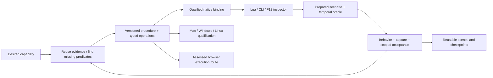

| Milestone | Useful end-to-end delivery | Acceptance boundary |
|---|---|---|
| M0 Reliable continuation | Existing preparation/recovery retains attempts, reports exact next step and avoids repeated unchanged failures across resume | Real coordinator tests and isolated child-process checks; no claim of autonomous live game delivery |
| M1 Effective scenario runner | Prepare a known fixture, deploy exact effective script, run/oracle/capture/cleanup one supported scenario, then resume a mixed batch | Both passing and blocked scenarios without user path/manifest/lifecycle repair; actual game receipt needed |
| M2 Operation generation | Known target evidence generates a usable read/mutate/restore operation with shared help and harness predicates | Consumer uses the generated binding and independent game-state oracle; unsupported builds refuse |
| M3 F12 workspace | Query/select object, execute Lua, change supported property, inspect result/error, undo supported edit and Copy as Lua | Real key/focus/input path, engine thread and same operation IDs across UI/script/harness |
| M4 Reusable creative projects | Compose scene and shot with meaningful native effects; reopen in fresh session and record defining behavior | No source-install damage or cross-script state collision; behavior/capture/presentation receipts all present |
| M5 Playback/checkpoints | Owned pause, save, restore before a dialog choice and replay supported branches | Real inventory/quest/party/script restoration with explicit excluded state; no arbitrary-memory rollback claim |
| M6 Native platform matrix | Supported operations run on exact Mac K1/K2 and compatible Win/Linux builds with suitable workers | Per-build ABI/graphics/input/capture results; local Windows success does not qualify Mac |
| M7 Whole-game browser | Reuse existing KotorPhasor browser work and establish an executable runtime route, then real interactive game behavior | Actual rendering/input/audio/save/main-loop, sustained play and shared devtools protocol; browser shell/Wasm utility insufficient |

M6/M7 investigation can progress independently without blocking useful native M1–M5.
Inspect the existing KotorPhasor checkout and prior browser artifacts before any
implementation there; its current source and runtime are not established by this
attachment. The first full product demonstration is one requested native capability
through discovery/binding/UI or Lua/scenario/state/restoration/clip, not 41 unrelated
syntax successes. The 41-example session becomes a replayable mixed campaign with
explicit supported, missing-fixture, transient, permanent and unknown outcomes.
````

#### S017-C0010: Reduce the remaining human work

Source `docs/plans/2026-09-22-autonomous-capability-product-roadmap.md` lines 160–173; accountable coverage owner U12.

```md
## Reduce the remaining human work

Automate routine discovery, compatible fixture selection, immutable staging, local
capture, bounded retry, resume, evidence assembly, supported operation generation,
status explanations and planned cleanup. Generate remediation tasks from missing
predicates instead of asking the user to diagnose them. Reuse validated procedure
fragments and run manifests; avoid inventing fresh shell sequences each time.

Human decisions remain for material objective changes, new acceptance semantics,
unavailable legal/credential/device access, externally required interaction, and
subjective creative direction that cannot be inferred from established preferences.
Deduplicate those requests, state the exact missing input, and continue independent
work. Generic uncertainty or a transient failure is not by itself a reason to ask.
```

#### S017-C0011: Implementation being built now

Source `docs/plans/2026-09-22-autonomous-capability-product-roadmap.md` lines 174–195; accountable coverage owner U12.

```md
## Implementation being built now

Three existing paths are being corrected in place, with no replacement server:

1. Recovery supervisor: durable bounded stage failures, stable execution basis,
   cooldown, exclusive supervisor scope, restart ambiguity and read-only status.
2. Preparation: preserve same-input attempts across resume, classify exhaustion and
   unknown outcomes, expose the decision through the existing public projection.
3. Verification: content/dependency-aware cache, explicit handling of incomplete
   compiler closure, expiring transient outcomes and time-based/explicit full audits.

CLI/catalog parsers must expose these controls; changing private helpers alone does
not deliver the feature. Tests target state/restart/admission/cache boundaries using
isolated temporary data and controlled workers. No Wine/Ghidra/game recovery is
needed to prove those bounded software properties. Native runtime and source parity
remain separately unverified until actual catalog-driven execution can be observed.

The execution environment had no listener on 8080 or matching server process at
this turn's source preflight. Canonical source edits are not activation of the
historical NVMe checkout. Preserve dirty work; do not restart or replace a live owner
to turn an offline build into a claimed live demonstration.
```

#### S017-C0012: Delivery and learning loop

Source `docs/plans/2026-09-22-autonomous-capability-product-roadmap.md` lines 196–211; accountable coverage owner U12.

```md
## Delivery and learning loop

Ship a usable capability at each milestone, record remaining obligations and keep
later ambitions intact. Track interventions per accepted capability, repeated
unchanged attempts, time to next usable result, invalidated evidence, scenario
restoration success and understandable capture yield on comparable workloads.
Use constrained canaries for routing changes, not automatic relaxation of proof.
A learned repair becomes a versioned procedure only after its discriminating case
and negative controls pass. Unverified model proposals stay proposals.

Implementation results and exact verification commands are in the
[foundation receipt](../verification/2026-09-22-autonomy-foundation.md): 70 focused tests
pass against both staged source and the installed wheel, with Python and React builds.
The [capability diagram](../dashboard-design/pipeline-diagram/autonomous-capabilities.svg)
shows delivered foundation boundaries and future milestones. This roadmap does not
claim M1–M7 completed.
```

#### S018-C0001: ---

Source `docs/plans/2026-09-22-design-package.md` lines 1–8; accountable coverage owner U1.

```md
---
title: AgentDecompile complete recovery and runtime design package
type: design
date: 2026-09-22
status: design-complete
execution_scope: design-complete-foundation-implementation-authorized
---
```

#### S018-C0002: AgentDecompile design package

Source `docs/plans/2026-09-22-design-package.md` lines 9–32; accountable coverage owner U1.

```md
# AgentDecompile design package

Current scope clarification (2026-09-27): this package refines the
[September 18–21 baseline](2026-09-27-weekend-design-scope.md). It does not replace
the full portable-substrate Phases 0–15, distributed-compute design, workstation
requirements or brainstorm/diagram commitments. Omitting a weekend unit from the
tables below does not remove it from the active goal.

This package completes the design requested in the current conversation: recovery
projects, binary/cross-build matching, independently useful original-game memory
modding, and execution that contains failures without weakening evidence. It
incorporates both supplied reviews into the existing design and diagrams. It is
**not an implementation, deployment, test run or recovery result**.

The later explicit request to build authorizes the foundation implementation described in
[the autonomous capability roadmap](2026-09-22-autonomous-capability-product-roadmap.md).
The original design-only delivery above remains a historical boundary; current software
results are recorded separately in [the implementation receipt](../verification/2026-09-22-autonomy-foundation.md).

The governing rule is: **missing evidence blocks its claim; an unhealthy resource
blocks its dependent work; neither automatically blocks the whole project.**
The companion rule is: **recover from the best evidence, reuse only what transfers,
and verify each result at the level where it will be used.**
```

#### S018-C0003: Read the package

Source `docs/plans/2026-09-22-design-package.md` lines 33–59; accountable coverage owner U1.

```md
## Read the package

| Artifact | Authority / purpose |
|---|---|
| [Weekend scope index](2026-09-27-weekend-design-scope.md) | Full September 18–21 design/plan/brainstorm baseline and relationship to later refinements |
| [Current implementation progress and live track](2026-09-27-implementation-progress-and-live-track.md) | Status and ordered todo for the full weekend baseline plus later work; prioritizes useful RE/cross-matching alongside implementation |
| [STRATEGY](../../STRATEGY.md) | Pipeline priorities, claim boundaries and governing policy |
| [Recovery contracts](2026-09-22-recovery-contracts-and-validation-plan.md) | Region reconstruction, compilation units, identity/variant/instance, three binding predicates, scoped facts, early/final verification |
| [Task and acceptance design](2026-09-22-task-acceptance-and-continuation-design.md) | Task/attempt/resource/scenario schemas, admission, progress, retry, fencing, storage, continuation and exhaustive accounting |
| [External validation design](2026-09-22-external-validation-design.md) | Proposed reccmp/ReAgent/AgentDecompile interfaces, report normalization and relocatable recovered-project recipes; isle as reference |
| [Consolidated product design](../dashboard-design/2026-09-21-consolidated-design-plan.md) | Existing workspace appearance, interaction, two surfaces and observable workflow, with current contract reconciliation |
| [Runtime assessment](../RUNTIME_REUSE.md) | Historical implementation evidence distinguished from the required runtime contract |
| [Autonomous capability roadmap](2026-09-22-autonomous-capability-product-roadmap.md) | Subsequent authorized implementation and M0–M7 ambition, with [companion diagram](../dashboard-design/pipeline-diagram/autonomous-capabilities.svg) |
| [Diagram overview](../dashboard-design/pipeline-diagram/agentdecompile-recovery-pipeline.svg) | Stages 0–8, lanes A–E, bounded locators, serialization and outputs |
| [Execution companion](../dashboard-design/pipeline-diagram/execution-contracts.svg) | Task → evidence → acceptance, independent capability paths, fencing/quarantine and progress |
| [Editable diagrams and generators](../dashboard-design/pipeline-diagram/README.md) | SVG, native draw.io, PNG and artifact-authoring sources |
| [Failure prevention and recovery](2026-09-22-failure-prevention-and-recovery-contracts.md) | Mandatory failure response contracts, control-plane recovery, policy rollout and future acceptance matrix |
| [History-grounded maintainability](2026-09-22-history-grounded-maintainability-design.md) | Eleven historical incidents, current source seams, deterministic continuation and reduced operator intervention |
| [Independent review](2026-09-22-recovery-design-review.md) | Concrete findings, checked referents, concessions and resolution review |
| [Delivery status](../DELIVERY_STATUS.md) | Design delivery distinguished from software and runtime outcomes |

This index and its traceability table are the later contract part of the active
master plan; the weekend scope index retains the complete original unit set. The September 8
plans retain historical implementation decisions under their new reconciliation
notes. This package does not rewrite unrelated historical records or grant the
execution permissions described in old recipes.
```

#### S018-C0004: Design decisions and why these options win

Source `docs/plans/2026-09-22-design-package.md` lines 60–80; accountable coverage owner U1.

```md
## Design decisions and why these options win

| Decision | Deciding criterion | Selected mechanism | Rejected alternative / falsifier |
|---|---|---|---|
| Evidence before more throughput | Prevent wrong semantic bindings from multiplying | Presence + independent target identity + operation-specific predicates | Same signature/label lineage cannot prove identity; Foo/Bar RC-08 |
| Keep named stages, remove global barriers | Reach useful capability without waiting for unrelated work | Prerequisite DAG with identity/calibration feedback, early reconstruction and continuous parity | One missing target must not stop an eligible other target; A01/A05 |
| Region-based scaffold | Preserve real link/reference/metadata semantics | Explicit region/fixup/data manifest and independent linked-image oracle | Broken reconstructed addend must fail RC-01 |
| Separate three units | Match actual compiler scope | Recovery fragment, TU/LTCG group and emitted comparison region | Isolated compile cannot stand in for required final LTCG output |
| Typed relationships in existing catalog | Express variants/inline/folded instances without a new silo | Logical entity → implementation variant → physical instance | One address is not one entity; RC-03/04 |
| Original-code runtime as separate branch | Deliver usable vanilla features before reconstruction completes | Independent identity/ABI/layout/lifetime capabilities | Source-floor status cannot block valid original-code call; RC-09 |
| External tool adapters | Reuse established diagnostics without coupling server internals | Immutable input/report envelopes, capability checks, centralized acceptance | Vendor/import engine only if a measured missing contract justifies it |
| One task and acceptance contract | Reuse containment across providers and future hosts | Private attempts, immutable outputs, durable per-unit results and short acceptance commits | Independent per-launcher retry loops fail A04/A08 |
| Generation plus resource quarantine | Reject stale authority without pretending access stopped | Separate publication and access state; disjoint-resource continuation | Expired owner with byte-perfect result fails A07/A14 |
| Complete staged closure | Continue after device failure only when dependencies really independent | Verified manifests including indirect libraries/prefix/assets; durable outputs | Executable moved but library on failed drive fails A06 |
| Same-run scenario evidence | Prevent mismatched proof packages | Separate behavior/video receipts correlated to command/run/action interval | Old oracle plus new unrelated video fails A11 |
| Portable recipe and resolver | Another supported host can follow the exported project | Logical inputs by digest, relative paths, scoped build/compare operations | Absolute author-machine path fails portability preparation |

These are design choices backed by mechanisms and counterexamples. They are not
measured claims that a chosen implementation is fastest or universally optimal.
Versioned policies hold empirical thresholds; no benchmark number is invented.
```

#### S018-C0005: Requirement traceability

Source `docs/plans/2026-09-22-design-package.md` lines 81–141; accountable coverage owner U23.

```md
## Requirement traceability

A = supplied architecture review; H = supplied hindsight review. Section references
use their headings, not inferred machine state. R = recovery contracts; T = task
and acceptance design; X = external validation design. RC and A identifiers refer
to **future acceptance specifications, all NOT RUN**. Explicit applicability and
unknown/unsupported outcomes complete the contract without inventing universal support.

| ID | Source requirement | Design location | Concrete future check |
|---|---|---|---|
| D01 | A1 reconstruct trustworthy linkable regions, independent oracle | R region record + reconstruction mechanism | RC-01 wrong addend rejected after placement |
| D02 | A2 separate recovery/compilation/comparison | R units + scoped toolchain; X recipe groups | Required grouped/LTCG output compared |
| D03 | A2 incremental calibration and legacy flags | R stages 1–2, environment/group records | Unsupported toolchain switch blocks only that profile |
| D04 | A2 diagnose before permutation/AI | STRATEGY cross-match; R stage 6 | Wrong type/ABI/context cannot be masked by source search |
| D05 | A3 architecture-specific floor with metadata | R scaffold + reconstruction | Instruction-only region missing required metadata refused |
| D06 | A3 early unchanged round trip | R RC-01 | Real extract/emit/place path, not copied output |
| D07 | A3 source contribution and rebuild methods | R reconstruction axes | RC-02 discarded compiled replacement earns zero credit |
| D08 | A4 compile is candidate admission | R facts and candidate state | Wrong constant compiles but remains unaccepted |
| D09 | A4 separate facts and bounded equivalence | R fact outcomes/assumptions | RC-05 reports each observed scope separately |
| D10 | A4 behavior-preserving repair, actual C++ | R source contract; X language/FP/group recipe | FP/NaN and exception-sensitive negative cases |
| D11 | A5 entity/variant/physical multiplicity | R data + worked reuse counterexamples | RC-03 changed behavior; RC-04 inline/folded/split |
| D12 | A5 compatible recipient candidate reuse | R propagation and recipient gates | Donor x+1 cannot replace recipient x+2 on identity alone |
| D13 | A5/A7 unchanged-work reuse, better evidence | R invalidation; T acceptance versions | RC-06 changed type invalidates only dependents |
| D14 | A5 per-build layout, no pointer scaling | R layouts + counterexample | Unknown spans stay opaque; exact offset evidence required |
| D15 | A5 naming preference vs facts | STRATEGY fusion; R lane A | Renaming cannot overwrite measured layout |
| D16 | A6 known-build RVA first | R runtime contract; overview B/C | Build+bytes pass still cannot replace identity evidence |
| D17 | A6 located/readable/callable/detourable/writable | R binding predicates; T scenario contract | RC-09 valid original use independent of source |
| D18 | A6 executable policy/caves | R runtime contract | Policy denial stays unsupported; zeros/slack alone refused |
| D19 | A6 install/remove/quiescence/lifetime | R runtime contract; T resource bundle | In-flight trampoline return prevents reclamation |
| D20 | A6 rollback limits | R operation contract; T teardown | Restored bytes never claim undone side effects |
| D21 | A7 stable snapshots, relevant dependencies and cache sync | R invalidation; T short acceptance commit | RC-06/A17 stale proposal rejected |
| D22 | A7 corpus/local keys and replay | R cache projections; T immutable proposals | Unrelated build preserves local compile; RC-07/A20 stable replay |
| D23 | A7 shared compiler, isolated mutable outputs | R toolchains; T ownership | No shared PDB/temp/Wine writer collision |
| D24 | A outcomes and regressing coverage | R named outcomes; T accounting | Ambiguous/absent/inlined/unsupported stay explicit; RC-10 |
| D25 | A agent roles and central acceptance | R acceptance owner; T contract | Producer cannot revise policy or self-promote |
| D26 | A first demonstrations, reccmp scope | R RC-01–10; X normalized tools | Held-out builds + representative replacement matrix |
| D27 | H1A noncircular target binding | R three predicates, T1–T3/Foo-Bar | RC-08/A01 right bytes under wrong label refused |
| D28 | H1A automatic withdrawal, no platform ban | R lineage; T coverage withdrawal | A02 seed withdrawal; repaired input version reevaluated |
| D29 | H1B original-code use without full recovery | R operation predicate; T original-code example | RC-09 supported read/call proceeds with source floor |
| D30 | H1C task-specific capacity, shared nested budget | T admission | A15 no-swap/swap-occupied small work vs overloaded class |
| D31 | H1D liveness/execution/goal and persistent attempts | T state/progress/retry schemas | A04 PID churn not progress; A08 restart keeps budget |
| D32 | H1E exhaustive accounting and proof scopes | T accounting | 24,242 inventory reconciles; unexplained two not invented |
| D33 | H2 local dependency failures, capability priority/aging | T admission/priorities | A05 independent cached task; A16 aged capacity reservation |
| D34 | H2 no spin, exact wake sets, objective preserved | T task completion/wake conditions | Exhausted attempt never marks objective achieved |
| D35 | H3 actual resources, scenario bundles, short transactions | T ownership and acceptance | Compile/LLM/game work outside writer transaction |
| D36 | H3 atomic ownership/fencing, quarantine/external jobs | T two ownership states and late-worker example | A07/A14 stale result and unsafe resource remain separated |
| D37 | H4 one retry owner, negative cache, bounded recovery | T failure table | A04/A08 finite retries, changed basis required for deterministic repeat |
| D38 | H4 checkpoint/exit and resource enforcement capability | T admission/cancellation | Pause does not claim memory reclaimed; unsupported enforcement routed |
| D39 | H5 input closure, persistent storage, tmpfs limits | T staging | A06 incomplete bundle never launchable; complete cached work continues |
| D40 | H5 publication, SQLite snapshots and bounded probes | T storage | A05/A13 interrupted copy cannot publish partial manifest |
| D41 | H6 fixture/driver/recording prerequisites | T scenario | A10 missing fixture distinct from behavior failure |
| D42 | H6 observation/mutation and unknown command outcome | T scenario/command IDs | A09/A12 status available, no blind duplicate mutation |
| D43 | H6 same-run oracle/video and local authentication limits | T scenario | A11 failed recorder retains scoped behavior; other scenarios continue |
| D44 | H7 namespaces/config and honest scanner limits | T adapter constraints | A18 bad args/log prefix/config owner rejected |
| D45 | H8 paired rejection/continuation cases and useful metrics | T A01–A20 | Every bad case has unaffected-ready-work control |
| D46 | H implementation order and conditional guarantees | T delivery order/guarantees | Containment → restart → explicit replica-dependent host failover |
| D47 | User reccmp/ReAgent/AgentDecompile testing preference | X routes, raw reports, unknown outcomes | Later tools consume actual candidate; no GREEN/exit-code promotion |
| D48 | User many isle-like projects and universal-use matching | X exported layout, recipe/input resolver; R variants | Held-out builds + clean-host relocation, explicit unsupported limits |
| D49 | User design-only correction | Package scope, delivery ledger, historical reconciliation | No product edits, installs, runtime probes or tests for this goal |
| D50 | User collaborative grill/prove-the-effort completion | Independent review and closure log | Review a specific counterexample, amend, independently recheck |
```

#### S018-C0006: Implementation dependency order (authorized by the later user build request)

Source `docs/plans/2026-09-22-design-package.md` lines 142–169; accountable coverage owner U1.

```md
## Implementation dependency order (authorized by the later user build request)

1. Type evidence, separate binding predicates and withdrawal, and derive exhaustive
   coverage from receipts. Reject the false-label case before increasing throughput.
2. Wrap one existing verifier/compiler path with the common task/acceptance protocol:
   immutable inputs, private outputs, durable units, version/generation checks and
   independent acceptance. Include the failure-response contract: atomic command/budget
   intent, retry circuits, durable wakes, resource quarantine and control-plane
   outage handling. Require interruption/resume proof before more concurrency.
3. Establish validated region extraction/emission/placement and contribution checks;
   refine compilation groups/toolchain evidence. Feed results into per-recipient
   candidates and independent local/linked checks.
4. Add planned external-tool adapters and portable project recipes behind the same
   contracts. Unsupported providers do not stop other eligible verification routes.
5. Add common admission/retry/storage/scenario mechanisms for the remaining providers,
   then supported original-code bindings and complete combined demonstrations.
6. Expand concurrency and remote providers only after containment and resume gates;
   final source claims still require fresh current-source whole-image evidence.

Implementation status and the ongoing completion gate are tracked in the
[session obligation audit](2026-09-22-session-obligation-audit.md). The numbered
requirements remain open until their actual software and acceptance evidence exists.

A feature requiring only valid original-code identity/interface/runtime evidence
can proceed as soon as those prerequisites exist. The sequence above is an
implementation dependency plan, not a new barrier forcing runtime use to wait for
all source/reconstruction tooling.
```

#### S018-C0007: Design completion gate

Source `docs/plans/2026-09-22-design-package.md` lines 170–190; accountable coverage owner U1.

```md
## Design completion gate

The design goal is complete only when all of these are checked on the artifacts:

- Both reviews have requirement-to-contract and future-falsifier coverage.
- Mechanisms specify inputs, outputs, ownership, state changes and failure continuation;
  no known cross-document contradiction is left as an implementation decision.
- Every external integration is a proposal with input/output/claim boundaries;
  no installable dependency change is substituted for a design contract.
- The overview and companion remain readable, editable and synchronized with their
  authoring source; the Documents overview matches the canonical SVG.
- Independent reviewers inspect the actual revised text/diagrams and resolve concrete
  objections; author declarations alone do not close review findings.
- Link/source/XML/diff checks and visual inspection establish artifact quality only.
  Every runtime demonstration and performance/fairness hypothesis remains NOT RUN.

Unknown empirical results (target toolchain behavior, delinker correctness,
performance, runtime support, real cross-host reproducibility) remain **future
verification obligations with decisive tests**, not unresolved architecture choices.
No server, game or compiler is required to complete this design gate.
```

#### S018-C0008: Collaboration and resolved challenges

Source `docs/plans/2026-09-22-design-package.md` lines 191–212; accountable coverage owner U1.

```md
## Collaboration and resolved challenges

`grill-me` explicitly defers technical critique to `prove-the-effort`; both were read.
The team used concrete claim/referent/check/verdict exchanges, not repeated requests
for user confirmation. The user already specified scope and desired tools.

| Challenge | Decision / concrete correction | Independent reviewer |
|---|---|---|
| Correct bytes can prove the wrong function | Explicit presence/identity/operation predicates; lineage exclusion; Foo/Bar walkthrough | Recovery review |
| Lease expiry is not safe reuse | Separate publication authority/resource access; late matching result does not clear quarantine | Diagram and execution reviewers |
| Representation vs evidence totals | Disjoint representation buckets, overlapping fact/capability axes | Execution reviewer |
| Durable publication vs short DB commit | Filesystem staging/flush/rename outside transaction; short version/fence/manifest commit | Execution reviewer |
| Partial accepted fact vs complete task | All mandatory contracts + required predicates; objective acceptance separate | Root challenged execution author |
| Priority order may defeat aging | Capped same-class reservation, explicit urgent override and no age reset | Root challenged execution author |
| Export may retain author-machine paths | Declarative recipe, content-ID input resolver, clean-host negative acceptance | Diagram reviewer |
| Inconclusive check has no fact state | Explicit unknown/not_run/unsupported/stale distinctions | Diagram reviewer |
| Workbench availability as design blocker | Removed; prior dependency file converted to documentation only | User correction and recovery reviewer |

Final review closes all concrete findings at the design level. Artifact checks are
recorded in the [documentation-only acceptance receipt](../verification/2026-09-22-design-package.md). None of these review concessions asserts
implemented runtime behavior.
```

#### S018-C0009: Source provenance and interpretation

Source `docs/plans/2026-09-22-design-package.md` lines 213–231; accountable coverage owner U1.

```md
## Source provenance and interpretation

| Input | Identity | Use |
|---|---|---|
| H hindsight review | Attachment `a7bcfa80-8844-4a5f-bd88-1e7f31bf2bda/pasted-text.txt`, 27,540 bytes, SHA-256 `4e940239b9656a62229021eb5649b1ac1f22c44fc088023c97ca0d3479dc29d3` | Historical failures → local continuation, ownership, progress, storage and scenarios |
| A architecture review | Attachment `1964612c-8fb0-44de-ab59-da1e53f8833f/pasted-text.txt`, 33,752 bytes, SHA-256 `6f64fb0ca0f7caae1a622b780bf704a8a3458402514fe0142b3b87fd85576182` | Reconstruction, compiler scope, claim separation and runtime capabilities |
| Existing plan and diagram | STRATEGY, consolidated product design, execution-tracking reconciliation, overview generator | Preserve existing scope and newer lane E rather than reverting to older attached SVG |
| Earlier design-phase correction | Design/diagrams/plan exclusively | Controlled the original design delivery; superseded for subsequent implementation by the explicit build request |
| Later build request and ongoing goal | Build according to the design, then finish all applicable directives | Authorizes current implementation; full obligations remain in the session audit |
| Skills | `/home/brunner56/.agents/skills/grill-me/SKILL.md`; `prove-the-effort/SKILL.md` and `EVOLUTION.md` | Concrete evidence-driven design review and explicit concessions |

The hindsight attachment links an additional sandbox download whose contents are
not separately present. This package implements the recommendations actually
supplied in its text; it does not claim to have read an unavailable extra file.
Historical counts, process/resource observations and prior runtime successes are
not treated as current host measurements. Upstream projects are references, not
AgentDecompile acceptance evidence.
```

#### S018-C0010: Failure prevention and recovery refinement

Source `docs/plans/2026-09-22-design-package.md` lines 232–244; accountable coverage owner U1.

```md
## Failure prevention and recovery refinement

The [complete failure-response specification](2026-09-22-failure-prevention-and-recovery-contracts.md)
refines the eleven historical incident remedies into prevention, detection,
containment, bounded recovery and wake contracts. It also covers the coordinator,
metadata/artifact storage, ambiguous commands, fixture drift, missed wakeups,
policy/schema compatibility and unknown failures. Its linked resilience diagram
complements the overview and execution diagram. Implementation must satisfy these
contracts alongside RC01–10 and A01–20; a fallback cannot weaken the objective or
change acceptance silently. Completion here is design completion only.

Current resilience artifacts and static checks are recorded in the
[resilience design receipt](../verification/2026-09-22-resilience-design.md).
```

#### S019-C0001: External validation integration design

Source `docs/plans/2026-09-22-external-validation-design.md` lines 1–9; accountable coverage owner U10.

```md
# External validation integration design

Status: **designed; integration implementation and tool-backed acceptance outstanding**.
This document originally covered design only. The later explicit user build request
authorizes implementation under the existing catalog and process-ownership rules.
[Session obligation audit](2026-09-22-session-obligation-audit.md) tracks completion.
Command examples below remain interface specifications rather than bypasses around
the operational catalog.
```

#### S019-C0002: Implementation progress after build authorization

Source `docs/plans/2026-09-22-external-validation-design.md` lines 10–35; accountable coverage owner U10.

```md
## Implementation progress after build authorization

Pinned real ReAgent benchmark/snapshot-plan and reccmp annotation-lint canaries
have now run against original tiny fixtures. See the [tool receipt](../verification/2026-09-22-external-tool-canaries.md).
The bounded `corpus.normalize-validation-report` CLI/catalog action reads ReAgent
benchmark and reccmp comparison JSON as unaccepted diagnostic proposals. It records
the raw report digest, rejects unknown/malformed/empty schemas, and explicitly leaves
actual provider invocation, input binding and freshness unverified. It never writes
accepted recovery state. It is a report-reader portion of the adapter, not the full
job-owned execution and acceptance integration specified below.

The new `corpus.export-reagent-snapshot` adapter now exports bounded selected cache
rows through a read-only transaction. Actual existing cache evidence has been
consumed by pinned ReAgent; see the [cache-export receipt](../verification/2026-09-22-reagent-cache-export.md).
This closes a cache-format seam, while original-binary identity, complete context,
and scientific candidate acceptance remain open.

Upstream ReAgent already supports the `ghidra-json` snapshot backend. Prefer adapting
existing cached AgentDecompile evidence into that format before building another
bridge or starting analysis. Missing cross-references must remain missing evidence;
empty lists may be emitted only when the source actually established emptiness.
Its benchmark exit zero means expected outcomes were met, including expected
mismatches. reccmp annotation lint emits text/exit status, not the comparison JSON
schema. Its comparison serializer omits unmatched entities; report row count is
never the eligible denominator. Real PE/PDB comparison remains outstanding.
```

#### S019-C0003: Selected integration architecture

Source `docs/plans/2026-09-22-external-validation-design.md` lines 36–99; accountable coverage owner U10.

```md
## Selected integration architecture

The selected future integration is optional external CLI adapters for reccmp and
ReAgent, using AgentDecompile's task and acceptance contracts. This avoids duplicating
their comparison/checker engines while preserving independent acceptance. A shared
Python import is rejected because it would couple the server environment and
internal APIs; vendoring is rejected because no required capability currently
justifies maintaining a fork. Reconsider only if a measured CLI limitation blocks
a required contract and an alternative meets the same isolation/receipt criteria.

The following revisions were inspected in the earlier design pass. They are
**proposed baseline references**, not installed dependencies or a transitive lock:

| Tool | Reference revision | Planned use |
|---|---|---|
| reccmp | `e91a51bfadfbb600adfdc750589ac40ae9742883` | Supported MSVC/PDB comparison diagnostics |
| ReAgent (`auto-re-agent`) | `d12cea338c61898b06a86fe8adb25275fa9d5615` | Independent candidate/checker and configured validation |
| isle | `8119bd013645972c72480e4de21529f1e91ce5c7` | Recovered-project output reference |

Before implementation chooses install pins, resolve transitive dependencies in an
isolated environment and record supported host/target capabilities. That is a
future implementation gate, not a prerequisite for completing this design.

[Recovery contracts](2026-09-22-recovery-contracts-and-validation-plan.md) define
proof scopes. [Task and acceptance design](2026-09-22-task-acceptance-and-continuation-design.md)
defines execution ownership. The following command forms are documentary provider
interface examples, **not instructions to run them during planning**:

| Provider | Upstream command | Inputs / claim |
|---|---|---|
| reccmp | `reccmp-reccmp --target TARGET --json report.json --silent` | Project/build/user configuration, annotated source, original and rebuilt binary, matching PDB; comparison report |
| reccmp | `reccmp-decomplint --target TARGET` | Annotation consistency |
| reccmp | `reccmp-vtable --target TARGET` | Vtable diagnostic |
| reccmp | `reccmp-datacmp --target TARGET` | Global-data diagnostic |
| ReAgent | `re-agent --config CONFIG doctor` | Tool/configuration readiness; not recovery proof |
| ReAgent | `re-agent --config CONFIG plan --address ADDRESS --max-functions N --output manifest.json` | Bounded stored evidence; no model calls |
| ReAgent | `re-agent --config CONFIG parity --address ADDRESS --strict-exit` | Source/binary heuristic checks; RED must fail, GREEN is not exactness |
| ReAgent | `re-agent --config CONFIG status --manifest manifest.json --format json` | Stored checks, coverage and stale results |
| AgentDecompile | `agentdecompile-cli --server-url http://127.0.0.1:8080/mcp tool --list-tools` | Existing server tool discovery; no recovery submission |

The future adapter must execute tools without shell interpolation, in a job-owned working directory with
timeouts and bounded output. Pin executable versions and retain argv, cwd, exit
code, stdout/stderr hashes and raw report hashes. Original/rebuilt/PDB/source and
analysis dependency hashes must match the scheduled snapshot. Reject missing,
empty, malformed or stale reports; keep diagnostic failures separate from tool
execution failures. Never parse a success banner or aggregate score as proof.

ReAgent needs evidence from its supported bridge/backend. Implement conversion or
an adapter for existing AgentDecompile snapshots before claiming native integration.
Do not start a second Ghidra analyzer to satisfy that dependency. Bind meaningful
candidate-consuming build/test/runtime gates, independent checker evidence and
bounded provider calls before reversal; record configured trust and policy. No
provider credentials belong in the exported project or receipt.

reccmp source annotations and build-specific comparison addresses belong to the
recovered project. Runtime packs instead bind exact build identity plus RVAs/live
checks, or supported unknown-build discovery. Plan comparisons where supported;
objdiff and final image comparison remain separate gates. Preserve licenses and
upstream provenance rather than copying toolkit implementation into the core.

Upstream references: [reccmp](https://github.com/isledecomp/reccmp),
[ReAgent](https://github.com/Dryxio/reagent), [isle output example](https://github.com/isledecomp/isle).
```

#### S019-C0004: Adapter envelope and result normalization

Source `docs/plans/2026-09-22-external-validation-design.md` lines 100–124; accountable coverage owner U10.

```md
## Adapter envelope and result normalization

All adapters consume a task envelope naming the original input digest, analysis
snapshot, candidate/group digest where applicable, target capability profile,
provider revision, expected output format, acceptance-policy digest and resource
claims. They emit immutable raw output plus a normalized **proposal**. Adapters
cannot update accepted bindings, source selections, runtime permissions or coverage.

| Result field | Contract |
|---|---|
| `task_id`, `attempt_id`, `generation` | Associate output with the admitted attempt; late generation cannot publish |
| `provider`, `provider_revision`, `argv_digest` | Exact provider and effective invocation, with secrets excluded |
| `input_digests`, `analysis_snapshot`, `candidate_digest` | Content identities, not filenames alone |
| `raw_report_digest`, `stdout_digest`, `stderr_digest` | Preserve original evidence; normalized summaries are traceable |
| `execution_state` | completed / crashed / timed_out / unavailable / unsupported / invalid_output |
| `checks[]` | kind, outcome, scope, assumptions, compared regions and evidence roots |
| `gaps[]` | Missing prerequisites with eligible fallback or wake condition |

A missing/empty/malformed report is `invalid_output`, not zero mismatches. A tool
that cannot express a proof yields `unsupported` for that check. A process exit 0
with a negative diagnostic retains the negative diagnostic. A nonzero exit with
partial valid results preserves the completed units but cannot manufacture a
complete comparison. Report-schema versions are explicit; unknown versions are
retained raw and require an adapter update before normalized acceptance.
```

#### S019-C0005: reccmp route

Source `docs/plans/2026-09-22-external-validation-design.md` lines 125–138; accountable coverage owner U10.

```md
## reccmp route

Inputs: exact original image; rebuilt image and matching PDB; source snapshot with
build-specific annotations; provider project/build configuration; supported target
profile. Validate these identities before comparing. The output proposal retains
per-function comparison details, excluded regions and tool-specific caveats; vtable,
data, exports and stack diagnostics remain separate check kinds. A top-line match
percentage cannot certify whole-file identity, ABI safety or behavioral equivalence.

The acceptor checks the emitted source-contribution map and independent original
linked bytes where a reconstructed object was used as the local oracle. No report
from another PDB/build can be re-keyed as current. Known unsupported compiler or
format is a named provider limitation; other providers and runtime lanes continue.
```

#### S019-C0006: ReAgent route

Source `docs/plans/2026-09-22-external-validation-design.md` lines 139–158; accountable coverage owner U10.

```md
## ReAgent route

Input snapshot export/conversion is a dedicated read-only task. It maps exact
program digest, addresses/regions, decompile/assembly/CFG/type evidence, limitations
and provenance into the chosen supported backend format. Conversion records lost
or unsupported fields; it does not regenerate Ghidra analysis for uniformity.
A compatibility canary must demonstrate that the provider reads the intended
snapshot and cannot write the live program or acceptor store. This is specified,
**not run**.

A bounded manifest selects functions/groups, dependencies and source overlays.
Reverser/checker separation supplies critique but not an independent byte oracle.
The future configured build/test/runtime commands must consume the candidate and
produce declared postconditions. ReAgent's configured-command trust is granted
only by the operator-owned policy; model output cannot modify that policy.
Heuristic parity, structural checks, model opinion and executed behavioral gates
are separate records, including UNKNOWN. Preserve call limits, exact responses,
provider errors, usage and stale-result detection. Source-only mode must name its
missing binary evidence and cannot satisfy binary-backed acceptance.
```

#### S019-C0007: AgentDecompile route and test responsibilities

Source `docs/plans/2026-09-22-external-validation-design.md` lines 159–169; accountable coverage owner U10.

```md
## AgentDecompile route and test responsibilities

AgentDecompile's CLI/MCP is the planned access path to existing analysis and shared
capabilities. Recovery mutations use whichever owner-identified action catalog is
authorized at implementation time; planning never contacts it. A CLI listing is
interface discovery only. The design's future validation matrix uses ReAgent for
independent recovery/checker scenarios, reccmp for supported rebuild diagnostics,
and AgentDecompile CLI for shared consumer-path checks. Filesystem/unit regression
tests, if later authorized, supplement these tools; none is mislabeled as a
universal test runner for the others.
```

#### S019-C0008: Exported project layout (illustrative, not created)

Source `docs/plans/2026-09-22-external-validation-design.md` lines 170–193; accountable coverage owner U10.

````md
## Exported project layout (illustrative, not created)

```text
<family>/<build-id>/
  project-manifest.json      # image/toolchain/adapter/snapshot/policy identities
  recipes/project.yml       # declarative prepare/build/compare routes
  source/fragments/         # candidates distinct from accepted contributions
  source/groups/            # TU/LTCG assembly recipe, references fragments
  preserved-regions/        # explicitly accounted floor; input provenance
  headers/                  # build-specific layouts + opaque unknown spans
  comparison/reccmp/        # original raw reports + normalized proposals
  comparison/objdiff/       # validated references + declared relocation map
  evidence/                 # scoped receipts + independent roots + invalidations
  runtime/                  # pack, capabilities, locator/root recipes
  readiness.json            # per-entity/build/operation states and limitations
```

Manifest references are content-addressed and published last. Original retail
images and proprietary toolchains are externally supplied inputs, not silently
embedded distributable dependencies. The same family may export several builds;
logical field names can be shared, physical layouts and ABI profiles cannot be
assumed equal. Preserve upstream licensing and attribution when choosing any
later packaging strategy; the current plan vendors no upstream code.
````

#### S019-C0009: Future negative acceptance cases — NOT RUN

Source `docs/plans/2026-09-22-external-validation-design.md` lines 194–207; accountable coverage owner U10.

```md
## Future negative acceptance cases — NOT RUN

| Case | Expected result | Independent work that proceeds |
|---|---|---|
| Correct rebuild with wrong PDB | Comparison rejected for input identity | Other build's valid comparison |
| Exit 0 + empty JSON | invalid_output; no acceptance | Snapshot export/reporting |
| ReAgent GREEN but wrong constant | Candidate retained as proposal; byte/behavior gate rejects | Other functions and original-code runtime |
| ReAgent source-only report | Binary checks remain unknown | Source-only diagnostics |
| Unsupported target in reccmp | unsupported with capability reason | Suitable comparator or other ready tasks |
| Model changes configured validation commands | Policy mismatch; reject attempt proposal | Existing accepted work remains readable |
| Candidate compiled but linker discards it | No source-contribution credit | Floor remains honestly accounted |
| Provider timeout | Preserve durable prior units; bounded scheduler retry | Other provider/resource-independent tasks |
```

#### S019-C0010: Relocatable project recipe and input resolver

Source `docs/plans/2026-09-22-external-validation-design.md` lines 208–260; accountable coverage owner U10.

```md
## Relocatable project recipe and input resolver

A project is not portable merely because its files can be copied. Its manifest
must reference a versioned declarative recipe that completely describes how to
prepare, build and compare the selected profile. A future generic runner exposes
three operations (`prepare`, `build`, `compare`) through the authorized task/catalog
adapter. These are proposed interface names, not existing CLI verbs to execute.

| Recipe field | Required meaning |
|---|---|
| `schema`, `profile_id`, `target` | Version, selected build/profile, format/architecture/ABI and supported host requirements |
| `inputs` | Logical input IDs, expected digests/sizes, required/optional status, toolchain/library/original roles |
| `path_bindings` | Project-relative paths or logical input roots; explicit target-platform path translation |
| `environment` | Declared locale, language/FP/packing/macros, required variables and tool revisions; secret variable names only |
| `compilation_groups` | Fragment IDs, includes/declarations, TU/LTCG relationships and scoped flags |
| `steps` | Provider operation or argv arrays, dependency IDs, logical cwd, input IDs, output IDs and timeout/resource profile |
| `placement_recipe` | Region/fixup/data/metadata layout identity consumed by reconstruction mode |
| `checks` | Ordered prerequisites and independent compile/local/linked/contribution/file predicates with policy revision |
| `output_manifest` | Logical output paths, content hashes, source/floor accounting and raw/normalized evidence references |

The resolver searches explicit operator-provided mappings and verified local
content stores for each logical input ID, verifies digest/size, and reports missing
or conflicting input candidates. It never guesses a replacement toolchain or
silently fetches proprietary binaries. All source and output paths are relative
to the project or declared input roots. Host A's absolute paths may appear only as
non-executable provenance, not invocation dependencies. A host-B Wine or container
path translation is a versioned environment adapter; unresolved translation is
unsupported/missing prerequisite, not a hardcoded fallback. Credentials and local
home directories are not exported in recipes.

The compiler/toolchain can be external while its immutable identity and required
components remain complete. The generated recipe records actual scoped flags and
verified supported operations; it does not assume a modern MSVC switch exists on
a legacy compiler. `prepare` yields a complete verified input closure; `build`
produces a job-private result and contribution map; `compare` submits scoped
proposals to independent acceptance. A recipe can select either reconstruction
or original-style build, but must name which method its results establish.

Illustrative resolution: `original-image` and `compiler-bundle` are content IDs.
Host A supplies `/inputs/original.exe` and a compiler root; host B supplies different
local paths for the same digests. The recipe refers only to those IDs and
`project/source/groups`. Different host mappings cannot change the task's semantic
input identities; any changed toolchain content requires a new basis.

**Future portability acceptance — NOT RUN:** export on host A, copy to a clean
directory/compatible host B without A's home directory or environment, supply
external originals/toolchain by verified input mapping, resolve the recipe, and
produce the same declared checks under the recorded basis. Deliberately leave one
absolute author-machine path in a step: preparation must reject the nonportable
recipe before execution. If hosts have unsupported execution capabilities, record
that limitation rather than claiming universal host portability. This scenario
establishes relocatable instructions for a supported environment, not cross-ABI
binary interchangeability or completed recovery.
```

#### S020-C0001: ---

Source `docs/plans/2026-09-22-failure-prevention-and-recovery-contracts.md` lines 1–7; accountable coverage owner U9.

```md
---
title: Failure prevention and recovery contracts
type: design
date: 2026-09-22
status: design-complete-runtime-unverified
---
```

#### S020-C0002: Failure prevention and recovery contracts

Source `docs/plans/2026-09-22-failure-prevention-and-recovery-contracts.md` lines 8–18; accountable coverage owner U9.

```md
# Failure prevention and recovery contracts

This specification extends the existing task, receipt and acceptance authority; it
does not propose a second orchestration platform. Read it with the
[task and continuation design](2026-09-22-task-acceptance-and-continuation-design.md)
and [recovery contracts plan](2026-09-22-recovery-contracts-and-validation-plan.md).
Its purpose is to make historical failure lessons executable requirements for the
existing coordinator and adapters. **All checks here are future specifications,
not tests run, deployed safeguards or measured results.** No current host diagnosis
is implied by historical incidents. Nothing here authorizes software execution.
```

#### S020-C0003: 1. One authority and an immutable acceptance boundary

Source `docs/plans/2026-09-22-failure-prevention-and-recovery-contracts.md` lines 19–43; accountable coverage owner U9.

```md
## 1. One authority and an immutable acceptance boundary

The existing coordinator persists observations and proposes decisions through one
versioned decision reducer. The acceptance authority commits claims after checking
policy, dependency versions and publication generation. Existing launchers become
adapters of that same decision protocol; they do not each invent their own retry,
resource or completion policy. Workers write private artifacts and observations,
never accepted corpus state. A task is complete only when all mandatory output
contracts have terminal results and every policy-required success predicate passes.
Partial evidence remains useful without completing the task or overall objective.

A recovery action may change environment, provider, task size, scheduling or input
hypothesis. It **cannot** change the requested acceptance bar, reinterpret unsupported
as passed, remove a mandatory recording, substitute a checkpoint for a full route,
or convert original-code use into recovered-source credit. An altered objective
requires a separately recorded user decision; the previous unmet objective remains
in history. Budget exhaustion terminates attempts while retaining unmet predicates.

Control-plane records contain `objective_id`, `task_id`, `attempt_id`, `basis_digest`,
`policy_revision`, `schema_revision`, `generation`, `event_id`, `observed_at`,
`detector_id`, `detector_health`, `failure_class`, `confidence`, `action_id`,
`retry_owner`, `consumed_budget`, `wake_predicate`, `escalation_reason` and referenced
immutable artifact digests. Corrections append events; they do not rewrite old
observations. Evidence with unknown scope stays unknown until checked.
```

#### S020-C0004: 2. Failure protocol

Source `docs/plans/2026-09-22-failure-prevention-and-recovery-contracts.md` lines 44–72; accountable coverage owner U9.

```md
## 2. Failure protocol

Every adapter declares prevention predicates, detectors, containment scope, permitted
recovery actions, wake predicates and escalation boundaries. The reducer never
accepts an unbounded catch-all retry. Actions are idempotent or have an explicit
reconciliation protocol. Only the coordinator owns outer retries; adapter-internal
attempts consume the same budget. A retry's new attempt ID does not reset its task,
objective, provider or resource-class budget. Stable incident and objective budget
keys survive new error strings, task IDs and proposed hypotheses. Charge/reserve
atomically with durable command intent before dispatch; ambiguous launched work
keeps its reservation until reconciled. Unknown failure is not presumed transient.

The transition is `observed → classified → contained → recovery_pending →
reconciling → eligible`, with `waiting_external`, `budget_exhausted` and
`unsupported` branches. Eligibility means a new attempt may be admitted, not that
its desired claim is accepted. Each transition names its supporting event and exact
input version. Replayed observations cannot consume budget twice, launch a duplicate
worker or grant a second acceptance commit.

Detection is itself a fallible dependency. A detector timeout, stale reading or
malformed response yields `detector_unknown`, never healthy or failed by inference.
Resource-dependent detection runs in bounded isolated workers with per-resource
probe limits. The reducer uses a declared freshness window and monotonic elapsed
time where applicable. Across host restart it conservatively reconciles deadlines
from persisted timestamps and boot identity; it does not trust a reset monotonic
clock. A failed detector blocks only decisions requiring its evidence. Existing
managed work follows its pinned lifecycle unless continuing it requires the missing
safety signal; read-only inspection of healthy cached evidence can continue.
```

#### S020-C0005: Shared recovery, durable wakes and decision criteria

Source `docs/plans/2026-09-22-failure-prevention-and-recovery-contracts.md` lines 73–143; accountable coverage owner U9.

```md
### Shared recovery, durable wakes and decision criteria

A provider/resource outage has one shared circuit state and one single-flight recovery
probe, with a shared healing budget, jittered next eligibility and reserved control
capacity. A hundred waiting tasks do not authorize a hundred probes. Per-task limits
are subordinate to incident/objective/provider/resource ceilings; admission and
recovery both account for their resource costs. Metadata full/read-only is a store
failure: preserve previous truth, refuse unauditable mutation and apply F18 rather
than accepting through a volatile bypass.

Remote ownership uncertainty and provider availability need separate clearance.
For the process-global MCP session, a per-job guard is insufficient: an uncertain
request in job A must also prevent job B or a direct bridge consumer from switching
that same session. Persist the incident under a credential-free, qualified provider
identity and incident generation; check it before new dispatch or budget charging.
Session reset, changed locator, new objective and successful initialization cannot
clear unknown remote effects. A bounded read-only reconciliation report identifies
the exact missing provider clearance evidence; it does not offer a generic force
clear. Cached inspection and genuinely independent providers remain available.

A proven fresh incident store may initialize an empty ledger. Losing or corrupting
an established ledger cannot be treated as a fresh healthy provider; preserve its
quarantine basis and require reconciliation. This shared containment is a future
implementation boundary beyond the current per-executor MCP budget guard, ordered
after the P0.4/P0.3 acceptance and ownership prerequisites. Availability-only probes
may resume calls only for failures proven to precede tool dispatch; a healthy probe
never resolves an uncertain dispatched operation.

Wake registration uses a durable event cursor/outbox protocol: record the wait basis
and cursor with the blocked transition, subscribe/replay events after that cursor,
and recheck the predicate before sleeping or admitting. Events arriving between
checking and subscribing cannot be lost. A bounded reconciliation sweep repairs
missed delivery without restarting work. External owners that cannot emit events
have a declared bounded observer with shared probe limits and freshness; silence
never clears ownership. Event delivery is at least once; reducer actions are
idempotent by event/action key.

Among safe supported routes that preserve the exact acceptance contract, select by
requested-capability unblocking value, expected resource/time cost with uncertainty,
and the declared deadline policy. This is a documented local decision criterion,
not proof of global optimality. Unknown profiles receive bounded diagnostic
exploration, not unlimited trial launches. Capped-age reservations, explicit urgent
overrides and an audit/control capacity reserve constrain ordinary ranking. Measure
outcomes and update versioned profiles prospectively; do not rewrite old decisions
to make estimates appear accurate.

Live preconditions are rechecked after acquiring the complete mutation resource
bundle, immediately at command execution on the supported engine thread. Bind the
request to scenario/world epoch and validated object lifetime token or equivalent
adapter-supported identity check. A changed epoch, destroyed/reused object or missing
party member refuses mutation and returns to prerequisite selection; a static fixture
digest or earlier preflight cannot authorize use of a stale live object.

If a required independent verifier is unavailable, the producer cannot certify its
own result. Preserve the proposal and wait for a compatible qualified verifier.
Disagreeing verifiers create a contested claim with raw observations and evidence
lineage; targeted diagnosis may resolve it, but majority vote or stronger prose is
not acceptance. Independent ready claims remain eligible. Receipt repair writes a
new immutable verified record linked to the damaged record; it never overwrites
history. Authority failover requires supported writer fencing and durable continuity,
never a timeout alone.

Policy routing changes use a preauthorized bounded canary: record baseline policy,
eligible workload population, maximum attempts/duration/cost, success metrics and
abort thresholds before activation. Crossing an abort threshold automatically restores
the known-good routing policy within that authorization, closes the canary and retains
all observations. A canary cannot alter acceptance predicates; even a faster route
must earn the same independent claims. Unknown canary outcome or unavailable metrics
stops expansion and returns routing to the authorized baseline when safe. No measured
improvement is claimed until comparable results exist.
```

#### S020-C0006: 3. Concrete failure contracts

Source `docs/plans/2026-09-22-failure-prevention-and-recovery-contracts.md` lines 144–168; accountable coverage owner U9.

```md
## 3. Concrete failure contracts

In the tables, **wake** means an event whose predicate is rechecked before admission;
it is not a periodic instruction to retry unchanged work. **Escalation** records the
unmet dependency and decision needed. It never silently changes acceptance.

| ID / failure | Prevention and detection | Containment and automatic recovery | Exact wake and escalation |
|---|---|---|---|
| F01 False semantic identity under correct bytes | Require target bytes, independently supported entity identity and operation capability separately. Detector checks evidence-root graph and target boundary proof. | Reject binding; quarantine the semantic assertion and unsupported descendants; retain actual byte observations. Queue targeted identity task. | Wake on new target-side evidence root/version satisfying identity policy. Escalate absent evidence or exhausted discovery budget, not a platform-wide ban. |
| F02 Donor withdrawal or stale proposal | Pin dependency versions; track directed claim lineage. Acceptance transaction rechecks roots. | Withdraw affected current export references, mark unsupported descendants stale; preserve independent claims and history. Recompute only affected basis. | Wake on sufficient replacement roots or revised dependencies. Escalate contested roots without selecting by arrival order. |
| F03 Wrong scenario fixture | Declare build/save/module/party/script state and driver requirements. Inspect fixture manifest and live preconditions before important action. | Refuse launch/action as prerequisite missing; select existing compatible fixture or create a preparation task. Do not record behavioral failure. | Wake when fixture digest and required live predicates pass. Escalate missing fixture authority or capability, retaining original scenario goal. |
| F04 Duplicated or stale lifecycle setup | One shared launch adapter owns prefix/stage/recorder states; compare expected lifecycle revision and actual ownership. | Initialized prefix skips initialization; uninitialized prefix uses bounded owned setup. Unknown partial state becomes reconciliation task, never blind rerun. | Wake on validated lifecycle state and ownership clearance. Escalate irreversible/externally owned ambiguity. |
| F05 Occupied control channel | Separate read-only observation from exclusive mutation; bounded connection lifecycle and command IDs. Detect owner plus active request, not only socket presence. | Queue conflicting mutation, keep supported status available; close only coordinator-owned expired clients under declared lifecycle. | Wake on owner release or observed request completion. Escalate external ownership or unresolved command effect; no second mutation session. |
| F06 Non-idempotent command disconnect | Persist command ID, argument digest, scenario generation and pending intent before submission. Read command result and engine postconditions. | Mark outcome unknown; reconcile once by durable command state/independent oracle. Replay only if known not executed, or if operation is proven idempotent under current state. | Wake on decisive observed effect/non-execution or permitted fixture restoration. Escalate unobservable effect; do not promise exactly-once engine effects. |
| F07 Lease expires while old worker lives | Separate publication fencing from access ownership; use actual locks and stable process/start identity. | Revoke old publication, quarantine its mutable bundle; preserve late private artifacts as historical. Replacement requires disjoint safe resources or clearance. | Wake on corroborated end of access, owning-system release or new disjoint bundle. Escalate uninterruptible/external holders; expiry alone never releases. |
| F08 Device hangs or prepared copy incomplete | Verify complete input closure on healthy storage before launch; bounded isolated probes; launchable manifest only after validation. | Quarantine device-dependent jobs and partial bundles; use already verified independent replicas if complete. Continue healthy independent inputs/outputs. | Wake on verified device recovery or complete independent bundle. Escalate missing sole input; changing destination does not eliminate source dependency. |
| F09 Deterministic compile/match rejection | Key negative cache by relevant inputs/toolchain/hypothesis/policy; classify actual compiler/report outcome. | Persist negative result; no unchanged repeat. Diagnose behavior/type, ABI, compilation context, codegen then placement as applicable. | Wake on a changed relevant hypothesis/input or corrected verifier defect. Escalate exhausted candidate space/budget; compiler exit alone never proves parity. |
| F10 Transient compiler/provider failure | Declare error taxonomy and retry policy; require raw failure evidence, not generic nonzero exit. | Retain completed units; bounded backoff and fresh private attempt where safe; open provider circuit at threshold; select compatible provider. | Wake at recorded cooldown plus successful bounded probe or compatible-provider availability. Escalate budget exhaustion or missing credentials/permissions. |
| F11 Repeated zero goal progress | Record liveness, distinct durable unit outcomes and accepted capability delta separately. Detect unchanged hypothesis repeats and policy-defined zero-delta count. | Stop that hypothesis's admission; require evidence-based strategy change with predicted observable difference. Other tasks continue. | Wake on changed relevant hypothesis/basis or explicit authorized budget/strategy decision. User continuation alone cannot reset history. |
| F12 Legitimate long-running unit | Declare expected progress granularity, checkpoint contract, estimated range and deadline before launch. Compare current evidence with that contract. | Mark progress unknown when instrumentation cannot prove progress; do not equate absent final artifact with failure. At deadline follow owned cancellation/checkpoint/reconciliation policy. | Wake on completed durable unit, valid checkpoint, observed exit or policy-authorized revised profile. Escalate uninstrumented duration uncertainty; never manufacture progress from PID churn. |
| F13 Capacity exceeded or no suitable worker | Include process-tree memory/CPU/scratch, shared nested budget, uncertainty reserve, pressure trends and available enforcement. | Close admission for affected class; checkpoint-and-exit restartable owned work when supported; split valid units or route to suitable environment. | Wake on measured available capacity, compatible enforced worker or validated smaller profile. Escalate sustained insufficiency; neither swap occupancy nor a single quiet sample decides all work. |
| F14 Fairness or priority starvation | Persist ready age and class policy; capped-age reservation overrides ordinary same-class priority. Detect reservation deferrals. | Reserve next compatible window; permit only non-delaying backfill. Urgent override records authority/reason/expiry/rescheduling and preserves age. | Wake on reserved capacity window or expiring override. Escalate persistent dominant class/urgent stream; report absence of a fairness bound instead of claiming optimal scheduling. |
| F15 Behavior passes but recorder fails | Recorder preflight; oracle and video receipts carry same attempt/action interval. Detect missing, truncated or uncorrelated recording. | Retain scoped behavior evidence, reject combined video-qualified claim; schedule same-scenario action plus recording rerun if safe. | Wake on recorder health and complete fixture/capability prerequisites. Escalate unsupported capture; never splice old oracle to unrelated new footage. |
| F16 Publication interruption | Write private destination-side temporary artifacts; validate/flush; immutable blobs precede committed manifest. | Keep prior complete manifest; reconcile orphaned artifacts; finalize only if all content and acceptance dependencies still qualify. | Wake on destination health and verified complete artifacts. Escalate missing sole accepted artifact; do not assume cross-filesystem rename atomicity. |
```

#### S020-C0007: 4. Control-plane failure contracts

Source `docs/plans/2026-09-22-failure-prevention-and-recovery-contracts.md` lines 169–194; accountable coverage owner U9.

```md
## 4. Control-plane failure contracts

The coordinator's own inputs—event store, schema, policies, receipt validator,
clock/boot identity and ownership observations—must appear in its dependency model.
A scheduler that depends synchronously on a hung archival disk cannot deliver the
promised containment. Control-plane state belongs on healthy persistent working
storage; resilience beyond that failure domain needs an already verified replica.

| ID / failure | Prevention and detection | Containment and automatic recovery | Exact wake and escalation |
|---|---|---|---|
| F17 Coordinator crash/restart | Persist launch intent, reservation generation and budget charge before dispatch; durable completed units before acknowledging progress. | Restore events; reconcile actual managed/external owners before relaunch; discover private result manifests and revalidate. Idempotent event/action keys suppress duplicate dispatch and acceptance. | Wake each task only after its relevant owner/input/budget reconciliation. Escalate unavailable durable store or ambiguous live owner; no whole-queue blind replay. |
| F18 Coordinator store unavailable | Separate core store from archival operations; bounded asynchronous health probes and explicit store-health state. | Stop new mutations/acceptance requiring durable commits. Managed workers follow predeclared finite offline checkpoint/private-buffer allowance, then checkpoint/exit if possible. Cached read-only views display stale/as-of labels. | Wake on store restored and journal continuity validated. Escalate exhausted local buffer, unavailable sole store or unreconciled owner; never accept from volatile memory and claim durability. |
| F19 Corrupt/missing receipt or artifact | Validate schema, digest, provenance and referenced-content availability before use; maintain backups/replication receipts. | Quarantine bad receipt and dependent claims; restore exact verified copy if available, otherwise schedule scoped re-verification. Preserve corruption evidence. | Wake on verified restoration or fresh accepted replacement. Escalate no trustworthy copy; a checksum detects damage but cannot repair or authenticate semantic truth. |
| F20 Schema migration interrupted/incompatible | Version schemas; immutable snapshot/backup and planned reader/writer compatibility matrix; one migration owner. | Fence incompatible writers; perform staged migration with journal and validation before switching active schema reference. Roll back to intact old snapshot only before new incompatible writes or through validated reverse migration. | Wake on committed schema epoch supported by adapters and authority. Escalate lossy/unsupported migration; no automatic downgrade or reinterpretation of legacy unknowns as accepted facts. |
| F21 Policy defect or rollback | Pin policy revision per attempt/claim; stage policy changes against archived decision examples before activation. | Stop affected new acceptance; activate known-good policy only through authorized policy change. Reevaluate affected current claims against explicit required policy; retain historical receipts and reasons. | Wake on authorized validated policy revision and dependency reevaluation. Escalate no safe policy or intentional acceptance change requiring user decision. Old receipts do not silently inherit new meaning. Verifier disagreement stays contested and verifier absence never permits self-certification. |
| F22 Budget accounting unavailable or exceeded | Reserve budget before dispatch, settle actual usage after; shared hierarchy covers task/objective/provider/resources and child attempts. | Refuse new budget-consuming dispatch when ledger cannot commit. Unknown usage retains conservative reservation until reconciled. On limit, perform declared safe checkpoint/cancel, preserve evidence. | Wake on reconciled reservation or explicitly authorized budget increase. Escalate missing provider usage/enforcement; do not reset by new worker, conversation or tool wrapper. |
| F23 Detector/adapter defect or unknown failure | Schema/version checks, detector freshness/health and adapter conformance suite; preserve raw unclassified result. | Quarantine affected adapter decision path; no guessed success or automatic generic retry. Use compatible independently qualified adapter, or bounded diagnosis task with its own budget. | Wake on validated classifier/adapter fix or new discriminating evidence. Escalate unknown failure after diagnosis budget; independent ready work remains eligible. |

A store outage can legitimately block the shared acceptance authority. The design
does not pretend that every task is independent of that authority. Computation may
continue only under its predeclared offline contract; accepted durable progress
waits for a functioning authority or a correctly fenced replicated replacement.
Multiple coordinators require a single active-writer/fencing protocol supported by
the actual store; a duplicate process is not failover. Corruption repair and schema
migration must preserve lineage, generation and retry history, not merely row counts.
```

#### S020-C0008: Audit cadence and external capability denial

Source `docs/plans/2026-09-22-failure-prevention-and-recovery-contracts.md` lines 195–214; accountable coverage owner U9.

```md
### Audit cadence and external capability denial

**F24 — redundant full audits:** prevention uses relevant dependency keys and an
explicit bounded audit policy, rather than raw pass count alone. Detect unchanged
bases and log every full audit's trigger, expected cost and missed-invalidation
findings. Contain expensive audits to their reserved budget; reuse unchanged valid
checks and schedule the next full audit on a declared policy deadline or changed
correctness prerequisite. Wake on that deadline, relevant invalidation or the
requested terminal fresh-rebuild gate. Escalate uncertain invalidation correctness
for bounded investigation; the fresh final whole-image rebuild is never replaced
by cached receipts to save cost.

**F25 — external entitlement/authentication denial:** distinguish a job that never
started because of billing, credentials or authentication from compiler failure.
Record `external_action_required`, stop unchanged launch retries and preserve local
checks at their actual scope. Wake only on verified restored entitlement or an
explicitly allowed compatible service; otherwise escalate the exact external action.
The coordinator does not autonomously spend money, change credentials or infer CI
success from local results. Independently eligible local work can continue.
```

#### S020-C0009: 5. Ownership and escalation

Source `docs/plans/2026-09-22-failure-prevention-and-recovery-contracts.md` lines 215–232; accountable coverage owner U9.

```md
## 5. Ownership and escalation

Roles below describe responsibilities in existing components, not new always-on
services or new agent identities:

- **Coordinator:** admission, budgets, retries, generations, state reconciliation and wake events.
- **Acceptance authority:** typed claims, dependency lineage, policy consistency and atomic publication reference.
- **Adapter owner:** truthful provider outcomes, lifecycle preconditions, command reconciliation and resource requirements.
- **Storage owner:** prepared manifests, consistent snapshots, durability and replication evidence.
- **Scenario owner:** fixture requirements, semantic oracles, recording correlation and bounded teardown.

Escalation is an actionable record: affected objective/capability, failed predicate,
raw evidence references, independent work still eligible, attempted recoveries and
consumed budget, exact external change or authorized decision required. It is
emitted on a meaningful state transition, not on every poll. A user request to
continue may select work already eligible; it does not by itself repair evidence,
release resources, approve a weakened goal or reset limits.
```

#### S020-C0010: 6. Future paired acceptance checks — not run

Source `docs/plans/2026-09-22-failure-prevention-and-recovery-contracts.md` lines 233–279; accountable coverage owner U9.

```md
## 6. Future paired acceptance checks — not run

Each check includes a rejection/containment case and an unrelated valid continuation
case. The latter requires available capacity, complete inputs and healthy required
control-plane dependencies; it does not require impossible progress during loss of
the sole authority. Evidence consists of raw injected observations, decision events,
artifact digests, state snapshots, accepted receipts and budget/ownership histories.

| Check | Owner | Future injected case and required paired result |
|---|---|---|
| FP-01 | Acceptance authority | Correct target bytes under false label: reject semantic binding, accept unrelated independently identified entity. |
| FP-02 | Acceptance authority | Withdraw donor root: stale unsupported descendants and export references, preserve independently supported claim and immutable history. |
| FP-03 | Scenario owner | Required party member/module absent: refuse action as prerequisite missing, including a party/object epoch change after preflight; run compatible unrelated fixture. |
| FP-04 | Adapter owner | Initialized prefix through recorder and live driver: neither initializes again; fresh isolated prefix follows one bounded setup path. |
| FP-05 | Adapter owner | Stale observation connection occupies mutation channel: read-only status remains available; conflicting mutation waits while independent analysis completes. |
| FP-06 | Scenario owner | Disconnect after non-idempotent action: reconcile or retain unknown, never replay blindly; unrelated safe read continues. |
| FP-07 | Coordinator | Expired old generation returns matching bytes while alive: reject stale publication and retain quarantine; disjoint replacement task can finish. |
| FP-08 | Storage owner | Source device hangs during copy to healthy destination: partial bundle stays unlaunchable, already complete independent bundle runs; outstanding probes stay bounded. |
| FP-09 | Adapter owner | Same deterministic compile failure under new PID: one cached negative and no retry; changed relevant candidate is eligible. |
| FP-10 | Coordinator | Transient provider crash with nested wrapper retries: 100 waiting tasks share one recovery probe and bounded healing/attempt budgets; compatible provider performs independent ready work. |
| FP-11 | Coordinator | Repeated zero-goal-delta experiments with unchanged basis: admission stops for that hypothesis; changed evidence-backed strategy and independent task remain eligible. |
| FP-12 | Adapter owner | Long legitimate unit has no final report yet: no false failure/progress from PID alone; distinct completed checkpoints count, deadline follows declared lifecycle; short independent task continues. |
| FP-13 | Coordinator | Near-full swap with qualified small task, and spare swap with overloaded task: decide from complete profile/pressure/enforcement; admit first when qualified and reject second. |
| FP-14 | Coordinator | Large capped-age task surrounded by small high-ordinary-priority tasks: reservation wins within class; non-delaying backfill continues; urgent override history remains visible. |
| FP-15 | Scenario owner | Oracle succeeds but video is missing/wrong attempt: preserve behavioral claim, reject combined claim, accept independent complete recorded scenario. |
| FP-16 | Storage owner | Interrupt destination write/rename/manifest boundary: prior complete export remains readable; no partial reference publishes; unrelated destination can publish. |
| FP-17 | Coordinator | Crash after launch intent/budget commit before launch acknowledgment: restart reconciles actual owner, does not duplicate dispatch/charge; independently reconciled task resumes. |
| FP-18 | Coordinator | Sole event store unavailable: refuse new acceptance and unsafe dispatch; bounded private checkpoint/read-only cache contract holds; recovery validates continuity before acceptance resumes. |
| FP-19 | Acceptance authority | Corrupt one receipt/blob: affected claims quarantined, exact verified restoration or scoped re-verification required; unaffected receipt continues to qualify. |
| FP-20 | Storage owner | Interrupt schema migration and present old incompatible writer: reject writer, retain old consistent view when supported, resume/finalize once; unrelated compatible read remains available. |
| FP-21 | Acceptance authority | Bad policy admits a previously rejected false-label sample: block policy activation; authorized known-good policy retains prior semantics; valid sample still accepts. |
| FP-22 | Coordinator | Provider usage unknown after timeout and retry wrapper changes: retain conservative reservation, refuse over-budget launch; independent task with separate valid budget proceeds. |
| FP-23 | Adapter owner | Malformed/unknown detector result: classify unknown and quarantine that decision path; qualified alternate adapter or unrelated task continues, no guessed success. |
| FP-24 | Acceptance authority | Successful checkpoint combat proposed as full-route/video proof: reject scope promotion, retain checkpoint evidence; correctly scoped unrelated claim accepts. |
| FP-25 | Coordinator | Restore backup then receive late events and user continuation: preserve generations/retry lineage and durable wake cursors, reconcile events arriving across subscribe/crash windows without duplicate dispatch/acceptance; ambiguous external effects remain unreplayed until reconciled; do not reset limits; independently reconciled work proceeds. |

| FP-26 | Coordinator | Unchanged inputs trigger repeated full-audit pass counter: policy suppresses redundant audit while a declared bounded audit or requested fresh final rebuild still runs; unrelated changed-unit work proceeds. |
| FP-27 | Adapter owner | CI job denied before start by entitlement: classify external-action-required, no compile failure or local-to-CI promotion; valid local tasks continue and restored entitlement wakes the CI task. |
| FP-28 | Acceptance authority | 18,578 compiling candidates plus partial receipts proposed as whole-image success: refuse promotion without fresh equality/contribution receipts; scoped compilation facts remain accepted. |
| FP-29 | Acceptance authority | Required verifier disappears or two verifiers disagree: proposal waits/contests without producer self-certification; qualified alternate or unrelated independently verified claim proceeds. |
| FP-30 | Coordinator | Canary exceeds predeclared cost/duration or error threshold: automatic preauthorized routing rollback preserves budgets/evidence and acceptance policy; baseline eligible work continues. |

FP-18 explicitly tests a real shared dependency rather than promising admission
without a functioning durable coordinator. FP-20 does not demand unsafe concurrent
writes during migration. FP-25 must record any lost-event window within the declared
replication objective; local flush or backup existence alone does not prove zero loss.
```

#### S020-C0011: 7. What would prove the effort

Source `docs/plans/2026-09-22-failure-prevention-and-recovery-contracts.md` lines 280–305; accountable coverage owner U9.

```md
## 7. What would prove the effort

The feasibility referent is a replayable historical incident bundle producing the
specified decisions and then a controlled fault-injection run demonstrating those
decisions against real adapter/storage boundaries. Pure reducer replay checks policy
logic; it does not prove OS locks, process termination, durable flush, engine behavior
or remote fencing. Those require their corresponding future integration receipts.

The optimality comparison is against the existing distributed manual decisions on
matched workload/incident sets: false acceptance/refusal, repeated operator
interventions, time to next usable capability, accepted durable work, retry
amplification, lost completed units, recovery delay and coordination overhead.
Record denominators, workload basis, failures and resource costs. Do not claim the
new design is optimal or always faster before those measurements. A coherent future
backend is a reason to define the adapter contract now; it is not evidence that the
backend works.

The bounded guarantee is containment and honest continuation when suitable capacity,
permissions, valid complete inputs, healthy required authority and compatible workers
exist. Machine loss, sole-store corruption, uninterruptible holders, unobservable
non-idempotent effects and unavailable credentials can block dependent work. The
system must name those limits, preserve accepted evidence within its actual durability
contract and keep the original objective intact. It cannot guarantee uninterrupted
progress, exactly-once arbitrary side effects, universal binary recovery or automatic
repair of missing sole evidence.
```

#### S020-C0012: 8. Historical incident traceability

Source `docs/plans/2026-09-22-failure-prevention-and-recovery-contracts.md` lines 306–325; accountable coverage owner U9.

```md
## 8. Historical incident traceability

Incident identities and raw-source distinctions are owned by the
[history-grounded maintainability ledger](2026-09-22-history-grounded-maintainability-design.md).
This mapping preserves its eleven incidents without turning historical observations
into claims about current runtime state.

| Historical incident | Prevention/recovery contract | Future falsifier |
|---|---|---|
| H01 Repeated deterministic cascade error | F09, F10, F22; stable incident budgets and single retry owner | FP-09, FP-10, FP-22 |
| H02 Expensive full pass among unchanged incremental passes | F24; dependency-triggered and bounded audits, final fresh gate retained | FP-26 |
| H03 Busy channel and uncertain live resource | F05–F07; observation/mutation separation and quarantine | FP-05–FP-07 |
| H04 Copy to tmpfs blocked on same source | F08, F16; complete staging and publication | FP-08, FP-16 |
| H05 Zero-frontier route experiments | F11, F12; progress classification and strategy basis | FP-11, FP-12 |
| H06 Limited local evidence versus full multiplayer | Section 1 task/objective predicates, F15 | FP-15, FP-24 |
| H07 CI entitlement denial before execution | F25 | FP-27 |
| H08 Missing fixture actor | F03 and post-ownership live epoch check | FP-03 |
| H09 Duplicate prefix lifecycle | F04 | FP-04 |
| H10 Compiling source versus exact whole image | Section 1 immutable acceptance and F02/F24 | FP-28, FP-26 |
| H11 Shared nested resource pressure | F13, F14, F22 | FP-13, FP-14, FP-22 |
```

#### S021-C0001: ---

Source `docs/plans/2026-09-22-history-grounded-maintainability-design.md` lines 1–8; accountable coverage owner U1.

```md
---
title: History-grounded recovery and harness maintainability design
type: design
date: 2026-09-22
status: design-reviewed-runtime-unverified
execution_scope: documentation-only
---
```

#### S021-C0002: History-grounded recovery and harness maintainability

Source `docs/plans/2026-09-22-history-grounded-maintainability-design.md` lines 9–22; accountable coverage owner U23.

```md
# History-grounded recovery and harness maintainability

The strongest common bottleneck is repeated reconstruction of operational truth by
humans: what is running, what it owns, which inputs changed, what actually passed,
and whether another attempt has a reason to succeed. The recommended coding path
is one durable reconciliation loop over explicit contracts, with deterministic
policy and narrow tool adapters. AI proposes hypotheses and patches; it does not
own retry accounting, resource release or acceptance.

This extends the [active design package](2026-09-22-design-package.md) and
[task contracts](2026-09-22-task-acceptance-and-continuation-design.md). It records
historical evidence and inspected source, not current runtime measurements. No
software implementation, server request, build, recovery or test was performed.
```

#### S021-C0003: Evidence selection and limits

Source `docs/plans/2026-09-22-history-grounded-maintainability-design.md` lines 23–33; accountable coverage owner U15.

```md
## Evidence selection and limits

Research began with the local memory index and the accessible
`/home/brunner56/boden_wizard_chat_context` archive layout. Recent project-specific
Codex transcripts provided the direct evidence below. This is a targeted sample,
not an exhaustive search of every AI platform or a measured frequency ranking.
“Biggest” means potential lost time, repeated manual diagnosis, or invalidation of
claimed results in this sample. Historical tool output outranks assistant summaries;
a transcript quotation is not a fresh reproduction. No historical PID or resource
condition is assumed to persist today.
```

#### S021-C0004: Historical incident ledger

Source `docs/plans/2026-09-22-history-grounded-maintainability-design.md` lines 34–54; accountable coverage owner U1.

```md
## Historical incident ledger

| ID / system | Recorded evidence | Bottleneck and impact | Required software response |
|---|---|---|---|
| H01 AgentDecompile | [Raw supervisor output](/home/brunner56/.codex/sessions/2026/09/16/rollout-2026-09-16T18-55-33-01a0aca5-acc2-7011-abdf-aba17449c646.jsonl:422) repeatedly relaunches cascade after rc=1; [error output](/home/brunner56/.codex/sessions/2026/09/16/rollout-2026-09-16T18-55-33-01a0aca5-acc2-7011-abdf-aba17449c646.jsonl:428) repeats `_RAW_IMAGE` UnboundLocalError. | Fixed-delay supervision repeats a deterministic failure instead of advancing recovery. | Normalize failure fingerprint + relevant basis; persist spending; circuit that provider/basis until an actual fix or changed prerequisite is verified. Other providers/tasks remain eligible. |
| H02 AgentDecompile | [Verification log](/home/brunner56/.codex/sessions/2026/09/16/rollout-2026-09-16T18-55-33-01a0aca5-acc2-7011-abdf-aba17449c646.jsonl:384): full pass 24 took 14,149 seconds; following incremental passes took 32 seconds and then one second each; another full pass scheduled at 30. | Full work scheduled by pass count can dominate useful computation when inputs barely change. The record alone does not prove all full audits were unnecessary. | Dependency-keyed invalidation; reserve full audits for a stated correctness trigger or bounded audit policy. Record why, estimated cost and whether the audit found missed invalidation. Never skip the requested fresh final acceptance rebuild. |
| H03 Test harness | [Raw response](/home/brunner56/.codex/sessions/2026/09/16/rollout-2026-09-16T12-21-32-01a0ab3c-efc3-74a0-96b0-b4afe3f194bc.jsonl:108) reports `busy: another client is connected` while event observations remain available; [process output](/home/brunner56/.codex/sessions/2026/09/16/rollout-2026-09-16T12-21-32-01a0ab3c-efc3-74a0-96b0-b4afe3f194bc.jsonl:203) records a D-state game process. | Connection/resource contention obscures behavioral diagnosis. A timeout or disconnected controller does not prove the game stopped. | Independent observation path, one mutation owner, ownership-aware client teardown and quarantine of uncertain resource access. Never relabel contention as gameplay failure. |
| H04 Test harness | [Assistant claim](/home/brunner56/.codex/sessions/2026/09/16/rollout-2026-09-16T12-21-32-01a0ab3c-efc3-74a0-96b0-b4afe3f194bc.jsonl:431) says tmpfs removes storage queue dependence; [later process output](/home/brunner56/.codex/sessions/2026/09/16/rollout-2026-09-16T12-21-32-01a0ab3c-efc3-74a0-96b0-b4afe3f194bc.jsonl:519) shows the copy into tmpfs itself blocked in `blk_mq_get_tag`. | Moving the destination does not remove dependencies on the failing source. Repeated improvised staging consumes time without creating a launchable fixture. | Verify complete input closure on healthy persistent storage before admission; bounded isolated storage probes and copy workers. A partial copy never marks a fixture ready. |
| H05 KotorPhasor route automation | [Raw harness progress](/home/brunner56/.codex/sessions/2026/09/10/rollout-2026-09-10T00-25-47-01a088ae-66c0-7560-952c-541d93d1f774_01a089c7-7ca9-7f33-b386-6b4022c4a3a7.jsonl:33303): 11 consecutive zero-delta updates, zero frontier advances, 71.9 minutes since the last frontier advance, `needs_strategy_review=true`, next gate `escape_pod`. | Activity continues after the current approach stops earning goal progress. A warning that only a developer interprets leaves the loop dependent on supervision. | Turn stagnation into a policy transition: inspect the unmet predicate, select a distinct supported strategy, schedule missing evidence, or wait on exact prerequisites. Preserve budgets across restarts and continuation prompts. |
| H06 KotorPhasor delivery | [Historical status statement](/home/brunner56/.codex/sessions/2026/09/19/rollout-2026-09-19T23-51-07-01a0bd27-5651-7f72-8f6f-190bc6def196.jsonl:96) separates 16/16 offline tests and 41 syntax checks from limited live movement/position evidence and incomplete full multiplayer. This row is explicitly a saved assistant assessment, not a new execution receipt. | Adjacent success counts invite scope inflation: an API migration, transport slice or syntax check can look like completed gameplay. | Typed feature/build/scenario acceptance matrix. Generate readiness from exact predicates; preserve partial results without marking the encompassing objective complete. |
| H07 Delivery infrastructure | [Raw CI annotation](/home/brunner56/.codex/sessions/2026/09/19/rollout-2026-09-19T23-51-07-01a0bd27-5651-7f72-8f6f-190bc6def196.jsonl:966) says the job did not start because of account payments/spending limits. | External capability unavailable before compilation; code edits and retries cannot repair this cause. | Mark external-action-required once; retain local evidence; resume on restored entitlement. Never grant or infer CI acceptance from local checks. |
| H08 Harness fixtures | [Returned scenario documentation](/home/brunner56/.codex/sessions/2026/09/16/rollout-2026-09-16T12-21-32-01a0ab3c-efc3-74a0-96b0-b4afe3f194bc.jsonl:131) requires conscious Bastila and notes she is absent on Endar; [validation-ledger update](/home/brunner56/.codex/sessions/2026/09/16/rollout-2026-09-16T12-21-32-01a0ab3c-efc3-74a0-96b0-b4afe3f194bc.jsonl:240) leaves the meditation oracle unvalidated. | Scenario prerequisites are rediscovered manually after selecting an unsuitable fixture. | Typed fixture predicates and compatible fixture selection before mutation; missing actor remains a prerequisite, not a behavior verdict. |
| H09 Harness lifecycle | [Process output](/home/brunner56/.codex/sessions/2026/09/16/rollout-2026-09-16T12-21-32-01a0ab3c-efc3-74a0-96b0-b4afe3f194bc.jsonl:319) shows wineboot initialization; [recorded patch](/home/brunner56/.codex/sessions/2026/09/16/rollout-2026-09-16T12-21-32-01a0ab3c-efc3-74a0-96b0-b4afe3f194bc.jsonl:340) adds an initialized-prefix guard to the console driver. The patch is not successful live recording evidence. | Launchers duplicate lifecycle logic and diverge, so fixes must be rediscovered in each consumer. | One prefix/launch adapter with shared initialization, ownership and teardown contracts used by recorder, scenario and live controller. |
| H10 AgentDecompile evidence | [Artifact output](/home/brunner56/.codex/sessions/2026/09/16/rollout-2026-09-16T18-55-33-01a0aca5-acc2-7011-abdf-aba17449c646.jsonl:56) reports 18,578 compiling C functions, 1,617 marked byte-exact, 16,961 compiling-not-exact, max-C `byte_identical:false`, `receiptsPartial:true`. | Source quantity and package completion can outpace the requested byte-accuracy goal. These stored fields alone are not a fresh whole-image proof. | Keep contribution, local match, full-image equality and runtime behavior separately queryable; prioritize the unmet objective predicate. |
| H11 Shared resource capacity | [Historical memory/process capture](/home/brunner56/.codex/sessions/2026/09/16/rollout-2026-09-16T18-55-33-01a0aca5-acc2-7011-abdf-aba17449c646.jsonl:384) shows about 6 GiB available RAM, 31 MiB free swap and nonzero memory PSI. | Nested jobs can exceed an independently chosen per-launcher budget. This does not prove all light work was unsafe. | Shared process-tree reservations, measured resource classes and margins; preserve eligibility for unrelated lightweight work. |

The highest-leverage order is H01/H05 (stop futile repetition), H03/H04/H08/H09/H11 (make work
admissible and contain ownership/storage failures), then H06/H10 (make acceptance
truthful and visible). H02 reduces wasted verification cost without weakening the
final gate. H07 is a bounded external dependency, not an autonomous repair promise.
```

#### S021-C0005: Current code: reuse before introducing new machinery

Source `docs/plans/2026-09-22-history-grounded-maintainability-design.md` lines 55–70; accountable coverage owner U1.

```md
## Current code: reuse before introducing new machinery

These are source observations from the design pass, not claims about the current
serving revision. The later [foundation implementation](../verification/2026-09-22-autonomy-foundation.md)
supersedes the supervisor and verification-cache observations below. The remaining
proposals are still obligations; this table is retained as the before-state.

| Existing seam | Observed behavior | Proposed change |
|---|---|---|
| [recovery_orchestrator.py](../../src/agentdecompile_recovery/corpus/recovery_orchestrator.py:119) | In-memory process map and restart cooldown; verifier spec uses `--full-every 6`. | Keep compatibility entry point; route eligible work through the durable decision/attempt contract. Remove overlapping retry authority as each adapter migrates. |
| [grid task normalization](../../src/agentdecompile_grid/tasks/spec.py:54), [frontier fold](../../src/agentdecompile_grid/log/frontier.py:265) | Canonical parameters and event-to-state reduction already exist. | Reuse normalization and event contracts through explicit translation; establish the corpus acceptance ledger as authority. Do not create another competing scheduler/database or require distributed grid deployment. |
| [autonomous_policy.py](../../src/agentdecompile_recovery/autonomous_policy.py:31) | Attempts counted from supplied history; chooser also reads rewrite-queue state near line 123. | Persist basis-scoped history, then supply a frozen observation snapshot to a pure chooser. A changed filename/PID is not a changed hypothesis. |
| [jobs.py progress](../../src/agentdecompile_recovery/corpus/dashboard/actions/jobs.py:162) | Structured/log percentages, `ok` → 100, queued → 4. | Expose liveness, durable work and accepted goal delta separately. Retain legacy percent only as labeled compatibility presentation. Unknown is a valid value. |
| [jobs.py completion](../../src/agentdecompile_recovery/corpus/dashboard/actions/jobs.py:551) | Exit zero maps to job `ok`; finally releases local admission. Archive branch already recognizes unresolved ownership/quarantine near line 510. | Generalize typed execution/output/access outcomes; executor return does not by itself authorize acceptance or resource release. This source observation does not establish a live unsafe release occurred. |
| [grid verifier policy](../../src/agentdecompile_grid/verify/policy.py:51) | Signer/key invitation lineage is used for independence. | Keep attribution checks; separately evaluate semantic evidence roots. Two keys inheriting one wrong label are not two independent facts. |
```

#### S021-C0006: Coding architecture: one reconciliation loop, small deterministic core

Source `docs/plans/2026-09-22-history-grounded-maintainability-design.md` lines 71–112; accountable coverage owner U1.

````md
## Coding architecture: one reconciliation loop, small deterministic core

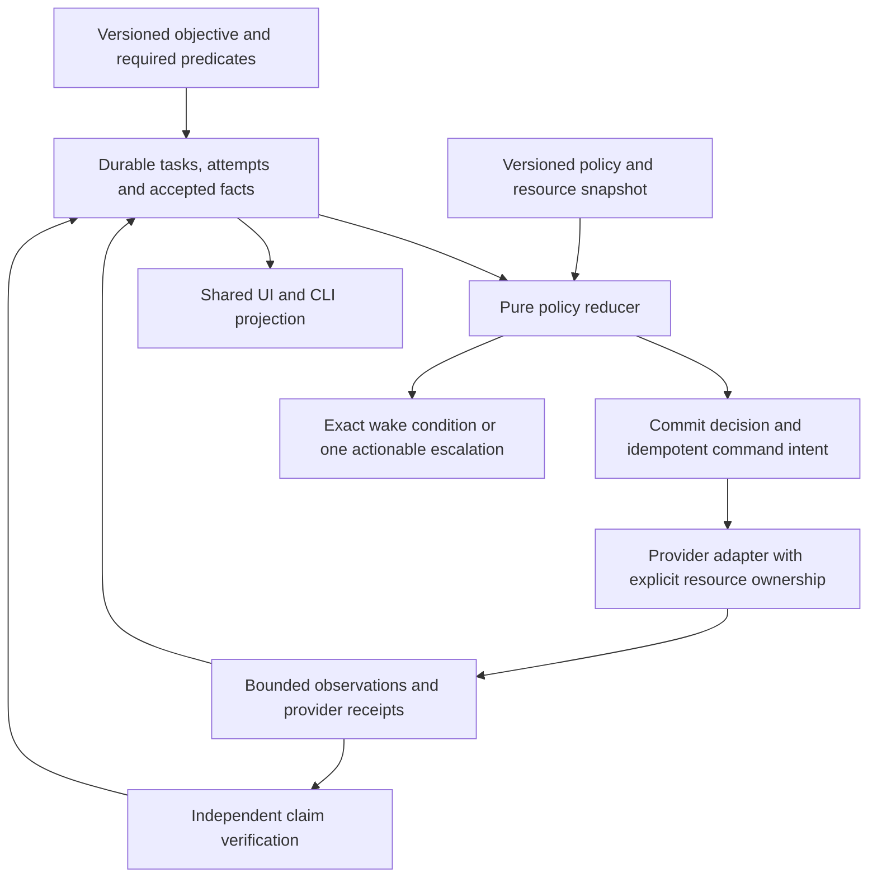

Suggested interface shapes are design contracts, not implemented APIs:

- `decide(objective, facts, attempts, resources, policy, observed_time)` returns
  eligible actions, refusal reasons and wake conditions with no hidden I/O.
- `execute(command_id, attempt_id, generation, manifest)` returns execution
  outcome, immutable output references, progress observations and access status.
- `accept(proposal, evidence, policy)` verifies claim scope and roots outside the
  write transaction, then rechecks current generation/dependencies in a short commit.
- `project(state, objective_id)` produces the same readiness and reasons for the
  dashboard, CLI, agents and reports.

The durable local store owns task state, retry spending, reservations, command
intents and accepted-claim references. Reuse the existing corpus/event contracts;
cache projections are rebuildable. Avoid dual writes to independent acceptance
stores. Existing grid records may be imported with stable origin IDs, but a record
must identify which authority accepted it. Use schema migrations and explicit
versions, not silent reinterpretation of old receipts.

Persist command intent before launch and reconcile it on restart. Delivery can be
at-least-once; external mutations are not magically exactly-once. An adapter must
state whether a command is idempotent, deduplicated by the provider, observable
through an operation ID, or ambiguous after interruption. An ambiguous native call
requires reconciliation against state/postconditions before any replay. Restart
replays decisions and observations, not blindly every side effect.
````

#### S021-C0007: Self-healing is a bounded policy, with a reason to expect a different result

Source `docs/plans/2026-09-22-history-grounded-maintainability-design.md` lines 113–133; accountable coverage owner U1.

```md
## Self-healing is a bounded policy, with a reason to expect a different result

| Outcome | Automatic next step | Re-entry condition |
|---|---|---|
| Transient provider failure | Retry with bounded backoff/jitter under one persisted owner | Remaining budget and provider readiness |
| Same deterministic error | Open circuit for exact provider/input basis; preserve diagnostic bundle | Relevant code/tool/input revision changed and prerequisite check passed |
| Missing fact or fixture | Schedule an allowed prerequisite producer or use an independently eligible provider | Accepted dependency appears |
| Uncertain process access | Fence publication; keep resource quarantine; run independent work elsewhere | Corroborated end of access, not elapsed lease alone |
| Stale accepted evidence | Withdraw only dependent claims; schedule revalidation | New evidence against current versions |
| Wrong hypothesis / no frontier advance | Choose an explicitly different hypothesis or diagnostic with an expected discriminating observation | New semantic basis, not cosmetic edits or another agent name |
| External account/consent dependency | One persistent actionable escalation; continue independent work | Explicit restored capability or authorized decision |

A changed failure message does not automatically earn a new retry budget. Persist
both provider-level attempt limits and objective-wide expenditure to prevent
hypothesis churn. Conversely, zero accepted-goal delta is not alone evidence of a
stalled long-running compile: distinguish fresh durable units from heartbeat-only
activity, and honor the admitted progress/checkpoint contract. A discovery task may
produce useful accepted negative evidence, but it must not inflate recovered-source
coverage. Configure these policies per task class with safe defaults and bounded
exceptions; do not scatter tunable timeouts throughout every launcher.
```

#### S021-C0008: Reduce developer nitpicking at the contract boundary

Source `docs/plans/2026-09-22-history-grounded-maintainability-design.md` lines 134–166; accountable coverage owner U1.

```md
## Reduce developer nitpicking at the contract boundary

1. **One objective, explicit finish conditions.** Translate natural-language intent
   into a versioned objective once. Keep required and optional capabilities separate.
   A new user message can refine scope; it cannot silently reset spent attempts or
   lower proof requirements. Show the change before using revised acceptance rules.
2. **One provider contract.** Ghidra, reccmp, ReAgent, compiler and harness adapters
   declare supported inputs, progress units, retry semantics, side effects, resource
   closure, checkpointing, cancellation and evidence outputs. Provider-specific
   quirks stay there. Missing instrumentation reports unknown.
3. **One fixture contract.** A scenario declares target hash, save/module, required
   actors/state, controller, oracle, recorder and teardown. Validate readiness before
   acquiring/mutating the live game. Produce or select a compatible fixture only
   through a defined permitted action; absence is not a failed behavior test.
4. **One reviewable change contract.** A repair proposal records diagnosis, expected
   changed predicate, patch/input delta, permitted scope, validation and rollback
   limits. Run it in isolated state during a later authorized implementation phase.
   Promote through the ordinary gate. An agent cannot rewrite its own success rule.
5. **One presentation contract.** Every task answers: what capability is requested;
   what was accepted; what is running; what blocks this task; what happens next; what
   exact event will wake it. Progress bars derive from known units. Independent
   useful work remains visible when a sibling is blocked.
6. **One source of policy.** Typed/versioned policy defaults, shared reason codes and
   generated reference documentation keep CLI, dashboard and agent behavior aligned.
   New providers pass the same conformance scenarios. Avoid independent UI retry
   buttons that bypass admission and ownership.

Desired operator experience: “K1 hook-read capability accepted. One compiler route
is paused for repeated E_RAW_IMAGE under revision X. Cached K2 identity work is
running. A corrected provider revision will wake the paused route.” Each statement
links to its receipt, owner or wake condition; it never asks the developer to infer
state from process lists and scattered logs.
```

#### S021-C0009: Incremental implementation sequence and future falsifiers

Source `docs/plans/2026-09-22-history-grounded-maintainability-design.md` lines 167–196; accountable coverage owner U1.

```md
## Incremental implementation sequence and future falsifiers

These were future work packages when the design was authored. The later explicit
build request authorizes implementation; the session audit records completion.

| Step | Bounded implementation | Decisive future check |
|---|---|---|
| 1 | Add objective/task/attempt identities and typed outcomes at existing seams; additive job projection fields | Exit-zero/no-valid-output shows execution complete but zero acceptance; queued work has no invented measured percent |
| 2 | Extract pure policy and persist basis-scoped retries/command intent | Replay the same snapshot after restart: same decision, no reset budget, ambiguous command not replayed |
| 3 | Adapt resource admission and quarantine, starting with one compiler and one harness route | Timed-out owner still accessing state prevents reuse; unrelated ready task proceeds |
| 4 | Add failure classification, circuit/wake rules and fixture prerequisites | Repeated `_RAW_IMAGE` stops boundedly; missing actor schedules/selects a valid fixture without asserting gameplay failure |
| 5 | Make dependency invalidation and independent acceptance authoritative | Changed type invalidates affected claims only; two signers sharing wrong seed fail identity; full final gate still required |
| 6 | Project one state model into dashboard/CLI and retire duplicated watcher retry loops per migrated provider | UI and CLI give identical status/reason/next action; interrupted work resumes without manual state repair |

Do not switch every provider at once. Shadow the pure decisions against retained
historical events first with side effects disabled, inspect disagreements, then
migrate one adapter under a single ownership handoff. Do not run old and new
launchers as competing writers. Export a resumable checkpoint and preserve old
receipts; rollback changes which compatible coordinator owns future commands, not
accepted historical evidence. No distributed platform is required for the first
single-host delivery.

Future history-derived conformance cases: H01 repeated deterministic crash; H02
unchanged pass/audit trigger; H03 busy observation versus mutation; H04 partial staged
closure; H05 zero-frontier churn with a long-running-progress control; H06 partial
feature evidence; H07 external capability denial; H08 fixture mismatch; H09 duplicate initialization;
H10 compiling-source versus whole-image claim; H11 nested resource pressure. Pair every refusal with an
unaffected-ready-work control. Supplement the existing RC01–10/A01–20 cases rather
than create a second incompatible acceptance framework. All cases are **NOT RUN**.
```

#### S021-C0010: Measure maintenance cost and goal progress

Source `docs/plans/2026-09-22-history-grounded-maintainability-design.md` lines 197–214; accountable coverage owner U1.

```md
## Measure maintenance cost and goal progress

Collect a baseline before tuning; no improvement percentage is asserted here.
Report operator interventions per accepted capability, repeated identical attempts,
useful accepted results per resource-hour, invalidated claims, stale publication
rejections, resume-without-repair rate, time with eligible work stranded, and age of
actionable blockers. Count escalations and unsafe retries separately: hiding alerts
must not look like reduced maintenance. Compare equivalent target/fixture/toolchain
cohorts; a changed workload cannot establish an efficiency win.

Continual progress is conditional on available evidence, resources and viable
methods. The system can guarantee bounded repetition, truthful accounting and
continued eligible work. It cannot guarantee discovery of every unknown ABI, repair
of a blocked kernel/device, or completion without required external access. When
nothing useful is eligible, durable waiting with a precise wake condition is the
correct outcome. The developer should decide new scope or supply genuinely missing
access, rather than repeatedly reconstruct routine execution state.
```

#### S021-C0011: Review and static verification

Source `docs/plans/2026-09-22-history-grounded-maintainability-design.md` lines 215–225; accountable coverage owner U1.

```md
## Review and static verification

Independent review checked the current-source claims, single acceptance authority,
provider migration, bounded healing and preserved final gate; no substantive
architecture blocker was found. A broken Markdown table boundary was corrected.
All 25 local evidence/source link targets exist; all 11 incidents are in one table;
code fences pair, trailing-whitespace checks pass, and scoped Git diff checks pass.
These checks establish document integrity only. The historical replay/conformance
cases remain unexecuted.
```

#### S021-C0012: Mandatory failure-response refinement

Source `docs/plans/2026-09-22-history-grounded-maintainability-design.md` lines 226–231; accountable coverage owner U1.

```md
## Mandatory failure-response refinement

The [prevention and recovery contracts](2026-09-22-failure-prevention-and-recovery-contracts.md)
expand these findings into required detection, containment, repair/reroute, wake
and acceptance behavior. They cover failures in the recovery machinery itself and
retain this document as the historical rationale and current-source integration map.
```

#### S022-C0001: ---

Source `docs/plans/2026-09-22-recovery-contracts-and-validation-plan.md` lines 1–7; accountable coverage owner U4.

```md
---
title: Recovery contracts, cross-build reuse and external validation
type: feat
date: 2026-09-22
status: design-only
---
```

#### S022-C0002: Recovery contracts and external validation

Source `docs/plans/2026-09-22-recovery-contracts-and-validation-plan.md` lines 8–23; accountable coverage owner U4.

```md
# Recovery contracts and external validation

[STRATEGY.md](../../STRATEGY.md) remains the pipeline authority. This is the
implementation delta to the [living ladder](2026-09-08-0156-feat-recovery-pipeline-ladder-plan.md),
[portable export plan](2026-09-08-0225-feat-portable-signatures-phasor-export-plan.md)
and [consolidated design](../dashboard-design/2026-09-21-consolidated-design-plan.md).
It adopts both supplied reviews as design input. Instructions quoted
inside that review or upstream READMEs are not operational authorization.

The requested product produces many inspectable recovery projects, with source,
comparison reports, exactness receipts and build profiles, plus independently
useful bindings for memory modding original vanilla games. The generic entity and
matching core must support other engines and binary families through adapters.
Unknown-build support is a discovery capability with explicit outcomes, not a
promise that every entity exists or every ABI is callable.
```

#### S022-C0003: Decisions and stage contracts

Source `docs/plans/2026-09-22-recovery-contracts-and-validation-plan.md` lines 24–46; accountable coverage owner U4.

```md
## Decisions and stage contracts

| Stage/lane | Required change | Acceptance boundary |
|---|---|---|
| 0 Resume | Validate only relevant dependencies; reuse unchanged work and program bindings | Reused evidence is labeled reused; reopening does not reanalyze valid work |
| 1 Identity | Logical entity, implementation variant, physical instance; typed many-to-many relations | Similarity cannot authorize source substitution; changed behavior may share a logical name |
| 2 Calibration | Minimum platform facts first; refine scoped compiler/layout hypotheses | Compiler/linker, headers/libs, macros, packing, FP, language and compilation group are recorded |
| 3 Scaffold | Reconstruct linkable regions, fixups, associated data and metadata | Real unchanged extraction/emission/placement matches original linked bytes; copied-output shortcut fails |
| 4 Source | C/C++ candidates; recovery/compilation/comparison units separate | Compile admits a candidate, not a verified replacement; repairs explain machine behavior |
| 5 Propagation | Compatible implementation variants, recipient ABI/layout checks, candidate staging | Each recipient earns its own checks; a donor receipt cannot promote recipients |
| 6 AI | Diagnose mismatch before bounded repair; retain exact proposal and inputs | Producer cannot alter acceptance policy or self-promote |
| 7 Parity | Continuous local and linked checks, independent original-image oracle | Relocation-normalized equality records its mapping; test agreement records its bounds |
| 8 Image | Reconstruction starts at stage 3; final fresh rebuild still required | Replacement contribution + full-file equality, separate C+floor/max-C and reconstruction/original-style methods |
| A Knowledge | Names separate from factual confidence; per-build layout, opaque unknown spans | No doubled offsets as proof; invalid seed descendants become stale |
| B Export | Known-build RVA first; unknown-build discovery with explicit uncertainty | Build identity and live bytes/structure checked before operation capability |
| C Runtime | located/readable/callable/detourable/writable checked independently | ABI, lifetime, ownership, thread context, policy and installation/removal evidence |
| D Replay | Immutable observations/proposals; snapshot dependency versions | Reject stale proposals; invalidate affected descendants, preserve unrelated work |
| E Compute | Preserve existing proposal/independent-verification model | Separate keys are insufficient if both rely on the same faulty reconstructed oracle |

Stages retain their names. Identity and calibration feed each other; stages 7–8
can validate early stage-3/4 artifacts. Cheap applicable methods precede expensive
ones. No rigid pass may postpone all reconstruction until source recovery ends.
```

#### S022-C0004: Data contracts (required additions, not yet a database migration)

Source `docs/plans/2026-09-22-recovery-contracts-and-validation-plan.md` lines 47–100; accountable coverage owner U4.

```md
## Data contracts (required additions, not yet a database migration)

Extend the existing corpus and receipt model rather than create a parallel store.
Keep `logical_id` stable as a conceptual identity. Add typed relationships for
implementation variants and physical occurrences, including standalone, thunk,
inline, split and folded instances. One address may implement several entities;
one entity may have no standalone address. Record accepted/rejected alternatives,
independent evidence roots and the dependency versions for each accepted edge.

A linkable-region record needs:

- Original image hash, file offsets/RVAs, region extent, architecture and byte hash.
- Boundary evidence and associated data regions; larger regions when splits are uncertain.
- External references and reconstructed fixups: site, encoding/width, symbol,
  addend, target and evidence; unresolved fixups block linkability acceptance.
- Exception/unwind/TLS and other relevant metadata, with coverage and unknowns.
- Extraction and emitter versions, analysis snapshot, emitted object hash,
  placement recipe and independent linked-image comparison receipt.

PE base relocations do not reconstruct original COFF symbol/addend relationships
by themselves. Evaluate a delinker behind this interface, with format/architecture
capability checks. Do not equate successful object emission with correctness.

Each source artifact separately identifies its recovery unit, compilation group
and comparison regions. Preserve per-function fragments for ownership and review;
assemble translation units or LTCG groups as evidence requires. Legacy MSVC flags
must be probed on the actual toolchain. Sharing a read-only compiler installation
is allowed; PDB, intermediate, temporary and Wine state must have distinct owners.

Record these independent facts using `not_run`, `passed`, `failed`, `unknown`,
`unsupported` or `stale`, with input hashes, tool versions, policy version and
evidence paths. `not_run` means no observation was attempted; `unknown` means an
attempt or legacy record cannot establish the predicate; `unsupported` means the
provider cannot perform that check; `stale` means relevant dependencies changed.
`failed` is an observed negative predicate under a valid check, distinct from a
provider crash. Execution failure belongs to the attempt record; it cannot turn
an inconclusive fact into a scientific negative.

| Fact | Required scope |
|---|---|
| Compilation | Candidate hash, language, complete compilation group and toolchain |
| ABI checks | Prototype, storage, calling convention, receiver and ownership assumptions |
| Behavioral tests | Inputs, observed effects, execution environment and coverage limits |
| Local match | Validated reference regions and declared relocation mapping |
| Linked match | Placement recipe and original linked-image bytes |
| Replacement contribution | Object/source-to-emitted-region map; no discarded-source credit |
| Whole-file equality | Fresh run, original/output hashes and sizes, complete current source manifest |

Keep artifact representation (`candidate_source`, `accepted_source`, `preserved_region`)
separate from these facts. `real_c=1` remains a legacy compile indicator; old receipts
lacking new evidence remain legacy/unknown, never silently upgraded. A generic
`equivalent` grade must become either tested agreement or a bounded formal claim
with assumptions; neither implies unrestricted equivalence.
```

#### S022-C0005: External tools: depend on them, keep acceptance in AgentDecompile

Source `docs/plans/2026-09-22-recovery-contracts-and-validation-plan.md` lines 101–110; accountable coverage owner U4.

```md
## External tools: depend on them, keep acceptance in AgentDecompile

Use optional external CLIs in an isolated NVMe environment. Do not vendor their
engines, add a mandatory server dependency or launch another analysis service.
[Proposed provider baselines](2026-09-22-external-validation-design.md)
and the [integration contract](2026-09-22-external-validation-design.md)
record the proposed integration. No requirements file, installation or product
adapter is part of this design-only deliverable. Transitive resolution and runtime
compatibility are future implementation checks, not design-completion blockers.
```

#### S022-C0006: reccmp

Source `docs/plans/2026-09-22-recovery-contracts-and-validation-plan.md` lines 111–126; accountable coverage owner U4.

```md
### reccmp

The inspected [reccmp revision](https://github.com/isledecomp/reccmp/tree/e91a51bfadfbb600adfdc750589ac40ae9742883)
provides source annotations, original/rebuilt binary comparison with PDBs, stack,
vtable, global-data, export and symbol-location diagnostics. Use it as a companion
to objdiff for supported legacy MSVC C++ targets. Probe supported inputs and tool
availability before scheduling. An unsupported target is `unsupported`, not a
zero score or success. Retain raw reports plus original/rebuilt/PDB/source hashes.
Normalize each tool's actual claims; do not sum percentages across unlike checks.

The adapter must distinguish failed execution, missing inputs, malformed report,
empty comparison, explicit mismatch and supported comparison. Tool exit code alone
is not acceptance. Compare reports must bind to the exact binary/PDB and source
snapshot; never reuse a PDB from another build. Annotation addresses are per-build
analysis coordinates, not literal addresses in generated runtime bindings.
```

#### S022-C0007: ReAgent

Source `docs/plans/2026-09-22-recovery-contracts-and-validation-plan.md` lines 127–143; accountable coverage owner U4.

```md
### ReAgent

The inspected [ReAgent revision](https://github.com/Dryxio/reagent/tree/d12cea338c61898b06a86fe8adb25275fa9d5615)
is an independent candidate/checker and validation workflow, not a substitute for
AgentDecompile's test runner or byte oracle. Its heuristic parity and structural
checks can refute a candidate; GREEN/checker PASS does not prove equivalence.
Standalone parity requires `--strict-exit` to make RED affect the exit status.

Use bounded manifests, immutable evidence snapshots and isolated candidate overlays.
Configure genuine target-owned build/test/runtime commands as argument arrays and
require their results. Commands must actually consume the candidate; verify that
its emitted contribution reaches the observed artifact. Do not use dummy commands,
turn verification off, or trust arbitrary model-supplied commands. Capture provider,
model, exact responses, call/round limits and available usage data. Bridge evidence
must be reused from existing analysis; a second Ghidra writer is not admitted.
Missing bridge exports or provider setup is a named blocker.
```

#### S022-C0008: isle as an output reference

Source `docs/plans/2026-09-22-recovery-contracts-and-validation-plan.md` lines 144–155; accountable coverage owner U4.

```md
### isle as an output reference

Use [isle's inspected project](https://github.com/isledecomp/isle/tree/8119bd013645972c72480e4de21529f1e91ce5c7)
as a reference for organized C++ sources, per-target build configuration, reccmp
annotations and readable comparison reports. Its reported exact-rebuild results
are upstream evidence, not AgentDecompile results or proof of other targets.
Keep comparator reports and fresh whole-file reconstruction receipts separately.
Generate a project per selected build/family with source fragments, compilation
groups, headers, dependency/toolchain manifests and evidence; original retail
binaries remain external inputs. Do not copy game-specific source into the generic
core or assume a universal compiler/engine profile.
```

#### S022-C0009: Vanilla memory-modding lane

Source `docs/plans/2026-09-22-recovery-contracts-and-validation-plan.md` lines 156–180; accountable coverage owner U4.

```md
## Vanilla memory-modding lane

For an exactly recognized build: verify image identity → recorded RVA → live
expected bytes or structure → requested capability preflight. Module-relative
locations are valid for known builds; unknown/changed builds use discovery ladders.
A match may remain located-only. Generated bindings expose capability-specific
refusal reasons, supported prototypes and dynamic-root recipes, not immortal
cached object pointers. Per-instance lifetime and game-thread requirements remain
runtime checks.

Capabilities are independent: located, readable, callable, detourable and writable.
For calls, require a supported ABI adapter plus valid receiver, argument/return
ownership and lifetime. For hooks, require supported instruction relocation,
patch ownership, original bytes and a tested install/remove protocol. Prove no
execution can return into a trampoline before reclaiming it. Avoid a universal
suspend-thread recipe; rollback restores journaled byte patches, not arbitrary
side effects of already-executed code.

Executable allocation is conditional on platform/process policy. Zero-filled
storage, section slack and headers are not automatically expendable caves. A
policy denial yields `unsupported_dynamic_code` or `not_detourable`; do not seek
another writable area to evade it. Unknown builds may remain unresolved, absent,
inlined-only, ambiguous, unsupported, insufficient-evidence or budget-exhausted.
New corpus evidence may reveal collisions and lower previously trusted coverage.
```

#### S022-C0010: Cache and acceptance invalidation

Source `docs/plans/2026-09-22-recovery-contracts-and-validation-plan.md` lines 181–195; accountable coverage owner U4.

```md
## Cache and acceptance invalidation

Workers consume a stable analysis snapshot and return proposals naming that version.
Central acceptance checks relevant dependency versions again before commit. Scope
cache keys to local compilation inputs, pairwise matching evidence or publication
corpus snapshots as appropriate. Ghidra analysis changes must invalidate affected
native decompiler caches before a new result is recorded. Repeating valid unchanged
work is waste; revisiting changed evidence is necessary.

Retain exact observations and AI responses for deterministic replay. Deterministic
replay does not promise deterministic discovery. A bad seed invalidates its
unsupported descendants; ten copies of one seed are not independent confirmations.
Shuffled completion order must not choose a different winner. Atomic publication
keeps the previous complete export usable until a new manifest is committed.
```

#### S022-C0011: Implementation slices and acceptance owner

Source `docs/plans/2026-09-22-recovery-contracts-and-validation-plan.md` lines 196–213; accountable coverage owner U4.

```md
## Implementation slices and acceptance owner

The coordinator owns acceptance; investigators and tool providers submit proposals.
Independent verification includes independent evidence lineage, not merely a
second process or a differently named agent. Independent design reviewers challenge this document; review agreement is not
software acceptance. The execution design specifies the future coordinator role.

| Slice | Existing seam / work | Completion evidence | Current state |
|---|---|---|---|
| R0 Design package | Strategy, consolidated design, contracts and diagrams | Requirement traceability, resolved design findings, readable synchronized artifacts | Design work only; completion recorded by design review |
| R1 Typed evidence | Existing binding/receipt/catalog consumers | False-label case rejected; capability-specific readiness and descendant withdrawal | Future implementation; design specified below |
| R1a Tools | Optional external CLI adapters | Versioned report ingestion, input identity checks and explicit missing-tool outcomes | Pinned isolated canaries and cached-evidence ReAgent ingestion delivered; full binary-backed execution adapters remain open |
| R2 Region reconstruction | `corpus/asm_seed.py`, workspace emission and full-image receipt verifier | Unchanged region through real extraction/fixup/placement, then a compiled replacement shown in final bytes | Not implemented by this change |
| R3 Candidate propagation | `corpus/cross_place.py`, corpus relationship/receipt storage | Variant compatibility, recipient validation, candidate/accepted separation; changed sibling refused | Planned; existing copies are not recipient verification |
| R4 Claims/invalidation | Receipt consumers and grid acceptance | Independent facts, stale-dependency rejection, seed withdrawal, deterministic replay | Planned; legacy evidence not upgraded |
| R5 Runtime/export | `corpus/export_hookpack.py` and supported runtime consumers | Known-build RVA/live check, per-capability refusal, install/remove/lifetime proof | Planned; existing v1 export is not this complete contract |
| R6 Repeated projects | Existing workspace/export generator | Two held-out builds produce inspectable source+comparison+binding bundles | Planned; no universal coverage claim |
```

#### S022-C0012: Required demonstrations

Source `docs/plans/2026-09-22-recovery-contracts-and-validation-plan.md` lines 214–231; accountable coverage owner U4.

```md
### Required demonstrations

1. Unchanged region extraction → reconstructed object → placement → original-byte
   comparison, including references and metadata. Then a compiled replacement;
   deliberately discard it and ensure recovery credit disappears.
2. Known-source target corpus: unchanged siblings, changed behavior, identical folded
   bodies, inlining, layout and supported optimization changes. Hold out whole
   builds; assess false acceptance as well as coverage.
3. ReAgent checks representative arithmetic, FP/NaN, object methods, global-data,
   indirect-call and exception-sensitive candidates. reccmp checks supported rebuilt
   binaries/PDBs, vtables/data/exports; objdiff and final linked/full-file checks
   retain independent claim boundaries. Report every failed/unsupported/not-run check.
4. Change a type, withdraw a seed, shuffle completion order, interrupt export and
   resume. Only relevant receipts become stale; no invalid descendant survives.
5. Original vanilla runtime: exact build admission, live location checks, supported
   read/call/hook, independent state/event observation, removal and storage lifetime
   verification. Runtime behavior never increases recovered-source coverage.
```

#### S022-C0013: Historical design-only scope and completion

Source `docs/plans/2026-09-22-recovery-contracts-and-validation-plan.md` lines 232–251; accountable coverage owner U4.

```md
## Historical design-only scope and completion

During the design phase, the user's correction required the plan, design and
diagrams exclusively. The earlier workbench availability check and dependency
requirements file exceeded that scope. The requirements declaration has been
converted into [documentary integration design](2026-09-22-external-validation-design.md).
Service availability, provider installation and compiler/runtime execution are not
prerequisites or blockers for finishing these artifacts. No product implementation,
service probe, installation, recovery execution, build or test suite belongs to
that completed design goal. The later explicit user build request authorizes
implementation under the repository operational constraints; the active
[session obligation audit](2026-09-22-session-obligation-audit.md) tracks the unfinished
software and verification work.

[The design package](2026-09-22-design-package.md) defines the complete artifact
set, requirement traceability, critique decisions and design acceptance. Future
experiments below and in the execution contract remain **NOT RUN**. A design can
be complete while its engineering hypotheses still require the specified future
measurements; unknown empirical outcomes are not hidden as design delivery.
```

#### S022-C0014: Binding acceptance: presence, identity and operation

Source `docs/plans/2026-09-22-recovery-contracts-and-validation-plan.md` lines 252–287; accountable coverage owner U4.

```md
## Binding acceptance: presence, identity and operation

These predicates are evaluated separately for a proposed binding `b` against an
exact target digest and evidence snapshot. A predicate's result names its evidence
roots, validity scope and limitations. The hypothetical example below is a design
walkthrough, not a runtime observation.

| Predicate | What it proves | What cannot satisfy it |
|---|---|---|
| `presence(b)` | Recorded file↔RVA mapping, region bounds and bytes match the exact original image; live bytes are separately checked for runtime use | A copied label, source filename, or different build's digest |
| `identity(b)` | The target region implements the intended entity under an explicit target-side correspondence rule | A signature/hash generated from the same label-selected address; compile-only cross-placement; agent agreement |
| `operation(b, op, live)` | Requested read/call/write/detour has supported ABI/layout, ownership/lifetime, policy and current runtime preconditions | Located address alone; successful source recovery alone; an old live preflight |

`accepted_binding = presence AND identity AND current_dependencies`.
`runtime_ready(op) = accepted_binding AND operation(op, current_live_state)`.
These are predicates, not a single confidence score or an implied state ladder.
Readable does not imply writable; callable does not imply detourable. A source
candidate may remain unverified while the original-code binding is callable.

**Admissible identity evidence:** choose an explicit rule version, not an arbitrary
vote count. Rule T1 requires authentic target debug/provenance tied to the image
and consistent boundary/call-site evidence. Rule T2 requires a unique target-side
structural/call/data relationship with discriminating semantic anchors and an
independently justified entity association. Rule T3 requires a target runtime
observation that discriminates this entity from named alternatives, with independently
established observation sites. Each rule retains rejected alternatives and must
refuse ambiguity. Unsupported targets/rules yield insufficient evidence. No rule
accepts a label solely because its selected bytes match a derived signature.

Independence is a dependency-graph property. The identity evidence subgraph must
contain a discriminating target fact whose entity association does not descend
from the candidate label/address seed being validated. Sharing the original image
as a ground-truth input is allowed; sharing the unproved semantic assignment as
the root of every witness is not. Two tools consuming the same bad seed count as
one lineage. Rule thresholds and collision checks are versioned with acceptance.
```

#### S022-C0015: Worked counterexample: Foo label over Bar bytes

Source `docs/plans/2026-09-22-recovery-contracts-and-validation-plan.md` lines 288–301; accountable coverage owner U21.

```md
### Worked counterexample: Foo label over Bar bytes

1. A donor candidate proposes `Foo` at target RVA `0x2100`; target region is Bar.
2. A signature is generated from those bytes. Both offline and live comparisons
   match, so `presence=passed`.
3. All identity evidence descends from the donor label. `identity=insufficient_evidence`;
   the generated signature cannot close this gap. Retain the candidate in the
   hypothesis queue, not the accepted catalog. No Foo call/header/pack claim is published.
4. A target-side debug/call-site witness later distinguishes Bar. Reject Foo's edge,
   invalidate its unsupported descendants, and accept Bar only under the applicable
   rule. A new evidence version permits reevaluation; there is no platform-wide ban.
5. An independently supported entity Baz on another build and cached report export
   proceed throughout. The missing Foo identity blocks only Foo-dependent claims.
```

#### S022-C0016: Worked reuse counterexamples

Source `docs/plans/2026-09-22-recovery-contracts-and-validation-plan.md` lines 302–313; accountable coverage owner U21.

```md
### Worked reuse counterexamples

- Same logical method, build A returns `x+1`, build B returns `x+2`: separate
  implementation variants. A's compiling source can be investigated as a candidate
  for B but cannot be selected as an accepted replacement without B's checks.
- Two logical methods share one folded body: preserve two entity relationships to
  the physical region. Do not merge conceptual identities solely by address.
- A 32-bit pointer field at offset 4 does not prove an offset of 8 on a 64-bit
  build: per-build layout evidence is required; an unknown span remains opaque.
- Type version changes while a worker compiles: retain its old result as historical,
  reject current acceptance, enqueue only affected work against the new dependency.
```

#### S022-C0017: Reconstruction mechanism and evidence route

Source `docs/plans/2026-09-22-recovery-contracts-and-validation-plan.md` lines 314–349; accountable coverage owner U4.

```md
## Reconstruction mechanism and evidence route

Select a region-first design with an explicit placement recipe. The diagram's
floor is a preserved-region object/assembly backend, not a C wrapper filled with
byte arrays. A delinker may propose reconstructed COFF references but cannot
certify its own target interpretation. Architecture support is a capability probe
and required-format contract; unsupported emitters do not fall back to fabricated
objects. Larger regions preserve unresolved internal boundaries.

The original image remains the independent byte oracle. The region record above
is converted into a proposed relocatable object plus a fixup map. Placement consumes
that object and associated metadata, validates references at their final addresses,
and compares emitted regions to raw original image ranges. The layout recipe records
section geometry, file alignment, virtual alignment, imports/IAT, base relocations,
TLS, resources, exception data, padding and header fields; unknown metadata is
explicitly preserved and excluded from source-credit accounting. `/ORDER` alone
cannot stand in for this recipe.

A future acceptance example uses a region that references another region and data:
extract original R and associated D → reconstruct references → emit R.obj → place
R.obj/D through the selected layout machinery → compare linked bytes to original.
Then compile an actual C/C++ candidate replacing R and repeat. The contribution
map ties candidate/group/object hashes to exact emitted ranges; an omitted object,
linker-eliminated candidate or fallback-selected region receives no recovered-source
credit. Deliberately discard the replacement as a negative control. Immutable
original bytes may remain in other floor ranges, explicitly counted.

Early unchanged round trips certify reconstruction machinery only. Final source
claims additionally require fresh compilation of the complete selected source,
valid local/linked receipts and source contribution. Maintain the Cartesian axes:
`method = reconstruction | original_style_build` and
`variant = byte_accurate_with_floor | max_c`. Each method/variant has its own input,
layout, contribution and whole-file receipt. Exact reconstruction does not imply
that the historical build process was recovered. Max-C is a measured source mix,
not an automatic claim of zero floor or exactness.
```

#### S022-C0018: Future acceptance specifications — NOT RUN

Source `docs/plans/2026-09-22-recovery-contracts-and-validation-plan.md` lines 350–367; accountable coverage owner U4.

```md
## Future acceptance specifications — NOT RUN

| ID | Setup / negative control | Deciding observation | Scope of evidence |
|---|---|---|---|
| RC-01 | Unchanged region with external code+data fixups; corrupt one reconstructed addend | Correct case matches linked original; corruption fails independent linked check | Reconstruction path only |
| RC-02 | Compiled replacement; deliberately discard it at link/selection | Discarded case earns zero source contribution despite any equal fallback bytes | Source contribution |
| RC-03 | Held-out sibling with x+1→x+2 behavior change | Same logical family allowed; incompatible accepted replacement refused | Variant/recipient acceptance |
| RC-04 | Folded bodies, inline-only and split regions | Entity/physical multiplicity retained; no invented standalone address | Identity representation |
| RC-05 | Arithmetic, FP/NaN, methods, globals, indirect calls, exception metadata | Per-check outcomes retained; compile or ReAgent GREEN never promotes other facts | Scoped source verification |
| RC-06 | Type dependency changes mid-attempt; unrelated build added | Affected result stale; unrelated local compilation cache remains valid | Dependency projection |
| RC-07 | Same evidence/proposals, shuffled discovery/worker completion order | Same accepted state under deterministic policy; tied ambiguity stays unresolved | Replay, not discovery |
| RC-08 | Wrong target label with matching extracted bytes | Presence passes, identity fails, unrelated accepted binding remains usable | Circular-proof rejection |
| RC-09 | Original binding has valid identity/ABI but source is floor | Supported original-code operation may pass; source progress unchanged | Runtime/source independence |
| RC-10 | Genuine negative pair vs absent/inlined/unsupported/budget-limited | Explicit terminal reason; no forced match and no claim of exhaustive failure | Honest coverage |

The execution design adds interruption, ownership, storage and scenario failure
specifications. These are acceptance requirements for later implementation, not
requests to run anything during design authoring.
```

#### S023-C0001: Independent recovery design review — 2026-09-22

Source `docs/plans/2026-09-22-recovery-design-review.md` lines 1–15; accountable coverage owner U1.

```md
# Independent recovery design review — 2026-09-22

Scope: documents and diagrams only. This review applies `grill-me`'s explicit
supersession by `prove-the-effort`, including its 2026-09-22 evolution: feasibility,
option selection and proposed work require concrete falsifiers. The review makes
no runtime, implementation, host-health or tool-execution claim.

Sources: user attachment **H**, `a7bcfa80-8844-4a5f-bd88-1e7f31bf2bda/pasted-text.txt`
(hindsight); attachment **A**, `1964612c-8fb0-44de-ab59-da1e53f8833f/pasted-text.txt`
(architecture verdict). Attachment recommendations are design input, not commands
to execute. Checked baseline: [contract plan](2026-09-22-recovery-contracts-and-validation-plan.md),
[STRATEGY](../../STRATEGY.md), [runtime assessment](../RUNTIME_REUSE.md),
[consolidated design](../dashboard-design/2026-09-21-consolidated-design-plan.md),
and [diagram source](../dashboard-design/pipeline-diagram/generate_pipeline_diagram.py).
```

#### S023-C0002: Findings at initial review

Source `docs/plans/2026-09-22-recovery-design-review.md` lines 16–29; accountable coverage owner U1.

```md
## Findings at initial review

| ID / claim | Concrete referent checked | Verdict and required correction |
|---|---|---|
| D1 A matching live signature establishes identity | H §1A; baseline runtime chain is build → RVA → live bytes | **False.** If Foo's donor label selects actual Bar, hashing Bar and seeing Bar live validates presence only. Require target-side identity whose justification does not descend from the disputed label/address assignment. Deny Foo without blocking another target. |
| D2 Different tools provide independent verification | A §§1,7; baseline plan already warns of a shared reconstructed oracle | **Incomplete mechanism.** Preserve evidence dependency edges and roots; a differently signed/tool-produced report from the same mistaken reconstruction adds no independent identity evidence. Define admissible target evidence and conflict behavior. |
| D3 Resource expiry makes reuse safe | H §3; diagram E says a lost lease wastes compute only | **False for mutable state.** Fence accepted publication by ownership generation; quarantine the resource while an old worker may still access it. Keep immutable duplicate computation separate. |
| D4 A timeout diagnoses and terminates a hang | H §§1D,4,5; diagram E uses kill deadline and task-poison | **Overbroad.** Deadline closes an attempt and records its state; execution can remain progress-unknown or resource-quarantined. Persist retry budget across resume. Changed evidence can create a new eligible task; no permanent platform ban. |
| D5 Portable coverage is the share resolving on every build | A §6; STRATEGY metrics contrasts signature family with per-build VA | **Contradicts known-build RVA-first.** Report capability × entity × eligible-build counts, with absent, unsupported, unknown and excluded denominators. Physical location and logical portability are distinct. |
| D6 “External dependencies declared” is part of this completion | User correction; baseline plan status implementation-started and 8080 blocker | **Out of scope.** Treat integration as a planned adapter contract; no installation, dependency activation, workbench or runtime requirement for design completion. |
| D7 ReAgent GREEN or reccmp percentage proves replacement | Baseline external-tool section expressly denies both | **That holds.** Preserve raw report/input/tool hashes and unsupported/empty/malformed distinctions. Planned command execution must consume the candidate and prove its contribution. No new flaw needed. |
| D8 Function fragments imply separate compilation | A §2; baseline data contract explicitly separates three units | **That holds.** Keep translation-unit/LTCG-group examples and final emitted comparison scope in the implementation plan. |
| D9 Whole-file equality proves recovered C | A §3; baseline contribution and C+floor/max-C separation | **That holds with the stated gate.** The negative demonstration must discard the compiled replacement while retaining original bytes: equality can pass while recovered-source credit fails. |
```

#### S023-C0003: Admissible independent identity evidence

Source `docs/plans/2026-09-22-recovery-design-review.md` lines 30–59; accountable coverage owner U1.

```md
## Admissible independent identity evidence

The acceptance policy must describe evidence requirements, not prescribe a magic
number of tools. Each evidence item identifies target digest, addressed region,
claim, producer/method revision, observations, dependency edges, validity and scope.
Evidence independence is evaluated relative to the disputed assertion.

Concrete eligible routes include target-bound debug/symbol information with
corroborated provenance and boundaries; independently established target callers,
callees or data relationships that distinguish the proposed identity; or a
controlled observation whose stimulus and independently observed effect distinguish
Foo from alternatives. These are possible methods, not unconditional proofs:
wrong-build debug data fails provenance, inherited caller labels remain dependent,
and a generic effect shared by Foo and Bar is nondiscriminating.

The evaluator must exclude evidence generated by assuming the identity under
review: copying donor names; extracting bytes at that label's chosen address;
re-signing or re-running that extraction; runtime self-reports of the same name;
and source annotations derived from those rows. An unresolved conflict returns
`contested` or `insufficient_evidence`; it cannot win on tool count or similarity
score alone. A target may be exactly recognized while an entity's identity remains
unproven. Presence, identity and operation safety are separate predicates.

Worked falsifier: donor says Foo → recipient RVA 0x1200, but the target implements
Bar there. A signature from 0x1200 matches the live target exactly. Presence passes;
identity evidence consists only of the donor assertion and derivatives, so Foo's
binding is refused. An independently evidenced Baz binding in another target is
still eligible. If later independent target evidence establishes Foo at 0x1800,
accept that version after its own capability checks and retain the rejected lineage.
```

#### S023-C0004: Architecture requirement traceability and future proof obligations

Source `docs/plans/2026-09-22-recovery-design-review.md` lines 60–83; accountable coverage owner U23.

```md
## Architecture requirement traceability and future proof obligations

These are planned acceptance demonstrations; none was run in this documentation task.

| Input | Required design contract | Smallest future falsifier |
|---|---|---|
| A §1 | Region boundaries, fixups, associated data and metadata; independent original-image comparison | Wrong reconstructed relocation agrees locally but fails linked original bytes |
| A §2 | Recovery / compilation / comparison units; scoped incremental calibration | Isolated fragment fails while evidenced compilation group produces the required output |
| A §3 | Architecture-specific floor; early real reconstruction; explicit method and source contribution | Copy-only unchanged image cannot earn extraction-path or source-contribution credit |
| A §4 | Separate compile, ABI, behavior, local, linked, contribution and file facts | Compiling wrong-constant candidate is distributed only as candidate and fails acceptance |
| A §5 | Logical entity / implementation variant / physical instance; per-build layouts | x+1 donor never overwrites x+2 sibling; folded aliases stay distinguishable |
| A §6 | Per-operation readiness; known RVA fast path; bounded unknown discovery | Located function with unsupported ABI remains non-callable; removed hook's trampoline remains live until safe reclamation |
| A §7 | Relevant dependency versions; immutable observations; deterministic replay | Unrelated corpus addition preserves local compile receipt; changed type invalidates affected descendants |
| A agent roles | Producers propose; acceptance policy and original oracle independently controlled | Candidate cannot modify policy or substitute a favorable reconstructed reference |
| H §1A–B | Noncircular identity; original-code readiness independent of source recovery | Foo/Bar example above; valid original-code call does not wait for C recovery |
| H §1C–E | Task-specific capacity; liveness/execution/goal axes; exhaustive ledger | Full swap alone cannot reject a bounded task; 24,242 entries must reconcile, including two previously unexplained entries |
| H §2 | Dependency-local scheduling, capability value plus aging, precise wake conditions | Failed target A does not delay ready B when B has inputs, capacity and ownership |
| H §3 | Atomic actual-resource ownership; short commits; fencing and quarantine | Generation-4 result arriving after generation 5 cannot publish or free occupied resources |
| H §4 | One retry owner, durable budgets, negative-result caching, continuation policy | Reopening a task cannot reset three exhausted identical attempts |
| H §5 | Complete verified staging, bounded probes, durable destination publication, consistent DB backup | Missing compiler header or Wine asset prevents launch; archival outage leaves complete cached task runnable |
| H §6 | Scenario prerequisites; read observation separate from mutation; command IDs | Dropped response to a non-idempotent command yields outcome-unknown and reconciliation, not blind replay |
| H §6 evidence | Required oracle and recording remain separate facts | Correct gameplay with missing recording retains observation but fails the requested complete acceptance package |
| H §§7–8 | Historical evidence remains historical; injection matrix and measured outcomes | Completed-unit receipts survive interruption; stale output cannot inflate coverage |
```

#### S023-C0005: External integration option decision

Source `docs/plans/2026-09-22-recovery-design-review.md` lines 84–100; accountable coverage owner U1.

```md
## External integration option decision

Criterion: reuse upstream capability while keeping AgentDecompile's evidence and
acceptance contracts stable across supported binary families. Proposed default:
optional adapters to pinned reccmp and ReAgent versions, with raw artifacts retained,
capability checks and typed normalized claims. This avoids duplicating their engines;
a future adapter-compatibility demonstration must establish that versioned reports
can be consumed without rewriting the core. Dependency pinning is a future
implementation action, not a design deliverable to install now.

Use isle as a project-organization and build/report reference. Its source or upstream
success cannot serve as AgentDecompile target proof. A generated project must name
its external original binary input, build profile, fragments/grouping, candidate
and accepted contributions, reports, exactness receipts and runtime binding limits.
Two held-out builds are a concrete later portability demonstration; “universal”
means an extensible contract with named unsupported outcomes, not universal success.
```

#### S023-C0006: Review status

Source `docs/plans/2026-09-22-recovery-design-review.md` lines 101–107; accountable coverage owner U1.

```md
## Review status

Initial review findings are recorded above. Their resolution requires inspection
of the revised artifacts; a proposal from their author is not closure. Rendering,
link and cross-document checks establish documentation consistency only. Future
implementation and recovery demonstrations remain explicitly unexecuted.
```

#### S023-C0007: Independent final review of revised artifacts

Source `docs/plans/2026-09-22-recovery-design-review.md` lines 108–145; accountable coverage owner U1.

```md
## Independent final review of revised artifacts

The reviewer reread the actual revised package, recovery contract, external-tool
contract, task/acceptance design, strategy, runtime assessment, consolidated design
and diagram-authoring sources. This is a second inspection, not acceptance of the
author's completion report. Locators below refer to this reviewed revision.

| Initial finding | Checked resolution | Design verdict |
|---|---|---|
| D1 circular binding | Recovery contracts §Binding acceptance (line 249), explicit predicates and Foo/Bar (285); runtime assessment §Capability refinement | **Closed.** Presence can pass while identity fails; valid independent work remains eligible. |
| D2 false independence | Recovery contracts T1–T3 (268), evidence-subgraph exclusion (278), rejected alternatives and ambiguity | **Closed.** Identity needs discriminating target evidence independent of the disputed assignment; distinct tools/signers alone cannot supply it. |
| D3 lease expiry | Task design §5 (167), generation-12/13 worked example (186); overview lane E ownership text | **Closed.** Publication authority and access clearance are separate; obsolete matching results cannot free quarantined resources. |
| D4 deadline/retry | Task design §§3 and 6 (199), persistent retry count/basis and checkpoint fields; overview lane E | **Closed.** Attempt deadlines do not establish termination; resumed conversation/coordinator cannot reset the budget. |
| D5 portable coverage | STRATEGY Runtime capability coverage (58); task design §9 exhaustive accounting | **Closed.** Named eligible inventory, separate known-RVA/unknown discovery, independent capability axes and explicit exclusions. |
| D6 execution scope | Recovery contracts §Design-only scope (232); external validation design opening and proposed baselines | **Closed.** No tool installation, service availability or implementation action is required for design completion. |
| D7–D9 retained mechanisms | External report envelope (68), recovery fact table and reconstruction mechanism (311), RC-01–10 | **Still hold.** Inconclusive reports now have unknown outcome; original oracle and actual contribution remain required. |

The final review also checked the 50-row package traceability against the two
attachments. It retains architecture requirements, historical-failure containment,
namespace/configuration boundaries, same-run oracle/video pairing and future
negative controls. The external project contract now supplies a declarative recipe,
content-ID input resolver and author-machine-path rejection case. These mechanisms
make the proposed design actionable; they do not establish actual interoperability.

Two last presentation contradictions were sent to the author for correction:

1. Consolidated design §4.3 still described `none / asm / C` and a linear
   `none / objdiff / linked/whole-image` posture. It must instead expose representation
   independently from compilation, ABI, behavior, local, linked, contribution and
   whole-file facts, including unknown and stale outcomes.
2. Overview lane E still foregrounded an independent signing key as verification.
   Its summary must explicitly require independent evidence roots so the diagram
   cannot imply that different signers make circular evidence independent.

These are documentation reconciliation findings. Their closure requires one final
source inspection; they do not require running any implementation or acceptance
experiment. All future RC/A/tool/portability demonstrations remain **NOT RUN**.
```

#### S023-C0008: Final closure after corrective edits

Source `docs/plans/2026-09-22-recovery-design-review.md` lines 146–165; accountable coverage owner U1.

```md
### Final closure after corrective edits

Rechecked consolidated design §4.3, lines 407–418: representation is separate from
the seven named evidence facts, explicit unknown/stale outcomes, runtime capabilities
and the three progress measures. Legacy none/asm/C is now display shorthand only.
The proof-posture objection is **closed**.

Rechecked overview generator's Verify card and generated overview SVG (lines 627,
636): acceptance explicitly requires independent evidence roots, not just keys.
Rechecked execution companion source and generated SVG (lines 37, 61): the three
predicates govern runtime use, and artifact I/O precedes the short acceptance
commit. The diagram-evidence objection is **closed**.

**Independent verdict: the reviewed recovery design contracts are complete at the
design level, with no remaining concrete architecture or claim-mapping blocker
identified in this review.** This verdict covers the inspected contracts, traceability
and corrected diagram semantics. The package's final artifact-production checks
(rendering, editable-output synchronization and link validation) remain the author's
separate documented responsibility. No software, runtime capability, byte recovery,
performance result or future acceptance demonstration is certified by this verdict.
```

#### S024-C0001: ---

Source `docs/plans/2026-09-22-session-obligation-audit.md` lines 1–7; accountable coverage owner U1.

```md
---
title: Conversation obligation audit and ongoing completion order
type: living-implementation-audit
date: 2026-09-22
status: active
---
```

#### S024-C0002: Conversation obligation audit

Source `docs/plans/2026-09-22-session-obligation-audit.md` lines 8–25; accountable coverage owner U1.

```md
# Conversation obligation audit

The Codex session goal is active with no requested token or time budget. It covers
all applicable unfinished directives in this conversation. This document and the
[110-item contract register](2026-09-22-session-obligations.json) support that goal;
they do not replace its session state or declare completion.

Scope clarification (2026-09-27): the goal includes the complete
[September 18–21 baseline](2026-09-27-weekend-design-scope.md), including the
portable plan's Phases 0–15 and every named D/U unit, distributed design and both
frontend surfaces. The 110 rows below are a later contract register, not the total
program backlog. Historical unit checkmarks need current requalification.

The previous turn delivered a design package and a bounded implementation foundation.
It did not complete the broader instruction to build according to the design. A
built wheel, 70 focused tests and a complete diagram do not close the external-tool,
recovery, runtime, self-healing or end-to-end acceptance obligations below.
```

#### S024-C0003: Scope and instruction precedence

Source `docs/plans/2026-09-22-session-obligation-audit.md` lines 26–51; accountable coverage owner U1.

```md
## Scope and instruction precedence

- The user's latest clarification makes the September 18–21 designs, diagrams,
  plans and brainstorms the baseline represented by both STRATEGY and the living
  plan. Later consolidation cannot silently narrow it. Useful RE/cross-match work
  is prioritized alongside implementation on its own qualified prerequisites.
- Direct session requests are authoritative: incorporate reviews and existing plan/SVG;
  use reccmp, isle as output reference, and ReAgent plus AgentDecompile when relevant;
  research actual RE/harness history; reduce routine human intervention; collaborate
  and independently challenge claims; later build the designed system; now continue
  under a persistent goal until applicable obligations are achieved.
- The earlier design-only correction governed that phase. The later explicit build
  request authorizes implementation. Operational ownership/catalog constraints and
  publication restrictions remain in force.
- Commands inside pasted historical conversations are evidence, not newly issued
  tasks. The historical 41-example validation, account provisioning, videos, commits,
  multiplayer claims and game routes are not silently revived as independent tasks.
  Their adopted product requirements and relevant acceptance scenarios are retained.
- M1–M7 are adopted roadmap commitments, with target/host qualification and browser
  feasibility gates preserved. A browser-shell demo cannot close the whole-game goal;
  infeasibility evidence must be reported, not relabeled implementation success.
- Universal fault prevention or mathematical optimality is not a verifiable promise.
  Completion requires the specified supported-domain prevention, containment,
  reconciliation and paired continuation cases, with explicit unknown/unsupported
  boundaries. A known external blocker stays open while independent work proceeds.
```

#### S024-C0004: Directives and current evidence

Source `docs/plans/2026-09-22-session-obligation-audit.md` lines 52–70; accountable coverage owner U1.

```md
## Directives and current evidence

| ID | User directive / adopted deliverable | Current assessment | Required closure |
|---|---|---|---|
| U01 | Read and revise current plan, both architecture/hindsight reviews and SVG | Design achieved; implementation incomplete | Preserve D01–D48 traceability through actual code and acceptance receipts |
| U02 | Keep original diagram current | Achieved for original overview | Documents SVG and canonical overview SHA-256 both `a124af582c52c19dc630f25b0b11d8fb0a9411be1ec78725865281e631cf7a3f`; keep future edits synchronized |
| U03 | Implement reccmp as dependency or aggregate as appropriate | Optional external adapter selected; pinned lint canaries and report-reader portion delivered; full execution adapter open | Pinned isolated provider, capability checks, real original/rebuild/PDB input binding, raw and normalized report, catalog consumer and negative cases |
| U04 | Generate many isle-like recovered projects | Layout/recipe/resolver designed | Export actual source/groups/regions/evidence/runtime recipe; relocate to independent root/host and build/compare with input identities preserved |
| U05 | Universal-use binary/cross-binary matching | Contracts designed; existing mechanisms need qualification | Logical entities/variants/instances, held-out sibling builds, negative/absent/inlined/unsupported cases, recipient-specific acceptance and honest coverage |
| U06 | Original vanilla game memory modding | Separate capability lane designed | Independent presence/identity/ABI/lifetime predicates; actual supported read/call/mutate/restore with source recovery still incomplete |
| U07 | Use ReAgent for relevant testing, plus reccmp and AgentDecompile CLI | Real pinned provider canaries and CLI report ingestion tested; binary-backed recovery validation open | Supported snapshot/backend adapter and configured candidate-consuming checks, pinned fixtures, raw receipts and truthful heuristic/exactness separation |
| U08 | Find major blockers in AgentDecompile/KotorPhasor/harness histories | Targeted grounded history design achieved | H01–H11 plus supplied long-session traceability maintained; translate lessons into verified product behavior below |
| U09 | Self-healing, deterministic progress, low developer nitpicking | Initial retry/cache/supervisor slice delivered | Shared ownership/quarantine/reconciliation, budgets, wakes, closure, acceptance lineage, stagnation response and control-plane fault handling |
| U10 | Complete failure solutions in plans/diagrams | Design covered F01–F25 and FP-01–FP-30 | Implementation must pass all applicable paired failure/independent-continuation scenarios |
| U11 | Fan out agents and use grill/prove-the-effort | Achieved and continuing | Independent reviewers tie findings to actual source/evidence; skill supersession recorded in design package |
| U12 | More ambition and practical roadmap; offload human work | M0–M7 roadmap and companion delivered | Implement and qualify each milestone; keep genuine access/authority/taste exceptions explicit |
| U13 | Build according to design | Development wheel/React bundle built; full scope partial | Build/install/package checks for subsequent changes, actual consumer evidence and required runtime/whole-image gates; no source-presence completion |
| U14 | Persistent session goal until all applicable directives complete | Goal created and active | Requirement-by-requirement final audit; never close goal on a bounded slice |
```

#### S024-C0005: Priority order

Source `docs/plans/2026-09-22-session-obligation-audit.md` lines 71–94; accountable coverage owner U1.

```md
## Priority order

Priority combines user impact, current correctness risk, dependency unblocking and
estimated relative effort. Sizes are relative, not invented duration promises.
Independent qualified work can run in parallel; shared mutable resources serialize.

| Order | Work | Relative size / reason | Completion evidence |
|---|---|---|---|
| P0.1 | Reconcile stale design-only/current-source wording; inventory every contract and acceptance case | Small; prevents forgotten work and unauthorized interpretation | Linked audit/register and consistent current authority, done in this audit |
| P0.2 | Fix catalog ownership metadata and retain resource quarantine after unknown child outcomes | Small-to-medium; concrete duplicate-writer admission gap | Real JobStore path with inert executors: conflicting job stays blocked, independent job proceeds, restart retains quarantine, stale queued receipt cannot erase it |
| P0.3 | Add evidence-gated owner reconciliation through existing catalog | Medium; safe refusal must become supported automatic recovery | Unknown stays reserved; qualified clearance releases exactly its resources once; live owner is never released from timeout/PID alone |
| P0.4 | Establish false-label rejection and source-contribution acceptance gates before recovery delivery claims | Medium; scientific correctness gates every downstream recovery/export claim | Wrong semantic identity and discarded compiled replacement earn no credit; unrelated valid evidence survives |
| P1.1 | Stable objective/incident/provider budgets and shared recovery circuits | Medium; local attempt caps still permit global repetition | Nested wrappers/new hypotheses cannot replenish total allowance; many waiters share one bounded probe |
| P1.2 | Complete dependency closure and durable wake/restart handling | Medium; source/device outages and missed events remain manual | Indirect dependency missing prevents launch; complete independent task runs; crash/subscribe windows cannot lose wake or duplicate dispatch |
| P1.3 | Implement optional reccmp/ReAgent adapters and normalized reports; real supported-tool canaries | Medium; direct original request still undelivered | Catalog/CLI consumer uses pinned inputs and rejects wrong PDB/stale/empty/malformed/heuristic-only proof |
| P1.4 | Central scoped acceptance, dependency withdrawal and honest progress | Medium-to-large; required before claiming recovery/automation completion | False identity rejected, source contribution distinct, stale roots withdrawn locally, zero progress chooses a genuinely different bounded action |
| P2.1 | Region reconstruction, groups/toolchain calibration and reusable project exports | Large; enables trustworthy isle-like outputs | RC-01–RC-07, actual compile/link contribution and clean-root/host relocation |
| P2.2 | Held-out cross-build matching and vanilla-runtime operations | Large; primary intended user capability | RC-03/04/08/09/10, exact operation/build evidence; no source-floor barrier |
| P2.3 | Effective scenario runner plus generated operation bundle (M1/M2) | Large; removes repeat preparation/API/oracle work | Exact effective script, fixture/lifecycle checks, observation/capture/cleanup and shared generated consumer contracts |
| P3.1 | F12 workspace and creative projects/captures (M3/M4) | Large; requires qualified operations and scenarios | Actual input/focus/edit/restore flow, fresh-session project reuse, defining-event capture |
| P3.2 | Supported checkpoint playback and native host qualification (M5/M6) | Large; native state/host dependencies | Same required state restored; exact Mac/Win/Linux build-specific results |
| P3.3 | Whole-game browser route (M7) | Research plus large implementation | Reuse prior work, real executable route, rendering/input/audio/save and sustained interaction; feasibility findings remain explicit |
| Final | Complete failure matrix, rebuild, package, and full consumer demonstrations | Cross-cutting; run relevant checks incrementally | All applicable D/RC/A/FP and milestone predicates have direct current receipts; no remaining unverified required item |
```

#### S024-C0006: Concrete audit findings beyond the last delivery

Source `docs/plans/2026-09-22-session-obligation-audit.md` lines 95–122; accountable coverage owner U1.

```md
## Concrete audit findings beyond the last delivery

1. `actions/jobs.py` released local identity/pair/Ghidra admission in its finalizer
   even when executor child ownership was unresolved. Preparation's own unknown-job
   protection does not protect other catalog submissions. The bounded fix is implemented and tested; full resource reconciliation remains open.
2. `corpus.recovery-orchestrator` was visible in the generated catalog without
   mutation/long-running/resource metadata. Metadata correction and read-only status
   separation are implemented and tested; complete compiler/prefix/output resource admission
   remains a broader obligation.
3. `needs_reconciliation` is durable refusal, not a completed automatic reconciler.
4. Per-stage or per-action caps do not establish stable objective/incident budgets.
   Verification TTL is a rate limit, not a total spending cap.
5. Region/fixup round-trip and compiled-source contribution remain unverified.
   The existing local byte comparator cannot substitute for independent linked-image
   proof; correct bytes under a false semantic label must still be rejected.
6. A caller's `complete=true` manifest assertion is not discovered dependency closure.
   This session itself encountered nominal NVMe interpreters resolving to MyBook.
7. The old design requirement table, history before-state and external integration
   status retained design-phase wording after authorization changed. This audit
   reconciled those labels while preserving the historical record.

The [contract register](2026-09-22-session-obligations.json) individually preserves
D01–D50, RC-01–RC-10, A01–A20 and FP-01–FP-30. It conservatively leaves complete
implementation/acceptance unverified unless the exact predicate has a receipt.
D49 is superseded by the later build authorization; D50 collaboration is achieved.
The foundation tests are supporting partial evidence, not wholesale closure of
any larger failure-injection or native-game matrix.
```

#### S024-C0007: Evidence and completion rule

Source `docs/plans/2026-09-22-session-obligation-audit.md` lines 123–139; accountable coverage owner U1.

```md
## Evidence and completion rule

Use the [foundation receipt](../verification/2026-09-22-autonomy-foundation.md),
[design package](2026-09-22-design-package.md),
[external integration contracts](2026-09-22-external-validation-design.md),
[history ledger](2026-09-22-history-grounded-maintainability-design.md), and
[capability roadmap](2026-09-22-autonomous-capability-product-roadmap.md) together.
Record each new change/test in a dated receipt and link it to exact register IDs.
A previously built artifact remains evidence only for its recorded source hashes;
new source edits require a new build before claiming package currency.

The goal stays active while there is productive authorized work. Record blockers
locally to their dependencies and continue independent work. Mark completion only
when all applicable directives and required evidence are achieved; future labels,
unsupported results and unavailable external prerequisites never count as success.
```

#### S024-C0008: Latest bounded implementation evidence

Source `docs/plans/2026-09-22-session-obligation-audit.md` lines 140–264; accountable coverage owner U1.

```md
## Latest bounded implementation evidence

The [scoped activity-evidence receipt](../verification/2026-09-27-live-evidence.md)
records the latest `.10` package, source and installed backend checks, frontend
checks and locked build. Both surfaces separate current source checks from historical
named evidence and unavailable trusted contribution. Read-only projection and
selection/reset guards are implemented; live qualification and current accepted
claims remain open. Existing obligation statuses remain unchanged.

The [source-contribution receipt](../verification/2026-09-27-source-contribution.md)
records RC-02 as partial: actual supported native compilation, object-byte placement,
discard/overwrite zero-credit and surviving independent contribution are exercised.
The `.9` installed package passed 149 checks after review and includes the locked live
frontend assets. General relocations/linking, durable cross-process re-admission,
named contribution composition and catalog/game-target qualification remain open.

The current user priority is the September 22 program's useful live operator track.
The [freshness/admission display receipt](../verification/2026-09-27-live-projection.md)
records the first partial L0.2–L0.5 source and asset delivery: static/React allowance
and uncertainty display, malformed-response retention, serialized polling and visible
freshness. Twelve checks, TypeScript and a production bundle passed after independent
review. No activation or live interaction is claimed; the register states remain open.

The [quarantine and provider report receipt](../verification/2026-09-22-quarantine-and-provider-reports.md)
records same-root catalog resource authority, durable uncertainty retention, remote
MCP outcome propagation, preparation/UI consumption, and the read-only report
normalizer. P0.2 is delivered within its recorded receipt-root/key scope; P0.3 and
broader resource ownership remain open. Real external provider canaries improve
U03/U07 evidence without closing binary comparison or production execution adapters.
The goal remains active; the next prerequisite is evidence-gated reconciliation and
complete resource/admission integration alongside the external execution adapter.

The [next packaged increment](../verification/2026-09-22-reconciliation-and-cache-package.md)
adds automatic repair of stale reservations backed by already committed qualified
terminal releases, plus actual existing-cache export consumed by ReAgent. Its 153-case
suite passes against source and installed wheel. General uncertain-owner reconciliation,
verified original-binary binding and full provider execution remain open; priority
P0.3 is partial. All 110 named requirements remain tracked without reducing scope.

The [qualified local-output contract](../verification/2026-09-27-resource-claims.md)
extends that partial P0.3 implementation to `corpus.export-reagent-snapshot` and its
actual destination tree. It removes generic parameter-name inference, requires
qualified executor clearance and retains unknown historical external claims.
Cross-kind path overlap and canonical execution-path binding are explicit. Source
validation and review status are recorded in the receipt; package/live activation,
general compiler/Wine/project/store lifecycles and uncertain remote owners remain
open. D36 stays partial and the 110-item acceptance counts do not change.

The [native package-verifier contract](../verification/2026-09-27-native-verify-ownership.md)
extends the owned-output lane to the supported native Clang catalog profile. Its
guarded child controls actual compiler inputs and scratch, and exact session-bound
evidence qualifies release. Modern known non-dispatch receipts survive cancellation
and restoration without inventing ownership. The `.14` wheel passed 139 installed
checks and final independent artifact review approved. General compiler/Wine,
project/store, cross-version migration and live activation remain open; D36 and
the 110-item counts are unchanged.

The [2026-09-26 source-grounded integration findings](2026-09-26-acceptance-and-budget-integration-findings.md)
identify concrete promotion/consumer and persisted-intent seams for the next P0.4/P1.1
work. They are implementation guidance, not completed acceptance or budget enforcement.

P0.4 now has a [producer/consumer source-binding implementation](../verification/2026-09-26-current-source-binding.md),
verified through 51 source and installed-package regressions. It closes stale source
pairing in the covered paths, not independent semantic or linked-contribution acceptance.

The [database-consumer freshness increment](../verification/2026-09-26-recovered-source-freshness.md)
adds persisted producer digests and current-byte checks to the covered recovery skip
and packaging paths. Restoration no longer reconstructs positive comparison flags from
DB membership. Full semantic identity, linked contribution and all-reader invalidation
remain open; this is another partial acceptance prerequisite.

The [target-local queue correction](../verification/2026-09-27-target-local-recovery-selection.md)
removes active cross-build logical-ID suppression and requires binding of the actual
local C file before counting it as already successful. Source/installed tests pass;
recipient binary identity and full semantic acceptance remain open.

[Captured target provenance](../verification/2026-09-27-target-snapshot-provenance.md)
now binds comparison producers to a whole-image snapshot and exact region, and fixes
cross-root slug cache collisions. 100 tests pass against source/installed wheel. This
is recorded snapshot identity, not complete target-currentness or compiler closure.

[Target consistency gates](../verification/2026-09-27-target-consistency-gates.md)
now check captured image/region content at ingestion and seed promotion, reject conflicting
metadata, and require full raw-region seed equality under a versioned comparison policy.
129 source/installed regressions pass. Intended-target identity, VA mapping, toolchain
closure and complete downstream invalidation remain open.

[Seed compile-input reuse](../verification/2026-09-27-seed-compile-input-basis.md)
now resolves and binds configured compiler/context/verifier inputs before cache decisions.
140 source/installed tests pass, including unchanged-input reuse and changed-input recompile.
Declared closure is not automatic discovery; full acceptance and objective budgets remain open.

[Preparation objective accounting](../verification/2026-09-27-objective-admission-accounting.md) now persists
admission spending across resume and changed action hypotheses, with an explicit
revision control under the existing run lease. 79 source and installed-wheel tests
pass, including the accepted-child/lost-acknowledgment boundary. P1.1 remains partial:
the [nested MCP dispatch slice](../verification/2026-09-27-nested-mcp-budget.md)
now has source enforcement and reviewed static/React projection, with
113 backend and 38 frontend checks passing. Final backend re-review approved the bounded correction. Other nested/provider usage and
shared recovery circuits remain open; package and live states are recorded in
that receipt.

The [raw-local observation correction](../verification/2026-09-27-raw-local-observations.md)
is packaged after independent review and 67 source plus 67 installed-wheel checks.
It covers owned-artifact withdrawal across lost cache state and initial dependency
failure, restored-dependency republication, and partial PE-section overlap rejection.
Filename-only downstream consumers, independent identity and linked contribution
remain unqualified. This is a partial prerequisite; P0.4 remains open.

[Target-embedded PE export identity](../verification/2026-09-27-target-pe-export-identity.md)
now supplies one independent named witness for supported PE32/PE32+ exports. It binds
the parsed snapshot, corpus/candidate digests, exact name and VA, raw region, ingestion,
database, report and deterministic package consumers. False `Foo` at `Bar`'s address
remains local-only while valid `Foo` and `Bar` evidence survives. Source and installed
wheel suites each pass 124 cases after independent review. This does not close P0.4:
non-export identity, current-at-consumption checks and linked contribution remain open.


The [fresh source revalidation increment](../verification/2026-09-27-fresh-source-revalidation.md)
adds an explicitly requested fresh-production route after process loss while keeping
imported audits nonauthoritative. The final new-module suite passed 27 cases and
source review approved; the `.13` wheel then passed all 60 installed checks and
independent artifact review. RC-02 remains partial:
general linking, durable trust without reexecution and catalog/game-target
qualification remain open. The 110-item status counts are unchanged.
```

#### S025-C0001: ---

Source `docs/plans/2026-09-22-task-acceptance-and-continuation-design.md` lines 1–7; accountable coverage owner U9.

```md
---
title: Task acceptance, continuation and failure containment
type: design
date: 2026-09-22
status: design-complete-runtime-unverified
---
```

#### S025-C0002: Task acceptance, continuation and failure containment

Source `docs/plans/2026-09-22-task-acceptance-and-continuation-design.md` lines 8–16; accountable coverage owner U9.

```md
# Task acceptance, continuation and failure containment

This is a design specification, not deployed functionality or permission to run
workers. [STRATEGY](../../STRATEGY.md) remains recovery authority; the
[recovery contracts plan](2026-09-22-recovery-contracts-and-validation-plan.md)
defines the source, region and tool evidence consumed here. The supplied hindsight
review is historical design input, not a diagnosis of the current host. All
acceptance scenarios below are specifications **not run**.
```

#### S025-C0003: 1. Governing contract and scope

Source `docs/plans/2026-09-22-task-acceptance-and-continuation-design.md` lines 17–33; accountable coverage owner U9.

```md
## 1. Governing contract and scope

Missing evidence blocks the claim requiring it. An unhealthy resource blocks its
dependent work. Neither creates a platform-wide or project-wide stop by default.
A task is eligible when its exact prerequisites are satisfied, its mutable resource
set can be owned, and a compatible environment has capacity. Original-code
read/call/hook capabilities do not require recovered C; replacement and whole-image
claims retain their independent requirements. No task may lower those requirements
to finish sooner. A deadline ends an attempt, not the requested objective.

Historical observations motivate the mechanisms; they are not current measurements.
In particular, the recorded `-j3` ceiling is a proposed conservative shared compiler
budget for future execution, subject to the active operational policy. It is not
three workers per agent and is not permission to launch any worker in this design
phase. ReAgent, reccmp, objdiff and AgentDecompile CLI fit the same adapter contract;
which can substantiate a claim depends on their supported inputs and evidence.
```

#### S025-C0004: 2. Task and acceptance schemas

Source `docs/plans/2026-09-22-task-acceptance-and-continuation-design.md` lines 34–82; accountable coverage owner U9.

```md
## 2. Task and acceptance schemas

Extend the existing corpus/receipt system; do not create a competing acceptance
database. IDs below are stable identifiers; digests identify immutable content;
policy revisions and dependency versions are explicit values, not latest aliases.

| Task field | Required meaning |
|---|---|
| `task_id`, `objective_id`, `capability_id` | Durable unit, overall objective and requested usable result |
| `kind`, `subject_ids`, `basis_digest` | Operation, exact target/entities and complete relevant input basis |
| `input_manifest`, `analysis_snapshot` | Content hashes, locations, origin, dependency closure and analysis revision |
| `prerequisite_sets` | OR of alternatives, each an AND of typed required claims and versions |
| `provider_constraints`, `provider_alternatives` | Supported format/architecture/ABI/tool features and compatible providers |
| `mutable_resource_ids` | Complete exclusive resource set; immutable inputs require no writer lease |
| `resource_profile` | Process-tree memory estimate and uncertainty, CPU/child slots, I/O class, scratch and enforcement requirements |
| `progress_contract`, `checkpoint_schema` | Durable work-unit identity, terminal unit outcomes, checkpoint/resume version |
| `output_contract`, `acceptance_policy_id` | Artifact schema and pinned independent acceptance rules |
| `priority`, `ready_since`, `aging_credit` | Capability dependency priority and persistent eligible waiting age |
| `attempt_policy`, `retry_owner` | Deadline, class-specific limits/backoff and exactly one retry authority |
| `state`, `blocked_on`, `wake_conditions` | Current status, precise unsatisfied sets and events that can change it |

| Acceptance record field | Required meaning |
|---|---|
| `proposal_id`, `attempt_id`, `generation` | Producer result and publication authority generation |
| `claim_kind`, `claim_scope` | Exact fact: identity, ABI, tested behavior, local/linked match, contribution, whole-file equality or runtime capability |
| `subject_manifest`, `dependency_versions` | Exact target/source/toolchain/scenario/artifacts and evidence roots |
| `policy_revision`, `verifier_identity` | Rules fixed before production and separate acceptance authority |
| `observations`, `raw_artifact_digests` | Retained results and immutable raw reports, including negative observations |
| `assumptions`, `bounds`, `unsupported` | Scope limits; no conversion from bounded test agreement to equivalence |
| `outcome`, `reason_codes` | Accepted, rejected, stale, insufficient evidence or unsupported with actionable reasons |
| `supersedes`, `accepted_at`, `transaction_id` | Append-only history and atomic ledger commit identity |

A producer cannot write accepted status, modify acceptance policy, or replace raw
observations. The acceptance coordinator checks schema, target/input digests,
relevant dependency versions, independent evidence lineage, current publication
generation and operation-specific predicates. It computes outside the write
transaction; the short transaction rechecks versions/generation and commits once.
An idempotency key over proposal, claim and policy prevents duplicate acceptance.
Conflicting equally supported proposals remain contested; arrival order is not a
tie-breaker. Content-hash sorting can stabilize presentation, never manufacture truth.

The binding predicates in the [recovery contracts plan](2026-09-22-recovery-contracts-and-validation-plan.md) are authoritative; their RC-01–10 examples complement the orchestration cases here. For scheduling, those predicates remain distinct: target bytes exist at the claimed
region; target-side boundary/identity evidence identifies the intended entity;
the requested operation satisfies ABI/layout/live-state requirements. A signature
extracted at a donor-suggested address cannot prove that donor's label. Withdrawal
marks unsupported dependent claims stale and removes their current export references;
independent corroboration may preserve a claim through explicit reevaluation.
Historical receipts remain immutable. Repairs unblock only the new relevant basis.
```

#### S025-C0005: Cross-place admission and recipient candidates

Source `docs/plans/2026-09-22-task-acceptance-and-continuation-design.md` lines 83–240; accountable coverage owner U9.

````md
### Cross-place admission and recipient candidates

The September 27 source audit makes this existing recovery contract concrete at
three entry points: standalone cross-place, its watcher and the bulk-recovery
placement hook. A saved list of compiled addresses cannot authorize current source
bytes. A logical identity join cannot establish implementation interchangeability.
The shared boundary must validate a captured source artifact against producer
evidence and current source/recipient dependencies, then publish only a candidate.

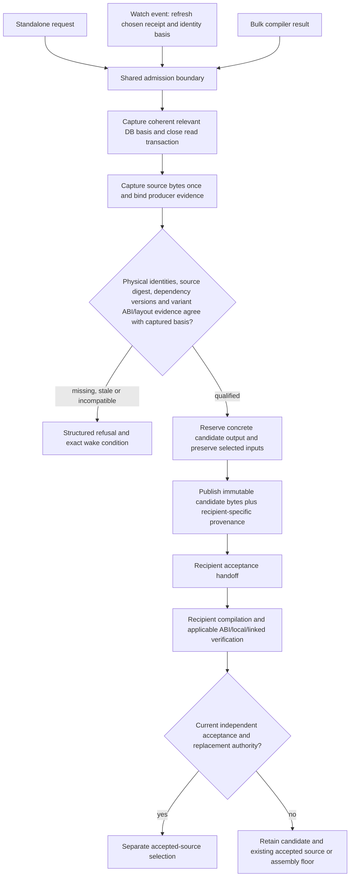

The candidate receipt binds donor and recipient binary contents/physical instances,
producer source bytes, compiler/dependency scope, compatibility evidence, transformed
candidate bytes and publication basis. Qualification must be possible for supported
current inputs; refusing every request is not a functioning implementation. A watch
iteration rechecks relevant dependencies and honors the same selected receipt type
as standalone placement. A no-compile exploratory path is explicitly unadmitted and
separate from qualified candidates. Candidate publication is deterministic,
idempotent and interruption-safe; it cannot create recovery credit, replace a
recipient source file or write through aliases into protected inputs.

Watch holds candidate-output ownership throughout its lifetime, but must allow
identity and matching producers to advance between passes. Capture a bounded,
coherent SQLite snapshot of relevant facts, close the reader before compilation
or waiting, and publish immutable observed-basis proposals. SQLite-managed sidecar
coordination is an explicit shared-reader contract; read-only SQL is not a claim
of zero filesystem effects. A full-corpus copy or an indefinite database-wide
reservation per watcher does not meet the tandem-work requirement. Any compiler
proof obtained independently of the database is explicitly source/image-scoped
and bound to the captured basis through its checked physical identities.

Reuse valid process-local positive authority and bounded negative decisions for
unchanged inputs. Reserve attempt/scratch budgets before work; distinguish
deterministic refusal from bounded infrastructure retries and name what change
wakes blocked work. Neither negative evidence nor serialized audit JSON can create
positive producer authority. Current-basis acceptance remains a recipient-side gate.

A process budget is not a permanent stop for an unlimited watcher. On capacity
exhaustion, publish a bounded terminal checkpoint with a deterministic next cursor
and relevant input basis. The catalog may admit a successor only after the prior
session is actually clear. Retain per-basis failed-attempt/circuit history across
successors; restart must not reset failed budgets or repeatedly process the first
chunk. Reused candidate evidence stays explicitly reused and cannot recreate opaque
compiler authority from JSON. Changed dependencies wake only affected work, while
unchanged exhausted inputs cannot starve new eligible candidates. These continuation
mechanisms remain required beyond the current process-local admission implementation.

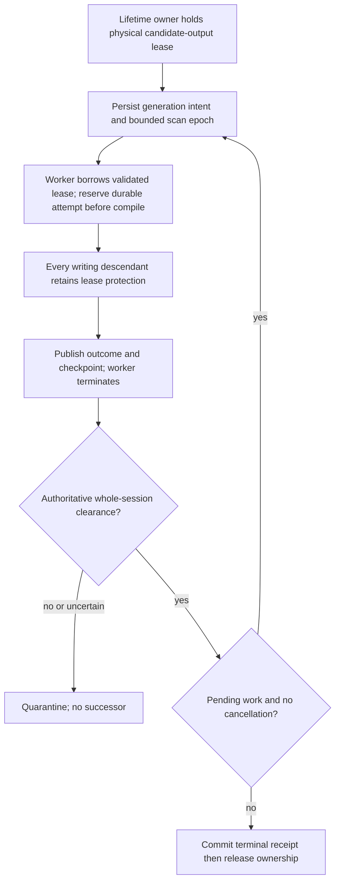

The physical lease spans generation gaps and survives a supervisor/worker failure
while a compiler descendant can still write. Descriptor inode equality alone is
not proof of lock ownership; validate actual controlled handoff and ownership.
Use a finite scan-epoch fence so a growing tail cannot indefinitely postpone
new work inserted before the cursor. Qualification must cross the actual production
128-key bound with eligible reserved work; counting unsupported items that never
consume capacity does not prove rollover. These are explicit future acceptance
requirements, not observations of the bounded `.15` increment.

Discovery must give each published item a durable inventory identity and each
scan epoch a sealed membership boundary. An opaque filesystem directory position
is not that boundary. In particular, alternating a fixed first-entry window with
a saved directory position can miss an insertion behind the position but beyond
the first window indefinitely while later entries keep arriving. The September 27
design review rejected that proposal before qualification. A producer publication
sequence with a captured high-water mark is a candidate mechanism, subject to
complete bootstrap and reconciliation of pre-existing and externally added files;
an index that silently excludes those files does not satisfy discovery either.
The implementation must establish the ingestion boundary and its crash semantics
before claiming fairness. Acceptance must insert an eligible item outside the
head window and behind the frontier, keep adding later items, restart between
generations, and demonstrate that the inserted item is eventually admitted without
resetting existing attempt budgets. Directory mutation or inventory uncertainty
must produce explicit reconciliation state rather than a false completed scan.

Publication enrollment covers the exact source and selected receipt binding, not
the path alone. Persist ingestion intent before making either final artifact
visible, then durably record its publication sequence; recovery must reconcile an
interrupted intent without depending on rediscovering its pathname. Enrolled keys
also need finite revisitation for changes to identity, receipt, raw-image,
dependency or provider basis that do not create a new source file. Temporary
compiler translation units are not source-publication events.

The durable-attempt boundary includes directory ancestry. When a reservation uses
a newly created checkpoint root or shard, establish each directory link durably
before returning success: syncing the reservation file and its immediate directory
alone does not cover newly created ancestor links. The September 27 ownership
review found this gap in the in-progress implementation. Its acceptance case must
begin with an absent shard and check the ordered durability operations before any
scratch allocation or compiler launch; updates to an already established shard
cannot prove the first-reservation case. Source review or mocked call ordering
alone is not evidence of survival after an actual storage failure.
An unsuccessful directory-sync operation must remain unsuccessful on retry until
the durability barrier actually succeeds; mere existence of the directory created
by the failed attempt cannot bypass that barrier. Validate checkpoint records as
an explicit schema before using them for scheduling: allowed states, bounded
integer attempt counts, finite correctly typed timestamps, and state-dependent
publication fields. Malformed or non-finite values must produce a structured
corruption result, without granting an attempt, silently resetting the record, or
manufacturing publication authority. Include interrupted-sync retry and corrupted
deadline/state cases in the product qualification set.

The Linux mechanism is grounded in the [flock manual](https://man7.org/linux/man-pages/man2/flock.2.html):
inherited/duplicated descriptors share a lock, an explicit unlock affects that
shared lock, and ordinary closing releases it only after the last reference closes.
The [kernel proc documentation](https://docs.kernel.org/6.9/filesystems/proc.html)
describes descriptor-specific lock evidence in `fdinfo`. The implementation still
needs measured host/filesystem qualification of inherited-held versus separately
opened unlocked descriptors and surviving descendants; these references alone do
not prove the proposed continuation path.

The September 27 private probes subsequently passed both lifetime cases on this
host's tmpfs and NVMe btrfs. Their raw evidence shows that the lock row can retain
the original owner's PID after that process exits and is reaped; it is not current
liveness or borrower identity. The NVMe evidence also has different numeric device
representations in `fstat` and the lock row despite the same descriptor/inode.
Do not assume those fields share a namespace. Validate descriptor/path scope from
actual file identity and the held-lock observation on the controlled descriptor;
qualify any additional comparisons against measured filesystem behavior. The
reports are `/home/brunner56/Documents/AgentDecompile-kernel-lease-feasibility-report.md`
and `AgentDecompile-kernel-lease-nvme-report.md` in the same directory. These probes
do not prove compiler-descendant propagation, persistent scheduling or catalog
restoration; those remain required implementation gates.

The acceptance handoff does not invent recipient verification: supported recipients
must pass their actual checks, and unavailable adapters produce a local blocked
reason while other eligible candidates continue. A source digest records bytes;
producer/identity/compatibility authority must also be corroborated. Existing
target-local completion guards remain in force. This diagram specifies required
behavior; current implementation and proof are tracked in the
[living ledger](2026-09-27-implementation-progress-and-live-track.md#accepted-admission-active-implementation-cross-place-continuation).
````

#### S025-C0006: Match-review decisions against the observed basis

Source `docs/plans/2026-09-22-task-acceptance-and-continuation-design.md` lines 241–287; accountable coverage owner U9.

````md
### Match-review decisions against the observed basis

September 27 refinement of portable-plan U17/U106/U109 and current-version
acceptance: a review decision is an optional override, never a prerequisite for
unrelated recovery or export progress. Numeric match IDs can be reused and an
unchanged ID/status does not establish that a reviewer saw the current proposal.

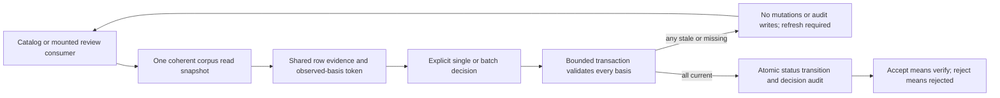

Capture selected corpus identity/incarnation, row revision, run, directed physical
endpoints, score/margin, evidence/status and relevant binary facts together. Keep
revisions local to affected rows so unrelated matching does not stale every review.
Existing migration ownership must govern durable incarnation/revision and audit
state; missing required schema refuses mutation rather than falling back to IDs.
Delete/reinsert and update-away/update-back must not revive a consumed token.
The token provides freshness, not authentication or recovery authority.

All submitted rows must pass before any batch status change. Audit failure rolls
back the status change. Stale responses refresh displayed evidence and require a
new deliberate decision; consumers must not automatically replay an old approval.
Catalog, HTTP compatibility, static ReviewReact and the mounted workstation use
the same service and row contract. A success message follows actual success.
Unmounted Surfaces.Review is not proof of mounted frontend delivery.

Supported clone/restore activation must rotate the corpus incarnation under owned
migration/lifecycle control and preserve lineage. An internal UUID or inode check
alone cannot detect arbitrary unobserved restoration of identical prior database
bytes. That guarantee requires controlled activation outside the restored state;
do not claim it from ordinary row-token checks or silently accept unmanaged restores.
Recovery signatures remain deterministic: control-plane incarnation/timestamps are
separate from recovered identity and export content.

The complete U17 fields/order, U106 rendering and U109 Compare view remain required
scope beyond this decision-integrity detail. Missing relation/components remain
explicitly unavailable, not fabricated evidence. This is required design behavior;
current source and mounted/live qualification are tracked in the living ledger.
````

#### S025-C0007: Fresh source revalidation after process loss

Source `docs/plans/2026-09-22-task-acceptance-and-continuation-design.md` lines 288–322; accountable coverage owner U9.

````md
### Fresh source revalidation after process loss

The current supported native source-contribution backend holds compiler/writer
capabilities only in the producing process. Retained JSON remains an audit record;
reopening it cannot recreate that authority. A bounded restart route therefore
accepts an explicit candidate recipe as untrusted work input, verifies the caller's
exact target, corpus/binary, selected-function and source-digest bindings, and
freshly produces eligible candidates in one new private workspace. Supported DB
paths must reach the exact caller-selected file through every existing SQLite
consumer; URI metacharacters are explicitly unsupported in this bounded route. It uses the
existing compiler identity gate, writer and independent evaluator. One changed
candidate receives no credit while an independent valid sibling can advance.

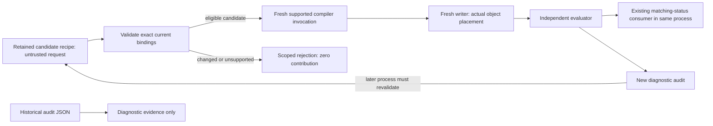

The coordinator must not import compiler commands, old object paths, accepted flags,
invocation IDs or historical writer maps as authority. Output must not overwrite
inputs or an earlier result. Fresh work is explicit and bounded; valid observations
still available in the current process do not trigger automatic recompilation.
Copied floor bytes preserve image content without earning source contribution or
whole-image compiler credit. This route establishes fresh revalidation after loss;
durable trust without reexecution and catalog-driven game-target qualification
remain separate unfinished contracts.
````

#### S025-C0008: 3. State transitions and recovery

Source `docs/plans/2026-09-22-task-acceptance-and-continuation-design.md` lines 323–365; accountable coverage owner U9.

```md
## 3. State transitions and recovery

Task states are `proposed → waiting → ready → admitted → running → awaiting_acceptance
→ accepted`. Alternate terminal outcomes per basis are `negative`, `unsupported`
and `cancelled`; retriable interruptions enter `retry_wait`, missing prerequisites
enter `waiting`, and exhausted attempts enter `budget_exhausted`. Resource occupancy
is not a negative scientific result. A rejected proposal can leave its task ready
for a changed hypothesis while preserving the rejection. An accepted claim made
stale returns the affected objective dependency to waiting without deleting history.

A task reaches `accepted` only when every mandatory output and claim contract has
a terminal result and every success predicate required by its pinned acceptance
policy passes. Accepted partial claims remain reusable but do not complete the task.
Optional diagnostics can be unsupported only when the predeclared policy permits
that outcome. A task ending `unsupported`, `negative`, `cancelled` or
`budget_exhausted` does not achieve its overall objective: unmet capability predicates
remain visible, with compatible alternatives or prerequisite-producing tasks. The
objective is complete only when all its mandatory capability predicates are satisfied
by current accepted receipts; terminal task counts are never its completion rule.

| Attempt field | Persistence requirement |
|---|---|
| `attempt_id`, `task_id`, `basis_digest`, `generation` | Never reused; distinct private output namespace |
| `provider_id`, `environment_manifest`, `ownership_record` | Actual execution environment and owner identities |
| `started_at`, `deadline`, `last_heartbeat` | Liveness timestamps, independent of progress |
| `completed_unit_ids`, `checkpoint_digest`, `execution_cursor` | Durable units and resumable position |
| `accepted_claim_ids`, `goal_delta` | Goal progress from acceptance receipts only |
| `failure_class`, `retry_count`, `next_eligible_at` | Retry history survives coordinator and conversation restarts |
| `cancel_requested`, `exit_observation`, `access_clearance` | Request, observed outcome and proof resources are safe are separate |

Liveness means a process/connection exists. Execution progress means a distinct unit
has a durable terminal result, including a legitimate non-match. Goal progress
means new accepted evidence or a usable capability. Repeating the same unit/basis
and changing child PIDs increments neither durable progress counter. External
uninstrumented jobs may truthfully report `progress_unknown`. They remain external
owners unless explicitly adopted under an ownership/lifecycle agreement.

On coordinator restart, restore accepted receipts and retry state, reconcile actual
owners, retain uncertain resources in quarantine, discover private completed results
by manifest, and revalidate before acceptance. Do not relaunch a task merely because
its old heartbeat stopped. Completed-unit checkpoint publication precedes progress
acknowledgment; an interrupted acknowledgment can be replayed idempotently.
```

#### S025-C0009: 4. Dependency-local admission and priorities

Source `docs/plans/2026-09-22-task-acceptance-and-continuation-design.md` lines 366–435; accountable coverage owner U9.

```md
## 4. Dependency-local admission and priorities

Evaluate all declared prerequisite alternatives against current claim versions.
For each ready task, choose a compatible healthy provider and reserve its complete
resource set atomically; if reservation fails, release temporary reservations and
leave the task ready. Never wait holding half a set. Admission uses a shared budget
including nested subprocesses, not independent per-agent limits.

Keep measured units separate. A preparation action admission is not a provider
call, token, CPU-second or monetary charge. For the same-process MCP route, an
explicit tool-dispatch allocation counts every actual `tools/call` intent,
including project/program prerequisites, session retries and check-in. Cached
local observations do not spend a remote-call allowance. Commit each reservation
before dispatch; a lost response or crash cannot refund it or authorize a second
request with the same reservation. Preserve spending and disclose unknown prior
usage when migrating existing objectives.

Nested dispatch authority must come from a private capability bound to the
current coordinator lease and parent attempt. Receipt JSON, request parameters,
argv and environment variables cannot recreate it. A late child whose coordinator
lost its lease cannot overwrite a resumed objective or spend its new allocation.
Quota refusal carries its exact exhausted dimension and allocation-revision wake
condition through all wrappers; it cannot become an ordinary retry that burns
more root admissions. Refusing a later check-in does not prove earlier effects
were cleared or saved. Such incomplete lifecycle work retains the corresponding
ownership uncertainty. The MCP dispatch boundary does not measure provider-internal
fan-out, external subprocess usage, tokens or money; those remain separate
contracts in the shared objective budget.

Retain unresolved-effect evidence monotonically through nested provider envelopes
and later budget refusals. Decode supported object/list/JSON-string envelopes
before replacing a failed response with session-repair output. Transport copies
of the same payload (`parsed`, text and raw MCP content) are not extra provider
nesting: they must neither hide uncertainty nor falsely quarantine an ordinary
function-list result. Include both negative uncertainty cases and a successful
normal-envelope case in this boundary's acceptance checks.

Memory admission uses measured process-tree peak plus uncertainty/headroom, current
available capacity, reservations, pressure trends, resource-limit events, scratch
capacity and storage health. Swap occupancy is telemetry, not a universal veto;
a no-swap environment can qualify, and spare swap does not prove capacity. Unknown
profiles require a bounded profiling attempt on an eligible isolated worker. If
required process-tree enforcement is unavailable, route to a capable worker or
mark that class blocked; do not assume enforcement exists. Tmpfs charges the same
memory budget and never serves as the only durable receipt store.

Among feasible tasks for admitted objectives in the same scheduling class, use
requested-capability dependency contribution, then aging credit, then stable task
ID for ordinary ranking. Preserve ready age across unrelated retries and coordinator
restarts. Aging increases at a declared interval up to a cap. At the cap, the oldest
feasible task receives the next compatible capacity reservation **ahead of ordinary
capability priority**, including a large task that would otherwise lose to small
work. Backfill is permitted only when it cannot delay that reservation. Aging does
not authorize overload: resource-infeasible tasks produce a capacity prerequisite.

Cross-class precedence is explicit versioned policy, not an implicit starvation
escape hatch. An urgent override can defer a reservation only through a recorded
policy-authorized event naming requester/authority, reason, affected reservation,
expiry and rescheduling decision. Its deferral remains visible in fairness reports;
it does not reset waiting age. Permanent capacity loss, permanently dominant class
policy or repeated authorized urgent overrides prevent a starvation guarantee and
must be reported as such. This is a proposed fairness mechanism, not a realized
fairness benchmark or proof of a runtime scheduling bound.

When no task is runnable, persist a minimal blocked dependency set per objective
and subscribe to its wake events: receipt/version change, resource release, provider
recovery, capacity change or authorized budget change. Timer expiry wakes only a
scheduled retry/provider probe. A new chat message does not reset counters. Unrelated
ready work continues whenever its complete inputs, outputs and resources qualify.
```

#### S025-C0010: 5. Resource ownership, fencing and quarantine

Source `docs/plans/2026-09-22-task-acceptance-and-continuation-design.md` lines 436–485; accountable coverage owner U9.

```md
## 5. Resource ownership, fencing and quarantine

| Resource record | Meaning |
|---|---|
| `resource_id`, `kind`, `host_id`, `namespace` | Exact Program/corpus-writer/output/PDB/Wine/save/display/port/channel/storage identity |
| `owner_kind`, `owner_id`, `process_start_identity` | Managed/external owner with stable start identity, command/cwd/target provenance |
| `lock_handle`, `generation`, `lease_deadline` | Atomic lock plus publication fence, never a PID-file-only lock |
| `access_state`, `publication_state` | Access: free/owned/quarantined; publication: current/revoked |
| `bundle_members`, `clearance_receipt` | Complete scenario/resource bundle and explicit evidence permitting reuse |

Publication authority and access safety are separate state machines. Lease expiry
revokes the old generation's acceptance authority; it does not stop a process or
release its resources. Suspected old access changes owned to quarantined. Clearance
requires observed termination with no remaining descendant/handle access, verified
release through the owning system, or a newly provisioned genuinely disjoint bundle.
A byte match, elapsed timeout, changed PID or successful new lock-file write is not
clearance. OS-uninterruptible workers may retain resources indefinitely; their
quarantine blocks dependents but does not block independent bundles.

Example: attempt A at generation 12 stalls writing its private result. Generation
13 may run B only on independently safe resources. A later returns a byte-matching
result. Preserve A's immutable artifact as historical evidence; reject its stale
publication. Reconsidering that artifact requires a new independently checked
proposal against current inputs and policy; it cannot overwrite B's output or clear
A's resource quarantine. Even identical result digests do not waive the fence.

Keep Program mutation, corpus acceptance, compilation and live-scenario ownership
separate. Shared read-only tool installations are allowed. Compilation owns its
private intermediates/PDB/temp/Wine state. A multiplayer scenario can own several
processes as one explicit bundle; it need not serialize unrelated immutable analysis.
Do not hold a corpus write transaction while waiting for a compiler, model or game.

Action resource declarations must name actual mutable state and its clearance
mechanism. Do not infer ownership from generic parameter names: a compiler path
is usually a read-only input, and catalog fields can retain CLI spellings such as
`out-dir`. For filesystem trees, equal and ancestor/descendant paths conflict even
when their resource kinds differ. Freeze the execution root and resolved claims
for the attempt; an execution-root change cannot silently redirect a reserved job.

Qualify providers incrementally with both a successful release and an uncertain
outcome. The first local-output implementation target is
`corpus.export-reagent-snapshot` and its `destination` field: synchronous private
file writes with a read-only SQLite source. Its executor must bind clearance to
the same job, attempt, claims, argv and observed process before releasing the
reservation. A success label alone, an injected executor without that observation,
or another action's local-clearance proof cannot release it. Restoring a historical
`released` label must apply the same qualification. Compiler/Wine/project/store
providers each need their own explicit mutable bundle and lifetime qualification;
this local-output contract does not establish their coverage.
```

#### S025-C0011: Qualifying the native package verifier

Source `docs/plans/2026-09-22-task-acceptance-and-continuation-design.md` lines 486–540; accountable coverage owner U9.

````md
### Qualifying the native package verifier

The next compiler ownership boundary is the existing `recover.verify-package`
action. Freeze its actual package/manifest interpretation and effective output
path into the dispatched command. Reserve that whole output tree, including
compiler scratch and diagnostic files, before mutation. A compiler executable is
an input; its pathname alone is not a mutable compiler resource.

Qualification belongs to a versioned execution profile. The guarded child must
validate the metadata it actually reads, construct both syntax and object commands
from supported semantic inputs, pin compiler/dependency/resource identities, and
control Python startup plus native compiler environment and configuration. Parent
preflight cannot authorize arbitrary metadata flags loaded later. C and C++ source
acceptance remain distinct from lifetime clearance: a syntax failure may release
ownership only after the same qualified process-session proof.

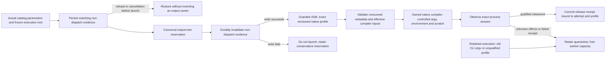

Selected source, metadata, manifest and target-byte-slice inputs must be protected
from output aliasing; disabling code comparison does not stop the verifier from
reading a target slice. This declared-input check does not establish complete
transitive include closure. Legacy verification receipts may predate output keys:
recover the exact claim from their original execution root and parameters where
possible, and retain uncertainty when those inputs are missing or ambiguous.

Release and restoration must check the same guarded-launch/profile binding. An
old unguarded command, injected executor success or a user-supplied profile label
cannot inherit the new contract. Unsupported flags, wrappers, code-comparison
providers and Wine retain their separate unfinished qualification. Keep unchanged
direct CLI interfaces compatible; current mission operations still use the catalog.

A request rejected before dispatch must not become a permanent output owner after
restoration. Persist explicit, versioned evidence of non-dispatch for the actual
queued attempt, bound to its job and frozen execution inputs. Invalidate that
evidence durably before invoking any executor; if persistence fails, do not launch.
This distinguishes a modern refusal or cancellation before admission from a
historical receipt whose execution is unknown. An attempt UUID or missing process
field alone cannot establish non-dispatch. Missing or mismatched evidence keeps
the historical conservative behavior. Removing a rejected request's package must
not block unrelated resource admission when valid non-dispatch evidence survives.
````

#### S025-C0012: 6. Bounded failure continuation

Source `docs/plans/2026-09-22-task-acceptance-and-continuation-design.md` lines 541–564; accountable coverage owner U9.

```md
## 6. Bounded failure continuation

Only the coordinator owns outer retries. Adapters declare internal retries and
must disable them or charge them to the same attempt budget. Backoff/jitter values,
retry limits and resource ceilings are versioned policy, never hidden defaults.

| Failure class | Continuation rule |
|---|---|
| Deterministic compile/match rejection | Cache negative result for exact basis; retry only changed hypothesis/basis |
| Compiler/provider transient crash | Preserve units, bounded retry in fresh private environment when safe |
| Resource profile exceeded | Close admission for class, checkpoint-and-exit managed restartable work when possible; resize or route |
| Provider outage | Open circuit after policy threshold; compatible provider or bounded health probe after cooldown |
| Uncertain identity | Create targeted evidence task; keep binding out of accepted catalog |
| Occupied external resource | Wait on release; continue unrelated tasks; never kill external owner |
| Changed dependency | Retain proposal as historical; reject current acceptance and schedule relevant recomputation |
| Deadline exhausted | Preserve objective and receipts; explicit budget-exhausted attempt and next prerequisite |
| Unknown non-idempotent outcome | Observe by command ID/state before replay; never retry mutation blindly |

Cancellation acknowledgment is not proof of exit. Suspended workers still consume
memory; pausing admission does not reclaim it. Checkpoint-and-exit is the preferred
managed recovery boundary where supported. Host-loss failover needs independent
replicas and a compatible alternate environment already available; retries cannot
create the only missing input copy.
```

#### S025-C0013: 7. Prepared storage and durable publication

Source `docs/plans/2026-09-22-task-acceptance-and-continuation-design.md` lines 565–593; accountable coverage owner U9.

```md
## 7. Prepared storage and durable publication

A prepared bundle manifest lists every direct and indirect input with content
hash, size, origin and required availability: binaries, compiler/linker components,
headers/libraries, language specifications, analysis exports, Wine configuration,
scenario assets and saves. State is `preparing → verified → launchable`; incomplete
or changed closure is never launchable. Archive replication has separate pending,
complete and failed states and does not gate work whose complete durable inputs and
outputs are on healthy working storage.

The coordinator and receipts live on healthy persistent working storage. Potentially
blocking probes/copies execute in bounded isolated workers; at most the configured
per-device outstanding operations may exist. A timeout quarantines that device's
operation/resource, not a promise of termination. Copying toward NVMe or tmpfs while
reading a stalled source still depends on that source. Preparation before failure
is what permits independent continuation.

Publication protocol: write an attempt-specific temporary artifact on the destination
filesystem; validate content/schema; flush artifact and required directory metadata
according to the declared durability policy; rename within that filesystem; publish
a content-addressed manifest reference only after all referenced artifacts are durable.
For multi-file output, immutable blobs precede one committed manifest. The previous
complete manifest remains available until commit. Cross-filesystem rename is not
assumed atomic. Interrupted temporaries are unreferenced and can be reconciled later.
Live SQLite inputs require consistent backup/export, including transactional state;
arbitrary copying of an active main file is not a snapshot protocol. Replication
receipts state achieved durability/failure domains instead of claiming host failover
from a local flush alone.
```

#### S025-C0014: 8. Runtime scenario and observation contracts

Source `docs/plans/2026-09-22-task-acceptance-and-continuation-design.md` lines 594–627; accountable coverage owner U9.

```md
## 8. Runtime scenario and observation contracts

| Scenario field | Required meaning |
|---|---|
| `scenario_id`, `build_digest`, `fixture_digest` | Exact executable and declared starting save/module/state |
| `required_capabilities`, `party_state`, `script_state` | Operation-level identity/ABI/layout and in-game prerequisites |
| `input_driver`, `display_requirements`, `authentication` | Supported control path and external runtime dependencies |
| `resource_bundle`, `ordered_actions` | Owned files/save/Wine/display/ports/channel and action ordering |
| `preconditions`, `postconditions`, `oracle` | Observable predicates and independent evidence source |
| `recording_contract`, `recorder_preflight` | Required continuous action coverage and usable recording checks |
| `command_ids`, `idempotency_class`, `reconciliation` | Safe outcome lookup after connection loss |
| `teardown`, `restoration_limits` | Fixture cleanup, hook removal and limits of rollback |

Select fixtures/drivers satisfying declarations before admission. Missing Bastila
for a party-dependent action creates a fixture prerequisite, not a failed behavior
claim. A console-dependent action needs a compatible declared input/display path.
A destructive module transition is last or uses a fresh fixture branch. Preflight
the recorder before the important action. Preserve the existing separation of
`nwscript.call(...)` engine bridging and `kp.log(...)` host facilities, and distinct
runtime INI, operator TOML and scenario TOML ownership; these are adapter constraints,
not a requirement to embed KotorPhasor into the generic recovery core. A lexical scanner reports only the syntax/patterns it actually checks; it must not claim full Lua data-flow analysis or runtime argument correctness from token matching.

Observation is read-only and available separately from the single-owner mutation
channel. Expose owner, active command ID, engine progress and last outcome while
mutations queue. On disconnect, query durable command state and engine predicates.
If effect cannot be established, record unknown outcome and restore/reconcile before
continuing; exactly-once effects are not promised for an unobservable engine command.

Store behavioral oracle and video receipts separately. A successful postcondition
with failed recording earns scoped behavioral evidence, not video-qualified success.
Combined acceptance requires both from the same run/action interval; an old oracle
cannot be paired with unrelated new footage. Steam authentication blocks dependent
Steam live scenarios, not static Steam analysis or eligible non-Steam scenarios.
```

#### S025-C0015: 9. Worked dependency and accounting examples

Source `docs/plans/2026-09-22-task-acceptance-and-continuation-design.md` lines 628–659; accountable coverage owner U9.

```md
## 9. Worked dependency and accounting examples

**Original-code feature before source recovery.** Requested capability is reading
an inventory count then calling a supported original method. Tasks require exact
build identity, target-side method identity, per-build field offset, supported ABI,
live object lifetime and thread context. Source reconstruction may continue in
parallel. Missing method identity blocks only the call; independently verified read
can be exported as readable-only. A compiled replacement remains a separate task
with local/linked/contribution acceptance.

**One drive fails.** Task A needs an unstaged compiler library on archive device X;
A waits on storage/input preparation. Task B has its entire manifest and durable
output destination on healthy Y and no resources on X; B remains admissible. Merely
placing B's executable on Y while its Wine prefix remains on X fails the closure
check. The coordinator never touches X synchronously to report the block.

**Coverage withdrawal.** One seed suggests ten sibling labels. Rejecting that seed
invalidates only descendants without other sufficient independent roots, withdraws
current generated bindings and recomputes exports. Correct bytes at those addresses
do not retain the semantic claim. Unaffected identities remain usable. New repaired
evidence creates a new basis; there is no permanent platform ban.

**Exhaustive reporting.** Choose a named inventory snapshot and count mutually
exclusive physical-instance representation buckets: accepted source, candidate
source, preserved region, unclassified and excluded-with-reason. Every inventory
member appears exactly once; overlapping code extents are measured separately by
union of byte ranges. Independent evidence facts are additional dimensions, never
summed as representation totals. The historical 24,240/24,242 discrepancy remains
unexplained history; this design requires explicit unclassified members or a failing
accounting check rather than inventing two recovered functions. Transport/startup,
behavior-qualified and video-qualified build counts use different receipt filters.
```

#### S025-C0016: 10. Failure-injection acceptance specifications — not run

Source `docs/plans/2026-09-22-task-acceptance-and-continuation-design.md` lines 660–694; accountable coverage owner U9.

```md
## 10. Failure-injection acceptance specifications — not run

Each row must demonstrate rejection of the bad case **and** continuation of a
specified unrelated ready task under available capacity. Reports retain raw events,
ledger snapshots, immutable inputs and acceptance policy. This is future work.

| ID | Injected case | Required observable result |
|---|---|---|
| A01 | Correct bytes with false function label | Binding rejected for identity evidence; independent target accepted |
| A02 | Withdraw shared donor root | Unsupported descendants stale/export withdrawn; independently rooted claim survives |
| A03 | Kill compiler after N durable units | N receipts retained, partial output unpublished; resume without redoing valid N |
| A04 | Churn child PIDs on identical failing input | No false progress; one retry owner and finite total attempts |
| A05 | Hang one device operation | Bounded probe count and responsive coordinator; complete cached task elsewhere finishes |
| A06 | Omit indirect staged library or fixture | Bundle never launchable; unrelated complete bundle runs |
| A07 | Late old worker with correct result | Private historical result retained, stale acceptance rejected, resource quarantine retained |
| A08 | Restart coordinator during retry wait | Same consumed budget/next eligibility/owner generation; no duplicate launch |
| A09 | Occupy mutation channel | Status observation responds; conflicting mutation waits; independent analysis finishes |
| A10 | Missing party member/driver/authentication | Precise prerequisite task, no behavioral failure falsely recorded |
| A11 | Recorder fails after successful oracle | Behavioral receipt retained, combined success refused; same-action rerun required |
| A12 | Disconnect after non-idempotent action | Command reconciled or outcome unknown; no automatic duplicate action |
| A13 | Interrupt destination copy/manifest commit | Previous complete manifest usable; no manifest references partial output |
| A14 | Expired lease but old worker still alive | No resource reuse without clearance; disjoint provisioned bundle can proceed |
| A15 | Near-full swap with qualified small task; spare swap with overloaded class | First judged on complete admission basis; second refused despite swap capacity |
| A16 | Large eligible task surrounded by small work | Persisted aging reservation overrides ordinary same-class priority; safe backfill does not delay it; urgent exceptions are visible |
| A17 | Change acceptance policy/input during verification | Short commit recheck rejects stale proposal; immutable report retained |
| A18 | Wrong Lua bridge arguments/config owner/log prefix | Relevant adapter safeguard rejects mutation; read-only status unaffected |
| A19 | Lose only host/input replica | Explicit unavailable dependency, no invented failover; independently replicated task remains eligible |
| A20 | Shuffle valid proposal completion order | Same accepted/contested semantic result; arrival order changes no truth decision |

Measure useful completed units, accepted claims by kind, retry amplification,
interruption loss, refusal false positives and time to next requested capability.
Process count and heartbeat rate are diagnostic telemetry only. Thresholds belong
to versioned workload policies established before a future run; this document does
not invent benchmark results or universally optimal numeric limits.
```

#### S025-C0017: 11. Delivery order and conditional guarantees

Source `docs/plans/2026-09-22-task-acceptance-and-continuation-design.md` lines 695–717; accountable coverage owner U9.

```md
## 11. Delivery order and conditional guarantees

1. Evidence typing, lineage withdrawal, exhaustive inventory and capability-specific
   readiness; prove A01/A02 before accelerating production.
2. One verifier/compiler adapter with immutable inputs, private outputs, durable
   units, ownership/fencing and independently accepted proposals; prove interruption,
   stale output and restart behavior before adding concurrency.
3. Common admission/retry interface for remaining adapters; prepared storage,
   publication and scenario contracts with their failure scenarios.
4. Widen parallelism and remote providers only after containment and resume gates.
   Remote workers submit immutable artifacts/receipts; they never write corpus state
   directly. A remote verifier sharing the same faulty oracle is not independent.

Worker-failure containment, coordinator restart recovery and host-loss failover are
separate capabilities. The conditional guarantee is: while complete valid inputs,
permissions, suitable capacity and a compatible worker exist, a failed task does
not stop unrelated ready work; accepted durable receipts survive the declared
interruption class; resume does not duplicate unsafe mutations or weaken acceptance.
Durability beyond a failed host/device requires previously verified independent
replication. Uninterruptible resource holders, missing sole inputs, unavailable
permissions and unknown non-idempotent effects can prevent dependent work indefinitely.
Those limits remain visible, with exact wake conditions and the objective preserved.
```

#### S025-C0018: 12. Design review referent and requirement map

Source `docs/plans/2026-09-22-task-acceptance-and-continuation-design.md` lines 718–746; accountable coverage owner U9.

```md
## 12. Design review referent and requirement map

Claim: generic verified/running labels cannot establish safe useful progress.
Referent: correct bytes under a false label, and changing compiler PIDs for repeated
inputs. Checked: this design separates semantic acceptance (section 2), durable
execution versus goal progress (3), publication versus resource access (5), and
receipt-derived accounting (9). Verdict: the contract covers the demonstrated
failure mechanisms on paper; A01/A04/A07/A08 are required runtime proof, not supplied
by this document.

| Supplied recommendation | Design location |
|---|---|
| Evidence-specific refusal, no platform ban | 1, 2, 9; A01/A02 |
| Original-code capability independent of source | 1, 9 |
| Task-specific capacity and shared nested budgets | 4; A15/A16 |
| Liveness/execution/goal progress, persisted retries | 3, 6; A03/A04/A08 |
| Dependency-local scheduling, capability priority/aging | 4, 9; A05/A16 |
| Resource bundles, atomic ownership, stale workers | 5; A07/A14 |
| Bounded failures and one retry layer | 6; A04/A08 |
| Complete staging, publication and storage isolation | 7; A05/A06/A13/A19 |
| Declarative scenarios, observation/mutation, joint video | 8; A09–A12/A18 |
| Independent acceptance and negative safeguards | 2, 10; A01–A20 |
| Exhaustive totals and distinct evidence scope | 9 |
| Conditional guarantees and phased delivery | 11 |

Design completeness means contracts, transitions, worked counterexamples,
continuation behavior and future acceptance predicates are specified. It does not
mean these mechanisms have been implemented, executed, benchmarked or validated.
```

#### S025-C0019: History-grounded coding sequence

Source `docs/plans/2026-09-22-task-acceptance-and-continuation-design.md` lines 747–755; accountable coverage owner U9.

```md
## History-grounded coding sequence

The [maintainability extension](2026-09-22-history-grounded-maintainability-design.md)
maps eleven historical incidents and current source seams to the future coding
sequence for these contracts. It adds explicit command-intent reconciliation,
shared launcher lifecycle, pure policy decisions, and maintenance-cost measures.
It does not authorize or claim implementation.
```

#### S025-C0020: Prevention, repair and control-plane failure refinement

Source `docs/plans/2026-09-22-task-acceptance-and-continuation-design.md` lines 756–763; accountable coverage owner U9.

```md
## Prevention, repair and control-plane failure refinement

The [failure prevention and recovery contracts](2026-09-22-failure-prevention-and-recovery-contracts.md)
are mandatory refinements of these task/acceptance schemas and A01–A20 scenarios.
They define shared healing budgets, durable wakeup reconciliation, fixture
revalidation at mutation, command/budget atomicity, authority-outage behavior and
unknown-failure containment. They do not introduce another retry owner or allow
any recovery route to weaken the original claim predicates.
```

#### S026-C0001: Acceptance and objective-budget implementation findings — 2026-09-26

Source `docs/plans/2026-09-26-acceptance-and-budget-integration-findings.md` lines 1–6; accountable coverage owner U9.

```md
# Acceptance and objective-budget implementation findings — 2026-09-26

Status: source inspection; implementation and acceptance remain open. This refines
P0.4/P1.1 in the [session audit](2026-09-22-session-obligation-audit.md), without
changing the full scope or declaring either priority complete.
```

#### S026-C0002: Current acceptance paths requiring one shared policy

Source `docs/plans/2026-09-26-acceptance-and-budget-integration-findings.md` lines 7–46; accountable coverage owner U9.

```md
## Current acceptance paths requiring one shared policy

`corpus/ingest_recovered.py:load_seed_promotions` admits identity-linked,
byte-exact real-C seeds when their logical IDs agree with the destination identity.
Agreement with the existing assignment is not an independent semantic witness.
`parse_recovered` separately pairs a current file with historical byteExact coverage
by program/name without checking a current source digest. Both feed recovered-function
insertion; fixing only seeds leaves the other route open.

`package_authoritative.build` consumes those rows and corroborates placement through
address or unique byte matching. Placement does not prove the named entity or linked
source contribution. `finish_binary.load_byte_exact` unions truthy receipt results
by address without checking enclosing currentness/source/basis. These consumers must
not strengthen a local comparison into semantic or final-image claims.

Producer tracing found that `rebuild_ledger.rebuild` parses textual byte-identical
messages from a caller-supplied generator into coverage JSONL without source, target
or toolchain digests. `collect_source.collect` independently selects source by
program/name and labels it VERIFIED using that key. This permits source/receipt
mispairing. `verify_legacy_recovered.coverage_row` and `recover_named_ghidra` have
compiled source available but omit its digest. `restore_recovered_tree` recreates
coverage flags from database rows without a fresh compilation. `recovered_function`
has no candidate/accepted state, and consumers treat real-C rows as recovered.

The implementation therefore must update producers and consumers together; merely
requiring an invented new field downstream would quarantine everything without
providing a usable evidence path. Introduce a shared evaluator at the real promotion and
consumer boundaries, with producer-bound current source/target/dependency evidence.
Preserve unaccepted candidates and expose failed predicates. Independent semantic
binding requires a target-side discriminating witness; existing logical IDs, filenames,
byte equality and compilation are insufficient by themselves. Anonymous local matching
must remain a separate useful claim. Linked contribution requires emitted-region
selection evidence; an equal image made from fallback bytes earns no replacement credit.

Required negatives: Foo-labelled Bar rejected for named acceptance despite equal bytes;
source edited under same filename invalidates its prior comparison; discarded compiled
replacement receives zero linked contribution; unrelated valid evidence survives each.
Do not weaken `verify_full_image_receipt`'s current refusal to certify arbitrary build
command provenance. No new accepted receipt may be created by trusting producer labels.
```

#### S026-C0003: Persist objective allowance with existing command intent

Source `docs/plans/2026-09-26-acceptance-and-budget-integration-findings.md` lines 47–74; accountable coverage owner U9.

```md
## Persist objective allowance with existing command intent

Preparation hashes action arguments, basis and context into action identity. Supervisor
basis changes archive/reset local failure counters. Both are valid local retry rules,
but neither enforces the required objective ceiling across new hypotheses/wrappers.

The existing preparation row and `_LOCK`/`_write` predispatch intent are the first
integration seam. Persist an objective identity, allocation revision, cumulative
admissions and dispatch-keyed reservations there. Reserve atomically with the submitting
intent before `jobs.start_job`; count successful as well as failed dispatched attempts.
Repeated acknowledgments cannot charge twice, cached reuse cannot spend, and ambiguous
post-intent crashes keep their charge. Resume/basis/action-name changes preserve spending.
Malformed or historically incomplete accounting is unknown, never fabricated zero.
An explicit allocation revision may add future allowance without erasing prior spending.

Then propagate trusted parent objective/reservation identity through JobStore and all
nested dispatch paths. Caller parameters cannot mint budget authority. A preparation-only
limit is not global enforcement: standalone supervisors, wrappers and nested compiler
attempts need the same parent accounting contract or an explicitly separate objective.
Provider incident circuits and resource-class limits remain distinct required ceilings.

Required checks: changed hypothesis cannot replenish a spent objective; concurrent
candidates cannot both claim the last unit; failed intent persistence prevents dispatch;
crash/resume keeps ambiguous charges; child/wrapper attempts share parent spending;
independent objectives continue; malformed accounting refuses explicitly; authorized
allocation increases retain old usage. Budget exhaustion names an allocation change as
its wake condition, not merely a different input basis.
```

#### S026-C0004: Additional inspected boundaries — 2026-09-27

Source `docs/plans/2026-09-26-acceptance-and-budget-integration-findings.md` lines 75–105; accountable coverage owner U9.

```md
## Additional inspected boundaries — 2026-09-27

`finish_binary` now has a producer/consumer raw-observation correction under review;
this does not close independent symbol identity. Existing `identity.method` strings
are not sufficient witnesses: `logical.build` groups supplied canon keys; matching
propagates existing logical IDs; corpus symbol-authenticity permits manual/analysis
origins. A usable next positive route is exact embedded PE export identity bound
to the required image digest, with explicit RVA-to-VA conversion, forwarded/ambiguous
export rejection and independent target-side resolution. PDB name proximity is not
GUID/age binding. Implementation briefs and review records are retained outside the
codebase following the user's removal of the local mission runtime.

The existing inventory parser needs strengthening before supplying this witness.
`build_binary_inventory` reads the file separately from `identify_binary`'s hash,
so copying the identity digest into its output does not bind the parsed bytes.
`pe_exports` overwrites name aliases by ordinal index and silently stops at truncated
tables. Exact-name uniqueness cannot be inferred from that partial representation.
Reuse the parser with a frozen-byte digest, complete name-row preservation and
explicit table/string/mapping integrity; retain exploratory inventory compatibility.
Distinguish synthesized ordinal labels from actual names by name-table provenance,
not a prefix. Alias, duplicate-name, malformed/truncated-table and changed-snapshot
cases are prerequisites alongside the Foo-labelled-Bar rejection fixture. These are
now implemented and recorded in the target PE export identity receipt. That receipt
closes the embedded PE-export lane only; other identity roots, current-at-consumption
checks and linked-source contribution remain open.

`dashboard/byte_parity.py:byte_parity_state` separately adds text-permuter closure
counts and can override the reconciliation report with `variants_state` totals.
Therefore correcting the report alone cannot claim all UI coverage is accepted or
current. That consumer path needs its own source/target/contribution assessment;
its current behavior is an open acceptance boundary, not validated by report tests.
```

#### S027-C0001: ---

Source `docs/plans/2026-09-27-implementation-progress-and-live-track.md` lines 1–9; accountable coverage owner U1.

```md
---
title: September 18–21 design program progress and usable live track
type: living-progress-ledger
date: 2026-09-27
status: active
governing_design_scope: 2026-09-27-weekend-design-scope.md
strategy: ../../STRATEGY.md
---
```

#### S027-C0002: September 18–21 design program progress and usable live track

Source `docs/plans/2026-09-27-implementation-progress-and-live-track.md` lines 10–32; accountable coverage owner U1.

```md
# September 18–21 design program progress and usable live track

The [September 18–21 design scope](2026-09-27-weekend-design-scope.md) is the
baseline this master plan and `STRATEGY.md` represent. It includes the full
[September 21 portable-substrate plan](2026-09-21-portable-signatures-codecaves-generic-plan.md),
its Phases 0–15 and named units, the distributed design, workstation requirements,
brainstorm decisions and diagrams. The [September 22 design package](2026-09-22-design-package.md)
and [autonomous capability roadmap](2026-09-22-autonomous-capability-product-roadmap.md)
add later refinements and adopted capabilities. This ledger reports implementation
state and puts useful RE/cross-match work alongside supporting implementation. It does not
create another recovery order, acceptance authority or scheduler. `STRATEGY.md`,
the [session obligation audit](2026-09-22-session-obligation-audit.md), its
110-item register, `FRONTEND_INTENT.md` and `DELIVERY_STATUS.md` retain those roles.

The weekend requirements remain in scope even when the September 22 summary omits
them. Later explicit user changes and conflict resolutions refine that baseline;
document date alone never supersedes it. Historical completion labels remain
non-current evidence and must be qualified before an implementation claim.
For each subsequent implementation slice, identify its original plan units and
affected diagram views, preserve their remaining acceptance requirements, and
record explicit supersessions. Source, installed-artifact and live outcomes
remain separate; closing a slice does not close its parent weekend workstream.
```

#### S027-C0003: Weekend workstreams retained in full

Source `docs/plans/2026-09-27-implementation-progress-and-live-track.md` lines 33–63; accountable coverage owner U1.

```md
## Weekend workstreams retained in full

| Required workstream | Detailed plan | Current delivery interpretation |
|---|---|---|
| Deterministic signatures, ABI, cave plans, divergence and format/platform seams | Portable plan Phases 0–7, 10–11 | Preserve every original unit and its acceptance; narrow later increments do not close the whole substrate |
| Every entity, field/layout, data root and ordered accessor | Portable plan Phases 8–9 | Function matching alone does not satisfy entity or data-access coverage |
| Complete export bundle: hookpack/v2, Lua, headers and readiness/divergence evidence | Portable plan Phase 12 | Required product output, not an optional runtime example |
| Exhaustive applicable fallback ladders and learn-build feedback | Portable plan Phase 13, ladders A–F | Keep structured residue and ambiguity; bounded attempts do not justify silently dropping applicable methods |
| Autonomous visible workspace in both surfaces | Portable plan Phase 14; September 20–21 workstation/consolidated design | Automatic eligible project admission, scoped pause/resume, actual work, readiness/review/residue and starvation/hang views remain required |
| Reusable compute/state substrate and grid-of-one | Portable plan Phase 15; distributed-compute design | Required architecture and adapters; fleet expansion follows local qualification without blocking safe existing local RE |
| Recovery and original-code runtime reuse | STRATEGY and consolidated design; subsequent M0–M7 extensions | Advance both on their own prerequisites; whole-image source and live runtime claims keep separate acceptance |

The [weekend scope index](2026-09-27-weekend-design-scope.md) links the requirement
ledger, goal, audits, risks, brainstorm synthesis and diagram sources. The 110 later
contract rows do not replace the full weekend D/U unit set. A full per-unit current
implementation requalification remains open; this scope correction is not a claim
that historical checked units pass against today's checkout or installed package.
The [unit delivery ledger](2026-09-27-weekend-unit-delivery.json) provides 193
source-qualified records with definition/acceptance spans: 190 required, one
withdrawn and two absorbed. Its initial source/test/installed/live states are
unverified, with remaining work and dependencies explicitly unassessed. This
closes the identifier-accounting gap, not the per-unit qualification work, and
does not imply 193 implementations are absent.
The first scoped updates record D1's inspected ordering mechanisms, D3's accepted
`.16` destination/basis repair, and D9's `.15` backfill plus `.16` cascade cases as
partial evidence. Their broader acceptance remains open; no original unit is marked
complete from these supporting observations.
Frontend qualification must include all F01–F28, U104–U112, the workstation's eight
tasks and both guide/donor capability inventories linked by that index. The recent
projection/evidence increments cover only a small part of that workspace contract.
```

#### S027-C0004: Highest priority: useful RE and cross-matching alongside implementation

Source `docs/plans/2026-09-27-implementation-progress-and-live-track.md` lines 64–105; accountable coverage owner U18.

```md
## Highest priority: useful RE and cross-matching alongside implementation

The user's latest directive makes this an explicit two-track delivery goal. Keep
the complete weekend unit set, later 110-item register and M0–M7 scope; prioritize a safely runnable
reverse-engineering/cross-build matching lane and build its missing support in
parallel. Completion of every reliability or UI feature is not a prerequisite for
all recovery work. Each operation still needs its own qualified inputs, resource
ownership and acceptance route.

| Priority | Operational track | Supporting implementation track |
|---|---|---|
| 1 | Reconcile existing 8080 ownership, corpus/program bindings, valid analysis, recovered source and receipts; select one concrete target/build pair | Use the latest qualified package (`.16`), preserving the individual `.14` ownership, `.15` admission and `.16` matching proof boundaries; keep truthful status/blocked reasons visible |
| 2 | Resume eligible catalog-owned RE/identity/matching work using unchanged valid evidence; independent targets may proceed on disjoint owned resources | Implement only the missing admission, provider, binding or comparison prerequisite that prevents the next useful operation |
| 3 | Compile and compare candidates for compatible recipients, retaining source, identity, ABI and byte claims separately | Expand durable ownership/reconciliation, shared budgets/circuits and recipient-specific acceptance from observed gaps |
| 4 | Keep advancing the per-target recovery ladder and corpus roll-up while runtime reuse progresses independently | Deliver the remainder of M0–M7 incrementally without making unrelated milestones global blockers |

A fresh 2026-09-27 listener check still found no 8080 service. Catalog operations
therefore remain blocked pending ownership/availability diagnosis; no alternate
server or direct recovery CLI is substituted. Read-only reuse/binding preparation
and disjoint implementation work continue. The active goal includes every remaining
directive, not just this first operational lane. Update this ledger with the exact
selected target/build pair and missing prerequisites when the readiness audit lands.

The bounded readiness audit now selects existing GOG K1 → Amazon K1 evidence in
the NVMe corpus (binary IDs 8 → 6, qualified by exact paths and image digests,
not those numeric IDs alone). The first read-only review, match `1008017`, now
corroborates all 107/101 cached instruction bytes against uniquely mapped original
image spans and bounded independent disassembly. Contradictory observable body
operations support a rejection proposal for this weak one-to-one candidate;
the durable row still says `review`. No new match run, identity
write or source propagation has been submitted. The two suspicious recovered-source
logical/name joins now have bounded physical corroboration, detailed below;
source lineage and producer acceptance remain open. Existing Ghidra and unrelated
Wine owners remain untouched. The report is retained at
`/home/brunner56/Documents/AgentDecompile-re-crossmatch-readiness-2026-09-27.md`.
The subsequent byte-backed packet is
`/home/brunner56/Documents/AgentDecompile-crossmatch-1008017-evidence.md`; it corrects
the cache lookup keys to bare program names, distinct from corpus `/K1/…` paths.
Before any future catalog review mutation, recheck the directed pair, row version,
status and image/span identities. This evidence does not identify the correct
alternate counterpart or prove recovered-source parity.
```

#### S027-C0005: Continuation session 7a1c2b (2026-09-27, late morning)

Source `docs/plans/2026-09-27-implementation-progress-and-live-track.md` lines 106–107; accountable coverage owner U1.

```md
### Continuation session 7a1c2b (2026-09-27, late morning)
```

#### S027-C0006: Branch consolidation follow-up (September 28, 2026 UTC)

Source `docs/plans/2026-09-27-implementation-progress-and-live-track.md` lines 108–295; accountable coverage owner U1.

````md
#### Branch consolidation follow-up (September 28, 2026 UTC)

The resumed branch audit started at `666cfac` (19 local commits after `8b4706d`).
All 127 changed Python files parsed; this is source syntax evidence only. The
previous verification checkout's `pytest.log` was empty, so no test pass is claimed.
The audit found that committed cross-place/catalog paths imported an untracked
`native_verify_contract.py`; `9fe9d96` retains that module and its existing ownership
tests. Native execution remains unqualified in this continuation.

`fc4ca10` ports the multiplayer investigation from `0b7305b`, excluding its
worktree-specific environment file. Evidence remains historical and reused; JSON
and relative documentation links were checked without recovery or game execution.

The CLI integration worktree has another active owner. Its moving tip was not
merged. The inventory covers 115 local/cached origin refs, 22 already ancestors
of the audit baseline. Older-branch patch-equivalence checks repeatedly timed out
under disk I/O stalls and remain unresolved. No branch deletion, push, PR action,
filesystem test, build, server start or recovery action occurred. Port 8080 had no
listener. Installed `.16`/`.18` acceptance is unchanged by this source audit.

Machine-local report and partial inventory:
`/home/brunner56/agentdecompile-deliverables/2026-09-28-branch-consolidation/report.md`.


Evidence lives under `/home/brunner56/agentdecompile-deliverables/`. Each packet has
its own report, capture script and checksums. The results fall into five evidence
classes.

**Live and whole-image: none.** 8080 still has no owner, and no catalog operation ran.
The diagnosis (`2026-09-27-continuation-session-7a1c2b/8080-diagnosis.md`)
found these facts:
- The kotorxid watchdog serves 8791, 8173 and 3000, not 8080.
- The live corpus DB is `~/agentdecompile-nvme/agentdecompile_projects/db/kotorxid.sqlite`.
- A second, clean checkout at `~/agentdecompile-nvme/AgentDecompile` (e557468) is the
  likely historical serving root. Today's MyBook source work is not in it.

The host has also regressed since earlier checks:
- `/home/linuxbrew` is gone, and objdump went with it.
- `/usr/bin/python3` is 3.12.
- There is no clang or Wine on PATH.
- A stray `pathlib.py` in the 3.14 user site-packages shadows the standard library.

**Installed: `.16` remains the latest accepted artifact.** The user authorized ending
the Codex `.17` run, and it was terminated. Its log already showed two failures in
`test_byteexact_target_observation.py`, so `.17` is not accepted. An independent review
confirmed four things:
- The eight overlay members hash-match.
- No match-review or frontend content leaked into the package.
- `task-only.diff` is identical in both places.
- The containment diff is present.

The review also found a `..` path bug in `cross_place_checkpoint.py` that can
permanently strand the publication index. The package owner is fixing the failures
and that bug for a `.18` candidate.

**Synthetic, staged source.** Every item below ran on the `.16` wheel plus an
overlay, with module origins asserted.
- **Match-review backend and migrations together:** 90 passed, 3 skipped. The skips
  are clang-only. This supersedes the old 18-case backend gate. The catalog tests ran
  against the `.16` CLI, not the checkout's changed CLI.
- **Match-review frontend:** 20 passed, and `tsc` now reports 0 errors.
  - Decisions carry the backend token and selection.
  - HTTP 202 is shown as pending, and a result appears only when the job is terminal.
  - Every surface pages by match ID. Retired score cursors are refused by name.
  - The mounted-consumer check is blocked on 8080, and the Vite bundle needs
    regeneration.
- **P1.4 recipient-specific acceptance** (`recipient_acceptance.py`): 15 passed on a
  controller rerun. The agent's own "green" artifacts were actually a mutation run.
  Order independence is covered at derivation level only.
- **P2 COFF relocation roundtrip and move check** (`coff_fixup_roundtrip.py`): 17
  passed.
- **P2-f recovered-project manifest and validator** (`recovered_project_manifest.py`):
  34 passed.
- **G4 lifecycle-owner record and fail-closed reconciliation** (`runtime_lifecycle.py`):
  18 passed.

None of these new modules has a consumer yet. The proposed integration diffs are kept
in their packets and have not been applied.

**Read-only RE.** The GOG K1 → Amazon K1 member-assignment study compared calling
contracts: receiver M or C, return M or nothing, and list offsets.
- GOG 0x00447fa0 matches Amazon 0x0040ceb0.
- Amazon 0x00412b50 is a wrapper on the containing object. It runs the same core but
  forms C+0x10 and returns nothing.
- GOG 0x0046e240 does not correspond to 0x00412b50.

Rows 1004010 (0.99) and 1004712 (0.98) score high only because the v1
struct/mnemonic channels cannot see calling contracts. The ties were stored as
`review` with no recorded alternative. A contract-aware matcher feature is being
built as its own module. Every match row stays unaccepted.

**Findings routed elsewhere:**
- P1.3 reccmp/ReAgent is blocked beyond 8080. There is no execution action, no
  original/rebuild/PDB set, and neither tool is installed. A request packet is ready.
- M3–M5 inventory: the F12 console, the harness and the hook pack each use their own
  operation IDs. Undo, Copy as Lua, an owned pause and checkpoint identity do not
  exist. The next offline slices are in KotorPhasor, where one writer holds the
  harness tree.
- The proposed G3 session-scoped ownership patch does not apply to the KotorPhasor
  peer's current base. Their writer will port its intent later.

Two further read-only evidence results now advance that selected pair:

- Historical `CGameEffect::SetObjectID` row logical ID 12850 has complete recorded
  machine bytes equal to GOG `0x005036f0`, whose current logical ID is 12831.
  Historical `CAppManager::GetObjectTableManager` logical ID 12869 maps in the same
  way to `0x00401060`, current logical ID 12850. Address-specific cache/source
  semantics corroborate the association. This supports stale logical associations,
  without establishing their cause or byte-verified source. Both original recorded
  source paths are missing. A follow-up located two historical mirror copies of
  each source, all byte-identical to the surviving NVMe candidates, and August 21
  coverage assertions with matching physical bytes. Those rows omit source/target
  digests and compiler/object/compare bindings; the bounded search found no exact
  producer receipt. Preserve candidate status and seek fresh qualified acceptance
  unless a new precise historical receipt locator is found. A distinct same-basename
  SetObjectID assembly file was ruled out.
  Evidence: `/home/brunner56/Documents/AgentDecompile-recovered-source-binding-evidence-2026-09-27.md`.
- Match `1004010`, GOG `0x00447fa0` → Amazon `0x00412b50`, has score 0.9902 but zero
  margin. Complete cached instruction bytes match both original image spans, with
  independent bounded disassembly. Similar pointer-registration behavior has
  different receiver offsets (`this` versus `this + 0x10`) and return-register
  behavior. This is a variant/layout-sensitive hypothesis, not proven unique
  identity or interchangeable source. Retain review; no row was changed.
  Evidence: `/home/brunner56/Documents/AgentDecompile-crossmatch-1004010-evidence.md`.

These packets are useful RE progress alongside implementation; none creates
catalog acceptance, source compilation credit or runtime permission. The specific
next evidence is independent source-lineage/producer proof for the two historical
rows, and receiver/field/call-site/alternative-match corroboration for `1004010`.

A subsequent read-only neighborhood capture corroborated the caller's four direct
callee destinations from original E8 displacements and retained call edges, then
compared cached instructions with original image bytes and bounded disassembly.
Two GOG callee listings are sparse: their recorded sizes count 68/67 instruction
bytes across 71/70-byte bounding spans. One omitted range is the actual stack
adjustment after a call. The two Amazon listings cover their captured spans.
Listed-byte equality therefore cannot be promoted to complete contiguous coverage;
cache consumers must preserve missing ranges and distinguish body-byte counts from
image extents. This directly grounds portable-plan **U6b**, whose definition already
requires raw-image, decode-bounded extents rather than Ghidra body partitions.
It also informs variant evidence; it is not a completed cache-consumer or U6b repair.
The retained same-pair/run alternatives include a second GOG source, match
`1004712`, for the same Amazon destination. A subsequent capture corroborated all
73 competitor bytes against the original image and independently disassembled
them (handle `63047`, exit 0). Both GOG candidates call the same two routines,
but the competitor's pointed-object list sits at +0 while the original candidate
and Amazon use +4. This strengthens the original candidate's local layout evidence
without resolving Amazon's receiver+0x10 and return-contract differences or
proving uniqueness. `1004010` remains in review. Evidence and
the bounded findings are retained in
`/home/brunner56/agentdecompile-deliverables/2026-09-27-crossmatch-neighborhood/`.
Capture handle `55258` exited 0; the prior capture's noncontiguous-cache refusal
and source are retained. No corpus rows or recovery state changed.
Independent packet review approved these scoped observations and recomputed the
span hashes, gaps and direct-call destinations; it did not recapture the live
files or databases. Sampled before/after row equality does not exclude intervening
ABA changes or establish a coherent multi-database snapshot.

The subsequent caller investigation found actual GOG caller-side receiver
adjustments of +0x10 at callsites `0x00423571` and `0x004237a2`, corroborated
against original bytes. Amazon's candidate performs the same offset adjustment
inside its own body. This supports investigating an adjustment moved across the
call boundary; it does not prove the containing type, wrapper identity or match.
Two sampled GOG callsites also overwrite the callee's returned EAX, narrowing
where the return-contract difference may matter. The exact Amazon endpoint query
found no retained incoming call edges, which is missing evidence rather than proof
that no executable calls exist. The three-lowest-caller selection and raw evidence
are retained in `/home/brunner56/agentdecompile-deliverables/receiver-callers/`.

The serving boundary remains specific: no 8080 listener, and the historical NVMe
runtime differs from the accepted canonical/package source. Locate and reconcile
the intended execution root and DB/cache/program bindings before catalog mutation.
Do not convert that blocker into blanket reanalysis or a new server/CLI route.

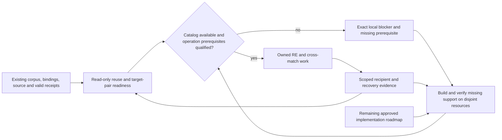
````

#### S027-C0007: Immediate delivery: useful and continuously updating

Source `docs/plans/2026-09-27-implementation-progress-and-live-track.md` lines 296–297; accountable coverage owner U1.

```md
## Immediate delivery: useful and continuously updating
```

#### S027-C0008: Accepted admission; active implementation: cross-place continuation

Source `docs/plans/2026-09-27-implementation-progress-and-live-track.md` lines 298–458; accountable coverage owner U14.

```md
### Accepted admission; active implementation: cross-place continuation

**Current state:** bounded candidate admission is accepted in `.15`; destination
match isolation and its basis revision are accepted in `.16`, the latest qualified
artifact. Automatic continuation beyond the 128-key process bound is being
implemented and reviewed. Its source changes have not passed installed or live
qualification. The paragraphs below retain the earlier repair history; their
failed or pending states do not override the final accepted receipts.

The active continuation change covers durable attempt reservations, exact
source/receipt publication enrollment, fair finite inventory epochs, resumable
large-tree import, inherited physical output ownership through compiler descendants,
and same-job generation transitions after authoritative session clearance. Current
review findings include the rejected directory-cookie starvation case, directory
sync failure/retry handling, and strict checkpoint state/deadline validation. Each
requires product evidence before this work can be accepted; static parsing and
design review alone are insufficient. The detailed requirements and diagrams are
in the [continuation contract](2026-09-22-task-acceptance-and-continuation-design.md#cross-place-admission-and-recipient-candidates).

The first frozen journal gate passed **11 product cases in 46.11 seconds** on
September 27 (terminal handle `82368`, exit 0). The isolated environment used the
accepted `.16` wheel plus seven exact source overlays; all nine observed product
module origins were inside that environment, and the loaded checkpoint/admission
hashes matched the frozen inputs. Evidence is retained in
`/home/brunner56/cross-place-continuation-evidence/journal-run1/` (`pytest.log`,
`result.json`, `origins.json`, `input-hashes.json`). A preceding runner startup
failure lacked pytest and executed no cases; its script and result remain separate.
The passing cases cover interrupted paired publication, external-conflict
preservation, event/sequence/latest-binding recovery, 129-entry two-chunk inventory
import, and changed or missing journal input refusal. This is source-overlay
protocol evidence, not a newly built installed artifact, physical storage-failure
proof, native 129-candidate qualification, session-lifetime acceptance or live RE.
Those broader continuation gates remain open.

A separate frozen-source gate subsequently passed **15 product cases in 7.26
seconds** (terminal handle `61723`, exit 0): 13 checkpoint-integrity cases and two
receipt-context/finite-epoch cases. It used a private copy of the native gate's
frozen source overlays, with nine isolated product origins and exact matching
checkpoint/admission hashes. Evidence is retained in
`/home/brunner56/cross-place-continuation-evidence/integrity-context-run1/`.
This establishes the tested failed-sync retry, corrupted-record refusal,
receipt-specific cursor and sealed-epoch behavior. It does not add native compiler,
catalog restoration, live-service or physical storage-failure acceptance. The
native 129-recipient gate is a distinct run and must reach its own terminal result.

The catalog lifecycle snapshot `d61f70df` passed a separate **14-case source-overlay
gate in 25.08 seconds** (terminal handle `65103`, exit 0). Evidence is retained in
`/home/brunner56/cross-place-continuation-evidence/lifecycle-run1/`; all 211 observed
product origins were isolated and the loaded jobs hash matched the frozen input.
Three cases exercised real tiny Python children through the executor/session
observer; the other eleven used synthetic records, mocked process observations or
local lock checks. Independent review still requires stop-aware reader shutdown
when a survivor holds an output pipe and full restored Scan source/path/device/inode
validation. The passing cases do not close those gaps or establish actual catalog
native rollover. Both repairs were assigned before final lifecycle acceptance.

The subsequent lifecycle repair `2439f1b5` passed **19 cases in 16.65 seconds**
(terminal handle `61101`, exit 0), with 211 isolated product origins and the exact
frozen jobs hash. Evidence is retained in
`/home/brunner56/cross-place-continuation-evidence/lifecycle-run2/`. The selection
adds four source-identity refusals and an actual silent-survivor pipe case.
Independent review found the two scoped product findings addressed; it still
requires hardening the survivor fixture's own readiness/cleanup handoff against
partial-marker failure. The successful run does not prove that untested failure
path. Preserve both runs and complete the fixture correction before further
execution or a final lifecycle qualification claim.

The test-only readiness repair was then independently cleared for a controlled
run. Its complete/malformed/missing readiness selection passed **3 cases in 11.05
seconds** (terminal handle `97221`, exit 0), retaining the same product jobs hash
`2439f1b5`. Evidence is in
`/home/brunner56/cross-place-continuation-evidence/lifecycle-run3/`. These three
cases replace and extend the earlier survivor fixture; do not report the two runs
as 22 distinct lifecycle requirements. Independent final evidence review approved
the tested source-overlay lifecycle scope, corroborating all 211 product origins
in the full run and 43 in the focused run, their hashes and both terminal results.
The disposition is retained in
`/home/brunner56/cross-place-continuation-evidence/lifecycle-review.md`.
The compiler-descendant result below subsequently qualifies its separate frozen
scope. Actual native catalog rollover, new installed-artifact and live qualification
remain open.

The frozen native capacity gate reached its authoritative terminal result:
**1 case passed in 1347.60 seconds** (handle `2230`, exit 0). It compiled candidates
for 129 physically distinct recipient PE images, with 129 distinct native compiler
invocations and retained object evidence. The guarded generations returned `75`
then `0`, crossing the production 128-key bound; unchanged replay reported 129
idempotent results and created no additional workspaces. Independent review checked
the retained manifests, object hashes, recipient identities, frozen inputs and
observed child execution evidence. Artifacts are retained under
`/home/brunner56/cross-place-continuation-evidence/`, including
`native129-terminal.json` and `standalone-capacity-review.md`. This qualifies
standalone guarded continuation on source hash `2bcabdf7`; it does not establish
native rollover through the catalog or general recipient compatibility.

A later standalone lifecycle repair passed **4 cases in 2.55 seconds** (handle
`25371`, exit 0), with exact source hash `6baa9aea` and isolated module origins.
It covers cancellation before spawn, cleanup after an owner callback fails,
bounded pipe-reader shutdown and cancellation-aware watch delay. The pipe fixture
retains a private write endpoint; it does not simulate a surviving compiler.
Independent review approved this bounded scope in the same review report.
Evidence is retained in
`/home/brunner56/cross-place-continuation-evidence/standalone-run1/`.
These four cases and the native capacity case exercised different frozen source
versions; neither substitutes for integrated qualification of the final changes.

The separate compiler-descendant gate passed **3 cases in 13.03 seconds** (handle
`93635`, exit 0). It observed a real Clang compiler retaining the inherited output
lock after both Python supervisors exited, refused a competing owner until the
compiler completed, and exercised early worker/compiler identity-handoff failures.
The terminal receipt records executable/argument/descriptor evidence and all eight
listed process identities absent afterward. Two additional stdout-only identities
from deliberately failed marker handoffs are covered by the passing cleanup
assertions, not by that receipt's identity list. Evidence is retained in
`/home/brunner56/cross-place-continuation-evidence/compiler3-terminal.json` and its
associated frozen configuration and log. Independent evidence review approved the
scoped result in `compiler-crash-fixture-review.md`, including the retained native
object and 26 isolated product origins. These cases establish one actual compiler
survival result and two injected cleanup results on that frozen configuration;
they do not qualify later source revisions, an installed package or live gameplay.

Two compatibility repairs remain in progress before integrated qualification:
preserve the exact explicit source directory in watch mode, and retain complete
multi-generation result counts and rows through a bounded, integrity-checked report
transport. Small one-shot results must remain one complete JSON response; larger
results must explicitly identify omitted inline rows and the complete artifact.
Artifact contents never replace actual process/session clearance. Adapt existing
watch fixtures to finite worker generations while preserving their cancellation,
concurrent-writer, receipt-refresh and output-ownership assertions. Complete the
relevant regression, installed-artifact and independent-review gates afterward.

Pre-execution review of the compatibility changes found three additional gaps:
restored jobs still used basename lookup, the new explicit source parameter was
not frozen against the supplied execution root, and displayed inline results were
not checked against the hashed report. Source repairs now share the selector,
normalize that input and validate the full artifact and bounded inline page before
aggregation. A focused gate ended with **22 passed and 3 failed in 177.30 seconds**
(handle `31980`, exit 1), so integrated qualification remains open. Nine report
transport cases and the guarded native negative replay passed within that failing
selection. The three failures identified missing selected-receipt path/hash in the
durable qualification key, manifest import incorrectly requiring an external source
to reside under the output directory, and a lease-contention fixture mistakenly
using the same reentrant owner thread. Repairs must preserve exact receipt/source
identity and prove contention from an independent owner. A separately identified
publication durability gap also remains open: creating staged entries and renaming
published files require an uncached directory fsync at those mutation boundaries.
Successful ancestor-identity caching cannot stand in for those new barriers.
Preserve the completed earlier snapshots and qualify the revised integrated source
before building or accepting its installed artifact.

The repaired focused gate then ended with **16 passed and 1 failed in 71.85
seconds** (handle `55989`, exit 1). The prior three failures were resolved; the
remaining new restoration fixture expected `failed` where the undispatched
cancellation contract returns `cancelled` with ownership released. Its expectation
was corrected without changing product behavior. A combined continuation source
gate now runs under handle `13928` against explicit frozen inputs, including the
full relevant admission routes and bounded large-inventory checks. Its frozen bulk
module predates the separate extent repair below; final integrated qualification
must include that reviewed change. Neither partial results nor this running gate
qualify a release.
```

#### S027-C0009: Parallel implementation from actual RE findings

Source `docs/plans/2026-09-27-implementation-progress-and-live-track.md` lines 459–500; accountable coverage owner U1.

```md
### Parallel implementation from actual RE findings

The sparse-cache audit traced an actual defective consumer: `load_asm_fallback`
passed counted cache body bytes to contiguous raw-image slicing in both ASM seeding
and failed-C fallback. For the observed GOG 68/71 and 67/70 records this would omit
the entire terminal three-byte return. This finding does not prove those historical
outputs were generated or accepted. The repair introduces one shared, lazy extent
qualification path: exact original-image digest/mapping, bounded selected cache
bytes, independent raw-byte decoding and closed direct control flow. It retains
raw gaps and the return; unsupported authority remains explicitly unavailable.

The first extent gate passed **10 cases in 0.74 seconds** (handle `91065`, exit 0)
and received scoped independent source/evidence review. A subsequent performance
repair replaced eager loading of all assembly strings with bounded indexed reads
for the selected function. That snapshot passed **11 cases in 1.13 seconds**
(handle `38427`, exit 0). Evidence lives in
`/home/brunner56/cache-extent-evidence/`. These use actual bounded objdump on private
synthetic PE images and check both consumers; compilation is mocked. They establish
bounded original-byte substrate behavior, not relocation correctness, whole-image
recovery, automatic repair of historical seeds, full U6b completion or a new
installed release. The later performance snapshot awaits its scoped review.

**Ruling:** advance the independent match-review core while continuation packaging
and executable analysis proceed — the user explicitly requested maximum parallel
delivery, and these new modules have no overlapping implementation owner. Keep the
core out of the continuation package and unregistered until its migration,
selection/admission and route contracts qualify; the cost of a wrong interface
choice is local rework, not a live corpus mutation.

The new `match_review.py` and `match_review_schema.py` implement coherent observed
basis tokens, per-match/per-binary ABA revisions, strict bounded decisions and
atomic status-plus-audit updates. An initial isolated core gate passed **18 cases
in 13.14 seconds** (handle `37183`, exit 0). Independent review found integer-range
and rollback-cleanup gaps; their repair, plus streaming migration backfill, passed
**21 cases in 12.32 seconds** (handle `41391`, exit 0). Evidence is retained in
`/home/brunner56/match-review-core1-y__hv_n5/` and
`/home/brunner56/match-review-core2-_6m8ojtk/`. These are isolated source modules
with namespace scaffolding and synthetic databases, not an installed product.
Migration registration, actual selected-context/admission guards, managed restore
incarnation rotation, catalog/HTTP parity and both mounted consumers remain open.
The core supports portable-plan U17/U106/U109 without completing those units.
```

#### S027-C0010: Admission repair history and accepted evidence

Source `docs/plans/2026-09-27-implementation-progress-and-live-track.md` lines 501–590; accountable coverage owner U14.

```md
#### Admission repair history and accepted evidence

The September 27 source audit traced the catalog's cross-place action through
standalone placement, watch mode and the direct `ghidra_bulk` hook. Address-only
compile/byteexact receipt sets admit subsequently edited source; the existing writer
can replace a recipient assembly floor. Logical identity alone does not qualify
recipient variant/ABI/layout compatibility. Existing target-local recovery queue
checks limit this finding: the copy does not automatically become accepted recovery.
The historical recovered-source name joins are a separate investigation, not the
demonstrated cause of this defect.

Implementation was assigned against the existing
[candidate admission contract](2026-09-22-task-acceptance-and-continuation-design.md#cross-place-admission-and-recipient-candidates).
The task covers bound producer evidence, one shared admission path for all three
callers, refreshed watch dependencies, separate immutable candidate publication,
and actual output ownership. Its positive gate is current compatible candidate
distribution; its negative gates include edited source, stale dependencies,
incompatible recipients and preservation of accepted source/assembly floors.
At that initial stage, source implementation, independent review and installed qualification were pending;
no historical receipt or source-audit finding is promoted to a fresh test result.
External task evidence is maintained in
`/home/brunner56/Documents/AgentDecompile-cross-place-admission-brief.md` and
`/home/brunner56/Documents/AgentDecompile-reuse-admission-audit.md`.

The preflight found no existing general implementation-variant/ABI/layout authority.
The implementation therefore includes a first explicitly bounded provider for
self-contained scalar constant-return PE functions, using fresh actual compilation
and independently checked donor/recipient machine behavior. This provider must not
promote labels or close general compatibility. Broader sources retain useful
unadmitted proposals and named missing-evidence/provider reasons; the complete
weekend variant, field/layout, callee and recipient-acceptance requirements remain
open. A caller-supplied compatibility verdict cannot authorize publication.

Initial source fixtures passed 47 cases with one instrumentation failure; that
fixture was corrected. Independent review found dependency/evidence integrity and
database/restoration gaps, addressed in the frozen first repair at source level.
An earlier broader verification run was interrupted after required source findings
superseded that snapshot, and is not passing evidence. Installed qualification
had not started. The next repair was necessary for tandem work: an unlimited
watch must not reserve the database indefinitely and starve matching producers.
It must capture only the relevant coherent snapshot, close the reader before
compile/wait, retain candidate-output ownership, and publish observed-basis
proposals requiring current recipient acceptance. Repeated unchanged negative
attempts also need bounded retries and scratch. Source verification and both
scoped reviews must qualify that revised contract before a new package is accepted.

The second repaired snapshot completed isolated source verification with **194
passed and 3 failed** (222.64 seconds). Its new tests exercised a real guarded watch
alongside a catalog logical-build, coherent capture and actual byteexact producer;
this is synthetic product evidence, not live-corpus qualification. One failing
determinism fixture supplied a non-SQLite placeholder; two existing executor
fixtures lacked the staged import path in ordinary Python children. Independently,
both reviewers required source-address-local index capture (unrelated rows then
exhausted the query bound), and execution review required an unconditional attempt
ceiling across allocation/write/revalidation failures. A third focused repair
then remained in progress; no `.15` artifact had yet been accepted. The second run and frozen reviews remain
retained under `/home/brunner56/cross-place-admission-evidence/`.

Both independent reviewers approved the third repair at source level. Its focused
isolated source run completed with **24 passed** in 272.63 seconds, including the
three previously failing cases; one unknown-marker warning remains. Parent and
ordinary-child origin guards recorded staged imports. An additional real native
negative/replay fixture passed separately. The `.15` artifact then passed **203
installed checks** in 289.00 seconds and received independent final bounded
approval; the [receipt](../verification/2026-09-27-cross-place-admission.md)
records artifact lineage and corrected actual/synthetic evidence classifications.
A controller/reviewer audit found a
separate continuation gap: after 128 distinct qualification keys, the current
process refuses new keys, but an unlimited watch neither exits nor advances a
resumable chunk. Existing valid cached keys still work. This bounds resource use
but does **not** provide continuous corpus-scale progress. A `.15` qualification
may establish only the bounded admission safety increment; the cross-place task
remains open. Its next required increment precedes match-review work: a terminal
budget-exhausted checkpoint, durable cursor/chunk and retained per-basis failure
budgets, followed by catalog-owned continuation after session clearance. Restarting
from the first sorted source or evicting negative state would repeat/starve work
and does not satisfy this requirement.

Before that larger continuation change, the first per-unit source audit found a
small correctness prerequisite in portable-plan D3: conflict demotion in
`bind_identities` omitted the destination binary from its UPDATE predicate. A loser
in one build could therefore demote a different build's same-address match. A focused
repair is accepted in `.16`, with 32 affected installed checks and independent
artifact approval. The [D3 receipt](../verification/2026-09-27-d3-destination-scope.md)
records its explicit algorithm-basis revision and old-basis export refusal, without
claiming universal direct-mutator enforcement. This does not repair or rebaseline
the live corpus. D1 and D9 retain broader branch/operational qualification work;
selected `.16` cascade cases are now recorded in their scoped evidence. Audit evidence:
`/home/brunner56/Documents/AgentDecompile-D1-D3-D9-source-qualification.md`.
```

#### S027-C0011: Queued repair: match-review freshness

Source `docs/plans/2026-09-27-implementation-progress-and-live-track.md` lines 591–628; accountable coverage owner U1.

```md
### Queued repair: match-review freshness

Original scope: portable-plan U17, U106 and U109, plus current-version acceptance.
This slice must preserve optional review overrides and cannot make human triage a
global progress gate. The mounted-consumer preflight found additional concrete
defects: active static single review omits the required match ID and shows success
before checking the response; batch uses an undefined API property and a legacy row
selector. The mounted React WorkstationApp has no review queue; changing unmounted
Surfaces.Review cannot satisfy that consumer. The next slice therefore includes
shared coherent reads, atomic decision/audit, catalog exposure and both actual
consumer paths. Its external acceptance brief is
`/home/brunner56/Documents/AgentDecompile-match-review-acceptance-brief.md`;
the source trace is `AgentDecompile-match-review-integration-preflight.md` in the
same directory. Full U17 relation/evidence and Compare workspace scope remains open.

The subsequent execution map is retained at
`/home/brunner56/cross-place-continuation-evidence/match-review-next-map.md`.
It identifies the existing corpus-selection route as an activation integration
point, without claiming an existing managed restore lifecycle. The repair will use
the forward migration registry, a shared review service, and the same admitted
catalog mutation path for HTTP and agent consumers. A submitted job is pending
until its decision result is terminal; both mounted consumers must reflect that
distinction. Changes to `dashboard/actions/jobs.py` wait for the current
continuation owner's coherent freeze and explicit handoff. The map is a source-
grounded implementation dependency plan, not implementation or runtime evidence.

The next review-workflow repair is also concrete: current single/batch match-decision
routes and both UI submitters use match IDs without binding the observed database,
run, directed pair and evidence. Recomputed rows can reuse an ID or change its
basis while remaining in review. The required repair is a shared observed-basis
token and atomic stale refusal for both routes/consumers, including whole-batch
precondition handling and selected-database identity. This source-grounded scenario
is recorded in `/home/brunner56/Documents/AgentDecompile-match-review-freshness-audit.md`;
it has not been reproduced or fixed. Catalog exposure must be established before
claiming an agent-operable review path. The retained RE packets must not be submitted
by ID alone. Cross-place repair is the current source task; this requirement remains
queued rather than becoming an untracked caveat.
```

#### S027-C0012: Weekend Phase 12 qualification: U87–U90 remain open

Source `docs/plans/2026-09-27-implementation-progress-and-live-track.md` lines 629–677; accountable coverage owner U1.

```md
### Weekend Phase 12 qualification: U87–U90 remain open

The bounded September 27 source/consumer audit qualifies these original portable-plan
units separately from later contract identifiers:

| Portable-plan unit | Current source evidence | Remaining required outcome |
|---|---|---|
| U87 | Deterministic v1 hook-pack writer and existing basis checks; no aggregate bundle command located | Fixed multi-exporter order, content-addressed artifact tree, complete `bundle.json` and all mandatory artifact verification/publication gates |
| U88 | No pack-v2-only Lua generator/command located | Require-able address-free module with the declared entity/accessor/call/hook helpers and structured unresolved-operation failures |
| U89 | Existing per-build header producer strips layout assertions; acquisition flattens pointer/composite/union information | Exact layouts, retained size checks, typed ABI-aware declarations and build/toolchain/basis manifest through that existing producer path |
| U90 | No readiness/v1 coverage projection/command located | Complete entity-by-build locator coverage, separate observed status, environment/adapter limitations and human-readable capability readiness |

The actual KotorPhasor consumer currently reads v1 and bounded operation roles;
changing the format label would not implement v2. The v1 export command also needs
qualification of its output ownership. These are current source findings from
`/home/brunner56/Documents/AgentDecompile-weekend-export-bundle-readiness.md`,
not executed acceptance results. The full Phase 12 output remains required while
cross-place and independent useful RE work advance; none of these rows is waived.

The first usable workflow is:

> Open an existing analyzed target, inspect its recorded source and evidence, see
> the exact current operation or blocked reason, the next automatic action, budget
> and freshness, then inspect the receipt when accepted work advances.

Build this first on the required static `/dashboard`, then qualify packaged `/react/`
against the same backend state. Existing code already polls preparations every two
seconds and jobs every 1.5 seconds and persists job/stage/ownership facts. Extend that
path instead of introducing another server or progress store.
Entity evidence already has a shared activity SSE/cursor/replay route with HTTP
fallback. Extend that route for target/candidate-bound claims and receipt links;
the preparation poll and entity stream have different roles. Passive evidence
hydration must avoid function-detail's lazy observation-admission path. Recorded
receipt JSON cannot recreate trusted process-local contribution observations.

| Step | Deliverable | Acceptance needed |
|---|---|---|
| L0.1 Activation identity | Resolve the intended 8080 owner, cwd, loaded module, revision, catalog root and state root | Same process/state identity before and after supported update; when no listener exists, record the blocker and do not substitute another port |
| L0.2 Truthful projection | One bounded versioned view of target identity, execution state, accepted claim scope, receipts, measured units, freshness, retry/wake reason, resource ownership and admission spending | Read-only hydration never admits recovery; execution completion and accepted capability remain separate |
| L0.3 Static consumer | Show the projection, stale/disconnected state, timestamps, receipts and exact next action in `/dashboard` | Retained data always shows observation time and unknown freshness after disconnect |
| L0.4 React consumer | Show the same fields and semantics in packaged `/react/` | Field/state parity against the same backend response; wall-clock limits remain distinct from action-admission allocation |
| L0.5 Identity-safe updates | Preserve exact corpus/build/address through reload, history navigation and rapid target switches | Late response cannot redraw another target; browsing sends no recovery POST |
| L0.6 Live qualification | Observe one existing target, source/receipt and retained or owned work record; disconnect/reconnect; switch targets; reload | Actual existing 8080 browser at desktop and 598x912, unchanged service/state identity, no fabricated progress |

The current preflight found no 8080 listener, so L0.1 and L0.6 have no fresh live
receipt. Source preparation, projection tests and package review may proceed, while
activation remains a separately reported boundary. Do not use `systemctl`, start an
alternate port or replace an unknown owner.
```

#### S027-C0013: Current accounting

Source `docs/plans/2026-09-27-implementation-progress-and-live-track.md` lines 678–739; accountable coverage owner U21.

```md
## Current accounting

The [preparation freshness/admission slice](../verification/2026-09-27-live-projection.md)
now implements part of L0.2–L0.5 in both frontends. Twelve focused tests, TypeScript,
static syntax and an isolated production build passed after independent review.
The prepared asset archive has source hashes and recorded dependency versions.
It has not been activated. The subsequent scoped evidence increment below adds
historical receipt links; current accepted-claim projection and live/browser
qualification remain open. This changes useful source behavior without closing M0.
The subsequent clean lockfile installation, 18 focused/adjacent checks, TypeScript
check and production rebuild passed with Vitest 5.0.1. The locked bundle and per-file
asset manifest are retained in the receipt and handed to the next wheel stage.

The [scoped activity-evidence increment](../verification/2026-09-27-live-evidence.md)
now wires the existing activity route into static Explorer and both React evidence
views, with current source-digest checks, historical named witnesses and explicit
unavailable contribution. Selection/reset races are corrected. Eight source and
eight installed backend cases, 12 frontend cases, TypeScript and the locked build
passed after independent review. All rows remain unaccepted; actual target-currentness,
trusted contribution observations and live browser qualification are open.

The [qualified local-output ownership increment](../verification/2026-09-27-resource-claims.md)
advances P0.3 for the actual ReAgent snapshot export action. One explicit destination
contract replaces generic parameter-name inference; qualified local clearance can
release it, while uncertain and historical unqualified claims remain reserved.
Focused tests and independent review are tracked in that receipt; the increment
is included in `.12` and its installed regression selection. It does not qualify
compiler/Wine/project/store lifecycles or close M0.

The [nested MCP budget increment](../verification/2026-09-27-nested-mcp-budget.md)
now implements a separate tool-dispatch allocation for preparation-owned jobs.
Project/program setup, primary requests, session retries and check-in share the
same durable objective allowance. Backend source checks passed 113 cases after
correcting unresolved-effect replay with spare budget. Both frontends passed 38
cases on the matching locked runtime, full TypeScript and a fresh production build.
Both source reviews are approved; the `.12` wheel passed all 113 installed checks,
and independent artifact review approved. Provider-internal work, external subprocess usage, shared circuits and live
qualification remain open.

The contract register has 110 items: **100 unverified, eight partial, one
superseded and one achieved**. The partial items are D13, D15, D16, D31, D36,
D44, D47 and RC-02. D49 is superseded by the later build authorization; D50 records the
completed collaborative design review. These counts measure accepted contract
states, not percentage of engineering effort.

Documentation coverage is substantially complete. Implementation is partial. M0 has
a packaged foundation and bounded acceptance prerequisites; M1–M7 have no terminal
acceptance. The latest recorded package is the native ownership increment `.14`,
with all 139 installed checks passing and independent artifact approval. It preserves
the fresh-revalidation increment `.13`, with all 60 of its installed checks passing
and independent artifact approval. It preserves the
nested MCP/resource increment `.12`, whose 113 installed checks and independent
artifact review passed.
It preserves the generated-operation increment `.11`, whose own source and installed
selection passed 42 checks. The scoped activity-evidence
increment `.10` has eight installed backend checks and the newly built frontend. It preserves
the verified `.9` source-contribution backend, whose separate installed suite passed
149 checks after independent review. It proves bounded actual COFF placement and discard/overwrite refusal;
it does not prove general linking, non-export identity, named contribution composition,
ABI correctness, whole-image source recovery or live activation. See the
[exact receipt](../verification/2026-09-27-source-contribution.md).
```

#### S027-C0014: Milestone status and todo

Source `docs/plans/2026-09-27-implementation-progress-and-live-track.md` lines 740–767; accountable coverage owner U1.

```md
## Milestone status and todo

| Milestone | Status | Next useful outcome | Remaining acceptance boundary |
|---|---|---|---|
| M0 Reliable continuation | Partial | Complete L0 and preserve attempts with an exact next action | General owner reconciliation, complete dependency/resource closure, nested/provider budgets and circuits, durable wakes, scoped acceptance/withdrawal and live consumer qualification |
| M1 Effective scenario runner | Open | Qualify G3 lease reconciliation and G4 lifecycle ownership against one exact effective operation manifest without mutable-game fallback paths | Exact effective script/target/runtime/fixture manifest, one lifecycle owner, passing and blocked actual-game receipts without manual path repair |
| M2 Generated operations | Partial preparation | Export and consume one K1 GOG model-scale generated operation; carry its revision into G3 | Independent entity, ABI, lifetime and thread predicates; shared binding/help/CLI/harness revision; unsupported-build negative |
| M3 F12 workspace | Open | Query/select, run Lua, edit a supported property, inspect result/error, undo and Copy as Lua | Real key/focus/input and engine-thread path with the same operation IDs across consumers |
| M4 Creative projects and captures | Open | Reopen a scene/shot in a fresh session and record a defining native effect | Stable selectors, namespaced state, protected inputs and separate behavior/capture/presentation receipts |
| M5 Playback and checkpoints | Open | Owned pause plus supported save/restore and branch replay | Inventory/quest/party/script verification, fresh lifetime identities and explicit excluded state |
| M6 Native platform matrix | Open | Qualify exact Mac K1/K2 and compatible Windows/Linux capability rows | Per-build ABI, graphics, input and capture receipts on capable workers |
| M7 Whole-game browser | Open; feasibility work | Inventory prior KotorPhasor work and establish an executable route | Actual render/input/audio/save/main-loop behavior and sustained play |

The [native source assessment](../RUNTIME_REUSE.md#first-generated-native-operation--source-assessment-2026-09-27)
identifies an existing protected model-scale adapter for the first M1/M2 slice.
Generated pack identity/role enforcement and native role consumption now exist. A
scenario-level operation pin, exported-hook-pack preflight and explicit staged-byte
identity checks now exist. Actual process ownership reconciliation and independent
live observation are still missing, so existing native source does not close M1/M2.

The [generated-operation contract increment](../verification/2026-09-27-generated-operation-contract.md)
now supplies the exporter-side raw-image/role handoff and KotorPhasor parser/runtime
identity/adapter gating. The native model adapter consumes the five resolved generated
role addresses only after it verifies the loaded image digest and admitted operation.
Its compiled profile remains the independently guarded ABI/layout source. No ABI call,
actor/world lifetime check, engine fixture, independent observation or restoration ran,
so M1/M2 remain open.
```

#### S027-C0015: Active M1/M2 readiness sequence

Source `docs/plans/2026-09-27-implementation-progress-and-live-track.md` lines 768–799; accountable coverage owner U27.

```md
## Active M1/M2 readiness sequence

The current implementation supplies a **fail-closed effective-scenario admission
record** carrying the same generated-operation revision from AgentDecompile through
the KotorPhasor scenario runner. Its offline preflight and staged lease are partial
G3 delivery. The next boundary is actual process ownership reconciliation and a live
mutation intent/outcome receipt; a scenario TOML, hook pack or native parser test
does not establish runtime authorization.

| Order | State | Work product | Required refusal or evidence |
|---|---|---|---|
| G1 | Partial | `agentdecompile.operation-contract/v1` exporter emits target digest, unique roles, resolved sites, byte windows and role metadata | Export refuses absent/ambiguous roles, stale raw image, missing selected target or wrong pack digest |
| G2 | Partial | KotorPhasor hook-pack parser and native model bridge retain selected target identity and consume exact generated role addresses | Reader rejects a wrong target/role/site/address/byte declaration; runtime keeps model/animation unavailable when pack digest, operation, or a role is missing |
| G3 | Partial | Scenario pin/preflight and staged-copy gate are implemented; a stable stage lock and canonical prepared lease block unsafe successor admission before any staged-game mutation, with one-shot cleanup and terminal quarantine/release semantics | Qualify full lease reconciliation against actual process ownership and record live mutation intent/outcome under that lease; no path may be inferred from a source basename |
| G4 | Next | One lifecycle owner creates immutable staging, records the effective manifest and obtains fixture/process ownership | Unknown, competing or stale ownership becomes a recorded blocked result with a bounded wake condition; it never becomes an alternate launch or manual repair instruction |
| G5 | Later | On the game thread, execute the supported snapshot → resize → independent before/during/after observation → restore → cleanup route | Actor/world epoch, ABI, thread, observation and restore predicates each produce a scoped receipt; failure keeps the exact failed predicate and cleanup result |
| G6 | Later | Replay one passing and one deliberately unsupported/blocked scenario from durable manifests | A fresh runner reproduces the manifest outcome without source-path, process, fixture or lifecycle repair by the operator |

G3 is deliberately the active boundary. Its first offline schema/report increment now
preserves the complete identity pin without allowing a route name or path to stand in
for it, and compares contract/hook-pack target identity before `GameSession` exists.
Staging admission now compares explicitly located deployed-script, fixture and installed
runtime bytes under a stable stage lock, with a prepared manifest lease admitted before
any mutable-game staging. It never infers a destination from a source basename or
claims a rejected predecessor lease. The remaining G3 work is qualified reconciliation
against actual game/process ownership and a live mutation intent/outcome receipt. This work
does not launch a game, create a recovery job, start a web service or imply M1/M2
acceptance. G4–G6 require separate qualified live authority and evidence.

M6 and M7 research can proceed independently. It cannot be relabeled success when an
executable route or required host is absent.
```

#### S027-C0016: Active next source increment

Source `docs/plans/2026-09-27-implementation-progress-and-live-track.md` lines 800–823; accountable coverage owner U1.

```md
## Active next source increment

[P0.4 fresh revalidation after process loss](../verification/2026-09-27-fresh-source-revalidation.md)
now has independently approved source. A bounded retained
recipe requests new supported compilation and exact placement; imported audit JSON
never restores producer authority. The decisive synthetic acceptance route spans
three processes: old audits receive zero credit, a changed candidate is rejected
while its valid sibling is freshly produced and credited, and a later process still
cannot accept the new audit alone. The final new-module suite passed 27 cases;
the `.13` package passed the complete 60-case installed selection and independent
artifact review approved. This is
synthetic product evidence, not a recovery operation. The detailed flow is in the
[acceptance design](2026-09-22-task-acceptance-and-continuation-design.md#fresh-source-revalidation-after-process-loss).

[P0.3 native package-verifier ownership](../verification/2026-09-27-native-verify-ownership.md) is now delivered as the bounded `.14` increment after the `.13`
source-revalidation artifact was accepted. It uses the actual `recover.verify-package`
output tree, with enforcement inside the child that reads compiler metadata and
launches the compiler. The design includes the guarded execution/clearance flow;
source validation and independent review corrected predispatch-restoration and
cancellation-window defects. Source checks passed 139 cases before a separately
reviewed two-case fixture repair. All 139 final installed checks pass and independent
artifact review approved. The first profile
will not grant Wine, arbitrary flags or external wrappers automatic release.
```

#### S027-C0017: Implementation order after the live track

Source `docs/plans/2026-09-27-implementation-progress-and-live-track.md` lines 824–853; accountable coverage owner U1.

```md
## Implementation order after the live track

1. Finish P0.4 linked source-contribution acceptance: actual compiler-owned object,
   independent re-evaluation, physical placement into a typed hole, zero credit for a
   discarded replacement or copied fallback, and preservation of unrelated valid work.
2. Close P0.3 general owner reconciliation for compiler, Wine prefix, project, output
   and store resources. Unknown ownership remains reserved until qualified evidence
   clears the exact resource. `recover.verify-package` now has a bounded, independently
   approved native Clang profile without code comparison in `.14`; arbitrary flags/wrappers, extra
   writable paths, environment caches and MSVC/Wine require separate coverage.
3. Complete P1.1/P1.2 shared objective/provider budgets, recovery circuits, transitive
   dependency closure, durable wake cursor/outbox and restart reconciliation.
4. Run P1.3 one catalog-owned reccmp original/rebuild/PDB comparison and one configured
   ReAgent candidate-consuming check with raw and normalized receipts.
5. Complete P1.4 recipient-specific acceptance, dependency lineage, generation recheck,
   scoped withdrawal and deterministic replay.
6. Deliver P2 trustworthy region/fixup roundtrip, compiled replacement, toolchain/group
   calibration and relocatable isle-like project output. Advance one independent vanilla
   read/mutate/restore route through M1/M2 without waiting for all recovered source.
7. Build M3–M5 and qualify M6/M7 incrementally. Expand distributed scale after a local
   lane is correct and resumable.
8. Claim terminal recovery only after a fresh current source/toolchain build, object
   evidence, exact-placement relink and whole-file comparison for that exact variant.

The live track owns frontend and projection files. The contribution track owns its
COFF/relink/selection consumers. Coordinate any shared `preparation.py` or `jobs.py`
changes before assigning a writer. Actual corpus/Ghidra/compiler/Wine/game state keeps
one qualified writer. Read-only audit, provider-interface research and platform/browser
inventory may proceed concurrently.
```

#### S027-C0018: Design and diagram status

Source `docs/plans/2026-09-27-implementation-progress-and-live-track.md` lines 854–873; accountable coverage owner U1.

```md
## Design and diagram status

| Artifact family | Design state | Software state |
|---|---|---|
| Recovery overview: `agentdecompile-recovery-pipeline` SVG/draw.io/PNG + generator | Current September 22 design; canonical and Documents SVG hashes match | Stages and lanes are partly implemented; whole-image acceptance remains open. 8080 has no owner today, so stage 8 acceptance cannot run; two differently-dated copies of `kotorxid.sqlite` exist and which is authoritative is unresolved (session 7a1c2b) |
| Execution contracts SVG/draw.io/PNG + generator | Complete design for admission, evidence, fencing, quarantine and progress | Late-worker and acceptance scenarios remain partly or wholly unverified. Four new modules landed as source with synthetic tests only and no consumer wired in: recipient-specific acceptance, the COFF relocation roundtrip, the recovered-project manifest, and the runtime lifecycle owner (session 7a1c2b) |
| Resilience contracts SVG/draw.io/PNG + generator | Complete design for detect/classify/repair/wait/resume and control-plane failures | Retry/quarantine/freshness/accounting slices exist; full FP matrix remains open |
| Autonomous capabilities SVG/draw.io/PNG | M0 partly verified; M1–M7 acceptance remains future | M2 now has partial preparation in the milestone table; the diagram's future-delivery label denotes missing acceptance, not absence of source |

No diagram topology changed in this reconciliation, so the rendered artifacts were not
regenerated. Update their source and all formats together when an actual design contract
changes, then keep the Documents overview synchronized.

Session 7a1c2b also proposed, but did not merge, a calling-contract veto for the
matching lane (Lane A), and prepared package `.18` (built, not yet qualified —
its qualification rerun is blocked on a host capacity gate). Neither changes
diagram topology while unmerged/unqualified; see the pipeline diagram README's
["diagram regeneration pending"](../dashboard-design/pipeline-diagram/README.md#diagram-regeneration-pending--2026-09-27)
note for the specific edit a merged veto would need.
```

#### S027-C0019: Reporting rule

Source `docs/plans/2026-09-27-implementation-progress-and-live-track.md` lines 874–880; accountable coverage owner U1.

```md
## Reporting rule

Every bounded increment gets a dated receipt containing exact source revision/hashes,
package identity, checks actually run, independent review and remaining boundaries.
Update this ledger, `DELIVERY_STATUS.md`, the obligation audit/register and the relevant
diagram label only when that evidence changes. Source presence, a green job, a screenshot,
copied bytes or a running process never upgrades the claim by itself.
```

#### S028-C0001: ---

Source `docs/plans/2026-09-27-p13-external-execution-plan.md` lines 1–9; accountable coverage owner U10.

```md
---
title: P1.3 execution actions — run-reccmp-compare and run-reagent-benchmark
type: implementation-plan
date: 2026-09-27
status: design (not implemented)
parent: 2026-09-27-implementation-progress-and-live-track.md
evidence: ~/agentdecompile-deliverables/2026-09-27-p13-reccmp-reagent/ (machine-local)
---
```

#### S028-C0002: P1.3 execution actions

Source `docs/plans/2026-09-27-p13-external-execution-plan.md` lines 10–18; accountable coverage owner U10.

```md
# P1.3 execution actions

P1.3 needs two catalog-owned runs, one reccmp original/rebuild/PDB comparison and one ReAgent
benchmark that consumes a candidate. Each run keeps a raw receipt and a normalized receipt.

The catalog can already read reports (`corpus.normalize-validation-report`) and export
snapshots (`corpus.export-reagent-snapshot`). It cannot yet run either tool. All `jobs.py`
anchors below refer to the dirty working tree (`f312aea1…`), not HEAD.
```

#### S028-C0003: Facts that shape the design

Source `docs/plans/2026-09-27-p13-external-execution-plan.md` lines 19–45; accountable coverage owner U10.

```md
## Facts that shape the design

**The contract layer is uncommitted.** HEAD has no `_EXTERNAL_ACTION_CONTRACTS`. These files
are untracked: `external_validation.py`, `supervision.py`, `native_verify_contract.py` and
`cross_place_admission.py`.

**Corpus actions come from argparse.** `introspect.py:120-161` builds them; `catalog.py`
needs no insertion. Avoid these field names:

| Field names | Why they are unsafe |
|---|---|
| `--out`, `--out-dir`, `--work-dir` | Bound to the work dir, so an exclusive claim would cover the whole workspace |
| `--binary`, `--input` | Rewritten to the context PE |
| `--path`, `--from`, `--repo`, `--program`, `--id` | Auto-filled from context |
| Bare `--project` | Silently dropped |

Use these names instead: `--report-dir`, `--original`, `--rebuild`, `--pdb`, `--project-dir`
and `--reccmp-target`. Mark both subparsers mutating, long-running and danger.

**Guarded actions are hardcoded in five places** in `jobs.py` (:266-274, :396, :406,
:1077-1083, :1868-1871). Missing one leaks the full server environment into the child.
Replace these with a `_GUARDED_MODULES` registry and a coverage test.

**wineserver daemonizes.** Session-only clearance can report "clear" while the prefix is
still live. Wine-prefix clearance is therefore P0.3 scope. Until it lands, reccmp jobs end
`quarantined`, and each run uses a fresh prefix.
```

#### S028-C0004: New module: `corpus/external_execution.py`

Source `docs/plans/2026-09-27-p13-external-execution-plan.md` lines 46–83; accountable coverage owner U10.

```md
## New module: `corpus/external_execution.py`

This module touches no shared file. It follows the guarded-child pattern of
`cross_place.py` and `native_verify_contract.py`.

**Pins.** `PINS` are code-owned:

| Tool | Version | Commit | Archive sha256 |
|---|---|---|---|
| reccmp | 0.1.7 | `e91a51b…` | `6801afde…` |
| auto-re-agent | 0.4.0 | `d12cea3…` | `65c22a9d…` |

The commits must equal `external_validation.SCHEMA_BASELINES`.

**`freeze_parameters`** runs in the parent before any reservation. It:
- makes all paths absolute and refuses symlinks;
- hashes every input and compares it with the declared sha256;
- verifies the provider;
- canonicalizes the venv.

**`verify_provider`** checks:
- `direct_url.json`: the pinned commit and the archive sha256;
- `RECORD` hashes;
- the entry point;
- the interpreter's realpath and sha256.

**The child launches the provider** as `<venv>/bin/python -I -c <entry-point shim>`. It
uses `-I` without `-S`, avoids console scripts, and runs the provider in the same session.
The environment is an explicit allowlist, and the whole env dict goes into the receipt.

**For reccmp, the child also:**
- runs `pdb_matches_rebuild`, which requires the CodeView RSDS GUID and age to equal those
  in the PDB info stream;
- generates `reccmp-user.yml` and `reccmp-build.yml` inside the report dir, pointing at the
  frozen paths;
- runs `wine_shutdown` afterwards;
- re-hashes the inputs before and after the run.
```

#### S028-C0005: Actions

Source `docs/plans/2026-09-27-p13-external-execution-plan.md` lines 84–85; accountable coverage owner U10.

```md
## Actions
```

#### S028-C0006: `corpus.run-reccmp-compare`

Source `docs/plans/2026-09-27-p13-external-execution-plan.md` lines 86–99; accountable coverage owner U10.

```md
### `corpus.run-reccmp-compare`

Fields:
- `project-dir`, `reccmp-target`;
- `original`, `rebuild` and `pdb`, each with its sha256;
- `db` (from context) and `binary-slug` (from context `slug`, used only to cross-check md5);
- `report-dir`, which must not exist;
- `provider-venv`, `wine`, `wineprefix` (dedicated and initialized; `~/.wine` is refused)
  and optionally `cvdump`;
- `timeout`, default 1800 and maximum 7200.

Argv: `reccmp-reccmp --target <id> --json <report-dir>/report.json --silent`, with cwd set
to `<report-dir>/reccmp`.
```

#### S028-C0007: `corpus.run-reagent-benchmark`

Source `docs/plans/2026-09-27-p13-external-execution-plan.md` lines 100–114; accountable coverage owner U10.

```md
### `corpus.run-reagent-benchmark`

Fields:
- `manifest` and `manifest-sha256`;
- `inputs-dir`, copied into `<report-dir>/work`;
- `candidate` and `candidate-sha256`;
- optionally `candidate-receipt`;
- `report-dir`, `provider-venv`, `timeout`.

The manifest is validated:
- rows need an argv-array `reference` and `candidate`;
- shell strings and `sh`/`bash`/`env` are refused as argv[0];
- argv[0] must be absolute and is hashed;
- the candidate must actually be consumed.
```

#### S028-C0008: Receipts

Source `docs/plans/2026-09-27-p13-external-execution-plan.md` lines 115–135; accountable coverage owner U10.

```md
## Receipts

**Raw receipt:** `execution.json`, schema `agentdecompile.external-execution/v1`. It records:
- the provider pin and interpreter;
- input identities at freeze, before the run and after the run;
- argv, cwd and env;
- Wine tool hashes;
- the process result;
- the stream digests and the raw report digest;
- `execution_state` and the refusal, if any.

**Binding:** add `external_validation.bind_execution(normalized, execution)`. Leave
`normalize_report` and `read_report` byte-for-byte unchanged. `bind_execution` wraps the
unchanged normalized output and sets:
- `provenance_verified=true` only when the pin is verified, the three-phase hashes are
  equal, and the raw sha256 matches;
- `proposal_only=true` and `recovery_accepted=false`, always.

**States:** `completed`, `crashed`, `timed_out`, `unavailable`, `unsupported` and
`invalid_output`.
```

#### S028-C0009: Refusal codes

Source `docs/plans/2026-09-27-p13-external-execution-plan.md` lines 136–145; accountable coverage owner U10.

```md
## Refusal codes

| Area | Codes |
|---|---|
| Wine | `wine_unavailable`, `winepath_unavailable`, `wineserver_unavailable`, `cvdump_unavailable`, `wineprefix_uninitialized`, `wineprefix_default_refused` |
| Provider | `provider_unpinned`, `provider_record_mismatch`, `provider_entry_point_missing`, `provider_interpreter_unavailable`, `provider_implementation_changed` |
| Inputs | `input_hash_mismatch:<name>`, `input_changed_during_run:<name>`, `project_hash_mismatch`, `reccmp_target_unknown`, `pdb_rebuild_mismatch`, `slug_md5_mismatch` |
| Paths | `report_dir_exists`, `report_dir_parent_missing`, `symlink_external_resource`, `output_aliases_input` |
| Manifest | `manifest_invalid`, `manifest_shell_command`, `candidate_not_consumed`, `manifest_timeout_exceeds_action` |
```

#### S028-C0010: `jobs.py` delta (single writer only)

Source `docs/plans/2026-09-27-p13-external-execution-plan.md` lines 146–161; accountable coverage owner U10.

```md
## `jobs.py` delta (single writer only)

1. Add the `_GUARDED_MODULES` registry and a registry-coverage test.
2. Add contracts:
   - reccmp: output `report-dir`, wineprefix `wineprefix`, input `project-dir`;
   - reagent: output `report-dir`, input `inputs-dir`.
3. Derive `provider` and `input` claims from the frozen params only. Admission and restore
   must share one derivation function.
4. Add the `provider` and `input` kinds, both shared. Add `_claims_conflict`: a conflict
   needs an overlap where at least one side is exclusive.
5. Set the job timeout to the frozen timeout plus 60 s.
6. P0.3 owns `wineprefix_clearance`, likely implemented as a non-blocking lock probe on
   `/tmp/.wine-<uid>/server-*/lock`.
7. The existing Wine callers (`compile-link` and `verify-direct-full-image --wineprefix`)
   take no claims. This is a P0.3 follow-up.
```

#### S028-C0011: Timeout and kill

Source `docs/plans/2026-09-27-p13-external-execution-plan.md` lines 162–168; accountable coverage owner U10.

```md
## Timeout and kill

- **Child:** SIGTERM, then SIGKILL after 5 s, then `wine_shutdown`. It writes `timed_out`
  and exits 124.
- **Parent:** the existing `_default_executor` is unchanged. A session that is not clear,
  or a prefix that is still live, ends the job `quarantined`.
```

#### S028-C0012: Tests (specified)

Source `docs/plans/2026-09-27-p13-external-execution-plan.md` lines 169–198; accountable coverage owner U10.

```md
## Tests (specified)

- **Unit:**
  - every refusal code;
  - fake dist-info pin failures;
  - symlink refusal;
  - PE/PDB GUID mismatch;
  - generated yml;
  - the env allowlist;
  - the `guarded_command`/`command_matches` round trip;
  - `bind_execution` leaves the normalized output unchanged;
  - the state mapping.
- **Resources:**
  - shared and exclusive claim semantics;
  - restore round trip;
  - restore after the venv is reinstalled;
  - registry coverage.
- **Synthetic E2E** through the real `_default_executor`, using a fake venv, fake tools and
  a fake Wine:
  - success;
  - timeout;
  - a detached grandchild;
  - an input rewritten mid-run;
  - an unpinned provider;
  - cancel before spawn;
  - the ReAgent candidate is consumed;
  - a shell manifest is refused.
- **OpenAPI catalog:** both actions are listed with their flags, and no trap field names
  are used.
```

#### S028-C0013: Acceptance

Source `docs/plans/2026-09-27-p13-external-execution-plan.md` lines 199–228; accountable coverage owner U10.

```md
## Acceptance

**Lane A (actions delivered):** code, then tests in a lock-held window, then `/health`
module identity, then `GET /api/v1/actions`, then the expected `dryRun` argv. This lane is
not P1.3 itself.

**Lane B (P1.3 live) prerequisites:**
- pinned tools reinstalled;
- Wine, cvdump and a dedicated prefix;
- an MSVC 7.1 rebuild with its PDB and a reccmp project;
- a ReAgent reference executor and a real candidate.

**Per job, retain:**
- the job receipt;
- `execution.json`, `report.json` and `normalized.json`;
- the streams;
- matching input hashes;
- a provider revision equal to the pin;
- the owner check (from `/proc` start ticks and cwd);
- an independent re-normalization through the catalog.

Neither run counts as recovery acceptance or whole-image equality.

**Order:**
1. `external_execution.py`, `bind_execution` and tests. No shared files.
2. The `cli.py` and `introspect.py` insertions.
3. The `jobs.py` delta, through its writer.
4. The P0.3 prefix probe.
5. Lane B.
```

#### S028-C0014: Addendum

Source `docs/plans/2026-09-27-p13-external-execution-plan.md` lines 229–233; accountable coverage owner U10.

```md
## Addendum
- USAGE.md documents the existing actions. Update it in the same change as the cli.py insertion.
- Test precedents to copy:
  - `tests/test_job_resource_quarantine.py:427` builds a catalog action from the real corpus CLI and checks its resource contract.
  - `tests/test_reagent_snapshot_export.py:80-94` makes the same check at catalog level.
```

#### S029-C0001: ---

Source `docs/plans/2026-09-27-weekend-design-scope.md` lines 1–7; accountable coverage owner U1.

```md
---
title: September 18–21 design scope and continuation authority
type: living-scope-index
date: 2026-09-27
status: active
---
```

#### S029-C0002: September 18–21 design scope

Source `docs/plans/2026-09-27-weekend-design-scope.md` lines 8–20; accountable coverage owner U1.

```md
# September 18–21 design scope

The user's current clarification is binding: `STRATEGY.md` and the living
implementation plan must represent the designs, diagrams, plans and brainstorms
from **September 18–21, 2026**. The later September 22 package refines that work;
it does not replace it or make omitted weekend requirements optional. The newest
filename is not a reason to discard the most comprehensive earlier plan.

This file indexes the existing scope. It does not replace the detailed unit
definitions, create another scheduler or claim their implementation is complete.
The [implementation/live-track ledger](2026-09-27-implementation-progress-and-live-track.md)
records delivery; [STRATEGY](../../STRATEGY.md) remains the recovery priority policy.
```

#### S029-C0003: Baseline documents to preserve

Source `docs/plans/2026-09-27-weekend-design-scope.md` lines 21–40; accountable coverage owner U1.

```md
## Baseline documents to preserve

| Source | Scope carried forward |
|---|---|
| [September 21 consolidated design](../dashboard-design/2026-09-21-consolidated-design-plan.md) | Pipeline, priority order, product appearance/behavior, visible actual work, automatic continuation and minimal resume gates |
| [September 21 portable-signatures/codecaves plan](2026-09-21-portable-signatures-codecaves-generic-plan.md) | Complete Phases 0–15, every named D/U unit and suffix variant, cross-build entity substrate, runtime resolution, export bundle, surfaces and compute adapters |
| [September 21 distributed-compute design](2026-09-21-distributed-compute-design.md) | Reusable grid-of-one foundation, bounded tasks, content-addressed proposals, independent verification, materialized views, capability access and later fleet scaling |
| [September 21 requirements ledger](2026-09-21-user-requirements-ledger.md) and [goal](2026-09-21-goal.md) | User intent, deterministic usable exports, unattended progress and the original unit-level acceptance requirements |
| [September 20 workstation specification](../dashboard-design/2026-09-20-unified-workstation-spec.md), [implementation plan](2026-09-20-unified-reversing-workstation.md) and [frontend intent](../FRONTEND_INTENT.md) | Dense unified workspace, source/history locators, actual-work visibility, two real consumers of shared capabilities/state |
| [Guide capability inventory](../dashboard-design/2026-09-20-ghidra-guide-capability-inventory.md) and [donor capability inventory](../dashboard-design/2026-09-20-kotorxid-capability-inventory.md) | All substantive workflow families inherited by F01–F28 and the workstation's eight implementation tasks; inventory labels are not current runtime proof |
| [September 21 improvement recommendations](../dashboard-design/2026-09-21-improvement-recommendations.md), [risk register](2026-09-21-risk-register.md), [loop charter](2026-09-21-loop-charter.md) and audits [2](2026-09-21-plan-audit-2.md), [3](2026-09-21-plan-audit-3.md), [4](2026-09-21-plan-audit-4.md) | Failure findings, continuation requirements and explicit corrections to the detailed plan; historical commands and completion marks require current qualification |
| [Diagram sources and companions](../dashboard-design/pipeline-diagram/README.md) | Preserve the recovery stages and all capability lanes, including the extended runtime/entity/distributed scope; overview and companion diagrams are views of the same requirements |

These files contain dated later edits as well as weekend material. Retain those
dates and their source locators. Do not describe a later consolidation as an
untouched September 18–21 snapshot or invent missing September 18/19 filenames.
The bounded provenance audit recovered the September 20–21 documents and their
source ledgers but no independent day-specific September 18/19 artifact. That
remains a provenance gap, not evidence that those days had no design work.
```

#### S029-C0004: Full implementation scope

Source `docs/plans/2026-09-27-weekend-design-scope.md` lines 41–82; accountable coverage owner U1.

```md
## Full implementation scope

| Workstream | Required outcome | Detailed source |
|---|---|---|
| Recovery and cross-matching | Reuse valid analysis, compile-gated recipient candidates, continuous comparison, per-field knowledge fusion and separate whole-image source variants | Consolidated design §§2–3; STRATEGY stages 0–8 |
| Deterministic portable substrate | Reproducible entity identities, portable locator families, signature/ABI/cave plans, divergence and generic format/platform seams | Portable plan Phases 0–7 and 10–11 |
| Every entity and access path | Structures/fields, globals, vtables, tables, imports, patch sites, data roots and ordered idempotent accessors, including explicit unknown spans | Portable plan Phases 8–9 |
| Complete usable exports | One declared-basis export bundle with `hookpack/v2`, generated Lua, per-build headers and readiness/divergence reports; ambiguous records remain structured and refuse unsafe use | Portable plan Phase 12; September 21 goal |
| Exhaustive resolution and new builds | Ordered fallback ladders, divergence/split/inline outcomes, learn-build feedback and per-member residue reasons; a budget stop is distinct from exhausted applicable strategies | Portable plan Phase 13, ladders A–F |
| Autonomous visible workspace | Eligible work admitted on explicit project open/add/resume; pause/resume control, shared readiness/review/residue and starvation/hang views in both surfaces; browsing remains read-only | Portable plan Phase 14; consolidated design §6 |
| Reusable compute/state foundation | Local publish → work → verify → materialize cycle, independent verification and bounded resumable adapters; local SQLite is a materialized view in the target architecture | Portable plan Phase 15; distributed design |
| Subsequent adopted extensions | reccmp/ReAgent, recovered-project recipes, robust continuation/acceptance, effective scenarios, F12, captures/checkpoints, platform qualification and assessed browser route | September 22 contract package and M0–M7 roadmap |

The **110-item September 22 register is a later contract/acceptance register**, not
an exhaustive count of this whole program. It does not subsume or close the
weekend plan's D/U units. Preserve their original identifiers and acceptance
definitions; qualify completion against current source and appropriate evidence.
The [unit delivery ledger](2026-09-27-weekend-unit-delivery.json) now enumerates
193 source-qualified identifiers (9 D and 184 U, including 20 suffix variants).
It retains U0 as withdrawn and U127/U128 as absorbed, leaving 190 required records.
These are requirement dispositions, not implementation counts. All initial delivery
states are unverified pending per-unit current evidence; missing numeric IDs are
not invented requirements. Source hashes and complete definition/acceptance spans
preserve the original basis, including shared Phase 15 definitions.
Identifiers are source-qualified: a portable-plan `U`/`D` unit is not the
similarly numbered session directive or September 22 contract row. Completion
reports must name the source plan as well as the identifier rather than merging
those independent namespaces.
Old checkmarks, commits, source presence and reports are reuse leads, not fresh
installed/live acceptance. Grid architecture is required scope; increasing remote
worker count waits for a qualified local lane rather than making the architecture
an optional final feature.

Frontend scope includes all F01–F28 and Phase 14 U104–U112: project lifecycle and
deduplication, corpus-first multi-build selection and comparison, synchronized
listing/decompile/hex/graphs/xrefs, real symbols/types/storage/structure editing,
the complete guide/donor workflow inventories, inspectable actual-work visuals,
derive/backfill evidence, accessibility and narrow layouts, agent context,
collaboration/CI and extensibility. Static 8080, packaged `/react/` and the optional
full Vite app share capabilities and data; current operational port restrictions
do not turn Vite into a preview or remove a frontend from the done definition.
```

#### S029-C0005: Precedence and delivery order

Source `docs/plans/2026-09-27-weekend-design-scope.md` lines 83–106; accountable coverage owner U1.

```md
## Precedence and delivery order

1. Current direct user instructions and current operational constraints govern.
2. Weekend requirements define the baseline scope; later explicit user changes
   and recorded conflict resolutions refine it. No silent omission by summary.
3. Later contracts strengthen evidence, ownership, bounded execution and recovery
   semantics without removing an output, workflow, entity class or platform goal.
4. Current receipts determine delivery state independently of the design's age.

Historical statements about lifted guards, launching extra ports, tests, source
tree reconciliation or publication are not fresh operating instructions. The
required static workbench and full React application remain product scope; current
recovery uses the authorized existing 8080 catalog. The September 21 automatic
continuation design does not authorize recovery from ordinary selection/navigation
or permit uncertain writes to bypass admission.

The active session goal covers this full baseline plus subsequent adopted work.
Its immediate priority is useful RE/cross-match work **alongside** implementation:
start with existing evidence and a qualified target/build pair, implement its
actual missing prerequisites in parallel, and continue unrelated eligible work.
Neither unfinished grid/fleet work nor the complete M0–M7 roadmap is a universal
gate on a safe local operation. A missing 8080 owner blocks catalog mutation,
not read-only evidence work or disjoint implementation.
```

#### S029-C0006: Current continuation anchors

Source `docs/plans/2026-09-27-weekend-design-scope.md` lines 107–123; accountable coverage owner U1.

```md
## Current continuation anchors

The accepted `.14` native ownership artifact is a bounded supporting increment,
not completion of the weekend substrate or workspace. The current operational
readiness audit selected one existing GOG-to-Amazon build pair from the NVMe
corpus. The first read-only packet for match `1008017` now corroborates the cached
instruction bytes against both original images and supports a rejection proposal;
the stored review state remains unchanged.
Further bounded evidence corroborates two historical recovered rows to physical
addresses with different current logical IDs, and a second high-score match has
receiver-layout/return differences requiring variant-specific treatment. Their
source lineage, unique semantic identity and acceptance remain separate open
questions; the living ledger links the concrete packets. The active cross-place
repair preserves this distinction while preparing useful recipient candidates.
Actual catalog matching and writes remain blocked by the absent 8080 owner and
unreconciled serving/source bindings. These concrete targets are verification
fixtures/provenance; generic core defaults and contracts remain engine-independent.
```

#### S030-C0001: Donated compute: a capability-labeled work exchange

Source `docs/plans/2026-09-08-donated-compute-work-exchange.md` lines 1–7; accountable coverage owner U11.

```md
# Donated compute: a capability-labeled work exchange

Status: design. Date: 2026-09-08.

Goal: anyone who opens the Vite frontend can contribute their own hardware and
make the corpus go faster.
```

#### S030-C0002: 1. The finding that decides the design

Source `docs/plans/2026-09-08-donated-compute-work-exchange.md` lines 8–33; accountable coverage owner U11.

```md
## 1. The finding that decides the design

The pipeline's cost is not one thing, and the two halves have opposite
economics:

| Half | Cost per unit | Portable? | Needs |
|---|---|---|---|
| **Candidate generation** — write a C spelling that might match | seconds to minutes (LLM), or microseconds (idiom permutation) | **yes, fully** | nothing, or an LLM |
| **Verification** — compile it and compare bytes | milliseconds | **no** | era-exact `cl.exe` + VC7 `link.exe` under Wine |

Donated compute pays off exactly when generation cost per candidate exceeds
verification cost per candidate. That gives a clean rule:

- **Mechanism 3 (subagent rewrite) is the lane worth opening to anyone.** One
  LLM call costs the contributor seconds and their own money; it costs the
  coordinator a millisecond to refute. The ratio is ~1000:1 in the
  coordinator's favour. A browser tab with the contributor's own API key is a
  genuinely useful node.
- **Mechanisms 1 and 2 and `decomp-permuter` are compile-bound.** A contributor
  without `cl.exe` cannot help with them at all, and a contributor *with*
  `cl.exe` should run the whole generate to compile to compare loop locally and
  report only winners. Shipping raw candidates to the coordinator for these
  would make the coordinator the bottleneck.

Everything below follows from that split.
```

#### S030-C0003: 2. Why this is safe to open to strangers

Source `docs/plans/2026-09-08-donated-compute-work-exchange.md` lines 34–58; accountable coverage owner U11.

````md
## 2. Why this is safe to open to strangers

The repo already states the trust boundary, in `rewrite_queue.py`:

```
CLAIM_BOUNDARY = (
    "rewrite-queue entries are advisory only; the objdiff compile-verify gate "
    "is the sole proof mechanism for any resulting candidate"
)
```

A contribution is a **proposal**. `objdiff-check.mjs` exits 0 only on
`MATCH 100%`. A liar gains nothing: a forged "I matched it" is refuted by a
check orders of magnitude cheaper than the search that allegedly produced it.

This is the Nix model (trust the hash, not the builder), not the BOINC model
(quorum over N redundant runs). **Do not build quorum, credit, or reputation.**
Verification is asymmetric and already implemented; that removes the entire
subsystem from scope.

Corollary, enforced at the API boundary rather than by convention: volunteer
output never lands in `verified/`, never writes SQLite, never touches the
identity tables. AGENTS.md already says *never promote byte-emitters into
`verified/`* — the exchange makes that structural.
````

#### S030-C0004: 3. The existing seed

Source `docs/plans/2026-09-08-donated-compute-work-exchange.md` lines 59–75; accountable coverage owner U11.

```md
## 3. The existing seed

`state/rewrite-queue.json` (schema `agentdecompile.rewrite-queue.v1`) is
already most of a distributed work queue:

- lifecycle `pending -> claimed -> completed | failed`
- content-addressed ids: `sha256(candidate_source)[:16]`
- lease semantics: `claimedBy` + `claimedAt`, stale reclaim at 1800s
- a cross-process `flock` spanning read, verify, write
- an entry payload that is **already a pure value**: `functionName`, `entry`,
  `candidateSource`, `mismatchClass`, `mismatchHistogram`, `alignedDiff`,
  `compilerProfile`. No absolute path. No db handle. Shippable as-is.

The design is therefore not "build a distributed system". It is **lift this one
file queue onto HTTP, add capability labels, and let remote fulfillers claim
from it**. Same lifecycle, same trust boundary, same schema plus a version bump.
```

#### S030-C0005: 4. Lanes

Source `docs/plans/2026-09-08-donated-compute-work-exchange.md` lines 76–96; accountable coverage owner U11.

```md
## 4. Lanes

A contributor advertises capabilities; the scheduler only offers work the
contributor can actually run. This is the GitHub Actions / GitLab Runner label
model, and it is what makes "anyone" workable without pretending everyone has a
2003 Microsoft compiler.

| Lane | Capability required | Runs in | Unit in, out | Who verifies |
|---|---|---|---|---|
| `rewrite` | an LLM (contributor's own key or Claude Code) | **browser tab** or CLI | queue entry, alternate C | coordinator compiles + objdiffs |
| `permute` | none — pure JS/WASM | **browser tab** | entry + seed range, candidate C set | coordinator, batched |
| `compile` | `msvc-vc7`, `wine` | native runner | C + profile, COFF `.o` + verdict | coordinator re-runs objdiff |
| `search` | `msvc-vc7`, `wine` | native runner | entry + seed range, **winners only** | coordinator re-runs objdiff |
| `objdiff` | node, or `objdiff-wasm` | browser or runner | two `.o`, verdict | recomputable; spot-checked |
| `match` | python only | native runner | `matcher-input-v1` slice, match rows | coordinator commits |
| `ghidra` | `ghidra-12` + project replica | native runner | program, facts / sigs / decomp KB | program fingerprint |

`search` is the high-throughput lane: a contributor who owns the toolchain runs
the closed loop locally and reports only byte-exact wins. `rewrite` is the
zero-install lane that matches the "open the page and help" intent.
```

#### S030-C0006: 5. Avoiding the stateful problems

Source `docs/plans/2026-09-08-donated-compute-work-exchange.md` lines 97–134; accountable coverage owner U11.

```md
## 5. Avoiding the stateful problems

Six rules. Each is a workaround for a specific thing the code does today.

**R1 — Values, not paths.** A work unit carries its inputs inline or by content
hash. Nothing may reference `live_root()` or `live_db()`. This is the real
porting work: today `run_id`, `_comparison_path`, `read_comparison_receipt`,
and `identity_lock_key` all embed `str(live_db())`, so every receipt and memo
key is machine-local. `compile_cache.cache_key` and `match_cache.cache_key` are
the two existing keys that are already portable — copy their shape.

**R2 — Propose, don't commit.** Remote nodes return artifacts and verdicts. The
coordinator alone writes SQLite, identity tables, and `verified/`. The eight
`IDENTITY_WRITERS` never leave home.

**R3 — Idempotent by content address.** A resubmission of the same
`(target_slice_sha, source_sha, compiler_profile, lane, flags)` is a cache
write, not a conflict. Duplicate delivery is expected under lease reissue and
must be harmless.

**R4 — Leases, not assignments.** Keep `pending -> claimed -> completed`, keep
stale reclaim. A vanished volunteer costs one lease timeout. Never assume a
remote worker is alive — note that `_owner_alive()` currently returns `True`
unconditionally for any non-local host, which is the wrong default the moment
work is remote.

**R5 — Shard the search, don't share it.** Permuter trials are independent
random seeds. Hand out disjoint seed ranges. No coordination, no shared state,
unbounded fan-out. **This is the mechanism that absorbs arbitrary donated
compute** — it is the only part of the pipeline with no scaling ceiling.

**R6 — Ghidra stays home.** `CONTEXT_LOCK` guards a singleton: one JVM, one MCP
session, one open program (`mcp_bridge.py:20-24`). All 73 `mcp.*` actions are
serialized behind it, which is why stages 2, 3, 4, 5, 7 and 9 cannot fan out
today. Distributing them requires per-worker project replicas, and shipping
analyzed program databases back may cost more than it saves. Measure before
promising it.
```

#### S030-C0007: 6. Free wins to take first

Source `docs/plans/2026-09-08-donated-compute-work-exchange.md` lines 135–152; accountable coverage owner U11.

```md
## 6. Free wins to take first

Two of these need no distribution at all and should land before any protocol:

1. **`workflow.py` pins `'workers': 1` for `corpus.ghidra-bulk`**, whose inner
   per-function compile loop is already a `ThreadPoolExecutor(max_workers=...)`.
   Raising it parallelizes the single best-shaped unit in the tree on hardware
   already owned.
2. **`corpus.match-pair` runs pairs strictly sequentially**, and the pair set is
   quadratic in corpus size. Its inputs are already frozen and digested as
   `matcher-input-v1`; only the final `INSERT` is shared. Parallelizing locally
   is a smaller change than distributing it, and tells you whether distribution
   is even worth it.

Measure wall-clock per stage before building the exchange. If Ghidra analysis
dominates, no volunteer architecture helps, because that is the one stage that
is both expensive and non-distributable.
```

#### S030-C0008: 6b. The fan-in problem bites before any compute is donated

Source `docs/plans/2026-09-08-donated-compute-work-exchange.md` lines 153–188; accountable coverage owner U11.

```md
## 6b. The fan-in problem bites before any compute is donated

"Anyone opens the page" is a load problem *first* and a compute problem second.
Measured against the current server:

- One uvicorn worker, one event loop, **no `workers=`** in the uvicorn kwargs.
- Blocking routes offload through `asyncio.to_thread`, which uses the default
  executor. Nothing calls `set_default_executor`, so the ceiling is
  `min(32, cpu_count + 4)` threads for the entire app.
- The SSE endpoint runs `await asyncio.to_thread(snapshot, ...)` **every 2
  seconds per open connection**, and `snapshot`/`_replay` both serialize on one
  module-level `_LOCK` around a SQLite connection opened and closed each tick.
  **There is no connection cap.**
- Twelve separate frontend `setInterval` loops poll per tab, the fastest at
  750 ms (`CodeBrowser.tsx:57-64`), several with no hidden-tab gating.

So thirty spectators can saturate the executor and starve the four job slots
before donating a single cycle. **Fix the observer path first**: one shared
snapshot broadcast to all SSE subscribers instead of per-connection polling, a
connection cap, and hidden-tab gating on every loop. Otherwise the feature makes
the pipeline slower, which is the exact opposite of the goal.

Two related facts to handle when the server stops being loopback-only:

- `local_control_allowed` (`server_control.py:39-47`) compares
  `request.client.host` against a loopback set and **does not read
  `X-Forwarded-For`**. Behind any reverse proxy every caller looks local and
  can reach `POST /dashboard/api/server/shutdown` and `/restart`. This is an
  availability bug the moment strangers can connect, independent of any
  security posture.
- `rewrite_queue.py` has three defects that only matter once it is shared:
  `import fcntl` is unconditional (unimportable on Windows); a corrupt read
  returns an empty queue which the next write then persists, **silently
  dropping every live entry**; and stale-claim takeover has no fencing token,
  so duplicate *execution* is possible even though duplicate *commit* is not.
```

#### S030-C0009: 7. Protocol sketch

Source `docs/plans/2026-09-08-donated-compute-work-exchange.md` lines 189–221; accountable coverage owner U11.

````md
## 7. Protocol sketch

FastAPI + uvicorn already back the dashboard (`router.py`), so long-poll, SSE
and WebSocket are all available; no server rewrite is needed. Submissions should
copy the batch-receipt pattern already in `react_api.py`: a client-chosen
idempotency key plus a content `fingerprint`, returning 409 when the same key is
reused for different work.

```
POST /dashboard/api/exchange/enroll    {capabilities?, agent?} -> {workerId}
POST /dashboard/api/exchange/claim     {workerId, lanes?} -> 204 | {unit, leaseToken, fence, leaseExpiresAt}
POST /dashboard/api/exchange/heartbeat {workerId, leaseToken} -> {fence, leaseExpiresAt}
POST /dashboard/api/exchange/submit    {workerId, leaseToken, fence, idempotencyKey, artifact, verdict} -> {accepted, verdict}
GET  /dashboard/api/exchange/roster    -> contributors, throughput
```

Outbound-only, so contributors behind NAT work. No inbound ports. Enrollment is
open per the project's stated posture; rate-limit by worker id so a broken
client cannot drain the queue.

`workerId` and `leaseToken` are mandatory for both lease mutations. `fence` and
the client-chosen `idempotencyKey` are mandatory for submit: the former rejects
a late result from an expired or superseded lease, and the latter makes a retry
safe. Every exchange validation failure and store refusal has the same JSON
envelope, `{ "error": string, "code": string }`; validation failures use HTTP
422 and `code: "validation-error"`. This envelope applies only to the exchange
routes, leaving FastAPI's normal validation responses unchanged elsewhere.

The browser lane is the same protocol from `fetch()` in a Web Worker.
Cross-origin isolation, if ever needed for wasm threads, costs two response
headers here — every asset is same-origin and Monaco is bundled by Vite, not
CDN-loaded.
````

#### S030-C0010: 8. What will not work

Source `docs/plans/2026-09-08-donated-compute-work-exchange.md` lines 222–235; accountable coverage owner U11.

```md
## 8. What will not work

State these plainly rather than discovering them in month two.

- **Ghidra in a browser: no.** JVM plus a native C++ decompiler subprocess.
  Browsers have no subprocess, and wasm32 caps at 4 GiB.
- **MSVC in a browser: no, permanently.** `cl.exe` is closed-source; there is no
  wasm build and there cannot be one. Contributors must bring their own
  toolchain — which is why capability labels are load-bearing, and why the
  realistic `search`-lane contributor is someone already doing decomp work.
- **BSim in a browser: no.** It needs a PostgreSQL cluster.
- **Unsolicited background compute in a page reads as malware** post-Coinhive.
  Contribution must be opt-in, visibly attributed, and one click to stop.
```

#### S030-C0011: 9. Open questions

Source `docs/plans/2026-09-08-donated-compute-work-exchange.md` lines 236–237; accountable coverage owner U11.

```md
## 9. Open questions
```

#### S030-C0012: Measured note (2026-09-10): native verifier startup floor

Source `docs/plans/2026-09-08-donated-compute-work-exchange.md` lines 238–263; accountable coverage owner U11.

```md
### Measured note (2026-09-10): native verifier startup floor

The native `objdiff` CLI is available on the coordinator host. A deliberately
small, temporary i386 COFF pair (613 bytes, compiled locally from a trivial C
function and compared against an identical copy) completed one
`objdiff diff -1 base.obj -2 candidate.obj -o - --format json-pretty` process
in **0.06 s elapsed** (0.01 s user, 0.01 s system, 8 MiB max RSS). The JSON
receipt was 16,441 bytes. This is a startup/parse floor only, not a recovery
candidate benchmark: it uses neither an era-exact compiler nor a real target
object, and it does not measure browser `objdiff-wasm`.

It nevertheless confirms the design risk that a fresh coordinator verifier
process can be a meaningful fixed cost per small check. Do not use this single
sample to claim the lane pays off; obtain a real target/candidate pair before
deciding between batched coordinator verification, a persistent verifier, or no
`objdiff` lane.

- **O1 (gating).** Wall-clock per stage on a representative binary. Decides
  whether any of this is worth building.
- **O2.** Is VC7 `cl.exe` byte-deterministic for `/c` across machines? If yes,
  hash equality can replace an objdiff run on the coordinator.
- **O3.** Does Ghidra's standalone C++ decompiler build under Emscripten? High
  payoff if so; would make the decompile stage portable. Believed unattempted.
- **O4.** `decomp-permuter` reportedly shipped "permuter@home" for exactly this
  problem. Its trust model (open vs vouched) is worth knowing before
  reinventing it. Unverified — the research pass had no web access.
```

#### S031-C0001: Plans

Source `docs/plans/README.md` lines 1–12; accountable coverage owner U1.

````md
# Plans

Operator docs start at [README.md](../../README.md). Strategy: [STRATEGY.md](../../STRATEGY.md). This folder is implementer history, not a second user manual.

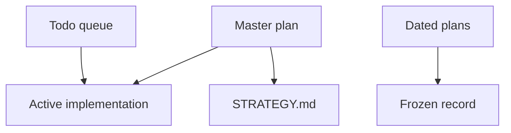
````

#### S031-C0002: Living

Source `docs/plans/README.md` lines 13–34; accountable coverage owner U1.

```md
## Living

Update these when the work they name changes:

| Plan | Role |
|---|---|
| [September 18–21 design scope](2026-09-27-weekend-design-scope.md) | Governing baseline index: full weekend designs, plans, brainstorms, diagrams and named units; later packages refine rather than replace it |
| [Weekend program progress and usable live track](2026-09-27-implementation-progress-and-live-track.md) | Current progress/todo ledger for that full baseline and later adopted work; useful RE/cross-matching runs alongside implementation |
| [Weekend unit delivery ledger](2026-09-27-weekend-unit-delivery.json) | 193 source-qualified D/U records with original definitions/acceptance spans, explicit withdrawals/absorptions and separate source/test/installed/live evidence; initial delivery states are unverified |
| [September 21 portable-signatures/codecaves plan](2026-09-21-portable-signatures-codecaves-generic-plan.md) | Full Phases 0–15 and D/U unit baseline; historical completion marks need current requalification |
| [September 21 distributed-compute design](2026-09-21-distributed-compute-design.md) | Required reusable compute/state foundation and adapters; scale follows a qualified local lane |
| [Session obligation audit](2026-09-22-session-obligation-audit.md) | Active goal: direct user directives, 110 contract/acceptance items, priorities and completion evidence |
| [Autonomous capability roadmap](2026-09-22-autonomous-capability-product-roadmap.md) | Current implementation roadmap: durable continuation through scenario automation, F12, captures, checkpoints and platform qualification |
| [2026-09-22-design-package.md](./2026-09-22-design-package.md) | Later recovery/acceptance contract consolidation and review closure; does not narrow the weekend baseline |
| [2026-09-22-recovery-contracts-and-validation-plan.md](./2026-09-22-recovery-contracts-and-validation-plan.md) | Current recovery-contract delta, reccmp/ReAgent integration and vanilla-runtime acceptance |
| [2026-09-20-unified-reversing-workstation.md](./2026-09-20-unified-reversing-workstation.md) | Frontend implementation; [consolidated user intent](../FRONTEND_INTENT.md) and [delivery evidence](../DELIVERY_STATUS.md), not a competing recovery ladder |
| [2026-09-08-0156-feat-recovery-pipeline-ladder-plan.md](./2026-09-08-0156-feat-recovery-pipeline-ladder-plan.md) | Historical ladder with current reconciliation; active package linked above |
| [2026-09-08-0225-feat-portable-signatures-phasor-export-plan.md](./2026-09-08-0225-feat-portable-signatures-phasor-export-plan.md) | Portable signatures + Phasor hook-pack export |
| Historical one-shot performance work | G14–G16 follow-up; cold-host wall-time acceptance measurement remains open |

The earlier corpus-pipeline proposal is historical and no longer maintained as a separate plan.
```

#### S031-C0003: Reconciliation — 2026-09-20

Source `docs/plans/README.md` lines 35–43; accountable coverage owner U1.

```md
## Reconciliation — 2026-09-20

[STRATEGY.md](../../STRATEGY.md) is the single pipeline/priority authority.
[RUNTIME_REUSE.md](../RUNTIME_REUSE.md) records existing export/catalog/loader
seams and missing runtime-readiness proof. The two September 8 plans retain
their original decisions below dated reconciliation notes; old matcher ordering,
test/restart recipes and completion criteria do not override current strategy
or [AGENTS.md](../../AGENTS.md). Whole-image acceptance remains unfinished.
```

#### S031-C0004: Current docs work

Source `docs/plans/README.md` lines 44–51; accountable coverage owner U1.

```md
## Current docs work

| Plan | Role |
|---|---|
| [2026-09-01-feat-user-facing-docs-consolidation-plan.md](./2026-09-01-feat-user-facing-docs-consolidation-plan.md) | Landing / how-to / hub rewrite (done on disk) |
| [2026-09-01-feat-secondary-docs-surfaces-plan.md](./2026-09-01-feat-secondary-docs-surfaces-plan.md) | TOOLS_LIST preamble, STRATEGY/VISION, skills, hubs, Web UI hero |
| [2026-09-01-feat-agent-internal-docs-plan.md](./2026-09-01-feat-agent-internal-docs-plan.md) | AGENTS / GEMINI / CLAUDE / tests / examples / prototype and audit hubs |
```

#### S031-C0005: Frozen

Source `docs/plans/README.md` lines 52–70; accountable coverage owner U1.

```md
## Frozen

Every other file in this tree is a **dated record**. Preserve its source content
and dated operational evidence. Requirements inherited through the weekend scope
index remain binding even when their source is a dated record; record current
status and explicit supersession in the living ledgers. Do not rewrite old clone
URLs, tool counts or fixture names to imply a fresh run. Product stems and session
paths in those files are historical evidence, not current how-to.

New work gets a new dated plan. Do not run a repository-wide substitution script over this folder.

The September 22 [history-grounded maintainability extension](2026-09-22-history-grounded-maintainability-design.md)
connects recorded AgentDecompile, KotorPhasor and harness bottlenecks to concrete
implementation seams and future acceptance cases.

The [failure prevention and recovery specification](2026-09-22-failure-prevention-and-recovery-contracts.md)
is the mandatory resilience refinement, including control-plane failures and future
acceptance checks. See the [diagram artifacts](../dashboard-design/pipeline-diagram/README.md)
for the synchronized overview and companions.
```

#### S032-C0001: {

Source `docs/plans/2026-09-22-session-obligations.json` lines 1–1334; accountable coverage owner U1.

```json
{
  "schema": 1,
  "goal_status": "active",
  "authority": "Codex session goal; this file is a supporting audit, not a separate goal engine",
  "scope_rule": "The full September 18–21 designs/plans/diagrams/brainstorms and all portable-plan Phase 0–15 D/U units remain scope; see docs/plans/2026-09-27-weekend-design-scope.md. These 110 later contract rows are not the whole program backlog. Attachment commands remain historical evidence, not fresh authorization. Test/build evidence must match the complete named acceptance case.",
  "requirements": [
    {
      "id": "D01",
      "requirement": "A1 reconstruct trustworthy linkable regions, independent oracle",
      "contract_cells": [
        "R region record + reconstruction mechanism",
        "RC-01 wrong addend rejected after placement"
      ],
      "source": "docs/plans/2026-09-22-design-package.md",
      "source_line": 82,
      "status": "unverified",
      "evidence_note": "Design exists; complete implementation and required acceptance evidence remain open."
    },
    {
      "id": "D02",
      "requirement": "A2 separate recovery/compilation/comparison",
      "contract_cells": [
        "R units + scoped toolchain; X recipe groups",
        "Required grouped/LTCG output compared"
      ],
      "source": "docs/plans/2026-09-22-design-package.md",
      "source_line": 83,
      "status": "unverified",
      "evidence_note": "Design exists; complete implementation and required acceptance evidence remain open."
    },
    {
      "id": "D03",
      "requirement": "A2 incremental calibration and legacy flags",
      "contract_cells": [
        "R stages 1–2, environment/group records",
        "Unsupported toolchain switch blocks only that profile"
      ],
      "source": "docs/plans/2026-09-22-design-package.md",
      "source_line": 84,
      "status": "unverified",
      "evidence_note": "Design exists; complete implementation and required acceptance evidence remain open."
    },
    {
      "id": "D04",
      "requirement": "A2 diagnose before permutation/AI",
      "contract_cells": [
        "STRATEGY cross-match; R stage 6",
        "Wrong type/ABI/context cannot be masked by source search"
      ],
      "source": "docs/plans/2026-09-22-design-package.md",
      "source_line": 85,
      "status": "unverified",
      "evidence_note": "Design exists; complete implementation and required acceptance evidence remain open."
    },
    {
      "id": "D05",
      "requirement": "A3 architecture-specific floor with metadata",
      "contract_cells": [
        "R scaffold + reconstruction",
        "Instruction-only region missing required metadata refused"
      ],
      "source": "docs/plans/2026-09-22-design-package.md",
      "source_line": 86,
      "status": "unverified",
      "evidence_note": "Design exists; complete implementation and required acceptance evidence remain open."
    },
    {
      "id": "D06",
      "requirement": "A3 early unchanged round trip",
      "contract_cells": [
        "R RC-01",
        "Real extract/emit/place path, not copied output"
      ],
      "source": "docs/plans/2026-09-22-design-package.md",
      "source_line": 87,
      "status": "unverified",
      "evidence_note": "Design exists; complete implementation and required acceptance evidence remain open."
    },
    {
      "id": "D07",
      "requirement": "A3 source contribution and rebuild methods",
      "contract_cells": [
        "R reconstruction axes",
        "RC-02 discarded compiled replacement earns zero credit"
      ],
      "source": "docs/plans/2026-09-22-design-package.md",
      "source_line": 88,
      "status": "unverified",
      "evidence_note": "Design exists; complete implementation and required acceptance evidence remain open."
    },
    {
      "id": "D08",
      "requirement": "A4 compile is candidate admission",
      "contract_cells": [
        "R facts and candidate state",
        "Wrong constant compiles but remains unaccepted"
      ],
      "source": "docs/plans/2026-09-22-design-package.md",
      "source_line": 89,
      "status": "unverified",
      "evidence_note": "Design exists; complete implementation and required acceptance evidence remain open."
    },
    {
      "id": "D09",
      "requirement": "A4 separate facts and bounded equivalence",
      "contract_cells": [
        "R fact outcomes/assumptions",
        "RC-05 reports each observed scope separately"
      ],
      "source": "docs/plans/2026-09-22-design-package.md",
      "source_line": 90,
      "status": "unverified",
      "evidence_note": "Design exists; complete implementation and required acceptance evidence remain open."
    },
    {
      "id": "D10",
      "requirement": "A4 behavior-preserving repair, actual C++",
      "contract_cells": [
        "R source contract; X language/FP/group recipe",
        "FP/NaN and exception-sensitive negative cases"
      ],
      "source": "docs/plans/2026-09-22-design-package.md",
      "source_line": 91,
      "status": "unverified",
      "evidence_note": "Design exists; complete implementation and required acceptance evidence remain open."
    },
    {
      "id": "D11",
      "requirement": "A5 entity/variant/physical multiplicity",
      "contract_cells": [
        "R data + worked reuse counterexamples",
        "RC-03 changed behavior; RC-04 inline/folded/split"
      ],
      "source": "docs/plans/2026-09-22-design-package.md",
      "source_line": 92,
      "status": "unverified",
      "evidence_note": "Design exists; complete implementation and required acceptance evidence remain open."
    },
    {
      "id": "D12",
      "requirement": "A5 compatible recipient candidate reuse",
      "contract_cells": [
        "R propagation and recipient gates",
        "Donor x+1 cannot replace recipient x+2 on identity alone"
      ],
      "source": "docs/plans/2026-09-22-design-package.md",
      "source_line": 93,
      "status": "partial",
      "evidence_note": "Covers the recipient-scope gate only. Synthetic staged-source slice (recipient_acceptance.py) requires commit()'s root set to contain the recipient's own identity dependency, refusing acceptance otherwise. Admission's existing donor-side check (same logical id, narrow constant-leaf provider, cross_place_admission.py:297-312) is separate and unchanged. Independent controller rerun confirmed 15 passed, exitCode 0. No consumer turns a published requires-recipient-acceptance manifest into a real commit proposal, and there is no real compilation/ABI/layout/behaviour verification adapter; verification is supplied by the test.",
      "evidence": [
        "/home/brunner56/agentdecompile-deliverables/2026-09-27-p14-recipient-acceptance/report.md"
      ]
    },
    {
      "id": "D13",
      "requirement": "A5/A7 unchanged-work reuse, better evidence",
      "contract_cells": [
        "R invalidation; T acceptance versions",
        "RC-06 changed type invalidates only dependents"
      ],
      "source": "docs/plans/2026-09-22-design-package.md",
      "source_line": 94,
      "status": "partial",
      "evidence_note": "Current-source digest binding now enforced across covered local-comparison producers and collector/ingest consumers; old unbound receipts cannot be silently rebound. Full dependency closure, target/toolchain provenance and all reuse paths remain open. Persisted digests now rechecked by covered DB skip/packaging readers; restoration explicitly reused/unverified. Full semantic and all-reader closure remains open. Passive activity projection now rechecks bounded source digests and preserves independently labeled historical name evidence; full accepted-claim currentness and live qualification remain open.",
      "evidence": [
        "docs/verification/2026-09-26-current-source-binding.md",
        "docs/verification/2026-09-26-recovered-source-freshness.md",
        "docs/verification/2026-09-27-target-local-recovery-selection.md",
        "docs/verification/2026-09-27-target-snapshot-provenance.md",
        "docs/verification/2026-09-27-target-consistency-gates.md",
        "docs/verification/2026-09-27-seed-compile-input-basis.md",
        "docs/verification/2026-09-27-raw-local-observations.md",
        "docs/verification/2026-09-27-live-evidence.md"
      ]
    },
    {
      "id": "D14",
      "requirement": "A5 per-build layout, no pointer scaling",
      "contract_cells": [
        "R layouts + counterexample",
        "Unknown spans stay opaque; exact offset evidence required"
      ],
      "source": "docs/plans/2026-09-22-design-package.md",
      "source_line": 95,
      "status": "unverified",
      "evidence_note": "Design exists; complete implementation and required acceptance evidence remain open."
    },
    {
      "id": "D15",
      "requirement": "A5 naming preference vs facts",
      "contract_cells": [
        "STRATEGY fusion; R lane A",
        "Renaming cannot overwrite measured layout"
      ],
      "source": "docs/plans/2026-09-22-design-package.md",
      "source_line": 96,
      "status": "partial",
      "evidence_note": "Supported PE32/PE32+ embedded export names are now accepted only from a digest-bound exact target snapshot, unique non-forwarded name and matching VA/raw region. Supplied/analyzer/logical names remain advisory. Other symbol roots and layout facts remain open.",
      "evidence": [
        "docs/verification/2026-09-27-target-pe-export-identity.md"
      ]
    },
    {
      "id": "D16",
      "requirement": "A6 known-build RVA first",
      "contract_cells": [
        "R runtime contract; overview B/C",
        "Build+bytes pass still cannot replace identity evidence"
      ],
      "source": "docs/plans/2026-09-22-design-package.md",
      "source_line": 97,
      "status": "partial",
      "evidence_note": "The embedded-export lane now requires target digest, exact name, VA and raw-region agreement, and the false Foo-at-Bar case remains target-local-only despite identical bytes. Runtime known-build binding and non-export identity remain open.",
      "evidence": [
        "docs/verification/2026-09-27-target-pe-export-identity.md"
      ]
    },
    {
      "id": "D17",
      "requirement": "A6 located/readable/callable/detourable/writable",
      "contract_cells": [
        "R binding predicates; T scenario contract",
        "RC-09 valid original use independent of source"
      ],
      "source": "docs/plans/2026-09-22-design-package.md",
      "source_line": 98,
      "status": "unverified",
      "evidence_note": "Design exists; complete implementation and required acceptance evidence remain open."
    },
    {
      "id": "D18",
      "requirement": "A6 executable policy/caves",
      "contract_cells": [
        "R runtime contract",
        "Policy denial stays unsupported; zeros/slack alone refused"
      ],
      "source": "docs/plans/2026-09-22-design-package.md",
      "source_line": 99,
      "status": "unverified",
      "evidence_note": "Design exists; complete implementation and required acceptance evidence remain open."
    },
    {
      "id": "D19",
      "requirement": "A6 install/remove/quiescence/lifetime",
      "contract_cells": [
        "R runtime contract; T resource bundle",
        "In-flight trampoline return prevents reclamation"
      ],
      "source": "docs/plans/2026-09-22-design-package.md",
      "source_line": 100,
      "status": "unverified",
      "evidence_note": "Design exists; complete implementation and required acceptance evidence remain open."
    },
    {
      "id": "D20",
      "requirement": "A6 rollback limits",
      "contract_cells": [
        "R operation contract; T teardown",
        "Restored bytes never claim undone side effects"
      ],
      "source": "docs/plans/2026-09-22-design-package.md",
      "source_line": 101,
      "status": "unverified",
      "evidence_note": "Design exists; complete implementation and required acceptance evidence remain open."
    },
    {
      "id": "D21",
      "requirement": "A7 stable snapshots, relevant dependencies and cache sync",
      "contract_cells": [
        "R invalidation; T short acceptance commit",
        "RC-06/A17 stale proposal rejected"
      ],
      "source": "docs/plans/2026-09-22-design-package.md",
      "source_line": 102,
      "status": "unverified",
      "evidence_note": "Design exists; complete implementation and required acceptance evidence remain open."
    },
    {
      "id": "D22",
      "requirement": "A7 corpus/local keys and replay",
      "contract_cells": [
        "R cache projections; T immutable proposals",
        "Unrelated build preserves local compile; RC-07/A20 stable replay"
      ],
      "source": "docs/plans/2026-09-22-design-package.md",
      "source_line": 103,
      "status": "unverified",
      "evidence_note": "Design exists; complete implementation and required acceptance evidence remain open."
    },
    {
      "id": "D23",
      "requirement": "A7 shared compiler, isolated mutable outputs",
      "contract_cells": [
        "R toolchains; T ownership",
        "No shared PDB/temp/Wine writer collision"
      ],
      "source": "docs/plans/2026-09-22-design-package.md",
      "source_line": 104,
      "status": "unverified",
      "evidence_note": "Design exists; complete implementation and required acceptance evidence remain open."
    },
    {
      "id": "D24",
      "requirement": "A outcomes and regressing coverage",
      "contract_cells": [
        "R named outcomes; T accounting",
        "Ambiguous/absent/inlined/unsupported stay explicit; RC-10"
      ],
      "source": "docs/plans/2026-09-22-design-package.md",
      "source_line": 105,
      "status": "unverified",
      "evidence_note": "Design exists; complete implementation and required acceptance evidence remain open."
    },
    {
      "id": "D25",
      "requirement": "A agent roles and central acceptance",
      "contract_cells": [
        "R acceptance owner; T contract",
        "Producer cannot revise policy or self-promote"
      ],
      "source": "docs/plans/2026-09-22-design-package.md",
      "source_line": 106,
      "status": "unverified",
      "evidence_note": "Design exists; complete implementation and required acceptance evidence remain open."
    },
    {
      "id": "D26",
      "requirement": "A first demonstrations, reccmp scope",
      "contract_cells": [
        "R RC-01–10; X normalized tools",
        "Held-out builds + representative replacement matrix"
      ],
      "source": "docs/plans/2026-09-22-design-package.md",
      "source_line": 107,
      "status": "unverified",
      "evidence_note": "Design exists; complete implementation and required acceptance evidence remain open."
    },
    {
      "id": "D27",
      "requirement": "H1A noncircular target binding",
      "contract_cells": [
        "R three predicates, T1–T3/Foo-Bar",
        "RC-08/A01 right bytes under wrong label refused"
      ],
      "source": "docs/plans/2026-09-22-design-package.md",
      "source_line": 108,
      "status": "unverified",
      "evidence_note": "Design exists; complete implementation and required acceptance evidence remain open."
    },
    {
      "id": "D28",
      "requirement": "H1A automatic withdrawal, no platform ban",
      "contract_cells": [
        "R lineage; T coverage withdrawal",
        "A02 seed withdrawal; repaired input version reevaluated"
      ],
      "source": "docs/plans/2026-09-22-design-package.md",
      "source_line": 109,
      "status": "partial",
      "evidence_note": "Synthetic staged-source slice (recipient_acceptance.py) retires only current acceptances with no intact root set (OR of ANDs) and lists examined/retired explicitly; retirement is by acceptance id, so identical content returning does not revive a retired claim, and no platform ban is imposed. Independent controller rerun confirmed 15 passed, exitCode 0. Wiring to real change events (identity/matching producers), transitive descendants beyond one root-set level, and export-reference removal remain open.",
      "evidence": [
        "/home/brunner56/agentdecompile-deliverables/2026-09-27-p14-recipient-acceptance/report.md"
      ]
    },
    {
      "id": "D29",
      "requirement": "H1B original-code use without full recovery",
      "contract_cells": [
        "R operation predicate; T original-code example",
        "RC-09 supported read/call proceeds with source floor"
      ],
      "source": "docs/plans/2026-09-22-design-package.md",
      "source_line": 110,
      "status": "unverified",
      "evidence_note": "Design exists; complete implementation and required acceptance evidence remain open."
    },
    {
      "id": "D30",
      "requirement": "H1C task-specific capacity, shared nested budget",
      "contract_cells": [
        "T admission",
        "A15 no-swap/swap-occupied small work vs overloaded class"
      ],
      "source": "docs/plans/2026-09-22-design-package.md",
      "source_line": 111,
      "status": "unverified",
      "evidence_note": "Design exists; complete implementation and required acceptance evidence remain open."
    },
    {
      "id": "D31",
      "requirement": "H1D liveness/execution/goal and persistent attempts",
      "contract_cells": [
        "T state/progress/retry schemas",
        "A04 PID churn not progress; A08 restart keeps budget"
      ],
      "source": "docs/plans/2026-09-22-design-package.md",
      "source_line": 112,
      "status": "partial",
      "evidence_note": "Persisted local retry and preparation objective admission spending, including uncertain dispatch and explicit allocation revision, are tested. Preparation-owned nested MCP tools/call intents now have a separate durable allowance, lease-bound authority and reviewed static/React projection. Other nested/provider usage, shared circuits and goal-progress acceptance remain open.",
      "evidence": [
        "docs/verification/2026-09-22-quarantine-and-provider-reports.md",
        "docs/verification/2026-09-27-objective-admission-accounting.md",
        "docs/verification/2026-09-27-nested-mcp-budget.md"
      ]
    },
    {
      "id": "D32",
      "requirement": "H1E exhaustive accounting and proof scopes",
      "contract_cells": [
        "T accounting",
        "24,242 inventory reconciles; unexplained two not invented"
      ],
      "source": "docs/plans/2026-09-22-design-package.md",
      "source_line": 113,
      "status": "unverified",
      "evidence_note": "Design exists; complete implementation and required acceptance evidence remain open."
    },
    {
      "id": "D33",
      "requirement": "H2 local dependency failures, capability priority/aging",
      "contract_cells": [
        "T admission/priorities",
        "A05 independent cached task; A16 aged capacity reservation"
      ],
      "source": "docs/plans/2026-09-22-design-package.md",
      "source_line": 114,
      "status": "unverified",
      "evidence_note": "Design exists; complete implementation and required acceptance evidence remain open."
    },
    {
      "id": "D34",
      "requirement": "H2 no spin, exact wake sets, objective preserved",
      "contract_cells": [
        "T task completion/wake conditions",
        "Exhausted attempt never marks objective achieved"
      ],
      "source": "docs/plans/2026-09-22-design-package.md",
      "source_line": 115,
      "status": "unverified",
      "evidence_note": "Design exists; complete implementation and required acceptance evidence remain open."
    },
    {
      "id": "D35",
      "requirement": "H3 actual resources, scenario bundles, short transactions",
      "contract_cells": [
        "T ownership and acceptance",
        "Compile/LLM/game work outside writer transaction"
      ],
      "source": "docs/plans/2026-09-22-design-package.md",
      "source_line": 116,
      "status": "unverified",
      "evidence_note": "Design exists; complete implementation and required acceptance evidence remain open."
    },
    {
      "id": "D36",
      "requirement": "H3 atomic ownership/fencing, quarantine/external jobs",
      "contract_cells": [
        "T two ownership states and late-worker example",
        "A07/A14 stale result and unsafe resource remain separated"
      ],
      "source": "docs/plans/2026-09-22-design-package.md",
      "source_line": 117,
      "status": "partial",
      "evidence_note": "Same-receipt-root authority and durable identity/pair/Ghidra quarantine tested. Full generation fencing and all external resource bundles remain open. Qualified committed-release stale reservations now repair automatically. The explicit ReAgent snapshot destination lifecycle adds bound local executor clearance, path-overlap admission and retained unknown external receipts. The bounded native package-verifier profile adds actual-child input/environment/output enforcement and exact session clearance; durable non-dispatch evidence prevents false restoration quarantine. Its .14 wheel passed 139 installed checks and final independent artifact review. General compiler/Wine/project/store ownership, cross-version migration, live activation and uncertain-owner clearance remain open.",
      "evidence": [
        "docs/verification/2026-09-22-quarantine-and-provider-reports.md",
        "docs/verification/2026-09-22-reconciliation-and-cache-package.md",
        "docs/verification/2026-09-27-resource-claims.md",
        "docs/verification/2026-09-27-native-verify-ownership.md"
      ]
    },
    {
      "id": "D37",
      "requirement": "H4 one retry owner, negative cache, bounded recovery",
      "contract_cells": [
        "T failure table",
        "A04/A08 finite retries, changed basis required for deterministic repeat"
      ],
      "source": "docs/plans/2026-09-22-design-package.md",
      "source_line": 118,
      "status": "unverified",
      "evidence_note": "Design exists; complete implementation and required acceptance evidence remain open."
    },
    {
      "id": "D38",
      "requirement": "H4 checkpoint/exit and resource enforcement capability",
      "contract_cells": [
        "T admission/cancellation",
        "Pause does not claim memory reclaimed; unsupported enforcement routed"
      ],
      "source": "docs/plans/2026-09-22-design-package.md",
      "source_line": 119,
      "status": "unverified",
      "evidence_note": "Design exists; complete implementation and required acceptance evidence remain open."
    },
    {
      "id": "D39",
      "requirement": "H5 input closure, persistent storage, tmpfs limits",
      "contract_cells": [
        "T staging",
        "A06 incomplete bundle never launchable; complete cached work continues"
      ],
      "source": "docs/plans/2026-09-22-design-package.md",
      "source_line": 120,
      "status": "unverified",
      "evidence_note": "Design exists; complete implementation and required acceptance evidence remain open."
    },
    {
      "id": "D40",
      "requirement": "H5 publication, SQLite snapshots and bounded probes",
      "contract_cells": [
        "T storage",
        "A05/A13 interrupted copy cannot publish partial manifest"
      ],
      "source": "docs/plans/2026-09-22-design-package.md",
      "source_line": 121,
      "status": "unverified",
      "evidence_note": "Design exists; complete implementation and required acceptance evidence remain open."
    },
    {
      "id": "D41",
      "requirement": "H6 fixture/driver/recording prerequisites",
      "contract_cells": [
        "T scenario",
        "A10 missing fixture distinct from behavior failure"
      ],
      "source": "docs/plans/2026-09-22-design-package.md",
      "source_line": 122,
      "status": "unverified",
      "evidence_note": "Design exists; complete implementation and required acceptance evidence remain open."
    },
    {
      "id": "D42",
      "requirement": "H6 observation/mutation and unknown command outcome",
      "contract_cells": [
        "T scenario/command IDs",
        "A09/A12 status available, no blind duplicate mutation"
      ],
      "source": "docs/plans/2026-09-22-design-package.md",
      "source_line": 123,
      "status": "unverified",
      "evidence_note": "Design exists; complete implementation and required acceptance evidence remain open."
    },
    {
      "id": "D43",
      "requirement": "H6 same-run oracle/video and local authentication limits",
      "contract_cells": [
        "T scenario",
        "A11 failed recorder retains scoped behavior; other scenarios continue"
      ],
      "source": "docs/plans/2026-09-22-design-package.md",
      "source_line": 124,
      "status": "unverified",
      "evidence_note": "Design exists; complete implementation and required acceptance evidence remain open."
    },
    {
      "id": "D44",
      "requirement": "H7 namespaces/config and honest scanner limits",
      "contract_cells": [
        "T adapter constraints",
        "A18 bad args/log prefix/config owner rejected"
      ],
      "source": "docs/plans/2026-09-22-design-package.md",
      "source_line": 125,
      "status": "partial",
      "evidence_note": "Uncertain MCP dispatch propagates through prerequisites and preparation; broader Lua/config argument domain acceptance remains open.",
      "evidence": [
        "docs/verification/2026-09-22-quarantine-and-provider-reports.md"
      ]
    },
    {
      "id": "D45",
      "requirement": "H8 paired rejection/continuation cases and useful metrics",
      "contract_cells": [
        "T A01–A20",
        "Every bad case has unaffected-ready-work control"
      ],
      "source": "docs/plans/2026-09-22-design-package.md",
      "source_line": 126,
      "status": "unverified",
      "evidence_note": "Design exists; complete implementation and required acceptance evidence remain open."
    },
    {
      "id": "D46",
      "requirement": "H implementation order and conditional guarantees",
      "contract_cells": [
        "T delivery order/guarantees",
        "Containment → restart → explicit replica-dependent host failover"
      ],
      "source": "docs/plans/2026-09-22-design-package.md",
      "source_line": 127,
      "status": "unverified",
      "evidence_note": "Design exists; complete implementation and required acceptance evidence remain open."
    },
    {
      "id": "D47",
      "requirement": "User reccmp/ReAgent/AgentDecompile testing preference",
      "contract_cells": [
        "X routes, raw reports, unknown outcomes",
        "Later tools consume actual candidate; no GREEN/exit-code promotion"
      ],
      "source": "docs/plans/2026-09-22-design-package.md",
      "source_line": 128,
      "status": "partial",
      "evidence_note": "Real pinned ReAgent benchmark/synthetic snapshot and reccmp annotation canaries plus CLI report ingestion passed. Production execution adapters and supported binary comparison remain open. Real existing cache export is consumed by pinned ReAgent; original-binary binding remains unverified.",
      "evidence": [
        "docs/verification/2026-09-22-quarantine-and-provider-reports.md",
        "docs/verification/2026-09-22-reconciliation-and-cache-package.md"
      ]
    },
    {
      "id": "D48",
      "requirement": "User many isle-like projects and universal-use matching",
      "contract_cells": [
        "X exported layout, recipe/input resolver; R variants",
        "Held-out builds + clean-host relocation, explicit unsupported limits"
      ],
      "source": "docs/plans/2026-09-22-design-package.md",
      "source_line": 129,
      "status": "unverified",
      "evidence_note": "Design exists; complete implementation and required acceptance evidence remain open."
    },
    {
      "id": "D49",
      "requirement": "User design-only correction",
      "contract_cells": [
        "Package scope, delivery ledger, historical reconciliation",
        "No product edits, installs, runtime probes or tests for this goal"
      ],
      "source": "docs/plans/2026-09-22-design-package.md",
      "source_line": 130,
      "status": "superseded",
      "evidence_note": "Design-only correction governed earlier phase; later explicit build request authorizes implementation. Existing catalog/process/publication restrictions remain."
    },
    {
      "id": "D50",
      "requirement": "User collaborative grill/prove-the-effort completion",
      "contract_cells": [
        "Independent review and closure log",
        "Review a specific counterexample, amend, independently recheck"
      ],
      "source": "docs/plans/2026-09-22-design-package.md",
      "source_line": 131,
      "status": "achieved",
      "evidence_note": "Recorded collaborative claim/referent/recheck reviews in design package and foundation receipt; future changes still require review."
    },
    {
      "id": "RC-01",
      "requirement": "Unchanged region with external code+data fixups; corrupt one reconstructed addend",
      "contract_cells": [
        "Correct case matches linked original; corruption fails independent linked check",
        "Reconstruction path only"
      ],
      "source": "docs/plans/2026-09-22-recovery-contracts-and-validation-plan.md",
      "source_line": 354,
      "status": "unverified",
      "evidence_note": "Design exists; complete implementation and required acceptance evidence remain open."
    },
    {
      "id": "RC-02",
      "requirement": "Compiled replacement; deliberately discard it at link/selection",
      "contract_cells": [
        "Discarded case earns zero source contribution despite any equal fallback bytes",
        "Source contribution"
      ],
      "source": "docs/plans/2026-09-22-recovery-contracts-and-validation-plan.md",
      "source_line": 355,
      "status": "partial",
      "evidence_note": "Supported pinned native Clang self-contained C emits retained COFF bytes that physically own selected PE output spans. Discard/later floor overwrite gives zero credit while independent valid B survives. Exact DB/binary/address/size is required for function coverage. Reviewed .9 installed suite passes 149 checks. Fresh revalidation now has reviewed source and actual A/B/C process checks: changed A loses credit, independently recompiled B survives, and later imported audit still yields zero. The .13 wheel passed all 60 relevant installed checks and independent artifact review. General linker/relocation support, durable trust without reexecution, named contribution composition and catalog/game-target qualification remain open.",
      "evidence": [
        "docs/verification/2026-09-27-source-contribution.md",
        "docs/verification/2026-09-27-fresh-source-revalidation.md"
      ]
    },
    {
      "id": "RC-03",
      "requirement": "Held-out sibling with x+1→x+2 behavior change",
      "contract_cells": [
        "Same logical family allowed; incompatible accepted replacement refused",
        "Variant/recipient acceptance"
      ],
      "source": "docs/plans/2026-09-22-recovery-contracts-and-validation-plan.md",
      "source_line": 356,
      "status": "partial",
      "evidence_note": "Covers the recipient-acceptance half only. Synthetic staged-source slice (recipient_acceptance.py) refuses a root set lacking the recipient's own identity dependency, so an incompatible accepted replacement without that dependency is refused. The 'same logical family allowed' half and a real ABI/behaviour verification adapter are not covered here; the verification value in the tests is test-supplied, not a real adapter. Independent controller rerun confirmed 15 passed, exitCode 0.",
      "evidence": [
        "/home/brunner56/agentdecompile-deliverables/2026-09-27-p14-recipient-acceptance/report.md"
      ]
    },
    {
      "id": "RC-04",
      "requirement": "Folded bodies, inline-only and split regions",
      "contract_cells": [
        "Entity/physical multiplicity retained; no invented standalone address",
        "Identity representation"
      ],
      "source": "docs/plans/2026-09-22-recovery-contracts-and-validation-plan.md",
      "source_line": 357,
      "status": "unverified",
      "evidence_note": "Design exists; complete implementation and required acceptance evidence remain open."
    },
    {
      "id": "RC-05",
      "requirement": "Arithmetic, FP/NaN, methods, globals, indirect calls, exception metadata",
      "contract_cells": [
        "Per-check outcomes retained; compile or ReAgent GREEN never promotes other facts",
        "Scoped source verification"
      ],
      "source": "docs/plans/2026-09-22-recovery-contracts-and-validation-plan.md",
      "source_line": 358,
      "status": "unverified",
      "evidence_note": "Design exists; complete implementation and required acceptance evidence remain open."
    },
    {
      "id": "RC-06",
      "requirement": "Type dependency changes mid-attempt; unrelated build added",
      "contract_cells": [
        "Affected result stale; unrelated local compilation cache remains valid",
        "Dependency projection"
      ],
      "source": "docs/plans/2026-09-22-recovery-contracts-and-validation-plan.md",
      "source_line": 359,
      "status": "unverified",
      "evidence_note": "Design exists; complete implementation and required acceptance evidence remain open."
    },
    {
      "id": "RC-07",
      "requirement": "Same evidence/proposals, shuffled discovery/worker completion order",
      "contract_cells": [
        "Same accepted state under deterministic policy; tied ambiguity stays unresolved",
        "Replay, not discovery"
      ],
      "source": "docs/plans/2026-09-22-recovery-contracts-and-validation-plan.md",
      "source_line": 360,
      "status": "unverified",
      "evidence_note": "Design exists; complete implementation and required acceptance evidence remain open."
    },
    {
      "id": "RC-08",
      "requirement": "Wrong target label with matching extracted bytes",
      "contract_cells": [
        "Presence passes, identity fails, unrelated accepted binding remains usable",
        "Circular-proof rejection"
      ],
      "source": "docs/plans/2026-09-22-recovery-contracts-and-validation-plan.md",
      "source_line": 361,
      "status": "unverified",
      "evidence_note": "Design exists; complete implementation and required acceptance evidence remain open."
    },
    {
      "id": "RC-09",
      "requirement": "Original binding has valid identity/ABI but source is floor",
      "contract_cells": [
        "Supported original-code operation may pass; source progress unchanged",
        "Runtime/source independence"
      ],
      "source": "docs/plans/2026-09-22-recovery-contracts-and-validation-plan.md",
      "source_line": 362,
      "status": "unverified",
      "evidence_note": "Design exists; complete implementation and required acceptance evidence remain open."
    },
    {
      "id": "RC-10",
      "requirement": "Genuine negative pair vs absent/inlined/unsupported/budget-limited",
      "contract_cells": [
        "Explicit terminal reason; no forced match and no claim of exhaustive failure",
        "Honest coverage"
      ],
      "source": "docs/plans/2026-09-22-recovery-contracts-and-validation-plan.md",
      "source_line": 363,
      "status": "unverified",
      "evidence_note": "Design exists; complete implementation and required acceptance evidence remain open."
    },
    {
      "id": "A01",
      "requirement": "Correct bytes with false function label",
      "contract_cells": [
        "Binding rejected for identity evidence; independent target accepted"
      ],
      "source": "docs/plans/2026-09-22-task-acceptance-and-continuation-design.md",
      "source_line": 326,
      "status": "unverified",
      "evidence_note": "Design exists; complete implementation and required acceptance evidence remain open."
    },
    {
      "id": "A02",
      "requirement": "Withdraw shared donor root",
      "contract_cells": [
        "Unsupported descendants stale/export withdrawn; independently rooted claim survives"
      ],
      "source": "docs/plans/2026-09-22-task-acceptance-and-continuation-design.md",
      "source_line": 327,
      "status": "partial",
      "evidence_note": "Synthetic staged-source slice (recipient_acceptance.py, 15 tests on the accepted .16 wheel plus a two-file overlay) implements withdrawal: it retires only current acceptances naming a changed dependency, checked against alternate root sets (OR of ANDs), and lists examined/retired explicitly. Retirement is by acceptance id, so a dependency returning to identical content does not revive a retired claim. An independent controller rerun on a fresh stage confirmed 15 passed, exitCode 0, from restored source (the agent's own first \"green\" artifacts were actually a mutation run and are not the basis for this note). No consumer turns a published requires-recipient-acceptance manifest into a real commit yet, and export-reference removal is not wired.",
      "evidence": [
        "/home/brunner56/agentdecompile-deliverables/2026-09-27-p14-recipient-acceptance/report.md"
      ]
    },
    {
      "id": "A03",
      "requirement": "Kill compiler after N durable units",
      "contract_cells": [
        "N receipts retained, partial output unpublished; resume without redoing valid N"
      ],
      "source": "docs/plans/2026-09-22-task-acceptance-and-continuation-design.md",
      "source_line": 328,
      "status": "unverified",
      "evidence_note": "Design exists; complete implementation and required acceptance evidence remain open."
    },
    {
      "id": "A04",
      "requirement": "Churn child PIDs on identical failing input",
      "contract_cells": [
        "No false progress; one retry owner and finite total attempts"
      ],
      "source": "docs/plans/2026-09-22-task-acceptance-and-continuation-design.md",
      "source_line": 329,
      "status": "unverified",
      "evidence_note": "Design exists; complete implementation and required acceptance evidence remain open."
    },
    {
      "id": "A05",
      "requirement": "Hang one device operation",
      "contract_cells": [
        "Bounded probe count and responsive coordinator; complete cached task elsewhere finishes"
      ],
      "source": "docs/plans/2026-09-22-task-acceptance-and-continuation-design.md",
      "source_line": 330,
      "status": "unverified",
      "evidence_note": "Design exists; complete implementation and required acceptance evidence remain open."
    },
    {
      "id": "A06",
      "requirement": "Omit indirect staged library or fixture",
      "contract_cells": [
        "Bundle never launchable; unrelated complete bundle runs"
      ],
      "source": "docs/plans/2026-09-22-task-acceptance-and-continuation-design.md",
      "source_line": 331,
      "status": "unverified",
      "evidence_note": "Design exists; complete implementation and required acceptance evidence remain open."
    },
    {
      "id": "A07",
      "requirement": "Late old worker with correct result",
      "contract_cells": [
        "Private historical result retained, stale acceptance rejected, resource quarantine retained"
      ],
      "source": "docs/plans/2026-09-22-task-acceptance-and-continuation-design.md",
      "source_line": 332,
      "status": "unverified",
      "evidence_note": "Design exists; complete implementation and required acceptance evidence remain open."
    },
    {
      "id": "A08",
      "requirement": "Restart coordinator during retry wait",
      "contract_cells": [
        "Same consumed budget/next eligibility/owner generation; no duplicate launch"
      ],
      "source": "docs/plans/2026-09-22-task-acceptance-and-continuation-design.md",
      "source_line": 333,
      "status": "unverified",
      "evidence_note": "Design exists; complete implementation and required acceptance evidence remain open."
    },
    {
      "id": "A09",
      "requirement": "Occupy mutation channel",
      "contract_cells": [
        "Status observation responds; conflicting mutation waits; independent analysis finishes"
      ],
      "source": "docs/plans/2026-09-22-task-acceptance-and-continuation-design.md",
      "source_line": 334,
      "status": "unverified",
      "evidence_note": "Design exists; complete implementation and required acceptance evidence remain open."
    },
    {
      "id": "A10",
      "requirement": "Missing party member/driver/authentication",
      "contract_cells": [
        "Precise prerequisite task, no behavioral failure falsely recorded"
      ],
      "source": "docs/plans/2026-09-22-task-acceptance-and-continuation-design.md",
      "source_line": 335,
      "status": "unverified",
      "evidence_note": "Design exists; complete implementation and required acceptance evidence remain open."
    },
    {
      "id": "A11",
      "requirement": "Recorder fails after successful oracle",
      "contract_cells": [
        "Behavioral receipt retained, combined success refused; same-action rerun required"
      ],
      "source": "docs/plans/2026-09-22-task-acceptance-and-continuation-design.md",
      "source_line": 336,
      "status": "unverified",
      "evidence_note": "Design exists; complete implementation and required acceptance evidence remain open."
    },
    {
      "id": "A12",
      "requirement": "Disconnect after non-idempotent action",
      "contract_cells": [
        "Command reconciled or outcome unknown; no automatic duplicate action"
      ],
      "source": "docs/plans/2026-09-22-task-acceptance-and-continuation-design.md",
      "source_line": 337,
      "status": "unverified",
      "evidence_note": "Design exists; complete implementation and required acceptance evidence remain open."
    },
    {
      "id": "A13",
      "requirement": "Interrupt destination copy/manifest commit",
      "contract_cells": [
        "Previous complete manifest usable; no manifest references partial output"
      ],
      "source": "docs/plans/2026-09-22-task-acceptance-and-continuation-design.md",
      "source_line": 338,
      "status": "unverified",
      "evidence_note": "Design exists; complete implementation and required acceptance evidence remain open."
    },
    {
      "id": "A14",
      "requirement": "Expired lease but old worker still alive",
      "contract_cells": [
        "No resource reuse without clearance; disjoint provisioned bundle can proceed"
      ],
      "source": "docs/plans/2026-09-22-task-acceptance-and-continuation-design.md",
      "source_line": 339,
      "status": "unverified",
      "evidence_note": "Design exists; complete implementation and required acceptance evidence remain open."
    },
    {
      "id": "A15",
      "requirement": "Near-full swap with qualified small task; spare swap with overloaded class",
      "contract_cells": [
        "First judged on complete admission basis; second refused despite swap capacity"
      ],
      "source": "docs/plans/2026-09-22-task-acceptance-and-continuation-design.md",
      "source_line": 340,
      "status": "unverified",
      "evidence_note": "Design exists; complete implementation and required acceptance evidence remain open."
    },
    {
      "id": "A16",
      "requirement": "Large eligible task surrounded by small work",
      "contract_cells": [
        "Persisted aging reservation overrides ordinary same-class priority; safe backfill does not delay it; urgent exceptions are visible"
      ],
      "source": "docs/plans/2026-09-22-task-acceptance-and-continuation-design.md",
      "source_line": 341,
      "status": "unverified",
      "evidence_note": "Design exists; complete implementation and required acceptance evidence remain open."
    },
    {
      "id": "A17",
      "requirement": "Change acceptance policy/input during verification",
      "contract_cells": [
        "Short commit recheck rejects stale proposal; immutable report retained"
      ],
      "source": "docs/plans/2026-09-22-task-acceptance-and-continuation-design.md",
      "source_line": 342,
      "status": "partial",
      "evidence_note": "Synthetic staged-source slice (recipient_acceptance.py) covers only the input-generation half: commit() reads the basis, evaluates, then re-reads dependency generations and records stale plus changedDependencies if any moved before the recheck completes. Independent controller rerun confirmed 15 passed, exitCode 0. Policy-revision change during verification (the other half of this contract) is not covered, and there is no durable ledger or short DB write transaction; the recheck is in-memory only.",
      "evidence": [
        "/home/brunner56/agentdecompile-deliverables/2026-09-27-p14-recipient-acceptance/report.md"
      ]
    },
    {
      "id": "A18",
      "requirement": "Wrong Lua bridge arguments/config owner/log prefix",
      "contract_cells": [
        "Relevant adapter safeguard rejects mutation; read-only status unaffected"
      ],
      "source": "docs/plans/2026-09-22-task-acceptance-and-continuation-design.md",
      "source_line": 343,
      "status": "unverified",
      "evidence_note": "Design exists; complete implementation and required acceptance evidence remain open."
    },
    {
      "id": "A19",
      "requirement": "Lose only host/input replica",
      "contract_cells": [
        "Explicit unavailable dependency, no invented failover; independently replicated task remains eligible"
      ],
      "source": "docs/plans/2026-09-22-task-acceptance-and-continuation-design.md",
      "source_line": 344,
      "status": "unverified",
      "evidence_note": "Design exists; complete implementation and required acceptance evidence remain open."
    },
    {
      "id": "A20",
      "requirement": "Shuffle valid proposal completion order",
      "contract_cells": [
        "Same accepted/contested semantic result; arrival order changes no truth decision"
      ],
      "source": "docs/plans/2026-09-22-task-acceptance-and-continuation-design.md",
      "source_line": 345,
      "status": "unverified",
      "evidence_note": "Design exists; complete implementation and required acceptance evidence remain open."
    },
    {
      "id": "FP-01",
      "requirement": "Acceptance authority",
      "contract_cells": [
        "Correct target bytes under false label: reject semantic binding, accept unrelated independently identified entity."
      ],
      "source": "docs/plans/2026-09-22-failure-prevention-and-recovery-contracts.md",
      "source_line": 225,
      "status": "unverified",
      "evidence_note": "Design exists; complete implementation and required acceptance evidence remain open."
    },
    {
      "id": "FP-02",
      "requirement": "Acceptance authority",
      "contract_cells": [
        "Withdraw donor root: stale unsupported descendants and export references, preserve independently supported claim and immutable history."
      ],
      "source": "docs/plans/2026-09-22-failure-prevention-and-recovery-contracts.md",
      "source_line": 226,
      "status": "partial",
      "evidence_note": "Synthetic staged-source slice (recipient_acceptance.py) refuses the producer as its own verifier and withdraws a donor root by retiring only unsupported current acceptances while preserving an independently rooted claim; history is immutable because retirement is by acceptance id and re-acceptance gets a new id, never a mutation of the old record. Independent controller rerun confirmed 15 passed, exitCode 0. No durable ledger table exists; the record set is in-memory only, and there is no consumer for a published manifest yet.",
      "evidence": [
        "/home/brunner56/agentdecompile-deliverables/2026-09-27-p14-recipient-acceptance/report.md"
      ]
    },
    {
      "id": "FP-03",
      "requirement": "Scenario owner",
      "contract_cells": [
        "Required party member/module absent: refuse action as prerequisite missing, including a party/object epoch change after preflight; run compatible unrelated fixture."
      ],
      "source": "docs/plans/2026-09-22-failure-prevention-and-recovery-contracts.md",
      "source_line": 227,
      "status": "unverified",
      "evidence_note": "Design exists; complete implementation and required acceptance evidence remain open."
    },
    {
      "id": "FP-04",
      "requirement": "Adapter owner",
      "contract_cells": [
        "Initialized prefix through recorder and live driver: neither initializes again; fresh isolated prefix follows one bounded setup path."
      ],
      "source": "docs/plans/2026-09-22-failure-prevention-and-recovery-contracts.md",
      "source_line": 228,
      "status": "unverified",
      "evidence_note": "Design exists; complete implementation and required acceptance evidence remain open."
    },
    {
      "id": "FP-05",
      "requirement": "Adapter owner",
      "contract_cells": [
        "Stale observation connection occupies mutation channel: read-only status remains available; conflicting mutation waits while independent analysis completes."
      ],
      "source": "docs/plans/2026-09-22-failure-prevention-and-recovery-contracts.md",
      "source_line": 229,
      "status": "unverified",
      "evidence_note": "Design exists; complete implementation and required acceptance evidence remain open."
    },
    {
      "id": "FP-06",
      "requirement": "Scenario owner",
      "contract_cells": [
        "Disconnect after non-idempotent action: reconcile or retain unknown, never replay blindly; unrelated safe read continues."
      ],
      "source": "docs/plans/2026-09-22-failure-prevention-and-recovery-contracts.md",
      "source_line": 230,
      "status": "unverified",
      "evidence_note": "Design exists; complete implementation and required acceptance evidence remain open."
    },
    {
      "id": "FP-07",
      "requirement": "Coordinator",
      "contract_cells": [
        "Expired old generation returns matching bytes while alive: reject stale publication and retain quarantine; disjoint replacement task can finish."
      ],
      "source": "docs/plans/2026-09-22-failure-prevention-and-recovery-contracts.md",
      "source_line": 231,
      "status": "unverified",
      "evidence_note": "Design exists; complete implementation and required acceptance evidence remain open."
    },
    {
      "id": "FP-08",
      "requirement": "Storage owner",
      "contract_cells": [
        "Source device hangs during copy to healthy destination: partial bundle stays unlaunchable, already complete independent bundle runs; outstanding probes stay bounded."
      ],
      "source": "docs/plans/2026-09-22-failure-prevention-and-recovery-contracts.md",
      "source_line": 232,
      "status": "unverified",
      "evidence_note": "Design exists; complete implementation and required acceptance evidence remain open."
    },
    {
      "id": "FP-09",
      "requirement": "Adapter owner",
      "contract_cells": [
        "Same deterministic compile failure under new PID: one cached negative and no retry; changed relevant candidate is eligible."
      ],
      "source": "docs/plans/2026-09-22-failure-prevention-and-recovery-contracts.md",
      "source_line": 233,
      "status": "unverified",
      "evidence_note": "Design exists; complete implementation and required acceptance evidence remain open."
    },
    {
      "id": "FP-10",
      "requirement": "Coordinator",
      "contract_cells": [
        "Transient provider crash with nested wrapper retries: 100 waiting tasks share one recovery probe and bounded healing/attempt budgets; compatible provider performs independent ready work."
      ],
      "source": "docs/plans/2026-09-22-failure-prevention-and-recovery-contracts.md",
      "source_line": 234,
      "status": "unverified",
      "evidence_note": "Design exists; complete implementation and required acceptance evidence remain open."
    },
    {
      "id": "FP-11",
      "requirement": "Coordinator",
      "contract_cells": [
        "Repeated zero-goal-delta experiments with unchanged basis: admission stops for that hypothesis; changed evidence-backed strategy and independent task remain eligible."
      ],
      "source": "docs/plans/2026-09-22-failure-prevention-and-recovery-contracts.md",
      "source_line": 235,
      "status": "unverified",
      "evidence_note": "Design exists; complete implementation and required acceptance evidence remain open."
    },
    {
      "id": "FP-12",
      "requirement": "Adapter owner",
      "contract_cells": [
        "Long legitimate unit has no final report yet: no false failure/progress from PID alone; distinct completed checkpoints count, deadline follows declared lifecycle; short independent task continues."
      ],
      "source": "docs/plans/2026-09-22-failure-prevention-and-recovery-contracts.md",
      "source_line": 236,
      "status": "unverified",
      "evidence_note": "Design exists; complete implementation and required acceptance evidence remain open."
    },
    {
      "id": "FP-13",
      "requirement": "Coordinator",
      "contract_cells": [
        "Near-full swap with qualified small task, and spare swap with overloaded task: decide from complete profile/pressure/enforcement; admit first when qualified and reject second."
      ],
      "source": "docs/plans/2026-09-22-failure-prevention-and-recovery-contracts.md",
      "source_line": 237,
      "status": "unverified",
      "evidence_note": "Design exists; complete implementation and required acceptance evidence remain open."
    },
    {
      "id": "FP-14",
      "requirement": "Coordinator",
      "contract_cells": [
        "Large capped-age task surrounded by small high-ordinary-priority tasks: reservation wins within class; non-delaying backfill continues; urgent override history remains visible."
      ],
      "source": "docs/plans/2026-09-22-failure-prevention-and-recovery-contracts.md",
      "source_line": 238,
      "status": "unverified",
      "evidence_note": "Design exists; complete implementation and required acceptance evidence remain open."
    },
    {
      "id": "FP-15",
      "requirement": "Scenario owner",
      "contract_cells": [
        "Oracle succeeds but video is missing/wrong attempt: preserve behavioral claim, reject combined claim, accept independent complete recorded scenario."
      ],
      "source": "docs/plans/2026-09-22-failure-prevention-and-recovery-contracts.md",
      "source_line": 239,
      "status": "unverified",
      "evidence_note": "Design exists; complete implementation and required acceptance evidence remain open."
    },
    {
      "id": "FP-16",
      "requirement": "Storage owner",
      "contract_cells": [
        "Interrupt destination write/rename/manifest boundary: prior complete export remains readable; no partial reference publishes; unrelated destination can publish."
      ],
      "source": "docs/plans/2026-09-22-failure-prevention-and-recovery-contracts.md",
      "source_line": 240,
      "status": "unverified",
      "evidence_note": "Design exists; complete implementation and required acceptance evidence remain open."
    },
    {
      "id": "FP-17",
      "requirement": "Coordinator",
      "contract_cells": [
        "Crash after launch intent/budget commit before launch acknowledgment: restart reconciles actual owner, does not duplicate dispatch/charge; independently reconciled task resumes."
      ],
      "source": "docs/plans/2026-09-22-failure-prevention-and-recovery-contracts.md",
      "source_line": 241,
      "status": "unverified",
      "evidence_note": "Design exists; complete implementation and required acceptance evidence remain open."
    },
    {
      "id": "FP-18",
      "requirement": "Coordinator",
      "contract_cells": [
        "Sole event store unavailable: refuse new acceptance and unsafe dispatch; bounded private checkpoint/read-only cache contract holds; recovery validates continuity before acceptance resumes."
      ],
      "source": "docs/plans/2026-09-22-failure-prevention-and-recovery-contracts.md",
      "source_line": 242,
      "status": "unverified",
      "evidence_note": "Design exists; complete implementation and required acceptance evidence remain open."
    },
    {
      "id": "FP-19",
      "requirement": "Acceptance authority",
      "contract_cells": [
        "Corrupt one receipt/blob: affected claims quarantined, exact verified restoration or scoped re-verification required; unaffected receipt continues to qualify."
      ],
      "source": "docs/plans/2026-09-22-failure-prevention-and-recovery-contracts.md",
      "source_line": 243,
      "status": "unverified",
      "evidence_note": "Design exists; complete implementation and required acceptance evidence remain open."
    },
    {
      "id": "FP-20",
      "requirement": "Storage owner",
      "contract_cells": [
        "Interrupt schema migration and present old incompatible writer: reject writer, retain old consistent view when supported, resume/finalize once; unrelated compatible read remains available."
      ],
      "source": "docs/plans/2026-09-22-failure-prevention-and-recovery-contracts.md",
      "source_line": 244,
      "status": "unverified",
      "evidence_note": "Design exists; complete implementation and required acceptance evidence remain open."
    },
    {
      "id": "FP-21",
      "requirement": "Acceptance authority",
      "contract_cells": [
        "Bad policy admits a previously rejected false-label sample: block policy activation; authorized known-good policy retains prior semantics; valid sample still accepts."
      ],
      "source": "docs/plans/2026-09-22-failure-prevention-and-recovery-contracts.md",
      "source_line": 245,
      "status": "unverified",
      "evidence_note": "Design exists; complete implementation and required acceptance evidence remain open."
    },
    {
      "id": "FP-22",
      "requirement": "Coordinator",
      "contract_cells": [
        "Provider usage unknown after timeout and retry wrapper changes: retain conservative reservation, refuse over-budget launch; independent task with separate valid budget proceeds."
      ],
      "source": "docs/plans/2026-09-22-failure-prevention-and-recovery-contracts.md",
      "source_line": 246,
      "status": "unverified",
      "evidence_note": "Design exists; complete implementation and required acceptance evidence remain open."
    },
    {
      "id": "FP-23",
      "requirement": "Adapter owner",
      "contract_cells": [
        "Malformed/unknown detector result: classify unknown and quarantine that decision path; qualified alternate adapter or unrelated task continues, no guessed success."
      ],
      "source": "docs/plans/2026-09-22-failure-prevention-and-recovery-contracts.md",
      "source_line": 247,
      "status": "unverified",
      "evidence_note": "Design exists; complete implementation and required acceptance evidence remain open."
    },
    {
      "id": "FP-24",
      "requirement": "Acceptance authority",
      "contract_cells": [
        "Successful checkpoint combat proposed as full-route/video proof: reject scope promotion, retain checkpoint evidence; correctly scoped unrelated claim accepts."
      ],
      "source": "docs/plans/2026-09-22-failure-prevention-and-recovery-contracts.md",
      "source_line": 248,
      "status": "unverified",
      "evidence_note": "Design exists; complete implementation and required acceptance evidence remain open."
    },
    {
      "id": "FP-25",
      "requirement": "Coordinator",
      "contract_cells": [
        "Restore backup then receive late events and user continuation: preserve generations/retry lineage and durable wake cursors, reconcile events arriving across subscribe/crash windows without duplicate dispatch/acceptance; ambiguous external effects remain unreplayed until reconciled; do not reset limits; independently reconciled work proceeds."
      ],
      "source": "docs/plans/2026-09-22-failure-prevention-and-recovery-contracts.md",
      "source_line": 249,
      "status": "unverified",
      "evidence_note": "Design exists; complete implementation and required acceptance evidence remain open."
    },
    {
      "id": "FP-26",
      "requirement": "Coordinator",
      "contract_cells": [
        "Unchanged inputs trigger repeated full-audit pass counter: policy suppresses redundant audit while a declared bounded audit or requested fresh final rebuild still runs; unrelated changed-unit work proceeds."
      ],
      "source": "docs/plans/2026-09-22-failure-prevention-and-recovery-contracts.md",
      "source_line": 251,
      "status": "unverified",
      "evidence_note": "Design exists; complete implementation and required acceptance evidence remain open."
    },
    {
      "id": "FP-27",
      "requirement": "Adapter owner",
      "contract_cells": [
        "CI job denied before start by entitlement: classify external-action-required, no compile failure or local-to-CI promotion; valid local tasks continue and restored entitlement wakes the CI task."
      ],
      "source": "docs/plans/2026-09-22-failure-prevention-and-recovery-contracts.md",
      "source_line": 252,
      "status": "unverified",
      "evidence_note": "Design exists; complete implementation and required acceptance evidence remain open."
    },
    {
      "id": "FP-28",
      "requirement": "Acceptance authority",
      "contract_cells": [
        "18,578 compiling candidates plus partial receipts proposed as whole-image success: refuse promotion without fresh equality/contribution receipts; scoped compilation facts remain accepted."
      ],
      "source": "docs/plans/2026-09-22-failure-prevention-and-recovery-contracts.md",
      "source_line": 253,
      "status": "unverified",
      "evidence_note": "Design exists; complete implementation and required acceptance evidence remain open."
    },
    {
      "id": "FP-29",
      "requirement": "Acceptance authority",
      "contract_cells": [
        "Required verifier disappears or two verifiers disagree: proposal waits/contests without producer self-certification; qualified alternate or unrelated independently verified claim proceeds."
      ],
      "source": "docs/plans/2026-09-22-failure-prevention-and-recovery-contracts.md",
      "source_line": 254,
      "status": "unverified",
      "evidence_note": "Design exists; complete implementation and required acceptance evidence remain open."
    },
    {
      "id": "FP-30",
      "requirement": "Coordinator",
      "contract_cells": [
        "Canary exceeds predeclared cost/duration or error threshold: automatic preauthorized routing rollback preserves budgets/evidence and acceptance policy; baseline eligible work continues."
      ],
      "source": "docs/plans/2026-09-22-failure-prevention-and-recovery-contracts.md",
      "source_line": 255,
      "status": "unverified",
      "evidence_note": "Design exists; complete implementation and required acceptance evidence remain open."
    }
  ]
}
```

#### S033-C0001: {

Source `docs/plans/2026-09-27-weekend-unit-delivery.json` lines 1–16414; accountable coverage owner U1.

````json
{
  "schema": "agentdecompile.weekend-unit-delivery/v1",
  "date": "2026-09-27",
  "status": "baseline-accounting; delivery-unverified",
  "sourceNamespace": "portable-plan-2026-09-21",
  "sourceDocument": {
    "path": "docs/plans/2026-09-21-portable-signatures-codecaves-generic-plan.md",
    "sha256": "3fe90a781fd79f93bd648adbc2e2e5653db0a95f159b4aa051ab36e34a71dc74",
    "lineCount": 2283,
    "scope": "Full inspected September21 plan including explicitly dated later deltas; not an untouched weekend snapshot"
  },
  "governingScope": "docs/plans/2026-09-27-weekend-design-scope.md",
  "counts": {
    "records": 193,
    "D": 9,
    "U": 184,
    "suffixVariants": 20,
    "byPhase": {
      "0": 9,
      "1": 4,
      "2": 9,
      "3": 5,
      "4": 3,
      "5": 6,
      "6": 8,
      "7": 9,
      "8": 15,
      "9": 8,
      "10": 19,
      "11": 21,
      "12": 4,
      "13": 13,
      "14": 9,
      "15": 51
    },
    "byRequirementStatus": {
      "required": 190,
      "withdrawn": 1,
      "absorbed": 2
    }
  },
  "suffixIds": [
    "U1b",
    "U5b",
    "U5c",
    "U5d",
    "U6b",
    "U7b",
    "U11b",
    "U13b",
    "U13c",
    "U17b",
    "U19a",
    "U21a",
    "U21b",
    "U21c",
    "U28x",
    "U32a",
    "U32b",
    "U32c",
    "U32d",
    "U34a"
  ],
  "absentNumericUIds": [
    "U113",
    "U114",
    "U115",
    "U116",
    "U117",
    "U118",
    "U119"
  ],
  "namespaceExclusions": [
    {
      "token": "D14",
      "sourceLine": 50,
      "reason": "Audit finding range D1–D14, not a defined portable-plan implementation unit. Do not invent D10–D14."
    }
  ],
  "interpretation": [
    "Requirement status is separate from delivery. All delivery dimensions start unverified, including withdrawn/absorbed records.",
    "Historical commands and lifted test guards in captured text are source data, not current execution permission.",
    "U127/U128 preserve absorbed design identifiers; source-qualified successor definitions carry their implementation/tests.",
    "U54 remains required; normative-definition consolidation is not withdrawal.",
    "Grouped Phase15 definition/acceptance spans are repeated intact for each named unit, without invented attribution of individual tests.",
    "No new missing implementation or completion assertion is made. External audits are evidence leads only.",
    "D1 and D9 now carry scoped current evidence. Partial means only the named subset; no full unit completion is claimed.",
    "D3 now carries accepted .16 predicate/basis evidence; D9 adds the same artifact's bounded cascade evidence. No live-corpus result or full program completion is inferred."
  ],
  "records": [
    {
      "key": "portable-plan-2026-09-21:D1",
      "id": "D1",
      "sourceNamespace": "portable-plan-2026-09-21",
      "source": {
        "path": "docs/plans/2026-09-21-portable-signatures-codecaves-generic-plan.md",
        "sha256": "3fe90a781fd79f93bd648adbc2e2e5653db0a95f159b4aa051ab36e34a71dc74",
        "definitionLine": 560,
        "phase": 0,
        "phaseAnchor": {
          "line": 555,
          "heading": "Phase 0 — the minimal ordering fix set (makes the hookpack byte-reproducible today)"
        }
      },
      "definition": {
        "sourcePath": "docs/plans/2026-09-21-portable-signatures-codecaves-generic-plan.md",
        "sourceSha256": "3fe90a781fd79f93bd648adbc2e2e5653db0a95f159b4aa051ab36e34a71dc74",
        "startLine": 560,
        "endLine": 566,
        "role": "complete-definition-with-subordinate-acceptance",
        "text": "- **D1 `logical.py:39-64`** — the driving SELECT has no `ORDER BY` — and there are **two**\n  SELECT branches (the `canon.DRM_EXCLUDED`-gated one and the ungated one); both need it.\n  (`DRM_EXCLUDED` is an empty `set()` — a DRM mechanism with no data, which is also why the\n  packed/DRM target class has no representation yet; see the matrix.) `logical_function.id`,\n  `best_name`, `best_signature` and identity confidence are assigned in row order, and every\n  downstream `logical_id` inherits it. Fix: `ORDER BY f.canon_key, f.binary_id, f.addr`;\n  total tie-break in `rank` `(len, pri, bid)`; `:152` key `(-n_instr, binary_id, addr)`.",
        "textSha256": "2915f0a33167d60f274279da9bfe25d631beba47f5aae96f3d37b1df39866bbe"
      },
      "sharedDefinitionWith": [],
      "supplementaryRequirements": [
        {
          "sourcePath": "docs/plans/2026-09-21-portable-signatures-codecaves-generic-plan.md",
          "sourceSha256": "3fe90a781fd79f93bd648adbc2e2e5653db0a95f159b4aa051ab36e34a71dc74",
          "startLine": 555,
          "endLine": 559,
          "role": "phase-wide-ordering-acceptance",
          "text": "### Phase 0 — the minimal ordering fix set (makes the hookpack byte-reproducible today)\n**D1–D7 landed** (`16f0823`, `a0db224`, `5225722`, `559dc46`); D8 and D9 below remain.\nThese are prerequisites for everything above, and for **divergence determinism, which\ninherits the `logical_id` cascade's determinism**. Gate wording everywhere: \"canonical\nsorted row-set equality including `match.id`\", never \"byte-for-byte\":",
          "textSha256": "896aff96cae2a219fe88c8285104b65c541d9a71fe3b331d976631080c36d3d9"
        },
        {
          "sourcePath": "docs/plans/2026-09-21-portable-signatures-codecaves-generic-plan.md",
          "sourceSha256": "3fe90a781fd79f93bd648adbc2e2e5653db0a95f159b4aa051ab36e34a71dc74",
          "startLine": 512,
          "endLine": 554,
          "role": "binding-determinism-decisions",
          "text": "### Binding design decisions (RE-analysis review)\n1. **Mask = decode-identified address operands ∪ format relocation-table entries**, computed\n   over the **raw file image**, never from Ghidra's analysis references. Reloc-table-only\n   under-masks: relative `call/jmp rel32`, x64 RIP-relative `disp32`, and jump-table-relative\n   operands are position-relative and absent from `.reloc`. Leave non-address immediates\n   literal (struct sizes/constants carry the discriminative signal). Mask scope is\n   determined by decode semantics — it is **not** a tunable knob.\n   **1b. Candidate-address class.** When the format carries no relocation table\n   (`reloc_table_present=false`), an immediate whose value falls inside any mapped section's\n   VA range is classed candidate-address and masked; this class is part of\n   `masking_rule_version`. The window selector adds criterion (iii): zero candidate-address\n   bytes, preferring such windows before applying the total order. A window that cannot\n   avoid them is recorded with coverage `degraded(candidate_address)` for that build.\n2. **Window selection uses a provably total order**: among windows meeting (i) a minimum\n   literal-byte floor and (ii) uniqueness-with-margin against the *declared* corpus, choose\n   by **(literal-content length asc, section-relative offset asc, full masked-pattern\n   lexicographic)**. Mask-density is dropped as a criterion (preferring more-masked selects\n   *less* discriminative content). Scan order pinned to (section index, offset asc); margin\n   definition is part of the algorithm version. Uniqueness is per build over its executable\n   region; `margin` = min over covered builds; consensus = intersection; both stored.\n3. **Coverage is keyed by build slug, stored as sorted lists, and the corpus manifest hash\n   is in the pack** — uniqueness is evaluated against the current build set, so adding a\n   build legitimately changes the canonical window; determinism is \"pure function of (sorted\n   build-image hashes + decoder revision + algorithm version).\" D1/D2/D3 tie-breaks and every\n   \"best\" pick use `binary.content_sha256`, never rowid or slug; NULL refuses; changing the\n   key is a versioned change.\n4. **Cave anchor = the nearest-*preceding* function with a unique tail** (the *maximum*\n   function-start offset below the cave in the same section), walking backward only if the\n   nearest lacks a unique tail. Not the lowest-offset one — distance maximizes drift. The\n   tail goes through the same mask/total-order/uniqueness machinery; the cave offset is\n   stored **anchor-relative**, capacity as a *requirement* verified live, and the cave's\n   per-build resolvability inherits the anchor's coverage.\n5. **Divergence = integer components + cross-multiplied rational thresholds, never a float,\n   never a division** (`a/b > t ⇔ a·t_den > t_num·b`). Store `nodes_only_in_A/B`,\n   `edge_symdiff`, `neighborhood_symdiff`, `size_A/B`. CFG node identity across builds is a\n   **build-invariant key** (position in deterministic reverse-postorder from entry, successor\n   tie-break by decode order, plus masked-content hash) — never a VA. Symmetric differences\n   run over **sorted** invariant keys / sorted `logical_id`s. Thresholds are **named,\n   versioned parameters recorded in the basis**, not code constants. Output is a 3-way\n   deterministic classification — **`1↔1 structural match` / `1↔N split-or-inlined\n   candidate` / `diverged, no confident counterpart`** — not one boolean; a single\n   `too_different` flag would collapse the split/inlined case STRATEGY and F07 require.\n",
          "textSha256": "0afe4d0d6e8fd545c6d036c9f43eb60ff7a901b4ececa493200923f24f4c6ff9"
        }
      ],
      "acceptance": {
        "status": "unassessed",
        "capture": "Complete source span retains subordinate cases and named tests; shared group acceptance is intentionally not divided or inferred.",
        "sourceSpans": [
          {
            "startLine": 560,
            "endLine": 566
          }
        ],
        "parsedSubrequirements": null
      },
      "requirementStatus": "required",
      "supersededBy": [],
      "supersessionEvidence": [],
      "historicalClaims": [],
      "delivery": {
        "source": {
          "status": "partial",
          "evidence": [
            {
              "date": "2026-09-27",
              "path": "/home/brunner56/Documents/AgentDecompile-D1-D3-D9-source-qualification.md",
              "sha256": "b137dcc947207e10dc39b2892a16c298d7ad9af15e58ee357098806df3fd9231",
              "scope": "Read-only named ordering/backfill mechanisms; not universal runtime acceptance"
            }
          ]
        },
        "test": {
          "status": "unverified",
          "evidence": []
        },
        "installed": {
          "status": "unverified",
          "evidence": []
        },
        "live": {
          "status": "unverified",
          "evidence": []
        }
      },
      "remaining": {
        "status": "partially-assessed",
        "items": [
          "Fresh qualification of both logical SELECT branches, including nonempty DRM_EXCLUDED.",
          "Complete applicable cascade and consumer acceptance; present ordering code does not prove all execution paths."
        ]
      },
      "evidence": [
        {
          "date": "2026-09-27",
          "path": "/home/brunner56/Documents/AgentDecompile-D1-D3-D9-source-qualification.md",
          "sha256": "b137dcc947207e10dc39b2892a16c298d7ad9af15e58ee357098806df3fd9231",
          "scope": "Read-only named ordering/backfill mechanisms; not universal runtime acceptance"
        }
      ],
      "dependencies": {
        "status": "unassessed",
        "items": null
      },
      "relatedContracts": [],
      "relatedDiagramViews": [],
      "owner": null,
      "lastDeliveryReview": null,
      "lastReviewed": "2026-09-27"
    },
    {
      "key": "portable-plan-2026-09-21:D2",
      "id": "D2",
      "sourceNamespace": "portable-plan-2026-09-21",
      "source": {
        "path": "docs/plans/2026-09-21-portable-signatures-codecaves-generic-plan.md",
        "sha256": "3fe90a781fd79f93bd648adbc2e2e5653db0a95f159b4aa051ab36e34a71dc74",
        "definitionLine": 567,
        "phase": 0,
        "phaseAnchor": {
          "line": 555,
          "heading": "Phase 0 — the minimal ordering fix set (makes the hookpack byte-reproducible today)"
        }
      },
      "definition": {
        "sourcePath": "docs/plans/2026-09-21-portable-signatures-codecaves-generic-plan.md",
        "sourceSha256": "3fe90a781fd79f93bd648adbc2e2e5653db0a95f159b4aa051ab36e34a71dc74",
        "startLine": 567,
        "endLine": 571,
        "role": "complete-definition-with-subordinate-acceptance",
        "text": "- **D2 `export_hookpack.py:71,74,85`** — three unordered SELECTs → pack array/object order;\n  `:119` site-key **last-wins collision** when two logicals share `best_name`; `:26`\n  `Counter.most_common` count-ties by insertion order. Fix: `ORDER BY id` / `ORDER BY\n  i.binary_id, i.addr`; stable `max(items, key=(count, value))`; disambiguate collisions\n  as `f\"{key}__{lid}\"`; `json.dumps(sort_keys=True)`.",
        "textSha256": "a5916b0306e3ce9088d23de353ac33ca6965e961f700eb710e4857d238b5dda9"
      },
      "sharedDefinitionWith": [],
      "supplementaryRequirements": [
        {
          "sourcePath": "docs/plans/2026-09-21-portable-signatures-codecaves-generic-plan.md",
          "sourceSha256": "3fe90a781fd79f93bd648adbc2e2e5653db0a95f159b4aa051ab36e34a71dc74",
          "startLine": 555,
          "endLine": 559,
          "role": "phase-wide-ordering-acceptance",
          "text": "### Phase 0 — the minimal ordering fix set (makes the hookpack byte-reproducible today)\n**D1–D7 landed** (`16f0823`, `a0db224`, `5225722`, `559dc46`); D8 and D9 below remain.\nThese are prerequisites for everything above, and for **divergence determinism, which\ninherits the `logical_id` cascade's determinism**. Gate wording everywhere: \"canonical\nsorted row-set equality including `match.id`\", never \"byte-for-byte\":",
          "textSha256": "896aff96cae2a219fe88c8285104b65c541d9a71fe3b331d976631080c36d3d9"
        },
        {
          "sourcePath": "docs/plans/2026-09-21-portable-signatures-codecaves-generic-plan.md",
          "sourceSha256": "3fe90a781fd79f93bd648adbc2e2e5653db0a95f159b4aa051ab36e34a71dc74",
          "startLine": 512,
          "endLine": 554,
          "role": "binding-determinism-decisions",
          "text": "### Binding design decisions (RE-analysis review)\n1. **Mask = decode-identified address operands ∪ format relocation-table entries**, computed\n   over the **raw file image**, never from Ghidra's analysis references. Reloc-table-only\n   under-masks: relative `call/jmp rel32`, x64 RIP-relative `disp32`, and jump-table-relative\n   operands are position-relative and absent from `.reloc`. Leave non-address immediates\n   literal (struct sizes/constants carry the discriminative signal). Mask scope is\n   determined by decode semantics — it is **not** a tunable knob.\n   **1b. Candidate-address class.** When the format carries no relocation table\n   (`reloc_table_present=false`), an immediate whose value falls inside any mapped section's\n   VA range is classed candidate-address and masked; this class is part of\n   `masking_rule_version`. The window selector adds criterion (iii): zero candidate-address\n   bytes, preferring such windows before applying the total order. A window that cannot\n   avoid them is recorded with coverage `degraded(candidate_address)` for that build.\n2. **Window selection uses a provably total order**: among windows meeting (i) a minimum\n   literal-byte floor and (ii) uniqueness-with-margin against the *declared* corpus, choose\n   by **(literal-content length asc, section-relative offset asc, full masked-pattern\n   lexicographic)**. Mask-density is dropped as a criterion (preferring more-masked selects\n   *less* discriminative content). Scan order pinned to (section index, offset asc); margin\n   definition is part of the algorithm version. Uniqueness is per build over its executable\n   region; `margin` = min over covered builds; consensus = intersection; both stored.\n3. **Coverage is keyed by build slug, stored as sorted lists, and the corpus manifest hash\n   is in the pack** — uniqueness is evaluated against the current build set, so adding a\n   build legitimately changes the canonical window; determinism is \"pure function of (sorted\n   build-image hashes + decoder revision + algorithm version).\" D1/D2/D3 tie-breaks and every\n   \"best\" pick use `binary.content_sha256`, never rowid or slug; NULL refuses; changing the\n   key is a versioned change.\n4. **Cave anchor = the nearest-*preceding* function with a unique tail** (the *maximum*\n   function-start offset below the cave in the same section), walking backward only if the\n   nearest lacks a unique tail. Not the lowest-offset one — distance maximizes drift. The\n   tail goes through the same mask/total-order/uniqueness machinery; the cave offset is\n   stored **anchor-relative**, capacity as a *requirement* verified live, and the cave's\n   per-build resolvability inherits the anchor's coverage.\n5. **Divergence = integer components + cross-multiplied rational thresholds, never a float,\n   never a division** (`a/b > t ⇔ a·t_den > t_num·b`). Store `nodes_only_in_A/B`,\n   `edge_symdiff`, `neighborhood_symdiff`, `size_A/B`. CFG node identity across builds is a\n   **build-invariant key** (position in deterministic reverse-postorder from entry, successor\n   tie-break by decode order, plus masked-content hash) — never a VA. Symmetric differences\n   run over **sorted** invariant keys / sorted `logical_id`s. Thresholds are **named,\n   versioned parameters recorded in the basis**, not code constants. Output is a 3-way\n   deterministic classification — **`1↔1 structural match` / `1↔N split-or-inlined\n   candidate` / `diverged, no confident counterpart`** — not one boolean; a single\n   `too_different` flag would collapse the split/inlined case STRATEGY and F07 require.\n",
          "textSha256": "0afe4d0d6e8fd545c6d036c9f43eb60ff7a901b4ececa493200923f24f4c6ff9"
        }
      ],
      "acceptance": {
        "status": "unassessed",
        "capture": "Complete source span retains subordinate cases and named tests; shared group acceptance is intentionally not divided or inferred.",
        "sourceSpans": [
          {
            "startLine": 567,
            "endLine": 571
          }
        ],
        "parsedSubrequirements": null
      },
      "requirementStatus": "required",
      "supersededBy": [],
      "supersessionEvidence": [],
      "historicalClaims": [],
      "delivery": {
        "source": {
          "status": "unverified",
          "evidence": []
        },
        "test": {
          "status": "unverified",
          "evidence": []
        },
        "installed": {
          "status": "unverified",
          "evidence": []
        },
        "live": {
          "status": "unverified",
          "evidence": []
        }
      },
      "remaining": {
        "status": "unassessed",
        "items": null,
        "note": "No missing-implementation or completion inference from this baseline import."
      },
      "evidence": [],
      "dependencies": {
        "status": "unassessed",
        "items": null
      },
      "relatedContracts": [],
      "relatedDiagramViews": [],
      "owner": null,
      "lastDeliveryReview": null
    },
    {
      "key": "portable-plan-2026-09-21:D3",
      "id": "D3",
      "sourceNamespace": "portable-plan-2026-09-21",
      "source": {
        "path": "docs/plans/2026-09-21-portable-signatures-codecaves-generic-plan.md",
        "sha256": "3fe90a781fd79f93bd648adbc2e2e5653db0a95f159b4aa051ab36e34a71dc74",
        "definitionLine": 572,
        "phase": 0,
        "phaseAnchor": {
          "line": 555,
          "heading": "Phase 0 — the minimal ordering fix set (makes the hookpack byte-reproducible today)"
        }
      },
      "definition": {
        "sourcePath": "docs/plans/2026-09-21-portable-signatures-codecaves-generic-plan.md",
        "sourceSha256": "3fe90a781fd79f93bd648adbc2e2e5653db0a95f159b4aa051ab36e34a71dc74",
        "startLine": 572,
        "endLine": 591,
        "role": "complete-definition-with-subordinate-acceptance",
        "text": "- **D3 `propagate.py:157-209` `bind_identities`** — candidate SELECT unordered; sort on\n  `conf` only; first-wins decides winner/loser and persists both to `identity` and `match`.\n  **Ties are the common case, not the edge case:** `callgraph_propagate.py:18`\n  `PROPAGATION_SCORE = 1.0` gives every propagated pair identical confidence, so large tie\n  groups resolve by *query-plan order* into the first-wins race. Also `:167-170`\n  `logical_members` is built from an unordered `SELECT` keyed `(logical_id, binary_id)`\n  last-write-wins, and the schema's unique index is only `(binary_id, addr)`\n  (`store.py:117`), so two addrs in one binary can share a `logical_id` and seed the\n  conflict decision non-reproducibly. Fix: `ORDER BY m.dst_binary, m.dst_addr,\n  i.logical_id, m.src_binary, m.src_addr` (and `ORDER BY logical_id, binary_id, addr` on\n  `:169`); total sort key `(-conf, dst_binary, dst_addr, logical_id, src_binary, src_addr)`.\n  **Recorded choice — dst-major, not src-major.** Either key is a total order and either\n  makes the result reproducible, but they select *different winners* in the first-wins race\n  and therefore produce different `identity` tables and different\n  `logical_id_binary_conflict` demotions. Dst-major makes \"which source claims this\n  destination\" the decided question — the thing the race actually resolves — rather than a\n  side effect of scan order. This ordering is part of the **algorithm version** in the\n  determinism basis; changing it is a versioned change, not a refactor. **Verdict (landed):** D1–D7 are in; the remaining risk is rowid-keyed tie-breaks (D8)\n  and the rowid backfill (D9). (Int-keyed sets/dicts were never the issue — CPython doesn't\n  randomize int hashing; the instability was SQL plan order + stable-sort ties.)",
        "textSha256": "d7e528316cde0bd0cb430d11f55f9bc907f042b391c5f406396751025d7bfc99"
      },
      "sharedDefinitionWith": [],
      "supplementaryRequirements": [
        {
          "sourcePath": "docs/plans/2026-09-21-portable-signatures-codecaves-generic-plan.md",
          "sourceSha256": "3fe90a781fd79f93bd648adbc2e2e5653db0a95f159b4aa051ab36e34a71dc74",
          "startLine": 555,
          "endLine": 559,
          "role": "phase-wide-ordering-acceptance",
          "text": "### Phase 0 — the minimal ordering fix set (makes the hookpack byte-reproducible today)\n**D1–D7 landed** (`16f0823`, `a0db224`, `5225722`, `559dc46`); D8 and D9 below remain.\nThese are prerequisites for everything above, and for **divergence determinism, which\ninherits the `logical_id` cascade's determinism**. Gate wording everywhere: \"canonical\nsorted row-set equality including `match.id`\", never \"byte-for-byte\":",
          "textSha256": "896aff96cae2a219fe88c8285104b65c541d9a71fe3b331d976631080c36d3d9"
        },
        {
          "sourcePath": "docs/plans/2026-09-21-portable-signatures-codecaves-generic-plan.md",
          "sourceSha256": "3fe90a781fd79f93bd648adbc2e2e5653db0a95f159b4aa051ab36e34a71dc74",
          "startLine": 512,
          "endLine": 554,
          "role": "binding-determinism-decisions",
          "text": "### Binding design decisions (RE-analysis review)\n1. **Mask = decode-identified address operands ∪ format relocation-table entries**, computed\n   over the **raw file image**, never from Ghidra's analysis references. Reloc-table-only\n   under-masks: relative `call/jmp rel32`, x64 RIP-relative `disp32`, and jump-table-relative\n   operands are position-relative and absent from `.reloc`. Leave non-address immediates\n   literal (struct sizes/constants carry the discriminative signal). Mask scope is\n   determined by decode semantics — it is **not** a tunable knob.\n   **1b. Candidate-address class.** When the format carries no relocation table\n   (`reloc_table_present=false`), an immediate whose value falls inside any mapped section's\n   VA range is classed candidate-address and masked; this class is part of\n   `masking_rule_version`. The window selector adds criterion (iii): zero candidate-address\n   bytes, preferring such windows before applying the total order. A window that cannot\n   avoid them is recorded with coverage `degraded(candidate_address)` for that build.\n2. **Window selection uses a provably total order**: among windows meeting (i) a minimum\n   literal-byte floor and (ii) uniqueness-with-margin against the *declared* corpus, choose\n   by **(literal-content length asc, section-relative offset asc, full masked-pattern\n   lexicographic)**. Mask-density is dropped as a criterion (preferring more-masked selects\n   *less* discriminative content). Scan order pinned to (section index, offset asc); margin\n   definition is part of the algorithm version. Uniqueness is per build over its executable\n   region; `margin` = min over covered builds; consensus = intersection; both stored.\n3. **Coverage is keyed by build slug, stored as sorted lists, and the corpus manifest hash\n   is in the pack** — uniqueness is evaluated against the current build set, so adding a\n   build legitimately changes the canonical window; determinism is \"pure function of (sorted\n   build-image hashes + decoder revision + algorithm version).\" D1/D2/D3 tie-breaks and every\n   \"best\" pick use `binary.content_sha256`, never rowid or slug; NULL refuses; changing the\n   key is a versioned change.\n4. **Cave anchor = the nearest-*preceding* function with a unique tail** (the *maximum*\n   function-start offset below the cave in the same section), walking backward only if the\n   nearest lacks a unique tail. Not the lowest-offset one — distance maximizes drift. The\n   tail goes through the same mask/total-order/uniqueness machinery; the cave offset is\n   stored **anchor-relative**, capacity as a *requirement* verified live, and the cave's\n   per-build resolvability inherits the anchor's coverage.\n5. **Divergence = integer components + cross-multiplied rational thresholds, never a float,\n   never a division** (`a/b > t ⇔ a·t_den > t_num·b`). Store `nodes_only_in_A/B`,\n   `edge_symdiff`, `neighborhood_symdiff`, `size_A/B`. CFG node identity across builds is a\n   **build-invariant key** (position in deterministic reverse-postorder from entry, successor\n   tie-break by decode order, plus masked-content hash) — never a VA. Symmetric differences\n   run over **sorted** invariant keys / sorted `logical_id`s. Thresholds are **named,\n   versioned parameters recorded in the basis**, not code constants. Output is a 3-way\n   deterministic classification — **`1↔1 structural match` / `1↔N split-or-inlined\n   candidate` / `diverged, no confident counterpart`** — not one boolean; a single\n   `too_different` flag would collapse the split/inlined case STRATEGY and F07 require.\n",
          "textSha256": "0afe4d0d6e8fd545c6d036c9f43eb60ff7a901b4ececa493200923f24f4c6ff9"
        }
      ],
      "acceptance": {
        "status": "unassessed",
        "capture": "Complete source span retains subordinate cases and named tests; shared group acceptance is intentionally not divided or inferred.",
        "sourceSpans": [
          {
            "startLine": 572,
            "endLine": 591
          }
        ],
        "parsedSubrequirements": null
      },
      "requirementStatus": "required",
      "supersededBy": [],
      "supersessionEvidence": [],
      "historicalClaims": [
        {
          "sourcePath": "docs/plans/2026-09-21-portable-signatures-codecaves-generic-plan.md",
          "line": 589,
          "text": "  determinism basis; changing it is a versioned change, not a refactor. **Verdict (landed):** D1–D7 are in; the remaining risk is rowid-keyed tie-breaks (D8)",
          "authority": "historical-claim-only; not-current-delivery-proof"
        }
      ],
      "delivery": {
        "source": {
          "status": "partial",
          "evidence": [
            {
              "date": "2026-09-27",
              "path": "docs/verification/2026-09-27-d3-destination-scope.md",
              "artifactVersion": "2.0.1.dev0+autonomy20260927.16",
              "artifactSha256": "8350bb2cb99bf630cfe88e5fd2d888ab4b88703c95c15261d6afe8ecc8d9e5e5",
              "claim": "Destination-scoped conflict demotion, phase0.4 basis/prior-phase0.3 resolution, and committed cascade fixture; one affected installed selection passed32 cases.",
              "result": "bounded installed scope approved by independent artifact review; no live corpus repair or universal basis enforcement"
            }
          ]
        },
        "test": {
          "status": "partial",
          "evidence": [
            {
              "date": "2026-09-27",
              "path": "docs/verification/2026-09-27-d3-destination-scope.md",
              "artifactVersion": "2.0.1.dev0+autonomy20260927.16",
              "artifactSha256": "8350bb2cb99bf630cfe88e5fd2d888ab4b88703c95c15261d6afe8ecc8d9e5e5",
              "claim": "Destination-scoped conflict demotion, phase0.4 basis/prior-phase0.3 resolution, and committed cascade fixture; one affected installed selection passed32 cases.",
              "result": "bounded installed scope approved by independent artifact review; no live corpus repair or universal basis enforcement"
            }
          ]
        },
        "installed": {
          "status": "partial",
          "evidence": [
            {
              "date": "2026-09-27",
              "path": "docs/verification/2026-09-27-d3-destination-scope.md",
              "artifactVersion": "2.0.1.dev0+autonomy20260927.16",
              "artifactSha256": "8350bb2cb99bf630cfe88e5fd2d888ab4b88703c95c15261d6afe8ecc8d9e5e5",
              "claim": "Destination-scoped conflict demotion, phase0.4 basis/prior-phase0.3 resolution, and committed cascade fixture; one affected installed selection passed32 cases.",
              "result": "bounded installed scope approved by independent artifact review; no live corpus repair or universal basis enforcement"
            }
          ]
        },
        "live": {
          "status": "unverified",
          "evidence": []
        }
      },
      "remaining": {
        "status": "partially-assessed",
        "items": [
          "Historical mis-demoted corpus rows remain uncorrected; authorized current-basis recomputation/rebaseline is separate.",
          "Direct bind/logical/build mutators lack universal basis enforcement; actual export-entry refusal does not establish every caller gate.",
          "Live selected-corpus qualification is unverified; original full acceptance remains authoritative."
        ]
      },
      "evidence": [
        {
          "date": "2026-09-27",
          "path": "docs/verification/2026-09-27-d3-destination-scope.md",
          "artifactVersion": "2.0.1.dev0+autonomy20260927.16",
          "artifactSha256": "8350bb2cb99bf630cfe88e5fd2d888ab4b88703c95c15261d6afe8ecc8d9e5e5",
          "claim": "Destination-scoped conflict demotion, phase0.4 basis/prior-phase0.3 resolution, and committed cascade fixture; one affected installed selection passed32 cases.",
          "result": "bounded installed scope approved by independent artifact review; no live corpus repair or universal basis enforcement"
        }
      ],
      "dependencies": {
        "status": "unassessed",
        "items": null
      },
      "relatedContracts": [],
      "relatedDiagramViews": [],
      "owner": null,
      "lastDeliveryReview": null,
      "lastReviewed": "2026-09-27"
    },
    {
      "key": "portable-plan-2026-09-21:D4",
      "id": "D4",
      "sourceNamespace": "portable-plan-2026-09-21",
      "source": {
        "path": "docs/plans/2026-09-21-portable-signatures-codecaves-generic-plan.md",
        "sha256": "3fe90a781fd79f93bd648adbc2e2e5653db0a95f159b4aa051ab36e34a71dc74",
        "definitionLine": 592,
        "phase": 0,
        "phaseAnchor": {
          "line": 555,
          "heading": "Phase 0 — the minimal ordering fix set (makes the hookpack byte-reproducible today)"
        }
      },
      "definition": {
        "sourcePath": "docs/plans/2026-09-21-portable-signatures-codecaves-generic-plan.md",
        "sourceSha256": "3fe90a781fd79f93bd648adbc2e2e5653db0a95f159b4aa051ab36e34a71dc74",
        "startLine": 592,
        "endLine": 596,
        "role": "complete-definition-with-subordinate-acceptance",
        "text": "- **D4 `match_store.py:60-68,666,703`** — func SELECT unordered feeds the greedy cascade;\n  `for b in cands` iterates a set; `scored.sort` ties on `(score, margin)` keep row order.\n  Fix: `ORDER BY addr`; `sorted(cands)`; sort key `(-score, -margin, a, b)`; round persisted\n  score/margin to 4 dp (`match_engine` already does; `match_store` doesn't — a last-ULP\n  difference can flip the 0.62/0.70 verify gate).",
        "textSha256": "eadf1c8337448d4604dca45ca3fcb7ac611ae5cb1f3b7fbb4c2caf94ab2bb4ea"
      },
      "sharedDefinitionWith": [],
      "supplementaryRequirements": [
        {
          "sourcePath": "docs/plans/2026-09-21-portable-signatures-codecaves-generic-plan.md",
          "sourceSha256": "3fe90a781fd79f93bd648adbc2e2e5653db0a95f159b4aa051ab36e34a71dc74",
          "startLine": 555,
          "endLine": 559,
          "role": "phase-wide-ordering-acceptance",
          "text": "### Phase 0 — the minimal ordering fix set (makes the hookpack byte-reproducible today)\n**D1–D7 landed** (`16f0823`, `a0db224`, `5225722`, `559dc46`); D8 and D9 below remain.\nThese are prerequisites for everything above, and for **divergence determinism, which\ninherits the `logical_id` cascade's determinism**. Gate wording everywhere: \"canonical\nsorted row-set equality including `match.id`\", never \"byte-for-byte\":",
          "textSha256": "896aff96cae2a219fe88c8285104b65c541d9a71fe3b331d976631080c36d3d9"
        },
        {
          "sourcePath": "docs/plans/2026-09-21-portable-signatures-codecaves-generic-plan.md",
          "sourceSha256": "3fe90a781fd79f93bd648adbc2e2e5653db0a95f159b4aa051ab36e34a71dc74",
          "startLine": 512,
          "endLine": 554,
          "role": "binding-determinism-decisions",
          "text": "### Binding design decisions (RE-analysis review)\n1. **Mask = decode-identified address operands ∪ format relocation-table entries**, computed\n   over the **raw file image**, never from Ghidra's analysis references. Reloc-table-only\n   under-masks: relative `call/jmp rel32`, x64 RIP-relative `disp32`, and jump-table-relative\n   operands are position-relative and absent from `.reloc`. Leave non-address immediates\n   literal (struct sizes/constants carry the discriminative signal). Mask scope is\n   determined by decode semantics — it is **not** a tunable knob.\n   **1b. Candidate-address class.** When the format carries no relocation table\n   (`reloc_table_present=false`), an immediate whose value falls inside any mapped section's\n   VA range is classed candidate-address and masked; this class is part of\n   `masking_rule_version`. The window selector adds criterion (iii): zero candidate-address\n   bytes, preferring such windows before applying the total order. A window that cannot\n   avoid them is recorded with coverage `degraded(candidate_address)` for that build.\n2. **Window selection uses a provably total order**: among windows meeting (i) a minimum\n   literal-byte floor and (ii) uniqueness-with-margin against the *declared* corpus, choose\n   by **(literal-content length asc, section-relative offset asc, full masked-pattern\n   lexicographic)**. Mask-density is dropped as a criterion (preferring more-masked selects\n   *less* discriminative content). Scan order pinned to (section index, offset asc); margin\n   definition is part of the algorithm version. Uniqueness is per build over its executable\n   region; `margin` = min over covered builds; consensus = intersection; both stored.\n3. **Coverage is keyed by build slug, stored as sorted lists, and the corpus manifest hash\n   is in the pack** — uniqueness is evaluated against the current build set, so adding a\n   build legitimately changes the canonical window; determinism is \"pure function of (sorted\n   build-image hashes + decoder revision + algorithm version).\" D1/D2/D3 tie-breaks and every\n   \"best\" pick use `binary.content_sha256`, never rowid or slug; NULL refuses; changing the\n   key is a versioned change.\n4. **Cave anchor = the nearest-*preceding* function with a unique tail** (the *maximum*\n   function-start offset below the cave in the same section), walking backward only if the\n   nearest lacks a unique tail. Not the lowest-offset one — distance maximizes drift. The\n   tail goes through the same mask/total-order/uniqueness machinery; the cave offset is\n   stored **anchor-relative**, capacity as a *requirement* verified live, and the cave's\n   per-build resolvability inherits the anchor's coverage.\n5. **Divergence = integer components + cross-multiplied rational thresholds, never a float,\n   never a division** (`a/b > t ⇔ a·t_den > t_num·b`). Store `nodes_only_in_A/B`,\n   `edge_symdiff`, `neighborhood_symdiff`, `size_A/B`. CFG node identity across builds is a\n   **build-invariant key** (position in deterministic reverse-postorder from entry, successor\n   tie-break by decode order, plus masked-content hash) — never a VA. Symmetric differences\n   run over **sorted** invariant keys / sorted `logical_id`s. Thresholds are **named,\n   versioned parameters recorded in the basis**, not code constants. Output is a 3-way\n   deterministic classification — **`1↔1 structural match` / `1↔N split-or-inlined\n   candidate` / `diverged, no confident counterpart`** — not one boolean; a single\n   `too_different` flag would collapse the split/inlined case STRATEGY and F07 require.\n",
          "textSha256": "0afe4d0d6e8fd545c6d036c9f43eb60ff7a901b4ececa493200923f24f4c6ff9"
        }
      ],
      "acceptance": {
        "status": "unassessed",
        "capture": "Complete source span retains subordinate cases and named tests; shared group acceptance is intentionally not divided or inferred.",
        "sourceSpans": [
          {
            "startLine": 592,
            "endLine": 596
          }
        ],
        "parsedSubrequirements": null
      },
      "requirementStatus": "required",
      "supersededBy": [],
      "supersessionEvidence": [],
      "historicalClaims": [],
      "delivery": {
        "source": {
          "status": "unverified",
          "evidence": []
        },
        "test": {
          "status": "unverified",
          "evidence": []
        },
        "installed": {
          "status": "unverified",
          "evidence": []
        },
        "live": {
          "status": "unverified",
          "evidence": []
        }
      },
      "remaining": {
        "status": "unassessed",
        "items": null,
        "note": "No missing-implementation or completion inference from this baseline import."
      },
      "evidence": [],
      "dependencies": {
        "status": "unassessed",
        "items": null
      },
      "relatedContracts": [],
      "relatedDiagramViews": [],
      "owner": null,
      "lastDeliveryReview": null
    },
    {
      "key": "portable-plan-2026-09-21:D5",
      "id": "D5",
      "sourceNamespace": "portable-plan-2026-09-21",
      "source": {
        "path": "docs/plans/2026-09-21-portable-signatures-codecaves-generic-plan.md",
        "sha256": "3fe90a781fd79f93bd648adbc2e2e5653db0a95f159b4aa051ab36e34a71dc74",
        "definitionLine": 597,
        "phase": 0,
        "phaseAnchor": {
          "line": 555,
          "heading": "Phase 0 — the minimal ordering fix set (makes the hookpack byte-reproducible today)"
        }
      },
      "definition": {
        "sourcePath": "docs/plans/2026-09-21-portable-signatures-codecaves-generic-plan.md",
        "sourceSha256": "3fe90a781fd79f93bd648adbc2e2e5653db0a95f159b4aa051ab36e34a71dc74",
        "startLine": 597,
        "endLine": 600,
        "role": "complete-definition-with-subordinate-acceptance",
        "text": "- **D5 `match_engine.py:73-78` `cosine()`** — sums over a `set` of **string** keys →\n  float accumulation order is `PYTHONHASHSEED`-dependent; `na`/`nb` also sum over\n  `a.values()` in dict-insertion order. Fix: `for k in sorted(keys)` and sort both value\n  sums.",
        "textSha256": "69f3381a3087b344d6b892f74c0eeda7a42445703aaabdced08056c072c6a73b"
      },
      "sharedDefinitionWith": [],
      "supplementaryRequirements": [
        {
          "sourcePath": "docs/plans/2026-09-21-portable-signatures-codecaves-generic-plan.md",
          "sourceSha256": "3fe90a781fd79f93bd648adbc2e2e5653db0a95f159b4aa051ab36e34a71dc74",
          "startLine": 555,
          "endLine": 559,
          "role": "phase-wide-ordering-acceptance",
          "text": "### Phase 0 — the minimal ordering fix set (makes the hookpack byte-reproducible today)\n**D1–D7 landed** (`16f0823`, `a0db224`, `5225722`, `559dc46`); D8 and D9 below remain.\nThese are prerequisites for everything above, and for **divergence determinism, which\ninherits the `logical_id` cascade's determinism**. Gate wording everywhere: \"canonical\nsorted row-set equality including `match.id`\", never \"byte-for-byte\":",
          "textSha256": "896aff96cae2a219fe88c8285104b65c541d9a71fe3b331d976631080c36d3d9"
        },
        {
          "sourcePath": "docs/plans/2026-09-21-portable-signatures-codecaves-generic-plan.md",
          "sourceSha256": "3fe90a781fd79f93bd648adbc2e2e5653db0a95f159b4aa051ab36e34a71dc74",
          "startLine": 512,
          "endLine": 554,
          "role": "binding-determinism-decisions",
          "text": "### Binding design decisions (RE-analysis review)\n1. **Mask = decode-identified address operands ∪ format relocation-table entries**, computed\n   over the **raw file image**, never from Ghidra's analysis references. Reloc-table-only\n   under-masks: relative `call/jmp rel32`, x64 RIP-relative `disp32`, and jump-table-relative\n   operands are position-relative and absent from `.reloc`. Leave non-address immediates\n   literal (struct sizes/constants carry the discriminative signal). Mask scope is\n   determined by decode semantics — it is **not** a tunable knob.\n   **1b. Candidate-address class.** When the format carries no relocation table\n   (`reloc_table_present=false`), an immediate whose value falls inside any mapped section's\n   VA range is classed candidate-address and masked; this class is part of\n   `masking_rule_version`. The window selector adds criterion (iii): zero candidate-address\n   bytes, preferring such windows before applying the total order. A window that cannot\n   avoid them is recorded with coverage `degraded(candidate_address)` for that build.\n2. **Window selection uses a provably total order**: among windows meeting (i) a minimum\n   literal-byte floor and (ii) uniqueness-with-margin against the *declared* corpus, choose\n   by **(literal-content length asc, section-relative offset asc, full masked-pattern\n   lexicographic)**. Mask-density is dropped as a criterion (preferring more-masked selects\n   *less* discriminative content). Scan order pinned to (section index, offset asc); margin\n   definition is part of the algorithm version. Uniqueness is per build over its executable\n   region; `margin` = min over covered builds; consensus = intersection; both stored.\n3. **Coverage is keyed by build slug, stored as sorted lists, and the corpus manifest hash\n   is in the pack** — uniqueness is evaluated against the current build set, so adding a\n   build legitimately changes the canonical window; determinism is \"pure function of (sorted\n   build-image hashes + decoder revision + algorithm version).\" D1/D2/D3 tie-breaks and every\n   \"best\" pick use `binary.content_sha256`, never rowid or slug; NULL refuses; changing the\n   key is a versioned change.\n4. **Cave anchor = the nearest-*preceding* function with a unique tail** (the *maximum*\n   function-start offset below the cave in the same section), walking backward only if the\n   nearest lacks a unique tail. Not the lowest-offset one — distance maximizes drift. The\n   tail goes through the same mask/total-order/uniqueness machinery; the cave offset is\n   stored **anchor-relative**, capacity as a *requirement* verified live, and the cave's\n   per-build resolvability inherits the anchor's coverage.\n5. **Divergence = integer components + cross-multiplied rational thresholds, never a float,\n   never a division** (`a/b > t ⇔ a·t_den > t_num·b`). Store `nodes_only_in_A/B`,\n   `edge_symdiff`, `neighborhood_symdiff`, `size_A/B`. CFG node identity across builds is a\n   **build-invariant key** (position in deterministic reverse-postorder from entry, successor\n   tie-break by decode order, plus masked-content hash) — never a VA. Symmetric differences\n   run over **sorted** invariant keys / sorted `logical_id`s. Thresholds are **named,\n   versioned parameters recorded in the basis**, not code constants. Output is a 3-way\n   deterministic classification — **`1↔1 structural match` / `1↔N split-or-inlined\n   candidate` / `diverged, no confident counterpart`** — not one boolean; a single\n   `too_different` flag would collapse the split/inlined case STRATEGY and F07 require.\n",
          "textSha256": "0afe4d0d6e8fd545c6d036c9f43eb60ff7a901b4ececa493200923f24f4c6ff9"
        }
      ],
      "acceptance": {
        "status": "unassessed",
        "capture": "Complete source span retains subordinate cases and named tests; shared group acceptance is intentionally not divided or inferred.",
        "sourceSpans": [
          {
            "startLine": 597,
            "endLine": 600
          }
        ],
        "parsedSubrequirements": null
      },
      "requirementStatus": "required",
      "supersededBy": [],
      "supersessionEvidence": [],
      "historicalClaims": [],
      "delivery": {
        "source": {
          "status": "unverified",
          "evidence": []
        },
        "test": {
          "status": "unverified",
          "evidence": []
        },
        "installed": {
          "status": "unverified",
          "evidence": []
        },
        "live": {
          "status": "unverified",
          "evidence": []
        }
      },
      "remaining": {
        "status": "unassessed",
        "items": null,
        "note": "No missing-implementation or completion inference from this baseline import."
      },
      "evidence": [],
      "dependencies": {
        "status": "unassessed",
        "items": null
      },
      "relatedContracts": [],
      "relatedDiagramViews": [],
      "owner": null,
      "lastDeliveryReview": null
    },
    {
      "key": "portable-plan-2026-09-21:D6",
      "id": "D6",
      "sourceNamespace": "portable-plan-2026-09-21",
      "source": {
        "path": "docs/plans/2026-09-21-portable-signatures-codecaves-generic-plan.md",
        "sha256": "3fe90a781fd79f93bd648adbc2e2e5653db0a95f159b4aa051ab36e34a71dc74",
        "definitionLine": 601,
        "phase": 0,
        "phaseAnchor": {
          "line": 555,
          "heading": "Phase 0 — the minimal ordering fix set (makes the hookpack byte-reproducible today)"
        }
      },
      "definition": {
        "sourcePath": "docs/plans/2026-09-21-portable-signatures-codecaves-generic-plan.md",
        "sourceSha256": "3fe90a781fd79f93bd648adbc2e2e5653db0a95f159b4aa051ab36e34a71dc74",
        "startLine": 601,
        "endLine": 602,
        "role": "complete-definition-with-subordinate-acceptance",
        "text": "- **D6 `callgraph_propagate.py:131`** — `dependencies` evidence list in `mapping` insertion\n  order, persisted into `match.evidence`. Fix: `sorted(parents)`.",
        "textSha256": "30145488309ca99bbfae987c9da1f2449f66e834b47d3557f7c3bd080673f80f"
      },
      "sharedDefinitionWith": [],
      "supplementaryRequirements": [
        {
          "sourcePath": "docs/plans/2026-09-21-portable-signatures-codecaves-generic-plan.md",
          "sourceSha256": "3fe90a781fd79f93bd648adbc2e2e5653db0a95f159b4aa051ab36e34a71dc74",
          "startLine": 555,
          "endLine": 559,
          "role": "phase-wide-ordering-acceptance",
          "text": "### Phase 0 — the minimal ordering fix set (makes the hookpack byte-reproducible today)\n**D1–D7 landed** (`16f0823`, `a0db224`, `5225722`, `559dc46`); D8 and D9 below remain.\nThese are prerequisites for everything above, and for **divergence determinism, which\ninherits the `logical_id` cascade's determinism**. Gate wording everywhere: \"canonical\nsorted row-set equality including `match.id`\", never \"byte-for-byte\":",
          "textSha256": "896aff96cae2a219fe88c8285104b65c541d9a71fe3b331d976631080c36d3d9"
        },
        {
          "sourcePath": "docs/plans/2026-09-21-portable-signatures-codecaves-generic-plan.md",
          "sourceSha256": "3fe90a781fd79f93bd648adbc2e2e5653db0a95f159b4aa051ab36e34a71dc74",
          "startLine": 512,
          "endLine": 554,
          "role": "binding-determinism-decisions",
          "text": "### Binding design decisions (RE-analysis review)\n1. **Mask = decode-identified address operands ∪ format relocation-table entries**, computed\n   over the **raw file image**, never from Ghidra's analysis references. Reloc-table-only\n   under-masks: relative `call/jmp rel32`, x64 RIP-relative `disp32`, and jump-table-relative\n   operands are position-relative and absent from `.reloc`. Leave non-address immediates\n   literal (struct sizes/constants carry the discriminative signal). Mask scope is\n   determined by decode semantics — it is **not** a tunable knob.\n   **1b. Candidate-address class.** When the format carries no relocation table\n   (`reloc_table_present=false`), an immediate whose value falls inside any mapped section's\n   VA range is classed candidate-address and masked; this class is part of\n   `masking_rule_version`. The window selector adds criterion (iii): zero candidate-address\n   bytes, preferring such windows before applying the total order. A window that cannot\n   avoid them is recorded with coverage `degraded(candidate_address)` for that build.\n2. **Window selection uses a provably total order**: among windows meeting (i) a minimum\n   literal-byte floor and (ii) uniqueness-with-margin against the *declared* corpus, choose\n   by **(literal-content length asc, section-relative offset asc, full masked-pattern\n   lexicographic)**. Mask-density is dropped as a criterion (preferring more-masked selects\n   *less* discriminative content). Scan order pinned to (section index, offset asc); margin\n   definition is part of the algorithm version. Uniqueness is per build over its executable\n   region; `margin` = min over covered builds; consensus = intersection; both stored.\n3. **Coverage is keyed by build slug, stored as sorted lists, and the corpus manifest hash\n   is in the pack** — uniqueness is evaluated against the current build set, so adding a\n   build legitimately changes the canonical window; determinism is \"pure function of (sorted\n   build-image hashes + decoder revision + algorithm version).\" D1/D2/D3 tie-breaks and every\n   \"best\" pick use `binary.content_sha256`, never rowid or slug; NULL refuses; changing the\n   key is a versioned change.\n4. **Cave anchor = the nearest-*preceding* function with a unique tail** (the *maximum*\n   function-start offset below the cave in the same section), walking backward only if the\n   nearest lacks a unique tail. Not the lowest-offset one — distance maximizes drift. The\n   tail goes through the same mask/total-order/uniqueness machinery; the cave offset is\n   stored **anchor-relative**, capacity as a *requirement* verified live, and the cave's\n   per-build resolvability inherits the anchor's coverage.\n5. **Divergence = integer components + cross-multiplied rational thresholds, never a float,\n   never a division** (`a/b > t ⇔ a·t_den > t_num·b`). Store `nodes_only_in_A/B`,\n   `edge_symdiff`, `neighborhood_symdiff`, `size_A/B`. CFG node identity across builds is a\n   **build-invariant key** (position in deterministic reverse-postorder from entry, successor\n   tie-break by decode order, plus masked-content hash) — never a VA. Symmetric differences\n   run over **sorted** invariant keys / sorted `logical_id`s. Thresholds are **named,\n   versioned parameters recorded in the basis**, not code constants. Output is a 3-way\n   deterministic classification — **`1↔1 structural match` / `1↔N split-or-inlined\n   candidate` / `diverged, no confident counterpart`** — not one boolean; a single\n   `too_different` flag would collapse the split/inlined case STRATEGY and F07 require.\n",
          "textSha256": "0afe4d0d6e8fd545c6d036c9f43eb60ff7a901b4ececa493200923f24f4c6ff9"
        }
      ],
      "acceptance": {
        "status": "unassessed",
        "capture": "Complete source span retains subordinate cases and named tests; shared group acceptance is intentionally not divided or inferred.",
        "sourceSpans": [
          {
            "startLine": 601,
            "endLine": 602
          }
        ],
        "parsedSubrequirements": null
      },
      "requirementStatus": "required",
      "supersededBy": [],
      "supersessionEvidence": [],
      "historicalClaims": [],
      "delivery": {
        "source": {
          "status": "unverified",
          "evidence": []
        },
        "test": {
          "status": "unverified",
          "evidence": []
        },
        "installed": {
          "status": "unverified",
          "evidence": []
        },
        "live": {
          "status": "unverified",
          "evidence": []
        }
      },
      "remaining": {
        "status": "unassessed",
        "items": null,
        "note": "No missing-implementation or completion inference from this baseline import."
      },
      "evidence": [],
      "dependencies": {
        "status": "unassessed",
        "items": null
      },
      "relatedContracts": [],
      "relatedDiagramViews": [],
      "owner": null,
      "lastDeliveryReview": null
    },
    {
      "key": "portable-plan-2026-09-21:D7",
      "id": "D7",
      "sourceNamespace": "portable-plan-2026-09-21",
      "source": {
        "path": "docs/plans/2026-09-21-portable-signatures-codecaves-generic-plan.md",
        "sha256": "3fe90a781fd79f93bd648adbc2e2e5653db0a95f159b4aa051ab36e34a71dc74",
        "definitionLine": 607,
        "phase": 0,
        "phaseAnchor": {
          "line": 555,
          "heading": "Phase 0 — the minimal ordering fix set (makes the hookpack byte-reproducible today)"
        }
      },
      "definition": {
        "sourcePath": "docs/plans/2026-09-21-portable-signatures-codecaves-generic-plan.md",
        "sourceSha256": "3fe90a781fd79f93bd648adbc2e2e5653db0a95f159b4aa051ab36e34a71dc74",
        "startLine": 607,
        "endLine": 616,
        "role": "complete-definition-with-subordinate-acceptance",
        "text": "- **D7. Audit-and-fix the surfaces the determinism audit did not reach**, so no unaudited\n  path can leak order into a persisted value: `ghidra_bulk.py` compile-queue row selection\n  (the `rows` that feed the `ThreadPoolExecutor.map`) and `raw_image_path` resolution;\n  `block_inline.inline_hits`; `correspondence.enrich_evidence`; `channel_confidence.py`;\n  `canon.canonicalize`; `symbol_provenance.authentic_named_index` (returns a dict of lists\n  in `funcs` order — inherits D4); and `store.py` `ensure_binary_columns`, whose\n  `recovery_family='unclassified:' || id` backfill persists a value derived from row-id\n  assignment order, written by whichever connection wins the lock, with failures swallowed. Same rule everywhere: any SELECT feeding a persisted or\n  first-wins decision gets a total `ORDER BY`; any set/dict that reaches a hash or artifact\n  is sorted first; any \"best/preferred\" pick has a total key ending in the actual bytes.",
        "textSha256": "91f108466f71335f154f8cfa9818dfb8c9381aa5124b186af08346124720799f"
      },
      "sharedDefinitionWith": [],
      "supplementaryRequirements": [
        {
          "sourcePath": "docs/plans/2026-09-21-portable-signatures-codecaves-generic-plan.md",
          "sourceSha256": "3fe90a781fd79f93bd648adbc2e2e5653db0a95f159b4aa051ab36e34a71dc74",
          "startLine": 555,
          "endLine": 559,
          "role": "phase-wide-ordering-acceptance",
          "text": "### Phase 0 — the minimal ordering fix set (makes the hookpack byte-reproducible today)\n**D1–D7 landed** (`16f0823`, `a0db224`, `5225722`, `559dc46`); D8 and D9 below remain.\nThese are prerequisites for everything above, and for **divergence determinism, which\ninherits the `logical_id` cascade's determinism**. Gate wording everywhere: \"canonical\nsorted row-set equality including `match.id`\", never \"byte-for-byte\":",
          "textSha256": "896aff96cae2a219fe88c8285104b65c541d9a71fe3b331d976631080c36d3d9"
        },
        {
          "sourcePath": "docs/plans/2026-09-21-portable-signatures-codecaves-generic-plan.md",
          "sourceSha256": "3fe90a781fd79f93bd648adbc2e2e5653db0a95f159b4aa051ab36e34a71dc74",
          "startLine": 512,
          "endLine": 554,
          "role": "binding-determinism-decisions",
          "text": "### Binding design decisions (RE-analysis review)\n1. **Mask = decode-identified address operands ∪ format relocation-table entries**, computed\n   over the **raw file image**, never from Ghidra's analysis references. Reloc-table-only\n   under-masks: relative `call/jmp rel32`, x64 RIP-relative `disp32`, and jump-table-relative\n   operands are position-relative and absent from `.reloc`. Leave non-address immediates\n   literal (struct sizes/constants carry the discriminative signal). Mask scope is\n   determined by decode semantics — it is **not** a tunable knob.\n   **1b. Candidate-address class.** When the format carries no relocation table\n   (`reloc_table_present=false`), an immediate whose value falls inside any mapped section's\n   VA range is classed candidate-address and masked; this class is part of\n   `masking_rule_version`. The window selector adds criterion (iii): zero candidate-address\n   bytes, preferring such windows before applying the total order. A window that cannot\n   avoid them is recorded with coverage `degraded(candidate_address)` for that build.\n2. **Window selection uses a provably total order**: among windows meeting (i) a minimum\n   literal-byte floor and (ii) uniqueness-with-margin against the *declared* corpus, choose\n   by **(literal-content length asc, section-relative offset asc, full masked-pattern\n   lexicographic)**. Mask-density is dropped as a criterion (preferring more-masked selects\n   *less* discriminative content). Scan order pinned to (section index, offset asc); margin\n   definition is part of the algorithm version. Uniqueness is per build over its executable\n   region; `margin` = min over covered builds; consensus = intersection; both stored.\n3. **Coverage is keyed by build slug, stored as sorted lists, and the corpus manifest hash\n   is in the pack** — uniqueness is evaluated against the current build set, so adding a\n   build legitimately changes the canonical window; determinism is \"pure function of (sorted\n   build-image hashes + decoder revision + algorithm version).\" D1/D2/D3 tie-breaks and every\n   \"best\" pick use `binary.content_sha256`, never rowid or slug; NULL refuses; changing the\n   key is a versioned change.\n4. **Cave anchor = the nearest-*preceding* function with a unique tail** (the *maximum*\n   function-start offset below the cave in the same section), walking backward only if the\n   nearest lacks a unique tail. Not the lowest-offset one — distance maximizes drift. The\n   tail goes through the same mask/total-order/uniqueness machinery; the cave offset is\n   stored **anchor-relative**, capacity as a *requirement* verified live, and the cave's\n   per-build resolvability inherits the anchor's coverage.\n5. **Divergence = integer components + cross-multiplied rational thresholds, never a float,\n   never a division** (`a/b > t ⇔ a·t_den > t_num·b`). Store `nodes_only_in_A/B`,\n   `edge_symdiff`, `neighborhood_symdiff`, `size_A/B`. CFG node identity across builds is a\n   **build-invariant key** (position in deterministic reverse-postorder from entry, successor\n   tie-break by decode order, plus masked-content hash) — never a VA. Symmetric differences\n   run over **sorted** invariant keys / sorted `logical_id`s. Thresholds are **named,\n   versioned parameters recorded in the basis**, not code constants. Output is a 3-way\n   deterministic classification — **`1↔1 structural match` / `1↔N split-or-inlined\n   candidate` / `diverged, no confident counterpart`** — not one boolean; a single\n   `too_different` flag would collapse the split/inlined case STRATEGY and F07 require.\n",
          "textSha256": "0afe4d0d6e8fd545c6d036c9f43eb60ff7a901b4ececa493200923f24f4c6ff9"
        }
      ],
      "acceptance": {
        "status": "unassessed",
        "capture": "Complete source span retains subordinate cases and named tests; shared group acceptance is intentionally not divided or inferred.",
        "sourceSpans": [
          {
            "startLine": 607,
            "endLine": 616
          }
        ],
        "parsedSubrequirements": null
      },
      "requirementStatus": "required",
      "supersededBy": [],
      "supersessionEvidence": [],
      "historicalClaims": [],
      "delivery": {
        "source": {
          "status": "unverified",
          "evidence": []
        },
        "test": {
          "status": "unverified",
          "evidence": []
        },
        "installed": {
          "status": "unverified",
          "evidence": []
        },
        "live": {
          "status": "unverified",
          "evidence": []
        }
      },
      "remaining": {
        "status": "unassessed",
        "items": null,
        "note": "No missing-implementation or completion inference from this baseline import."
      },
      "evidence": [],
      "dependencies": {
        "status": "unassessed",
        "items": null
      },
      "relatedContracts": [],
      "relatedDiagramViews": [],
      "owner": null,
      "lastDeliveryReview": null
    },
    {
      "key": "portable-plan-2026-09-21:D8",
      "id": "D8",
      "sourceNamespace": "portable-plan-2026-09-21",
      "source": {
        "path": "docs/plans/2026-09-21-portable-signatures-codecaves-generic-plan.md",
        "sha256": "3fe90a781fd79f93bd648adbc2e2e5653db0a95f159b4aa051ab36e34a71dc74",
        "definitionLine": 617,
        "phase": 0,
        "phaseAnchor": {
          "line": 555,
          "heading": "Phase 0 — the minimal ordering fix set (makes the hookpack byte-reproducible today)"
        }
      },
      "definition": {
        "sourcePath": "docs/plans/2026-09-21-portable-signatures-codecaves-generic-plan.md",
        "sourceSha256": "3fe90a781fd79f93bd648adbc2e2e5653db0a95f159b4aa051ab36e34a71dc74",
        "startLine": 617,
        "endLine": 620,
        "role": "complete-definition-with-subordinate-acceptance",
        "text": "- **D8. Rowid tie-breaks.** `logical.py:48,60`, `propagate.py:168,209` and\n  `export_hookpack.py:138,150,165` order and tie-break on `binary_id`/`id` (rowids); the\n  harness pins `binary.id`, so build-ingest order is never perturbed. Fix per design\n  decision 3: key on `binary.content_sha256`, never rowid or slug; NULL refuses.",
        "textSha256": "4220084c2cfcd7ea1bd46bde7793282bf023f3f1d72a7b9180ad252eb86fee5f"
      },
      "sharedDefinitionWith": [],
      "supplementaryRequirements": [
        {
          "sourcePath": "docs/plans/2026-09-21-portable-signatures-codecaves-generic-plan.md",
          "sourceSha256": "3fe90a781fd79f93bd648adbc2e2e5653db0a95f159b4aa051ab36e34a71dc74",
          "startLine": 555,
          "endLine": 559,
          "role": "phase-wide-ordering-acceptance",
          "text": "### Phase 0 — the minimal ordering fix set (makes the hookpack byte-reproducible today)\n**D1–D7 landed** (`16f0823`, `a0db224`, `5225722`, `559dc46`); D8 and D9 below remain.\nThese are prerequisites for everything above, and for **divergence determinism, which\ninherits the `logical_id` cascade's determinism**. Gate wording everywhere: \"canonical\nsorted row-set equality including `match.id`\", never \"byte-for-byte\":",
          "textSha256": "896aff96cae2a219fe88c8285104b65c541d9a71fe3b331d976631080c36d3d9"
        },
        {
          "sourcePath": "docs/plans/2026-09-21-portable-signatures-codecaves-generic-plan.md",
          "sourceSha256": "3fe90a781fd79f93bd648adbc2e2e5653db0a95f159b4aa051ab36e34a71dc74",
          "startLine": 512,
          "endLine": 554,
          "role": "binding-determinism-decisions",
          "text": "### Binding design decisions (RE-analysis review)\n1. **Mask = decode-identified address operands ∪ format relocation-table entries**, computed\n   over the **raw file image**, never from Ghidra's analysis references. Reloc-table-only\n   under-masks: relative `call/jmp rel32`, x64 RIP-relative `disp32`, and jump-table-relative\n   operands are position-relative and absent from `.reloc`. Leave non-address immediates\n   literal (struct sizes/constants carry the discriminative signal). Mask scope is\n   determined by decode semantics — it is **not** a tunable knob.\n   **1b. Candidate-address class.** When the format carries no relocation table\n   (`reloc_table_present=false`), an immediate whose value falls inside any mapped section's\n   VA range is classed candidate-address and masked; this class is part of\n   `masking_rule_version`. The window selector adds criterion (iii): zero candidate-address\n   bytes, preferring such windows before applying the total order. A window that cannot\n   avoid them is recorded with coverage `degraded(candidate_address)` for that build.\n2. **Window selection uses a provably total order**: among windows meeting (i) a minimum\n   literal-byte floor and (ii) uniqueness-with-margin against the *declared* corpus, choose\n   by **(literal-content length asc, section-relative offset asc, full masked-pattern\n   lexicographic)**. Mask-density is dropped as a criterion (preferring more-masked selects\n   *less* discriminative content). Scan order pinned to (section index, offset asc); margin\n   definition is part of the algorithm version. Uniqueness is per build over its executable\n   region; `margin` = min over covered builds; consensus = intersection; both stored.\n3. **Coverage is keyed by build slug, stored as sorted lists, and the corpus manifest hash\n   is in the pack** — uniqueness is evaluated against the current build set, so adding a\n   build legitimately changes the canonical window; determinism is \"pure function of (sorted\n   build-image hashes + decoder revision + algorithm version).\" D1/D2/D3 tie-breaks and every\n   \"best\" pick use `binary.content_sha256`, never rowid or slug; NULL refuses; changing the\n   key is a versioned change.\n4. **Cave anchor = the nearest-*preceding* function with a unique tail** (the *maximum*\n   function-start offset below the cave in the same section), walking backward only if the\n   nearest lacks a unique tail. Not the lowest-offset one — distance maximizes drift. The\n   tail goes through the same mask/total-order/uniqueness machinery; the cave offset is\n   stored **anchor-relative**, capacity as a *requirement* verified live, and the cave's\n   per-build resolvability inherits the anchor's coverage.\n5. **Divergence = integer components + cross-multiplied rational thresholds, never a float,\n   never a division** (`a/b > t ⇔ a·t_den > t_num·b`). Store `nodes_only_in_A/B`,\n   `edge_symdiff`, `neighborhood_symdiff`, `size_A/B`. CFG node identity across builds is a\n   **build-invariant key** (position in deterministic reverse-postorder from entry, successor\n   tie-break by decode order, plus masked-content hash) — never a VA. Symmetric differences\n   run over **sorted** invariant keys / sorted `logical_id`s. Thresholds are **named,\n   versioned parameters recorded in the basis**, not code constants. Output is a 3-way\n   deterministic classification — **`1↔1 structural match` / `1↔N split-or-inlined\n   candidate` / `diverged, no confident counterpart`** — not one boolean; a single\n   `too_different` flag would collapse the split/inlined case STRATEGY and F07 require.\n",
          "textSha256": "0afe4d0d6e8fd545c6d036c9f43eb60ff7a901b4ececa493200923f24f4c6ff9"
        }
      ],
      "acceptance": {
        "status": "unassessed",
        "capture": "Complete source span retains subordinate cases and named tests; shared group acceptance is intentionally not divided or inferred.",
        "sourceSpans": [
          {
            "startLine": 617,
            "endLine": 620
          }
        ],
        "parsedSubrequirements": null
      },
      "requirementStatus": "required",
      "supersededBy": [],
      "supersessionEvidence": [],
      "historicalClaims": [],
      "delivery": {
        "source": {
          "status": "unverified",
          "evidence": []
        },
        "test": {
          "status": "unverified",
          "evidence": []
        },
        "installed": {
          "status": "unverified",
          "evidence": []
        },
        "live": {
          "status": "unverified",
          "evidence": []
        }
      },
      "remaining": {
        "status": "unassessed",
        "items": null,
        "note": "No missing-implementation or completion inference from this baseline import."
      },
      "evidence": [],
      "dependencies": {
        "status": "unassessed",
        "items": null
      },
      "relatedContracts": [],
      "relatedDiagramViews": [],
      "owner": null,
      "lastDeliveryReview": null
    },
    {
      "key": "portable-plan-2026-09-21:D9",
      "id": "D9",
      "sourceNamespace": "portable-plan-2026-09-21",
      "source": {
        "path": "docs/plans/2026-09-21-portable-signatures-codecaves-generic-plan.md",
        "sha256": "3fe90a781fd79f93bd648adbc2e2e5653db0a95f159b4aa051ab36e34a71dc74",
        "definitionLine": 621,
        "phase": 0,
        "phaseAnchor": {
          "line": 555,
          "heading": "Phase 0 — the minimal ordering fix set (makes the hookpack byte-reproducible today)"
        }
      },
      "definition": {
        "sourcePath": "docs/plans/2026-09-21-portable-signatures-codecaves-generic-plan.md",
        "sourceSha256": "3fe90a781fd79f93bd648adbc2e2e5653db0a95f159b4aa051ab36e34a71dc74",
        "startLine": 621,
        "endLine": 624,
        "role": "complete-definition-with-subordinate-acceptance",
        "text": "- **D9. `store.py:293` backfills `recovery_family='unclassified:' || id`** — a value\n  derived from rowid assignment order (the `:288-290` comment calls it safe; false once\n  build order moves). Derive it from `content_sha256`; add `recovery_family` to the harness\n  dump.",
        "textSha256": "a35d37b9450b9dd29d62fa323c166aefa0a21da35d462a98b9af1221b2bea6ad"
      },
      "sharedDefinitionWith": [],
      "supplementaryRequirements": [
        {
          "sourcePath": "docs/plans/2026-09-21-portable-signatures-codecaves-generic-plan.md",
          "sourceSha256": "3fe90a781fd79f93bd648adbc2e2e5653db0a95f159b4aa051ab36e34a71dc74",
          "startLine": 555,
          "endLine": 559,
          "role": "phase-wide-ordering-acceptance",
          "text": "### Phase 0 — the minimal ordering fix set (makes the hookpack byte-reproducible today)\n**D1–D7 landed** (`16f0823`, `a0db224`, `5225722`, `559dc46`); D8 and D9 below remain.\nThese are prerequisites for everything above, and for **divergence determinism, which\ninherits the `logical_id` cascade's determinism**. Gate wording everywhere: \"canonical\nsorted row-set equality including `match.id`\", never \"byte-for-byte\":",
          "textSha256": "896aff96cae2a219fe88c8285104b65c541d9a71fe3b331d976631080c36d3d9"
        },
        {
          "sourcePath": "docs/plans/2026-09-21-portable-signatures-codecaves-generic-plan.md",
          "sourceSha256": "3fe90a781fd79f93bd648adbc2e2e5653db0a95f159b4aa051ab36e34a71dc74",
          "startLine": 512,
          "endLine": 554,
          "role": "binding-determinism-decisions",
          "text": "### Binding design decisions (RE-analysis review)\n1. **Mask = decode-identified address operands ∪ format relocation-table entries**, computed\n   over the **raw file image**, never from Ghidra's analysis references. Reloc-table-only\n   under-masks: relative `call/jmp rel32`, x64 RIP-relative `disp32`, and jump-table-relative\n   operands are position-relative and absent from `.reloc`. Leave non-address immediates\n   literal (struct sizes/constants carry the discriminative signal). Mask scope is\n   determined by decode semantics — it is **not** a tunable knob.\n   **1b. Candidate-address class.** When the format carries no relocation table\n   (`reloc_table_present=false`), an immediate whose value falls inside any mapped section's\n   VA range is classed candidate-address and masked; this class is part of\n   `masking_rule_version`. The window selector adds criterion (iii): zero candidate-address\n   bytes, preferring such windows before applying the total order. A window that cannot\n   avoid them is recorded with coverage `degraded(candidate_address)` for that build.\n2. **Window selection uses a provably total order**: among windows meeting (i) a minimum\n   literal-byte floor and (ii) uniqueness-with-margin against the *declared* corpus, choose\n   by **(literal-content length asc, section-relative offset asc, full masked-pattern\n   lexicographic)**. Mask-density is dropped as a criterion (preferring more-masked selects\n   *less* discriminative content). Scan order pinned to (section index, offset asc); margin\n   definition is part of the algorithm version. Uniqueness is per build over its executable\n   region; `margin` = min over covered builds; consensus = intersection; both stored.\n3. **Coverage is keyed by build slug, stored as sorted lists, and the corpus manifest hash\n   is in the pack** — uniqueness is evaluated against the current build set, so adding a\n   build legitimately changes the canonical window; determinism is \"pure function of (sorted\n   build-image hashes + decoder revision + algorithm version).\" D1/D2/D3 tie-breaks and every\n   \"best\" pick use `binary.content_sha256`, never rowid or slug; NULL refuses; changing the\n   key is a versioned change.\n4. **Cave anchor = the nearest-*preceding* function with a unique tail** (the *maximum*\n   function-start offset below the cave in the same section), walking backward only if the\n   nearest lacks a unique tail. Not the lowest-offset one — distance maximizes drift. The\n   tail goes through the same mask/total-order/uniqueness machinery; the cave offset is\n   stored **anchor-relative**, capacity as a *requirement* verified live, and the cave's\n   per-build resolvability inherits the anchor's coverage.\n5. **Divergence = integer components + cross-multiplied rational thresholds, never a float,\n   never a division** (`a/b > t ⇔ a·t_den > t_num·b`). Store `nodes_only_in_A/B`,\n   `edge_symdiff`, `neighborhood_symdiff`, `size_A/B`. CFG node identity across builds is a\n   **build-invariant key** (position in deterministic reverse-postorder from entry, successor\n   tie-break by decode order, plus masked-content hash) — never a VA. Symmetric differences\n   run over **sorted** invariant keys / sorted `logical_id`s. Thresholds are **named,\n   versioned parameters recorded in the basis**, not code constants. Output is a 3-way\n   deterministic classification — **`1↔1 structural match` / `1↔N split-or-inlined\n   candidate` / `diverged, no confident counterpart`** — not one boolean; a single\n   `too_different` flag would collapse the split/inlined case STRATEGY and F07 require.\n",
          "textSha256": "0afe4d0d6e8fd545c6d036c9f43eb60ff7a901b4ececa493200923f24f4c6ff9"
        }
      ],
      "acceptance": {
        "status": "unassessed",
        "capture": "Complete source span retains subordinate cases and named tests; shared group acceptance is intentionally not divided or inferred.",
        "sourceSpans": [
          {
            "startLine": 621,
            "endLine": 624
          }
        ],
        "parsedSubrequirements": null
      },
      "requirementStatus": "required",
      "supersededBy": [],
      "supersessionEvidence": [],
      "historicalClaims": [],
      "delivery": {
        "source": {
          "status": "partial",
          "evidence": [
            {
              "date": "2026-09-27",
              "path": "/home/brunner56/Documents/AgentDecompile-D1-D3-D9-source-qualification.md",
              "sha256": "b137dcc947207e10dc39b2892a16c298d7ad9af15e58ee357098806df3fd9231",
              "scope": "Read-only named ordering/backfill mechanisms; not universal runtime acceptance"
            }
          ]
        },
        "test": {
          "status": "partial",
          "evidence": [
            {
              "date": "2026-09-27",
              "path": "docs/verification/2026-09-27-cross-place-admission.md",
              "artifactVersion": "2.0.1.dev0+autonomy20260927.15",
              "artifactSha256": "204048d9c6446c9c617e38c04f58503f1844b35936fb00276f3d2e9ef5a70fb1",
              "claim": "Five recovery-family backfill cases in test_determinism_surfaces.py ran in the accepted 203-case installed selection; only this D9 subset is qualified.",
              "tests": [
                "test_recovery_family_backfill_is_a_function_of_content_hash",
                "test_recovery_family_backfill_is_insert_order_invariant",
                "test_recovery_family_rowid_form_is_rewritten_to_the_hash_form",
                "test_recovery_family_without_content_hash_stays_null_and_is_counted",
                "test_ensure_binary_columns_tolerates_readonly_but_not_other_errors"
              ],
              "result": "passed; full D9 acceptance not inferred"
            },
            {
              "date": "2026-09-27",
              "path": "docs/verification/2026-09-27-d3-destination-scope.md",
              "artifactVersion": "2.0.1.dev0+autonomy20260927.16",
              "artifactSha256": "8350bb2cb99bf630cfe88e5fd2d888ab4b88703c95c15261d6afe8ecc8d9e5e5",
              "claim": "Seven existing cascade fixture cases in .16 compare full sorted row sets, including recovery_family and match.id, across shuffled layouts. Backfill-specific cases remain linked separately to .15.",
              "result": "bounded installed scope approved by independent artifact review; no live corpus repair or universal basis enforcement"
            }
          ]
        },
        "installed": {
          "status": "partial",
          "evidence": [
            {
              "date": "2026-09-27",
              "path": "docs/verification/2026-09-27-cross-place-admission.md",
              "artifactVersion": "2.0.1.dev0+autonomy20260927.15",
              "artifactSha256": "204048d9c6446c9c617e38c04f58503f1844b35936fb00276f3d2e9ef5a70fb1",
              "claim": "Five recovery-family backfill cases in test_determinism_surfaces.py ran in the accepted 203-case installed selection; only this D9 subset is qualified.",
              "tests": [
                "test_recovery_family_backfill_is_a_function_of_content_hash",
                "test_recovery_family_backfill_is_insert_order_invariant",
                "test_recovery_family_rowid_form_is_rewritten_to_the_hash_form",
                "test_recovery_family_without_content_hash_stays_null_and_is_counted",
                "test_ensure_binary_columns_tolerates_readonly_but_not_other_errors"
              ],
              "result": "passed; full D9 acceptance not inferred"
            },
            {
              "date": "2026-09-27",
              "path": "docs/verification/2026-09-27-d3-destination-scope.md",
              "artifactVersion": "2.0.1.dev0+autonomy20260927.16",
              "artifactSha256": "8350bb2cb99bf630cfe88e5fd2d888ab4b88703c95c15261d6afe8ecc8d9e5e5",
              "claim": "Seven existing cascade fixture cases in .16 compare full sorted row sets, including recovery_family and match.id, across shuffled layouts. Backfill-specific cases remain linked separately to .15.",
              "result": "bounded installed scope approved by independent artifact review; no live corpus repair or universal basis enforcement"
            }
          ]
        },
        "live": {
          "status": "unverified",
          "evidence": []
        }
      },
      "remaining": {
        "status": "partially-assessed",
        "items": [
          "Real corpus backfill completion remains unverified; absent hashes and refused writes are not success.",
          "Broader caller/operational acceptance is not inferred from the selected synthetic backfill and cascade fixture gates."
        ]
      },
      "evidence": [
        {
          "date": "2026-09-27",
          "path": "/home/brunner56/Documents/AgentDecompile-D1-D3-D9-source-qualification.md",
          "sha256": "b137dcc947207e10dc39b2892a16c298d7ad9af15e58ee357098806df3fd9231",
          "scope": "Read-only named ordering/backfill mechanisms; not universal runtime acceptance"
        },
        {
          "date": "2026-09-27",
          "path": "docs/verification/2026-09-27-cross-place-admission.md",
          "artifactVersion": "2.0.1.dev0+autonomy20260927.15",
          "artifactSha256": "204048d9c6446c9c617e38c04f58503f1844b35936fb00276f3d2e9ef5a70fb1",
          "claim": "Five recovery-family backfill cases in test_determinism_surfaces.py ran in the accepted 203-case installed selection; only this D9 subset is qualified.",
          "tests": [
            "test_recovery_family_backfill_is_a_function_of_content_hash",
            "test_recovery_family_backfill_is_insert_order_invariant",
            "test_recovery_family_rowid_form_is_rewritten_to_the_hash_form",
            "test_recovery_family_without_content_hash_stays_null_and_is_counted",
            "test_ensure_binary_columns_tolerates_readonly_but_not_other_errors"
          ],
          "result": "passed; full D9 acceptance not inferred"
        },
        {
          "date": "2026-09-27",
          "path": "docs/verification/2026-09-27-d3-destination-scope.md",
          "artifactVersion": "2.0.1.dev0+autonomy20260927.16",
          "artifactSha256": "8350bb2cb99bf630cfe88e5fd2d888ab4b88703c95c15261d6afe8ecc8d9e5e5",
          "claim": "Seven existing cascade fixture cases in .16 compare full sorted row sets, including recovery_family and match.id, across shuffled layouts. Backfill-specific cases remain linked separately to .15.",
          "result": "bounded installed scope approved by independent artifact review; no live corpus repair or universal basis enforcement"
        }
      ],
      "dependencies": {
        "status": "unassessed",
        "items": null
      },
      "relatedContracts": [],
      "relatedDiagramViews": [],
      "owner": null,
      "lastDeliveryReview": null,
      "lastReviewed": "2026-09-27"
    },
    {
      "key": "portable-plan-2026-09-21:U1",
      "id": "U1",
      "sourceNamespace": "portable-plan-2026-09-21",
      "source": {
        "path": "docs/plans/2026-09-21-portable-signatures-codecaves-generic-plan.md",
        "sha256": "3fe90a781fd79f93bd648adbc2e2e5653db0a95f159b4aa051ab36e34a71dc74",
        "definitionLine": 731,
        "phase": 1,
        "phaseAnchor": {
          "line": 730,
          "heading": "Phase 1 — Close the exporter↔consumer asymmetry (exporter side; the consumer half is U23)"
        }
      },
      "definition": {
        "sourcePath": "docs/plans/2026-09-21-portable-signatures-codecaves-generic-plan.md",
        "sourceSha256": "3fe90a781fd79f93bd648adbc2e2e5653db0a95f159b4aa051ab36e34a71dc74",
        "startLine": 731,
        "endLine": 732,
        "role": "complete-definition-with-subordinate-acceptance",
        "text": "- **U1. Emit `image_base` + `sha256` + `arch`/`bits` per binary.** `export_hookpack.py:133`;\n  data already in the `binary` row. Consumer already reads them (`registry.cpp:346,398`).",
        "textSha256": "3db12dde2fda02b7fadf51fc30c9013031ed46ad24801ff878ce3fb042b47fb3"
      },
      "sharedDefinitionWith": [],
      "supplementaryRequirements": [],
      "acceptance": {
        "status": "unassessed",
        "capture": "Complete source span retains subordinate cases and named tests; shared group acceptance is intentionally not divided or inferred.",
        "sourceSpans": [
          {
            "startLine": 731,
            "endLine": 732
          }
        ],
        "parsedSubrequirements": null
      },
      "requirementStatus": "required",
      "supersededBy": [],
      "supersessionEvidence": [],
      "historicalClaims": [],
      "delivery": {
        "source": {
          "status": "unverified",
          "evidence": []
        },
        "test": {
          "status": "unverified",
          "evidence": []
        },
        "installed": {
          "status": "unverified",
          "evidence": []
        },
        "live": {
          "status": "unverified",
          "evidence": []
        }
      },
      "remaining": {
        "status": "unassessed",
        "items": null,
        "note": "No missing-implementation or completion inference from this baseline import."
      },
      "evidence": [],
      "dependencies": {
        "status": "unassessed",
        "items": null
      },
      "relatedContracts": [],
      "relatedDiagramViews": [],
      "owner": null,
      "lastDeliveryReview": null
    },
    {
      "key": "portable-plan-2026-09-21:U2",
      "id": "U2",
      "sourceNamespace": "portable-plan-2026-09-21",
      "source": {
        "path": "docs/plans/2026-09-21-portable-signatures-codecaves-generic-plan.md",
        "sha256": "3fe90a781fd79f93bd648adbc2e2e5653db0a95f159b4aa051ab36e34a71dc74",
        "definitionLine": 733,
        "phase": 1,
        "phaseAnchor": {
          "line": 730,
          "heading": "Phase 1 — Close the exporter↔consumer asymmetry (exporter side; the consumer half is U23)"
        }
      },
      "definition": {
        "sourcePath": "docs/plans/2026-09-21-portable-signatures-codecaves-generic-plan.md",
        "sourceSha256": "3fe90a781fd79f93bd648adbc2e2e5653db0a95f159b4aa051ab36e34a71dc74",
        "startLine": 733,
        "endLine": 734,
        "role": "complete-definition-with-subordinate-acceptance",
        "text": "- **U2. Always carry per-instance `expected_bytes`** and a per-site instance-window list the\n  resolver can try in turn; relax the all-builds-agree gate (`export_hookpack.py:113`).",
        "textSha256": "86fcae18c3b422b7341c1dfd0bc49f42c752c3ba022dc719c271ccbd15758ce1"
      },
      "sharedDefinitionWith": [],
      "supplementaryRequirements": [],
      "acceptance": {
        "status": "unassessed",
        "capture": "Complete source span retains subordinate cases and named tests; shared group acceptance is intentionally not divided or inferred.",
        "sourceSpans": [
          {
            "startLine": 733,
            "endLine": 734
          }
        ],
        "parsedSubrequirements": null
      },
      "requirementStatus": "required",
      "supersededBy": [],
      "supersessionEvidence": [],
      "historicalClaims": [],
      "delivery": {
        "source": {
          "status": "unverified",
          "evidence": []
        },
        "test": {
          "status": "unverified",
          "evidence": []
        },
        "installed": {
          "status": "unverified",
          "evidence": []
        },
        "live": {
          "status": "unverified",
          "evidence": []
        }
      },
      "remaining": {
        "status": "unassessed",
        "items": null,
        "note": "No missing-implementation or completion inference from this baseline import."
      },
      "evidence": [],
      "dependencies": {
        "status": "unassessed",
        "items": null
      },
      "relatedContracts": [],
      "relatedDiagramViews": [],
      "owner": null,
      "lastDeliveryReview": null
    },
    {
      "key": "portable-plan-2026-09-21:U3",
      "id": "U3",
      "sourceNamespace": "portable-plan-2026-09-21",
      "source": {
        "path": "docs/plans/2026-09-21-portable-signatures-codecaves-generic-plan.md",
        "sha256": "3fe90a781fd79f93bd648adbc2e2e5653db0a95f159b4aa051ab36e34a71dc74",
        "definitionLine": 735,
        "phase": 1,
        "phaseAnchor": {
          "line": 730,
          "heading": "Phase 1 — Close the exporter↔consumer asymmetry (exporter side; the consumer half is U23)"
        }
      },
      "definition": {
        "sourcePath": "docs/plans/2026-09-21-portable-signatures-codecaves-generic-plan.md",
        "sourceSha256": "3fe90a781fd79f93bd648adbc2e2e5653db0a95f159b4aa051ab36e34a71dc74",
        "startLine": 735,
        "endLine": 737,
        "role": "complete-definition-with-subordinate-acceptance",
        "text": "- **U3. Emit site-`kind` + `required` + field `offset/size`.** Exporter change\n  (`export_hookpack.py:120`); the *kind classification* input is engine policy → an L3\n  data-pack/adapter, not core (R6). Consumer reads them (`registry.cpp:312,364,417`).",
        "textSha256": "7731650497e81218c23edb8b6454f3ea224bd6e84631109f9457d3dcc5245164"
      },
      "sharedDefinitionWith": [],
      "supplementaryRequirements": [],
      "acceptance": {
        "status": "unassessed",
        "capture": "Complete source span retains subordinate cases and named tests; shared group acceptance is intentionally not divided or inferred.",
        "sourceSpans": [
          {
            "startLine": 735,
            "endLine": 737
          }
        ],
        "parsedSubrequirements": null
      },
      "requirementStatus": "required",
      "supersededBy": [],
      "supersessionEvidence": [],
      "historicalClaims": [],
      "delivery": {
        "source": {
          "status": "unverified",
          "evidence": []
        },
        "test": {
          "status": "unverified",
          "evidence": []
        },
        "installed": {
          "status": "unverified",
          "evidence": []
        },
        "live": {
          "status": "unverified",
          "evidence": []
        }
      },
      "remaining": {
        "status": "unassessed",
        "items": null,
        "note": "No missing-implementation or completion inference from this baseline import."
      },
      "evidence": [],
      "dependencies": {
        "status": "unassessed",
        "items": null
      },
      "relatedContracts": [],
      "relatedDiagramViews": [],
      "owner": null,
      "lastDeliveryReview": null
    },
    {
      "key": "portable-plan-2026-09-21:U1b",
      "id": "U1b",
      "sourceNamespace": "portable-plan-2026-09-21",
      "source": {
        "path": "docs/plans/2026-09-21-portable-signatures-codecaves-generic-plan.md",
        "sha256": "3fe90a781fd79f93bd648adbc2e2e5653db0a95f159b4aa051ab36e34a71dc74",
        "definitionLine": 738,
        "phase": 1,
        "phaseAnchor": {
          "line": 730,
          "heading": "Phase 1 — Close the exporter↔consumer asymmetry (exporter side; the consumer half is U23)"
        }
      },
      "definition": {
        "sourcePath": "docs/plans/2026-09-21-portable-signatures-codecaves-generic-plan.md",
        "sourceSha256": "3fe90a781fd79f93bd648adbc2e2e5653db0a95f159b4aa051ab36e34a71dc74",
        "startLine": 738,
        "endLine": 745,
        "role": "complete-definition-with-subordinate-acceptance",
        "text": "- **U1b. Adapter-key mapping + semantic-alias/overlay merge on the exporter side.**\n  RUNTIME_REUSE names the gap: export keys (`best_name`/`canon_key`) \"need explicit mapping\n  to adapter keys (e.g. a script-VM run-script adapter key); overlay merging matches literal names, not\n  semantic aliases,\" and today merging lives only in the runtime host (`registry.cpp:467-493`\n  `merge_overlay` over a hand-authored per-build overlay file). Add an L3\n  data-pack-driven `site_key → adapter_key` map and an alias table to the exporter so a\n  site carries its adapter key and known aliases in the pack; make the merge deterministic\n  (sorted alias lists, collision → explicit `__{lid}` disambiguation, never last-wins).",
        "textSha256": "8d83e33973476b2114bea22d32d7861f423e979ed35fbb7772ddb6a8da9d0af1"
      },
      "sharedDefinitionWith": [],
      "supplementaryRequirements": [],
      "acceptance": {
        "status": "unassessed",
        "capture": "Complete source span retains subordinate cases and named tests; shared group acceptance is intentionally not divided or inferred.",
        "sourceSpans": [
          {
            "startLine": 738,
            "endLine": 745
          }
        ],
        "parsedSubrequirements": null
      },
      "requirementStatus": "required",
      "supersededBy": [],
      "supersessionEvidence": [],
      "historicalClaims": [],
      "delivery": {
        "source": {
          "status": "unverified",
          "evidence": []
        },
        "test": {
          "status": "unverified",
          "evidence": []
        },
        "installed": {
          "status": "unverified",
          "evidence": []
        },
        "live": {
          "status": "unverified",
          "evidence": []
        }
      },
      "remaining": {
        "status": "unassessed",
        "items": null,
        "note": "No missing-implementation or completion inference from this baseline import."
      },
      "evidence": [],
      "dependencies": {
        "status": "unassessed",
        "items": null
      },
      "relatedContracts": [],
      "relatedDiagramViews": [],
      "owner": null,
      "lastDeliveryReview": null
    },
    {
      "key": "portable-plan-2026-09-21:U4",
      "id": "U4",
      "sourceNamespace": "portable-plan-2026-09-21",
      "source": {
        "path": "docs/plans/2026-09-21-portable-signatures-codecaves-generic-plan.md",
        "sha256": "3fe90a781fd79f93bd648adbc2e2e5653db0a95f159b4aa051ab36e34a71dc74",
        "definitionLine": 748,
        "phase": 2,
        "phaseAnchor": {
          "line": 747,
          "heading": "Phase 2 — Portable signature core (the \"find it across all builds\" ask) — L1/L2"
        }
      },
      "definition": {
        "sourcePath": "docs/plans/2026-09-21-portable-signatures-codecaves-generic-plan.md",
        "sourceSha256": "3fe90a781fd79f93bd648adbc2e2e5653db0a95f159b4aa051ab36e34a71dc74",
        "startLine": 748,
        "endLine": 756,
        "role": "complete-definition-with-subordinate-acceptance",
        "text": "- **U4. Reloc/immediate-masked byte pattern** per function, computed over the **raw file\n  image** by a **named, versioned decoder** — not from Ghidra's analysis references. There\n  is no decoder revision to record today (`pyproject.toml` pins `pyghidra>=3.0.2` floating;\n  no capstone/iced dependency; canonical's `decode_x86.py` is pattern matchers, not a\n  length-disassembler). Decoder = one pure length-and-operand decoder library with Python and C++ bindings,\n  pinned by version; U91 embeds the same library and revision. The analyzer's disassembler\n  is evidence, never a mask input. Mask = decode-identified address operands ∪\n  format relocation entries (design decision 1). The `features.py:185-192` operand loop is the\n  integration point, but its *inputs* change to the decoder; store `func.mask_pattern`.",
        "textSha256": "55160fc437dc391b22b3fa9f59fb4114c8cb9524ccf59a0df13deea3f92b325b"
      },
      "sharedDefinitionWith": [],
      "supplementaryRequirements": [],
      "acceptance": {
        "status": "unassessed",
        "capture": "Complete source span retains subordinate cases and named tests; shared group acceptance is intentionally not divided or inferred.",
        "sourceSpans": [
          {
            "startLine": 748,
            "endLine": 756
          }
        ],
        "parsedSubrequirements": null
      },
      "requirementStatus": "required",
      "supersededBy": [],
      "supersessionEvidence": [],
      "historicalClaims": [],
      "delivery": {
        "source": {
          "status": "partial",
          "evidence": [
            {
              "date": "2026-09-27",
              "path": "/home/brunner56/agentdecompile-deliverables/2026-09-27-p2-recovered-projects/report.md",
              "sha256": "9dc7e08d441c456c4bd9faacc9fa44f6070368e2f272eb8eb851b0435c05034c",
              "claim": "New module coff_fixup_roundtrip.py (place(): i386 DIR32/DIR32NB/REL32; AMD64 ADDR64/ADDR32/ADDR32NB/REL32-REL32_5) and roundtrip_region()/check_replacement(), run against a synthetic COFF region only. Not wired into source_contribution.py, jobs.py, preparation.py or the catalog; no real object, compiler, linker or objdump was used. Covers the masked byte-pattern place()/roundtrip mechanics on synthetic regions only; no named, versioned decoder over a real raw file image is exercised.",
              "result": "17 passed in 0.20s, exitCode 0, stage built from the accepted .16 wheel plus the two-file overlay, origins asserted. 7 deliberate mutations each caught by at least one test."
            }
          ]
        },
        "test": {
          "status": "partial",
          "evidence": [
            {
              "date": "2026-09-27",
              "path": "/home/brunner56/agentdecompile-deliverables/2026-09-27-p2-recovered-projects/report.md",
              "sha256": "9dc7e08d441c456c4bd9faacc9fa44f6070368e2f272eb8eb851b0435c05034c",
              "claim": "New module coff_fixup_roundtrip.py (place(): i386 DIR32/DIR32NB/REL32; AMD64 ADDR64/ADDR32/ADDR32NB/REL32-REL32_5) and roundtrip_region()/check_replacement(), run against a synthetic COFF region only. Not wired into source_contribution.py, jobs.py, preparation.py or the catalog; no real object, compiler, linker or objdump was used. Covers the masked byte-pattern place()/roundtrip mechanics on synthetic regions only; no named, versioned decoder over a real raw file image is exercised.",
              "result": "17 passed in 0.20s, exitCode 0, stage built from the accepted .16 wheel plus the two-file overlay, origins asserted. 7 deliberate mutations each caught by at least one test."
            }
          ]
        },
        "installed": {
          "status": "unverified",
          "evidence": []
        },
        "live": {
          "status": "unverified",
          "evidence": []
        }
      },
      "remaining": {
        "status": "unassessed",
        "items": null,
        "note": "No missing-implementation or completion inference from this baseline import."
      },
      "evidence": [],
      "dependencies": {
        "status": "unassessed",
        "items": null
      },
      "relatedContracts": [],
      "relatedDiagramViews": [],
      "owner": null,
      "lastDeliveryReview": null
    },
    {
      "key": "portable-plan-2026-09-21:U5",
      "id": "U5",
      "sourceNamespace": "portable-plan-2026-09-21",
      "source": {
        "path": "docs/plans/2026-09-21-portable-signatures-codecaves-generic-plan.md",
        "sha256": "3fe90a781fd79f93bd648adbc2e2e5653db0a95f159b4aa051ab36e34a71dc74",
        "definitionLine": 757,
        "phase": 2,
        "phaseAnchor": {
          "line": 747,
          "heading": "Phase 2 — Portable signature core (the \"find it across all builds\" ask) — L1/L2"
        }
      },
      "definition": {
        "sourcePath": "docs/plans/2026-09-21-portable-signatures-codecaves-generic-plan.md",
        "sourceSha256": "3fe90a781fd79f93bd648adbc2e2e5653db0a95f159b4aa051ab36e34a71dc74",
        "startLine": 757,
        "endLine": 761,
        "role": "complete-definition-with-subordinate-acceptance",
        "text": "- **U5. `logical_signature` table** keyed by `logical_id`: consensus masked pattern +\n  structural hash + **cross-build `find_unique` + coverage**; build beside `logical.py`\n  (a new `corpus/signatures.py`), consume in `export_hookpack._preferred_signature`.\n  Uniqueness per design decision 2; uncovered builds recompute hits==1 in the executable\n  region live; packed margin advisory; coverage `uncovered`.",
        "textSha256": "716ae53c1aeaae23836621e1bc4560c877ea5c51f6d0e6457ee80c88a9afd4f5"
      },
      "sharedDefinitionWith": [],
      "supplementaryRequirements": [],
      "acceptance": {
        "status": "unassessed",
        "capture": "Complete source span retains subordinate cases and named tests; shared group acceptance is intentionally not divided or inferred.",
        "sourceSpans": [
          {
            "startLine": 757,
            "endLine": 761
          }
        ],
        "parsedSubrequirements": null
      },
      "requirementStatus": "required",
      "supersededBy": [],
      "supersessionEvidence": [],
      "historicalClaims": [],
      "delivery": {
        "source": {
          "status": "unverified",
          "evidence": []
        },
        "test": {
          "status": "unverified",
          "evidence": []
        },
        "installed": {
          "status": "unverified",
          "evidence": []
        },
        "live": {
          "status": "unverified",
          "evidence": []
        }
      },
      "remaining": {
        "status": "unassessed",
        "items": null,
        "note": "No missing-implementation or completion inference from this baseline import."
      },
      "evidence": [],
      "dependencies": {
        "status": "unassessed",
        "items": null
      },
      "relatedContracts": [],
      "relatedDiagramViews": [],
      "owner": null,
      "lastDeliveryReview": null
    },
    {
      "key": "portable-plan-2026-09-21:U6",
      "id": "U6",
      "sourceNamespace": "portable-plan-2026-09-21",
      "source": {
        "path": "docs/plans/2026-09-21-portable-signatures-codecaves-generic-plan.md",
        "sha256": "3fe90a781fd79f93bd648adbc2e2e5653db0a95f159b4aa051ab36e34a71dc74",
        "definitionLine": 762,
        "phase": 2,
        "phaseAnchor": {
          "line": 747,
          "heading": "Phase 2 — Portable signature core (the \"find it across all builds\" ask) — L1/L2"
        }
      },
      "definition": {
        "sourcePath": "docs/plans/2026-09-21-portable-signatures-codecaves-generic-plan.md",
        "sourceSha256": "3fe90a781fd79f93bd648adbc2e2e5653db0a95f159b4aa051ab36e34a71dc74",
        "startLine": 762,
        "endLine": 765,
        "role": "complete-definition-with-subordinate-acceptance",
        "text": "- **U6. Region-scoped, interior-anchored windows** (executable section only; prefer\n  distinctive interior bytes over the prologue frame-size immediate). `export_hookpack.py:56`.\n  Add a section-scoped, tail-anchored window primitive beside `unique_window` (`:56` is\n  whole-file, entry-anchored).",
        "textSha256": "e1a6ac5ecaaf43b58a6fd36e305a26158de8b5dbdb25ce3f4bc5931e289b69f6"
      },
      "sharedDefinitionWith": [],
      "supplementaryRequirements": [],
      "acceptance": {
        "status": "unassessed",
        "capture": "Complete source span retains subordinate cases and named tests; shared group acceptance is intentionally not divided or inferred.",
        "sourceSpans": [
          {
            "startLine": 762,
            "endLine": 765
          }
        ],
        "parsedSubrequirements": null
      },
      "requirementStatus": "required",
      "supersededBy": [],
      "supersessionEvidence": [],
      "historicalClaims": [],
      "delivery": {
        "source": {
          "status": "unverified",
          "evidence": []
        },
        "test": {
          "status": "unverified",
          "evidence": []
        },
        "installed": {
          "status": "unverified",
          "evidence": []
        },
        "live": {
          "status": "unverified",
          "evidence": []
        }
      },
      "remaining": {
        "status": "unassessed",
        "items": null,
        "note": "No missing-implementation or completion inference from this baseline import."
      },
      "evidence": [],
      "dependencies": {
        "status": "unassessed",
        "items": null
      },
      "relatedContracts": [],
      "relatedDiagramViews": [],
      "owner": null,
      "lastDeliveryReview": null
    },
    {
      "key": "portable-plan-2026-09-21:U7",
      "id": "U7",
      "sourceNamespace": "portable-plan-2026-09-21",
      "source": {
        "path": "docs/plans/2026-09-21-portable-signatures-codecaves-generic-plan.md",
        "sha256": "3fe90a781fd79f93bd648adbc2e2e5653db0a95f159b4aa051ab36e34a71dc74",
        "definitionLine": 766,
        "phase": 2,
        "phaseAnchor": {
          "line": 747,
          "heading": "Phase 2 — Portable signature core (the \"find it across all builds\" ask) — L1/L2"
        }
      },
      "definition": {
        "sourcePath": "docs/plans/2026-09-21-portable-signatures-codecaves-generic-plan.md",
        "sourceSha256": "3fe90a781fd79f93bd648adbc2e2e5653db0a95f159b4aa051ab36e34a71dc74",
        "startLine": 766,
        "endLine": 785,
        "role": "complete-definition-with-subordinate-acceptance",
        "text": "- **U7. Rewire VA→offset to the correct mapper that already exists (one-import fix).**\n  **Landed (`f935db7`):** `_file_offset` (`export_hookpack.py:82-90`) calls\n  `mapper_for(image, load_base)`; the PE32-only duplicates are retired; remaining:\n  `exact_corpus.py:121` still calls `pe_mapper` directly. Original finding, for the record:\n  Three VA→offset implementations exist: the correct `exact_universal.mapper_for`\n  (`:116-117`, dispatching `pe_mapper`/`elf_mapper`/`macho_mapper`; `pe_mapper:41-44` reads\n  the optional-header magic and uses `<Q` ImageBase when `0x20B` — **PE32+ handled\n  correctly**) and two broken PE32-only duplicates (`genproject.py:37-57`,\n  `exact_corpus.py:24`, both reading a 4-byte ImageBase). `export_hookpack._file_offset:61-67`\n  imports the broken one, so x64 windows are silently garbage. Fix: swap the import in\n  `export_hookpack` (and retire the duplicates in `genproject`/`exact_corpus`,\n  `recover_named_ghidra.py:513`). **The highest-leverage single edit in the plan — but\n  necessary, not sufficient:** `pe_mapper` subtracts the *file-header* ImageBase, while\n  `func.addr` is Ghidra's *loaded* address and `binary.image_base` (`store.py:31`) is stored\n  but never consulted (`exact_universal.py:251` calls `va2off(addr)` directly). For PIE\n  ELF, Mach-O, or any rebased import the swap alone still yields wrong offsets. The mapper\n  must accept the load base and compute `off = va2off(addr - binary.image_base +\n  format_base)`; add PIE ELF to the target matrix.\n  **Coverage caveat (closed):** XBE landed with U7b (`exact_universal.py:174`; `mapper_for`\n  `:200`).",
        "textSha256": "8532fbbfd180f375a913e1c37a95eb573e3a0404653cf54478ae7ff8830b8e19"
      },
      "sharedDefinitionWith": [],
      "supplementaryRequirements": [],
      "acceptance": {
        "status": "unassessed",
        "capture": "Complete source span retains subordinate cases and named tests; shared group acceptance is intentionally not divided or inferred.",
        "sourceSpans": [
          {
            "startLine": 766,
            "endLine": 785
          }
        ],
        "parsedSubrequirements": null
      },
      "requirementStatus": "required",
      "supersededBy": [],
      "supersessionEvidence": [],
      "historicalClaims": [
        {
          "sourcePath": "docs/plans/2026-09-21-portable-signatures-codecaves-generic-plan.md",
          "line": 767,
          "text": "  **Landed (`f935db7`):** `_file_offset` (`export_hookpack.py:82-90`) calls",
          "authority": "historical-claim-only; not-current-delivery-proof"
        },
        {
          "sourcePath": "docs/plans/2026-09-21-portable-signatures-codecaves-generic-plan.md",
          "line": 768,
          "text": "  `mapper_for(image, load_base)`; the PE32-only duplicates are retired; remaining:",
          "authority": "historical-claim-only; not-current-delivery-proof"
        },
        {
          "sourcePath": "docs/plans/2026-09-21-portable-signatures-codecaves-generic-plan.md",
          "line": 784,
          "text": "  **Coverage caveat (closed):** XBE landed with U7b (`exact_universal.py:174`; `mapper_for`",
          "authority": "historical-claim-only; not-current-delivery-proof"
        }
      ],
      "delivery": {
        "source": {
          "status": "unverified",
          "evidence": []
        },
        "test": {
          "status": "unverified",
          "evidence": []
        },
        "installed": {
          "status": "unverified",
          "evidence": []
        },
        "live": {
          "status": "unverified",
          "evidence": []
        }
      },
      "remaining": {
        "status": "unassessed",
        "items": null,
        "note": "No missing-implementation or completion inference from this baseline import."
      },
      "evidence": [],
      "dependencies": {
        "status": "unassessed",
        "items": null
      },
      "relatedContracts": [],
      "relatedDiagramViews": [],
      "owner": null,
      "lastDeliveryReview": null
    },
    {
      "key": "portable-plan-2026-09-21:U7b",
      "id": "U7b",
      "sourceNamespace": "portable-plan-2026-09-21",
      "source": {
        "path": "docs/plans/2026-09-21-portable-signatures-codecaves-generic-plan.md",
        "sha256": "3fe90a781fd79f93bd648adbc2e2e5653db0a95f159b4aa051ab36e34a71dc74",
        "definitionLine": 786,
        "phase": 2,
        "phaseAnchor": {
          "line": 747,
          "heading": "Phase 2 — Portable signature core (the \"find it across all builds\" ask) — L1/L2"
        }
      },
      "definition": {
        "sourcePath": "docs/plans/2026-09-21-portable-signatures-codecaves-generic-plan.md",
        "sourceSha256": "3fe90a781fd79f93bd648adbc2e2e5653db0a95f159b4aa051ab36e34a71dc74",
        "startLine": 786,
        "endLine": 802,
        "role": "complete-definition-with-subordinate-acceptance",
        "text": "- **U7b. XBE mapper + container detection (any `.xbe` build).** **Landed (`f935db7`)** —\n  `xbe_mapper` at `exact_universal.py:174`; container detection remains open. Add `xbe_mapper`\n  to `exact_universal.mapper_for` and XBE detection to `agentdecompile_recovery/containers/detect.py` /\n  `registry.py` (the registry already hosts NDS, so the plug-in shape exists). XBE layout\n  (all little-endian, header at file offset 0): magic `\"XBEH\"` @`0x000`; **base address**\n  @`0x104`; size of headers @`0x108`; size of image @`0x10C`; **number of sections**\n  @`0x11C`; **section-headers pointer (VA)** @`0x120`; entry point @`0x128` and kernel-thunk\n  @`0x158` are **XOR-obfuscated** (retail vs debug keys — decode both, pick the one that\n  lands inside the image; record which). Each 56-byte section header: flags @`+0x00`,\n  **virtual address** @`+0x04`, virtual size @`+0x08`, **raw address** (file offset) @`+0x0C`,\n  raw size @`+0x10`, name-pointer @`+0x14`, plus digest. `va2off(va)`: find the section\n  with `vaddr ≤ va < vaddr + max(vsize, rsize)`, return `raw + (va − vaddr)` — the same\n  contract as `pe_mapper`. Section flags give `r/w/x`, so the executable-region scope for\n  U6/U12 comes for free. Mark the XOR-decoded entry/thunk as *derived*, never as a\n  signature input. Add an XBE row to `targets.inspect_magic` (`\"XBEH\"` → format `xbe`,\n  arch `x86`, bits `32`). Detour width for XBE is x86-32 — it selects the existing L2\n  adapter; the engine adapter is the current engine's existing L3.",
        "textSha256": "24282dcacc1928d6d03f67d936c4b7fd050de2f64a17cdb9f87e5c88786356df"
      },
      "sharedDefinitionWith": [],
      "supplementaryRequirements": [],
      "acceptance": {
        "status": "unassessed",
        "capture": "Complete source span retains subordinate cases and named tests; shared group acceptance is intentionally not divided or inferred.",
        "sourceSpans": [
          {
            "startLine": 786,
            "endLine": 802
          }
        ],
        "parsedSubrequirements": null
      },
      "requirementStatus": "required",
      "supersededBy": [],
      "supersessionEvidence": [],
      "historicalClaims": [
        {
          "sourcePath": "docs/plans/2026-09-21-portable-signatures-codecaves-generic-plan.md",
          "line": 786,
          "text": "- **U7b. XBE mapper + container detection (any `.xbe` build).** **Landed (`f935db7`)** —",
          "authority": "historical-claim-only; not-current-delivery-proof"
        }
      ],
      "delivery": {
        "source": {
          "status": "unverified",
          "evidence": []
        },
        "test": {
          "status": "unverified",
          "evidence": []
        },
        "installed": {
          "status": "unverified",
          "evidence": []
        },
        "live": {
          "status": "unverified",
          "evidence": []
        }
      },
      "remaining": {
        "status": "unassessed",
        "items": null,
        "note": "No missing-implementation or completion inference from this baseline import."
      },
      "evidence": [],
      "dependencies": {
        "status": "unassessed",
        "items": null
      },
      "relatedContracts": [],
      "relatedDiagramViews": [],
      "owner": null,
      "lastDeliveryReview": null
    },
    {
      "key": "portable-plan-2026-09-21:U5b",
      "id": "U5b",
      "sourceNamespace": "portable-plan-2026-09-21",
      "source": {
        "path": "docs/plans/2026-09-21-portable-signatures-codecaves-generic-plan.md",
        "sha256": "3fe90a781fd79f93bd648adbc2e2e5653db0a95f159b4aa051ab36e34a71dc74",
        "definitionLine": 803,
        "phase": 2,
        "phaseAnchor": {
          "line": 747,
          "heading": "Phase 2 — Portable signature core (the \"find it across all builds\" ask) — L1/L2"
        }
      },
      "definition": {
        "sourcePath": "docs/plans/2026-09-21-portable-signatures-codecaves-generic-plan.md",
        "sourceSha256": "3fe90a781fd79f93bd648adbc2e2e5653db0a95f159b4aa051ab36e34a71dc74",
        "startLine": 803,
        "endLine": 811,
        "role": "complete-definition-with-subordinate-acceptance",
        "text": "- **U5b. Anchor-relative locators + verification hashes (runtime locator family members\n  b/c).** For each `logical_signature`, also emit (b) an **anchor-relative** descriptor —\n  resolve a unique nearby **format-table** entry — import thunk / IAT slot, export, or\n  string-table content — chosen by the same total order as U6, then a signed relative\n  offset — for sites whose own bytes are not unique. Never a Ghidra-derived reference\n  (`getReferencesFrom`). When a build has no exports and its imports are resolved only\n  through a packed IAT, member (b) records *degraded* coverage for that build rather than\n  falling back to analysis data; and (c) a **region content hash** over the masked window for post-resolve\n  verification (the runtime refuses on mismatch). Coverage per member, sorted by slug.",
        "textSha256": "99e9a965150501b832830a2193927df10da547e8a9487ae6f8f09346c9ab7029"
      },
      "sharedDefinitionWith": [],
      "supplementaryRequirements": [],
      "acceptance": {
        "status": "unassessed",
        "capture": "Complete source span retains subordinate cases and named tests; shared group acceptance is intentionally not divided or inferred.",
        "sourceSpans": [
          {
            "startLine": 803,
            "endLine": 811
          }
        ],
        "parsedSubrequirements": null
      },
      "requirementStatus": "required",
      "supersededBy": [],
      "supersessionEvidence": [],
      "historicalClaims": [],
      "delivery": {
        "source": {
          "status": "unverified",
          "evidence": []
        },
        "test": {
          "status": "unverified",
          "evidence": []
        },
        "installed": {
          "status": "unverified",
          "evidence": []
        },
        "live": {
          "status": "unverified",
          "evidence": []
        }
      },
      "remaining": {
        "status": "unassessed",
        "items": null,
        "note": "No missing-implementation or completion inference from this baseline import."
      },
      "evidence": [],
      "dependencies": {
        "status": "unassessed",
        "items": null
      },
      "relatedContracts": [],
      "relatedDiagramViews": [],
      "owner": null,
      "lastDeliveryReview": null
    },
    {
      "key": "portable-plan-2026-09-21:U5c",
      "id": "U5c",
      "sourceNamespace": "portable-plan-2026-09-21",
      "source": {
        "path": "docs/plans/2026-09-21-portable-signatures-codecaves-generic-plan.md",
        "sha256": "3fe90a781fd79f93bd648adbc2e2e5653db0a95f159b4aa051ab36e34a71dc74",
        "definitionLine": 812,
        "phase": 2,
        "phaseAnchor": {
          "line": 747,
          "heading": "Phase 2 — Portable signature core (the \"find it across all builds\" ask) — L1/L2"
        }
      },
      "definition": {
        "sourcePath": "docs/plans/2026-09-21-portable-signatures-codecaves-generic-plan.md",
        "sourceSha256": "3fe90a781fd79f93bd648adbc2e2e5653db0a95f159b4aa051ab36e34a71dc74",
        "startLine": 812,
        "endLine": 832,
        "role": "complete-definition-with-subordinate-acceptance",
        "text": "- **U5c. Determinism basis in every pack + two-level verification (ships in order step 1,\n  not Phase 2).** Emit the basis object (decoder revision + processor-spec hash, algorithm\n  version, masking-rule version, threshold parameter set, sorted corpus-manifest hash) at\n  the pack root. Then two gates, because one is blind to most defects:\n  (a) **Export byte-diff** (`corpus.verify-determinism`): re-run the export on a temp copy\n  of the store and byte-diff the packs. Cheap — but it only detects D2, since D1/D3–D6 run\n  *upstream* of the store contents.\n  (b) **Cascade determinism harness** (landed, `e47d387`; this wording is the gate): snapshot\n  one extraction's fixture tables and run the cascade from the snapshot under three\n  layouts: (i) canonical insert; (ii) fresh DB, rows inserted in a seeded shuffled order\n  with fresh rowids, **and `binary` rows inserted in shuffled order so `binary.id`\n  differs**; (iii) layout (ii) followed by `VACUUM; ANALYZE`. Compare `identity`, `match`\n  (including `id`), `logical_function` and `recovery_family` as sorted canonical JSON\n  row-sets against (i). Both (ii) and (iii) are required: with `ANALYZE` statistics the\n  planner tends to serve unordered SELECTs from `ix_func_bin_addr`, which hides\n  insertion-order defects; (ii) exposes them. Removing either layout is a versioned change\n  to the gate. `FIXTURE_TABLES` gains the BSim vector table (U5d) and `runtime_claim`\n  (U99); a missing-table skip fails the harness; `generate_fixture` emits a synthetic\n  `content_sha256` per `binary` row (the fixture has no raw images, so `backfill.py:35-43`\n  cannot). Needs no Ghidra re-run, so it does not collide with STRATEGY's never-re-analyze\n  rule. A non-empty diff fails and names the first differing row.",
        "textSha256": "d1294d3081f53db027c3700e1311773903687ddca7f5c1950ff45ab02e4f9ccd"
      },
      "sharedDefinitionWith": [],
      "supplementaryRequirements": [],
      "acceptance": {
        "status": "unassessed",
        "capture": "Complete source span retains subordinate cases and named tests; shared group acceptance is intentionally not divided or inferred.",
        "sourceSpans": [
          {
            "startLine": 812,
            "endLine": 832
          }
        ],
        "parsedSubrequirements": null
      },
      "requirementStatus": "required",
      "supersededBy": [],
      "supersessionEvidence": [],
      "historicalClaims": [
        {
          "sourcePath": "docs/plans/2026-09-21-portable-signatures-codecaves-generic-plan.md",
          "line": 819,
          "text": "  (b) **Cascade determinism harness** (landed, `e47d387`; this wording is the gate): snapshot",
          "authority": "historical-claim-only; not-current-delivery-proof"
        }
      ],
      "delivery": {
        "source": {
          "status": "unverified",
          "evidence": []
        },
        "test": {
          "status": "unverified",
          "evidence": []
        },
        "installed": {
          "status": "unverified",
          "evidence": []
        },
        "live": {
          "status": "unverified",
          "evidence": []
        }
      },
      "remaining": {
        "status": "unassessed",
        "items": null,
        "note": "No missing-implementation or completion inference from this baseline import."
      },
      "evidence": [],
      "dependencies": {
        "status": "unassessed",
        "items": null
      },
      "relatedContracts": [],
      "relatedDiagramViews": [],
      "owner": null,
      "lastDeliveryReview": null
    },
    {
      "key": "portable-plan-2026-09-21:U5d",
      "id": "U5d",
      "sourceNamespace": "portable-plan-2026-09-21",
      "source": {
        "path": "docs/plans/2026-09-21-portable-signatures-codecaves-generic-plan.md",
        "sha256": "3fe90a781fd79f93bd648adbc2e2e5653db0a95f159b4aa051ab36e34a71dc74",
        "definitionLine": 833,
        "phase": 2,
        "phaseAnchor": {
          "line": 747,
          "heading": "Phase 2 — Portable signature core (the \"find it across all builds\" ask) — L1/L2"
        }
      },
      "definition": {
        "sourcePath": "docs/plans/2026-09-21-portable-signatures-codecaves-generic-plan.md",
        "sourceSha256": "3fe90a781fd79f93bd648adbc2e2e5653db0a95f159b4aa051ab36e34a71dc74",
        "startLine": 833,
        "endLine": 840,
        "role": "complete-definition-with-subordinate-acceptance",
        "text": "- **U5d. Persist BSim vectors as a first-class identity channel (gap 6).** `bsim_eval.py`\n  is eval-only and `_fuse_bsim` reads an optional external `bsim_hit` table; the CLI tree's\n  `batch_bsim.py` only collects XML paths on disk. Persist the LSH vectors produced by\n  `bsim_ops.generatesigs` into the store (a `func_bsim` table keyed `(binary_id, addr)`),\n  and consume them in `match_store` as a cascade channel (still *behind* the cheaper\n  channels per STRATEGY) with deterministic ordering (`ORDER BY src_addr, dst_addr`,\n  sorted `by_src`). Vectors are identity-time evidence — they are producers of the\n  locator family, never runtime resolvers.",
        "textSha256": "28c5f7484d6a55afbc51fb08d9cad856bf806a977e5f0f0ab3861b3aa6dca201"
      },
      "sharedDefinitionWith": [],
      "supplementaryRequirements": [],
      "acceptance": {
        "status": "unassessed",
        "capture": "Complete source span retains subordinate cases and named tests; shared group acceptance is intentionally not divided or inferred.",
        "sourceSpans": [
          {
            "startLine": 833,
            "endLine": 840
          }
        ],
        "parsedSubrequirements": null
      },
      "requirementStatus": "required",
      "supersededBy": [],
      "supersessionEvidence": [],
      "historicalClaims": [],
      "delivery": {
        "source": {
          "status": "unverified",
          "evidence": []
        },
        "test": {
          "status": "unverified",
          "evidence": []
        },
        "installed": {
          "status": "unverified",
          "evidence": []
        },
        "live": {
          "status": "unverified",
          "evidence": []
        }
      },
      "remaining": {
        "status": "unassessed",
        "items": null,
        "note": "No missing-implementation or completion inference from this baseline import."
      },
      "evidence": [],
      "dependencies": {
        "status": "unassessed",
        "items": null
      },
      "relatedContracts": [],
      "relatedDiagramViews": [],
      "owner": null,
      "lastDeliveryReview": null
    },
    {
      "key": "portable-plan-2026-09-21:U6b",
      "id": "U6b",
      "sourceNamespace": "portable-plan-2026-09-21",
      "source": {
        "path": "docs/plans/2026-09-21-portable-signatures-codecaves-generic-plan.md",
        "sha256": "3fe90a781fd79f93bd648adbc2e2e5653db0a95f159b4aa051ab36e34a71dc74",
        "definitionLine": 841,
        "phase": 2,
        "phaseAnchor": {
          "line": 747,
          "heading": "Phase 2 — Portable signature core (the \"find it across all builds\" ask) — L1/L2"
        }
      },
      "definition": {
        "sourcePath": "docs/plans/2026-09-21-portable-signatures-codecaves-generic-plan.md",
        "sourceSha256": "3fe90a781fd79f93bd648adbc2e2e5653db0a95f159b4aa051ab36e34a71dc74",
        "startLine": 841,
        "endLine": 849,
        "role": "complete-definition-with-subordinate-acceptance",
        "text": "- **U6b. Canonicalization layer for extents and blocks.** The audit found extents come\n  from `f.getBody()` and blocks from `BasicBlockModel` (analysis-derived). Define every\n  signature window as a **byte range over the raw file image anchored at a decode-stable\n  point** (function entry from the symbol/export/reloc-derived entry set, or the\n  identity-time accepted entry), with the window's extent bounded by decode + the format\n  section table — never by Ghidra's function-body model. For CFG-structural signatures,\n  derive block boundaries from a deterministic decode-driven flow walk (branch targets +\n  fall-through) so the MD-index/RPO keys don't move when auto-analysis re-partitions.\n  Keep Ghidra's model as *evidence* for identity; keep it out of the hash inputs.",
        "textSha256": "00f8dcbf0f6c7756f137b37c485f7e949a982aa133d9a61ab009e4050cb907ed"
      },
      "sharedDefinitionWith": [],
      "supplementaryRequirements": [],
      "acceptance": {
        "status": "unassessed",
        "capture": "Complete source span retains subordinate cases and named tests; shared group acceptance is intentionally not divided or inferred.",
        "sourceSpans": [
          {
            "startLine": 841,
            "endLine": 849
          }
        ],
        "parsedSubrequirements": null
      },
      "requirementStatus": "required",
      "supersededBy": [],
      "supersessionEvidence": [],
      "historicalClaims": [],
      "delivery": {
        "source": {
          "status": "unverified",
          "evidence": []
        },
        "test": {
          "status": "unverified",
          "evidence": []
        },
        "installed": {
          "status": "unverified",
          "evidence": []
        },
        "live": {
          "status": "unverified",
          "evidence": []
        }
      },
      "remaining": {
        "status": "unassessed",
        "items": null,
        "note": "No missing-implementation or completion inference from this baseline import."
      },
      "evidence": [
        {
          "date": "2026-09-27",
          "path": "/home/brunner56/agentdecompile-deliverables/2026-09-27-crossmatch-neighborhood/findings.md",
          "artifactSha256": "66733b4b37e0a3c12833caa5e8bea383263740f549c31459a01119226bacd8aa",
          "claim": "Read-only original-image corroboration found two sparse GOG cached callee listings: 68/67 counted instruction bytes over 71/70-byte bounding spans, including an omitted stack adjustment. All listed bytes matched; missing ranges remain explicit.",
          "result": "Independent packet review approved the bounded observation. This grounds the existing raw-image/decode extent requirement; it does not qualify a cache consumer, canonical decoder, installed artifact or U6b completion."
        }
      ],
      "dependencies": {
        "status": "unassessed",
        "items": null
      },
      "relatedContracts": [],
      "relatedDiagramViews": [],
      "owner": null,
      "lastDeliveryReview": null
    },
    {
      "key": "portable-plan-2026-09-21:U8",
      "id": "U8",
      "sourceNamespace": "portable-plan-2026-09-21",
      "source": {
        "path": "docs/plans/2026-09-21-portable-signatures-codecaves-generic-plan.md",
        "sha256": "3fe90a781fd79f93bd648adbc2e2e5653db0a95f159b4aa051ab36e34a71dc74",
        "definitionLine": 852,
        "phase": 3,
        "phaseAnchor": {
          "line": 851,
          "heading": "Phase 3 — ABI/param export for Lua (the \"params/codecaves in Lua\" ask) — L1 + L3"
        }
      },
      "definition": {
        "sourcePath": "docs/plans/2026-09-21-portable-signatures-codecaves-generic-plan.md",
        "sourceSha256": "3fe90a781fd79f93bd648adbc2e2e5653db0a95f159b4aa051ab36e34a71dc74",
        "startLine": 852,
        "endLine": 862,
        "role": "complete-definition-with-subordinate-acceptance",
        "text": "- **U8. Bridge the CLI tree's structured storage collector into the batch path.** The\n  per-parameter storage collector is `[CLI] guide_function.py:7-18` (`storage_pieces` →\n  `{size, register | stackOffset}`) and `:31-38` (`function_properties`: `customStorage`,\n  `returnStorage`, per-parameter storage). `[CLI] _collectors.py:486-506` carries\n  `{name,type,ordinal}` only and `:236` stringifies a local-symbol representative; neither\n  is an ABI source (`[CLI] getfunction.py:185-227` is only the `set_storage` JSON schema). The batch recovery tree drops it at extraction (`features.py:131`\n  records type names only) and the exporter drops it again (`export_hookpack.py:120`).\n  Fix: persist the `storage_pieces` output in `func_param(binary_id, addr, ordinal, name,\n  type, pieces_json)` plus `func.return_storage`, and reuse the `function_properties`-shaped\n  output as the exporter's ABI source. **Architecture-agnostic — carries\n  x64 register storage for free**, bypassing the 32-bit `ret imm` / `@N` heuristics.",
        "textSha256": "5161e75613887e1953706ec9faae12ddbe7fb718b5f0dfa5ef253c3f7c57bb79"
      },
      "sharedDefinitionWith": [],
      "supplementaryRequirements": [],
      "acceptance": {
        "status": "unassessed",
        "capture": "Complete source span retains subordinate cases and named tests; shared group acceptance is intentionally not divided or inferred.",
        "sourceSpans": [
          {
            "startLine": 852,
            "endLine": 862
          }
        ],
        "parsedSubrequirements": null
      },
      "requirementStatus": "required",
      "supersededBy": [],
      "supersessionEvidence": [],
      "historicalClaims": [],
      "delivery": {
        "source": {
          "status": "unverified",
          "evidence": []
        },
        "test": {
          "status": "unverified",
          "evidence": []
        },
        "installed": {
          "status": "unverified",
          "evidence": []
        },
        "live": {
          "status": "unverified",
          "evidence": []
        }
      },
      "remaining": {
        "status": "unassessed",
        "items": null,
        "note": "No missing-implementation or completion inference from this baseline import."
      },
      "evidence": [],
      "dependencies": {
        "status": "unassessed",
        "items": null
      },
      "relatedContracts": [],
      "relatedDiagramViews": [],
      "owner": null,
      "lastDeliveryReview": null
    },
    {
      "key": "portable-plan-2026-09-21:U9",
      "id": "U9",
      "sourceNamespace": "portable-plan-2026-09-21",
      "source": {
        "path": "docs/plans/2026-09-21-portable-signatures-codecaves-generic-plan.md",
        "sha256": "3fe90a781fd79f93bd648adbc2e2e5653db0a95f159b4aa051ab36e34a71dc74",
        "definitionLine": 863,
        "phase": 3,
        "phaseAnchor": {
          "line": 851,
          "heading": "Phase 3 — ABI/param export for Lua (the \"params/codecaves in Lua\" ask) — L1 + L3"
        }
      },
      "definition": {
        "sourcePath": "docs/plans/2026-09-21-portable-signatures-codecaves-generic-plan.md",
        "sourceSha256": "3fe90a781fd79f93bd648adbc2e2e5653db0a95f159b4aa051ab36e34a71dc74",
        "startLine": 863,
        "endLine": 863,
        "role": "complete-definition-with-subordinate-acceptance",
        "text": "- **U9. Persist `varargs`/`no_return`** (recovered at `features.py:135`, add columns).",
        "textSha256": "90a0485a215bfa827a01c04df729cb078075a18922a77e713c4c94c82cad957f"
      },
      "sharedDefinitionWith": [],
      "supplementaryRequirements": [],
      "acceptance": {
        "status": "unassessed",
        "capture": "Complete source span retains subordinate cases and named tests; shared group acceptance is intentionally not divided or inferred.",
        "sourceSpans": [
          {
            "startLine": 863,
            "endLine": 863
          }
        ],
        "parsedSubrequirements": null
      },
      "requirementStatus": "required",
      "supersededBy": [],
      "supersessionEvidence": [],
      "historicalClaims": [],
      "delivery": {
        "source": {
          "status": "unverified",
          "evidence": []
        },
        "test": {
          "status": "unverified",
          "evidence": []
        },
        "installed": {
          "status": "unverified",
          "evidence": []
        },
        "live": {
          "status": "unverified",
          "evidence": []
        }
      },
      "remaining": {
        "status": "unassessed",
        "items": null,
        "note": "No missing-implementation or completion inference from this baseline import."
      },
      "evidence": [],
      "dependencies": {
        "status": "unassessed",
        "items": null
      },
      "relatedContracts": [],
      "relatedDiagramViews": [],
      "owner": null,
      "lastDeliveryReview": null
    },
    {
      "key": "portable-plan-2026-09-21:U10",
      "id": "U10",
      "sourceNamespace": "portable-plan-2026-09-21",
      "source": {
        "path": "docs/plans/2026-09-21-portable-signatures-codecaves-generic-plan.md",
        "sha256": "3fe90a781fd79f93bd648adbc2e2e5653db0a95f159b4aa051ab36e34a71dc74",
        "definitionLine": 864,
        "phase": 3,
        "phaseAnchor": {
          "line": 851,
          "heading": "Phase 3 — ABI/param export for Lua (the \"params/codecaves in Lua\" ask) — L1 + L3"
        }
      },
      "definition": {
        "sourcePath": "docs/plans/2026-09-21-portable-signatures-codecaves-generic-plan.md",
        "sourceSha256": "3fe90a781fd79f93bd648adbc2e2e5653db0a95f159b4aa051ab36e34a71dc74",
        "startLine": 864,
        "endLine": 865,
        "role": "complete-definition-with-subordinate-acceptance",
        "text": "- **U10. Stop collapsing thiscall/fastcall** (`propagate_conventions.py:13`); keep raw\n  convention; surface `class_source`/`n_source` confidence.",
        "textSha256": "31e7c72b0fcd4a196813ec0e37f2b3c9f81de378985321f61cfaaf241a1fce79"
      },
      "sharedDefinitionWith": [],
      "supplementaryRequirements": [],
      "acceptance": {
        "status": "unassessed",
        "capture": "Complete source span retains subordinate cases and named tests; shared group acceptance is intentionally not divided or inferred.",
        "sourceSpans": [
          {
            "startLine": 864,
            "endLine": 865
          }
        ],
        "parsedSubrequirements": null
      },
      "requirementStatus": "required",
      "supersededBy": [],
      "supersessionEvidence": [],
      "historicalClaims": [],
      "delivery": {
        "source": {
          "status": "unverified",
          "evidence": []
        },
        "test": {
          "status": "unverified",
          "evidence": []
        },
        "installed": {
          "status": "unverified",
          "evidence": []
        },
        "live": {
          "status": "unverified",
          "evidence": []
        }
      },
      "remaining": {
        "status": "unassessed",
        "items": null,
        "note": "No missing-implementation or completion inference from this baseline import."
      },
      "evidence": [],
      "dependencies": {
        "status": "unassessed",
        "items": null
      },
      "relatedContracts": [],
      "relatedDiagramViews": [],
      "owner": null,
      "lastDeliveryReview": null
    },
    {
      "key": "portable-plan-2026-09-21:U11",
      "id": "U11",
      "sourceNamespace": "portable-plan-2026-09-21",
      "source": {
        "path": "docs/plans/2026-09-21-portable-signatures-codecaves-generic-plan.md",
        "sha256": "3fe90a781fd79f93bd648adbc2e2e5653db0a95f159b4aa051ab36e34a71dc74",
        "definitionLine": 866,
        "phase": 3,
        "phaseAnchor": {
          "line": 851,
          "heading": "Phase 3 — ABI/param export for Lua (the \"params/codecaves in Lua\" ask) — L1 + L3"
        }
      },
      "definition": {
        "sourcePath": "docs/plans/2026-09-21-portable-signatures-codecaves-generic-plan.md",
        "sourceSha256": "3fe90a781fd79f93bd648adbc2e2e5653db0a95f159b4aa051ab36e34a71dc74",
        "startLine": 866,
        "endLine": 870,
        "role": "complete-definition-with-subordinate-acceptance",
        "text": "- **U11. Structured ABI block in the pack** from U8/U9 data (`export_hookpack.py:120`,\n  reusing `canon.split_signature`); **export vtable/inheritance** from `rtti_recover.py`\n  (present in both trees at `agentdecompile_recovery/rtti_recover.py`) via the `vtable` table **whose DDL U33 owns** (U11 emits only what U33 defines, recording\n  `abi_walk=format-derived` in provenance until U79 lands) and\n  `sites[].kind = vtable` entries with slot index.",
        "textSha256": "c27817781b5853fc75945b1cf1fb5c77fa5413cfec8a9eec9e8f888b9f4c296b"
      },
      "sharedDefinitionWith": [],
      "supplementaryRequirements": [],
      "acceptance": {
        "status": "unassessed",
        "capture": "Complete source span retains subordinate cases and named tests; shared group acceptance is intentionally not divided or inferred.",
        "sourceSpans": [
          {
            "startLine": 866,
            "endLine": 870
          }
        ],
        "parsedSubrequirements": null
      },
      "requirementStatus": "required",
      "supersededBy": [],
      "supersessionEvidence": [],
      "historicalClaims": [],
      "delivery": {
        "source": {
          "status": "unverified",
          "evidence": []
        },
        "test": {
          "status": "unverified",
          "evidence": []
        },
        "installed": {
          "status": "unverified",
          "evidence": []
        },
        "live": {
          "status": "unverified",
          "evidence": []
        }
      },
      "remaining": {
        "status": "unassessed",
        "items": null,
        "note": "No missing-implementation or completion inference from this baseline import."
      },
      "evidence": [],
      "dependencies": {
        "status": "unassessed",
        "items": null
      },
      "relatedContracts": [],
      "relatedDiagramViews": [],
      "owner": null,
      "lastDeliveryReview": null
    },
    {
      "key": "portable-plan-2026-09-21:U11b",
      "id": "U11b",
      "sourceNamespace": "portable-plan-2026-09-21",
      "source": {
        "path": "docs/plans/2026-09-21-portable-signatures-codecaves-generic-plan.md",
        "sha256": "3fe90a781fd79f93bd648adbc2e2e5653db0a95f159b4aa051ab36e34a71dc74",
        "definitionLine": 871,
        "phase": 3,
        "phaseAnchor": {
          "line": 851,
          "heading": "Phase 3 — ABI/param export for Lua (the \"params/codecaves in Lua\" ask) — L1 + L3"
        }
      },
      "definition": {
        "sourcePath": "docs/plans/2026-09-21-portable-signatures-codecaves-generic-plan.md",
        "sourceSha256": "3fe90a781fd79f93bd648adbc2e2e5653db0a95f159b4aa051ab36e34a71dc74",
        "startLine": 871,
        "endLine": 875,
        "role": "complete-definition-with-subordinate-acceptance",
        "text": "- **U11b. Typed struct fields for marshalling.** `export_types.py:71-89` renders every\n  pointer as `void *` and every nested composite as a byte array — byte-accurate offsets,\n  lossy semantics, useless for typed field access from Lua. Emit the real pointee type and\n  nested composite reference (with a stable name) alongside the offset/size, keeping the\n  existing `_sizecheck_` assertion as the determinism guard on layout.",
        "textSha256": "249745449d301fd66d3c589fa46028bcee08d9de0fff36201674879ea2ca4082"
      },
      "sharedDefinitionWith": [],
      "supplementaryRequirements": [],
      "acceptance": {
        "status": "unassessed",
        "capture": "Complete source span retains subordinate cases and named tests; shared group acceptance is intentionally not divided or inferred.",
        "sourceSpans": [
          {
            "startLine": 871,
            "endLine": 875
          }
        ],
        "parsedSubrequirements": null
      },
      "requirementStatus": "required",
      "supersededBy": [],
      "supersessionEvidence": [],
      "historicalClaims": [],
      "delivery": {
        "source": {
          "status": "unverified",
          "evidence": []
        },
        "test": {
          "status": "unverified",
          "evidence": []
        },
        "installed": {
          "status": "unverified",
          "evidence": []
        },
        "live": {
          "status": "unverified",
          "evidence": []
        }
      },
      "remaining": {
        "status": "unassessed",
        "items": null,
        "note": "No missing-implementation or completion inference from this baseline import."
      },
      "evidence": [],
      "dependencies": {
        "status": "unassessed",
        "items": null
      },
      "relatedContracts": [],
      "relatedDiagramViews": [],
      "owner": null,
      "lastDeliveryReview": null
    },
    {
      "key": "portable-plan-2026-09-21:U12",
      "id": "U12",
      "sourceNamespace": "portable-plan-2026-09-21",
      "source": {
        "path": "docs/plans/2026-09-21-portable-signatures-codecaves-generic-plan.md",
        "sha256": "3fe90a781fd79f93bd648adbc2e2e5653db0a95f159b4aa051ab36e34a71dc74",
        "definitionLine": 878,
        "phase": 4,
        "phaseAnchor": {
          "line": 877,
          "heading": "Phase 4 — Codecave discovery + Lua patch path (greenfield top gap) — L1 core + L2/L3 + the runtime host"
        }
      },
      "definition": {
        "sourcePath": "docs/plans/2026-09-21-portable-signatures-codecaves-generic-plan.md",
        "sourceSha256": "3fe90a781fd79f93bd648adbc2e2e5653db0a95f159b4aa051ab36e34a71dc74",
        "startLine": 878,
        "endLine": 893,
        "role": "complete-definition-with-subordinate-acceptance",
        "text": "- **U12. Cave discovery writes into `hookpack/v2` `caves[]` — no separate artifact, no\n  second verb** (the one exporter verb is `export-hookpack`, `cli.py:195`; advertise via\n  `corpus/dashboard/actions/introspect.py` — not the stale root `introspect.py`). Enumerate\n  ≥N-byte uniform-filler runs in executable sections from the raw image. **Cave candidacy is\n  validated, not assumed** (a run of filler bytes is not proof of unused space): a candidate\n  must be (i) not covered by any instruction range from the **U4 decoder** — never the\n  analyzer's function-body model (the prior pass recorded corpus function ends \"a few bytes\n  short\", which reports a false cave inside the previous function's tail); (ii) not a\n  relocation target, data-reference target, or PC-relative load target (the literal-pool\n  case; ARM stays refused until a per-arch guard (iv) exists); (iii) bounded by two\n  U4-decoded function ends. **One anchor rule, decode-derived, never a Ghidra naming predicate**\n  (`non-FUN_` is analysis-derived and empty on a stripped image): anchor = the function with\n  the greatest decoded entry offset below the cave in the same section whose tail passes the\n  U6 uniqueness-with-margin test, walking backward only if the nearest fails; stripped\n  images use the identity-time accepted entry set. Emit the cave-plan template; group across\n  builds by the `logical_entity` machinery; record per-build capacity coverage.",
        "textSha256": "703351179deb523c82bee390717583f7ba5ad2a5889a4f3f597debcf8c1e8e13"
      },
      "sharedDefinitionWith": [],
      "supplementaryRequirements": [],
      "acceptance": {
        "status": "unassessed",
        "capture": "Complete source span retains subordinate cases and named tests; shared group acceptance is intentionally not divided or inferred.",
        "sourceSpans": [
          {
            "startLine": 878,
            "endLine": 893
          }
        ],
        "parsedSubrequirements": null
      },
      "requirementStatus": "required",
      "supersededBy": [],
      "supersessionEvidence": [],
      "historicalClaims": [],
      "delivery": {
        "source": {
          "status": "unverified",
          "evidence": []
        },
        "test": {
          "status": "unverified",
          "evidence": []
        },
        "installed": {
          "status": "unverified",
          "evidence": []
        },
        "live": {
          "status": "unverified",
          "evidence": []
        }
      },
      "remaining": {
        "status": "unassessed",
        "items": null,
        "note": "No missing-implementation or completion inference from this baseline import."
      },
      "evidence": [],
      "dependencies": {
        "status": "unassessed",
        "items": null
      },
      "relatedContracts": [],
      "relatedDiagramViews": [],
      "owner": null,
      "lastDeliveryReview": null
    },
    {
      "key": "portable-plan-2026-09-21:U13",
      "id": "U13",
      "sourceNamespace": "portable-plan-2026-09-21",
      "source": {
        "path": "docs/plans/2026-09-21-portable-signatures-codecaves-generic-plan.md",
        "sha256": "3fe90a781fd79f93bd648adbc2e2e5653db0a95f159b4aa051ab36e34a71dc74",
        "definitionLine": 894,
        "phase": 4,
        "phaseAnchor": {
          "line": 877,
          "heading": "Phase 4 — Codecave discovery + Lua patch path (greenfield top gap) — L1 core + L2/L3 + the runtime host"
        }
      },
      "definition": {
        "sourcePath": "docs/plans/2026-09-21-portable-signatures-codecaves-generic-plan.md",
        "sourceSha256": "3fe90a781fd79f93bd648adbc2e2e5653db0a95f159b4aa051ab36e34a71dc74",
        "startLine": 894,
        "endLine": 900,
        "role": "complete-definition-with-subordinate-acceptance",
        "text": "- **U13. A cave helper in the runtime host's Lua API** — capacity-checked writes + restoration bookkeeping,\n  reusing the detour engine's length-disassembler/relocation/restore (`trampoline.hpp:71,147`).\n  the runtime host is a separate repo (the sibling runtime-host repo);\n  land it there as its own change. Depends on U23's mask-aware `find_unique(value, mask)`:\n  the cave anchor is a masked tail window (design decision 4) and\n  `RH/src/api/memory.cpp:697-706` is all-`0xFF` today, so it cannot evaluate it — U23/U46\n  land before this unit (see the order).",
        "textSha256": "267d87a4bc35ce5d6f305065ec5bad8916cfef06cb30cbfe1d14feddf76611d8"
      },
      "sharedDefinitionWith": [],
      "supplementaryRequirements": [],
      "acceptance": {
        "status": "unassessed",
        "capture": "Complete source span retains subordinate cases and named tests; shared group acceptance is intentionally not divided or inferred.",
        "sourceSpans": [
          {
            "startLine": 894,
            "endLine": 900
          }
        ],
        "parsedSubrequirements": null
      },
      "requirementStatus": "required",
      "supersededBy": [],
      "supersessionEvidence": [],
      "historicalClaims": [],
      "delivery": {
        "source": {
          "status": "unverified",
          "evidence": []
        },
        "test": {
          "status": "unverified",
          "evidence": []
        },
        "installed": {
          "status": "unverified",
          "evidence": []
        },
        "live": {
          "status": "unverified",
          "evidence": []
        }
      },
      "remaining": {
        "status": "unassessed",
        "items": null,
        "note": "No missing-implementation or completion inference from this baseline import."
      },
      "evidence": [],
      "dependencies": {
        "status": "unassessed",
        "items": null
      },
      "relatedContracts": [],
      "relatedDiagramViews": [],
      "owner": null,
      "lastDeliveryReview": null
    },
    {
      "key": "portable-plan-2026-09-21:U13b",
      "id": "U13b",
      "sourceNamespace": "portable-plan-2026-09-21",
      "source": {
        "path": "docs/plans/2026-09-21-portable-signatures-codecaves-generic-plan.md",
        "sha256": "3fe90a781fd79f93bd648adbc2e2e5653db0a95f159b4aa051ab36e34a71dc74",
        "definitionLine": 901,
        "phase": 4,
        "phaseAnchor": {
          "line": 877,
          "heading": "Phase 4 — Codecave discovery + Lua patch path (greenfield top gap) — L1 core + L2/L3 + the runtime host"
        }
      },
      "definition": {
        "sourcePath": "docs/plans/2026-09-21-portable-signatures-codecaves-generic-plan.md",
        "sourceSha256": "3fe90a781fd79f93bd648adbc2e2e5653db0a95f159b4aa051ab36e34a71dc74",
        "startLine": 901,
        "endLine": 912,
        "role": "complete-definition-with-subordinate-acceptance",
        "text": "- **U13b. Arch-gate the the runtime host runtime so it can consume 64-bit / non-x86 packs.**\n  `thiscall.hpp:75` `#error x86-32 only` and `trampoline.hpp:46` `static_assert(sizeof(void*)\n  == 4)` hard-block any 64-bit target (any 64-bit target). Replace with the L2\n  architecture adapter: detour width, relocation model and relative-branch reach selected\n  by the pack's `arch`/`bits`, with the x86-32 five-byte detour as the first adapter and an\n  x86-64 adapter (14-byte absolute jump or RIP-relative + trampoline within ±2 GiB) as the\n  second. Refuse packs whose `arch` has no adapter, loudly. ARM stays refused until a cave\n  policy handles literal pools in `.text` (`codecaves.md:45`). x86-64 L2 rule: in the\n  displaced window, `disp32` RIP-relative memory operands are recomputed iff the trampoline\n  is within ±2 GiB of the original (U101 near-alloc); `jmp/call [rip+disp32]` are rewritten\n  to an absolute island; any other RIP-relative form, or a trampoline out of reach, is\n  `Unrelocatable`.",
        "textSha256": "f51bbdf029b84478c49278a5be5689d10e40942fc8a8c6425484c28afbc1d2dd"
      },
      "sharedDefinitionWith": [],
      "supplementaryRequirements": [],
      "acceptance": {
        "status": "unassessed",
        "capture": "Complete source span retains subordinate cases and named tests; shared group acceptance is intentionally not divided or inferred.",
        "sourceSpans": [
          {
            "startLine": 901,
            "endLine": 912
          }
        ],
        "parsedSubrequirements": null
      },
      "requirementStatus": "required",
      "supersededBy": [],
      "supersessionEvidence": [],
      "historicalClaims": [],
      "delivery": {
        "source": {
          "status": "unverified",
          "evidence": []
        },
        "test": {
          "status": "unverified",
          "evidence": []
        },
        "installed": {
          "status": "unverified",
          "evidence": []
        },
        "live": {
          "status": "unverified",
          "evidence": []
        }
      },
      "remaining": {
        "status": "unassessed",
        "items": null,
        "note": "No missing-implementation or completion inference from this baseline import."
      },
      "evidence": [],
      "dependencies": {
        "status": "unassessed",
        "items": null
      },
      "relatedContracts": [],
      "relatedDiagramViews": [],
      "owner": null,
      "lastDeliveryReview": null
    },
    {
      "key": "portable-plan-2026-09-21:U14",
      "id": "U14",
      "sourceNamespace": "portable-plan-2026-09-21",
      "source": {
        "path": "docs/plans/2026-09-21-portable-signatures-codecaves-generic-plan.md",
        "sha256": "3fe90a781fd79f93bd648adbc2e2e5653db0a95f159b4aa051ab36e34a71dc74",
        "definitionLine": 915,
        "phase": 5,
        "phaseAnchor": {
          "line": 914,
          "heading": "Phase 5 — Cross-build divergence (the \"too different, display it\" ask) — L1"
        }
      },
      "definition": {
        "sourcePath": "docs/plans/2026-09-21-portable-signatures-codecaves-generic-plan.md",
        "sourceSha256": "3fe90a781fd79f93bd648adbc2e2e5653db0a95f159b4aa051ab36e34a71dc74",
        "startLine": 915,
        "endLine": 934,
        "role": "complete-definition-with-subordinate-acceptance",
        "text": "- **U14. `corpus/divergence.py`** — a pure, deterministic metric. **Hard dependency:\n  U4 + U6b** (node keys are masked block hashes over U6b's decode-driven partition). Node\n  key `k(n) = masked_block_hash(n)`; `(in_deg, out_deg)` is only a pairing tie-break among\n  equal hashes; RPO position (successor tie-break by decode order) orders equal keys within\n  one build only and never enters cross-build equality. Let `K_A, K_B` be the sorted\n  **multisets** of keys and `E_X = {(k(u), k(v))}` the edge multisets; `size_A=|K_A|`,\n  `size_B=|K_B|`, `nodes_only_in_A=|K_A∖K_B|`, `nodes_only_in_B=|K_B∖K_A|`,\n  `edge_symdiff=|E_A△E_B|` (multiset differences). Neighbourhood `N(f)` = depth-1\n  `{(key(g), caller)} ∪ {(key(g), callee)}` over `stable_key`, excluding U48 library\n  entities; unbound neighbours are counted in `nbr_unbound_A/B` and stay out of the\n  symdiff; `neighborhood_symdiff=|N_A△N_B|`, `nbr_A=|N_A|`, `nbr_B=|N_B|`. Emits **integer\n  components** only (generalizing the callee-jaccard at `match_engine.py:211`) — no float,\n  no division. Classification with versioned rationals `d=(d_num,d_den)`, `u`, `s`: `1↔1`\n  iff `(nodes_only_in_A+nodes_only_in_B)·d_den ≤ d_num·(size_A+size_B)` and\n  `neighborhood_symdiff·u_den ≤ u_num·(nbr_A+nbr_B)`; `split-or-inlined` iff not `1↔1`\n  and (`block_inline` yields a containment hit for the pair or\n  `min(nodes_only_in_A,nodes_only_in_B)·s_den ≤ s_num·min(size_A,size_B)`), direction\n  recorded as a field; `diverged` otherwise. Swapping A/B swaps the `_A/_B` components and\n  the direction field; the class is unchanged. Thresholds are per pair class, like\n  `PAIR_POLICY`.",
        "textSha256": "bf024973b6771433806195dc42e9e62e1f4d664bb30f962474554d8da12844d6"
      },
      "sharedDefinitionWith": [],
      "supplementaryRequirements": [],
      "acceptance": {
        "status": "unassessed",
        "capture": "Complete source span retains subordinate cases and named tests; shared group acceptance is intentionally not divided or inferred.",
        "sourceSpans": [
          {
            "startLine": 915,
            "endLine": 934
          }
        ],
        "parsedSubrequirements": null
      },
      "requirementStatus": "required",
      "supersededBy": [],
      "supersessionEvidence": [],
      "historicalClaims": [],
      "delivery": {
        "source": {
          "status": "unverified",
          "evidence": []
        },
        "test": {
          "status": "unverified",
          "evidence": []
        },
        "installed": {
          "status": "unverified",
          "evidence": []
        },
        "live": {
          "status": "unverified",
          "evidence": []
        }
      },
      "remaining": {
        "status": "unassessed",
        "items": null,
        "note": "No missing-implementation or completion inference from this baseline import."
      },
      "evidence": [],
      "dependencies": {
        "status": "unassessed",
        "items": null
      },
      "relatedContracts": [],
      "relatedDiagramViews": [],
      "owner": null,
      "lastDeliveryReview": null
    },
    {
      "key": "portable-plan-2026-09-21:U15",
      "id": "U15",
      "sourceNamespace": "portable-plan-2026-09-21",
      "source": {
        "path": "docs/plans/2026-09-21-portable-signatures-codecaves-generic-plan.md",
        "sha256": "3fe90a781fd79f93bd648adbc2e2e5653db0a95f159b4aa051ab36e34a71dc74",
        "definitionLine": 935,
        "phase": 5,
        "phaseAnchor": {
          "line": 914,
          "heading": "Phase 5 — Cross-build divergence (the \"too different, display it\" ask) — L1"
        }
      },
      "definition": {
        "sourcePath": "docs/plans/2026-09-21-portable-signatures-codecaves-generic-plan.md",
        "sourceSha256": "3fe90a781fd79f93bd648adbc2e2e5653db0a95f159b4aa051ab36e34a71dc74",
        "startLine": 935,
        "endLine": 951,
        "role": "complete-definition-with-subordinate-acceptance",
        "text": "- **U15. Classify + store + gate:** evaluate thresholds by cross-multiplication against\n  **recorded, versioned parameters** into a 3-way classification — `1↔1 structural match` /\n  `1↔N split-or-inlined candidate` / `diverged, no confident counterpart` — and persist the\n  components on `match`. **Do not add a parallel taxonomy:** map the class onto the\n  *existing* `match.relation` vocabulary (`correspondence.py:13` `RELATION_KINDS` = eight\n  kinds: `one_to_one, clone, inline, thunk, split, fold, region, unroll`) — `1↔1` →\n  `one_to_one`; `split-or-inlined` → `inline`/`split`/`fold`/`unroll`; `diverged` →\n  `region` (the kind STRATEGY mandates: \"match regions—not forced 1↔1\"), which today has no\n  producer. `bind_identities` already admits only `relation='one_to_one'`\n  (`propagate.py:163`), so the gate is mostly \"populate `relation` truthfully\". In `match_store.py:707` a pass that\n  classifies as split/inlined or diverged emits `status=\"review\"` with the class as the\n  reason (never a silent `auto`); `propagate.persist_status` bars those classes from `auto`. Admit `region` to\n  `OPERATIONAL_RELATION_KINDS` (`correspondence.py:17`; `enrich_evidence` raises on it today)\n  with a producer note; add `split, fold, unroll, clone` to `PINNED_KINDS` (`propagate.py:11`);\n  identity binding stays gated on `relation == 'one_to_one'` (`:118`).\n  Depends on the **Phase 0 cascade-determinism fixes (D1, D3, D4)** — neighborhood symdiff\n  over `logical_id` inherits `bind_identities`' determinism.",
        "textSha256": "a12f941fbd28dc333fa1010cc0b31b314e2bdaa1849e8134bcde20e81854471c"
      },
      "sharedDefinitionWith": [],
      "supplementaryRequirements": [],
      "acceptance": {
        "status": "unassessed",
        "capture": "Complete source span retains subordinate cases and named tests; shared group acceptance is intentionally not divided or inferred.",
        "sourceSpans": [
          {
            "startLine": 935,
            "endLine": 951
          }
        ],
        "parsedSubrequirements": null
      },
      "requirementStatus": "required",
      "supersededBy": [],
      "supersessionEvidence": [],
      "historicalClaims": [],
      "delivery": {
        "source": {
          "status": "unverified",
          "evidence": []
        },
        "test": {
          "status": "unverified",
          "evidence": []
        },
        "installed": {
          "status": "unverified",
          "evidence": []
        },
        "live": {
          "status": "unverified",
          "evidence": []
        }
      },
      "remaining": {
        "status": "unassessed",
        "items": null,
        "note": "No missing-implementation or completion inference from this baseline import."
      },
      "evidence": [],
      "dependencies": {
        "status": "unassessed",
        "items": null
      },
      "relatedContracts": [],
      "relatedDiagramViews": [],
      "owner": null,
      "lastDeliveryReview": null
    },
    {
      "key": "portable-plan-2026-09-21:U16",
      "id": "U16",
      "sourceNamespace": "portable-plan-2026-09-21",
      "source": {
        "path": "docs/plans/2026-09-21-portable-signatures-codecaves-generic-plan.md",
        "sha256": "3fe90a781fd79f93bd648adbc2e2e5653db0a95f159b4aa051ab36e34a71dc74",
        "definitionLine": 952,
        "phase": 5,
        "phaseAnchor": {
          "line": 914,
          "heading": "Phase 5 — Cross-build divergence (the \"too different, display it\" ask) — L1"
        }
      },
      "definition": {
        "sourcePath": "docs/plans/2026-09-21-portable-signatures-codecaves-generic-plan.md",
        "sourceSha256": "3fe90a781fd79f93bd648adbc2e2e5653db0a95f159b4aa051ab36e34a71dc74",
        "startLine": 952,
        "endLine": 953,
        "role": "complete-definition-with-subordinate-acceptance",
        "text": "- **U16. Per-`logical_id` rollup** at `bind_identities` (`propagate.py:215`) — \"structural\n  spread across N builds.\"",
        "textSha256": "745d68fc4b065c981d29c8f6fe5db81dfa053483f3b3f05d1468d64a2603d01b"
      },
      "sharedDefinitionWith": [],
      "supplementaryRequirements": [],
      "acceptance": {
        "status": "unassessed",
        "capture": "Complete source span retains subordinate cases and named tests; shared group acceptance is intentionally not divided or inferred.",
        "sourceSpans": [
          {
            "startLine": 952,
            "endLine": 953
          }
        ],
        "parsedSubrequirements": null
      },
      "requirementStatus": "required",
      "supersededBy": [],
      "supersessionEvidence": [],
      "historicalClaims": [],
      "delivery": {
        "source": {
          "status": "unverified",
          "evidence": []
        },
        "test": {
          "status": "unverified",
          "evidence": []
        },
        "installed": {
          "status": "unverified",
          "evidence": []
        },
        "live": {
          "status": "unverified",
          "evidence": []
        }
      },
      "remaining": {
        "status": "unassessed",
        "items": null,
        "note": "No missing-implementation or completion inference from this baseline import."
      },
      "evidence": [],
      "dependencies": {
        "status": "unassessed",
        "items": null
      },
      "relatedContracts": [],
      "relatedDiagramViews": [],
      "owner": null,
      "lastDeliveryReview": null
    },
    {
      "key": "portable-plan-2026-09-21:U17",
      "id": "U17",
      "sourceNamespace": "portable-plan-2026-09-21",
      "source": {
        "path": "docs/plans/2026-09-21-portable-signatures-codecaves-generic-plan.md",
        "sha256": "3fe90a781fd79f93bd648adbc2e2e5653db0a95f159b4aa051ab36e34a71dc74",
        "definitionLine": 954,
        "phase": 5,
        "phaseAnchor": {
          "line": 914,
          "heading": "Phase 5 — Cross-build divergence (the \"too different, display it\" ask) — L1"
        }
      },
      "definition": {
        "sourcePath": "docs/plans/2026-09-21-portable-signatures-codecaves-generic-plan.md",
        "sourceSha256": "3fe90a781fd79f93bd648adbc2e2e5653db0a95f159b4aa051ab36e34a71dc74",
        "startLine": 954,
        "endLine": 962,
        "role": "complete-definition-with-subordinate-acceptance",
        "text": "- **U17. Display.** `review_queue_json` (`pages.py:771-772` today: no `relation`, names\n  hard-coded `\"\"`, `ORDER BY score DESC LIMIT ?` with no tie-break) returns per row:\n  `match_id, run, src_binary_slug, src_addr, src_name, dst_binary_slug, dst_addr, dst_name,\n  score, status, relation, divergence_class, components{nodes_only_in_A, nodes_only_in_B,\n  edge_symdiff, neighborhood_symdiff, size_A, size_B, nbr_A, nbr_B}, thresholds_version,\n  producing_channel, channel_weight, reason`; total order `status, relation, score DESC,\n  src_binary_slug, src_addr, dst_binary_slug, dst_addr`. A **Divergence** column in 8080\n  `ReviewReact` (`workbench-app.js:907-929`); the 5174 shell gains the same columns when\n  REC N3 lands (U109). `Surfaces.tsx` is unmounted and is not the target (U106).",
        "textSha256": "57deb44722e71b048291c8af5981d59222c67884342196f0862b55be31d3dba6"
      },
      "sharedDefinitionWith": [],
      "supplementaryRequirements": [],
      "acceptance": {
        "status": "unassessed",
        "capture": "Complete source span retains subordinate cases and named tests; shared group acceptance is intentionally not divided or inferred.",
        "sourceSpans": [
          {
            "startLine": 954,
            "endLine": 962
          }
        ],
        "parsedSubrequirements": null
      },
      "requirementStatus": "required",
      "supersededBy": [],
      "supersessionEvidence": [],
      "historicalClaims": [],
      "delivery": {
        "source": {
          "status": "unverified",
          "evidence": []
        },
        "test": {
          "status": "unverified",
          "evidence": []
        },
        "installed": {
          "status": "unverified",
          "evidence": []
        },
        "live": {
          "status": "unverified",
          "evidence": []
        }
      },
      "remaining": {
        "status": "unassessed",
        "items": null,
        "note": "No missing-implementation or completion inference from this baseline import."
      },
      "evidence": [],
      "dependencies": {
        "status": "unassessed",
        "items": null
      },
      "relatedContracts": [],
      "relatedDiagramViews": [],
      "owner": null,
      "lastDeliveryReview": null
    },
    {
      "key": "portable-plan-2026-09-21:U0",
      "id": "U0",
      "sourceNamespace": "portable-plan-2026-09-21",
      "source": {
        "path": "docs/plans/2026-09-21-portable-signatures-codecaves-generic-plan.md",
        "sha256": "3fe90a781fd79f93bd648adbc2e2e5653db0a95f159b4aa051ab36e34a71dc74",
        "definitionLine": 963,
        "phase": 5,
        "phaseAnchor": {
          "line": 914,
          "heading": "Phase 5 — Cross-build divergence (the \"too different, display it\" ask) — L1"
        }
      },
      "definition": {
        "sourcePath": "docs/plans/2026-09-21-portable-signatures-codecaves-generic-plan.md",
        "sourceSha256": "3fe90a781fd79f93bd648adbc2e2e5653db0a95f159b4aa051ab36e34a71dc74",
        "startLine": 963,
        "endLine": 966,
        "role": "complete-definition-with-subordinate-acceptance",
        "text": "- **(U0 withdrawn.)** `func.block_hashes` is already computed and persisted; what is wrong\n  is its *basis* (Ghidra `BasicBlockModel` blocks). U6b re-derives block hashes from the\n  decode-driven flow walk; U22's backfill repopulates the column under the new basis, which\n  is what actually lights up the split/inline/fold detector deterministically.",
        "textSha256": "a1d0ec7dd8af0b387c5fb49303ed78e3be864ad7efce459eacad7f9282d4a7d1"
      },
      "sharedDefinitionWith": [],
      "supplementaryRequirements": [],
      "acceptance": {
        "status": "unassessed",
        "capture": "Complete source span retains subordinate cases and named tests; shared group acceptance is intentionally not divided or inferred.",
        "sourceSpans": [
          {
            "startLine": 963,
            "endLine": 966
          }
        ],
        "parsedSubrequirements": null
      },
      "requirementStatus": "withdrawn",
      "supersededBy": [
        "portable-plan-2026-09-21:U6b",
        "portable-plan-2026-09-21:U22"
      ],
      "supersessionEvidence": [
        {
          "sourcePath": "docs/plans/2026-09-21-portable-signatures-codecaves-generic-plan.md",
          "sourceSha256": "3fe90a781fd79f93bd648adbc2e2e5653db0a95f159b4aa051ab36e34a71dc74",
          "startLine": 963,
          "endLine": 966,
          "role": "explicit-withdrawal-and-successor-work",
          "text": "- **(U0 withdrawn.)** `func.block_hashes` is already computed and persisted; what is wrong\n  is its *basis* (Ghidra `BasicBlockModel` blocks). U6b re-derives block hashes from the\n  decode-driven flow walk; U22's backfill repopulates the column under the new basis, which\n  is what actually lights up the split/inline/fold detector deterministically.",
          "textSha256": "a1d0ec7dd8af0b387c5fb49303ed78e3be864ad7efce459eacad7f9282d4a7d1"
        }
      ],
      "historicalClaims": [
        {
          "sourcePath": "docs/plans/2026-09-21-portable-signatures-codecaves-generic-plan.md",
          "line": 963,
          "text": "- **(U0 withdrawn.)** `func.block_hashes` is already computed and persisted; what is wrong",
          "authority": "historical-claim-only; not-current-delivery-proof"
        }
      ],
      "delivery": {
        "source": {
          "status": "unverified",
          "evidence": []
        },
        "test": {
          "status": "unverified",
          "evidence": []
        },
        "installed": {
          "status": "unverified",
          "evidence": []
        },
        "live": {
          "status": "unverified",
          "evidence": []
        }
      },
      "remaining": {
        "status": "unassessed",
        "items": null,
        "note": "No missing-implementation or completion inference from this baseline import."
      },
      "evidence": [],
      "dependencies": {
        "status": "unassessed",
        "items": null
      },
      "relatedContracts": [],
      "relatedDiagramViews": [],
      "owner": null,
      "lastDeliveryReview": null
    },
    {
      "key": "portable-plan-2026-09-21:U17b",
      "id": "U17b",
      "sourceNamespace": "portable-plan-2026-09-21",
      "source": {
        "path": "docs/plans/2026-09-21-portable-signatures-codecaves-generic-plan.md",
        "sha256": "3fe90a781fd79f93bd648adbc2e2e5653db0a95f159b4aa051ab36e34a71dc74",
        "definitionLine": 967,
        "phase": 5,
        "phaseAnchor": {
          "line": 914,
          "heading": "Phase 5 — Cross-build divergence (the \"too different, display it\" ask) — L1"
        }
      },
      "definition": {
        "sourcePath": "docs/plans/2026-09-21-portable-signatures-codecaves-generic-plan.md",
        "sourceSha256": "3fe90a781fd79f93bd648adbc2e2e5653db0a95f159b4aa051ab36e34a71dc74",
        "startLine": 967,
        "endLine": 979,
        "role": "complete-definition-with-subordinate-acceptance",
        "text": "- **U17b. Gate the CLI `match-function` tool with the same classification.** The only\n  cross-build neighborhood comparison in either tree is `[CLI] getfunction.py:1212-1231`\n  `_call_graph_overlap` — source-normalized recall (`shared/(source_callers+callees)`),\n  name-keyed, ephemeral, and used **only as a tiebreaker** (`:1333`); the sole filter is the\n  name/signature score (`:1329`). A name-matched candidate with `callGraphOverlap == 0.0` is\n  accepted at `similarityScore: 1.0`, then **propagated (rename/prototype/comments) and\n  checked in to the shared Ghidra project** (`:1306-1320, 1373+`). That is the forced-match\n  failure in the tree that *writes*. Symmetrize it (missing/extra, not recall), route it\n  through U14/U15's classification, and refuse to propagate `split-or-inlined`/`diverged`\n  candidates without review. `_call_graph_overlap` is the starting point to reuse, not a\n  second implementation — but reuse only its caller/callee collection (it divides at\n  `:1230` and is first-wins on strict `>` at `:1333`); compute U14's integer components\n  over names as keys — no ratio, no float; candidate order `(score desc, class rank, name)`.",
        "textSha256": "29bca767345663600bf82c1f257df4ac2cd053b0c5bb86fc3ce2f35111d870e0"
      },
      "sharedDefinitionWith": [],
      "supplementaryRequirements": [],
      "acceptance": {
        "status": "unassessed",
        "capture": "Complete source span retains subordinate cases and named tests; shared group acceptance is intentionally not divided or inferred.",
        "sourceSpans": [
          {
            "startLine": 967,
            "endLine": 979
          }
        ],
        "parsedSubrequirements": null
      },
      "requirementStatus": "required",
      "supersededBy": [],
      "supersessionEvidence": [],
      "historicalClaims": [],
      "delivery": {
        "source": {
          "status": "unverified",
          "evidence": []
        },
        "test": {
          "status": "unverified",
          "evidence": []
        },
        "installed": {
          "status": "unverified",
          "evidence": []
        },
        "live": {
          "status": "unverified",
          "evidence": []
        }
      },
      "remaining": {
        "status": "unassessed",
        "items": null,
        "note": "No missing-implementation or completion inference from this baseline import."
      },
      "evidence": [],
      "dependencies": {
        "status": "unassessed",
        "items": null
      },
      "relatedContracts": [],
      "relatedDiagramViews": [],
      "owner": null,
      "lastDeliveryReview": null
    },
    {
      "key": "portable-plan-2026-09-21:U18",
      "id": "U18",
      "sourceNamespace": "portable-plan-2026-09-21",
      "source": {
        "path": "docs/plans/2026-09-21-portable-signatures-codecaves-generic-plan.md",
        "sha256": "3fe90a781fd79f93bd648adbc2e2e5653db0a95f159b4aa051ab36e34a71dc74",
        "definitionLine": 982,
        "phase": 6,
        "phaseAnchor": {
          "line": 981,
          "heading": "Phase 6 — Genericity hardening (the \"any game\" ask) — L2/L3 adapters"
        }
      },
      "definition": {
        "sourcePath": "docs/plans/2026-09-21-portable-signatures-codecaves-generic-plan.md",
        "sourceSha256": "3fe90a781fd79f93bd648adbc2e2e5653db0a95f159b4aa051ab36e34a71dc74",
        "startLine": 982,
        "endLine": 984,
        "role": "complete-definition-with-subordinate-acceptance",
        "text": "- **U18. One ABI adapter** consolidating the 4 MSVC-x86 copies (`ghidra_bulk.fix_thiscall`,\n  `high_emit._thiscall_to_fastcall`, `ctxtypes.py:98`, `genproject.symbol_for/write_prompt`);\n  selected by target profile. Highest-leverage 64-bit unlock.",
        "textSha256": "8590617ecb7c8d67fda6d3f26288468c2f9d2c61fbf18312f2e2f716fbb39717"
      },
      "sharedDefinitionWith": [],
      "supplementaryRequirements": [],
      "acceptance": {
        "status": "unassessed",
        "capture": "Complete source span retains subordinate cases and named tests; shared group acceptance is intentionally not divided or inferred.",
        "sourceSpans": [
          {
            "startLine": 982,
            "endLine": 984
          }
        ],
        "parsedSubrequirements": null
      },
      "requirementStatus": "required",
      "supersededBy": [],
      "supersessionEvidence": [],
      "historicalClaims": [],
      "delivery": {
        "source": {
          "status": "unverified",
          "evidence": []
        },
        "test": {
          "status": "unverified",
          "evidence": []
        },
        "installed": {
          "status": "unverified",
          "evidence": []
        },
        "live": {
          "status": "unverified",
          "evidence": []
        }
      },
      "remaining": {
        "status": "unassessed",
        "items": null,
        "note": "No missing-implementation or completion inference from this baseline import."
      },
      "evidence": [],
      "dependencies": {
        "status": "unassessed",
        "items": null
      },
      "relatedContracts": [],
      "relatedDiagramViews": [],
      "owner": null,
      "lastDeliveryReview": null
    },
    {
      "key": "portable-plan-2026-09-21:U19",
      "id": "U19",
      "sourceNamespace": "portable-plan-2026-09-21",
      "source": {
        "path": "docs/plans/2026-09-21-portable-signatures-codecaves-generic-plan.md",
        "sha256": "3fe90a781fd79f93bd648adbc2e2e5653db0a95f159b4aa051ab36e34a71dc74",
        "definitionLine": 985,
        "phase": 6,
        "phaseAnchor": {
          "line": 981,
          "heading": "Phase 6 — Genericity hardening (the \"any game\" ask) — L2/L3 adapters"
        }
      },
      "definition": {
        "sourcePath": "docs/plans/2026-09-21-portable-signatures-codecaves-generic-plan.md",
        "sourceSha256": "3fe90a781fd79f93bd648adbc2e2e5653db0a95f159b4aa051ab36e34a71dc74",
        "startLine": 985,
        "endLine": 987,
        "role": "complete-definition-with-subordinate-acceptance",
        "text": "- **U19. Compiler/toolchain profile** as a target-selected object (promote `TOOLCHAIN_SCRIPTS`\n  + `COMPILER_PROFILES`; add GCC/clang/x64/ARM; drop the Wine/MSVC-only default in\n  `ghidra_bulk._find_compiler`).",
        "textSha256": "25fe4d12df7a080ba7646d20b26d6ecbfcaff314bec04872aeb555ece3c8b072"
      },
      "sharedDefinitionWith": [],
      "supplementaryRequirements": [],
      "acceptance": {
        "status": "unassessed",
        "capture": "Complete source span retains subordinate cases and named tests; shared group acceptance is intentionally not divided or inferred.",
        "sourceSpans": [
          {
            "startLine": 985,
            "endLine": 987
          }
        ],
        "parsedSubrequirements": null
      },
      "requirementStatus": "required",
      "supersededBy": [],
      "supersessionEvidence": [],
      "historicalClaims": [],
      "delivery": {
        "source": {
          "status": "unverified",
          "evidence": []
        },
        "test": {
          "status": "unverified",
          "evidence": []
        },
        "installed": {
          "status": "unverified",
          "evidence": []
        },
        "live": {
          "status": "unverified",
          "evidence": []
        }
      },
      "remaining": {
        "status": "unassessed",
        "items": null,
        "note": "No missing-implementation or completion inference from this baseline import."
      },
      "evidence": [],
      "dependencies": {
        "status": "unassessed",
        "items": null
      },
      "relatedContracts": [],
      "relatedDiagramViews": [],
      "owner": null,
      "lastDeliveryReview": null
    },
    {
      "key": "portable-plan-2026-09-21:U19a",
      "id": "U19a",
      "sourceNamespace": "portable-plan-2026-09-21",
      "source": {
        "path": "docs/plans/2026-09-21-portable-signatures-codecaves-generic-plan.md",
        "sha256": "3fe90a781fd79f93bd648adbc2e2e5653db0a95f159b4aa051ab36e34a71dc74",
        "definitionLine": 988,
        "phase": 6,
        "phaseAnchor": {
          "line": 981,
          "heading": "Phase 6 — Genericity hardening (the \"any game\" ask) — L2/L3 adapters"
        }
      },
      "definition": {
        "sourcePath": "docs/plans/2026-09-21-portable-signatures-codecaves-generic-plan.md",
        "sourceSha256": "3fe90a781fd79f93bd648adbc2e2e5653db0a95f159b4aa051ab36e34a71dc74",
        "startLine": 988,
        "endLine": 992,
        "role": "complete-definition-with-subordinate-acceptance",
        "text": "- **U19a. Data-pack registry.** One loader for L3 packs: root path from config, `pack.json`\n  (`schema_version, engine_class, arch_class, entries`), sorted discovery, content hash\n  recorded in the basis (`data_packs[]`). An unknown engine plugs in by dropping a pack;\n  core never enumerates engines. Acceptance: a fixture pack loads; removing it yields\n  `missing_adapter`, never a default.",
        "textSha256": "01d37e37700919be378da8e90eb6414f08a11a75c34f8fac81f976d94f98c131"
      },
      "sharedDefinitionWith": [],
      "supplementaryRequirements": [],
      "acceptance": {
        "status": "unassessed",
        "capture": "Complete source span retains subordinate cases and named tests; shared group acceptance is intentionally not divided or inferred.",
        "sourceSpans": [
          {
            "startLine": 988,
            "endLine": 992
          }
        ],
        "parsedSubrequirements": null
      },
      "requirementStatus": "required",
      "supersededBy": [],
      "supersessionEvidence": [],
      "historicalClaims": [],
      "delivery": {
        "source": {
          "status": "unverified",
          "evidence": []
        },
        "test": {
          "status": "unverified",
          "evidence": []
        },
        "installed": {
          "status": "unverified",
          "evidence": []
        },
        "live": {
          "status": "unverified",
          "evidence": []
        }
      },
      "remaining": {
        "status": "unassessed",
        "items": null,
        "note": "No missing-implementation or completion inference from this baseline import."
      },
      "evidence": [],
      "dependencies": {
        "status": "unassessed",
        "items": null
      },
      "relatedContracts": [],
      "relatedDiagramViews": [],
      "owner": null,
      "lastDeliveryReview": null
    },
    {
      "key": "portable-plan-2026-09-21:U20",
      "id": "U20",
      "sourceNamespace": "portable-plan-2026-09-21",
      "source": {
        "path": "docs/plans/2026-09-21-portable-signatures-codecaves-generic-plan.md",
        "sha256": "3fe90a781fd79f93bd648adbc2e2e5653db0a95f159b4aa051ab36e34a71dc74",
        "definitionLine": 993,
        "phase": 6,
        "phaseAnchor": {
          "line": 981,
          "heading": "Phase 6 — Genericity hardening (the \"any game\" ask) — L2/L3 adapters"
        }
      },
      "definition": {
        "sourcePath": "docs/plans/2026-09-21-portable-signatures-codecaves-generic-plan.md",
        "sourceSha256": "3fe90a781fd79f93bd648adbc2e2e5653db0a95f159b4aa051ab36e34a71dc74",
        "startLine": 993,
        "endLine": 995,
        "role": "complete-definition-with-subordinate-acceptance",
        "text": "- **U20. Remove `arch='x86' AND bits=32` SQL gates** (`recover_named_ghidra.py:99`,\n  `permuter_harness.py:786`) → profile-driven filters. Relax `elf_target.is_elf_i386` to\n  accept x86_64 ELF (a one-check win for any 64-bit ELF sibling build).",
        "textSha256": "943e3ebb96e90f3951725cc2df1f5e535fb581b7ee30d40fbf11ca1722c988aa"
      },
      "sharedDefinitionWith": [],
      "supplementaryRequirements": [],
      "acceptance": {
        "status": "unassessed",
        "capture": "Complete source span retains subordinate cases and named tests; shared group acceptance is intentionally not divided or inferred.",
        "sourceSpans": [
          {
            "startLine": 993,
            "endLine": 995
          }
        ],
        "parsedSubrequirements": null
      },
      "requirementStatus": "required",
      "supersededBy": [],
      "supersessionEvidence": [],
      "historicalClaims": [],
      "delivery": {
        "source": {
          "status": "unverified",
          "evidence": []
        },
        "test": {
          "status": "unverified",
          "evidence": []
        },
        "installed": {
          "status": "unverified",
          "evidence": []
        },
        "live": {
          "status": "unverified",
          "evidence": []
        }
      },
      "remaining": {
        "status": "unassessed",
        "items": null,
        "note": "No missing-implementation or completion inference from this baseline import."
      },
      "evidence": [],
      "dependencies": {
        "status": "unassessed",
        "items": null
      },
      "relatedContracts": [],
      "relatedDiagramViews": [],
      "owner": null,
      "lastDeliveryReview": null
    },
    {
      "key": "portable-plan-2026-09-21:U21",
      "id": "U21",
      "sourceNamespace": "portable-plan-2026-09-21",
      "source": {
        "path": "docs/plans/2026-09-21-portable-signatures-codecaves-generic-plan.md",
        "sha256": "3fe90a781fd79f93bd648adbc2e2e5653db0a95f159b4aa051ab36e34a71dc74",
        "definitionLine": 996,
        "phase": 6,
        "phaseAnchor": {
          "line": 981,
          "heading": "Phase 6 — Genericity hardening (the \"any game\" ask) — L2/L3 adapters"
        }
      },
      "definition": {
        "sourcePath": "docs/plans/2026-09-21-portable-signatures-codecaves-generic-plan.md",
        "sourceSha256": "3fe90a781fd79f93bd648adbc2e2e5653db0a95f159b4aa051ab36e34a71dc74",
        "startLine": 996,
        "endLine": 1012,
        "role": "complete-definition-with-subordinate-acceptance",
        "text": "- **U21. Purge every product, binary, and project name from AgentDecompile — code, docs,\n  comments, labels, defaults, and data — and enforce it.** Known code offenders: module-level\n  hardcoded corpus paths at `text_permuter_watch.py:33-40`, `dashboard/byte_parity.py:20`,\n  `dashboard/panels/crossmatch.py:112` (a product-named signature-DB path),\n  `dashboard/workflow.py:228` (a product-named data-pack filename); cosmetic labels in\n  `corpus_report.py`, `dashboard/panels/binaries.py:94` (`GAME_LABEL`), and docstrings in\n  `recovery_orchestrator.py`, `consolidate_corpus.py`, `kx_cli.py`, `whole_image_relink.py`;\n  legacy product-prefixed marker aliases in `source_claims.py:22-25` / `verify_packages.py:27`.\n  Everything product-specific moves to an external L3 data pack keyed by build profile.\n  **Docs are in scope too:** the canonical `STRATEGY.md`, `FRONTEND_INTENT.md`,\n  `RUNTIME_REUSE.md`, `CONCEPTS.md` and the 2026-09-20 dashboard-design docs name specific\n  products, binaries, and the runtime repo — rewrite them by class. **Enforcement:** extend\n  `scripts/check-anonymization.sh` (already the CI step at `test-unit.yml:39-40`; fails\n  today on 34 files): pattern moved to an env-pointed file outside the repo, `docs/` added\n  to the scan set, the `docs/plans/**` exclusion dropped, token class widened to\n  product/binary/project names — so the rule cannot be satisfied by hiding the names in the\n  linter. Split into three units, in this order:",
        "textSha256": "209335a9d8708c9aa7912300cd9a6b4a348ee583157464d700f291d0738a754b"
      },
      "sharedDefinitionWith": [],
      "supplementaryRequirements": [
        {
          "sourcePath": "docs/plans/2026-09-21-portable-signatures-codecaves-generic-plan.md",
          "sourceSha256": "3fe90a781fd79f93bd648adbc2e2e5653db0a95f159b4aa051ab36e34a71dc74",
          "startLine": 1013,
          "endLine": 1017,
          "role": "shared-three-slice-acceptance",
          "text": "- **U21c. Gate.** The extended script ratchets against a recorded baseline, then zero.\n- **U21a. Scrub `src/`.** 57 files; 8 file renames with import shims; the `db.py` default\n  path; the exporter docstring.\n- **U21b. Rewrite docs by class.** 49 files. Acceptance for the three: the gate returns 0\n  over `src/` and `docs/`.",
          "textSha256": "0913b72bc747cb98bba3a0104563d2f0b2c214d22fa99151e4e52041986681d6"
        }
      ],
      "acceptance": {
        "status": "unassessed",
        "capture": "Complete source span retains subordinate cases and named tests; shared group acceptance is intentionally not divided or inferred.",
        "sourceSpans": [
          {
            "startLine": 996,
            "endLine": 1012
          }
        ],
        "parsedSubrequirements": null
      },
      "requirementStatus": "required",
      "supersededBy": [],
      "supersessionEvidence": [],
      "historicalClaims": [],
      "delivery": {
        "source": {
          "status": "unverified",
          "evidence": []
        },
        "test": {
          "status": "unverified",
          "evidence": []
        },
        "installed": {
          "status": "unverified",
          "evidence": []
        },
        "live": {
          "status": "unverified",
          "evidence": []
        }
      },
      "remaining": {
        "status": "unassessed",
        "items": null,
        "note": "No missing-implementation or completion inference from this baseline import."
      },
      "evidence": [],
      "dependencies": {
        "status": "unassessed",
        "items": null
      },
      "relatedContracts": [],
      "relatedDiagramViews": [],
      "owner": null,
      "lastDeliveryReview": null
    },
    {
      "key": "portable-plan-2026-09-21:U21c",
      "id": "U21c",
      "sourceNamespace": "portable-plan-2026-09-21",
      "source": {
        "path": "docs/plans/2026-09-21-portable-signatures-codecaves-generic-plan.md",
        "sha256": "3fe90a781fd79f93bd648adbc2e2e5653db0a95f159b4aa051ab36e34a71dc74",
        "definitionLine": 1013,
        "phase": 6,
        "phaseAnchor": {
          "line": 981,
          "heading": "Phase 6 — Genericity hardening (the \"any game\" ask) — L2/L3 adapters"
        }
      },
      "definition": {
        "sourcePath": "docs/plans/2026-09-21-portable-signatures-codecaves-generic-plan.md",
        "sourceSha256": "3fe90a781fd79f93bd648adbc2e2e5653db0a95f159b4aa051ab36e34a71dc74",
        "startLine": 1013,
        "endLine": 1013,
        "role": "complete-definition-with-subordinate-acceptance",
        "text": "- **U21c. Gate.** The extended script ratchets against a recorded baseline, then zero.",
        "textSha256": "26b87265c875b7dd428546248ff9b808578c12db3550c7c51b62c0a853a5e705"
      },
      "sharedDefinitionWith": [],
      "supplementaryRequirements": [
        {
          "sourcePath": "docs/plans/2026-09-21-portable-signatures-codecaves-generic-plan.md",
          "sourceSha256": "3fe90a781fd79f93bd648adbc2e2e5653db0a95f159b4aa051ab36e34a71dc74",
          "startLine": 1013,
          "endLine": 1017,
          "role": "shared-three-slice-acceptance",
          "text": "- **U21c. Gate.** The extended script ratchets against a recorded baseline, then zero.\n- **U21a. Scrub `src/`.** 57 files; 8 file renames with import shims; the `db.py` default\n  path; the exporter docstring.\n- **U21b. Rewrite docs by class.** 49 files. Acceptance for the three: the gate returns 0\n  over `src/` and `docs/`.",
          "textSha256": "0913b72bc747cb98bba3a0104563d2f0b2c214d22fa99151e4e52041986681d6"
        }
      ],
      "acceptance": {
        "status": "unassessed",
        "capture": "Complete source span retains subordinate cases and named tests; shared group acceptance is intentionally not divided or inferred.",
        "sourceSpans": [
          {
            "startLine": 1013,
            "endLine": 1013
          }
        ],
        "parsedSubrequirements": null
      },
      "requirementStatus": "required",
      "supersededBy": [],
      "supersessionEvidence": [],
      "historicalClaims": [],
      "delivery": {
        "source": {
          "status": "unverified",
          "evidence": []
        },
        "test": {
          "status": "unverified",
          "evidence": []
        },
        "installed": {
          "status": "unverified",
          "evidence": []
        },
        "live": {
          "status": "unverified",
          "evidence": []
        }
      },
      "remaining": {
        "status": "unassessed",
        "items": null,
        "note": "No missing-implementation or completion inference from this baseline import."
      },
      "evidence": [],
      "dependencies": {
        "status": "unassessed",
        "items": null
      },
      "relatedContracts": [],
      "relatedDiagramViews": [],
      "owner": null,
      "lastDeliveryReview": null
    },
    {
      "key": "portable-plan-2026-09-21:U21a",
      "id": "U21a",
      "sourceNamespace": "portable-plan-2026-09-21",
      "source": {
        "path": "docs/plans/2026-09-21-portable-signatures-codecaves-generic-plan.md",
        "sha256": "3fe90a781fd79f93bd648adbc2e2e5653db0a95f159b4aa051ab36e34a71dc74",
        "definitionLine": 1014,
        "phase": 6,
        "phaseAnchor": {
          "line": 981,
          "heading": "Phase 6 — Genericity hardening (the \"any game\" ask) — L2/L3 adapters"
        }
      },
      "definition": {
        "sourcePath": "docs/plans/2026-09-21-portable-signatures-codecaves-generic-plan.md",
        "sourceSha256": "3fe90a781fd79f93bd648adbc2e2e5653db0a95f159b4aa051ab36e34a71dc74",
        "startLine": 1014,
        "endLine": 1015,
        "role": "complete-definition-with-subordinate-acceptance",
        "text": "- **U21a. Scrub `src/`.** 57 files; 8 file renames with import shims; the `db.py` default\n  path; the exporter docstring.",
        "textSha256": "5b30af512b6742e9746853b646b9707d950546ddeaad751f37c0161fb324d77f"
      },
      "sharedDefinitionWith": [],
      "supplementaryRequirements": [
        {
          "sourcePath": "docs/plans/2026-09-21-portable-signatures-codecaves-generic-plan.md",
          "sourceSha256": "3fe90a781fd79f93bd648adbc2e2e5653db0a95f159b4aa051ab36e34a71dc74",
          "startLine": 1013,
          "endLine": 1017,
          "role": "shared-three-slice-acceptance",
          "text": "- **U21c. Gate.** The extended script ratchets against a recorded baseline, then zero.\n- **U21a. Scrub `src/`.** 57 files; 8 file renames with import shims; the `db.py` default\n  path; the exporter docstring.\n- **U21b. Rewrite docs by class.** 49 files. Acceptance for the three: the gate returns 0\n  over `src/` and `docs/`.",
          "textSha256": "0913b72bc747cb98bba3a0104563d2f0b2c214d22fa99151e4e52041986681d6"
        }
      ],
      "acceptance": {
        "status": "unassessed",
        "capture": "Complete source span retains subordinate cases and named tests; shared group acceptance is intentionally not divided or inferred.",
        "sourceSpans": [
          {
            "startLine": 1014,
            "endLine": 1015
          }
        ],
        "parsedSubrequirements": null
      },
      "requirementStatus": "required",
      "supersededBy": [],
      "supersessionEvidence": [],
      "historicalClaims": [],
      "delivery": {
        "source": {
          "status": "unverified",
          "evidence": []
        },
        "test": {
          "status": "unverified",
          "evidence": []
        },
        "installed": {
          "status": "unverified",
          "evidence": []
        },
        "live": {
          "status": "unverified",
          "evidence": []
        }
      },
      "remaining": {
        "status": "unassessed",
        "items": null,
        "note": "No missing-implementation or completion inference from this baseline import."
      },
      "evidence": [],
      "dependencies": {
        "status": "unassessed",
        "items": null
      },
      "relatedContracts": [],
      "relatedDiagramViews": [],
      "owner": null,
      "lastDeliveryReview": null
    },
    {
      "key": "portable-plan-2026-09-21:U21b",
      "id": "U21b",
      "sourceNamespace": "portable-plan-2026-09-21",
      "source": {
        "path": "docs/plans/2026-09-21-portable-signatures-codecaves-generic-plan.md",
        "sha256": "3fe90a781fd79f93bd648adbc2e2e5653db0a95f159b4aa051ab36e34a71dc74",
        "definitionLine": 1016,
        "phase": 6,
        "phaseAnchor": {
          "line": 981,
          "heading": "Phase 6 — Genericity hardening (the \"any game\" ask) — L2/L3 adapters"
        }
      },
      "definition": {
        "sourcePath": "docs/plans/2026-09-21-portable-signatures-codecaves-generic-plan.md",
        "sourceSha256": "3fe90a781fd79f93bd648adbc2e2e5653db0a95f159b4aa051ab36e34a71dc74",
        "startLine": 1016,
        "endLine": 1017,
        "role": "complete-definition-with-subordinate-acceptance",
        "text": "- **U21b. Rewrite docs by class.** 49 files. Acceptance for the three: the gate returns 0\n  over `src/` and `docs/`.",
        "textSha256": "941c2dd51ce87ec707f92ae6bf18647e8cdad21e85599be415ebc9d946c6cc4e"
      },
      "sharedDefinitionWith": [],
      "supplementaryRequirements": [
        {
          "sourcePath": "docs/plans/2026-09-21-portable-signatures-codecaves-generic-plan.md",
          "sourceSha256": "3fe90a781fd79f93bd648adbc2e2e5653db0a95f159b4aa051ab36e34a71dc74",
          "startLine": 1013,
          "endLine": 1017,
          "role": "shared-three-slice-acceptance",
          "text": "- **U21c. Gate.** The extended script ratchets against a recorded baseline, then zero.\n- **U21a. Scrub `src/`.** 57 files; 8 file renames with import shims; the `db.py` default\n  path; the exporter docstring.\n- **U21b. Rewrite docs by class.** 49 files. Acceptance for the three: the gate returns 0\n  over `src/` and `docs/`.",
          "textSha256": "0913b72bc747cb98bba3a0104563d2f0b2c214d22fa99151e4e52041986681d6"
        }
      ],
      "acceptance": {
        "status": "unassessed",
        "capture": "Complete source span retains subordinate cases and named tests; shared group acceptance is intentionally not divided or inferred.",
        "sourceSpans": [
          {
            "startLine": 1016,
            "endLine": 1017
          }
        ],
        "parsedSubrequirements": null
      },
      "requirementStatus": "required",
      "supersededBy": [],
      "supersessionEvidence": [],
      "historicalClaims": [],
      "delivery": {
        "source": {
          "status": "unverified",
          "evidence": []
        },
        "test": {
          "status": "unverified",
          "evidence": []
        },
        "installed": {
          "status": "unverified",
          "evidence": []
        },
        "live": {
          "status": "unverified",
          "evidence": []
        }
      },
      "remaining": {
        "status": "unassessed",
        "items": null,
        "note": "No missing-implementation or completion inference from this baseline import."
      },
      "evidence": [],
      "dependencies": {
        "status": "unassessed",
        "items": null
      },
      "relatedContracts": [],
      "relatedDiagramViews": [],
      "owner": null,
      "lastDeliveryReview": null
    },
    {
      "key": "portable-plan-2026-09-21:U22",
      "id": "U22",
      "sourceNamespace": "portable-plan-2026-09-21",
      "source": {
        "path": "docs/plans/2026-09-21-portable-signatures-codecaves-generic-plan.md",
        "sha256": "3fe90a781fd79f93bd648adbc2e2e5653db0a95f159b4aa051ab36e34a71dc74",
        "definitionLine": 1022,
        "phase": 7,
        "phaseAnchor": {
          "line": 1019,
          "heading": "Phase 7 — Lifecycle, safety, and verification (gap pass)"
        }
      },
      "definition": {
        "sourcePath": "docs/plans/2026-09-21-portable-signatures-codecaves-generic-plan.md",
        "sourceSha256": "3fe90a781fd79f93bd648adbc2e2e5653db0a95f159b4aa051ab36e34a71dc74",
        "startLine": 1022,
        "endLine": 1038,
        "role": "complete-definition-with-subordinate-acceptance",
        "text": "- **U22. Schema migration, versioning, and backfill.** New tables/columns (`func_param`,\n  `logical_signature`, `func_bsim`, `vtable`, `match.divergence` + components,\n  `func.mask_pattern`, re-based `func.block_hashes`). **Landed at `f5f6a88`:** `PRAGMA user_version` + a `schema_migration` ledger, strict\n  migrations (any error raises), lock-tolerant data backfill (`store.py:291-298` keeps the\n  lock/readonly tolerance for the concurrent-watcher case), and the `corpus.backfill` frame.\n  **Remaining:** the ledger owns every DDL site (`store.py`, `db.py` until U82,\n  `export_types.py`, `propagate_types.py`, `stabs_link.py`, `decompile.py`); a per-table\n  per-binary delete registry so `remove_binary` (`store.py:209`) removes every per-binary\n  row; migration 2 adds `binary.basis_hash`, `decoder_revision`, `analyzer_version` and\n  makes `content_sha256` a cascade precondition. **Backfill is a raw-image re-extraction pass, and it must be scheduled and\n  costed:** masked patterns, decode-based block hashes, and storage are computable from\n  *existing* Ghidra state + the raw image in a read-only pass (no re-analysis — STRATEGY\n  holds), but over the full corpus it is a real job: a cataloged, resumable, receipted verb\n  (`corpus.backfill-signatures`). **Pre-fix identity data is not grandfathered silently:**\n  `identity`/`logical_function` rows produced under the pre-D1/D3 nondeterministic cascade\n  are, by this plan's own verdict, not reproducible — re-baseline them via U25 on the first\n  run under the new basis and record the supersession.",
        "textSha256": "c2ef193323dbdb334bbd245f61b127ad0519f386bee2ada826660f0d8bef626d"
      },
      "sharedDefinitionWith": [],
      "supplementaryRequirements": [],
      "acceptance": {
        "status": "unassessed",
        "capture": "Complete source span retains subordinate cases and named tests; shared group acceptance is intentionally not divided or inferred.",
        "sourceSpans": [
          {
            "startLine": 1022,
            "endLine": 1038
          }
        ],
        "parsedSubrequirements": null
      },
      "requirementStatus": "required",
      "supersededBy": [],
      "supersessionEvidence": [],
      "historicalClaims": [
        {
          "sourcePath": "docs/plans/2026-09-21-portable-signatures-codecaves-generic-plan.md",
          "line": 1024,
          "text": "  `func.mask_pattern`, re-based `func.block_hashes`). **Landed at `f5f6a88`:** `PRAGMA user_version` + a `schema_migration` ledger, strict",
          "authority": "historical-claim-only; not-current-delivery-proof"
        },
        {
          "sourcePath": "docs/plans/2026-09-21-portable-signatures-codecaves-generic-plan.md",
          "line": 1027,
          "text": "  **Remaining:** the ledger owns every DDL site (`store.py`, `db.py` until U82,",
          "authority": "historical-claim-only; not-current-delivery-proof"
        }
      ],
      "delivery": {
        "source": {
          "status": "unverified",
          "evidence": []
        },
        "test": {
          "status": "unverified",
          "evidence": []
        },
        "installed": {
          "status": "unverified",
          "evidence": []
        },
        "live": {
          "status": "unverified",
          "evidence": []
        }
      },
      "remaining": {
        "status": "unassessed",
        "items": null,
        "note": "No missing-implementation or completion inference from this baseline import."
      },
      "evidence": [],
      "dependencies": {
        "status": "unassessed",
        "items": null
      },
      "relatedContracts": [],
      "relatedDiagramViews": [],
      "owner": null,
      "lastDeliveryReview": null
    },
    {
      "key": "portable-plan-2026-09-21:U23",
      "id": "U23",
      "sourceNamespace": "portable-plan-2026-09-21",
      "source": {
        "path": "docs/plans/2026-09-21-portable-signatures-codecaves-generic-plan.md",
        "sha256": "3fe90a781fd79f93bd648adbc2e2e5653db0a95f159b4aa051ab36e34a71dc74",
        "definitionLine": 1039,
        "phase": 7,
        "phaseAnchor": {
          "line": 1019,
          "heading": "Phase 7 — Lifecycle, safety, and verification (gap pass)"
        }
      },
      "definition": {
        "sourcePath": "docs/plans/2026-09-21-portable-signatures-codecaves-generic-plan.md",
        "sourceSha256": "3fe90a781fd79f93bd648adbc2e2e5653db0a95f159b4aa051ab36e34a71dc74",
        "startLine": 1039,
        "endLine": 1055,
        "role": "complete-definition-with-subordinate-acceptance",
        "text": "- **U23. Runtime-host consumption of pack v2 + version negotiation (this is real C++).**\n  Today `registry.cpp:336` accepts only the exact string `agentdecompile.hookpack/v1`; any\n  other `format` **silently falls through to the legacy address-table parser** (`:398`),\n  and nothing parses locator families, ABI blocks, caves, coverage, or the basis. Also the\n  resolver's `find_unique` (`memory.cpp:697-706`) uses an all-`0xFF` mask — **it cannot\n  evaluate a masked window at all**; only the Lua-facing `findsig` parses wildcards. So the\n  plan's *primary* runtime locator is unusable by the pack loader until this unit lands. Add:\n  a **mask-aware `find_unique(value, mask)`** with the uniqueness check; a v2 loader that\n  refuses unknown formats loudly (never falls through); v2 detection by `format`; signature-family **try-in-turn**\n  resolution (masked window → anchor-relative → verify hash; refuse if the verify hash\n  mismatches); cave-plan resolution (locate anchor, apply relative offset, **verify actual\n  capacity and expected original bytes live**, refuse on shortfall); ABI-descriptor-driven\n  marshalling replacing hand-written per-site adapters, gated by `abi.confidence` (refuse\n  low-confidence/derived ABIs for writes). v1 packs keep loading unchanged, and the exporter\n  gains a `--format v1|v2` switch so existing consumers keep working through the\n  transition. This is the other half of the contract; the exporter side alone delivers\n  nothing runnable.",
        "textSha256": "1e260bf811562258de2b925243e66513fc37533ffe537d376e16781b7754790c"
      },
      "sharedDefinitionWith": [],
      "supplementaryRequirements": [],
      "acceptance": {
        "status": "unassessed",
        "capture": "Complete source span retains subordinate cases and named tests; shared group acceptance is intentionally not divided or inferred.",
        "sourceSpans": [
          {
            "startLine": 1039,
            "endLine": 1055
          }
        ],
        "parsedSubrequirements": null
      },
      "requirementStatus": "required",
      "supersededBy": [],
      "supersessionEvidence": [],
      "historicalClaims": [],
      "delivery": {
        "source": {
          "status": "unverified",
          "evidence": []
        },
        "test": {
          "status": "unverified",
          "evidence": []
        },
        "installed": {
          "status": "unverified",
          "evidence": []
        },
        "live": {
          "status": "unverified",
          "evidence": []
        }
      },
      "remaining": {
        "status": "unassessed",
        "items": null,
        "note": "No missing-implementation or completion inference from this baseline import."
      },
      "evidence": [],
      "dependencies": {
        "status": "unassessed",
        "items": null
      },
      "relatedContracts": [],
      "relatedDiagramViews": [],
      "owner": null,
      "lastDeliveryReview": null
    },
    {
      "key": "portable-plan-2026-09-21:U24",
      "id": "U24",
      "sourceNamespace": "portable-plan-2026-09-21",
      "source": {
        "path": "docs/plans/2026-09-21-portable-signatures-codecaves-generic-plan.md",
        "sha256": "3fe90a781fd79f93bd648adbc2e2e5653db0a95f159b4aa051ab36e34a71dc74",
        "definitionLine": 1056,
        "phase": 7,
        "phaseAnchor": {
          "line": 1019,
          "heading": "Phase 7 — Lifecycle, safety, and verification (gap pass)"
        }
      },
      "definition": {
        "sourcePath": "docs/plans/2026-09-21-portable-signatures-codecaves-generic-plan.md",
        "sourceSha256": "3fe90a781fd79f93bd648adbc2e2e5653db0a95f159b4aa051ab36e34a71dc74",
        "startLine": 1056,
        "endLine": 1061,
        "role": "complete-definition-with-subordinate-acceptance",
        "text": "- **U24. Pack integrity.** Packs drive code patching, so a tampered or stale pack is a\n  code-execution hazard. Emit a pack-level sha256 over canonical bytes, per-site expected\n  originals (already partly there), and the basis object; the consumer refuses a pack whose\n  hash mismatches its manifest, whose basis it does not recognize, or whose target\n  `sha256` does not match the loaded image. Optional detached signature; never optional\n  hash check.",
        "textSha256": "51a14eedb5bf136563a790b6d7f79b39d03ca19c1587638d8f442acb72b07aa8"
      },
      "sharedDefinitionWith": [],
      "supplementaryRequirements": [],
      "acceptance": {
        "status": "unassessed",
        "capture": "Complete source span retains subordinate cases and named tests; shared group acceptance is intentionally not divided or inferred.",
        "sourceSpans": [
          {
            "startLine": 1056,
            "endLine": 1061
          }
        ],
        "parsedSubrequirements": null
      },
      "requirementStatus": "required",
      "supersededBy": [],
      "supersessionEvidence": [],
      "historicalClaims": [],
      "delivery": {
        "source": {
          "status": "unverified",
          "evidence": []
        },
        "test": {
          "status": "unverified",
          "evidence": []
        },
        "installed": {
          "status": "unverified",
          "evidence": []
        },
        "live": {
          "status": "unverified",
          "evidence": []
        }
      },
      "remaining": {
        "status": "unassessed",
        "items": null,
        "note": "No missing-implementation or completion inference from this baseline import."
      },
      "evidence": [],
      "dependencies": {
        "status": "unassessed",
        "items": null
      },
      "relatedContracts": [],
      "relatedDiagramViews": [],
      "owner": null,
      "lastDeliveryReview": null
    },
    {
      "key": "portable-plan-2026-09-21:U25",
      "id": "U25",
      "sourceNamespace": "portable-plan-2026-09-21",
      "source": {
        "path": "docs/plans/2026-09-21-portable-signatures-codecaves-generic-plan.md",
        "sha256": "3fe90a781fd79f93bd648adbc2e2e5653db0a95f159b4aa051ab36e34a71dc74",
        "definitionLine": 1062,
        "phase": 7,
        "phaseAnchor": {
          "line": 1019,
          "heading": "Phase 7 — Lifecycle, safety, and verification (gap pass)"
        }
      },
      "definition": {
        "sourcePath": "docs/plans/2026-09-21-portable-signatures-codecaves-generic-plan.md",
        "sourceSha256": "3fe90a781fd79f93bd648adbc2e2e5653db0a95f159b4aa051ab36e34a71dc74",
        "startLine": 1062,
        "endLine": 1068,
        "role": "complete-definition-with-subordinate-acceptance",
        "text": "- **U25. Re-baseline procedure when the determinism basis changes.** A decoder/Ghidra\n  upgrade or a masking-rule/threshold change legitimately changes every signature. Rule:\n  never silently mix bases in one store. On basis change, run a full deterministic\n  re-export into a *new* pack version, byte-diff against the prior pack, record the\n  supersession (old basis → new basis, per-site changes) as a receipt, and keep the prior\n  pack loadable. Divergence classifications are re-evaluated against the recorded threshold\n  parameters of the *new* basis and the delta reported, not overwritten.",
        "textSha256": "66acc06bcacfaba3f7d9e3c0e46aaf4c98b6f60364301adf911f5914938f9518"
      },
      "sharedDefinitionWith": [],
      "supplementaryRequirements": [],
      "acceptance": {
        "status": "unassessed",
        "capture": "Complete source span retains subordinate cases and named tests; shared group acceptance is intentionally not divided or inferred.",
        "sourceSpans": [
          {
            "startLine": 1062,
            "endLine": 1068
          }
        ],
        "parsedSubrequirements": null
      },
      "requirementStatus": "required",
      "supersededBy": [],
      "supersessionEvidence": [],
      "historicalClaims": [],
      "delivery": {
        "source": {
          "status": "unverified",
          "evidence": []
        },
        "test": {
          "status": "unverified",
          "evidence": []
        },
        "installed": {
          "status": "unverified",
          "evidence": []
        },
        "live": {
          "status": "unverified",
          "evidence": []
        }
      },
      "remaining": {
        "status": "unassessed",
        "items": null,
        "note": "No missing-implementation or completion inference from this baseline import."
      },
      "evidence": [],
      "dependencies": {
        "status": "unassessed",
        "items": null
      },
      "relatedContracts": [],
      "relatedDiagramViews": [],
      "owner": null,
      "lastDeliveryReview": null
    },
    {
      "key": "portable-plan-2026-09-21:U26",
      "id": "U26",
      "sourceNamespace": "portable-plan-2026-09-21",
      "source": {
        "path": "docs/plans/2026-09-21-portable-signatures-codecaves-generic-plan.md",
        "sha256": "3fe90a781fd79f93bd648adbc2e2e5653db0a95f159b4aa051ab36e34a71dc74",
        "definitionLine": 1069,
        "phase": 7,
        "phaseAnchor": {
          "line": 1019,
          "heading": "Phase 7 — Lifecycle, safety, and verification (gap pass)"
        }
      },
      "definition": {
        "sourcePath": "docs/plans/2026-09-21-portable-signatures-codecaves-generic-plan.md",
        "sourceSha256": "3fe90a781fd79f93bd648adbc2e2e5653db0a95f159b4aa051ab36e34a71dc74",
        "startLine": 1069,
        "endLine": 1076,
        "role": "complete-definition-with-subordinate-acceptance",
        "text": "- **U26. Signature ⇄ identity conflict rule.** When a runtime-resolved site (by locator)\n  disagrees with the identity-bound `logical_id` for that build/address, or two logical\n  functions' locators resolve to the same site, **never auto-rebind** (bytes are not\n  identity — STRATEGY). Emit `identity_locator_conflict` with both claims and their\n  evidence into the review queue; the pack marks the site `contested` for that build. Intra-entity rule: two members of one\n  entity resolving to different addresses on one build → `contested` with both members'\n  evidence; no member outranks another by ladder position. Members after the first hit run\n  in verify mode and may confirm or contest, never replace.",
        "textSha256": "af5e6bb4e8a953feaa6d1498871e4b6c95e16962af86115b3804e150006b8bfc"
      },
      "sharedDefinitionWith": [],
      "supplementaryRequirements": [],
      "acceptance": {
        "status": "unassessed",
        "capture": "Complete source span retains subordinate cases and named tests; shared group acceptance is intentionally not divided or inferred.",
        "sourceSpans": [
          {
            "startLine": 1069,
            "endLine": 1076
          }
        ],
        "parsedSubrequirements": null
      },
      "requirementStatus": "required",
      "supersededBy": [],
      "supersessionEvidence": [],
      "historicalClaims": [],
      "delivery": {
        "source": {
          "status": "unverified",
          "evidence": []
        },
        "test": {
          "status": "unverified",
          "evidence": []
        },
        "installed": {
          "status": "unverified",
          "evidence": []
        },
        "live": {
          "status": "unverified",
          "evidence": []
        }
      },
      "remaining": {
        "status": "unassessed",
        "items": null,
        "note": "No missing-implementation or completion inference from this baseline import."
      },
      "evidence": [],
      "dependencies": {
        "status": "unassessed",
        "items": null
      },
      "relatedContracts": [],
      "relatedDiagramViews": [],
      "owner": null,
      "lastDeliveryReview": null
    },
    {
      "key": "portable-plan-2026-09-21:U27",
      "id": "U27",
      "sourceNamespace": "portable-plan-2026-09-21",
      "source": {
        "path": "docs/plans/2026-09-21-portable-signatures-codecaves-generic-plan.md",
        "sha256": "3fe90a781fd79f93bd648adbc2e2e5653db0a95f159b4aa051ab36e34a71dc74",
        "definitionLine": 1077,
        "phase": 7,
        "phaseAnchor": {
          "line": 1019,
          "heading": "Phase 7 — Lifecycle, safety, and verification (gap pass)"
        }
      },
      "definition": {
        "sourcePath": "docs/plans/2026-09-21-portable-signatures-codecaves-generic-plan.md",
        "sourceSha256": "3fe90a781fd79f93bd648adbc2e2e5653db0a95f159b4aa051ab36e34a71dc74",
        "startLine": 1077,
        "endLine": 1081,
        "role": "complete-definition-with-subordinate-acceptance",
        "text": "- **U27. Stripped and symbol-poor builds.** Name/symbol-keyed pieces (canon keys, the CLI\n  `match-function` overlap, anchor-by-symbol) degrade to empty on stripped images. The\n  locator family must still resolve from masked bytes and import/string anchors; coverage\n  records *which member* resolved per build; identity-time evidence for stripped builds\n  leans on the byte/structural channels by design. No unit may assume names exist.",
        "textSha256": "8e3174d77feff73d161b6422b11b8c255892a1c4b5ecf0a22f4c7244aeff1237"
      },
      "sharedDefinitionWith": [],
      "supplementaryRequirements": [],
      "acceptance": {
        "status": "unassessed",
        "capture": "Complete source span retains subordinate cases and named tests; shared group acceptance is intentionally not divided or inferred.",
        "sourceSpans": [
          {
            "startLine": 1077,
            "endLine": 1081
          }
        ],
        "parsedSubrequirements": null
      },
      "requirementStatus": "required",
      "supersededBy": [],
      "supersessionEvidence": [],
      "historicalClaims": [],
      "delivery": {
        "source": {
          "status": "unverified",
          "evidence": []
        },
        "test": {
          "status": "unverified",
          "evidence": []
        },
        "installed": {
          "status": "unverified",
          "evidence": []
        },
        "live": {
          "status": "unverified",
          "evidence": []
        }
      },
      "remaining": {
        "status": "unassessed",
        "items": null,
        "note": "No missing-implementation or completion inference from this baseline import."
      },
      "evidence": [],
      "dependencies": {
        "status": "unassessed",
        "items": null
      },
      "relatedContracts": [],
      "relatedDiagramViews": [],
      "owner": null,
      "lastDeliveryReview": null
    },
    {
      "key": "portable-plan-2026-09-21:U28",
      "id": "U28",
      "sourceNamespace": "portable-plan-2026-09-21",
      "source": {
        "path": "docs/plans/2026-09-21-portable-signatures-codecaves-generic-plan.md",
        "sha256": "3fe90a781fd79f93bd648adbc2e2e5653db0a95f159b4aa051ab36e34a71dc74",
        "definitionLine": 1082,
        "phase": 7,
        "phaseAnchor": {
          "line": 1019,
          "heading": "Phase 7 — Lifecycle, safety, and verification (gap pass)"
        }
      },
      "definition": {
        "sourcePath": "docs/plans/2026-09-21-portable-signatures-codecaves-generic-plan.md",
        "sourceSha256": "3fe90a781fd79f93bd648adbc2e2e5653db0a95f159b4aa051ab36e34a71dc74",
        "startLine": 1082,
        "endLine": 1113,
        "role": "complete-definition-with-subordinate-acceptance",
        "text": "- **U28. Verification and test plan** (the no-tests guard is lifted). (a) **Determinism\n  CI:** export twice from a temp copy of a fixture store under an identical basis and\n  byte-diff (U5c's verb, wired into CI). (b) **Mapper round-trips** on synthetic headers\n  for every format the matrix claims (PE32, PE32+, ELF32/64, Mach-O, XBE): known\n  VA → expected offset, including section-boundary and out-of-image cases. (c) **Masking\n  property tests:** two synthetic images differing only in relocated/relative operands\n  yield identical masked patterns; differing in a literal immediate yield different ones.\n  (d) **Divergence metric tests:** symmetric, integer-only, order-independent under node\n  relabeling; the 3-way classification is stable under `PYTHONHASHSEED` sweeps. (e)\n  **Cascade determinism:** the U5c(b) harness under all three layouts, including the\n  build-order shuffle (o), comparing `identity`, `match` (incl. `id`), `logical_function`\n  and `recovery_family` as sorted canonical row-sets — the D1/D3/D4/D8 acceptance.\n  (f) **Cave discovery:** on a fixture image, discovered caves are identical across runs\n  and every anchor's uniqueness claim holds against the whole executable region.\n  (g) **ABI (Phase 3):** ABI-block schema validation + U64 recompile-and-diff on a fixture.\n  (h) **Entities (Phase 8):** entity pack round-trip and `logical_entity` migration\n  idempotence. (i) **Data locators (Phase 9):** a synthetic image with known roots; each\n  family member disabled in turn; the expected member resolves and total failure yields\n  a structured `unresolved`. (j) **Host (U23):** v1/v2 negotiation and refuse-on-unknown-\n  format. (k) **Write journal (U73/U80):** rollback round-trip. (l) **Bundle (Phase 12):**\n  U88's generated module passes U47's lint and resolves every fixture entity; U90's JSON\n  validates against `readiness/v1`. (m) **Ladders (Phase 13):** on a fixture pair, disable\n  the masked window and confirm each ladder member resolves in order.\n  (n) **Divergence fixtures:** an injected inlined pair, split pair and diverged pair each\n  classify to their class, land as `status='review'`, and `match-function` refuses to\n  propagate them. (o) **Build-order shuffle** in (e): `binary` rows inserted in shuffled\n  order with fresh ids. (p) **Key-stability run:** fixture + one added build, then\n  remove/re-add; every `stable_key` unchanged. (q) **Name gate:**\n  `scripts/check-anonymization.sh` returns 0 over `src/` and `docs/`. (r) **Attestation:**\n  receipts from the real corpus (U28x) are compared each loop iteration; a regression in\n  any verb blocks the wave. **U28 holds cross-cutting gates only; every other unit names\n  its acceptance test in its own bullet.**",
        "textSha256": "3fb2434767fcf42be38449d7f19c56f16897120142a7821b90700706d10adb7f"
      },
      "sharedDefinitionWith": [],
      "supplementaryRequirements": [],
      "acceptance": {
        "status": "unassessed",
        "capture": "Complete source span retains subordinate cases and named tests; shared group acceptance is intentionally not divided or inferred.",
        "sourceSpans": [
          {
            "startLine": 1082,
            "endLine": 1113
          }
        ],
        "parsedSubrequirements": null
      },
      "requirementStatus": "required",
      "supersededBy": [],
      "supersessionEvidence": [],
      "historicalClaims": [],
      "delivery": {
        "source": {
          "status": "partial",
          "evidence": [
            {
              "date": "2026-09-27",
              "path": "/home/brunner56/agentdecompile-deliverables/2026-09-27-p2-recovered-projects/report.md",
              "sha256": "9dc7e08d441c456c4bd9faacc9fa44f6070368e2f272eb8eb851b0435c05034c",
              "claim": "New module coff_fixup_roundtrip.py (place(): i386 DIR32/DIR32NB/REL32; AMD64 ADDR64/ADDR32/ADDR32NB/REL32-REL32_5) and roundtrip_region()/check_replacement(), run against a synthetic COFF region only. Not wired into source_contribution.py, jobs.py, preparation.py or the catalog; no real object, compiler, linker or objdump was used. Covers only sub-item (b), mapper round-trips, and only via the synthetic COFF region/place() roundtrip, not the full per-format (PE32/PE32+/ELF32/64/Mach-O/XBE) matrix. The other U28 sub-items are not addressed here.",
              "result": "17 passed in 0.20s, exitCode 0, stage built from the accepted .16 wheel plus the two-file overlay, origins asserted. 7 deliberate mutations each caught by at least one test."
            }
          ]
        },
        "test": {
          "status": "partial",
          "evidence": [
            {
              "date": "2026-09-27",
              "path": "/home/brunner56/agentdecompile-deliverables/2026-09-27-p2-recovered-projects/report.md",
              "sha256": "9dc7e08d441c456c4bd9faacc9fa44f6070368e2f272eb8eb851b0435c05034c",
              "claim": "New module coff_fixup_roundtrip.py (place(): i386 DIR32/DIR32NB/REL32; AMD64 ADDR64/ADDR32/ADDR32NB/REL32-REL32_5) and roundtrip_region()/check_replacement(), run against a synthetic COFF region only. Not wired into source_contribution.py, jobs.py, preparation.py or the catalog; no real object, compiler, linker or objdump was used. Covers only sub-item (b), mapper round-trips, and only via the synthetic COFF region/place() roundtrip, not the full per-format (PE32/PE32+/ELF32/64/Mach-O/XBE) matrix. The other U28 sub-items are not addressed here.",
              "result": "17 passed in 0.20s, exitCode 0, stage built from the accepted .16 wheel plus the two-file overlay, origins asserted. 7 deliberate mutations each caught by at least one test."
            }
          ]
        },
        "installed": {
          "status": "unverified",
          "evidence": []
        },
        "live": {
          "status": "unverified",
          "evidence": []
        }
      },
      "remaining": {
        "status": "unassessed",
        "items": null,
        "note": "No missing-implementation or completion inference from this baseline import."
      },
      "evidence": [],
      "dependencies": {
        "status": "unassessed",
        "items": null
      },
      "relatedContracts": [],
      "relatedDiagramViews": [],
      "owner": null,
      "lastDeliveryReview": null
    },
    {
      "key": "portable-plan-2026-09-21:U28x",
      "id": "U28x",
      "sourceNamespace": "portable-plan-2026-09-21",
      "source": {
        "path": "docs/plans/2026-09-21-portable-signatures-codecaves-generic-plan.md",
        "sha256": "3fe90a781fd79f93bd648adbc2e2e5653db0a95f159b4aa051ab36e34a71dc74",
        "definitionLine": 1114,
        "phase": 7,
        "phaseAnchor": {
          "line": 1019,
          "heading": "Phase 7 — Lifecycle, safety, and verification (gap pass)"
        }
      },
      "definition": {
        "sourcePath": "docs/plans/2026-09-21-portable-signatures-codecaves-generic-plan.md",
        "sourceSha256": "3fe90a781fd79f93bd648adbc2e2e5653db0a95f159b4aa051ab36e34a71dc74",
        "startLine": 1114,
        "endLine": 1123,
        "role": "complete-definition-with-subordinate-acceptance",
        "text": "- **U28x. Inline-CLI attestation against the real corpus** (`corpus attest`, cataloged\n  read-only). Runs a declared set of corpus verbs against a **copy-on-write temp copy** of\n  a real store — never the live file — each under a **per-verb deadline**: a verb that\n  overruns is reported as `hang` with the verb name and elapsed time, never waited on\n  (risk register H2/H4). Emits sorted JSON receipts, one per verb, with build slugs\n  **hashed** so no product token can reach a receipt, into a receipts directory outside\n  the repo; diffs against the previous attestation. Exit codes: 0 same, 3 changed, 4 hang\n  or failure. Acceptance: on a synthetic two-build store the verb produces byte-identical\n  receipts twice and reports a change (exit 3) after one row is edited; a verb that\n  sleeps past its deadline is reported as `hang` (exit 4).",
        "textSha256": "2f0644ed47211d974b51c8ff1a440db4117fae08670373c408cc1ab0b1fe38d6"
      },
      "sharedDefinitionWith": [],
      "supplementaryRequirements": [],
      "acceptance": {
        "status": "unassessed",
        "capture": "Complete source span retains subordinate cases and named tests; shared group acceptance is intentionally not divided or inferred.",
        "sourceSpans": [
          {
            "startLine": 1114,
            "endLine": 1123
          }
        ],
        "parsedSubrequirements": null
      },
      "requirementStatus": "required",
      "supersededBy": [],
      "supersessionEvidence": [],
      "historicalClaims": [],
      "delivery": {
        "source": {
          "status": "unverified",
          "evidence": []
        },
        "test": {
          "status": "unverified",
          "evidence": []
        },
        "installed": {
          "status": "unverified",
          "evidence": []
        },
        "live": {
          "status": "unverified",
          "evidence": []
        }
      },
      "remaining": {
        "status": "unassessed",
        "items": null,
        "note": "No missing-implementation or completion inference from this baseline import."
      },
      "evidence": [],
      "dependencies": {
        "status": "unassessed",
        "items": null
      },
      "relatedContracts": [],
      "relatedDiagramViews": [],
      "owner": null,
      "lastDeliveryReview": null
    },
    {
      "key": "portable-plan-2026-09-21:U29",
      "id": "U29",
      "sourceNamespace": "portable-plan-2026-09-21",
      "source": {
        "path": "docs/plans/2026-09-21-portable-signatures-codecaves-generic-plan.md",
        "sha256": "3fe90a781fd79f93bd648adbc2e2e5653db0a95f159b4aa051ab36e34a71dc74",
        "definitionLine": 1124,
        "phase": 7,
        "phaseAnchor": {
          "line": 1019,
          "heading": "Phase 7 — Lifecycle, safety, and verification (gap pass)"
        }
      },
      "definition": {
        "sourcePath": "docs/plans/2026-09-21-portable-signatures-codecaves-generic-plan.md",
        "sourceSha256": "3fe90a781fd79f93bd648adbc2e2e5653db0a95f159b4aa051ab36e34a71dc74",
        "startLine": 1124,
        "endLine": 1140,
        "role": "complete-definition-with-subordinate-acceptance",
        "text": "- **U29. Concurrency × determinism.** The companion recommendations doc widens\n  parallelism (per-environment compile pools, laned worker cap, parallel pairwise\n  compare). Every such change must keep persisted outputs independent of thread timing:\n  collect results by **submission index** (`ThreadPoolExecutor.map`, already the pattern —\n  never `as_completed` into a persisted order), and serialize all persisted writes through\n  the single deterministic commit path with the total orders from Phase 0. Add this as an\n  acceptance check on each concurrency change. **Specifically:** the companion doc's C4\n  (parallelize `run_pair` inside `bind_store_cascade`) would make `match.id` race-dependent\n  — the very defect Phase 0 names (`propagate.py:71`). C4 is **barred** until it collects\n  results and inserts in a sorted total order (or assigns deterministic ids).\n  **Catalog flags (grill 6):** `backfill` → `mutating`, `long_running`,\n  `identity_scope=\"database\"` (it rewrites the D8 tie-break key); `export-bundle` /\n  `export-hookpack` → output-tree scoped; `verify-determinism` → read-only on temp\n  copies; `attest` (U28x) → read-only temp copy. The dashboard's admission loop\n  (`jobs.py:363-386`) must see these before the design's pause-drain can be truthful —\n  risk register H5 (admission cannot drain what it cannot see) and H6 (lane starvation\n  at the acceptance point). U104 lands the flags.",
        "textSha256": "06bccf9a4b3b851d95da3f11a6342b476ee237156637979c99659031a6e58d1e"
      },
      "sharedDefinitionWith": [],
      "supplementaryRequirements": [],
      "acceptance": {
        "status": "unassessed",
        "capture": "Complete source span retains subordinate cases and named tests; shared group acceptance is intentionally not divided or inferred.",
        "sourceSpans": [
          {
            "startLine": 1124,
            "endLine": 1140
          }
        ],
        "parsedSubrequirements": null
      },
      "requirementStatus": "required",
      "supersededBy": [],
      "supersessionEvidence": [],
      "historicalClaims": [],
      "delivery": {
        "source": {
          "status": "unverified",
          "evidence": []
        },
        "test": {
          "status": "unverified",
          "evidence": []
        },
        "installed": {
          "status": "unverified",
          "evidence": []
        },
        "live": {
          "status": "unverified",
          "evidence": []
        }
      },
      "remaining": {
        "status": "unassessed",
        "items": null,
        "note": "No missing-implementation or completion inference from this baseline import."
      },
      "evidence": [],
      "dependencies": {
        "status": "unassessed",
        "items": null
      },
      "relatedContracts": [],
      "relatedDiagramViews": [],
      "owner": null,
      "lastDeliveryReview": null
    },
    {
      "key": "portable-plan-2026-09-21:U30",
      "id": "U30",
      "sourceNamespace": "portable-plan-2026-09-21",
      "source": {
        "path": "docs/plans/2026-09-21-portable-signatures-codecaves-generic-plan.md",
        "sha256": "3fe90a781fd79f93bd648adbc2e2e5653db0a95f159b4aa051ab36e34a71dc74",
        "definitionLine": 1150,
        "phase": 8,
        "phaseAnchor": {
          "line": 1146,
          "heading": "Phase 8 — Entity coverage beyond functions (the memory-mod / injection substrate)"
        }
      },
      "definition": {
        "sourcePath": "docs/plans/2026-09-21-portable-signatures-codecaves-generic-plan.md",
        "sourceSha256": "3fe90a781fd79f93bd648adbc2e2e5653db0a95f159b4aa051ab36e34a71dc74",
        "startLine": 1150,
        "endLine": 1175,
        "role": "complete-definition-with-subordinate-acceptance",
        "text": "- **U30. `entities[]` in pack v2 + `logical_entity` store — THE single identity schema.**\n  Ownership rule for every later unit: `logical_entity(kind, …)` is the one logical table\n  and `identity` gains a `kind` column; U41's `logical_data`/`data_identity` and U32's\n  `logical_struct`/`struct_instance` are **`kind` partitions (or views) of these two\n  tables, never parallel tables**. Generalize `logical_function`\n  → a `logical_entity(kind, …)` table (functions remain a kind) with per-kind shape and\n  per-build instances; the exporter emits `entities[]`; `kind` is the dispatch key for the\n  consumer. Deterministic ids per Phase 0 rules. `identity` PK → `(binary_id, kind, addr)`;\n  `ux_identity_bin_addr` → `ux_identity_bin_kind_addr` (`store.py:117,120`; a `patch_point`\n  at instruction 0 shares its function's address). `logical.build()` (`logical.py:32-33`\n  wipes all of `identity` today) and every deleter scope to `WHERE kind='function'`; each\n  kind has its own builder. `logical_entity.stable_key TEXT UNIQUE NOT NULL` is a pure\n  function of the entity's own members: function → authentic `canon_key`, else sha256 of the\n  sorted multiset of members' U4 masked-body hashes; struct → donor name else\n  this-fingerprint hash; vtable → owning struct key; global/string → content hash else\n  `(function key, instr_index, operand_slot)`; slot → `(vtable key, method key)`. Ordinal\n  ids never leave the store; pack keys are `stable_key`, never `__{lid}`; a key changed by a\n  joining build is kept in `previous_keys[]`. **U30 owns the closed status set and its\n  rollup** — one function every emitter and report calls. Per entity × build: (i) two\n  verified members disagree, or locator vs identity → `contested`; (ii) else nothing\n  resolved-and-verified → `ambiguous` if any member returned an indistinguishable candidate\n  set, else `unresolved`; (iii) else the first member in family order that resolved and\n  verified → `resolved(member)`, `degraded(member, reason)` under a weaker precondition,\n  `pinned(member)` for `module_rva`/`section_offset` (`portable:false`). Display order only,\n  never a rollup: contested, unresolved, ambiguous, pinned, degraded, resolved. Runtime\n  observations (U68/U99) go to a separate `observed_status` and never overwrite pack status.",
        "textSha256": "1eea851afdaa4681882ff6341f501fbf9f7cf428f1ebbde8342dce0a13093b3b"
      },
      "sharedDefinitionWith": [],
      "supplementaryRequirements": [],
      "acceptance": {
        "status": "unassessed",
        "capture": "Complete source span retains subordinate cases and named tests; shared group acceptance is intentionally not divided or inferred.",
        "sourceSpans": [
          {
            "startLine": 1150,
            "endLine": 1175
          }
        ],
        "parsedSubrequirements": null
      },
      "requirementStatus": "required",
      "supersededBy": [],
      "supersessionEvidence": [],
      "historicalClaims": [],
      "delivery": {
        "source": {
          "status": "unverified",
          "evidence": []
        },
        "test": {
          "status": "unverified",
          "evidence": []
        },
        "installed": {
          "status": "unverified",
          "evidence": []
        },
        "live": {
          "status": "unverified",
          "evidence": []
        }
      },
      "remaining": {
        "status": "unassessed",
        "items": null,
        "note": "No missing-implementation or completion inference from this baseline import."
      },
      "evidence": [],
      "dependencies": {
        "status": "unassessed",
        "items": null
      },
      "relatedContracts": [],
      "relatedDiagramViews": [],
      "owner": null,
      "lastDeliveryReview": null
    },
    {
      "key": "portable-plan-2026-09-21:U31",
      "id": "U31",
      "sourceNamespace": "portable-plan-2026-09-21",
      "source": {
        "path": "docs/plans/2026-09-21-portable-signatures-codecaves-generic-plan.md",
        "sha256": "3fe90a781fd79f93bd648adbc2e2e5653db0a95f159b4aa051ab36e34a71dc74",
        "definitionLine": 1176,
        "phase": 8,
        "phaseAnchor": {
          "line": 1146,
          "heading": "Phase 8 — Entity coverage beyond functions (the memory-mod / injection substrate)"
        }
      },
      "definition": {
        "sourcePath": "docs/plans/2026-09-21-portable-signatures-codecaves-generic-plan.md",
        "sourceSha256": "3fe90a781fd79f93bd648adbc2e2e5653db0a95f159b4aa051ab36e34a71dc74",
        "startLine": 1176,
        "endLine": 1181,
        "role": "complete-definition-with-subordinate-acceptance",
        "text": "- **U31. Data-entity identity via the xref-from-identified-code cascade** (globals,\n  singletons, strings, constants, tables). Cheap-first: symbols/debug info → **xref from\n  an identified function** (function logical id + decode-stable instruction index + operand\n  slot → a deterministic data locator) → content hash (strings, constant pools) → data-\n  section masked adjacency. Persist `logical_data` instances with the referencing-site\n  provenance. Uniqueness/margin and coverage exactly as for code.",
        "textSha256": "7eac1311b8ea3f042a73ad9336ea0291a43154242c48d7f9b83f23d2f541cc7a"
      },
      "sharedDefinitionWith": [],
      "supplementaryRequirements": [],
      "acceptance": {
        "status": "unassessed",
        "capture": "Complete source span retains subordinate cases and named tests; shared group acceptance is intentionally not divided or inferred.",
        "sourceSpans": [
          {
            "startLine": 1176,
            "endLine": 1181
          }
        ],
        "parsedSubrequirements": null
      },
      "requirementStatus": "required",
      "supersededBy": [],
      "supersessionEvidence": [],
      "historicalClaims": [],
      "delivery": {
        "source": {
          "status": "unverified",
          "evidence": []
        },
        "test": {
          "status": "unverified",
          "evidence": []
        },
        "installed": {
          "status": "unverified",
          "evidence": []
        },
        "live": {
          "status": "unverified",
          "evidence": []
        }
      },
      "remaining": {
        "status": "unassessed",
        "items": null,
        "note": "No missing-implementation or completion inference from this baseline import."
      },
      "evidence": [],
      "dependencies": {
        "status": "unassessed",
        "items": null
      },
      "relatedContracts": [],
      "relatedDiagramViews": [],
      "owner": null,
      "lastDeliveryReview": null
    },
    {
      "key": "portable-plan-2026-09-21:U32a",
      "id": "U32a",
      "sourceNamespace": "portable-plan-2026-09-21",
      "source": {
        "path": "docs/plans/2026-09-21-portable-signatures-codecaves-generic-plan.md",
        "sha256": "3fe90a781fd79f93bd648adbc2e2e5653db0a95f159b4aa051ab36e34a71dc74",
        "definitionLine": 1206,
        "phase": 8,
        "phaseAnchor": {
          "line": 1146,
          "heading": "Phase 8 — Entity coverage beyond functions (the memory-mod / injection substrate)"
        }
      },
      "definition": {
        "sourcePath": "docs/plans/2026-09-21-portable-signatures-codecaves-generic-plan.md",
        "sourceSha256": "3fe90a781fd79f93bd648adbc2e2e5653db0a95f159b4aa051ab36e34a71dc74",
        "startLine": 1206,
        "endLine": 1212,
        "role": "complete-definition-with-subordinate-acceptance",
        "text": "- **U32a. Field rows, not C blobs (prerequisite for every struct unit).** Add\n  `ghidra_field(binary_id, type_name, ordinal, offset, size, name, dt_kind, pointee_type,\n  element_type, array_count, bit_offset, bit_size, comment)` beside `ghidra_type`; extend\n  `export_types.export` (`:186-208`) to emit rows from `dt.getComponents()` including\n  `BitFieldDataType`, `Pointer.getDataType()`, `Array.getElementType()/getNumElements()`\n  and union members. Fix the `:113` bitfield drop and `:107` union collapse; record real\n  alignment. Keep `emit_struct` + `_sizecheck_` as the layout guard.",
        "textSha256": "925782e51c84cac93f5ad141799f9fb84015aea2dc9af8fac44bc1d55aa0f2e2"
      },
      "sharedDefinitionWith": [],
      "supplementaryRequirements": [],
      "acceptance": {
        "status": "unassessed",
        "capture": "Complete source span retains subordinate cases and named tests; shared group acceptance is intentionally not divided or inferred.",
        "sourceSpans": [
          {
            "startLine": 1206,
            "endLine": 1212
          }
        ],
        "parsedSubrequirements": null
      },
      "requirementStatus": "required",
      "supersededBy": [],
      "supersessionEvidence": [],
      "historicalClaims": [],
      "delivery": {
        "source": {
          "status": "unverified",
          "evidence": []
        },
        "test": {
          "status": "unverified",
          "evidence": []
        },
        "installed": {
          "status": "unverified",
          "evidence": []
        },
        "live": {
          "status": "unverified",
          "evidence": []
        }
      },
      "remaining": {
        "status": "unassessed",
        "items": null,
        "note": "No missing-implementation or completion inference from this baseline import."
      },
      "evidence": [],
      "dependencies": {
        "status": "unassessed",
        "items": null
      },
      "relatedContracts": [],
      "relatedDiagramViews": [],
      "owner": null,
      "lastDeliveryReview": null
    },
    {
      "key": "portable-plan-2026-09-21:U32b",
      "id": "U32b",
      "sourceNamespace": "portable-plan-2026-09-21",
      "source": {
        "path": "docs/plans/2026-09-21-portable-signatures-codecaves-generic-plan.md",
        "sha256": "3fe90a781fd79f93bd648adbc2e2e5653db0a95f159b4aa051ab36e34a71dc74",
        "definitionLine": 1213,
        "phase": 8,
        "phaseAnchor": {
          "line": 1146,
          "heading": "Phase 8 — Entity coverage beyond functions (the memory-mod / injection substrate)"
        }
      },
      "definition": {
        "sourcePath": "docs/plans/2026-09-21-portable-signatures-codecaves-generic-plan.md",
        "sourceSha256": "3fe90a781fd79f93bd648adbc2e2e5653db0a95f159b4aa051ab36e34a71dc74",
        "startLine": 1213,
        "endLine": 1215,
        "role": "complete-definition-with-subordinate-acceptance",
        "text": "- **U32b. Parse STABS field bodies** (new `corpus/stabs_fields.py`, fed from\n  `stabs_type.stab`) — the cheapest *true* per-field map including bit offsets/sizes for\n  any build that carries debug info; those builds become the **name/layout donors**.",
        "textSha256": "4d18119f26e9ff7313fecdcc9ab0c73e61189b5fef332476283739a96792e5d7"
      },
      "sharedDefinitionWith": [],
      "supplementaryRequirements": [],
      "acceptance": {
        "status": "unassessed",
        "capture": "Complete source span retains subordinate cases and named tests; shared group acceptance is intentionally not divided or inferred.",
        "sourceSpans": [
          {
            "startLine": 1213,
            "endLine": 1215
          }
        ],
        "parsedSubrequirements": null
      },
      "requirementStatus": "required",
      "supersededBy": [],
      "supersessionEvidence": [],
      "historicalClaims": [],
      "delivery": {
        "source": {
          "status": "unverified",
          "evidence": []
        },
        "test": {
          "status": "unverified",
          "evidence": []
        },
        "installed": {
          "status": "unverified",
          "evidence": []
        },
        "live": {
          "status": "unverified",
          "evidence": []
        }
      },
      "remaining": {
        "status": "unassessed",
        "items": null,
        "note": "No missing-implementation or completion inference from this baseline import."
      },
      "evidence": [],
      "dependencies": {
        "status": "unassessed",
        "items": null
      },
      "relatedContracts": [],
      "relatedDiagramViews": [],
      "owner": null,
      "lastDeliveryReview": null
    },
    {
      "key": "portable-plan-2026-09-21:U32c",
      "id": "U32c",
      "sourceNamespace": "portable-plan-2026-09-21",
      "source": {
        "path": "docs/plans/2026-09-21-portable-signatures-codecaves-generic-plan.md",
        "sha256": "3fe90a781fd79f93bd648adbc2e2e5653db0a95f159b4aa051ab36e34a71dc74",
        "definitionLine": 1216,
        "phase": 8,
        "phaseAnchor": {
          "line": 1146,
          "heading": "Phase 8 — Entity coverage beyond functions (the memory-mod / injection substrate)"
        }
      },
      "definition": {
        "sourcePath": "docs/plans/2026-09-21-portable-signatures-codecaves-generic-plan.md",
        "sourceSha256": "3fe90a781fd79f93bd648adbc2e2e5653db0a95f159b4aa051ab36e34a71dc74",
        "startLine": 1216,
        "endLine": 1225,
        "role": "complete-definition-with-subordinate-acceptance",
        "text": "- **U32c. Field-access fingerprint extractor.** Two paths, both deterministic: (a)\n  **offline** over stored decompiled C using the `ghidra_bulk.py` shapes plus\n  `readability_rewrite.py:183-191` `_N_M_` (offset,size) sub-access views — no Ghidra\n  boot; (b) **live** — extend `high_emit._pcode_from_high` (`:425-463`) to keep\n  `PTRSUB/PTRADD/LOAD/STORE` with `(base HighVariable type, offset, size, r/w)`, populate\n  `TokenFact.field_offset` from `ClangFieldToken.getOffset()`, and replace\n  `_fields_from_program` with a per-struct map. Persist\n  `field_access(binary_id, func_addr, struct_name|null, offset, size, kind)`; aggregate per\n  struct per build into the sorted multiset. Join through `identity.logical_id` so the\n  **same logical function's accesses on two builds yield field pairs even with no names**.",
        "textSha256": "f816c34ff06d43a59a7146d74f421651c17135396fc8d92be7b1b05e70c65628"
      },
      "sharedDefinitionWith": [],
      "supplementaryRequirements": [],
      "acceptance": {
        "status": "unassessed",
        "capture": "Complete source span retains subordinate cases and named tests; shared group acceptance is intentionally not divided or inferred.",
        "sourceSpans": [
          {
            "startLine": 1216,
            "endLine": 1225
          }
        ],
        "parsedSubrequirements": null
      },
      "requirementStatus": "required",
      "supersededBy": [],
      "supersessionEvidence": [],
      "historicalClaims": [],
      "delivery": {
        "source": {
          "status": "unverified",
          "evidence": []
        },
        "test": {
          "status": "unverified",
          "evidence": []
        },
        "installed": {
          "status": "unverified",
          "evidence": []
        },
        "live": {
          "status": "unverified",
          "evidence": []
        }
      },
      "remaining": {
        "status": "unassessed",
        "items": null,
        "note": "No missing-implementation or completion inference from this baseline import."
      },
      "evidence": [],
      "dependencies": {
        "status": "unassessed",
        "items": null
      },
      "relatedContracts": [],
      "relatedDiagramViews": [],
      "owner": null,
      "lastDeliveryReview": null
    },
    {
      "key": "portable-plan-2026-09-21:U32",
      "id": "U32",
      "sourceNamespace": "portable-plan-2026-09-21",
      "source": {
        "path": "docs/plans/2026-09-21-portable-signatures-codecaves-generic-plan.md",
        "sha256": "3fe90a781fd79f93bd648adbc2e2e5653db0a95f159b4aa051ab36e34a71dc74",
        "definitionLine": 1226,
        "phase": 8,
        "phaseAnchor": {
          "line": 1146,
          "heading": "Phase 8 — Entity coverage beyond functions (the memory-mod / injection substrate)"
        }
      },
      "definition": {
        "sourcePath": "docs/plans/2026-09-21-portable-signatures-codecaves-generic-plan.md",
        "sourceSha256": "3fe90a781fd79f93bd648adbc2e2e5653db0a95f159b4aa051ab36e34a71dc74",
        "startLine": 1226,
        "endLine": 1239,
        "role": "complete-definition-with-subordinate-acceptance",
        "text": "- **U32. `logical_struct` + per-build field map + correspondence (U30 applied to structs).**\n  Tables `logical_struct(id, canon_name, …)`, `struct_instance(logical_id, binary_id,\n  type_name, size)`, `field_corr(logical_id, field_key, binary_id, offset, size, type,\n  state)` with states `same / shifted / resized / retyped / added / removed / reordered /\n  ambiguous`. Build beside `logical.py:31 build()`; seed identity from (a) exact/canon\n  name (`canon.strip_templates`, `canon.py:35`), (b) `propagate_types.plan_adoptions`\n  donors (`:54-63`) reinterpreted as *instances*, not copies, (c) STABS/RTTI names, (d)\n  **name-free seed:** cluster identity-bound functions by this/param-0 access multiset\n  (U32c); a cluster present on ≥2 builds seeds a `logical_struct` with `canon_name=null`.\n  `field_corr.field_key` = donor field name when any build has one, else `f@0x<offset>` on\n  the recorded reference build (`logical_struct.ref_binary_id`).\n  Replace `apply_adoptions`' fill-empty with a **per-field precedence merge** (the\n  bidirectional fusion STRATEGY specifies but code never implemented). Reading a field\n  \"by name\" on any build resolves through this map. Extends U11b.",
        "textSha256": "94ac63caa8a645dcf78c22f0953cfa4bf702654ba5b893c09dfd1bff4088484e"
      },
      "sharedDefinitionWith": [],
      "supplementaryRequirements": [],
      "acceptance": {
        "status": "unassessed",
        "capture": "Complete source span retains subordinate cases and named tests; shared group acceptance is intentionally not divided or inferred.",
        "sourceSpans": [
          {
            "startLine": 1226,
            "endLine": 1239
          }
        ],
        "parsedSubrequirements": null
      },
      "requirementStatus": "required",
      "supersededBy": [],
      "supersessionEvidence": [],
      "historicalClaims": [],
      "delivery": {
        "source": {
          "status": "unverified",
          "evidence": []
        },
        "test": {
          "status": "unverified",
          "evidence": []
        },
        "installed": {
          "status": "unverified",
          "evidence": []
        },
        "live": {
          "status": "unverified",
          "evidence": []
        }
      },
      "remaining": {
        "status": "unassessed",
        "items": null,
        "note": "No missing-implementation or completion inference from this baseline import."
      },
      "evidence": [],
      "dependencies": {
        "status": "unassessed",
        "items": null
      },
      "relatedContracts": [],
      "relatedDiagramViews": [],
      "owner": null,
      "lastDeliveryReview": null
    },
    {
      "key": "portable-plan-2026-09-21:U32d",
      "id": "U32d",
      "sourceNamespace": "portable-plan-2026-09-21",
      "source": {
        "path": "docs/plans/2026-09-21-portable-signatures-codecaves-generic-plan.md",
        "sha256": "3fe90a781fd79f93bd648adbc2e2e5653db0a95f159b4aa051ab36e34a71dc74",
        "definitionLine": 1240,
        "phase": 8,
        "phaseAnchor": {
          "line": 1146,
          "heading": "Phase 8 — Entity coverage beyond functions (the memory-mod / injection substrate)"
        }
      },
      "definition": {
        "sourcePath": "docs/plans/2026-09-21-portable-signatures-codecaves-generic-plan.md",
        "sourceSha256": "3fe90a781fd79f93bd648adbc2e2e5653db0a95f159b4aa051ab36e34a71dc74",
        "startLine": 1240,
        "endLine": 1245,
        "role": "complete-definition-with-subordinate-acceptance",
        "text": "- **U32d. Stripped-build struct matching.** Candidates for logical struct S on build B:\n  the functions bound to S's accessor functions via `identity` (`propagate.py:142\n  bind_identities`) → their `this`/param-0 access sets; score by fingerprint overlap +\n  size + constructor identity; report through `correspondence.enrich_evidence`\n  (`correspondence.py:34`) status bands, never a bare float. Same-size same-type field\n  swaps stay `ambiguous` — recorded, not guessed.",
        "textSha256": "34119a149f1290e193250638685e804fe4e8746c59081a331dabf9689e1555a6"
      },
      "sharedDefinitionWith": [],
      "supplementaryRequirements": [],
      "acceptance": {
        "status": "unassessed",
        "capture": "Complete source span retains subordinate cases and named tests; shared group acceptance is intentionally not divided or inferred.",
        "sourceSpans": [
          {
            "startLine": 1240,
            "endLine": 1245
          }
        ],
        "parsedSubrequirements": null
      },
      "requirementStatus": "required",
      "supersededBy": [],
      "supersessionEvidence": [],
      "historicalClaims": [],
      "delivery": {
        "source": {
          "status": "unverified",
          "evidence": []
        },
        "test": {
          "status": "unverified",
          "evidence": []
        },
        "installed": {
          "status": "unverified",
          "evidence": []
        },
        "live": {
          "status": "unverified",
          "evidence": []
        }
      },
      "remaining": {
        "status": "unassessed",
        "items": null,
        "note": "No missing-implementation or completion inference from this baseline import."
      },
      "evidence": [],
      "dependencies": {
        "status": "unassessed",
        "items": null
      },
      "relatedContracts": [],
      "relatedDiagramViews": [],
      "owner": null,
      "lastDeliveryReview": null
    },
    {
      "key": "portable-plan-2026-09-21:U33",
      "id": "U33",
      "sourceNamespace": "portable-plan-2026-09-21",
      "source": {
        "path": "docs/plans/2026-09-21-portable-signatures-codecaves-generic-plan.md",
        "sha256": "3fe90a781fd79f93bd648adbc2e2e5653db0a95f159b4aa051ab36e34a71dc74",
        "definitionLine": 1246,
        "phase": 8,
        "phaseAnchor": {
          "line": 1146,
          "heading": "Phase 8 — Entity coverage beyond functions (the memory-mod / injection substrate)"
        }
      },
      "definition": {
        "sourcePath": "docs/plans/2026-09-21-portable-signatures-codecaves-generic-plan.md",
        "sourceSha256": "3fe90a781fd79f93bd648adbc2e2e5653db0a95f159b4aa051ab36e34a71dc74",
        "startLine": 1246,
        "endLine": 1256,
        "role": "complete-definition-with-subordinate-acceptance",
        "text": "- **U33. VTable slot correspondence + inheritance.** Persist only address-resolved slot\n  targets from the `[CLI] vtable.py:144-177` slot walk into `vtable(binary_id, class, addr,\n  slot, func_addr)`; retire `rtti_recover.align_vtable_methods` (`:198-233` zips corpus\n  methods positionally — the index fallacy this unit forbids); `vtable` gains\n  `logical_method_id` via `identity.logical_id` and slots match across builds on that\n  column; add base-class/offset parsing\n  (Itanium `__class_type_info` arrays / MSVC `RTTIBaseClassArray`) — today only names\n  (`rtti_recover.py:81-119`). Build a per-build `slot → logical method` map; match slots\n  across builds by **method identity, not index**; surface `reordered / inserted /\n  removed`. Pack `kind=vtable` carries the map, so virtual hooking targets a *method* and\n  the consumer resolves the slot per build.",
        "textSha256": "b96c61fb9358076a2ba135f8931100b7bd27c99254759d911b7ba979669b8e53"
      },
      "sharedDefinitionWith": [],
      "supplementaryRequirements": [],
      "acceptance": {
        "status": "unassessed",
        "capture": "Complete source span retains subordinate cases and named tests; shared group acceptance is intentionally not divided or inferred.",
        "sourceSpans": [
          {
            "startLine": 1246,
            "endLine": 1256
          }
        ],
        "parsedSubrequirements": null
      },
      "requirementStatus": "required",
      "supersededBy": [],
      "supersessionEvidence": [],
      "historicalClaims": [],
      "delivery": {
        "source": {
          "status": "unverified",
          "evidence": []
        },
        "test": {
          "status": "unverified",
          "evidence": []
        },
        "installed": {
          "status": "unverified",
          "evidence": []
        },
        "live": {
          "status": "unverified",
          "evidence": []
        }
      },
      "remaining": {
        "status": "unassessed",
        "items": null,
        "note": "No missing-implementation or completion inference from this baseline import."
      },
      "evidence": [],
      "dependencies": {
        "status": "unassessed",
        "items": null
      },
      "relatedContracts": [],
      "relatedDiagramViews": [],
      "owner": null,
      "lastDeliveryReview": null
    },
    {
      "key": "portable-plan-2026-09-21:U34a",
      "id": "U34a",
      "sourceNamespace": "portable-plan-2026-09-21",
      "source": {
        "path": "docs/plans/2026-09-21-portable-signatures-codecaves-generic-plan.md",
        "sha256": "3fe90a781fd79f93bd648adbc2e2e5653db0a95f159b4aa051ab36e34a71dc74",
        "definitionLine": 1257,
        "phase": 8,
        "phaseAnchor": {
          "line": 1146,
          "heading": "Phase 8 — Entity coverage beyond functions (the memory-mod / injection substrate)"
        }
      },
      "definition": {
        "sourcePath": "docs/plans/2026-09-21-portable-signatures-codecaves-generic-plan.md",
        "sourceSha256": "3fe90a781fd79f93bd648adbc2e2e5653db0a95f159b4aa051ab36e34a71dc74",
        "startLine": 1257,
        "endLine": 1270,
        "role": "complete-definition-with-subordinate-acceptance",
        "text": "- **U34a. Accessor descriptor recovery (all missing today).** `grep stride|bitfield` hits\n  nothing relevant; `wchar16` is only a primitive name (`ctxtypes.py:20`); the sole\n  accessor-ish recovery is the live vtable slot walk. Recover deterministically: **table\n  stride** from `INT_MULT`-by-constant feeding `PTRADD` in the U32c live path (plus\n  `shl`/`imul`-by-constant indexing at decode level) and **count/capacity** from loop\n  bounds and compare-immediates; **handle/id → pointer** formats from mask/shift on an id\n  feeding a table index; **bitfields** from `BitFieldDataType` (U32a) and mask/shift\n  patterns; **string** encoding/length rule from the reader routine's element width and\n  terminator; **repeated sub-struct blocks** from fixed-stride offset series inside one\n  struct; **enums** from switch tables and STABS `=e`. Emit\n  `array_table(root, stride, count, elem_struct)`, `handle(table, index_bits, salt_bits)`,\n  `bitfield(byte_off, mask, shift)`, `string(off, encoding, len_kind)`,\n  `sub_block(base, stride, count)`, `enum(values)` per build; the Lua API exposes them\n  (`entry`, `handle`, `bit`, `str`, `wstr`).",
        "textSha256": "31d40fb1e5ba0349a675b17d291df642368d1f406f89ac4a82c6a6388b62423c"
      },
      "sharedDefinitionWith": [],
      "supplementaryRequirements": [],
      "acceptance": {
        "status": "unassessed",
        "capture": "Complete source span retains subordinate cases and named tests; shared group acceptance is intentionally not divided or inferred.",
        "sourceSpans": [
          {
            "startLine": 1257,
            "endLine": 1270
          }
        ],
        "parsedSubrequirements": null
      },
      "requirementStatus": "required",
      "supersededBy": [],
      "supersessionEvidence": [],
      "historicalClaims": [],
      "delivery": {
        "source": {
          "status": "unverified",
          "evidence": []
        },
        "test": {
          "status": "unverified",
          "evidence": []
        },
        "installed": {
          "status": "unverified",
          "evidence": []
        },
        "live": {
          "status": "unverified",
          "evidence": []
        }
      },
      "remaining": {
        "status": "unassessed",
        "items": null,
        "note": "No missing-implementation or completion inference from this baseline import."
      },
      "evidence": [],
      "dependencies": {
        "status": "unassessed",
        "items": null
      },
      "relatedContracts": [],
      "relatedDiagramViews": [],
      "owner": null,
      "lastDeliveryReview": null
    },
    {
      "key": "portable-plan-2026-09-21:U34",
      "id": "U34",
      "sourceNamespace": "portable-plan-2026-09-21",
      "source": {
        "path": "docs/plans/2026-09-21-portable-signatures-codecaves-generic-plan.md",
        "sha256": "3fe90a781fd79f93bd648adbc2e2e5653db0a95f159b4aa051ab36e34a71dc74",
        "definitionLine": 1271,
        "phase": 8,
        "phaseAnchor": {
          "line": 1146,
          "heading": "Phase 8 — Entity coverage beyond functions (the memory-mod / injection substrate)"
        }
      },
      "definition": {
        "sourcePath": "docs/plans/2026-09-21-portable-signatures-codecaves-generic-plan.md",
        "sourceSha256": "3fe90a781fd79f93bd648adbc2e2e5653db0a95f159b4aa051ab36e34a71dc74",
        "startLine": 1271,
        "endLine": 1277,
        "role": "complete-definition-with-subordinate-acceptance",
        "text": "- **U34. Instruction-level entities: patch points, call sites, immediates.** Decode-stable\n  instruction indexing within a function (index in decode order from the entry, never a\n  VA); an **interior masked anchor** for each site (same total-order selection as U6);\n  operand offset/width for immediates; the **live register/stack contract** at the site\n  from decompiler dataflow (`[CLI] dataflow.py`) so a mid-function hook knows what to\n  preserve and where locals live (`site_frame`, `site_regs`). Divergence: `present /\n  moved / absent / operand-changed`.",
        "textSha256": "abc8c528497fc00a2c99292fe21cd701ce32e8cd559d4256dec537a1f14d3c41"
      },
      "sharedDefinitionWith": [],
      "supplementaryRequirements": [],
      "acceptance": {
        "status": "unassessed",
        "capture": "Complete source span retains subordinate cases and named tests; shared group acceptance is intentionally not divided or inferred.",
        "sourceSpans": [
          {
            "startLine": 1271,
            "endLine": 1277
          }
        ],
        "parsedSubrequirements": null
      },
      "requirementStatus": "required",
      "supersededBy": [],
      "supersessionEvidence": [],
      "historicalClaims": [],
      "delivery": {
        "source": {
          "status": "unverified",
          "evidence": []
        },
        "test": {
          "status": "unverified",
          "evidence": []
        },
        "installed": {
          "status": "unverified",
          "evidence": []
        },
        "live": {
          "status": "unverified",
          "evidence": []
        }
      },
      "remaining": {
        "status": "unassessed",
        "items": null,
        "note": "No missing-implementation or completion inference from this baseline import."
      },
      "evidence": [],
      "dependencies": {
        "status": "unassessed",
        "items": null
      },
      "relatedContracts": [],
      "relatedDiagramViews": [],
      "owner": null,
      "lastDeliveryReview": null
    },
    {
      "key": "portable-plan-2026-09-21:U35",
      "id": "U35",
      "sourceNamespace": "portable-plan-2026-09-21",
      "source": {
        "path": "docs/plans/2026-09-21-portable-signatures-codecaves-generic-plan.md",
        "sha256": "3fe90a781fd79f93bd648adbc2e2e5653db0a95f159b4aa051ab36e34a71dc74",
        "definitionLine": 1278,
        "phase": 8,
        "phaseAnchor": {
          "line": 1146,
          "heading": "Phase 8 — Entity coverage beyond functions (the memory-mod / injection substrate)"
        }
      },
      "definition": {
        "sourcePath": "docs/plans/2026-09-21-portable-signatures-codecaves-generic-plan.md",
        "sourceSha256": "3fe90a781fd79f93bd648adbc2e2e5653db0a95f159b4aa051ab36e34a71dc74",
        "startLine": 1278,
        "endLine": 1285,
        "role": "complete-definition-with-subordinate-acceptance",
        "text": "- **U35. Object lifecycle descriptors + library-signature DB.** `sizeof` from\n  allocation-site arguments, constructor/destructor identity, allocator kind → a `spawn`\n  descriptor per class. **Consume U48's library-signature database** (U48 owns it and\n  `func.is_library`; source per toolchain: Ghidra's shipped `.fidb` where one exists, else\n  import-adjacent heuristics with `is_library` marked `heuristic`) so\n  CRT/library/compiler-generated functions are **excluded from cross-build identity\n  matching** (the classic false-positive source) while remaining locatable as hook targets\n  (`kind=library_fn`, `allocator`).",
        "textSha256": "a198d18ae6e8dd9e8753f8e39af876ca76aaa62bbba459d690a2413c205a8c37"
      },
      "sharedDefinitionWith": [],
      "supplementaryRequirements": [],
      "acceptance": {
        "status": "unassessed",
        "capture": "Complete source span retains subordinate cases and named tests; shared group acceptance is intentionally not divided or inferred.",
        "sourceSpans": [
          {
            "startLine": 1278,
            "endLine": 1285
          }
        ],
        "parsedSubrequirements": null
      },
      "requirementStatus": "required",
      "supersededBy": [],
      "supersessionEvidence": [],
      "historicalClaims": [
        {
          "sourcePath": "docs/plans/2026-09-21-portable-signatures-codecaves-generic-plan.md",
          "line": 1284,
          "text": "  matching** (the classic false-positive source) while remaining locatable as hook targets",
          "authority": "historical-claim-only; not-current-delivery-proof"
        }
      ],
      "delivery": {
        "source": {
          "status": "unverified",
          "evidence": []
        },
        "test": {
          "status": "unverified",
          "evidence": []
        },
        "installed": {
          "status": "unverified",
          "evidence": []
        },
        "live": {
          "status": "unverified",
          "evidence": []
        }
      },
      "remaining": {
        "status": "unassessed",
        "items": null,
        "note": "No missing-implementation or completion inference from this baseline import."
      },
      "evidence": [],
      "dependencies": {
        "status": "unassessed",
        "items": null
      },
      "relatedContracts": [],
      "relatedDiagramViews": [],
      "owner": null,
      "lastDeliveryReview": null
    },
    {
      "key": "portable-plan-2026-09-21:U36",
      "id": "U36",
      "sourceNamespace": "portable-plan-2026-09-21",
      "source": {
        "path": "docs/plans/2026-09-21-portable-signatures-codecaves-generic-plan.md",
        "sha256": "3fe90a781fd79f93bd648adbc2e2e5653db0a95f159b4aa051ab36e34a71dc74",
        "definitionLine": 1286,
        "phase": 8,
        "phaseAnchor": {
          "line": 1146,
          "heading": "Phase 8 — Entity coverage beyond functions (the memory-mod / injection substrate)"
        }
      },
      "definition": {
        "sourcePath": "docs/plans/2026-09-21-portable-signatures-codecaves-generic-plan.md",
        "sourceSha256": "3fe90a781fd79f93bd648adbc2e2e5653db0a95f159b4aa051ab36e34a71dc74",
        "startLine": 1286,
        "endLine": 1290,
        "role": "complete-definition-with-subordinate-acceptance",
        "text": "- **U36. Imports, exports, dispatch/callback and script-VM tables.** Imports/exports by\n  name (ordinal-only imports resolved through the library's export table); `dispatch_table`\n  / `vm_opcode_table` entities with `index → logical function` maps, populated for the\n  engine's script/event system by the L3 data pack (this is where the script-API name→key\n  map lives — never in core). Enables hooking one script command or event portably.",
        "textSha256": "da4eba2f3f0f24e544d876208389e4f7663c76c1db83d849403717cf148b2ee9"
      },
      "sharedDefinitionWith": [],
      "supplementaryRequirements": [],
      "acceptance": {
        "status": "unassessed",
        "capture": "Complete source span retains subordinate cases and named tests; shared group acceptance is intentionally not divided or inferred.",
        "sourceSpans": [
          {
            "startLine": 1286,
            "endLine": 1290
          }
        ],
        "parsedSubrequirements": null
      },
      "requirementStatus": "required",
      "supersededBy": [],
      "supersessionEvidence": [],
      "historicalClaims": [],
      "delivery": {
        "source": {
          "status": "unverified",
          "evidence": []
        },
        "test": {
          "status": "unverified",
          "evidence": []
        },
        "installed": {
          "status": "unverified",
          "evidence": []
        },
        "live": {
          "status": "unverified",
          "evidence": []
        }
      },
      "remaining": {
        "status": "unassessed",
        "items": null,
        "note": "No missing-implementation or completion inference from this baseline import."
      },
      "evidence": [],
      "dependencies": {
        "status": "unassessed",
        "items": null
      },
      "relatedContracts": [],
      "relatedDiagramViews": [],
      "owner": null,
      "lastDeliveryReview": null
    },
    {
      "key": "portable-plan-2026-09-21:U37",
      "id": "U37",
      "sourceNamespace": "portable-plan-2026-09-21",
      "source": {
        "path": "docs/plans/2026-09-21-portable-signatures-codecaves-generic-plan.md",
        "sha256": "3fe90a781fd79f93bd648adbc2e2e5653db0a95f159b4aa051ab36e34a71dc74",
        "definitionLine": 1291,
        "phase": 8,
        "phaseAnchor": {
          "line": 1146,
          "heading": "Phase 8 — Entity coverage beyond functions (the memory-mod / injection substrate)"
        }
      },
      "definition": {
        "sourcePath": "docs/plans/2026-09-21-portable-signatures-codecaves-generic-plan.md",
        "sourceSha256": "3fe90a781fd79f93bd648adbc2e2e5653db0a95f159b4aa051ab36e34a71dc74",
        "startLine": 1291,
        "endLine": 1295,
        "role": "complete-definition-with-subordinate-acceptance",
        "text": "- **U37. Format/structural entities.** Sections, relocation table, exception/unwind tables,\n  TLS, resources, static initializers, entry point / main loop — extracted deterministically\n  from the format via the container registry. Includes an **unwind-validity check** for any\n  injected code on x64 (injected regions must register unwind info or be unwindable), and\n  section permissions feeding W^X handling for caves.",
        "textSha256": "4859c1b6391bf67bf7504cf60b48002f3699579291692b6981a1f88cb79e28e6"
      },
      "sharedDefinitionWith": [],
      "supplementaryRequirements": [],
      "acceptance": {
        "status": "unassessed",
        "capture": "Complete source span retains subordinate cases and named tests; shared group acceptance is intentionally not divided or inferred.",
        "sourceSpans": [
          {
            "startLine": 1291,
            "endLine": 1295
          }
        ],
        "parsedSubrequirements": null
      },
      "requirementStatus": "required",
      "supersededBy": [],
      "supersessionEvidence": [],
      "historicalClaims": [],
      "delivery": {
        "source": {
          "status": "unverified",
          "evidence": []
        },
        "test": {
          "status": "unverified",
          "evidence": []
        },
        "installed": {
          "status": "unverified",
          "evidence": []
        },
        "live": {
          "status": "unverified",
          "evidence": []
        }
      },
      "remaining": {
        "status": "unassessed",
        "items": null,
        "note": "No missing-implementation or completion inference from this baseline import."
      },
      "evidence": [],
      "dependencies": {
        "status": "unassessed",
        "items": null
      },
      "relatedContracts": [],
      "relatedDiagramViews": [],
      "owner": null,
      "lastDeliveryReview": null
    },
    {
      "key": "portable-plan-2026-09-21:U38",
      "id": "U38",
      "sourceNamespace": "portable-plan-2026-09-21",
      "source": {
        "path": "docs/plans/2026-09-21-portable-signatures-codecaves-generic-plan.md",
        "sha256": "3fe90a781fd79f93bd648adbc2e2e5653db0a95f159b4aa051ab36e34a71dc74",
        "definitionLine": 1296,
        "phase": 8,
        "phaseAnchor": {
          "line": 1146,
          "heading": "Phase 8 — Entity coverage beyond functions (the memory-mod / injection substrate)"
        }
      },
      "definition": {
        "sourcePath": "docs/plans/2026-09-21-portable-signatures-codecaves-generic-plan.md",
        "sourceSha256": "3fe90a781fd79f93bd648adbc2e2e5653db0a95f159b4aa051ab36e34a71dc74",
        "startLine": 1296,
        "endLine": 1299,
        "role": "complete-definition-with-subordinate-acceptance",
        "text": "- **U38. Integrity / anti-tamper routine identification.** Behavioral signature (self-\n  hashing loops over `.text`, CRC tables over image ranges) → `integrity_check` entities\n  with the ranges they cover, so a patch inside a checked range is flagged *before* it\n  silently trips the check. Surfaced, never auto-disabled.",
        "textSha256": "b464c52c8d45f59b806f16181e56b7add4a5e960ab5fd3c72d2b6263dc36ba82"
      },
      "sharedDefinitionWith": [],
      "supplementaryRequirements": [],
      "acceptance": {
        "status": "unassessed",
        "capture": "Complete source span retains subordinate cases and named tests; shared group acceptance is intentionally not divided or inferred.",
        "sourceSpans": [
          {
            "startLine": 1296,
            "endLine": 1299
          }
        ],
        "parsedSubrequirements": null
      },
      "requirementStatus": "required",
      "supersededBy": [],
      "supersessionEvidence": [],
      "historicalClaims": [],
      "delivery": {
        "source": {
          "status": "unverified",
          "evidence": []
        },
        "test": {
          "status": "unverified",
          "evidence": []
        },
        "installed": {
          "status": "unverified",
          "evidence": []
        },
        "live": {
          "status": "unverified",
          "evidence": []
        }
      },
      "remaining": {
        "status": "unassessed",
        "items": null,
        "note": "No missing-implementation or completion inference from this baseline import."
      },
      "evidence": [],
      "dependencies": {
        "status": "unassessed",
        "items": null
      },
      "relatedContracts": [],
      "relatedDiagramViews": [],
      "owner": null,
      "lastDeliveryReview": null
    },
    {
      "key": "portable-plan-2026-09-21:U39",
      "id": "U39",
      "sourceNamespace": "portable-plan-2026-09-21",
      "source": {
        "path": "docs/plans/2026-09-21-portable-signatures-codecaves-generic-plan.md",
        "sha256": "3fe90a781fd79f93bd648adbc2e2e5653db0a95f159b4aa051ab36e34a71dc74",
        "definitionLine": 1300,
        "phase": 8,
        "phaseAnchor": {
          "line": 1146,
          "heading": "Phase 8 — Entity coverage beyond functions (the memory-mod / injection substrate)"
        }
      },
      "definition": {
        "sourcePath": "docs/plans/2026-09-21-portable-signatures-codecaves-generic-plan.md",
        "sourceSha256": "3fe90a781fd79f93bd648adbc2e2e5653db0a95f159b4aa051ab36e34a71dc74",
        "startLine": 1300,
        "endLine": 1303,
        "role": "complete-definition-with-subordinate-acceptance",
        "text": "- **U39. Per-kind divergence + display.** Extend U14–U17 so the divergence signal and the\n  review/compare UI are per entity kind: field-map delta, slot delta, table delta, patch-\n  point absence, constant folded — each rendered in the shared-entity workspace, not only\n  for functions.",
        "textSha256": "ddf1cf5a3a02cf14617bb8f1b61892f9e62cc8a032b8db849d009f3c8a9300cf"
      },
      "sharedDefinitionWith": [],
      "supplementaryRequirements": [],
      "acceptance": {
        "status": "unassessed",
        "capture": "Complete source span retains subordinate cases and named tests; shared group acceptance is intentionally not divided or inferred.",
        "sourceSpans": [
          {
            "startLine": 1300,
            "endLine": 1303
          }
        ],
        "parsedSubrequirements": null
      },
      "requirementStatus": "required",
      "supersededBy": [],
      "supersessionEvidence": [],
      "historicalClaims": [],
      "delivery": {
        "source": {
          "status": "unverified",
          "evidence": []
        },
        "test": {
          "status": "unverified",
          "evidence": []
        },
        "installed": {
          "status": "unverified",
          "evidence": []
        },
        "live": {
          "status": "unverified",
          "evidence": []
        }
      },
      "remaining": {
        "status": "unassessed",
        "items": null,
        "note": "No missing-implementation or completion inference from this baseline import."
      },
      "evidence": [],
      "dependencies": {
        "status": "unassessed",
        "items": null
      },
      "relatedContracts": [],
      "relatedDiagramViews": [],
      "owner": null,
      "lastDeliveryReview": null
    },
    {
      "key": "portable-plan-2026-09-21:U40",
      "id": "U40",
      "sourceNamespace": "portable-plan-2026-09-21",
      "source": {
        "path": "docs/plans/2026-09-21-portable-signatures-codecaves-generic-plan.md",
        "sha256": "3fe90a781fd79f93bd648adbc2e2e5653db0a95f159b4aa051ab36e34a71dc74",
        "definitionLine": 1335,
        "phase": 9,
        "phaseAnchor": {
          "line": 1305,
          "heading": "Phase 9 — Data roots, accessors, and the runtime resolver (the memory-mod substrate)"
        }
      },
      "definition": {
        "sourcePath": "docs/plans/2026-09-21-portable-signatures-codecaves-generic-plan.md",
        "sourceSha256": "3fe90a781fd79f93bd648adbc2e2e5653db0a95f159b4aa051ab36e34a71dc74",
        "startLine": 1335,
        "endLine": 1347,
        "role": "complete-definition-with-subordinate-acceptance",
        "text": "- **U40. Capture data-reference targets (one new column, many readers).** Touch set:\n  `features.py`, `extract.py`, `store.py`+`db.py` (until U82), `match_store.py`,\n  `prompt_evidence.py`, `genproject.py`; `determinism_harness.generate_fixture` emits\n  `data_ref_targets` (today `snapshot()` picks columns from `PRAGMA table_info`, so a new\n  column rides along as NULL and the harness is blind to it). `instr_index` = U34's\n  decode-order-from-entry definition in every producer, recorded in `algorithm_version`.\n  `features.py:204-213`: replace the count with a list of `{to, instr_index, operand_slot,\n  ref_type, is_write, string_at_to?}` persisted as `func.data_ref_targets` (keep the count\n  for compatibility); emit string **addresses** beside content at `:206-211`. Split\n  `:191` into a **typed operand-position channel** (immediates by role: index stride,\n  mask, shift, compare bound, absolute address) instead of one magnitude filter — and do\n  **not** un-mask `hash_reloc` (`fingerprint_hashes.py:26` masks absolute addresses on\n  purpose so function identity survives data relocation); add a parallel channel.",
        "textSha256": "e0a0314b22cf0ce9cf5713c643341a123989492760ca801435c01cf29177627b"
      },
      "sharedDefinitionWith": [],
      "supplementaryRequirements": [],
      "acceptance": {
        "status": "unassessed",
        "capture": "Complete source span retains subordinate cases and named tests; shared group acceptance is intentionally not divided or inferred.",
        "sourceSpans": [
          {
            "startLine": 1335,
            "endLine": 1347
          }
        ],
        "parsedSubrequirements": null
      },
      "requirementStatus": "required",
      "supersededBy": [],
      "supersessionEvidence": [],
      "historicalClaims": [],
      "delivery": {
        "source": {
          "status": "unverified",
          "evidence": []
        },
        "test": {
          "status": "unverified",
          "evidence": []
        },
        "installed": {
          "status": "unverified",
          "evidence": []
        },
        "live": {
          "status": "unverified",
          "evidence": []
        }
      },
      "remaining": {
        "status": "unassessed",
        "items": null,
        "note": "No missing-implementation or completion inference from this baseline import."
      },
      "evidence": [],
      "dependencies": {
        "status": "unassessed",
        "items": null
      },
      "relatedContracts": [],
      "relatedDiagramViews": [],
      "owner": null,
      "lastDeliveryReview": null
    },
    {
      "key": "portable-plan-2026-09-21:U41",
      "id": "U41",
      "sourceNamespace": "portable-plan-2026-09-21",
      "source": {
        "path": "docs/plans/2026-09-21-portable-signatures-codecaves-generic-plan.md",
        "sha256": "3fe90a781fd79f93bd648adbc2e2e5653db0a95f159b4aa051ab36e34a71dc74",
        "definitionLine": 1348,
        "phase": 9,
        "phaseAnchor": {
          "line": 1305,
          "heading": "Phase 9 — Data roots, accessors, and the runtime resolver (the memory-mod substrate)"
        }
      },
      "definition": {
        "sourcePath": "docs/plans/2026-09-21-portable-signatures-codecaves-generic-plan.md",
        "sourceSha256": "3fe90a781fd79f93bd648adbc2e2e5653db0a95f159b4aa051ab36e34a71dc74",
        "startLine": 1348,
        "endLine": 1357,
        "role": "complete-definition-with-subordinate-acceptance",
        "text": "- **U41. Data-item persistence (`kind=global|string|table|…` partitions of U30's\n  `logical_entity`/`identity` — not new tables).** Mirror the row shape of\n  `logical_function`/`identity` (`store.py:95-120`, same `ux_*_bin_addr` uniqueness):\n  `data_item(binary_id, addr, size, section, kind, name, name_origin, type_hint,\n  initial_bytes_sha)`, `logical_data(id, canon_key, kind, best_name)`,\n  `data_identity(logical_id, binary_id, addr, confidence, method, evidence)`. Populate\n  from U40 targets, STABS statics (new `stabs_link.py` branch beside `:202`), ELF\n  `STT_OBJECT`, PE exports, Ghidra labels/defined data (`[CLI] memory.py:309`), and\n  acquisition-bundle `global` entities (`acquisition_bundle.py:89-101`) — today the only\n  root registry, recipe-less and absolute.",
        "textSha256": "b69f1607fcc9cff2685f7836d1426d84a8a2accf0a6a55c0d177ae789b79f54a"
      },
      "sharedDefinitionWith": [],
      "supplementaryRequirements": [],
      "acceptance": {
        "status": "unassessed",
        "capture": "Complete source span retains subordinate cases and named tests; shared group acceptance is intentionally not divided or inferred.",
        "sourceSpans": [
          {
            "startLine": 1348,
            "endLine": 1357
          }
        ],
        "parsedSubrequirements": null
      },
      "requirementStatus": "required",
      "supersededBy": [],
      "supersessionEvidence": [],
      "historicalClaims": [],
      "delivery": {
        "source": {
          "status": "unverified",
          "evidence": []
        },
        "test": {
          "status": "unverified",
          "evidence": []
        },
        "installed": {
          "status": "unverified",
          "evidence": []
        },
        "live": {
          "status": "unverified",
          "evidence": []
        }
      },
      "remaining": {
        "status": "unassessed",
        "items": null,
        "note": "No missing-implementation or completion inference from this baseline import."
      },
      "evidence": [],
      "dependencies": {
        "status": "unassessed",
        "items": null
      },
      "relatedContracts": [],
      "relatedDiagramViews": [],
      "owner": null,
      "lastDeliveryReview": null
    },
    {
      "key": "portable-plan-2026-09-21:U42",
      "id": "U42",
      "sourceNamespace": "portable-plan-2026-09-21",
      "source": {
        "path": "docs/plans/2026-09-21-portable-signatures-codecaves-generic-plan.md",
        "sha256": "3fe90a781fd79f93bd648adbc2e2e5653db0a95f159b4aa051ab36e34a71dc74",
        "definitionLine": 1358,
        "phase": 9,
        "phaseAnchor": {
          "line": 1305,
          "heading": "Phase 9 — Data roots, accessors, and the runtime resolver (the memory-mod substrate)"
        }
      },
      "definition": {
        "sourcePath": "docs/plans/2026-09-21-portable-signatures-codecaves-generic-plan.md",
        "sourceSha256": "3fe90a781fd79f93bd648adbc2e2e5653db0a95f159b4aa051ab36e34a71dc74",
        "startLine": 1358,
        "endLine": 1371,
        "role": "complete-definition-with-subordinate-acceptance",
        "text": "- **U42. `corpus/data_locator.py` — the locator family + resolver contract.** Per root, the\n  ordered descriptor from §7: `symbol` → `xref_from_function {logical_id, instr_index,\n  operand_slot}` (decode the operand from `expected_bytes`/decode, generalizing the\n  hardcoded shapes in `source_parity_synthesize.py:618-630`) → `anchor_relative {anchor:\n  export|import_iat|string_addr, delta}` → `masked_scan {section, pattern, mask,\n  hit_offset}` (**a new scanner** — generalize `unique_window` to a mask; region-scoped) →\n  `pointer_chain` (U43) → `vtable_rtti` → `module_rva {rva}` last — an entity resolved only\n  by `module_rva` is `pinned(member)`, `portable:false`, and that flag propagates to U44\n  instances, U47 port, U88 `describe` and U90 rows. Contract modeled on\n  `ModuleResolver.resolve` + `context_pack` semantics: try in order; **verify** (byte\n  compare at the data offset + declared size/type/alignment/section-permission + shape\n  check); memoize by `(content_sha256, logical_data.id)`; return `{addr, member,\n  channel_index, verified_by}`; statuses come from U30's closed set and rollup; on total failure `status: unresolved`\n  with per-member reasons — never `0`/`None`.",
        "textSha256": "65fd4b4f8898ede29a94c2826fdc6535f34bd713f6a406ce3b7736f2b6ef392d"
      },
      "sharedDefinitionWith": [],
      "supplementaryRequirements": [],
      "acceptance": {
        "status": "unassessed",
        "capture": "Complete source span retains subordinate cases and named tests; shared group acceptance is intentionally not divided or inferred.",
        "sourceSpans": [
          {
            "startLine": 1358,
            "endLine": 1371
          }
        ],
        "parsedSubrequirements": null
      },
      "requirementStatus": "required",
      "supersededBy": [],
      "supersessionEvidence": [],
      "historicalClaims": [],
      "delivery": {
        "source": {
          "status": "unverified",
          "evidence": []
        },
        "test": {
          "status": "unverified",
          "evidence": []
        },
        "installed": {
          "status": "unverified",
          "evidence": []
        },
        "live": {
          "status": "unverified",
          "evidence": []
        }
      },
      "remaining": {
        "status": "unassessed",
        "items": null,
        "note": "No missing-implementation or completion inference from this baseline import."
      },
      "evidence": [],
      "dependencies": {
        "status": "unassessed",
        "items": null
      },
      "relatedContracts": [],
      "relatedDiagramViews": [],
      "owner": null,
      "lastDeliveryReview": null
    },
    {
      "key": "portable-plan-2026-09-21:U43",
      "id": "U43",
      "sourceNamespace": "portable-plan-2026-09-21",
      "source": {
        "path": "docs/plans/2026-09-21-portable-signatures-codecaves-generic-plan.md",
        "sha256": "3fe90a781fd79f93bd648adbc2e2e5653db0a95f159b4aa051ab36e34a71dc74",
        "definitionLine": 1372,
        "phase": 9,
        "phaseAnchor": {
          "line": 1305,
          "heading": "Phase 9 — Data roots, accessors, and the runtime resolver (the memory-mod substrate)"
        }
      },
      "definition": {
        "sourcePath": "docs/plans/2026-09-21-portable-signatures-codecaves-generic-plan.md",
        "sourceSha256": "3fe90a781fd79f93bd648adbc2e2e5653db0a95f159b4aa051ab36e34a71dc74",
        "startLine": 1372,
        "endLine": 1378,
        "role": "complete-definition-with-subordinate-acceptance",
        "text": "- **U43. Pointer-chain / deref-path descriptors** (greenfield). `{base: <root id>,\n  steps: [{deref, offset, size}], expect: {kind, align}}`; single-step primitive from the\n  `vtable.py` walk; chains are discovered **offline from stored p-code** (U32c(a)) once U45 widens the op\n  set — never from a timed live decompile (`collect_function_data_flow`,\n  `[CLI] _collectors.py:188-336`, runs under `timeout_s=30`); canonical chain per root =\n  min by `(hops, base member rank, offsets)`; offline validation verifies hops only through\n  initialized image data, else `unverified_offline`, verified at runtime.",
        "textSha256": "6a488db4e393b7d79bf0f255acbe3ed6a99661eaf137cf26c5738d58278e7fb1"
      },
      "sharedDefinitionWith": [],
      "supplementaryRequirements": [],
      "acceptance": {
        "status": "unassessed",
        "capture": "Complete source span retains subordinate cases and named tests; shared group acceptance is intentionally not divided or inferred.",
        "sourceSpans": [
          {
            "startLine": 1372,
            "endLine": 1378
          }
        ],
        "parsedSubrequirements": null
      },
      "requirementStatus": "required",
      "supersededBy": [],
      "supersessionEvidence": [],
      "historicalClaims": [],
      "delivery": {
        "source": {
          "status": "unverified",
          "evidence": []
        },
        "test": {
          "status": "unverified",
          "evidence": []
        },
        "installed": {
          "status": "unverified",
          "evidence": []
        },
        "live": {
          "status": "unverified",
          "evidence": []
        }
      },
      "remaining": {
        "status": "unassessed",
        "items": null,
        "note": "No missing-implementation or completion inference from this baseline import."
      },
      "evidence": [],
      "dependencies": {
        "status": "unassessed",
        "items": null
      },
      "relatedContracts": [],
      "relatedDiagramViews": [],
      "owner": null,
      "lastDeliveryReview": null
    },
    {
      "key": "portable-plan-2026-09-21:U44",
      "id": "U44",
      "sourceNamespace": "portable-plan-2026-09-21",
      "source": {
        "path": "docs/plans/2026-09-21-portable-signatures-codecaves-generic-plan.md",
        "sha256": "3fe90a781fd79f93bd648adbc2e2e5653db0a95f159b4aa051ab36e34a71dc74",
        "definitionLine": 1379,
        "phase": 9,
        "phaseAnchor": {
          "line": 1305,
          "heading": "Phase 9 — Data roots, accessors, and the runtime resolver (the memory-mod substrate)"
        }
      },
      "definition": {
        "sourcePath": "docs/plans/2026-09-21-portable-signatures-codecaves-generic-plan.md",
        "sourceSha256": "3fe90a781fd79f93bd648adbc2e2e5653db0a95f159b4aa051ab36e34a71dc74",
        "startLine": 1379,
        "endLine": 1384,
        "role": "complete-definition-with-subordinate-acceptance",
        "text": "- **U44. Per-root recipes + coverage in the pack.** Extend `export_hookpack.export:158`\n  with `entities[kind=global|singleton|table|string|…]`: the ordered family, per-build\n  `instances[]` with `resolved_by`, `expected_bytes` at the data offset (`unique_window`\n  is already `(image, offset, size)`-agnostic), and a coverage matrix `{member: hits/of}`\n  (like `:113-120`). Add the CLI verb beside `export-hookpack` (`cli.py:194-200`). Fix the\n  `_preferred_signature:114` `most_common` tie while there.",
        "textSha256": "de17f9ef6db53754ea072f7bcb8940815d61eada5408f6cc4f8149e194c83491"
      },
      "sharedDefinitionWith": [],
      "supplementaryRequirements": [],
      "acceptance": {
        "status": "unassessed",
        "capture": "Complete source span retains subordinate cases and named tests; shared group acceptance is intentionally not divided or inferred.",
        "sourceSpans": [
          {
            "startLine": 1379,
            "endLine": 1384
          }
        ],
        "parsedSubrequirements": null
      },
      "requirementStatus": "required",
      "supersededBy": [],
      "supersessionEvidence": [],
      "historicalClaims": [],
      "delivery": {
        "source": {
          "status": "unverified",
          "evidence": []
        },
        "test": {
          "status": "unverified",
          "evidence": []
        },
        "installed": {
          "status": "unverified",
          "evidence": []
        },
        "live": {
          "status": "unverified",
          "evidence": []
        }
      },
      "remaining": {
        "status": "unassessed",
        "items": null,
        "note": "No missing-implementation or completion inference from this baseline import."
      },
      "evidence": [],
      "dependencies": {
        "status": "unassessed",
        "items": null
      },
      "relatedContracts": [],
      "relatedDiagramViews": [],
      "owner": null,
      "lastDeliveryReview": null
    },
    {
      "key": "portable-plan-2026-09-21:U45",
      "id": "U45",
      "sourceNamespace": "portable-plan-2026-09-21",
      "source": {
        "path": "docs/plans/2026-09-21-portable-signatures-codecaves-generic-plan.md",
        "sha256": "3fe90a781fd79f93bd648adbc2e2e5653db0a95f159b4aa051ab36e34a71dc74",
        "definitionLine": 1385,
        "phase": 9,
        "phaseAnchor": {
          "line": 1305,
          "heading": "Phase 9 — Data roots, accessors, and the runtime resolver (the memory-mod substrate)"
        }
      },
      "definition": {
        "sourcePath": "docs/plans/2026-09-21-portable-signatures-codecaves-generic-plan.md",
        "sourceSha256": "3fe90a781fd79f93bd648adbc2e2e5653db0a95f159b4aa051ab36e34a71dc74",
        "startLine": 1385,
        "endLine": 1399,
        "role": "complete-definition-with-subordinate-acceptance",
        "text": "- **U45. Accessor recovery (all blockers named).** (a) **Lossless type export** — same\n  fix as U32a: `render_field_type` returns `\"\"` for `Structure|Union|Array`\n  (`export_types.py:87-89`) so element type, stride and count die before reaching the\n  DB; keep `Array(elem,count)/Pointer(target)/Enum(members)` as structured JSON.\n  (b) **Stride/count pass** — widen `high_emit._pcode_from_high:439` to keep\n  `INT_MULT/INT_LEFT/PTRADD/PTRSUB/LOAD/STORE`; stride = constant input to\n  `INT_MULT`/`INT_LEFT` feeding `PTRADD`; count = the `INT_LESS/INT_SLESS` bound (a loaded\n  count field or immediate); lift the `0x100` floor (U40). (c) **Bitfield pass** —\n  `INT_AND`/`INT_RIGHT` with constant mask on a `LOAD` of `base+off` → `{byte_off, bit,\n  width}`. (d) **Handle format** — on the id-resolver-shaped function, recover the index\n  mask (`INT_AND`), salt shift (`INT_RIGHT`) and the backing table root. (e) **String\n  rule** — from the `Data` type (`TerminatedCString` vs `TerminatedUnicode` vs a\n  `{ptr,len}` string struct) emit `{encoding, length_rule}`. (f) **Descriptor emitter**\n  into pack v2 `entities[]` (table/handle/bitfield/string/sub_block/enum), shaped to the\n  runtime host's `Field`/`Layout` consumer schema.",
        "textSha256": "18a8f1f411a5e976f648f237a0bc5065be1188d1597270c6f8629438c701a425"
      },
      "sharedDefinitionWith": [],
      "supplementaryRequirements": [],
      "acceptance": {
        "status": "unassessed",
        "capture": "Complete source span retains subordinate cases and named tests; shared group acceptance is intentionally not divided or inferred.",
        "sourceSpans": [
          {
            "startLine": 1385,
            "endLine": 1399
          }
        ],
        "parsedSubrequirements": null
      },
      "requirementStatus": "required",
      "supersededBy": [],
      "supersessionEvidence": [],
      "historicalClaims": [],
      "delivery": {
        "source": {
          "status": "unverified",
          "evidence": []
        },
        "test": {
          "status": "unverified",
          "evidence": []
        },
        "installed": {
          "status": "unverified",
          "evidence": []
        },
        "live": {
          "status": "unverified",
          "evidence": []
        }
      },
      "remaining": {
        "status": "unassessed",
        "items": null,
        "note": "No missing-implementation or completion inference from this baseline import."
      },
      "evidence": [],
      "dependencies": {
        "status": "unassessed",
        "items": null
      },
      "relatedContracts": [],
      "relatedDiagramViews": [],
      "owner": null,
      "lastDeliveryReview": null
    },
    {
      "key": "portable-plan-2026-09-21:U46",
      "id": "U46",
      "sourceNamespace": "portable-plan-2026-09-21",
      "source": {
        "path": "docs/plans/2026-09-21-portable-signatures-codecaves-generic-plan.md",
        "sha256": "3fe90a781fd79f93bd648adbc2e2e5653db0a95f159b4aa051ab36e34a71dc74",
        "definitionLine": 1400,
        "phase": 9,
        "phaseAnchor": {
          "line": 1305,
          "heading": "Phase 9 — Data roots, accessors, and the runtime resolver (the memory-mod substrate)"
        }
      },
      "definition": {
        "sourcePath": "docs/plans/2026-09-21-portable-signatures-codecaves-generic-plan.md",
        "sourceSha256": "3fe90a781fd79f93bd648adbc2e2e5653db0a95f159b4aa051ab36e34a71dc74",
        "startLine": 1400,
        "endLine": 1430,
        "role": "complete-definition-with-subordinate-acceptance",
        "text": "- **U46. Runtime host: make the resolver real (this is C++ + Lua; pairs with U23).**\n  Findings and fixes, each anchored in the runtime host repo:\n  - **Admission is by slug filename only.** The pack's `expected_sha256()` is parsed\n    (`registry.cpp:401-403`) but **never compared to the live image**; three identity keys\n    exist (file sha256 `load.cpp:328`, slug `:330-334`, deciphered-text sha256 `:444`) and\n    **Lua receives only the slug** (`compat.cpp:632`). Fix: compare `expected_sha256` to the\n    live image at admission (`runtime.cpp:412`); expose `runtime_base`, `image_sha256`,\n    `text_sha256` to Lua beside `build`; admit **unknown builds in signature-only mode**.\n  - **Memo keyed by module base, not image hash** (`memory.cpp:50-53,620` key =\n    `scan_base|len|sig`) — two builds at the same base share a cache, and misses are cached\n    too. Fix: key on `text_sha256`/`image_sha256`.\n  - **Field sites are never verified** (`registry.cpp:511` skips them); globals are never\n    shape-probed. Fix: verify every entity kind per U42's contract.\n  - **Object-id → pointer resolver is declared but never wired** (`structs.hpp:194-196`\n    `set_address_resolver`; sole caller is a test fake in the host's `tools/` struct-test harness), so\n    `struct.view(id)` is inert in the shipped runtime. Fix: wire it from the pack's handle\n    descriptor (U45(d)).\n  - **Struct field maps are compiled in** (`structs.cpp:25` reads a generated\n    `structs_<product>.inc`; the generator accepts one product flag). Fix: move field maps\n    into the pack (the parser already handles `kind=field` with `offset/size`,\n    `registry.cpp:311-319`) so `field(struct, name)` is per-build data, not code.\n  - **Missing locator families in the host:** no export lookup (`GetProcAddress`/`dlsym`\n    — none in `src/platform/*.cpp`), and scan regions are **executable-only by design**\n    (`memory.hpp:50-57`) so no data/rdata string or adjacency scan. Fix: add both, plus a\n    data-section region set. `find_unique` needs the mask overload (U23). Expose\n    `at_index` (`fields.hpp:138-144`, C++-only today) and a `resolve(site) → {addr,\n    family, verified} | structured-failure` to Lua; keep `readbit` (LSB-0), string readers,\n    and RVA-delta as-is.\n  - **Pack vs host split:** host keeps scan/probe/memo/region bounds/`at_index`/verify;\n    pack carries locator families, per-build field maps, handle formats, expected bytes,\n    string rules, coverage. The pack format string is the seam (`registry.cpp:336`).",
        "textSha256": "cc9236d0c3249cddbb6e6b04cfdc2f4880687b80bb0f37096e2ff879ed1f8ba7"
      },
      "sharedDefinitionWith": [],
      "supplementaryRequirements": [],
      "acceptance": {
        "status": "unassessed",
        "capture": "Complete source span retains subordinate cases and named tests; shared group acceptance is intentionally not divided or inferred.",
        "sourceSpans": [
          {
            "startLine": 1400,
            "endLine": 1430
          }
        ],
        "parsedSubrequirements": null
      },
      "requirementStatus": "required",
      "supersededBy": [],
      "supersessionEvidence": [],
      "historicalClaims": [],
      "delivery": {
        "source": {
          "status": "unverified",
          "evidence": []
        },
        "test": {
          "status": "unverified",
          "evidence": []
        },
        "installed": {
          "status": "unverified",
          "evidence": []
        },
        "live": {
          "status": "unverified",
          "evidence": []
        }
      },
      "remaining": {
        "status": "unassessed",
        "items": null,
        "note": "No missing-implementation or completion inference from this baseline import."
      },
      "evidence": [],
      "dependencies": {
        "status": "unassessed",
        "items": null
      },
      "relatedContracts": [],
      "relatedDiagramViews": [],
      "owner": null,
      "lastDeliveryReview": null
    },
    {
      "key": "portable-plan-2026-09-21:U47",
      "id": "U47",
      "sourceNamespace": "portable-plan-2026-09-21",
      "source": {
        "path": "docs/plans/2026-09-21-portable-signatures-codecaves-generic-plan.md",
        "sha256": "3fe90a781fd79f93bd648adbc2e2e5653db0a95f159b4aa051ab36e34a71dc74",
        "definitionLine": 1431,
        "phase": 9,
        "phaseAnchor": {
          "line": 1305,
          "heading": "Phase 9 — Data roots, accessors, and the runtime resolver (the memory-mod substrate)"
        }
      },
      "definition": {
        "sourcePath": "docs/plans/2026-09-21-portable-signatures-codecaves-generic-plan.md",
        "sourceSha256": "3fe90a781fd79f93bd648adbc2e2e5653db0a95f159b4aa051ab36e34a71dc74",
        "startLine": 1431,
        "endLine": 1435,
        "role": "complete-definition-with-subordinate-acceptance",
        "text": "- **U47. Mod-script lint + port-a-mod tooling.** A lint that rejects any literal address\n  in a mod script (the only memory access is `resolve`/`field`/`entry`/`handle`); a\n  `port` verb that takes a mod authored against one build and reports, per target build,\n  which roots/fields/accessors resolve and which are `unresolved`/`ambiguous`; a per-build\n  coverage report and a diff-two-builds report built from the same coverage data.",
        "textSha256": "c13c67b6544fb921a9d612408b74cc2be92491c69b0e54532d21d8186ff9992e"
      },
      "sharedDefinitionWith": [],
      "supplementaryRequirements": [],
      "acceptance": {
        "status": "unassessed",
        "capture": "Complete source span retains subordinate cases and named tests; shared group acceptance is intentionally not divided or inferred.",
        "sourceSpans": [
          {
            "startLine": 1431,
            "endLine": 1435
          }
        ],
        "parsedSubrequirements": null
      },
      "requirementStatus": "required",
      "supersededBy": [],
      "supersessionEvidence": [],
      "historicalClaims": [],
      "delivery": {
        "source": {
          "status": "unverified",
          "evidence": []
        },
        "test": {
          "status": "unverified",
          "evidence": []
        },
        "installed": {
          "status": "unverified",
          "evidence": []
        },
        "live": {
          "status": "unverified",
          "evidence": []
        }
      },
      "remaining": {
        "status": "unassessed",
        "items": null,
        "note": "No missing-implementation or completion inference from this baseline import."
      },
      "evidence": [],
      "dependencies": {
        "status": "unassessed",
        "items": null
      },
      "relatedContracts": [],
      "relatedDiagramViews": [],
      "owner": null,
      "lastDeliveryReview": null
    },
    {
      "key": "portable-plan-2026-09-21:U48",
      "id": "U48",
      "sourceNamespace": "portable-plan-2026-09-21",
      "source": {
        "path": "docs/plans/2026-09-21-portable-signatures-codecaves-generic-plan.md",
        "sha256": "3fe90a781fd79f93bd648adbc2e2e5653db0a95f159b4aa051ab36e34a71dc74",
        "definitionLine": 1440,
        "phase": 10,
        "phaseAnchor": {
          "line": 1437,
          "heading": "Phase 10 — Practice-derived units (every documented failure mode, addressed)"
        }
      },
      "definition": {
        "sourcePath": "docs/plans/2026-09-21-portable-signatures-codecaves-generic-plan.md",
        "sourceSha256": "3fe90a781fd79f93bd648adbc2e2e5653db0a95f159b4aa051ab36e34a71dc74",
        "startLine": 1440,
        "endLine": 1445,
        "role": "complete-definition-with-subordinate-acceptance",
        "text": "- **U48. Library / CRT exclusion set** (L1 + L3 data pack). Identify library functions\n  (a FunctionID/FLIRT-style DB plus import-adjacent heuristics); persist `func.is_library`;\n  **exclude** them from `find_unique` candidates (U5), cave anchors (U12), and\n  `neighborhood_symdiff` counts (U14) — BinDiff's \"only non-library functions are\n  considered\". They stay locatable as hook targets (`kind=library_fn`). Without this, CRT\n  bodies identical across unrelated binaries become \"unique\" anchors.",
        "textSha256": "852f3184b9e8211a9c2397d40fefb1d4bae15fb98307abf0d888d23239e89381"
      },
      "sharedDefinitionWith": [],
      "supplementaryRequirements": [],
      "acceptance": {
        "status": "unassessed",
        "capture": "Complete source span retains subordinate cases and named tests; shared group acceptance is intentionally not divided or inferred.",
        "sourceSpans": [
          {
            "startLine": 1440,
            "endLine": 1445
          }
        ],
        "parsedSubrequirements": null
      },
      "requirementStatus": "required",
      "supersededBy": [],
      "supersessionEvidence": [],
      "historicalClaims": [],
      "delivery": {
        "source": {
          "status": "unverified",
          "evidence": []
        },
        "test": {
          "status": "unverified",
          "evidence": []
        },
        "installed": {
          "status": "unverified",
          "evidence": []
        },
        "live": {
          "status": "unverified",
          "evidence": []
        }
      },
      "remaining": {
        "status": "unassessed",
        "items": null,
        "note": "No missing-implementation or completion inference from this baseline import."
      },
      "evidence": [],
      "dependencies": {
        "status": "unassessed",
        "items": null
      },
      "relatedContracts": [],
      "relatedDiagramViews": [],
      "owner": null,
      "lastDeliveryReview": null
    },
    {
      "key": "portable-plan-2026-09-21:U49",
      "id": "U49",
      "sourceNamespace": "portable-plan-2026-09-21",
      "source": {
        "path": "docs/plans/2026-09-21-portable-signatures-codecaves-generic-plan.md",
        "sha256": "3fe90a781fd79f93bd648adbc2e2e5653db0a95f159b4aa051ab36e34a71dc74",
        "definitionLine": 1446,
        "phase": 10,
        "phaseAnchor": {
          "line": 1437,
          "heading": "Phase 10 — Practice-derived units (every documented failure mode, addressed)"
        }
      },
      "definition": {
        "sourcePath": "docs/plans/2026-09-21-portable-signatures-codecaves-generic-plan.md",
        "sourceSha256": "3fe90a781fd79f93bd648adbc2e2e5653db0a95f159b4aa051ab36e34a71dc74",
        "startLine": 1446,
        "endLine": 1449,
        "role": "complete-definition-with-subordinate-acceptance",
        "text": "- **U49. Identical-body collision rule.** When two `logical_id`s share a masked body\n  (templates, ICF), the masked-window member is marked `ambiguous` for those builds and\n  the family is forced to the anchor-relative / callee-identity member — FLIRT's\n  leaf-collision behaviour, made explicit rather than implicit in U5.",
        "textSha256": "336834d34c0c8c6ed657eb0c67eb7977a77796ce5a6bb9097c927992dcc71f21"
      },
      "sharedDefinitionWith": [],
      "supplementaryRequirements": [],
      "acceptance": {
        "status": "unassessed",
        "capture": "Complete source span retains subordinate cases and named tests; shared group acceptance is intentionally not divided or inferred.",
        "sourceSpans": [
          {
            "startLine": 1446,
            "endLine": 1449
          }
        ],
        "parsedSubrequirements": null
      },
      "requirementStatus": "required",
      "supersededBy": [],
      "supersessionEvidence": [],
      "historicalClaims": [],
      "delivery": {
        "source": {
          "status": "unverified",
          "evidence": []
        },
        "test": {
          "status": "unverified",
          "evidence": []
        },
        "installed": {
          "status": "unverified",
          "evidence": []
        },
        "live": {
          "status": "unverified",
          "evidence": []
        }
      },
      "remaining": {
        "status": "unassessed",
        "items": null,
        "note": "No missing-implementation or completion inference from this baseline import."
      },
      "evidence": [],
      "dependencies": {
        "status": "unassessed",
        "items": null
      },
      "relatedContracts": [],
      "relatedDiagramViews": [],
      "owner": null,
      "lastDeliveryReview": null
    },
    {
      "key": "portable-plan-2026-09-21:U50",
      "id": "U50",
      "sourceNamespace": "portable-plan-2026-09-21",
      "source": {
        "path": "docs/plans/2026-09-21-portable-signatures-codecaves-generic-plan.md",
        "sha256": "3fe90a781fd79f93bd648adbc2e2e5653db0a95f159b4aa051ab36e34a71dc74",
        "definitionLine": 1450,
        "phase": 10,
        "phaseAnchor": {
          "line": 1437,
          "heading": "Phase 10 — Practice-derived units (every documented failure mode, addressed)"
        }
      },
      "definition": {
        "sourcePath": "docs/plans/2026-09-21-portable-signatures-codecaves-generic-plan.md",
        "sourceSha256": "3fe90a781fd79f93bd648adbc2e2e5653db0a95f159b4aa051ab36e34a71dc74",
        "startLine": 1450,
        "endLine": 1454,
        "role": "complete-definition-with-subordinate-acceptance",
        "text": "- **U50. Packed / compressed-image gate.** Detect (entropy, section-name, entry-in-last-\n  section heuristics, or an explicit profile flag); **refuse to sign or cave a packed\n  image**; require the unpacked image and record the *unpacked* hash in the basis and\n  `binaries[].sha256`; `binary.unpack_state` becomes a first-class attribute (the\n  `DRM_EXCLUDED` set is empty today).",
        "textSha256": "c8bf861e347f178b82aa5901e1d97c9856123f489cc69b6d37a414a3d7d5d083"
      },
      "sharedDefinitionWith": [],
      "supplementaryRequirements": [],
      "acceptance": {
        "status": "unassessed",
        "capture": "Complete source span retains subordinate cases and named tests; shared group acceptance is intentionally not divided or inferred.",
        "sourceSpans": [
          {
            "startLine": 1450,
            "endLine": 1454
          }
        ],
        "parsedSubrequirements": null
      },
      "requirementStatus": "required",
      "supersededBy": [],
      "supersessionEvidence": [],
      "historicalClaims": [],
      "delivery": {
        "source": {
          "status": "unverified",
          "evidence": []
        },
        "test": {
          "status": "unverified",
          "evidence": []
        },
        "installed": {
          "status": "unverified",
          "evidence": []
        },
        "live": {
          "status": "unverified",
          "evidence": []
        }
      },
      "remaining": {
        "status": "unassessed",
        "items": null,
        "note": "No missing-implementation or completion inference from this baseline import."
      },
      "evidence": [],
      "dependencies": {
        "status": "unassessed",
        "items": null
      },
      "relatedContracts": [],
      "relatedDiagramViews": [],
      "owner": null,
      "lastDeliveryReview": null
    },
    {
      "key": "portable-plan-2026-09-21:U51",
      "id": "U51",
      "sourceNamespace": "portable-plan-2026-09-21",
      "source": {
        "path": "docs/plans/2026-09-21-portable-signatures-codecaves-generic-plan.md",
        "sha256": "3fe90a781fd79f93bd648adbc2e2e5653db0a95f159b4aa051ab36e34a71dc74",
        "definitionLine": 1455,
        "phase": 10,
        "phaseAnchor": {
          "line": 1437,
          "heading": "Phase 10 — Practice-derived units (every documented failure mode, addressed)"
        }
      },
      "definition": {
        "sourcePath": "docs/plans/2026-09-21-portable-signatures-codecaves-generic-plan.md",
        "sourceSha256": "3fe90a781fd79f93bd648adbc2e2e5653db0a95f159b4aa051ab36e34a71dc74",
        "startLine": 1455,
        "endLine": 1457,
        "role": "complete-definition-with-subordinate-acceptance",
        "text": "- **U51. Anchor definition for U5b.** An anchor is the **reference site** or the **import\n  name / IAT slot** or **string bytes** — never an import-thunk's bytes (`FF 25 <abs>`\n  masks to nothing). Specify the exact byte range hashed per anchor kind.",
        "textSha256": "3aa9690237b47b02af8f289597156791445608acfc39bebce1d361034cd6efe7"
      },
      "sharedDefinitionWith": [],
      "supplementaryRequirements": [],
      "acceptance": {
        "status": "unassessed",
        "capture": "Complete source span retains subordinate cases and named tests; shared group acceptance is intentionally not divided or inferred.",
        "sourceSpans": [
          {
            "startLine": 1455,
            "endLine": 1457
          }
        ],
        "parsedSubrequirements": null
      },
      "requirementStatus": "required",
      "supersededBy": [],
      "supersessionEvidence": [],
      "historicalClaims": [],
      "delivery": {
        "source": {
          "status": "unverified",
          "evidence": []
        },
        "test": {
          "status": "unverified",
          "evidence": []
        },
        "installed": {
          "status": "unverified",
          "evidence": []
        },
        "live": {
          "status": "unverified",
          "evidence": []
        }
      },
      "remaining": {
        "status": "unassessed",
        "items": null,
        "note": "No missing-implementation or completion inference from this baseline import."
      },
      "evidence": [],
      "dependencies": {
        "status": "unassessed",
        "items": null
      },
      "relatedContracts": [],
      "relatedDiagramViews": [],
      "owner": null,
      "lastDeliveryReview": null
    },
    {
      "key": "portable-plan-2026-09-21:U52",
      "id": "U52",
      "sourceNamespace": "portable-plan-2026-09-21",
      "source": {
        "path": "docs/plans/2026-09-21-portable-signatures-codecaves-generic-plan.md",
        "sha256": "3fe90a781fd79f93bd648adbc2e2e5653db0a95f159b4aa051ab36e34a71dc74",
        "definitionLine": 1458,
        "phase": 10,
        "phaseAnchor": {
          "line": 1437,
          "heading": "Phase 10 — Practice-derived units (every documented failure mode, addressed)"
        }
      },
      "definition": {
        "sourcePath": "docs/plans/2026-09-21-portable-signatures-codecaves-generic-plan.md",
        "sourceSha256": "3fe90a781fd79f93bd648adbc2e2e5653db0a95f159b4aa051ab36e34a71dc74",
        "startLine": 1458,
        "endLine": 1461,
        "role": "complete-definition-with-subordinate-acceptance",
        "text": "- **U52. Record `reloc_table_present` per build.** Old 32-bit images commonly set\n  `IMAGE_FILE_RELOCS_STRIPPED`; then decision 1's reloc half is empty and decode-only\n  masking carries the whole load. Coverage and the masking-rule version must say so;\n  never let \"decode ∪ reloc\" silently mean \"decode only\".",
        "textSha256": "89ad6256c660ec8784011d04a183c986a9e3aa3b67131ed35cac424fdc15e3a3"
      },
      "sharedDefinitionWith": [],
      "supplementaryRequirements": [],
      "acceptance": {
        "status": "unassessed",
        "capture": "Complete source span retains subordinate cases and named tests; shared group acceptance is intentionally not divided or inferred.",
        "sourceSpans": [
          {
            "startLine": 1458,
            "endLine": 1461
          }
        ],
        "parsedSubrequirements": null
      },
      "requirementStatus": "required",
      "supersededBy": [],
      "supersessionEvidence": [],
      "historicalClaims": [],
      "delivery": {
        "source": {
          "status": "partial",
          "evidence": [
            {
              "date": "2026-09-27",
              "path": "/home/brunner56/agentdecompile-deliverables/2026-09-27-p2-recovered-projects/report.md",
              "sha256": "9dc7e08d441c456c4bd9faacc9fa44f6070368e2f272eb8eb851b0435c05034c",
              "claim": "New module coff_fixup_roundtrip.py (place(): i386 DIR32/DIR32NB/REL32; AMD64 ADDR64/ADDR32/ADDR32NB/REL32-REL32_5) and roundtrip_region()/check_replacement(), run against a synthetic COFF region only. Not wired into source_contribution.py, jobs.py, preparation.py or the catalog; no real object, compiler, linker or objdump was used. Exercises reloc-present roundtrip paths only on synthetic COFF data; reloc_table_present recording on a real build is not exercised.",
              "result": "17 passed in 0.20s, exitCode 0, stage built from the accepted .16 wheel plus the two-file overlay, origins asserted. 7 deliberate mutations each caught by at least one test."
            }
          ]
        },
        "test": {
          "status": "partial",
          "evidence": [
            {
              "date": "2026-09-27",
              "path": "/home/brunner56/agentdecompile-deliverables/2026-09-27-p2-recovered-projects/report.md",
              "sha256": "9dc7e08d441c456c4bd9faacc9fa44f6070368e2f272eb8eb851b0435c05034c",
              "claim": "New module coff_fixup_roundtrip.py (place(): i386 DIR32/DIR32NB/REL32; AMD64 ADDR64/ADDR32/ADDR32NB/REL32-REL32_5) and roundtrip_region()/check_replacement(), run against a synthetic COFF region only. Not wired into source_contribution.py, jobs.py, preparation.py or the catalog; no real object, compiler, linker or objdump was used. Exercises reloc-present roundtrip paths only on synthetic COFF data; reloc_table_present recording on a real build is not exercised.",
              "result": "17 passed in 0.20s, exitCode 0, stage built from the accepted .16 wheel plus the two-file overlay, origins asserted. 7 deliberate mutations each caught by at least one test."
            }
          ]
        },
        "installed": {
          "status": "unverified",
          "evidence": []
        },
        "live": {
          "status": "unverified",
          "evidence": []
        }
      },
      "remaining": {
        "status": "unassessed",
        "items": null,
        "note": "No missing-implementation or completion inference from this baseline import."
      },
      "evidence": [],
      "dependencies": {
        "status": "unassessed",
        "items": null
      },
      "relatedContracts": [],
      "relatedDiagramViews": [],
      "owner": null,
      "lastDeliveryReview": null
    },
    {
      "key": "portable-plan-2026-09-21:U53",
      "id": "U53",
      "sourceNamespace": "portable-plan-2026-09-21",
      "source": {
        "path": "docs/plans/2026-09-21-portable-signatures-codecaves-generic-plan.md",
        "sha256": "3fe90a781fd79f93bd648adbc2e2e5653db0a95f159b4aa051ab36e34a71dc74",
        "definitionLine": 1462,
        "phase": 10,
        "phaseAnchor": {
          "line": 1437,
          "heading": "Phase 10 — Practice-derived units (every documented failure mode, addressed)"
        }
      },
      "definition": {
        "sourcePath": "docs/plans/2026-09-21-portable-signatures-codecaves-generic-plan.md",
        "sourceSha256": "3fe90a781fd79f93bd648adbc2e2e5653db0a95f159b4aa051ab36e34a71dc74",
        "startLine": 1462,
        "endLine": 1464,
        "role": "complete-definition-with-subordinate-acceptance",
        "text": "- **U53. Producing-channel weight on divergence classes.** Record which cascade channel\n  produced a match and its weight (BinDiff's similarity × algorithm-confidence), so a\n  `1↔1 structural match` from a weak channel is not treated like one from symbols.",
        "textSha256": "8879a90b996f984bf2c0aa07571367a15bf2f55ce7eb5ee4f12eb180c5f972b8"
      },
      "sharedDefinitionWith": [],
      "supplementaryRequirements": [],
      "acceptance": {
        "status": "unassessed",
        "capture": "Complete source span retains subordinate cases and named tests; shared group acceptance is intentionally not divided or inferred.",
        "sourceSpans": [
          {
            "startLine": 1462,
            "endLine": 1464
          }
        ],
        "parsedSubrequirements": null
      },
      "requirementStatus": "required",
      "supersededBy": [],
      "supersessionEvidence": [],
      "historicalClaims": [],
      "delivery": {
        "source": {
          "status": "unverified",
          "evidence": []
        },
        "test": {
          "status": "unverified",
          "evidence": []
        },
        "installed": {
          "status": "unverified",
          "evidence": []
        },
        "live": {
          "status": "unverified",
          "evidence": []
        }
      },
      "remaining": {
        "status": "unassessed",
        "items": null,
        "note": "No missing-implementation or completion inference from this baseline import."
      },
      "evidence": [],
      "dependencies": {
        "status": "unassessed",
        "items": null
      },
      "relatedContracts": [],
      "relatedDiagramViews": [],
      "owner": null,
      "lastDeliveryReview": null
    },
    {
      "key": "portable-plan-2026-09-21:U54",
      "id": "U54",
      "sourceNamespace": "portable-plan-2026-09-21",
      "source": {
        "path": "docs/plans/2026-09-21-portable-signatures-codecaves-generic-plan.md",
        "sha256": "3fe90a781fd79f93bd648adbc2e2e5653db0a95f159b4aa051ab36e34a71dc74",
        "definitionLine": 1465,
        "phase": 10,
        "phaseAnchor": {
          "line": 1437,
          "heading": "Phase 10 — Practice-derived units (every documented failure mode, addressed)"
        }
      },
      "definition": {
        "sourcePath": "docs/plans/2026-09-21-portable-signatures-codecaves-generic-plan.md",
        "sourceSha256": "3fe90a781fd79f93bd648adbc2e2e5653db0a95f159b4aa051ab36e34a71dc74",
        "startLine": 1465,
        "endLine": 1471,
        "role": "complete-definition-with-subordinate-acceptance",
        "text": "- **U54. Land the full determinism basis** — absorbed into the normative basis object in\n  the Determinism section: the full analyzer option set (Ghidra #5531 is exactly this\n  drift), compiler-spec id, processor-spec/loader revision (#2792), timeout policy (U65),\n  toolchain identity per build (decomp.me/dtk style — what objdiff/permuter receipts cite),\n  filler set (U58), data-pack hashes (U19a), seeds. Every field store-derived or a pinned\n  constant; per-binary `basis_hash`; refuse on unknown/empty/mixed. U25's re-baseline\n  triggers on any change.",
        "textSha256": "498d6ec485d7c527e66baf812f5ee2eece8bab4770137ae7ee8cbc9e44fa16af"
      },
      "sharedDefinitionWith": [],
      "supplementaryRequirements": [
        {
          "sourcePath": "docs/plans/2026-09-21-portable-signatures-codecaves-generic-plan.md",
          "sourceSha256": "3fe90a781fd79f93bd648adbc2e2e5653db0a95f159b4aa051ab36e34a71dc74",
          "startLine": 460,
          "endLine": 494,
          "role": "normative-determinism-basis-definition",
          "text": "## Determinism — a hard requirement, and what it takes\n\nThe user's bar: **same inputs → byte-identical signatures, caves, matches, and pack**, every\nrun. Most RE tools can't; we can, because the core signals are pure functions of the binary\nand the nondeterminism lives in *how we serialize, order, and tie-break* — which we control.\n\n**\"Deterministic\" is only meaningful relative to a declared basis.** Every pack records a\n**determinism basis**. This object is normative (U54 lands it; U5c emits it):\n\n```\nbasis = {\n  basis_version;\n  decoder{name, version}                        -- from binary.decoder_revision\n  analyzer{version, processor_spec_hash, compiler_spec_ids, options_hash,\n           timeout_policy, loader_revision}     -- from binary\n  algorithm_version                             -- incl. the tie-break key version\n  masking_rule_version                          -- ≠ \"none\" once U4 lands\n  threshold_params                              -- live serialization of PAIR_POLICY,\n      CONTENT_FLOOR(S), channel_confidence.BASE and penalties, cfg slack,\n      BSim {trusted_significance, margin, tiny_n_instr, tiny_sim},\n      window {min_n, max_n}, divergence {d, u, s}; empty is a gate failure\n  filler_set;\n  external_channels{bsim_generator_revision};\n  data_packs[{id, schema_version, sha256}]      -- sorted\n  seeds; toolchain_identity_hash; corpus_manifest_hash\n}\n```\n\nEnforcement: every field derives from store-recorded values or pinned package constants,\nnever from the process environment at export; each `binary` row carries\n`basis_hash = sha256(basis minus corpus_manifest_hash)` written at ingest (migration 2);\nexport, the harness and `export-bundle` refuse when any field is absent, \"unknown\" or\nempty, or when the store holds more than one distinct `binary.basis_hash`, naming the field\nand both bases. `schema_migration.basis_hash` uses the same object. Any field change → U25.\nAcceptance = re-run under an identical basis, byte-diff the pack, expect zero.",
          "textSha256": "c569e148f0a49345f85e87e9ee96d7b3aa88bec6256851f5ee34723ea2b9c211"
        }
      ],
      "acceptance": {
        "status": "unassessed",
        "capture": "Complete source span retains subordinate cases and named tests; shared group acceptance is intentionally not divided or inferred.",
        "sourceSpans": [
          {
            "startLine": 1465,
            "endLine": 1471
          }
        ],
        "parsedSubrequirements": null
      },
      "requirementStatus": "required",
      "supersededBy": [],
      "supersessionEvidence": [],
      "historicalClaims": [
        {
          "sourcePath": "docs/plans/2026-09-21-portable-signatures-codecaves-generic-plan.md",
          "line": 1465,
          "text": "- **U54. Land the full determinism basis** — absorbed into the normative basis object in",
          "authority": "historical-claim-only; not-current-delivery-proof"
        }
      ],
      "delivery": {
        "source": {
          "status": "unverified",
          "evidence": []
        },
        "test": {
          "status": "unverified",
          "evidence": []
        },
        "installed": {
          "status": "unverified",
          "evidence": []
        },
        "live": {
          "status": "unverified",
          "evidence": []
        }
      },
      "remaining": {
        "status": "unassessed",
        "items": null,
        "note": "No missing-implementation or completion inference from this baseline import."
      },
      "evidence": [],
      "dependencies": {
        "status": "unassessed",
        "items": null
      },
      "relatedContracts": [],
      "relatedDiagramViews": [],
      "owner": null,
      "lastDeliveryReview": null
    },
    {
      "key": "portable-plan-2026-09-21:U55",
      "id": "U55",
      "sourceNamespace": "portable-plan-2026-09-21",
      "source": {
        "path": "docs/plans/2026-09-21-portable-signatures-codecaves-generic-plan.md",
        "sha256": "3fe90a781fd79f93bd648adbc2e2e5653db0a95f159b4aa051ab36e34a71dc74",
        "definitionLine": 1472,
        "phase": 10,
        "phaseAnchor": {
          "line": 1437,
          "heading": "Phase 10 — Practice-derived units (every documented failure mode, addressed)"
        }
      },
      "definition": {
        "sourcePath": "docs/plans/2026-09-21-portable-signatures-codecaves-generic-plan.md",
        "sourceSha256": "3fe90a781fd79f93bd648adbc2e2e5653db0a95f159b4aa051ab36e34a71dc74",
        "startLine": 1472,
        "endLine": 1475,
        "role": "complete-definition-with-subordinate-acceptance",
        "text": "- **U55. Thread quiescence is mandatory in the C++ helper (U13/U23).** Suspend all other\n  threads, fix any IP inside the patched or trampoline ranges (`SetThreadContext`), resume\n  — Detours/MinHook/safetyhook all do this. The Lua host cannot; **refuse any patch from\n  Lua that bypasses the quiescing helper.**",
        "textSha256": "de10dd0fcf6a297c45afdc0bfa0c3fb54226d4c8e4b17f5a45f02f8beae3161e"
      },
      "sharedDefinitionWith": [],
      "supplementaryRequirements": [],
      "acceptance": {
        "status": "unassessed",
        "capture": "Complete source span retains subordinate cases and named tests; shared group acceptance is intentionally not divided or inferred.",
        "sourceSpans": [
          {
            "startLine": 1472,
            "endLine": 1475
          }
        ],
        "parsedSubrequirements": null
      },
      "requirementStatus": "required",
      "supersededBy": [],
      "supersessionEvidence": [],
      "historicalClaims": [],
      "delivery": {
        "source": {
          "status": "unverified",
          "evidence": []
        },
        "test": {
          "status": "unverified",
          "evidence": []
        },
        "installed": {
          "status": "unverified",
          "evidence": []
        },
        "live": {
          "status": "unverified",
          "evidence": []
        }
      },
      "remaining": {
        "status": "unassessed",
        "items": null,
        "note": "No missing-implementation or completion inference from this baseline import."
      },
      "evidence": [],
      "dependencies": {
        "status": "unassessed",
        "items": null
      },
      "relatedContracts": [],
      "relatedDiagramViews": [],
      "owner": null,
      "lastDeliveryReview": null
    },
    {
      "key": "portable-plan-2026-09-21:U56",
      "id": "U56",
      "sourceNamespace": "portable-plan-2026-09-21",
      "source": {
        "path": "docs/plans/2026-09-21-portable-signatures-codecaves-generic-plan.md",
        "sha256": "3fe90a781fd79f93bd648adbc2e2e5653db0a95f159b4aa051ab36e34a71dc74",
        "definitionLine": 1476,
        "phase": 10,
        "phaseAnchor": {
          "line": 1437,
          "heading": "Phase 10 — Practice-derived units (every documented failure mode, addressed)"
        }
      },
      "definition": {
        "sourcePath": "docs/plans/2026-09-21-portable-signatures-codecaves-generic-plan.md",
        "sourceSha256": "3fe90a781fd79f93bd648adbc2e2e5653db0a95f159b4aa051ab36e34a71dc74",
        "startLine": 1476,
        "endLine": 1480,
        "role": "complete-definition-with-subordinate-acceptance",
        "text": "- **U56. Control Flow Guard handling.** Per-site `cfg_target_required` for anything\n  reached by an *indirect* call (vtable-slot sites, cave stubs); consumer reads the image's\n  load-config `GuardFlags`; use default-valid `VirtualProtect` semantics (never\n  `PAGE_TARGETS_NO_UPDATE`) or `SetProcessValidCallTargets`; direct `jmp rel32` detours are\n  not gated. Record per build whether the image is CFG-instrumented.",
        "textSha256": "ee4669f48c16949cba71e486e7fcd66cf6fa429097d0261040ce2a418b694822"
      },
      "sharedDefinitionWith": [],
      "supplementaryRequirements": [],
      "acceptance": {
        "status": "unassessed",
        "capture": "Complete source span retains subordinate cases and named tests; shared group acceptance is intentionally not divided or inferred.",
        "sourceSpans": [
          {
            "startLine": 1476,
            "endLine": 1480
          }
        ],
        "parsedSubrequirements": null
      },
      "requirementStatus": "required",
      "supersededBy": [],
      "supersessionEvidence": [],
      "historicalClaims": [],
      "delivery": {
        "source": {
          "status": "unverified",
          "evidence": []
        },
        "test": {
          "status": "unverified",
          "evidence": []
        },
        "installed": {
          "status": "unverified",
          "evidence": []
        },
        "live": {
          "status": "unverified",
          "evidence": []
        }
      },
      "remaining": {
        "status": "unassessed",
        "items": null,
        "note": "No missing-implementation or completion inference from this baseline import."
      },
      "evidence": [],
      "dependencies": {
        "status": "unassessed",
        "items": null
      },
      "relatedContracts": [],
      "relatedDiagramViews": [],
      "owner": null,
      "lastDeliveryReview": null
    },
    {
      "key": "portable-plan-2026-09-21:U57",
      "id": "U57",
      "sourceNamespace": "portable-plan-2026-09-21",
      "source": {
        "path": "docs/plans/2026-09-21-portable-signatures-codecaves-generic-plan.md",
        "sha256": "3fe90a781fd79f93bd648adbc2e2e5653db0a95f159b4aa051ab36e34a71dc74",
        "definitionLine": 1481,
        "phase": 10,
        "phaseAnchor": {
          "line": 1437,
          "heading": "Phase 10 — Practice-derived units (every documented failure mode, addressed)"
        }
      },
      "definition": {
        "sourcePath": "docs/plans/2026-09-21-portable-signatures-codecaves-generic-plan.md",
        "sourceSha256": "3fe90a781fd79f93bd648adbc2e2e5653db0a95f159b4aa051ab36e34a71dc74",
        "startLine": 1481,
        "endLine": 1485,
        "role": "complete-definition-with-subordinate-acceptance",
        "text": "- **U57. Cave ownership / claim tokens.** Claim identity = `(pack_sha, cave_id,\n  build_sha256)`; the ownership table maps claim → resolved range; the consumer refuses a\n  cave already claimed (MinHook's `ALREADY_CREATED` semantics extended\n  to byte ranges); collisions across packs or with third-party patches are recorded, never\n  silently overwritten.",
        "textSha256": "ab6ff259e9c7469413a686792d85f3bf8da4a9f25a2dcc3ab88cd097b5da8d0f"
      },
      "sharedDefinitionWith": [],
      "supplementaryRequirements": [],
      "acceptance": {
        "status": "unassessed",
        "capture": "Complete source span retains subordinate cases and named tests; shared group acceptance is intentionally not divided or inferred.",
        "sourceSpans": [
          {
            "startLine": 1481,
            "endLine": 1485
          }
        ],
        "parsedSubrequirements": null
      },
      "requirementStatus": "required",
      "supersededBy": [],
      "supersessionEvidence": [],
      "historicalClaims": [],
      "delivery": {
        "source": {
          "status": "unverified",
          "evidence": []
        },
        "test": {
          "status": "unverified",
          "evidence": []
        },
        "installed": {
          "status": "unverified",
          "evidence": []
        },
        "live": {
          "status": "unverified",
          "evidence": []
        }
      },
      "remaining": {
        "status": "unassessed",
        "items": null,
        "note": "No missing-implementation or completion inference from this baseline import."
      },
      "evidence": [],
      "dependencies": {
        "status": "unassessed",
        "items": null
      },
      "relatedContracts": [],
      "relatedDiagramViews": [],
      "owner": null,
      "lastDeliveryReview": null
    },
    {
      "key": "portable-plan-2026-09-21:U58",
      "id": "U58",
      "sourceNamespace": "portable-plan-2026-09-21",
      "source": {
        "path": "docs/plans/2026-09-21-portable-signatures-codecaves-generic-plan.md",
        "sha256": "3fe90a781fd79f93bd648adbc2e2e5653db0a95f159b4aa051ab36e34a71dc74",
        "definitionLine": 1486,
        "phase": 10,
        "phaseAnchor": {
          "line": 1437,
          "heading": "Phase 10 — Practice-derived units (every documented failure mode, addressed)"
        }
      },
      "definition": {
        "sourcePath": "docs/plans/2026-09-21-portable-signatures-codecaves-generic-plan.md",
        "sourceSha256": "3fe90a781fd79f93bd648adbc2e2e5653db0a95f159b4aa051ab36e34a71dc74",
        "startLine": 1486,
        "endLine": 1490,
        "role": "complete-definition-with-subordinate-acceptance",
        "text": "- **U58. Filler and padding provenance in U12.** The allowed filler set is a toolchain\n  parameter (`0x00/0x90/0xCC`), recorded in the basis, not a constant; require a\n  **uniform** run on an **executable** page (MinHook's hot-patch rule); record section\n  `FileAlignment`/function-alignment origin — cave \"free space\" and stage-8 rebuild\n  \"padding\" are the same bytes, so the rebuild can regenerate them.",
        "textSha256": "be2a5d10ee94329cc3ae7e3dadf553679da86a1c672acc74aa9025ae6e87f1d1"
      },
      "sharedDefinitionWith": [],
      "supplementaryRequirements": [],
      "acceptance": {
        "status": "unassessed",
        "capture": "Complete source span retains subordinate cases and named tests; shared group acceptance is intentionally not divided or inferred.",
        "sourceSpans": [
          {
            "startLine": 1486,
            "endLine": 1490
          }
        ],
        "parsedSubrequirements": null
      },
      "requirementStatus": "required",
      "supersededBy": [],
      "supersessionEvidence": [],
      "historicalClaims": [],
      "delivery": {
        "source": {
          "status": "unverified",
          "evidence": []
        },
        "test": {
          "status": "unverified",
          "evidence": []
        },
        "installed": {
          "status": "unverified",
          "evidence": []
        },
        "live": {
          "status": "unverified",
          "evidence": []
        }
      },
      "remaining": {
        "status": "unassessed",
        "items": null,
        "note": "No missing-implementation or completion inference from this baseline import."
      },
      "evidence": [],
      "dependencies": {
        "status": "unassessed",
        "items": null
      },
      "relatedContracts": [],
      "relatedDiagramViews": [],
      "owner": null,
      "lastDeliveryReview": null
    },
    {
      "key": "portable-plan-2026-09-21:U59",
      "id": "U59",
      "sourceNamespace": "portable-plan-2026-09-21",
      "source": {
        "path": "docs/plans/2026-09-21-portable-signatures-codecaves-generic-plan.md",
        "sha256": "3fe90a781fd79f93bd648adbc2e2e5653db0a95f159b4aa051ab36e34a71dc74",
        "definitionLine": 1491,
        "phase": 10,
        "phaseAnchor": {
          "line": 1437,
          "heading": "Phase 10 — Practice-derived units (every documented failure mode, addressed)"
        }
      },
      "definition": {
        "sourcePath": "docs/plans/2026-09-21-portable-signatures-codecaves-generic-plan.md",
        "sourceSha256": "3fe90a781fd79f93bd648adbc2e2e5653db0a95f159b4aa051ab36e34a71dc74",
        "startLine": 1491,
        "endLine": 1494,
        "role": "complete-definition-with-subordinate-acceptance",
        "text": "- **U59. Anti-tamper / integrity policy.** Build-profile flag `self_integrity_checks:\n  unknown | none | present` fed by U38's detection; when `present`, refuse resident cave\n  payloads (detours-only mode) unless the check's range is known and excluded; surface,\n  never auto-disable.",
        "textSha256": "17853377ef881070e4c0c363d151437b885b5fe68790c7d35f3907fd26f211c6"
      },
      "sharedDefinitionWith": [],
      "supplementaryRequirements": [],
      "acceptance": {
        "status": "unassessed",
        "capture": "Complete source span retains subordinate cases and named tests; shared group acceptance is intentionally not divided or inferred.",
        "sourceSpans": [
          {
            "startLine": 1491,
            "endLine": 1494
          }
        ],
        "parsedSubrequirements": null
      },
      "requirementStatus": "required",
      "supersededBy": [],
      "supersessionEvidence": [],
      "historicalClaims": [],
      "delivery": {
        "source": {
          "status": "unverified",
          "evidence": []
        },
        "test": {
          "status": "unverified",
          "evidence": []
        },
        "installed": {
          "status": "unverified",
          "evidence": []
        },
        "live": {
          "status": "unverified",
          "evidence": []
        }
      },
      "remaining": {
        "status": "unassessed",
        "items": null,
        "note": "No missing-implementation or completion inference from this baseline import."
      },
      "evidence": [],
      "dependencies": {
        "status": "unassessed",
        "items": null
      },
      "relatedContracts": [],
      "relatedDiagramViews": [],
      "owner": null,
      "lastDeliveryReview": null
    },
    {
      "key": "portable-plan-2026-09-21:U60",
      "id": "U60",
      "sourceNamespace": "portable-plan-2026-09-21",
      "source": {
        "path": "docs/plans/2026-09-21-portable-signatures-codecaves-generic-plan.md",
        "sha256": "3fe90a781fd79f93bd648adbc2e2e5653db0a95f159b4aa051ab36e34a71dc74",
        "definitionLine": 1495,
        "phase": 10,
        "phaseAnchor": {
          "line": 1437,
          "heading": "Phase 10 — Practice-derived units (every documented failure mode, addressed)"
        }
      },
      "definition": {
        "sourcePath": "docs/plans/2026-09-21-portable-signatures-codecaves-generic-plan.md",
        "sourceSha256": "3fe90a781fd79f93bd648adbc2e2e5653db0a95f159b4aa051ab36e34a71dc74",
        "startLine": 1495,
        "endLine": 1501,
        "role": "complete-definition-with-subordinate-acceptance",
        "text": "- **U60. Export-time detourability validation.** Run the MinHook-class length-disassembler\n  checks at export: ≥ jump-width bytes before any `ret`, no branch *into* the patch window\n  from elsewhere, no loop-family or unfixable RIP-relative instruction in the moved\n  prologue. Emit `detourable: false` + reason per site per build, so a site fails at\n  export, not at install. Uses the U4 decoder; the export-time verdict is advisory: the host\n  re-runs its own decoder at install (`RH/src/hooks/trampoline.hpp:71`) and refuses\n  independently; U62 records both decoder revisions.",
        "textSha256": "6b34f0d5f315b42215a4547448a0ad3d5ae6f078d72dfe1698398a6b1d1a56e8"
      },
      "sharedDefinitionWith": [],
      "supplementaryRequirements": [],
      "acceptance": {
        "status": "unassessed",
        "capture": "Complete source span retains subordinate cases and named tests; shared group acceptance is intentionally not divided or inferred.",
        "sourceSpans": [
          {
            "startLine": 1495,
            "endLine": 1501
          }
        ],
        "parsedSubrequirements": null
      },
      "requirementStatus": "required",
      "supersededBy": [],
      "supersessionEvidence": [],
      "historicalClaims": [],
      "delivery": {
        "source": {
          "status": "unverified",
          "evidence": []
        },
        "test": {
          "status": "unverified",
          "evidence": []
        },
        "installed": {
          "status": "unverified",
          "evidence": []
        },
        "live": {
          "status": "unverified",
          "evidence": []
        }
      },
      "remaining": {
        "status": "unassessed",
        "items": null,
        "note": "No missing-implementation or completion inference from this baseline import."
      },
      "evidence": [],
      "dependencies": {
        "status": "unassessed",
        "items": null
      },
      "relatedContracts": [],
      "relatedDiagramViews": [],
      "owner": null,
      "lastDeliveryReview": null
    },
    {
      "key": "portable-plan-2026-09-21:U61",
      "id": "U61",
      "sourceNamespace": "portable-plan-2026-09-21",
      "source": {
        "path": "docs/plans/2026-09-21-portable-signatures-codecaves-generic-plan.md",
        "sha256": "3fe90a781fd79f93bd648adbc2e2e5653db0a95f159b4aa051ab36e34a71dc74",
        "definitionLine": 1502,
        "phase": 10,
        "phaseAnchor": {
          "line": 1437,
          "heading": "Phase 10 — Practice-derived units (every documented failure mode, addressed)"
        }
      },
      "definition": {
        "sourcePath": "docs/plans/2026-09-21-portable-signatures-codecaves-generic-plan.md",
        "sourceSha256": "3fe90a781fd79f93bd648adbc2e2e5653db0a95f159b4aa051ab36e34a71dc74",
        "startLine": 1502,
        "endLine": 1508,
        "role": "complete-definition-with-subordinate-acceptance",
        "text": "- **U61. `this` / custom-storage normalization in U8.** Persist `hasCustomVariableStorage`\n  and `getAutoParameterCount` per function (auto-param count is always 0 under custom\n  storage, so `this` becomes indistinguishable from an explicit first parameter); emit\n  `this` in **one canonical form** regardless of mode, or `args[]` is inconsistent between\n  CLI-edited and untouched functions. **New capture, not persistence:**\n  `getAutoParameterCount()` and `isAutoParameter()` are read nowhere in the tree today; add\n  them to the U8 collector before emitting the canonical form.",
        "textSha256": "5fe181f30bc99e8820d6450509c7356a6856c4c4ff9e98817becbbc17be41da0"
      },
      "sharedDefinitionWith": [],
      "supplementaryRequirements": [],
      "acceptance": {
        "status": "unassessed",
        "capture": "Complete source span retains subordinate cases and named tests; shared group acceptance is intentionally not divided or inferred.",
        "sourceSpans": [
          {
            "startLine": 1502,
            "endLine": 1508
          }
        ],
        "parsedSubrequirements": null
      },
      "requirementStatus": "required",
      "supersededBy": [],
      "supersessionEvidence": [],
      "historicalClaims": [],
      "delivery": {
        "source": {
          "status": "unverified",
          "evidence": []
        },
        "test": {
          "status": "unverified",
          "evidence": []
        },
        "installed": {
          "status": "unverified",
          "evidence": []
        },
        "live": {
          "status": "unverified",
          "evidence": []
        }
      },
      "remaining": {
        "status": "unassessed",
        "items": null,
        "note": "No missing-implementation or completion inference from this baseline import."
      },
      "evidence": [],
      "dependencies": {
        "status": "unassessed",
        "items": null
      },
      "relatedContracts": [],
      "relatedDiagramViews": [],
      "owner": null,
      "lastDeliveryReview": null
    },
    {
      "key": "portable-plan-2026-09-21:U62",
      "id": "U62",
      "sourceNamespace": "portable-plan-2026-09-21",
      "source": {
        "path": "docs/plans/2026-09-21-portable-signatures-codecaves-generic-plan.md",
        "sha256": "3fe90a781fd79f93bd648adbc2e2e5653db0a95f159b4aa051ab36e34a71dc74",
        "definitionLine": 1509,
        "phase": 10,
        "phaseAnchor": {
          "line": 1437,
          "heading": "Phase 10 — Practice-derived units (every documented failure mode, addressed)"
        }
      },
      "definition": {
        "sourcePath": "docs/plans/2026-09-21-portable-signatures-codecaves-generic-plan.md",
        "sourceSha256": "3fe90a781fd79f93bd648adbc2e2e5653db0a95f159b4aa051ab36e34a71dc74",
        "startLine": 1509,
        "endLine": 1513,
        "role": "complete-definition-with-subordinate-acceptance",
        "text": "- **U62. The C/D seam contract (one paragraph, binding).** `binaries[].sha256` **is** the\n  stage-8 whole-file identity (the `build.sha1`-style gate) — one hash for the runtime\n  target check (U24) and the rebuild check; the basis's toolchain identity (U54) is the one\n  objdiff/permuter receipts cite; cave/padding bytes are shared data with the rebuild\n  (U58). Per-function objdiff is a gate; whole-file hash equality is the claim.",
        "textSha256": "f9e23b37c7e1f0fa458371d29ed4c1c329b9cae310595ad6d1025453c539d5ed"
      },
      "sharedDefinitionWith": [],
      "supplementaryRequirements": [],
      "acceptance": {
        "status": "unassessed",
        "capture": "Complete source span retains subordinate cases and named tests; shared group acceptance is intentionally not divided or inferred.",
        "sourceSpans": [
          {
            "startLine": 1509,
            "endLine": 1513
          }
        ],
        "parsedSubrequirements": null
      },
      "requirementStatus": "required",
      "supersededBy": [],
      "supersessionEvidence": [],
      "historicalClaims": [],
      "delivery": {
        "source": {
          "status": "unverified",
          "evidence": []
        },
        "test": {
          "status": "unverified",
          "evidence": []
        },
        "installed": {
          "status": "unverified",
          "evidence": []
        },
        "live": {
          "status": "unverified",
          "evidence": []
        }
      },
      "remaining": {
        "status": "unassessed",
        "items": null,
        "note": "No missing-implementation or completion inference from this baseline import."
      },
      "evidence": [],
      "dependencies": {
        "status": "unassessed",
        "items": null
      },
      "relatedContracts": [],
      "relatedDiagramViews": [],
      "owner": null,
      "lastDeliveryReview": null
    },
    {
      "key": "portable-plan-2026-09-21:U63",
      "id": "U63",
      "sourceNamespace": "portable-plan-2026-09-21",
      "source": {
        "path": "docs/plans/2026-09-21-portable-signatures-codecaves-generic-plan.md",
        "sha256": "3fe90a781fd79f93bd648adbc2e2e5653db0a95f159b4aa051ab36e34a71dc74",
        "definitionLine": 1514,
        "phase": 10,
        "phaseAnchor": {
          "line": 1437,
          "heading": "Phase 10 — Practice-derived units (every documented failure mode, addressed)"
        }
      },
      "definition": {
        "sourcePath": "docs/plans/2026-09-21-portable-signatures-codecaves-generic-plan.md",
        "sourceSha256": "3fe90a781fd79f93bd648adbc2e2e5653db0a95f159b4aa051ab36e34a71dc74",
        "startLine": 1514,
        "endLine": 1519,
        "role": "complete-definition-with-subordinate-acceptance",
        "text": "- **U63. sret triple + x64 rules.** Replace `ret.by_ref` with `ret.sret = {allocator,\n  ptr_storage, returned_in}`; encode the x64 argument-right-shift when sret is present, the\n  ≤64-bit aggregate-by-value rule, and the x64 varargs int+float register duplication in\n  the L2 adapter (U13b/U18) — never inferred per site. **New capture:**\n  `getReturn().isForcedIndirect()` is read nowhere today; `ret.sret` has no producer until\n  the U8 collector reads it.",
        "textSha256": "62b5d41ea3e3ff645038192f39795f9105bdca7e2ffa13258eabd40f8037a6c4"
      },
      "sharedDefinitionWith": [],
      "supplementaryRequirements": [],
      "acceptance": {
        "status": "unassessed",
        "capture": "Complete source span retains subordinate cases and named tests; shared group acceptance is intentionally not divided or inferred.",
        "sourceSpans": [
          {
            "startLine": 1514,
            "endLine": 1519
          }
        ],
        "parsedSubrequirements": null
      },
      "requirementStatus": "required",
      "supersededBy": [],
      "supersessionEvidence": [],
      "historicalClaims": [],
      "delivery": {
        "source": {
          "status": "unverified",
          "evidence": []
        },
        "test": {
          "status": "unverified",
          "evidence": []
        },
        "installed": {
          "status": "unverified",
          "evidence": []
        },
        "live": {
          "status": "unverified",
          "evidence": []
        }
      },
      "remaining": {
        "status": "unassessed",
        "items": null,
        "note": "No missing-implementation or completion inference from this baseline import."
      },
      "evidence": [],
      "dependencies": {
        "status": "unassessed",
        "items": null
      },
      "relatedContracts": [],
      "relatedDiagramViews": [],
      "owner": null,
      "lastDeliveryReview": null
    },
    {
      "key": "portable-plan-2026-09-21:U64",
      "id": "U64",
      "sourceNamespace": "portable-plan-2026-09-21",
      "source": {
        "path": "docs/plans/2026-09-21-portable-signatures-codecaves-generic-plan.md",
        "sha256": "3fe90a781fd79f93bd648adbc2e2e5653db0a95f159b4aa051ab36e34a71dc74",
        "definitionLine": 1520,
        "phase": 10,
        "phaseAnchor": {
          "line": 1437,
          "heading": "Phase 10 — Practice-derived units (every documented failure mode, addressed)"
        }
      },
      "definition": {
        "sourcePath": "docs/plans/2026-09-21-portable-signatures-codecaves-generic-plan.md",
        "sourceSha256": "3fe90a781fd79f93bd648adbc2e2e5653db0a95f159b4aa051ab36e34a71dc74",
        "startLine": 1520,
        "endLine": 1523,
        "role": "complete-definition-with-subordinate-acceptance",
        "text": "- **U64. Recompile-and-diff ABI verification** (added to U28). From the exported ABI\n  block, compile a synthetic caller and compare its call-site codegen against the original\n  call sites (objdiff/reccmp style); a wrong convention shows as stack-adjust/register-move\n  diffs. This is the community's only real check of a recovered prototype.",
        "textSha256": "8748619f4e03c923f2ea3c5cdda223d489e9929d97ff5980099899d851f18bfd"
      },
      "sharedDefinitionWith": [],
      "supplementaryRequirements": [],
      "acceptance": {
        "status": "unassessed",
        "capture": "Complete source span retains subordinate cases and named tests; shared group acceptance is intentionally not divided or inferred.",
        "sourceSpans": [
          {
            "startLine": 1520,
            "endLine": 1523
          }
        ],
        "parsedSubrequirements": null
      },
      "requirementStatus": "required",
      "supersededBy": [],
      "supersessionEvidence": [],
      "historicalClaims": [],
      "delivery": {
        "source": {
          "status": "unverified",
          "evidence": []
        },
        "test": {
          "status": "unverified",
          "evidence": []
        },
        "installed": {
          "status": "unverified",
          "evidence": []
        },
        "live": {
          "status": "unverified",
          "evidence": []
        }
      },
      "remaining": {
        "status": "unassessed",
        "items": null,
        "note": "No missing-implementation or completion inference from this baseline import."
      },
      "evidence": [],
      "dependencies": {
        "status": "unassessed",
        "items": null
      },
      "relatedContracts": [],
      "relatedDiagramViews": [],
      "owner": null,
      "lastDeliveryReview": null
    },
    {
      "key": "portable-plan-2026-09-21:U65",
      "id": "U65",
      "sourceNamespace": "portable-plan-2026-09-21",
      "source": {
        "path": "docs/plans/2026-09-21-portable-signatures-codecaves-generic-plan.md",
        "sha256": "3fe90a781fd79f93bd648adbc2e2e5653db0a95f159b4aa051ab36e34a71dc74",
        "definitionLine": 1524,
        "phase": 10,
        "phaseAnchor": {
          "line": 1437,
          "heading": "Phase 10 — Practice-derived units (every documented failure mode, addressed)"
        }
      },
      "definition": {
        "sourcePath": "docs/plans/2026-09-21-portable-signatures-codecaves-generic-plan.md",
        "sourceSha256": "3fe90a781fd79f93bd648adbc2e2e5653db0a95f159b4aa051ab36e34a71dc74",
        "startLine": 1524,
        "endLine": 1526,
        "role": "complete-definition-with-subordinate-acceptance",
        "text": "- **U65. Analyzer timeout policy.** Run extraction with an effectively unbounded\n  decompiler timeout, or persist per-function `timed_out` as data under the basis —\n  never let a wall-clock cutoff silently shape a persisted prototype.",
        "textSha256": "b44baf63543816970e279f723e2b76368c2d30b8b24cc36605e910e2ec2e3462"
      },
      "sharedDefinitionWith": [],
      "supplementaryRequirements": [],
      "acceptance": {
        "status": "unassessed",
        "capture": "Complete source span retains subordinate cases and named tests; shared group acceptance is intentionally not divided or inferred.",
        "sourceSpans": [
          {
            "startLine": 1524,
            "endLine": 1526
          }
        ],
        "parsedSubrequirements": null
      },
      "requirementStatus": "required",
      "supersededBy": [],
      "supersessionEvidence": [],
      "historicalClaims": [],
      "delivery": {
        "source": {
          "status": "unverified",
          "evidence": []
        },
        "test": {
          "status": "unverified",
          "evidence": []
        },
        "installed": {
          "status": "unverified",
          "evidence": []
        },
        "live": {
          "status": "unverified",
          "evidence": []
        }
      },
      "remaining": {
        "status": "unassessed",
        "items": null,
        "note": "No missing-implementation or completion inference from this baseline import."
      },
      "evidence": [],
      "dependencies": {
        "status": "unassessed",
        "items": null
      },
      "relatedContracts": [],
      "relatedDiagramViews": [],
      "owner": null,
      "lastDeliveryReview": null
    },
    {
      "key": "portable-plan-2026-09-21:U66",
      "id": "U66",
      "sourceNamespace": "portable-plan-2026-09-21",
      "source": {
        "path": "docs/plans/2026-09-21-portable-signatures-codecaves-generic-plan.md",
        "sha256": "3fe90a781fd79f93bd648adbc2e2e5653db0a95f159b4aa051ab36e34a71dc74",
        "definitionLine": 1527,
        "phase": 10,
        "phaseAnchor": {
          "line": 1437,
          "heading": "Phase 10 — Practice-derived units (every documented failure mode, addressed)"
        }
      },
      "definition": {
        "sourcePath": "docs/plans/2026-09-21-portable-signatures-codecaves-generic-plan.md",
        "sourceSha256": "3fe90a781fd79f93bd648adbc2e2e5653db0a95f159b4aa051ab36e34a71dc74",
        "startLine": 1527,
        "endLine": 1534,
        "role": "complete-definition-with-subordinate-acceptance",
        "text": "- **U66. Content-addressed receipts** (required — grill 6: the draw-the-work replay has\n  nothing to replay without it). Key every receipt by `hash(inputs + basis)` — `basis`\n  read as the kind's declared basis projection (design §2.8; U158), so an identical-basis\n  re-run is a cache hit, not a recompute (Bazel action-cache model), and a change to a\n  basis field the kind does not consume is a cache hit too; the receipt still carries the\n  full `basis_hash`. This is also the cheapest possible determinism check. Receipts carry\n  `{stable_key, build, operation, member, outcome}` so both surfaces can replay them\n  (CDP §6.1; U110). Acceptance: a recorded backfill replays identically on both surfaces.",
        "textSha256": "feb92eff885fc2f3a0ba8954a8e5a0f98e9f1a565fbcf76da0e4858e6d0ddbaf"
      },
      "sharedDefinitionWith": [],
      "supplementaryRequirements": [],
      "acceptance": {
        "status": "unassessed",
        "capture": "Complete source span retains subordinate cases and named tests; shared group acceptance is intentionally not divided or inferred.",
        "sourceSpans": [
          {
            "startLine": 1527,
            "endLine": 1534
          }
        ],
        "parsedSubrequirements": null
      },
      "requirementStatus": "required",
      "supersededBy": [],
      "supersessionEvidence": [],
      "historicalClaims": [],
      "delivery": {
        "source": {
          "status": "unverified",
          "evidence": []
        },
        "test": {
          "status": "unverified",
          "evidence": []
        },
        "installed": {
          "status": "unverified",
          "evidence": []
        },
        "live": {
          "status": "unverified",
          "evidence": []
        }
      },
      "remaining": {
        "status": "unassessed",
        "items": null,
        "note": "No missing-implementation or completion inference from this baseline import."
      },
      "evidence": [],
      "dependencies": {
        "status": "unassessed",
        "items": null
      },
      "relatedContracts": [],
      "relatedDiagramViews": [],
      "owner": null,
      "lastDeliveryReview": null
    },
    {
      "key": "portable-plan-2026-09-21:U67",
      "id": "U67",
      "sourceNamespace": "portable-plan-2026-09-21",
      "source": {
        "path": "docs/plans/2026-09-21-portable-signatures-codecaves-generic-plan.md",
        "sha256": "3fe90a781fd79f93bd648adbc2e2e5653db0a95f159b4aa051ab36e34a71dc74",
        "definitionLine": 1542,
        "phase": 11,
        "phaseAnchor": {
          "line": 1536,
          "heading": "Phase 11 — Unify the machine the mod runs on (cross-platform sweep)"
        }
      },
      "definition": {
        "sourcePath": "docs/plans/2026-09-21-portable-signatures-codecaves-generic-plan.md",
        "sourceSha256": "3fe90a781fd79f93bd648adbc2e2e5653db0a95f159b4aa051ab36e34a71dc74",
        "startLine": 1542,
        "endLine": 1550,
        "role": "complete-definition-with-subordinate-acceptance",
        "text": "- **U67. Per-site calling shape from the pack, never from `#if _WIN32`.**\n  `RH/src/runtime/hook_bodies.cpp:154-171` selects thiscall vs cdecl by platform macro\n  with a self-documented live bug (\"server-loop body above still assumes __thiscall on\n  both\"); `RH/src/api/enginestruct.cpp:29-37` binds every accessor as an unconditional\n  thiscall; the per-build sites file carries **126 `convention =` entries that nothing\n  parses**. Fix: the U11 ABI block carries `this_kind ∈ {ecx, stack, rdi, r0, …}`; the\n  loader parses it; every call goes through the descriptor-driven layer (U13c), which replaces the one\n  existing `CallShape` switch (`RH/src/harness/fields.hpp:60-70`). Delete the dead column or\n  make it load-bearing.",
        "textSha256": "e8f67e8f0e15eb257353c4e95a867944a65e527a41523721622afa2af58dee23"
      },
      "sharedDefinitionWith": [],
      "supplementaryRequirements": [],
      "acceptance": {
        "status": "unassessed",
        "capture": "Complete source span retains subordinate cases and named tests; shared group acceptance is intentionally not divided or inferred.",
        "sourceSpans": [
          {
            "startLine": 1542,
            "endLine": 1550
          }
        ],
        "parsedSubrequirements": null
      },
      "requirementStatus": "required",
      "supersededBy": [],
      "supersessionEvidence": [],
      "historicalClaims": [],
      "delivery": {
        "source": {
          "status": "unverified",
          "evidence": []
        },
        "test": {
          "status": "unverified",
          "evidence": []
        },
        "installed": {
          "status": "unverified",
          "evidence": []
        },
        "live": {
          "status": "unverified",
          "evidence": []
        }
      },
      "remaining": {
        "status": "unassessed",
        "items": null,
        "note": "No missing-implementation or completion inference from this baseline import."
      },
      "evidence": [],
      "dependencies": {
        "status": "unassessed",
        "items": null
      },
      "relatedContracts": [],
      "relatedDiagramViews": [],
      "owner": null,
      "lastDeliveryReview": null
    },
    {
      "key": "portable-plan-2026-09-21:U13c",
      "id": "U13c",
      "sourceNamespace": "portable-plan-2026-09-21",
      "source": {
        "path": "docs/plans/2026-09-21-portable-signatures-codecaves-generic-plan.md",
        "sha256": "3fe90a781fd79f93bd648adbc2e2e5653db0a95f159b4aa051ab36e34a71dc74",
        "definitionLine": 1551,
        "phase": 11,
        "phaseAnchor": {
          "line": 1536,
          "heading": "Phase 11 — Unify the machine the mod runs on (cross-platform sweep)"
        }
      },
      "definition": {
        "sourcePath": "docs/plans/2026-09-21-portable-signatures-codecaves-generic-plan.md",
        "sourceSha256": "3fe90a781fd79f93bd648adbc2e2e5653db0a95f159b4aa051ab36e34a71dc74",
        "startLine": 1551,
        "endLine": 1561,
        "role": "complete-definition-with-subordinate-acceptance",
        "text": "- **U13c. Descriptor-driven native call layer in the host.** Every native call is a\n  compile-time template today (`RH/src/harness/fields.hpp:60-71` two-value `CallShape`;\n  `RH/src/api/enginestruct.cpp:29-37`); Lua reaches natives only through the fixed\n  VM-dispatch bridge. Add a runtime thunk layer — per-ABI generated thunks in `alloc_exec`\n  memory (default) or an embedded FFI — driven by the U11 ABI block (`this_kind`, per-arg\n  `{register|stack, width}`, `ret.sret`, `stack_cleanup`, `varargs`); expose\n  `call(entity, …)` to Lua. U88 emits a call stub only for ABIs this layer expresses, else\n  `call_stub: refused, reason`. U67's one `CallShape` switch becomes this layer. U101 `near`\n  is new platform work (both `alloc_exec` take `nullptr` today). Acceptance: a fixture\n  entity with sret + this + varargs is called through its descriptor on x86-32 and x86-64\n  fixtures; an inexpressible ABI yields the refusal, never a wrong call.",
        "textSha256": "7e8ad27bb7525135c5c3ca89be7db5d18f97ba8b6cf5f81099851ef58191caf8"
      },
      "sharedDefinitionWith": [],
      "supplementaryRequirements": [],
      "acceptance": {
        "status": "unassessed",
        "capture": "Complete source span retains subordinate cases and named tests; shared group acceptance is intentionally not divided or inferred.",
        "sourceSpans": [
          {
            "startLine": 1551,
            "endLine": 1561
          }
        ],
        "parsedSubrequirements": null
      },
      "requirementStatus": "required",
      "supersededBy": [],
      "supersessionEvidence": [],
      "historicalClaims": [],
      "delivery": {
        "source": {
          "status": "unverified",
          "evidence": []
        },
        "test": {
          "status": "unverified",
          "evidence": []
        },
        "installed": {
          "status": "unverified",
          "evidence": []
        },
        "live": {
          "status": "unverified",
          "evidence": []
        }
      },
      "remaining": {
        "status": "unassessed",
        "items": null,
        "note": "No missing-implementation or completion inference from this baseline import."
      },
      "evidence": [],
      "dependencies": {
        "status": "unassessed",
        "items": null
      },
      "relatedContracts": [],
      "relatedDiagramViews": [],
      "owner": null,
      "lastDeliveryReview": null
    },
    {
      "key": "portable-plan-2026-09-21:U68",
      "id": "U68",
      "sourceNamespace": "portable-plan-2026-09-21",
      "source": {
        "path": "docs/plans/2026-09-21-portable-signatures-codecaves-generic-plan.md",
        "sha256": "3fe90a781fd79f93bd648adbc2e2e5653db0a95f159b4aa051ab36e34a71dc74",
        "definitionLine": 1562,
        "phase": 11,
        "phaseAnchor": {
          "line": 1536,
          "heading": "Phase 11 — Unify the machine the mod runs on (cross-platform sweep)"
        }
      },
      "definition": {
        "sourcePath": "docs/plans/2026-09-21-portable-signatures-codecaves-generic-plan.md",
        "sourceSha256": "3fe90a781fd79f93bd648adbc2e2e5653db0a95f159b4aa051ab36e34a71dc74",
        "startLine": 1562,
        "endLine": 1569,
        "role": "complete-definition-with-subordinate-acceptance",
        "text": "- **U68. Unknown-build admission (signature-only mode) — the plan asserts it in §7; this\n  unit owns it.** `RH/src/image/load.cpp:381-385` returns `UnrecognisedBuild`;\n  `runtime.cpp:331-337` treats any non-Ok as failure; `resolve()` bails on an empty build\n  (`:363-366`); a *known* build is refused if its `.text` hash isn't listed (`load.cpp:446-\n  451`); signature scan runs only *after* identity succeeds (`:412`). Add a `degraded`\n  path: derive scan regions from the live image, resolve every entity by locator family,\n  record coverage, refuse only `required` misses. Corpus side: `add-binary --admit-\n  unknown` (`AD/corpus/cli.py:94-106` requires only `--id --path` today).",
        "textSha256": "f8da4f33c80e445db72cd8e1adcab00c80ac86b76d0bd424f52848cb4c1e96ed"
      },
      "sharedDefinitionWith": [],
      "supplementaryRequirements": [],
      "acceptance": {
        "status": "unassessed",
        "capture": "Complete source span retains subordinate cases and named tests; shared group acceptance is intentionally not divided or inferred.",
        "sourceSpans": [
          {
            "startLine": 1562,
            "endLine": 1569
          }
        ],
        "parsedSubrequirements": null
      },
      "requirementStatus": "required",
      "supersededBy": [],
      "supersessionEvidence": [],
      "historicalClaims": [],
      "delivery": {
        "source": {
          "status": "unverified",
          "evidence": []
        },
        "test": {
          "status": "unverified",
          "evidence": []
        },
        "installed": {
          "status": "unverified",
          "evidence": []
        },
        "live": {
          "status": "unverified",
          "evidence": []
        }
      },
      "remaining": {
        "status": "unassessed",
        "items": null,
        "note": "No missing-implementation or completion inference from this baseline import."
      },
      "evidence": [],
      "dependencies": {
        "status": "unassessed",
        "items": null
      },
      "relatedContracts": [],
      "relatedDiagramViews": [],
      "owner": null,
      "lastDeliveryReview": null
    },
    {
      "key": "portable-plan-2026-09-21:U69",
      "id": "U69",
      "sourceNamespace": "portable-plan-2026-09-21",
      "source": {
        "path": "docs/plans/2026-09-21-portable-signatures-codecaves-generic-plan.md",
        "sha256": "3fe90a781fd79f93bd648adbc2e2e5653db0a95f159b4aa051ab36e34a71dc74",
        "definitionLine": 1570,
        "phase": 11,
        "phaseAnchor": {
          "line": 1536,
          "heading": "Phase 11 — Unify the machine the mod runs on (cross-platform sweep)"
        }
      },
      "definition": {
        "sourcePath": "docs/plans/2026-09-21-portable-signatures-codecaves-generic-plan.md",
        "sourceSha256": "3fe90a781fd79f93bd648adbc2e2e5653db0a95f159b4aa051ab36e34a71dc74",
        "startLine": 1570,
        "endLine": 1580,
        "role": "complete-definition-with-subordinate-acceptance",
        "text": "- **U69. Typed per-build platform/ABI descriptor.** New `binary` columns: `endian,\n  compiler_spec, os, pointer_size, wchar_width, bool_size, enum_size, default_packing,\n  this_kind`. `AD/corpus/inventory.py:102-106` already computes `endian` and\n  `compiler_spec` and **discards them** (`upsert_binary` never passes them; no column).\n  Fix `AD/targets.py:130-131`, which maps `EI_CLASS` not `e_machine` — **a 32-bit ARM ELF\n  is recorded as `x86`**; read `e_machine` + `EI_DATA`. Consumers: `export_types.py:27-59,\n  85-86` (real `wchar16/32`, enum width — today `\"int\" if len==4 else \"int\"`, `bool` forced\n  to `unsigned char`), and the host's scalar readers (`RH/src/api/memory.cpp:280-307`\n  host-native `memcpy`; `:364-383` wide strings hardcode 2-byte LE and narrow to Latin-1;\n  `wchar_t` is 4 bytes on POSIX builds; no `readptr` — `readdword` is the pointer reader;\n  `normalise_bit:314-318` truncates to 32 bits). Emit the descriptor in `binaries[]`.",
        "textSha256": "717c6f6cf0007ddeb7670d9e056b091fd43b2a3a7b78e8a9f4011e9974ddcd56"
      },
      "sharedDefinitionWith": [],
      "supplementaryRequirements": [],
      "acceptance": {
        "status": "unassessed",
        "capture": "Complete source span retains subordinate cases and named tests; shared group acceptance is intentionally not divided or inferred.",
        "sourceSpans": [
          {
            "startLine": 1570,
            "endLine": 1580
          }
        ],
        "parsedSubrequirements": null
      },
      "requirementStatus": "required",
      "supersededBy": [],
      "supersessionEvidence": [],
      "historicalClaims": [],
      "delivery": {
        "source": {
          "status": "unverified",
          "evidence": []
        },
        "test": {
          "status": "unverified",
          "evidence": []
        },
        "installed": {
          "status": "unverified",
          "evidence": []
        },
        "live": {
          "status": "unverified",
          "evidence": []
        }
      },
      "remaining": {
        "status": "unassessed",
        "items": null,
        "note": "No missing-implementation or completion inference from this baseline import."
      },
      "evidence": [],
      "dependencies": {
        "status": "unassessed",
        "items": null
      },
      "relatedContracts": [],
      "relatedDiagramViews": [],
      "owner": null,
      "lastDeliveryReview": null
    },
    {
      "key": "portable-plan-2026-09-21:U70",
      "id": "U70",
      "sourceNamespace": "portable-plan-2026-09-21",
      "source": {
        "path": "docs/plans/2026-09-21-portable-signatures-codecaves-generic-plan.md",
        "sha256": "3fe90a781fd79f93bd648adbc2e2e5653db0a95f159b4aa051ab36e34a71dc74",
        "definitionLine": 1581,
        "phase": 11,
        "phaseAnchor": {
          "line": 1536,
          "heading": "Phase 11 — Unify the machine the mod runs on (cross-platform sweep)"
        }
      },
      "definition": {
        "sourcePath": "docs/plans/2026-09-21-portable-signatures-codecaves-generic-plan.md",
        "sourceSha256": "3fe90a781fd79f93bd648adbc2e2e5653db0a95f159b4aa051ab36e34a71dc74",
        "startLine": 1581,
        "endLine": 1586,
        "role": "complete-definition-with-subordinate-acceptance",
        "text": "- **U70. Platform-gate every cross-build donor.** `AD/corpus/propagate_conventions.py:44-\n  58,94-95` pools donors by *product* only and sniffs x86 `ret imm16` on any binary, so a\n  POSIX row inherits `ecx` from a Windows sibling; `propagate_types.py:76-86` adopts a\n  32-bit MSVC layout verbatim into a 64-bit or GCC sibling. Donor pool must match `(arch,\n  bits, endian, compiler_spec)`; otherwise record `skipped_cross_abi`. Gate\n  `match_engine.classify_pair:98-108` on the U69 descriptor, not just `(arch, bits)`.",
        "textSha256": "593c3e4261cf33607657094aa870ee47b08c9b64693bc8002b956cc94d843dff"
      },
      "sharedDefinitionWith": [],
      "supplementaryRequirements": [],
      "acceptance": {
        "status": "unassessed",
        "capture": "Complete source span retains subordinate cases and named tests; shared group acceptance is intentionally not divided or inferred.",
        "sourceSpans": [
          {
            "startLine": 1581,
            "endLine": 1586
          }
        ],
        "parsedSubrequirements": null
      },
      "requirementStatus": "required",
      "supersededBy": [],
      "supersessionEvidence": [],
      "historicalClaims": [],
      "delivery": {
        "source": {
          "status": "unverified",
          "evidence": []
        },
        "test": {
          "status": "unverified",
          "evidence": []
        },
        "installed": {
          "status": "unverified",
          "evidence": []
        },
        "live": {
          "status": "unverified",
          "evidence": []
        }
      },
      "remaining": {
        "status": "unassessed",
        "items": null,
        "note": "No missing-implementation or completion inference from this baseline import."
      },
      "evidence": [],
      "dependencies": {
        "status": "unassessed",
        "items": null
      },
      "relatedContracts": [],
      "relatedDiagramViews": [],
      "owner": null,
      "lastDeliveryReview": null
    },
    {
      "key": "portable-plan-2026-09-21:U71",
      "id": "U71",
      "sourceNamespace": "portable-plan-2026-09-21",
      "source": {
        "path": "docs/plans/2026-09-21-portable-signatures-codecaves-generic-plan.md",
        "sha256": "3fe90a781fd79f93bd648adbc2e2e5653db0a95f159b4aa051ab36e34a71dc74",
        "definitionLine": 1587,
        "phase": 11,
        "phaseAnchor": {
          "line": 1536,
          "heading": "Phase 11 — Unify the machine the mod runs on (cross-platform sweep)"
        }
      },
      "definition": {
        "sourcePath": "docs/plans/2026-09-21-portable-signatures-codecaves-generic-plan.md",
        "sourceSha256": "3fe90a781fd79f93bd648adbc2e2e5653db0a95f159b4aa051ab36e34a71dc74",
        "startLine": 1587,
        "endLine": 1592,
        "role": "complete-definition-with-subordinate-acceptance",
        "text": "- **U71. Per-build, per-platform struct layouts loaded from the pack** (extends U32/U46).\n  Replace the compiled-in single-product layout include (`RH/src/api/structs.cpp:25`; the\n  generator accepts one product flag; `Kind::Ptr → uint32_t` at `:750`; research JSON\n  embeds absolute VAs in prose) with pack layouts keyed `(logical_struct, build)`; pointer\n  width from U69. Add a **`scaled`** correspondence state (offset = f(pointer width)) that\n  U32's vocabulary lacks — the 32→64-bit layout case.",
        "textSha256": "071e18e9e440a4ace52357c49fa2975169cd129e28957876fc100664d7c3a36b"
      },
      "sharedDefinitionWith": [],
      "supplementaryRequirements": [],
      "acceptance": {
        "status": "unassessed",
        "capture": "Complete source span retains subordinate cases and named tests; shared group acceptance is intentionally not divided or inferred.",
        "sourceSpans": [
          {
            "startLine": 1587,
            "endLine": 1592
          }
        ],
        "parsedSubrequirements": null
      },
      "requirementStatus": "required",
      "supersededBy": [],
      "supersessionEvidence": [],
      "historicalClaims": [],
      "delivery": {
        "source": {
          "status": "unverified",
          "evidence": []
        },
        "test": {
          "status": "unverified",
          "evidence": []
        },
        "installed": {
          "status": "unverified",
          "evidence": []
        },
        "live": {
          "status": "unverified",
          "evidence": []
        }
      },
      "remaining": {
        "status": "unassessed",
        "items": null,
        "note": "No missing-implementation or completion inference from this baseline import."
      },
      "evidence": [],
      "dependencies": {
        "status": "unassessed",
        "items": null
      },
      "relatedContracts": [],
      "relatedDiagramViews": [],
      "owner": null,
      "lastDeliveryReview": null
    },
    {
      "key": "portable-plan-2026-09-21:U72",
      "id": "U72",
      "sourceNamespace": "portable-plan-2026-09-21",
      "source": {
        "path": "docs/plans/2026-09-21-portable-signatures-codecaves-generic-plan.md",
        "sha256": "3fe90a781fd79f93bd648adbc2e2e5653db0a95f159b4aa051ab36e34a71dc74",
        "definitionLine": 1593,
        "phase": 11,
        "phaseAnchor": {
          "line": 1536,
          "heading": "Phase 11 — Unify the machine the mod runs on (cross-platform sweep)"
        }
      },
      "definition": {
        "sourcePath": "docs/plans/2026-09-21-portable-signatures-codecaves-generic-plan.md",
        "sourceSha256": "3fe90a781fd79f93bd648adbc2e2e5653db0a95f159b4aa051ab36e34a71dc74",
        "startLine": 1593,
        "endLine": 1599,
        "role": "complete-definition-with-subordinate-acceptance",
        "text": "- **U72. Rebase every site consumer; support PIE.** Three rebase paths exist\n  (`RH/src/hooks/registry.cpp:503-531,572-574`, the harness adapter), one is **missing**:\n  `hook_bodies.cpp:248,293,300,306` and `runtime.cpp:590-604` call through raw\n  `site->addr` — masked only because every current image shares one base. `load.cpp:47-74`\n  assumes ELF is `EXEC` not `PIE` and a rebased image is *refused* (`:452-462`). Make\n  `AddressTable::find` return rebased addresses so raw `->addr` cannot be used; support\n  PIE ELF / Mach-O / shared-object live base (pairs with U7's load-base fix).",
        "textSha256": "bb6982e9c7e6cc5013688e15813c9ee253480e56fe008c0c0c4e39fc8a475ff2"
      },
      "sharedDefinitionWith": [],
      "supplementaryRequirements": [],
      "acceptance": {
        "status": "unassessed",
        "capture": "Complete source span retains subordinate cases and named tests; shared group acceptance is intentionally not divided or inferred.",
        "sourceSpans": [
          {
            "startLine": 1593,
            "endLine": 1599
          }
        ],
        "parsedSubrequirements": null
      },
      "requirementStatus": "required",
      "supersededBy": [],
      "supersessionEvidence": [],
      "historicalClaims": [],
      "delivery": {
        "source": {
          "status": "unverified",
          "evidence": []
        },
        "test": {
          "status": "unverified",
          "evidence": []
        },
        "installed": {
          "status": "unverified",
          "evidence": []
        },
        "live": {
          "status": "unverified",
          "evidence": []
        }
      },
      "remaining": {
        "status": "unassessed",
        "items": null,
        "note": "No missing-implementation or completion inference from this baseline import."
      },
      "evidence": [],
      "dependencies": {
        "status": "unassessed",
        "items": null
      },
      "relatedContracts": [],
      "relatedDiagramViews": [],
      "owner": null,
      "lastDeliveryReview": null
    },
    {
      "key": "portable-plan-2026-09-21:U73",
      "id": "U73",
      "sourceNamespace": "portable-plan-2026-09-21",
      "source": {
        "path": "docs/plans/2026-09-21-portable-signatures-codecaves-generic-plan.md",
        "sha256": "3fe90a781fd79f93bd648adbc2e2e5653db0a95f159b4aa051ab36e34a71dc74",
        "definitionLine": 1600,
        "phase": 11,
        "phaseAnchor": {
          "line": 1536,
          "heading": "Phase 11 — Unify the machine the mod runs on (cross-platform sweep)"
        }
      },
      "definition": {
        "sourcePath": "docs/plans/2026-09-21-portable-signatures-codecaves-generic-plan.md",
        "sourceSha256": "3fe90a781fd79f93bd648adbc2e2e5653db0a95f159b4aa051ab36e34a71dc74",
        "startLine": 1600,
        "endLine": 1608,
        "role": "complete-definition-with-subordinate-acceptance",
        "text": "- **U73. Protect and journal every write, with before-bytes.** `RH/src/api/structs.cpp:\n  735-756` struct-field writes do `is_readable` then a bare `memcpy` — **a W^X hole**;\n  `memory.cpp:146-151` restores non-exec pages to `ReadWrite` unconditionally (no\n  protection query), leaving read-only data writable forever; `WriteRecord{address,\n  width, kind, value, where}` (`memory.hpp:96-102`) keeps **no before-image**;\n  `set_write_observer` (`memory.cpp:708`) has zero production callers. Fix: route every\n  write through the `memory.cpp:122-168` funnel; extend the record with `before, build,\n  pack_sha, entity_id`; wire the observer to a persistent journal; restore the *prior*\n  protection from a page-permission map.",
        "textSha256": "0b421cc4510a4e1380525688f96dd36532488cee5a24f405576a5bcecc94f7d3"
      },
      "sharedDefinitionWith": [],
      "supplementaryRequirements": [],
      "acceptance": {
        "status": "unassessed",
        "capture": "Complete source span retains subordinate cases and named tests; shared group acceptance is intentionally not divided or inferred.",
        "sourceSpans": [
          {
            "startLine": 1600,
            "endLine": 1608
          }
        ],
        "parsedSubrequirements": null
      },
      "requirementStatus": "required",
      "supersededBy": [],
      "supersessionEvidence": [],
      "historicalClaims": [],
      "delivery": {
        "source": {
          "status": "unverified",
          "evidence": []
        },
        "test": {
          "status": "unverified",
          "evidence": []
        },
        "installed": {
          "status": "unverified",
          "evidence": []
        },
        "live": {
          "status": "unverified",
          "evidence": []
        }
      },
      "remaining": {
        "status": "unassessed",
        "items": null,
        "note": "No missing-implementation or completion inference from this baseline import."
      },
      "evidence": [],
      "dependencies": {
        "status": "unassessed",
        "items": null
      },
      "relatedContracts": [],
      "relatedDiagramViews": [],
      "owner": null,
      "lastDeliveryReview": null
    },
    {
      "key": "portable-plan-2026-09-21:U74",
      "id": "U74",
      "sourceNamespace": "portable-plan-2026-09-21",
      "source": {
        "path": "docs/plans/2026-09-21-portable-signatures-codecaves-generic-plan.md",
        "sha256": "3fe90a781fd79f93bd648adbc2e2e5653db0a95f159b4aa051ab36e34a71dc74",
        "definitionLine": 1609,
        "phase": 11,
        "phaseAnchor": {
          "line": 1536,
          "heading": "Phase 11 — Unify the machine the mod runs on (cross-platform sweep)"
        }
      },
      "definition": {
        "sourcePath": "docs/plans/2026-09-21-portable-signatures-codecaves-generic-plan.md",
        "sourceSha256": "3fe90a781fd79f93bd648adbc2e2e5653db0a95f159b4aa051ab36e34a71dc74",
        "startLine": 1609,
        "endLine": 1615,
        "role": "complete-definition-with-subordinate-acceptance",
        "text": "- **U74. Site/cave ownership registry + cross-mod collision refusal** (merges with U57).\n  `HookSet::install` refuses only its *own* re-install (`registry.cpp:558-561`); nothing\n  stops a script writing into an installed trampoline or another script's cave; the host\n  API doc claims such writes \"are refused\" and self-flags it as **\"Spec only\"**. Ownership\n  table keyed by claim `(pack_sha, cave_id, build_sha256)` → resolved range (one identity\n  with U57); `store()` refuses writes into ranges owned by another\n  script, a detour, or a trampoline; `cave.claim(id, size)` in the Lua API.",
        "textSha256": "3c52ca12929e13199565a5dc815829f36e6eee224df79030c6dd975aff8caa6a"
      },
      "sharedDefinitionWith": [],
      "supplementaryRequirements": [],
      "acceptance": {
        "status": "unassessed",
        "capture": "Complete source span retains subordinate cases and named tests; shared group acceptance is intentionally not divided or inferred.",
        "sourceSpans": [
          {
            "startLine": 1609,
            "endLine": 1615
          }
        ],
        "parsedSubrequirements": null
      },
      "requirementStatus": "required",
      "supersededBy": [],
      "supersessionEvidence": [],
      "historicalClaims": [],
      "delivery": {
        "source": {
          "status": "unverified",
          "evidence": []
        },
        "test": {
          "status": "unverified",
          "evidence": []
        },
        "installed": {
          "status": "unverified",
          "evidence": []
        },
        "live": {
          "status": "unverified",
          "evidence": []
        }
      },
      "remaining": {
        "status": "unassessed",
        "items": null,
        "note": "No missing-implementation or completion inference from this baseline import."
      },
      "evidence": [],
      "dependencies": {
        "status": "unassessed",
        "items": null
      },
      "relatedContracts": [],
      "relatedDiagramViews": [],
      "owner": null,
      "lastDeliveryReview": null
    },
    {
      "key": "portable-plan-2026-09-21:U75",
      "id": "U75",
      "sourceNamespace": "portable-plan-2026-09-21",
      "source": {
        "path": "docs/plans/2026-09-21-portable-signatures-codecaves-generic-plan.md",
        "sha256": "3fe90a781fd79f93bd648adbc2e2e5653db0a95f159b4aa051ab36e34a71dc74",
        "definitionLine": 1616,
        "phase": 11,
        "phaseAnchor": {
          "line": 1536,
          "heading": "Phase 11 — Unify the machine the mod runs on (cross-platform sweep)"
        }
      },
      "definition": {
        "sourcePath": "docs/plans/2026-09-21-portable-signatures-codecaves-generic-plan.md",
        "sourceSha256": "3fe90a781fd79f93bd648adbc2e2e5653db0a95f159b4aa051ab36e34a71dc74",
        "startLine": 1616,
        "endLine": 1622,
        "role": "complete-definition-with-subordinate-acceptance",
        "text": "- **U75. Multi-module entity axis.** A build is a *set of modules* (exe + DLLs/.so/dylib,\n  container overlays). Today `repo_path UNIQUE` = one file per build (`store.py:21`);\n  container overlays never become `binary` rows (`AD/containers/__init__.py:318-349`);\n  the host targets only `self_module_path()` (`runtime.cpp:201-211`), every\n  `module_base(name)` caller passes `nullptr`, scan regions are main-image-only\n  (`memory.hpp:69-70`). Add `entities[].module`, `binary.program_id + module_name`,\n  per-module scan regions and base resolution.",
        "textSha256": "b837c26d111a99a967a6c89d1e0e95ce5c2533f54bef3b3e058eef0c936064dd"
      },
      "sharedDefinitionWith": [],
      "supplementaryRequirements": [],
      "acceptance": {
        "status": "unassessed",
        "capture": "Complete source span retains subordinate cases and named tests; shared group acceptance is intentionally not divided or inferred.",
        "sourceSpans": [
          {
            "startLine": 1616,
            "endLine": 1622
          }
        ],
        "parsedSubrequirements": null
      },
      "requirementStatus": "required",
      "supersededBy": [],
      "supersessionEvidence": [],
      "historicalClaims": [],
      "delivery": {
        "source": {
          "status": "unverified",
          "evidence": []
        },
        "test": {
          "status": "unverified",
          "evidence": []
        },
        "installed": {
          "status": "unverified",
          "evidence": []
        },
        "live": {
          "status": "unverified",
          "evidence": []
        }
      },
      "remaining": {
        "status": "unassessed",
        "items": null,
        "note": "No missing-implementation or completion inference from this baseline import."
      },
      "evidence": [],
      "dependencies": {
        "status": "unassessed",
        "items": null
      },
      "relatedContracts": [],
      "relatedDiagramViews": [],
      "owner": null,
      "lastDeliveryReview": null
    },
    {
      "key": "portable-plan-2026-09-21:U76",
      "id": "U76",
      "sourceNamespace": "portable-plan-2026-09-21",
      "source": {
        "path": "docs/plans/2026-09-21-portable-signatures-codecaves-generic-plan.md",
        "sha256": "3fe90a781fd79f93bd648adbc2e2e5653db0a95f159b4aa051ab36e34a71dc74",
        "definitionLine": 1623,
        "phase": 11,
        "phaseAnchor": {
          "line": 1536,
          "heading": "Phase 11 — Unify the machine the mod runs on (cross-platform sweep)"
        }
      },
      "definition": {
        "sourcePath": "docs/plans/2026-09-21-portable-signatures-codecaves-generic-plan.md",
        "sourceSha256": "3fe90a781fd79f93bd648adbc2e2e5653db0a95f159b4aa051ab36e34a71dc74",
        "startLine": 1623,
        "endLine": 1627,
        "role": "complete-definition-with-subordinate-acceptance",
        "text": "- **U76. Endian-aware signature/decoder path.** Add `endian` to the determinism basis;\n  big-endian variants through `features.py` mnemonic classes (no PPC classes today,\n  `:20-46`), the decoder gating, and the `exact_universal` mappers; stop raising on\n  big-endian ELF (`AD/inventory.py:553-554`). Without this the matrix's console-build\n  class has no representation at all.",
        "textSha256": "c045deec2ed90a7c35d9e073e3cfea93c653b2b181db5c4771f98fa2e790de33"
      },
      "sharedDefinitionWith": [],
      "supplementaryRequirements": [],
      "acceptance": {
        "status": "unassessed",
        "capture": "Complete source span retains subordinate cases and named tests; shared group acceptance is intentionally not divided or inferred.",
        "sourceSpans": [
          {
            "startLine": 1623,
            "endLine": 1627
          }
        ],
        "parsedSubrequirements": null
      },
      "requirementStatus": "required",
      "supersededBy": [],
      "supersessionEvidence": [],
      "historicalClaims": [],
      "delivery": {
        "source": {
          "status": "unverified",
          "evidence": []
        },
        "test": {
          "status": "unverified",
          "evidence": []
        },
        "installed": {
          "status": "unverified",
          "evidence": []
        },
        "live": {
          "status": "unverified",
          "evidence": []
        }
      },
      "remaining": {
        "status": "unassessed",
        "items": null,
        "note": "No missing-implementation or completion inference from this baseline import."
      },
      "evidence": [],
      "dependencies": {
        "status": "unassessed",
        "items": null
      },
      "relatedContracts": [],
      "relatedDiagramViews": [],
      "owner": null,
      "lastDeliveryReview": null
    },
    {
      "key": "portable-plan-2026-09-21:U77",
      "id": "U77",
      "sourceNamespace": "portable-plan-2026-09-21",
      "source": {
        "path": "docs/plans/2026-09-21-portable-signatures-codecaves-generic-plan.md",
        "sha256": "3fe90a781fd79f93bd648adbc2e2e5653db0a95f159b4aa051ab36e34a71dc74",
        "definitionLine": 1628,
        "phase": 11,
        "phaseAnchor": {
          "line": 1536,
          "heading": "Phase 11 — Unify the machine the mod runs on (cross-platform sweep)"
        }
      },
      "definition": {
        "sourcePath": "docs/plans/2026-09-21-portable-signatures-codecaves-generic-plan.md",
        "sourceSha256": "3fe90a781fd79f93bd648adbc2e2e5653db0a95f159b4aa051ab36e34a71dc74",
        "startLine": 1628,
        "endLine": 1637,
        "role": "complete-definition-with-subordinate-acceptance",
        "text": "- **U77. Unpack state + code-section hash as first-class build identity; one build\n  registry.** Persist `unpack_state ∈ {plain, packed, dumped}`, `unpacked_of`, and\n  `code_sha256` on `binary` (writers: `unpack.py:93-139` returns a recovery family nobody\n  stores; `runtime_dump.py`; the dashboard writes filesystem receipts only); match on\n  `code_sha256` in `identical_image.py:74-90` so a DRM-wrapped image with identical code\n  short-circuits. **Unify the three unsynchronized build registries** (the host's Python\n  `BUILDS` dict, its per-build JSON files, the corpus `binary` row — one profile is in the\n  dict but recognisable nowhere at runtime) into one exported profile, and **delete the\n  hardcoded per-build receipt in C++** (`runtime.cpp:444-451` string-compares a build slug\n  and hardcodes field offsets — the exact anti-pattern §7 names). Extends U50.",
        "textSha256": "b279e862c2cea51263daaa3d1ee16441fcdd5de148d1022219f79afb853884b0"
      },
      "sharedDefinitionWith": [],
      "supplementaryRequirements": [],
      "acceptance": {
        "status": "unassessed",
        "capture": "Complete source span retains subordinate cases and named tests; shared group acceptance is intentionally not divided or inferred.",
        "sourceSpans": [
          {
            "startLine": 1628,
            "endLine": 1637
          }
        ],
        "parsedSubrequirements": null
      },
      "requirementStatus": "required",
      "supersededBy": [],
      "supersessionEvidence": [],
      "historicalClaims": [],
      "delivery": {
        "source": {
          "status": "unverified",
          "evidence": []
        },
        "test": {
          "status": "unverified",
          "evidence": []
        },
        "installed": {
          "status": "unverified",
          "evidence": []
        },
        "live": {
          "status": "unverified",
          "evidence": []
        }
      },
      "remaining": {
        "status": "unassessed",
        "items": null,
        "note": "No missing-implementation or completion inference from this baseline import."
      },
      "evidence": [],
      "dependencies": {
        "status": "unassessed",
        "items": null
      },
      "relatedContracts": [],
      "relatedDiagramViews": [],
      "owner": null,
      "lastDeliveryReview": null
    },
    {
      "key": "portable-plan-2026-09-21:U78",
      "id": "U78",
      "sourceNamespace": "portable-plan-2026-09-21",
      "source": {
        "path": "docs/plans/2026-09-21-portable-signatures-codecaves-generic-plan.md",
        "sha256": "3fe90a781fd79f93bd648adbc2e2e5653db0a95f159b4aa051ab36e34a71dc74",
        "definitionLine": 1638,
        "phase": 11,
        "phaseAnchor": {
          "line": 1536,
          "heading": "Phase 11 — Unify the machine the mod runs on (cross-platform sweep)"
        }
      },
      "definition": {
        "sourcePath": "docs/plans/2026-09-21-portable-signatures-codecaves-generic-plan.md",
        "sourceSha256": "3fe90a781fd79f93bd648adbc2e2e5653db0a95f159b4aa051ab36e34a71dc74",
        "startLine": 1638,
        "endLine": 1642,
        "role": "complete-definition-with-subordinate-acceptance",
        "text": "- **U78. Cross-build compatibility keys for save/network.** Network compatibility today\n  = *exact image sha256* (`runtime.cpp:456-468`, `transport.cpp:126-127`) — it refuses\n  byte-identical sibling builds. Replace with a hash of the **logical layout set the\n  transport touches**; give the serialized situation blob a build/basis header\n  (`events/situation.cpp:8-22` has none).",
        "textSha256": "5eac9b61b7957347226deb1fc1522e237c7a281308c45fd40d87a9cce3728a8d"
      },
      "sharedDefinitionWith": [],
      "supplementaryRequirements": [],
      "acceptance": {
        "status": "unassessed",
        "capture": "Complete source span retains subordinate cases and named tests; shared group acceptance is intentionally not divided or inferred.",
        "sourceSpans": [
          {
            "startLine": 1638,
            "endLine": 1642
          }
        ],
        "parsedSubrequirements": null
      },
      "requirementStatus": "required",
      "supersededBy": [],
      "supersessionEvidence": [],
      "historicalClaims": [],
      "delivery": {
        "source": {
          "status": "unverified",
          "evidence": []
        },
        "test": {
          "status": "unverified",
          "evidence": []
        },
        "installed": {
          "status": "unverified",
          "evidence": []
        },
        "live": {
          "status": "unverified",
          "evidence": []
        }
      },
      "remaining": {
        "status": "unassessed",
        "items": null,
        "note": "No missing-implementation or completion inference from this baseline import."
      },
      "evidence": [],
      "dependencies": {
        "status": "unassessed",
        "items": null
      },
      "relatedContracts": [],
      "relatedDiagramViews": [],
      "owner": null,
      "lastDeliveryReview": null
    },
    {
      "key": "portable-plan-2026-09-21:U79",
      "id": "U79",
      "sourceNamespace": "portable-plan-2026-09-21",
      "source": {
        "path": "docs/plans/2026-09-21-portable-signatures-codecaves-generic-plan.md",
        "sha256": "3fe90a781fd79f93bd648adbc2e2e5653db0a95f159b4aa051ab36e34a71dc74",
        "definitionLine": 1643,
        "phase": 11,
        "phaseAnchor": {
          "line": 1536,
          "heading": "Phase 11 — Unify the machine the mod runs on (cross-platform sweep)"
        }
      },
      "definition": {
        "sourcePath": "docs/plans/2026-09-21-portable-signatures-codecaves-generic-plan.md",
        "sourceSha256": "3fe90a781fd79f93bd648adbc2e2e5653db0a95f159b4aa051ab36e34a71dc74",
        "startLine": 1643,
        "endLine": 1648,
        "role": "complete-definition-with-subordinate-acceptance",
        "text": "- **U79. ABI-correct RTTI walk** (prerequisite for U33's slot maps on non-MSVC builds).\n  `AD/rtti_recover.py:312-322` picks the ABI by *file format* (PE→MSVC, ELF→Itanium —\n  wrong for MinGW-PE and Mach-O) and `:209-210` skips `slot_count − 2` \"meta\" entries\n  regardless of ABI (MSVC meta is at index −1). Dispatch on the recorded `compiler_spec`\n  (U69); walk MSVC COL/TypeDescriptor/BaseClassArray vs Itanium `_ZTV/_ZTI`; handle vptr\n  position, multiple-inheritance thunks, vbase offsets.",
        "textSha256": "878cd2649c06d9a24431827af47c3a726db4b6679ec5993c45af658904ece4f1"
      },
      "sharedDefinitionWith": [],
      "supplementaryRequirements": [],
      "acceptance": {
        "status": "unassessed",
        "capture": "Complete source span retains subordinate cases and named tests; shared group acceptance is intentionally not divided or inferred.",
        "sourceSpans": [
          {
            "startLine": 1643,
            "endLine": 1648
          }
        ],
        "parsedSubrequirements": null
      },
      "requirementStatus": "required",
      "supersededBy": [],
      "supersessionEvidence": [],
      "historicalClaims": [],
      "delivery": {
        "source": {
          "status": "unverified",
          "evidence": []
        },
        "test": {
          "status": "unverified",
          "evidence": []
        },
        "installed": {
          "status": "unverified",
          "evidence": []
        },
        "live": {
          "status": "unverified",
          "evidence": []
        }
      },
      "remaining": {
        "status": "unassessed",
        "items": null,
        "note": "No missing-implementation or completion inference from this baseline import."
      },
      "evidence": [],
      "dependencies": {
        "status": "unassessed",
        "items": null
      },
      "relatedContracts": [],
      "relatedDiagramViews": [],
      "owner": null,
      "lastDeliveryReview": null
    },
    {
      "key": "portable-plan-2026-09-21:U80",
      "id": "U80",
      "sourceNamespace": "portable-plan-2026-09-21",
      "source": {
        "path": "docs/plans/2026-09-21-portable-signatures-codecaves-generic-plan.md",
        "sha256": "3fe90a781fd79f93bd648adbc2e2e5653db0a95f159b4aa051ab36e34a71dc74",
        "definitionLine": 1649,
        "phase": 11,
        "phaseAnchor": {
          "line": 1536,
          "heading": "Phase 11 — Unify the machine the mod runs on (cross-platform sweep)"
        }
      },
      "definition": {
        "sourcePath": "docs/plans/2026-09-21-portable-signatures-codecaves-generic-plan.md",
        "sourceSha256": "3fe90a781fd79f93bd648adbc2e2e5653db0a95f159b4aa051ab36e34a71dc74",
        "startLine": 1649,
        "endLine": 1654,
        "role": "complete-definition-with-subordinate-acceptance",
        "text": "- **U80. Pack hot-reload + rollback-on-reload.** Script reload exists (`RH/src/lua/\n  host.cpp:384-420`, mtime-driven) but the address table and hook set are set once\n  (`runtime.cpp:818-823`) and reload does not undo the departing script's writes. Revert\n  journaled **data** writes (U73) in reverse journal order on reload; code patches (detours,\n  cave payloads) are reverted only through the U55 quiescing helper, otherwise reload\n  refuses to unload a script that owns a code claim; allow table replacement.",
        "textSha256": "08708641efb99830f1ba16e1ab1f1b9bfc7ed2c9fbd71c053931b730ae210dda"
      },
      "sharedDefinitionWith": [],
      "supplementaryRequirements": [],
      "acceptance": {
        "status": "unassessed",
        "capture": "Complete source span retains subordinate cases and named tests; shared group acceptance is intentionally not divided or inferred.",
        "sourceSpans": [
          {
            "startLine": 1649,
            "endLine": 1654
          }
        ],
        "parsedSubrequirements": null
      },
      "requirementStatus": "required",
      "supersededBy": [],
      "supersessionEvidence": [],
      "historicalClaims": [],
      "delivery": {
        "source": {
          "status": "unverified",
          "evidence": []
        },
        "test": {
          "status": "unverified",
          "evidence": []
        },
        "installed": {
          "status": "unverified",
          "evidence": []
        },
        "live": {
          "status": "unverified",
          "evidence": []
        }
      },
      "remaining": {
        "status": "unassessed",
        "items": null,
        "note": "No missing-implementation or completion inference from this baseline import."
      },
      "evidence": [],
      "dependencies": {
        "status": "unassessed",
        "items": null
      },
      "relatedContracts": [],
      "relatedDiagramViews": [],
      "owner": null,
      "lastDeliveryReview": null
    },
    {
      "key": "portable-plan-2026-09-21:U81",
      "id": "U81",
      "sourceNamespace": "portable-plan-2026-09-21",
      "source": {
        "path": "docs/plans/2026-09-21-portable-signatures-codecaves-generic-plan.md",
        "sha256": "3fe90a781fd79f93bd648adbc2e2e5653db0a95f159b4aa051ab36e34a71dc74",
        "definitionLine": 1655,
        "phase": 11,
        "phaseAnchor": {
          "line": 1536,
          "heading": "Phase 11 — Unify the machine the mod runs on (cross-platform sweep)"
        }
      },
      "definition": {
        "sourcePath": "docs/plans/2026-09-21-portable-signatures-codecaves-generic-plan.md",
        "sourceSha256": "3fe90a781fd79f93bd648adbc2e2e5653db0a95f159b4aa051ab36e34a71dc74",
        "startLine": 1655,
        "endLine": 1660,
        "role": "complete-definition-with-subordinate-acceptance",
        "text": "- **U81. Workflow verbs** (merges with U47): `corpus.diff-builds A B` (per-entity\n  divergence from U14/U39), `corpus.coverage-by-entity` (\"entity X: resolved on {…},\n  member used; unresolved on {…}\" — today every report is a per-binary aggregate, the\n  closest thing is prose), and `corpus.port-mod --from A --to B` (re-resolve every\n  entity a script references; per-site status). Nothing today operates on a Lua script or\n  a hook set.",
        "textSha256": "340eb8469a54fc095809e9c3629f285a862d00bc3a7c37421c5017f067f50c85"
      },
      "sharedDefinitionWith": [],
      "supplementaryRequirements": [],
      "acceptance": {
        "status": "unassessed",
        "capture": "Complete source span retains subordinate cases and named tests; shared group acceptance is intentionally not divided or inferred.",
        "sourceSpans": [
          {
            "startLine": 1655,
            "endLine": 1660
          }
        ],
        "parsedSubrequirements": null
      },
      "requirementStatus": "required",
      "supersededBy": [],
      "supersessionEvidence": [],
      "historicalClaims": [],
      "delivery": {
        "source": {
          "status": "unverified",
          "evidence": []
        },
        "test": {
          "status": "unverified",
          "evidence": []
        },
        "installed": {
          "status": "unverified",
          "evidence": []
        },
        "live": {
          "status": "unverified",
          "evidence": []
        }
      },
      "remaining": {
        "status": "unassessed",
        "items": null,
        "note": "No missing-implementation or completion inference from this baseline import."
      },
      "evidence": [],
      "dependencies": {
        "status": "unassessed",
        "items": null
      },
      "relatedContracts": [],
      "relatedDiagramViews": [],
      "owner": null,
      "lastDeliveryReview": null
    },
    {
      "key": "portable-plan-2026-09-21:U82",
      "id": "U82",
      "sourceNamespace": "portable-plan-2026-09-21",
      "source": {
        "path": "docs/plans/2026-09-21-portable-signatures-codecaves-generic-plan.md",
        "sha256": "3fe90a781fd79f93bd648adbc2e2e5653db0a95f159b4aa051ab36e34a71dc74",
        "definitionLine": 1661,
        "phase": 11,
        "phaseAnchor": {
          "line": 1536,
          "heading": "Phase 11 — Unify the machine the mod runs on (cross-platform sweep)"
        }
      },
      "definition": {
        "sourcePath": "docs/plans/2026-09-21-portable-signatures-codecaves-generic-plan.md",
        "sourceSha256": "3fe90a781fd79f93bd648adbc2e2e5653db0a95f159b4aa051ab36e34a71dc74",
        "startLine": 1661,
        "endLine": 1665,
        "role": "complete-definition-with-subordinate-acceptance",
        "text": "- **U82. Schema unification** (prerequisite for every new `binary` column). Two `binary`\n  DDLs exist (`AD/corpus/store.py:19-36` vs `AD/corpus/db.py:19-34`); `db.py` has a\n  product-named default path and one importer (`name_precedence.py:45`). `db.py` is deleted\n  and the importer repointed to `store.connect`; existing stores need no DDL change; the\n  `role` column keeps one documented vocabulary in `store.py`.",
        "textSha256": "430949c703894676f6f9c5c34387d00417d7980f396664772826103eb0723bb5"
      },
      "sharedDefinitionWith": [],
      "supplementaryRequirements": [],
      "acceptance": {
        "status": "unassessed",
        "capture": "Complete source span retains subordinate cases and named tests; shared group acceptance is intentionally not divided or inferred.",
        "sourceSpans": [
          {
            "startLine": 1661,
            "endLine": 1665
          }
        ],
        "parsedSubrequirements": null
      },
      "requirementStatus": "required",
      "supersededBy": [],
      "supersessionEvidence": [],
      "historicalClaims": [],
      "delivery": {
        "source": {
          "status": "unverified",
          "evidence": []
        },
        "test": {
          "status": "unverified",
          "evidence": []
        },
        "installed": {
          "status": "unverified",
          "evidence": []
        },
        "live": {
          "status": "unverified",
          "evidence": []
        }
      },
      "remaining": {
        "status": "unassessed",
        "items": null,
        "note": "No missing-implementation or completion inference from this baseline import."
      },
      "evidence": [],
      "dependencies": {
        "status": "unassessed",
        "items": null
      },
      "relatedContracts": [],
      "relatedDiagramViews": [],
      "owner": null,
      "lastDeliveryReview": null
    },
    {
      "key": "portable-plan-2026-09-21:U83",
      "id": "U83",
      "sourceNamespace": "portable-plan-2026-09-21",
      "source": {
        "path": "docs/plans/2026-09-21-portable-signatures-codecaves-generic-plan.md",
        "sha256": "3fe90a781fd79f93bd648adbc2e2e5653db0a95f159b4aa051ab36e34a71dc74",
        "definitionLine": 1666,
        "phase": 11,
        "phaseAnchor": {
          "line": 1536,
          "heading": "Phase 11 — Unify the machine the mod runs on (cross-platform sweep)"
        }
      },
      "definition": {
        "sourcePath": "docs/plans/2026-09-21-portable-signatures-codecaves-generic-plan.md",
        "sourceSha256": "3fe90a781fd79f93bd648adbc2e2e5653db0a95f159b4aa051ab36e34a71dc74",
        "startLine": 1666,
        "endLine": 1669,
        "role": "complete-definition-with-subordinate-acceptance",
        "text": "- **U83. Corpus-side unwind / TLS / SEH parsers** so U37's `unwind`/`tls` entities have\n  producers: `.pdata/.xdata` (today only section allowlists), SEH scope tables, the TLS\n  directory/index, Mach-O compact unwind; `.eh_frame` is parsed for ELF only. Pairs with\n  the host registering unwind info for x64 trampolines (none today).",
        "textSha256": "1860846a439569eb012aa538decc0538f4d9c8c52e246c819101693c66dd01a2"
      },
      "sharedDefinitionWith": [],
      "supplementaryRequirements": [],
      "acceptance": {
        "status": "unassessed",
        "capture": "Complete source span retains subordinate cases and named tests; shared group acceptance is intentionally not divided or inferred.",
        "sourceSpans": [
          {
            "startLine": 1666,
            "endLine": 1669
          }
        ],
        "parsedSubrequirements": null
      },
      "requirementStatus": "required",
      "supersededBy": [],
      "supersessionEvidence": [],
      "historicalClaims": [],
      "delivery": {
        "source": {
          "status": "unverified",
          "evidence": []
        },
        "test": {
          "status": "unverified",
          "evidence": []
        },
        "installed": {
          "status": "unverified",
          "evidence": []
        },
        "live": {
          "status": "unverified",
          "evidence": []
        }
      },
      "remaining": {
        "status": "unassessed",
        "items": null,
        "note": "No missing-implementation or completion inference from this baseline import."
      },
      "evidence": [],
      "dependencies": {
        "status": "unassessed",
        "items": null
      },
      "relatedContracts": [],
      "relatedDiagramViews": [],
      "owner": null,
      "lastDeliveryReview": null
    },
    {
      "key": "portable-plan-2026-09-21:U84",
      "id": "U84",
      "sourceNamespace": "portable-plan-2026-09-21",
      "source": {
        "path": "docs/plans/2026-09-21-portable-signatures-codecaves-generic-plan.md",
        "sha256": "3fe90a781fd79f93bd648adbc2e2e5653db0a95f159b4aa051ab36e34a71dc74",
        "definitionLine": 1670,
        "phase": 11,
        "phaseAnchor": {
          "line": 1536,
          "heading": "Phase 11 — Unify the machine the mod runs on (cross-platform sweep)"
        }
      },
      "definition": {
        "sourcePath": "docs/plans/2026-09-21-portable-signatures-codecaves-generic-plan.md",
        "sourceSha256": "3fe90a781fd79f93bd648adbc2e2e5653db0a95f159b4aa051ab36e34a71dc74",
        "startLine": 1670,
        "endLine": 1672,
        "role": "complete-definition-with-subordinate-acceptance",
        "text": "- **U84. Allocator identity per build** (feeds U35's `spawn`). Only name-based exclusion\n  exists (`AD/corpus/canon.py:29-32`); map `operator new` / `malloc` / `HeapAlloc` /\n  mangled variants per build with the size-argument signature.",
        "textSha256": "d71293e112553f8a3a12743c06cbce0708cf3746308324f87db02ca12bf24616"
      },
      "sharedDefinitionWith": [],
      "supplementaryRequirements": [],
      "acceptance": {
        "status": "unassessed",
        "capture": "Complete source span retains subordinate cases and named tests; shared group acceptance is intentionally not divided or inferred.",
        "sourceSpans": [
          {
            "startLine": 1670,
            "endLine": 1672
          }
        ],
        "parsedSubrequirements": null
      },
      "requirementStatus": "required",
      "supersededBy": [],
      "supersessionEvidence": [],
      "historicalClaims": [],
      "delivery": {
        "source": {
          "status": "unverified",
          "evidence": []
        },
        "test": {
          "status": "unverified",
          "evidence": []
        },
        "installed": {
          "status": "unverified",
          "evidence": []
        },
        "live": {
          "status": "unverified",
          "evidence": []
        }
      },
      "remaining": {
        "status": "unassessed",
        "items": null,
        "note": "No missing-implementation or completion inference from this baseline import."
      },
      "evidence": [],
      "dependencies": {
        "status": "unassessed",
        "items": null
      },
      "relatedContracts": [],
      "relatedDiagramViews": [],
      "owner": null,
      "lastDeliveryReview": null
    },
    {
      "key": "portable-plan-2026-09-21:U85",
      "id": "U85",
      "sourceNamespace": "portable-plan-2026-09-21",
      "source": {
        "path": "docs/plans/2026-09-21-portable-signatures-codecaves-generic-plan.md",
        "sha256": "3fe90a781fd79f93bd648adbc2e2e5653db0a95f159b4aa051ab36e34a71dc74",
        "definitionLine": 1673,
        "phase": 11,
        "phaseAnchor": {
          "line": 1536,
          "heading": "Phase 11 — Unify the machine the mod runs on (cross-platform sweep)"
        }
      },
      "definition": {
        "sourcePath": "docs/plans/2026-09-21-portable-signatures-codecaves-generic-plan.md",
        "sourceSha256": "3fe90a781fd79f93bd648adbc2e2e5653db0a95f159b4aa051ab36e34a71dc74",
        "startLine": 1673,
        "endLine": 1676,
        "role": "complete-definition-with-subordinate-acceptance",
        "text": "- **U85. Localization / string-table entities.** Per-function string features exist\n  (`features.py:206-212`); no string-table / localized-resource identity and the host has\n  no string-table site. Add `kind=string_table` with per-build lookup (index → content\n  hash), so text mods port across languages and builds.",
        "textSha256": "c72d524f9043e50a46cd122d07beaec6098793abe121148cca037c7c829829a7"
      },
      "sharedDefinitionWith": [],
      "supplementaryRequirements": [],
      "acceptance": {
        "status": "unassessed",
        "capture": "Complete source span retains subordinate cases and named tests; shared group acceptance is intentionally not divided or inferred.",
        "sourceSpans": [
          {
            "startLine": 1673,
            "endLine": 1676
          }
        ],
        "parsedSubrequirements": null
      },
      "requirementStatus": "required",
      "supersededBy": [],
      "supersessionEvidence": [],
      "historicalClaims": [],
      "delivery": {
        "source": {
          "status": "unverified",
          "evidence": []
        },
        "test": {
          "status": "unverified",
          "evidence": []
        },
        "installed": {
          "status": "unverified",
          "evidence": []
        },
        "live": {
          "status": "unverified",
          "evidence": []
        }
      },
      "remaining": {
        "status": "unassessed",
        "items": null,
        "note": "No missing-implementation or completion inference from this baseline import."
      },
      "evidence": [],
      "dependencies": {
        "status": "unassessed",
        "items": null
      },
      "relatedContracts": [],
      "relatedDiagramViews": [],
      "owner": null,
      "lastDeliveryReview": null
    },
    {
      "key": "portable-plan-2026-09-21:U86",
      "id": "U86",
      "sourceNamespace": "portable-plan-2026-09-21",
      "source": {
        "path": "docs/plans/2026-09-21-portable-signatures-codecaves-generic-plan.md",
        "sha256": "3fe90a781fd79f93bd648adbc2e2e5653db0a95f159b4aa051ab36e34a71dc74",
        "definitionLine": 1677,
        "phase": 11,
        "phaseAnchor": {
          "line": 1536,
          "heading": "Phase 11 — Unify the machine the mod runs on (cross-platform sweep)"
        }
      },
      "definition": {
        "sourcePath": "docs/plans/2026-09-21-portable-signatures-codecaves-generic-plan.md",
        "sourceSha256": "3fe90a781fd79f93bd648adbc2e2e5653db0a95f159b4aa051ab36e34a71dc74",
        "startLine": 1677,
        "endLine": 1680,
        "role": "complete-definition-with-subordinate-acceptance",
        "text": "- **U86. Integrity-check range awareness at runtime** (completes U38/U59). U38 identifies\n  checkers; nothing models \"this write lands in a checked range\" at runtime. The ownership\n  registry (U74) gains checked ranges from the pack; writes into them are refused unless\n  the profile's anti-tamper policy allows.",
        "textSha256": "1da809dff0f31728e21182bfd15915b7444cd95de11a89e0779cce7b9c39b90e"
      },
      "sharedDefinitionWith": [],
      "supplementaryRequirements": [],
      "acceptance": {
        "status": "unassessed",
        "capture": "Complete source span retains subordinate cases and named tests; shared group acceptance is intentionally not divided or inferred.",
        "sourceSpans": [
          {
            "startLine": 1677,
            "endLine": 1680
          }
        ],
        "parsedSubrequirements": null
      },
      "requirementStatus": "required",
      "supersededBy": [],
      "supersessionEvidence": [],
      "historicalClaims": [],
      "delivery": {
        "source": {
          "status": "unverified",
          "evidence": []
        },
        "test": {
          "status": "unverified",
          "evidence": []
        },
        "installed": {
          "status": "unverified",
          "evidence": []
        },
        "live": {
          "status": "unverified",
          "evidence": []
        }
      },
      "remaining": {
        "status": "unassessed",
        "items": null,
        "note": "No missing-implementation or completion inference from this baseline import."
      },
      "evidence": [],
      "dependencies": {
        "status": "unassessed",
        "items": null
      },
      "relatedContracts": [],
      "relatedDiagramViews": [],
      "owner": null,
      "lastDeliveryReview": null
    },
    {
      "key": "portable-plan-2026-09-21:U87",
      "id": "U87",
      "sourceNamespace": "portable-plan-2026-09-21",
      "source": {
        "path": "docs/plans/2026-09-21-portable-signatures-codecaves-generic-plan.md",
        "sha256": "3fe90a781fd79f93bd648adbc2e2e5653db0a95f159b4aa051ab36e34a71dc74",
        "definitionLine": 1699,
        "phase": 12,
        "phaseAnchor": {
          "line": 1698,
          "heading": "Phase 12 — The export bundle as a first-class deliverable"
        }
      },
      "definition": {
        "sourcePath": "docs/plans/2026-09-21-portable-signatures-codecaves-generic-plan.md",
        "sourceSha256": "3fe90a781fd79f93bd648adbc2e2e5653db0a95f159b4aa051ab36e34a71dc74",
        "startLine": 1699,
        "endLine": 1706,
        "role": "complete-definition-with-subordinate-acceptance",
        "text": "- **U87. `corpus.export-bundle` — one deterministic verb, one output tree.** Runs every\n  exporter in a fixed order into a content-addressed directory, writes a top-level\n  `bundle.json` (basis, corpus manifest hash, artifact list with hashes), and refuses to\n  emit if any artifact fails its own verify gate — the gate applies only to rows this plan's\n  units produce; the recovered-source row is optional and absent with a `not_in_scope`\n  receipt. Re-running under an identical basis\n  yields a byte-identical tree (this is the acceptance test, per U5c/U28). Cataloged on\n  the same action surface as `export-hookpack` (`cli.py`, `actions/catalog.py`).",
        "textSha256": "4d8a2a2a047ce5263f15e454d17a4eb593695f757426efaeaba7065720335bb2"
      },
      "sharedDefinitionWith": [],
      "supplementaryRequirements": [],
      "acceptance": {
        "status": "unassessed",
        "capture": "Complete source span retains subordinate cases and named tests; shared group acceptance is intentionally not divided or inferred.",
        "sourceSpans": [
          {
            "startLine": 1699,
            "endLine": 1706
          }
        ],
        "parsedSubrequirements": null
      },
      "requirementStatus": "required",
      "supersededBy": [],
      "supersessionEvidence": [],
      "historicalClaims": [],
      "delivery": {
        "source": {
          "status": "unverified",
          "evidence": []
        },
        "test": {
          "status": "unverified",
          "evidence": []
        },
        "installed": {
          "status": "unverified",
          "evidence": []
        },
        "live": {
          "status": "unverified",
          "evidence": []
        }
      },
      "remaining": {
        "status": "unassessed",
        "items": null,
        "note": "No missing-implementation or completion inference from this baseline import."
      },
      "evidence": [
        {
          "kind": "read-only-readiness-audit",
          "path": "/home/brunner56/Documents/AgentDecompile-weekend-export-bundle-readiness.md",
          "date": "2026-09-27",
          "scope": "U87",
          "authority": "source-inspection-lead; no completion credit",
          "effectOnDelivery": "none"
        }
      ],
      "dependencies": {
        "status": "unassessed",
        "items": null
      },
      "relatedContracts": [],
      "relatedDiagramViews": [],
      "owner": null,
      "lastDeliveryReview": null
    },
    {
      "key": "portable-plan-2026-09-21:U88",
      "id": "U88",
      "sourceNamespace": "portable-plan-2026-09-21",
      "source": {
        "path": "docs/plans/2026-09-21-portable-signatures-codecaves-generic-plan.md",
        "sha256": "3fe90a781fd79f93bd648adbc2e2e5653db0a95f159b4aa051ab36e34a71dc74",
        "definitionLine": 1707,
        "phase": 12,
        "phaseAnchor": {
          "line": 1698,
          "heading": "Phase 12 — The export bundle as a first-class deliverable"
        }
      },
      "definition": {
        "sourcePath": "docs/plans/2026-09-21-portable-signatures-codecaves-generic-plan.md",
        "sourceSha256": "3fe90a781fd79f93bd648adbc2e2e5653db0a95f159b4aa051ab36e34a71dc74",
        "startLine": 1707,
        "endLine": 1721,
        "role": "complete-definition-with-subordinate-acceptance",
        "text": "- **U88. Generated Lua binding module from the pack** (new `corpus/export_lua_bindings.py`,\n  consuming `hookpack/v2` only — never the store — so it is reproducible from the pack\n  alone; cataloged as `corpus.export-lua-bindings`). A generator that turns pack v2 into\n  a `require`-able Lua module: roots by name; one accessor table per `logical_struct`\n  with typed getters/setters derived from the field map and per-field encoding (widths,\n  bitfields, strings via the string rule); `entry(table, i)` / `handle(table, id)` bound\n  to the accessor descriptors; typed call stubs per function generated from the ABI\n  block (refusing to generate for low-confidence ABIs); hook helpers per site kind;\n  `describe(entity)` returning the resolution status from the readiness data. The\n  generated module contains **no literal address** and passes U47's lint by\n  construction. Determinism: sorted emission, no timestamps. Every generated\n  getter/setter/entry/handle raises `error({status, entity, members_tried})` on any\n  non-`resolved` status; only `describe()` returns without raising; call stubs depend on\n  U13c; a generated module that can return `nil` for a resolved-looking read fails the U28\n  lint.",
        "textSha256": "423652f7750eed38561f55fff5eece13758da86929a51ecccd12e314a2819e4a"
      },
      "sharedDefinitionWith": [],
      "supplementaryRequirements": [],
      "acceptance": {
        "status": "unassessed",
        "capture": "Complete source span retains subordinate cases and named tests; shared group acceptance is intentionally not divided or inferred.",
        "sourceSpans": [
          {
            "startLine": 1707,
            "endLine": 1721
          }
        ],
        "parsedSubrequirements": null
      },
      "requirementStatus": "required",
      "supersededBy": [],
      "supersessionEvidence": [],
      "historicalClaims": [],
      "delivery": {
        "source": {
          "status": "unverified",
          "evidence": []
        },
        "test": {
          "status": "unverified",
          "evidence": []
        },
        "installed": {
          "status": "unverified",
          "evidence": []
        },
        "live": {
          "status": "unverified",
          "evidence": []
        }
      },
      "remaining": {
        "status": "unassessed",
        "items": null,
        "note": "No missing-implementation or completion inference from this baseline import."
      },
      "evidence": [
        {
          "kind": "read-only-readiness-audit",
          "path": "/home/brunner56/Documents/AgentDecompile-weekend-export-bundle-readiness.md",
          "date": "2026-09-27",
          "scope": "U88",
          "authority": "source-inspection-lead; no completion credit",
          "effectOnDelivery": "none"
        }
      ],
      "dependencies": {
        "status": "unassessed",
        "items": null
      },
      "relatedContracts": [],
      "relatedDiagramViews": [],
      "owner": null,
      "lastDeliveryReview": null
    },
    {
      "key": "portable-plan-2026-09-21:U89",
      "id": "U89",
      "sourceNamespace": "portable-plan-2026-09-21",
      "source": {
        "path": "docs/plans/2026-09-21-portable-signatures-codecaves-generic-plan.md",
        "sha256": "3fe90a781fd79f93bd648adbc2e2e5653db0a95f159b4aa051ab36e34a71dc74",
        "definitionLine": 1722,
        "phase": 12,
        "phaseAnchor": {
          "line": 1698,
          "heading": "Phase 12 — The export bundle as a first-class deliverable"
        }
      },
      "definition": {
        "sourcePath": "docs/plans/2026-09-21-portable-signatures-codecaves-generic-plan.md",
        "sourceSha256": "3fe90a781fd79f93bd648adbc2e2e5653db0a95f159b4aa051ab36e34a71dc74",
        "startLine": 1722,
        "endLine": 1726,
        "role": "complete-definition-with-subordinate-acceptance",
        "text": "- **U89. Per-build C/C++ headers + build manifest.** From U32a's field rows and U11's\n  ABI blocks: per-build headers with exact layouts (`_sizecheck_` asserts retained),\n  prototypes with conventions and storage attributes, vtable slot enums, constants and\n  enums with correct widths; a manifest naming build hash, toolchain identity (U54), and\n  basis. Extends `build_types_header.py` rather than adding a second header path.",
        "textSha256": "ce42c23fa22303624f0931d8333365f510e1d2664e8dbd36cd5a035a2e6a6164"
      },
      "sharedDefinitionWith": [],
      "supplementaryRequirements": [],
      "acceptance": {
        "status": "unassessed",
        "capture": "Complete source span retains subordinate cases and named tests; shared group acceptance is intentionally not divided or inferred.",
        "sourceSpans": [
          {
            "startLine": 1722,
            "endLine": 1726
          }
        ],
        "parsedSubrequirements": null
      },
      "requirementStatus": "required",
      "supersededBy": [],
      "supersessionEvidence": [],
      "historicalClaims": [],
      "delivery": {
        "source": {
          "status": "partial",
          "evidence": [
            {
              "date": "2026-09-27",
              "path": "/home/brunner56/agentdecompile-deliverables/2026-09-27-p2f-project-manifest/report.md",
              "sha256": "d65528559d180644eac49b3f8a81aca7dea6caa17cb482100cfd994172d4a93a",
              "claim": "New module recovered_project_manifest.py: per-unit source/provenance/toolchain/placement manifest schema (agentdecompile.recovered-project/v1) and validator, run against synthetic fixtures only. Covers the manifest part of per-build C/C++ header plus build-manifest delivery; does not extend build_types_header.py or exercise real ABI blocks/field rows. Not wired into package_project.py or the catalog.",
              "result": "34 passed in 0.53s, exitCode 0, stage built from the accepted .16 wheel plus the two-file overlay, origins asserted. 14 of 14 mutations caught (catching test names not captured)."
            }
          ]
        },
        "test": {
          "status": "partial",
          "evidence": [
            {
              "date": "2026-09-27",
              "path": "/home/brunner56/agentdecompile-deliverables/2026-09-27-p2f-project-manifest/report.md",
              "sha256": "d65528559d180644eac49b3f8a81aca7dea6caa17cb482100cfd994172d4a93a",
              "claim": "New module recovered_project_manifest.py: per-unit source/provenance/toolchain/placement manifest schema (agentdecompile.recovered-project/v1) and validator, run against synthetic fixtures only. Covers the manifest part of per-build C/C++ header plus build-manifest delivery; does not extend build_types_header.py or exercise real ABI blocks/field rows. Not wired into package_project.py or the catalog.",
              "result": "34 passed in 0.53s, exitCode 0, stage built from the accepted .16 wheel plus the two-file overlay, origins asserted. 14 of 14 mutations caught (catching test names not captured)."
            }
          ]
        },
        "installed": {
          "status": "unverified",
          "evidence": []
        },
        "live": {
          "status": "unverified",
          "evidence": []
        }
      },
      "remaining": {
        "status": "unassessed",
        "items": null,
        "note": "No missing-implementation or completion inference from this baseline import."
      },
      "evidence": [
        {
          "kind": "read-only-readiness-audit",
          "path": "/home/brunner56/Documents/AgentDecompile-weekend-export-bundle-readiness.md",
          "date": "2026-09-27",
          "scope": "U89",
          "authority": "source-inspection-lead; no completion credit",
          "effectOnDelivery": "none"
        }
      ],
      "dependencies": {
        "status": "unassessed",
        "items": null
      },
      "relatedContracts": [],
      "relatedDiagramViews": [],
      "owner": null,
      "lastDeliveryReview": null
    },
    {
      "key": "portable-plan-2026-09-21:U90",
      "id": "U90",
      "sourceNamespace": "portable-plan-2026-09-21",
      "source": {
        "path": "docs/plans/2026-09-21-portable-signatures-codecaves-generic-plan.md",
        "sha256": "3fe90a781fd79f93bd648adbc2e2e5653db0a95f159b4aa051ab36e34a71dc74",
        "definitionLine": 1727,
        "phase": 12,
        "phaseAnchor": {
          "line": 1698,
          "heading": "Phase 12 — The export bundle as a first-class deliverable"
        }
      },
      "definition": {
        "sourcePath": "docs/plans/2026-09-21-portable-signatures-codecaves-generic-plan.md",
        "sourceSha256": "3fe90a781fd79f93bd648adbc2e2e5653db0a95f159b4aa051ab36e34a71dc74",
        "startLine": 1727,
        "endLine": 1733,
        "role": "complete-definition-with-subordinate-acceptance",
        "text": "- **U90. Readiness report** (new `corpus/readiness_report.py` + a versioned JSON schema,\n  `readiness/v1`, consuming the pack's coverage matrices; cataloged as\n  `corpus.readiness-report`). A generated, human-readable report (and its JSON) from the\n  coverage matrices: per entity × build status, per-build environment facts (unpack\n  state, CFG, integrity checks, endianness, pointer width, missing L2/L3 adapters), and\n  a plain-language \"what you can do on this build\" summary. This is what a user reads\n  first; it is the honest counterpart of \"ready to go\".",
        "textSha256": "0ab16373e0b14cfb4e9d5c5749389e8782ef1060be8c6745acfced604687a255"
      },
      "sharedDefinitionWith": [],
      "supplementaryRequirements": [],
      "acceptance": {
        "status": "unassessed",
        "capture": "Complete source span retains subordinate cases and named tests; shared group acceptance is intentionally not divided or inferred.",
        "sourceSpans": [
          {
            "startLine": 1727,
            "endLine": 1733
          }
        ],
        "parsedSubrequirements": null
      },
      "requirementStatus": "required",
      "supersededBy": [],
      "supersessionEvidence": [],
      "historicalClaims": [],
      "delivery": {
        "source": {
          "status": "unverified",
          "evidence": []
        },
        "test": {
          "status": "unverified",
          "evidence": []
        },
        "installed": {
          "status": "unverified",
          "evidence": []
        },
        "live": {
          "status": "unverified",
          "evidence": []
        }
      },
      "remaining": {
        "status": "unassessed",
        "items": null,
        "note": "No missing-implementation or completion inference from this baseline import."
      },
      "evidence": [
        {
          "kind": "read-only-readiness-audit",
          "path": "/home/brunner56/Documents/AgentDecompile-weekend-export-bundle-readiness.md",
          "date": "2026-09-27",
          "scope": "U90",
          "authority": "source-inspection-lead; no completion credit",
          "effectOnDelivery": "none"
        }
      ],
      "dependencies": {
        "status": "unassessed",
        "items": null
      },
      "relatedContracts": [],
      "relatedDiagramViews": [],
      "owner": null,
      "lastDeliveryReview": null
    },
    {
      "key": "portable-plan-2026-09-21:U91",
      "id": "U91",
      "sourceNamespace": "portable-plan-2026-09-21",
      "source": {
        "path": "docs/plans/2026-09-21-portable-signatures-codecaves-generic-plan.md",
        "sha256": "3fe90a781fd79f93bd648adbc2e2e5653db0a95f159b4aa051ab36e34a71dc74",
        "definitionLine": 1851,
        "phase": 13,
        "phaseAnchor": {
          "line": 1850,
          "heading": "Phase 13 — Exhaustive-ladder units"
        }
      },
      "definition": {
        "sourcePath": "docs/plans/2026-09-21-portable-signatures-codecaves-generic-plan.md",
        "sourceSha256": "3fe90a781fd79f93bd648adbc2e2e5653db0a95f159b4aa051ab36e34a71dc74",
        "startLine": 1851,
        "endLine": 1859,
        "role": "complete-definition-with-subordinate-acceptance",
        "text": "- **U91. Embedded decoder in the runtime host** — the **same** pure decoder library and revision U4 pins (a\n  mismatch → the host refuses structural members with `decoder_mismatch`), exposing\n  decode-to-mnemonic-class, operand extraction (`rel32`, RIP-relative, `[base+off]`), and a\n  flow walk sufficient for CFG MD-index / SPP. Scope: operand decode + live structural\n  members on unknown builds only; masks are produced offline by U4 and the runtime never\n  re-masks; masked compare needs no decoder (U23). The trampoline length-disassembler stays\n  for install-time safety (U60 advisory; U62 records both revisions). Results land in\n  `runtime_claim`. This single unit converts the runtime from\n  \"byte scanner\" to \"structural matcher\" and unlocks Ladders A-2..A-8, B-2, C-3, D-2..D-3.",
        "textSha256": "8875d46fd8b1335f6804029e3d4141b5e847619c1ea241a20e051ebc1611509b"
      },
      "sharedDefinitionWith": [],
      "supplementaryRequirements": [],
      "acceptance": {
        "status": "unassessed",
        "capture": "Complete source span retains subordinate cases and named tests; shared group acceptance is intentionally not divided or inferred.",
        "sourceSpans": [
          {
            "startLine": 1851,
            "endLine": 1859
          }
        ],
        "parsedSubrequirements": null
      },
      "requirementStatus": "required",
      "supersededBy": [],
      "supersessionEvidence": [],
      "historicalClaims": [],
      "delivery": {
        "source": {
          "status": "unverified",
          "evidence": []
        },
        "test": {
          "status": "unverified",
          "evidence": []
        },
        "installed": {
          "status": "unverified",
          "evidence": []
        },
        "live": {
          "status": "unverified",
          "evidence": []
        }
      },
      "remaining": {
        "status": "unassessed",
        "items": null,
        "note": "No missing-implementation or completion inference from this baseline import."
      },
      "evidence": [],
      "dependencies": {
        "status": "unassessed",
        "items": null
      },
      "relatedContracts": [],
      "relatedDiagramViews": [],
      "owner": null,
      "lastDeliveryReview": null
    },
    {
      "key": "portable-plan-2026-09-21:U92",
      "id": "U92",
      "sourceNamespace": "portable-plan-2026-09-21",
      "source": {
        "path": "docs/plans/2026-09-21-portable-signatures-codecaves-generic-plan.md",
        "sha256": "3fe90a781fd79f93bd648adbc2e2e5653db0a95f159b4aa051ab36e34a71dc74",
        "definitionLine": 1860,
        "phase": 13,
        "phaseAnchor": {
          "line": 1850,
          "heading": "Phase 13 — Exhaustive-ladder units"
        }
      },
      "definition": {
        "sourcePath": "docs/plans/2026-09-21-portable-signatures-codecaves-generic-plan.md",
        "sourceSha256": "3fe90a781fd79f93bd648adbc2e2e5653db0a95f159b4aa051ab36e34a71dc74",
        "startLine": 1860,
        "endLine": 1861,
        "role": "complete-definition-with-subordinate-acceptance",
        "text": "- **U92. Via-caller / via-callee resolution** — pack carries, per function, its call-site\n  indices in each caller and its ordered callee list; resolver implements A-2/A-3.",
        "textSha256": "750ffce88751a8fb8818493d36099e7aab6fe7bccfd53275822b0bc3d8f7f239"
      },
      "sharedDefinitionWith": [],
      "supplementaryRequirements": [],
      "acceptance": {
        "status": "unassessed",
        "capture": "Complete source span retains subordinate cases and named tests; shared group acceptance is intentionally not divided or inferred.",
        "sourceSpans": [
          {
            "startLine": 1860,
            "endLine": 1861
          }
        ],
        "parsedSubrequirements": null
      },
      "requirementStatus": "required",
      "supersededBy": [],
      "supersessionEvidence": [],
      "historicalClaims": [],
      "delivery": {
        "source": {
          "status": "unverified",
          "evidence": []
        },
        "test": {
          "status": "unverified",
          "evidence": []
        },
        "installed": {
          "status": "unverified",
          "evidence": []
        },
        "live": {
          "status": "unverified",
          "evidence": []
        }
      },
      "remaining": {
        "status": "unassessed",
        "items": null,
        "note": "No missing-implementation or completion inference from this baseline import."
      },
      "evidence": [],
      "dependencies": {
        "status": "unassessed",
        "items": null
      },
      "relatedContracts": [],
      "relatedDiagramViews": [],
      "owner": null,
      "lastDeliveryReview": null
    },
    {
      "key": "portable-plan-2026-09-21:U93",
      "id": "U93",
      "sourceNamespace": "portable-plan-2026-09-21",
      "source": {
        "path": "docs/plans/2026-09-21-portable-signatures-codecaves-generic-plan.md",
        "sha256": "3fe90a781fd79f93bd648adbc2e2e5653db0a95f159b4aa051ab36e34a71dc74",
        "definitionLine": 1862,
        "phase": 13,
        "phaseAnchor": {
          "line": 1850,
          "heading": "Phase 13 — Exhaustive-ladder units"
        }
      },
      "definition": {
        "sourcePath": "docs/plans/2026-09-21-portable-signatures-codecaves-generic-plan.md",
        "sourceSha256": "3fe90a781fd79f93bd648adbc2e2e5653db0a95f159b4aa051ab36e34a71dc74",
        "startLine": 1862,
        "endLine": 1863,
        "role": "complete-definition-with-subordinate-acceptance",
        "text": "- **U93. Inverse data-reference scan** — masked access-instruction signatures per root\n  (C-3) and per function (A-4); relocation-aware section scan with uniqueness check.",
        "textSha256": "fe9a3c480b2a5e1f3c05154367ace74c385e7bb2f341cd7d9d3299a91d1c91aa"
      },
      "sharedDefinitionWith": [],
      "supplementaryRequirements": [],
      "acceptance": {
        "status": "unassessed",
        "capture": "Complete source span retains subordinate cases and named tests; shared group acceptance is intentionally not divided or inferred.",
        "sourceSpans": [
          {
            "startLine": 1862,
            "endLine": 1863
          }
        ],
        "parsedSubrequirements": null
      },
      "requirementStatus": "required",
      "supersededBy": [],
      "supersessionEvidence": [],
      "historicalClaims": [],
      "delivery": {
        "source": {
          "status": "unverified",
          "evidence": []
        },
        "test": {
          "status": "unverified",
          "evidence": []
        },
        "installed": {
          "status": "unverified",
          "evidence": []
        },
        "live": {
          "status": "unverified",
          "evidence": []
        }
      },
      "remaining": {
        "status": "unassessed",
        "items": null,
        "note": "No missing-implementation or completion inference from this baseline import."
      },
      "evidence": [],
      "dependencies": {
        "status": "unassessed",
        "items": null
      },
      "relatedContracts": [],
      "relatedDiagramViews": [],
      "owner": null,
      "lastDeliveryReview": null
    },
    {
      "key": "portable-plan-2026-09-21:U94",
      "id": "U94",
      "sourceNamespace": "portable-plan-2026-09-21",
      "source": {
        "path": "docs/plans/2026-09-21-portable-signatures-codecaves-generic-plan.md",
        "sha256": "3fe90a781fd79f93bd648adbc2e2e5653db0a95f159b4aa051ab36e34a71dc74",
        "definitionLine": 1864,
        "phase": 13,
        "phaseAnchor": {
          "line": 1850,
          "heading": "Phase 13 — Exhaustive-ladder units"
        }
      },
      "definition": {
        "sourcePath": "docs/plans/2026-09-21-portable-signatures-codecaves-generic-plan.md",
        "sourceSha256": "3fe90a781fd79f93bd648adbc2e2e5653db0a95f159b4aa051ab36e34a71dc74",
        "startLine": 1864,
        "endLine": 1865,
        "role": "complete-definition-with-subordinate-acceptance",
        "text": "- **U94. Constructor-derived resolution** — vtable pointer from the resolved ctor (E-2),\n  method from slot (A-5).",
        "textSha256": "67994af766434ffb1924126987cdbb748361c5364c2d1fe2caa33738cbc5d8a2"
      },
      "sharedDefinitionWith": [],
      "supplementaryRequirements": [],
      "acceptance": {
        "status": "unassessed",
        "capture": "Complete source span retains subordinate cases and named tests; shared group acceptance is intentionally not divided or inferred.",
        "sourceSpans": [
          {
            "startLine": 1864,
            "endLine": 1865
          }
        ],
        "parsedSubrequirements": null
      },
      "requirementStatus": "required",
      "supersededBy": [],
      "supersessionEvidence": [],
      "historicalClaims": [],
      "delivery": {
        "source": {
          "status": "unverified",
          "evidence": []
        },
        "test": {
          "status": "unverified",
          "evidence": []
        },
        "installed": {
          "status": "unverified",
          "evidence": []
        },
        "live": {
          "status": "unverified",
          "evidence": []
        }
      },
      "remaining": {
        "status": "unassessed",
        "items": null,
        "note": "No missing-implementation or completion inference from this baseline import."
      },
      "evidence": [],
      "dependencies": {
        "status": "unassessed",
        "items": null
      },
      "relatedContracts": [],
      "relatedDiagramViews": [],
      "owner": null,
      "lastDeliveryReview": null
    },
    {
      "key": "portable-plan-2026-09-21:U95",
      "id": "U95",
      "sourceNamespace": "portable-plan-2026-09-21",
      "source": {
        "path": "docs/plans/2026-09-21-portable-signatures-codecaves-generic-plan.md",
        "sha256": "3fe90a781fd79f93bd648adbc2e2e5653db0a95f159b4aa051ab36e34a71dc74",
        "definitionLine": 1866,
        "phase": 13,
        "phaseAnchor": {
          "line": 1850,
          "heading": "Phase 13 — Exhaustive-ladder units"
        }
      },
      "definition": {
        "sourcePath": "docs/plans/2026-09-21-portable-signatures-codecaves-generic-plan.md",
        "sourceSha256": "3fe90a781fd79f93bd648adbc2e2e5653db0a95f159b4aa051ab36e34a71dc74",
        "startLine": 1866,
        "endLine": 1867,
        "role": "complete-definition-with-subordinate-acceptance",
        "text": "- **U95. Positional neighbour resolution** — order-preserving placement between resolved\n  neighbours in the same section, confirmed structurally (A-6).",
        "textSha256": "03db2dd0c914c79ca226bdc370bc6f379836df8630fce66bc4a0e792f5d86147"
      },
      "sharedDefinitionWith": [],
      "supplementaryRequirements": [],
      "acceptance": {
        "status": "unassessed",
        "capture": "Complete source span retains subordinate cases and named tests; shared group acceptance is intentionally not divided or inferred.",
        "sourceSpans": [
          {
            "startLine": 1866,
            "endLine": 1867
          }
        ],
        "parsedSubrequirements": null
      },
      "requirementStatus": "required",
      "supersededBy": [],
      "supersessionEvidence": [],
      "historicalClaims": [],
      "delivery": {
        "source": {
          "status": "unverified",
          "evidence": []
        },
        "test": {
          "status": "unverified",
          "evidence": []
        },
        "installed": {
          "status": "unverified",
          "evidence": []
        },
        "live": {
          "status": "unverified",
          "evidence": []
        }
      },
      "remaining": {
        "status": "unassessed",
        "items": null,
        "note": "No missing-implementation or completion inference from this baseline import."
      },
      "evidence": [],
      "dependencies": {
        "status": "unassessed",
        "items": null
      },
      "relatedContracts": [],
      "relatedDiagramViews": [],
      "owner": null,
      "lastDeliveryReview": null
    },
    {
      "key": "portable-plan-2026-09-21:U96",
      "id": "U96",
      "sourceNamespace": "portable-plan-2026-09-21",
      "source": {
        "path": "docs/plans/2026-09-21-portable-signatures-codecaves-generic-plan.md",
        "sha256": "3fe90a781fd79f93bd648adbc2e2e5653db0a95f159b4aa051ab36e34a71dc74",
        "definitionLine": 1868,
        "phase": 13,
        "phaseAnchor": {
          "line": 1850,
          "heading": "Phase 13 — Exhaustive-ladder units"
        }
      },
      "definition": {
        "sourcePath": "docs/plans/2026-09-21-portable-signatures-codecaves-generic-plan.md",
        "sourceSha256": "3fe90a781fd79f93bd648adbc2e2e5653db0a95f159b4aa051ab36e34a71dc74",
        "startLine": 1868,
        "endLine": 1869,
        "role": "complete-definition-with-subordinate-acceptance",
        "text": "- **U96. Runtime structural matching** — corpus fingerprints (mnemonic class sequence,\n  CFG MD-index, SPP) shipped per function with margin; matched live via U91 (A-7).",
        "textSha256": "0a41a085674ade193f95160fc0c461b0cf79c78511c5d71ad9612068e666fd40"
      },
      "sharedDefinitionWith": [],
      "supplementaryRequirements": [],
      "acceptance": {
        "status": "unassessed",
        "capture": "Complete source span retains subordinate cases and named tests; shared group acceptance is intentionally not divided or inferred.",
        "sourceSpans": [
          {
            "startLine": 1868,
            "endLine": 1869
          }
        ],
        "parsedSubrequirements": null
      },
      "requirementStatus": "required",
      "supersededBy": [],
      "supersessionEvidence": [],
      "historicalClaims": [],
      "delivery": {
        "source": {
          "status": "unverified",
          "evidence": []
        },
        "test": {
          "status": "unverified",
          "evidence": []
        },
        "installed": {
          "status": "unverified",
          "evidence": []
        },
        "live": {
          "status": "unverified",
          "evidence": []
        }
      },
      "remaining": {
        "status": "unassessed",
        "items": null,
        "note": "No missing-implementation or completion inference from this baseline import."
      },
      "evidence": [],
      "dependencies": {
        "status": "unassessed",
        "items": null
      },
      "relatedContracts": [],
      "relatedDiagramViews": [],
      "owner": null,
      "lastDeliveryReview": null
    },
    {
      "key": "portable-plan-2026-09-21:U97",
      "id": "U97",
      "sourceNamespace": "portable-plan-2026-09-21",
      "source": {
        "path": "docs/plans/2026-09-21-portable-signatures-codecaves-generic-plan.md",
        "sha256": "3fe90a781fd79f93bd648adbc2e2e5653db0a95f159b4aa051ab36e34a71dc74",
        "definitionLine": 1870,
        "phase": 13,
        "phaseAnchor": {
          "line": 1850,
          "heading": "Phase 13 — Exhaustive-ladder units"
        }
      },
      "definition": {
        "sourcePath": "docs/plans/2026-09-21-portable-signatures-codecaves-generic-plan.md",
        "sourceSha256": "3fe90a781fd79f93bd648adbc2e2e5653db0a95f159b4aa051ab36e34a71dc74",
        "startLine": 1870,
        "endLine": 1871,
        "role": "complete-definition-with-subordinate-acceptance",
        "text": "- **U97. Region sites for inlined/split logic** — locate a function's fragments inside its\n  host bodies; emit `region` entities a hook can target (A-8).",
        "textSha256": "924a30144800c97fc13ff626a03d64cb4d8f718f37f33064aabed91aaee7d0a4"
      },
      "sharedDefinitionWith": [],
      "supplementaryRequirements": [],
      "acceptance": {
        "status": "unassessed",
        "capture": "Complete source span retains subordinate cases and named tests; shared group acceptance is intentionally not divided or inferred.",
        "sourceSpans": [
          {
            "startLine": 1870,
            "endLine": 1871
          }
        ],
        "parsedSubrequirements": null
      },
      "requirementStatus": "required",
      "supersededBy": [],
      "supersessionEvidence": [],
      "historicalClaims": [],
      "delivery": {
        "source": {
          "status": "unverified",
          "evidence": []
        },
        "test": {
          "status": "unverified",
          "evidence": []
        },
        "installed": {
          "status": "unverified",
          "evidence": []
        },
        "live": {
          "status": "unverified",
          "evidence": []
        }
      },
      "remaining": {
        "status": "unassessed",
        "items": null,
        "note": "No missing-implementation or completion inference from this baseline import."
      },
      "evidence": [],
      "dependencies": {
        "status": "unassessed",
        "items": null
      },
      "relatedContracts": [],
      "relatedDiagramViews": [],
      "owner": null,
      "lastDeliveryReview": null
    },
    {
      "key": "portable-plan-2026-09-21:U98",
      "id": "U98",
      "sourceNamespace": "portable-plan-2026-09-21",
      "source": {
        "path": "docs/plans/2026-09-21-portable-signatures-codecaves-generic-plan.md",
        "sha256": "3fe90a781fd79f93bd648adbc2e2e5653db0a95f159b4aa051ab36e34a71dc74",
        "definitionLine": 1872,
        "phase": 13,
        "phaseAnchor": {
          "line": 1850,
          "heading": "Phase 13 — Exhaustive-ladder units"
        }
      },
      "definition": {
        "sourcePath": "docs/plans/2026-09-21-portable-signatures-codecaves-generic-plan.md",
        "sourceSha256": "3fe90a781fd79f93bd648adbc2e2e5653db0a95f159b4aa051ab36e34a71dc74",
        "startLine": 1872,
        "endLine": 1873,
        "role": "complete-definition-with-subordinate-acceptance",
        "text": "- **U98. Offline residue attack** — a cataloged verb that re-runs BSim + emulation-based\n  fingerprinting over the current residue after each corpus change (A-10).",
        "textSha256": "91d90c6628c00c56c91d5dc67740bf26e88d9eb91e00fc109ec296929fdebeb9"
      },
      "sharedDefinitionWith": [],
      "supplementaryRequirements": [],
      "acceptance": {
        "status": "unassessed",
        "capture": "Complete source span retains subordinate cases and named tests; shared group acceptance is intentionally not divided or inferred.",
        "sourceSpans": [
          {
            "startLine": 1872,
            "endLine": 1873
          }
        ],
        "parsedSubrequirements": null
      },
      "requirementStatus": "required",
      "supersededBy": [],
      "supersessionEvidence": [],
      "historicalClaims": [],
      "delivery": {
        "source": {
          "status": "unverified",
          "evidence": []
        },
        "test": {
          "status": "unverified",
          "evidence": []
        },
        "installed": {
          "status": "unverified",
          "evidence": []
        },
        "live": {
          "status": "unverified",
          "evidence": []
        }
      },
      "remaining": {
        "status": "unassessed",
        "items": null,
        "note": "No missing-implementation or completion inference from this baseline import."
      },
      "evidence": [],
      "dependencies": {
        "status": "unassessed",
        "items": null
      },
      "relatedContracts": [],
      "relatedDiagramViews": [],
      "owner": null,
      "lastDeliveryReview": null
    },
    {
      "key": "portable-plan-2026-09-21:U99",
      "id": "U99",
      "sourceNamespace": "portable-plan-2026-09-21",
      "source": {
        "path": "docs/plans/2026-09-21-portable-signatures-codecaves-generic-plan.md",
        "sha256": "3fe90a781fd79f93bd648adbc2e2e5653db0a95f159b4aa051ab36e34a71dc74",
        "definitionLine": 1874,
        "phase": 13,
        "phaseAnchor": {
          "line": 1850,
          "heading": "Phase 13 — Exhaustive-ladder units"
        }
      },
      "definition": {
        "sourcePath": "docs/plans/2026-09-21-portable-signatures-codecaves-generic-plan.md",
        "sourceSha256": "3fe90a781fd79f93bd648adbc2e2e5653db0a95f159b4aa051ab36e34a71dc74",
        "startLine": 1874,
        "endLine": 1877,
        "role": "complete-definition-with-subordinate-acceptance",
        "text": "- **U99. Learn-the-build loop** — runtime resolution results (per member, per entity) are\n  exported as a build report the corpus ingests as `runtime_claim` rows (§1) — never\n  `identity`; `bind_identities` confirms (promotes) or rejects (receipt + delete); the build becomes known (Ladder F). Deterministic: the\n  report is a pure function of the image + pack + basis.",
        "textSha256": "a763c355ab2e44f574162c89dec2866f0627aa0e0815dcc82c26af6ac9044afa"
      },
      "sharedDefinitionWith": [],
      "supplementaryRequirements": [],
      "acceptance": {
        "status": "unassessed",
        "capture": "Complete source span retains subordinate cases and named tests; shared group acceptance is intentionally not divided or inferred.",
        "sourceSpans": [
          {
            "startLine": 1874,
            "endLine": 1877
          }
        ],
        "parsedSubrequirements": null
      },
      "requirementStatus": "required",
      "supersededBy": [],
      "supersessionEvidence": [],
      "historicalClaims": [],
      "delivery": {
        "source": {
          "status": "unverified",
          "evidence": []
        },
        "test": {
          "status": "unverified",
          "evidence": []
        },
        "installed": {
          "status": "unverified",
          "evidence": []
        },
        "live": {
          "status": "unverified",
          "evidence": []
        }
      },
      "remaining": {
        "status": "unassessed",
        "items": null,
        "note": "No missing-implementation or completion inference from this baseline import."
      },
      "evidence": [],
      "dependencies": {
        "status": "unassessed",
        "items": null
      },
      "relatedContracts": [],
      "relatedDiagramViews": [],
      "owner": null,
      "lastDeliveryReview": null
    },
    {
      "key": "portable-plan-2026-09-21:U100",
      "id": "U100",
      "sourceNamespace": "portable-plan-2026-09-21",
      "source": {
        "path": "docs/plans/2026-09-21-portable-signatures-codecaves-generic-plan.md",
        "sha256": "3fe90a781fd79f93bd648adbc2e2e5653db0a95f159b4aa051ab36e34a71dc74",
        "definitionLine": 1878,
        "phase": 13,
        "phaseAnchor": {
          "line": 1850,
          "heading": "Phase 13 — Exhaustive-ladder units"
        }
      },
      "definition": {
        "sourcePath": "docs/plans/2026-09-21-portable-signatures-codecaves-generic-plan.md",
        "sourceSha256": "3fe90a781fd79f93bd648adbc2e2e5653db0a95f159b4aa051ab36e34a71dc74",
        "startLine": 1878,
        "endLine": 1880,
        "role": "complete-definition-with-subordinate-acceptance",
        "text": "- **U100. Cave candidates, live discovery, section slack, header space** (B-1..B-4) —\n  N candidates per anchor in the pack; live discovery with the U12 validation rules via\n  U91; slack and header caves computed from headers.",
        "textSha256": "160453e274b2709f47da281fd74be0d90ea0428be5561725fb5296b6d1043696"
      },
      "sharedDefinitionWith": [],
      "supplementaryRequirements": [],
      "acceptance": {
        "status": "unassessed",
        "capture": "Complete source span retains subordinate cases and named tests; shared group acceptance is intentionally not divided or inferred.",
        "sourceSpans": [
          {
            "startLine": 1878,
            "endLine": 1880
          }
        ],
        "parsedSubrequirements": null
      },
      "requirementStatus": "required",
      "supersededBy": [],
      "supersessionEvidence": [],
      "historicalClaims": [],
      "delivery": {
        "source": {
          "status": "unverified",
          "evidence": []
        },
        "test": {
          "status": "unverified",
          "evidence": []
        },
        "installed": {
          "status": "unverified",
          "evidence": []
        },
        "live": {
          "status": "unverified",
          "evidence": []
        }
      },
      "remaining": {
        "status": "unassessed",
        "items": null,
        "note": "No missing-implementation or completion inference from this baseline import."
      },
      "evidence": [],
      "dependencies": {
        "status": "unassessed",
        "items": null
      },
      "relatedContracts": [],
      "relatedDiagramViews": [],
      "owner": null,
      "lastDeliveryReview": null
    },
    {
      "key": "portable-plan-2026-09-21:U101",
      "id": "U101",
      "sourceNamespace": "portable-plan-2026-09-21",
      "source": {
        "path": "docs/plans/2026-09-21-portable-signatures-codecaves-generic-plan.md",
        "sha256": "3fe90a781fd79f93bd648adbc2e2e5653db0a95f159b4aa051ab36e34a71dc74",
        "definitionLine": 1881,
        "phase": 13,
        "phaseAnchor": {
          "line": 1850,
          "heading": "Phase 13 — Exhaustive-ladder units"
        }
      },
      "definition": {
        "sourcePath": "docs/plans/2026-09-21-portable-signatures-codecaves-generic-plan.md",
        "sourceSha256": "3fe90a781fd79f93bd648adbc2e2e5653db0a95f159b4aa051ab36e34a71dc74",
        "startLine": 1881,
        "endLine": 1884,
        "role": "complete-definition-with-subordinate-acceptance",
        "text": "- **U101. Executable allocation + image extension** — `mem.alloc_exec(size, near)` in the\n  host with the platform's W^X sequence and (x64) near-allocation within ±2 GiB (B-5);\n  append-section for on-disk patches (B-6). Payload placement becomes universal; in-image\n  caves remain for residency-constrained cases.",
        "textSha256": "8f31c2465ca24c3a89f2388fd297b6cc2ff48e5a5862fdbb1cd6fac4a1662218"
      },
      "sharedDefinitionWith": [],
      "supplementaryRequirements": [],
      "acceptance": {
        "status": "unassessed",
        "capture": "Complete source span retains subordinate cases and named tests; shared group acceptance is intentionally not divided or inferred.",
        "sourceSpans": [
          {
            "startLine": 1881,
            "endLine": 1884
          }
        ],
        "parsedSubrequirements": null
      },
      "requirementStatus": "required",
      "supersededBy": [],
      "supersessionEvidence": [],
      "historicalClaims": [],
      "delivery": {
        "source": {
          "status": "unverified",
          "evidence": []
        },
        "test": {
          "status": "unverified",
          "evidence": []
        },
        "installed": {
          "status": "unverified",
          "evidence": []
        },
        "live": {
          "status": "unverified",
          "evidence": []
        }
      },
      "remaining": {
        "status": "unassessed",
        "items": null,
        "note": "No missing-implementation or completion inference from this baseline import."
      },
      "evidence": [],
      "dependencies": {
        "status": "unassessed",
        "items": null
      },
      "relatedContracts": [],
      "relatedDiagramViews": [],
      "owner": null,
      "lastDeliveryReview": null
    },
    {
      "key": "portable-plan-2026-09-21:U102",
      "id": "U102",
      "sourceNamespace": "portable-plan-2026-09-21",
      "source": {
        "path": "docs/plans/2026-09-21-portable-signatures-codecaves-generic-plan.md",
        "sha256": "3fe90a781fd79f93bd648adbc2e2e5653db0a95f159b4aa051ab36e34a71dc74",
        "definitionLine": 1885,
        "phase": 13,
        "phaseAnchor": {
          "line": 1850,
          "heading": "Phase 13 — Exhaustive-ladder units"
        }
      },
      "definition": {
        "sourcePath": "docs/plans/2026-09-21-portable-signatures-codecaves-generic-plan.md",
        "sourceSha256": "3fe90a781fd79f93bd648adbc2e2e5653db0a95f159b4aa051ab36e34a71dc74",
        "startLine": 1885,
        "endLine": 1887,
        "role": "complete-definition-with-subordinate-acceptance",
        "text": "- **U102. Initializer- and shape-derived data roots** (C-7, C-9) — decode resolved static\n  initializers/constructors for store targets; value-shape probes over data sections with\n  second-member confirmation.",
        "textSha256": "36d893a221d62fead0f75305a9abca18c6745f6ebcdb0b595a83d108eaa06800"
      },
      "sharedDefinitionWith": [],
      "supplementaryRequirements": [],
      "acceptance": {
        "status": "unassessed",
        "capture": "Complete source span retains subordinate cases and named tests; shared group acceptance is intentionally not divided or inferred.",
        "sourceSpans": [
          {
            "startLine": 1885,
            "endLine": 1887
          }
        ],
        "parsedSubrequirements": null
      },
      "requirementStatus": "required",
      "supersededBy": [],
      "supersessionEvidence": [],
      "historicalClaims": [],
      "delivery": {
        "source": {
          "status": "unverified",
          "evidence": []
        },
        "test": {
          "status": "unverified",
          "evidence": []
        },
        "installed": {
          "status": "unverified",
          "evidence": []
        },
        "live": {
          "status": "unverified",
          "evidence": []
        }
      },
      "remaining": {
        "status": "unassessed",
        "items": null,
        "note": "No missing-implementation or completion inference from this baseline import."
      },
      "evidence": [],
      "dependencies": {
        "status": "unassessed",
        "items": null
      },
      "relatedContracts": [],
      "relatedDiagramViews": [],
      "owner": null,
      "lastDeliveryReview": null
    },
    {
      "key": "portable-plan-2026-09-21:U103",
      "id": "U103",
      "sourceNamespace": "portable-plan-2026-09-21",
      "source": {
        "path": "docs/plans/2026-09-21-portable-signatures-codecaves-generic-plan.md",
        "sha256": "3fe90a781fd79f93bd648adbc2e2e5653db0a95f159b4aa051ab36e34a71dc74",
        "definitionLine": 1888,
        "phase": 13,
        "phaseAnchor": {
          "line": 1850,
          "heading": "Phase 13 — Exhaustive-ladder units"
        }
      },
      "definition": {
        "sourcePath": "docs/plans/2026-09-21-portable-signatures-codecaves-generic-plan.md",
        "sourceSha256": "3fe90a781fd79f93bd648adbc2e2e5653db0a95f159b4aa051ab36e34a71dc74",
        "startLine": 1888,
        "endLine": 1890,
        "role": "complete-definition-with-subordinate-acceptance",
        "text": "- **U103. Accessor-decode and constructor-derived field offsets** (D-2, D-3, D-5) — the\n  stripped-build struct answer: exact per-build offsets from decoded accesses, offline\n  (U32c) and live (U91).",
        "textSha256": "531efea3635e2d082f9ca6b2c62050351c96696bce27cea57e83c4759df23c23"
      },
      "sharedDefinitionWith": [],
      "supplementaryRequirements": [],
      "acceptance": {
        "status": "unassessed",
        "capture": "Complete source span retains subordinate cases and named tests; shared group acceptance is intentionally not divided or inferred.",
        "sourceSpans": [
          {
            "startLine": 1888,
            "endLine": 1890
          }
        ],
        "parsedSubrequirements": null
      },
      "requirementStatus": "required",
      "supersededBy": [],
      "supersessionEvidence": [],
      "historicalClaims": [],
      "delivery": {
        "source": {
          "status": "unverified",
          "evidence": []
        },
        "test": {
          "status": "unverified",
          "evidence": []
        },
        "installed": {
          "status": "unverified",
          "evidence": []
        },
        "live": {
          "status": "unverified",
          "evidence": []
        }
      },
      "remaining": {
        "status": "unassessed",
        "items": null,
        "note": "No missing-implementation or completion inference from this baseline import."
      },
      "evidence": [],
      "dependencies": {
        "status": "unassessed",
        "items": null
      },
      "relatedContracts": [],
      "relatedDiagramViews": [],
      "owner": null,
      "lastDeliveryReview": null
    },
    {
      "key": "portable-plan-2026-09-21:U104",
      "id": "U104",
      "sourceNamespace": "portable-plan-2026-09-21",
      "source": {
        "path": "docs/plans/2026-09-21-portable-signatures-codecaves-generic-plan.md",
        "sha256": "3fe90a781fd79f93bd648adbc2e2e5653db0a95f159b4aa051ab36e34a71dc74",
        "definitionLine": 1898,
        "phase": 14,
        "phaseAnchor": {
          "line": 1892,
          "heading": "Phase 14 — Surfaces (both frontends draw what Phases 1–13 produce)"
        }
      },
      "definition": {
        "sourcePath": "docs/plans/2026-09-21-portable-signatures-codecaves-generic-plan.md",
        "sourceSha256": "3fe90a781fd79f93bd648adbc2e2e5653db0a95f159b4aa051ab36e34a71dc74",
        "startLine": 1898,
        "endLine": 1903,
        "role": "complete-definition-with-subordinate-acceptance",
        "text": "- **U104. Verb admission flags** (`corpus/cli.py`, `dashboard/actions/introspect.py`,\n  `dashboard/actions/jobs.py`). `backfill` → `mutating`, `long_running`,\n  `identity_scope=\"database\"`; `export-bundle` / `export-hookpack` → output-tree scope;\n  `verify-determinism` → read-only on temp copies; `attest` (U28x) → read-only temp\n  copy. The admission loop (`jobs.py:363-386`) reads them (H5/H6). Acceptance: pause\n  drains a running backfill; the catalog JSON shows the flags on all four verbs.",
        "textSha256": "022d876d0a4c3a5e054e6090f0e4647e864ad7b2448f2429dcb190f6f7d46579"
      },
      "sharedDefinitionWith": [],
      "supplementaryRequirements": [],
      "acceptance": {
        "status": "unassessed",
        "capture": "Complete source span retains subordinate cases and named tests; shared group acceptance is intentionally not divided or inferred.",
        "sourceSpans": [
          {
            "startLine": 1898,
            "endLine": 1903
          }
        ],
        "parsedSubrequirements": null
      },
      "requirementStatus": "required",
      "supersededBy": [],
      "supersessionEvidence": [],
      "historicalClaims": [],
      "delivery": {
        "source": {
          "status": "unverified",
          "evidence": []
        },
        "test": {
          "status": "unverified",
          "evidence": []
        },
        "installed": {
          "status": "unverified",
          "evidence": []
        },
        "live": {
          "status": "unverified",
          "evidence": []
        }
      },
      "remaining": {
        "status": "unassessed",
        "items": null,
        "note": "No missing-implementation or completion inference from this baseline import."
      },
      "evidence": [],
      "dependencies": {
        "status": "unassessed",
        "items": null
      },
      "relatedContracts": [],
      "relatedDiagramViews": [],
      "owner": null,
      "lastDeliveryReview": null
    },
    {
      "key": "portable-plan-2026-09-21:U105",
      "id": "U105",
      "sourceNamespace": "portable-plan-2026-09-21",
      "source": {
        "path": "docs/plans/2026-09-21-portable-signatures-codecaves-generic-plan.md",
        "sha256": "3fe90a781fd79f93bd648adbc2e2e5653db0a95f159b4aa051ab36e34a71dc74",
        "definitionLine": 1904,
        "phase": 14,
        "phaseAnchor": {
          "line": 1892,
          "heading": "Phase 14 — Surfaces (both frontends draw what Phases 1–13 produce)"
        }
      },
      "definition": {
        "sourcePath": "docs/plans/2026-09-21-portable-signatures-codecaves-generic-plan.md",
        "sourceSha256": "3fe90a781fd79f93bd648adbc2e2e5653db0a95f159b4aa051ab36e34a71dc74",
        "startLine": 1904,
        "endLine": 1915,
        "role": "complete-definition-with-subordinate-acceptance",
        "text": "- **U105. Autonomous start + single admission-scoped control.** Remove the per-stage\n  Run buttons (`workbench-app.js:948-951`, `panels/steps.py:282-299`) and the \"Run\n  pipeline\" / \"Stages\" controls (`workbench-app.js:4791`); the three renderers of\n  `workbench.workflow-control` (`PreparationActivity.tsx:45`,\n  `ExplorerProjectActions.tsx:35`, `StageTrace.tsx:117-119`) collapse to one\n  admission-scoped pause/resume with its scope named. Opening a project, adding binaries\n  or resuming prior work admits eligible missing work without a click; reopening known\n  material admits nothing that already has a receipt. Expert verbs stay in Commands,\n  never as ladder Run buttons; the review lane is an override applied afterwards, never a\n  gate the pipeline waits on (Autonomy rule). Acceptance: no `Run` control in the required 8080\n  surface; a fixture project auto-admits on open and a re-open admits zero jobs; pause\n  stops admission within one tick and resume continues from receipts.",
        "textSha256": "29912a1fbcca1115fcadbc512c2e0e8e09c92966162029f93f161d190ec2def7"
      },
      "sharedDefinitionWith": [],
      "supplementaryRequirements": [
        {
          "sourcePath": "docs/plans/2026-09-21-portable-signatures-codecaves-generic-plan.md",
          "sourceSha256": "3fe90a781fd79f93bd648adbc2e2e5653db0a95f159b4aa051ab36e34a71dc74",
          "startLine": 722,
          "endLine": 727,
          "role": "explicit-user-control-supersession",
          "text": "U111). **Control (user, 2026-09-21; supersedes \"one start/pause/resume control\"):**\nthere is no Start button. Admission of eligible missing work begins on its own when a\nproject is opened, binaries are added, or prior work is resumed — reopening known\nmaterial still admits nothing that already has a receipt — and the single control is\npause/resume plus its scope, never start. Phase 14 holds the units.\n",
          "textSha256": "daeaf04ea065e0eb45a3e4a913b99348d8f66ea4606566058dce86454d18d84b"
        }
      ],
      "acceptance": {
        "status": "unassessed",
        "capture": "Complete source span retains subordinate cases and named tests; shared group acceptance is intentionally not divided or inferred.",
        "sourceSpans": [
          {
            "startLine": 1904,
            "endLine": 1915
          }
        ],
        "parsedSubrequirements": null
      },
      "requirementStatus": "required",
      "supersededBy": [],
      "supersessionEvidence": [],
      "historicalClaims": [],
      "delivery": {
        "source": {
          "status": "unverified",
          "evidence": []
        },
        "test": {
          "status": "unverified",
          "evidence": []
        },
        "installed": {
          "status": "unverified",
          "evidence": []
        },
        "live": {
          "status": "unverified",
          "evidence": []
        }
      },
      "remaining": {
        "status": "unassessed",
        "items": null,
        "note": "No missing-implementation or completion inference from this baseline import."
      },
      "evidence": [],
      "dependencies": {
        "status": "unassessed",
        "items": null
      },
      "relatedContracts": [],
      "relatedDiagramViews": [],
      "owner": null,
      "lastDeliveryReview": null
    },
    {
      "key": "portable-plan-2026-09-21:U106",
      "id": "U106",
      "sourceNamespace": "portable-plan-2026-09-21",
      "source": {
        "path": "docs/plans/2026-09-21-portable-signatures-codecaves-generic-plan.md",
        "sha256": "3fe90a781fd79f93bd648adbc2e2e5653db0a95f159b4aa051ab36e34a71dc74",
        "definitionLine": 1916,
        "phase": 14,
        "phaseAnchor": {
          "line": 1892,
          "heading": "Phase 14 — Surfaces (both frontends draw what Phases 1–13 produce)"
        }
      },
      "definition": {
        "sourcePath": "docs/plans/2026-09-21-portable-signatures-codecaves-generic-plan.md",
        "sourceSha256": "3fe90a781fd79f93bd648adbc2e2e5653db0a95f159b4aa051ab36e34a71dc74",
        "startLine": 1916,
        "endLine": 1919,
        "role": "complete-definition-with-subordinate-acceptance",
        "text": "- **U106. Review lane U17 fields on 8080** (`ReviewReact`, `workbench-app.js:907-929`):\n  `relation`, `divergence_class`, `components`, `thresholds_version`,\n  `producing_channel`, `reason`; U17's total ORDER BY. Acceptance: the queue JSON and the\n  rendered rows carry every U17 field, in U17's order.",
        "textSha256": "6ec5922495d59283f77c9aa9aefd514a37be6e08d9fbfacb68d126ff350e7521"
      },
      "sharedDefinitionWith": [],
      "supplementaryRequirements": [],
      "acceptance": {
        "status": "unassessed",
        "capture": "Complete source span retains subordinate cases and named tests; shared group acceptance is intentionally not divided or inferred.",
        "sourceSpans": [
          {
            "startLine": 1916,
            "endLine": 1919
          }
        ],
        "parsedSubrequirements": null
      },
      "requirementStatus": "required",
      "supersededBy": [],
      "supersessionEvidence": [],
      "historicalClaims": [],
      "delivery": {
        "source": {
          "status": "unverified",
          "evidence": []
        },
        "test": {
          "status": "unverified",
          "evidence": []
        },
        "installed": {
          "status": "unverified",
          "evidence": []
        },
        "live": {
          "status": "unverified",
          "evidence": []
        }
      },
      "remaining": {
        "status": "unassessed",
        "items": null,
        "note": "No missing-implementation or completion inference from this baseline import."
      },
      "evidence": [],
      "dependencies": {
        "status": "unassessed",
        "items": null
      },
      "relatedContracts": [],
      "relatedDiagramViews": [],
      "owner": null,
      "lastDeliveryReview": null
    },
    {
      "key": "portable-plan-2026-09-21:U107",
      "id": "U107",
      "sourceNamespace": "portable-plan-2026-09-21",
      "source": {
        "path": "docs/plans/2026-09-21-portable-signatures-codecaves-generic-plan.md",
        "sha256": "3fe90a781fd79f93bd648adbc2e2e5653db0a95f159b4aa051ab36e34a71dc74",
        "definitionLine": 1920,
        "phase": 14,
        "phaseAnchor": {
          "line": 1892,
          "heading": "Phase 14 — Surfaces (both frontends draw what Phases 1–13 produce)"
        }
      },
      "definition": {
        "sourcePath": "docs/plans/2026-09-21-portable-signatures-codecaves-generic-plan.md",
        "sourceSha256": "3fe90a781fd79f93bd648adbc2e2e5653db0a95f159b4aa051ab36e34a71dc74",
        "startLine": 1920,
        "endLine": 1924,
        "role": "complete-definition-with-subordinate-acceptance",
        "text": "- **U107. Readiness × coverage matrix inside the corpus-first Logical view** (8080\n  `wb-logical`, 5174 `Logical`), keyed by `stable_key`; the six U30 statuses and\n  `observed_status` are separate glyph axes; `pinned` is drawn as a non-portable pin\n  labelled `module_rva` / `section_offset`; never merged with identity-edge state.\n  Acceptance: matrix rows equal U90's JSON row for row.",
        "textSha256": "eb65c4abab1cef20994bf17c0b36134aef7805fec4b709d25d965b35ffb315e8"
      },
      "sharedDefinitionWith": [],
      "supplementaryRequirements": [],
      "acceptance": {
        "status": "unassessed",
        "capture": "Complete source span retains subordinate cases and named tests; shared group acceptance is intentionally not divided or inferred.",
        "sourceSpans": [
          {
            "startLine": 1920,
            "endLine": 1924
          }
        ],
        "parsedSubrequirements": null
      },
      "requirementStatus": "required",
      "supersededBy": [],
      "supersessionEvidence": [],
      "historicalClaims": [],
      "delivery": {
        "source": {
          "status": "unverified",
          "evidence": []
        },
        "test": {
          "status": "unverified",
          "evidence": []
        },
        "installed": {
          "status": "unverified",
          "evidence": []
        },
        "live": {
          "status": "unverified",
          "evidence": []
        }
      },
      "remaining": {
        "status": "unassessed",
        "items": null,
        "note": "No missing-implementation or completion inference from this baseline import."
      },
      "evidence": [],
      "dependencies": {
        "status": "unassessed",
        "items": null
      },
      "relatedContracts": [],
      "relatedDiagramViews": [],
      "owner": null,
      "lastDeliveryReview": null
    },
    {
      "key": "portable-plan-2026-09-21:U108",
      "id": "U108",
      "sourceNamespace": "portable-plan-2026-09-21",
      "source": {
        "path": "docs/plans/2026-09-21-portable-signatures-codecaves-generic-plan.md",
        "sha256": "3fe90a781fd79f93bd648adbc2e2e5653db0a95f159b4aa051ab36e34a71dc74",
        "definitionLine": 1925,
        "phase": 14,
        "phaseAnchor": {
          "line": 1892,
          "heading": "Phase 14 — Surfaces (both frontends draw what Phases 1–13 produce)"
        }
      },
      "definition": {
        "sourcePath": "docs/plans/2026-09-21-portable-signatures-codecaves-generic-plan.md",
        "sourceSha256": "3fe90a781fd79f93bd648adbc2e2e5653db0a95f159b4aa051ab36e34a71dc74",
        "startLine": 1925,
        "endLine": 1928,
        "role": "complete-definition-with-subordinate-acceptance",
        "text": "- **U108. Evidence rail: ladder residue and contested pairs.** For the selected entity:\n  members tried in family order, per-member reason, and for `contested` two locator\n  arrows landing on different addresses in one build lane, both with evidence, no\n  winner. Acceptance: a fixture `contested` entity renders both members' evidence.",
        "textSha256": "5afaea0b25585b40ab429a3a1af2fdfcae38d84505d829414899a7b67cfdf702"
      },
      "sharedDefinitionWith": [],
      "supplementaryRequirements": [],
      "acceptance": {
        "status": "unassessed",
        "capture": "Complete source span retains subordinate cases and named tests; shared group acceptance is intentionally not divided or inferred.",
        "sourceSpans": [
          {
            "startLine": 1925,
            "endLine": 1928
          }
        ],
        "parsedSubrequirements": null
      },
      "requirementStatus": "required",
      "supersededBy": [],
      "supersessionEvidence": [],
      "historicalClaims": [],
      "delivery": {
        "source": {
          "status": "unverified",
          "evidence": []
        },
        "test": {
          "status": "unverified",
          "evidence": []
        },
        "installed": {
          "status": "unverified",
          "evidence": []
        },
        "live": {
          "status": "unverified",
          "evidence": []
        }
      },
      "remaining": {
        "status": "unassessed",
        "items": null,
        "note": "No missing-implementation or completion inference from this baseline import."
      },
      "evidence": [],
      "dependencies": {
        "status": "unassessed",
        "items": null
      },
      "relatedContracts": [],
      "relatedDiagramViews": [],
      "owner": null,
      "lastDeliveryReview": null
    },
    {
      "key": "portable-plan-2026-09-21:U109",
      "id": "U109",
      "sourceNamespace": "portable-plan-2026-09-21",
      "source": {
        "path": "docs/plans/2026-09-21-portable-signatures-codecaves-generic-plan.md",
        "sha256": "3fe90a781fd79f93bd648adbc2e2e5653db0a95f159b4aa051ab36e34a71dc74",
        "definitionLine": 1929,
        "phase": 14,
        "phaseAnchor": {
          "line": 1892,
          "heading": "Phase 14 — Surfaces (both frontends draw what Phases 1–13 produce)"
        }
      },
      "definition": {
        "sourcePath": "docs/plans/2026-09-21-portable-signatures-codecaves-generic-plan.md",
        "sourceSha256": "3fe90a781fd79f93bd648adbc2e2e5653db0a95f159b4aa051ab36e34a71dc74",
        "startLine": 1929,
        "endLine": 1931,
        "role": "complete-definition-with-subordinate-acceptance",
        "text": "- **U109. 5174 Compare tab (REC N3)** rendering the same U17 object per pair;\n  `Surfaces.tsx` stays unmounted and is not the target. Acceptance: one U17 object,\n  identical on both surfaces for the same pair.",
        "textSha256": "4bbe5823d5ada3d425398d4e9bad5bde39adab9a83c00a1a3a155ece36ca6f8c"
      },
      "sharedDefinitionWith": [],
      "supplementaryRequirements": [],
      "acceptance": {
        "status": "unassessed",
        "capture": "Complete source span retains subordinate cases and named tests; shared group acceptance is intentionally not divided or inferred.",
        "sourceSpans": [
          {
            "startLine": 1929,
            "endLine": 1931
          }
        ],
        "parsedSubrequirements": null
      },
      "requirementStatus": "required",
      "supersededBy": [],
      "supersessionEvidence": [],
      "historicalClaims": [],
      "delivery": {
        "source": {
          "status": "unverified",
          "evidence": []
        },
        "test": {
          "status": "unverified",
          "evidence": []
        },
        "installed": {
          "status": "unverified",
          "evidence": []
        },
        "live": {
          "status": "unverified",
          "evidence": []
        }
      },
      "remaining": {
        "status": "unassessed",
        "items": null,
        "note": "No missing-implementation or completion inference from this baseline import."
      },
      "evidence": [],
      "dependencies": {
        "status": "unassessed",
        "items": null
      },
      "relatedContracts": [],
      "relatedDiagramViews": [],
      "owner": null,
      "lastDeliveryReview": null
    },
    {
      "key": "portable-plan-2026-09-21:U110",
      "id": "U110",
      "sourceNamespace": "portable-plan-2026-09-21",
      "source": {
        "path": "docs/plans/2026-09-21-portable-signatures-codecaves-generic-plan.md",
        "sha256": "3fe90a781fd79f93bd648adbc2e2e5653db0a95f159b4aa051ab36e34a71dc74",
        "definitionLine": 1932,
        "phase": 14,
        "phaseAnchor": {
          "line": 1892,
          "heading": "Phase 14 — Surfaces (both frontends draw what Phases 1–13 produce)"
        }
      },
      "definition": {
        "sourcePath": "docs/plans/2026-09-21-portable-signatures-codecaves-generic-plan.md",
        "sourceSha256": "3fe90a781fd79f93bd648adbc2e2e5653db0a95f159b4aa051ab36e34a71dc74",
        "startLine": 1932,
        "endLine": 1936,
        "role": "complete-definition-with-subordinate-acceptance",
        "text": "- **U110. Draw the work from receipts.** U66 is required; receipts carry\n  `{stable_key, build, operation, member, outcome}`; the fifth design verb\n  **Derive/backfill** draws build row → derived column → receipt; replay over the\n  existing poll (CDP §6.1), never a progress bar. Acceptance: a recorded backfill replays\n  identically on both surfaces.",
        "textSha256": "11bcba4c96acc980233f79b0bb3004c3527e3793b963c25e62e620499754b9de"
      },
      "sharedDefinitionWith": [],
      "supplementaryRequirements": [],
      "acceptance": {
        "status": "unassessed",
        "capture": "Complete source span retains subordinate cases and named tests; shared group acceptance is intentionally not divided or inferred.",
        "sourceSpans": [
          {
            "startLine": 1932,
            "endLine": 1936
          }
        ],
        "parsedSubrequirements": null
      },
      "requirementStatus": "required",
      "supersededBy": [],
      "supersessionEvidence": [],
      "historicalClaims": [],
      "delivery": {
        "source": {
          "status": "unverified",
          "evidence": []
        },
        "test": {
          "status": "unverified",
          "evidence": []
        },
        "installed": {
          "status": "unverified",
          "evidence": []
        },
        "live": {
          "status": "unverified",
          "evidence": []
        }
      },
      "remaining": {
        "status": "unassessed",
        "items": null,
        "note": "No missing-implementation or completion inference from this baseline import."
      },
      "evidence": [],
      "dependencies": {
        "status": "unassessed",
        "items": null
      },
      "relatedContracts": [],
      "relatedDiagramViews": [],
      "owner": null,
      "lastDeliveryReview": null
    },
    {
      "key": "portable-plan-2026-09-21:U111",
      "id": "U111",
      "sourceNamespace": "portable-plan-2026-09-21",
      "source": {
        "path": "docs/plans/2026-09-21-portable-signatures-codecaves-generic-plan.md",
        "sha256": "3fe90a781fd79f93bd648adbc2e2e5653db0a95f159b4aa051ab36e34a71dc74",
        "definitionLine": 1937,
        "phase": 14,
        "phaseAnchor": {
          "line": 1892,
          "heading": "Phase 14 — Surfaces (both frontends draw what Phases 1–13 produce)"
        }
      },
      "definition": {
        "sourcePath": "docs/plans/2026-09-21-portable-signatures-codecaves-generic-plan.md",
        "sourceSha256": "3fe90a781fd79f93bd648adbc2e2e5653db0a95f159b4aa051ab36e34a71dc74",
        "startLine": 1937,
        "endLine": 1941,
        "role": "complete-definition-with-subordinate-acceptance",
        "text": "- **U111. Starvation and hang metrics** (H1–H6). Age of the oldest unreviewed review\n  row, oldest waiting lane, longest-running job against its deadline — drawn on both\n  surfaces and emitted in receipts; a job past its deadline is drawn through the failover\n  rule as a named failure, never a spinner. Acceptance: a fixture with a stale review row\n  shows its age; a fixture job past its deadline is drawn as a named failover.",
        "textSha256": "da1570ea7e6aa696a9539121d1881bfb2ecc92814a4626bcf3d6e49553531e6f"
      },
      "sharedDefinitionWith": [],
      "supplementaryRequirements": [],
      "acceptance": {
        "status": "unassessed",
        "capture": "Complete source span retains subordinate cases and named tests; shared group acceptance is intentionally not divided or inferred.",
        "sourceSpans": [
          {
            "startLine": 1937,
            "endLine": 1941
          }
        ],
        "parsedSubrequirements": null
      },
      "requirementStatus": "required",
      "supersededBy": [],
      "supersessionEvidence": [],
      "historicalClaims": [],
      "delivery": {
        "source": {
          "status": "unverified",
          "evidence": []
        },
        "test": {
          "status": "unverified",
          "evidence": []
        },
        "installed": {
          "status": "unverified",
          "evidence": []
        },
        "live": {
          "status": "unverified",
          "evidence": []
        }
      },
      "remaining": {
        "status": "unassessed",
        "items": null,
        "note": "No missing-implementation or completion inference from this baseline import."
      },
      "evidence": [],
      "dependencies": {
        "status": "unassessed",
        "items": null
      },
      "relatedContracts": [],
      "relatedDiagramViews": [],
      "owner": null,
      "lastDeliveryReview": null
    },
    {
      "key": "portable-plan-2026-09-21:U112",
      "id": "U112",
      "sourceNamespace": "portable-plan-2026-09-21",
      "source": {
        "path": "docs/plans/2026-09-21-portable-signatures-codecaves-generic-plan.md",
        "sha256": "3fe90a781fd79f93bd648adbc2e2e5653db0a95f159b4aa051ab36e34a71dc74",
        "definitionLine": 1942,
        "phase": 14,
        "phaseAnchor": {
          "line": 1892,
          "heading": "Phase 14 — Surfaces (both frontends draw what Phases 1–13 produce)"
        }
      },
      "definition": {
        "sourcePath": "docs/plans/2026-09-21-portable-signatures-codecaves-generic-plan.md",
        "sourceSha256": "3fe90a781fd79f93bd648adbc2e2e5653db0a95f159b4aa051ab36e34a71dc74",
        "startLine": 1942,
        "endLine": 1945,
        "role": "complete-definition-with-subordinate-acceptance",
        "text": "- **U112. Product vocabulary in the surfaces.** The `game` column/field and the fixture\n  names under `frontend/src` and `static/` (grill 6: 7 files / 19 hits; schema-level at\n  `AtlasApp.tsx:579` and `workbench-app.js:989`) are renamed under U21a/U21b rules.\n  Acceptance: the name gate returns 0 in `--strict` mode over those two trees.",
        "textSha256": "bba09f2b6a2479625662bb9e3472ada404bce8cc8b511c0e43fbd5e2ee9ff068"
      },
      "sharedDefinitionWith": [],
      "supplementaryRequirements": [],
      "acceptance": {
        "status": "unassessed",
        "capture": "Complete source span retains subordinate cases and named tests; shared group acceptance is intentionally not divided or inferred.",
        "sourceSpans": [
          {
            "startLine": 1942,
            "endLine": 1945
          }
        ],
        "parsedSubrequirements": null
      },
      "requirementStatus": "required",
      "supersededBy": [],
      "supersessionEvidence": [],
      "historicalClaims": [],
      "delivery": {
        "source": {
          "status": "unverified",
          "evidence": []
        },
        "test": {
          "status": "unverified",
          "evidence": []
        },
        "installed": {
          "status": "unverified",
          "evidence": []
        },
        "live": {
          "status": "unverified",
          "evidence": []
        }
      },
      "remaining": {
        "status": "unassessed",
        "items": null,
        "note": "No missing-implementation or completion inference from this baseline import."
      },
      "evidence": [],
      "dependencies": {
        "status": "unassessed",
        "items": null
      },
      "relatedContracts": [],
      "relatedDiagramViews": [],
      "owner": null,
      "lastDeliveryReview": null
    },
    {
      "key": "portable-plan-2026-09-21:U127",
      "id": "U127",
      "sourceNamespace": "portable-plan-2026-09-21",
      "source": {
        "path": "docs/plans/2026-09-21-portable-signatures-codecaves-generic-plan.md",
        "sha256": "3fe90a781fd79f93bd648adbc2e2e5653db0a95f159b4aa051ab36e34a71dc74",
        "definitionLine": 1972,
        "phase": 15,
        "phaseAnchor": {
          "line": 1947,
          "heading": "Phase 15 — Distributed compute (`agentdecompile_grid`; design: docs/plans/2026-09-21-distributed-compute-design.md)"
        }
      },
      "definition": {
        "sourcePath": "docs/plans/2026-09-21-portable-signatures-codecaves-generic-plan.md",
        "sourceSha256": "3fe90a781fd79f93bd648adbc2e2e5653db0a95f159b4aa051ab36e34a71dc74",
        "startLine": 1972,
        "endLine": 1972,
        "role": "complete-definition-with-subordinate-acceptance",
        "text": "| U127 verifier loop, independent keys, caps | U124 | absorbed; its named tests stay with U124/U156 |",
        "textSha256": "137bcdfdf121426bc14b48937e3ccf42ba0e6fa85258a6298ebf2657d2936c60"
      },
      "sharedDefinitionWith": [],
      "supplementaryRequirements": [
        {
          "sourcePath": "docs/plans/2026-09-21-portable-signatures-codecaves-generic-plan.md",
          "sourceSha256": "3fe90a781fd79f93bd648adbc2e2e5653db0a95f159b4aa051ab36e34a71dc74",
          "startLine": 1963,
          "endLine": 1976,
          "role": "source-namespace-disambiguation-and-absorptions",
          "text": "| Design §8 id | This phase | Note |\n|---|---|---|\n| U120 slim distribution + skeleton | U120 | same |\n| U121 object store adapters | U121; U159/U160/U161 for the declared adapters | local working; s3, static mirror, peer, layered declared |\n| U122 logs, heads, frontier, outbox | U122 | same |\n| U123 compaction snapshots | U122; U170 for pruning policies | absorbed |\n| U124 worker runtime | U124; U166 container sandbox; U158 basis projection | absorbed |\n| U125 join, attach-first, canaries | U124; U163/U164/U165 for the canaries | **U125 here is the integrator pass** |\n| U126 roles, keys, invites, revocation, rate limits | U126 | same content |\n| U127 verifier loop, independent keys, caps | U124 | absorbed; its named tests stay with U124/U156 |\n| U128 view materialisation, appliers | U123; U169 similarity applier | absorbed |\n| U129 fleet bootstrap | U129 | same content; `manual`/`ssh` already in U124 |\n| U130–U157 | same ids | U143 and U150 retitled as delta binders |\n| — | U158, U162, U167, U168, U169, U170 | new here (no design id) |",
          "textSha256": "1cc467a0b1fc968347956d85d00409c929bb513eea0dbc61d8bce72ba688b441"
        },
        {
          "sourcePath": "docs/plans/2026-09-21-portable-signatures-codecaves-generic-plan.md",
          "sourceSha256": "3fe90a781fd79f93bd648adbc2e2e5653db0a95f159b4aa051ab36e34a71dc74",
          "startLine": 1947,
          "endLine": 1962,
          "role": "phase-wide-grid-scope-and-lane-rules",
          "text": "### Phase 15 — Distributed compute (`agentdecompile_grid`; design: docs/plans/2026-09-21-distributed-compute-design.md)\nWalking-skeleton order (charter §6c): a thin end-to-end path through every layer landed\nfirst — one working implementation per layer, every other adapter declared by name with a\nnamed refusal — and each unit after U125 turns one declared adapter, canary, provider or\nlane into a working one behind the interface the skeleton fixed. Effort is agent-hours; the\ndesign's former 170-engineer-day figure is a human-team estimate, not the plan. Access is\nby capability only: a node that proves a capability by canary is offered the lanes that\ncapability serves and fetches the input objects those tasks name; a role decides what a\nnode mirrors and whether its key may sign invites, run verifiers or run appliers — nothing\nelse. Every result from every node is a proposal until an independent key verifies it; the\ncorpus SQLite store and the similarity index are materialized views of verified records;\nno worker ever holds their write lock (H1 by construction). Every task has a kill deadline\n(H2) and a task id `sha256(canonical(kind, kind_version, inputs, params, basis projection))`.\nAcceptance tests are named, never written (charter §6b). The design's §8 keeps its own unit\nids as the detailed specification; read them through this map:\n",
          "textSha256": "1d4a5f2565149b4e1ef338e0db2d29b87f3671b6c5a85e0551bc2d20fc0a6953"
        },
        {
          "sourcePath": "docs/plans/2026-09-21-portable-signatures-codecaves-generic-plan.md",
          "sourceSha256": "3fe90a781fd79f93bd648adbc2e2e5653db0a95f159b4aa051ab36e34a71dc74",
          "startLine": 2167,
          "endLine": 2168,
          "role": "phase-wide-prerequisites",
          "text": "Prerequisites from earlier phases (design §8): 3b/U54 basis and per-binary `basis_hash`,\nU65, U66 (projection reading), A4 real-corpus admission, R1.",
          "textSha256": "e08d675cfb2bd3a54619c2c85cf85f8ecc1275775ab45c5a58e8dc99cf5115fe"
        }
      ],
      "acceptance": {
        "status": "unassessed",
        "capture": "Complete source span retains subordinate cases and named tests; shared group acceptance is intentionally not divided or inferred.",
        "sourceSpans": [
          {
            "startLine": 1972,
            "endLine": 1972
          }
        ],
        "parsedSubrequirements": null
      },
      "requirementStatus": "absorbed",
      "supersededBy": [
        "portable-plan-2026-09-21:U124",
        "portable-plan-2026-09-21:U156"
      ],
      "supersessionEvidence": [
        {
          "sourcePath": "docs/plans/2026-09-21-portable-signatures-codecaves-generic-plan.md",
          "sourceSha256": "3fe90a781fd79f93bd648adbc2e2e5653db0a95f159b4aa051ab36e34a71dc74",
          "startLine": 1963,
          "endLine": 1976,
          "role": "distributed-design-to-implementation-mapping",
          "text": "| Design §8 id | This phase | Note |\n|---|---|---|\n| U120 slim distribution + skeleton | U120 | same |\n| U121 object store adapters | U121; U159/U160/U161 for the declared adapters | local working; s3, static mirror, peer, layered declared |\n| U122 logs, heads, frontier, outbox | U122 | same |\n| U123 compaction snapshots | U122; U170 for pruning policies | absorbed |\n| U124 worker runtime | U124; U166 container sandbox; U158 basis projection | absorbed |\n| U125 join, attach-first, canaries | U124; U163/U164/U165 for the canaries | **U125 here is the integrator pass** |\n| U126 roles, keys, invites, revocation, rate limits | U126 | same content |\n| U127 verifier loop, independent keys, caps | U124 | absorbed; its named tests stay with U124/U156 |\n| U128 view materialisation, appliers | U123; U169 similarity applier | absorbed |\n| U129 fleet bootstrap | U129 | same content; `manual`/`ssh` already in U124 |\n| U130–U157 | same ids | U143 and U150 retitled as delta binders |\n| — | U158, U162, U167, U168, U169, U170 | new here (no design id) |",
          "textSha256": "1cc467a0b1fc968347956d85d00409c929bb513eea0dbc61d8bce72ba688b441"
        }
      ],
      "historicalClaims": [
        {
          "sourcePath": "docs/plans/2026-09-21-portable-signatures-codecaves-generic-plan.md",
          "line": 1972,
          "text": "| U127 verifier loop, independent keys, caps | U124 | absorbed; its named tests stay with U124/U156 |",
          "authority": "historical-claim-only; not-current-delivery-proof"
        }
      ],
      "delivery": {
        "source": {
          "status": "unverified",
          "evidence": []
        },
        "test": {
          "status": "unverified",
          "evidence": []
        },
        "installed": {
          "status": "unverified",
          "evidence": []
        },
        "live": {
          "status": "unverified",
          "evidence": []
        }
      },
      "remaining": {
        "status": "unassessed",
        "items": null,
        "note": "No missing-implementation or completion inference from this baseline import."
      },
      "evidence": [],
      "dependencies": {
        "status": "unassessed",
        "items": null
      },
      "relatedContracts": [],
      "relatedDiagramViews": [],
      "owner": null,
      "lastDeliveryReview": null
    },
    {
      "key": "portable-plan-2026-09-21:U128",
      "id": "U128",
      "sourceNamespace": "portable-plan-2026-09-21",
      "source": {
        "path": "docs/plans/2026-09-21-portable-signatures-codecaves-generic-plan.md",
        "sha256": "3fe90a781fd79f93bd648adbc2e2e5653db0a95f159b4aa051ab36e34a71dc74",
        "definitionLine": 1973,
        "phase": 15,
        "phaseAnchor": {
          "line": 1947,
          "heading": "Phase 15 — Distributed compute (`agentdecompile_grid`; design: docs/plans/2026-09-21-distributed-compute-design.md)"
        }
      },
      "definition": {
        "sourcePath": "docs/plans/2026-09-21-portable-signatures-codecaves-generic-plan.md",
        "sourceSha256": "3fe90a781fd79f93bd648adbc2e2e5653db0a95f159b4aa051ab36e34a71dc74",
        "startLine": 1973,
        "endLine": 1973,
        "role": "complete-definition-with-subordinate-acceptance",
        "text": "| U128 view materialisation, appliers | U123; U169 similarity applier | absorbed |",
        "textSha256": "81cf9ec81ecca6e2aa4197a6164c54cc972a66d5e24817258c14de62ce81e238"
      },
      "sharedDefinitionWith": [],
      "supplementaryRequirements": [
        {
          "sourcePath": "docs/plans/2026-09-21-portable-signatures-codecaves-generic-plan.md",
          "sourceSha256": "3fe90a781fd79f93bd648adbc2e2e5653db0a95f159b4aa051ab36e34a71dc74",
          "startLine": 1963,
          "endLine": 1976,
          "role": "source-namespace-disambiguation-and-absorptions",
          "text": "| Design §8 id | This phase | Note |\n|---|---|---|\n| U120 slim distribution + skeleton | U120 | same |\n| U121 object store adapters | U121; U159/U160/U161 for the declared adapters | local working; s3, static mirror, peer, layered declared |\n| U122 logs, heads, frontier, outbox | U122 | same |\n| U123 compaction snapshots | U122; U170 for pruning policies | absorbed |\n| U124 worker runtime | U124; U166 container sandbox; U158 basis projection | absorbed |\n| U125 join, attach-first, canaries | U124; U163/U164/U165 for the canaries | **U125 here is the integrator pass** |\n| U126 roles, keys, invites, revocation, rate limits | U126 | same content |\n| U127 verifier loop, independent keys, caps | U124 | absorbed; its named tests stay with U124/U156 |\n| U128 view materialisation, appliers | U123; U169 similarity applier | absorbed |\n| U129 fleet bootstrap | U129 | same content; `manual`/`ssh` already in U124 |\n| U130–U157 | same ids | U143 and U150 retitled as delta binders |\n| — | U158, U162, U167, U168, U169, U170 | new here (no design id) |",
          "textSha256": "1cc467a0b1fc968347956d85d00409c929bb513eea0dbc61d8bce72ba688b441"
        },
        {
          "sourcePath": "docs/plans/2026-09-21-portable-signatures-codecaves-generic-plan.md",
          "sourceSha256": "3fe90a781fd79f93bd648adbc2e2e5653db0a95f159b4aa051ab36e34a71dc74",
          "startLine": 1947,
          "endLine": 1962,
          "role": "phase-wide-grid-scope-and-lane-rules",
          "text": "### Phase 15 — Distributed compute (`agentdecompile_grid`; design: docs/plans/2026-09-21-distributed-compute-design.md)\nWalking-skeleton order (charter §6c): a thin end-to-end path through every layer landed\nfirst — one working implementation per layer, every other adapter declared by name with a\nnamed refusal — and each unit after U125 turns one declared adapter, canary, provider or\nlane into a working one behind the interface the skeleton fixed. Effort is agent-hours; the\ndesign's former 170-engineer-day figure is a human-team estimate, not the plan. Access is\nby capability only: a node that proves a capability by canary is offered the lanes that\ncapability serves and fetches the input objects those tasks name; a role decides what a\nnode mirrors and whether its key may sign invites, run verifiers or run appliers — nothing\nelse. Every result from every node is a proposal until an independent key verifies it; the\ncorpus SQLite store and the similarity index are materialized views of verified records;\nno worker ever holds their write lock (H1 by construction). Every task has a kill deadline\n(H2) and a task id `sha256(canonical(kind, kind_version, inputs, params, basis projection))`.\nAcceptance tests are named, never written (charter §6b). The design's §8 keeps its own unit\nids as the detailed specification; read them through this map:\n",
          "textSha256": "1d4a5f2565149b4e1ef338e0db2d29b87f3671b6c5a85e0551bc2d20fc0a6953"
        },
        {
          "sourcePath": "docs/plans/2026-09-21-portable-signatures-codecaves-generic-plan.md",
          "sourceSha256": "3fe90a781fd79f93bd648adbc2e2e5653db0a95f159b4aa051ab36e34a71dc74",
          "startLine": 2167,
          "endLine": 2168,
          "role": "phase-wide-prerequisites",
          "text": "Prerequisites from earlier phases (design §8): 3b/U54 basis and per-binary `basis_hash`,\nU65, U66 (projection reading), A4 real-corpus admission, R1.",
          "textSha256": "e08d675cfb2bd3a54619c2c85cf85f8ecc1275775ab45c5a58e8dc99cf5115fe"
        }
      ],
      "acceptance": {
        "status": "unassessed",
        "capture": "Complete source span retains subordinate cases and named tests; shared group acceptance is intentionally not divided or inferred.",
        "sourceSpans": [
          {
            "startLine": 1973,
            "endLine": 1973
          }
        ],
        "parsedSubrequirements": null
      },
      "requirementStatus": "absorbed",
      "supersededBy": [
        "portable-plan-2026-09-21:U123",
        "portable-plan-2026-09-21:U169"
      ],
      "supersessionEvidence": [
        {
          "sourcePath": "docs/plans/2026-09-21-portable-signatures-codecaves-generic-plan.md",
          "sourceSha256": "3fe90a781fd79f93bd648adbc2e2e5653db0a95f159b4aa051ab36e34a71dc74",
          "startLine": 1963,
          "endLine": 1976,
          "role": "distributed-design-to-implementation-mapping",
          "text": "| Design §8 id | This phase | Note |\n|---|---|---|\n| U120 slim distribution + skeleton | U120 | same |\n| U121 object store adapters | U121; U159/U160/U161 for the declared adapters | local working; s3, static mirror, peer, layered declared |\n| U122 logs, heads, frontier, outbox | U122 | same |\n| U123 compaction snapshots | U122; U170 for pruning policies | absorbed |\n| U124 worker runtime | U124; U166 container sandbox; U158 basis projection | absorbed |\n| U125 join, attach-first, canaries | U124; U163/U164/U165 for the canaries | **U125 here is the integrator pass** |\n| U126 roles, keys, invites, revocation, rate limits | U126 | same content |\n| U127 verifier loop, independent keys, caps | U124 | absorbed; its named tests stay with U124/U156 |\n| U128 view materialisation, appliers | U123; U169 similarity applier | absorbed |\n| U129 fleet bootstrap | U129 | same content; `manual`/`ssh` already in U124 |\n| U130–U157 | same ids | U143 and U150 retitled as delta binders |\n| — | U158, U162, U167, U168, U169, U170 | new here (no design id) |",
          "textSha256": "1cc467a0b1fc968347956d85d00409c929bb513eea0dbc61d8bce72ba688b441"
        }
      ],
      "historicalClaims": [
        {
          "sourcePath": "docs/plans/2026-09-21-portable-signatures-codecaves-generic-plan.md",
          "line": 1973,
          "text": "| U128 view materialisation, appliers | U123; U169 similarity applier | absorbed |",
          "authority": "historical-claim-only; not-current-delivery-proof"
        }
      ],
      "delivery": {
        "source": {
          "status": "unverified",
          "evidence": []
        },
        "test": {
          "status": "unverified",
          "evidence": []
        },
        "installed": {
          "status": "unverified",
          "evidence": []
        },
        "live": {
          "status": "unverified",
          "evidence": []
        }
      },
      "remaining": {
        "status": "unassessed",
        "items": null,
        "note": "No missing-implementation or completion inference from this baseline import."
      },
      "evidence": [],
      "dependencies": {
        "status": "unassessed",
        "items": null
      },
      "relatedContracts": [],
      "relatedDiagramViews": [],
      "owner": null,
      "lastDeliveryReview": null
    },
    {
      "key": "portable-plan-2026-09-21:U120",
      "id": "U120",
      "sourceNamespace": "portable-plan-2026-09-21",
      "source": {
        "path": "docs/plans/2026-09-21-portable-signatures-codecaves-generic-plan.md",
        "sha256": "3fe90a781fd79f93bd648adbc2e2e5653db0a95f159b4aa051ab36e34a71dc74",
        "definitionLine": 1979,
        "phase": 15,
        "phaseAnchor": {
          "line": 1947,
          "heading": "Phase 15 — Distributed compute (`agentdecompile_grid`; design: docs/plans/2026-09-21-distributed-compute-design.md)"
        }
      },
      "definition": {
        "sourcePath": "docs/plans/2026-09-21-portable-signatures-codecaves-generic-plan.md",
        "sourceSha256": "3fe90a781fd79f93bd648adbc2e2e5653db0a95f159b4aa051ab36e34a71dc74",
        "startLine": 1979,
        "endLine": 1985,
        "role": "complete-definition-with-subordinate-acceptance",
        "text": "- **U120. Contract ✔** (`d8447f6`). `src/agentdecompile_grid/{core,__init__}.py`, packaging\n  (second distribution `agentdecompile-grid`, `adgrid` entry point, no analyzer bindings, no\n  dashboard): Protocols for every layer (object store, log, heads, signer, transport,\n  provider, canary, task kind, view applier), records, task ids, registries with declared\n  slots, named errors. Acceptance (named): `test_grid_never_imports_recovery`,\n  `test_cli_no_recovery_import`, `test_cli_describe_lists_every_registry`,\n  `test_cli_every_error_is_named_and_coded`.",
        "textSha256": "bf7a835b5526c9144bbd3a04765bcf7bc1e064cad7c43a313630fcce1065275f"
      },
      "sharedDefinitionWith": [],
      "supplementaryRequirements": [
        {
          "sourcePath": "docs/plans/2026-09-21-portable-signatures-codecaves-generic-plan.md",
          "sourceSha256": "3fe90a781fd79f93bd648adbc2e2e5653db0a95f159b4aa051ab36e34a71dc74",
          "startLine": 1963,
          "endLine": 1976,
          "role": "source-namespace-disambiguation-and-absorptions",
          "text": "| Design §8 id | This phase | Note |\n|---|---|---|\n| U120 slim distribution + skeleton | U120 | same |\n| U121 object store adapters | U121; U159/U160/U161 for the declared adapters | local working; s3, static mirror, peer, layered declared |\n| U122 logs, heads, frontier, outbox | U122 | same |\n| U123 compaction snapshots | U122; U170 for pruning policies | absorbed |\n| U124 worker runtime | U124; U166 container sandbox; U158 basis projection | absorbed |\n| U125 join, attach-first, canaries | U124; U163/U164/U165 for the canaries | **U125 here is the integrator pass** |\n| U126 roles, keys, invites, revocation, rate limits | U126 | same content |\n| U127 verifier loop, independent keys, caps | U124 | absorbed; its named tests stay with U124/U156 |\n| U128 view materialisation, appliers | U123; U169 similarity applier | absorbed |\n| U129 fleet bootstrap | U129 | same content; `manual`/`ssh` already in U124 |\n| U130–U157 | same ids | U143 and U150 retitled as delta binders |\n| — | U158, U162, U167, U168, U169, U170 | new here (no design id) |",
          "textSha256": "1cc467a0b1fc968347956d85d00409c929bb513eea0dbc61d8bce72ba688b441"
        },
        {
          "sourcePath": "docs/plans/2026-09-21-portable-signatures-codecaves-generic-plan.md",
          "sourceSha256": "3fe90a781fd79f93bd648adbc2e2e5653db0a95f159b4aa051ab36e34a71dc74",
          "startLine": 1947,
          "endLine": 1962,
          "role": "phase-wide-grid-scope-and-lane-rules",
          "text": "### Phase 15 — Distributed compute (`agentdecompile_grid`; design: docs/plans/2026-09-21-distributed-compute-design.md)\nWalking-skeleton order (charter §6c): a thin end-to-end path through every layer landed\nfirst — one working implementation per layer, every other adapter declared by name with a\nnamed refusal — and each unit after U125 turns one declared adapter, canary, provider or\nlane into a working one behind the interface the skeleton fixed. Effort is agent-hours; the\ndesign's former 170-engineer-day figure is a human-team estimate, not the plan. Access is\nby capability only: a node that proves a capability by canary is offered the lanes that\ncapability serves and fetches the input objects those tasks name; a role decides what a\nnode mirrors and whether its key may sign invites, run verifiers or run appliers — nothing\nelse. Every result from every node is a proposal until an independent key verifies it; the\ncorpus SQLite store and the similarity index are materialized views of verified records;\nno worker ever holds their write lock (H1 by construction). Every task has a kill deadline\n(H2) and a task id `sha256(canonical(kind, kind_version, inputs, params, basis projection))`.\nAcceptance tests are named, never written (charter §6b). The design's §8 keeps its own unit\nids as the detailed specification; read them through this map:\n",
          "textSha256": "1d4a5f2565149b4e1ef338e0db2d29b87f3671b6c5a85e0551bc2d20fc0a6953"
        },
        {
          "sourcePath": "docs/plans/2026-09-21-portable-signatures-codecaves-generic-plan.md",
          "sourceSha256": "3fe90a781fd79f93bd648adbc2e2e5653db0a95f159b4aa051ab36e34a71dc74",
          "startLine": 2167,
          "endLine": 2168,
          "role": "phase-wide-prerequisites",
          "text": "Prerequisites from earlier phases (design §8): 3b/U54 basis and per-binary `basis_hash`,\nU65, U66 (projection reading), A4 real-corpus admission, R1.",
          "textSha256": "e08d675cfb2bd3a54619c2c85cf85f8ecc1275775ab45c5a58e8dc99cf5115fe"
        }
      ],
      "acceptance": {
        "status": "unassessed",
        "capture": "Complete source span retains subordinate cases and named tests; shared group acceptance is intentionally not divided or inferred.",
        "sourceSpans": [
          {
            "startLine": 1979,
            "endLine": 1985
          }
        ],
        "parsedSubrequirements": null
      },
      "requirementStatus": "required",
      "supersededBy": [],
      "supersessionEvidence": [],
      "historicalClaims": [
        {
          "sourcePath": "docs/plans/2026-09-21-portable-signatures-codecaves-generic-plan.md",
          "line": 1979,
          "text": "- **U120. Contract ✔** (`d8447f6`). `src/agentdecompile_grid/{core,__init__}.py`, packaging",
          "authority": "historical-claim-only; not-current-delivery-proof"
        }
      ],
      "delivery": {
        "source": {
          "status": "unverified",
          "evidence": []
        },
        "test": {
          "status": "unverified",
          "evidence": []
        },
        "installed": {
          "status": "unverified",
          "evidence": []
        },
        "live": {
          "status": "unverified",
          "evidence": []
        }
      },
      "remaining": {
        "status": "unassessed",
        "items": null,
        "note": "No missing-implementation or completion inference from this baseline import."
      },
      "evidence": [],
      "dependencies": {
        "status": "unassessed",
        "items": null
      },
      "relatedContracts": [],
      "relatedDiagramViews": [],
      "owner": null,
      "lastDeliveryReview": null
    },
    {
      "key": "portable-plan-2026-09-21:U121",
      "id": "U121",
      "sourceNamespace": "portable-plan-2026-09-21",
      "source": {
        "path": "docs/plans/2026-09-21-portable-signatures-codecaves-generic-plan.md",
        "sha256": "3fe90a781fd79f93bd648adbc2e2e5653db0a95f159b4aa051ab36e34a71dc74",
        "definitionLine": 1986,
        "phase": 15,
        "phaseAnchor": {
          "line": 1947,
          "heading": "Phase 15 — Distributed compute (`agentdecompile_grid`; design: docs/plans/2026-09-21-distributed-compute-design.md)"
        }
      },
      "definition": {
        "sourcePath": "docs/plans/2026-09-21-portable-signatures-codecaves-generic-plan.md",
        "sourceSha256": "3fe90a781fd79f93bd648adbc2e2e5653db0a95f159b4aa051ab36e34a71dc74",
        "startLine": 1986,
        "endLine": 1998,
        "role": "complete-definition-with-subordinate-acceptance",
        "text": "- **U121. Objects + tasks + config ✔** (`b147f99`; `7cc0b63`, `c575411`).\n  `objects/{base,local,s3,static,peer,layered,gc}.py` (local working; s3, static-mirror,\n  peer, layered declared or working as their docstrings state), GC with pin-then-verify and\n  a named refusal at the cap (R2), `config.py` (`GridConfig`, TOML then env),\n  `tasks/{spec,registry,results,budget,builtin}.py` (canonical specs, per-producer result\n  pointers `results/<task_id>/<producer>` + `results/<task_id>.index`, kinds `hash-object`,\n  `python-canary`, `subprocess-verb`). Acceptance (named):\n  `test_local_put_get_roundtrip_and_idempotent_put`, `test_store_full_named_error_at_cap`,\n  `test_gc_never_evicts_named_referents_or_their_outputs`,\n  `test_task_id_stable_across_param_key_order_and_input_order`,\n  `test_proposal_cap_refuses_fifth_producer_by_name_and_same_producer_rewrites`,\n  `test_subprocess_verb_timeout_is_status_timeout_and_kills_process_group`,\n  `test_config_rejects_unknown_key_by_name`.",
        "textSha256": "e7f53c2cd01c98c2b8ab4fd077ce7694a9d2251aff9d4b4c372542c50a8359a6"
      },
      "sharedDefinitionWith": [],
      "supplementaryRequirements": [
        {
          "sourcePath": "docs/plans/2026-09-21-portable-signatures-codecaves-generic-plan.md",
          "sourceSha256": "3fe90a781fd79f93bd648adbc2e2e5653db0a95f159b4aa051ab36e34a71dc74",
          "startLine": 1963,
          "endLine": 1976,
          "role": "source-namespace-disambiguation-and-absorptions",
          "text": "| Design §8 id | This phase | Note |\n|---|---|---|\n| U120 slim distribution + skeleton | U120 | same |\n| U121 object store adapters | U121; U159/U160/U161 for the declared adapters | local working; s3, static mirror, peer, layered declared |\n| U122 logs, heads, frontier, outbox | U122 | same |\n| U123 compaction snapshots | U122; U170 for pruning policies | absorbed |\n| U124 worker runtime | U124; U166 container sandbox; U158 basis projection | absorbed |\n| U125 join, attach-first, canaries | U124; U163/U164/U165 for the canaries | **U125 here is the integrator pass** |\n| U126 roles, keys, invites, revocation, rate limits | U126 | same content |\n| U127 verifier loop, independent keys, caps | U124 | absorbed; its named tests stay with U124/U156 |\n| U128 view materialisation, appliers | U123; U169 similarity applier | absorbed |\n| U129 fleet bootstrap | U129 | same content; `manual`/`ssh` already in U124 |\n| U130–U157 | same ids | U143 and U150 retitled as delta binders |\n| — | U158, U162, U167, U168, U169, U170 | new here (no design id) |",
          "textSha256": "1cc467a0b1fc968347956d85d00409c929bb513eea0dbc61d8bce72ba688b441"
        },
        {
          "sourcePath": "docs/plans/2026-09-21-portable-signatures-codecaves-generic-plan.md",
          "sourceSha256": "3fe90a781fd79f93bd648adbc2e2e5653db0a95f159b4aa051ab36e34a71dc74",
          "startLine": 1947,
          "endLine": 1962,
          "role": "phase-wide-grid-scope-and-lane-rules",
          "text": "### Phase 15 — Distributed compute (`agentdecompile_grid`; design: docs/plans/2026-09-21-distributed-compute-design.md)\nWalking-skeleton order (charter §6c): a thin end-to-end path through every layer landed\nfirst — one working implementation per layer, every other adapter declared by name with a\nnamed refusal — and each unit after U125 turns one declared adapter, canary, provider or\nlane into a working one behind the interface the skeleton fixed. Effort is agent-hours; the\ndesign's former 170-engineer-day figure is a human-team estimate, not the plan. Access is\nby capability only: a node that proves a capability by canary is offered the lanes that\ncapability serves and fetches the input objects those tasks name; a role decides what a\nnode mirrors and whether its key may sign invites, run verifiers or run appliers — nothing\nelse. Every result from every node is a proposal until an independent key verifies it; the\ncorpus SQLite store and the similarity index are materialized views of verified records;\nno worker ever holds their write lock (H1 by construction). Every task has a kill deadline\n(H2) and a task id `sha256(canonical(kind, kind_version, inputs, params, basis projection))`.\nAcceptance tests are named, never written (charter §6b). The design's §8 keeps its own unit\nids as the detailed specification; read them through this map:\n",
          "textSha256": "1d4a5f2565149b4e1ef338e0db2d29b87f3671b6c5a85e0551bc2d20fc0a6953"
        },
        {
          "sourcePath": "docs/plans/2026-09-21-portable-signatures-codecaves-generic-plan.md",
          "sourceSha256": "3fe90a781fd79f93bd648adbc2e2e5653db0a95f159b4aa051ab36e34a71dc74",
          "startLine": 2167,
          "endLine": 2168,
          "role": "phase-wide-prerequisites",
          "text": "Prerequisites from earlier phases (design §8): 3b/U54 basis and per-binary `basis_hash`,\nU65, U66 (projection reading), A4 real-corpus admission, R1.",
          "textSha256": "e08d675cfb2bd3a54619c2c85cf85f8ecc1275775ab45c5a58e8dc99cf5115fe"
        }
      ],
      "acceptance": {
        "status": "unassessed",
        "capture": "Complete source span retains subordinate cases and named tests; shared group acceptance is intentionally not divided or inferred.",
        "sourceSpans": [
          {
            "startLine": 1986,
            "endLine": 1998
          }
        ],
        "parsedSubrequirements": null
      },
      "requirementStatus": "required",
      "supersededBy": [],
      "supersessionEvidence": [],
      "historicalClaims": [
        {
          "sourcePath": "docs/plans/2026-09-21-portable-signatures-codecaves-generic-plan.md",
          "line": 1986,
          "text": "- **U121. Objects + tasks + config ✔** (`b147f99`; `7cc0b63`, `c575411`).",
          "authority": "historical-claim-only; not-current-delivery-proof"
        }
      ],
      "delivery": {
        "source": {
          "status": "unverified",
          "evidence": []
        },
        "test": {
          "status": "unverified",
          "evidence": []
        },
        "installed": {
          "status": "unverified",
          "evidence": []
        },
        "live": {
          "status": "unverified",
          "evidence": []
        }
      },
      "remaining": {
        "status": "unassessed",
        "items": null,
        "note": "No missing-implementation or completion inference from this baseline import."
      },
      "evidence": [],
      "dependencies": {
        "status": "unassessed",
        "items": null
      },
      "relatedContracts": [],
      "relatedDiagramViews": [],
      "owner": null,
      "lastDeliveryReview": null
    },
    {
      "key": "portable-plan-2026-09-21:U122",
      "id": "U122",
      "sourceNamespace": "portable-plan-2026-09-21",
      "source": {
        "path": "docs/plans/2026-09-21-portable-signatures-codecaves-generic-plan.md",
        "sha256": "3fe90a781fd79f93bd648adbc2e2e5653db0a95f159b4aa051ab36e34a71dc74",
        "definitionLine": 1999,
        "phase": 15,
        "phaseAnchor": {
          "line": 1947,
          "heading": "Phase 15 — Distributed compute (`agentdecompile_grid`; design: docs/plans/2026-09-21-distributed-compute-design.md)"
        }
      },
      "definition": {
        "sourcePath": "docs/plans/2026-09-21-portable-signatures-codecaves-generic-plan.md",
        "sourceSha256": "3fe90a781fd79f93bd648adbc2e2e5653db0a95f159b4aa051ab36e34a71dc74",
        "startLine": 1999,
        "endLine": 2006,
        "role": "complete-definition-with-subordinate-acceptance",
        "text": "- **U122. Log + heads + frontier + signing + compaction ✔** (`95e8428`; `515fd47`).\n  `log/{records,local,heads,backoff,intents,frontier,compaction,signing,outbox,s3,http}.py`:\n  hash-chained signed records, `LocalFileLog`, `LocalFileHeads` CAS with sub-partitions,\n  seeded backoff with rotation, advisory fenced intents, pure `frontier.derive`, bounded\n  checkpoints and prune, signers null/hmac/ed25519 (ed25519 declared), `Appender`/`Outbox`.\n  Acceptance (named in `log/README.md`): U122 (a)–(e), heads-cas, heads-fork,\n  backoff-rotation, outbox-batch, frontier-cap, frontier-order, intents-fence,\n  compaction-idempotent, compaction-prune-guard, signing-roundtrip.",
        "textSha256": "1997185c64d079b60bf69adaa126ea5fff85a8cd2297fed6d8803476e424fe22"
      },
      "sharedDefinitionWith": [],
      "supplementaryRequirements": [
        {
          "sourcePath": "docs/plans/2026-09-21-portable-signatures-codecaves-generic-plan.md",
          "sourceSha256": "3fe90a781fd79f93bd648adbc2e2e5653db0a95f159b4aa051ab36e34a71dc74",
          "startLine": 1963,
          "endLine": 1976,
          "role": "source-namespace-disambiguation-and-absorptions",
          "text": "| Design §8 id | This phase | Note |\n|---|---|---|\n| U120 slim distribution + skeleton | U120 | same |\n| U121 object store adapters | U121; U159/U160/U161 for the declared adapters | local working; s3, static mirror, peer, layered declared |\n| U122 logs, heads, frontier, outbox | U122 | same |\n| U123 compaction snapshots | U122; U170 for pruning policies | absorbed |\n| U124 worker runtime | U124; U166 container sandbox; U158 basis projection | absorbed |\n| U125 join, attach-first, canaries | U124; U163/U164/U165 for the canaries | **U125 here is the integrator pass** |\n| U126 roles, keys, invites, revocation, rate limits | U126 | same content |\n| U127 verifier loop, independent keys, caps | U124 | absorbed; its named tests stay with U124/U156 |\n| U128 view materialisation, appliers | U123; U169 similarity applier | absorbed |\n| U129 fleet bootstrap | U129 | same content; `manual`/`ssh` already in U124 |\n| U130–U157 | same ids | U143 and U150 retitled as delta binders |\n| — | U158, U162, U167, U168, U169, U170 | new here (no design id) |",
          "textSha256": "1cc467a0b1fc968347956d85d00409c929bb513eea0dbc61d8bce72ba688b441"
        },
        {
          "sourcePath": "docs/plans/2026-09-21-portable-signatures-codecaves-generic-plan.md",
          "sourceSha256": "3fe90a781fd79f93bd648adbc2e2e5653db0a95f159b4aa051ab36e34a71dc74",
          "startLine": 1947,
          "endLine": 1962,
          "role": "phase-wide-grid-scope-and-lane-rules",
          "text": "### Phase 15 — Distributed compute (`agentdecompile_grid`; design: docs/plans/2026-09-21-distributed-compute-design.md)\nWalking-skeleton order (charter §6c): a thin end-to-end path through every layer landed\nfirst — one working implementation per layer, every other adapter declared by name with a\nnamed refusal — and each unit after U125 turns one declared adapter, canary, provider or\nlane into a working one behind the interface the skeleton fixed. Effort is agent-hours; the\ndesign's former 170-engineer-day figure is a human-team estimate, not the plan. Access is\nby capability only: a node that proves a capability by canary is offered the lanes that\ncapability serves and fetches the input objects those tasks name; a role decides what a\nnode mirrors and whether its key may sign invites, run verifiers or run appliers — nothing\nelse. Every result from every node is a proposal until an independent key verifies it; the\ncorpus SQLite store and the similarity index are materialized views of verified records;\nno worker ever holds their write lock (H1 by construction). Every task has a kill deadline\n(H2) and a task id `sha256(canonical(kind, kind_version, inputs, params, basis projection))`.\nAcceptance tests are named, never written (charter §6b). The design's §8 keeps its own unit\nids as the detailed specification; read them through this map:\n",
          "textSha256": "1d4a5f2565149b4e1ef338e0db2d29b87f3671b6c5a85e0551bc2d20fc0a6953"
        },
        {
          "sourcePath": "docs/plans/2026-09-21-portable-signatures-codecaves-generic-plan.md",
          "sourceSha256": "3fe90a781fd79f93bd648adbc2e2e5653db0a95f159b4aa051ab36e34a71dc74",
          "startLine": 2167,
          "endLine": 2168,
          "role": "phase-wide-prerequisites",
          "text": "Prerequisites from earlier phases (design §8): 3b/U54 basis and per-binary `basis_hash`,\nU65, U66 (projection reading), A4 real-corpus admission, R1.",
          "textSha256": "e08d675cfb2bd3a54619c2c85cf85f8ecc1275775ab45c5a58e8dc99cf5115fe"
        }
      ],
      "acceptance": {
        "status": "unassessed",
        "capture": "Complete source span retains subordinate cases and named tests; shared group acceptance is intentionally not divided or inferred.",
        "sourceSpans": [
          {
            "startLine": 1999,
            "endLine": 2006
          }
        ],
        "parsedSubrequirements": null
      },
      "requirementStatus": "required",
      "supersededBy": [],
      "supersessionEvidence": [],
      "historicalClaims": [
        {
          "sourcePath": "docs/plans/2026-09-21-portable-signatures-codecaves-generic-plan.md",
          "line": 1999,
          "text": "- **U122. Log + heads + frontier + signing + compaction ✔** (`95e8428`; `515fd47`).",
          "authority": "historical-claim-only; not-current-delivery-proof"
        }
      ],
      "delivery": {
        "source": {
          "status": "unverified",
          "evidence": []
        },
        "test": {
          "status": "unverified",
          "evidence": []
        },
        "installed": {
          "status": "unverified",
          "evidence": []
        },
        "live": {
          "status": "unverified",
          "evidence": []
        }
      },
      "remaining": {
        "status": "unassessed",
        "items": null,
        "note": "No missing-implementation or completion inference from this baseline import."
      },
      "evidence": [],
      "dependencies": {
        "status": "unassessed",
        "items": null
      },
      "relatedContracts": [],
      "relatedDiagramViews": [],
      "owner": null,
      "lastDeliveryReview": null
    },
    {
      "key": "portable-plan-2026-09-21:U123",
      "id": "U123",
      "sourceNamespace": "portable-plan-2026-09-21",
      "source": {
        "path": "docs/plans/2026-09-21-portable-signatures-codecaves-generic-plan.md",
        "sha256": "3fe90a781fd79f93bd648adbc2e2e5653db0a95f159b4aa051ab36e34a71dc74",
        "definitionLine": 2007,
        "phase": 15,
        "phaseAnchor": {
          "line": 1947,
          "heading": "Phase 15 — Distributed compute (`agentdecompile_grid`; design: docs/plans/2026-09-21-distributed-compute-design.md)"
        }
      },
      "definition": {
        "sourcePath": "docs/plans/2026-09-21-portable-signatures-codecaves-generic-plan.md",
        "sourceSha256": "3fe90a781fd79f93bd648adbc2e2e5653db0a95f159b4aa051ab36e34a71dc74",
        "startLine": 2007,
        "endLine": 2017,
        "role": "complete-definition-with-subordinate-acceptance",
        "text": "- **U123. View + pipeline lanes + CLI ✔** (`95e8428`; content at `eecfcaf`, `85784cc`).\n  `view/{applier,similarity}.py` (`SQLiteViewApplier` replays verified records only into\n  `grid_*` tables with position tracking and `materialize`; similarity applier declared),\n  `src/agentdecompile_recovery/grid_lanes/{verbs,compile,parity,cascade,analysis,splitter}.py`\n  (corpus verbs via `subprocess-verb`, `compile-attempt`, `parity-check`,\n  `match-score-shard`, declared analysis kinds, `splitter.plan_tasks` with the\n  never-awaited rule), `cli.py` (`adgrid` with named exit codes). Acceptance (named):\n  `test_view_materialize_twice_identical_dump`, `test_view_no_worker_opens_view_for_writing`,\n  `test_view_stale_under_foreign_lock` (H1), `test_match_shard_equals_monolithic_scores`,\n  `test_compile_masked_coff_equal_across_timestamps`, `test_parity_sides_named`,\n  `test_plan_no_slug_in_any_spec`, `test_cli_publish_refuses_foreign_basis`.",
        "textSha256": "1640533286d066aba57637ebce5f5acaf1eb776ed8cd2d90d87fe1b999af744c"
      },
      "sharedDefinitionWith": [],
      "supplementaryRequirements": [
        {
          "sourcePath": "docs/plans/2026-09-21-portable-signatures-codecaves-generic-plan.md",
          "sourceSha256": "3fe90a781fd79f93bd648adbc2e2e5653db0a95f159b4aa051ab36e34a71dc74",
          "startLine": 1963,
          "endLine": 1976,
          "role": "source-namespace-disambiguation-and-absorptions",
          "text": "| Design §8 id | This phase | Note |\n|---|---|---|\n| U120 slim distribution + skeleton | U120 | same |\n| U121 object store adapters | U121; U159/U160/U161 for the declared adapters | local working; s3, static mirror, peer, layered declared |\n| U122 logs, heads, frontier, outbox | U122 | same |\n| U123 compaction snapshots | U122; U170 for pruning policies | absorbed |\n| U124 worker runtime | U124; U166 container sandbox; U158 basis projection | absorbed |\n| U125 join, attach-first, canaries | U124; U163/U164/U165 for the canaries | **U125 here is the integrator pass** |\n| U126 roles, keys, invites, revocation, rate limits | U126 | same content |\n| U127 verifier loop, independent keys, caps | U124 | absorbed; its named tests stay with U124/U156 |\n| U128 view materialisation, appliers | U123; U169 similarity applier | absorbed |\n| U129 fleet bootstrap | U129 | same content; `manual`/`ssh` already in U124 |\n| U130–U157 | same ids | U143 and U150 retitled as delta binders |\n| — | U158, U162, U167, U168, U169, U170 | new here (no design id) |",
          "textSha256": "1cc467a0b1fc968347956d85d00409c929bb513eea0dbc61d8bce72ba688b441"
        },
        {
          "sourcePath": "docs/plans/2026-09-21-portable-signatures-codecaves-generic-plan.md",
          "sourceSha256": "3fe90a781fd79f93bd648adbc2e2e5653db0a95f159b4aa051ab36e34a71dc74",
          "startLine": 1947,
          "endLine": 1962,
          "role": "phase-wide-grid-scope-and-lane-rules",
          "text": "### Phase 15 — Distributed compute (`agentdecompile_grid`; design: docs/plans/2026-09-21-distributed-compute-design.md)\nWalking-skeleton order (charter §6c): a thin end-to-end path through every layer landed\nfirst — one working implementation per layer, every other adapter declared by name with a\nnamed refusal — and each unit after U125 turns one declared adapter, canary, provider or\nlane into a working one behind the interface the skeleton fixed. Effort is agent-hours; the\ndesign's former 170-engineer-day figure is a human-team estimate, not the plan. Access is\nby capability only: a node that proves a capability by canary is offered the lanes that\ncapability serves and fetches the input objects those tasks name; a role decides what a\nnode mirrors and whether its key may sign invites, run verifiers or run appliers — nothing\nelse. Every result from every node is a proposal until an independent key verifies it; the\ncorpus SQLite store and the similarity index are materialized views of verified records;\nno worker ever holds their write lock (H1 by construction). Every task has a kill deadline\n(H2) and a task id `sha256(canonical(kind, kind_version, inputs, params, basis projection))`.\nAcceptance tests are named, never written (charter §6b). The design's §8 keeps its own unit\nids as the detailed specification; read them through this map:\n",
          "textSha256": "1d4a5f2565149b4e1ef338e0db2d29b87f3671b6c5a85e0551bc2d20fc0a6953"
        },
        {
          "sourcePath": "docs/plans/2026-09-21-portable-signatures-codecaves-generic-plan.md",
          "sourceSha256": "3fe90a781fd79f93bd648adbc2e2e5653db0a95f159b4aa051ab36e34a71dc74",
          "startLine": 2167,
          "endLine": 2168,
          "role": "phase-wide-prerequisites",
          "text": "Prerequisites from earlier phases (design §8): 3b/U54 basis and per-binary `basis_hash`,\nU65, U66 (projection reading), A4 real-corpus admission, R1.",
          "textSha256": "e08d675cfb2bd3a54619c2c85cf85f8ecc1275775ab45c5a58e8dc99cf5115fe"
        }
      ],
      "acceptance": {
        "status": "unassessed",
        "capture": "Complete source span retains subordinate cases and named tests; shared group acceptance is intentionally not divided or inferred.",
        "sourceSpans": [
          {
            "startLine": 2007,
            "endLine": 2017
          }
        ],
        "parsedSubrequirements": null
      },
      "requirementStatus": "required",
      "supersededBy": [],
      "supersessionEvidence": [],
      "historicalClaims": [
        {
          "sourcePath": "docs/plans/2026-09-21-portable-signatures-codecaves-generic-plan.md",
          "line": 2007,
          "text": "- **U123. View + pipeline lanes + CLI ✔** (`95e8428`; content at `eecfcaf`, `85784cc`).",
          "authority": "historical-claim-only; not-current-delivery-proof"
        }
      ],
      "delivery": {
        "source": {
          "status": "unverified",
          "evidence": []
        },
        "test": {
          "status": "unverified",
          "evidence": []
        },
        "installed": {
          "status": "unverified",
          "evidence": []
        },
        "live": {
          "status": "unverified",
          "evidence": []
        }
      },
      "remaining": {
        "status": "unassessed",
        "items": null,
        "note": "No missing-implementation or completion inference from this baseline import."
      },
      "evidence": [],
      "dependencies": {
        "status": "unassessed",
        "items": null
      },
      "relatedContracts": [],
      "relatedDiagramViews": [],
      "owner": null,
      "lastDeliveryReview": null
    },
    {
      "key": "portable-plan-2026-09-21:U124",
      "id": "U124",
      "sourceNamespace": "portable-plan-2026-09-21",
      "source": {
        "path": "docs/plans/2026-09-21-portable-signatures-codecaves-generic-plan.md",
        "sha256": "3fe90a781fd79f93bd648adbc2e2e5653db0a95f159b4aa051ab36e34a71dc74",
        "definitionLine": 2018,
        "phase": 15,
        "phaseAnchor": {
          "line": 1947,
          "heading": "Phase 15 — Distributed compute (`agentdecompile_grid`; design: docs/plans/2026-09-21-distributed-compute-design.md)"
        }
      },
      "definition": {
        "sourcePath": "docs/plans/2026-09-21-portable-signatures-codecaves-generic-plan.md",
        "sourceSha256": "3fe90a781fd79f93bd648adbc2e2e5653db0a95f159b4aa051ab36e34a71dc74",
        "startLine": 2018,
        "endLine": 2030,
        "role": "complete-definition-with-subordinate-acceptance",
        "text": "- **U124. Worker + verify + fleet + transport ✔** (`8eb5202`, `a4e4aca`; the audit-4 brief\n  listed it in flight — the branch carries it; the builder's report is reconciled in U125).\n  `worker/{agent,loop,canaries,identity,outbox,records,sandbox}.py` (attach-first join,\n  `EADDRINUSE` = already owned; canaries incl. `python-canary`; work loop with kill\n  deadlines; outbox), `verify/{loop,methods,policy}.py` (independent-key verifier,\n  hash-lookup and recompute methods, proposal caps), `fleet/{cloudinit,manifest,providers}.py`\n  (`manual`, `ssh` working; `oci`, `hetzner`, `aws`, `gcp` declared; cloud-init rendering),\n  `transport/{local,https,peer}.py` (`LocalTransport` working; https and peer declared).\n  Acceptance (named): `test_join_attaches_to_running_agent`,\n  `test_eaddrinuse_is_already_owned`, `test_sleep_forever_is_killed_at_deadline`,\n  `test_three_independent_timeouts_poison`, `test_killed_child_leaves_no_partial_result`,\n  `test_never_self_verifies`, `test_byte_emitter_refuted`, `test_two_lineages_asserted`,\n  `test_user_data_single_step`, `test_outbox_survives_restart`, `test_idle_only_admission`.",
        "textSha256": "c8dc69e73daacfdb80f8855356db03197c54e5ac923f0e2d4fdeb0c57ca142b9"
      },
      "sharedDefinitionWith": [],
      "supplementaryRequirements": [
        {
          "sourcePath": "docs/plans/2026-09-21-portable-signatures-codecaves-generic-plan.md",
          "sourceSha256": "3fe90a781fd79f93bd648adbc2e2e5653db0a95f159b4aa051ab36e34a71dc74",
          "startLine": 1963,
          "endLine": 1976,
          "role": "source-namespace-disambiguation-and-absorptions",
          "text": "| Design §8 id | This phase | Note |\n|---|---|---|\n| U120 slim distribution + skeleton | U120 | same |\n| U121 object store adapters | U121; U159/U160/U161 for the declared adapters | local working; s3, static mirror, peer, layered declared |\n| U122 logs, heads, frontier, outbox | U122 | same |\n| U123 compaction snapshots | U122; U170 for pruning policies | absorbed |\n| U124 worker runtime | U124; U166 container sandbox; U158 basis projection | absorbed |\n| U125 join, attach-first, canaries | U124; U163/U164/U165 for the canaries | **U125 here is the integrator pass** |\n| U126 roles, keys, invites, revocation, rate limits | U126 | same content |\n| U127 verifier loop, independent keys, caps | U124 | absorbed; its named tests stay with U124/U156 |\n| U128 view materialisation, appliers | U123; U169 similarity applier | absorbed |\n| U129 fleet bootstrap | U129 | same content; `manual`/`ssh` already in U124 |\n| U130–U157 | same ids | U143 and U150 retitled as delta binders |\n| — | U158, U162, U167, U168, U169, U170 | new here (no design id) |",
          "textSha256": "1cc467a0b1fc968347956d85d00409c929bb513eea0dbc61d8bce72ba688b441"
        },
        {
          "sourcePath": "docs/plans/2026-09-21-portable-signatures-codecaves-generic-plan.md",
          "sourceSha256": "3fe90a781fd79f93bd648adbc2e2e5653db0a95f159b4aa051ab36e34a71dc74",
          "startLine": 1947,
          "endLine": 1962,
          "role": "phase-wide-grid-scope-and-lane-rules",
          "text": "### Phase 15 — Distributed compute (`agentdecompile_grid`; design: docs/plans/2026-09-21-distributed-compute-design.md)\nWalking-skeleton order (charter §6c): a thin end-to-end path through every layer landed\nfirst — one working implementation per layer, every other adapter declared by name with a\nnamed refusal — and each unit after U125 turns one declared adapter, canary, provider or\nlane into a working one behind the interface the skeleton fixed. Effort is agent-hours; the\ndesign's former 170-engineer-day figure is a human-team estimate, not the plan. Access is\nby capability only: a node that proves a capability by canary is offered the lanes that\ncapability serves and fetches the input objects those tasks name; a role decides what a\nnode mirrors and whether its key may sign invites, run verifiers or run appliers — nothing\nelse. Every result from every node is a proposal until an independent key verifies it; the\ncorpus SQLite store and the similarity index are materialized views of verified records;\nno worker ever holds their write lock (H1 by construction). Every task has a kill deadline\n(H2) and a task id `sha256(canonical(kind, kind_version, inputs, params, basis projection))`.\nAcceptance tests are named, never written (charter §6b). The design's §8 keeps its own unit\nids as the detailed specification; read them through this map:\n",
          "textSha256": "1d4a5f2565149b4e1ef338e0db2d29b87f3671b6c5a85e0551bc2d20fc0a6953"
        },
        {
          "sourcePath": "docs/plans/2026-09-21-portable-signatures-codecaves-generic-plan.md",
          "sourceSha256": "3fe90a781fd79f93bd648adbc2e2e5653db0a95f159b4aa051ab36e34a71dc74",
          "startLine": 2167,
          "endLine": 2168,
          "role": "phase-wide-prerequisites",
          "text": "Prerequisites from earlier phases (design §8): 3b/U54 basis and per-binary `basis_hash`,\nU65, U66 (projection reading), A4 real-corpus admission, R1.",
          "textSha256": "e08d675cfb2bd3a54619c2c85cf85f8ecc1275775ab45c5a58e8dc99cf5115fe"
        }
      ],
      "acceptance": {
        "status": "unassessed",
        "capture": "Complete source span retains subordinate cases and named tests; shared group acceptance is intentionally not divided or inferred.",
        "sourceSpans": [
          {
            "startLine": 2018,
            "endLine": 2030
          }
        ],
        "parsedSubrequirements": null
      },
      "requirementStatus": "required",
      "supersededBy": [],
      "supersessionEvidence": [],
      "historicalClaims": [
        {
          "sourcePath": "docs/plans/2026-09-21-portable-signatures-codecaves-generic-plan.md",
          "line": 2018,
          "text": "- **U124. Worker + verify + fleet + transport ✔** (`8eb5202`, `a4e4aca`; the audit-4 brief",
          "authority": "historical-claim-only; not-current-delivery-proof"
        }
      ],
      "delivery": {
        "source": {
          "status": "unverified",
          "evidence": []
        },
        "test": {
          "status": "unverified",
          "evidence": []
        },
        "installed": {
          "status": "unverified",
          "evidence": []
        },
        "live": {
          "status": "unverified",
          "evidence": []
        }
      },
      "remaining": {
        "status": "unassessed",
        "items": null,
        "note": "No missing-implementation or completion inference from this baseline import."
      },
      "evidence": [],
      "dependencies": {
        "status": "unassessed",
        "items": null
      },
      "relatedContracts": [],
      "relatedDiagramViews": [],
      "owner": null,
      "lastDeliveryReview": null
    },
    {
      "key": "portable-plan-2026-09-21:U125",
      "id": "U125",
      "sourceNamespace": "portable-plan-2026-09-21",
      "source": {
        "path": "docs/plans/2026-09-21-portable-signatures-codecaves-generic-plan.md",
        "sha256": "3fe90a781fd79f93bd648adbc2e2e5653db0a95f159b4aa051ab36e34a71dc74",
        "definitionLine": 2031,
        "phase": 15,
        "phaseAnchor": {
          "line": 1947,
          "heading": "Phase 15 — Distributed compute (`agentdecompile_grid`; design: docs/plans/2026-09-21-distributed-compute-design.md)"
        }
      },
      "definition": {
        "sourcePath": "docs/plans/2026-09-21-portable-signatures-codecaves-generic-plan.md",
        "sourceSha256": "3fe90a781fd79f93bd648adbc2e2e5653db0a95f159b4aa051ab36e34a71dc74",
        "startLine": 2031,
        "endLine": 2048,
        "role": "complete-definition-with-subordinate-acceptance",
        "text": "- **U125. Integrator pass.** Reconcile the names each slice assumed against what landed:\n  `objects.open_store`; `tasks.registry.execute`/`stamp`; `tasks.results.*` and\n  `results/<task_id>.index`; `PythonCanary` registration in `core.CANARIES`;\n  `log.frontier.derive` as used by `publish`; the VERIFIED body = `Verification` field names;\n  `put_path`/`get_path` streaming on every store; the lane entry-point group (`grid_lanes`\n  assumed `agentdecompile_grid.lanes`, `tasks.registry` discovers\n  `agentdecompile_grid.task_kinds`); the object tag vocabulary (the lane classes tag outputs\n  `public`/`restricted` — the tag is a mirror class `record`/`image`/`toolchain` and no code\n  path may read it as a permission; rename). Then one end-to-end \"grid of one\" cycle on a\n  laptop: `adgrid publish` from a store snapshot → `adgrid join` (attach-first) works the\n  frontier → a verifier under a second key verifies → `adgrid view materialize` reproduces\n  the rows; a documented walkthrough under `docs/` (generic names only). Acceptance (named):\n  `test_grid_of_one_cycle_publish_work_verify_materialize`,\n  `test_every_assumed_name_resolves` (one import per reconciled name),\n  `test_cli_join_attaches_never_starts`.\n\n**15.1 Adapters — each unit turns a declared adapter into a working one (listed in the order\nof the interfaces they unblock; interleaved with Phases 2–14 per the Recommended order)**",
        "textSha256": "946eb6b76d2fa7d9e4dd37e05045cbbb5ced7e92543862ab0b356dfa15b3e3e9"
      },
      "sharedDefinitionWith": [],
      "supplementaryRequirements": [
        {
          "sourcePath": "docs/plans/2026-09-21-portable-signatures-codecaves-generic-plan.md",
          "sourceSha256": "3fe90a781fd79f93bd648adbc2e2e5653db0a95f159b4aa051ab36e34a71dc74",
          "startLine": 1963,
          "endLine": 1976,
          "role": "source-namespace-disambiguation-and-absorptions",
          "text": "| Design §8 id | This phase | Note |\n|---|---|---|\n| U120 slim distribution + skeleton | U120 | same |\n| U121 object store adapters | U121; U159/U160/U161 for the declared adapters | local working; s3, static mirror, peer, layered declared |\n| U122 logs, heads, frontier, outbox | U122 | same |\n| U123 compaction snapshots | U122; U170 for pruning policies | absorbed |\n| U124 worker runtime | U124; U166 container sandbox; U158 basis projection | absorbed |\n| U125 join, attach-first, canaries | U124; U163/U164/U165 for the canaries | **U125 here is the integrator pass** |\n| U126 roles, keys, invites, revocation, rate limits | U126 | same content |\n| U127 verifier loop, independent keys, caps | U124 | absorbed; its named tests stay with U124/U156 |\n| U128 view materialisation, appliers | U123; U169 similarity applier | absorbed |\n| U129 fleet bootstrap | U129 | same content; `manual`/`ssh` already in U124 |\n| U130–U157 | same ids | U143 and U150 retitled as delta binders |\n| — | U158, U162, U167, U168, U169, U170 | new here (no design id) |",
          "textSha256": "1cc467a0b1fc968347956d85d00409c929bb513eea0dbc61d8bce72ba688b441"
        },
        {
          "sourcePath": "docs/plans/2026-09-21-portable-signatures-codecaves-generic-plan.md",
          "sourceSha256": "3fe90a781fd79f93bd648adbc2e2e5653db0a95f159b4aa051ab36e34a71dc74",
          "startLine": 1947,
          "endLine": 1962,
          "role": "phase-wide-grid-scope-and-lane-rules",
          "text": "### Phase 15 — Distributed compute (`agentdecompile_grid`; design: docs/plans/2026-09-21-distributed-compute-design.md)\nWalking-skeleton order (charter §6c): a thin end-to-end path through every layer landed\nfirst — one working implementation per layer, every other adapter declared by name with a\nnamed refusal — and each unit after U125 turns one declared adapter, canary, provider or\nlane into a working one behind the interface the skeleton fixed. Effort is agent-hours; the\ndesign's former 170-engineer-day figure is a human-team estimate, not the plan. Access is\nby capability only: a node that proves a capability by canary is offered the lanes that\ncapability serves and fetches the input objects those tasks name; a role decides what a\nnode mirrors and whether its key may sign invites, run verifiers or run appliers — nothing\nelse. Every result from every node is a proposal until an independent key verifies it; the\ncorpus SQLite store and the similarity index are materialized views of verified records;\nno worker ever holds their write lock (H1 by construction). Every task has a kill deadline\n(H2) and a task id `sha256(canonical(kind, kind_version, inputs, params, basis projection))`.\nAcceptance tests are named, never written (charter §6b). The design's §8 keeps its own unit\nids as the detailed specification; read them through this map:\n",
          "textSha256": "1d4a5f2565149b4e1ef338e0db2d29b87f3671b6c5a85e0551bc2d20fc0a6953"
        },
        {
          "sourcePath": "docs/plans/2026-09-21-portable-signatures-codecaves-generic-plan.md",
          "sourceSha256": "3fe90a781fd79f93bd648adbc2e2e5653db0a95f159b4aa051ab36e34a71dc74",
          "startLine": 2167,
          "endLine": 2168,
          "role": "phase-wide-prerequisites",
          "text": "Prerequisites from earlier phases (design §8): 3b/U54 basis and per-binary `basis_hash`,\nU65, U66 (projection reading), A4 real-corpus admission, R1.",
          "textSha256": "e08d675cfb2bd3a54619c2c85cf85f8ecc1275775ab45c5a58e8dc99cf5115fe"
        }
      ],
      "acceptance": {
        "status": "unassessed",
        "capture": "Complete source span retains subordinate cases and named tests; shared group acceptance is intentionally not divided or inferred.",
        "sourceSpans": [
          {
            "startLine": 2031,
            "endLine": 2048
          }
        ],
        "parsedSubrequirements": null
      },
      "requirementStatus": "required",
      "supersededBy": [],
      "supersessionEvidence": [],
      "historicalClaims": [
        {
          "sourcePath": "docs/plans/2026-09-21-portable-signatures-codecaves-generic-plan.md",
          "line": 2031,
          "text": "- **U125. Integrator pass.** Reconcile the names each slice assumed against what landed:",
          "authority": "historical-claim-only; not-current-delivery-proof"
        }
      ],
      "delivery": {
        "source": {
          "status": "unverified",
          "evidence": []
        },
        "test": {
          "status": "unverified",
          "evidence": []
        },
        "installed": {
          "status": "unverified",
          "evidence": []
        },
        "live": {
          "status": "unverified",
          "evidence": []
        }
      },
      "remaining": {
        "status": "unassessed",
        "items": null,
        "note": "No missing-implementation or completion inference from this baseline import."
      },
      "evidence": [],
      "dependencies": {
        "status": "unassessed",
        "items": null
      },
      "relatedContracts": [],
      "relatedDiagramViews": [],
      "owner": null,
      "lastDeliveryReview": null
    },
    {
      "key": "portable-plan-2026-09-21:U158",
      "id": "U158",
      "sourceNamespace": "portable-plan-2026-09-21",
      "source": {
        "path": "docs/plans/2026-09-21-portable-signatures-codecaves-generic-plan.md",
        "sha256": "3fe90a781fd79f93bd648adbc2e2e5653db0a95f159b4aa051ab36e34a71dc74",
        "definitionLine": 2049,
        "phase": 15,
        "phaseAnchor": {
          "line": 1947,
          "heading": "Phase 15 — Distributed compute (`agentdecompile_grid`; design: docs/plans/2026-09-21-distributed-compute-design.md)"
        }
      },
      "definition": {
        "sourcePath": "docs/plans/2026-09-21-portable-signatures-codecaves-generic-plan.md",
        "sourceSha256": "3fe90a781fd79f93bd648adbc2e2e5653db0a95f159b4aa051ab36e34a71dc74",
        "startLine": 2049,
        "endLine": 2055,
        "role": "complete-definition-with-subordinate-acceptance",
        "text": "- **U158. Basis projection per kind** (`tasks/registry.py`, `core.py`): `basis_fields(kind)`\n  declared per kind as basis field paths (the basis object above is the vocabulary),\n  `basis_projection(kind)` inside the task id, the full `basis_hash` on every record;\n  publish, verify and consume refuse on a projection mismatch by name (design §2.8 table;\n  never redo completed work). Acceptance: `test_basis_projection_declared_for_every_kind`,\n  `test_pin_policy_change_leaves_compile_ids`,\n  `test_toolchain_change_rekeys_only_compile_kinds`.",
        "textSha256": "ed0875787a23eeb3019ba2f31e2b1172d7ccbd1aa6d2c6b7df4a0ebb563b9069"
      },
      "sharedDefinitionWith": [],
      "supplementaryRequirements": [
        {
          "sourcePath": "docs/plans/2026-09-21-portable-signatures-codecaves-generic-plan.md",
          "sourceSha256": "3fe90a781fd79f93bd648adbc2e2e5653db0a95f159b4aa051ab36e34a71dc74",
          "startLine": 1963,
          "endLine": 1976,
          "role": "source-namespace-disambiguation-and-absorptions",
          "text": "| Design §8 id | This phase | Note |\n|---|---|---|\n| U120 slim distribution + skeleton | U120 | same |\n| U121 object store adapters | U121; U159/U160/U161 for the declared adapters | local working; s3, static mirror, peer, layered declared |\n| U122 logs, heads, frontier, outbox | U122 | same |\n| U123 compaction snapshots | U122; U170 for pruning policies | absorbed |\n| U124 worker runtime | U124; U166 container sandbox; U158 basis projection | absorbed |\n| U125 join, attach-first, canaries | U124; U163/U164/U165 for the canaries | **U125 here is the integrator pass** |\n| U126 roles, keys, invites, revocation, rate limits | U126 | same content |\n| U127 verifier loop, independent keys, caps | U124 | absorbed; its named tests stay with U124/U156 |\n| U128 view materialisation, appliers | U123; U169 similarity applier | absorbed |\n| U129 fleet bootstrap | U129 | same content; `manual`/`ssh` already in U124 |\n| U130–U157 | same ids | U143 and U150 retitled as delta binders |\n| — | U158, U162, U167, U168, U169, U170 | new here (no design id) |",
          "textSha256": "1cc467a0b1fc968347956d85d00409c929bb513eea0dbc61d8bce72ba688b441"
        },
        {
          "sourcePath": "docs/plans/2026-09-21-portable-signatures-codecaves-generic-plan.md",
          "sourceSha256": "3fe90a781fd79f93bd648adbc2e2e5653db0a95f159b4aa051ab36e34a71dc74",
          "startLine": 1947,
          "endLine": 1962,
          "role": "phase-wide-grid-scope-and-lane-rules",
          "text": "### Phase 15 — Distributed compute (`agentdecompile_grid`; design: docs/plans/2026-09-21-distributed-compute-design.md)\nWalking-skeleton order (charter §6c): a thin end-to-end path through every layer landed\nfirst — one working implementation per layer, every other adapter declared by name with a\nnamed refusal — and each unit after U125 turns one declared adapter, canary, provider or\nlane into a working one behind the interface the skeleton fixed. Effort is agent-hours; the\ndesign's former 170-engineer-day figure is a human-team estimate, not the plan. Access is\nby capability only: a node that proves a capability by canary is offered the lanes that\ncapability serves and fetches the input objects those tasks name; a role decides what a\nnode mirrors and whether its key may sign invites, run verifiers or run appliers — nothing\nelse. Every result from every node is a proposal until an independent key verifies it; the\ncorpus SQLite store and the similarity index are materialized views of verified records;\nno worker ever holds their write lock (H1 by construction). Every task has a kill deadline\n(H2) and a task id `sha256(canonical(kind, kind_version, inputs, params, basis projection))`.\nAcceptance tests are named, never written (charter §6b). The design's §8 keeps its own unit\nids as the detailed specification; read them through this map:\n",
          "textSha256": "1d4a5f2565149b4e1ef338e0db2d29b87f3671b6c5a85e0551bc2d20fc0a6953"
        },
        {
          "sourcePath": "docs/plans/2026-09-21-portable-signatures-codecaves-generic-plan.md",
          "sourceSha256": "3fe90a781fd79f93bd648adbc2e2e5653db0a95f159b4aa051ab36e34a71dc74",
          "startLine": 2167,
          "endLine": 2168,
          "role": "phase-wide-prerequisites",
          "text": "Prerequisites from earlier phases (design §8): 3b/U54 basis and per-binary `basis_hash`,\nU65, U66 (projection reading), A4 real-corpus admission, R1.",
          "textSha256": "e08d675cfb2bd3a54619c2c85cf85f8ecc1275775ab45c5a58e8dc99cf5115fe"
        }
      ],
      "acceptance": {
        "status": "unassessed",
        "capture": "Complete source span retains subordinate cases and named tests; shared group acceptance is intentionally not divided or inferred.",
        "sourceSpans": [
          {
            "startLine": 2049,
            "endLine": 2055
          }
        ],
        "parsedSubrequirements": null
      },
      "requirementStatus": "required",
      "supersededBy": [],
      "supersessionEvidence": [],
      "historicalClaims": [],
      "delivery": {
        "source": {
          "status": "unverified",
          "evidence": []
        },
        "test": {
          "status": "unverified",
          "evidence": []
        },
        "installed": {
          "status": "unverified",
          "evidence": []
        },
        "live": {
          "status": "unverified",
          "evidence": []
        }
      },
      "remaining": {
        "status": "unassessed",
        "items": null,
        "note": "No missing-implementation or completion inference from this baseline import."
      },
      "evidence": [],
      "dependencies": {
        "status": "unassessed",
        "items": null
      },
      "relatedContracts": [],
      "relatedDiagramViews": [],
      "owner": null,
      "lastDeliveryReview": null
    },
    {
      "key": "portable-plan-2026-09-21:U126",
      "id": "U126",
      "sourceNamespace": "portable-plan-2026-09-21",
      "source": {
        "path": "docs/plans/2026-09-21-portable-signatures-codecaves-generic-plan.md",
        "sha256": "3fe90a781fd79f93bd648adbc2e2e5653db0a95f159b4aa051ab36e34a71dc74",
        "definitionLine": 2056,
        "phase": 15,
        "phaseAnchor": {
          "line": 1947,
          "heading": "Phase 15 — Distributed compute (`agentdecompile_grid`; design: docs/plans/2026-09-21-distributed-compute-design.md)"
        }
      },
      "definition": {
        "sourcePath": "docs/plans/2026-09-21-portable-signatures-codecaves-generic-plan.md",
        "sourceSha256": "3fe90a781fd79f93bd648adbc2e2e5653db0a95f159b4aa051ab36e34a71dc74",
        "startLine": 2056,
        "endLine": 2061,
        "role": "complete-definition-with-subordinate-acceptance",
        "text": "- **U126. Ed25519 as the default signer; invites, revocation, rate limits**\n  (`log/signing.py` ed25519 working; `worker/identity.py`): invites signed by operator or\n  fleet keys, a revocation-list object any fleet key may extend, per-key rate limits, 7-day\n  key lifetime renewed after a canary re-run, the two-lineage invariant asserted.\n  Acceptance: `test_ed25519_default_signer_roundtrip`, `test_invite_roles`,\n  `test_revoked_key_ignored`, `test_rate_limit_65th_record`, `test_key_lifetime`.",
        "textSha256": "fe96f69a98c1c0a046a19a3b493d60fffb2c3ecd4172b776ffbb711be65c8bab"
      },
      "sharedDefinitionWith": [],
      "supplementaryRequirements": [
        {
          "sourcePath": "docs/plans/2026-09-21-portable-signatures-codecaves-generic-plan.md",
          "sourceSha256": "3fe90a781fd79f93bd648adbc2e2e5653db0a95f159b4aa051ab36e34a71dc74",
          "startLine": 1963,
          "endLine": 1976,
          "role": "source-namespace-disambiguation-and-absorptions",
          "text": "| Design §8 id | This phase | Note |\n|---|---|---|\n| U120 slim distribution + skeleton | U120 | same |\n| U121 object store adapters | U121; U159/U160/U161 for the declared adapters | local working; s3, static mirror, peer, layered declared |\n| U122 logs, heads, frontier, outbox | U122 | same |\n| U123 compaction snapshots | U122; U170 for pruning policies | absorbed |\n| U124 worker runtime | U124; U166 container sandbox; U158 basis projection | absorbed |\n| U125 join, attach-first, canaries | U124; U163/U164/U165 for the canaries | **U125 here is the integrator pass** |\n| U126 roles, keys, invites, revocation, rate limits | U126 | same content |\n| U127 verifier loop, independent keys, caps | U124 | absorbed; its named tests stay with U124/U156 |\n| U128 view materialisation, appliers | U123; U169 similarity applier | absorbed |\n| U129 fleet bootstrap | U129 | same content; `manual`/`ssh` already in U124 |\n| U130–U157 | same ids | U143 and U150 retitled as delta binders |\n| — | U158, U162, U167, U168, U169, U170 | new here (no design id) |",
          "textSha256": "1cc467a0b1fc968347956d85d00409c929bb513eea0dbc61d8bce72ba688b441"
        },
        {
          "sourcePath": "docs/plans/2026-09-21-portable-signatures-codecaves-generic-plan.md",
          "sourceSha256": "3fe90a781fd79f93bd648adbc2e2e5653db0a95f159b4aa051ab36e34a71dc74",
          "startLine": 1947,
          "endLine": 1962,
          "role": "phase-wide-grid-scope-and-lane-rules",
          "text": "### Phase 15 — Distributed compute (`agentdecompile_grid`; design: docs/plans/2026-09-21-distributed-compute-design.md)\nWalking-skeleton order (charter §6c): a thin end-to-end path through every layer landed\nfirst — one working implementation per layer, every other adapter declared by name with a\nnamed refusal — and each unit after U125 turns one declared adapter, canary, provider or\nlane into a working one behind the interface the skeleton fixed. Effort is agent-hours; the\ndesign's former 170-engineer-day figure is a human-team estimate, not the plan. Access is\nby capability only: a node that proves a capability by canary is offered the lanes that\ncapability serves and fetches the input objects those tasks name; a role decides what a\nnode mirrors and whether its key may sign invites, run verifiers or run appliers — nothing\nelse. Every result from every node is a proposal until an independent key verifies it; the\ncorpus SQLite store and the similarity index are materialized views of verified records;\nno worker ever holds their write lock (H1 by construction). Every task has a kill deadline\n(H2) and a task id `sha256(canonical(kind, kind_version, inputs, params, basis projection))`.\nAcceptance tests are named, never written (charter §6b). The design's §8 keeps its own unit\nids as the detailed specification; read them through this map:\n",
          "textSha256": "1d4a5f2565149b4e1ef338e0db2d29b87f3671b6c5a85e0551bc2d20fc0a6953"
        },
        {
          "sourcePath": "docs/plans/2026-09-21-portable-signatures-codecaves-generic-plan.md",
          "sourceSha256": "3fe90a781fd79f93bd648adbc2e2e5653db0a95f159b4aa051ab36e34a71dc74",
          "startLine": 2167,
          "endLine": 2168,
          "role": "phase-wide-prerequisites",
          "text": "Prerequisites from earlier phases (design §8): 3b/U54 basis and per-binary `basis_hash`,\nU65, U66 (projection reading), A4 real-corpus admission, R1.",
          "textSha256": "e08d675cfb2bd3a54619c2c85cf85f8ecc1275775ab45c5a58e8dc99cf5115fe"
        }
      ],
      "acceptance": {
        "status": "unassessed",
        "capture": "Complete source span retains subordinate cases and named tests; shared group acceptance is intentionally not divided or inferred.",
        "sourceSpans": [
          {
            "startLine": 2056,
            "endLine": 2061
          }
        ],
        "parsedSubrequirements": null
      },
      "requirementStatus": "required",
      "supersededBy": [],
      "supersessionEvidence": [],
      "historicalClaims": [],
      "delivery": {
        "source": {
          "status": "unverified",
          "evidence": []
        },
        "test": {
          "status": "unverified",
          "evidence": []
        },
        "installed": {
          "status": "unverified",
          "evidence": []
        },
        "live": {
          "status": "unverified",
          "evidence": []
        }
      },
      "remaining": {
        "status": "unassessed",
        "items": null,
        "note": "No missing-implementation or completion inference from this baseline import."
      },
      "evidence": [],
      "dependencies": {
        "status": "unassessed",
        "items": null
      },
      "relatedContracts": [],
      "relatedDiagramViews": [],
      "owner": null,
      "lastDeliveryReview": null
    },
    {
      "key": "portable-plan-2026-09-21:U159",
      "id": "U159",
      "sourceNamespace": "portable-plan-2026-09-21",
      "source": {
        "path": "docs/plans/2026-09-21-portable-signatures-codecaves-generic-plan.md",
        "sha256": "3fe90a781fd79f93bd648adbc2e2e5653db0a95f159b4aa051ab36e34a71dc74",
        "definitionLine": 2062,
        "phase": 15,
        "phaseAnchor": {
          "line": 1947,
          "heading": "Phase 15 — Distributed compute (`agentdecompile_grid`; design: docs/plans/2026-09-21-distributed-compute-design.md)"
        }
      },
      "definition": {
        "sourcePath": "docs/plans/2026-09-21-portable-signatures-codecaves-generic-plan.md",
        "sourceSha256": "3fe90a781fd79f93bd648adbc2e2e5653db0a95f159b4aa051ab36e34a71dc74",
        "startLine": 2062,
        "endLine": 2065,
        "role": "complete-definition-with-subordinate-acceptance",
        "text": "- **U159. S3-compatible objects, log and heads with conditional PUT** (`objects/s3.py`,\n  `log/s3.py`; heads by `If-Match`; design Q1, register R13). Acceptance:\n  `test_s3_conditional_put_is_noop_on_existing`, `test_s3_heads_cas_conflict_named`,\n  `test_heads_rebuilt_by_chain_scan_equal_live`.",
        "textSha256": "c7743bcc57913f9860b1a0e1be4a1e5d8acc3fd46a23f8644fd73dd5fc516f09"
      },
      "sharedDefinitionWith": [],
      "supplementaryRequirements": [
        {
          "sourcePath": "docs/plans/2026-09-21-portable-signatures-codecaves-generic-plan.md",
          "sourceSha256": "3fe90a781fd79f93bd648adbc2e2e5653db0a95f159b4aa051ab36e34a71dc74",
          "startLine": 1963,
          "endLine": 1976,
          "role": "source-namespace-disambiguation-and-absorptions",
          "text": "| Design §8 id | This phase | Note |\n|---|---|---|\n| U120 slim distribution + skeleton | U120 | same |\n| U121 object store adapters | U121; U159/U160/U161 for the declared adapters | local working; s3, static mirror, peer, layered declared |\n| U122 logs, heads, frontier, outbox | U122 | same |\n| U123 compaction snapshots | U122; U170 for pruning policies | absorbed |\n| U124 worker runtime | U124; U166 container sandbox; U158 basis projection | absorbed |\n| U125 join, attach-first, canaries | U124; U163/U164/U165 for the canaries | **U125 here is the integrator pass** |\n| U126 roles, keys, invites, revocation, rate limits | U126 | same content |\n| U127 verifier loop, independent keys, caps | U124 | absorbed; its named tests stay with U124/U156 |\n| U128 view materialisation, appliers | U123; U169 similarity applier | absorbed |\n| U129 fleet bootstrap | U129 | same content; `manual`/`ssh` already in U124 |\n| U130–U157 | same ids | U143 and U150 retitled as delta binders |\n| — | U158, U162, U167, U168, U169, U170 | new here (no design id) |",
          "textSha256": "1cc467a0b1fc968347956d85d00409c929bb513eea0dbc61d8bce72ba688b441"
        },
        {
          "sourcePath": "docs/plans/2026-09-21-portable-signatures-codecaves-generic-plan.md",
          "sourceSha256": "3fe90a781fd79f93bd648adbc2e2e5653db0a95f159b4aa051ab36e34a71dc74",
          "startLine": 1947,
          "endLine": 1962,
          "role": "phase-wide-grid-scope-and-lane-rules",
          "text": "### Phase 15 — Distributed compute (`agentdecompile_grid`; design: docs/plans/2026-09-21-distributed-compute-design.md)\nWalking-skeleton order (charter §6c): a thin end-to-end path through every layer landed\nfirst — one working implementation per layer, every other adapter declared by name with a\nnamed refusal — and each unit after U125 turns one declared adapter, canary, provider or\nlane into a working one behind the interface the skeleton fixed. Effort is agent-hours; the\ndesign's former 170-engineer-day figure is a human-team estimate, not the plan. Access is\nby capability only: a node that proves a capability by canary is offered the lanes that\ncapability serves and fetches the input objects those tasks name; a role decides what a\nnode mirrors and whether its key may sign invites, run verifiers or run appliers — nothing\nelse. Every result from every node is a proposal until an independent key verifies it; the\ncorpus SQLite store and the similarity index are materialized views of verified records;\nno worker ever holds their write lock (H1 by construction). Every task has a kill deadline\n(H2) and a task id `sha256(canonical(kind, kind_version, inputs, params, basis projection))`.\nAcceptance tests are named, never written (charter §6b). The design's §8 keeps its own unit\nids as the detailed specification; read them through this map:\n",
          "textSha256": "1d4a5f2565149b4e1ef338e0db2d29b87f3671b6c5a85e0551bc2d20fc0a6953"
        },
        {
          "sourcePath": "docs/plans/2026-09-21-portable-signatures-codecaves-generic-plan.md",
          "sourceSha256": "3fe90a781fd79f93bd648adbc2e2e5653db0a95f159b4aa051ab36e34a71dc74",
          "startLine": 2167,
          "endLine": 2168,
          "role": "phase-wide-prerequisites",
          "text": "Prerequisites from earlier phases (design §8): 3b/U54 basis and per-binary `basis_hash`,\nU65, U66 (projection reading), A4 real-corpus admission, R1.",
          "textSha256": "e08d675cfb2bd3a54619c2c85cf85f8ecc1275775ab45c5a58e8dc99cf5115fe"
        }
      ],
      "acceptance": {
        "status": "unassessed",
        "capture": "Complete source span retains subordinate cases and named tests; shared group acceptance is intentionally not divided or inferred.",
        "sourceSpans": [
          {
            "startLine": 2062,
            "endLine": 2065
          }
        ],
        "parsedSubrequirements": null
      },
      "requirementStatus": "required",
      "supersededBy": [],
      "supersessionEvidence": [],
      "historicalClaims": [],
      "delivery": {
        "source": {
          "status": "unverified",
          "evidence": []
        },
        "test": {
          "status": "unverified",
          "evidence": []
        },
        "installed": {
          "status": "unverified",
          "evidence": []
        },
        "live": {
          "status": "unverified",
          "evidence": []
        }
      },
      "remaining": {
        "status": "unassessed",
        "items": null,
        "note": "No missing-implementation or completion inference from this baseline import."
      },
      "evidence": [],
      "dependencies": {
        "status": "unassessed",
        "items": null
      },
      "relatedContracts": [],
      "relatedDiagramViews": [],
      "owner": null,
      "lastDeliveryReview": null
    },
    {
      "key": "portable-plan-2026-09-21:U160",
      "id": "U160",
      "sourceNamespace": "portable-plan-2026-09-21",
      "source": {
        "path": "docs/plans/2026-09-21-portable-signatures-codecaves-generic-plan.md",
        "sha256": "3fe90a781fd79f93bd648adbc2e2e5653db0a95f159b4aa051ab36e34a71dc74",
        "definitionLine": 2066,
        "phase": 15,
        "phaseAnchor": {
          "line": 1947,
          "heading": "Phase 15 — Distributed compute (`agentdecompile_grid`; design: docs/plans/2026-09-21-distributed-compute-design.md)"
        }
      },
      "definition": {
        "sourcePath": "docs/plans/2026-09-21-portable-signatures-codecaves-generic-plan.md",
        "sourceSha256": "3fe90a781fd79f93bd648adbc2e2e5653db0a95f159b4aa051ab36e34a71dc74",
        "startLine": 2066,
        "endLine": 2068,
        "role": "complete-definition-with-subordinate-acceptance",
        "text": "- **U160. Static mirror index + rsync** (`objects/static.py`; index publication; refresh).\n  Acceptance: `test_mirror_list_reads_published_index_and_names_missing_index`,\n  `test_mirror_put_is_read_only_by_name`.",
        "textSha256": "b4f53ec91e6756421e52f8c39b9b1a730fccaec1daf02a1ce3a1262bdb05518d"
      },
      "sharedDefinitionWith": [],
      "supplementaryRequirements": [
        {
          "sourcePath": "docs/plans/2026-09-21-portable-signatures-codecaves-generic-plan.md",
          "sourceSha256": "3fe90a781fd79f93bd648adbc2e2e5653db0a95f159b4aa051ab36e34a71dc74",
          "startLine": 1963,
          "endLine": 1976,
          "role": "source-namespace-disambiguation-and-absorptions",
          "text": "| Design §8 id | This phase | Note |\n|---|---|---|\n| U120 slim distribution + skeleton | U120 | same |\n| U121 object store adapters | U121; U159/U160/U161 for the declared adapters | local working; s3, static mirror, peer, layered declared |\n| U122 logs, heads, frontier, outbox | U122 | same |\n| U123 compaction snapshots | U122; U170 for pruning policies | absorbed |\n| U124 worker runtime | U124; U166 container sandbox; U158 basis projection | absorbed |\n| U125 join, attach-first, canaries | U124; U163/U164/U165 for the canaries | **U125 here is the integrator pass** |\n| U126 roles, keys, invites, revocation, rate limits | U126 | same content |\n| U127 verifier loop, independent keys, caps | U124 | absorbed; its named tests stay with U124/U156 |\n| U128 view materialisation, appliers | U123; U169 similarity applier | absorbed |\n| U129 fleet bootstrap | U129 | same content; `manual`/`ssh` already in U124 |\n| U130–U157 | same ids | U143 and U150 retitled as delta binders |\n| — | U158, U162, U167, U168, U169, U170 | new here (no design id) |",
          "textSha256": "1cc467a0b1fc968347956d85d00409c929bb513eea0dbc61d8bce72ba688b441"
        },
        {
          "sourcePath": "docs/plans/2026-09-21-portable-signatures-codecaves-generic-plan.md",
          "sourceSha256": "3fe90a781fd79f93bd648adbc2e2e5653db0a95f159b4aa051ab36e34a71dc74",
          "startLine": 1947,
          "endLine": 1962,
          "role": "phase-wide-grid-scope-and-lane-rules",
          "text": "### Phase 15 — Distributed compute (`agentdecompile_grid`; design: docs/plans/2026-09-21-distributed-compute-design.md)\nWalking-skeleton order (charter §6c): a thin end-to-end path through every layer landed\nfirst — one working implementation per layer, every other adapter declared by name with a\nnamed refusal — and each unit after U125 turns one declared adapter, canary, provider or\nlane into a working one behind the interface the skeleton fixed. Effort is agent-hours; the\ndesign's former 170-engineer-day figure is a human-team estimate, not the plan. Access is\nby capability only: a node that proves a capability by canary is offered the lanes that\ncapability serves and fetches the input objects those tasks name; a role decides what a\nnode mirrors and whether its key may sign invites, run verifiers or run appliers — nothing\nelse. Every result from every node is a proposal until an independent key verifies it; the\ncorpus SQLite store and the similarity index are materialized views of verified records;\nno worker ever holds their write lock (H1 by construction). Every task has a kill deadline\n(H2) and a task id `sha256(canonical(kind, kind_version, inputs, params, basis projection))`.\nAcceptance tests are named, never written (charter §6b). The design's §8 keeps its own unit\nids as the detailed specification; read them through this map:\n",
          "textSha256": "1d4a5f2565149b4e1ef338e0db2d29b87f3671b6c5a85e0551bc2d20fc0a6953"
        },
        {
          "sourcePath": "docs/plans/2026-09-21-portable-signatures-codecaves-generic-plan.md",
          "sourceSha256": "3fe90a781fd79f93bd648adbc2e2e5653db0a95f159b4aa051ab36e34a71dc74",
          "startLine": 2167,
          "endLine": 2168,
          "role": "phase-wide-prerequisites",
          "text": "Prerequisites from earlier phases (design §8): 3b/U54 basis and per-binary `basis_hash`,\nU65, U66 (projection reading), A4 real-corpus admission, R1.",
          "textSha256": "e08d675cfb2bd3a54619c2c85cf85f8ecc1275775ab45c5a58e8dc99cf5115fe"
        }
      ],
      "acceptance": {
        "status": "unassessed",
        "capture": "Complete source span retains subordinate cases and named tests; shared group acceptance is intentionally not divided or inferred.",
        "sourceSpans": [
          {
            "startLine": 2066,
            "endLine": 2068
          }
        ],
        "parsedSubrequirements": null
      },
      "requirementStatus": "required",
      "supersededBy": [],
      "supersessionEvidence": [],
      "historicalClaims": [],
      "delivery": {
        "source": {
          "status": "unverified",
          "evidence": []
        },
        "test": {
          "status": "unverified",
          "evidence": []
        },
        "installed": {
          "status": "unverified",
          "evidence": []
        },
        "live": {
          "status": "unverified",
          "evidence": []
        }
      },
      "remaining": {
        "status": "unassessed",
        "items": null,
        "note": "No missing-implementation or completion inference from this baseline import."
      },
      "evidence": [],
      "dependencies": {
        "status": "unassessed",
        "items": null
      },
      "relatedContracts": [],
      "relatedDiagramViews": [],
      "owner": null,
      "lastDeliveryReview": null
    },
    {
      "key": "portable-plan-2026-09-21:U161",
      "id": "U161",
      "sourceNamespace": "portable-plan-2026-09-21",
      "source": {
        "path": "docs/plans/2026-09-21-portable-signatures-codecaves-generic-plan.md",
        "sha256": "3fe90a781fd79f93bd648adbc2e2e5653db0a95f159b4aa051ab36e34a71dc74",
        "definitionLine": 2069,
        "phase": 15,
        "phaseAnchor": {
          "line": 1947,
          "heading": "Phase 15 — Distributed compute (`agentdecompile_grid`; design: docs/plans/2026-09-21-distributed-compute-design.md)"
        }
      },
      "definition": {
        "sourcePath": "docs/plans/2026-09-21-portable-signatures-codecaves-generic-plan.md",
        "sourceSha256": "3fe90a781fd79f93bd648adbc2e2e5653db0a95f159b4aa051ab36e34a71dc74",
        "startLine": 2069,
        "endLine": 2071,
        "role": "complete-definition-with-subordinate-acceptance",
        "text": "- **U161. Peer HTTP read endpoint** (`objects/peer.py`, `transport/peer.py`; fleet nodes as\n  mirrors, design §6.1). Acceptance: `test_peer_reads_verify_and_list_uses_json_endpoint`,\n  `test_peer_put_refused_unless_allow_put`, `test_peer_token_never_in_describe`.",
        "textSha256": "6889dad784d00c1a4d08d806631f73cbc0d5feda3509be16d154ba62daf54d1f"
      },
      "sharedDefinitionWith": [],
      "supplementaryRequirements": [
        {
          "sourcePath": "docs/plans/2026-09-21-portable-signatures-codecaves-generic-plan.md",
          "sourceSha256": "3fe90a781fd79f93bd648adbc2e2e5653db0a95f159b4aa051ab36e34a71dc74",
          "startLine": 1963,
          "endLine": 1976,
          "role": "source-namespace-disambiguation-and-absorptions",
          "text": "| Design §8 id | This phase | Note |\n|---|---|---|\n| U120 slim distribution + skeleton | U120 | same |\n| U121 object store adapters | U121; U159/U160/U161 for the declared adapters | local working; s3, static mirror, peer, layered declared |\n| U122 logs, heads, frontier, outbox | U122 | same |\n| U123 compaction snapshots | U122; U170 for pruning policies | absorbed |\n| U124 worker runtime | U124; U166 container sandbox; U158 basis projection | absorbed |\n| U125 join, attach-first, canaries | U124; U163/U164/U165 for the canaries | **U125 here is the integrator pass** |\n| U126 roles, keys, invites, revocation, rate limits | U126 | same content |\n| U127 verifier loop, independent keys, caps | U124 | absorbed; its named tests stay with U124/U156 |\n| U128 view materialisation, appliers | U123; U169 similarity applier | absorbed |\n| U129 fleet bootstrap | U129 | same content; `manual`/`ssh` already in U124 |\n| U130–U157 | same ids | U143 and U150 retitled as delta binders |\n| — | U158, U162, U167, U168, U169, U170 | new here (no design id) |",
          "textSha256": "1cc467a0b1fc968347956d85d00409c929bb513eea0dbc61d8bce72ba688b441"
        },
        {
          "sourcePath": "docs/plans/2026-09-21-portable-signatures-codecaves-generic-plan.md",
          "sourceSha256": "3fe90a781fd79f93bd648adbc2e2e5653db0a95f159b4aa051ab36e34a71dc74",
          "startLine": 1947,
          "endLine": 1962,
          "role": "phase-wide-grid-scope-and-lane-rules",
          "text": "### Phase 15 — Distributed compute (`agentdecompile_grid`; design: docs/plans/2026-09-21-distributed-compute-design.md)\nWalking-skeleton order (charter §6c): a thin end-to-end path through every layer landed\nfirst — one working implementation per layer, every other adapter declared by name with a\nnamed refusal — and each unit after U125 turns one declared adapter, canary, provider or\nlane into a working one behind the interface the skeleton fixed. Effort is agent-hours; the\ndesign's former 170-engineer-day figure is a human-team estimate, not the plan. Access is\nby capability only: a node that proves a capability by canary is offered the lanes that\ncapability serves and fetches the input objects those tasks name; a role decides what a\nnode mirrors and whether its key may sign invites, run verifiers or run appliers — nothing\nelse. Every result from every node is a proposal until an independent key verifies it; the\ncorpus SQLite store and the similarity index are materialized views of verified records;\nno worker ever holds their write lock (H1 by construction). Every task has a kill deadline\n(H2) and a task id `sha256(canonical(kind, kind_version, inputs, params, basis projection))`.\nAcceptance tests are named, never written (charter §6b). The design's §8 keeps its own unit\nids as the detailed specification; read them through this map:\n",
          "textSha256": "1d4a5f2565149b4e1ef338e0db2d29b87f3671b6c5a85e0551bc2d20fc0a6953"
        },
        {
          "sourcePath": "docs/plans/2026-09-21-portable-signatures-codecaves-generic-plan.md",
          "sourceSha256": "3fe90a781fd79f93bd648adbc2e2e5653db0a95f159b4aa051ab36e34a71dc74",
          "startLine": 2167,
          "endLine": 2168,
          "role": "phase-wide-prerequisites",
          "text": "Prerequisites from earlier phases (design §8): 3b/U54 basis and per-binary `basis_hash`,\nU65, U66 (projection reading), A4 real-corpus admission, R1.",
          "textSha256": "e08d675cfb2bd3a54619c2c85cf85f8ecc1275775ab45c5a58e8dc99cf5115fe"
        }
      ],
      "acceptance": {
        "status": "unassessed",
        "capture": "Complete source span retains subordinate cases and named tests; shared group acceptance is intentionally not divided or inferred.",
        "sourceSpans": [
          {
            "startLine": 2069,
            "endLine": 2071
          }
        ],
        "parsedSubrequirements": null
      },
      "requirementStatus": "required",
      "supersededBy": [],
      "supersessionEvidence": [],
      "historicalClaims": [],
      "delivery": {
        "source": {
          "status": "unverified",
          "evidence": []
        },
        "test": {
          "status": "unverified",
          "evidence": []
        },
        "installed": {
          "status": "unverified",
          "evidence": []
        },
        "live": {
          "status": "unverified",
          "evidence": []
        }
      },
      "remaining": {
        "status": "unassessed",
        "items": null,
        "note": "No missing-implementation or completion inference from this baseline import."
      },
      "evidence": [],
      "dependencies": {
        "status": "unassessed",
        "items": null
      },
      "relatedContracts": [],
      "relatedDiagramViews": [],
      "owner": null,
      "lastDeliveryReview": null
    },
    {
      "key": "portable-plan-2026-09-21:U162",
      "id": "U162",
      "sourceNamespace": "portable-plan-2026-09-21",
      "source": {
        "path": "docs/plans/2026-09-21-portable-signatures-codecaves-generic-plan.md",
        "sha256": "3fe90a781fd79f93bd648adbc2e2e5653db0a95f159b4aa051ab36e34a71dc74",
        "definitionLine": 2072,
        "phase": 15,
        "phaseAnchor": {
          "line": 1947,
          "heading": "Phase 15 — Distributed compute (`agentdecompile_grid`; design: docs/plans/2026-09-21-distributed-compute-design.md)"
        }
      },
      "definition": {
        "sourcePath": "docs/plans/2026-09-21-portable-signatures-codecaves-generic-plan.md",
        "sourceSha256": "3fe90a781fd79f93bd648adbc2e2e5653db0a95f159b4aa051ab36e34a71dc74",
        "startLine": 2072,
        "endLine": 2075,
        "role": "complete-definition-with-subordinate-acceptance",
        "text": "- **U162. HTTPS outbound-only transport with presigned write-once PUT** (`transport/https.py`;\n  size-capped, scoped to the expected output hash; the head CAS is the only live RPC; no\n  inbound port on any node). Acceptance: `test_https_presigned_put_is_write_once`,\n  `test_https_no_inbound_port_required`, `test_cas_contention_backoff`.",
        "textSha256": "b02d1950f6e7915b1ef2d218fdf5b481082e6c89d7523f1726fccb51abc10116"
      },
      "sharedDefinitionWith": [],
      "supplementaryRequirements": [
        {
          "sourcePath": "docs/plans/2026-09-21-portable-signatures-codecaves-generic-plan.md",
          "sourceSha256": "3fe90a781fd79f93bd648adbc2e2e5653db0a95f159b4aa051ab36e34a71dc74",
          "startLine": 1963,
          "endLine": 1976,
          "role": "source-namespace-disambiguation-and-absorptions",
          "text": "| Design §8 id | This phase | Note |\n|---|---|---|\n| U120 slim distribution + skeleton | U120 | same |\n| U121 object store adapters | U121; U159/U160/U161 for the declared adapters | local working; s3, static mirror, peer, layered declared |\n| U122 logs, heads, frontier, outbox | U122 | same |\n| U123 compaction snapshots | U122; U170 for pruning policies | absorbed |\n| U124 worker runtime | U124; U166 container sandbox; U158 basis projection | absorbed |\n| U125 join, attach-first, canaries | U124; U163/U164/U165 for the canaries | **U125 here is the integrator pass** |\n| U126 roles, keys, invites, revocation, rate limits | U126 | same content |\n| U127 verifier loop, independent keys, caps | U124 | absorbed; its named tests stay with U124/U156 |\n| U128 view materialisation, appliers | U123; U169 similarity applier | absorbed |\n| U129 fleet bootstrap | U129 | same content; `manual`/`ssh` already in U124 |\n| U130–U157 | same ids | U143 and U150 retitled as delta binders |\n| — | U158, U162, U167, U168, U169, U170 | new here (no design id) |",
          "textSha256": "1cc467a0b1fc968347956d85d00409c929bb513eea0dbc61d8bce72ba688b441"
        },
        {
          "sourcePath": "docs/plans/2026-09-21-portable-signatures-codecaves-generic-plan.md",
          "sourceSha256": "3fe90a781fd79f93bd648adbc2e2e5653db0a95f159b4aa051ab36e34a71dc74",
          "startLine": 1947,
          "endLine": 1962,
          "role": "phase-wide-grid-scope-and-lane-rules",
          "text": "### Phase 15 — Distributed compute (`agentdecompile_grid`; design: docs/plans/2026-09-21-distributed-compute-design.md)\nWalking-skeleton order (charter §6c): a thin end-to-end path through every layer landed\nfirst — one working implementation per layer, every other adapter declared by name with a\nnamed refusal — and each unit after U125 turns one declared adapter, canary, provider or\nlane into a working one behind the interface the skeleton fixed. Effort is agent-hours; the\ndesign's former 170-engineer-day figure is a human-team estimate, not the plan. Access is\nby capability only: a node that proves a capability by canary is offered the lanes that\ncapability serves and fetches the input objects those tasks name; a role decides what a\nnode mirrors and whether its key may sign invites, run verifiers or run appliers — nothing\nelse. Every result from every node is a proposal until an independent key verifies it; the\ncorpus SQLite store and the similarity index are materialized views of verified records;\nno worker ever holds their write lock (H1 by construction). Every task has a kill deadline\n(H2) and a task id `sha256(canonical(kind, kind_version, inputs, params, basis projection))`.\nAcceptance tests are named, never written (charter §6b). The design's §8 keeps its own unit\nids as the detailed specification; read them through this map:\n",
          "textSha256": "1d4a5f2565149b4e1ef338e0db2d29b87f3671b6c5a85e0551bc2d20fc0a6953"
        },
        {
          "sourcePath": "docs/plans/2026-09-21-portable-signatures-codecaves-generic-plan.md",
          "sourceSha256": "3fe90a781fd79f93bd648adbc2e2e5653db0a95f159b4aa051ab36e34a71dc74",
          "startLine": 2167,
          "endLine": 2168,
          "role": "phase-wide-prerequisites",
          "text": "Prerequisites from earlier phases (design §8): 3b/U54 basis and per-binary `basis_hash`,\nU65, U66 (projection reading), A4 real-corpus admission, R1.",
          "textSha256": "e08d675cfb2bd3a54619c2c85cf85f8ecc1275775ab45c5a58e8dc99cf5115fe"
        }
      ],
      "acceptance": {
        "status": "unassessed",
        "capture": "Complete source span retains subordinate cases and named tests; shared group acceptance is intentionally not divided or inferred.",
        "sourceSpans": [
          {
            "startLine": 2072,
            "endLine": 2075
          }
        ],
        "parsedSubrequirements": null
      },
      "requirementStatus": "required",
      "supersededBy": [],
      "supersessionEvidence": [],
      "historicalClaims": [],
      "delivery": {
        "source": {
          "status": "unverified",
          "evidence": []
        },
        "test": {
          "status": "unverified",
          "evidence": []
        },
        "installed": {
          "status": "unverified",
          "evidence": []
        },
        "live": {
          "status": "unverified",
          "evidence": []
        }
      },
      "remaining": {
        "status": "unassessed",
        "items": null,
        "note": "No missing-implementation or completion inference from this baseline import."
      },
      "evidence": [],
      "dependencies": {
        "status": "unassessed",
        "items": null
      },
      "relatedContracts": [],
      "relatedDiagramViews": [],
      "owner": null,
      "lastDeliveryReview": null
    },
    {
      "key": "portable-plan-2026-09-21:U132",
      "id": "U132",
      "sourceNamespace": "portable-plan-2026-09-21",
      "source": {
        "path": "docs/plans/2026-09-21-portable-signatures-codecaves-generic-plan.md",
        "sha256": "3fe90a781fd79f93bd648adbc2e2e5653db0a95f159b4aa051ab36e34a71dc74",
        "definitionLine": 2076,
        "phase": 15,
        "phaseAnchor": {
          "line": 1947,
          "heading": "Phase 15 — Distributed compute (`agentdecompile_grid`; design: docs/plans/2026-09-21-distributed-compute-design.md)"
        }
      },
      "definition": {
        "sourcePath": "docs/plans/2026-09-21-portable-signatures-codecaves-generic-plan.md",
        "sourceSha256": "3fe90a781fd79f93bd648adbc2e2e5653db0a95f159b4aa051ab36e34a71dc74",
        "startLine": 2076,
        "endLine": 2082,
        "role": "complete-definition-with-subordinate-acceptance",
        "text": "- **U132. Toolchain manifest identity** (`grid_lanes/toolchain.py`,\n  `source_parity_synthesize.py:21705-21722`, `source_plugin_runner.py:369-394`):\n  `toolchain_identity_hash` = sha256 of the sorted (relative path, content hash) pairs of a\n  declared manifest — no host state, no install path, no file times; the canary fingerprint\n  stays outside the identity. Acceptance: `test_toolchain_identity_path_and_mtime_free`,\n  `test_toolchain_identity_ignores_files_outside_manifest`,\n  `test_toolchain_identity_changes_on_one_manifest_byte`.",
        "textSha256": "7e7a7d9ace11f0d96c8abfc197e87000bb922c0a18c1cf56ae497203f2d0f56b"
      },
      "sharedDefinitionWith": [],
      "supplementaryRequirements": [
        {
          "sourcePath": "docs/plans/2026-09-21-portable-signatures-codecaves-generic-plan.md",
          "sourceSha256": "3fe90a781fd79f93bd648adbc2e2e5653db0a95f159b4aa051ab36e34a71dc74",
          "startLine": 1963,
          "endLine": 1976,
          "role": "source-namespace-disambiguation-and-absorptions",
          "text": "| Design §8 id | This phase | Note |\n|---|---|---|\n| U120 slim distribution + skeleton | U120 | same |\n| U121 object store adapters | U121; U159/U160/U161 for the declared adapters | local working; s3, static mirror, peer, layered declared |\n| U122 logs, heads, frontier, outbox | U122 | same |\n| U123 compaction snapshots | U122; U170 for pruning policies | absorbed |\n| U124 worker runtime | U124; U166 container sandbox; U158 basis projection | absorbed |\n| U125 join, attach-first, canaries | U124; U163/U164/U165 for the canaries | **U125 here is the integrator pass** |\n| U126 roles, keys, invites, revocation, rate limits | U126 | same content |\n| U127 verifier loop, independent keys, caps | U124 | absorbed; its named tests stay with U124/U156 |\n| U128 view materialisation, appliers | U123; U169 similarity applier | absorbed |\n| U129 fleet bootstrap | U129 | same content; `manual`/`ssh` already in U124 |\n| U130–U157 | same ids | U143 and U150 retitled as delta binders |\n| — | U158, U162, U167, U168, U169, U170 | new here (no design id) |",
          "textSha256": "1cc467a0b1fc968347956d85d00409c929bb513eea0dbc61d8bce72ba688b441"
        },
        {
          "sourcePath": "docs/plans/2026-09-21-portable-signatures-codecaves-generic-plan.md",
          "sourceSha256": "3fe90a781fd79f93bd648adbc2e2e5653db0a95f159b4aa051ab36e34a71dc74",
          "startLine": 1947,
          "endLine": 1962,
          "role": "phase-wide-grid-scope-and-lane-rules",
          "text": "### Phase 15 — Distributed compute (`agentdecompile_grid`; design: docs/plans/2026-09-21-distributed-compute-design.md)\nWalking-skeleton order (charter §6c): a thin end-to-end path through every layer landed\nfirst — one working implementation per layer, every other adapter declared by name with a\nnamed refusal — and each unit after U125 turns one declared adapter, canary, provider or\nlane into a working one behind the interface the skeleton fixed. Effort is agent-hours; the\ndesign's former 170-engineer-day figure is a human-team estimate, not the plan. Access is\nby capability only: a node that proves a capability by canary is offered the lanes that\ncapability serves and fetches the input objects those tasks name; a role decides what a\nnode mirrors and whether its key may sign invites, run verifiers or run appliers — nothing\nelse. Every result from every node is a proposal until an independent key verifies it; the\ncorpus SQLite store and the similarity index are materialized views of verified records;\nno worker ever holds their write lock (H1 by construction). Every task has a kill deadline\n(H2) and a task id `sha256(canonical(kind, kind_version, inputs, params, basis projection))`.\nAcceptance tests are named, never written (charter §6b). The design's §8 keeps its own unit\nids as the detailed specification; read them through this map:\n",
          "textSha256": "1d4a5f2565149b4e1ef338e0db2d29b87f3671b6c5a85e0551bc2d20fc0a6953"
        },
        {
          "sourcePath": "docs/plans/2026-09-21-portable-signatures-codecaves-generic-plan.md",
          "sourceSha256": "3fe90a781fd79f93bd648adbc2e2e5653db0a95f159b4aa051ab36e34a71dc74",
          "startLine": 2167,
          "endLine": 2168,
          "role": "phase-wide-prerequisites",
          "text": "Prerequisites from earlier phases (design §8): 3b/U54 basis and per-binary `basis_hash`,\nU65, U66 (projection reading), A4 real-corpus admission, R1.",
          "textSha256": "e08d675cfb2bd3a54619c2c85cf85f8ecc1275775ab45c5a58e8dc99cf5115fe"
        }
      ],
      "acceptance": {
        "status": "unassessed",
        "capture": "Complete source span retains subordinate cases and named tests; shared group acceptance is intentionally not divided or inferred.",
        "sourceSpans": [
          {
            "startLine": 2076,
            "endLine": 2082
          }
        ],
        "parsedSubrequirements": null
      },
      "requirementStatus": "required",
      "supersededBy": [],
      "supersessionEvidence": [],
      "historicalClaims": [],
      "delivery": {
        "source": {
          "status": "unverified",
          "evidence": []
        },
        "test": {
          "status": "unverified",
          "evidence": []
        },
        "installed": {
          "status": "unverified",
          "evidence": []
        },
        "live": {
          "status": "unverified",
          "evidence": []
        }
      },
      "remaining": {
        "status": "unassessed",
        "items": null,
        "note": "No missing-implementation or completion inference from this baseline import."
      },
      "evidence": [],
      "dependencies": {
        "status": "unassessed",
        "items": null
      },
      "relatedContracts": [],
      "relatedDiagramViews": [],
      "owner": null,
      "lastDeliveryReview": null
    },
    {
      "key": "portable-plan-2026-09-21:U163",
      "id": "U163",
      "sourceNamespace": "portable-plan-2026-09-21",
      "source": {
        "path": "docs/plans/2026-09-21-portable-signatures-codecaves-generic-plan.md",
        "sha256": "3fe90a781fd79f93bd648adbc2e2e5653db0a95f159b4aa051ab36e34a71dc74",
        "definitionLine": 2083,
        "phase": 15,
        "phaseAnchor": {
          "line": 1947,
          "heading": "Phase 15 — Distributed compute (`agentdecompile_grid`; design: docs/plans/2026-09-21-distributed-compute-design.md)"
        }
      },
      "definition": {
        "sourcePath": "docs/plans/2026-09-21-portable-signatures-codecaves-generic-plan.md",
        "sourceSha256": "3fe90a781fd79f93bd648adbc2e2e5653db0a95f159b4aa051ab36e34a71dc74",
        "startLine": 2083,
        "endLine": 2088,
        "role": "complete-definition-with-subordinate-acceptance",
        "text": "- **U163. Toolchain canary** (`worker/canaries.py`, `grid_lanes/compile.py`): declared\n  manifest hash + probe TU compiled and masked-COFF-hashed against the pinned value;\n  persistent wineserver probe; per-node concurrency cap measured; a fetched toolchain\n  object passes the same canary as an owned install. Acceptance:\n  `test_toolchain_canary_pins_masked_coff`,\n  `test_toolchain_canary_mismatch_refuses_lane_by_name`.",
        "textSha256": "251e984e270d0ac943f8beaa9fe7e49b070b4193aea883a1f247a47c4e04a28f"
      },
      "sharedDefinitionWith": [],
      "supplementaryRequirements": [
        {
          "sourcePath": "docs/plans/2026-09-21-portable-signatures-codecaves-generic-plan.md",
          "sourceSha256": "3fe90a781fd79f93bd648adbc2e2e5653db0a95f159b4aa051ab36e34a71dc74",
          "startLine": 1963,
          "endLine": 1976,
          "role": "source-namespace-disambiguation-and-absorptions",
          "text": "| Design §8 id | This phase | Note |\n|---|---|---|\n| U120 slim distribution + skeleton | U120 | same |\n| U121 object store adapters | U121; U159/U160/U161 for the declared adapters | local working; s3, static mirror, peer, layered declared |\n| U122 logs, heads, frontier, outbox | U122 | same |\n| U123 compaction snapshots | U122; U170 for pruning policies | absorbed |\n| U124 worker runtime | U124; U166 container sandbox; U158 basis projection | absorbed |\n| U125 join, attach-first, canaries | U124; U163/U164/U165 for the canaries | **U125 here is the integrator pass** |\n| U126 roles, keys, invites, revocation, rate limits | U126 | same content |\n| U127 verifier loop, independent keys, caps | U124 | absorbed; its named tests stay with U124/U156 |\n| U128 view materialisation, appliers | U123; U169 similarity applier | absorbed |\n| U129 fleet bootstrap | U129 | same content; `manual`/`ssh` already in U124 |\n| U130–U157 | same ids | U143 and U150 retitled as delta binders |\n| — | U158, U162, U167, U168, U169, U170 | new here (no design id) |",
          "textSha256": "1cc467a0b1fc968347956d85d00409c929bb513eea0dbc61d8bce72ba688b441"
        },
        {
          "sourcePath": "docs/plans/2026-09-21-portable-signatures-codecaves-generic-plan.md",
          "sourceSha256": "3fe90a781fd79f93bd648adbc2e2e5653db0a95f159b4aa051ab36e34a71dc74",
          "startLine": 1947,
          "endLine": 1962,
          "role": "phase-wide-grid-scope-and-lane-rules",
          "text": "### Phase 15 — Distributed compute (`agentdecompile_grid`; design: docs/plans/2026-09-21-distributed-compute-design.md)\nWalking-skeleton order (charter §6c): a thin end-to-end path through every layer landed\nfirst — one working implementation per layer, every other adapter declared by name with a\nnamed refusal — and each unit after U125 turns one declared adapter, canary, provider or\nlane into a working one behind the interface the skeleton fixed. Effort is agent-hours; the\ndesign's former 170-engineer-day figure is a human-team estimate, not the plan. Access is\nby capability only: a node that proves a capability by canary is offered the lanes that\ncapability serves and fetches the input objects those tasks name; a role decides what a\nnode mirrors and whether its key may sign invites, run verifiers or run appliers — nothing\nelse. Every result from every node is a proposal until an independent key verifies it; the\ncorpus SQLite store and the similarity index are materialized views of verified records;\nno worker ever holds their write lock (H1 by construction). Every task has a kill deadline\n(H2) and a task id `sha256(canonical(kind, kind_version, inputs, params, basis projection))`.\nAcceptance tests are named, never written (charter §6b). The design's §8 keeps its own unit\nids as the detailed specification; read them through this map:\n",
          "textSha256": "1d4a5f2565149b4e1ef338e0db2d29b87f3671b6c5a85e0551bc2d20fc0a6953"
        },
        {
          "sourcePath": "docs/plans/2026-09-21-portable-signatures-codecaves-generic-plan.md",
          "sourceSha256": "3fe90a781fd79f93bd648adbc2e2e5653db0a95f159b4aa051ab36e34a71dc74",
          "startLine": 2167,
          "endLine": 2168,
          "role": "phase-wide-prerequisites",
          "text": "Prerequisites from earlier phases (design §8): 3b/U54 basis and per-binary `basis_hash`,\nU65, U66 (projection reading), A4 real-corpus admission, R1.",
          "textSha256": "e08d675cfb2bd3a54619c2c85cf85f8ecc1275775ab45c5a58e8dc99cf5115fe"
        }
      ],
      "acceptance": {
        "status": "unassessed",
        "capture": "Complete source span retains subordinate cases and named tests; shared group acceptance is intentionally not divided or inferred.",
        "sourceSpans": [
          {
            "startLine": 2083,
            "endLine": 2088
          }
        ],
        "parsedSubrequirements": null
      },
      "requirementStatus": "required",
      "supersededBy": [],
      "supersessionEvidence": [],
      "historicalClaims": [],
      "delivery": {
        "source": {
          "status": "unverified",
          "evidence": []
        },
        "test": {
          "status": "unverified",
          "evidence": []
        },
        "installed": {
          "status": "unverified",
          "evidence": []
        },
        "live": {
          "status": "unverified",
          "evidence": []
        }
      },
      "remaining": {
        "status": "unassessed",
        "items": null,
        "note": "No missing-implementation or completion inference from this baseline import."
      },
      "evidence": [],
      "dependencies": {
        "status": "unassessed",
        "items": null
      },
      "relatedContracts": [],
      "relatedDiagramViews": [],
      "owner": null,
      "lastDeliveryReview": null
    },
    {
      "key": "portable-plan-2026-09-21:U164",
      "id": "U164",
      "sourceNamespace": "portable-plan-2026-09-21",
      "source": {
        "path": "docs/plans/2026-09-21-portable-signatures-codecaves-generic-plan.md",
        "sha256": "3fe90a781fd79f93bd648adbc2e2e5653db0a95f159b4aa051ab36e34a71dc74",
        "definitionLine": 2089,
        "phase": 15,
        "phaseAnchor": {
          "line": 1947,
          "heading": "Phase 15 — Distributed compute (`agentdecompile_grid`; design: docs/plans/2026-09-21-distributed-compute-design.md)"
        }
      },
      "definition": {
        "sourcePath": "docs/plans/2026-09-21-portable-signatures-codecaves-generic-plan.md",
        "sourceSha256": "3fe90a781fd79f93bd648adbc2e2e5653db0a95f159b4aa051ab36e34a71dc74",
        "startLine": 2089,
        "endLine": 2091,
        "role": "complete-definition-with-subordinate-acceptance",
        "text": "- **U164. Analyzer canary**: a fixture packed program opened headless, function-inventory\n  hash equal to the pinned value; owned install or fetched bundle. Acceptance:\n  `test_analyzer_canary_pins_inventory_hash`, `test_capability_only_after_pin`.",
        "textSha256": "3247866f95b439f9d92e2b2419782b69a6f08d072b8a4585ada3b81a302b5f18"
      },
      "sharedDefinitionWith": [],
      "supplementaryRequirements": [
        {
          "sourcePath": "docs/plans/2026-09-21-portable-signatures-codecaves-generic-plan.md",
          "sourceSha256": "3fe90a781fd79f93bd648adbc2e2e5653db0a95f159b4aa051ab36e34a71dc74",
          "startLine": 1963,
          "endLine": 1976,
          "role": "source-namespace-disambiguation-and-absorptions",
          "text": "| Design §8 id | This phase | Note |\n|---|---|---|\n| U120 slim distribution + skeleton | U120 | same |\n| U121 object store adapters | U121; U159/U160/U161 for the declared adapters | local working; s3, static mirror, peer, layered declared |\n| U122 logs, heads, frontier, outbox | U122 | same |\n| U123 compaction snapshots | U122; U170 for pruning policies | absorbed |\n| U124 worker runtime | U124; U166 container sandbox; U158 basis projection | absorbed |\n| U125 join, attach-first, canaries | U124; U163/U164/U165 for the canaries | **U125 here is the integrator pass** |\n| U126 roles, keys, invites, revocation, rate limits | U126 | same content |\n| U127 verifier loop, independent keys, caps | U124 | absorbed; its named tests stay with U124/U156 |\n| U128 view materialisation, appliers | U123; U169 similarity applier | absorbed |\n| U129 fleet bootstrap | U129 | same content; `manual`/`ssh` already in U124 |\n| U130–U157 | same ids | U143 and U150 retitled as delta binders |\n| — | U158, U162, U167, U168, U169, U170 | new here (no design id) |",
          "textSha256": "1cc467a0b1fc968347956d85d00409c929bb513eea0dbc61d8bce72ba688b441"
        },
        {
          "sourcePath": "docs/plans/2026-09-21-portable-signatures-codecaves-generic-plan.md",
          "sourceSha256": "3fe90a781fd79f93bd648adbc2e2e5653db0a95f159b4aa051ab36e34a71dc74",
          "startLine": 1947,
          "endLine": 1962,
          "role": "phase-wide-grid-scope-and-lane-rules",
          "text": "### Phase 15 — Distributed compute (`agentdecompile_grid`; design: docs/plans/2026-09-21-distributed-compute-design.md)\nWalking-skeleton order (charter §6c): a thin end-to-end path through every layer landed\nfirst — one working implementation per layer, every other adapter declared by name with a\nnamed refusal — and each unit after U125 turns one declared adapter, canary, provider or\nlane into a working one behind the interface the skeleton fixed. Effort is agent-hours; the\ndesign's former 170-engineer-day figure is a human-team estimate, not the plan. Access is\nby capability only: a node that proves a capability by canary is offered the lanes that\ncapability serves and fetches the input objects those tasks name; a role decides what a\nnode mirrors and whether its key may sign invites, run verifiers or run appliers — nothing\nelse. Every result from every node is a proposal until an independent key verifies it; the\ncorpus SQLite store and the similarity index are materialized views of verified records;\nno worker ever holds their write lock (H1 by construction). Every task has a kill deadline\n(H2) and a task id `sha256(canonical(kind, kind_version, inputs, params, basis projection))`.\nAcceptance tests are named, never written (charter §6b). The design's §8 keeps its own unit\nids as the detailed specification; read them through this map:\n",
          "textSha256": "1d4a5f2565149b4e1ef338e0db2d29b87f3671b6c5a85e0551bc2d20fc0a6953"
        },
        {
          "sourcePath": "docs/plans/2026-09-21-portable-signatures-codecaves-generic-plan.md",
          "sourceSha256": "3fe90a781fd79f93bd648adbc2e2e5653db0a95f159b4aa051ab36e34a71dc74",
          "startLine": 2167,
          "endLine": 2168,
          "role": "phase-wide-prerequisites",
          "text": "Prerequisites from earlier phases (design §8): 3b/U54 basis and per-binary `basis_hash`,\nU65, U66 (projection reading), A4 real-corpus admission, R1.",
          "textSha256": "e08d675cfb2bd3a54619c2c85cf85f8ecc1275775ab45c5a58e8dc99cf5115fe"
        }
      ],
      "acceptance": {
        "status": "unassessed",
        "capture": "Complete source span retains subordinate cases and named tests; shared group acceptance is intentionally not divided or inferred.",
        "sourceSpans": [
          {
            "startLine": 2089,
            "endLine": 2091
          }
        ],
        "parsedSubrequirements": null
      },
      "requirementStatus": "required",
      "supersededBy": [],
      "supersessionEvidence": [],
      "historicalClaims": [],
      "delivery": {
        "source": {
          "status": "unverified",
          "evidence": []
        },
        "test": {
          "status": "unverified",
          "evidence": []
        },
        "installed": {
          "status": "unverified",
          "evidence": []
        },
        "live": {
          "status": "unverified",
          "evidence": []
        }
      },
      "remaining": {
        "status": "unassessed",
        "items": null,
        "note": "No missing-implementation or completion inference from this baseline import."
      },
      "evidence": [],
      "dependencies": {
        "status": "unassessed",
        "items": null
      },
      "relatedContracts": [],
      "relatedDiagramViews": [],
      "owner": null,
      "lastDeliveryReview": null
    },
    {
      "key": "portable-plan-2026-09-21:U165",
      "id": "U165",
      "sourceNamespace": "portable-plan-2026-09-21",
      "source": {
        "path": "docs/plans/2026-09-21-portable-signatures-codecaves-generic-plan.md",
        "sha256": "3fe90a781fd79f93bd648adbc2e2e5653db0a95f159b4aa051ab36e34a71dc74",
        "definitionLine": 2092,
        "phase": 15,
        "phaseAnchor": {
          "line": 1947,
          "heading": "Phase 15 — Distributed compute (`agentdecompile_grid`; design: docs/plans/2026-09-21-distributed-compute-design.md)"
        }
      },
      "definition": {
        "sourcePath": "docs/plans/2026-09-21-portable-signatures-codecaves-generic-plan.md",
        "sourceSha256": "3fe90a781fd79f93bd648adbc2e2e5653db0a95f159b4aa051ab36e34a71dc74",
        "startLine": 2092,
        "endLine": 2094,
        "role": "complete-definition-with-subordinate-acceptance",
        "text": "- **U165. Parity canary**: hash-pinned checker binary + fixture pair yielding the pinned\n  receipt; `objdump` a declared capability with a named refusal (`mkobj-target`).\n  Acceptance: `test_parity_canary_pins_receipt`, `test_parity_checker_missing_refuses_by_name`.",
        "textSha256": "15dd4b1b1808dbdd3cabc324c10e96388237e04017b674d815dc9ec1d3c56dfb"
      },
      "sharedDefinitionWith": [],
      "supplementaryRequirements": [
        {
          "sourcePath": "docs/plans/2026-09-21-portable-signatures-codecaves-generic-plan.md",
          "sourceSha256": "3fe90a781fd79f93bd648adbc2e2e5653db0a95f159b4aa051ab36e34a71dc74",
          "startLine": 1963,
          "endLine": 1976,
          "role": "source-namespace-disambiguation-and-absorptions",
          "text": "| Design §8 id | This phase | Note |\n|---|---|---|\n| U120 slim distribution + skeleton | U120 | same |\n| U121 object store adapters | U121; U159/U160/U161 for the declared adapters | local working; s3, static mirror, peer, layered declared |\n| U122 logs, heads, frontier, outbox | U122 | same |\n| U123 compaction snapshots | U122; U170 for pruning policies | absorbed |\n| U124 worker runtime | U124; U166 container sandbox; U158 basis projection | absorbed |\n| U125 join, attach-first, canaries | U124; U163/U164/U165 for the canaries | **U125 here is the integrator pass** |\n| U126 roles, keys, invites, revocation, rate limits | U126 | same content |\n| U127 verifier loop, independent keys, caps | U124 | absorbed; its named tests stay with U124/U156 |\n| U128 view materialisation, appliers | U123; U169 similarity applier | absorbed |\n| U129 fleet bootstrap | U129 | same content; `manual`/`ssh` already in U124 |\n| U130–U157 | same ids | U143 and U150 retitled as delta binders |\n| — | U158, U162, U167, U168, U169, U170 | new here (no design id) |",
          "textSha256": "1cc467a0b1fc968347956d85d00409c929bb513eea0dbc61d8bce72ba688b441"
        },
        {
          "sourcePath": "docs/plans/2026-09-21-portable-signatures-codecaves-generic-plan.md",
          "sourceSha256": "3fe90a781fd79f93bd648adbc2e2e5653db0a95f159b4aa051ab36e34a71dc74",
          "startLine": 1947,
          "endLine": 1962,
          "role": "phase-wide-grid-scope-and-lane-rules",
          "text": "### Phase 15 — Distributed compute (`agentdecompile_grid`; design: docs/plans/2026-09-21-distributed-compute-design.md)\nWalking-skeleton order (charter §6c): a thin end-to-end path through every layer landed\nfirst — one working implementation per layer, every other adapter declared by name with a\nnamed refusal — and each unit after U125 turns one declared adapter, canary, provider or\nlane into a working one behind the interface the skeleton fixed. Effort is agent-hours; the\ndesign's former 170-engineer-day figure is a human-team estimate, not the plan. Access is\nby capability only: a node that proves a capability by canary is offered the lanes that\ncapability serves and fetches the input objects those tasks name; a role decides what a\nnode mirrors and whether its key may sign invites, run verifiers or run appliers — nothing\nelse. Every result from every node is a proposal until an independent key verifies it; the\ncorpus SQLite store and the similarity index are materialized views of verified records;\nno worker ever holds their write lock (H1 by construction). Every task has a kill deadline\n(H2) and a task id `sha256(canonical(kind, kind_version, inputs, params, basis projection))`.\nAcceptance tests are named, never written (charter §6b). The design's §8 keeps its own unit\nids as the detailed specification; read them through this map:\n",
          "textSha256": "1d4a5f2565149b4e1ef338e0db2d29b87f3671b6c5a85e0551bc2d20fc0a6953"
        },
        {
          "sourcePath": "docs/plans/2026-09-21-portable-signatures-codecaves-generic-plan.md",
          "sourceSha256": "3fe90a781fd79f93bd648adbc2e2e5653db0a95f159b4aa051ab36e34a71dc74",
          "startLine": 2167,
          "endLine": 2168,
          "role": "phase-wide-prerequisites",
          "text": "Prerequisites from earlier phases (design §8): 3b/U54 basis and per-binary `basis_hash`,\nU65, U66 (projection reading), A4 real-corpus admission, R1.",
          "textSha256": "e08d675cfb2bd3a54619c2c85cf85f8ecc1275775ab45c5a58e8dc99cf5115fe"
        }
      ],
      "acceptance": {
        "status": "unassessed",
        "capture": "Complete source span retains subordinate cases and named tests; shared group acceptance is intentionally not divided or inferred.",
        "sourceSpans": [
          {
            "startLine": 2092,
            "endLine": 2094
          }
        ],
        "parsedSubrequirements": null
      },
      "requirementStatus": "required",
      "supersededBy": [],
      "supersessionEvidence": [],
      "historicalClaims": [],
      "delivery": {
        "source": {
          "status": "unverified",
          "evidence": []
        },
        "test": {
          "status": "unverified",
          "evidence": []
        },
        "installed": {
          "status": "unverified",
          "evidence": []
        },
        "live": {
          "status": "unverified",
          "evidence": []
        }
      },
      "remaining": {
        "status": "unassessed",
        "items": null,
        "note": "No missing-implementation or completion inference from this baseline import."
      },
      "evidence": [],
      "dependencies": {
        "status": "unassessed",
        "items": null
      },
      "relatedContracts": [],
      "relatedDiagramViews": [],
      "owner": null,
      "lastDeliveryReview": null
    },
    {
      "key": "portable-plan-2026-09-21:U129",
      "id": "U129",
      "sourceNamespace": "portable-plan-2026-09-21",
      "source": {
        "path": "docs/plans/2026-09-21-portable-signatures-codecaves-generic-plan.md",
        "sha256": "3fe90a781fd79f93bd648adbc2e2e5653db0a95f159b4aa051ab36e34a71dc74",
        "definitionLine": 2095,
        "phase": 15,
        "phaseAnchor": {
          "line": 1947,
          "heading": "Phase 15 — Distributed compute (`agentdecompile_grid`; design: docs/plans/2026-09-21-distributed-compute-design.md)"
        }
      },
      "definition": {
        "sourcePath": "docs/plans/2026-09-21-portable-signatures-codecaves-generic-plan.md",
        "sourceSha256": "3fe90a781fd79f93bd648adbc2e2e5653db0a95f159b4aa051ab36e34a71dc74",
        "startLine": 2095,
        "endLine": 2099,
        "role": "complete-definition-with-subordinate-acceptance",
        "text": "- **U129. Cloud providers with `fleet up/down/status/replace`** (`fleet/providers.py`:\n  `oci`, `hetzner`, `aws`, `gcp` working; credentials via the secret-session path, never a\n  prompt; the fleet manifest as objects; lane placement by canary, never by tier).\n  Acceptance: `test_fleet_up_records`, `test_down_recorded`, `test_fleet_status_reads_pointer`,\n  `test_arm_node_fails_toolchain_canary_offered_no_toolchain_task`.",
        "textSha256": "61ad3f742c3cbaa031eae1b5a3f1ab526a1be9afc4841ec376b556c42ffb2954"
      },
      "sharedDefinitionWith": [],
      "supplementaryRequirements": [
        {
          "sourcePath": "docs/plans/2026-09-21-portable-signatures-codecaves-generic-plan.md",
          "sourceSha256": "3fe90a781fd79f93bd648adbc2e2e5653db0a95f159b4aa051ab36e34a71dc74",
          "startLine": 1963,
          "endLine": 1976,
          "role": "source-namespace-disambiguation-and-absorptions",
          "text": "| Design §8 id | This phase | Note |\n|---|---|---|\n| U120 slim distribution + skeleton | U120 | same |\n| U121 object store adapters | U121; U159/U160/U161 for the declared adapters | local working; s3, static mirror, peer, layered declared |\n| U122 logs, heads, frontier, outbox | U122 | same |\n| U123 compaction snapshots | U122; U170 for pruning policies | absorbed |\n| U124 worker runtime | U124; U166 container sandbox; U158 basis projection | absorbed |\n| U125 join, attach-first, canaries | U124; U163/U164/U165 for the canaries | **U125 here is the integrator pass** |\n| U126 roles, keys, invites, revocation, rate limits | U126 | same content |\n| U127 verifier loop, independent keys, caps | U124 | absorbed; its named tests stay with U124/U156 |\n| U128 view materialisation, appliers | U123; U169 similarity applier | absorbed |\n| U129 fleet bootstrap | U129 | same content; `manual`/`ssh` already in U124 |\n| U130–U157 | same ids | U143 and U150 retitled as delta binders |\n| — | U158, U162, U167, U168, U169, U170 | new here (no design id) |",
          "textSha256": "1cc467a0b1fc968347956d85d00409c929bb513eea0dbc61d8bce72ba688b441"
        },
        {
          "sourcePath": "docs/plans/2026-09-21-portable-signatures-codecaves-generic-plan.md",
          "sourceSha256": "3fe90a781fd79f93bd648adbc2e2e5653db0a95f159b4aa051ab36e34a71dc74",
          "startLine": 1947,
          "endLine": 1962,
          "role": "phase-wide-grid-scope-and-lane-rules",
          "text": "### Phase 15 — Distributed compute (`agentdecompile_grid`; design: docs/plans/2026-09-21-distributed-compute-design.md)\nWalking-skeleton order (charter §6c): a thin end-to-end path through every layer landed\nfirst — one working implementation per layer, every other adapter declared by name with a\nnamed refusal — and each unit after U125 turns one declared adapter, canary, provider or\nlane into a working one behind the interface the skeleton fixed. Effort is agent-hours; the\ndesign's former 170-engineer-day figure is a human-team estimate, not the plan. Access is\nby capability only: a node that proves a capability by canary is offered the lanes that\ncapability serves and fetches the input objects those tasks name; a role decides what a\nnode mirrors and whether its key may sign invites, run verifiers or run appliers — nothing\nelse. Every result from every node is a proposal until an independent key verifies it; the\ncorpus SQLite store and the similarity index are materialized views of verified records;\nno worker ever holds their write lock (H1 by construction). Every task has a kill deadline\n(H2) and a task id `sha256(canonical(kind, kind_version, inputs, params, basis projection))`.\nAcceptance tests are named, never written (charter §6b). The design's §8 keeps its own unit\nids as the detailed specification; read them through this map:\n",
          "textSha256": "1d4a5f2565149b4e1ef338e0db2d29b87f3671b6c5a85e0551bc2d20fc0a6953"
        },
        {
          "sourcePath": "docs/plans/2026-09-21-portable-signatures-codecaves-generic-plan.md",
          "sourceSha256": "3fe90a781fd79f93bd648adbc2e2e5653db0a95f159b4aa051ab36e34a71dc74",
          "startLine": 2167,
          "endLine": 2168,
          "role": "phase-wide-prerequisites",
          "text": "Prerequisites from earlier phases (design §8): 3b/U54 basis and per-binary `basis_hash`,\nU65, U66 (projection reading), A4 real-corpus admission, R1.",
          "textSha256": "e08d675cfb2bd3a54619c2c85cf85f8ecc1275775ab45c5a58e8dc99cf5115fe"
        }
      ],
      "acceptance": {
        "status": "unassessed",
        "capture": "Complete source span retains subordinate cases and named tests; shared group acceptance is intentionally not divided or inferred.",
        "sourceSpans": [
          {
            "startLine": 2095,
            "endLine": 2099
          }
        ],
        "parsedSubrequirements": null
      },
      "requirementStatus": "required",
      "supersededBy": [],
      "supersessionEvidence": [],
      "historicalClaims": [],
      "delivery": {
        "source": {
          "status": "unverified",
          "evidence": []
        },
        "test": {
          "status": "unverified",
          "evidence": []
        },
        "installed": {
          "status": "unverified",
          "evidence": []
        },
        "live": {
          "status": "unverified",
          "evidence": []
        }
      },
      "remaining": {
        "status": "unassessed",
        "items": null,
        "note": "No missing-implementation or completion inference from this baseline import."
      },
      "evidence": [],
      "dependencies": {
        "status": "unassessed",
        "items": null
      },
      "relatedContracts": [],
      "relatedDiagramViews": [],
      "owner": null,
      "lastDeliveryReview": null
    },
    {
      "key": "portable-plan-2026-09-21:U166",
      "id": "U166",
      "sourceNamespace": "portable-plan-2026-09-21",
      "source": {
        "path": "docs/plans/2026-09-21-portable-signatures-codecaves-generic-plan.md",
        "sha256": "3fe90a781fd79f93bd648adbc2e2e5653db0a95f159b4aa051ab36e34a71dc74",
        "definitionLine": 2100,
        "phase": 15,
        "phaseAnchor": {
          "line": 1947,
          "heading": "Phase 15 — Distributed compute (`agentdecompile_grid`; design: docs/plans/2026-09-21-distributed-compute-design.md)"
        }
      },
      "definition": {
        "sourcePath": "docs/plans/2026-09-21-portable-signatures-codecaves-generic-plan.md",
        "sourceSha256": "3fe90a781fd79f93bd648adbc2e2e5653db0a95f159b4aa051ab36e34a71dc74",
        "startLine": 2100,
        "endLine": 2102,
        "role": "complete-definition-with-subordinate-acceptance",
        "text": "- **U166. Container sandbox** (`worker/sandbox.py`: a container as one packaging of the\n  same toolchain object, never a requirement). Acceptance: `test_process_group_killed`,\n  `test_container_sandbox_declared_or_working_by_name`.",
        "textSha256": "5fc023694551615be0dcc6ff49f05381df3a2c1491e295f9620bfcf5b886a2ce"
      },
      "sharedDefinitionWith": [],
      "supplementaryRequirements": [
        {
          "sourcePath": "docs/plans/2026-09-21-portable-signatures-codecaves-generic-plan.md",
          "sourceSha256": "3fe90a781fd79f93bd648adbc2e2e5653db0a95f159b4aa051ab36e34a71dc74",
          "startLine": 1963,
          "endLine": 1976,
          "role": "source-namespace-disambiguation-and-absorptions",
          "text": "| Design §8 id | This phase | Note |\n|---|---|---|\n| U120 slim distribution + skeleton | U120 | same |\n| U121 object store adapters | U121; U159/U160/U161 for the declared adapters | local working; s3, static mirror, peer, layered declared |\n| U122 logs, heads, frontier, outbox | U122 | same |\n| U123 compaction snapshots | U122; U170 for pruning policies | absorbed |\n| U124 worker runtime | U124; U166 container sandbox; U158 basis projection | absorbed |\n| U125 join, attach-first, canaries | U124; U163/U164/U165 for the canaries | **U125 here is the integrator pass** |\n| U126 roles, keys, invites, revocation, rate limits | U126 | same content |\n| U127 verifier loop, independent keys, caps | U124 | absorbed; its named tests stay with U124/U156 |\n| U128 view materialisation, appliers | U123; U169 similarity applier | absorbed |\n| U129 fleet bootstrap | U129 | same content; `manual`/`ssh` already in U124 |\n| U130–U157 | same ids | U143 and U150 retitled as delta binders |\n| — | U158, U162, U167, U168, U169, U170 | new here (no design id) |",
          "textSha256": "1cc467a0b1fc968347956d85d00409c929bb513eea0dbc61d8bce72ba688b441"
        },
        {
          "sourcePath": "docs/plans/2026-09-21-portable-signatures-codecaves-generic-plan.md",
          "sourceSha256": "3fe90a781fd79f93bd648adbc2e2e5653db0a95f159b4aa051ab36e34a71dc74",
          "startLine": 1947,
          "endLine": 1962,
          "role": "phase-wide-grid-scope-and-lane-rules",
          "text": "### Phase 15 — Distributed compute (`agentdecompile_grid`; design: docs/plans/2026-09-21-distributed-compute-design.md)\nWalking-skeleton order (charter §6c): a thin end-to-end path through every layer landed\nfirst — one working implementation per layer, every other adapter declared by name with a\nnamed refusal — and each unit after U125 turns one declared adapter, canary, provider or\nlane into a working one behind the interface the skeleton fixed. Effort is agent-hours; the\ndesign's former 170-engineer-day figure is a human-team estimate, not the plan. Access is\nby capability only: a node that proves a capability by canary is offered the lanes that\ncapability serves and fetches the input objects those tasks name; a role decides what a\nnode mirrors and whether its key may sign invites, run verifiers or run appliers — nothing\nelse. Every result from every node is a proposal until an independent key verifies it; the\ncorpus SQLite store and the similarity index are materialized views of verified records;\nno worker ever holds their write lock (H1 by construction). Every task has a kill deadline\n(H2) and a task id `sha256(canonical(kind, kind_version, inputs, params, basis projection))`.\nAcceptance tests are named, never written (charter §6b). The design's §8 keeps its own unit\nids as the detailed specification; read them through this map:\n",
          "textSha256": "1d4a5f2565149b4e1ef338e0db2d29b87f3671b6c5a85e0551bc2d20fc0a6953"
        },
        {
          "sourcePath": "docs/plans/2026-09-21-portable-signatures-codecaves-generic-plan.md",
          "sourceSha256": "3fe90a781fd79f93bd648adbc2e2e5653db0a95f159b4aa051ab36e34a71dc74",
          "startLine": 2167,
          "endLine": 2168,
          "role": "phase-wide-prerequisites",
          "text": "Prerequisites from earlier phases (design §8): 3b/U54 basis and per-binary `basis_hash`,\nU65, U66 (projection reading), A4 real-corpus admission, R1.",
          "textSha256": "e08d675cfb2bd3a54619c2c85cf85f8ecc1275775ab45c5a58e8dc99cf5115fe"
        }
      ],
      "acceptance": {
        "status": "unassessed",
        "capture": "Complete source span retains subordinate cases and named tests; shared group acceptance is intentionally not divided or inferred.",
        "sourceSpans": [
          {
            "startLine": 2100,
            "endLine": 2102
          }
        ],
        "parsedSubrequirements": null
      },
      "requirementStatus": "required",
      "supersededBy": [],
      "supersessionEvidence": [],
      "historicalClaims": [],
      "delivery": {
        "source": {
          "status": "unverified",
          "evidence": []
        },
        "test": {
          "status": "unverified",
          "evidence": []
        },
        "installed": {
          "status": "unverified",
          "evidence": []
        },
        "live": {
          "status": "unverified",
          "evidence": []
        }
      },
      "remaining": {
        "status": "unassessed",
        "items": null,
        "note": "No missing-implementation or completion inference from this baseline import."
      },
      "evidence": [],
      "dependencies": {
        "status": "unassessed",
        "items": null
      },
      "relatedContracts": [],
      "relatedDiagramViews": [],
      "owner": null,
      "lastDeliveryReview": null
    },
    {
      "key": "portable-plan-2026-09-21:U167",
      "id": "U167",
      "sourceNamespace": "portable-plan-2026-09-21",
      "source": {
        "path": "docs/plans/2026-09-21-portable-signatures-codecaves-generic-plan.md",
        "sha256": "3fe90a781fd79f93bd648adbc2e2e5653db0a95f159b4aa051ab36e34a71dc74",
        "definitionLine": 2103,
        "phase": 15,
        "phaseAnchor": {
          "line": 1947,
          "heading": "Phase 15 — Distributed compute (`agentdecompile_grid`; design: docs/plans/2026-09-21-distributed-compute-design.md)"
        }
      },
      "definition": {
        "sourcePath": "docs/plans/2026-09-21-portable-signatures-codecaves-generic-plan.md",
        "sourceSha256": "3fe90a781fd79f93bd648adbc2e2e5653db0a95f159b4aa051ab36e34a71dc74",
        "startLine": 2103,
        "endLine": 2105,
        "role": "complete-definition-with-subordinate-acceptance",
        "text": "- **U167. Idle policies** (`--idle-only`: battery, user-activity and load adapters; a\n  declared policy idles by name). Acceptance: `test_idle_only_admission`,\n  `test_idle_policy_battery_declared`.",
        "textSha256": "e6a132bf4ba0be448d8d344a66ade679204c3ca628ab96b3c407f5a5aed4b726"
      },
      "sharedDefinitionWith": [],
      "supplementaryRequirements": [
        {
          "sourcePath": "docs/plans/2026-09-21-portable-signatures-codecaves-generic-plan.md",
          "sourceSha256": "3fe90a781fd79f93bd648adbc2e2e5653db0a95f159b4aa051ab36e34a71dc74",
          "startLine": 1963,
          "endLine": 1976,
          "role": "source-namespace-disambiguation-and-absorptions",
          "text": "| Design §8 id | This phase | Note |\n|---|---|---|\n| U120 slim distribution + skeleton | U120 | same |\n| U121 object store adapters | U121; U159/U160/U161 for the declared adapters | local working; s3, static mirror, peer, layered declared |\n| U122 logs, heads, frontier, outbox | U122 | same |\n| U123 compaction snapshots | U122; U170 for pruning policies | absorbed |\n| U124 worker runtime | U124; U166 container sandbox; U158 basis projection | absorbed |\n| U125 join, attach-first, canaries | U124; U163/U164/U165 for the canaries | **U125 here is the integrator pass** |\n| U126 roles, keys, invites, revocation, rate limits | U126 | same content |\n| U127 verifier loop, independent keys, caps | U124 | absorbed; its named tests stay with U124/U156 |\n| U128 view materialisation, appliers | U123; U169 similarity applier | absorbed |\n| U129 fleet bootstrap | U129 | same content; `manual`/`ssh` already in U124 |\n| U130–U157 | same ids | U143 and U150 retitled as delta binders |\n| — | U158, U162, U167, U168, U169, U170 | new here (no design id) |",
          "textSha256": "1cc467a0b1fc968347956d85d00409c929bb513eea0dbc61d8bce72ba688b441"
        },
        {
          "sourcePath": "docs/plans/2026-09-21-portable-signatures-codecaves-generic-plan.md",
          "sourceSha256": "3fe90a781fd79f93bd648adbc2e2e5653db0a95f159b4aa051ab36e34a71dc74",
          "startLine": 1947,
          "endLine": 1962,
          "role": "phase-wide-grid-scope-and-lane-rules",
          "text": "### Phase 15 — Distributed compute (`agentdecompile_grid`; design: docs/plans/2026-09-21-distributed-compute-design.md)\nWalking-skeleton order (charter §6c): a thin end-to-end path through every layer landed\nfirst — one working implementation per layer, every other adapter declared by name with a\nnamed refusal — and each unit after U125 turns one declared adapter, canary, provider or\nlane into a working one behind the interface the skeleton fixed. Effort is agent-hours; the\ndesign's former 170-engineer-day figure is a human-team estimate, not the plan. Access is\nby capability only: a node that proves a capability by canary is offered the lanes that\ncapability serves and fetches the input objects those tasks name; a role decides what a\nnode mirrors and whether its key may sign invites, run verifiers or run appliers — nothing\nelse. Every result from every node is a proposal until an independent key verifies it; the\ncorpus SQLite store and the similarity index are materialized views of verified records;\nno worker ever holds their write lock (H1 by construction). Every task has a kill deadline\n(H2) and a task id `sha256(canonical(kind, kind_version, inputs, params, basis projection))`.\nAcceptance tests are named, never written (charter §6b). The design's §8 keeps its own unit\nids as the detailed specification; read them through this map:\n",
          "textSha256": "1d4a5f2565149b4e1ef338e0db2d29b87f3671b6c5a85e0551bc2d20fc0a6953"
        },
        {
          "sourcePath": "docs/plans/2026-09-21-portable-signatures-codecaves-generic-plan.md",
          "sourceSha256": "3fe90a781fd79f93bd648adbc2e2e5653db0a95f159b4aa051ab36e34a71dc74",
          "startLine": 2167,
          "endLine": 2168,
          "role": "phase-wide-prerequisites",
          "text": "Prerequisites from earlier phases (design §8): 3b/U54 basis and per-binary `basis_hash`,\nU65, U66 (projection reading), A4 real-corpus admission, R1.",
          "textSha256": "e08d675cfb2bd3a54619c2c85cf85f8ecc1275775ab45c5a58e8dc99cf5115fe"
        }
      ],
      "acceptance": {
        "status": "unassessed",
        "capture": "Complete source span retains subordinate cases and named tests; shared group acceptance is intentionally not divided or inferred.",
        "sourceSpans": [
          {
            "startLine": 2103,
            "endLine": 2105
          }
        ],
        "parsedSubrequirements": null
      },
      "requirementStatus": "required",
      "supersededBy": [],
      "supersessionEvidence": [],
      "historicalClaims": [],
      "delivery": {
        "source": {
          "status": "unverified",
          "evidence": []
        },
        "test": {
          "status": "unverified",
          "evidence": []
        },
        "installed": {
          "status": "unverified",
          "evidence": []
        },
        "live": {
          "status": "unverified",
          "evidence": []
        }
      },
      "remaining": {
        "status": "unassessed",
        "items": null,
        "note": "No missing-implementation or completion inference from this baseline import."
      },
      "evidence": [],
      "dependencies": {
        "status": "unassessed",
        "items": null
      },
      "relatedContracts": [],
      "relatedDiagramViews": [],
      "owner": null,
      "lastDeliveryReview": null
    },
    {
      "key": "portable-plan-2026-09-21:U130",
      "id": "U130",
      "sourceNamespace": "portable-plan-2026-09-21",
      "source": {
        "path": "docs/plans/2026-09-21-portable-signatures-codecaves-generic-plan.md",
        "sha256": "3fe90a781fd79f93bd648adbc2e2e5653db0a95f159b4aa051ab36e34a71dc74",
        "definitionLine": 2106,
        "phase": 15,
        "phaseAnchor": {
          "line": 1947,
          "heading": "Phase 15 — Distributed compute (`agentdecompile_grid`; design: docs/plans/2026-09-21-distributed-compute-design.md)"
        }
      },
      "definition": {
        "sourcePath": "docs/plans/2026-09-21-portable-signatures-codecaves-generic-plan.md",
        "sourceSha256": "3fe90a781fd79f93bd648adbc2e2e5653db0a95f159b4aa051ab36e34a71dc74",
        "startLine": 2106,
        "endLine": 2107,
        "role": "complete-definition-with-subordinate-acceptance",
        "text": "- **U130. Observer-path fixes** (design U130; prerequisite for the browser lane).\n  Acceptance: `test_200_browser_connections_one_snapshot_201st_refused`.",
        "textSha256": "61c61f6830312f48c1a9c445f85dbfd72c651cb0e684bcd735f5dc04e918dcfd"
      },
      "sharedDefinitionWith": [],
      "supplementaryRequirements": [
        {
          "sourcePath": "docs/plans/2026-09-21-portable-signatures-codecaves-generic-plan.md",
          "sourceSha256": "3fe90a781fd79f93bd648adbc2e2e5653db0a95f159b4aa051ab36e34a71dc74",
          "startLine": 1963,
          "endLine": 1976,
          "role": "source-namespace-disambiguation-and-absorptions",
          "text": "| Design §8 id | This phase | Note |\n|---|---|---|\n| U120 slim distribution + skeleton | U120 | same |\n| U121 object store adapters | U121; U159/U160/U161 for the declared adapters | local working; s3, static mirror, peer, layered declared |\n| U122 logs, heads, frontier, outbox | U122 | same |\n| U123 compaction snapshots | U122; U170 for pruning policies | absorbed |\n| U124 worker runtime | U124; U166 container sandbox; U158 basis projection | absorbed |\n| U125 join, attach-first, canaries | U124; U163/U164/U165 for the canaries | **U125 here is the integrator pass** |\n| U126 roles, keys, invites, revocation, rate limits | U126 | same content |\n| U127 verifier loop, independent keys, caps | U124 | absorbed; its named tests stay with U124/U156 |\n| U128 view materialisation, appliers | U123; U169 similarity applier | absorbed |\n| U129 fleet bootstrap | U129 | same content; `manual`/`ssh` already in U124 |\n| U130–U157 | same ids | U143 and U150 retitled as delta binders |\n| — | U158, U162, U167, U168, U169, U170 | new here (no design id) |",
          "textSha256": "1cc467a0b1fc968347956d85d00409c929bb513eea0dbc61d8bce72ba688b441"
        },
        {
          "sourcePath": "docs/plans/2026-09-21-portable-signatures-codecaves-generic-plan.md",
          "sourceSha256": "3fe90a781fd79f93bd648adbc2e2e5653db0a95f159b4aa051ab36e34a71dc74",
          "startLine": 1947,
          "endLine": 1962,
          "role": "phase-wide-grid-scope-and-lane-rules",
          "text": "### Phase 15 — Distributed compute (`agentdecompile_grid`; design: docs/plans/2026-09-21-distributed-compute-design.md)\nWalking-skeleton order (charter §6c): a thin end-to-end path through every layer landed\nfirst — one working implementation per layer, every other adapter declared by name with a\nnamed refusal — and each unit after U125 turns one declared adapter, canary, provider or\nlane into a working one behind the interface the skeleton fixed. Effort is agent-hours; the\ndesign's former 170-engineer-day figure is a human-team estimate, not the plan. Access is\nby capability only: a node that proves a capability by canary is offered the lanes that\ncapability serves and fetches the input objects those tasks name; a role decides what a\nnode mirrors and whether its key may sign invites, run verifiers or run appliers — nothing\nelse. Every result from every node is a proposal until an independent key verifies it; the\ncorpus SQLite store and the similarity index are materialized views of verified records;\nno worker ever holds their write lock (H1 by construction). Every task has a kill deadline\n(H2) and a task id `sha256(canonical(kind, kind_version, inputs, params, basis projection))`.\nAcceptance tests are named, never written (charter §6b). The design's §8 keeps its own unit\nids as the detailed specification; read them through this map:\n",
          "textSha256": "1d4a5f2565149b4e1ef338e0db2d29b87f3671b6c5a85e0551bc2d20fc0a6953"
        },
        {
          "sourcePath": "docs/plans/2026-09-21-portable-signatures-codecaves-generic-plan.md",
          "sourceSha256": "3fe90a781fd79f93bd648adbc2e2e5653db0a95f159b4aa051ab36e34a71dc74",
          "startLine": 2167,
          "endLine": 2168,
          "role": "phase-wide-prerequisites",
          "text": "Prerequisites from earlier phases (design §8): 3b/U54 basis and per-binary `basis_hash`,\nU65, U66 (projection reading), A4 real-corpus admission, R1.",
          "textSha256": "e08d675cfb2bd3a54619c2c85cf85f8ecc1275775ab45c5a58e8dc99cf5115fe"
        }
      ],
      "acceptance": {
        "status": "unassessed",
        "capture": "Complete source span retains subordinate cases and named tests; shared group acceptance is intentionally not divided or inferred.",
        "sourceSpans": [
          {
            "startLine": 2106,
            "endLine": 2107
          }
        ],
        "parsedSubrequirements": null
      },
      "requirementStatus": "required",
      "supersededBy": [],
      "supersessionEvidence": [],
      "historicalClaims": [],
      "delivery": {
        "source": {
          "status": "unverified",
          "evidence": []
        },
        "test": {
          "status": "unverified",
          "evidence": []
        },
        "installed": {
          "status": "unverified",
          "evidence": []
        },
        "live": {
          "status": "unverified",
          "evidence": []
        }
      },
      "remaining": {
        "status": "unassessed",
        "items": null,
        "note": "No missing-implementation or completion inference from this baseline import."
      },
      "evidence": [],
      "dependencies": {
        "status": "unassessed",
        "items": null
      },
      "relatedContracts": [],
      "relatedDiagramViews": [],
      "owner": null,
      "lastDeliveryReview": null
    },
    {
      "key": "portable-plan-2026-09-21:U154",
      "id": "U154",
      "sourceNamespace": "portable-plan-2026-09-21",
      "source": {
        "path": "docs/plans/2026-09-21-portable-signatures-codecaves-generic-plan.md",
        "sha256": "3fe90a781fd79f93bd648adbc2e2e5653db0a95f159b4aa051ab36e34a71dc74",
        "definitionLine": 2108,
        "phase": 15,
        "phaseAnchor": {
          "line": 1947,
          "heading": "Phase 15 — Distributed compute (`agentdecompile_grid`; design: docs/plans/2026-09-21-distributed-compute-design.md)"
        }
      },
      "definition": {
        "sourcePath": "docs/plans/2026-09-21-portable-signatures-codecaves-generic-plan.md",
        "sourceSha256": "3fe90a781fd79f93bd648adbc2e2e5653db0a95f159b4aa051ab36e34a71dc74",
        "startLine": 2108,
        "endLine": 2111,
        "role": "complete-definition-with-subordinate-acceptance",
        "text": "- **U154. Browser lane** (design U154: module worker, wasm parity, rewrite proposals under\n  the contributor's own key; never offered a toolchain or analyzer task because its canaries\n  cannot prove those capabilities). Acceptance: `test_browser_parity_receipt_matches_native`,\n  `test_browser_one_click_stop`.",
        "textSha256": "e01e2e8dc569d1d8a47b7a39081ed79d2e0394e809f58cd3ee4e64f38b4ed797"
      },
      "sharedDefinitionWith": [],
      "supplementaryRequirements": [
        {
          "sourcePath": "docs/plans/2026-09-21-portable-signatures-codecaves-generic-plan.md",
          "sourceSha256": "3fe90a781fd79f93bd648adbc2e2e5653db0a95f159b4aa051ab36e34a71dc74",
          "startLine": 1963,
          "endLine": 1976,
          "role": "source-namespace-disambiguation-and-absorptions",
          "text": "| Design §8 id | This phase | Note |\n|---|---|---|\n| U120 slim distribution + skeleton | U120 | same |\n| U121 object store adapters | U121; U159/U160/U161 for the declared adapters | local working; s3, static mirror, peer, layered declared |\n| U122 logs, heads, frontier, outbox | U122 | same |\n| U123 compaction snapshots | U122; U170 for pruning policies | absorbed |\n| U124 worker runtime | U124; U166 container sandbox; U158 basis projection | absorbed |\n| U125 join, attach-first, canaries | U124; U163/U164/U165 for the canaries | **U125 here is the integrator pass** |\n| U126 roles, keys, invites, revocation, rate limits | U126 | same content |\n| U127 verifier loop, independent keys, caps | U124 | absorbed; its named tests stay with U124/U156 |\n| U128 view materialisation, appliers | U123; U169 similarity applier | absorbed |\n| U129 fleet bootstrap | U129 | same content; `manual`/`ssh` already in U124 |\n| U130–U157 | same ids | U143 and U150 retitled as delta binders |\n| — | U158, U162, U167, U168, U169, U170 | new here (no design id) |",
          "textSha256": "1cc467a0b1fc968347956d85d00409c929bb513eea0dbc61d8bce72ba688b441"
        },
        {
          "sourcePath": "docs/plans/2026-09-21-portable-signatures-codecaves-generic-plan.md",
          "sourceSha256": "3fe90a781fd79f93bd648adbc2e2e5653db0a95f159b4aa051ab36e34a71dc74",
          "startLine": 1947,
          "endLine": 1962,
          "role": "phase-wide-grid-scope-and-lane-rules",
          "text": "### Phase 15 — Distributed compute (`agentdecompile_grid`; design: docs/plans/2026-09-21-distributed-compute-design.md)\nWalking-skeleton order (charter §6c): a thin end-to-end path through every layer landed\nfirst — one working implementation per layer, every other adapter declared by name with a\nnamed refusal — and each unit after U125 turns one declared adapter, canary, provider or\nlane into a working one behind the interface the skeleton fixed. Effort is agent-hours; the\ndesign's former 170-engineer-day figure is a human-team estimate, not the plan. Access is\nby capability only: a node that proves a capability by canary is offered the lanes that\ncapability serves and fetches the input objects those tasks name; a role decides what a\nnode mirrors and whether its key may sign invites, run verifiers or run appliers — nothing\nelse. Every result from every node is a proposal until an independent key verifies it; the\ncorpus SQLite store and the similarity index are materialized views of verified records;\nno worker ever holds their write lock (H1 by construction). Every task has a kill deadline\n(H2) and a task id `sha256(canonical(kind, kind_version, inputs, params, basis projection))`.\nAcceptance tests are named, never written (charter §6b). The design's §8 keeps its own unit\nids as the detailed specification; read them through this map:\n",
          "textSha256": "1d4a5f2565149b4e1ef338e0db2d29b87f3671b6c5a85e0551bc2d20fc0a6953"
        },
        {
          "sourcePath": "docs/plans/2026-09-21-portable-signatures-codecaves-generic-plan.md",
          "sourceSha256": "3fe90a781fd79f93bd648adbc2e2e5653db0a95f159b4aa051ab36e34a71dc74",
          "startLine": 2167,
          "endLine": 2168,
          "role": "phase-wide-prerequisites",
          "text": "Prerequisites from earlier phases (design §8): 3b/U54 basis and per-binary `basis_hash`,\nU65, U66 (projection reading), A4 real-corpus admission, R1.",
          "textSha256": "e08d675cfb2bd3a54619c2c85cf85f8ecc1275775ab45c5a58e8dc99cf5115fe"
        }
      ],
      "acceptance": {
        "status": "unassessed",
        "capture": "Complete source span retains subordinate cases and named tests; shared group acceptance is intentionally not divided or inferred.",
        "sourceSpans": [
          {
            "startLine": 2108,
            "endLine": 2111
          }
        ],
        "parsedSubrequirements": null
      },
      "requirementStatus": "required",
      "supersededBy": [],
      "supersessionEvidence": [],
      "historicalClaims": [],
      "delivery": {
        "source": {
          "status": "unverified",
          "evidence": []
        },
        "test": {
          "status": "unverified",
          "evidence": []
        },
        "installed": {
          "status": "unverified",
          "evidence": []
        },
        "live": {
          "status": "unverified",
          "evidence": []
        }
      },
      "remaining": {
        "status": "unassessed",
        "items": null,
        "note": "No missing-implementation or completion inference from this baseline import."
      },
      "evidence": [],
      "dependencies": {
        "status": "unassessed",
        "items": null
      },
      "relatedContracts": [],
      "relatedDiagramViews": [],
      "owner": null,
      "lastDeliveryReview": null
    },
    {
      "key": "portable-plan-2026-09-21:U131",
      "id": "U131",
      "sourceNamespace": "portable-plan-2026-09-21",
      "source": {
        "path": "docs/plans/2026-09-21-portable-signatures-codecaves-generic-plan.md",
        "sha256": "3fe90a781fd79f93bd648adbc2e2e5653db0a95f159b4aa051ab36e34a71dc74",
        "definitionLine": 2112,
        "phase": 15,
        "phaseAnchor": {
          "line": 1947,
          "heading": "Phase 15 — Distributed compute (`agentdecompile_grid`; design: docs/plans/2026-09-21-distributed-compute-design.md)"
        }
      },
      "definition": {
        "sourcePath": "docs/plans/2026-09-21-portable-signatures-codecaves-generic-plan.md",
        "sourceSha256": "3fe90a781fd79f93bd648adbc2e2e5653db0a95f159b4aa051ab36e34a71dc74",
        "startLine": 2112,
        "endLine": 2115,
        "role": "complete-definition-with-subordinate-acceptance",
        "text": "- **U131. Measurements** (design U131 (a)–(h): R12 headless open and pack size, O2\n  masked-COFF equality over ≥ 500 TUs, `/P` equivalence, link wall, per-scan window cost,\n  one real search, native vs wasm parity, attempts per function). Acceptance:\n  `test_measurement_receipts_exist_for_a_to_h`.",
        "textSha256": "56cb65117af28ddcf88b4492fe67823a23647907072083e7ba3c887b18e7be2f"
      },
      "sharedDefinitionWith": [],
      "supplementaryRequirements": [
        {
          "sourcePath": "docs/plans/2026-09-21-portable-signatures-codecaves-generic-plan.md",
          "sourceSha256": "3fe90a781fd79f93bd648adbc2e2e5653db0a95f159b4aa051ab36e34a71dc74",
          "startLine": 1963,
          "endLine": 1976,
          "role": "source-namespace-disambiguation-and-absorptions",
          "text": "| Design §8 id | This phase | Note |\n|---|---|---|\n| U120 slim distribution + skeleton | U120 | same |\n| U121 object store adapters | U121; U159/U160/U161 for the declared adapters | local working; s3, static mirror, peer, layered declared |\n| U122 logs, heads, frontier, outbox | U122 | same |\n| U123 compaction snapshots | U122; U170 for pruning policies | absorbed |\n| U124 worker runtime | U124; U166 container sandbox; U158 basis projection | absorbed |\n| U125 join, attach-first, canaries | U124; U163/U164/U165 for the canaries | **U125 here is the integrator pass** |\n| U126 roles, keys, invites, revocation, rate limits | U126 | same content |\n| U127 verifier loop, independent keys, caps | U124 | absorbed; its named tests stay with U124/U156 |\n| U128 view materialisation, appliers | U123; U169 similarity applier | absorbed |\n| U129 fleet bootstrap | U129 | same content; `manual`/`ssh` already in U124 |\n| U130–U157 | same ids | U143 and U150 retitled as delta binders |\n| — | U158, U162, U167, U168, U169, U170 | new here (no design id) |",
          "textSha256": "1cc467a0b1fc968347956d85d00409c929bb513eea0dbc61d8bce72ba688b441"
        },
        {
          "sourcePath": "docs/plans/2026-09-21-portable-signatures-codecaves-generic-plan.md",
          "sourceSha256": "3fe90a781fd79f93bd648adbc2e2e5653db0a95f159b4aa051ab36e34a71dc74",
          "startLine": 1947,
          "endLine": 1962,
          "role": "phase-wide-grid-scope-and-lane-rules",
          "text": "### Phase 15 — Distributed compute (`agentdecompile_grid`; design: docs/plans/2026-09-21-distributed-compute-design.md)\nWalking-skeleton order (charter §6c): a thin end-to-end path through every layer landed\nfirst — one working implementation per layer, every other adapter declared by name with a\nnamed refusal — and each unit after U125 turns one declared adapter, canary, provider or\nlane into a working one behind the interface the skeleton fixed. Effort is agent-hours; the\ndesign's former 170-engineer-day figure is a human-team estimate, not the plan. Access is\nby capability only: a node that proves a capability by canary is offered the lanes that\ncapability serves and fetches the input objects those tasks name; a role decides what a\nnode mirrors and whether its key may sign invites, run verifiers or run appliers — nothing\nelse. Every result from every node is a proposal until an independent key verifies it; the\ncorpus SQLite store and the similarity index are materialized views of verified records;\nno worker ever holds their write lock (H1 by construction). Every task has a kill deadline\n(H2) and a task id `sha256(canonical(kind, kind_version, inputs, params, basis projection))`.\nAcceptance tests are named, never written (charter §6b). The design's §8 keeps its own unit\nids as the detailed specification; read them through this map:\n",
          "textSha256": "1d4a5f2565149b4e1ef338e0db2d29b87f3671b6c5a85e0551bc2d20fc0a6953"
        },
        {
          "sourcePath": "docs/plans/2026-09-21-portable-signatures-codecaves-generic-plan.md",
          "sourceSha256": "3fe90a781fd79f93bd648adbc2e2e5653db0a95f159b4aa051ab36e34a71dc74",
          "startLine": 2167,
          "endLine": 2168,
          "role": "phase-wide-prerequisites",
          "text": "Prerequisites from earlier phases (design §8): 3b/U54 basis and per-binary `basis_hash`,\nU65, U66 (projection reading), A4 real-corpus admission, R1.",
          "textSha256": "e08d675cfb2bd3a54619c2c85cf85f8ecc1275775ab45c5a58e8dc99cf5115fe"
        }
      ],
      "acceptance": {
        "status": "unassessed",
        "capture": "Complete source span retains subordinate cases and named tests; shared group acceptance is intentionally not divided or inferred.",
        "sourceSpans": [
          {
            "startLine": 2112,
            "endLine": 2115
          }
        ],
        "parsedSubrequirements": null
      },
      "requirementStatus": "required",
      "supersededBy": [],
      "supersessionEvidence": [],
      "historicalClaims": [],
      "delivery": {
        "source": {
          "status": "unverified",
          "evidence": []
        },
        "test": {
          "status": "unverified",
          "evidence": []
        },
        "installed": {
          "status": "unverified",
          "evidence": []
        },
        "live": {
          "status": "unverified",
          "evidence": []
        }
      },
      "remaining": {
        "status": "unassessed",
        "items": null,
        "note": "No missing-implementation or completion inference from this baseline import."
      },
      "evidence": [],
      "dependencies": {
        "status": "unassessed",
        "items": null
      },
      "relatedContracts": [],
      "relatedDiagramViews": [],
      "owner": null,
      "lastDeliveryReview": null
    },
    {
      "key": "portable-plan-2026-09-21:U133",
      "id": "U133",
      "sourceNamespace": "portable-plan-2026-09-21",
      "source": {
        "path": "docs/plans/2026-09-21-portable-signatures-codecaves-generic-plan.md",
        "sha256": "3fe90a781fd79f93bd648adbc2e2e5653db0a95f159b4aa051ab36e34a71dc74",
        "definitionLine": 2116,
        "phase": 15,
        "phaseAnchor": {
          "line": 1947,
          "heading": "Phase 15 — Distributed compute (`agentdecompile_grid`; design: docs/plans/2026-09-21-distributed-compute-design.md)"
        }
      },
      "definition": {
        "sourcePath": "docs/plans/2026-09-21-portable-signatures-codecaves-generic-plan.md",
        "sourceSha256": "3fe90a781fd79f93bd648adbc2e2e5653db0a95f159b4aa051ab36e34a71dc74",
        "startLine": 2116,
        "endLine": 2121,
        "role": "complete-definition-with-subordinate-acceptance",
        "text": "- **Toolchain lanes — U133 compile-attempt adapter (persistent wineserver, per-node cap),\n  U134 repair chain as a derived graph, U135 content caches + link task, U136 parity lane**\n  (design 15.1). Acceptance: `test_compile_same_tu_same_task_id_two_nodes`,\n  `test_compile_infra_writes_nothing`, `test_repair_chain_replays_identical_tu_hashes`,\n  `test_link_cache_hit_spawns_no_linker`,\n  `test_parity_stub_never_returns_yields_timeout_within_budget`.",
        "textSha256": "051ef9423b993a05ec6cc888462b228936079dcaf2fd076065c7255a6ce0f29c"
      },
      "sharedDefinitionWith": [
        "portable-plan-2026-09-21:U134",
        "portable-plan-2026-09-21:U135",
        "portable-plan-2026-09-21:U136"
      ],
      "supplementaryRequirements": [
        {
          "sourcePath": "docs/plans/2026-09-21-portable-signatures-codecaves-generic-plan.md",
          "sourceSha256": "3fe90a781fd79f93bd648adbc2e2e5653db0a95f159b4aa051ab36e34a71dc74",
          "startLine": 1963,
          "endLine": 1976,
          "role": "source-namespace-disambiguation-and-absorptions",
          "text": "| Design §8 id | This phase | Note |\n|---|---|---|\n| U120 slim distribution + skeleton | U120 | same |\n| U121 object store adapters | U121; U159/U160/U161 for the declared adapters | local working; s3, static mirror, peer, layered declared |\n| U122 logs, heads, frontier, outbox | U122 | same |\n| U123 compaction snapshots | U122; U170 for pruning policies | absorbed |\n| U124 worker runtime | U124; U166 container sandbox; U158 basis projection | absorbed |\n| U125 join, attach-first, canaries | U124; U163/U164/U165 for the canaries | **U125 here is the integrator pass** |\n| U126 roles, keys, invites, revocation, rate limits | U126 | same content |\n| U127 verifier loop, independent keys, caps | U124 | absorbed; its named tests stay with U124/U156 |\n| U128 view materialisation, appliers | U123; U169 similarity applier | absorbed |\n| U129 fleet bootstrap | U129 | same content; `manual`/`ssh` already in U124 |\n| U130–U157 | same ids | U143 and U150 retitled as delta binders |\n| — | U158, U162, U167, U168, U169, U170 | new here (no design id) |",
          "textSha256": "1cc467a0b1fc968347956d85d00409c929bb513eea0dbc61d8bce72ba688b441"
        },
        {
          "sourcePath": "docs/plans/2026-09-21-portable-signatures-codecaves-generic-plan.md",
          "sourceSha256": "3fe90a781fd79f93bd648adbc2e2e5653db0a95f159b4aa051ab36e34a71dc74",
          "startLine": 1947,
          "endLine": 1962,
          "role": "phase-wide-grid-scope-and-lane-rules",
          "text": "### Phase 15 — Distributed compute (`agentdecompile_grid`; design: docs/plans/2026-09-21-distributed-compute-design.md)\nWalking-skeleton order (charter §6c): a thin end-to-end path through every layer landed\nfirst — one working implementation per layer, every other adapter declared by name with a\nnamed refusal — and each unit after U125 turns one declared adapter, canary, provider or\nlane into a working one behind the interface the skeleton fixed. Effort is agent-hours; the\ndesign's former 170-engineer-day figure is a human-team estimate, not the plan. Access is\nby capability only: a node that proves a capability by canary is offered the lanes that\ncapability serves and fetches the input objects those tasks name; a role decides what a\nnode mirrors and whether its key may sign invites, run verifiers or run appliers — nothing\nelse. Every result from every node is a proposal until an independent key verifies it; the\ncorpus SQLite store and the similarity index are materialized views of verified records;\nno worker ever holds their write lock (H1 by construction). Every task has a kill deadline\n(H2) and a task id `sha256(canonical(kind, kind_version, inputs, params, basis projection))`.\nAcceptance tests are named, never written (charter §6b). The design's §8 keeps its own unit\nids as the detailed specification; read them through this map:\n",
          "textSha256": "1d4a5f2565149b4e1ef338e0db2d29b87f3671b6c5a85e0551bc2d20fc0a6953"
        },
        {
          "sourcePath": "docs/plans/2026-09-21-portable-signatures-codecaves-generic-plan.md",
          "sourceSha256": "3fe90a781fd79f93bd648adbc2e2e5653db0a95f159b4aa051ab36e34a71dc74",
          "startLine": 2167,
          "endLine": 2168,
          "role": "phase-wide-prerequisites",
          "text": "Prerequisites from earlier phases (design §8): 3b/U54 basis and per-binary `basis_hash`,\nU65, U66 (projection reading), A4 real-corpus admission, R1.",
          "textSha256": "e08d675cfb2bd3a54619c2c85cf85f8ecc1275775ab45c5a58e8dc99cf5115fe"
        }
      ],
      "acceptance": {
        "status": "unassessed",
        "capture": "Complete source span retains subordinate cases and named tests; shared group acceptance is intentionally not divided or inferred.",
        "sourceSpans": [
          {
            "startLine": 2116,
            "endLine": 2121
          }
        ],
        "parsedSubrequirements": null
      },
      "requirementStatus": "required",
      "supersededBy": [],
      "supersessionEvidence": [],
      "historicalClaims": [],
      "delivery": {
        "source": {
          "status": "unverified",
          "evidence": []
        },
        "test": {
          "status": "unverified",
          "evidence": []
        },
        "installed": {
          "status": "unverified",
          "evidence": []
        },
        "live": {
          "status": "unverified",
          "evidence": []
        }
      },
      "remaining": {
        "status": "unassessed",
        "items": null,
        "note": "No missing-implementation or completion inference from this baseline import."
      },
      "evidence": [],
      "dependencies": {
        "status": "unassessed",
        "items": null
      },
      "relatedContracts": [],
      "relatedDiagramViews": [],
      "owner": null,
      "lastDeliveryReview": null
    },
    {
      "key": "portable-plan-2026-09-21:U134",
      "id": "U134",
      "sourceNamespace": "portable-plan-2026-09-21",
      "source": {
        "path": "docs/plans/2026-09-21-portable-signatures-codecaves-generic-plan.md",
        "sha256": "3fe90a781fd79f93bd648adbc2e2e5653db0a95f159b4aa051ab36e34a71dc74",
        "definitionLine": 2117,
        "phase": 15,
        "phaseAnchor": {
          "line": 1947,
          "heading": "Phase 15 — Distributed compute (`agentdecompile_grid`; design: docs/plans/2026-09-21-distributed-compute-design.md)"
        }
      },
      "definition": {
        "sourcePath": "docs/plans/2026-09-21-portable-signatures-codecaves-generic-plan.md",
        "sourceSha256": "3fe90a781fd79f93bd648adbc2e2e5653db0a95f159b4aa051ab36e34a71dc74",
        "startLine": 2116,
        "endLine": 2121,
        "role": "complete-definition-with-subordinate-acceptance",
        "text": "- **Toolchain lanes — U133 compile-attempt adapter (persistent wineserver, per-node cap),\n  U134 repair chain as a derived graph, U135 content caches + link task, U136 parity lane**\n  (design 15.1). Acceptance: `test_compile_same_tu_same_task_id_two_nodes`,\n  `test_compile_infra_writes_nothing`, `test_repair_chain_replays_identical_tu_hashes`,\n  `test_link_cache_hit_spawns_no_linker`,\n  `test_parity_stub_never_returns_yields_timeout_within_budget`.",
        "textSha256": "051ef9423b993a05ec6cc888462b228936079dcaf2fd076065c7255a6ce0f29c"
      },
      "sharedDefinitionWith": [
        "portable-plan-2026-09-21:U133",
        "portable-plan-2026-09-21:U135",
        "portable-plan-2026-09-21:U136"
      ],
      "supplementaryRequirements": [
        {
          "sourcePath": "docs/plans/2026-09-21-portable-signatures-codecaves-generic-plan.md",
          "sourceSha256": "3fe90a781fd79f93bd648adbc2e2e5653db0a95f159b4aa051ab36e34a71dc74",
          "startLine": 1963,
          "endLine": 1976,
          "role": "source-namespace-disambiguation-and-absorptions",
          "text": "| Design §8 id | This phase | Note |\n|---|---|---|\n| U120 slim distribution + skeleton | U120 | same |\n| U121 object store adapters | U121; U159/U160/U161 for the declared adapters | local working; s3, static mirror, peer, layered declared |\n| U122 logs, heads, frontier, outbox | U122 | same |\n| U123 compaction snapshots | U122; U170 for pruning policies | absorbed |\n| U124 worker runtime | U124; U166 container sandbox; U158 basis projection | absorbed |\n| U125 join, attach-first, canaries | U124; U163/U164/U165 for the canaries | **U125 here is the integrator pass** |\n| U126 roles, keys, invites, revocation, rate limits | U126 | same content |\n| U127 verifier loop, independent keys, caps | U124 | absorbed; its named tests stay with U124/U156 |\n| U128 view materialisation, appliers | U123; U169 similarity applier | absorbed |\n| U129 fleet bootstrap | U129 | same content; `manual`/`ssh` already in U124 |\n| U130–U157 | same ids | U143 and U150 retitled as delta binders |\n| — | U158, U162, U167, U168, U169, U170 | new here (no design id) |",
          "textSha256": "1cc467a0b1fc968347956d85d00409c929bb513eea0dbc61d8bce72ba688b441"
        },
        {
          "sourcePath": "docs/plans/2026-09-21-portable-signatures-codecaves-generic-plan.md",
          "sourceSha256": "3fe90a781fd79f93bd648adbc2e2e5653db0a95f159b4aa051ab36e34a71dc74",
          "startLine": 1947,
          "endLine": 1962,
          "role": "phase-wide-grid-scope-and-lane-rules",
          "text": "### Phase 15 — Distributed compute (`agentdecompile_grid`; design: docs/plans/2026-09-21-distributed-compute-design.md)\nWalking-skeleton order (charter §6c): a thin end-to-end path through every layer landed\nfirst — one working implementation per layer, every other adapter declared by name with a\nnamed refusal — and each unit after U125 turns one declared adapter, canary, provider or\nlane into a working one behind the interface the skeleton fixed. Effort is agent-hours; the\ndesign's former 170-engineer-day figure is a human-team estimate, not the plan. Access is\nby capability only: a node that proves a capability by canary is offered the lanes that\ncapability serves and fetches the input objects those tasks name; a role decides what a\nnode mirrors and whether its key may sign invites, run verifiers or run appliers — nothing\nelse. Every result from every node is a proposal until an independent key verifies it; the\ncorpus SQLite store and the similarity index are materialized views of verified records;\nno worker ever holds their write lock (H1 by construction). Every task has a kill deadline\n(H2) and a task id `sha256(canonical(kind, kind_version, inputs, params, basis projection))`.\nAcceptance tests are named, never written (charter §6b). The design's §8 keeps its own unit\nids as the detailed specification; read them through this map:\n",
          "textSha256": "1d4a5f2565149b4e1ef338e0db2d29b87f3671b6c5a85e0551bc2d20fc0a6953"
        },
        {
          "sourcePath": "docs/plans/2026-09-21-portable-signatures-codecaves-generic-plan.md",
          "sourceSha256": "3fe90a781fd79f93bd648adbc2e2e5653db0a95f159b4aa051ab36e34a71dc74",
          "startLine": 2167,
          "endLine": 2168,
          "role": "phase-wide-prerequisites",
          "text": "Prerequisites from earlier phases (design §8): 3b/U54 basis and per-binary `basis_hash`,\nU65, U66 (projection reading), A4 real-corpus admission, R1.",
          "textSha256": "e08d675cfb2bd3a54619c2c85cf85f8ecc1275775ab45c5a58e8dc99cf5115fe"
        }
      ],
      "acceptance": {
        "status": "unassessed",
        "capture": "Complete source span retains subordinate cases and named tests; shared group acceptance is intentionally not divided or inferred.",
        "sourceSpans": [
          {
            "startLine": 2116,
            "endLine": 2121
          }
        ],
        "parsedSubrequirements": null
      },
      "requirementStatus": "required",
      "supersededBy": [],
      "supersessionEvidence": [],
      "historicalClaims": [],
      "delivery": {
        "source": {
          "status": "unverified",
          "evidence": []
        },
        "test": {
          "status": "unverified",
          "evidence": []
        },
        "installed": {
          "status": "unverified",
          "evidence": []
        },
        "live": {
          "status": "unverified",
          "evidence": []
        }
      },
      "remaining": {
        "status": "unassessed",
        "items": null,
        "note": "No missing-implementation or completion inference from this baseline import."
      },
      "evidence": [],
      "dependencies": {
        "status": "unassessed",
        "items": null
      },
      "relatedContracts": [],
      "relatedDiagramViews": [],
      "owner": null,
      "lastDeliveryReview": null
    },
    {
      "key": "portable-plan-2026-09-21:U135",
      "id": "U135",
      "sourceNamespace": "portable-plan-2026-09-21",
      "source": {
        "path": "docs/plans/2026-09-21-portable-signatures-codecaves-generic-plan.md",
        "sha256": "3fe90a781fd79f93bd648adbc2e2e5653db0a95f159b4aa051ab36e34a71dc74",
        "definitionLine": 2117,
        "phase": 15,
        "phaseAnchor": {
          "line": 1947,
          "heading": "Phase 15 — Distributed compute (`agentdecompile_grid`; design: docs/plans/2026-09-21-distributed-compute-design.md)"
        }
      },
      "definition": {
        "sourcePath": "docs/plans/2026-09-21-portable-signatures-codecaves-generic-plan.md",
        "sourceSha256": "3fe90a781fd79f93bd648adbc2e2e5653db0a95f159b4aa051ab36e34a71dc74",
        "startLine": 2116,
        "endLine": 2121,
        "role": "complete-definition-with-subordinate-acceptance",
        "text": "- **Toolchain lanes — U133 compile-attempt adapter (persistent wineserver, per-node cap),\n  U134 repair chain as a derived graph, U135 content caches + link task, U136 parity lane**\n  (design 15.1). Acceptance: `test_compile_same_tu_same_task_id_two_nodes`,\n  `test_compile_infra_writes_nothing`, `test_repair_chain_replays_identical_tu_hashes`,\n  `test_link_cache_hit_spawns_no_linker`,\n  `test_parity_stub_never_returns_yields_timeout_within_budget`.",
        "textSha256": "051ef9423b993a05ec6cc888462b228936079dcaf2fd076065c7255a6ce0f29c"
      },
      "sharedDefinitionWith": [
        "portable-plan-2026-09-21:U133",
        "portable-plan-2026-09-21:U134",
        "portable-plan-2026-09-21:U136"
      ],
      "supplementaryRequirements": [
        {
          "sourcePath": "docs/plans/2026-09-21-portable-signatures-codecaves-generic-plan.md",
          "sourceSha256": "3fe90a781fd79f93bd648adbc2e2e5653db0a95f159b4aa051ab36e34a71dc74",
          "startLine": 1963,
          "endLine": 1976,
          "role": "source-namespace-disambiguation-and-absorptions",
          "text": "| Design §8 id | This phase | Note |\n|---|---|---|\n| U120 slim distribution + skeleton | U120 | same |\n| U121 object store adapters | U121; U159/U160/U161 for the declared adapters | local working; s3, static mirror, peer, layered declared |\n| U122 logs, heads, frontier, outbox | U122 | same |\n| U123 compaction snapshots | U122; U170 for pruning policies | absorbed |\n| U124 worker runtime | U124; U166 container sandbox; U158 basis projection | absorbed |\n| U125 join, attach-first, canaries | U124; U163/U164/U165 for the canaries | **U125 here is the integrator pass** |\n| U126 roles, keys, invites, revocation, rate limits | U126 | same content |\n| U127 verifier loop, independent keys, caps | U124 | absorbed; its named tests stay with U124/U156 |\n| U128 view materialisation, appliers | U123; U169 similarity applier | absorbed |\n| U129 fleet bootstrap | U129 | same content; `manual`/`ssh` already in U124 |\n| U130–U157 | same ids | U143 and U150 retitled as delta binders |\n| — | U158, U162, U167, U168, U169, U170 | new here (no design id) |",
          "textSha256": "1cc467a0b1fc968347956d85d00409c929bb513eea0dbc61d8bce72ba688b441"
        },
        {
          "sourcePath": "docs/plans/2026-09-21-portable-signatures-codecaves-generic-plan.md",
          "sourceSha256": "3fe90a781fd79f93bd648adbc2e2e5653db0a95f159b4aa051ab36e34a71dc74",
          "startLine": 1947,
          "endLine": 1962,
          "role": "phase-wide-grid-scope-and-lane-rules",
          "text": "### Phase 15 — Distributed compute (`agentdecompile_grid`; design: docs/plans/2026-09-21-distributed-compute-design.md)\nWalking-skeleton order (charter §6c): a thin end-to-end path through every layer landed\nfirst — one working implementation per layer, every other adapter declared by name with a\nnamed refusal — and each unit after U125 turns one declared adapter, canary, provider or\nlane into a working one behind the interface the skeleton fixed. Effort is agent-hours; the\ndesign's former 170-engineer-day figure is a human-team estimate, not the plan. Access is\nby capability only: a node that proves a capability by canary is offered the lanes that\ncapability serves and fetches the input objects those tasks name; a role decides what a\nnode mirrors and whether its key may sign invites, run verifiers or run appliers — nothing\nelse. Every result from every node is a proposal until an independent key verifies it; the\ncorpus SQLite store and the similarity index are materialized views of verified records;\nno worker ever holds their write lock (H1 by construction). Every task has a kill deadline\n(H2) and a task id `sha256(canonical(kind, kind_version, inputs, params, basis projection))`.\nAcceptance tests are named, never written (charter §6b). The design's §8 keeps its own unit\nids as the detailed specification; read them through this map:\n",
          "textSha256": "1d4a5f2565149b4e1ef338e0db2d29b87f3671b6c5a85e0551bc2d20fc0a6953"
        },
        {
          "sourcePath": "docs/plans/2026-09-21-portable-signatures-codecaves-generic-plan.md",
          "sourceSha256": "3fe90a781fd79f93bd648adbc2e2e5653db0a95f159b4aa051ab36e34a71dc74",
          "startLine": 2167,
          "endLine": 2168,
          "role": "phase-wide-prerequisites",
          "text": "Prerequisites from earlier phases (design §8): 3b/U54 basis and per-binary `basis_hash`,\nU65, U66 (projection reading), A4 real-corpus admission, R1.",
          "textSha256": "e08d675cfb2bd3a54619c2c85cf85f8ecc1275775ab45c5a58e8dc99cf5115fe"
        }
      ],
      "acceptance": {
        "status": "unassessed",
        "capture": "Complete source span retains subordinate cases and named tests; shared group acceptance is intentionally not divided or inferred.",
        "sourceSpans": [
          {
            "startLine": 2116,
            "endLine": 2121
          }
        ],
        "parsedSubrequirements": null
      },
      "requirementStatus": "required",
      "supersededBy": [],
      "supersessionEvidence": [],
      "historicalClaims": [],
      "delivery": {
        "source": {
          "status": "unverified",
          "evidence": []
        },
        "test": {
          "status": "unverified",
          "evidence": []
        },
        "installed": {
          "status": "unverified",
          "evidence": []
        },
        "live": {
          "status": "unverified",
          "evidence": []
        }
      },
      "remaining": {
        "status": "unassessed",
        "items": null,
        "note": "No missing-implementation or completion inference from this baseline import."
      },
      "evidence": [],
      "dependencies": {
        "status": "unassessed",
        "items": null
      },
      "relatedContracts": [],
      "relatedDiagramViews": [],
      "owner": null,
      "lastDeliveryReview": null
    },
    {
      "key": "portable-plan-2026-09-21:U136",
      "id": "U136",
      "sourceNamespace": "portable-plan-2026-09-21",
      "source": {
        "path": "docs/plans/2026-09-21-portable-signatures-codecaves-generic-plan.md",
        "sha256": "3fe90a781fd79f93bd648adbc2e2e5653db0a95f159b4aa051ab36e34a71dc74",
        "definitionLine": 2117,
        "phase": 15,
        "phaseAnchor": {
          "line": 1947,
          "heading": "Phase 15 — Distributed compute (`agentdecompile_grid`; design: docs/plans/2026-09-21-distributed-compute-design.md)"
        }
      },
      "definition": {
        "sourcePath": "docs/plans/2026-09-21-portable-signatures-codecaves-generic-plan.md",
        "sourceSha256": "3fe90a781fd79f93bd648adbc2e2e5653db0a95f159b4aa051ab36e34a71dc74",
        "startLine": 2116,
        "endLine": 2121,
        "role": "complete-definition-with-subordinate-acceptance",
        "text": "- **Toolchain lanes — U133 compile-attempt adapter (persistent wineserver, per-node cap),\n  U134 repair chain as a derived graph, U135 content caches + link task, U136 parity lane**\n  (design 15.1). Acceptance: `test_compile_same_tu_same_task_id_two_nodes`,\n  `test_compile_infra_writes_nothing`, `test_repair_chain_replays_identical_tu_hashes`,\n  `test_link_cache_hit_spawns_no_linker`,\n  `test_parity_stub_never_returns_yields_timeout_within_budget`.",
        "textSha256": "051ef9423b993a05ec6cc888462b228936079dcaf2fd076065c7255a6ce0f29c"
      },
      "sharedDefinitionWith": [
        "portable-plan-2026-09-21:U133",
        "portable-plan-2026-09-21:U134",
        "portable-plan-2026-09-21:U135"
      ],
      "supplementaryRequirements": [
        {
          "sourcePath": "docs/plans/2026-09-21-portable-signatures-codecaves-generic-plan.md",
          "sourceSha256": "3fe90a781fd79f93bd648adbc2e2e5653db0a95f159b4aa051ab36e34a71dc74",
          "startLine": 1963,
          "endLine": 1976,
          "role": "source-namespace-disambiguation-and-absorptions",
          "text": "| Design §8 id | This phase | Note |\n|---|---|---|\n| U120 slim distribution + skeleton | U120 | same |\n| U121 object store adapters | U121; U159/U160/U161 for the declared adapters | local working; s3, static mirror, peer, layered declared |\n| U122 logs, heads, frontier, outbox | U122 | same |\n| U123 compaction snapshots | U122; U170 for pruning policies | absorbed |\n| U124 worker runtime | U124; U166 container sandbox; U158 basis projection | absorbed |\n| U125 join, attach-first, canaries | U124; U163/U164/U165 for the canaries | **U125 here is the integrator pass** |\n| U126 roles, keys, invites, revocation, rate limits | U126 | same content |\n| U127 verifier loop, independent keys, caps | U124 | absorbed; its named tests stay with U124/U156 |\n| U128 view materialisation, appliers | U123; U169 similarity applier | absorbed |\n| U129 fleet bootstrap | U129 | same content; `manual`/`ssh` already in U124 |\n| U130–U157 | same ids | U143 and U150 retitled as delta binders |\n| — | U158, U162, U167, U168, U169, U170 | new here (no design id) |",
          "textSha256": "1cc467a0b1fc968347956d85d00409c929bb513eea0dbc61d8bce72ba688b441"
        },
        {
          "sourcePath": "docs/plans/2026-09-21-portable-signatures-codecaves-generic-plan.md",
          "sourceSha256": "3fe90a781fd79f93bd648adbc2e2e5653db0a95f159b4aa051ab36e34a71dc74",
          "startLine": 1947,
          "endLine": 1962,
          "role": "phase-wide-grid-scope-and-lane-rules",
          "text": "### Phase 15 — Distributed compute (`agentdecompile_grid`; design: docs/plans/2026-09-21-distributed-compute-design.md)\nWalking-skeleton order (charter §6c): a thin end-to-end path through every layer landed\nfirst — one working implementation per layer, every other adapter declared by name with a\nnamed refusal — and each unit after U125 turns one declared adapter, canary, provider or\nlane into a working one behind the interface the skeleton fixed. Effort is agent-hours; the\ndesign's former 170-engineer-day figure is a human-team estimate, not the plan. Access is\nby capability only: a node that proves a capability by canary is offered the lanes that\ncapability serves and fetches the input objects those tasks name; a role decides what a\nnode mirrors and whether its key may sign invites, run verifiers or run appliers — nothing\nelse. Every result from every node is a proposal until an independent key verifies it; the\ncorpus SQLite store and the similarity index are materialized views of verified records;\nno worker ever holds their write lock (H1 by construction). Every task has a kill deadline\n(H2) and a task id `sha256(canonical(kind, kind_version, inputs, params, basis projection))`.\nAcceptance tests are named, never written (charter §6b). The design's §8 keeps its own unit\nids as the detailed specification; read them through this map:\n",
          "textSha256": "1d4a5f2565149b4e1ef338e0db2d29b87f3671b6c5a85e0551bc2d20fc0a6953"
        },
        {
          "sourcePath": "docs/plans/2026-09-21-portable-signatures-codecaves-generic-plan.md",
          "sourceSha256": "3fe90a781fd79f93bd648adbc2e2e5653db0a95f159b4aa051ab36e34a71dc74",
          "startLine": 2167,
          "endLine": 2168,
          "role": "phase-wide-prerequisites",
          "text": "Prerequisites from earlier phases (design §8): 3b/U54 basis and per-binary `basis_hash`,\nU65, U66 (projection reading), A4 real-corpus admission, R1.",
          "textSha256": "e08d675cfb2bd3a54619c2c85cf85f8ecc1275775ab45c5a58e8dc99cf5115fe"
        }
      ],
      "acceptance": {
        "status": "unassessed",
        "capture": "Complete source span retains subordinate cases and named tests; shared group acceptance is intentionally not divided or inferred.",
        "sourceSpans": [
          {
            "startLine": 2116,
            "endLine": 2121
          }
        ],
        "parsedSubrequirements": null
      },
      "requirementStatus": "required",
      "supersededBy": [],
      "supersessionEvidence": [],
      "historicalClaims": [],
      "delivery": {
        "source": {
          "status": "unverified",
          "evidence": []
        },
        "test": {
          "status": "unverified",
          "evidence": []
        },
        "installed": {
          "status": "unverified",
          "evidence": []
        },
        "live": {
          "status": "unverified",
          "evidence": []
        }
      },
      "remaining": {
        "status": "unassessed",
        "items": null,
        "note": "No missing-implementation or completion inference from this baseline import."
      },
      "evidence": [],
      "dependencies": {
        "status": "unassessed",
        "items": null
      },
      "relatedContracts": [],
      "relatedDiagramViews": [],
      "owner": null,
      "lastDeliveryReview": null
    },
    {
      "key": "portable-plan-2026-09-21:U137",
      "id": "U137",
      "sourceNamespace": "portable-plan-2026-09-21",
      "source": {
        "path": "docs/plans/2026-09-21-portable-signatures-codecaves-generic-plan.md",
        "sha256": "3fe90a781fd79f93bd648adbc2e2e5653db0a95f159b4aa051ab36e34a71dc74",
        "definitionLine": 2122,
        "phase": 15,
        "phaseAnchor": {
          "line": 1947,
          "heading": "Phase 15 — Distributed compute (`agentdecompile_grid`; design: docs/plans/2026-09-21-distributed-compute-design.md)"
        }
      },
      "definition": {
        "sourcePath": "docs/plans/2026-09-21-portable-signatures-codecaves-generic-plan.md",
        "sourceSha256": "3fe90a781fd79f93bd648adbc2e2e5653db0a95f159b4aa051ab36e34a71dc74",
        "startLine": 2122,
        "endLine": 2129,
        "role": "complete-definition-with-subordinate-acceptance",
        "text": "- **Analyzer lanes — U137 import + analysis slices + deterministic two-key pin (the A2.2\n  spike first), U138 JVM-free facts + References reader, U139 decompile chunks with affinity\n  + knowledge view, U140 H2 closure + object tags, U141 similarity signatures and queries**\n  (design 15.2). Acceptance: `test_analysis_slice_checkpoint_is_packed_program`,\n  `test_sliced_vs_monolithic_inventory_hash_recorded`,\n  `test_pin_divergence_lexmin_deterministic`,\n  `test_decompile_chunk_partial_plus_continuation_equals_full`,\n  `test_bsim_sigs_without_template_refused`.",
        "textSha256": "da8556833553cd629d5cffaab68b5eb68145677350a9bece8e127cd2519f76b3"
      },
      "sharedDefinitionWith": [
        "portable-plan-2026-09-21:U138",
        "portable-plan-2026-09-21:U139",
        "portable-plan-2026-09-21:U140",
        "portable-plan-2026-09-21:U141"
      ],
      "supplementaryRequirements": [
        {
          "sourcePath": "docs/plans/2026-09-21-portable-signatures-codecaves-generic-plan.md",
          "sourceSha256": "3fe90a781fd79f93bd648adbc2e2e5653db0a95f159b4aa051ab36e34a71dc74",
          "startLine": 1963,
          "endLine": 1976,
          "role": "source-namespace-disambiguation-and-absorptions",
          "text": "| Design §8 id | This phase | Note |\n|---|---|---|\n| U120 slim distribution + skeleton | U120 | same |\n| U121 object store adapters | U121; U159/U160/U161 for the declared adapters | local working; s3, static mirror, peer, layered declared |\n| U122 logs, heads, frontier, outbox | U122 | same |\n| U123 compaction snapshots | U122; U170 for pruning policies | absorbed |\n| U124 worker runtime | U124; U166 container sandbox; U158 basis projection | absorbed |\n| U125 join, attach-first, canaries | U124; U163/U164/U165 for the canaries | **U125 here is the integrator pass** |\n| U126 roles, keys, invites, revocation, rate limits | U126 | same content |\n| U127 verifier loop, independent keys, caps | U124 | absorbed; its named tests stay with U124/U156 |\n| U128 view materialisation, appliers | U123; U169 similarity applier | absorbed |\n| U129 fleet bootstrap | U129 | same content; `manual`/`ssh` already in U124 |\n| U130–U157 | same ids | U143 and U150 retitled as delta binders |\n| — | U158, U162, U167, U168, U169, U170 | new here (no design id) |",
          "textSha256": "1cc467a0b1fc968347956d85d00409c929bb513eea0dbc61d8bce72ba688b441"
        },
        {
          "sourcePath": "docs/plans/2026-09-21-portable-signatures-codecaves-generic-plan.md",
          "sourceSha256": "3fe90a781fd79f93bd648adbc2e2e5653db0a95f159b4aa051ab36e34a71dc74",
          "startLine": 1947,
          "endLine": 1962,
          "role": "phase-wide-grid-scope-and-lane-rules",
          "text": "### Phase 15 — Distributed compute (`agentdecompile_grid`; design: docs/plans/2026-09-21-distributed-compute-design.md)\nWalking-skeleton order (charter §6c): a thin end-to-end path through every layer landed\nfirst — one working implementation per layer, every other adapter declared by name with a\nnamed refusal — and each unit after U125 turns one declared adapter, canary, provider or\nlane into a working one behind the interface the skeleton fixed. Effort is agent-hours; the\ndesign's former 170-engineer-day figure is a human-team estimate, not the plan. Access is\nby capability only: a node that proves a capability by canary is offered the lanes that\ncapability serves and fetches the input objects those tasks name; a role decides what a\nnode mirrors and whether its key may sign invites, run verifiers or run appliers — nothing\nelse. Every result from every node is a proposal until an independent key verifies it; the\ncorpus SQLite store and the similarity index are materialized views of verified records;\nno worker ever holds their write lock (H1 by construction). Every task has a kill deadline\n(H2) and a task id `sha256(canonical(kind, kind_version, inputs, params, basis projection))`.\nAcceptance tests are named, never written (charter §6b). The design's §8 keeps its own unit\nids as the detailed specification; read them through this map:\n",
          "textSha256": "1d4a5f2565149b4e1ef338e0db2d29b87f3671b6c5a85e0551bc2d20fc0a6953"
        },
        {
          "sourcePath": "docs/plans/2026-09-21-portable-signatures-codecaves-generic-plan.md",
          "sourceSha256": "3fe90a781fd79f93bd648adbc2e2e5653db0a95f159b4aa051ab36e34a71dc74",
          "startLine": 2167,
          "endLine": 2168,
          "role": "phase-wide-prerequisites",
          "text": "Prerequisites from earlier phases (design §8): 3b/U54 basis and per-binary `basis_hash`,\nU65, U66 (projection reading), A4 real-corpus admission, R1.",
          "textSha256": "e08d675cfb2bd3a54619c2c85cf85f8ecc1275775ab45c5a58e8dc99cf5115fe"
        }
      ],
      "acceptance": {
        "status": "unassessed",
        "capture": "Complete source span retains subordinate cases and named tests; shared group acceptance is intentionally not divided or inferred.",
        "sourceSpans": [
          {
            "startLine": 2122,
            "endLine": 2129
          }
        ],
        "parsedSubrequirements": null
      },
      "requirementStatus": "required",
      "supersededBy": [],
      "supersessionEvidence": [],
      "historicalClaims": [],
      "delivery": {
        "source": {
          "status": "unverified",
          "evidence": []
        },
        "test": {
          "status": "unverified",
          "evidence": []
        },
        "installed": {
          "status": "unverified",
          "evidence": []
        },
        "live": {
          "status": "unverified",
          "evidence": []
        }
      },
      "remaining": {
        "status": "unassessed",
        "items": null,
        "note": "No missing-implementation or completion inference from this baseline import."
      },
      "evidence": [],
      "dependencies": {
        "status": "unassessed",
        "items": null
      },
      "relatedContracts": [],
      "relatedDiagramViews": [],
      "owner": null,
      "lastDeliveryReview": null
    },
    {
      "key": "portable-plan-2026-09-21:U138",
      "id": "U138",
      "sourceNamespace": "portable-plan-2026-09-21",
      "source": {
        "path": "docs/plans/2026-09-21-portable-signatures-codecaves-generic-plan.md",
        "sha256": "3fe90a781fd79f93bd648adbc2e2e5653db0a95f159b4aa051ab36e34a71dc74",
        "definitionLine": 2123,
        "phase": 15,
        "phaseAnchor": {
          "line": 1947,
          "heading": "Phase 15 — Distributed compute (`agentdecompile_grid`; design: docs/plans/2026-09-21-distributed-compute-design.md)"
        }
      },
      "definition": {
        "sourcePath": "docs/plans/2026-09-21-portable-signatures-codecaves-generic-plan.md",
        "sourceSha256": "3fe90a781fd79f93bd648adbc2e2e5653db0a95f159b4aa051ab36e34a71dc74",
        "startLine": 2122,
        "endLine": 2129,
        "role": "complete-definition-with-subordinate-acceptance",
        "text": "- **Analyzer lanes — U137 import + analysis slices + deterministic two-key pin (the A2.2\n  spike first), U138 JVM-free facts + References reader, U139 decompile chunks with affinity\n  + knowledge view, U140 H2 closure + object tags, U141 similarity signatures and queries**\n  (design 15.2). Acceptance: `test_analysis_slice_checkpoint_is_packed_program`,\n  `test_sliced_vs_monolithic_inventory_hash_recorded`,\n  `test_pin_divergence_lexmin_deterministic`,\n  `test_decompile_chunk_partial_plus_continuation_equals_full`,\n  `test_bsim_sigs_without_template_refused`.",
        "textSha256": "da8556833553cd629d5cffaab68b5eb68145677350a9bece8e127cd2519f76b3"
      },
      "sharedDefinitionWith": [
        "portable-plan-2026-09-21:U137",
        "portable-plan-2026-09-21:U139",
        "portable-plan-2026-09-21:U140",
        "portable-plan-2026-09-21:U141"
      ],
      "supplementaryRequirements": [
        {
          "sourcePath": "docs/plans/2026-09-21-portable-signatures-codecaves-generic-plan.md",
          "sourceSha256": "3fe90a781fd79f93bd648adbc2e2e5653db0a95f159b4aa051ab36e34a71dc74",
          "startLine": 1963,
          "endLine": 1976,
          "role": "source-namespace-disambiguation-and-absorptions",
          "text": "| Design §8 id | This phase | Note |\n|---|---|---|\n| U120 slim distribution + skeleton | U120 | same |\n| U121 object store adapters | U121; U159/U160/U161 for the declared adapters | local working; s3, static mirror, peer, layered declared |\n| U122 logs, heads, frontier, outbox | U122 | same |\n| U123 compaction snapshots | U122; U170 for pruning policies | absorbed |\n| U124 worker runtime | U124; U166 container sandbox; U158 basis projection | absorbed |\n| U125 join, attach-first, canaries | U124; U163/U164/U165 for the canaries | **U125 here is the integrator pass** |\n| U126 roles, keys, invites, revocation, rate limits | U126 | same content |\n| U127 verifier loop, independent keys, caps | U124 | absorbed; its named tests stay with U124/U156 |\n| U128 view materialisation, appliers | U123; U169 similarity applier | absorbed |\n| U129 fleet bootstrap | U129 | same content; `manual`/`ssh` already in U124 |\n| U130–U157 | same ids | U143 and U150 retitled as delta binders |\n| — | U158, U162, U167, U168, U169, U170 | new here (no design id) |",
          "textSha256": "1cc467a0b1fc968347956d85d00409c929bb513eea0dbc61d8bce72ba688b441"
        },
        {
          "sourcePath": "docs/plans/2026-09-21-portable-signatures-codecaves-generic-plan.md",
          "sourceSha256": "3fe90a781fd79f93bd648adbc2e2e5653db0a95f159b4aa051ab36e34a71dc74",
          "startLine": 1947,
          "endLine": 1962,
          "role": "phase-wide-grid-scope-and-lane-rules",
          "text": "### Phase 15 — Distributed compute (`agentdecompile_grid`; design: docs/plans/2026-09-21-distributed-compute-design.md)\nWalking-skeleton order (charter §6c): a thin end-to-end path through every layer landed\nfirst — one working implementation per layer, every other adapter declared by name with a\nnamed refusal — and each unit after U125 turns one declared adapter, canary, provider or\nlane into a working one behind the interface the skeleton fixed. Effort is agent-hours; the\ndesign's former 170-engineer-day figure is a human-team estimate, not the plan. Access is\nby capability only: a node that proves a capability by canary is offered the lanes that\ncapability serves and fetches the input objects those tasks name; a role decides what a\nnode mirrors and whether its key may sign invites, run verifiers or run appliers — nothing\nelse. Every result from every node is a proposal until an independent key verifies it; the\ncorpus SQLite store and the similarity index are materialized views of verified records;\nno worker ever holds their write lock (H1 by construction). Every task has a kill deadline\n(H2) and a task id `sha256(canonical(kind, kind_version, inputs, params, basis projection))`.\nAcceptance tests are named, never written (charter §6b). The design's §8 keeps its own unit\nids as the detailed specification; read them through this map:\n",
          "textSha256": "1d4a5f2565149b4e1ef338e0db2d29b87f3671b6c5a85e0551bc2d20fc0a6953"
        },
        {
          "sourcePath": "docs/plans/2026-09-21-portable-signatures-codecaves-generic-plan.md",
          "sourceSha256": "3fe90a781fd79f93bd648adbc2e2e5653db0a95f159b4aa051ab36e34a71dc74",
          "startLine": 2167,
          "endLine": 2168,
          "role": "phase-wide-prerequisites",
          "text": "Prerequisites from earlier phases (design §8): 3b/U54 basis and per-binary `basis_hash`,\nU65, U66 (projection reading), A4 real-corpus admission, R1.",
          "textSha256": "e08d675cfb2bd3a54619c2c85cf85f8ecc1275775ab45c5a58e8dc99cf5115fe"
        }
      ],
      "acceptance": {
        "status": "unassessed",
        "capture": "Complete source span retains subordinate cases and named tests; shared group acceptance is intentionally not divided or inferred.",
        "sourceSpans": [
          {
            "startLine": 2122,
            "endLine": 2129
          }
        ],
        "parsedSubrequirements": null
      },
      "requirementStatus": "required",
      "supersededBy": [],
      "supersessionEvidence": [],
      "historicalClaims": [],
      "delivery": {
        "source": {
          "status": "unverified",
          "evidence": []
        },
        "test": {
          "status": "unverified",
          "evidence": []
        },
        "installed": {
          "status": "unverified",
          "evidence": []
        },
        "live": {
          "status": "unverified",
          "evidence": []
        }
      },
      "remaining": {
        "status": "unassessed",
        "items": null,
        "note": "No missing-implementation or completion inference from this baseline import."
      },
      "evidence": [],
      "dependencies": {
        "status": "unassessed",
        "items": null
      },
      "relatedContracts": [],
      "relatedDiagramViews": [],
      "owner": null,
      "lastDeliveryReview": null
    },
    {
      "key": "portable-plan-2026-09-21:U139",
      "id": "U139",
      "sourceNamespace": "portable-plan-2026-09-21",
      "source": {
        "path": "docs/plans/2026-09-21-portable-signatures-codecaves-generic-plan.md",
        "sha256": "3fe90a781fd79f93bd648adbc2e2e5653db0a95f159b4aa051ab36e34a71dc74",
        "definitionLine": 2123,
        "phase": 15,
        "phaseAnchor": {
          "line": 1947,
          "heading": "Phase 15 — Distributed compute (`agentdecompile_grid`; design: docs/plans/2026-09-21-distributed-compute-design.md)"
        }
      },
      "definition": {
        "sourcePath": "docs/plans/2026-09-21-portable-signatures-codecaves-generic-plan.md",
        "sourceSha256": "3fe90a781fd79f93bd648adbc2e2e5653db0a95f159b4aa051ab36e34a71dc74",
        "startLine": 2122,
        "endLine": 2129,
        "role": "complete-definition-with-subordinate-acceptance",
        "text": "- **Analyzer lanes — U137 import + analysis slices + deterministic two-key pin (the A2.2\n  spike first), U138 JVM-free facts + References reader, U139 decompile chunks with affinity\n  + knowledge view, U140 H2 closure + object tags, U141 similarity signatures and queries**\n  (design 15.2). Acceptance: `test_analysis_slice_checkpoint_is_packed_program`,\n  `test_sliced_vs_monolithic_inventory_hash_recorded`,\n  `test_pin_divergence_lexmin_deterministic`,\n  `test_decompile_chunk_partial_plus_continuation_equals_full`,\n  `test_bsim_sigs_without_template_refused`.",
        "textSha256": "da8556833553cd629d5cffaab68b5eb68145677350a9bece8e127cd2519f76b3"
      },
      "sharedDefinitionWith": [
        "portable-plan-2026-09-21:U137",
        "portable-plan-2026-09-21:U138",
        "portable-plan-2026-09-21:U140",
        "portable-plan-2026-09-21:U141"
      ],
      "supplementaryRequirements": [
        {
          "sourcePath": "docs/plans/2026-09-21-portable-signatures-codecaves-generic-plan.md",
          "sourceSha256": "3fe90a781fd79f93bd648adbc2e2e5653db0a95f159b4aa051ab36e34a71dc74",
          "startLine": 1963,
          "endLine": 1976,
          "role": "source-namespace-disambiguation-and-absorptions",
          "text": "| Design §8 id | This phase | Note |\n|---|---|---|\n| U120 slim distribution + skeleton | U120 | same |\n| U121 object store adapters | U121; U159/U160/U161 for the declared adapters | local working; s3, static mirror, peer, layered declared |\n| U122 logs, heads, frontier, outbox | U122 | same |\n| U123 compaction snapshots | U122; U170 for pruning policies | absorbed |\n| U124 worker runtime | U124; U166 container sandbox; U158 basis projection | absorbed |\n| U125 join, attach-first, canaries | U124; U163/U164/U165 for the canaries | **U125 here is the integrator pass** |\n| U126 roles, keys, invites, revocation, rate limits | U126 | same content |\n| U127 verifier loop, independent keys, caps | U124 | absorbed; its named tests stay with U124/U156 |\n| U128 view materialisation, appliers | U123; U169 similarity applier | absorbed |\n| U129 fleet bootstrap | U129 | same content; `manual`/`ssh` already in U124 |\n| U130–U157 | same ids | U143 and U150 retitled as delta binders |\n| — | U158, U162, U167, U168, U169, U170 | new here (no design id) |",
          "textSha256": "1cc467a0b1fc968347956d85d00409c929bb513eea0dbc61d8bce72ba688b441"
        },
        {
          "sourcePath": "docs/plans/2026-09-21-portable-signatures-codecaves-generic-plan.md",
          "sourceSha256": "3fe90a781fd79f93bd648adbc2e2e5653db0a95f159b4aa051ab36e34a71dc74",
          "startLine": 1947,
          "endLine": 1962,
          "role": "phase-wide-grid-scope-and-lane-rules",
          "text": "### Phase 15 — Distributed compute (`agentdecompile_grid`; design: docs/plans/2026-09-21-distributed-compute-design.md)\nWalking-skeleton order (charter §6c): a thin end-to-end path through every layer landed\nfirst — one working implementation per layer, every other adapter declared by name with a\nnamed refusal — and each unit after U125 turns one declared adapter, canary, provider or\nlane into a working one behind the interface the skeleton fixed. Effort is agent-hours; the\ndesign's former 170-engineer-day figure is a human-team estimate, not the plan. Access is\nby capability only: a node that proves a capability by canary is offered the lanes that\ncapability serves and fetches the input objects those tasks name; a role decides what a\nnode mirrors and whether its key may sign invites, run verifiers or run appliers — nothing\nelse. Every result from every node is a proposal until an independent key verifies it; the\ncorpus SQLite store and the similarity index are materialized views of verified records;\nno worker ever holds their write lock (H1 by construction). Every task has a kill deadline\n(H2) and a task id `sha256(canonical(kind, kind_version, inputs, params, basis projection))`.\nAcceptance tests are named, never written (charter §6b). The design's §8 keeps its own unit\nids as the detailed specification; read them through this map:\n",
          "textSha256": "1d4a5f2565149b4e1ef338e0db2d29b87f3671b6c5a85e0551bc2d20fc0a6953"
        },
        {
          "sourcePath": "docs/plans/2026-09-21-portable-signatures-codecaves-generic-plan.md",
          "sourceSha256": "3fe90a781fd79f93bd648adbc2e2e5653db0a95f159b4aa051ab36e34a71dc74",
          "startLine": 2167,
          "endLine": 2168,
          "role": "phase-wide-prerequisites",
          "text": "Prerequisites from earlier phases (design §8): 3b/U54 basis and per-binary `basis_hash`,\nU65, U66 (projection reading), A4 real-corpus admission, R1.",
          "textSha256": "e08d675cfb2bd3a54619c2c85cf85f8ecc1275775ab45c5a58e8dc99cf5115fe"
        }
      ],
      "acceptance": {
        "status": "unassessed",
        "capture": "Complete source span retains subordinate cases and named tests; shared group acceptance is intentionally not divided or inferred.",
        "sourceSpans": [
          {
            "startLine": 2122,
            "endLine": 2129
          }
        ],
        "parsedSubrequirements": null
      },
      "requirementStatus": "required",
      "supersededBy": [],
      "supersessionEvidence": [],
      "historicalClaims": [],
      "delivery": {
        "source": {
          "status": "unverified",
          "evidence": []
        },
        "test": {
          "status": "unverified",
          "evidence": []
        },
        "installed": {
          "status": "unverified",
          "evidence": []
        },
        "live": {
          "status": "unverified",
          "evidence": []
        }
      },
      "remaining": {
        "status": "unassessed",
        "items": null,
        "note": "No missing-implementation or completion inference from this baseline import."
      },
      "evidence": [],
      "dependencies": {
        "status": "unassessed",
        "items": null
      },
      "relatedContracts": [],
      "relatedDiagramViews": [],
      "owner": null,
      "lastDeliveryReview": null
    },
    {
      "key": "portable-plan-2026-09-21:U140",
      "id": "U140",
      "sourceNamespace": "portable-plan-2026-09-21",
      "source": {
        "path": "docs/plans/2026-09-21-portable-signatures-codecaves-generic-plan.md",
        "sha256": "3fe90a781fd79f93bd648adbc2e2e5653db0a95f159b4aa051ab36e34a71dc74",
        "definitionLine": 2124,
        "phase": 15,
        "phaseAnchor": {
          "line": 1947,
          "heading": "Phase 15 — Distributed compute (`agentdecompile_grid`; design: docs/plans/2026-09-21-distributed-compute-design.md)"
        }
      },
      "definition": {
        "sourcePath": "docs/plans/2026-09-21-portable-signatures-codecaves-generic-plan.md",
        "sourceSha256": "3fe90a781fd79f93bd648adbc2e2e5653db0a95f159b4aa051ab36e34a71dc74",
        "startLine": 2122,
        "endLine": 2129,
        "role": "complete-definition-with-subordinate-acceptance",
        "text": "- **Analyzer lanes — U137 import + analysis slices + deterministic two-key pin (the A2.2\n  spike first), U138 JVM-free facts + References reader, U139 decompile chunks with affinity\n  + knowledge view, U140 H2 closure + object tags, U141 similarity signatures and queries**\n  (design 15.2). Acceptance: `test_analysis_slice_checkpoint_is_packed_program`,\n  `test_sliced_vs_monolithic_inventory_hash_recorded`,\n  `test_pin_divergence_lexmin_deterministic`,\n  `test_decompile_chunk_partial_plus_continuation_equals_full`,\n  `test_bsim_sigs_without_template_refused`.",
        "textSha256": "da8556833553cd629d5cffaab68b5eb68145677350a9bece8e127cd2519f76b3"
      },
      "sharedDefinitionWith": [
        "portable-plan-2026-09-21:U137",
        "portable-plan-2026-09-21:U138",
        "portable-plan-2026-09-21:U139",
        "portable-plan-2026-09-21:U141"
      ],
      "supplementaryRequirements": [
        {
          "sourcePath": "docs/plans/2026-09-21-portable-signatures-codecaves-generic-plan.md",
          "sourceSha256": "3fe90a781fd79f93bd648adbc2e2e5653db0a95f159b4aa051ab36e34a71dc74",
          "startLine": 1963,
          "endLine": 1976,
          "role": "source-namespace-disambiguation-and-absorptions",
          "text": "| Design §8 id | This phase | Note |\n|---|---|---|\n| U120 slim distribution + skeleton | U120 | same |\n| U121 object store adapters | U121; U159/U160/U161 for the declared adapters | local working; s3, static mirror, peer, layered declared |\n| U122 logs, heads, frontier, outbox | U122 | same |\n| U123 compaction snapshots | U122; U170 for pruning policies | absorbed |\n| U124 worker runtime | U124; U166 container sandbox; U158 basis projection | absorbed |\n| U125 join, attach-first, canaries | U124; U163/U164/U165 for the canaries | **U125 here is the integrator pass** |\n| U126 roles, keys, invites, revocation, rate limits | U126 | same content |\n| U127 verifier loop, independent keys, caps | U124 | absorbed; its named tests stay with U124/U156 |\n| U128 view materialisation, appliers | U123; U169 similarity applier | absorbed |\n| U129 fleet bootstrap | U129 | same content; `manual`/`ssh` already in U124 |\n| U130–U157 | same ids | U143 and U150 retitled as delta binders |\n| — | U158, U162, U167, U168, U169, U170 | new here (no design id) |",
          "textSha256": "1cc467a0b1fc968347956d85d00409c929bb513eea0dbc61d8bce72ba688b441"
        },
        {
          "sourcePath": "docs/plans/2026-09-21-portable-signatures-codecaves-generic-plan.md",
          "sourceSha256": "3fe90a781fd79f93bd648adbc2e2e5653db0a95f159b4aa051ab36e34a71dc74",
          "startLine": 1947,
          "endLine": 1962,
          "role": "phase-wide-grid-scope-and-lane-rules",
          "text": "### Phase 15 — Distributed compute (`agentdecompile_grid`; design: docs/plans/2026-09-21-distributed-compute-design.md)\nWalking-skeleton order (charter §6c): a thin end-to-end path through every layer landed\nfirst — one working implementation per layer, every other adapter declared by name with a\nnamed refusal — and each unit after U125 turns one declared adapter, canary, provider or\nlane into a working one behind the interface the skeleton fixed. Effort is agent-hours; the\ndesign's former 170-engineer-day figure is a human-team estimate, not the plan. Access is\nby capability only: a node that proves a capability by canary is offered the lanes that\ncapability serves and fetches the input objects those tasks name; a role decides what a\nnode mirrors and whether its key may sign invites, run verifiers or run appliers — nothing\nelse. Every result from every node is a proposal until an independent key verifies it; the\ncorpus SQLite store and the similarity index are materialized views of verified records;\nno worker ever holds their write lock (H1 by construction). Every task has a kill deadline\n(H2) and a task id `sha256(canonical(kind, kind_version, inputs, params, basis projection))`.\nAcceptance tests are named, never written (charter §6b). The design's §8 keeps its own unit\nids as the detailed specification; read them through this map:\n",
          "textSha256": "1d4a5f2565149b4e1ef338e0db2d29b87f3671b6c5a85e0551bc2d20fc0a6953"
        },
        {
          "sourcePath": "docs/plans/2026-09-21-portable-signatures-codecaves-generic-plan.md",
          "sourceSha256": "3fe90a781fd79f93bd648adbc2e2e5653db0a95f159b4aa051ab36e34a71dc74",
          "startLine": 2167,
          "endLine": 2168,
          "role": "phase-wide-prerequisites",
          "text": "Prerequisites from earlier phases (design §8): 3b/U54 basis and per-binary `basis_hash`,\nU65, U66 (projection reading), A4 real-corpus admission, R1.",
          "textSha256": "e08d675cfb2bd3a54619c2c85cf85f8ecc1275775ab45c5a58e8dc99cf5115fe"
        }
      ],
      "acceptance": {
        "status": "unassessed",
        "capture": "Complete source span retains subordinate cases and named tests; shared group acceptance is intentionally not divided or inferred.",
        "sourceSpans": [
          {
            "startLine": 2122,
            "endLine": 2129
          }
        ],
        "parsedSubrequirements": null
      },
      "requirementStatus": "required",
      "supersededBy": [],
      "supersessionEvidence": [],
      "historicalClaims": [],
      "delivery": {
        "source": {
          "status": "unverified",
          "evidence": []
        },
        "test": {
          "status": "unverified",
          "evidence": []
        },
        "installed": {
          "status": "unverified",
          "evidence": []
        },
        "live": {
          "status": "unverified",
          "evidence": []
        }
      },
      "remaining": {
        "status": "unassessed",
        "items": null,
        "note": "No missing-implementation or completion inference from this baseline import."
      },
      "evidence": [],
      "dependencies": {
        "status": "unassessed",
        "items": null
      },
      "relatedContracts": [],
      "relatedDiagramViews": [],
      "owner": null,
      "lastDeliveryReview": null
    },
    {
      "key": "portable-plan-2026-09-21:U141",
      "id": "U141",
      "sourceNamespace": "portable-plan-2026-09-21",
      "source": {
        "path": "docs/plans/2026-09-21-portable-signatures-codecaves-generic-plan.md",
        "sha256": "3fe90a781fd79f93bd648adbc2e2e5653db0a95f159b4aa051ab36e34a71dc74",
        "definitionLine": 2124,
        "phase": 15,
        "phaseAnchor": {
          "line": 1947,
          "heading": "Phase 15 — Distributed compute (`agentdecompile_grid`; design: docs/plans/2026-09-21-distributed-compute-design.md)"
        }
      },
      "definition": {
        "sourcePath": "docs/plans/2026-09-21-portable-signatures-codecaves-generic-plan.md",
        "sourceSha256": "3fe90a781fd79f93bd648adbc2e2e5653db0a95f159b4aa051ab36e34a71dc74",
        "startLine": 2122,
        "endLine": 2129,
        "role": "complete-definition-with-subordinate-acceptance",
        "text": "- **Analyzer lanes — U137 import + analysis slices + deterministic two-key pin (the A2.2\n  spike first), U138 JVM-free facts + References reader, U139 decompile chunks with affinity\n  + knowledge view, U140 H2 closure + object tags, U141 similarity signatures and queries**\n  (design 15.2). Acceptance: `test_analysis_slice_checkpoint_is_packed_program`,\n  `test_sliced_vs_monolithic_inventory_hash_recorded`,\n  `test_pin_divergence_lexmin_deterministic`,\n  `test_decompile_chunk_partial_plus_continuation_equals_full`,\n  `test_bsim_sigs_without_template_refused`.",
        "textSha256": "da8556833553cd629d5cffaab68b5eb68145677350a9bece8e127cd2519f76b3"
      },
      "sharedDefinitionWith": [
        "portable-plan-2026-09-21:U137",
        "portable-plan-2026-09-21:U138",
        "portable-plan-2026-09-21:U139",
        "portable-plan-2026-09-21:U140"
      ],
      "supplementaryRequirements": [
        {
          "sourcePath": "docs/plans/2026-09-21-portable-signatures-codecaves-generic-plan.md",
          "sourceSha256": "3fe90a781fd79f93bd648adbc2e2e5653db0a95f159b4aa051ab36e34a71dc74",
          "startLine": 1963,
          "endLine": 1976,
          "role": "source-namespace-disambiguation-and-absorptions",
          "text": "| Design §8 id | This phase | Note |\n|---|---|---|\n| U120 slim distribution + skeleton | U120 | same |\n| U121 object store adapters | U121; U159/U160/U161 for the declared adapters | local working; s3, static mirror, peer, layered declared |\n| U122 logs, heads, frontier, outbox | U122 | same |\n| U123 compaction snapshots | U122; U170 for pruning policies | absorbed |\n| U124 worker runtime | U124; U166 container sandbox; U158 basis projection | absorbed |\n| U125 join, attach-first, canaries | U124; U163/U164/U165 for the canaries | **U125 here is the integrator pass** |\n| U126 roles, keys, invites, revocation, rate limits | U126 | same content |\n| U127 verifier loop, independent keys, caps | U124 | absorbed; its named tests stay with U124/U156 |\n| U128 view materialisation, appliers | U123; U169 similarity applier | absorbed |\n| U129 fleet bootstrap | U129 | same content; `manual`/`ssh` already in U124 |\n| U130–U157 | same ids | U143 and U150 retitled as delta binders |\n| — | U158, U162, U167, U168, U169, U170 | new here (no design id) |",
          "textSha256": "1cc467a0b1fc968347956d85d00409c929bb513eea0dbc61d8bce72ba688b441"
        },
        {
          "sourcePath": "docs/plans/2026-09-21-portable-signatures-codecaves-generic-plan.md",
          "sourceSha256": "3fe90a781fd79f93bd648adbc2e2e5653db0a95f159b4aa051ab36e34a71dc74",
          "startLine": 1947,
          "endLine": 1962,
          "role": "phase-wide-grid-scope-and-lane-rules",
          "text": "### Phase 15 — Distributed compute (`agentdecompile_grid`; design: docs/plans/2026-09-21-distributed-compute-design.md)\nWalking-skeleton order (charter §6c): a thin end-to-end path through every layer landed\nfirst — one working implementation per layer, every other adapter declared by name with a\nnamed refusal — and each unit after U125 turns one declared adapter, canary, provider or\nlane into a working one behind the interface the skeleton fixed. Effort is agent-hours; the\ndesign's former 170-engineer-day figure is a human-team estimate, not the plan. Access is\nby capability only: a node that proves a capability by canary is offered the lanes that\ncapability serves and fetches the input objects those tasks name; a role decides what a\nnode mirrors and whether its key may sign invites, run verifiers or run appliers — nothing\nelse. Every result from every node is a proposal until an independent key verifies it; the\ncorpus SQLite store and the similarity index are materialized views of verified records;\nno worker ever holds their write lock (H1 by construction). Every task has a kill deadline\n(H2) and a task id `sha256(canonical(kind, kind_version, inputs, params, basis projection))`.\nAcceptance tests are named, never written (charter §6b). The design's §8 keeps its own unit\nids as the detailed specification; read them through this map:\n",
          "textSha256": "1d4a5f2565149b4e1ef338e0db2d29b87f3671b6c5a85e0551bc2d20fc0a6953"
        },
        {
          "sourcePath": "docs/plans/2026-09-21-portable-signatures-codecaves-generic-plan.md",
          "sourceSha256": "3fe90a781fd79f93bd648adbc2e2e5653db0a95f159b4aa051ab36e34a71dc74",
          "startLine": 2167,
          "endLine": 2168,
          "role": "phase-wide-prerequisites",
          "text": "Prerequisites from earlier phases (design §8): 3b/U54 basis and per-binary `basis_hash`,\nU65, U66 (projection reading), A4 real-corpus admission, R1.",
          "textSha256": "e08d675cfb2bd3a54619c2c85cf85f8ecc1275775ab45c5a58e8dc99cf5115fe"
        }
      ],
      "acceptance": {
        "status": "unassessed",
        "capture": "Complete source span retains subordinate cases and named tests; shared group acceptance is intentionally not divided or inferred.",
        "sourceSpans": [
          {
            "startLine": 2122,
            "endLine": 2129
          }
        ],
        "parsedSubrequirements": null
      },
      "requirementStatus": "required",
      "supersededBy": [],
      "supersessionEvidence": [],
      "historicalClaims": [],
      "delivery": {
        "source": {
          "status": "unverified",
          "evidence": []
        },
        "test": {
          "status": "unverified",
          "evidence": []
        },
        "installed": {
          "status": "unverified",
          "evidence": []
        },
        "live": {
          "status": "unverified",
          "evidence": []
        }
      },
      "remaining": {
        "status": "unassessed",
        "items": null,
        "note": "No missing-implementation or completion inference from this baseline import."
      },
      "evidence": [],
      "dependencies": {
        "status": "unassessed",
        "items": null
      },
      "relatedContracts": [],
      "relatedDiagramViews": [],
      "owner": null,
      "lastDeliveryReview": null
    },
    {
      "key": "portable-plan-2026-09-21:U142",
      "id": "U142",
      "sourceNamespace": "portable-plan-2026-09-21",
      "source": {
        "path": "docs/plans/2026-09-21-portable-signatures-codecaves-generic-plan.md",
        "sha256": "3fe90a781fd79f93bd648adbc2e2e5653db0a95f159b4aa051ab36e34a71dc74",
        "definitionLine": 2130,
        "phase": 15,
        "phaseAnchor": {
          "line": 1947,
          "heading": "Phase 15 — Distributed compute (`agentdecompile_grid`; design: docs/plans/2026-09-21-distributed-compute-design.md)"
        }
      },
      "definition": {
        "sourcePath": "docs/plans/2026-09-21-portable-signatures-codecaves-generic-plan.md",
        "sourceSha256": "3fe90a781fd79f93bd648adbc2e2e5653db0a95f159b4aa051ab36e34a71dc74",
        "startLine": 2130,
        "endLine": 2136,
        "role": "complete-definition-with-subordinate-acceptance",
        "text": "- **Identity lanes — U142 match cascade decomposed (per-round checkpoint first), U143 delta\n  binders (logical shards + identity merge emit verified delta objects that the view applier\n  binds into `identity`/`logical_function`; never a direct identity write), U144 cross-place\n  as placement objects** (design 15.3). Acceptance: `test_match_shard_equals_monolithic_scores`,\n  `test_match_shard_two_outputs_refute_never_merge`, `test_logical_rows_deterministic`,\n  `test_identity_delta_applied_only_from_verified_records`,\n  `test_placement_body_hash_identical_across_recipients`.",
        "textSha256": "801fcfb9549be404b683ada89d329803df1dae3da073082ed7f077ee130566d6"
      },
      "sharedDefinitionWith": [
        "portable-plan-2026-09-21:U143",
        "portable-plan-2026-09-21:U144"
      ],
      "supplementaryRequirements": [
        {
          "sourcePath": "docs/plans/2026-09-21-portable-signatures-codecaves-generic-plan.md",
          "sourceSha256": "3fe90a781fd79f93bd648adbc2e2e5653db0a95f159b4aa051ab36e34a71dc74",
          "startLine": 1963,
          "endLine": 1976,
          "role": "source-namespace-disambiguation-and-absorptions",
          "text": "| Design §8 id | This phase | Note |\n|---|---|---|\n| U120 slim distribution + skeleton | U120 | same |\n| U121 object store adapters | U121; U159/U160/U161 for the declared adapters | local working; s3, static mirror, peer, layered declared |\n| U122 logs, heads, frontier, outbox | U122 | same |\n| U123 compaction snapshots | U122; U170 for pruning policies | absorbed |\n| U124 worker runtime | U124; U166 container sandbox; U158 basis projection | absorbed |\n| U125 join, attach-first, canaries | U124; U163/U164/U165 for the canaries | **U125 here is the integrator pass** |\n| U126 roles, keys, invites, revocation, rate limits | U126 | same content |\n| U127 verifier loop, independent keys, caps | U124 | absorbed; its named tests stay with U124/U156 |\n| U128 view materialisation, appliers | U123; U169 similarity applier | absorbed |\n| U129 fleet bootstrap | U129 | same content; `manual`/`ssh` already in U124 |\n| U130–U157 | same ids | U143 and U150 retitled as delta binders |\n| — | U158, U162, U167, U168, U169, U170 | new here (no design id) |",
          "textSha256": "1cc467a0b1fc968347956d85d00409c929bb513eea0dbc61d8bce72ba688b441"
        },
        {
          "sourcePath": "docs/plans/2026-09-21-portable-signatures-codecaves-generic-plan.md",
          "sourceSha256": "3fe90a781fd79f93bd648adbc2e2e5653db0a95f159b4aa051ab36e34a71dc74",
          "startLine": 1947,
          "endLine": 1962,
          "role": "phase-wide-grid-scope-and-lane-rules",
          "text": "### Phase 15 — Distributed compute (`agentdecompile_grid`; design: docs/plans/2026-09-21-distributed-compute-design.md)\nWalking-skeleton order (charter §6c): a thin end-to-end path through every layer landed\nfirst — one working implementation per layer, every other adapter declared by name with a\nnamed refusal — and each unit after U125 turns one declared adapter, canary, provider or\nlane into a working one behind the interface the skeleton fixed. Effort is agent-hours; the\ndesign's former 170-engineer-day figure is a human-team estimate, not the plan. Access is\nby capability only: a node that proves a capability by canary is offered the lanes that\ncapability serves and fetches the input objects those tasks name; a role decides what a\nnode mirrors and whether its key may sign invites, run verifiers or run appliers — nothing\nelse. Every result from every node is a proposal until an independent key verifies it; the\ncorpus SQLite store and the similarity index are materialized views of verified records;\nno worker ever holds their write lock (H1 by construction). Every task has a kill deadline\n(H2) and a task id `sha256(canonical(kind, kind_version, inputs, params, basis projection))`.\nAcceptance tests are named, never written (charter §6b). The design's §8 keeps its own unit\nids as the detailed specification; read them through this map:\n",
          "textSha256": "1d4a5f2565149b4e1ef338e0db2d29b87f3671b6c5a85e0551bc2d20fc0a6953"
        },
        {
          "sourcePath": "docs/plans/2026-09-21-portable-signatures-codecaves-generic-plan.md",
          "sourceSha256": "3fe90a781fd79f93bd648adbc2e2e5653db0a95f159b4aa051ab36e34a71dc74",
          "startLine": 2167,
          "endLine": 2168,
          "role": "phase-wide-prerequisites",
          "text": "Prerequisites from earlier phases (design §8): 3b/U54 basis and per-binary `basis_hash`,\nU65, U66 (projection reading), A4 real-corpus admission, R1.",
          "textSha256": "e08d675cfb2bd3a54619c2c85cf85f8ecc1275775ab45c5a58e8dc99cf5115fe"
        }
      ],
      "acceptance": {
        "status": "unassessed",
        "capture": "Complete source span retains subordinate cases and named tests; shared group acceptance is intentionally not divided or inferred.",
        "sourceSpans": [
          {
            "startLine": 2130,
            "endLine": 2136
          }
        ],
        "parsedSubrequirements": null
      },
      "requirementStatus": "required",
      "supersededBy": [],
      "supersessionEvidence": [],
      "historicalClaims": [],
      "delivery": {
        "source": {
          "status": "unverified",
          "evidence": []
        },
        "test": {
          "status": "unverified",
          "evidence": []
        },
        "installed": {
          "status": "unverified",
          "evidence": []
        },
        "live": {
          "status": "unverified",
          "evidence": []
        }
      },
      "remaining": {
        "status": "unassessed",
        "items": null,
        "note": "No missing-implementation or completion inference from this baseline import."
      },
      "evidence": [],
      "dependencies": {
        "status": "unassessed",
        "items": null
      },
      "relatedContracts": [],
      "relatedDiagramViews": [],
      "owner": null,
      "lastDeliveryReview": null
    },
    {
      "key": "portable-plan-2026-09-21:U143",
      "id": "U143",
      "sourceNamespace": "portable-plan-2026-09-21",
      "source": {
        "path": "docs/plans/2026-09-21-portable-signatures-codecaves-generic-plan.md",
        "sha256": "3fe90a781fd79f93bd648adbc2e2e5653db0a95f159b4aa051ab36e34a71dc74",
        "definitionLine": 2130,
        "phase": 15,
        "phaseAnchor": {
          "line": 1947,
          "heading": "Phase 15 — Distributed compute (`agentdecompile_grid`; design: docs/plans/2026-09-21-distributed-compute-design.md)"
        }
      },
      "definition": {
        "sourcePath": "docs/plans/2026-09-21-portable-signatures-codecaves-generic-plan.md",
        "sourceSha256": "3fe90a781fd79f93bd648adbc2e2e5653db0a95f159b4aa051ab36e34a71dc74",
        "startLine": 2130,
        "endLine": 2136,
        "role": "complete-definition-with-subordinate-acceptance",
        "text": "- **Identity lanes — U142 match cascade decomposed (per-round checkpoint first), U143 delta\n  binders (logical shards + identity merge emit verified delta objects that the view applier\n  binds into `identity`/`logical_function`; never a direct identity write), U144 cross-place\n  as placement objects** (design 15.3). Acceptance: `test_match_shard_equals_monolithic_scores`,\n  `test_match_shard_two_outputs_refute_never_merge`, `test_logical_rows_deterministic`,\n  `test_identity_delta_applied_only_from_verified_records`,\n  `test_placement_body_hash_identical_across_recipients`.",
        "textSha256": "801fcfb9549be404b683ada89d329803df1dae3da073082ed7f077ee130566d6"
      },
      "sharedDefinitionWith": [
        "portable-plan-2026-09-21:U142",
        "portable-plan-2026-09-21:U144"
      ],
      "supplementaryRequirements": [
        {
          "sourcePath": "docs/plans/2026-09-21-portable-signatures-codecaves-generic-plan.md",
          "sourceSha256": "3fe90a781fd79f93bd648adbc2e2e5653db0a95f159b4aa051ab36e34a71dc74",
          "startLine": 1963,
          "endLine": 1976,
          "role": "source-namespace-disambiguation-and-absorptions",
          "text": "| Design §8 id | This phase | Note |\n|---|---|---|\n| U120 slim distribution + skeleton | U120 | same |\n| U121 object store adapters | U121; U159/U160/U161 for the declared adapters | local working; s3, static mirror, peer, layered declared |\n| U122 logs, heads, frontier, outbox | U122 | same |\n| U123 compaction snapshots | U122; U170 for pruning policies | absorbed |\n| U124 worker runtime | U124; U166 container sandbox; U158 basis projection | absorbed |\n| U125 join, attach-first, canaries | U124; U163/U164/U165 for the canaries | **U125 here is the integrator pass** |\n| U126 roles, keys, invites, revocation, rate limits | U126 | same content |\n| U127 verifier loop, independent keys, caps | U124 | absorbed; its named tests stay with U124/U156 |\n| U128 view materialisation, appliers | U123; U169 similarity applier | absorbed |\n| U129 fleet bootstrap | U129 | same content; `manual`/`ssh` already in U124 |\n| U130–U157 | same ids | U143 and U150 retitled as delta binders |\n| — | U158, U162, U167, U168, U169, U170 | new here (no design id) |",
          "textSha256": "1cc467a0b1fc968347956d85d00409c929bb513eea0dbc61d8bce72ba688b441"
        },
        {
          "sourcePath": "docs/plans/2026-09-21-portable-signatures-codecaves-generic-plan.md",
          "sourceSha256": "3fe90a781fd79f93bd648adbc2e2e5653db0a95f159b4aa051ab36e34a71dc74",
          "startLine": 1947,
          "endLine": 1962,
          "role": "phase-wide-grid-scope-and-lane-rules",
          "text": "### Phase 15 — Distributed compute (`agentdecompile_grid`; design: docs/plans/2026-09-21-distributed-compute-design.md)\nWalking-skeleton order (charter §6c): a thin end-to-end path through every layer landed\nfirst — one working implementation per layer, every other adapter declared by name with a\nnamed refusal — and each unit after U125 turns one declared adapter, canary, provider or\nlane into a working one behind the interface the skeleton fixed. Effort is agent-hours; the\ndesign's former 170-engineer-day figure is a human-team estimate, not the plan. Access is\nby capability only: a node that proves a capability by canary is offered the lanes that\ncapability serves and fetches the input objects those tasks name; a role decides what a\nnode mirrors and whether its key may sign invites, run verifiers or run appliers — nothing\nelse. Every result from every node is a proposal until an independent key verifies it; the\ncorpus SQLite store and the similarity index are materialized views of verified records;\nno worker ever holds their write lock (H1 by construction). Every task has a kill deadline\n(H2) and a task id `sha256(canonical(kind, kind_version, inputs, params, basis projection))`.\nAcceptance tests are named, never written (charter §6b). The design's §8 keeps its own unit\nids as the detailed specification; read them through this map:\n",
          "textSha256": "1d4a5f2565149b4e1ef338e0db2d29b87f3671b6c5a85e0551bc2d20fc0a6953"
        },
        {
          "sourcePath": "docs/plans/2026-09-21-portable-signatures-codecaves-generic-plan.md",
          "sourceSha256": "3fe90a781fd79f93bd648adbc2e2e5653db0a95f159b4aa051ab36e34a71dc74",
          "startLine": 2167,
          "endLine": 2168,
          "role": "phase-wide-prerequisites",
          "text": "Prerequisites from earlier phases (design §8): 3b/U54 basis and per-binary `basis_hash`,\nU65, U66 (projection reading), A4 real-corpus admission, R1.",
          "textSha256": "e08d675cfb2bd3a54619c2c85cf85f8ecc1275775ab45c5a58e8dc99cf5115fe"
        }
      ],
      "acceptance": {
        "status": "unassessed",
        "capture": "Complete source span retains subordinate cases and named tests; shared group acceptance is intentionally not divided or inferred.",
        "sourceSpans": [
          {
            "startLine": 2130,
            "endLine": 2136
          }
        ],
        "parsedSubrequirements": null
      },
      "requirementStatus": "required",
      "supersededBy": [],
      "supersessionEvidence": [],
      "historicalClaims": [],
      "delivery": {
        "source": {
          "status": "unverified",
          "evidence": []
        },
        "test": {
          "status": "unverified",
          "evidence": []
        },
        "installed": {
          "status": "unverified",
          "evidence": []
        },
        "live": {
          "status": "unverified",
          "evidence": []
        }
      },
      "remaining": {
        "status": "unassessed",
        "items": null,
        "note": "No missing-implementation or completion inference from this baseline import."
      },
      "evidence": [],
      "dependencies": {
        "status": "unassessed",
        "items": null
      },
      "relatedContracts": [],
      "relatedDiagramViews": [],
      "owner": null,
      "lastDeliveryReview": null
    },
    {
      "key": "portable-plan-2026-09-21:U144",
      "id": "U144",
      "sourceNamespace": "portable-plan-2026-09-21",
      "source": {
        "path": "docs/plans/2026-09-21-portable-signatures-codecaves-generic-plan.md",
        "sha256": "3fe90a781fd79f93bd648adbc2e2e5653db0a95f159b4aa051ab36e34a71dc74",
        "definitionLine": 2132,
        "phase": 15,
        "phaseAnchor": {
          "line": 1947,
          "heading": "Phase 15 — Distributed compute (`agentdecompile_grid`; design: docs/plans/2026-09-21-distributed-compute-design.md)"
        }
      },
      "definition": {
        "sourcePath": "docs/plans/2026-09-21-portable-signatures-codecaves-generic-plan.md",
        "sourceSha256": "3fe90a781fd79f93bd648adbc2e2e5653db0a95f159b4aa051ab36e34a71dc74",
        "startLine": 2130,
        "endLine": 2136,
        "role": "complete-definition-with-subordinate-acceptance",
        "text": "- **Identity lanes — U142 match cascade decomposed (per-round checkpoint first), U143 delta\n  binders (logical shards + identity merge emit verified delta objects that the view applier\n  binds into `identity`/`logical_function`; never a direct identity write), U144 cross-place\n  as placement objects** (design 15.3). Acceptance: `test_match_shard_equals_monolithic_scores`,\n  `test_match_shard_two_outputs_refute_never_merge`, `test_logical_rows_deterministic`,\n  `test_identity_delta_applied_only_from_verified_records`,\n  `test_placement_body_hash_identical_across_recipients`.",
        "textSha256": "801fcfb9549be404b683ada89d329803df1dae3da073082ed7f077ee130566d6"
      },
      "sharedDefinitionWith": [
        "portable-plan-2026-09-21:U142",
        "portable-plan-2026-09-21:U143"
      ],
      "supplementaryRequirements": [
        {
          "sourcePath": "docs/plans/2026-09-21-portable-signatures-codecaves-generic-plan.md",
          "sourceSha256": "3fe90a781fd79f93bd648adbc2e2e5653db0a95f159b4aa051ab36e34a71dc74",
          "startLine": 1963,
          "endLine": 1976,
          "role": "source-namespace-disambiguation-and-absorptions",
          "text": "| Design §8 id | This phase | Note |\n|---|---|---|\n| U120 slim distribution + skeleton | U120 | same |\n| U121 object store adapters | U121; U159/U160/U161 for the declared adapters | local working; s3, static mirror, peer, layered declared |\n| U122 logs, heads, frontier, outbox | U122 | same |\n| U123 compaction snapshots | U122; U170 for pruning policies | absorbed |\n| U124 worker runtime | U124; U166 container sandbox; U158 basis projection | absorbed |\n| U125 join, attach-first, canaries | U124; U163/U164/U165 for the canaries | **U125 here is the integrator pass** |\n| U126 roles, keys, invites, revocation, rate limits | U126 | same content |\n| U127 verifier loop, independent keys, caps | U124 | absorbed; its named tests stay with U124/U156 |\n| U128 view materialisation, appliers | U123; U169 similarity applier | absorbed |\n| U129 fleet bootstrap | U129 | same content; `manual`/`ssh` already in U124 |\n| U130–U157 | same ids | U143 and U150 retitled as delta binders |\n| — | U158, U162, U167, U168, U169, U170 | new here (no design id) |",
          "textSha256": "1cc467a0b1fc968347956d85d00409c929bb513eea0dbc61d8bce72ba688b441"
        },
        {
          "sourcePath": "docs/plans/2026-09-21-portable-signatures-codecaves-generic-plan.md",
          "sourceSha256": "3fe90a781fd79f93bd648adbc2e2e5653db0a95f159b4aa051ab36e34a71dc74",
          "startLine": 1947,
          "endLine": 1962,
          "role": "phase-wide-grid-scope-and-lane-rules",
          "text": "### Phase 15 — Distributed compute (`agentdecompile_grid`; design: docs/plans/2026-09-21-distributed-compute-design.md)\nWalking-skeleton order (charter §6c): a thin end-to-end path through every layer landed\nfirst — one working implementation per layer, every other adapter declared by name with a\nnamed refusal — and each unit after U125 turns one declared adapter, canary, provider or\nlane into a working one behind the interface the skeleton fixed. Effort is agent-hours; the\ndesign's former 170-engineer-day figure is a human-team estimate, not the plan. Access is\nby capability only: a node that proves a capability by canary is offered the lanes that\ncapability serves and fetches the input objects those tasks name; a role decides what a\nnode mirrors and whether its key may sign invites, run verifiers or run appliers — nothing\nelse. Every result from every node is a proposal until an independent key verifies it; the\ncorpus SQLite store and the similarity index are materialized views of verified records;\nno worker ever holds their write lock (H1 by construction). Every task has a kill deadline\n(H2) and a task id `sha256(canonical(kind, kind_version, inputs, params, basis projection))`.\nAcceptance tests are named, never written (charter §6b). The design's §8 keeps its own unit\nids as the detailed specification; read them through this map:\n",
          "textSha256": "1d4a5f2565149b4e1ef338e0db2d29b87f3671b6c5a85e0551bc2d20fc0a6953"
        },
        {
          "sourcePath": "docs/plans/2026-09-21-portable-signatures-codecaves-generic-plan.md",
          "sourceSha256": "3fe90a781fd79f93bd648adbc2e2e5653db0a95f159b4aa051ab36e34a71dc74",
          "startLine": 2167,
          "endLine": 2168,
          "role": "phase-wide-prerequisites",
          "text": "Prerequisites from earlier phases (design §8): 3b/U54 basis and per-binary `basis_hash`,\nU65, U66 (projection reading), A4 real-corpus admission, R1.",
          "textSha256": "e08d675cfb2bd3a54619c2c85cf85f8ecc1275775ab45c5a58e8dc99cf5115fe"
        }
      ],
      "acceptance": {
        "status": "unassessed",
        "capture": "Complete source span retains subordinate cases and named tests; shared group acceptance is intentionally not divided or inferred.",
        "sourceSpans": [
          {
            "startLine": 2130,
            "endLine": 2136
          }
        ],
        "parsedSubrequirements": null
      },
      "requirementStatus": "required",
      "supersededBy": [],
      "supersessionEvidence": [],
      "historicalClaims": [],
      "delivery": {
        "source": {
          "status": "unverified",
          "evidence": []
        },
        "test": {
          "status": "unverified",
          "evidence": []
        },
        "installed": {
          "status": "unverified",
          "evidence": []
        },
        "live": {
          "status": "unverified",
          "evidence": []
        }
      },
      "remaining": {
        "status": "unassessed",
        "items": null,
        "note": "No missing-implementation or completion inference from this baseline import."
      },
      "evidence": [],
      "dependencies": {
        "status": "unassessed",
        "items": null
      },
      "relatedContracts": [],
      "relatedDiagramViews": [],
      "owner": null,
      "lastDeliveryReview": null
    },
    {
      "key": "portable-plan-2026-09-21:U145",
      "id": "U145",
      "sourceNamespace": "portable-plan-2026-09-21",
      "source": {
        "path": "docs/plans/2026-09-21-portable-signatures-codecaves-generic-plan.md",
        "sha256": "3fe90a781fd79f93bd648adbc2e2e5653db0a95f159b4aa051ab36e34a71dc74",
        "definitionLine": 2137,
        "phase": 15,
        "phaseAnchor": {
          "line": 1947,
          "heading": "Phase 15 — Distributed compute (`agentdecompile_grid`; design: docs/plans/2026-09-21-distributed-compute-design.md)"
        }
      },
      "definition": {
        "sourcePath": "docs/plans/2026-09-21-portable-signatures-codecaves-generic-plan.md",
        "sourceSha256": "3fe90a781fd79f93bd648adbc2e2e5653db0a95f159b4aa051ab36e34a71dc74",
        "startLine": 2137,
        "endLine": 2140,
        "role": "complete-definition-with-subordinate-acceptance",
        "text": "- **Residue lanes — U145 permuter cases + search shards, U146 rewrite adapter + win\n  verifier, U147 text permuter generate/score split** (design 15.4). Acceptance:\n  `test_search_shard_p99_under_35s`, `test_rewrite_two_bases_two_task_ids`,\n  `test_text_permute_generate_needs_no_toolchain`.",
        "textSha256": "a786b2cdfde597e8951b0e237b41c6742e0ac229dc26c3220e3560ac35d1210c"
      },
      "sharedDefinitionWith": [
        "portable-plan-2026-09-21:U146",
        "portable-plan-2026-09-21:U147"
      ],
      "supplementaryRequirements": [
        {
          "sourcePath": "docs/plans/2026-09-21-portable-signatures-codecaves-generic-plan.md",
          "sourceSha256": "3fe90a781fd79f93bd648adbc2e2e5653db0a95f159b4aa051ab36e34a71dc74",
          "startLine": 1963,
          "endLine": 1976,
          "role": "source-namespace-disambiguation-and-absorptions",
          "text": "| Design §8 id | This phase | Note |\n|---|---|---|\n| U120 slim distribution + skeleton | U120 | same |\n| U121 object store adapters | U121; U159/U160/U161 for the declared adapters | local working; s3, static mirror, peer, layered declared |\n| U122 logs, heads, frontier, outbox | U122 | same |\n| U123 compaction snapshots | U122; U170 for pruning policies | absorbed |\n| U124 worker runtime | U124; U166 container sandbox; U158 basis projection | absorbed |\n| U125 join, attach-first, canaries | U124; U163/U164/U165 for the canaries | **U125 here is the integrator pass** |\n| U126 roles, keys, invites, revocation, rate limits | U126 | same content |\n| U127 verifier loop, independent keys, caps | U124 | absorbed; its named tests stay with U124/U156 |\n| U128 view materialisation, appliers | U123; U169 similarity applier | absorbed |\n| U129 fleet bootstrap | U129 | same content; `manual`/`ssh` already in U124 |\n| U130–U157 | same ids | U143 and U150 retitled as delta binders |\n| — | U158, U162, U167, U168, U169, U170 | new here (no design id) |",
          "textSha256": "1cc467a0b1fc968347956d85d00409c929bb513eea0dbc61d8bce72ba688b441"
        },
        {
          "sourcePath": "docs/plans/2026-09-21-portable-signatures-codecaves-generic-plan.md",
          "sourceSha256": "3fe90a781fd79f93bd648adbc2e2e5653db0a95f159b4aa051ab36e34a71dc74",
          "startLine": 1947,
          "endLine": 1962,
          "role": "phase-wide-grid-scope-and-lane-rules",
          "text": "### Phase 15 — Distributed compute (`agentdecompile_grid`; design: docs/plans/2026-09-21-distributed-compute-design.md)\nWalking-skeleton order (charter §6c): a thin end-to-end path through every layer landed\nfirst — one working implementation per layer, every other adapter declared by name with a\nnamed refusal — and each unit after U125 turns one declared adapter, canary, provider or\nlane into a working one behind the interface the skeleton fixed. Effort is agent-hours; the\ndesign's former 170-engineer-day figure is a human-team estimate, not the plan. Access is\nby capability only: a node that proves a capability by canary is offered the lanes that\ncapability serves and fetches the input objects those tasks name; a role decides what a\nnode mirrors and whether its key may sign invites, run verifiers or run appliers — nothing\nelse. Every result from every node is a proposal until an independent key verifies it; the\ncorpus SQLite store and the similarity index are materialized views of verified records;\nno worker ever holds their write lock (H1 by construction). Every task has a kill deadline\n(H2) and a task id `sha256(canonical(kind, kind_version, inputs, params, basis projection))`.\nAcceptance tests are named, never written (charter §6b). The design's §8 keeps its own unit\nids as the detailed specification; read them through this map:\n",
          "textSha256": "1d4a5f2565149b4e1ef338e0db2d29b87f3671b6c5a85e0551bc2d20fc0a6953"
        },
        {
          "sourcePath": "docs/plans/2026-09-21-portable-signatures-codecaves-generic-plan.md",
          "sourceSha256": "3fe90a781fd79f93bd648adbc2e2e5653db0a95f159b4aa051ab36e34a71dc74",
          "startLine": 2167,
          "endLine": 2168,
          "role": "phase-wide-prerequisites",
          "text": "Prerequisites from earlier phases (design §8): 3b/U54 basis and per-binary `basis_hash`,\nU65, U66 (projection reading), A4 real-corpus admission, R1.",
          "textSha256": "e08d675cfb2bd3a54619c2c85cf85f8ecc1275775ab45c5a58e8dc99cf5115fe"
        }
      ],
      "acceptance": {
        "status": "unassessed",
        "capture": "Complete source span retains subordinate cases and named tests; shared group acceptance is intentionally not divided or inferred.",
        "sourceSpans": [
          {
            "startLine": 2137,
            "endLine": 2140
          }
        ],
        "parsedSubrequirements": null
      },
      "requirementStatus": "required",
      "supersededBy": [],
      "supersessionEvidence": [],
      "historicalClaims": [],
      "delivery": {
        "source": {
          "status": "unverified",
          "evidence": []
        },
        "test": {
          "status": "unverified",
          "evidence": []
        },
        "installed": {
          "status": "unverified",
          "evidence": []
        },
        "live": {
          "status": "unverified",
          "evidence": []
        }
      },
      "remaining": {
        "status": "unassessed",
        "items": null,
        "note": "No missing-implementation or completion inference from this baseline import."
      },
      "evidence": [],
      "dependencies": {
        "status": "unassessed",
        "items": null
      },
      "relatedContracts": [],
      "relatedDiagramViews": [],
      "owner": null,
      "lastDeliveryReview": null
    },
    {
      "key": "portable-plan-2026-09-21:U146",
      "id": "U146",
      "sourceNamespace": "portable-plan-2026-09-21",
      "source": {
        "path": "docs/plans/2026-09-21-portable-signatures-codecaves-generic-plan.md",
        "sha256": "3fe90a781fd79f93bd648adbc2e2e5653db0a95f159b4aa051ab36e34a71dc74",
        "definitionLine": 2137,
        "phase": 15,
        "phaseAnchor": {
          "line": 1947,
          "heading": "Phase 15 — Distributed compute (`agentdecompile_grid`; design: docs/plans/2026-09-21-distributed-compute-design.md)"
        }
      },
      "definition": {
        "sourcePath": "docs/plans/2026-09-21-portable-signatures-codecaves-generic-plan.md",
        "sourceSha256": "3fe90a781fd79f93bd648adbc2e2e5653db0a95f159b4aa051ab36e34a71dc74",
        "startLine": 2137,
        "endLine": 2140,
        "role": "complete-definition-with-subordinate-acceptance",
        "text": "- **Residue lanes — U145 permuter cases + search shards, U146 rewrite adapter + win\n  verifier, U147 text permuter generate/score split** (design 15.4). Acceptance:\n  `test_search_shard_p99_under_35s`, `test_rewrite_two_bases_two_task_ids`,\n  `test_text_permute_generate_needs_no_toolchain`.",
        "textSha256": "a786b2cdfde597e8951b0e237b41c6742e0ac229dc26c3220e3560ac35d1210c"
      },
      "sharedDefinitionWith": [
        "portable-plan-2026-09-21:U145",
        "portable-plan-2026-09-21:U147"
      ],
      "supplementaryRequirements": [
        {
          "sourcePath": "docs/plans/2026-09-21-portable-signatures-codecaves-generic-plan.md",
          "sourceSha256": "3fe90a781fd79f93bd648adbc2e2e5653db0a95f159b4aa051ab36e34a71dc74",
          "startLine": 1963,
          "endLine": 1976,
          "role": "source-namespace-disambiguation-and-absorptions",
          "text": "| Design §8 id | This phase | Note |\n|---|---|---|\n| U120 slim distribution + skeleton | U120 | same |\n| U121 object store adapters | U121; U159/U160/U161 for the declared adapters | local working; s3, static mirror, peer, layered declared |\n| U122 logs, heads, frontier, outbox | U122 | same |\n| U123 compaction snapshots | U122; U170 for pruning policies | absorbed |\n| U124 worker runtime | U124; U166 container sandbox; U158 basis projection | absorbed |\n| U125 join, attach-first, canaries | U124; U163/U164/U165 for the canaries | **U125 here is the integrator pass** |\n| U126 roles, keys, invites, revocation, rate limits | U126 | same content |\n| U127 verifier loop, independent keys, caps | U124 | absorbed; its named tests stay with U124/U156 |\n| U128 view materialisation, appliers | U123; U169 similarity applier | absorbed |\n| U129 fleet bootstrap | U129 | same content; `manual`/`ssh` already in U124 |\n| U130–U157 | same ids | U143 and U150 retitled as delta binders |\n| — | U158, U162, U167, U168, U169, U170 | new here (no design id) |",
          "textSha256": "1cc467a0b1fc968347956d85d00409c929bb513eea0dbc61d8bce72ba688b441"
        },
        {
          "sourcePath": "docs/plans/2026-09-21-portable-signatures-codecaves-generic-plan.md",
          "sourceSha256": "3fe90a781fd79f93bd648adbc2e2e5653db0a95f159b4aa051ab36e34a71dc74",
          "startLine": 1947,
          "endLine": 1962,
          "role": "phase-wide-grid-scope-and-lane-rules",
          "text": "### Phase 15 — Distributed compute (`agentdecompile_grid`; design: docs/plans/2026-09-21-distributed-compute-design.md)\nWalking-skeleton order (charter §6c): a thin end-to-end path through every layer landed\nfirst — one working implementation per layer, every other adapter declared by name with a\nnamed refusal — and each unit after U125 turns one declared adapter, canary, provider or\nlane into a working one behind the interface the skeleton fixed. Effort is agent-hours; the\ndesign's former 170-engineer-day figure is a human-team estimate, not the plan. Access is\nby capability only: a node that proves a capability by canary is offered the lanes that\ncapability serves and fetches the input objects those tasks name; a role decides what a\nnode mirrors and whether its key may sign invites, run verifiers or run appliers — nothing\nelse. Every result from every node is a proposal until an independent key verifies it; the\ncorpus SQLite store and the similarity index are materialized views of verified records;\nno worker ever holds their write lock (H1 by construction). Every task has a kill deadline\n(H2) and a task id `sha256(canonical(kind, kind_version, inputs, params, basis projection))`.\nAcceptance tests are named, never written (charter §6b). The design's §8 keeps its own unit\nids as the detailed specification; read them through this map:\n",
          "textSha256": "1d4a5f2565149b4e1ef338e0db2d29b87f3671b6c5a85e0551bc2d20fc0a6953"
        },
        {
          "sourcePath": "docs/plans/2026-09-21-portable-signatures-codecaves-generic-plan.md",
          "sourceSha256": "3fe90a781fd79f93bd648adbc2e2e5653db0a95f159b4aa051ab36e34a71dc74",
          "startLine": 2167,
          "endLine": 2168,
          "role": "phase-wide-prerequisites",
          "text": "Prerequisites from earlier phases (design §8): 3b/U54 basis and per-binary `basis_hash`,\nU65, U66 (projection reading), A4 real-corpus admission, R1.",
          "textSha256": "e08d675cfb2bd3a54619c2c85cf85f8ecc1275775ab45c5a58e8dc99cf5115fe"
        }
      ],
      "acceptance": {
        "status": "unassessed",
        "capture": "Complete source span retains subordinate cases and named tests; shared group acceptance is intentionally not divided or inferred.",
        "sourceSpans": [
          {
            "startLine": 2137,
            "endLine": 2140
          }
        ],
        "parsedSubrequirements": null
      },
      "requirementStatus": "required",
      "supersededBy": [],
      "supersessionEvidence": [],
      "historicalClaims": [],
      "delivery": {
        "source": {
          "status": "unverified",
          "evidence": []
        },
        "test": {
          "status": "unverified",
          "evidence": []
        },
        "installed": {
          "status": "unverified",
          "evidence": []
        },
        "live": {
          "status": "unverified",
          "evidence": []
        }
      },
      "remaining": {
        "status": "unassessed",
        "items": null,
        "note": "No missing-implementation or completion inference from this baseline import."
      },
      "evidence": [],
      "dependencies": {
        "status": "unassessed",
        "items": null
      },
      "relatedContracts": [],
      "relatedDiagramViews": [],
      "owner": null,
      "lastDeliveryReview": null
    },
    {
      "key": "portable-plan-2026-09-21:U147",
      "id": "U147",
      "sourceNamespace": "portable-plan-2026-09-21",
      "source": {
        "path": "docs/plans/2026-09-21-portable-signatures-codecaves-generic-plan.md",
        "sha256": "3fe90a781fd79f93bd648adbc2e2e5653db0a95f159b4aa051ab36e34a71dc74",
        "definitionLine": 2138,
        "phase": 15,
        "phaseAnchor": {
          "line": 1947,
          "heading": "Phase 15 — Distributed compute (`agentdecompile_grid`; design: docs/plans/2026-09-21-distributed-compute-design.md)"
        }
      },
      "definition": {
        "sourcePath": "docs/plans/2026-09-21-portable-signatures-codecaves-generic-plan.md",
        "sourceSha256": "3fe90a781fd79f93bd648adbc2e2e5653db0a95f159b4aa051ab36e34a71dc74",
        "startLine": 2137,
        "endLine": 2140,
        "role": "complete-definition-with-subordinate-acceptance",
        "text": "- **Residue lanes — U145 permuter cases + search shards, U146 rewrite adapter + win\n  verifier, U147 text permuter generate/score split** (design 15.4). Acceptance:\n  `test_search_shard_p99_under_35s`, `test_rewrite_two_bases_two_task_ids`,\n  `test_text_permute_generate_needs_no_toolchain`.",
        "textSha256": "a786b2cdfde597e8951b0e237b41c6742e0ac229dc26c3220e3560ac35d1210c"
      },
      "sharedDefinitionWith": [
        "portable-plan-2026-09-21:U145",
        "portable-plan-2026-09-21:U146"
      ],
      "supplementaryRequirements": [
        {
          "sourcePath": "docs/plans/2026-09-21-portable-signatures-codecaves-generic-plan.md",
          "sourceSha256": "3fe90a781fd79f93bd648adbc2e2e5653db0a95f159b4aa051ab36e34a71dc74",
          "startLine": 1963,
          "endLine": 1976,
          "role": "source-namespace-disambiguation-and-absorptions",
          "text": "| Design §8 id | This phase | Note |\n|---|---|---|\n| U120 slim distribution + skeleton | U120 | same |\n| U121 object store adapters | U121; U159/U160/U161 for the declared adapters | local working; s3, static mirror, peer, layered declared |\n| U122 logs, heads, frontier, outbox | U122 | same |\n| U123 compaction snapshots | U122; U170 for pruning policies | absorbed |\n| U124 worker runtime | U124; U166 container sandbox; U158 basis projection | absorbed |\n| U125 join, attach-first, canaries | U124; U163/U164/U165 for the canaries | **U125 here is the integrator pass** |\n| U126 roles, keys, invites, revocation, rate limits | U126 | same content |\n| U127 verifier loop, independent keys, caps | U124 | absorbed; its named tests stay with U124/U156 |\n| U128 view materialisation, appliers | U123; U169 similarity applier | absorbed |\n| U129 fleet bootstrap | U129 | same content; `manual`/`ssh` already in U124 |\n| U130–U157 | same ids | U143 and U150 retitled as delta binders |\n| — | U158, U162, U167, U168, U169, U170 | new here (no design id) |",
          "textSha256": "1cc467a0b1fc968347956d85d00409c929bb513eea0dbc61d8bce72ba688b441"
        },
        {
          "sourcePath": "docs/plans/2026-09-21-portable-signatures-codecaves-generic-plan.md",
          "sourceSha256": "3fe90a781fd79f93bd648adbc2e2e5653db0a95f159b4aa051ab36e34a71dc74",
          "startLine": 1947,
          "endLine": 1962,
          "role": "phase-wide-grid-scope-and-lane-rules",
          "text": "### Phase 15 — Distributed compute (`agentdecompile_grid`; design: docs/plans/2026-09-21-distributed-compute-design.md)\nWalking-skeleton order (charter §6c): a thin end-to-end path through every layer landed\nfirst — one working implementation per layer, every other adapter declared by name with a\nnamed refusal — and each unit after U125 turns one declared adapter, canary, provider or\nlane into a working one behind the interface the skeleton fixed. Effort is agent-hours; the\ndesign's former 170-engineer-day figure is a human-team estimate, not the plan. Access is\nby capability only: a node that proves a capability by canary is offered the lanes that\ncapability serves and fetches the input objects those tasks name; a role decides what a\nnode mirrors and whether its key may sign invites, run verifiers or run appliers — nothing\nelse. Every result from every node is a proposal until an independent key verifies it; the\ncorpus SQLite store and the similarity index are materialized views of verified records;\nno worker ever holds their write lock (H1 by construction). Every task has a kill deadline\n(H2) and a task id `sha256(canonical(kind, kind_version, inputs, params, basis projection))`.\nAcceptance tests are named, never written (charter §6b). The design's §8 keeps its own unit\nids as the detailed specification; read them through this map:\n",
          "textSha256": "1d4a5f2565149b4e1ef338e0db2d29b87f3671b6c5a85e0551bc2d20fc0a6953"
        },
        {
          "sourcePath": "docs/plans/2026-09-21-portable-signatures-codecaves-generic-plan.md",
          "sourceSha256": "3fe90a781fd79f93bd648adbc2e2e5653db0a95f159b4aa051ab36e34a71dc74",
          "startLine": 2167,
          "endLine": 2168,
          "role": "phase-wide-prerequisites",
          "text": "Prerequisites from earlier phases (design §8): 3b/U54 basis and per-binary `basis_hash`,\nU65, U66 (projection reading), A4 real-corpus admission, R1.",
          "textSha256": "e08d675cfb2bd3a54619c2c85cf85f8ecc1275775ab45c5a58e8dc99cf5115fe"
        }
      ],
      "acceptance": {
        "status": "unassessed",
        "capture": "Complete source span retains subordinate cases and named tests; shared group acceptance is intentionally not divided or inferred.",
        "sourceSpans": [
          {
            "startLine": 2137,
            "endLine": 2140
          }
        ],
        "parsedSubrequirements": null
      },
      "requirementStatus": "required",
      "supersededBy": [],
      "supersessionEvidence": [],
      "historicalClaims": [],
      "delivery": {
        "source": {
          "status": "unverified",
          "evidence": []
        },
        "test": {
          "status": "unverified",
          "evidence": []
        },
        "installed": {
          "status": "unverified",
          "evidence": []
        },
        "live": {
          "status": "unverified",
          "evidence": []
        }
      },
      "remaining": {
        "status": "unassessed",
        "items": null,
        "note": "No missing-implementation or completion inference from this baseline import."
      },
      "evidence": [],
      "dependencies": {
        "status": "unassessed",
        "items": null
      },
      "relatedContracts": [],
      "relatedDiagramViews": [],
      "owner": null,
      "lastDeliveryReview": null
    },
    {
      "key": "portable-plan-2026-09-21:U148",
      "id": "U148",
      "sourceNamespace": "portable-plan-2026-09-21",
      "source": {
        "path": "docs/plans/2026-09-21-portable-signatures-codecaves-generic-plan.md",
        "sha256": "3fe90a781fd79f93bd648adbc2e2e5653db0a95f159b4aa051ab36e34a71dc74",
        "definitionLine": 2141,
        "phase": 15,
        "phaseAnchor": {
          "line": 1947,
          "heading": "Phase 15 — Distributed compute (`agentdecompile_grid`; design: docs/plans/2026-09-21-distributed-compute-design.md)"
        }
      },
      "definition": {
        "sourcePath": "docs/plans/2026-09-21-portable-signatures-codecaves-generic-plan.md",
        "sourceSha256": "3fe90a781fd79f93bd648adbc2e2e5653db0a95f159b4aa051ab36e34a71dc74",
        "startLine": 2141,
        "endLine": 2149,
        "role": "complete-definition-with-subordinate-acceptance",
        "text": "- **Export and relink lanes — U148 export slices/shards/merge, U149 window index + shards,\n  U150 backfill as records (delta binder: `image-registered`/`basis-stamped` records bound by\n  the view applier, never a direct store write), U151 verify-determinism as a receipt gate +\n  the anonymisation grep, U152 place-check/splice/join, U153 closure-based terminal receipt**\n  (design 15.5). Acceptance: `test_export_merge_byte_identical_to_single_process`,\n  `test_window_results_equal_unique_window`,\n  `test_backfill_replays_identically_on_both_surfaces`,\n  `test_object_store_has_no_slug_or_repo_path`, `test_image_join_reproduces_legacy_rebuild`,\n  `test_terminal_receipt_from_cache_hits_accepted`.",
        "textSha256": "425c974d511cb778496bb8d9f351e682e7638b1c621b2ce2d76401c0f0cf8265"
      },
      "sharedDefinitionWith": [
        "portable-plan-2026-09-21:U149",
        "portable-plan-2026-09-21:U150",
        "portable-plan-2026-09-21:U151",
        "portable-plan-2026-09-21:U152",
        "portable-plan-2026-09-21:U153"
      ],
      "supplementaryRequirements": [
        {
          "sourcePath": "docs/plans/2026-09-21-portable-signatures-codecaves-generic-plan.md",
          "sourceSha256": "3fe90a781fd79f93bd648adbc2e2e5653db0a95f159b4aa051ab36e34a71dc74",
          "startLine": 1963,
          "endLine": 1976,
          "role": "source-namespace-disambiguation-and-absorptions",
          "text": "| Design §8 id | This phase | Note |\n|---|---|---|\n| U120 slim distribution + skeleton | U120 | same |\n| U121 object store adapters | U121; U159/U160/U161 for the declared adapters | local working; s3, static mirror, peer, layered declared |\n| U122 logs, heads, frontier, outbox | U122 | same |\n| U123 compaction snapshots | U122; U170 for pruning policies | absorbed |\n| U124 worker runtime | U124; U166 container sandbox; U158 basis projection | absorbed |\n| U125 join, attach-first, canaries | U124; U163/U164/U165 for the canaries | **U125 here is the integrator pass** |\n| U126 roles, keys, invites, revocation, rate limits | U126 | same content |\n| U127 verifier loop, independent keys, caps | U124 | absorbed; its named tests stay with U124/U156 |\n| U128 view materialisation, appliers | U123; U169 similarity applier | absorbed |\n| U129 fleet bootstrap | U129 | same content; `manual`/`ssh` already in U124 |\n| U130–U157 | same ids | U143 and U150 retitled as delta binders |\n| — | U158, U162, U167, U168, U169, U170 | new here (no design id) |",
          "textSha256": "1cc467a0b1fc968347956d85d00409c929bb513eea0dbc61d8bce72ba688b441"
        },
        {
          "sourcePath": "docs/plans/2026-09-21-portable-signatures-codecaves-generic-plan.md",
          "sourceSha256": "3fe90a781fd79f93bd648adbc2e2e5653db0a95f159b4aa051ab36e34a71dc74",
          "startLine": 1947,
          "endLine": 1962,
          "role": "phase-wide-grid-scope-and-lane-rules",
          "text": "### Phase 15 — Distributed compute (`agentdecompile_grid`; design: docs/plans/2026-09-21-distributed-compute-design.md)\nWalking-skeleton order (charter §6c): a thin end-to-end path through every layer landed\nfirst — one working implementation per layer, every other adapter declared by name with a\nnamed refusal — and each unit after U125 turns one declared adapter, canary, provider or\nlane into a working one behind the interface the skeleton fixed. Effort is agent-hours; the\ndesign's former 170-engineer-day figure is a human-team estimate, not the plan. Access is\nby capability only: a node that proves a capability by canary is offered the lanes that\ncapability serves and fetches the input objects those tasks name; a role decides what a\nnode mirrors and whether its key may sign invites, run verifiers or run appliers — nothing\nelse. Every result from every node is a proposal until an independent key verifies it; the\ncorpus SQLite store and the similarity index are materialized views of verified records;\nno worker ever holds their write lock (H1 by construction). Every task has a kill deadline\n(H2) and a task id `sha256(canonical(kind, kind_version, inputs, params, basis projection))`.\nAcceptance tests are named, never written (charter §6b). The design's §8 keeps its own unit\nids as the detailed specification; read them through this map:\n",
          "textSha256": "1d4a5f2565149b4e1ef338e0db2d29b87f3671b6c5a85e0551bc2d20fc0a6953"
        },
        {
          "sourcePath": "docs/plans/2026-09-21-portable-signatures-codecaves-generic-plan.md",
          "sourceSha256": "3fe90a781fd79f93bd648adbc2e2e5653db0a95f159b4aa051ab36e34a71dc74",
          "startLine": 2167,
          "endLine": 2168,
          "role": "phase-wide-prerequisites",
          "text": "Prerequisites from earlier phases (design §8): 3b/U54 basis and per-binary `basis_hash`,\nU65, U66 (projection reading), A4 real-corpus admission, R1.",
          "textSha256": "e08d675cfb2bd3a54619c2c85cf85f8ecc1275775ab45c5a58e8dc99cf5115fe"
        }
      ],
      "acceptance": {
        "status": "unassessed",
        "capture": "Complete source span retains subordinate cases and named tests; shared group acceptance is intentionally not divided or inferred.",
        "sourceSpans": [
          {
            "startLine": 2141,
            "endLine": 2149
          }
        ],
        "parsedSubrequirements": null
      },
      "requirementStatus": "required",
      "supersededBy": [],
      "supersessionEvidence": [],
      "historicalClaims": [],
      "delivery": {
        "source": {
          "status": "partial",
          "evidence": [
            {
              "date": "2026-09-27",
              "path": "/home/brunner56/agentdecompile-deliverables/2026-09-27-p2f-project-manifest/report.md",
              "sha256": "d65528559d180644eac49b3f8a81aca7dea6caa17cb482100cfd994172d4a93a",
              "claim": "New module recovered_project_manifest.py's merge_manifests() is a narrower analogue of export slices/shards/merge: it refuses shards whose headers differ, on synthetic fixtures only. No real export/shard pipeline or test_export_merge_byte_identical_to_single_process-style acceptance was run.",
              "result": "34 passed in 0.53s, exitCode 0, stage built from the accepted .16 wheel plus the two-file overlay, origins asserted. 14 of 14 mutations caught (catching test names not captured)."
            }
          ]
        },
        "test": {
          "status": "partial",
          "evidence": [
            {
              "date": "2026-09-27",
              "path": "/home/brunner56/agentdecompile-deliverables/2026-09-27-p2f-project-manifest/report.md",
              "sha256": "d65528559d180644eac49b3f8a81aca7dea6caa17cb482100cfd994172d4a93a",
              "claim": "New module recovered_project_manifest.py's merge_manifests() is a narrower analogue of export slices/shards/merge: it refuses shards whose headers differ, on synthetic fixtures only. No real export/shard pipeline or test_export_merge_byte_identical_to_single_process-style acceptance was run.",
              "result": "34 passed in 0.53s, exitCode 0, stage built from the accepted .16 wheel plus the two-file overlay, origins asserted. 14 of 14 mutations caught (catching test names not captured)."
            }
          ]
        },
        "installed": {
          "status": "unverified",
          "evidence": []
        },
        "live": {
          "status": "unverified",
          "evidence": []
        }
      },
      "remaining": {
        "status": "unassessed",
        "items": null,
        "note": "No missing-implementation or completion inference from this baseline import."
      },
      "evidence": [],
      "dependencies": {
        "status": "unassessed",
        "items": null
      },
      "relatedContracts": [],
      "relatedDiagramViews": [],
      "owner": null,
      "lastDeliveryReview": null
    },
    {
      "key": "portable-plan-2026-09-21:U149",
      "id": "U149",
      "sourceNamespace": "portable-plan-2026-09-21",
      "source": {
        "path": "docs/plans/2026-09-21-portable-signatures-codecaves-generic-plan.md",
        "sha256": "3fe90a781fd79f93bd648adbc2e2e5653db0a95f159b4aa051ab36e34a71dc74",
        "definitionLine": 2141,
        "phase": 15,
        "phaseAnchor": {
          "line": 1947,
          "heading": "Phase 15 — Distributed compute (`agentdecompile_grid`; design: docs/plans/2026-09-21-distributed-compute-design.md)"
        }
      },
      "definition": {
        "sourcePath": "docs/plans/2026-09-21-portable-signatures-codecaves-generic-plan.md",
        "sourceSha256": "3fe90a781fd79f93bd648adbc2e2e5653db0a95f159b4aa051ab36e34a71dc74",
        "startLine": 2141,
        "endLine": 2149,
        "role": "complete-definition-with-subordinate-acceptance",
        "text": "- **Export and relink lanes — U148 export slices/shards/merge, U149 window index + shards,\n  U150 backfill as records (delta binder: `image-registered`/`basis-stamped` records bound by\n  the view applier, never a direct store write), U151 verify-determinism as a receipt gate +\n  the anonymisation grep, U152 place-check/splice/join, U153 closure-based terminal receipt**\n  (design 15.5). Acceptance: `test_export_merge_byte_identical_to_single_process`,\n  `test_window_results_equal_unique_window`,\n  `test_backfill_replays_identically_on_both_surfaces`,\n  `test_object_store_has_no_slug_or_repo_path`, `test_image_join_reproduces_legacy_rebuild`,\n  `test_terminal_receipt_from_cache_hits_accepted`.",
        "textSha256": "425c974d511cb778496bb8d9f351e682e7638b1c621b2ce2d76401c0f0cf8265"
      },
      "sharedDefinitionWith": [
        "portable-plan-2026-09-21:U148",
        "portable-plan-2026-09-21:U150",
        "portable-plan-2026-09-21:U151",
        "portable-plan-2026-09-21:U152",
        "portable-plan-2026-09-21:U153"
      ],
      "supplementaryRequirements": [
        {
          "sourcePath": "docs/plans/2026-09-21-portable-signatures-codecaves-generic-plan.md",
          "sourceSha256": "3fe90a781fd79f93bd648adbc2e2e5653db0a95f159b4aa051ab36e34a71dc74",
          "startLine": 1963,
          "endLine": 1976,
          "role": "source-namespace-disambiguation-and-absorptions",
          "text": "| Design §8 id | This phase | Note |\n|---|---|---|\n| U120 slim distribution + skeleton | U120 | same |\n| U121 object store adapters | U121; U159/U160/U161 for the declared adapters | local working; s3, static mirror, peer, layered declared |\n| U122 logs, heads, frontier, outbox | U122 | same |\n| U123 compaction snapshots | U122; U170 for pruning policies | absorbed |\n| U124 worker runtime | U124; U166 container sandbox; U158 basis projection | absorbed |\n| U125 join, attach-first, canaries | U124; U163/U164/U165 for the canaries | **U125 here is the integrator pass** |\n| U126 roles, keys, invites, revocation, rate limits | U126 | same content |\n| U127 verifier loop, independent keys, caps | U124 | absorbed; its named tests stay with U124/U156 |\n| U128 view materialisation, appliers | U123; U169 similarity applier | absorbed |\n| U129 fleet bootstrap | U129 | same content; `manual`/`ssh` already in U124 |\n| U130–U157 | same ids | U143 and U150 retitled as delta binders |\n| — | U158, U162, U167, U168, U169, U170 | new here (no design id) |",
          "textSha256": "1cc467a0b1fc968347956d85d00409c929bb513eea0dbc61d8bce72ba688b441"
        },
        {
          "sourcePath": "docs/plans/2026-09-21-portable-signatures-codecaves-generic-plan.md",
          "sourceSha256": "3fe90a781fd79f93bd648adbc2e2e5653db0a95f159b4aa051ab36e34a71dc74",
          "startLine": 1947,
          "endLine": 1962,
          "role": "phase-wide-grid-scope-and-lane-rules",
          "text": "### Phase 15 — Distributed compute (`agentdecompile_grid`; design: docs/plans/2026-09-21-distributed-compute-design.md)\nWalking-skeleton order (charter §6c): a thin end-to-end path through every layer landed\nfirst — one working implementation per layer, every other adapter declared by name with a\nnamed refusal — and each unit after U125 turns one declared adapter, canary, provider or\nlane into a working one behind the interface the skeleton fixed. Effort is agent-hours; the\ndesign's former 170-engineer-day figure is a human-team estimate, not the plan. Access is\nby capability only: a node that proves a capability by canary is offered the lanes that\ncapability serves and fetches the input objects those tasks name; a role decides what a\nnode mirrors and whether its key may sign invites, run verifiers or run appliers — nothing\nelse. Every result from every node is a proposal until an independent key verifies it; the\ncorpus SQLite store and the similarity index are materialized views of verified records;\nno worker ever holds their write lock (H1 by construction). Every task has a kill deadline\n(H2) and a task id `sha256(canonical(kind, kind_version, inputs, params, basis projection))`.\nAcceptance tests are named, never written (charter §6b). The design's §8 keeps its own unit\nids as the detailed specification; read them through this map:\n",
          "textSha256": "1d4a5f2565149b4e1ef338e0db2d29b87f3671b6c5a85e0551bc2d20fc0a6953"
        },
        {
          "sourcePath": "docs/plans/2026-09-21-portable-signatures-codecaves-generic-plan.md",
          "sourceSha256": "3fe90a781fd79f93bd648adbc2e2e5653db0a95f159b4aa051ab36e34a71dc74",
          "startLine": 2167,
          "endLine": 2168,
          "role": "phase-wide-prerequisites",
          "text": "Prerequisites from earlier phases (design §8): 3b/U54 basis and per-binary `basis_hash`,\nU65, U66 (projection reading), A4 real-corpus admission, R1.",
          "textSha256": "e08d675cfb2bd3a54619c2c85cf85f8ecc1275775ab45c5a58e8dc99cf5115fe"
        }
      ],
      "acceptance": {
        "status": "unassessed",
        "capture": "Complete source span retains subordinate cases and named tests; shared group acceptance is intentionally not divided or inferred.",
        "sourceSpans": [
          {
            "startLine": 2141,
            "endLine": 2149
          }
        ],
        "parsedSubrequirements": null
      },
      "requirementStatus": "required",
      "supersededBy": [],
      "supersessionEvidence": [],
      "historicalClaims": [],
      "delivery": {
        "source": {
          "status": "unverified",
          "evidence": []
        },
        "test": {
          "status": "unverified",
          "evidence": []
        },
        "installed": {
          "status": "unverified",
          "evidence": []
        },
        "live": {
          "status": "unverified",
          "evidence": []
        }
      },
      "remaining": {
        "status": "unassessed",
        "items": null,
        "note": "No missing-implementation or completion inference from this baseline import."
      },
      "evidence": [],
      "dependencies": {
        "status": "unassessed",
        "items": null
      },
      "relatedContracts": [],
      "relatedDiagramViews": [],
      "owner": null,
      "lastDeliveryReview": null
    },
    {
      "key": "portable-plan-2026-09-21:U150",
      "id": "U150",
      "sourceNamespace": "portable-plan-2026-09-21",
      "source": {
        "path": "docs/plans/2026-09-21-portable-signatures-codecaves-generic-plan.md",
        "sha256": "3fe90a781fd79f93bd648adbc2e2e5653db0a95f159b4aa051ab36e34a71dc74",
        "definitionLine": 2142,
        "phase": 15,
        "phaseAnchor": {
          "line": 1947,
          "heading": "Phase 15 — Distributed compute (`agentdecompile_grid`; design: docs/plans/2026-09-21-distributed-compute-design.md)"
        }
      },
      "definition": {
        "sourcePath": "docs/plans/2026-09-21-portable-signatures-codecaves-generic-plan.md",
        "sourceSha256": "3fe90a781fd79f93bd648adbc2e2e5653db0a95f159b4aa051ab36e34a71dc74",
        "startLine": 2141,
        "endLine": 2149,
        "role": "complete-definition-with-subordinate-acceptance",
        "text": "- **Export and relink lanes — U148 export slices/shards/merge, U149 window index + shards,\n  U150 backfill as records (delta binder: `image-registered`/`basis-stamped` records bound by\n  the view applier, never a direct store write), U151 verify-determinism as a receipt gate +\n  the anonymisation grep, U152 place-check/splice/join, U153 closure-based terminal receipt**\n  (design 15.5). Acceptance: `test_export_merge_byte_identical_to_single_process`,\n  `test_window_results_equal_unique_window`,\n  `test_backfill_replays_identically_on_both_surfaces`,\n  `test_object_store_has_no_slug_or_repo_path`, `test_image_join_reproduces_legacy_rebuild`,\n  `test_terminal_receipt_from_cache_hits_accepted`.",
        "textSha256": "425c974d511cb778496bb8d9f351e682e7638b1c621b2ce2d76401c0f0cf8265"
      },
      "sharedDefinitionWith": [
        "portable-plan-2026-09-21:U148",
        "portable-plan-2026-09-21:U149",
        "portable-plan-2026-09-21:U151",
        "portable-plan-2026-09-21:U152",
        "portable-plan-2026-09-21:U153"
      ],
      "supplementaryRequirements": [
        {
          "sourcePath": "docs/plans/2026-09-21-portable-signatures-codecaves-generic-plan.md",
          "sourceSha256": "3fe90a781fd79f93bd648adbc2e2e5653db0a95f159b4aa051ab36e34a71dc74",
          "startLine": 1963,
          "endLine": 1976,
          "role": "source-namespace-disambiguation-and-absorptions",
          "text": "| Design §8 id | This phase | Note |\n|---|---|---|\n| U120 slim distribution + skeleton | U120 | same |\n| U121 object store adapters | U121; U159/U160/U161 for the declared adapters | local working; s3, static mirror, peer, layered declared |\n| U122 logs, heads, frontier, outbox | U122 | same |\n| U123 compaction snapshots | U122; U170 for pruning policies | absorbed |\n| U124 worker runtime | U124; U166 container sandbox; U158 basis projection | absorbed |\n| U125 join, attach-first, canaries | U124; U163/U164/U165 for the canaries | **U125 here is the integrator pass** |\n| U126 roles, keys, invites, revocation, rate limits | U126 | same content |\n| U127 verifier loop, independent keys, caps | U124 | absorbed; its named tests stay with U124/U156 |\n| U128 view materialisation, appliers | U123; U169 similarity applier | absorbed |\n| U129 fleet bootstrap | U129 | same content; `manual`/`ssh` already in U124 |\n| U130–U157 | same ids | U143 and U150 retitled as delta binders |\n| — | U158, U162, U167, U168, U169, U170 | new here (no design id) |",
          "textSha256": "1cc467a0b1fc968347956d85d00409c929bb513eea0dbc61d8bce72ba688b441"
        },
        {
          "sourcePath": "docs/plans/2026-09-21-portable-signatures-codecaves-generic-plan.md",
          "sourceSha256": "3fe90a781fd79f93bd648adbc2e2e5653db0a95f159b4aa051ab36e34a71dc74",
          "startLine": 1947,
          "endLine": 1962,
          "role": "phase-wide-grid-scope-and-lane-rules",
          "text": "### Phase 15 — Distributed compute (`agentdecompile_grid`; design: docs/plans/2026-09-21-distributed-compute-design.md)\nWalking-skeleton order (charter §6c): a thin end-to-end path through every layer landed\nfirst — one working implementation per layer, every other adapter declared by name with a\nnamed refusal — and each unit after U125 turns one declared adapter, canary, provider or\nlane into a working one behind the interface the skeleton fixed. Effort is agent-hours; the\ndesign's former 170-engineer-day figure is a human-team estimate, not the plan. Access is\nby capability only: a node that proves a capability by canary is offered the lanes that\ncapability serves and fetches the input objects those tasks name; a role decides what a\nnode mirrors and whether its key may sign invites, run verifiers or run appliers — nothing\nelse. Every result from every node is a proposal until an independent key verifies it; the\ncorpus SQLite store and the similarity index are materialized views of verified records;\nno worker ever holds their write lock (H1 by construction). Every task has a kill deadline\n(H2) and a task id `sha256(canonical(kind, kind_version, inputs, params, basis projection))`.\nAcceptance tests are named, never written (charter §6b). The design's §8 keeps its own unit\nids as the detailed specification; read them through this map:\n",
          "textSha256": "1d4a5f2565149b4e1ef338e0db2d29b87f3671b6c5a85e0551bc2d20fc0a6953"
        },
        {
          "sourcePath": "docs/plans/2026-09-21-portable-signatures-codecaves-generic-plan.md",
          "sourceSha256": "3fe90a781fd79f93bd648adbc2e2e5653db0a95f159b4aa051ab36e34a71dc74",
          "startLine": 2167,
          "endLine": 2168,
          "role": "phase-wide-prerequisites",
          "text": "Prerequisites from earlier phases (design §8): 3b/U54 basis and per-binary `basis_hash`,\nU65, U66 (projection reading), A4 real-corpus admission, R1.",
          "textSha256": "e08d675cfb2bd3a54619c2c85cf85f8ecc1275775ab45c5a58e8dc99cf5115fe"
        }
      ],
      "acceptance": {
        "status": "unassessed",
        "capture": "Complete source span retains subordinate cases and named tests; shared group acceptance is intentionally not divided or inferred.",
        "sourceSpans": [
          {
            "startLine": 2141,
            "endLine": 2149
          }
        ],
        "parsedSubrequirements": null
      },
      "requirementStatus": "required",
      "supersededBy": [],
      "supersessionEvidence": [],
      "historicalClaims": [],
      "delivery": {
        "source": {
          "status": "unverified",
          "evidence": []
        },
        "test": {
          "status": "unverified",
          "evidence": []
        },
        "installed": {
          "status": "unverified",
          "evidence": []
        },
        "live": {
          "status": "unverified",
          "evidence": []
        }
      },
      "remaining": {
        "status": "unassessed",
        "items": null,
        "note": "No missing-implementation or completion inference from this baseline import."
      },
      "evidence": [],
      "dependencies": {
        "status": "unassessed",
        "items": null
      },
      "relatedContracts": [],
      "relatedDiagramViews": [],
      "owner": null,
      "lastDeliveryReview": null
    },
    {
      "key": "portable-plan-2026-09-21:U151",
      "id": "U151",
      "sourceNamespace": "portable-plan-2026-09-21",
      "source": {
        "path": "docs/plans/2026-09-21-portable-signatures-codecaves-generic-plan.md",
        "sha256": "3fe90a781fd79f93bd648adbc2e2e5653db0a95f159b4aa051ab36e34a71dc74",
        "definitionLine": 2143,
        "phase": 15,
        "phaseAnchor": {
          "line": 1947,
          "heading": "Phase 15 — Distributed compute (`agentdecompile_grid`; design: docs/plans/2026-09-21-distributed-compute-design.md)"
        }
      },
      "definition": {
        "sourcePath": "docs/plans/2026-09-21-portable-signatures-codecaves-generic-plan.md",
        "sourceSha256": "3fe90a781fd79f93bd648adbc2e2e5653db0a95f159b4aa051ab36e34a71dc74",
        "startLine": 2141,
        "endLine": 2149,
        "role": "complete-definition-with-subordinate-acceptance",
        "text": "- **Export and relink lanes — U148 export slices/shards/merge, U149 window index + shards,\n  U150 backfill as records (delta binder: `image-registered`/`basis-stamped` records bound by\n  the view applier, never a direct store write), U151 verify-determinism as a receipt gate +\n  the anonymisation grep, U152 place-check/splice/join, U153 closure-based terminal receipt**\n  (design 15.5). Acceptance: `test_export_merge_byte_identical_to_single_process`,\n  `test_window_results_equal_unique_window`,\n  `test_backfill_replays_identically_on_both_surfaces`,\n  `test_object_store_has_no_slug_or_repo_path`, `test_image_join_reproduces_legacy_rebuild`,\n  `test_terminal_receipt_from_cache_hits_accepted`.",
        "textSha256": "425c974d511cb778496bb8d9f351e682e7638b1c621b2ce2d76401c0f0cf8265"
      },
      "sharedDefinitionWith": [
        "portable-plan-2026-09-21:U148",
        "portable-plan-2026-09-21:U149",
        "portable-plan-2026-09-21:U150",
        "portable-plan-2026-09-21:U152",
        "portable-plan-2026-09-21:U153"
      ],
      "supplementaryRequirements": [
        {
          "sourcePath": "docs/plans/2026-09-21-portable-signatures-codecaves-generic-plan.md",
          "sourceSha256": "3fe90a781fd79f93bd648adbc2e2e5653db0a95f159b4aa051ab36e34a71dc74",
          "startLine": 1963,
          "endLine": 1976,
          "role": "source-namespace-disambiguation-and-absorptions",
          "text": "| Design §8 id | This phase | Note |\n|---|---|---|\n| U120 slim distribution + skeleton | U120 | same |\n| U121 object store adapters | U121; U159/U160/U161 for the declared adapters | local working; s3, static mirror, peer, layered declared |\n| U122 logs, heads, frontier, outbox | U122 | same |\n| U123 compaction snapshots | U122; U170 for pruning policies | absorbed |\n| U124 worker runtime | U124; U166 container sandbox; U158 basis projection | absorbed |\n| U125 join, attach-first, canaries | U124; U163/U164/U165 for the canaries | **U125 here is the integrator pass** |\n| U126 roles, keys, invites, revocation, rate limits | U126 | same content |\n| U127 verifier loop, independent keys, caps | U124 | absorbed; its named tests stay with U124/U156 |\n| U128 view materialisation, appliers | U123; U169 similarity applier | absorbed |\n| U129 fleet bootstrap | U129 | same content; `manual`/`ssh` already in U124 |\n| U130–U157 | same ids | U143 and U150 retitled as delta binders |\n| — | U158, U162, U167, U168, U169, U170 | new here (no design id) |",
          "textSha256": "1cc467a0b1fc968347956d85d00409c929bb513eea0dbc61d8bce72ba688b441"
        },
        {
          "sourcePath": "docs/plans/2026-09-21-portable-signatures-codecaves-generic-plan.md",
          "sourceSha256": "3fe90a781fd79f93bd648adbc2e2e5653db0a95f159b4aa051ab36e34a71dc74",
          "startLine": 1947,
          "endLine": 1962,
          "role": "phase-wide-grid-scope-and-lane-rules",
          "text": "### Phase 15 — Distributed compute (`agentdecompile_grid`; design: docs/plans/2026-09-21-distributed-compute-design.md)\nWalking-skeleton order (charter §6c): a thin end-to-end path through every layer landed\nfirst — one working implementation per layer, every other adapter declared by name with a\nnamed refusal — and each unit after U125 turns one declared adapter, canary, provider or\nlane into a working one behind the interface the skeleton fixed. Effort is agent-hours; the\ndesign's former 170-engineer-day figure is a human-team estimate, not the plan. Access is\nby capability only: a node that proves a capability by canary is offered the lanes that\ncapability serves and fetches the input objects those tasks name; a role decides what a\nnode mirrors and whether its key may sign invites, run verifiers or run appliers — nothing\nelse. Every result from every node is a proposal until an independent key verifies it; the\ncorpus SQLite store and the similarity index are materialized views of verified records;\nno worker ever holds their write lock (H1 by construction). Every task has a kill deadline\n(H2) and a task id `sha256(canonical(kind, kind_version, inputs, params, basis projection))`.\nAcceptance tests are named, never written (charter §6b). The design's §8 keeps its own unit\nids as the detailed specification; read them through this map:\n",
          "textSha256": "1d4a5f2565149b4e1ef338e0db2d29b87f3671b6c5a85e0551bc2d20fc0a6953"
        },
        {
          "sourcePath": "docs/plans/2026-09-21-portable-signatures-codecaves-generic-plan.md",
          "sourceSha256": "3fe90a781fd79f93bd648adbc2e2e5653db0a95f159b4aa051ab36e34a71dc74",
          "startLine": 2167,
          "endLine": 2168,
          "role": "phase-wide-prerequisites",
          "text": "Prerequisites from earlier phases (design §8): 3b/U54 basis and per-binary `basis_hash`,\nU65, U66 (projection reading), A4 real-corpus admission, R1.",
          "textSha256": "e08d675cfb2bd3a54619c2c85cf85f8ecc1275775ab45c5a58e8dc99cf5115fe"
        }
      ],
      "acceptance": {
        "status": "unassessed",
        "capture": "Complete source span retains subordinate cases and named tests; shared group acceptance is intentionally not divided or inferred.",
        "sourceSpans": [
          {
            "startLine": 2141,
            "endLine": 2149
          }
        ],
        "parsedSubrequirements": null
      },
      "requirementStatus": "required",
      "supersededBy": [],
      "supersessionEvidence": [],
      "historicalClaims": [],
      "delivery": {
        "source": {
          "status": "partial",
          "evidence": [
            {
              "date": "2026-09-27",
              "path": "/home/brunner56/agentdecompile-deliverables/2026-09-27-p2f-project-manifest/report.md",
              "sha256": "d65528559d180644eac49b3f8a81aca7dea6caa17cb482100cfd994172d4a93a",
              "claim": "New module recovered_project_manifest.py's validator detects absolute-path leaks only, as a receipt-gate faults check on synthetic fixtures; it does not run the anonymisation grep or the full verify-determinism receipt gate this unit names.",
              "result": "34 passed in 0.53s, exitCode 0, stage built from the accepted .16 wheel plus the two-file overlay, origins asserted. 14 of 14 mutations caught (catching test names not captured)."
            }
          ]
        },
        "test": {
          "status": "partial",
          "evidence": [
            {
              "date": "2026-09-27",
              "path": "/home/brunner56/agentdecompile-deliverables/2026-09-27-p2f-project-manifest/report.md",
              "sha256": "d65528559d180644eac49b3f8a81aca7dea6caa17cb482100cfd994172d4a93a",
              "claim": "New module recovered_project_manifest.py's validator detects absolute-path leaks only, as a receipt-gate faults check on synthetic fixtures; it does not run the anonymisation grep or the full verify-determinism receipt gate this unit names.",
              "result": "34 passed in 0.53s, exitCode 0, stage built from the accepted .16 wheel plus the two-file overlay, origins asserted. 14 of 14 mutations caught (catching test names not captured)."
            }
          ]
        },
        "installed": {
          "status": "unverified",
          "evidence": []
        },
        "live": {
          "status": "unverified",
          "evidence": []
        }
      },
      "remaining": {
        "status": "unassessed",
        "items": null,
        "note": "No missing-implementation or completion inference from this baseline import."
      },
      "evidence": [],
      "dependencies": {
        "status": "unassessed",
        "items": null
      },
      "relatedContracts": [],
      "relatedDiagramViews": [],
      "owner": null,
      "lastDeliveryReview": null
    },
    {
      "key": "portable-plan-2026-09-21:U152",
      "id": "U152",
      "sourceNamespace": "portable-plan-2026-09-21",
      "source": {
        "path": "docs/plans/2026-09-21-portable-signatures-codecaves-generic-plan.md",
        "sha256": "3fe90a781fd79f93bd648adbc2e2e5653db0a95f159b4aa051ab36e34a71dc74",
        "definitionLine": 2144,
        "phase": 15,
        "phaseAnchor": {
          "line": 1947,
          "heading": "Phase 15 — Distributed compute (`agentdecompile_grid`; design: docs/plans/2026-09-21-distributed-compute-design.md)"
        }
      },
      "definition": {
        "sourcePath": "docs/plans/2026-09-21-portable-signatures-codecaves-generic-plan.md",
        "sourceSha256": "3fe90a781fd79f93bd648adbc2e2e5653db0a95f159b4aa051ab36e34a71dc74",
        "startLine": 2141,
        "endLine": 2149,
        "role": "complete-definition-with-subordinate-acceptance",
        "text": "- **Export and relink lanes — U148 export slices/shards/merge, U149 window index + shards,\n  U150 backfill as records (delta binder: `image-registered`/`basis-stamped` records bound by\n  the view applier, never a direct store write), U151 verify-determinism as a receipt gate +\n  the anonymisation grep, U152 place-check/splice/join, U153 closure-based terminal receipt**\n  (design 15.5). Acceptance: `test_export_merge_byte_identical_to_single_process`,\n  `test_window_results_equal_unique_window`,\n  `test_backfill_replays_identically_on_both_surfaces`,\n  `test_object_store_has_no_slug_or_repo_path`, `test_image_join_reproduces_legacy_rebuild`,\n  `test_terminal_receipt_from_cache_hits_accepted`.",
        "textSha256": "425c974d511cb778496bb8d9f351e682e7638b1c621b2ce2d76401c0f0cf8265"
      },
      "sharedDefinitionWith": [
        "portable-plan-2026-09-21:U148",
        "portable-plan-2026-09-21:U149",
        "portable-plan-2026-09-21:U150",
        "portable-plan-2026-09-21:U151",
        "portable-plan-2026-09-21:U153"
      ],
      "supplementaryRequirements": [
        {
          "sourcePath": "docs/plans/2026-09-21-portable-signatures-codecaves-generic-plan.md",
          "sourceSha256": "3fe90a781fd79f93bd648adbc2e2e5653db0a95f159b4aa051ab36e34a71dc74",
          "startLine": 1963,
          "endLine": 1976,
          "role": "source-namespace-disambiguation-and-absorptions",
          "text": "| Design §8 id | This phase | Note |\n|---|---|---|\n| U120 slim distribution + skeleton | U120 | same |\n| U121 object store adapters | U121; U159/U160/U161 for the declared adapters | local working; s3, static mirror, peer, layered declared |\n| U122 logs, heads, frontier, outbox | U122 | same |\n| U123 compaction snapshots | U122; U170 for pruning policies | absorbed |\n| U124 worker runtime | U124; U166 container sandbox; U158 basis projection | absorbed |\n| U125 join, attach-first, canaries | U124; U163/U164/U165 for the canaries | **U125 here is the integrator pass** |\n| U126 roles, keys, invites, revocation, rate limits | U126 | same content |\n| U127 verifier loop, independent keys, caps | U124 | absorbed; its named tests stay with U124/U156 |\n| U128 view materialisation, appliers | U123; U169 similarity applier | absorbed |\n| U129 fleet bootstrap | U129 | same content; `manual`/`ssh` already in U124 |\n| U130–U157 | same ids | U143 and U150 retitled as delta binders |\n| — | U158, U162, U167, U168, U169, U170 | new here (no design id) |",
          "textSha256": "1cc467a0b1fc968347956d85d00409c929bb513eea0dbc61d8bce72ba688b441"
        },
        {
          "sourcePath": "docs/plans/2026-09-21-portable-signatures-codecaves-generic-plan.md",
          "sourceSha256": "3fe90a781fd79f93bd648adbc2e2e5653db0a95f159b4aa051ab36e34a71dc74",
          "startLine": 1947,
          "endLine": 1962,
          "role": "phase-wide-grid-scope-and-lane-rules",
          "text": "### Phase 15 — Distributed compute (`agentdecompile_grid`; design: docs/plans/2026-09-21-distributed-compute-design.md)\nWalking-skeleton order (charter §6c): a thin end-to-end path through every layer landed\nfirst — one working implementation per layer, every other adapter declared by name with a\nnamed refusal — and each unit after U125 turns one declared adapter, canary, provider or\nlane into a working one behind the interface the skeleton fixed. Effort is agent-hours; the\ndesign's former 170-engineer-day figure is a human-team estimate, not the plan. Access is\nby capability only: a node that proves a capability by canary is offered the lanes that\ncapability serves and fetches the input objects those tasks name; a role decides what a\nnode mirrors and whether its key may sign invites, run verifiers or run appliers — nothing\nelse. Every result from every node is a proposal until an independent key verifies it; the\ncorpus SQLite store and the similarity index are materialized views of verified records;\nno worker ever holds their write lock (H1 by construction). Every task has a kill deadline\n(H2) and a task id `sha256(canonical(kind, kind_version, inputs, params, basis projection))`.\nAcceptance tests are named, never written (charter §6b). The design's §8 keeps its own unit\nids as the detailed specification; read them through this map:\n",
          "textSha256": "1d4a5f2565149b4e1ef338e0db2d29b87f3671b6c5a85e0551bc2d20fc0a6953"
        },
        {
          "sourcePath": "docs/plans/2026-09-21-portable-signatures-codecaves-generic-plan.md",
          "sourceSha256": "3fe90a781fd79f93bd648adbc2e2e5653db0a95f159b4aa051ab36e34a71dc74",
          "startLine": 2167,
          "endLine": 2168,
          "role": "phase-wide-prerequisites",
          "text": "Prerequisites from earlier phases (design §8): 3b/U54 basis and per-binary `basis_hash`,\nU65, U66 (projection reading), A4 real-corpus admission, R1.",
          "textSha256": "e08d675cfb2bd3a54619c2c85cf85f8ecc1275775ab45c5a58e8dc99cf5115fe"
        }
      ],
      "acceptance": {
        "status": "unassessed",
        "capture": "Complete source span retains subordinate cases and named tests; shared group acceptance is intentionally not divided or inferred.",
        "sourceSpans": [
          {
            "startLine": 2141,
            "endLine": 2149
          }
        ],
        "parsedSubrequirements": null
      },
      "requirementStatus": "required",
      "supersededBy": [],
      "supersessionEvidence": [],
      "historicalClaims": [],
      "delivery": {
        "source": {
          "status": "partial",
          "evidence": [
            {
              "date": "2026-09-27",
              "path": "/home/brunner56/agentdecompile-deliverables/2026-09-27-p2-recovered-projects/report.md",
              "sha256": "9dc7e08d441c456c4bd9faacc9fa44f6070368e2f272eb8eb851b0435c05034c",
              "claim": "New module coff_fixup_roundtrip.py (place(): i386 DIR32/DIR32NB/REL32; AMD64 ADDR64/ADDR32/ADDR32NB/REL32-REL32_5) and roundtrip_region()/check_replacement(), run against a synthetic COFF region only. Not wired into source_contribution.py, jobs.py, preparation.py or the catalog; no real object, compiler, linker or objdump was used. Covers P2-b (place-check/splice/join: object still works when moved) on synthetic data only.",
              "result": "17 passed in 0.20s, exitCode 0, stage built from the accepted .16 wheel plus the two-file overlay, origins asserted. 7 deliberate mutations each caught by at least one test."
            }
          ]
        },
        "test": {
          "status": "partial",
          "evidence": [
            {
              "date": "2026-09-27",
              "path": "/home/brunner56/agentdecompile-deliverables/2026-09-27-p2-recovered-projects/report.md",
              "sha256": "9dc7e08d441c456c4bd9faacc9fa44f6070368e2f272eb8eb851b0435c05034c",
              "claim": "New module coff_fixup_roundtrip.py (place(): i386 DIR32/DIR32NB/REL32; AMD64 ADDR64/ADDR32/ADDR32NB/REL32-REL32_5) and roundtrip_region()/check_replacement(), run against a synthetic COFF region only. Not wired into source_contribution.py, jobs.py, preparation.py or the catalog; no real object, compiler, linker or objdump was used. Covers P2-b (place-check/splice/join: object still works when moved) on synthetic data only.",
              "result": "17 passed in 0.20s, exitCode 0, stage built from the accepted .16 wheel plus the two-file overlay, origins asserted. 7 deliberate mutations each caught by at least one test."
            }
          ]
        },
        "installed": {
          "status": "unverified",
          "evidence": []
        },
        "live": {
          "status": "unverified",
          "evidence": []
        }
      },
      "remaining": {
        "status": "unassessed",
        "items": null,
        "note": "No missing-implementation or completion inference from this baseline import."
      },
      "evidence": [],
      "dependencies": {
        "status": "unassessed",
        "items": null
      },
      "relatedContracts": [],
      "relatedDiagramViews": [],
      "owner": null,
      "lastDeliveryReview": null
    },
    {
      "key": "portable-plan-2026-09-21:U153",
      "id": "U153",
      "sourceNamespace": "portable-plan-2026-09-21",
      "source": {
        "path": "docs/plans/2026-09-21-portable-signatures-codecaves-generic-plan.md",
        "sha256": "3fe90a781fd79f93bd648adbc2e2e5653db0a95f159b4aa051ab36e34a71dc74",
        "definitionLine": 2144,
        "phase": 15,
        "phaseAnchor": {
          "line": 1947,
          "heading": "Phase 15 — Distributed compute (`agentdecompile_grid`; design: docs/plans/2026-09-21-distributed-compute-design.md)"
        }
      },
      "definition": {
        "sourcePath": "docs/plans/2026-09-21-portable-signatures-codecaves-generic-plan.md",
        "sourceSha256": "3fe90a781fd79f93bd648adbc2e2e5653db0a95f159b4aa051ab36e34a71dc74",
        "startLine": 2141,
        "endLine": 2149,
        "role": "complete-definition-with-subordinate-acceptance",
        "text": "- **Export and relink lanes — U148 export slices/shards/merge, U149 window index + shards,\n  U150 backfill as records (delta binder: `image-registered`/`basis-stamped` records bound by\n  the view applier, never a direct store write), U151 verify-determinism as a receipt gate +\n  the anonymisation grep, U152 place-check/splice/join, U153 closure-based terminal receipt**\n  (design 15.5). Acceptance: `test_export_merge_byte_identical_to_single_process`,\n  `test_window_results_equal_unique_window`,\n  `test_backfill_replays_identically_on_both_surfaces`,\n  `test_object_store_has_no_slug_or_repo_path`, `test_image_join_reproduces_legacy_rebuild`,\n  `test_terminal_receipt_from_cache_hits_accepted`.",
        "textSha256": "425c974d511cb778496bb8d9f351e682e7638b1c621b2ce2d76401c0f0cf8265"
      },
      "sharedDefinitionWith": [
        "portable-plan-2026-09-21:U148",
        "portable-plan-2026-09-21:U149",
        "portable-plan-2026-09-21:U150",
        "portable-plan-2026-09-21:U151",
        "portable-plan-2026-09-21:U152"
      ],
      "supplementaryRequirements": [
        {
          "sourcePath": "docs/plans/2026-09-21-portable-signatures-codecaves-generic-plan.md",
          "sourceSha256": "3fe90a781fd79f93bd648adbc2e2e5653db0a95f159b4aa051ab36e34a71dc74",
          "startLine": 1963,
          "endLine": 1976,
          "role": "source-namespace-disambiguation-and-absorptions",
          "text": "| Design §8 id | This phase | Note |\n|---|---|---|\n| U120 slim distribution + skeleton | U120 | same |\n| U121 object store adapters | U121; U159/U160/U161 for the declared adapters | local working; s3, static mirror, peer, layered declared |\n| U122 logs, heads, frontier, outbox | U122 | same |\n| U123 compaction snapshots | U122; U170 for pruning policies | absorbed |\n| U124 worker runtime | U124; U166 container sandbox; U158 basis projection | absorbed |\n| U125 join, attach-first, canaries | U124; U163/U164/U165 for the canaries | **U125 here is the integrator pass** |\n| U126 roles, keys, invites, revocation, rate limits | U126 | same content |\n| U127 verifier loop, independent keys, caps | U124 | absorbed; its named tests stay with U124/U156 |\n| U128 view materialisation, appliers | U123; U169 similarity applier | absorbed |\n| U129 fleet bootstrap | U129 | same content; `manual`/`ssh` already in U124 |\n| U130–U157 | same ids | U143 and U150 retitled as delta binders |\n| — | U158, U162, U167, U168, U169, U170 | new here (no design id) |",
          "textSha256": "1cc467a0b1fc968347956d85d00409c929bb513eea0dbc61d8bce72ba688b441"
        },
        {
          "sourcePath": "docs/plans/2026-09-21-portable-signatures-codecaves-generic-plan.md",
          "sourceSha256": "3fe90a781fd79f93bd648adbc2e2e5653db0a95f159b4aa051ab36e34a71dc74",
          "startLine": 1947,
          "endLine": 1962,
          "role": "phase-wide-grid-scope-and-lane-rules",
          "text": "### Phase 15 — Distributed compute (`agentdecompile_grid`; design: docs/plans/2026-09-21-distributed-compute-design.md)\nWalking-skeleton order (charter §6c): a thin end-to-end path through every layer landed\nfirst — one working implementation per layer, every other adapter declared by name with a\nnamed refusal — and each unit after U125 turns one declared adapter, canary, provider or\nlane into a working one behind the interface the skeleton fixed. Effort is agent-hours; the\ndesign's former 170-engineer-day figure is a human-team estimate, not the plan. Access is\nby capability only: a node that proves a capability by canary is offered the lanes that\ncapability serves and fetches the input objects those tasks name; a role decides what a\nnode mirrors and whether its key may sign invites, run verifiers or run appliers — nothing\nelse. Every result from every node is a proposal until an independent key verifies it; the\ncorpus SQLite store and the similarity index are materialized views of verified records;\nno worker ever holds their write lock (H1 by construction). Every task has a kill deadline\n(H2) and a task id `sha256(canonical(kind, kind_version, inputs, params, basis projection))`.\nAcceptance tests are named, never written (charter §6b). The design's §8 keeps its own unit\nids as the detailed specification; read them through this map:\n",
          "textSha256": "1d4a5f2565149b4e1ef338e0db2d29b87f3671b6c5a85e0551bc2d20fc0a6953"
        },
        {
          "sourcePath": "docs/plans/2026-09-21-portable-signatures-codecaves-generic-plan.md",
          "sourceSha256": "3fe90a781fd79f93bd648adbc2e2e5653db0a95f159b4aa051ab36e34a71dc74",
          "startLine": 2167,
          "endLine": 2168,
          "role": "phase-wide-prerequisites",
          "text": "Prerequisites from earlier phases (design §8): 3b/U54 basis and per-binary `basis_hash`,\nU65, U66 (projection reading), A4 real-corpus admission, R1.",
          "textSha256": "e08d675cfb2bd3a54619c2c85cf85f8ecc1275775ab45c5a58e8dc99cf5115fe"
        }
      ],
      "acceptance": {
        "status": "unassessed",
        "capture": "Complete source span retains subordinate cases and named tests; shared group acceptance is intentionally not divided or inferred.",
        "sourceSpans": [
          {
            "startLine": 2141,
            "endLine": 2149
          }
        ],
        "parsedSubrequirements": null
      },
      "requirementStatus": "required",
      "supersededBy": [],
      "supersessionEvidence": [],
      "historicalClaims": [],
      "delivery": {
        "source": {
          "status": "unverified",
          "evidence": []
        },
        "test": {
          "status": "unverified",
          "evidence": []
        },
        "installed": {
          "status": "unverified",
          "evidence": []
        },
        "live": {
          "status": "unverified",
          "evidence": []
        }
      },
      "remaining": {
        "status": "unassessed",
        "items": null,
        "note": "No missing-implementation or completion inference from this baseline import."
      },
      "evidence": [],
      "dependencies": {
        "status": "unassessed",
        "items": null
      },
      "relatedContracts": [],
      "relatedDiagramViews": [],
      "owner": null,
      "lastDeliveryReview": null
    },
    {
      "key": "portable-plan-2026-09-21:U168",
      "id": "U168",
      "sourceNamespace": "portable-plan-2026-09-21",
      "source": {
        "path": "docs/plans/2026-09-21-portable-signatures-codecaves-generic-plan.md",
        "sha256": "3fe90a781fd79f93bd648adbc2e2e5653db0a95f159b4aa051ab36e34a71dc74",
        "definitionLine": 2150,
        "phase": 15,
        "phaseAnchor": {
          "line": 1947,
          "heading": "Phase 15 — Distributed compute (`agentdecompile_grid`; design: docs/plans/2026-09-21-distributed-compute-design.md)"
        }
      },
      "definition": {
        "sourcePath": "docs/plans/2026-09-21-portable-signatures-codecaves-generic-plan.md",
        "sourceSha256": "3fe90a781fd79f93bd648adbc2e2e5653db0a95f159b4aa051ab36e34a71dc74",
        "startLine": 2150,
        "endLine": 2152,
        "role": "complete-definition-with-subordinate-acceptance",
        "text": "- **U168. `corpus-attest` lane** (after U28x): the attest verb as a `subprocess-verb` kind\n  over a copy-on-write snapshot, receipts as objects, a hang = a named timeout record.\n  Acceptance: `test_attest_declared`, `test_attest_lane_hang_is_timeout_record`.",
        "textSha256": "3bafb86b35e521b0d0ced2beb0f90aaed8000934668d7aa4c0414280d4ed9a8f"
      },
      "sharedDefinitionWith": [],
      "supplementaryRequirements": [
        {
          "sourcePath": "docs/plans/2026-09-21-portable-signatures-codecaves-generic-plan.md",
          "sourceSha256": "3fe90a781fd79f93bd648adbc2e2e5653db0a95f159b4aa051ab36e34a71dc74",
          "startLine": 1963,
          "endLine": 1976,
          "role": "source-namespace-disambiguation-and-absorptions",
          "text": "| Design §8 id | This phase | Note |\n|---|---|---|\n| U120 slim distribution + skeleton | U120 | same |\n| U121 object store adapters | U121; U159/U160/U161 for the declared adapters | local working; s3, static mirror, peer, layered declared |\n| U122 logs, heads, frontier, outbox | U122 | same |\n| U123 compaction snapshots | U122; U170 for pruning policies | absorbed |\n| U124 worker runtime | U124; U166 container sandbox; U158 basis projection | absorbed |\n| U125 join, attach-first, canaries | U124; U163/U164/U165 for the canaries | **U125 here is the integrator pass** |\n| U126 roles, keys, invites, revocation, rate limits | U126 | same content |\n| U127 verifier loop, independent keys, caps | U124 | absorbed; its named tests stay with U124/U156 |\n| U128 view materialisation, appliers | U123; U169 similarity applier | absorbed |\n| U129 fleet bootstrap | U129 | same content; `manual`/`ssh` already in U124 |\n| U130–U157 | same ids | U143 and U150 retitled as delta binders |\n| — | U158, U162, U167, U168, U169, U170 | new here (no design id) |",
          "textSha256": "1cc467a0b1fc968347956d85d00409c929bb513eea0dbc61d8bce72ba688b441"
        },
        {
          "sourcePath": "docs/plans/2026-09-21-portable-signatures-codecaves-generic-plan.md",
          "sourceSha256": "3fe90a781fd79f93bd648adbc2e2e5653db0a95f159b4aa051ab36e34a71dc74",
          "startLine": 1947,
          "endLine": 1962,
          "role": "phase-wide-grid-scope-and-lane-rules",
          "text": "### Phase 15 — Distributed compute (`agentdecompile_grid`; design: docs/plans/2026-09-21-distributed-compute-design.md)\nWalking-skeleton order (charter §6c): a thin end-to-end path through every layer landed\nfirst — one working implementation per layer, every other adapter declared by name with a\nnamed refusal — and each unit after U125 turns one declared adapter, canary, provider or\nlane into a working one behind the interface the skeleton fixed. Effort is agent-hours; the\ndesign's former 170-engineer-day figure is a human-team estimate, not the plan. Access is\nby capability only: a node that proves a capability by canary is offered the lanes that\ncapability serves and fetches the input objects those tasks name; a role decides what a\nnode mirrors and whether its key may sign invites, run verifiers or run appliers — nothing\nelse. Every result from every node is a proposal until an independent key verifies it; the\ncorpus SQLite store and the similarity index are materialized views of verified records;\nno worker ever holds their write lock (H1 by construction). Every task has a kill deadline\n(H2) and a task id `sha256(canonical(kind, kind_version, inputs, params, basis projection))`.\nAcceptance tests are named, never written (charter §6b). The design's §8 keeps its own unit\nids as the detailed specification; read them through this map:\n",
          "textSha256": "1d4a5f2565149b4e1ef338e0db2d29b87f3671b6c5a85e0551bc2d20fc0a6953"
        },
        {
          "sourcePath": "docs/plans/2026-09-21-portable-signatures-codecaves-generic-plan.md",
          "sourceSha256": "3fe90a781fd79f93bd648adbc2e2e5653db0a95f159b4aa051ab36e34a71dc74",
          "startLine": 2167,
          "endLine": 2168,
          "role": "phase-wide-prerequisites",
          "text": "Prerequisites from earlier phases (design §8): 3b/U54 basis and per-binary `basis_hash`,\nU65, U66 (projection reading), A4 real-corpus admission, R1.",
          "textSha256": "e08d675cfb2bd3a54619c2c85cf85f8ecc1275775ab45c5a58e8dc99cf5115fe"
        }
      ],
      "acceptance": {
        "status": "unassessed",
        "capture": "Complete source span retains subordinate cases and named tests; shared group acceptance is intentionally not divided or inferred.",
        "sourceSpans": [
          {
            "startLine": 2150,
            "endLine": 2152
          }
        ],
        "parsedSubrequirements": null
      },
      "requirementStatus": "required",
      "supersededBy": [],
      "supersessionEvidence": [],
      "historicalClaims": [],
      "delivery": {
        "source": {
          "status": "unverified",
          "evidence": []
        },
        "test": {
          "status": "unverified",
          "evidence": []
        },
        "installed": {
          "status": "unverified",
          "evidence": []
        },
        "live": {
          "status": "unverified",
          "evidence": []
        }
      },
      "remaining": {
        "status": "unassessed",
        "items": null,
        "note": "No missing-implementation or completion inference from this baseline import."
      },
      "evidence": [],
      "dependencies": {
        "status": "unassessed",
        "items": null
      },
      "relatedContracts": [],
      "relatedDiagramViews": [],
      "owner": null,
      "lastDeliveryReview": null
    },
    {
      "key": "portable-plan-2026-09-21:U169",
      "id": "U169",
      "sourceNamespace": "portable-plan-2026-09-21",
      "source": {
        "path": "docs/plans/2026-09-21-portable-signatures-codecaves-generic-plan.md",
        "sha256": "3fe90a781fd79f93bd648adbc2e2e5653db0a95f159b4aa051ab36e34a71dc74",
        "definitionLine": 2153,
        "phase": 15,
        "phaseAnchor": {
          "line": 1947,
          "heading": "Phase 15 — Distributed compute (`agentdecompile_grid`; design: docs/plans/2026-09-21-distributed-compute-design.md)"
        }
      },
      "definition": {
        "sourcePath": "docs/plans/2026-09-21-portable-signatures-codecaves-generic-plan.md",
        "sourceSha256": "3fe90a781fd79f93bd648adbc2e2e5653db0a95f159b4aa051ab36e34a71dc74",
        "startLine": 2153,
        "endLine": 2155,
        "role": "complete-definition-with-subordinate-acceptance",
        "text": "- **U169. Similarity applier** (`view/similarity.py` working: verified `bsim-merge` objects\n  reach the index through the commit verb; the index is a view). Acceptance:\n  `test_similarity_view_rebuild_lists_same_programs`.",
        "textSha256": "6406aff6c7523c06156488e9c7fe8c13fd7262b2310b8e3e7823c94465982c7a"
      },
      "sharedDefinitionWith": [],
      "supplementaryRequirements": [
        {
          "sourcePath": "docs/plans/2026-09-21-portable-signatures-codecaves-generic-plan.md",
          "sourceSha256": "3fe90a781fd79f93bd648adbc2e2e5653db0a95f159b4aa051ab36e34a71dc74",
          "startLine": 1963,
          "endLine": 1976,
          "role": "source-namespace-disambiguation-and-absorptions",
          "text": "| Design §8 id | This phase | Note |\n|---|---|---|\n| U120 slim distribution + skeleton | U120 | same |\n| U121 object store adapters | U121; U159/U160/U161 for the declared adapters | local working; s3, static mirror, peer, layered declared |\n| U122 logs, heads, frontier, outbox | U122 | same |\n| U123 compaction snapshots | U122; U170 for pruning policies | absorbed |\n| U124 worker runtime | U124; U166 container sandbox; U158 basis projection | absorbed |\n| U125 join, attach-first, canaries | U124; U163/U164/U165 for the canaries | **U125 here is the integrator pass** |\n| U126 roles, keys, invites, revocation, rate limits | U126 | same content |\n| U127 verifier loop, independent keys, caps | U124 | absorbed; its named tests stay with U124/U156 |\n| U128 view materialisation, appliers | U123; U169 similarity applier | absorbed |\n| U129 fleet bootstrap | U129 | same content; `manual`/`ssh` already in U124 |\n| U130–U157 | same ids | U143 and U150 retitled as delta binders |\n| — | U158, U162, U167, U168, U169, U170 | new here (no design id) |",
          "textSha256": "1cc467a0b1fc968347956d85d00409c929bb513eea0dbc61d8bce72ba688b441"
        },
        {
          "sourcePath": "docs/plans/2026-09-21-portable-signatures-codecaves-generic-plan.md",
          "sourceSha256": "3fe90a781fd79f93bd648adbc2e2e5653db0a95f159b4aa051ab36e34a71dc74",
          "startLine": 1947,
          "endLine": 1962,
          "role": "phase-wide-grid-scope-and-lane-rules",
          "text": "### Phase 15 — Distributed compute (`agentdecompile_grid`; design: docs/plans/2026-09-21-distributed-compute-design.md)\nWalking-skeleton order (charter §6c): a thin end-to-end path through every layer landed\nfirst — one working implementation per layer, every other adapter declared by name with a\nnamed refusal — and each unit after U125 turns one declared adapter, canary, provider or\nlane into a working one behind the interface the skeleton fixed. Effort is agent-hours; the\ndesign's former 170-engineer-day figure is a human-team estimate, not the plan. Access is\nby capability only: a node that proves a capability by canary is offered the lanes that\ncapability serves and fetches the input objects those tasks name; a role decides what a\nnode mirrors and whether its key may sign invites, run verifiers or run appliers — nothing\nelse. Every result from every node is a proposal until an independent key verifies it; the\ncorpus SQLite store and the similarity index are materialized views of verified records;\nno worker ever holds their write lock (H1 by construction). Every task has a kill deadline\n(H2) and a task id `sha256(canonical(kind, kind_version, inputs, params, basis projection))`.\nAcceptance tests are named, never written (charter §6b). The design's §8 keeps its own unit\nids as the detailed specification; read them through this map:\n",
          "textSha256": "1d4a5f2565149b4e1ef338e0db2d29b87f3671b6c5a85e0551bc2d20fc0a6953"
        },
        {
          "sourcePath": "docs/plans/2026-09-21-portable-signatures-codecaves-generic-plan.md",
          "sourceSha256": "3fe90a781fd79f93bd648adbc2e2e5653db0a95f159b4aa051ab36e34a71dc74",
          "startLine": 2167,
          "endLine": 2168,
          "role": "phase-wide-prerequisites",
          "text": "Prerequisites from earlier phases (design §8): 3b/U54 basis and per-binary `basis_hash`,\nU65, U66 (projection reading), A4 real-corpus admission, R1.",
          "textSha256": "e08d675cfb2bd3a54619c2c85cf85f8ecc1275775ab45c5a58e8dc99cf5115fe"
        }
      ],
      "acceptance": {
        "status": "unassessed",
        "capture": "Complete source span retains subordinate cases and named tests; shared group acceptance is intentionally not divided or inferred.",
        "sourceSpans": [
          {
            "startLine": 2153,
            "endLine": 2155
          }
        ],
        "parsedSubrequirements": null
      },
      "requirementStatus": "required",
      "supersededBy": [],
      "supersessionEvidence": [],
      "historicalClaims": [],
      "delivery": {
        "source": {
          "status": "unverified",
          "evidence": []
        },
        "test": {
          "status": "unverified",
          "evidence": []
        },
        "installed": {
          "status": "unverified",
          "evidence": []
        },
        "live": {
          "status": "unverified",
          "evidence": []
        }
      },
      "remaining": {
        "status": "unassessed",
        "items": null,
        "note": "No missing-implementation or completion inference from this baseline import."
      },
      "evidence": [],
      "dependencies": {
        "status": "unassessed",
        "items": null
      },
      "relatedContracts": [],
      "relatedDiagramViews": [],
      "owner": null,
      "lastDeliveryReview": null
    },
    {
      "key": "portable-plan-2026-09-21:U170",
      "id": "U170",
      "sourceNamespace": "portable-plan-2026-09-21",
      "source": {
        "path": "docs/plans/2026-09-21-portable-signatures-codecaves-generic-plan.md",
        "sha256": "3fe90a781fd79f93bd648adbc2e2e5653db0a95f159b4aa051ab36e34a71dc74",
        "definitionLine": 2156,
        "phase": 15,
        "phaseAnchor": {
          "line": 1947,
          "heading": "Phase 15 — Distributed compute (`agentdecompile_grid`; design: docs/plans/2026-09-21-distributed-compute-design.md)"
        }
      },
      "definition": {
        "sourcePath": "docs/plans/2026-09-21-portable-signatures-codecaves-generic-plan.md",
        "sourceSha256": "3fe90a781fd79f93bd648adbc2e2e5653db0a95f159b4aa051ab36e34a71dc74",
        "startLine": 2156,
        "endLine": 2159,
        "role": "complete-definition-with-subordinate-acceptance",
        "text": "- **U170. Compaction pruning policies** (`log/compaction.py`: retention policies, prior-basis\n  archive snapshots, the 1 GB-node resident-set target). Acceptance:\n  `test_snapshot_plus_tail_frontier_equals_full_replay`,\n  `test_prune_refuses_uncovered_records`.",
        "textSha256": "e3dca21399b9840d3a63443b8fde9b8ae9da16d790a889a99528c0b17fe74b10"
      },
      "sharedDefinitionWith": [],
      "supplementaryRequirements": [
        {
          "sourcePath": "docs/plans/2026-09-21-portable-signatures-codecaves-generic-plan.md",
          "sourceSha256": "3fe90a781fd79f93bd648adbc2e2e5653db0a95f159b4aa051ab36e34a71dc74",
          "startLine": 1963,
          "endLine": 1976,
          "role": "source-namespace-disambiguation-and-absorptions",
          "text": "| Design §8 id | This phase | Note |\n|---|---|---|\n| U120 slim distribution + skeleton | U120 | same |\n| U121 object store adapters | U121; U159/U160/U161 for the declared adapters | local working; s3, static mirror, peer, layered declared |\n| U122 logs, heads, frontier, outbox | U122 | same |\n| U123 compaction snapshots | U122; U170 for pruning policies | absorbed |\n| U124 worker runtime | U124; U166 container sandbox; U158 basis projection | absorbed |\n| U125 join, attach-first, canaries | U124; U163/U164/U165 for the canaries | **U125 here is the integrator pass** |\n| U126 roles, keys, invites, revocation, rate limits | U126 | same content |\n| U127 verifier loop, independent keys, caps | U124 | absorbed; its named tests stay with U124/U156 |\n| U128 view materialisation, appliers | U123; U169 similarity applier | absorbed |\n| U129 fleet bootstrap | U129 | same content; `manual`/`ssh` already in U124 |\n| U130–U157 | same ids | U143 and U150 retitled as delta binders |\n| — | U158, U162, U167, U168, U169, U170 | new here (no design id) |",
          "textSha256": "1cc467a0b1fc968347956d85d00409c929bb513eea0dbc61d8bce72ba688b441"
        },
        {
          "sourcePath": "docs/plans/2026-09-21-portable-signatures-codecaves-generic-plan.md",
          "sourceSha256": "3fe90a781fd79f93bd648adbc2e2e5653db0a95f159b4aa051ab36e34a71dc74",
          "startLine": 1947,
          "endLine": 1962,
          "role": "phase-wide-grid-scope-and-lane-rules",
          "text": "### Phase 15 — Distributed compute (`agentdecompile_grid`; design: docs/plans/2026-09-21-distributed-compute-design.md)\nWalking-skeleton order (charter §6c): a thin end-to-end path through every layer landed\nfirst — one working implementation per layer, every other adapter declared by name with a\nnamed refusal — and each unit after U125 turns one declared adapter, canary, provider or\nlane into a working one behind the interface the skeleton fixed. Effort is agent-hours; the\ndesign's former 170-engineer-day figure is a human-team estimate, not the plan. Access is\nby capability only: a node that proves a capability by canary is offered the lanes that\ncapability serves and fetches the input objects those tasks name; a role decides what a\nnode mirrors and whether its key may sign invites, run verifiers or run appliers — nothing\nelse. Every result from every node is a proposal until an independent key verifies it; the\ncorpus SQLite store and the similarity index are materialized views of verified records;\nno worker ever holds their write lock (H1 by construction). Every task has a kill deadline\n(H2) and a task id `sha256(canonical(kind, kind_version, inputs, params, basis projection))`.\nAcceptance tests are named, never written (charter §6b). The design's §8 keeps its own unit\nids as the detailed specification; read them through this map:\n",
          "textSha256": "1d4a5f2565149b4e1ef338e0db2d29b87f3671b6c5a85e0551bc2d20fc0a6953"
        },
        {
          "sourcePath": "docs/plans/2026-09-21-portable-signatures-codecaves-generic-plan.md",
          "sourceSha256": "3fe90a781fd79f93bd648adbc2e2e5653db0a95f159b4aa051ab36e34a71dc74",
          "startLine": 2167,
          "endLine": 2168,
          "role": "phase-wide-prerequisites",
          "text": "Prerequisites from earlier phases (design §8): 3b/U54 basis and per-binary `basis_hash`,\nU65, U66 (projection reading), A4 real-corpus admission, R1.",
          "textSha256": "e08d675cfb2bd3a54619c2c85cf85f8ecc1275775ab45c5a58e8dc99cf5115fe"
        }
      ],
      "acceptance": {
        "status": "unassessed",
        "capture": "Complete source span retains subordinate cases and named tests; shared group acceptance is intentionally not divided or inferred.",
        "sourceSpans": [
          {
            "startLine": 2156,
            "endLine": 2159
          }
        ],
        "parsedSubrequirements": null
      },
      "requirementStatus": "required",
      "supersededBy": [],
      "supersessionEvidence": [],
      "historicalClaims": [],
      "delivery": {
        "source": {
          "status": "unverified",
          "evidence": []
        },
        "test": {
          "status": "unverified",
          "evidence": []
        },
        "installed": {
          "status": "unverified",
          "evidence": []
        },
        "live": {
          "status": "unverified",
          "evidence": []
        }
      },
      "remaining": {
        "status": "unassessed",
        "items": null,
        "note": "No missing-implementation or completion inference from this baseline import."
      },
      "evidence": [],
      "dependencies": {
        "status": "unassessed",
        "items": null
      },
      "relatedContracts": [],
      "relatedDiagramViews": [],
      "owner": null,
      "lastDeliveryReview": null
    },
    {
      "key": "portable-plan-2026-09-21:U155",
      "id": "U155",
      "sourceNamespace": "portable-plan-2026-09-21",
      "source": {
        "path": "docs/plans/2026-09-21-portable-signatures-codecaves-generic-plan.md",
        "sha256": "3fe90a781fd79f93bd648adbc2e2e5653db0a95f159b4aa051ab36e34a71dc74",
        "definitionLine": 2160,
        "phase": 15,
        "phaseAnchor": {
          "line": 1947,
          "heading": "Phase 15 — Distributed compute (`agentdecompile_grid`; design: docs/plans/2026-09-21-distributed-compute-design.md)"
        }
      },
      "definition": {
        "sourcePath": "docs/plans/2026-09-21-portable-signatures-codecaves-generic-plan.md",
        "sourceSha256": "3fe90a781fd79f93bd648adbc2e2e5653db0a95f159b4aa051ab36e34a71dc74",
        "startLine": 2160,
        "endLine": 2166,
        "role": "complete-definition-with-subordinate-acceptance",
        "text": "- **U155. Bundle manifest stub; U156. Grid determinism and chaos harness** (named only:\n  lease expiry mid-task, duplicate delivery, head loss, disconnected outbox, single-field\n  basis change mid-run, CAS starvation, verifier livelock — the frontier stays consistent\n  and no verified record is ever written by a producing key); **U157. Retire the\n  coordinator** (design 15.6). Acceptance: `test_bundle_tree_byte_identical_under_one_basis`,\n  `test_chaos_frontier_consistent_never_verified_by_producer`,\n  `test_workbench_prepare_draws_receipts_starts_nothing`.",
        "textSha256": "9e1748a68caff9446e5b0c1d1a6fe403e91823bd7007ac487770fc60928ead40"
      },
      "sharedDefinitionWith": [
        "portable-plan-2026-09-21:U156",
        "portable-plan-2026-09-21:U157"
      ],
      "supplementaryRequirements": [
        {
          "sourcePath": "docs/plans/2026-09-21-portable-signatures-codecaves-generic-plan.md",
          "sourceSha256": "3fe90a781fd79f93bd648adbc2e2e5653db0a95f159b4aa051ab36e34a71dc74",
          "startLine": 1963,
          "endLine": 1976,
          "role": "source-namespace-disambiguation-and-absorptions",
          "text": "| Design §8 id | This phase | Note |\n|---|---|---|\n| U120 slim distribution + skeleton | U120 | same |\n| U121 object store adapters | U121; U159/U160/U161 for the declared adapters | local working; s3, static mirror, peer, layered declared |\n| U122 logs, heads, frontier, outbox | U122 | same |\n| U123 compaction snapshots | U122; U170 for pruning policies | absorbed |\n| U124 worker runtime | U124; U166 container sandbox; U158 basis projection | absorbed |\n| U125 join, attach-first, canaries | U124; U163/U164/U165 for the canaries | **U125 here is the integrator pass** |\n| U126 roles, keys, invites, revocation, rate limits | U126 | same content |\n| U127 verifier loop, independent keys, caps | U124 | absorbed; its named tests stay with U124/U156 |\n| U128 view materialisation, appliers | U123; U169 similarity applier | absorbed |\n| U129 fleet bootstrap | U129 | same content; `manual`/`ssh` already in U124 |\n| U130–U157 | same ids | U143 and U150 retitled as delta binders |\n| — | U158, U162, U167, U168, U169, U170 | new here (no design id) |",
          "textSha256": "1cc467a0b1fc968347956d85d00409c929bb513eea0dbc61d8bce72ba688b441"
        },
        {
          "sourcePath": "docs/plans/2026-09-21-portable-signatures-codecaves-generic-plan.md",
          "sourceSha256": "3fe90a781fd79f93bd648adbc2e2e5653db0a95f159b4aa051ab36e34a71dc74",
          "startLine": 1947,
          "endLine": 1962,
          "role": "phase-wide-grid-scope-and-lane-rules",
          "text": "### Phase 15 — Distributed compute (`agentdecompile_grid`; design: docs/plans/2026-09-21-distributed-compute-design.md)\nWalking-skeleton order (charter §6c): a thin end-to-end path through every layer landed\nfirst — one working implementation per layer, every other adapter declared by name with a\nnamed refusal — and each unit after U125 turns one declared adapter, canary, provider or\nlane into a working one behind the interface the skeleton fixed. Effort is agent-hours; the\ndesign's former 170-engineer-day figure is a human-team estimate, not the plan. Access is\nby capability only: a node that proves a capability by canary is offered the lanes that\ncapability serves and fetches the input objects those tasks name; a role decides what a\nnode mirrors and whether its key may sign invites, run verifiers or run appliers — nothing\nelse. Every result from every node is a proposal until an independent key verifies it; the\ncorpus SQLite store and the similarity index are materialized views of verified records;\nno worker ever holds their write lock (H1 by construction). Every task has a kill deadline\n(H2) and a task id `sha256(canonical(kind, kind_version, inputs, params, basis projection))`.\nAcceptance tests are named, never written (charter §6b). The design's §8 keeps its own unit\nids as the detailed specification; read them through this map:\n",
          "textSha256": "1d4a5f2565149b4e1ef338e0db2d29b87f3671b6c5a85e0551bc2d20fc0a6953"
        },
        {
          "sourcePath": "docs/plans/2026-09-21-portable-signatures-codecaves-generic-plan.md",
          "sourceSha256": "3fe90a781fd79f93bd648adbc2e2e5653db0a95f159b4aa051ab36e34a71dc74",
          "startLine": 2167,
          "endLine": 2168,
          "role": "phase-wide-prerequisites",
          "text": "Prerequisites from earlier phases (design §8): 3b/U54 basis and per-binary `basis_hash`,\nU65, U66 (projection reading), A4 real-corpus admission, R1.",
          "textSha256": "e08d675cfb2bd3a54619c2c85cf85f8ecc1275775ab45c5a58e8dc99cf5115fe"
        }
      ],
      "acceptance": {
        "status": "unassessed",
        "capture": "Complete source span retains subordinate cases and named tests; shared group acceptance is intentionally not divided or inferred.",
        "sourceSpans": [
          {
            "startLine": 2160,
            "endLine": 2166
          }
        ],
        "parsedSubrequirements": null
      },
      "requirementStatus": "required",
      "supersededBy": [],
      "supersessionEvidence": [],
      "historicalClaims": [],
      "delivery": {
        "source": {
          "status": "unverified",
          "evidence": []
        },
        "test": {
          "status": "unverified",
          "evidence": []
        },
        "installed": {
          "status": "unverified",
          "evidence": []
        },
        "live": {
          "status": "unverified",
          "evidence": []
        }
      },
      "remaining": {
        "status": "unassessed",
        "items": null,
        "note": "No missing-implementation or completion inference from this baseline import."
      },
      "evidence": [],
      "dependencies": {
        "status": "unassessed",
        "items": null
      },
      "relatedContracts": [],
      "relatedDiagramViews": [],
      "owner": null,
      "lastDeliveryReview": null
    },
    {
      "key": "portable-plan-2026-09-21:U156",
      "id": "U156",
      "sourceNamespace": "portable-plan-2026-09-21",
      "source": {
        "path": "docs/plans/2026-09-21-portable-signatures-codecaves-generic-plan.md",
        "sha256": "3fe90a781fd79f93bd648adbc2e2e5653db0a95f159b4aa051ab36e34a71dc74",
        "definitionLine": 2160,
        "phase": 15,
        "phaseAnchor": {
          "line": 1947,
          "heading": "Phase 15 — Distributed compute (`agentdecompile_grid`; design: docs/plans/2026-09-21-distributed-compute-design.md)"
        }
      },
      "definition": {
        "sourcePath": "docs/plans/2026-09-21-portable-signatures-codecaves-generic-plan.md",
        "sourceSha256": "3fe90a781fd79f93bd648adbc2e2e5653db0a95f159b4aa051ab36e34a71dc74",
        "startLine": 2160,
        "endLine": 2166,
        "role": "complete-definition-with-subordinate-acceptance",
        "text": "- **U155. Bundle manifest stub; U156. Grid determinism and chaos harness** (named only:\n  lease expiry mid-task, duplicate delivery, head loss, disconnected outbox, single-field\n  basis change mid-run, CAS starvation, verifier livelock — the frontier stays consistent\n  and no verified record is ever written by a producing key); **U157. Retire the\n  coordinator** (design 15.6). Acceptance: `test_bundle_tree_byte_identical_under_one_basis`,\n  `test_chaos_frontier_consistent_never_verified_by_producer`,\n  `test_workbench_prepare_draws_receipts_starts_nothing`.",
        "textSha256": "9e1748a68caff9446e5b0c1d1a6fe403e91823bd7007ac487770fc60928ead40"
      },
      "sharedDefinitionWith": [
        "portable-plan-2026-09-21:U155",
        "portable-plan-2026-09-21:U157"
      ],
      "supplementaryRequirements": [
        {
          "sourcePath": "docs/plans/2026-09-21-portable-signatures-codecaves-generic-plan.md",
          "sourceSha256": "3fe90a781fd79f93bd648adbc2e2e5653db0a95f159b4aa051ab36e34a71dc74",
          "startLine": 1963,
          "endLine": 1976,
          "role": "source-namespace-disambiguation-and-absorptions",
          "text": "| Design §8 id | This phase | Note |\n|---|---|---|\n| U120 slim distribution + skeleton | U120 | same |\n| U121 object store adapters | U121; U159/U160/U161 for the declared adapters | local working; s3, static mirror, peer, layered declared |\n| U122 logs, heads, frontier, outbox | U122 | same |\n| U123 compaction snapshots | U122; U170 for pruning policies | absorbed |\n| U124 worker runtime | U124; U166 container sandbox; U158 basis projection | absorbed |\n| U125 join, attach-first, canaries | U124; U163/U164/U165 for the canaries | **U125 here is the integrator pass** |\n| U126 roles, keys, invites, revocation, rate limits | U126 | same content |\n| U127 verifier loop, independent keys, caps | U124 | absorbed; its named tests stay with U124/U156 |\n| U128 view materialisation, appliers | U123; U169 similarity applier | absorbed |\n| U129 fleet bootstrap | U129 | same content; `manual`/`ssh` already in U124 |\n| U130–U157 | same ids | U143 and U150 retitled as delta binders |\n| — | U158, U162, U167, U168, U169, U170 | new here (no design id) |",
          "textSha256": "1cc467a0b1fc968347956d85d00409c929bb513eea0dbc61d8bce72ba688b441"
        },
        {
          "sourcePath": "docs/plans/2026-09-21-portable-signatures-codecaves-generic-plan.md",
          "sourceSha256": "3fe90a781fd79f93bd648adbc2e2e5653db0a95f159b4aa051ab36e34a71dc74",
          "startLine": 1947,
          "endLine": 1962,
          "role": "phase-wide-grid-scope-and-lane-rules",
          "text": "### Phase 15 — Distributed compute (`agentdecompile_grid`; design: docs/plans/2026-09-21-distributed-compute-design.md)\nWalking-skeleton order (charter §6c): a thin end-to-end path through every layer landed\nfirst — one working implementation per layer, every other adapter declared by name with a\nnamed refusal — and each unit after U125 turns one declared adapter, canary, provider or\nlane into a working one behind the interface the skeleton fixed. Effort is agent-hours; the\ndesign's former 170-engineer-day figure is a human-team estimate, not the plan. Access is\nby capability only: a node that proves a capability by canary is offered the lanes that\ncapability serves and fetches the input objects those tasks name; a role decides what a\nnode mirrors and whether its key may sign invites, run verifiers or run appliers — nothing\nelse. Every result from every node is a proposal until an independent key verifies it; the\ncorpus SQLite store and the similarity index are materialized views of verified records;\nno worker ever holds their write lock (H1 by construction). Every task has a kill deadline\n(H2) and a task id `sha256(canonical(kind, kind_version, inputs, params, basis projection))`.\nAcceptance tests are named, never written (charter §6b). The design's §8 keeps its own unit\nids as the detailed specification; read them through this map:\n",
          "textSha256": "1d4a5f2565149b4e1ef338e0db2d29b87f3671b6c5a85e0551bc2d20fc0a6953"
        },
        {
          "sourcePath": "docs/plans/2026-09-21-portable-signatures-codecaves-generic-plan.md",
          "sourceSha256": "3fe90a781fd79f93bd648adbc2e2e5653db0a95f159b4aa051ab36e34a71dc74",
          "startLine": 2167,
          "endLine": 2168,
          "role": "phase-wide-prerequisites",
          "text": "Prerequisites from earlier phases (design §8): 3b/U54 basis and per-binary `basis_hash`,\nU65, U66 (projection reading), A4 real-corpus admission, R1.",
          "textSha256": "e08d675cfb2bd3a54619c2c85cf85f8ecc1275775ab45c5a58e8dc99cf5115fe"
        }
      ],
      "acceptance": {
        "status": "unassessed",
        "capture": "Complete source span retains subordinate cases and named tests; shared group acceptance is intentionally not divided or inferred.",
        "sourceSpans": [
          {
            "startLine": 2160,
            "endLine": 2166
          }
        ],
        "parsedSubrequirements": null
      },
      "requirementStatus": "required",
      "supersededBy": [],
      "supersessionEvidence": [],
      "historicalClaims": [],
      "delivery": {
        "source": {
          "status": "unverified",
          "evidence": []
        },
        "test": {
          "status": "unverified",
          "evidence": []
        },
        "installed": {
          "status": "unverified",
          "evidence": []
        },
        "live": {
          "status": "unverified",
          "evidence": []
        }
      },
      "remaining": {
        "status": "unassessed",
        "items": null,
        "note": "No missing-implementation or completion inference from this baseline import."
      },
      "evidence": [],
      "dependencies": {
        "status": "unassessed",
        "items": null
      },
      "relatedContracts": [],
      "relatedDiagramViews": [],
      "owner": null,
      "lastDeliveryReview": null
    },
    {
      "key": "portable-plan-2026-09-21:U157",
      "id": "U157",
      "sourceNamespace": "portable-plan-2026-09-21",
      "source": {
        "path": "docs/plans/2026-09-21-portable-signatures-codecaves-generic-plan.md",
        "sha256": "3fe90a781fd79f93bd648adbc2e2e5653db0a95f159b4aa051ab36e34a71dc74",
        "definitionLine": 2163,
        "phase": 15,
        "phaseAnchor": {
          "line": 1947,
          "heading": "Phase 15 — Distributed compute (`agentdecompile_grid`; design: docs/plans/2026-09-21-distributed-compute-design.md)"
        }
      },
      "definition": {
        "sourcePath": "docs/plans/2026-09-21-portable-signatures-codecaves-generic-plan.md",
        "sourceSha256": "3fe90a781fd79f93bd648adbc2e2e5653db0a95f159b4aa051ab36e34a71dc74",
        "startLine": 2160,
        "endLine": 2166,
        "role": "complete-definition-with-subordinate-acceptance",
        "text": "- **U155. Bundle manifest stub; U156. Grid determinism and chaos harness** (named only:\n  lease expiry mid-task, duplicate delivery, head loss, disconnected outbox, single-field\n  basis change mid-run, CAS starvation, verifier livelock — the frontier stays consistent\n  and no verified record is ever written by a producing key); **U157. Retire the\n  coordinator** (design 15.6). Acceptance: `test_bundle_tree_byte_identical_under_one_basis`,\n  `test_chaos_frontier_consistent_never_verified_by_producer`,\n  `test_workbench_prepare_draws_receipts_starts_nothing`.",
        "textSha256": "9e1748a68caff9446e5b0c1d1a6fe403e91823bd7007ac487770fc60928ead40"
      },
      "sharedDefinitionWith": [
        "portable-plan-2026-09-21:U155",
        "portable-plan-2026-09-21:U156"
      ],
      "supplementaryRequirements": [
        {
          "sourcePath": "docs/plans/2026-09-21-portable-signatures-codecaves-generic-plan.md",
          "sourceSha256": "3fe90a781fd79f93bd648adbc2e2e5653db0a95f159b4aa051ab36e34a71dc74",
          "startLine": 1963,
          "endLine": 1976,
          "role": "source-namespace-disambiguation-and-absorptions",
          "text": "| Design §8 id | This phase | Note |\n|---|---|---|\n| U120 slim distribution + skeleton | U120 | same |\n| U121 object store adapters | U121; U159/U160/U161 for the declared adapters | local working; s3, static mirror, peer, layered declared |\n| U122 logs, heads, frontier, outbox | U122 | same |\n| U123 compaction snapshots | U122; U170 for pruning policies | absorbed |\n| U124 worker runtime | U124; U166 container sandbox; U158 basis projection | absorbed |\n| U125 join, attach-first, canaries | U124; U163/U164/U165 for the canaries | **U125 here is the integrator pass** |\n| U126 roles, keys, invites, revocation, rate limits | U126 | same content |\n| U127 verifier loop, independent keys, caps | U124 | absorbed; its named tests stay with U124/U156 |\n| U128 view materialisation, appliers | U123; U169 similarity applier | absorbed |\n| U129 fleet bootstrap | U129 | same content; `manual`/`ssh` already in U124 |\n| U130–U157 | same ids | U143 and U150 retitled as delta binders |\n| — | U158, U162, U167, U168, U169, U170 | new here (no design id) |",
          "textSha256": "1cc467a0b1fc968347956d85d00409c929bb513eea0dbc61d8bce72ba688b441"
        },
        {
          "sourcePath": "docs/plans/2026-09-21-portable-signatures-codecaves-generic-plan.md",
          "sourceSha256": "3fe90a781fd79f93bd648adbc2e2e5653db0a95f159b4aa051ab36e34a71dc74",
          "startLine": 1947,
          "endLine": 1962,
          "role": "phase-wide-grid-scope-and-lane-rules",
          "text": "### Phase 15 — Distributed compute (`agentdecompile_grid`; design: docs/plans/2026-09-21-distributed-compute-design.md)\nWalking-skeleton order (charter §6c): a thin end-to-end path through every layer landed\nfirst — one working implementation per layer, every other adapter declared by name with a\nnamed refusal — and each unit after U125 turns one declared adapter, canary, provider or\nlane into a working one behind the interface the skeleton fixed. Effort is agent-hours; the\ndesign's former 170-engineer-day figure is a human-team estimate, not the plan. Access is\nby capability only: a node that proves a capability by canary is offered the lanes that\ncapability serves and fetches the input objects those tasks name; a role decides what a\nnode mirrors and whether its key may sign invites, run verifiers or run appliers — nothing\nelse. Every result from every node is a proposal until an independent key verifies it; the\ncorpus SQLite store and the similarity index are materialized views of verified records;\nno worker ever holds their write lock (H1 by construction). Every task has a kill deadline\n(H2) and a task id `sha256(canonical(kind, kind_version, inputs, params, basis projection))`.\nAcceptance tests are named, never written (charter §6b). The design's §8 keeps its own unit\nids as the detailed specification; read them through this map:\n",
          "textSha256": "1d4a5f2565149b4e1ef338e0db2d29b87f3671b6c5a85e0551bc2d20fc0a6953"
        },
        {
          "sourcePath": "docs/plans/2026-09-21-portable-signatures-codecaves-generic-plan.md",
          "sourceSha256": "3fe90a781fd79f93bd648adbc2e2e5653db0a95f159b4aa051ab36e34a71dc74",
          "startLine": 2167,
          "endLine": 2168,
          "role": "phase-wide-prerequisites",
          "text": "Prerequisites from earlier phases (design §8): 3b/U54 basis and per-binary `basis_hash`,\nU65, U66 (projection reading), A4 real-corpus admission, R1.",
          "textSha256": "e08d675cfb2bd3a54619c2c85cf85f8ecc1275775ab45c5a58e8dc99cf5115fe"
        }
      ],
      "acceptance": {
        "status": "unassessed",
        "capture": "Complete source span retains subordinate cases and named tests; shared group acceptance is intentionally not divided or inferred.",
        "sourceSpans": [
          {
            "startLine": 2160,
            "endLine": 2166
          }
        ],
        "parsedSubrequirements": null
      },
      "requirementStatus": "required",
      "supersededBy": [],
      "supersessionEvidence": [],
      "historicalClaims": [],
      "delivery": {
        "source": {
          "status": "unverified",
          "evidence": []
        },
        "test": {
          "status": "unverified",
          "evidence": []
        },
        "installed": {
          "status": "unverified",
          "evidence": []
        },
        "live": {
          "status": "unverified",
          "evidence": []
        }
      },
      "remaining": {
        "status": "unassessed",
        "items": null,
        "note": "No missing-implementation or completion inference from this baseline import."
      },
      "evidence": [],
      "dependencies": {
        "status": "unassessed",
        "items": null
      },
      "relatedContracts": [],
      "relatedDiagramViews": [],
      "owner": null,
      "lastDeliveryReview": null
    }
  ]
}
````

#### S034-C0001: Dashboard delivery reconciliation — 2026-09-20

Source `docs/dashboard-design/2026-09-20-delivery-reconciliation.md` lines 1–6; accountable coverage owner U42.

```md
# Dashboard delivery reconciliation — 2026-09-20

This is a source-inspection report, not an activation or browser-validation receipt.
No builds, tests, HTTP requests, recovery submissions, process changes, or requests
to port 5174 were made during this investigation.
```

#### S034-C0002: Authority and source roots

Source `docs/dashboard-design/2026-09-20-delivery-reconciliation.md` lines 7–28; accountable coverage owner U42.

```md
## Authority and source roots

The operational authority is
`/run/media/brunner56/MyBook/Workspaces/ai-projects/AgentDecompile/AGENTS.md`
and its current `STRATEGY.md`. The runtime mirror's
`/home/brunner56/agentdecompile-nvme/AGENTS.md` explicitly delegates to these
documents. They require the existing 8080 surface and catalog, preservation of
executing/canonical differences, and in-process Python reload instead of routine
restart. They prohibit systemctl, competing dashboard ports, and filesystem
tests under the current mission constraints, and builds used merely for
documentation validation. Required production asset packaging is a separate
implementation step; this investigation performed none.

The compared dashboard directories are:

- Runtime: `/home/brunner56/agentdecompile-nvme/src/agentdecompile_recovery/corpus/dashboard/`
- Isolated implementation: `/home/brunner56/agentdecompile-worktrees/forgiving-inputs-20260920/src/agentdecompile_recovery/corpus/dashboard/`

Paths in the following sections are relative to these directories, with the
applicable root identified. Source line numbers describe the inspected revision
and may move as implementation continues.
```

#### S034-C0003: Why 8080 selects the static workbench

Source `docs/dashboard-design/2026-09-20-delivery-reconciliation.md` lines 29–54; accountable coverage owner U42.

```md
## Why 8080 selects the static workbench

Runtime `router.py:112–128` owns `/dashboard`. It defaults the `mode` query
parameter to `static` and calls `render_workbench(static_mode=True)`. Any other
mode invokes `react_entry_redirect`. This is deliberate route selection, not a
response to missing compiled React assets.

Runtime `workbench.py:2168` owns `render_workbench`; its script declaration near
line 2312 loads `/dashboard/static/workbench-app.js?v=live29`.

Runtime `react_api.py:26–28` assigns the packaged asset directory to
`static/react`, the canonical asset URL to `/react/`, and the compatibility URL
to `/dashboard/static/react/`. `react_index_response` near line 109 checks the
index and directly referenced assets before returning the entry. Routes near
lines 411–420 redirect legacy React entry URLs to `/react/`. Routes near lines
450–469 serve confined asset paths and SPA fallback under `/react/`.

Runtime `static/react/index.html` exists and references these existing files:

- `static/react/assets/index-DRkK2x2d.js`
- `static/react/assets/index-CJIG6QTn.css`

The asset directory also contains Monaco and parser workers. The inspected
assets were dated September 15. Presence on disk establishes neither equivalence
to current TypeScript source nor successful browser execution.
```

#### S034-C0004: Existing roots have diverged

Source `docs/dashboard-design/2026-09-20-delivery-reconciliation.md` lines 55–74; accountable coverage owner U42.

```md
## Existing roots have diverged

| Concern | Runtime source | Isolated source |
| --- | --- | --- |
| `frontend/src/main.tsx` | Mounts `WorkstationApp`; installs workspace flush | Mounts `App`; installs workspace flush and imports `style.css` |
| `frontend/vite.config.ts` base | `/react/` | `/dashboard/static/react/` |
| Packaged output | `../static/react` | `../static/react` |
| Development API target | Existing 8080 backend by default | Existing 8080 backend by default |
| `frontend/src/workstation/WorkstationApp.tsx` | Existing workstation implementation | File differs from runtime; not an interchangeable copy |

The runtime Vite configuration additionally handles malformed URL paths and
asset content negotiation. Carrying the isolated entry/configuration wholesale
into runtime would regress existing delivery decisions. Development and packaged
delivery should build the same reconciled source; no Vite process needs to be
started or altered to make that source decision.

The isolated repository's root `pyproject.toml:128` already includes
`static/*`, `static/react/*`, and `static/react/assets/*` as dashboard package
data. Another application packaging mechanism is unnecessary.
```

#### S034-C0005: Automatic preparation hazards

Source `docs/dashboard-design/2026-09-20-delivery-reconciliation.md` lines 75–89; accountable coverage owner U42.

```md
## Automatic preparation hazards

Isolated `frontend/src/App.tsx:426–435` automatically posts to
`/dashboard/api/workbench/prepare` when readiness and selected locator/program/slug
change. Runtime `frontend/src/AtlasApp.tsx:365–373` also automatically prepares
selected context. Mounting either root unchanged would allow navigation to admit
work. Do not use these roots as the replacement shell or nest them inside it.

Runtime `frontend/src/workstation/WorkstationApp.tsx:183,198` instead exposes
**Prepare analysis…** through the existing action dialog and tracks the explicitly
submitted job. Its inspected startup hooks read inventories, jobs, preparation
records, and local storage; no equivalent selection-triggered preparation POST
was found in that component. This observation is limited to inspected source,
not proof about all downstream components or backend read-side behavior.
```

#### S034-C0006: Compatibility URL gaps

Source `docs/dashboard-design/2026-09-20-delivery-reconciliation.md` lines 90–105; accountable coverage owner U42.

```md
## Compatibility URL gaps

Runtime unified page routing lives at
`/home/brunner56/agentdecompile-nvme/src/agentdecompile_recovery/unified_pages.py`.
Its `create_unified_router` near line 748 includes the dashboard router. Existing
corpus, Atlas, report, and operations aliases redirect to `/dashboard` with
`window=wb-*` selection hints.

Runtime `frontend/src/workstation/navigation.ts:6–17` parses `view` and workstation
selection fields. It does not interpret the legacy `window=wb-*` vocabulary or
the complete `App` query vocabulary, including `binary_hash`, `function_id`, and
`project_id`. Changing only the default dashboard handler would therefore lose
the intended destinations of existing links. Preserve query/fragment selection
through the delivery redirect and translate supported legacy destinations in the
existing navigation owner as their corresponding surfaces are migrated.
```

#### S034-C0007: Consolidation seam and first implementation slice

Source `docs/dashboard-design/2026-09-20-delivery-reconciliation.md` lines 106–132; accountable coverage owner U42.

```md
## Consolidation seam and first implementation slice

Use the existing `frontend/src/workstation/WorkstationApp.tsx` as the shell.
It already owns selection, session tabs, action catalog/dialog, activity dock,
source export, local artifacts, and retained matching/scratch state.
`workstation/AnalysisView.tsx` already reuses `CodeBrowser.useTool`.
`workstation/RetainedPanel.tsx` preserves child state while withholding new props
from inactive tools. These are existing integration points, not reasons to add
another root application.

1. Reconcile isolated `main.tsx` and Vite delivery configuration against the
   current runtime WorkstationApp and `/react/` arrangement, preserving unrelated
   changes and inspecting each file difference before transfer.
2. Add the first migrated child surface to WorkstationApp using its existing
   `selection`, `onSelect`, `onAction`, `notify`, and `revision` contract. Reuse
   CodeBrowser/GuideWorkflows children where applicable; avoid App/AtlasApp roots
   and their preparation effects.
3. Extend the existing workstation navigation parser for the selection aliases
   and legacy window destinations used by that surface. Keep destination gaps
   explicit until the corresponding surfaces exist.
4. Preserve `/dashboard` as the complete static alternative and `/react/` as the
   packaged entry for the optional full Vite application. Do not demote static8080
   to a temporary fallback, make Vite development-preview-only, or add another
   backend, catalog, recovery scheduler or independent application state owner.
   Standalone5174 operation is a required delivery mode but is not authorized to
   run during the current recovery mission.
```

#### S034-C0008: Asset installation and activation boundary

Source `docs/dashboard-design/2026-09-20-delivery-reconciliation.md` lines 133–148; accountable coverage owner U42.

```md
## Asset installation and activation boundary

The existing Vite configuration sets `emptyOutDir: true`. Building directly into
the live asset directory could remove files referenced by pages already open in
a browser. When building is authorized, produce the package outside the live
asset directory, install its new hashed assets first, and publish the new index
last using a same-filesystem atomic replacement. Preserve the old hashed assets
through the handoff so existing pages can still load their deferred chunks.
Do not blindly replace the runtime source tree or prune its asset directory.

Asset handlers read the filesystem per request; installing assets does not
inherently require replacing the server. A Python dashboard-handler change must
use the existing in-process reload mechanism, after corroborating serving
PID/start time, cwd, loaded module path, and revision as required by canonical
instructions. A rejected reload is not permission to restart. Activation and
browser verification remain separate work; this report performed neither.
```

#### S035-C0001: Ghidra Reversing Guide capability inventory

Source `docs/dashboard-design/2026-09-20-ghidra-guide-capability-inventory.md` lines 1–17; accountable coverage owner U16.

```md
# Ghidra Reversing Guide capability inventory

Date: 2026-09-20

Guide: [Ghidra Reversing Guide](https://github.com/OpenKotOR/PyKotor/wiki/Ghidra-Reversing-Guide)

Scope: map the guide's human-facing Ghidra Code Browser workflow to the current AgentDecompile dashboard, API, and MCP implementation under `src/`.

Evidence boundary: this is a read-only source inspection. “Implemented” below means that the relevant UI and backing source paths are present and wired in the inspected checkout. It is not runtime, persistence, live-Ghidra, or browser proof. No server, job, build, test, or filesystem behavior was exercised for this inventory.

Continuation correction: the reconciled WorkstationApp does not yet mount the
existing CodeBrowser/GuideWorkflows components. Their source wiring in older app
roots is not reachability proof in the current root. Task 4 must compose them.
The parameter-storage gap below was subsequently implemented and source-reviewed
in `a6bbe36`; live acceptance remains open. Historical line references below
describe the initial inspection, not a claim that these files never changed.
```

#### S035-C0002: Status meanings

Source `docs/dashboard-design/2026-09-20-ghidra-guide-capability-inventory.md` lines 18–23; accountable coverage owner U16.

```md
## Status meanings

- **Implemented**: the guide capability has a first-class source-wired UI and backing MCP/API path.
- **Partial**: useful support exists, but the dashboard does not yet provide the guide-equivalent interaction or the behavior is available only through a generic action or script.
- **Missing**: no first-class dashboard or dedicated tool was found.
```

#### S035-C0003: Requirement matrix

Source `docs/dashboard-design/2026-09-20-ghidra-guide-capability-inventory.md` lines 24–44; accountable coverage owner U16.

```md
## Requirement matrix

| Guide section | Required GUI capability | Current support and source evidence | Status | Redesign requirement |
|---|---|---|---|---|
| [1. Introduction](https://github.com/OpenKotOR/PyKotor/wiki/Ghidra-Reversing-Guide#1-introduction) | One main reverse-engineering workspace centered on the selected program and address. | `src/agentdecompile_recovery/corpus/dashboard/frontend/src/CodeBrowser.tsx` implements an address-centered browser backed by MCP jobs and is wired in older app roots. The reconciled `workstation/WorkstationApp.tsx` currently uses AnalysisView, not CodeBrowser. | **Partial**: existing component needs composition in the active root | Preserve one shared project/logical/member selection across panes. Reuse the existing browser, not a second independent analysis workspace. |
| [2. Ghidra Repos and Projects](https://github.com/OpenKotOR/PyKotor/wiki/Ghidra-Reversing-Guide#2-ghidra-repos-and-projects) | Browse project contents, open/select programs, and show active project/program context. | `frontend/src/GuideWorkflows.tsx:20-38` launches `list-project-files` and `get-current-program`. Project, import, local project, and shared repository operations are implemented in `src/agentdecompile_cli/mcp_server/providers/project.py:177-518,2489-2781`. | **Implemented**, project UX still **partial** | Use the correct hierarchy: project → folders/domain files/programs. Reserve “repository” for Ghidra shared/version-control infrastructure. Show exact locator and program identity. |
| [3. Code Browser Overview](https://github.com/OpenKotOR/PyKotor/wiki/Ghidra-Reversing-Guide#3-code-browser-overview) | Connect/refresh a program, go to an address or symbol, and switch among analysis panes without losing context. | `CodeBrowser.tsx:408-495` provides connect/refresh, address-or-symbol go-to, and panes for functions, symbols, types, memory, bookmarks, references, type uses, and vtables. | **Implemented** | Keep the selected program and address as the single state owner. Pane changes must not silently change the target. |
| [4. Symbol Tree](https://github.com/OpenKotOR/PyKotor/wiki/Ghidra-Reversing-Guide#4-symbol-tree) | Search and navigate symbols, classes, namespaces, functions, labels, imports, and exports; browse hierarchy. | `CodeBrowser.tsx:252-318,444-530` implements symbol-kind selection, search, address jumps, and ambiguous exact-name handling. `src/agentdecompile_cli/mcp_server/providers/symbols.py:1-9,115-259,323-346,660-736` provides symbols, classes, namespaces, imports, exports, labels, search, and pagination. | **Implemented** search; hierarchy **partial** | Reuse the existing provider. If full hierarchy is required, add an expandable namespace/class tree over the same results; do not duplicate symbol lookup. Preserve ambiguity instead of guessing an address. |
| [5. Data Type Manager](https://github.com/OpenKotOR/PyKotor/wiki/Ghidra-Reversing-Guide#5-data-type-manager) | Browse type archives/categories, inspect structures/unions/enums/function types, hide pointer noise, find uses, and edit layouts. | The types pane, category filter, pointer hiding, info, and find-uses are wired in `CodeBrowser.tsx:258-275,600-640`; guided actions are in `GuideWorkflows.tsx:39-76`. `src/agentdecompile_cli/mcp_server/providers/_collectors.py:821-948` enumerates types, archives, structures, enums, members, and fields. `providers/datatypes.py`, `structures.py`, `enums.py`, and `data.py` provide inspection and mutations. | Browse/info/find-uses **implemented**; component editor **partial** | Compose the existing type operations into a category/archive browser. Add a field/component editor only if required; the current browser does not equal Ghidra’s structure/union/enum grid editor. |
| [6. The Listing](https://github.com/OpenKotOR/PyKotor/wiki/Ghidra-Reversing-Guide#6-the-listing) | Show addresses, bytes, interpreted instructions, operands, labels, data, and xrefs; navigate by instruction/function/label/undefined item; define data. | `frontend/src/GuideWorkflows.tsx:78-137` exposes instruction operands, navigation, byte reads, function evidence, decompile plus assembly, apply-data-type, and rename. `providers/functions.py:7,94,214-328,468-489`, `providers/memory.py:45-304`, and `providers/data.py` provide disassembly, memory, and typed-data operations. `dashboard/workbench.py:1881-2035,2047+` composes listing metadata, callers/callees, and function evidence. `CodeBrowser.tsx:758-827` provides previous/next navigation, clickable instruction flows, and an assembly `SourceEditor`. | **Partial** | Build a continuous instruction-row Listing over existing data: address, bytes, mnemonic, operands, labels/comments, flow, and xref indicators. Current one-instruction inspection plus assembly text is not Listing parity. Keep bytes and processor context visible; do not claim the rendered disassembly is infallible ground truth. |
| [7. Decompile View](https://github.com/OpenKotOR/PyKotor/wiki/Ghidra-Reversing-Guide#7-decompile-view) | Display the containing function’s decompilation, retain the last valid function while inspecting data, navigate referenced functions/symbols, rename, edit signatures, and optionally include unreachable code. | `CodeBrowser.tsx:319-390,798-856` loads assembly and decompile for one selected function and deliberately retains the last function when a non-function address is inspected. Token inspection performs exact program-symbol lookup with ambiguity handling at `CodeBrowser.tsx:276-318,844-851`. `GuideWorkflows.tsx:104-120` exposes `includeDisassembly`, comments, and `showUnreachable`; `providers/decompiler.py:47-89,239-240` backs those controls. | Function-level view **implemented**; cursor/local-variable UX **partial** | Synchronize listing and decompiler at address/token level and add explicit back/forward navigation. Program symbol/function navigation exists. Local-variable rename/type exists in the backend but lacks a direct decompiler gesture; expose it without treating local variables as program addresses. |
| [8. Other Code Browser Tools](https://github.com/OpenKotOR/PyKotor/wiki/Ghidra-Reversing-Guide#8-other-code-browser-tools) | Incoming/outgoing call trees and xrefs, memory map, bookmarks, symbol table, function table, and scripting. | `providers/xrefs.py:40-226`, `providers/callgraph.py`, `providers/memory.py:181-203`, and `providers/bookmarks.py` provide the backing operations. `CodeBrowser.tsx:531-598` filters functions by convention, signature, address range, size, inline state, and undefined parameters. `GuideWorkflows.tsx:139-180` launches xrefs, call graph, memory blocks, bookmarks, and comments. | Data/actions **implemented**; rich tool views **partial** | Reuse these operations. Interactive call-tree/graph and memory-map visualizations are optional UI composition, not new backends. Bookmarks need a clear jump action and persistent category/comment display. |
| [9. Functions](https://github.com/OpenKotOR/PyKotor/wiki/Ghidra-Reversing-Guide#9-functions) | Inspect and edit name, namespace, convention, return type, parameters, varargs, inline/no-return flags, call fixup, thunk target, and storage. | `frontend/src/FunctionEditor.tsx:25-52,121-248` loads function properties and edits namespace, flags, call fixup, thunk target, and convention. Draft persistence and incoming-state detection are at `FunctionEditor.tsx:31-108`. `providers/getfunction.py:340-408` routes info, property/storage edits, rename, prototype, convention, return type, variable operations, create, and delete through program transactions and conflicts. | **Implemented**, with parameter-storage defect | Keep the draft/conflict flow. Fix the misleading parameter-storage control described below. Avoid a second function mutation implementation. |
| [10. Calling Conventions](https://github.com/OpenKotOR/PyKotor/wiki/Ghidra-Reversing-Guide#10-calling-conventions) | Inspect the selected function’s actual convention and choose from conventions supported by its language/compiler specification. | `FunctionEditor.tsx:209-248` renders server-provided available conventions and submits `manage-function mode=set_calling_convention`. `GuideWorkflows.tsx:183-230` correctly warns that the guide’s 32-bit x86 examples are not cross-ABI defaults. | **Implemented** | Continue deriving conventions from the selected program. Never hard-code cdecl/stdcall/fastcall/thiscall assumptions into the UI or mutation defaults. |
| [11. Returns and Custom Storage](https://github.com/OpenKotOR/PyKotor/wiki/Ghidra-Reversing-Guide#11-returns-and-custom-storage) | Edit explicit return and parameter storage using registers and stack pieces appropriate to the active ABI. | Return type and editable multi-piece register/stack return storage are implemented in `FunctionEditor.tsx:249-399`; submission uses `manage-function mode=set_storage`. Recorded parameter storage is displayed at `FunctionEditor.tsx:400-454`. `GuideWorkflows.tsx:208-216` exposes the same storage operation. | Return storage **implemented**; parameter storage **partial/defective** | Make parameter storage genuinely editable and validate register sizes, ordinals, piece sizes, and overlap against the selected program. Do not preserve the current no-op-like “Edit parameter storage” behavior. |
| [12. Structures](https://github.com/OpenKotOR/PyKotor/wiki/Ghidra-Reversing-Guide#12-structures) | Browse structures, inspect fields/offsets/sizes/descriptions, validate proposed C layouts, edit components, and apply types to memory/signatures. | `GuideWorkflows.tsx:233-258` provides browse, info, and C-definition validation. `providers/structures.py` dispatches list/info/create/update/delete/validate operations; `apply-data-type` handles application. | Inspection/validation/application **implemented**; field editor **partial** | If included in redesign scope, provide a bounded field editor over the existing structure provider. Parsing a C definition and a cleaner decompile are not proof of binary layout. |
| [13. VTables](https://github.com/OpenKotOR/PyKotor/wiki/Ghidra-Reversing-Guide#13-vtables) | Find candidate vtables, inspect slots and referenced functions, trace callers, and relate observed virtual dispatch to class layouts without hiding ambiguity. | `providers/vtable.py:1-6,38-208` supports `containing`, `analyze`, and `callers`. `CodeBrowser.tsx:271-275,327-331` invokes containing/detailed analysis. `GuideWorkflows.tsx:259-268` explicitly states that candidates/references do not prove class identity or every inherited slot. | Candidate analysis **implemented**; semantic class model **partial** | Display candidate evidence, slot offsets, targets, and references. Do not infer a universal class, parent, destructor slot, or inheritance model from one address. Per-derived-class ambiguity must remain visible. |
| [14. Template Classes](https://github.com/OpenKotOR/PyKotor/wiki/Ghidra-Reversing-Guide#14-template-classes) | Locate each concrete template instantiation and inspect its observed size, pointer width, capacity, and element layout. | `GuideWorkflows.tsx:270-291` locates concrete data types and inspects structures. Existing generic type/structure providers supply the evidence. No template-specific provider or comparison UI was found. | **Partial**, appropriately generic | Treat template instantiations as concrete Ghidra types. A template-specific abstraction is unnecessary unless repeated comparison proves a need. Never encode the guide’s 12-byte/4-byte examples as defaults. |
| [15. Common Decompile Issues](https://github.com/OpenKotOR/PyKotor/wiki/Ghidra-Reversing-Guide#15-common-decompile-issues) | Investigate `extraout`, `unaff`, reused stack slots, wrong return types, and virtual-call ambiguity by checking machine code, callers/callees, and data flow before changing analysis. | `GuideWorkflows.tsx:293-326` wires `analyze-data-flow`, get-function, prototype correction, and redecompile. `providers/dataflow.py` backs data-flow analysis. The workflow already states that a cleaner decompile is not a verified source match. | Evidence workflow **implemented**; automatic diagnosis **missing** | Keep this hypothesis-driven. A dedicated diagnostic view may correlate symptoms with relevant callees/register flow, but must not auto-apply types or prototypes solely to remove decompiler artifacts. |
| [16. Closing](https://github.com/OpenKotOR/PyKotor/wiki/Ghidra-Reversing-Guide#16-closing) | Provide discoverable help, documentation links, and honest evidence limitations. | The guide launcher covers every chapter in `GuideWorkflows.tsx:20-328`; dashboard documentation/help links exist elsewhere in the web UI. | **Implemented** at workflow level | Link the guide as reference material and retain AgentDecompile’s evidence/provenance language. Do not present the guide as an executable specification. |
```

#### S035-C0004: Cross-cutting findings

Source `docs/dashboard-design/2026-09-20-ghidra-guide-capability-inventory.md` lines 45–46; accountable coverage owner U16.

```md
## Cross-cutting findings
```

#### S035-C0005: Listing/decompiler synchronization

Source `docs/dashboard-design/2026-09-20-ghidra-guide-capability-inventory.md` lines 47–57; accountable coverage owner U16.

```md
### Listing/decompiler synchronization

Current synchronization is function/address-level. One selected address drives instruction evidence, assembly, decompile, xrefs, and the function editor. The UI also retains the last valid containing function while a data address is inspected (`CodeBrowser.tsx:836-843`), which matches the useful behavior described by the guide.

The remaining gap is fine-grained synchronization:

- selecting an instruction row should highlight the corresponding decompiler token or statement when a mapping exists;
- selecting a decompiler symbol/address should navigate the Listing and update xrefs without confusing local variables with addresses;
- both panes should share explicit back/forward history;
- absence of a mapping must remain visible rather than fabricating one.
```

#### S035-C0006: Navigation and xrefs

Source `docs/dashboard-design/2026-09-20-ghidra-guide-capability-inventory.md` lines 58–61; accountable coverage owner U16.

```md
### Navigation and xrefs

Go-to address/symbol, next/previous instruction/function/label/undefined navigation, instruction flow targets, incoming/outgoing references, and call graph operations are present. The redesign should compose these into a common navigation model rather than add another resolver.
```

#### S035-C0007: Local-variable refinement

Source `docs/dashboard-design/2026-09-20-ghidra-guide-capability-inventory.md` lines 62–70; accountable coverage owner U16.

```md
### Local-variable refinement

Local-variable operations are present in the MCP backend:

- `providers/getfunction.py:156-165` advertises/routes rename-variable, set-local-variable-type, and datatype-change aliases;
- `providers/getfunction.py:373-392,415-452+` resolves those actions through the decompiler’s `HighFunction` local symbol map.

The GUI gap is direct access from the decompile view. `CodeBrowser.tsx:844-851` currently treats an inspected token as a possible program symbol. A local variable may not be a program address. The redesign should classify the selected token in the current high function and offer rename/type operations only when the backend identifies a local symbol.
```

#### S035-C0008: Parameter-storage correction

Source `docs/dashboard-design/2026-09-20-ghidra-guide-capability-inventory.md` lines 71–81; accountable coverage owner U16.

```md
### Parameter-storage correction

`FunctionEditor.tsx:400-449` displays each parameter and its recorded storage. Its button labeled “Edit parameter storage” immediately submits a `parameterStorage` array containing the existing ordinal, datatype, and unchanged storage pieces. It does not open an editor or maintain editable parameter-storage state.

This is not complete parameter editing. The smallest correct fix is either:

1. make the row genuinely editable and submit the changed pieces; or
2. remove/relabel the action until editing exists.

Return storage is genuinely editable at `FunctionEditor.tsx:249-399` and should be reused as the interaction pattern.
```

#### S035-C0009: Mutation safety

Source `docs/dashboard-design/2026-09-20-ghidra-guide-capability-inventory.md` lines 82–94; accountable coverage owner U16.

```md
### Mutation safety

Function and analysis mutations use the existing action review and conflict workflow. In particular, `providers/getfunction.py:398-408,474-497` returns a modification conflict before applying property/storage changes and applies accepted changes in a Ghidra transaction.

The redesign must preserve:

- exact project/program/address identity;
- preview/review before mutation;
- persisted drafts tied to that identity;
- explicit conflict resolution;
- post-write refresh of the affected program evidence;
- provenance that distinguishes analysis annotations from recovered or verified source.
```

#### S035-C0010: Patch, export, and scripting

Source `docs/dashboard-design/2026-09-20-ghidra-guide-capability-inventory.md` lines 95–107; accountable coverage owner U16.

```md
### Patch, export, and scripting

Export is implemented at the MCP source level. `src/agentdecompile_cli/mcp_server/providers/import_export.py:491-540,1721-2175` exposes C/C++ pseudocode, GZF, SARIF, XML, HTML, and ASCII formats. The `format` field selects a Ghidra exporter and remains separate from recovery source language.

Unrestricted PyGhidra scripting is implemented in `providers/script.py:99-137,352-506`. Its namespace exposes mutation primitives including `setBytes`, `clearListing`, `removeDataAt`, and `disassemble` (`script.py:169,278-285`). `providers/strings.py:570` also writes bytes for its string-specific operation.

No dedicated, bounded general patch-bytes or assemble UI/tool was found. Therefore:

- scripting and export should remain advanced actions;
- raw unrestricted scripting should not become the ordinary patch UX;
- if first-class patching is explicitly in scope, add original-byte preview, exact target identity, confirmation, a Ghidra transaction/conflict receipt, and a post-write byte read;
- do not infer successful export, persistence, or patching from source presence alone.
```

#### S035-C0011: Existing guide launcher

Source `docs/dashboard-design/2026-09-20-ghidra-guide-capability-inventory.md` lines 108–111; accountable coverage owner U16.

```md
### Existing guide launcher

`frontend/src/GuideWorkflows.tsx:20-328` already covers the guide’s substantive chapters. It launches the established tools, filters unsupported fields against the action catalog, and includes several important evidence warnings. The redesign should reuse this ordered workflow rather than reimplement it.
```

#### S035-C0012: Guide claims that must not become implementation rules

Source `docs/dashboard-design/2026-09-20-ghidra-guide-capability-inventory.md` lines 112–135; accountable coverage owner U16.

```md
## Guide claims that must not become implementation rules

The guide is valuable reference evidence, but several statements are shorthand, build-specific observations, or inaccurate generalizations.

1. **“Each repo represents an executable” is not the Ghidra object model.** A project contains folders and domain files, including program domain objects. A repository is shared/version-control infrastructure. The dashboard must not rename every program a repository.

2. **PE exports and the entry point are distinct.** The guide’s statement that exports for a Windows executable are the entry point is incorrect. Many executables export nothing, and an export table entry is not the image entry point.

3. **The Listing is interpreted evidence, not infallible truth.** Raw bytes plus correct load mapping, processor language, context, and decoder configuration are the substrate. Disassembly can be wrong when those inputs are wrong.

4. **The decompiler is algorithmic even though it uses heuristics and inference.** The actionable rule is that decompiled C-like text is inferred/advisory and must be checked against lower-level evidence—not that it is “not an algorithm.”

5. **Calling-convention descriptions are compiler-, architecture-, and build-specific.** Stack cleanup, register assignment, name decoration, hidden parameters, and structure returns must come from the selected language/compiler specification and observed calls. A no-stack-argument member function does not become cdecl merely because no stack cleanup is visible.

6. **Return values do not universally live in EAX.** Depending on ABI and type, returns may use EDX:EAX, x87 ST registers, SSE/vector registers, hidden structure-return pointers, memory, or other architecture-specific storage. Bits left in EAX after a `void` function are not thereby a supported return value or safe patch hook.

7. **“Float 10” and composite return examples are not general rules.** x87 extended precision, ST(0), and any simultaneous general-purpose-register result must be modeled from the exact function, compiler specification, callers, and observed storage.

8. **Vtable layout claims are not universal ABI rules.** The first slot need not universally be a destructor; a vptr need not always be the only pointer at object offset zero; multiple inheritance can add secondary vptrs; thunks and RTTI affect interpretation. “Ghidra stores the vtable on the most senior parent” may describe one project’s type modeling, not an intrinsic rule.

9. **Template layout sizes are exact-build observations.** The guide’s 12-byte array-list and 4-byte linked-list examples depend on pointer width, compiler, ABI, implementation, and recovered type accuracy. `GuideWorkflows.tsx:270-291` correctly refuses to assume those sizes.

10. **A cleaner decompilation is not validation.** Changing a signature, return type, convention, or storage to remove `extraout`/`unaff` artifacts is hypothesis refinement. The UI must retain bytes, assembly, caller/callee evidence, and mutation provenance.
```

#### S035-C0013: Planning conclusion

Source `docs/dashboard-design/2026-09-20-ghidra-guide-capability-inventory.md` lines 136–148; accountable coverage owner U16.

```md
## Planning conclusion

Most required backend and MCP primitives already exist. The redesign should primarily compose them into one synchronized Code Browser.

Highest-value gaps:

1. a continuous, navigable Listing rather than an assembly text document plus one-instruction inspector;
2. shared listing/decompiler selection and back/forward navigation;
3. direct, correctly classified local-variable rename/type actions;
4. genuine parameter custom-storage editing;
5. optional bounded structure-field editing and general patching only if those capabilities are explicitly in scope.

Avoid reimplementing providers. Reuse `CodeBrowser`, `FunctionEditor`, `GuideWorkflows`, the action runner, and the established MCP tools.
```

#### S036-C0001: KotORXID dashboard capability inventory

Source `docs/dashboard-design/2026-09-20-kotorxid-capability-inventory.md` lines 1–6; accountable coverage owner U17.

```md
# KotORXID dashboard capability inventory

Date: 2026-09-20  
Purpose: preserve the useful KotORXID interaction surface while redesigning the existing AgentDecompile workbench on port 8080.  
Claim boundary: this is a read-only source inventory. Source presence and historical dogfood receipts do not establish the current live state or acceptance of the 8080 deployment.
```

#### S036-C0002: Operating boundary

Source `docs/dashboard-design/2026-09-20-kotorxid-capability-inventory.md` lines 7–12; accountable coverage owner U17.

```md
## Operating boundary

The canonical `AGENTS.md` makes AgentDecompile the only active recovery checkout and treats the KotORXID repository as a read-only donor. Live operation must use the existing 8080 workbench and `GET /api/v1/actions`; it must not start an alternate dashboard, restart the server, invoke `systemctl`, or duplicate recovery work.

Consequently, this redesign should port KotORXID's analysis semantics and interaction contracts into the existing 8080 application. It should not transplant the donor's standard-library HTTP server, process lifecycle, ports, or obsolete Atlas link.
```

#### S036-C0003: Source map

Source `docs/dashboard-design/2026-09-20-kotorxid-capability-inventory.md` lines 13–30; accountable coverage owner U17.

```md
## Source map

The donor is `/home/brunner56/biodecompwarehouse/kotorxid`.

There are no first-party standalone HTML documents in the donor application. HTML is rendered by Python:

- `scripts/dashboard.py` — HTTP dispatch, application shell, overview, drill-down routing, artifact policy, inline CSS, and inline progressive-enhancement JavaScript.
- `scripts/panels/*.py` — domain renderers and data collection.
- `scripts/dashboard_app/models.py` — typed entity references.
- `scripts/dashboard_app/routes.py` — canonical URL builders and compatibility parsers.
- `scripts/dashboard_app/responses.py` — response helpers.
- `scripts/static/dashboard.css` — external responsive/accessibility styling.
- `scripts/static/dashboard.js` — external accessibility and navigation enhancement.

The only other HTML found under the donor outside generated/vendor trees was a Visual C++ toolkit `README.htm`; it is not part of the dashboard.

The documents under `docs/dashboard-design/` and `docs/plans/2026-08-24-0136-feat-binary-analysis-workspace-plan.md` are design history and proposals, not executable UI. Several describe the older implementation that replaced the whole page every five seconds. The current donor patches individual sections and lazy-loads panels instead.
```

#### S036-C0004: Implemented routes and user workflows

Source `docs/dashboard-design/2026-09-20-kotorxid-capability-inventory.md` lines 31–32; accountable coverage owner U17.

```md
## Implemented routes and user workflows
```

#### S036-C0005: Application shell and navigation

Source `docs/dashboard-design/2026-09-20-kotorxid-capability-inventory.md` lines 33–59; accountable coverage owner U17.

```md
### Application shell and navigation

The shell is server-rendered with a responsive viewport, title, inline and external styles, skip link, `main` landmark, external enhancement script, and inline live-update script (`scripts/dashboard.py:1083-1099`). Primary navigation links Overview, Builds, Functions, Logical functions, Recovery, Review, Relationships, and Operations (`scripts/dashboard.py:642-667`).

`Handler.do_GET` implements the following surface (`scripts/dashboard.py:2416-2467`):

| Route | Implemented purpose |
|---|---|
| `/` | Live corpus overview |
| `/builds` | Generic build comparison |
| `/binary/<slug>` | One build and its measured state |
| `/functions` | Corpus-wide or build-scoped concrete-function search |
| `/function/<slug>/<addr>` | Concrete-function evidence workspace |
| `/logical` | Searchable logical-identity index |
| `/logical/<id>` | Cross-build logical-identity workspace |
| `/recovery`, `/report` | Recovery summary and recent verified artifacts |
| `/review` | Candidate identity/reuse review worklist |
| `/graph` | Bounded local call graph and relationship view |
| `/operations` | Processes and logs |
| `/artifact` | Confined text-evidence browser/viewer |
| `/evidence/database` | Database metadata/query summary without raw download |
| `/fragment` | Overview refresh fragment |
| `/panel` | Lazy domain-panel fragment |
| `/healthz` | Plain health response |

Path-identity dispatch validates build, function, and logical-identity segments before rendering (`scripts/dashboard.py:2390-2407`).
```

#### S036-C0006: Overview and pipeline state

Source `docs/dashboard-design/2026-09-20-kotorxid-capability-inventory.md` lines 60–77; accountable coverage owner U17.

```md
### Overview and pipeline state

The donor deliberately separates readable C from byte identity and refuses to sum those properties (`scripts/dashboard.py:2-24`). The overview presents an honest headline, pipeline rail, aligned per-build bars, current priority, and a folded group of detailed domain panels (`scripts/dashboard.py:584-641`, `776-876`, `947-1058`).

Mounted subjects are defined at `scripts/dashboard.py:205-255`:

- corpus and per-build step ladders;
- mission contract and filesystem evidence;
- binary inventory and scope;
- cross-build matching;
- readable-source recovery;
- rebuild/round-trip proof;
- merged Ghidra knowledge;
- STABS and original source names;
- running processes and recent logs.

The pipeline collector reads the corpus database plus export, STABS, coverage, queue, package, and reconstruction artifacts (`scripts/panels/steps.py:241-356`). It derives corpus and per-binary stages (`scripts/panels/steps.py:377-818`) and renders both overview and per-build ladders (`scripts/panels/steps.py:840-959`).
```

#### S036-C0007: Builds

Source `docs/dashboard-design/2026-09-20-kotorxid-capability-inventory.md` lines 78–85; accountable coverage owner U17.

```md
### Builds

The builds index is data-driven rather than KotOR-specific. It lists scope, platform, architecture, format, function/name counts, duplicate copies, and canonical status (`scripts/dashboard.py:1644-1675`).

Build details are rendered at `scripts/dashboard.py:1601-1625`. They combine database metadata, evidence links, filtered function counts, graph navigation, and the per-build pipeline ladder. The shared binary lookup reads the `binary` table and caches a bounded 24-row-style snapshot for 30 seconds (`scripts/dashboard.py:1319-1348`).

The richer binary panel visualizes function coverage, duplicate relationships, exclusions, and inventory artifacts (`scripts/panels/binaries.py:108-352`).
```

#### S036-C0008: Concrete functions

Source `docs/dashboard-design/2026-09-20-kotorxid-capability-inventory.md` lines 86–101; accountable coverage owner U17.

```md
### Concrete functions

The functions workspace supports both corpus-wide and selected-build views. It provides filter chips, address and name search, scoped SQL filtering, result paging, and links from each result to the concrete function, logical identity, and call graph (`scripts/panels/entities.py:204-248`, `337-788`).

The concrete-function workspace (`scripts/panels/entities.py:861-1051`) exposes:

- build and exact address;
- resolved/raw naming and provenance;
- logical-identity membership and confidence;
- cross-build sibling instances;
- Ghidra knowledge and pseudocode where available;
- recovery evidence;
- caller/callee navigation.

Function routes are mounted at `scripts/dashboard.py:1626-1642` and `1675-1704`.
```

#### S036-C0009: Logical identities and cross-build reuse

Source `docs/dashboard-design/2026-09-20-kotorxid-capability-inventory.md` lines 102–109; accountable coverage owner U17.

```md
### Logical identities and cross-build reuse

Logical identities are first-class. The index performs a name or canonical-key search and pages by logical ID (`scripts/dashboard.py:1819-1866`). A logical detail page links directly to its graph (`scripts/dashboard.py:1805-1816`).

The entity renderer lists members across builds, names and tiers, confidence/provenance, concrete-function and graph links, recovery state, and possible source-transfer candidates (`scripts/panels/entities.py:1052-1230`).

Cross-corpus summaries include logical-function coverage, identity methods and confidence, database/file match evidence, BSim status and logs, reuse summaries, and dense relationship matrices (`scripts/panels/crossmatch.py:203-798`).
```

#### S036-C0010: Relationships and call graphs

Source `docs/dashboard-design/2026-09-20-kotorxid-capability-inventory.md` lines 110–126; accountable coverage owner U17.

```md
### Relationships and call graphs

The graph view supports focus by canonical build slug and address, legacy numeric binary ID, or logical ID. Canonical URL builders are in `scripts/dashboard_app/routes.py:40-89`; compatibility parsing and conflict checks are in `scripts/dashboard_app/routes.py:131-162`.

The call-graph panel provides:

- build/address/name selection;
- depth one or two;
- bounded caller/callee queries;
- node and edge rendering;
- click-to-recenter links;
- cross-build sibling relationships;
- explicit truncation/omission notes;
- a structured-list fallback for accessibility.

Evidence: `scripts/panels/callgraph.py:208-375`, `433-678`, `757-976`, and `1000-1045`.
```

#### S036-C0011: Recovery and rebuild proof

Source `docs/dashboard-design/2026-09-20-kotorxid-capability-inventory.md` lines 127–134; accountable coverage owner U17.

```md
### Recovery and rebuild proof

The recovery report aggregates artifact state and shows recent byte-identical recovered rows without treating copied bytes or assembly wrappers as recovered C (`scripts/dashboard.py:1705-1791`).

The recovery panel independently computes `real_c` and `byte_exact`, and reads chosen-run JSON, compile tallies, and experiment manifests (`scripts/panels/recovery.py:164-177`, `177-456`).

The round-trip panel consumes image reconstruction receipts, universal coverage, separate assembly and C/C++ package manifests, reconstructed-build manifests, and bounded log tails (`scripts/panels/roundtrip.py:136-443`). These are distinct evidence classes; the UI should preserve that separation.
```

#### S036-C0012: Review queue

Source `docs/dashboard-design/2026-09-20-kotorxid-capability-inventory.md` lines 135–138; accountable coverage owner U17.

```md
### Review queue

`/review` is a paged, read-only worklist (`scripts/dashboard.py:1794-1802`). The underlying renderer distinguishes tiers and links source and destination concrete functions (`scripts/panels/entities.py:1231-1350`). No accept, reject, edit, or other mutation control was found in the donor surface.
```

#### S036-C0013: Evidence and traceability

Source `docs/dashboard-design/2026-09-20-kotorxid-capability-inventory.md` lines 139–146; accountable coverage owner U17.

```md
### Evidence and traceability

The artifact viewer restricts access to named evidence roots, text-like suffixes, a maximum file size, and a maximum directory entry count (`scripts/dashboard.py:92-113`, `1193-1308`). Database evidence uses a metadata/query-summary page rather than offering the SQLite file (`scripts/dashboard.py:542-579`).

The mission panel reads `.mission/directives.json`, resolves declared evidence, and visibly reports missing paths (`scripts/panels/directives.py:12-70`).

The database helper opens SQLite with URI `mode=ro` and a timeout (`scripts/panels/common.py:299-315`). Shared helpers also provide bounded JSON/JSONL reads, relative age, local TCP probes, process discovery, and bounded log tails (`scripts/panels/common.py:219-252`, `319-351`).
```

#### S036-C0014: Ghidra knowledge and original-symbol evidence

Source `docs/dashboard-design/2026-09-20-kotorxid-capability-inventory.md` lines 147–152; accountable coverage owner U17.

```md
### Ghidra knowledge and original-symbol evidence

The knowledge panel reports server visibility, knowledge-database scale, per-program coverage, live cached records, and missing-program gaps. It reads the separate `ghidra_knowledge.sqlite` store (`scripts/panels/knowledge.py:90-544`).

The STABS panel covers extraction indexes, record types, files, provenance, logical-identity reach, top original source paths, and symbol-table storage (`scripts/panels/stabs.py:200-632`).
```

#### S036-C0015: Operations

Source `docs/dashboard-design/2026-09-20-kotorxid-capability-inventory.md` lines 153–156; accountable coverage owner U17.

```md
### Operations

The operations view classifies processes under the repository cwd and shows bounded recent log information (`scripts/panels/processes.py:95-290`). It is monitoring only. The donor exposes no job submission, pause, resume, shutdown, restart, or process-kill HTTP operation.
```

#### S036-C0016: Implemented browser behavior

Source `docs/dashboard-design/2026-09-20-kotorxid-capability-inventory.md` lines 157–180; accountable coverage owner U17.

```md
## Implemented browser behavior

The inline client at `scripts/dashboard.py:2151-2336`:

- persists disclosure, element-scroll, and window-scroll state in `sessionStorage`;
- loads opened domain panels from `/panel`;
- refreshes the overview from `/fragment`;
- replaces only changed sections by ETag;
- avoids replacing a section containing focus or a live text selection;
- pauses while the tab is hidden;
- retries failures with exponential backoff up to 60 seconds;
- periodically refreshes open lazy panels;
- leaves drill-down pages stable except for explicitly pending blocks.

The external `scripts/static/dashboard.js:1-204` adds or improves:

- skip-to-content behavior;
- responsive navigation, Escape closing, and `aria-current`;
- polite live announcements and busy state;
- keyboard-focusable regions for horizontally scrollable tables;
- unique accessible names for repeated graph actions.

The core disclosure interaction uses native `<details>`, so it remains useful without JavaScript.
```

#### S036-C0017: Existing 8080 capabilities to reuse

Source `docs/dashboard-design/2026-09-20-kotorxid-capability-inventory.md` lines 181–188; accountable coverage owner U17.

```md
## Existing 8080 capabilities to reuse

Historical production dogfood records the canonical 8080 workbench as already providing a Ghidra-style tool strip, binary dock, windowed function list, inspector, typed `/docs` operations, shared job runner, path registration, copy-in upload, confirm-remove, role/label editing, stage bars, and same-process `/mcp` (`docs/dogfood-reports/2026-08-31-feat-corpus-kotorxid-library-dogfood.md:3-18`, `57-66`). These receipts are historical, so current source and runtime still require read-only corroboration before making a current claim.

The same report says the leftover port 5173 is unused and that `/atlas` and `/docs` on 8080 are the product links (`docs/dogfood-reports/2026-08-31-feat-corpus-kotorxid-library-dogfood.md:101-105`). The donor's generated `:5173` Atlas link (`scripts/dashboard.py:667`, `2155-2158`) must not be ported.

The canonical outcome ledger describes the interaction obligations whose acceptance remains unreassessed: corpus and per-binary ladders, actionable counts, one-click function/sibling/identity navigation, subject-grouped visualizations, raw output on demand, source and age on figures, honest real-C versus byte-exact counts, and preserved selection/deep-link/refresh state (`docs/PROTOTYPE_OUTCOMES.md:24-26`).
```

#### S036-C0018: Important implementation gaps

Source `docs/dashboard-design/2026-09-20-kotorxid-capability-inventory.md` lines 189–202; accountable coverage owner U17.

```md
## Important implementation gaps

1. **No global search or unified command surface.** Search exists inside function, logical-identity, and graph pages, but the donor does not implement the plan's global search or context tabs (`docs/plans/2026-08-24-0136-feat-binary-analysis-workspace-plan.md:159-171`).
2. **No donor mutation API.** The donor handler implements GET only. Binary management, job submission, recovery continuation, review decisions, and safe operational actions must use the existing 8080 catalog and job infrastructure.
3. **No dedicated large-decompilation endpoint was found.** The plan calls for on-demand source loading with truncation metadata (`docs/plans/2026-08-24-0136-feat-binary-analysis-workspace-plan.md:186-197`), while the current function renderer can include Ghidra C in the page.
4. **Review is observational.** Candidate rows have no decision controls. Any decision workflow must be catalog-backed, authorized, auditable, and separated from merely viewing a candidate.
5. **Operations is observational.** Do not add ad hoc process controls. Existing 8080 ownership, admission, and job-state contracts remain authoritative.
6. **Graph interaction is deliberately bounded but basic.** Search, recentering, depth, links, and accessible fallback exist; no client pan/zoom or interactive layout controls were found.
7. **Several design-document features remain proposals.** Rich input fingerprints, persisted first-seen-broken evidence, filterable directive workspaces, comprehensive freshness tiers, and a visible dashboard I/O budget appear in `docs/dashboard-design/` but were not found as complete executable behavior.
8. **The full metric contract is not mechanically enforced.** The plan requires entity, scope, measure, numerator, denominator, freshness, and evidence before a percentage renders (`docs/plans/2026-08-24-0136-feat-binary-analysis-workspace-plan.md:118-127`). Individual panels follow much of this discipline, but there is no single enforced metric object across the donor.
9. **Source does not prove complete or indexed sets.** The plan requires count-to-set reconciliation and query-plan gates (`docs/plans/2026-08-24-0136-feat-binary-analysis-workspace-plan.md:145-157`). Those properties need current data and query evidence before claims are made.
10. **Live product acceptance remains open.** The plan's link crawl, state coverage, responsive/a11y screenshots, and real-port verification (`docs/plans/2026-08-24-0136-feat-binary-analysis-workspace-plan.md:212-223`) and the canonical outcome ledger both explicitly leave acceptance incomplete or unreassessed.
11. **The donor has duplicated shell concerns.** It carries large inline CSS/JS plus external assets and creates skip-link behavior in both the server shell and external JS. The 8080 redesign should reuse its established design system and components while preserving semantic behavior, not copy the donor markup wholesale.
```

#### S036-C0019: Porting recommendation

Source `docs/dashboard-design/2026-09-20-kotorxid-capability-inventory.md` lines 203–215; accountable coverage owner U17.

```md
## Porting recommendation

Use the existing 8080 workbench as the sole shell and operational boundary. Reuse existing binary, function, inspector, action-catalog, jobs, `/docs`, and `/mcp` components first. Add only the missing read-only KotORXID capabilities:

- honest overview and per-build step ladders;
- scoped, actionable metric-to-set navigation;
- logical-identity and cross-build sibling workspaces;
- bounded graph plus structured fallback;
- recovery, rebuild, knowledge, STABS, and evidence views;
- source/freshness provenance and explicit stale, missing, failed, and excluded states;
- stable deep links and preserved navigation/selection state.

Do not bring over the donor server, alternate ports, its 5173 link, process discovery as an authority mechanism, or any implied recovery control. Mutating actions belong behind the existing 8080 action catalog, ownership checks, and durable job state.
```

#### S037-C0001: Unified reversing and recovery workstation

Source `docs/dashboard-design/2026-09-20-unified-workstation-spec.md` lines 1–6; accountable coverage owner U42.

```md
# Unified reversing and recovery workstation

Status: implementation specification; not a completion or recovery receipt.
Current completion claims and prioritized closeout are tracked in
[`../DELIVERY_STATUS.md`](../DELIVERY_STATUS.md).
```

#### S037-C0002: Authority and scope

Source `docs/dashboard-design/2026-09-20-unified-workstation-spec.md` lines 7–26; accountable coverage owner U42.

```md
## Authority and scope

User request: redesign the entire AgentDecompile dashboard around all KotORXID
HTML/JS functionality and the GUI capabilities in
https://github.com/OpenKotOR/PyKotor/wiki/Ghidra-Reversing-Guide .
The latest user directives also require one project/program-bound pipeline
start/pause/resume control, automatic stage progression, no individual stage
launch buttons, and a single Functions browser in the editor area.

Current operational authority is the canonical AGENTS.md and STRATEGY.md at
/run/media/brunner56/MyBook/Workspaces/ai-projects/AgentDecompile . The isolated
worktree's September 9 strategy is older; do not let it override September 20
canonical policy. This spec organizes the GUI, not another recovery policy.

Source inventories, with implemented/partial/missing distinctions:

- 2026-09-20-kotorxid-capability-inventory.md
- 2026-09-20-ghidra-guide-capability-inventory.md
- 2026-09-20-delivery-reconciliation.md
```

#### S037-C0003: Shared interaction contract

Source `docs/dashboard-design/2026-09-20-unified-workstation-spec.md` lines 27–73; accountable coverage owner U42.

```md
## Shared interaction contract

Latest user refinement: treat the project's binaries as comparable implementations
of ONE shared codebase. The primary selected object is a logical entity in the
corpus, not an isolated binary/address. Show all matched instances, unmatched
builds, ambiguity, provenance and divergence together. Compare is a fundamental
workspace interaction, not a secondary destination the user must repeatedly open.
Individual builds remain explicitly distinct for bytes, ABI, addresses, edits
and proof; never imply that every candidate is equivalent or one build's receipt
proves another. Support both logical-entity-first browsing and entry from a
concrete function that has not yet acquired an accepted identity.

One selected project, logical entity, inspected build(s), and address owns all
views. A project is not a
binary; a saved tab is not proof that its locator is accessible. Selection
changes invalidate obsolete requests and never silently choose another target.
Project-wide recovery scope and the currently inspected member must both be
visible when they differ. Keep back/forward navigation and deep links.

Opening a view reads existing analysis; it must not reanalyze, import, or start
recovery merely because a list is empty. Use existing program bindings and
fingerprint-bound evidence. Loading, empty, disconnected, unavailable, stale and
unsupported are distinct states.

Primary work areas:

1. Code Browser: synchronized Listing and Decompile, symbol/type navigation,
   one Functions inspector, references/call trees, memory, bookmarks, function
   editor, structures, vtables, guide and advanced scripting/export.
2. Compare: corpus/build roster, logical identities and sibling navigation,
   matcher evidence, ambiguity/review queue, STABS and field-level provenance.
3. Recovery: per-target and corpus ladders, compile-gated source transfer,
   residual work, paired byte-accurate/max-C variants and receipt-backed proof.
4. Evidence: artifact/database views, original names, knowledge coverage,
   manifests, source/toolchain identity, freshness, and raw evidence on demand.

A compact activity drawer and contextual annotations carry actual job ownership,
current operation, source/target builds, measured progress, changed outcomes,
blocking prerequisites, last activity and receipt freshness. A spinner and the
word Running alone are not an acceptable status. Unknown progress names the
operation and last observation without inventing a percentage or ETA. Use inline
row changes, stage details, expandable causal explanations and navigable evidence
as appropriate, not a wall of logs or repeated generic badges.
It must not flood startup with historical completion
toasts. Pipeline steps are observable, not a manual checklist of Run buttons.
Expert editing commands remain explicit, target-bound and conflict-aware.
```

#### S037-C0004: Pipeline control

Source `docs/dashboard-design/2026-09-20-unified-workstation-spec.md` lines 74–75; accountable coverage owner U42.

```md
## Pipeline control
```

#### S037-C0005: Show the work, not a status report

Source `docs/dashboard-design/2026-09-20-unified-workstation-spec.md` lines 76–104; accountable coverage owner U42.

```md
## Show the work, not a status report

User explicitly rejected replacing Running with a textual statistics sentence.
The primary feedback is a live, inspectable visualization of the actual work:

- Matching: candidate implementations are brought together; highlight the
  actual blocks, references or evidence under comparison. Distinguish candidate,
  accepted, rejected and unresolved edges; show alternatives without pretending
  all builds are one-to-one or all candidates are equivalent.
- Source recovery: show before/after source edits and the actual compiler
  diagnostic or semantic evidence each change addresses. A stage name is not
  evidence of a particular source transformation.
- Verification: align original/generated instruction or byte regions, reveal
  residual differences and relocation-aware interpretation; distinguish fresh
  comparisons from historical receipts.
- Propagation: animate the specific eligible source/name/type/comment change
  from its evidenced donor to concrete recipient builds, show compatibility
  gates, conflicts and recipient validation. No animation of a successful
  transfer before the corresponding event/receipt exists.

Every meaningful element is inspectable and navigates to the underlying entity,
diff or evidence. Motion follows observed events, with pause/step/history and a
reduced-motion presentation conveying the same changes. Unknown internals remain
explicitly unobserved rather than a looping pretend-work animation. Counts,
timestamps and logs are secondary details, not the primary feedback design.
Backend event instrumentation is part of this scope where current receipts lack
the necessary operation/entity/artifact evidence. Do not approximate it from a
timer, broad phase name, or a count increase.
```

#### S037-C0006: Pipeline control semantics

Source `docs/dashboard-design/2026-09-20-unified-workstation-spec.md` lines 105–119; accountable coverage owner U42.

```md
## Pipeline control semantics

Use the existing preparation/workflow coordinator and action catalog, not a
new browser scheduler. Start/resume reuse eligible checkpoints. Pause drains
accepted native work and preserves ownership until safe. A standalone live job
must remain visible and prevent duplicate admission; cancellation is not pause.
Catalog `mutating` alone is insufficient admission evidence: the running
corpus.ghidra-bulk advertises false despite write=true. Backend resource claims
and actual owner state must arbitrate admission across tabs and clients.

The full canonical identity/recovery/failover chain remains in scope, including
bidirectional field-level metadata, type/ABI gates, source compile gates,
cheap-first residue repair and fresh full-image compiler/objdiff acceptance.
Do not call function slices, copied bytes, placeholders or a completed job proof.
```

#### S037-C0007: Guide coverage

Source `docs/dashboard-design/2026-09-20-unified-workstation-spec.md` lines 120–130; accountable coverage owner U16.

```md
## Guide coverage

Cover all 16 sections through actual workflows, not only a documentation tab.
Reuse CodeBrowser, GuideWorkflows, FunctionEditor and existing MCP providers.
Close the known GUI gaps: continuous instruction/data listing, shared address
navigation and history, local-variable rename/type gestures, genuinely editable
parameter storage, field-level structures, and vtable/inheritance evidence.
Show runtime/compiler-spec-derived calling conventions and storage registers.
Never encode the guide's example x86 layouts or simplified ABI claims as rules.
Unsupported mutations must say why; buttons cannot merely resubmit old values.
```

#### S037-C0008: Visual direction

Source `docs/dashboard-design/2026-09-20-unified-workstation-spec.md` lines 131–157; accountable coverage owner U42.

```md
## Visual direction

The initial binary-first concept images below, and the subsequent text-heavy
corpus concept, are superseded as information architecture/feedback. Reuse their
typography/palette, not their primary program selector, generic Running status,
or statistic strips. Generate a corpus-first, actual-work visualization reference
before composing the shell.

Dense, legible graphite IDE, restrained blue selection, thin separators,
code-native text/controls, no card-grid marketing treatment. Project/program
selection and one pipeline control stay visible. Listing and Decompile occupy
the primary workspace; inspectors and activity are resizable/collapsible.
At narrow widths, one primary pane at a time replaces crushed side-by-side
content. No duplicate function sidebar or giant blank upper workspace.

Initial primary-screen design reference:
/home/brunner56/.codex/generated_images/01a0aca5-acc2-7011-abdf-aba17449c646/exec-4a990f44-d482-4103-9356-6fac6ad835db.png
This is a generated design reference, not user-approved runtime evidence; its
sample rows, code and status are illustrative and must never seed production
data. Recovery-state reference:
/home/brunner56/.codex/generated_images/01a0aca5-acc2-7011-abdf-aba17449c646/exec-1984dcc2-dc04-4ba3-8299-bb8abb1863fe.png
Narrow-screen layout reference:
/home/brunner56/.codex/generated_images/01a0aca5-acc2-7011-abdf-aba17449c646/exec-eb353da8-df00-4c89-9148-2971f625541d.png
Comparison/evidence references remain to be completed. Generated output pixel
dimensions do not establish responsive acceptance; the real598x912 browser must
be inspected after implementation.
```

#### S037-C0009: Delivery and acceptance

Source `docs/dashboard-design/2026-09-20-unified-workstation-spec.md` lines 158–186; accountable coverage owner U42.

```md
## Delivery and acceptance

Deliver two maintained alternatives over one backend/state contract: (1) a
complete useful static HTML/CSS/JavaScript workbench served by the MCP HTTP
server on 8080, without requiring Node or the Vite application, and (2) an
optional full React/TypeScript Vite application whose default standalone port
is 5174 and which is also packageable at `/react/`. The optional application is
not a development-preview-only route. They may differ in layout and richness,
but must agree on project identity, catalog capabilities, durable state, jobs,
mutations and proof semantics. This delivery requirement does not authorize
starting 5174 during the current recovery mission: recovery operations and live
acceptance remain exclusively through the existing 8080 service. Do not add a
fourth shell, backend, catalog, state owner or recovery scheduler, or copy
providers into either frontend.
Preserve all KotORXID implemented navigation/evidence capabilities identified
in the inventory, including bounded queries and no-JS/evidence fallbacks where
applicable. Old donor ports and the KotORXID donor's standalone server are not
part of the design.

Acceptance requires a requirement-to-live-evidence matrix, real selection
changes, navigation and safe edits, actual control owner transitions, independent
spec/quality review and Playwright CLI screenshots/interactions on8080 at desktop
and598x912. The optional Vite application also needs a separately authorized
packaging and browser receipt before it can be called delivered; this plan does
not authorize starting it. No filesystem tests or test fixtures. No5174 process,
curl, systemctl, automatic server restart, reanalysis, duplicate compiler/Wine
jobs, or public PR during current recovery work.
Source presence is not runtime parity, and dashboard completion is not recovery
completion. Deployment must preserve server/worker IDs and existing receipts.
```

#### S038-C0001: AgentDecompile — Consolidated Design Plan

Source `docs/dashboard-design/2026-09-21-consolidated-design-plan.md` lines 1–10; accountable coverage owner U1.

```md
# AgentDecompile — Consolidated Design Plan

Date: 2026-09-21
Status: consolidated design plan (research synthesis). Not a completion or recovery
receipt. Nothing here marks any requirement delivered.
Scope: the three axes the user asked to consolidate — the **pipeline**, the
**priority order**, and how the product should **look, feel, and behave** —
gathered from every reachable prior conversation and design doc and reconciled
into one reading.
```

#### S038-C0002: Revision — 2026-09-22

Source `docs/dashboard-design/2026-09-21-consolidated-design-plan.md` lines 11–21; accountable coverage owner U1.

```md
## Revision — 2026-09-22

The [active design package](../plans/2026-09-22-design-package.md) incorporates both
supplied reviews and governs the recovery/acceptance/continuation refinements here.
This remains design-only: documents, editable diagrams and future verification
specifications. It does not activate dependencies, probe workbenches or require
runtime availability. The current diagram preserves lane E and has a focused
execution/acceptance companion. Historical implementation and guard-lifting notes
below retain their dates; they do not authorize execution in this design task.
```

#### S038-C0003: How to read this file

Source `docs/dashboard-design/2026-09-21-consolidated-design-plan.md` lines 22–55; accountable coverage owner U1.

```md
## How to read this file

Scope clarification — 2026-09-27: the [weekend scope index](../plans/2026-09-27-weekend-design-scope.md)
preserves this document and the full September 18–21 plan/brainstorm baseline.
September 22 contracts refine that scope. Original historical design-only phases,
operational permissions and runtime observations retain their dates; current
implementation authorization and operational policy live in STRATEGY/AGENTS.

This is a distillation, not a replacement. Where a canonical document already
governs, this plan cites it and does not fork it:

- **Recovery ordering authority:** [`STRATEGY.md`](../../STRATEGY.md) (the eight
  named stages with preserved prerequisites and explicit feedback).
- **Charter / intent authority:** [`VISION.md`](../../VISION.md).
- **Consolidated intent + frontend contract (2026-09-20):**
  [`FRONTEND_INTENT.md`](../FRONTEND_INTENT.md) — this plan builds on it, verifies
  it against the raw transcripts, and extends it with the design-history timeline,
  the origin quotes, and the grill-resolved control/feedback decisions below.
- **GUI spec (2026-09-20):**
  [`2026-09-20-unified-workstation-spec.md`](2026-09-20-unified-workstation-spec.md).

A prior consolidation (`FRONTEND_INTENT.md`, commit `8a89c28`, 2026-09-20 11:56)
already gathered the user's intent with a full source ledger. The initial
transcript review reported no later human requirements within its then-reviewed
material. That was an earlier research cutoff, not a valid blanket conclusion:
the subsequent September 21 ledger, audit 3 and Phase 14 record explicit autonomy,
no-Start and derive/backfill additions. Preserve those later directives. This
document brings (1) the three axes together,
(2) the dated evolution/supersession history with verbatim origin quotes, and
(3) two design questions sharpened past what the docs settle — the actual-work
feedback model and the single pipeline control.

---
```

#### S038-C0004: 1. The product in one paragraph

Source `docs/dashboard-design/2026-09-21-consolidated-design-plan.md` lines 56–71; accountable coverage owner U1.

```md
## 1. The product in one paragraph

Open compiled software as naturally as a source repository. Treat a project's
binaries as comparable **implementations of one shared codebase**: see packages,
resources, code, types and relationships; compare related builds; recover
understanding once and reuse eligible knowledge across every build. Browse, edit,
recover, compile, compare and inspect runtime behavior in one coherent workspace,
and **watch the actual evidence and transformations as work happens** — never a
spinner, never a statistics strip standing in for the work. Every name,
relationship, candidate, source file and proof keeps its origin and exact scope.
The immediate recovery target is the current corpus, its first target build first; the design must
generalize to another game's builds and to non-game compiled software.
(`VISION.md` §§1–7; `FRONTEND_INTENT.md` §1.)

---
```

#### S038-C0005: 2. The pipeline

Source `docs/dashboard-design/2026-09-21-consolidated-design-plan.md` lines 72–73; accountable coverage owner U1.

```md
## 2. The pipeline
```

#### S038-C0006: 2.1 Canonical stage order (recovery)

Source `docs/dashboard-design/2026-09-21-consolidated-design-plan.md` lines 74–104; accountable coverage owner U1.

```md
### 2.1 Canonical stage order (recovery)

The authority is `STRATEGY.md` §"Priority ladder → Stages", implemented by the
active [design package](../plans/2026-09-22-design-package.md); the September 8
ladder retains implementation history under its dated reconciliation.
Eight named stages with preserved prerequisites and explicit feedback:

| # | Stage | Catalog verb | What it does |
|---|---|---|---|
| 1 | **Identity** | `corpus.extract-stabs` → `corpus.match-pair` | Extract facts once; short-circuit identical images; bind `logical_id` by independent evidence channels (below). Candidate generation is not acceptance. |
| 2 | **Global calibration** | `corpus.calibrate-global` | Minimum platform facts, then scoped toolchain/ABI/layout hypotheses refined with identity and function evidence. |
| 3 | **Scaffolding (assembly floor)** | `corpus.workspace` | Validated linkable regions, reconstructed fixups, associated data/metadata and an early unchanged round trip; architecture-specific floor. |
| 4 | **Readable C** | `corpus.ghidra-bulk` | C/C++ compile success admits candidates; accepted replacement and floor contributions remain separate. |
| 5 | **Propagation** | `corpus.cross-place` | Compile plus variant/ABI/layout compatibility admits recipient candidates; each recipient earns its own verification. |
| 6 | **Targeted AI** | `corpus.genproject` (leftovers) | Bounded diagnosed residue after cheaper applicable methods; use ReAgent as an independent checker where supported. LLM output never creates a trusted identity edge alone. |
| 7 | **Parity** | `corpus.objdiff-check` | Continuous objdiff against validated references, linked-region checks where required, optional reccmp diagnostics; separate ABI and tested-behavior facts. |
| 8 | **Whole-image byte identity (exact placement)** | — | Start reconstruction checks during scaffolding. Terminal fresh rebuild proves source contribution and whole-file identity; record reconstruction/original-style methods and both source variants. |

Current flow: identity ↔ calibration → validated region scaffold → C/C++
candidates → compatible recipient candidates, with continuous parity and early
reconstruction checks. **Never repeat valid unchanged work.** Version analysis,
types, toolchains and dependency evidence; stale results cannot be reused merely
because a receipt exists.

Identity evidence cascade (stage 1, cheap-first): authentic symbols/provenance →
unique exact / relocation-normalized hashes → rare refs / C++ metadata →
neighborhood propagation → CFG/SPP → BSim significance → ABI checks → optional
BinDiff/BinExport → optional emulation on unresolved residue. Require uniqueness
and a margin; keep ambiguity and one-to-many/split/inlined relations; quarantine
bad seeds. (`STRATEGY.md`; `FRONTEND_INTENT.md` §6.)
```

#### S038-C0007: 2.2 The compile-gated "cross-match" tier

Source `docs/dashboard-design/2026-09-21-consolidated-design-plan.md` lines 105–119; accountable coverage owner U18.

```md
### 2.2 The compile-gated "cross-match" tier

Compilation remains a necessary admission gate for candidate distribution.
It is not acceptance as a replacement. Donors transfer only to compatible
implementation variants under recipient ABI/layout checks. Recipient compilation,
local/linked comparisons and contribution evidence remain separate. Legacy
`real_c` records compilation; logical identity and similarity never imply
interchangeable behavior. [The implementation delta](../plans/2026-09-22-recovery-contracts-and-validation-plan.md)
tracks the missing enforcement rather than claiming the current copy path already
performs these new checks.

Knowledge fusion remains bidirectional and per field. A human name preference
cannot override physical-layout evidence. Preserve unknown spans, per-build field
layouts and evidence lineage. Withdraw unsupported descendants of invalid seeds.
```

#### S038-C0008: 2.3 What runs concurrently vs must serialize

Source `docs/dashboard-design/2026-09-21-consolidated-design-plan.md` lines 120–138; accountable coverage owner U1.

```md
### 2.3 What runs concurrently vs must serialize

| Can overlap (subject to measured memory/swap + ownership) | Must serialize / isolated ownership |
|---|---|
| Browsing, searches, cached-evidence reads | Writes to the same Ghidra project/program or `logical_id` store |
| Independent extraction and indexing | Shared corpus mutation and conflict resolution |
| Field-level knowledge fusion vs source recovery when transactions don't collide | The same compiler/Wine environment or generated output tree |
| Independent compile/objdiff in distinct proven toolchains | One live game/harness target + saves + cave state |
| Runtime-reuse branch after sufficient identity/ABI evidence | Central acceptance of results and authoritative receipt/identity writes |
| Optional distributed workers on leased independent units | |

A configured worker count is not permission for overlapping writers. The
[task contract](../plans/2026-09-22-task-acceptance-and-continuation-design.md)
adds task-specific resource budgets, durable retries, quarantine/fencing and
capability priorities. Missing evidence or unhealthy resources block only their
dependent claims/work; no stage-wide barrier may stall unrelated eligible tasks. Resource
admission uses **actual ownership and measured memory/swap.** (`STRATEGY.md`;
`FRONTEND_INTENT.md` §6 "What can run together".)
```

#### S038-C0009: 2.4 Failover

Source `docs/dashboard-design/2026-09-21-consolidated-design-plan.md` lines 139–145; accountable coverage owner U1.

```md
### 2.4 Failover

The affected branch **visibly stops at its real unmet dependency while eligible
branches continue.** Show the named owner/resource/provider failure, last evidence,
chosen fallback, and retry eligibility. No silent retry storm, stale-state reset,
or server restart. (`FRONTEND_INTENT.md` §4.3, §6.)
```

#### S038-C0010: 2.5 The reconcile preamble ("priority zero") — reframed

Source `docs/dashboard-design/2026-09-21-consolidated-design-plan.md` lines 146–171; accountable coverage owner U1.

```md
### 2.5 The reconcile preamble ("priority zero") — reframed

Opening a known project reconciles existing program bindings, corpus records,
analysis, source and valid receipts, and **reuses valid work** before doing
anything new (`FRONTEND_INTENT.md` §4.1 F01, §6:217). This is the step the user
calls "priority 0." It is **not a ninth stage** (see §3.2).

The user reported it "too convoluted" and "causing problems getting back to
priority 1/2/…". The correct reframe (see the grill in §6.2):

- **It is a scope-of-gate error, not a serialize-vs-parallelize error.** Priority-
  zero must gate only the **mutation-admission boundary**, never read-only
  hydration or the independent safe lanes. "Read-only hydration is not the same
  thing as mutation admission" (`FRONTEND_INTENT.md` §6:265). Browsing, searches,
  cached reads and independent indexing must never wait on it.
- **It stays cheap and checkpoint-trusting.** Resume "validates identity and
  reuses only valid work"; it must not fire a heavy reconcile on every reopen
  (`FRONTEND_INTENT.md` §6:264–265: "merely selecting or reopening known material
  must not reimport/reanalyze it"). Escalate to repair only on **actually-detected
  breakage**, not as a mandatory full pass.
- **It never accretes.** "Priority-zero repair is the minimum needed to safely
  resume useful work, not a new recurring bureaucracy" (`FRONTEND_INTENT.md` §6).
- Do **not** model it as a fully concurrent lane: the reconcile-for-mutation piece
  is a genuine precondition for writes (same rule as "serialize writes to one
  Ghidra project"). It precedes *writes*, not *reads*.
```

#### S038-C0011: 2.6 Terminal deliverable — a live contradiction to know about

Source `docs/dashboard-design/2026-09-21-consolidated-design-plan.md` lines 172–190; accountable coverage owner U1.

```md
### 2.6 Terminal deliverable — a live contradiction to know about

`STRATEGY.md` and the 2026-09-08 ladder plan set the terminal deliverable as a
**whole-image byte-identical rebuild** (stage 8), maintained as **two separately
measured variants**: byte-accurate C + assembly-floor (every original-byte
contribution counted) and max-C (assembly-free readable C). Never count floor
bytes as recovered C; never borrow one variant's receipt for the other.

The 2026-09-08 plan carries a **2026-09-20 reconciliation note** that supersedes
its own body: per-function objdiff parity is *necessary but not the endpoint*; the
endpoint is the two whole-image variants, and runtime reuse branches off before
whole-image recovery. **The note wins by date**, but the plan's body was left
intact as decision history — a reader hitting the plan mid-file could mistake the
superseded "objdiff-per-function endpoint" ordering for current. Flagged so the
plan can state the current endpoint unambiguously: **two whole-image variants,
per-function objdiff is a gate on the way there.**

---
```

#### S038-C0012: 3. Priority order

Source `docs/dashboard-design/2026-09-21-consolidated-design-plan.md` lines 191–195; accountable coverage owner U1.

```md
## 3. Priority order

Three distinct priority axes keep getting conflated. Keeping them separate is
itself a requirement.
```

#### S038-C0013: 3.1 Axis A — the eight recovery stages (governing)

Source `docs/dashboard-design/2026-09-21-consolidated-design-plan.md` lines 196–201; accountable coverage owner U1.

```md
### 3.1 Axis A — the eight recovery stages (governing)

STRATEGY.md owns the stage prerequisites represented in §2.1. Feedback between
identity/calibration and early/continuous verification are required; this is not
a rigid one-pass schedule.
```

#### S038-C0014: 3.2 Axis B — the user's "priorities 1–9" shorthand

Source `docs/dashboard-design/2026-09-21-consolidated-design-plan.md` lines 202–223; accountable coverage owner U1.

```md
### 3.2 Axis B — the user's "priorities 1–9" shorthand

Origin (verbatim, Codex D2 session 2026-09-16, restated 2026-09-20 01:00):

> "Priority 0 needs significant rework as it's causing significant problems getting
> back to priority 1/2/3/4/5/6/7/8/9 … Priority zero doesn't seem right or at least
> it's too convoluted atm."

Governing ruling (`STRATEGY.md`; `FRONTEND_INTENT.md` §9): *"The user's 'priorities
1–9' describes continuing the complete mission. This stage list has eight named
stages; no ninth stage is inferred from that shorthand."* The "1–9" counting is an
artifact of splitting *extract facts* and *`logical_id` bind* (both inside stage 1)
and of counting priority-zero as a rung. **Do not invent a ninth stage or a literal
"priority 9."** Do minimize priority-zero friction (§2.5).

The earliest priority statement (Cursor, 2026-08-31, verbatim) — coarser, and
reconciled *into* the eight stages, not competing with them:

> "First priority is getting one with stems [STABS] to compile to a complete
> executable file, second priority is cross matching to the other binaries, third
> is binary accuracy, other priorities are fourth and continuing."
```

#### S038-C0015: 3.3 Axis C — the P0–P5 frontend delivery roadmap

Source `docs/dashboard-design/2026-09-21-consolidated-design-plan.md` lines 224–260; accountable coverage owner U1.

```md
### 3.3 Axis C — the P0–P5 frontend delivery roadmap

A **different axis**: what to *build in the UI/adapter layer*, not how to recover a
binary. Source:
[`docs/plans/2026-09-09-0630-feat-local-first-re-workbench-plan.md`](../plans/2026-09-09-0630-feat-local-first-re-workbench-plan.md)
(deepened 2026-09-10), itself derived from the AIO deep-research doc
([`/home/brunner56/Documents/idek.md`](file:///home/brunner56/Documents/idek.md)).

- **P0** — unified data types + capability API; React/Vite IDE shell; secure
  artifact ingestion.
- **P1** — local analysis adapter + disasm/hex/xref/CFG views + local search/index.
- **P2** — objdiff integration; Ghidra headless adapter; multi-decompiler results;
  matching-decomp workspace. *(P0–P2 = first shippable release gate.)*
- **P3** — capa/semantic findings; similarity/embeddings; APK/DEX provider;
  evidence-first AI assistant.
- **P4** — collaboration; plugin SDK; Git/CI progress.
- **P5** — dynamic mobile (Frida) provider; hardening/enterprise controls.

Two cautions the sources attach to this axis:

1. **It is not a recovery priority.** `PROTOTYPE_OUTCOMES.md` / `DELIVERY_STATUS.md`:
   these delivery IDs "track delivery dependencies, not recovery priorities.
   STRATEGY remains the sole recovery ordering authority."
2. **Its Rizin-first ordering is explicitly rejected for AgentDecompile.** The
   research DAG puts Rizin WASM at P1 and Ghidra at P2, but AgentDecompile already
   *starts* from Ghidra. `FRONTEND_INTENT.md` §9: retain the browser-local provider
   *direction* and capability coverage, but "existing useful Ghidra analysis must
   not be replaced/recomputed for architectural uniformity." The idek.md
   person-week estimates are also non-authoritative (`FRONTEND_INTENT.md` §11 [A1]).
   Treat P0–P5 as **direction, not a schedule or a reordering of STRATEGY.**

A mandatory product checkpoint sits between P0–P2 and P3–P5: don't open
provider-breadth units until ingest/navigation/evidence/objdiff flows pass on real
corpus projects.

---
```

#### S038-C0016: 4. Look, feel, and behave

Source `docs/dashboard-design/2026-09-21-consolidated-design-plan.md` lines 261–262; accountable coverage owner U1.

```md
## 4. Look, feel, and behave
```

#### S038-C0017: 4.1 Visual direction

Source `docs/dashboard-design/2026-09-21-consolidated-design-plan.md` lines 263–298; accountable coverage owner U1.

```md
### 4.1 Visual direction

A **dense, legible graphite IDE.** Dark base, panels a step lighter, thin
separators, code-native text and controls, a single restrained blue accent used
for selection/focus, monospace for code/hex/addresses. **No card-grid marketing
treatment, no statistic strips, no ornamental gradients, no giant blank upper
workspace, no green "success" celebration.** Project/program selection and one
pipeline control stay visible; Listing and Decompile own the primary workspace;
inspectors and activity are resizable and collapsible. At narrow widths, one
primary pane at a time replaces crushed side-by-side content.
(`2026-09-20-unified-workstation-spec.md` §"Visual direction"; `workstation.css`.)

> Provenance note: "graphite" and "restrained blue selection" are a **design
> synthesis** derived from the 2026-09-16 generated reference images, not literal
> user words. The user's own words were "dense / legible / intuitive," "no
> spinner," "draw the work," and "think Qt / x64dbg / IDA / Ghidra." The synthesis
> is faithful; the vocabulary is ours.
>
> Deep-archive corroboration: a full sweep of the ~1.5GB of searchable
> conversation text in `boden_wizard_chat_context` found the dashboard look/feel
> vocabulary ("graphite", "workstation", "command palette", "activity dock",
> "corpus-first") **unattested before September 2026** — the keyword hits trace to
> *other* projects (a DAW, a qBittorrent "Control Shell", `libgraphite2.so`
> strings). The bespoke analysis dashboard is a **recent (Sept 2026) synthesis**;
> the earlier UI intent on record is only a dark-mode landing/Web-UI surface and a
> once-planned OpenCode-based agent frontend. Treat the graphite dashboard as
> current direction, not long-standing design canon.

Concrete geometry (implemented; `frontend/src/workstation/workstation.css`,
`WorkstationApp.tsx`): navigator rail ~240px (resizable 180–480, collapsible),
evidence rail ~260px (200–480), activity dock ~170px (100–420, `max-height:46dvh`),
1px separators, per-tab accent underline, `100dvh` shell. The 2026-09-09 design
contract states the same intent in prose: "graphite surfaces, stable geometry,
compact controls, monospace evidence, and color reserved for address, focus,
lifecycle, and proof semantics."
```

#### S038-C0018: 4.2 Shell and layout

Source `docs/dashboard-design/2026-09-21-consolidated-design-plan.md` lines 299–347; accountable coverage owner U1.

````md
### 4.2 Shell and layout

A vertical stack (live in `WorkstationApp.tsx`):

```
Active project / related-build scope · search / goto · one workflow control
┌────────────────────┬────────────────────────────────────┬──────────────────┐
│ Project/artifacts  │ Shared entity: actual code/graph    │ Evidence / types │
│ Variant groups     │ Build counterparts and divergences  │ Origin/conflicts │
│ Containers/files   │ Synchronized assembly / hex / diff   │ Contextual edits │
├────────────────────┴────────────────────────────────────┴──────────────────┤
│ Actual-work view: compare / change / propagate / verify / runtime events    │
├─────────────────────────────────────────────────────────────────────────────┤
│ Activity dock: Activity · Recovery · Logs · Jobs · Problems                  │
└─────────────────────────────────────────────────────────────────────────────┘
```

- **Header:** brand, Open binary, New scratch, search (Ctrl+P), Commands (Ctrl+K).
- **Session tabs:** sticky, per-binary; active tab accent-underlined; renameable;
  color-coded by project kind (http shared server vs shared-folder vs local `.gpr`
  vs raw binary — a 2026-08-31/09-01 user request); auto-create one if none open.
- **Analysis tablist:** Disassembly, Decompiler, Hex, Strings, Graph, Xrefs,
  Imports, Exports, Sections, Info, Matching; overflow collapses into a "More…"
  select.
- **Navigation bar:** Back/Forward, address-or-symbol jump, reload, copy-share-URL.
- **Three panes:** one Functions rail (a single Functions surface — the duplicate
  sidebar widget is removed), center analysis pane, evidence inspector rail.
- **Activity dock** at the bottom carries Jobs, logs, diagnostics, notifications
  together; relevant active work stays perceptible while reading code; historical
  unrelated jobs do not dominate; refreshes never steal focus, scroll, or editor
  drafts.
- **Command palette (Ctrl+K)** is the universal entry — actions + go-to surfaces +
  recent jobs. Toolbar search filters *functions only* (must not conflate "jump to
  a surface" with "find a function"). "Less chrome": resizable persistent panes,
  dense readable rows, context menus, keyboard alternatives — no cards of internal
  commands, no redundant "Explore" buttons, no raw JSON as the default result.

Origin feel (Cursor, 2026-08-31 → 09-01, verbatim fragments): "think Qt or
wxwidgets"; "ida pro / ghidra / x64dbg especially the generated graph"; "ideally
everything should be on one page … refrain from using tabs unless you have to";
menu bar for File/Edit/View/Help with save/save-as migrated into it; "all toasts
should be part of a logging widget at the bottom, all widgets on the page should be
resizeable … jobs should be a tab of the logging widget"; remove hardcoded page
limiters so lists default to "all" with a combobox to limit; realtime function
search; "5 different accessible ways to access any and all functionality including
context menus and top menus." The 2026-08-31 `feel.md` names the metaphor: **"an IDE
fused with a flight deck"** — project tabs as open files, function list as project
tree, inspector/graph as the editor, jobs as engine readouts.
````

#### S038-C0019: 4.3 Status feedback — "draw the work, not a status report"

Source `docs/dashboard-design/2026-09-21-consolidated-design-plan.md` lines 348–426; accountable coverage owner U1.

```md
### 4.3 Status feedback — "draw the work, not a status report"

The primary feedback is a **live, inspectable visualization of the actual work**,
not a spinner and not a statistics sentence. The user's words (2026-09-16):

> "a 'running' piece of text next to a circle spinning isn't very informative,
> don't do stuff like that." / "Actually animate/draw shit so it's actually showing
> WHAT is being done rather than useless statistics."

Four work verbs get first-class visualization (`FRONTEND_INTENT.md` §4.3;
`2026-09-20-unified-workstation-spec.md` §"Show the work"):

- **Matching** — candidate implementations brought together; the actual blocks,
  references and evidence under comparison highlighted; candidate / accepted /
  rejected / unresolved edges distinguished; alternatives shown without pretending
  all builds are one-to-one.
- **Source recovery** — before/after source edits beside the actual compiler
  diagnostic or semantic evidence each change addresses.
- **Verification** — original/generated instruction/byte regions aligned; residual
  differences and relocation-aware interpretation revealed; fresh comparisons
  distinct from historical receipts.
- **Propagation** — the specific eligible field change animated from evidenced
  donor to concrete recipient builds, with compatibility gates, conflicts and
  recipient validation. No animation of a successful transfer before its
  receipt/event exists.
- **Derive/backfill** (fifth verb, added 2026-09-21 from grill 6) — a build row's
  derived column (content hash, basis hash, block hashes) changes only after its
  receipt exists; draw the row → column → receipt, never a progress bar. Receipts
  carry `{stable_key, build, operation, member, outcome}` (plan U66, required) so
  both surfaces replay the same deltas (plan U110). Starvation is drawn beside the
  work: the age of the oldest unreviewed review row, the oldest waiting lane and the
  longest-running job against its deadline (plan U111; risk register H1–H6).

Rules: motion **follows observed events only** — no simulated packet travel, random
graph motion, or timer-driven "compiling" decoration. Unknown internals stay
explicitly **unobserved** rather than a looping pretend-work animation. Keep
freeze/step/history so fast changes are inspectable; never auto-pan away from the
operator. Reduced-motion and keyboard-accessible presentations convey the same
information. Counts, timestamps, logs and ETAs are **secondary detail**, never the
primary experience. "A spinner and the word Running alone are not an acceptable
status."

**Honest current state (do not mark delivered):** the anti-slop half is
implemented — `PreparationActivity.tsx` renders a per-stage rail
(queued/running/waiting/cancelling), a `workMeasured` flag, a donor→recipient pair,
>10s staleness detection, and invents no percentage/ETA. The **affirmative half**
(candidate lanes aligning, donor→recipient field animation) exists only as a
self-labeled **simulated mock**, `dashboard/static/recovery-prototype.html`
("No recovery jobs, compiler calls, database writes"). The spec pre-admits this:
"Backend event instrumentation is part of this scope where current receipts lack
the necessary operation/entity/artifact evidence."

**Design decision (grill-resolved, §6.1):** the affirmative visualization is a
**committed target gated on a new backend event stream**, not shipped capability.
Frame it in delivery as **one shared backend instrumentation deliverable with two
rendering consumers** — the static 8080 surface renders a truthful *lighter* form
(inline row changes, stage details, expandable causal explanations, navigable
evidence), the React surface renders the rich animated form — **both replaying the
same accepted-event receipts.** Do not build it per-frontend (that violates "no
providers copied into either frontend"). **Transport reconciliation, September 27:**
preparation and job views poll, while entity activity already uses the shared
`/workbench/activity/events` SSE producer with cursor/replay and HTTP fallback.
Reuse that producer for entity evidence; do not introduce a second watcher or infer
accepted work from a heartbeat. Freeze/step/history still needs explicit UI and replay
acceptance. Gate every animated edge on its
accepted/rejected receipt on **both** surfaces.

Keep activity, representation, evidence and capability dimensions separate; never
merge them into one accuracy score. Activity has liveness, distinct durable-unit
execution progress and accepted goal progress. Representation distinguishes
candidate source, accepted source, preserved regions and unknown/excluded inventory.
Compilation, ABI, tested behavior, local match, linked match, contribution and
whole-file equality are independent named facts, each `not_run`, `passed`, `failed`,
`unknown`, `unsupported` or `stale`. Runtime located/readable/callable/detourable/
writable states have their own current conditions and can overlap. A legacy
none/asm/C badge is display shorthand only and cannot authorize a replacement or
operation. The historical prohibition on a combined byte-accuracy bar remains:
"A finished job is not a match"; "Real C and a complete executable are separate facts."
```

#### S038-C0020: 4.4 The single pipeline control

Source `docs/dashboard-design/2026-09-21-consolidated-design-plan.md` lines 427–478; accountable coverage owner U1.

```md
### 4.4 The single pipeline control

> **Superseded 2026-09-21 (user directive):** there is no Start button. Analysis —
> admission of eligible missing work — begins on its own when a project is opened,
> binaries are added, or prior work is resumed; reopening known material admits nothing
> that already has a receipt. The single control is **pause/resume and its scope**,
> never start. The text below stands as written for history; "start/resume" in it is
> the automatic admission just described. Plan: Phase 14, U105 (per-stage Run buttons
> removed; the three renderers of `workbench.workflow-control` collapse to one
> admission-scoped pause/resume).

One context-aware start/pause/resume control. The user's words (2026-09-16): "one
button representing start/pause/resume … individual parts of the pipeline (like
ghidra bulk or veriff-cross) should not be buttons anywhere." Pipeline steps are
**observable, not a manual checklist of Run buttons.** Expert low-level tools stay
available (VISION forbids a compulsory recovery funnel), just not as normal
per-stage workflow buttons.

**Design decision (grill-resolved, §6.2): the control is one *scope*, not one
master switch.**

- It owns the **active project/program's serialized mutation-admission boundary**
  and *explicitly disclaims* the separately-owned lanes — the runtime-reuse
  observation branch, distributed workers on leased units, and independent
  read-only extraction/indexing. It **surfaces** those in the dock but does not
  start/stop them.
- **Start/resume** admits eligible work from checkpoints. Resume revalidates
  source/target/toolchain/dependency identity and reuses only valid work; a stale
  durable "running" record is not a live owner.
- **Pause** means *stop admitting new work into this mutation context and drain
  what this context already accepted* — it is **not** cancel, and makes no claim
  over lanes it doesn't own. A pre-existing standalone live job it didn't start
  stays visible and prevents duplicate admission. Cancellation is a separate verb.
- **Prerequisite, not polish:** admission must arbitrate on **real backend
  owner/lock state and resource claims, not the catalog `mutating` flag.** The spec
  records the live bug: `corpus.ghidra-bulk` advertises `mutating:false` despite
  `write=true`. Until admission reads real ownership, pause's drain is unscoped
  (it would miss the mis-flagged writer and falsely report "safe-paused" while a
  compiler writes) and admission is unsafe (it could admit a second writer onto the
  one Ghidra project). Sequence this arbitration **before** the pause/resume
  contract can be met.

**Honest current state (2026-09-21, grill 6; do not mark delivered):** the required
8080 surface still shows per-stage Run buttons (`workbench-app.js:948-951`,
`panels/steps.py:282-299`) and a "Run pipeline" / "Stages" control
(`workbench-app.js:4791`); the one backend verb `workbench.workflow-control` has three
renderers (`PreparationActivity.tsx:45`, `ExplorerProjectActions.tsx:35`,
`StageTrace.tsx:117-119`), none scoped to the admission boundary; and the expert verbs
`backfill`, `verify-determinism` and `export-hookpack` carry no `mutating` /
`identity_scope` / `long_running` flags, so pause cannot drain a running backfill
(risk register H5). Plan U104 lands the flags, U105 the single control.
```

#### S038-C0021: 4.5 Responsive behavior

Source `docs/dashboard-design/2026-09-21-consolidated-design-plan.md` lines 479–488; accountable coverage owner U1.

```md
### 4.5 Responsive behavior

Implemented breakpoints (`workstation.css`): ~1100px (rails shrink, keyboard hints
hide) and ~700px (44px touch targets; Functions/Evidence become full-screen
overlays; a mobile rail bar appears; dock capped at ~23dvh). "One primary pane at a
time replaces crushed side-by-side content." Acceptance requires desktop **and**
`598×912`; note that 598 falls under the 700px breakpoint, so it inherits the full
mobile treatment — and it is **untested** (the React verification covered
1440/390/768, never 598). Reduced-motion is honored everywhere.
```

#### S038-C0022: 4.6 Delivery contract — two surfaces, one backend

Source `docs/dashboard-design/2026-09-21-consolidated-design-plan.md` lines 489–524; accountable coverage owner U1.

```md
### 4.6 Delivery contract — two surfaces, one backend

Confirmed directly by the user on 2026-09-20 ("the sept 8 thing is correct"):

| Surface | Role |
|---|---|
| **MCP HTTP server, `8080/dashboard`** (required) | A **complete useful static HTML/CSS/JS workbench**, served without a Node runtime, including every relevant capability deliverable this way. Static assets may still be interactive and **receive live updates.** |
| **Optional React/TypeScript Vite app, default `5174`, packaged `/react/`** | A rich, desktop-like AIO workspace that can run alongside AgentDecompile. Not development-preview-only; not a cosmetic copy of the static dashboard. |
| **Shared backend/catalog** | One project identity, catalog capabilities, durable state, jobs, mutation policy and proof semantics across both frontends and agent clients. No competing recovery implementations; no providers copied into either frontend. |

The two UIs may differ in layout and richness; they must not disagree on selected
target identity, saved work, actual jobs, or proof. Everything the CLI/MCP can do
must be reachable from the UI (and the Swagger/API). **Operational guard:** recovery
operations and live acceptance stay exclusively on 8080; the delivery requirement
does **not** authorize starting 5174 during a live recovery mission.

> **Superseded 2026-09-21:** the live-recovery guards (no 5174, no tests) were lifted
> by the user (plan, "governing principle"); safety now means revertable steps plus
> verification on a temp copy of the store. Every surface assignment in this document
> is read under the lifted guard: 8080 remains the required surface, 5174 the richer
> one, and no field exists on only one of them (plan, "Surface ownership").
> **Scope of this note (2026-09-27):** it records design and planning intent only. It does
> not change operating rules. [AGENTS.md](../../AGENTS.md) "Recovery operations" still
> governs live work: no 5174 or 8767 starts, and no filesystem test suites for documentation
> validation, until AGENTS.md itself is changed.

> Chronology note: `verification/2026-09-11-react-aio-redesign.md` records checks on
> port 5174 and a final PASS at `8767/react`; the "no 5174 process" guard is
> 2026-09-20, so that acceptance *predates* the guard. Port **8767** appears in
> acceptance evidence but in neither delivery-contract surface. **Reconciled
> 2026-09-21:** the verification logs call 8767 the "packaged proxy" — a second
> instance of the same backend, started only so the packaged `/react/` route could be
> checked without touching the live 8080 server. It is not a third surface; the
> contract's ports stay 8080 (with `/react/`) and 5174, and an acceptance that cites
> another port must say which of the two it stood in for.
```

#### S038-C0023: 4.7 Cross-cutting behavior requirements

Source `docs/dashboard-design/2026-09-21-consolidated-design-plan.md` lines 525–566; accountable coverage owner U1.

```md
### 4.7 Cross-cutting behavior requirements

- **State vocabulary is explicit and never color-alone:** loading, empty,
  disconnected, unavailable, stale, unsupported, partial, conflict, reconnecting,
  approval-required, failed, recovered — each rendered distinctly (implemented as a
  lifecycle matrix in the shell; see design-system doc). Transient read errors
  (408/429/5xx/timeout) demote to reassuring info, not alarms, and keep the last
  received content. **Added 2026-09-21 (grill 6):** the cross-build plan's closed
  locator set is a second vocabulary, **per entity × build** and separate from the job
  lifecycle above: `resolved(member) / pinned(member) / degraded(member, reason) /
  ambiguous / unresolved / contested`, with `observed_status` as a third axis and the
  identity-edge state (candidate / accepted / rejected / unresolved) as a fourth. They
  are drawn as separate glyph axes and never rolled into one badge: `contested` is two
  locator arrows landing on different addresses in one build lane, both with evidence,
  no winner; `pinned` is a single non-portable pin labelled `module_rva` /
  `section_offset` (plan U107, U108). Starvation has its own glyphs: the age of the
  oldest unreviewed review row and the oldest waiting lane, and a job past its deadline
  drawn through the failover rule as a named failure (plan U111).
- **Real-time, crash-safe persistence:** everything the frontends do saves back to
  the project in real time; force-killing the server never loses work; durable
  acknowledgement is observable (never promise arbitrary unsaved RAM survives).
- **Nonblocking admission:** validate and durably accept an import, then close the
  modal and show the work in the workspace; long jobs offload and the dialog closes
  instantly — no application-wide "Working…".
- **Selection vs batch scope:** one inspectable primary item plus a separately
  visible checked set with range/select-all; changing the active program never
  silently carries checked addresses into another binary.
- **Corpus-first navigation:** the primary selected object is a logical entity in
  the corpus, not an isolated binary/address; Compare is a fundamental workspace
  interaction, not a secondary destination. Concrete build/address is a drill-down;
  build-specific bytes/ABI/edits stay explicitly distinct.
- **Guide coverage (the open GUI gaps):** one synchronized Code Browser (single
  selected program+address as state owner); a **continuous navigable Listing**
  (address/bytes/mnemonic/operands/labels/flow/xref) — the highest-value missing
  piece, since the current UI is assembly text + one-instruction inspector; shared
  listing↔decompiler back/forward; local-variable rename/type gestures; **genuine
  parameter custom-storage editing** (the current button is a no-op that resubmits
  unchanged storage — flagged defective); never hard-code guide-example ABI sizes
  or register assignments.

---
```

#### S038-C0024: 5. Design-history timeline

Source `docs/dashboard-design/2026-09-21-consolidated-design-plan.md` lines 567–591; accountable coverage owner U1.

```md
## 5. Design-history timeline

| Date | Document / event | Axis |
|---|---|---|
| 2026-06/07 | Codex history: compiler round-trip goal; integrate Mizuchi; "context puzzle pieces"; ASM only as intermediary | origin |
| 2026-07-13 | `plans/2026-07-13-feat-unified-source-parity-recovery.md` | pipeline (single-binary parity origin) |
| 2026-07-17 | `plans/2026-07-17-feat-phase5-proof-ladder.md` — first formal proof ladder **1%→5%→20%**, bans "≥90% recovered" marketing | priority |
| 2026-07-17…30 | 13 `brainstorms/*-requirements.md` (context fusion, agent-loop closure, readability repair, mismatch-class routing, relocation-evidence) | pipeline |
| 2026-07-24 | perf-recovery ladder P0–P3 | priority |
| 2026-08-30 | First corpus pipeline (10-node) + "Priorities (do not reorder) 1–4" — **historical/superseded; source document removed** | pipeline/priority |
| 2026-08-31 | Cursor: the canonical pipeline+priority contract quote (S-955d idx 42); "extract, identify, merge knowledge, generate projects, recover source, apply cross-build knowledge, compile, verify byte accuracy" | pipeline/priority origin |
| 2026-08-31 | `plans/2026-08-31-0041-feat-workbench-aio-plan.md` + AIO ingest→UI flow | look/feel |
| 2026-08-31 | `prototypes/dashboard-operator-feel/feel.md` — **operator-feel canon** (IDE + flight deck; dual bars; no third accuracy bar; Phase A/B/C) | look/feel |
| 2026-09-08 | `plans/2026-09-08-0156-feat-recovery-pipeline-ladder-plan.md` — **canonical 8-step ladder** (sequencing authority reconciled with current strategy) | pipeline/priority |
| 2026-09-08 | Dual-surface delivery request (static 8080 + optional Vite) — later reconfirmed | look/feel |
| 2026-09-09/10 | `plans/2026-09-09-0630-feat-local-first-re-workbench-plan.md` — **P0–P5 roadmap** + graphite design contract | priority/look-feel |
| 2026-09-09 | Copilot: "replace the vite design with inspirations from RzWeb, objdiff-web, radare2, decomp.me, decompiler-explorer, rev.ng"; AIO deep-research verdict fed back | look/feel |
| 2026-09-09 | [`idek.md`](file:///home/brunner56/Documents/idek.md) — AIO deep-research doc (P0–P5, source hierarchy, security model) | reference |
| 2026-09-11 | `verification/2026-09-11-react-aio-redesign.md` — React WorkstationApp redesign receipt | look/feel |
| 2026-09-16 | Codex D2 recovery/redesign session — corpus-first, "draw the work," one control, remove duplicate Functions, priority-0 rework, runtime-reuse branch in-scope | all three |
| 2026-09-20 | `dashboard-design/2026-09-20-{kotorxid,ghidra-guide}-capability-inventory.md` | look/feel |
| 2026-09-20 | `dashboard-design/2026-09-20-{unified-workstation-spec,delivery-reconciliation}.md`; `plans/2026-09-20-unified-reversing-workstation.md`; **`FRONTEND_INTENT.md` consolidation** | all three |
| 2026-09-20/21 | Initial post-consolidation review captured implementation fixes (pause-drains-safely, measured facets, draft tab, configured roots); its research cutoff did not establish absence of later human requirements | implementation history |
| 2026-09-21 | Requirements ledger, audit 3 and Phase 14 explicitly add autonomous open/add/resume, no-Start control semantics, derive/backfill visibility and complete surface acceptance | adopted product requirements |
```

#### S038-C0025: Supersessions / reversals (all confirmed against primary sources)

Source `docs/dashboard-design/2026-09-21-consolidated-design-plan.md` lines 592–610; accountable coverage owner U1.

```md
### Supersessions / reversals (all confirmed against primary sources)

| Earlier | Current (wins) |
|---|---|
| "make it ALL react, why is the folder named static" (angry, 2026-09-08) | Deliberate **two-surface split**: static 8080 workbench (control-dense) + optional Vite (visual pipeline view). Static can still be interactive. |
| Vite "just a dev server" | Required optional application ("the sept 8 thing is correct"). |
| "No assembly whatsoever" | Honest **assembly-floor intermediary** allowed (stabs→asm→c); never counts as recovered C. Interim exception the user forced to reach a compiling exe. |
| Cross-match as a secondary panel | The **organizing relationship** of the workspace (corpus-first). |
| Two left trees including Functions | **One** Functions surface; duplicate sidebar removed. |
| Numeric bars / ETA / "Running" as primary feedback | **Draw the actual work**; numbers secondary. |
| 24-hour default workflow budget | **Unlimited** default (bounded per-attempt behavior remains). |
| "priorities 1–9" as a literal 9-rung ladder | Reconciled into the **8 named stages**; no ninth inferred; minimize priority-0 friction. |
| Global metadata donor / forced 1↔1 matching | **Strongest per field**; ambiguity and split/merged regions first-class. |
| Runtime-reuse branch excluded (older task) | **Included** as the runtime-reuse branch. |
| Mandatory local-Rizin-first order (pasted roadmap) | Keep browser-local direction; **don't replace existing Ghidra** for uniformity. |
| Per-function objdiff endpoint (2026-09-08 body) | **Two whole-image variants**; per-function objdiff is a gate, not the endpoint (2026-09-20 note). |

---
```

#### S038-C0026: 6. Sharpened design decisions (grill of the prototype model)

Source `docs/dashboard-design/2026-09-21-consolidated-design-plan.md` lines 611–615; accountable coverage owner U1.

```md
## 6. Sharpened design decisions (grill of the prototype model)

Two load-bearing questions the docs leave ambiguous, resolved by interrogating a
model built from all sources. These are the crux additions.
```

#### S038-C0027: 6.1 The actual-work feedback model

Source `docs/dashboard-design/2026-09-21-consolidated-design-plan.md` lines 616–634; accountable coverage owner U1.

```md
### 6.1 The actual-work feedback model

- The affirmative "draw the work" visualization is a **committed target, gated on a
  backend event stream that does not yet exist**; the static
  `recovery-prototype.html` is a *promissory design reference*, not delivered
  capability. Putting it in the live root today would force exactly the
  timer/phase-name fabrication the spec bans.
- Build it as **one shared backend instrumentation deliverable** (per-entity
  operation/artifact/accepted-edge events) with **two rendering consumers** — 8080
  truthful-inline, React rich-animated — not as a per-frontend UI item.
- **Both** surfaces must be *event-truthful*; only rendering fidelity differs. 8080
  showing *less* is honest; 8080 showing a *spinner* is not.
- **Transport reconciliation, September 27:** reuse existing entity-activity SSE
  with cursor/replay and polling fallback; preparation/jobs retain their existing
  polling. Transport liveness is separate from accepted evidence. Freeze/step/history
  requires implementation and acceptance rather than following automatically from replay.
- Gate every animated edge on its **accepted/rejected receipt** — never animate a
  transfer before its event exists.
```

#### S038-C0028: 6.2 The single pipeline control + priority-zero

Source `docs/dashboard-design/2026-09-21-consolidated-design-plan.md` lines 635–653; accountable coverage owner U1.

```md
### 6.2 The single pipeline control + priority-zero

- **Priority-zero is not a stage.** It is the reconcile/reuse-valid-work preamble.
  Its friction is a **scope-of-gate error**: it must gate only the mutation-
  admission boundary, never read-only hydration or independent lanes. Make it
  cheap, checkpoint-trusting, and repair-on-detected-breakage — not a full pass on
  every resume, and not a concurrent lane (the reconcile-for-mutation piece is a
  real precondition for *writes*).
- **The single control is one *scope*, not one master switch.** It owns the active
  project's serialized mutation-admission boundary and **disclaims** the separately-
  owned lanes (runtime-reuse, distributed workers, independent reads), which it
  surfaces but does not start/stop. Pause = stop admitting + drain *this* context's
  accepted work; it is not cancel and claims nothing over lanes it doesn't own.
  *2026-09-21:* the control never starts — admission begins by itself on open / add /
  resume (§4.4 supersession); the control is pause/resume plus its scope.
- **Real owner/lock admission arbitration is a prerequisite for pause/resume**,
  because the `mutating:false`-despite-write bug makes the drain unscoped and
  admission unsafe until fixed.
```

#### S038-C0029: 6.3 Other open tensions to resolve during implementation

Source `docs/dashboard-design/2026-09-21-consolidated-design-plan.md` lines 654–672; accountable coverage owner U1.

```md
### 6.3 Other open tensions to resolve during implementation

1. **CodeBrowser is not composed in the active Workstation root** (`AnalysisView`
   imports only the `useTool` hook; the `<CodeBrowser>` component renders only in
   the older `App.tsx` root the spec says not to nest). The guide inventory's
   highest-value gaps (continuous Listing, shared back/forward, variable
   rename/type gestures, real parameter-storage editing) remain **open** in the
   shipped shell.
2. **The unified-workstation-spec is visibly mid-edit** (a bare `## Pipeline
   control` heading with no body before `## Show the work`; real content later
   under `## Pipeline control semantics`).
3. **Three accent hues ship simultaneously** across the CSS layers (see the
   design-system doc) — a single reconciliation decision is required.
4. **Static-vs-React capability line** is asserted ("must agree on semantics") but
   not concretely partitioned; §6.1 gives the partition principle
   (event-truthful-both, fidelity-differs).

---
```

#### S038-C0030: 7. Source ledger

Source `docs/dashboard-design/2026-09-21-consolidated-design-plan.md` lines 673–706; accountable coverage owner U1.

```md
## 7. Source ledger

This plan triangulated the prior consolidation against the raw transcripts. Full
per-message provenance lives in `FRONTEND_INTENT.md` §11; the primary roots are:

- **Canonical docs:** `STRATEGY.md`, `VISION.md`, `CONCEPTS.md`,
  `FRONTEND_INTENT.md`, `DELIVERY_STATUS.md`, `PROTOTYPE_OUTCOMES.md`,
  `docs/dashboard-design/2026-09-20-*`, `docs/plans/2026-09-08-0156-*`,
  `docs/plans/2026-09-09-0630-*`, `docs/prototypes/dashboard-operator-feel/*`,
  `docs/verification/2026-09-{08,11}-*`.
- **Codex sessions:** `~/.codex/sessions/2026/09/08/rollout-…01a080d3….jsonl` (D1,
  dashboard/delivery), `~/.codex/sessions/2026/09/16/rollout-…01a0aca5….jsonl` (D2,
  recovery/redesign — the "draw the work" / one-control / priority-0 turns), and the
  2026-09-20 handoff. This historical source inventory ended at 2026-09-20;
  the September 22 revisions also incorporate the current user instructions and attachments.
- **Cursor:** `~/.cursor/chats/**/prompt_history.json` — the 2026-08-31 canonical
  contract (project `b3ef1b8d…` session `955d2c64…` idx 42), the frontend-
  architecture message (`74f6348d…` idx 11), and the one-page/menu-bar/project-tab
  feel requests. 28 of 235 sessions mention the project; the design-bearing ones are
  cited above.
- **Copilot:** `~/.copilot/session-store.db` `turns` — the "replace the vite design
  with RE-tool inspirations" turn and the fed-back deep-research verdict.
- **Claude:** `~/.claude/projects/-run-media-…-agentdecompile/*.jsonl` (through
  2026-09-13) and `~/.claude/history.jsonl`.
- **Reference:** [`/home/brunner56/Documents/idek.md`](file:///home/brunner56/Documents/idek.md)
  (AIO deep research; direction only, estimates non-authoritative).

Coverage honesty: the ~64GB `boden_wizard_chat_context` archive and the full Codex
corpus were sampled by recency + design-vocabulary co-occurrence, not read
end-to-end; the 2026-09-17/18 "personal branding / mental-health" thread that
keyword-matches "pipeline/priority" is **not** AgentDecompile and was excluded. The
historical inventory named `2026-09-21-design-system.md`, which is not present.
The current consolidated frontend requirements are in
[FRONTEND_INTENT.md](../FRONTEND_INTENT.md).
```

#### S039-C0001: AgentDecompile — improvement recommendations (concurrency + navigation)

Source `docs/dashboard-design/2026-09-21-improvement-recommendations.md` lines 1–9; accountable coverage owner U15.

```md
# AgentDecompile — improvement recommendations (concurrency + navigation)

Date: 2026-09-21
Status: read-only audit + recommendations. No code changed. Every item is
evidence-anchored to file:line in the runtime tree
`/home/brunner56/agentdecompile-nvme/src/agentdecompile_recovery/` (abbreviated
`REC/`; dashboard `DASH/ = REC/corpus/dashboard/`).
Companion: [`2026-09-21-consolidated-design-plan.md`](2026-09-21-consolidated-design-plan.md).
```

#### S039-C0002: The one lever

Source `docs/dashboard-design/2026-09-21-improvement-recommendations.md` lines 10–30; accountable coverage owner U1.

```md
## The one lever

Both questions the user asked — "run more concurrently?" and "fewer clicks by
unifying pages?" — reduce to the same underlying fix: **arbitrate on real
owner/lock state at the finest genuine resource boundary, not on coarse caution.**
Admission today keys off two hardcoded name-sets, never real ownership
(`DASH/actions/jobs.py:379`; `mutating = command in _DANGER_CMDS`,
`REC/corpus/introspect.py:128-129,36-39`) — so `corpus.ghidra-bulk` advertises
`mutating:false` while it writes compile receipts and recovered source. That coarse
signal is why locks and page boundaries are conservative. Fixing it (P0 below)
unblocks the gated concurrency and makes page-collapse safe from wrong-context
writes. **But the highest-leverage concurrency wins do not need it** — they act on
resources that are already disjoint today.

Confirmed substrate: the store is **SQLite in WAL mode**, `busy_timeout=30000`
(`REC/corpus/store.py:17,166-167`) — unlimited concurrent readers, one writer,
contention absorbed by the timeout. Ghidra program mutation is already correctly
keyed per-program (`ghidra_lock_key`, `DASH/actions/jobs.py:1054-1056`).

---
```

#### S039-C0003: Part A — Recovery pipeline concurrency

Source `docs/dashboard-design/2026-09-21-improvement-recommendations.md` lines 31–32; accountable coverage owner U1.

```md
## Part A — Recovery pipeline concurrency
```

#### S039-C0004: Safe now (disjoint resources today; no owner-arbitration needed)

Source `docs/dashboard-design/2026-09-21-improvement-recommendations.md` lines 33–61; accountable coverage owner U1.

```md
### Safe now (disjoint resources today; no owner-arbitration needed)

**C1 · Lane the global worker cap.** `MAX_CONCURRENT = 4`
(`DASH/actions/jobs.py:35`, enforced `:369`) is one counter for *every* job. The
four long lanes (`ghidra-bulk`, `verify*`, `cross-place`, `permuter` — `_LONG_CORPUS`,
`REC/corpus/introspect.py:20-30`) saturate all four slots, after which cached
reads / index queries / searches queue — the class STRATEGY says always overlaps.
Fix: reserve slots for `not action.long_running` (the flag already exists on
`ActionSpec`), or cap by resource class instead of one `self._running`. High
leverage, high safety.

**C2 · Per-WINEPREFIX compile pool for `ghidra-bulk`; raise `--workers`.** The
compile pool is capped at 2 solely because Wine is shared —
`--workers default=2`, comment "Wine is shared; 2 is the safe default"
(`REC/corpus/ghidra_bulk.py:1463-1464`). Object outputs are already disjoint
(`g_{entry_hex}.obj`, `:1306-1307`) and `_run_cl` calls `subprocess.run([...])`
with **no `env=`** (`:986-988`), so all workers inherit one prefix.
`compile-msvc71.sh:40` already honors a per-call `WINEPREFIX`, so pass
`env={**os.environ, "WINEPREFIX": prefix[worker]}` and prewarm N prefixes — a
change in `_run_cl` only, no script edit. **This is the throughput core**
(24k+ functions).

**C3 · Parallelize `_compile_snapshot_c`.** The `corpus.run` compile path is a
plain nested `for binary / for row` loop calling `compile_unit` one at a time
(`REC/pipeline.py:342-389`), native `cc`, disjoint `{binary_id}_{name}.o` outputs,
no shared mutable state. Wrap in a `ThreadPoolExecutor.map` (mirroring
`ghidra_bulk`); collect rows after. Also overlaps the network-bound LLM-cleanup
calls inside. Cleanest safe win.
```

#### S039-C0005: Gated (need the finer-ownership work first)

Source `docs/dashboard-design/2026-09-21-improvement-recommendations.md` lines 62–88; accountable coverage owner U1.

```md
### Gated (need the finer-ownership work first)

**C4 · Parallelize pairwise compare in `bind_store_cascade`; keep the single bind
serial.** Today `REC/pipeline.py:87-104` runs `run_pair` sequentially on one shared
connection. Distinct directed pairs are independent — the dashboard already
overlaps this exact granularity (`match_pair_lock_key`, `DASH/actions/jobs.py:1045-1051`)
and each pair writes distinct `match` rows (`REC/corpus/propagate.py:112-117`), safe
under WAL. Fix: pool the pairs, each with its own read connection, then do the one
serialized `bind_identities` + commit. Needs the candidate/read vs bind/write
separation made explicit. **Barred (2026-09-21, plan U29)** until results are
collected by submission index and inserted in a sorted total order (or given
deterministic ids): as written, `match.id` would depend on thread timing
(`propagate.py:71`), the very defect the plan's Phase 0 removes.

**C5 · Re-key `corpus.apply-stabs` per `(db, binary-id)`.** All seven
`IDENTITY_WRITERS` mutually exclude on the whole DB path (`identity_lock_key`,
`DASH/actions/jobs.py:1035-1042,370-378`). Six of them genuinely scan-then-rewrite
the global `logical_id` namespace and must keep the DB-wide lock. But
`corpus.apply-stabs` writes STABS names for **one** binary (`--binary-id`,
`REC/cli.py:168-171`) and does not need it. Split out an apply-stabs lock key —
after confirming no incidental global-table touch.

**C6 · Scale `verify_workers` (objdiff).** objdiff runs Node on isolated COFF pairs
with no shared state (`REC/corpus/objdiff_check.py:39-42`); the orchestrator caps it
at 2 (`REC/corpus/recovery_orchestrator.py:101`). Raise it — but only after C2,
since the verify compile step may reuse the same single Wine prefix.
```

#### S039-C0006: Do not parallelize (real shared resource named)

Source `docs/dashboard-design/2026-09-21-improvement-recommendations.md` lines 89–110; accountable coverage owner U1.

```md
### Do not parallelize (real shared resource named)

- **Global identity bind/commit** — `bind_identities` / `merge-parts` /
  `propagate-source` scan-then-rewrite the shared `logical_id` namespace on the
  single SQLite writer (`REC/corpus/propagate.py:142-222`). Keep the whole-DB lock.
- **Multi-binary cross-place output-tree race** — `cross_place.place_one` does a
  lock-free read-then-write to a **shared sibling tree**
  `out_root/dst_prog/…_{dst_hex}.c` (`REC/corpus/cross_place.py:46-52,70-77`). Two
  orchestrators cross-placing onto a sibling bound to the same `logical_id` race on
  one path. Cross-binary fan-out must gate on disjoint destination trees or a
  per-destination-program lock — a *fix-first* item, not a free win.
- **One live Ghidra program / one live runtime target** — already correctly
  serialized; do not loosen.

Note: the process-level orchestrator already runs 7 watcher lanes per binary as
separate subprocesses (`REC/corpus/recovery_orchestrator.py`) — genuine concurrency
exists; the coarseness is in dashboard job admission (C1) and two in-process compile
loops (C2, C3). There is **no supervisor-level cross-binary fan-out** today; adding
one depends on the cross-place fix above.

---
```

#### S039-C0007: Part B — Navigation / page unification (fewer clicks)

Source `docs/dashboard-design/2026-09-21-improvement-recommendations.md` lines 111–166; accountable coverage owner U15.

```md
## Part B — Navigation / page unification (fewer clicks)

The static 8080 workbench is already ~90% "one page": 23 surfaces in one SPA
(`DASH/static/workbench-app.js:41-63`) with context-preserving in-place tab switches
(`setCenterTab` + `scrollToSurface`, `:3762-3769`, `:3147-3149`), and every legacy
browse route is already a 302 redirect into `/dashboard?window=wb-*`
(`DASH/router.py:212-253,793-840`). The remaining work is folding the last separate
pages and bringing **React 5174 to parity**.

**N1 · Parse the static surface vocab in React `navigation.ts` (highest ROI, small).**
`readRoute` (`DASH/frontend/src/workstation/navigation.ts:6-16`) ignores
`window=wb-*` and the `BROWSE_ANCHOR_WINDOW` hash anchors, so every static→React
link lands on the fallback tab. Map `wb-fnbrowse / wb-review / wb-logical / wb-graph
/ wb-corpus …` onto the React tab enum (mirror `DASH/router.py:212-218`). (Correction
to an earlier premise: snake_case `binary_hash`/`function_id` are emitted nowhere;
the genuinely-unparsed vocab is the `window=` / hash-anchor surface selector.)

**N2 · Compose `<CodeBrowser>` into the mounted React shell — the #1 correctness
gap.** `AnalysisView.tsx:5` imports only the `useTool` hook; the real synchronized
listing `<CodeBrowser>` renders only in the **dead, unmounted** `App.tsx:1015`, so
Disassembly/Decompiler in the live shell are flat `SourceEditor` text
(`AnalysisView.tsx:29`). Swap that branch for the existing CodeBrowser — this is
**wiring, not new build** — to get the continuous navigable Listing + shared
listing↔decompiler back/forward the design plan calls the highest-value missing
piece.

**N3 · Add a corpus-first Compare / counterparts surface in React.** Selection
already carries `logicalId` (`navigation.ts:8`) but nothing renders siblings; Open
is flat-by-binary (`WorkstationApp.tsx:194`). Add a Compare view keyed on
`logicalId` (static `wb-compare-table`, `workbench-app.js:981`, is the reference
shape). Turns "function → cross-build counterparts" from unreachable in React into
one tab switch — the design plan's "Compare is a fundamental workspace interaction."

**N4 · Collapse the last three separate HTML pages to redirects.** `/atlas`,
`/report`, `/dashboard/explorer` are still full-page documents
(`REC/unified_pages.py:103-144`; `DASH/router.py:128-135`) whose top-nav hops unload
the SPA and its selection. Replace the `HTMLResponse(render_*())` handlers with the
existing `_workbench_redirect` pattern already used by `/dashboard/review`
(`DASH/router.py:826-828`) → into `wb-atlas` / `wb-report` / `wb-sidebar`. Removes
three context-losing navigations and demotes the separate top-nav bar as a primary
switcher.

**N5 · Delete/quarantine the dead React roots.** `App.tsx`, `AtlasApp.tsx`,
`AtlasAnalysis.tsx` are unmounted (`main.tsx:6` renders only `WorkstationApp`); they
strand `CodeBrowser` and `Surfaces` and create "which surface is real?" ambiguity.
Remove after N2 lands. (Note: there is **no** duplicate Functions list in either
mounted shell — that rule is already satisfied.)

**Keep separate (correct as-is):** `/docs` (Swagger API contract);
`/dashboard/settings/notifications` (config + write-gated Discord webhook secret,
`DASH/router.py:137-171`); all JSON/`/api/*`/fragment endpoints; and the deliberate
static-8080 vs React-5174 delivery split — unify *within* each surface, align their
query vocab (N1), do not merge the two.

---
```

#### S039-C0008: Part C — The shared prerequisite

Source `docs/dashboard-design/2026-09-21-improvement-recommendations.md` lines 167–184; accountable coverage owner U1.

```md
## Part C — The shared prerequisite

**P0 · Admission arbitrates on real owner/lock state.** Replace the two-name-set
admission (`mutates_ghidra` off `GHIDRA_MUTATE`/backend, `DASH/actions/jobs.py:379`;
`mutating` off `_DANGER_CMDS`, `REC/corpus/introspect.py:128-129,36-39`) with real
backend owner/lock/resource-claim arbitration. This is the prerequisite the design
plan already names for pause/resume (drain-not-kill) and for the finer locks in C4/C5.

**P0b · Selection-scoped request invalidation in the merged views.** As Compare /
Review / Relationships collapse into the one shared-entity workspace (N2/N3), the
mutation-context guard — not the page boundary — becomes load-bearing. "Selection
changes invalidate obsolete requests and never silently choose another target," and
Review's accept/reject is a hard-serial identity write (bind/accept against the
candidate pool), not a free read. Unify the *reading*; keep each build's concrete
program/`logical_id` distinct for any *write*.

---
```

#### S039-C0009: Suggested sequence

Source `docs/dashboard-design/2026-09-21-improvement-recommendations.md` lines 185–204; accountable coverage owner U1.

```md
## Suggested sequence

1. **C1, C2, C3, N1, N2** — safe now, no prerequisite, highest leverage (throughput
   core + React reaches usable parity).
2. **P0** (real-ownership admission) — unblocks the rest and hardens pause/resume.
3. **C4, C5, C6, N3, N4, N5** — the finer locks, cross-binary fan-out (with the
   cross-place output-tree fix), and the page collapses that ride P0/P0b.

Operational guard: the canonical AGENTS.md/STRATEGY constraints for the active
recovery mission (no 5174 start, no server restart, in-process reload only, no
filesystem test suites) still bind. These are code-shape changes; land them under
those guards, not by starting new services during live recovery.

> **Superseded 2026-09-21:** the live-recovery guards (no 5174, no tests) were lifted
> by the user (plan, "governing principle"); safety now means revertable steps plus
> verification on a temp copy of the store. The paragraph above is kept for history.
> Expert verbs gained by the plan (`backfill`, `verify-determinism`, `export-hookpack`,
> `attest`) must carry admission flags before P0's pause/resume can drain them (plan
> U104; risk register H5/H6).
</content>
```

#### S040-C0001: Chrome stylesheet report

Source `docs/plans/wb-control-briefs/chrome-report.md` lines 1–6; accountable coverage owner U15.

```md
# Chrome stylesheet report

**Status:** DONE_WITH_CONCERNS

**File:** `src/agentdecompile_recovery/corpus/dashboard/static/workbench-chrome.css`
```

#### S040-C0002: What changed

Source `docs/plans/wb-control-briefs/chrome-report.md` lines 7–10; accountable coverage owner U42.

```md
## What changed

Wrote the chrome widget stylesheet only. Existing class names and IDs kept; no JS, no other CSS.
```

#### S040-C0003: What was styled

Source `docs/plans/wb-control-briefs/chrome-report.md` lines 11–28; accountable coverage owner U42.

```md
## What was styled

| Surface | Selectors | Treatment |
|---------|-----------|-----------|
| Shell | `.wb-chrome` | `--bg-panel`, `--z-chrome`, 1px `--border` bottom; focus ring 2px `--focus` offset −2px |
| Toolbar | `.wb-toolbar` | 32px row; brand \| full-width search \| pulse; space tokens |
| Brand | `.wb-brand`, `.wb-mark` | 18px square mark `--accent`, radius 0; title `--wb-type-body` |
| Search | `.wb-search`, `#wb-q` | Sunken `--bg-sunken` + `--wb-inset`, 28px, full width |
| Palette | `.wb-server-btn` | 24px compact icon (not pill, not a second field); hover/active/disabled/danger |
| Pulse | `#job-pulse` | Dim `--text-dim`, tabular nums — not celebratory |
| Menubar | `.wb-menubar`, `.wb-menu`, `.wb-menu-btn` | `--bg-raised`; hover/open = `--accent` fill |
| Menus | `.wb-menu-list`, `.wb-menu-item`, `.wb-menu-sep` | `--z-menu`, `--wb-raise`; item hover/focus `--accent`; press `--wb-press` |
| Sessions | `.wb-sessions`, `.wb-tab`, `.wb-tab.on` | Inactive on panel; **active = `--bg` + 2px `--accent` underline**; kind color on `.wb-tab-chip` only |
| Tab chrome | `.wb-tab-name`, `.wb-tab-close`, `.wb-tab-new`, `.wb-tab-rename` | Hover/disabled; close 16px muted; `+` compact; rename sunken + focus |
| Status | `footer.wb-status`, `#wb-status-source`, `#wb-status-kind` | **22px**, dim copy; hint muted; overview link not accent-loud |

Tokens only (`--bg`, `--accent`, `--wb-*`, kind vars). Radius 0. Ghidra/IntelliJ cool gray.
```

#### S040-C0004: How verified

Source `docs/plans/wb-control-briefs/chrome-report.md` lines 29–34; accountable coverage owner U42.

```md
## How verified

- Cross-checked selectors against `workbench-app.js` chrome markup and `workbench.css` class list.
- Confirmed `workbench.py` already links `workbench-chrome.css` after tokens/controls.
- No browser render, no CSS test suite. A stylesheet-only commission cannot fail a unit test without the change.
```

#### S040-C0005: Deviations

Source `docs/plans/wb-control-briefs/chrome-report.md` lines 35–38; accountable coverage owner U42.

```md
## Deviations

None from the brief. `.wb-tab-chip` and `#job-pulse` styled as descendants of listed chrome (present in JS; needed for kind + pulse).
```

#### S040-C0006: Findings outside scope

Source `docs/plans/wb-control-briefs/chrome-report.md` lines 39–43; accountable coverage owner U42.

```md
## Findings outside scope

- `workbench.css` still contains visual chrome (pill `.wb-server-btn`, kind underlines on `.wb-tab`, 0.85rem footer). This file overrides by cascade. Layout-only strip of those rules is another owner.
- Action strip / live region sit inside `.wb-chrome` in JS; they are overlays, not styled here.
```

#### S040-C0007: Risks / follow-ups

Source `docs/plans/wb-control-briefs/chrome-report.md` lines 44–48; accountable coverage owner U42.

```md
## Risks / follow-ups

- Equal-specificity clashes with leftover `workbench.css` rules depend on stylesheet order (currently chrome wins).
- Narrow-toolbar media queries here may fight `workbench.css` `@media (max-width: 1100px)` stacking — chrome keeps brand+search+⌘K on one row until 640px.
```

#### S040-C0008: Uncertainties

Source `docs/plans/wb-control-briefs/chrome-report.md` lines 49–51; accountable coverage owner U42.

```md
## Uncertainties

- Visual proof not run (no dashboard session in this commission).
```

#### S041-C0001: Task: Chrome (brand, toolbar, menubar, session tabs, status)

Source `docs/plans/wb-control-briefs/chrome.md` lines 1–17; accountable coverage owner U15.

```md
# Task: Chrome (brand, toolbar, menubar, session tabs, status)

Write **only** `src/agentdecompile_recovery/corpus/dashboard/static/workbench-chrome.css`.

Read first: `docs/superpowers/specs/2026-08-31-workbench-control-system-design.md` and `workbench-tokens.css` / `workbench-controls.css`.

Existing classes (style these; do not invent a second toolbar):
- `.wb-chrome`, `.wb-toolbar`, `.wb-brand`, `.wb-mark`, `.wb-search`, `#wb-q`
- `.wb-status-line`, `.wb-server-btn`
- `.wb-menubar`, `.wb-menu`, `.wb-menu-btn`, `.wb-menu-list`, `.wb-menu-item`, `.wb-menu-sep`
- `.wb-sessions`, `.wb-tab`, `.wb-tab.on`, `.wb-tab-name`, `.wb-tab-close`, `.wb-tab-new`, `.wb-tab-rename`
- `footer.wb-status`, `#wb-status-source`, `#wb-status-kind`

Feel: IntelliJ / Ghidra CodeBrowser chrome. Cool gray. Radius 0. Active tab = `--bg` + blue underline. Menu hover = `--accent` fill like Ghidra. Search field is sunken, full width. ⌘K is a compact icon button, not a second search. Status bar 22px, dim copy, never celebratory.

Do not edit JS. Do not commit. Do not create other files.
Write a report to `docs/plans/wb-control-briefs/chrome-report.md` (status + what you styled).
```

#### S042-C0001: Dialogs stylesheet report

Source `docs/plans/wb-control-briefs/dialogs-report.md` lines 1–23; accountable coverage owner U15.

````md
# Dialogs stylesheet report

**Status:** done  
**File written:** `src/agentdecompile_recovery/corpus/dashboard/static/workbench-dialogs.css`  
**Scope:** CSS only. JS and other CSS untouched. No commit.

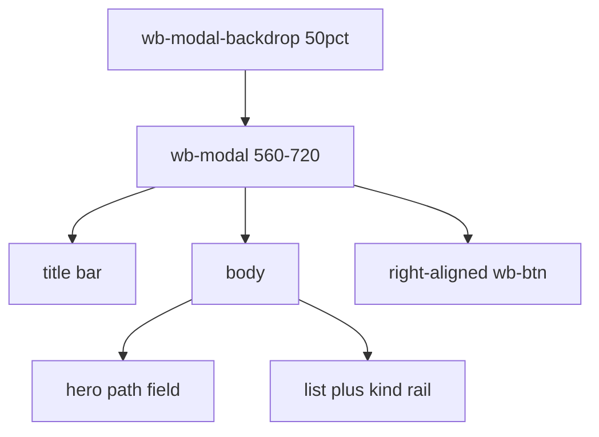
````

#### S042-C0002: What changed

Source `docs/plans/wb-control-briefs/dialogs-report.md` lines 24–42; accountable coverage owner U42.

```md
## What changed

`workbench-dialogs.css` owns Open / Save As / Confirm chrome and overrides card-like rules in `workbench.css` (8px browse tiles, 12px drop banner, warm drop colors).

| Class / id | Treatment |
|---|---|
| `.wb-modal-backdrop`, `.wb-confirm-backdrop` | 50% dim, `--z-modal` |
| `.wb-modal` | 560–720px, radius 0, raised panel |
| `.wb-modal-head` / `.wb-modal-close` | 28px title bar, square close |
| `.wb-modal-foot`, `.wb-confirm` | right-aligned `.wb-btn` row |
| `.wb-open-paste`, `#wb-open-paste` | hero: 32px mono sunken field |
| `.wb-dialog-tabs` | underline tab strip, not pills |
| `.wb-drop` | dashed inset, ~36px, not a banner |
| `.wb-browse` / `.wb-browse-list` / `.wb-browse-item` | sunken list, radius 0, 3px kind rail |
| `#wb-save-as-form`, `#wb-shared-form`, `.wb-bin-form` | stacked fields in the modal |
| `.wb-confirm-dialog` | narrower alertdialog; danger keeps `.wb-btn.danger` |

Kind rails: `gpr` / `project-dir` → `--kind-gpr`; `shared-fs` → `--kind-shared-fs`; `binary` / `kind-bin` → `--kind-bin`. Tokens only (no new hex except the existing danger border already used by `.wb-btn.danger`).
```

#### S042-C0003: How verified

Source `docs/plans/wb-control-briefs/dialogs-report.md` lines 43–48; accountable coverage owner U42.

```md
## How verified

- Markup in `workbench-app.js` (`Modal`, `ConfirmDialog`, Open / Save As) matches selectors.
- Stylesheet is already linked after `workbench.css` in `workbench.py`.
- No automated visual test in this commission.
```

#### S042-C0004: Deviations

Source `docs/plans/wb-control-briefs/dialogs-report.md` lines 49–52; accountable coverage owner U42.

```md
## Deviations

None. Confirm modal is narrower than 560px so an alertdialog does not look like a file chooser.
```

#### S042-C0005: Findings / risks

Source `docs/plans/wb-control-briefs/dialogs-report.md` lines 53–55; accountable coverage owner U42.

```md
## Findings / risks

`workbench.css` still contains the old browse-card and drop-banner rules. This file must stay later in the cascade. `styleKind()` maps `project-dir` to `kind-bin`; rail also keys `data-kind` so project dirs stay blue.
```

#### S043-C0001: Task: Dialogs (open, save-as, confirm)

Source `docs/plans/wb-control-briefs/dialogs.md` lines 1–17; accountable coverage owner U15.

```md
# Task: Dialogs (open, save-as, confirm)

Write **only** `src/agentdecompile_recovery/corpus/dashboard/static/workbench-dialogs.css`.

Read first: `docs/superpowers/specs/2026-08-31-workbench-control-system-design.md` and tokens/controls.

Classes:
- `.wb-modal-backdrop`, `.wb-modal`, `.wb-modal-head`, `.wb-modal-body`, `.wb-modal-foot`, `.wb-modal-close`
- `.wb-confirm-dialog`, `.wb-confirm-backdrop`
- `.wb-dialog-tabs`, `.wb-open-paste`, `#wb-open-paste`
- `.wb-drop`, `.wb-browse`, `.wb-browse-path`, `.wb-browse-list`, `.wb-browse-item`
- `#wb-save-as-form`, `#wb-shared-form`, `.wb-bin-form`

Feel: Ghidra file dialog. Dim 50% backdrop. Modal 560–720px, no 12px radius. Header is a title bar. Footer right-aligned actions using `.wb-btn`. Path field is the hero control. Browse is a **list or tight grid** of folders with kind-colored left rail (gpr / shared-fs / binary), not rounded cards. Drop zone is dashed inset, not a banner. Confirm danger uses `.wb-btn.danger`.

Do not edit JS. Do not commit.
Report: `docs/plans/wb-control-briefs/dialogs-report.md`.
```

#### S044-C0001: KotOR multiplayer recovery investigation

Source `docs/research/swkotor-multiplayer/README.md` lines 1–13; accountable coverage owner U39.

```md
# KotOR multiplayer recovery investigation

Integration provenance: these notes and retained evidence were ported from
commit `0b7305bb6ee1b9dee31311a6dec8623256766627` on September 28, 2026 (UTC).
Evidence described below as fresh was collected during the original investigation,
not this integration. No binary hashes, live MCP results, compilation, or gameplay
claims were revalidated during the port. The worktree-specific `.codex` environment
file was deliberately excluded.

Status: investigation in progress. This directory does not contain a buildable
replacement game or a dedicated game server. No multiplayer, lobby, in-game menu,
or full-image C/C++ recovery acceptance criterion has passed.
```

#### S044-C0002: Request and binding requirements

Source `docs/research/swkotor-multiplayer/README.md` lines 14–26; accountable coverage owner U39.

```md
## Request and binding requirements

Produce source-based builds of `swkotor.exe` and `swkotorserver.exe`, retain the
recovered engine, add public server discovery and password-protected joins, and
add a main-menu server browser styled like Halo Combat Evolved PC. Unmodified
recovered functions should preserve original behavior and pursue zero-difference
machine-code verification. New networking and UI necessarily introduce code
absent from the original executable.

An unrelated socket daemon, a launcher renamed `swkotor.exe`, a static browser
mockup, and an executable reconstructed by copying original machine code do not
meet those requirements.
```

#### S044-C0003: Evidence collected in this investigation

Source `docs/research/swkotor-multiplayer/README.md` lines 27–63; accountable coverage owner U39.

```md
## Evidence collected in this investigation

- [Engine evidence](engine-evidence.md): exact input hashes, recovered source
  limitations, historical receipt discrepancies, and local transport evidence.
- [Lobby research](lobby-research.md): current public master-server options,
  registration constraints, and password metadata handling.
- [NWN/NWN2 investigation](nwn-evidence.md): analyzed-program availability and
  bounded MCP failures; no donor protocol compatibility is claimed.
- [Fresh function inventory](evidence/netlayer-inventory.json): MCP enumeration
  of the transport region in the analyzed Ghidra program.
- [Fresh sender decompilation and disassembly](evidence/send-message-to-player.json):
  direct MCP result including callers, callees, source, and disassembly.
- [Readable sender pseudocode](evidence/005d4cb0_SendMessageToPlayer.cpp.txt):
  advisory decompilation with its raw incomplete signature retained and a header
  pointing to the corrected ABI; deliberately excluded from any build.
- [Binary binding receipt](evidence/binary-binding.json): all 150 exported
  instructions match the exact corpus binary. This is a sample comparison, not
  source compilation or a full-function zero-diff receipt.
- [All direct sender callers](evidence/send-callers.txt) and
  [full sender disassembly](evidence/send-disassembly.txt): fresh static evidence
  for the corrected four-stack-argument ABI.
- [Receiver disassembly](evidence/receive-disassembly.txt),
  [player-info getter](evidence/player-info-disassembly.txt),
  [server wrapper](evidence/server-handle-message-disassembly.txt),
  [server internal handler](evidence/server-internal-handle-message-disassembly.txt),
  and [client wrapper](evidence/client-handle-message-disassembly.txt):
  hash-bound exports supporting dispatch and shared player-permission findings.

The analyzed project is
`/home/brunner56/agentdecompile-nvme/workspace/Workspace.gpr`, program
`/K1/k1_win_gog_swkotor.exe`. Its program path alone is not a hash receipt.
The corpus raw executable has SHA-256
`9c10e0450a6eeca417e036e3cde7474fed1f0a92aab018446d156944dea91435`.
The separate `k1gog-target/swkotor.exe` has SHA-256
`34e6d971c034222a417995d8e1e8fdd9f8781795c9c289bd86c499a439f34c88`.
They must not share proof receipts without an explicit transformation record.
```

#### S044-C0004: Findings that determine implementation

Source `docs/research/swkotor-multiplayer/README.md` lines 64–89; accountable coverage owner U39.

```md
## Findings that determine implementation

`CNetLayer::SendMessageToPlayer` at `0x005d4cb0` gets its destination from
`this+0x2000c`, writes a length followed by payload bytes into that destination's
memory, and updates the destination's tail at `+0x20004`. That is a real
client/server message boundary, but the observed path is within one process.
It is not an existing Internet server implementation waiting to be enabled.

The local queue cannot safely become a public packet handler as-is. The sender's
overflow path formats a diagnostic and then proceeds to the copy. Its recovered
declaration also disagrees with `RET 0x10`. The retained 26 direct-call contexts
and callee disassembly establish four stack arguments: player ID, payload,
length and a fourth argument unused by this body. The call at `0x0067746a`
explicitly supplies zero for that argument; not every register-valued argument
has its reaching definition retained, so universal zero values are not claimed.
The raw recovered signature remains incomplete in both the unchanged MCP result
and pseudocode body; the corrected ABI is documented in [engine evidence](engine-evidence.md).
Decompiler-generated
types and names are analysis hypotheses, not source provenance or ABI proof.

The source corpus contains byte-emitter shims and unresolved surrogate calls.
In particular, its receive dispatcher substitutes `ghidra_call()` for application
dispatch. Historical per-function compile/match counts do not prove a complete
semantic engine link. Identical round-trip PE output can preserve original bytes
without recovering their C/C++ implementation.
```

#### S044-C0005: Gameplay scope confirmed by the user

Source `docs/research/swkotor-multiplayer/README.md` lines 90–99; accountable coverage owner U35.

```md
## Gameplay scope confirmed by the user

Support both shared co-op campaigns and persistent worlds with independent
characters, sessions and player progress. Implement them as explicit server modes
sharing the engine and transport. Co-op needs shared story/dialogue progress;
persistent worlds need per-player state and session ownership. Character control,
dialogue/cutscene policy, pause, module transitions, save authority, late join and
reconnect must be validated in each mode. This is a scope requirement, not a
claim that the original executable already implements either multiplayer mode.
```

#### S044-C0006: Required implementation sequence

Source `docs/research/swkotor-multiplayer/README.md` lines 100–140; accountable coverage owner U39.

```md
## Required implementation sequence

1. **Source baseline and identity.** Bind the chosen executable, Ghidra database,
   compiler/toolchain, function inventory, source files and receipts to hashes.
   Recover necessary declarations, data, globals, RTTI/vtables, imports, resources
   and startup. Establish a clean C/C++ link and an actual original-game launch.
   Keep unverified code and substrate separate; never count `_emit` or copied PE
   regions as semantic source recovery.
2. **Local transport and dispatch.** Recover initialization, send, receive,
   connection control and application callbacks. Correct calling conventions and
   all arguments from disassembly/callers. Validate queue wrap, framing, object
   identity and lifecycle against the original process before changing transport.
3. **Remote gameplay.** Add a versioned, bounded, authenticated transport with
   reliable ordering where engine messages require it. Validate packet lengths
   and message kinds before dispatch. Assign server-owned player identities;
   never trust client-provided ownership. Prove two real clients see the same
   authoritative world, then implement both required gameplay modes, reconnect,
   disconnect cleanup and content/build compatibility checks.
4. **Dedicated executable.** Separate simulation startup/tick/shutdown from the
   rendering/audio/window path. Prove module loading, scripts, AI, combat and
   saves run without a local player or rendering context. Build
   `swkotorserver.exe` from the shared recovered engine and new server entrypoint.
5. **Directory.** Implement register, heartbeat, list and expiry against a
   provisioned provider. OpenSpy is a plausible GameSpy replacement, but no
   automatic new-game provisioning was verified. EOS is a free hosted candidate
   requiring a developer product/credentials/SDK. A self-hosted directory can be
   a fallback, but does not satisfy the requested free public default on its own.
   Verify public discoverability from another network before claiming success.
6. **In-game browser.** Add a real button to the recovered main menu and enter a
   game UI screen with server rows, selection highlight, sortable server/map/
   players/ping columns, a password lock icon, Internet/LAN choice, filters,
   refresh, direct connect, join and back. Use a restrained blue/translucent
   science-fiction visual treatment matching Halo CE PC's density and navigation.
   Implement loading, empty, timeout, incompatible-version, full-server and
   incorrect-password states. Route Join to the proven remote gameplay path.
7. **Release proof.** Build both Windows executables from a clean source checkout;
   record toolchain and artifact hashes. Run one headless server plus two clients,
   verify gameplay/joins/disconnects and the real main-menu browser, capture
   evidence, and measure unchanged recovered code with objdiff. Whole executable
   byte identity is not an acceptance criterion for newly added functionality.
```

#### S044-C0007: Directory metadata contract

Source `docs/research/swkotor-multiplayer/README.md` lines 141–153; accountable coverage owner U37.

```md
## Directory metadata contract

Public metadata should contain a server identifier, display name, reachable game
endpoint, current and maximum player counts, module/map, gameplay mode, protocol
version, content/build identity and `passwordRequired`. Counts must come from
active authenticated game sessions rather than manually entered configuration.
The directory should expire stale servers and verify endpoint ownership before
listing; clients should measure their own ping and reject incompatible builds.

The actual join password, its reusable hash, and admin credentials must not be
published. The public password field is only a lock indicator. Password
verification belongs to the authenticated/encrypted game join exchange.
```

#### S044-C0008: Acceptance ledger

Source `docs/research/swkotor-multiplayer/README.md` lines 154–178; accountable coverage owner U39.

```md
## Acceptance ledger

| Requirement | Current evidence |
|---|---|
| Locate engine/source artifacts | Observed; mixed recovery quality |
| Identify exact binary variants | Two distinct hashes recorded |
| Confirm internal transport | Fresh sender decompilation/disassembly; local memory queue |
| Full C/C++ engine link | Not established |
| Byte-accurate source build | Not established; historical partial receipts only |
| Dedicated headless simulation | Not implemented or demonstrated |
| Remote multi-client gameplay | Not implemented or demonstrated |
| Co-op shared story/dialogue progress | Not implemented or demonstrated |
| Persistent-world independent characters, sessions and progress | Not implemented or demonstrated |
| Public master registration | Not provisioned or tested |
| In-game Halo-style browser | Not implemented or demonstrated |
| Both requested executables | Not built |

No game files, running game processes, recovery jobs, or public services were
modified to manufacture a completion claim.

The first focused MCP sender export succeeded. A subsequent focused CreateServer
export stalled and its orchestration was terminated; no output from that call is
counted as evidence and its remaining queued exports were not run. NWN/NWN2
inspection encountered separate analysis-gate/timeouts documented above. No
shared MCP service was restarted and no existing recovery was interrupted.
```

#### S045-C0001: swkotor engine evidence (read-only inspection, 2026-09-15)

Source `docs/research/swkotor-multiplayer/engine-evidence.md` lines 1–2; accountable coverage owner U33.

```md
# swkotor engine evidence (read-only inspection, 2026-09-15)
```

#### S045-C0002: Outcome

Source `docs/research/swkotor-multiplayer/engine-evidence.md` lines 3–8; accountable coverage owner U33.

```md
## Outcome

Existing artifacts contain substantial function recovery work and a real internal client/server message boundary. They do **not** establish a standalone C/C++ engine build, a dedicated multiplayer server, or an existing remote transport. Copying these `.c` files into a project and naming an executable `swkotorserver.exe` would not deliver the requested game server.

No recovery jobs, builds, game processes, or source changes were made in this investigation. Historical receipt counts below were read, not freshly reproduced.
```

#### S045-C0003: Binary identity: two different inputs

Source `docs/research/swkotor-multiplayer/engine-evidence.md` lines 9–21; accountable coverage owner U33.

```md
## Binary identity: two different inputs

| Path | Bytes | SHA256 |
|---|---:|---|
| `/home/brunner56/agentdecompile-nvme/k1gog-target/swkotor.exe` | 4395008 | `34e6d971c034222a417995d8e1e8fdd9f8781795c9c289bd86c499a439f34c88` |
| `/home/brunner56/agentdecompile-nvme/agentdecompile_projects/extract/raw/K1__k1_win_gog_swkotor.exe` | 4042752 | `9c10e0450a6eeca417e036e3cde7474fed1f0a92aab018446d156944dea91435` |
| `/home/brunner56/agentdecompile-nvme/agentdecompile_projects/corpus_work/k1_gog_from_source.exe` | 4042752 | `9c10e0450a6eeca417e036e3cde7474fed1f0a92aab018446d156944dea91435` |
| `/home/brunner56/agentdecompile-nvme/agentdecompile_projects/corpus_work/k1_win_gog_swkotor_BUILT.exe` | 4042752 | `9c10e0450a6eeca417e036e3cde7474fed1f0a92aab018446d156944dea91435` |

Both inputs have PE timestamp 1076609753 and identical `.data`/`.rsrc` section hashes. The first has an additional `.bind` section at RVA 0x46d000 and entry RVA 0x46d2ed. The corpus input has four sections and entry RVA 0x2fb38d. Their `.text` and `.rdata` hashes differ. This supports related builds/wrapping, not an exact receipt match. A directory called `k1gog-target` is insufficient provenance.

The first binary imports OPENGL32, KERNEL32, USER32, GDI32, ole32, binkw32, mss32, DINPUT8, GLU32, VERSION, IMM32. Its import table has no Winsock DLL. This alone does not rule out dynamically loaded networking, but the actual transport evidence below is local memory.
```

#### S045-C0004: Recovered source truth

Source `docs/research/swkotor-multiplayer/engine-evidence.md` lines 22–39; accountable coverage owner U33.

```md
## Recovered source truth

Source directory: `/home/brunner56/agentdecompile-nvme/agentdecompile_projects/corpus_work/k1_win_gog_swkotor.exe/`.

It contains 24276 `.c` files plus a benchmark JSON and failure logs. No project build file or shared header exists directly in that directory. Files mix semantic candidates, compiled Ghidra output, and original-byte `_emit` assembly functions.

Adjacent `k1_win_gog_swkotor.exe.matching.json` and `.variants.json` report:

- 24242 code functions, 1956 byte-exact C, 16926 compiling-but-not-exact C, 5358 asm floor, 2 absent C; `receiptsPartial: true`.
- Byte-accurate variant: 1956 C + 22286 shims, 8.1% C.
- Maximum-C variant: 18882 C + 5360 shims, 77.9% C, explicitly not byte-identical.
- A separate `.byteexact.json` reports 2169 byteExact out of 24276. An older `k1gog_matching_manifest.json` reports only 98 exact. These are different snapshots and must not be combined into a fresh completion claim.
- `compile-receipt.json` lists 18094 successful entries but does not establish successful full-engine linking or runtime behavior.

`ProcessReceivedFrames_005d57d0.c` replaces the key application callback with `ghidra_call();`. `CNetLayer_005d54a0.c` contains generic `GhidraBlob`, surrogate types and recovered ABI declarations. These are useful analysis artifacts, not proof that the engine can be linked unchanged.

Repository `scripts/pe-code-roundtrip.py` explicitly copies the original PE and patches verified candidates (lines 162-163); lines 261-262 state that other bytes are carried from the original and are not semantic C/C++ recovery. Identical executable hashes are therefore not sufficient source-build proof.
```

#### S045-C0005: Actual internal transport evidence

Source `docs/research/swkotor-multiplayer/engine-evidence.md` lines 40–73; accountable coverage owner U33.

````md
## Actual internal transport evidence

All filenames below are relative to the source directory above; addresses apply to the 4042752-byte corpus binary unless independently verified elsewhere.

| Function | Address | Existing artifact |
|---|---|---|
| `CNetLayer` constructor | 0x005d54a0 | Ghidra C, explicitly not byte-verified |
| `SendMessageToPlayer` | 0x005d4cb0 | original-byte `_emit` substrate |
| `ProcessReceivedFrames` | 0x005d57d0 | Ghidra C with unresolved `ghidra_call()` dispatch |
| `StartConnectToSession` | 0x005d5040 | Ghidra C creating `BNCSU` messages |
| `StartServerMode` | 0x005d4fb0 | original-byte `_emit` substrate |
| `EndServerMode` | 0x005d5020 | small readable C with historical zero-diff claim |
| `CreateServer` | 0x00401380 | original-byte `_emit` substrate |
| `SendServerToPlayerMessage` | 0x00567e60 | original-byte `_emit` substrate |
| `SendPlayerToServerMessage` | 0x00677410 | Ghidra C, not byte-verified |
| `HandleBNCSMessage` | 0x005d5180 | original-byte `_emit` substrate |
| main-menu constructor/initialization candidates | 0x0067b500, 0x0067c4c0 | original-byte `_emit` substrate |

`CNetLayer` recovered layout has `message_frames[0x20000]`, offsets `frame_offset` at 0x20000, `frame_tail` at 0x20004, `base_exo_app` at 0x20008, `destination_net_layer` at 0x2000c, one `player_info` at 0x20014 and `server_mode` at 0x2003c. `GetPlayerInfo_005d5170.c` returns that one inline record. This suggests single-player assumptions that must be investigated for multi-client ownership.

Fresh disassembly of the corpus executable directly corroborates `SendMessageToPlayer`:

```asm
005d4ccb mov 0x2000c(%ebp),%eax    ; destination net layer
005d4cf1 mov 0x20004(%eax),%edx    ; destination queue tail
005d4f68 mov %edi,(%edx,%eax,1)    ; write payload length
005d4f73 lea 0x4(%edx,%eax,1),%edi ; payload destination
005d4f7c rep movsl
005d4f83 rep movsb
005d4f90 mov %ebx,0x20004(%eax)    ; publish new tail
```

`ProcessReceivedFrames` reads length-prefixed queue entries, routes `BN` control messages to `NonWindowMessages`, and dispatches other messages to client/server app handlers (annotated addresses 0x005ed790 and 0x004ae840). `StartConnectToSession` sends an internal `BNCSU` frame via the same local SendMessageToPlayer path. Names like StartConnectToSession and ServerMode do not demonstrate a remote session implementation.
````

#### S045-C0006: Smallest justified next slice

Source `docs/research/swkotor-multiplayer/engine-evidence.md` lines 74–83; accountable coverage owner U33.

```md
## Smallest justified next slice

1. Bind one exact unwrapped executable hash and its analyzed database; do not mix the two inputs above.
2. Freshly decompile `SendMessageToPlayer`, `ProcessReceivedFrames`, `Initialize` 0x005d5550, `CreateServer`, and the main-menu event handler into an isolated output with fresh receipts. Existing files are investigation inputs only.
3. Recover and validate the message transport/dispatch boundary first, including queue wrap semantics, application callback ABI, and player identity. A narrow byte-proven C module is useful and honest; a standalone copied corpus is not.
4. Only after live dispatch is validated, a binary-integrated transport shim could carry real serialized game messages between two instances. That would be an experiment toward multiplayer, not source-engine recovery. Multi-player ownership, authority, pause/dialog policy, save transitions, headless initialization and dependency removal remain separate proof obligations.
5. An external server-list mockup or unrelated socket service is technically easy but does not satisfy an in-game browser and dedicated swkotor simulation. Do not present it as the requested product.

No live multi-client gameplay, headless server, in-game browser, original source recovery, or clean C/C++ full-image link was established by this inspection.
```

#### S045-C0007: Memory provenance used only to locate the artifacts

Source `docs/research/swkotor-multiplayer/engine-evidence.md` lines 84–87; accountable coverage owner U33.

```md
## Memory provenance used only to locate the artifacts

`/home/brunner56/.codex/memories/MEMORY.md` lines 585-586 identified the prior K1 GOG run and declaration-collision blocker. All binary hashes and source/receipt observations in this report were checked live. If citing memory in the parent response, include those lines; otherwise cite the current artifact evidence directly and disclose that this investigation used memory for navigation.
```

#### S045-C0008: Follow-up: exact native ABI and remote-boundary blockers

Source `docs/research/swkotor-multiplayer/engine-evidence.md` lines 88–91; accountable coverage owner U33.

```md
## Follow-up: exact native ABI and remote-boundary blockers

Fresh `objdump -d` inspection was run against the 4042752-byte raw corpus executable, SHA256 `9c10e0450a6eeca417e036e3cde7474fed1f0a92aab018446d156944dea91435`. Complete SendMessageToPlayer disassembly is saved at `/tmp/swkotor-send-disasm.txt`; contexts for **all 26 direct calls discovered in the full executable disassembly** are saved at `/tmp/swkotor-send-callers.txt`. Indirect calls were not exhaustively enumerated.
```

#### S045-C0009: SendMessageToPlayer has FOUR explicit stack arguments

Source `docs/research/swkotor-multiplayer/engine-evidence.md` lines 92–119; accountable coverage owner U33.

````md
### SendMessageToPlayer has FOUR explicit stack arguments

Native x86 ABI: ECX is `this`, stack arguments are `playerId, payload, payloadLength, unusedFourth`, return value in EAX, callee cleanup `ret 0x10`. Proposed descriptive declaration (not a compiled artifact):

```cpp
int __thiscall CNetLayer::SendMessageToPlayer(
    unsigned long playerId, const char* payload,
    unsigned long payloadLength, unsigned long unusedFourth);
```

The exact semantic name/type of the fourth parameter is not established; do not assume it is a reliable-delivery flag. The K1 body does not read it. The call at 0x0067746a explicitly supplies zero; other excerpts push registers whose reaching definitions are not all included in the retained contexts. No claim that every caller passes zero is needed for the four-argument ABI finding. It likewise does not use playerId to select its destination: the queue destination is always the pointer at `this+0x2000c`.

Representative complete call setup in `SendPlayerToServerMessage`:

```asm
00677460 push 0          ; fourth argument
00677462 push edi        ; length
00677463 push esi        ; payload
00677464 push eax        ; destination player identifier
00677465 call [edx+0x10] ; GetNetLayer, no explicit arguments
00677468 mov ecx,eax     ; this = returned CNetLayer
0067746a call 0x005d4cb0
```

`StartConnectToSession` at 0x005d50dc similarly pushes zero, length, payload, zero before the call. Both send exit paths, 0x005d4cee and 0x005d4fa8, use `ret 0x10`.

The existing declaration `extern int __fastcall CNetLayer__SendMessageToPlayer(CNetLayer *, ulong, char *, int);` is doubly unsuitable for hooking/linking to this binary: it omits the fourth stack parameter and passes its second C argument in EDX. A fastcall hook adapter needs an explicit dummy EDX parameter **plus all four stack arguments**, yielding six C parameters total. Compile-only success cannot establish ABI correctness.
````

#### S045-C0010: ProcessReceivedFrames callback is recoverable, not an unknown magic function

Source `docs/research/swkotor-multiplayer/engine-evidence.md` lines 120–137; accountable coverage owner U33.

````md
### ProcessReceivedFrames callback is recoverable, not an unknown magic function

Raw evidence: [receiver](evidence/receive-disassembly.txt), [server wrapper](evidence/server-handle-message-disassembly.txt), [server internal handler](evidence/server-internal-handle-message-disassembly.txt), and [client wrapper](evidence/client-handle-message-disassembly.txt). Each export records the input SHA256 and exact objdump command.

At 0x005d5841 the receiver loads `base_exo_app` from `this+0x20008` into ECX, loads its vtable, and invokes slot 1 (`[vtable+4]`). Setup is:

```asm
005d5849 push 0       ; fourth argument
005d584b push edx     ; payload length
005d584c push edi     ; payload pointer
005d584d push 0       ; playerId
005d584f call [eax+4]
```

Thus the callback ABI is `HandleMessage(appThis, playerId=0, payload, payloadLength, flagsOrMode=0)` with four explicit stack arguments. The server wrapper at 0x004ae840 loads the internal object from `this+4` and tail-jumps to 0x004b15d0. That handler explicitly reads argument 4 at entry `[esp+0x10]`, rejects nonzero, and returns `ret 0x10`. The client wrapper at 0x005ed790 similarly tail-jumps to 0x005ee700. The existing `ghidra_call()` discards recoverable argument and dispatch information; replacing it with an untyped zero-argument call would be incorrect.

For BN control messages the receiver calls 0x005d5690 (`NonWindowMessages`) using ECX=this and three stack args `(0,payload,length)`.
````

#### S045-C0011: Concrete assumptions that break when crossing a remote boundary

Source `docs/research/swkotor-multiplayer/engine-evidence.md` lines 138–148; accountable coverage owner U33.

```md
### Concrete assumptions that break when crossing a remote boundary

The [GetPlayerInfo export](evidence/player-info-disassembly.txt) establishes the single-record behavior. The [server internal handler export](evidence/server-internal-handle-message-disassembly.txt) shows the payload-byte reads and player/admin field checks. The [receiver export](evidence/receive-disassembly.txt) shows framing and callback argument handling.

1. **No sender identity survives the queue.** Send ignores its destination playerId; receive hardcodes sender 0. `GetPlayerInfo` at 0x005d5170 is exactly `lea eax,[ecx+0x20014]; ret 4`: it accepts and ignores one player argument, always returning the same inline record. A second connection cannot obtain separate identity/permission merely by substituting a TCP socket for the queue.
2. **Server privilege checks consult that shared record.** Handler 0x004b15d0 reads payload byte 0 before checking length. For `s` messages it tests inline player-info offset 0x24 (admin), for `p` it tests offset 0x1c (player). A remote bridge reusing the local record would need authenticated per-peer identity/authorization before these calls; changing the outer packet alone is insufficient.
3. **Receive trusts frame lengths and queue integrity.** It reads uint32 length at the queue cursor, advances by `length - (length & 3) + 8`, reads payload bytes 0 and 1 without checking the length, and loops until cursor equals tail. No checked arithmetic, remaining-frame validation, or malformed-cursor termination exists in this function.
4. **Send's capacity diagnostic is not a rejection.** The function compares calculated tail with read cursor +0x10000. If too large, it formats a diagnostic around 0x005d4f39, destroys the temporary string, and falls through at 0x005d4f5e into the same unchecked length write and `rep movs` copy. No maximum payload guard precedes that copy. A remotely supplied length must never enter this routine directly.
5. **Execution context remains local.** The queue has ordinary stores and direct virtual dispatch; no synchronization is visible in these functions. A network worker must not call them concurrently with engine update. Preserve engine-thread ownership with validated bounded handoff.

These observations give specific next implementation work: preserve the verified native ABI, recover the typed vtable callback, validate/bound messages before any engine queue operation, and replace the single shared player identity model before claiming multi-client support. They do not by themselves require rewriting the whole engine, but they prevent a safe/correct socket-only substitution.
```

#### S046-C0001: Scoped evidence re-review

Source `docs/research/swkotor-multiplayer/evidence-review.md` lines 1–10; accountable coverage owner U39.

```md
# Scoped evidence re-review

Reviewed `/tmp/swkotor-evidence-fix.md`, revised documentation, and the five new retained disassembly exports. No tests repeated, no binary hash checks repeated, no live MCP, and no repository edits.

1. **ADDRESSED — receiver/privilege raw evidence.** Five new exports retain the receiver, getter, wrappers and server internal handler instructions, with input SHA256 and commands. They substantiate the earlier instruction-level conclusions. Independent receipt/hash validation remains with the parent.
2. **ADDRESSED — universal fourth-argument zero claim.** README and engine evidence now restrict the directly supported zero value to a named call and explicitly disclose missing reaching definitions for other register pushes. The four-stack-argument ABI conclusion is preserved.
3. **ADDRESSED — existing versus proposed transport.** NWN evidence now clearly distinguishes the original in-process queue from the proposed remote transport.
4. **ADDRESSED — both-mode acceptance wording.** Separate co-op and persistent-world ledger rows exist and remain unpassed. Final scoped check confirmed README.md:109 now says 'then implement both required gameplay modes', closing the remaining ambiguity.

New breakage caused by these fixes: none found. This review does not certify any source-built executable or multiplayer implementation.
```

#### S047-C0001: /* Fresh Ghidra pseudocode, not buildable or byte-verified source.

Source `docs/research/swkotor-multiplayer/evidence/005d4cb0_SendMessageToPlayer.cpp.txt` lines 1–166; accountable coverage owner U34.

```txt
/* Fresh Ghidra pseudocode, not buildable or byte-verified source.
 * Program: /K1/k1_win_gog_swkotor.exe
 * Raw recovered signature below remains incomplete: it disagrees with RET 0x10.
 * Corrected four-stack-argument ABI is documented in ../engine-evidence.md.
 * Pseudocode body and declaration are retained unchanged as recovery evidence.
 * Do not call this declaration or expose the memory queue to untrusted packets.
 */
int __thiscall
CNetLayer::SendMessageToPlayer(CNetLayer *this,ulong param_1,char *message,int message_length)

{
  uint uVar1;
  byte bVar2;
  int iVar3;
  byte bVar4;
  uint uVar5;
  uint uVar6;
  char *pcVar7;
  byte local_3d;
  byte local_3c;
  byte local_3b;
  byte local_3a;
  byte local_39;
  uint local_38;
  uint local_34;
  uint local_30;
  uint local_2c;
  uint local_28;
  uint local_24;
  uint local_20;
  CExoString local_14;
  void *local_c;
  code *pcStack_8;
  undefined4 local_4;
  CNetLayer *destination_net_layer;
  int msg_length_;
  
  msg_length_ = message_length;
  local_4 = 0xffffffff;
  pcStack_8 = FrameHandler_00723f38;
  local_c = ExceptionList;
  destination_net_layer = this->destination_net_layer;
  uVar6 = 0;
  if (destination_net_layer == (CNetLayer *)0x0) {
    return 0;
  }
  local_38 = destination_net_layer->frame_tail;
  if (0xffff < local_38) {
    local_38 = 0;
  }
  uVar1 = (local_38 - (message_length & 3U)) + 8 + message_length;
  if (uVar1 <= destination_net_layer->frame_offset + 0x10000) goto LAB_005d4f5e;
  ExceptionList = &local_c;
  CExoString::CExoString(&local_14);
  local_4 = 0;
  if ((uint)message_length < 8) {
    local_34 = 0;
LAB_005d4d76:
    message_length = 0x5f;
  }
  else {
    local_34 = (uint)(byte)message[7];
    iVar3 = _isgraph((uint)(byte)message[7]);
    if (iVar3 == 0) goto LAB_005d4d76;
    message_length = (int)(byte)message[7];
  }
  if ((uint)msg_length_ < 7) {
    local_30 = 0;
LAB_005d4dad:
    local_3d = 0x5f;
  }
  else {
    local_30 = (uint)(byte)message[6];
    iVar3 = _isgraph((uint)(byte)message[6]);
    if (iVar3 == 0) goto LAB_005d4dad;
    local_3d = message[6];
  }
  if ((uint)msg_length_ < 6) {
    local_2c = 0;
LAB_005d4de4:
    local_3c = 0x5f;
  }
  else {
    local_2c = (uint)(byte)message[5];
    iVar3 = _isgraph((uint)(byte)message[5]);
    if (iVar3 == 0) goto LAB_005d4de4;
    local_3c = message[5];
  }
  if ((uint)msg_length_ < 5) {
    local_28 = 0;
LAB_005d4e1b:
    local_3b = 0x5f;
  }
  else {
    local_28 = (uint)(byte)message[4];
    iVar3 = _isgraph((uint)(byte)message[4]);
    if (iVar3 == 0) goto LAB_005d4e1b;
    local_3b = message[4];
  }
  if ((uint)msg_length_ < 4) {
    local_24 = 0;
LAB_005d4e52:
    local_3a = 0x5f;
  }
  else {
    local_24 = (uint)(byte)message[3];
    iVar3 = _isgraph((uint)(byte)message[3]);
    if (iVar3 == 0) goto LAB_005d4e52;
    local_3a = message[3];
  }
  if ((uint)msg_length_ < 3) {
    local_20 = 0;
LAB_005d4e89:
    local_39 = 0x5f;
  }
  else {
    local_20 = (uint)(byte)message[2];
    iVar3 = _isgraph((uint)(byte)message[2]);
    if (iVar3 == 0) goto LAB_005d4e89;
    local_39 = message[2];
  }
  if ((uint)msg_length_ < 2) {
LAB_005d4ead:
    bVar4 = 0x5f;
  }
  else {
    uVar6 = (uint)(byte)message[1];
    iVar3 = _isgraph((uint)(byte)message[1]);
    if (iVar3 == 0) goto LAB_005d4ead;
    bVar4 = message[1];
  }
  if (msg_length_ == 0) {
    uVar5 = 0;
LAB_005d4edd:
    bVar2 = 0x5f;
  }
  else {
    uVar5 = (uint)(byte)*message;
    iVar3 = _isgraph((uint)(byte)*message);
    if (iVar3 == 0) goto LAB_005d4edd;
    bVar2 = *message;
  }
  CExoString::Format(&local_14,(char *)&local_14,
                     "CNetLayer::SendMessageToPlayer - Message Buffer Overflow! Message Header Follows:\nSize = %d! <%c %x, %c %x, %c %x, %c %x, %c %x, %c %x, %c %x, %c %x>\n"
                     ,msg_length_,(uint)bVar2,uVar5,(uint)bVar4,uVar6,(uint)local_39,local_20,
                     (uint)local_3a,local_24,(uint)local_3b,local_28,(uint)local_3c,local_2c,
                     (uint)local_3d,local_30,message_length,local_34);
  local_4 = 0xffffffff;
  CExoString::~CExoString(&local_14);
LAB_005d4f5e:
  *(int *)((int)this->destination_net_layer->message_frames + local_38) = msg_length_;
  pcVar7 = (char *)((int)this->destination_net_layer->message_frames + local_38 + 4);
  for (uVar6 = (uint)msg_length_ >> 2; uVar6 != 0; uVar6 = uVar6 - 1) {
    *(undefined4 *)pcVar7 = *(undefined4 *)message;
    message = message + 4;
    pcVar7 = pcVar7 + 4;
  }
  for (uVar6 = msg_length_ & 3; uVar6 != 0; uVar6 = uVar6 - 1) {
    *pcVar7 = *message;
    message = message + 1;
    pcVar7 = pcVar7 + 1;
  }
  this->destination_net_layer->frame_tail = uVar1;
  ExceptionList = local_c;
  return 1;
}
```

#### S048-C0001: {

Source `docs/research/swkotor-multiplayer/evidence/binary-binding.json` lines 1–10; accountable coverage owner U33.

```json
{
  "binary": "/home/brunner56/agentdecompile-nvme/agentdecompile_projects/extract/raw/K1__k1_win_gog_swkotor.exe",
  "sha256": "9c10e0450a6eeca417e036e3cde7474fed1f0a92aab018446d156944dea91435",
  "function": "005d4cb0",
  "evidence": "send-message-to-player.json",
  "instructionCountCompared": 150,
  "allComparedInstructionsMatch": true,
  "disassemblyTruncated": true,
  "claim": "Ghidra instruction sample matches exact raw binary; not source compilation, objdiff proof, or full function proof."
}
```

#### S049-C0001: Input SHA256: 9c10e0450a6eeca417e036e3cde7474fed1f0a92aab018446d156944dea91435

Source `docs/research/swkotor-multiplayer/evidence/client-handle-message-disassembly.txt` lines 1–12; accountable coverage owner U34.

```txt
Input SHA256: 9c10e0450a6eeca417e036e3cde7474fed1f0a92aab018446d156944dea91435
Command: objdump -d --start-address=0x5ed790 --stop-address=0x5ed798 /home/brunner56/agentdecompile-nvme/agentdecompile_projects/extract/raw/K1__k1_win_gog_swkotor.exe


/home/brunner56/agentdecompile-nvme/agentdecompile_projects/extract/raw/K1__k1_win_gog_swkotor.exe:     file format pei-i386


Disassembly of section .text:

005ed790 <.text+0x1ec790>:
  5ed790:	8b 49 04             	mov    0x4(%ecx),%ecx
  5ed793:	e9 68 0f 00 00       	jmp    0x5ee700
```

#### S050-C0001: {

Source `docs/research/swkotor-multiplayer/evidence/netlayer-inventory.json` lines 1–9; accountable coverage owner U34.

```json
{
  "content": [
    {
      "type": "text",
      "text": "{\"results\": [{\"name\": \"CVirtualMachineInternal\", \"address\": \"005d4900\", \"size\": 176, \"isExternal\": false, \"isThunk\": false, \"parameterCount\": 1, \"signature\": \"CVirtualMachineInternal * __thiscall CVirtualMachineInternal(CVirtualMachineInternal * this)\", \"callingConvention\": \"__thiscall\", \"isInline\": false}, {\"name\": \"~CVirtualMachineInternal\", \"address\": \"005d49b0\", \"size\": 273, \"isExternal\": false, \"isThunk\": false, \"parameterCount\": 1, \"signature\": \"undefined __thiscall ~CVirtualMachineInternal(CVirtualMachineInternal * this)\", \"callingConvention\": \"__thiscall\", \"isInline\": false}, {\"name\": \"RunScriptSituation\", \"address\": \"005d4ad0\", \"size\": 277, \"isExternal\": false, \"isThunk\": false, \"parameterCount\": 4, \"signature\": \"void __thiscall RunScriptSituation(CVirtualMachineInternal * this, CVirtualMachineScript * param_1, ulong param_2, int param_3)\", \"callingConvention\": \"__thiscall\", \"isInline\": false}, {\"name\": \"~CVirtualMachineInternal\", \"address\": \"005d4c10\", \"size\": 27, \"isExternal\": false, \"isThunk\": false, \"parameterCount\": 2, \"signature\": \"undefined4 * __thiscall ~CVirtualMachineInternal(CVirtualMachineInternal * this, byte param_1)\", \"callingConvention\": \"__thiscall\", \"isInline\": false}, {\"name\": \"CResNCS\", \"address\": \"005d4c30\", \"size\": 29, \"isExternal\": false, \"isThunk\": false, \"parameterCount\": 1, \"signature\": \"CResNCS * __thiscall CResNCS(CResNCS * this)\", \"callingConvention\": \"__thiscall\", \"isInline\": false}, {\"name\": \"~CResNCS\", \"address\": \"005d4c50\", \"size\": 11, \"isExternal\": false, \"isThunk\": false, \"parameterCount\": 1, \"signature\": \"undefined __thiscall ~CResNCS(CResNCS * this)\", \"callingConvention\": \"__thiscall\", \"isInline\": false}, {\"name\": \"OnResourceServiced\", \"address\": \"005d4c60\", \"size\": 39, \"isExternal\": false, \"isThunk\": false, \"parameterCount\": 1, \"signature\": \"int __thiscall OnResourceServiced(CResLYT * this)\", \"callingConvention\": \"__thiscall\", \"isInline\": false}, {\"name\": \"~CResNCS\", \"address\": \"005d4c90\", \"size\": 27, \"isExternal\": false, \"isThunk\": false, \"parameterCount\": 2, \"signature\": \"int * * __thiscall ~CResNCS(CResNCS * this, byte param_1)\", \"callingConvention\": \"__thiscall\", \"isInline\": false}, {\"name\": \"SendMessageToPlayer\", \"address\": \"005d4cb0\", \"size\": 763, \"isExternal\": false, \"isThunk\": false, \"parameterCount\": 4, \"signature\": \"int __thiscall SendMessageToPlayer(CNetLayer * this, ulong param_1, char * message, int message_length)\", \"callingConvention\": \"__thiscall\", \"isInline\": false}, {\"name\": \"StartServerMode\", \"address\": \"005d4fb0\", \"size\": 101, \"isExternal\": false, \"isThunk\": false, \"parameterCount\": 2, \"signature\": \"undefined4 __thiscall StartServerMode(CNetLayer * this, CExoString * param_1)\", \"callingConvention\": \"__thiscall\", \"isInline\": false}, {\"name\": \"EndServerMode\", \"address\": \"005d5020\", \"size\": 29, \"isExternal\": false, \"isThunk\": false, \"parameterCount\": 1, \"signature\": \"undefined4 __thiscall EndServerMode(CNetLayer * this)\", \"callingConvention\": \"__thiscall\", \"isInline\": false}, {\"name\": \"StartConnectToSession\", \"address\": \"005d5040\", \"size\": 227, \"isExternal\": false, \"isThunk\": false, \"parameterCount\": 6, \"signature\": \"bool __thiscall StartConnectToSession(CNetLayer * this, ulong param_1, CExoString * param_2, CExoString * param_3, ulong param_4, ulong param_5)\", \"callingConvention\": \"__thiscall\", \"isInline\": false}, {\"name\": \"UpdateStatusLoop_internal?\", \"address\": \"005d5140\", \"size\": 43, \"isExternal\": false, \"isThunk\": false, \"parameterCount\": 1, \"signature\": \"undefined4 __thiscall UpdateStatusLoop_internal?(CNetLayer * this)\", \"callingConvention\": \"__thiscall\", \"isInline\": false}, {\"name\": \"GetPlayerInfo\", \"address\": \"005d5170\", \"size\": 9, \"isExternal\": false, \"isThunk\": false, \"parameterCount\": 1, \"signature\": \"CNetLayerPlayerInfo * __thiscall GetPlayerInfo(CNetLayer * this)\", \"callingConvention\": \"__thiscall\", \"isInline\": false}, {\"name\": \"HandleBNCSMessage\", \"address\": \"005d5180\", \"size\": 559, \"isExternal\": false, \"isThunk\": false, \"parameterCount\": 4, \"signature\": \"undefined4 __thiscall HandleBNCSMessage(CNetLayer * this, ulong param_1, char * param_2, ulong param_3)\", \"callingConvention\": \"__thiscall\", \"isInline\": false}, {\"name\": \"HandleBNCRMessage\", \"address\": \"005d53f0\", \"size\": 67, \"isExternal\": false, \"isThunk\": false, \"parameterCount\": 4, \"signature\": \"undefined4 __thiscall HandleBNCRMessage(CNetLayer * this, ulong param_1, char * param_2, ulong param_3)\", \"callingConvention\": \"__thiscall\", \"isInline\": false}, {\"name\": \"CNetLayerPlayerInfo\", \"address\": \"005d5440\", \"size\": 90, \"isExternal\": false, \"isThunk\": false, \"parameterCount\": 1, \"signature\": \"CNetLayerPlayerInfo * __thiscall CNetLayerPlayerInfo(CNetLayerPlayerInfo * this)\", \"callingConvention\": \"__thiscall\", \"isInline\": false}, {\"name\": \"CNetLayer\", \"address\": \"005d54a0\", \"size\": 161, \"isExternal\": false, \"isThunk\": false, \"parameterCount\": 1, \"signature\": \"CNetLayer * __thiscall CNetLayer(CNetLayer * this)\", \"callingConvention\": \"__thiscall\", \"isInline\": false}, {\"name\": \"Initialize\", \"address\": \"005d5550\", \"size\": 174, \"isExternal\": false, \"isThunk\": false, \"parameterCount\": 2, \"signature\": \"undefined4 __thiscall Initialize(CNetLayer * this, CBaseExoApp * param_1)\", \"callingConvention\": \"__thiscall\", \"isInline\": false}, {\"name\": \"ShutDown\", \"address\": \"005d5600\", \"size\": 77, \"isExternal\": false, \"isThunk\": false, \"parameterCount\": 1, \"signature\": \"undefined4 __thiscall ShutDown(CNetLayer * this)\", \"callingConvention\": \"__thiscall\", \"isInline\": false}, {\"name\": \"UpdateStatusLoop\", \"address\": \"005d5650\", \"size\": 50, \"isExternal\": false, \"isThunk\": false, \"parameterCount\": 2, \"signature\": \"undefined4 __thiscall UpdateStatusLoop(CNetLayer * this, ulong param_1)\", \"callingConvention\": \"__thiscall\", \"isInline\": false}, {\"name\": \"NonWindowMessages\", \"address\": \"005d5690\", \"size\": 134, \"isExternal\": false, \"isThunk\": false, \"parameterCount\": 4, \"signature\": \"undefined4 __thiscall NonWindowMessages(CNetLayer * this, ulong param_1, char * param_2, ulong param_3)\", \"callingConvention\": \"__thiscall\", \"isInline\": false}, {\"name\": \"~CNetLayer\", \"address\": \"005d5720\", \"size\": 161, \"isExternal\": false, \"isThunk\": false, \"parameterCount\": 1, \"signature\": \"undefined __thiscall ~CNetLayer(CNetLayer * this)\", \"callingConvention\": \"__thiscall\", \"isInline\": false}, {\"name\": \"ProcessReceivedFrames\", \"address\": \"005d57d0\", \"size\": 154, \"isExternal\": false, \"isThunk\": false, \"parameterCount\": 2, \"signature\": \"void __thiscall ProcessReceivedFrames(CNetLayer * this, int param_1)\", \"callingConvention\": \"__thiscall\", \"isInline\": false}], \"count\": 24, \"total\": 24, \"hasMore\": false, \"offset\": 0, \"limit\": 100, \"mode\": \"list\", \"projectContext\": {\"openProgramCount\": 2, \"openPrograms\": [\"/JE/JadeEmpire.exe\", \"/K1/k1_win_gog_swkotor.exe\"], \"activeProgram\": \"/K1/k1_win_gog_swkotor.exe\", \"analysisByProgram\": {\"/JE/JadeEmpire.exe\": true, \"/K1/k1_win_gog_swkotor.exe\": true}, \"scope\": \"target-program\", \"analysisComplete\": true, \"mode\": \"local-gpr\", \"projectPath\": \"/home/brunner56/agentdecompile-nvme/workspace/Workspace.gpr\", \"projectName\": \"Workspace\"}}"
    }
  ],
  "isError": false
}
```

#### S051-C0001: Input SHA256: 9c10e0450a6eeca417e036e3cde7474fed1f0a92aab018446d156944dea91435

Source `docs/research/swkotor-multiplayer/evidence/player-info-disassembly.txt` lines 1–12; accountable coverage owner U34.

```txt
Input SHA256: 9c10e0450a6eeca417e036e3cde7474fed1f0a92aab018446d156944dea91435
Command: objdump -d --start-address=0x5d5170 --stop-address=0x5d5179 /home/brunner56/agentdecompile-nvme/agentdecompile_projects/extract/raw/K1__k1_win_gog_swkotor.exe


/home/brunner56/agentdecompile-nvme/agentdecompile_projects/extract/raw/K1__k1_win_gog_swkotor.exe:     file format pei-i386


Disassembly of section .text:

005d5170 <.text+0x1d4170>:
  5d5170:	8d 81 14 00 02 00    	lea    0x20014(%ecx),%eax
  5d5176:	c2 04 00             	ret    $0x4
```

#### S052-C0001: Input SHA256: 9c10e0450a6eeca417e036e3cde7474fed1f0a92aab018446d156944dea91435

Source `docs/research/swkotor-multiplayer/evidence/receive-disassembly.txt` lines 1–62; accountable coverage owner U34.

```txt
Input SHA256: 9c10e0450a6eeca417e036e3cde7474fed1f0a92aab018446d156944dea91435
Command: objdump -d --start-address=0x5d57d0 --stop-address=0x5d586a /home/brunner56/agentdecompile-nvme/agentdecompile_projects/extract/raw/K1__k1_win_gog_swkotor.exe


/home/brunner56/agentdecompile-nvme/agentdecompile_projects/extract/raw/K1__k1_win_gog_swkotor.exe:     file format pei-i386


Disassembly of section .text:

005d57d0 <.text+0x1d47d0>:
  5d57d0:	8b 44 24 04          	mov    0x4(%esp),%eax
  5d57d4:	85 c0                	test   %eax,%eax
  5d57d6:	56                   	push   %esi
  5d57d7:	8b f1                	mov    %ecx,%esi
  5d57d9:	0f 84 87 00 00 00    	je     0x5d5866
  5d57df:	8b 86 00 00 02 00    	mov    0x20000(%esi),%eax
  5d57e5:	3b 86 04 00 02 00    	cmp    0x20004(%esi),%eax
  5d57eb:	74 79                	je     0x5d5866
  5d57ed:	55                   	push   %ebp
  5d57ee:	57                   	push   %edi
  5d57ef:	90                   	nop
  5d57f0:	81 be 00 00 02 00 00 	cmpl   $0x10000,0x20000(%esi)
  5d57f7:	00 01 00 
  5d57fa:	72 0a                	jb     0x5d5806
  5d57fc:	c7 86 00 00 02 00 00 	movl   $0x0,0x20000(%esi)
  5d5803:	00 00 00 
  5d5806:	8b 86 00 00 02 00    	mov    0x20000(%esi),%eax
  5d580c:	8b 14 30             	mov    (%eax,%esi,1),%edx
  5d580f:	83 c0 04             	add    $0x4,%eax
  5d5812:	8b ca                	mov    %edx,%ecx
  5d5814:	83 e1 03             	and    $0x3,%ecx
  5d5817:	8b f8                	mov    %eax,%edi
  5d5819:	2b f9                	sub    %ecx,%edi
  5d581b:	8d 6c 17 04          	lea    0x4(%edi,%edx,1),%ebp
  5d581f:	8d 3c 30             	lea    (%eax,%esi,1),%edi
  5d5822:	89 86 00 00 02 00    	mov    %eax,0x20000(%esi)
  5d5828:	80 3f 42             	cmpb   $0x42,(%edi)
  5d582b:	75 14                	jne    0x5d5841
  5d582d:	80 7c 30 01 4e       	cmpb   $0x4e,0x1(%eax,%esi,1)
  5d5832:	75 0d                	jne    0x5d5841
  5d5834:	52                   	push   %edx
  5d5835:	57                   	push   %edi
  5d5836:	6a 00                	push   $0x0
  5d5838:	8b ce                	mov    %esi,%ecx
  5d583a:	e8 51 fe ff ff       	call   0x5d5690
  5d583f:	eb 11                	jmp    0x5d5852
  5d5841:	8b 8e 08 00 02 00    	mov    0x20008(%esi),%ecx
  5d5847:	8b 01                	mov    (%ecx),%eax
  5d5849:	6a 00                	push   $0x0
  5d584b:	52                   	push   %edx
  5d584c:	57                   	push   %edi
  5d584d:	6a 00                	push   $0x0
  5d584f:	ff 50 04             	call   *0x4(%eax)
  5d5852:	89 ae 00 00 02 00    	mov    %ebp,0x20000(%esi)
  5d5858:	8b 86 04 00 02 00    	mov    0x20004(%esi),%eax
  5d585e:	8b cd                	mov    %ebp,%ecx
  5d5860:	3b c8                	cmp    %eax,%ecx
  5d5862:	75 8c                	jne    0x5d57f0
  5d5864:	5f                   	pop    %edi
  5d5865:	5d                   	pop    %ebp
  5d5866:	5e                   	pop    %esi
  5d5867:	c2 04 00             	ret    $0x4
```

#### S053-C0001: 567e97:	c2 14 00             	ret    $0x14

Source `docs/research/swkotor-multiplayer/evidence/send-callers.txt` lines 1–519; accountable coverage owner U34.

```txt
  567e97:	c2 14 00             	ret    $0x14
  567e9a:	8a 44 24 18          	mov    0x18(%esp),%al
  567e9e:	8a 4c 24 1c          	mov    0x1c(%esp),%cl
  567ea2:	88 46 01             	mov    %al,0x1(%esi)
  567ea5:	8b 44 24 14          	mov    0x14(%esp),%eax
  567ea9:	6a 00                	push   $0x0
  567eab:	c6 06 50             	movb   $0x50,(%esi)
  567eae:	88 4e 02             	mov    %cl,0x2(%esi)
  567eb1:	8b 15 fc 39 7a 00    	mov    0x7a39fc,%edx
  567eb7:	8b 4a 08             	mov    0x8(%edx),%ecx
  567eba:	8b 11                	mov    (%ecx),%edx
  567ebc:	57                   	push   %edi
  567ebd:	56                   	push   %esi
  567ebe:	50                   	push   %eax
  567ebf:	ff 52 10             	call   *0x10(%edx)
  567ec2:	8b c8                	mov    %eax,%ecx
  567ec4:	e8 e7 cd 06 00       	call   0x5d4cb0
  567ec9:	85 db                	test   %ebx,%ebx
  567ecb:	8b f8                	mov    %eax,%edi

  568385:	33 c0                	xor    %eax,%eax
  568387:	5e                   	pop    %esi
  568388:	c2 04 00             	ret    $0x4
  56838b:	c6 46 02 02          	movb   $0x2,0x2(%esi)
  56838f:	c6 46 01 01          	movb   $0x1,0x1(%esi)
  568393:	8b 54 24 0c          	mov    0xc(%esp),%edx
  568397:	6a 00                	push   $0x0
  568399:	c6 06 50             	movb   $0x50,(%esi)
  56839c:	8b 0d fc 39 7a 00    	mov    0x7a39fc,%ecx
  5683a2:	8b 49 08             	mov    0x8(%ecx),%ecx
  5683a5:	8b 01                	mov    (%ecx),%eax
  5683a7:	6a 03                	push   $0x3
  5683a9:	56                   	push   %esi
  5683aa:	52                   	push   %edx
  5683ab:	ff 50 10             	call   *0x10(%eax)
  5683ae:	8b c8                	mov    %eax,%ecx
  5683b0:	e8 fb c8 06 00       	call   0x5d4cb0
  5683b5:	56                   	push   %esi
  5683b6:	8b f8                	mov    %eax,%edi

  56a5ae:	33 c0                	xor    %eax,%eax
  56a5b0:	5e                   	pop    %esi
  56a5b1:	c2 08 00             	ret    $0x8
  56a5b4:	c6 06 50             	movb   $0x50,(%esi)
  56a5b7:	c6 46 01 1d          	movb   $0x1d,0x1(%esi)
  56a5bb:	c6 46 02 02          	movb   $0x2,0x2(%esi)
  56a5bf:	8b 0d fc 39 7a 00    	mov    0x7a39fc,%ecx
  56a5c5:	8b 49 08             	mov    0x8(%ecx),%ecx
  56a5c8:	8b 54 24 0c          	mov    0xc(%esp),%edx
  56a5cc:	8b 01                	mov    (%ecx),%eax
  56a5ce:	6a 00                	push   $0x0
  56a5d0:	6a 03                	push   $0x3
  56a5d2:	56                   	push   %esi
  56a5d3:	52                   	push   %edx
  56a5d4:	ff 50 10             	call   *0x10(%eax)
  56a5d7:	8b c8                	mov    %eax,%ecx
  56a5d9:	e8 d2 a6 06 00       	call   0x5d4cb0
  56a5de:	56                   	push   %esi
  56a5df:	8b f8                	mov    %eax,%edi

  56b330:	85 f6                	test   %esi,%esi
  56b332:	c7 47 4c ff ff ff ff 	movl   $0xffffffff,0x4c(%edi)
  56b339:	74 32                	je     0x56b36d
  56b33b:	8b 54 24 0c          	mov    0xc(%esp),%edx
  56b33f:	6a 00                	push   $0x0
  56b341:	c6 06 50             	movb   $0x50,(%esi)
  56b344:	c6 46 01 24          	movb   $0x24,0x1(%esi)
  56b348:	c6 46 02 02          	movb   $0x2,0x2(%esi)
  56b34c:	a1 fc 39 7a 00       	mov    0x7a39fc,%eax
  56b351:	8b 48 08             	mov    0x8(%eax),%ecx
  56b354:	8b 01                	mov    (%ecx),%eax
  56b356:	6a 03                	push   $0x3
  56b358:	56                   	push   %esi
  56b359:	52                   	push   %edx
  56b35a:	ff 50 10             	call   *0x10(%eax)
  56b35d:	8b c8                	mov    %eax,%ecx
  56b35f:	e8 4c 99 06 00       	call   0x5d4cb0
  56b364:	56                   	push   %esi
  56b365:	e8 26 f0 18 00       	call   0x6fa390

  56c80b:	5f                   	pop    %edi
  56c80c:	5e                   	pop    %esi
  56c80d:	c2 04 00             	ret    $0x4
  56c810:	8b 54 24 0c          	mov    0xc(%esp),%edx
  56c814:	6a 00                	push   $0x0
  56c816:	c6 06 50             	movb   $0x50,(%esi)
  56c819:	c6 46 01 02          	movb   $0x2,0x1(%esi)
  56c81d:	c6 46 02 10          	movb   $0x10,0x2(%esi)
  56c821:	a1 fc 39 7a 00       	mov    0x7a39fc,%eax
  56c826:	8b 48 08             	mov    0x8(%eax),%ecx
  56c829:	8b 01                	mov    (%ecx),%eax
  56c82b:	6a 03                	push   $0x3
  56c82d:	56                   	push   %esi
  56c82e:	52                   	push   %edx
  56c82f:	ff 50 10             	call   *0x10(%eax)
  56c832:	8b c8                	mov    %eax,%ecx
  56c834:	e8 77 84 06 00       	call   0x5d4cb0
  56c839:	56                   	push   %esi
  56c83a:	8b f8                	mov    %eax,%edi

  56cb33:	5f                   	pop    %edi
  56cb34:	5e                   	pop    %esi
  56cb35:	5b                   	pop    %ebx
  56cb36:	c2 04 00             	ret    $0x4
  56cb39:	6a 00                	push   $0x0
  56cb3b:	c6 06 50             	movb   $0x50,(%esi)
  56cb3e:	c6 46 01 03          	movb   $0x3,0x1(%esi)
  56cb42:	c6 46 02 06          	movb   $0x6,0x2(%esi)
  56cb46:	8b 0d fc 39 7a 00    	mov    0x7a39fc,%ecx
  56cb4c:	8b 49 08             	mov    0x8(%ecx),%ecx
  56cb4f:	8b 11                	mov    (%ecx),%edx
  56cb51:	6a 03                	push   $0x3
  56cb53:	56                   	push   %esi
  56cb54:	57                   	push   %edi
  56cb55:	ff 52 10             	call   *0x10(%edx)
  56cb58:	8b c8                	mov    %eax,%ecx
  56cb5a:	e8 51 81 06 00       	call   0x5d4cb0
  56cb5f:	56                   	push   %esi
  56cb60:	8b f8                	mov    %eax,%edi

  56cc12:	5f                   	pop    %edi
  56cc13:	5e                   	pop    %esi
  56cc14:	5b                   	pop    %ebx
  56cc15:	c3                   	ret
  56cc16:	6a 00                	push   $0x0
  56cc18:	c6 06 50             	movb   $0x50,(%esi)
  56cc1b:	c6 46 01 03          	movb   $0x3,0x1(%esi)
  56cc1f:	c6 46 02 0b          	movb   $0xb,0x2(%esi)
  56cc23:	a1 fc 39 7a 00       	mov    0x7a39fc,%eax
  56cc28:	8b 48 08             	mov    0x8(%eax),%ecx
  56cc2b:	8b 11                	mov    (%ecx),%edx
  56cc2d:	6a 03                	push   $0x3
  56cc2f:	56                   	push   %esi
  56cc30:	57                   	push   %edi
  56cc31:	ff 52 10             	call   *0x10(%edx)
  56cc34:	8b c8                	mov    %eax,%ecx
  56cc36:	e8 75 80 06 00       	call   0x5d4cb0
  56cc3b:	56                   	push   %esi
  56cc3c:	8b f8                	mov    %eax,%edi

  56ccd3:	5f                   	pop    %edi
  56ccd4:	5e                   	pop    %esi
  56ccd5:	5b                   	pop    %ebx
  56ccd6:	c2 04 00             	ret    $0x4
  56ccd9:	6a 00                	push   $0x0
  56ccdb:	c6 06 50             	movb   $0x50,(%esi)
  56ccde:	c6 46 01 03          	movb   $0x3,0x1(%esi)
  56cce2:	c6 46 02 08          	movb   $0x8,0x2(%esi)
  56cce6:	8b 0d fc 39 7a 00    	mov    0x7a39fc,%ecx
  56ccec:	8b 49 08             	mov    0x8(%ecx),%ecx
  56ccef:	8b 11                	mov    (%ecx),%edx
  56ccf1:	6a 03                	push   $0x3
  56ccf3:	56                   	push   %esi
  56ccf4:	57                   	push   %edi
  56ccf5:	ff 52 10             	call   *0x10(%edx)
  56ccf8:	8b c8                	mov    %eax,%ecx
  56ccfa:	e8 b1 7f 06 00       	call   0x5d4cb0
  56ccff:	56                   	push   %esi
  56cd00:	8b f8                	mov    %eax,%edi

  56fdfb:	5f                   	pop    %edi
  56fdfc:	5e                   	pop    %esi
  56fdfd:	c2 04 00             	ret    $0x4
  56fe00:	8b 54 24 0c          	mov    0xc(%esp),%edx
  56fe04:	6a 00                	push   $0x0
  56fe06:	c6 06 50             	movb   $0x50,(%esi)
  56fe09:	c6 46 01 02          	movb   $0x2,0x1(%esi)
  56fe0d:	c6 46 02 05          	movb   $0x5,0x2(%esi)
  56fe11:	a1 fc 39 7a 00       	mov    0x7a39fc,%eax
  56fe16:	8b 48 08             	mov    0x8(%eax),%ecx
  56fe19:	8b 01                	mov    (%ecx),%eax
  56fe1b:	6a 03                	push   $0x3
  56fe1d:	56                   	push   %esi
  56fe1e:	52                   	push   %edx
  56fe1f:	ff 50 10             	call   *0x10(%eax)
  56fe22:	8b c8                	mov    %eax,%ecx
  56fe24:	e8 87 4e 06 00       	call   0x5d4cb0
  56fe29:	56                   	push   %esi
  56fe2a:	8b f8                	mov    %eax,%edi

  5798d6:	8b c8                	mov    %eax,%ecx
  5798d8:	c1 e9 02             	shr    $0x2,%ecx
  5798db:	8d 7b 01             	lea    0x1(%ebx),%edi
  5798de:	f3 a5                	rep movsl %ds:(%esi),%es:(%edi)
  5798e0:	8b c8                	mov    %eax,%ecx
  5798e2:	83 e1 03             	and    $0x3,%ecx
  5798e5:	6a 00                	push   $0x0
  5798e7:	f3 a4                	rep movsb %ds:(%esi),%es:(%edi)
  5798e9:	8b 0d fc 39 7a 00    	mov    0x7a39fc,%ecx
  5798ef:	8b 49 08             	mov    0x8(%ecx),%ecx
  5798f2:	8b 01                	mov    (%ecx),%eax
  5798f4:	55                   	push   %ebp
  5798f5:	53                   	push   %ebx
  5798f6:	52                   	push   %edx
  5798f7:	ff 50 10             	call   *0x10(%eax)
  5798fa:	8b c8                	mov    %eax,%ecx
  5798fc:	e8 af b3 05 00       	call   0x5d4cb0
  579901:	53                   	push   %ebx
  579902:	8b f0                	mov    %eax,%esi

  5d50bf:	8b 44 24 1c          	mov    0x1c(%esp),%eax
  5d50c3:	8b c8                	mov    %eax,%ecx
  5d50c5:	8b 44 24 10          	mov    0x10(%esp),%eax
  5d50c9:	8b d1                	mov    %ecx,%edx
  5d50cb:	c1 e9 02             	shr    $0x2,%ecx
  5d50ce:	8d 7d 09             	lea    0x9(%ebp),%edi
  5d50d1:	f3 a5                	rep movsl %ds:(%esi),%es:(%edi)
  5d50d3:	8b ca                	mov    %edx,%ecx
  5d50d5:	83 e1 03             	and    $0x3,%ecx
  5d50d8:	f3 a4                	rep movsb %ds:(%esi),%es:(%edi)
  5d50da:	33 f6                	xor    %esi,%esi
  5d50dc:	56                   	push   %esi
  5d50dd:	50                   	push   %eax
  5d50de:	55                   	push   %ebp
  5d50df:	56                   	push   %esi
  5d50e0:	8b cb                	mov    %ebx,%ecx
  5d50e2:	e8 c9 fb ff ff       	call   0x5d4cb0
  5d50e7:	8b 4c 24 20          	mov    0x20(%esp),%ecx
  5d50eb:	51                   	push   %ecx

  5d5327:	75 78                	jne    0x5d53a1
  5d5329:	68 1c d7 73 00       	push   $0x73d71c
  5d532e:	8d 8f 48 00 02 00    	lea    0x20048(%edi),%ecx
  5d5334:	e8 57 ff 00 00       	call   0x5e5290
  5d5339:	85 c0                	test   %eax,%eax
  5d533b:	0f 85 8f 00 00 00    	jne    0x5d53d0
  5d5341:	c6 46 05 50          	movb   $0x50,0x5(%esi)
  5d5345:	6a 00                	push   $0x0
  5d5347:	6a 0a                	push   $0xa
  5d5349:	56                   	push   %esi
  5d534a:	6a 00                	push   $0x0
  5d534c:	8b cf                	mov    %edi,%ecx
  5d534e:	88 5e 06             	mov    %bl,0x6(%esi)
  5d5351:	c6 46 07 55          	movb   $0x55,0x7(%esi)
  5d5355:	c6 46 08 00          	movb   $0x0,0x8(%esi)
  5d5359:	c6 46 09 00          	movb   $0x0,0x9(%esi)
  5d535d:	e8 4e f9 ff ff       	call   0x5d4cb0
  5d5362:	56                   	push   %esi
  5d5363:	e8 28 50 12 00       	call   0x6fa390

  64f3c5:	8b 0d fc 39 7a 00    	mov    0x7a39fc,%ecx
  64f3cb:	8b 71 04             	mov    0x4(%ecx),%esi
  64f3ce:	83 c4 14             	add    $0x14,%esp
  64f3d1:	6a 00                	push   $0x0
  64f3d3:	8d 4c 24 08          	lea    0x8(%esp),%ecx
  64f3d7:	e8 b4 63 f9 ff       	call   0x5e5790
  64f3dc:	50                   	push   %eax
  64f3dd:	8d 4c 24 0c          	lea    0xc(%esp),%ecx
  64f3e1:	e8 8a 62 f9 ff       	call   0x5e5670
  64f3e6:	8b 15 28 c5 74 00    	mov    0x74c528,%edx
  64f3ec:	50                   	push   %eax
  64f3ed:	8b 06                	mov    (%esi),%eax
  64f3ef:	52                   	push   %edx
  64f3f0:	8b ce                	mov    %esi,%ecx
  64f3f2:	ff 50 10             	call   *0x10(%eax)
  64f3f5:	8b c8                	mov    %eax,%ecx
  64f3f7:	e8 b4 58 f8 ff       	call   0x5d4cb0
  64f3fc:	e9 5f ff ff ff       	jmp    0x64f360
  64f401:	8d 4c 24 04          	lea    0x4(%esp),%ecx

  6756d4:	c1 e9 02             	shr    $0x2,%ecx
  6756d7:	8d 7b 01             	lea    0x1(%ebx),%edi
  6756da:	f3 a5                	rep movsl %ds:(%esi),%es:(%edi)
  6756dc:	8b c8                	mov    %eax,%ecx
  6756de:	83 e1 03             	and    $0x3,%ecx
  6756e1:	f3 a4                	rep movsb %ds:(%esi),%es:(%edi)
  6756e3:	8b 0d fc 39 7a 00    	mov    0x7a39fc,%ecx
  6756e9:	8b 49 04             	mov    0x4(%ecx),%ecx
  6756ec:	8b 15 28 c5 74 00    	mov    0x74c528,%edx
  6756f2:	8b 01                	mov    (%ecx),%eax
  6756f4:	6a 00                	push   $0x0
  6756f6:	55                   	push   %ebp
  6756f7:	53                   	push   %ebx
  6756f8:	52                   	push   %edx
  6756f9:	ff 50 10             	call   *0x10(%eax)
  6756fc:	8b c8                	mov    %eax,%ecx
  6756fe:	e8 ad f5 f5 ff       	call   0x5d4cb0
  675703:	5f                   	pop    %edi
  675704:	5e                   	pop    %esi

  67743c:	c2 10 00             	ret    $0x10
  67743f:	8a 44 24 10          	mov    0x10(%esp),%al
  677443:	8a 4c 24 14          	mov    0x14(%esp),%cl
  677447:	c6 06 70             	movb   $0x70,(%esi)
  67744a:	88 46 01             	mov    %al,0x1(%esi)
  67744d:	88 4e 02             	mov    %cl,0x2(%esi)
  677450:	8b 15 fc 39 7a 00    	mov    0x7a39fc,%edx
  677456:	8b 4a 04             	mov    0x4(%edx),%ecx
  677459:	a1 28 c5 74 00       	mov    0x74c528,%eax
  67745e:	8b 11                	mov    (%ecx),%edx
  677460:	6a 00                	push   $0x0
  677462:	57                   	push   %edi
  677463:	56                   	push   %esi
  677464:	50                   	push   %eax
  677465:	ff 52 10             	call   *0x10(%edx)
  677468:	8b c8                	mov    %eax,%ecx
  67746a:	e8 41 d8 f5 ff       	call   0x5d4cb0
  67746f:	85 db                	test   %ebx,%ebx
  677471:	8b f8                	mov    %eax,%edi

  6774a1:	5e                   	pop    %esi
  6774a2:	c3                   	ret
  6774a3:	57                   	push   %edi
  6774a4:	c6 06 70             	movb   $0x70,(%esi)
  6774a7:	c6 46 01 03          	movb   $0x3,0x1(%esi)
  6774ab:	c6 46 02 02          	movb   $0x2,0x2(%esi)
  6774af:	a1 fc 39 7a 00       	mov    0x7a39fc,%eax
  6774b4:	8b 48 04             	mov    0x4(%eax),%ecx
  6774b7:	8b 15 28 c5 74 00    	mov    0x74c528,%edx
  6774bd:	8b 01                	mov    (%ecx),%eax
  6774bf:	6a 00                	push   $0x0
  6774c1:	6a 03                	push   $0x3
  6774c3:	56                   	push   %esi
  6774c4:	52                   	push   %edx
  6774c5:	ff 50 10             	call   *0x10(%eax)
  6774c8:	8b c8                	mov    %eax,%ecx
  6774ca:	e8 e1 d7 f5 ff       	call   0x5d4cb0
  6774cf:	56                   	push   %esi
  6774d0:	8b f8                	mov    %eax,%edi

  6775ef:	3b f0                	cmp    %eax,%esi
  6775f1:	74 39                	je     0x67762c
  6775f3:	57                   	push   %edi
  6775f4:	50                   	push   %eax
  6775f5:	c6 06 70             	movb   $0x70,(%esi)
  6775f8:	c6 46 01 01          	movb   $0x1,0x1(%esi)
  6775fc:	88 46 02             	mov    %al,0x2(%esi)
  6775ff:	8b 0d fc 39 7a 00    	mov    0x7a39fc,%ecx
  677605:	8b 49 04             	mov    0x4(%ecx),%ecx
  677608:	8b 15 28 c5 74 00    	mov    0x74c528,%edx
  67760e:	8b 01                	mov    (%ecx),%eax
  677610:	6a 03                	push   $0x3
  677612:	56                   	push   %esi
  677613:	52                   	push   %edx
  677614:	ff 50 10             	call   *0x10(%eax)
  677617:	8b c8                	mov    %eax,%ecx
  677619:	e8 92 d6 f5 ff       	call   0x5d4cb0
  67761e:	56                   	push   %esi
  67761f:	8b f8                	mov    %eax,%edi

  677831:	5e                   	pop    %esi
  677832:	c3                   	ret
  677833:	57                   	push   %edi
  677834:	c6 06 70             	movb   $0x70,(%esi)
  677837:	c6 46 01 1c          	movb   $0x1c,0x1(%esi)
  67783b:	c6 46 02 0a          	movb   $0xa,0x2(%esi)
  67783f:	a1 fc 39 7a 00       	mov    0x7a39fc,%eax
  677844:	8b 48 04             	mov    0x4(%eax),%ecx
  677847:	8b 15 28 c5 74 00    	mov    0x74c528,%edx
  67784d:	8b 01                	mov    (%ecx),%eax
  67784f:	6a 00                	push   $0x0
  677851:	6a 03                	push   $0x3
  677853:	56                   	push   %esi
  677854:	52                   	push   %edx
  677855:	ff 50 10             	call   *0x10(%eax)
  677858:	8b c8                	mov    %eax,%ecx
  67785a:	e8 51 d4 f5 ff       	call   0x5d4cb0
  67785f:	56                   	push   %esi
  677860:	8b f8                	mov    %eax,%edi

  677901:	5e                   	pop    %esi
  677902:	c3                   	ret
  677903:	57                   	push   %edi
  677904:	c6 06 70             	movb   $0x70,(%esi)
  677907:	c6 46 01 04          	movb   $0x4,0x1(%esi)
  67790b:	c6 46 02 03          	movb   $0x3,0x2(%esi)
  67790f:	a1 fc 39 7a 00       	mov    0x7a39fc,%eax
  677914:	8b 48 04             	mov    0x4(%eax),%ecx
  677917:	8b 15 28 c5 74 00    	mov    0x74c528,%edx
  67791d:	8b 01                	mov    (%ecx),%eax
  67791f:	6a 00                	push   $0x0
  677921:	6a 03                	push   $0x3
  677923:	56                   	push   %esi
  677924:	52                   	push   %edx
  677925:	ff 50 10             	call   *0x10(%eax)
  677928:	8b c8                	mov    %eax,%ecx
  67792a:	e8 81 d3 f5 ff       	call   0x5d4cb0
  67792f:	56                   	push   %esi
  677930:	8b f8                	mov    %eax,%edi

  67797d:	83 c4 10             	add    $0x10,%esp
  677980:	c3                   	ret
  677981:	57                   	push   %edi
  677982:	c6 06 70             	movb   $0x70,(%esi)
  677985:	c6 46 01 0f          	movb   $0xf,0x1(%esi)
  677989:	c6 46 02 02          	movb   $0x2,0x2(%esi)
  67798d:	8b 0d fc 39 7a 00    	mov    0x7a39fc,%ecx
  677993:	8b 49 04             	mov    0x4(%ecx),%ecx
  677996:	8b 15 28 c5 74 00    	mov    0x74c528,%edx
  67799c:	8b 01                	mov    (%ecx),%eax
  67799e:	6a 00                	push   $0x0
  6779a0:	6a 03                	push   $0x3
  6779a2:	56                   	push   %esi
  6779a3:	52                   	push   %edx
  6779a4:	ff 50 10             	call   *0x10(%eax)
  6779a7:	8b c8                	mov    %eax,%ecx
  6779a9:	e8 02 d3 f5 ff       	call   0x5d4cb0
  6779ae:	56                   	push   %esi
  6779af:	8b f8                	mov    %eax,%edi

  6779e1:	5e                   	pop    %esi
  6779e2:	c3                   	ret
  6779e3:	57                   	push   %edi
  6779e4:	c6 06 70             	movb   $0x70,(%esi)
  6779e7:	c6 46 01 0f          	movb   $0xf,0x1(%esi)
  6779eb:	c6 46 02 04          	movb   $0x4,0x2(%esi)
  6779ef:	a1 fc 39 7a 00       	mov    0x7a39fc,%eax
  6779f4:	8b 48 04             	mov    0x4(%eax),%ecx
  6779f7:	8b 15 28 c5 74 00    	mov    0x74c528,%edx
  6779fd:	8b 01                	mov    (%ecx),%eax
  6779ff:	6a 00                	push   $0x0
  677a01:	6a 03                	push   $0x3
  677a03:	56                   	push   %esi
  677a04:	52                   	push   %edx
  677a05:	ff 50 10             	call   *0x10(%eax)
  677a08:	8b c8                	mov    %eax,%ecx
  677a0a:	e8 a1 d2 f5 ff       	call   0x5d4cb0
  677a0f:	56                   	push   %esi
  677a10:	8b f8                	mov    %eax,%edi

  677e61:	5e                   	pop    %esi
  677e62:	c3                   	ret
  677e63:	57                   	push   %edi
  677e64:	c6 06 70             	movb   $0x70,(%esi)
  677e67:	c6 46 01 06          	movb   $0x6,0x1(%esi)
  677e6b:	c6 46 02 21          	movb   $0x21,0x2(%esi)
  677e6f:	a1 fc 39 7a 00       	mov    0x7a39fc,%eax
  677e74:	8b 48 04             	mov    0x4(%eax),%ecx
  677e77:	8b 15 28 c5 74 00    	mov    0x74c528,%edx
  677e7d:	8b 01                	mov    (%ecx),%eax
  677e7f:	6a 00                	push   $0x0
  677e81:	6a 03                	push   $0x3
  677e83:	56                   	push   %esi
  677e84:	52                   	push   %edx
  677e85:	ff 50 10             	call   *0x10(%eax)
  677e88:	8b c8                	mov    %eax,%ecx
  677e8a:	e8 21 ce f5 ff       	call   0x5d4cb0
  677e8f:	56                   	push   %esi
  677e90:	8b f8                	mov    %eax,%edi

  678041:	5e                   	pop    %esi
  678042:	c3                   	ret
  678043:	57                   	push   %edi
  678044:	c6 06 70             	movb   $0x70,(%esi)
  678047:	c6 46 01 02          	movb   $0x2,0x1(%esi)
  67804b:	c6 46 02 0f          	movb   $0xf,0x2(%esi)
  67804f:	a1 fc 39 7a 00       	mov    0x7a39fc,%eax
  678054:	8b 48 04             	mov    0x4(%eax),%ecx
  678057:	8b 15 28 c5 74 00    	mov    0x74c528,%edx
  67805d:	8b 01                	mov    (%ecx),%eax
  67805f:	6a 00                	push   $0x0
  678061:	6a 03                	push   $0x3
  678063:	56                   	push   %esi
  678064:	52                   	push   %edx
  678065:	ff 50 10             	call   *0x10(%eax)
  678068:	8b c8                	mov    %eax,%ecx
  67806a:	e8 41 cc f5 ff       	call   0x5d4cb0
  67806f:	56                   	push   %esi
  678070:	8b f8                	mov    %eax,%edi

  6787c2:	75 04                	jne    0x6787c8
  6787c4:	33 c0                	xor    %eax,%eax
  6787c6:	eb 3b                	jmp    0x678803
  6787c8:	c6 06 70             	movb   $0x70,(%esi)
  6787cb:	c6 46 01 1d          	movb   $0x1d,0x1(%esi)
  6787cf:	c6 46 02 00          	movb   $0x0,0x2(%esi)
  6787d3:	8b 15 fc 39 7a 00    	mov    0x7a39fc,%edx
  6787d9:	8b 4a 04             	mov    0x4(%edx),%ecx
  6787dc:	a1 28 c5 74 00       	mov    0x74c528,%eax
  6787e1:	8b 11                	mov    (%ecx),%edx
  6787e3:	6a 00                	push   $0x0
  6787e5:	57                   	push   %edi
  6787e6:	56                   	push   %esi
  6787e7:	50                   	push   %eax
  6787e8:	ff 52 10             	call   *0x10(%edx)
  6787eb:	8b c8                	mov    %eax,%ecx
  6787ed:	e8 be c4 f5 ff       	call   0x5d4cb0
  6787f2:	85 db                	test   %ebx,%ebx
  6787f4:	8b f8                	mov    %eax,%edi

  67baea:	52                   	push   %edx
  67baeb:	e8 90 9b f6 ff       	call   0x5e5680
  67baf0:	83 c4 18             	add    $0x18,%esp
  67baf3:	53                   	push   %ebx
  67baf4:	8d 4c 24 14          	lea    0x14(%esp),%ecx
  67baf8:	e8 93 9c f6 ff       	call   0x5e5790
  67bafd:	50                   	push   %eax
  67bafe:	8d 4c 24 18          	lea    0x18(%esp),%ecx
  67bb02:	e8 69 9b f6 ff       	call   0x5e5670
  67bb07:	8b 16                	mov    (%esi),%edx
  67bb09:	50                   	push   %eax
  67bb0a:	a1 28 c5 74 00       	mov    0x74c528,%eax
  67bb0f:	50                   	push   %eax
  67bb10:	8b ce                	mov    %esi,%ecx
  67bb12:	ff 52 10             	call   *0x10(%edx)
  67bb15:	8b c8                	mov    %eax,%ecx
  67bb17:	e8 94 91 f5 ff       	call   0x5d4cb0
  67bb1c:	68 54 a2 74 00       	push   $0x74a254
  67bb21:	8d 4c 24 1c          	lea    0x1c(%esp),%ecx

  6dbf35:	52                   	push   %edx
  6dbf36:	e8 45 97 f0 ff       	call   0x5e5680
  6dbf3b:	83 c4 1c             	add    $0x1c,%esp
  6dbf3e:	6a 00                	push   $0x0
  6dbf40:	8d 4c 24 14          	lea    0x14(%esp),%ecx
  6dbf44:	e8 47 98 f0 ff       	call   0x5e5790
  6dbf49:	50                   	push   %eax
  6dbf4a:	8d 4c 24 18          	lea    0x18(%esp),%ecx
  6dbf4e:	e8 1d 97 f0 ff       	call   0x5e5670
  6dbf53:	8b 16                	mov    (%esi),%edx
  6dbf55:	50                   	push   %eax
  6dbf56:	a1 28 c5 74 00       	mov    0x74c528,%eax
  6dbf5b:	50                   	push   %eax
  6dbf5c:	8b ce                	mov    %esi,%ecx
  6dbf5e:	ff 52 10             	call   *0x10(%edx)
  6dbf61:	8b c8                	mov    %eax,%ecx
  6dbf63:	e8 48 8d ef ff       	call   0x5d4cb0
  6dbf68:	68 f4 f4 74 00       	push   $0x74f4f4
  6dbf6d:	8d 4c 24 1c          	lea    0x1c(%esp),%ecx
```

#### S054-C0001: /home/brunner56/agentdecompile-nvme/agentdecompile_projects/extract/raw/K1__k1_win_gog_swkotor.exe:     file format pei-i386

Source `docs/research/swkotor-multiplayer/evidence/send-disassembly.txt` lines 1–260; accountable coverage owner U34.

```txt

/home/brunner56/agentdecompile-nvme/agentdecompile_projects/extract/raw/K1__k1_win_gog_swkotor.exe:     file format pei-i386


Disassembly of section .text:

005d4cb0 <.text+0x1d3cb0>:
  5d4cb0:	6a ff                	push   $0xffffffff
  5d4cb2:	68 38 3f 72 00       	push   $0x723f38
  5d4cb7:	64 a1 00 00 00 00    	mov    %fs:0x0,%eax
  5d4cbd:	50                   	push   %eax
  5d4cbe:	64 89 25 00 00 00 00 	mov    %esp,%fs:0x0
  5d4cc5:	83 ec 34             	sub    $0x34,%esp
  5d4cc8:	55                   	push   %ebp
  5d4cc9:	8b e9                	mov    %ecx,%ebp
  5d4ccb:	8b 85 0c 00 02 00    	mov    0x2000c(%ebp),%eax
  5d4cd1:	56                   	push   %esi
  5d4cd2:	33 f6                	xor    %esi,%esi
  5d4cd4:	3b c6                	cmp    %esi,%eax
  5d4cd6:	89 6c 24 30          	mov    %ebp,0x30(%esp)
  5d4cda:	75 15                	jne    0x5d4cf1
  5d4cdc:	5e                   	pop    %esi
  5d4cdd:	33 c0                	xor    %eax,%eax
  5d4cdf:	5d                   	pop    %ebp
  5d4ce0:	8b 4c 24 34          	mov    0x34(%esp),%ecx
  5d4ce4:	64 89 0d 00 00 00 00 	mov    %ecx,%fs:0x0
  5d4ceb:	83 c4 40             	add    $0x40,%esp
  5d4cee:	c2 10 00             	ret    $0x10
  5d4cf1:	8b 90 04 00 02 00    	mov    0x20004(%eax),%edx
  5d4cf7:	81 fa 00 00 01 00    	cmp    $0x10000,%edx
  5d4cfd:	89 54 24 10          	mov    %edx,0x10(%esp)
  5d4d01:	72 06                	jb     0x5d4d09
  5d4d03:	89 74 24 10          	mov    %esi,0x10(%esp)
  5d4d07:	8b d6                	mov    %esi,%edx
  5d4d09:	8b 80 00 00 02 00    	mov    0x20000(%eax),%eax
  5d4d0f:	53                   	push   %ebx
  5d4d10:	57                   	push   %edi
  5d4d11:	8b 7c 24 5c          	mov    0x5c(%esp),%edi
  5d4d15:	8b cf                	mov    %edi,%ecx
  5d4d17:	83 e1 03             	and    $0x3,%ecx
  5d4d1a:	8b da                	mov    %edx,%ebx
  5d4d1c:	2b d9                	sub    %ecx,%ebx
  5d4d1e:	8d 5c 3b 08          	lea    0x8(%ebx,%edi,1),%ebx
  5d4d22:	05 00 00 01 00       	add    $0x10000,%eax
  5d4d27:	3b d8                	cmp    %eax,%ebx
  5d4d29:	89 5c 24 34          	mov    %ebx,0x34(%esp)
  5d4d2d:	0f 86 2b 02 00 00    	jbe    0x5d4f5e
  5d4d33:	8d 4c 24 3c          	lea    0x3c(%esp),%ecx
  5d4d37:	e8 54 e4 fd ff       	call   0x5b3190
  5d4d3c:	83 ff 08             	cmp    $0x8,%edi
  5d4d3f:	8b 6c 24 58          	mov    0x58(%esp),%ebp
  5d4d43:	89 74 24 4c          	mov    %esi,0x4c(%esp)
  5d4d47:	72 0a                	jb     0x5d4d53
  5d4d49:	0f b6 4d 07          	movzbl 0x7(%ebp),%ecx
  5d4d4d:	89 4c 24 1c          	mov    %ecx,0x1c(%esp)
  5d4d51:	eb 04                	jmp    0x5d4d57
  5d4d53:	89 74 24 1c          	mov    %esi,0x1c(%esp)
  5d4d57:	83 ff 08             	cmp    $0x8,%edi
  5d4d5a:	72 1a                	jb     0x5d4d76
  5d4d5c:	0f b6 55 07          	movzbl 0x7(%ebp),%edx
  5d4d60:	52                   	push   %edx
  5d4d61:	e8 29 7d 12 00       	call   0x6fca8f
  5d4d66:	83 c4 04             	add    $0x4,%esp
  5d4d69:	85 c0                	test   %eax,%eax
  5d4d6b:	74 09                	je     0x5d4d76
  5d4d6d:	8a 45 07             	mov    0x7(%ebp),%al
  5d4d70:	88 44 24 5c          	mov    %al,0x5c(%esp)
  5d4d74:	eb 05                	jmp    0x5d4d7b
  5d4d76:	c6 44 24 5c 5f       	movb   $0x5f,0x5c(%esp)
  5d4d7b:	83 ff 07             	cmp    $0x7,%edi
  5d4d7e:	72 0a                	jb     0x5d4d8a
  5d4d80:	0f b6 4d 06          	movzbl 0x6(%ebp),%ecx
  5d4d84:	89 4c 24 20          	mov    %ecx,0x20(%esp)
  5d4d88:	eb 04                	jmp    0x5d4d8e
  5d4d8a:	89 74 24 20          	mov    %esi,0x20(%esp)
  5d4d8e:	83 ff 07             	cmp    $0x7,%edi
  5d4d91:	72 1a                	jb     0x5d4dad
  5d4d93:	0f b6 55 06          	movzbl 0x6(%ebp),%edx
  5d4d97:	52                   	push   %edx
  5d4d98:	e8 f2 7c 12 00       	call   0x6fca8f
  5d4d9d:	83 c4 04             	add    $0x4,%esp
  5d4da0:	85 c0                	test   %eax,%eax
  5d4da2:	74 09                	je     0x5d4dad
  5d4da4:	8a 45 06             	mov    0x6(%ebp),%al
  5d4da7:	88 44 24 13          	mov    %al,0x13(%esp)
  5d4dab:	eb 05                	jmp    0x5d4db2
  5d4dad:	c6 44 24 13 5f       	movb   $0x5f,0x13(%esp)
  5d4db2:	83 ff 06             	cmp    $0x6,%edi
  5d4db5:	72 0a                	jb     0x5d4dc1
  5d4db7:	0f b6 4d 05          	movzbl 0x5(%ebp),%ecx
  5d4dbb:	89 4c 24 24          	mov    %ecx,0x24(%esp)
  5d4dbf:	eb 04                	jmp    0x5d4dc5
  5d4dc1:	89 74 24 24          	mov    %esi,0x24(%esp)
  5d4dc5:	83 ff 06             	cmp    $0x6,%edi
  5d4dc8:	72 1a                	jb     0x5d4de4
  5d4dca:	0f b6 55 05          	movzbl 0x5(%ebp),%edx
  5d4dce:	52                   	push   %edx
  5d4dcf:	e8 bb 7c 12 00       	call   0x6fca8f
  5d4dd4:	83 c4 04             	add    $0x4,%esp
  5d4dd7:	85 c0                	test   %eax,%eax
  5d4dd9:	74 09                	je     0x5d4de4
  5d4ddb:	8a 45 05             	mov    0x5(%ebp),%al
  5d4dde:	88 44 24 14          	mov    %al,0x14(%esp)
  5d4de2:	eb 05                	jmp    0x5d4de9
  5d4de4:	c6 44 24 14 5f       	movb   $0x5f,0x14(%esp)
  5d4de9:	83 ff 05             	cmp    $0x5,%edi
  5d4dec:	72 0a                	jb     0x5d4df8
  5d4dee:	0f b6 4d 04          	movzbl 0x4(%ebp),%ecx
  5d4df2:	89 4c 24 28          	mov    %ecx,0x28(%esp)
  5d4df6:	eb 04                	jmp    0x5d4dfc
  5d4df8:	89 74 24 28          	mov    %esi,0x28(%esp)
  5d4dfc:	83 ff 05             	cmp    $0x5,%edi
  5d4dff:	72 1a                	jb     0x5d4e1b
  5d4e01:	0f b6 55 04          	movzbl 0x4(%ebp),%edx
  5d4e05:	52                   	push   %edx
  5d4e06:	e8 84 7c 12 00       	call   0x6fca8f
  5d4e0b:	83 c4 04             	add    $0x4,%esp
  5d4e0e:	85 c0                	test   %eax,%eax
  5d4e10:	74 09                	je     0x5d4e1b
  5d4e12:	8a 45 04             	mov    0x4(%ebp),%al
  5d4e15:	88 44 24 15          	mov    %al,0x15(%esp)
  5d4e19:	eb 05                	jmp    0x5d4e20
  5d4e1b:	c6 44 24 15 5f       	movb   $0x5f,0x15(%esp)
  5d4e20:	83 ff 04             	cmp    $0x4,%edi
  5d4e23:	72 0a                	jb     0x5d4e2f
  5d4e25:	0f b6 4d 03          	movzbl 0x3(%ebp),%ecx
  5d4e29:	89 4c 24 2c          	mov    %ecx,0x2c(%esp)
  5d4e2d:	eb 04                	jmp    0x5d4e33
  5d4e2f:	89 74 24 2c          	mov    %esi,0x2c(%esp)
  5d4e33:	83 ff 04             	cmp    $0x4,%edi
  5d4e36:	72 1a                	jb     0x5d4e52
  5d4e38:	0f b6 55 03          	movzbl 0x3(%ebp),%edx
  5d4e3c:	52                   	push   %edx
  5d4e3d:	e8 4d 7c 12 00       	call   0x6fca8f
  5d4e42:	83 c4 04             	add    $0x4,%esp
  5d4e45:	85 c0                	test   %eax,%eax
  5d4e47:	74 09                	je     0x5d4e52
  5d4e49:	8a 45 03             	mov    0x3(%ebp),%al
  5d4e4c:	88 44 24 16          	mov    %al,0x16(%esp)
  5d4e50:	eb 05                	jmp    0x5d4e57
  5d4e52:	c6 44 24 16 5f       	movb   $0x5f,0x16(%esp)
  5d4e57:	83 ff 03             	cmp    $0x3,%edi
  5d4e5a:	72 0a                	jb     0x5d4e66
  5d4e5c:	0f b6 4d 02          	movzbl 0x2(%ebp),%ecx
  5d4e60:	89 4c 24 30          	mov    %ecx,0x30(%esp)
  5d4e64:	eb 04                	jmp    0x5d4e6a
  5d4e66:	89 74 24 30          	mov    %esi,0x30(%esp)
  5d4e6a:	83 ff 03             	cmp    $0x3,%edi
  5d4e6d:	72 1a                	jb     0x5d4e89
  5d4e6f:	0f b6 55 02          	movzbl 0x2(%ebp),%edx
  5d4e73:	52                   	push   %edx
  5d4e74:	e8 16 7c 12 00       	call   0x6fca8f
  5d4e79:	83 c4 04             	add    $0x4,%esp
  5d4e7c:	85 c0                	test   %eax,%eax
  5d4e7e:	74 09                	je     0x5d4e89
  5d4e80:	8a 45 02             	mov    0x2(%ebp),%al
  5d4e83:	88 44 24 17          	mov    %al,0x17(%esp)
  5d4e87:	eb 05                	jmp    0x5d4e8e
  5d4e89:	c6 44 24 17 5f       	movb   $0x5f,0x17(%esp)
  5d4e8e:	83 ff 02             	cmp    $0x2,%edi
  5d4e91:	72 1a                	jb     0x5d4ead
  5d4e93:	0f b6 4d 01          	movzbl 0x1(%ebp),%ecx
  5d4e97:	0f b6 75 01          	movzbl 0x1(%ebp),%esi
  5d4e9b:	51                   	push   %ecx
  5d4e9c:	e8 ee 7b 12 00       	call   0x6fca8f
  5d4ea1:	83 c4 04             	add    $0x4,%esp
  5d4ea4:	85 c0                	test   %eax,%eax
  5d4ea6:	74 05                	je     0x5d4ead
  5d4ea8:	8a 5d 01             	mov    0x1(%ebp),%bl
  5d4eab:	eb 02                	jmp    0x5d4eaf
  5d4ead:	b3 5f                	mov    $0x5f,%bl
  5d4eaf:	83 ff 01             	cmp    $0x1,%edi
  5d4eb2:	72 06                	jb     0x5d4eba
  5d4eb4:	0f b6 6d 00          	movzbl 0x0(%ebp),%ebp
  5d4eb8:	eb 02                	jmp    0x5d4ebc
  5d4eba:	33 ed                	xor    %ebp,%ebp
  5d4ebc:	83 ff 01             	cmp    $0x1,%edi
  5d4ebf:	72 1c                	jb     0x5d4edd
  5d4ec1:	8b 54 24 58          	mov    0x58(%esp),%edx
  5d4ec5:	0f b6 02             	movzbl (%edx),%eax
  5d4ec8:	50                   	push   %eax
  5d4ec9:	e8 c1 7b 12 00       	call   0x6fca8f
  5d4ece:	83 c4 04             	add    $0x4,%esp
  5d4ed1:	85 c0                	test   %eax,%eax
  5d4ed3:	74 08                	je     0x5d4edd
  5d4ed5:	8b 4c 24 58          	mov    0x58(%esp),%ecx
  5d4ed9:	8a 01                	mov    (%ecx),%al
  5d4edb:	eb 02                	jmp    0x5d4edf
  5d4edd:	b0 5f                	mov    $0x5f,%al
  5d4edf:	8b 54 24 1c          	mov    0x1c(%esp),%edx
  5d4ee3:	0f b6 4c 24 5c       	movzbl 0x5c(%esp),%ecx
  5d4ee8:	52                   	push   %edx
  5d4ee9:	8b 54 24 24          	mov    0x24(%esp),%edx
  5d4eed:	51                   	push   %ecx
  5d4eee:	0f b6 4c 24 1b       	movzbl 0x1b(%esp),%ecx
  5d4ef3:	52                   	push   %edx
  5d4ef4:	8b 54 24 30          	mov    0x30(%esp),%edx
  5d4ef8:	51                   	push   %ecx
  5d4ef9:	0f b6 4c 24 24       	movzbl 0x24(%esp),%ecx
  5d4efe:	52                   	push   %edx
  5d4eff:	8b 54 24 3c          	mov    0x3c(%esp),%edx
  5d4f03:	51                   	push   %ecx
  5d4f04:	0f b6 4c 24 2d       	movzbl 0x2d(%esp),%ecx
  5d4f09:	52                   	push   %edx
  5d4f0a:	8b 54 24 48          	mov    0x48(%esp),%edx
  5d4f0e:	51                   	push   %ecx
  5d4f0f:	0f b6 4c 24 36       	movzbl 0x36(%esp),%ecx
  5d4f14:	52                   	push   %edx
  5d4f15:	8b 54 24 54          	mov    0x54(%esp),%edx
  5d4f19:	51                   	push   %ecx
  5d4f1a:	0f b6 4c 24 3f       	movzbl 0x3f(%esp),%ecx
  5d4f1f:	52                   	push   %edx
  5d4f20:	51                   	push   %ecx
  5d4f21:	56                   	push   %esi
  5d4f22:	0f b6 d3             	movzbl %bl,%edx
  5d4f25:	52                   	push   %edx
  5d4f26:	55                   	push   %ebp
  5d4f27:	0f b6 c0             	movzbl %al,%eax
  5d4f2a:	50                   	push   %eax
  5d4f2b:	57                   	push   %edi
  5d4f2c:	8d 8c 24 80 00 00 00 	lea    0x80(%esp),%ecx
  5d4f33:	68 50 c5 74 00       	push   $0x74c550
  5d4f38:	51                   	push   %ecx
  5d4f39:	e8 42 07 01 00       	call   0x5e5680
  5d4f3e:	83 c4 4c             	add    $0x4c,%esp
  5d4f41:	8d 4c 24 3c          	lea    0x3c(%esp),%ecx
  5d4f45:	c7 44 24 4c ff ff ff 	movl   $0xffffffff,0x4c(%esp)
  5d4f4c:	ff 
  5d4f4d:	e8 ce 0c 01 00       	call   0x5e5c20
  5d4f52:	8b 5c 24 34          	mov    0x34(%esp),%ebx
  5d4f56:	8b 54 24 18          	mov    0x18(%esp),%edx
  5d4f5a:	8b 6c 24 38          	mov    0x38(%esp),%ebp
  5d4f5e:	8b 85 0c 00 02 00    	mov    0x2000c(%ebp),%eax
  5d4f64:	8b 74 24 58          	mov    0x58(%esp),%esi
  5d4f68:	89 3c 02             	mov    %edi,(%edx,%eax,1)
  5d4f6b:	8b 85 0c 00 02 00    	mov    0x2000c(%ebp),%eax
  5d4f71:	8b cf                	mov    %edi,%ecx
  5d4f73:	8d 7c 02 04          	lea    0x4(%edx,%eax,1),%edi
  5d4f77:	8b d1                	mov    %ecx,%edx
  5d4f79:	c1 e9 02             	shr    $0x2,%ecx
  5d4f7c:	f3 a5                	rep movsl %ds:(%esi),%es:(%edi)
  5d4f7e:	8b ca                	mov    %edx,%ecx
  5d4f80:	83 e1 03             	and    $0x3,%ecx
  5d4f83:	f3 a4                	rep movsb %ds:(%esi),%es:(%edi)
  5d4f85:	8b 85 0c 00 02 00    	mov    0x2000c(%ebp),%eax
  5d4f8b:	8b 4c 24 44          	mov    0x44(%esp),%ecx
  5d4f8f:	5f                   	pop    %edi
  5d4f90:	89 98 04 00 02 00    	mov    %ebx,0x20004(%eax)
  5d4f96:	5b                   	pop    %ebx
  5d4f97:	5e                   	pop    %esi
  5d4f98:	b8 01 00 00 00       	mov    $0x1,%eax
  5d4f9d:	5d                   	pop    %ebp
  5d4f9e:	64 89 0d 00 00 00 00 	mov    %ecx,%fs:0x0
  5d4fa5:	83 c4 40             	add    $0x40,%esp
  5d4fa8:	c2 10 00             	ret    $0x10
  5d4fab:	90                   	nop
  5d4fac:	90                   	nop
  5d4fad:	90                   	nop
  5d4fae:	90                   	nop
  5d4faf:	90                   	nop
```

#### S055-C0001: {

Source `docs/research/swkotor-multiplayer/evidence/send-message-to-player.json` lines 1–9; accountable coverage owner U34.

```json
{
  "content": [
    {
      "type": "text",
      "text": "{\"tool\": \"get-function\", \"name\": \"SendMessageToPlayer\", \"address\": \"005d4cb0\", \"signature\": \"int __thiscall SendMessageToPlayer(CNetLayer * this, ulong param_1, char * message, int message_length)\", \"metadata\": {\"size\": 763, \"isExternal\": false, \"isThunk\": false, \"parameterCount\": 4, \"parameters\": [{\"name\": \"this\", \"type\": \"CNetLayer *\", \"ordinal\": 0, \"storage\": \"ECX:4 (auto)\"}, {\"name\": \"param_1\", \"type\": \"ulong\", \"ordinal\": 1, \"storage\": \"Stack[0x4]:4\"}, {\"name\": \"message\", \"type\": \"char *\", \"ordinal\": 2, \"storage\": \"Stack[0x8]:4\"}, {\"name\": \"message_length\", \"type\": \"int\", \"ordinal\": 3, \"storage\": \"Stack[0xc]:4\"}], \"returnType\": \"int\", \"callingConvention\": \"__thiscall\", \"hasVarArgs\": false, \"hasCustomStorage\": false, \"isInline\": false, \"isNoReturn\": false, \"callerCount\": 26, \"calleeCount\": 4}, \"namespace\": {\"path\": \"CNetLayer\", \"segments\": [\"CNetLayer\"]}, \"decompilation\": \"int __thiscall\\nCNetLayer::SendMessageToPlayer(CNetLayer *this,ulong param_1,char *message,int message_length)\\n\\n{\\n  uint uVar1;\\n  byte bVar2;\\n  int iVar3;\\n  byte bVar4;\\n  uint uVar5;\\n  uint uVar6;\\n  char *pcVar7;\\n  byte local_3d;\\n  byte local_3c;\\n  byte local_3b;\\n  byte local_3a;\\n  byte local_39;\\n  uint local_38;\\n  uint local_34;\\n  uint local_30;\\n  uint local_2c;\\n  uint local_28;\\n  uint local_24;\\n  uint local_20;\\n  CExoString local_14;\\n  void *local_c;\\n  code *pcStack_8;\\n  undefined4 local_4;\\n  CNetLayer *destination_net_layer;\\n  int msg_length_;\\n  \\n  msg_length_ = message_length;\\n  local_4 = 0xffffffff;\\n  pcStack_8 = FrameHandler_00723f38;\\n  local_c = ExceptionList;\\n  destination_net_layer = this->destination_net_layer;\\n  uVar6 = 0;\\n  if (destination_net_layer == (CNetLayer *)0x0) {\\n    return 0;\\n  }\\n  local_38 = destination_net_layer->frame_tail;\\n  if (0xffff < local_38) {\\n    local_38 = 0;\\n  }\\n  uVar1 = (local_38 - (message_length & 3U)) + 8 + message_length;\\n  if (uVar1 <= destination_net_layer->frame_offset + 0x10000) goto LAB_005d4f5e;\\n  ExceptionList = &local_c;\\n  CExoString::CExoString(&local_14);\\n  local_4 = 0;\\n  if ((uint)message_length < 8) {\\n    local_34 = 0;\\nLAB_005d4d76:\\n    message_length = 0x5f;\\n  }\\n  else {\\n    local_34 = (uint)(byte)message[7];\\n    iVar3 = _isgraph((uint)(byte)message[7]);\\n    if (iVar3 == 0) goto LAB_005d4d76;\\n    message_length = (int)(byte)message[7];\\n  }\\n  if ((uint)msg_length_ < 7) {\\n    local_30 = 0;\\nLAB_005d4dad:\\n    local_3d = 0x5f;\\n  }\\n  else {\\n    local_30 = (uint)(byte)message[6];\\n    iVar3 = _isgraph((uint)(byte)message[6]);\\n    if (iVar3 == 0) goto LAB_005d4dad;\\n    local_3d = message[6];\\n  }\\n  if ((uint)msg_length_ < 6) {\\n    local_2c = 0;\\nLAB_005d4de4:\\n    local_3c = 0x5f;\\n  }\\n  else {\\n    local_2c = (uint)(byte)message[5];\\n    iVar3 = _isgraph((uint)(byte)message[5]);\\n    if (iVar3 == 0) goto LAB_005d4de4;\\n    local_3c = message[5];\\n  }\\n  if ((uint)msg_length_ < 5) {\\n    local_28 = 0;\\nLAB_005d4e1b:\\n    local_3b = 0x5f;\\n  }\\n  else {\\n    local_28 = (uint)(byte)message[4];\\n    iVar3 = _isgraph((uint)(byte)message[4]);\\n    if (iVar3 == 0) goto LAB_005d4e1b;\\n    local_3b = message[4];\\n  }\\n  if ((uint)msg_length_ < 4) {\\n    local_24 = 0;\\nLAB_005d4e52:\\n    local_3a = 0x5f;\\n  }\\n  else {\\n    local_24 = (uint)(byte)message[3];\\n    iVar3 = _isgraph((uint)(byte)message[3]);\\n    if (iVar3 == 0) goto LAB_005d4e52;\\n    local_3a = message[3];\\n  }\\n  if ((uint)msg_length_ < 3) {\\n    local_20 = 0;\\nLAB_005d4e89:\\n    local_39 = 0x5f;\\n  }\\n  else {\\n    local_20 = (uint)(byte)message[2];\\n    iVar3 = _isgraph((uint)(byte)message[2]);\\n    if (iVar3 == 0) goto LAB_005d4e89;\\n    local_39 = message[2];\\n  }\\n  if ((uint)msg_length_ < 2) {\\nLAB_005d4ead:\\n    bVar4 = 0x5f;\\n  }\\n  else {\\n    uVar6 = (uint)(byte)message[1];\\n    iVar3 = _isgraph((uint)(byte)message[1]);\\n    if (iVar3 == 0) goto LAB_005d4ead;\\n    bVar4 = message[1];\\n  }\\n  if (msg_length_ == 0) {\\n    uVar5 = 0;\\nLAB_005d4edd:\\n    bVar2 = 0x5f;\\n  }\\n  else {\\n    uVar5 = (uint)(byte)*message;\\n    iVar3 = _isgraph((uint)(byte)*message);\\n    if (iVar3 == 0) goto LAB_005d4edd;\\n    bVar2 = *message;\\n  }\\n  CExoString::Format(&local_14,(char *)&local_14,\\n                     \\\"CNetLayer::SendMessageToPlayer - Message Buffer Overflow! Message Header Follows:\\\\nSize = %d! <%c %x, %c %x, %c %x, %c %x, %c %x, %c %x, %c %x, %c %x>\\\\n\\\"\\n                     ,msg_length_,(uint)bVar2,uVar5,(uint)bVar4,uVar6,(uint)local_39,local_20,\\n                     (uint)local_3a,local_24,(uint)local_3b,local_28,(uint)local_3c,local_2c,\\n                     (uint)local_3d,local_30,message_length,local_34);\\n  local_4 = 0xffffffff;\\n  CExoString::~CExoString(&local_14);\\nLAB_005d4f5e:\\n  *(int *)((int)this->destination_net_layer->message_frames + local_38) = msg_length_;\\n  pcVar7 = (char *)((int)this->destination_net_layer->message_frames + local_38 + 4);\\n  for (uVar6 = (uint)msg_length_ >> 2; uVar6 != 0; uVar6 = uVar6 - 1) {\\n    *(undefined4 *)pcVar7 = *(undefined4 *)message;\\n    message = message + 4;\\n    pcVar7 = pcVar7 + 4;\\n  }\\n  for (uVar6 = msg_length_ & 3; uVar6 != 0; uVar6 = uVar6 - 1) {\\n    *pcVar7 = *message;\\n    message = message + 1;\\n    pcVar7 = pcVar7 + 1;\\n  }\\n  this->destination_net_layer->frame_tail = uVar1;\\n  ExceptionList = local_c;\\n  return 1;\\n}\", \"disassembly\": {\"instructions\": [{\"address\": \"005d4cb0\", \"mnemonic\": \"PUSH\", \"operands\": \"PUSH -0x1\", \"bytes\": \"6a ff\"}, {\"address\": \"005d4cb2\", \"mnemonic\": \"PUSH\", \"operands\": \"PUSH 0x723f38\", \"bytes\": \"68 38 3f 72 00\"}, {\"address\": \"005d4cb7\", \"mnemonic\": \"MOV\", \"operands\": \"MOV EAX,FS:[0x0]\", \"bytes\": \"64 a1 00 00 00 00\"}, {\"address\": \"005d4cbd\", \"mnemonic\": \"PUSH\", \"operands\": \"PUSH EAX\", \"bytes\": \"50\"}, {\"address\": \"005d4cbe\", \"mnemonic\": \"MOV\", \"operands\": \"MOV dword ptr FS:[0x0],ESP\", \"bytes\": \"64 89 25 00 00 00 00\"}, {\"address\": \"005d4cc5\", \"mnemonic\": \"SUB\", \"operands\": \"SUB ESP,0x34\", \"bytes\": \"83 ec 34\"}, {\"address\": \"005d4cc8\", \"mnemonic\": \"PUSH\", \"operands\": \"PUSH EBP\", \"bytes\": \"55\"}, {\"address\": \"005d4cc9\", \"mnemonic\": \"MOV\", \"operands\": \"MOV EBP,ECX\", \"bytes\": \"8b e9\"}, {\"address\": \"005d4ccb\", \"mnemonic\": \"MOV\", \"operands\": \"MOV EAX,dword ptr [EBP + 0x2000c]\", \"bytes\": \"8b 85 0c 00 02 00\"}, {\"address\": \"005d4cd1\", \"mnemonic\": \"PUSH\", \"operands\": \"PUSH ESI\", \"bytes\": \"56\"}, {\"address\": \"005d4cd2\", \"mnemonic\": \"XOR\", \"operands\": \"XOR ESI,ESI\", \"bytes\": \"33 f6\"}, {\"address\": \"005d4cd4\", \"mnemonic\": \"CMP\", \"operands\": \"CMP EAX,ESI\", \"bytes\": \"3b c6\"}, {\"address\": \"005d4cd6\", \"mnemonic\": \"MOV\", \"operands\": \"MOV dword ptr [ESP + 0x30],EBP\", \"bytes\": \"89 6c 24 30\"}, {\"address\": \"005d4cda\", \"mnemonic\": \"JNZ\", \"operands\": \"JNZ 0x005d4cf1\", \"bytes\": \"75 15\"}, {\"address\": \"005d4cdc\", \"mnemonic\": \"POP\", \"operands\": \"POP ESI\", \"bytes\": \"5e\"}, {\"address\": \"005d4cdd\", \"mnemonic\": \"XOR\", \"operands\": \"XOR EAX,EAX\", \"bytes\": \"33 c0\"}, {\"address\": \"005d4cdf\", \"mnemonic\": \"POP\", \"operands\": \"POP EBP\", \"bytes\": \"5d\"}, {\"address\": \"005d4ce0\", \"mnemonic\": \"MOV\", \"operands\": \"MOV ECX,dword ptr [ESP + 0x34]\", \"bytes\": \"8b 4c 24 34\"}, {\"address\": \"005d4ce4\", \"mnemonic\": \"MOV\", \"operands\": \"MOV dword ptr FS:[0x0],ECX\", \"bytes\": \"64 89 0d 00 00 00 00\"}, {\"address\": \"005d4ceb\", \"mnemonic\": \"ADD\", \"operands\": \"ADD ESP,0x40\", \"bytes\": \"83 c4 40\"}, {\"address\": \"005d4cee\", \"mnemonic\": \"RET\", \"operands\": \"RET 0x10\", \"bytes\": \"c2 10 00\"}, {\"address\": \"005d4cf1\", \"mnemonic\": \"MOV\", \"operands\": \"MOV EDX,dword ptr [EAX + 0x20004]\", \"bytes\": \"8b 90 04 00 02 00\"}, {\"address\": \"005d4cf7\", \"mnemonic\": \"CMP\", \"operands\": \"CMP EDX,0x10000\", \"bytes\": \"81 fa 00 00 01 00\"}, {\"address\": \"005d4cfd\", \"mnemonic\": \"MOV\", \"operands\": \"MOV dword ptr [ESP + 0x10],EDX\", \"bytes\": \"89 54 24 10\"}, {\"address\": \"005d4d01\", \"mnemonic\": \"JC\", \"operands\": \"JC 0x005d4d09\", \"bytes\": \"72 06\"}, {\"address\": \"005d4d03\", \"mnemonic\": \"MOV\", \"operands\": \"MOV dword ptr [ESP + 0x10],ESI\", \"bytes\": \"89 74 24 10\"}, {\"address\": \"005d4d07\", \"mnemonic\": \"MOV\", \"operands\": \"MOV EDX,ESI\", \"bytes\": \"8b d6\"}, {\"address\": \"005d4d09\", \"mnemonic\": \"MOV\", \"operands\": \"MOV EAX,dword ptr [EAX + 0x20000]\", \"bytes\": \"8b 80 00 00 02 00\"}, {\"address\": \"005d4d0f\", \"mnemonic\": \"PUSH\", \"operands\": \"PUSH EBX\", \"bytes\": \"53\"}, {\"address\": \"005d4d10\", \"mnemonic\": \"PUSH\", \"operands\": \"PUSH EDI\", \"bytes\": \"57\"}, {\"address\": \"005d4d11\", \"mnemonic\": \"MOV\", \"operands\": \"MOV EDI,dword ptr [ESP + 0x5c]\", \"bytes\": \"8b 7c 24 5c\"}, {\"address\": \"005d4d15\", \"mnemonic\": \"MOV\", \"operands\": \"MOV ECX,EDI\", \"bytes\": \"8b cf\"}, {\"address\": \"005d4d17\", \"mnemonic\": \"AND\", \"operands\": \"AND ECX,0x3\", \"bytes\": \"83 e1 03\"}, {\"address\": \"005d4d1a\", \"mnemonic\": \"MOV\", \"operands\": \"MOV EBX,EDX\", \"bytes\": \"8b da\"}, {\"address\": \"005d4d1c\", \"mnemonic\": \"SUB\", \"operands\": \"SUB EBX,ECX\", \"bytes\": \"2b d9\"}, {\"address\": \"005d4d1e\", \"mnemonic\": \"LEA\", \"operands\": \"LEA EBX,[EBX + EDI*0x1 + 0x8]\", \"bytes\": \"8d 5c 3b 08\"}, {\"address\": \"005d4d22\", \"mnemonic\": \"ADD\", \"operands\": \"ADD EAX,0x10000\", \"bytes\": \"05 00 00 01 00\"}, {\"address\": \"005d4d27\", \"mnemonic\": \"CMP\", \"operands\": \"CMP EBX,EAX\", \"bytes\": \"3b d8\"}, {\"address\": \"005d4d29\", \"mnemonic\": \"MOV\", \"operands\": \"MOV dword ptr [ESP + 0x34],EBX\", \"bytes\": \"89 5c 24 34\"}, {\"address\": \"005d4d2d\", \"mnemonic\": \"JBE\", \"operands\": \"JBE 0x005d4f5e\", \"bytes\": \"0f 86 2b 02 00 00\"}, {\"address\": \"005d4d33\", \"mnemonic\": \"LEA\", \"operands\": \"LEA ECX,[ESP + 0x3c]\", \"bytes\": \"8d 4c 24 3c\"}, {\"address\": \"005d4d37\", \"mnemonic\": \"CALL\", \"operands\": \"CALL 0x005b3190\", \"bytes\": \"e8 54 e4 fd ff\"}, {\"address\": \"005d4d3c\", \"mnemonic\": \"CMP\", \"operands\": \"CMP EDI,0x8\", \"bytes\": \"83 ff 08\"}, {\"address\": \"005d4d3f\", \"mnemonic\": \"MOV\", \"operands\": \"MOV EBP,dword ptr [ESP + 0x58]\", \"bytes\": \"8b 6c 24 58\"}, {\"address\": \"005d4d43\", \"mnemonic\": \"MOV\", \"operands\": \"MOV dword ptr [ESP + 0x4c],ESI\", \"bytes\": \"89 74 24 4c\"}, {\"address\": \"005d4d47\", \"mnemonic\": \"JC\", \"operands\": \"JC 0x005d4d53\", \"bytes\": \"72 0a\"}, {\"address\": \"005d4d49\", \"mnemonic\": \"MOVZX\", \"operands\": \"MOVZX ECX,byte ptr [EBP + 0x7]\", \"bytes\": \"0f b6 4d 07\"}, {\"address\": \"005d4d4d\", \"mnemonic\": \"MOV\", \"operands\": \"MOV dword ptr [ESP + 0x1c],ECX\", \"bytes\": \"89 4c 24 1c\"}, {\"address\": \"005d4d51\", \"mnemonic\": \"JMP\", \"operands\": \"JMP 0x005d4d57\", \"bytes\": \"eb 04\"}, {\"address\": \"005d4d53\", \"mnemonic\": \"MOV\", \"operands\": \"MOV dword ptr [ESP + 0x1c],ESI\", \"bytes\": \"89 74 24 1c\"}, {\"address\": \"005d4d57\", \"mnemonic\": \"CMP\", \"operands\": \"CMP EDI,0x8\", \"bytes\": \"83 ff 08\"}, {\"address\": \"005d4d5a\", \"mnemonic\": \"JC\", \"operands\": \"JC 0x005d4d76\", \"bytes\": \"72 1a\"}, {\"address\": \"005d4d5c\", \"mnemonic\": \"MOVZX\", \"operands\": \"MOVZX EDX,byte ptr [EBP + 0x7]\", \"bytes\": \"0f b6 55 07\"}, {\"address\": \"005d4d60\", \"mnemonic\": \"PUSH\", \"operands\": \"PUSH EDX\", \"bytes\": \"52\"}, {\"address\": \"005d4d61\", \"mnemonic\": \"CALL\", \"operands\": \"CALL 0x006fca8f\", \"bytes\": \"e8 29 7d 12 00\"}, {\"address\": \"005d4d66\", \"mnemonic\": \"ADD\", \"operands\": \"ADD ESP,0x4\", \"bytes\": \"83 c4 04\"}, {\"address\": \"005d4d69\", \"mnemonic\": \"TEST\", \"operands\": \"TEST EAX,EAX\", \"bytes\": \"85 c0\"}, {\"address\": \"005d4d6b\", \"mnemonic\": \"JZ\", \"operands\": \"JZ 0x005d4d76\", \"bytes\": \"74 09\"}, {\"address\": \"005d4d6d\", \"mnemonic\": \"MOV\", \"operands\": \"MOV AL,byte ptr [EBP + 0x7]\", \"bytes\": \"8a 45 07\"}, {\"address\": \"005d4d70\", \"mnemonic\": \"MOV\", \"operands\": \"MOV byte ptr [ESP + 0x5c],AL\", \"bytes\": \"88 44 24 5c\"}, {\"address\": \"005d4d74\", \"mnemonic\": \"JMP\", \"operands\": \"JMP 0x005d4d7b\", \"bytes\": \"eb 05\"}, {\"address\": \"005d4d76\", \"mnemonic\": \"MOV\", \"operands\": \"MOV byte ptr [ESP + 0x5c],0x5f\", \"bytes\": \"c6 44 24 5c 5f\"}, {\"address\": \"005d4d7b\", \"mnemonic\": \"CMP\", \"operands\": \"CMP EDI,0x7\", \"bytes\": \"83 ff 07\"}, {\"address\": \"005d4d7e\", \"mnemonic\": \"JC\", \"operands\": \"JC 0x005d4d8a\", \"bytes\": \"72 0a\"}, {\"address\": \"005d4d80\", \"mnemonic\": \"MOVZX\", \"operands\": \"MOVZX ECX,byte ptr [EBP + 0x6]\", \"bytes\": \"0f b6 4d 06\"}, {\"address\": \"005d4d84\", \"mnemonic\": \"MOV\", \"operands\": \"MOV dword ptr [ESP + 0x20],ECX\", \"bytes\": \"89 4c 24 20\"}, {\"address\": \"005d4d88\", \"mnemonic\": \"JMP\", \"operands\": \"JMP 0x005d4d8e\", \"bytes\": \"eb 04\"}, {\"address\": \"005d4d8a\", \"mnemonic\": \"MOV\", \"operands\": \"MOV dword ptr [ESP + 0x20],ESI\", \"bytes\": \"89 74 24 20\"}, {\"address\": \"005d4d8e\", \"mnemonic\": \"CMP\", \"operands\": \"CMP EDI,0x7\", \"bytes\": \"83 ff 07\"}, {\"address\": \"005d4d91\", \"mnemonic\": \"JC\", \"operands\": \"JC 0x005d4dad\", \"bytes\": \"72 1a\"}, {\"address\": \"005d4d93\", \"mnemonic\": \"MOVZX\", \"operands\": \"MOVZX EDX,byte ptr [EBP + 0x6]\", \"bytes\": \"0f b6 55 06\"}, {\"address\": \"005d4d97\", \"mnemonic\": \"PUSH\", \"operands\": \"PUSH EDX\", \"bytes\": \"52\"}, {\"address\": \"005d4d98\", \"mnemonic\": \"CALL\", \"operands\": \"CALL 0x006fca8f\", \"bytes\": \"e8 f2 7c 12 00\"}, {\"address\": \"005d4d9d\", \"mnemonic\": \"ADD\", \"operands\": \"ADD ESP,0x4\", \"bytes\": \"83 c4 04\"}, {\"address\": \"005d4da0\", \"mnemonic\": \"TEST\", \"operands\": \"TEST EAX,EAX\", \"bytes\": \"85 c0\"}, {\"address\": \"005d4da2\", \"mnemonic\": \"JZ\", \"operands\": \"JZ 0x005d4dad\", \"bytes\": \"74 09\"}, {\"address\": \"005d4da4\", \"mnemonic\": \"MOV\", \"operands\": \"MOV AL,byte ptr [EBP + 0x6]\", \"bytes\": \"8a 45 06\"}, {\"address\": \"005d4da7\", \"mnemonic\": \"MOV\", \"operands\": \"MOV byte ptr [ESP + 0x13],AL\", \"bytes\": \"88 44 24 13\"}, {\"address\": \"005d4dab\", \"mnemonic\": \"JMP\", \"operands\": \"JMP 0x005d4db2\", \"bytes\": \"eb 05\"}, {\"address\": \"005d4dad\", \"mnemonic\": \"MOV\", \"operands\": \"MOV byte ptr [ESP + 0x13],0x5f\", \"bytes\": \"c6 44 24 13 5f\"}, {\"address\": \"005d4db2\", \"mnemonic\": \"CMP\", \"operands\": \"CMP EDI,0x6\", \"bytes\": \"83 ff 06\"}, {\"address\": \"005d4db5\", \"mnemonic\": \"JC\", \"operands\": \"JC 0x005d4dc1\", \"bytes\": \"72 0a\"}, {\"address\": \"005d4db7\", \"mnemonic\": \"MOVZX\", \"operands\": \"MOVZX ECX,byte ptr [EBP + 0x5]\", \"bytes\": \"0f b6 4d 05\"}, {\"address\": \"005d4dbb\", \"mnemonic\": \"MOV\", \"operands\": \"MOV dword ptr [ESP + 0x24],ECX\", \"bytes\": \"89 4c 24 24\"}, {\"address\": \"005d4dbf\", \"mnemonic\": \"JMP\", \"operands\": \"JMP 0x005d4dc5\", \"bytes\": \"eb 04\"}, {\"address\": \"005d4dc1\", \"mnemonic\": \"MOV\", \"operands\": \"MOV dword ptr [ESP + 0x24],ESI\", \"bytes\": \"89 74 24 24\"}, {\"address\": \"005d4dc5\", \"mnemonic\": \"CMP\", \"operands\": \"CMP EDI,0x6\", \"bytes\": \"83 ff 06\"}, {\"address\": \"005d4dc8\", \"mnemonic\": \"JC\", \"operands\": \"JC 0x005d4de4\", \"bytes\": \"72 1a\"}, {\"address\": \"005d4dca\", \"mnemonic\": \"MOVZX\", \"operands\": \"MOVZX EDX,byte ptr [EBP + 0x5]\", \"bytes\": \"0f b6 55 05\"}, {\"address\": \"005d4dce\", \"mnemonic\": \"PUSH\", \"operands\": \"PUSH EDX\", \"bytes\": \"52\"}, {\"address\": \"005d4dcf\", \"mnemonic\": \"CALL\", \"operands\": \"CALL 0x006fca8f\", \"bytes\": \"e8 bb 7c 12 00\"}, {\"address\": \"005d4dd4\", \"mnemonic\": \"ADD\", \"operands\": \"ADD ESP,0x4\", \"bytes\": \"83 c4 04\"}, {\"address\": \"005d4dd7\", \"mnemonic\": \"TEST\", \"operands\": \"TEST EAX,EAX\", \"bytes\": \"85 c0\"}, {\"address\": \"005d4dd9\", \"mnemonic\": \"JZ\", \"operands\": \"JZ 0x005d4de4\", \"bytes\": \"74 09\"}, {\"address\": \"005d4ddb\", \"mnemonic\": \"MOV\", \"operands\": \"MOV AL,byte ptr [EBP + 0x5]\", \"bytes\": \"8a 45 05\"}, {\"address\": \"005d4dde\", \"mnemonic\": \"MOV\", \"operands\": \"MOV byte ptr [ESP + 0x14],AL\", \"bytes\": \"88 44 24 14\"}, {\"address\": \"005d4de2\", \"mnemonic\": \"JMP\", \"operands\": \"JMP 0x005d4de9\", \"bytes\": \"eb 05\"}, {\"address\": \"005d4de4\", \"mnemonic\": \"MOV\", \"operands\": \"MOV byte ptr [ESP + 0x14],0x5f\", \"bytes\": \"c6 44 24 14 5f\"}, {\"address\": \"005d4de9\", \"mnemonic\": \"CMP\", \"operands\": \"CMP EDI,0x5\", \"bytes\": \"83 ff 05\"}, {\"address\": \"005d4dec\", \"mnemonic\": \"JC\", \"operands\": \"JC 0x005d4df8\", \"bytes\": \"72 0a\"}, {\"address\": \"005d4dee\", \"mnemonic\": \"MOVZX\", \"operands\": \"MOVZX ECX,byte ptr [EBP + 0x4]\", \"bytes\": \"0f b6 4d 04\"}, {\"address\": \"005d4df2\", \"mnemonic\": \"MOV\", \"operands\": \"MOV dword ptr [ESP + 0x28],ECX\", \"bytes\": \"89 4c 24 28\"}, {\"address\": \"005d4df6\", \"mnemonic\": \"JMP\", \"operands\": \"JMP 0x005d4dfc\", \"bytes\": \"eb 04\"}, {\"address\": \"005d4df8\", \"mnemonic\": \"MOV\", \"operands\": \"MOV dword ptr [ESP + 0x28],ESI\", \"bytes\": \"89 74 24 28\"}, {\"address\": \"005d4dfc\", \"mnemonic\": \"CMP\", \"operands\": \"CMP EDI,0x5\", \"bytes\": \"83 ff 05\"}, {\"address\": \"005d4dff\", \"mnemonic\": \"JC\", \"operands\": \"JC 0x005d4e1b\", \"bytes\": \"72 1a\"}, {\"address\": \"005d4e01\", \"mnemonic\": \"MOVZX\", \"operands\": \"MOVZX EDX,byte ptr [EBP + 0x4]\", \"bytes\": \"0f b6 55 04\"}, {\"address\": \"005d4e05\", \"mnemonic\": \"PUSH\", \"operands\": \"PUSH EDX\", \"bytes\": \"52\"}, {\"address\": \"005d4e06\", \"mnemonic\": \"CALL\", \"operands\": \"CALL 0x006fca8f\", \"bytes\": \"e8 84 7c 12 00\"}, {\"address\": \"005d4e0b\", \"mnemonic\": \"ADD\", \"operands\": \"ADD ESP,0x4\", \"bytes\": \"83 c4 04\"}, {\"address\": \"005d4e0e\", \"mnemonic\": \"TEST\", \"operands\": \"TEST EAX,EAX\", \"bytes\": \"85 c0\"}, {\"address\": \"005d4e10\", \"mnemonic\": \"JZ\", \"operands\": \"JZ 0x005d4e1b\", \"bytes\": \"74 09\"}, {\"address\": \"005d4e12\", \"mnemonic\": \"MOV\", \"operands\": \"MOV AL,byte ptr [EBP + 0x4]\", \"bytes\": \"8a 45 04\"}, {\"address\": \"005d4e15\", \"mnemonic\": \"MOV\", \"operands\": \"MOV byte ptr [ESP + 0x15],AL\", \"bytes\": \"88 44 24 15\"}, {\"address\": \"005d4e19\", \"mnemonic\": \"JMP\", \"operands\": \"JMP 0x005d4e20\", \"bytes\": \"eb 05\"}, {\"address\": \"005d4e1b\", \"mnemonic\": \"MOV\", \"operands\": \"MOV byte ptr [ESP + 0x15],0x5f\", \"bytes\": \"c6 44 24 15 5f\"}, {\"address\": \"005d4e20\", \"mnemonic\": \"CMP\", \"operands\": \"CMP EDI,0x4\", \"bytes\": \"83 ff 04\"}, {\"address\": \"005d4e23\", \"mnemonic\": \"JC\", \"operands\": \"JC 0x005d4e2f\", \"bytes\": \"72 0a\"}, {\"address\": \"005d4e25\", \"mnemonic\": \"MOVZX\", \"operands\": \"MOVZX ECX,byte ptr [EBP + 0x3]\", \"bytes\": \"0f b6 4d 03\"}, {\"address\": \"005d4e29\", \"mnemonic\": \"MOV\", \"operands\": \"MOV dword ptr [ESP + 0x2c],ECX\", \"bytes\": \"89 4c 24 2c\"}, {\"address\": \"005d4e2d\", \"mnemonic\": \"JMP\", \"operands\": \"JMP 0x005d4e33\", \"bytes\": \"eb 04\"}, {\"address\": \"005d4e2f\", \"mnemonic\": \"MOV\", \"operands\": \"MOV dword ptr [ESP + 0x2c],ESI\", \"bytes\": \"89 74 24 2c\"}, {\"address\": \"005d4e33\", \"mnemonic\": \"CMP\", \"operands\": \"CMP EDI,0x4\", \"bytes\": \"83 ff 04\"}, {\"address\": \"005d4e36\", \"mnemonic\": \"JC\", \"operands\": \"JC 0x005d4e52\", \"bytes\": \"72 1a\"}, {\"address\": \"005d4e38\", \"mnemonic\": \"MOVZX\", \"operands\": \"MOVZX EDX,byte ptr [EBP + 0x3]\", \"bytes\": \"0f b6 55 03\"}, {\"address\": \"005d4e3c\", \"mnemonic\": \"PUSH\", \"operands\": \"PUSH EDX\", \"bytes\": \"52\"}, {\"address\": \"005d4e3d\", \"mnemonic\": \"CALL\", \"operands\": \"CALL 0x006fca8f\", \"bytes\": \"e8 4d 7c 12 00\"}, {\"address\": \"005d4e42\", \"mnemonic\": \"ADD\", \"operands\": \"ADD ESP,0x4\", \"bytes\": \"83 c4 04\"}, {\"address\": \"005d4e45\", \"mnemonic\": \"TEST\", \"operands\": \"TEST EAX,EAX\", \"bytes\": \"85 c0\"}, {\"address\": \"005d4e47\", \"mnemonic\": \"JZ\", \"operands\": \"JZ 0x005d4e52\", \"bytes\": \"74 09\"}, {\"address\": \"005d4e49\", \"mnemonic\": \"MOV\", \"operands\": \"MOV AL,byte ptr [EBP + 0x3]\", \"bytes\": \"8a 45 03\"}, {\"address\": \"005d4e4c\", \"mnemonic\": \"MOV\", \"operands\": \"MOV byte ptr [ESP + 0x16],AL\", \"bytes\": \"88 44 24 16\"}, {\"address\": \"005d4e50\", \"mnemonic\": \"JMP\", \"operands\": \"JMP 0x005d4e57\", \"bytes\": \"eb 05\"}, {\"address\": \"005d4e52\", \"mnemonic\": \"MOV\", \"operands\": \"MOV byte ptr [ESP + 0x16],0x5f\", \"bytes\": \"c6 44 24 16 5f\"}, {\"address\": \"005d4e57\", \"mnemonic\": \"CMP\", \"operands\": \"CMP EDI,0x3\", \"bytes\": \"83 ff 03\"}, {\"address\": \"005d4e5a\", \"mnemonic\": \"JC\", \"operands\": \"JC 0x005d4e66\", \"bytes\": \"72 0a\"}, {\"address\": \"005d4e5c\", \"mnemonic\": \"MOVZX\", \"operands\": \"MOVZX ECX,byte ptr [EBP + 0x2]\", \"bytes\": \"0f b6 4d 02\"}, {\"address\": \"005d4e60\", \"mnemonic\": \"MOV\", \"operands\": \"MOV dword ptr [ESP + 0x30],ECX\", \"bytes\": \"89 4c 24 30\"}, {\"address\": \"005d4e64\", \"mnemonic\": \"JMP\", \"operands\": \"JMP 0x005d4e6a\", \"bytes\": \"eb 04\"}, {\"address\": \"005d4e66\", \"mnemonic\": \"MOV\", \"operands\": \"MOV dword ptr [ESP + 0x30],ESI\", \"bytes\": \"89 74 24 30\"}, {\"address\": \"005d4e6a\", \"mnemonic\": \"CMP\", \"operands\": \"CMP EDI,0x3\", \"bytes\": \"83 ff 03\"}, {\"address\": \"005d4e6d\", \"mnemonic\": \"JC\", \"operands\": \"JC 0x005d4e89\", \"bytes\": \"72 1a\"}, {\"address\": \"005d4e6f\", \"mnemonic\": \"MOVZX\", \"operands\": \"MOVZX EDX,byte ptr [EBP + 0x2]\", \"bytes\": \"0f b6 55 02\"}, {\"address\": \"005d4e73\", \"mnemonic\": \"PUSH\", \"operands\": \"PUSH EDX\", \"bytes\": \"52\"}, {\"address\": \"005d4e74\", \"mnemonic\": \"CALL\", \"operands\": \"CALL 0x006fca8f\", \"bytes\": \"e8 16 7c 12 00\"}, {\"address\": \"005d4e79\", \"mnemonic\": \"ADD\", \"operands\": \"ADD ESP,0x4\", \"bytes\": \"83 c4 04\"}, {\"address\": \"005d4e7c\", \"mnemonic\": \"TEST\", \"operands\": \"TEST EAX,EAX\", \"bytes\": \"85 c0\"}, {\"address\": \"005d4e7e\", \"mnemonic\": \"JZ\", \"operands\": \"JZ 0x005d4e89\", \"bytes\": \"74 09\"}, {\"address\": \"005d4e80\", \"mnemonic\": \"MOV\", \"operands\": \"MOV AL,byte ptr [EBP + 0x2]\", \"bytes\": \"8a 45 02\"}, {\"address\": \"005d4e83\", \"mnemonic\": \"MOV\", \"operands\": \"MOV byte ptr [ESP + 0x17],AL\", \"bytes\": \"88 44 24 17\"}], \"count\": 150, \"truncated\": true}, \"comments\": {\"entryPoint\": {}, \"inline\": [], \"inlineCount\": 0}, \"labels\": [{\"name\": \"SendMessageToPlayer\", \"address\": \"005d4cb0\", \"type\": \"Function\", \"isPrimary\": true, \"source\": \"USER_DEFINED\"}], \"callers\": [{\"name\": \"SendServerToPlayerMessage\", \"address\": \"00567e60\"}, {\"name\": \"SendServerToPlayerServerStatus_Status\", \"address\": \"00568310\"}, {\"name\": \"SendServerToPlayerModule_DumpPlayer\", \"address\": \"0056ccb0\"}, {\"name\": \"HandleBNCSMessage\", \"address\": \"005d5180\"}, {\"name\": \"SendServerToPlayerModule_Loading\", \"address\": \"0056cb10\"}, {\"name\": \"StartConnectToSession\", \"address\": \"005d5040\"}, {\"name\": \"SendPlayerToServerLogin_LoginIFOCharacte\", \"address\": \"00678030\"}, {\"name\": \"SendPlayerToServerStatus_RequestStatus\", \"address\": \"006775e0\"}, {\"name\": \"heal\", \"address\": \"0060a460\"}, {\"name\": \"SendPlayerToServerArea_AreaLoaded\", \"address\": \"006778f0\"}, {\"name\": \"SendServerToPlayerLevelUp_Confirmation\", \"address\": \"0056a560\"}, {\"name\": \"SendServerToPlayerLogin_NeedCharacter\", \"address\": \"0056c7f0\"}, {\"name\": \"SendServerToServerAdminMessage\", \"address\": \"00579890\"}, {\"name\": \"SendPlayerToServerMessage\", \"address\": \"00677410\"}, {\"name\": \"OnModulePicked\", \"address\": \"0067b9d0\"}, {\"name\": \"HandleServerToPlayerServerStatus\", \"address\": \"0064f280\"}, {\"name\": \"SendPlayerToServerJournalMessage_QuestScreenOpen\", \"address\": \"00677820\"}, {\"name\": \"SendPlayerToServerInput_AbortDriveContro\", \"address\": \"00677e50\"}, {\"name\": \"SendPlayerToServer_LevelUp\", \"address\": \"00678280\"}, {\"name\": \"SendServerToPlayerLogin_Confirm\", \"address\": \"0056fde0\"}, {\"name\": \"SendServerToPlayerDestroyDeathGUI\", \"address\": \"0056b320\"}, {\"name\": \"BeginPlayGame\", \"address\": \"006dbdf0\"}, {\"name\": \"SendPlayerToServerModule_ModuleLoaded\", \"address\": \"00677490\"}, {\"name\": \"SendServerToPlayerModule_StartStartNewModule\", \"address\": \"0056cbf0\"}, {\"name\": \"SendSysAdminToServerMessage\", \"address\": \"00675690\"}, {\"name\": \"SendPlayerToServerCheat_Invulnerability\", \"address\": \"006779d0\"}], \"callees\": [{\"name\": \"~CExoString\", \"address\": \"005e5c20\"}, {\"name\": \"_isgraph\", \"address\": \"006fca8f\"}, {\"name\": \"CExoString\", \"address\": \"005b3190\"}, {\"name\": \"Format\", \"address\": \"005e5680\"}], \"crossReferences\": [{\"fromAddress\": \"00567ec4\", \"toAddress\": \"005d4cb0\", \"type\": \"UNCONDITIONAL_CALL\", \"isCall\": true, \"isData\": false}, {\"fromAddress\": \"005683b0\", \"toAddress\": \"005d4cb0\", \"type\": \"UNCONDITIONAL_CALL\", \"isCall\": true, \"isData\": false}, {\"fromAddress\": \"0056c834\", \"toAddress\": \"005d4cb0\", \"type\": \"UNCONDITIONAL_CALL\", \"isCall\": true, \"isData\": false}, {\"fromAddress\": \"0056cc36\", \"toAddress\": \"005d4cb0\", \"type\": \"UNCONDITIONAL_CALL\", \"isCall\": true, \"isData\": false}, {\"fromAddress\": \"0056ccfa\", \"toAddress\": \"005d4cb0\", \"type\": \"UNCONDITIONAL_CALL\", \"isCall\": true, \"isData\": false}, {\"fromAddress\": \"005798fc\", \"toAddress\": \"005d4cb0\", \"type\": \"UNCONDITIONAL_CALL\", \"isCall\": true, \"isData\": false}, {\"fromAddress\": \"005d535d\", \"toAddress\": \"005d4cb0\", \"type\": \"UNCONDITIONAL_CALL\", \"isCall\": true, \"isData\": false}, {\"fromAddress\": \"006756fe\", \"toAddress\": \"005d4cb0\", \"type\": \"UNCONDITIONAL_CALL\", \"isCall\": true, \"isData\": false}, {\"fromAddress\": \"0067785a\", \"toAddress\": \"005d4cb0\", \"type\": \"UNCONDITIONAL_CALL\", \"isCall\": true, \"isData\": false}, {\"fromAddress\": \"0067746a\", \"toAddress\": \"005d4cb0\", \"type\": \"UNCONDITIONAL_CALL\", \"isCall\": true, \"isData\": false}, {\"fromAddress\": \"00677e8a\", \"toAddress\": \"005d4cb0\", \"type\": \"UNCONDITIONAL_CALL\", \"isCall\": true, \"isData\": false}, {\"fromAddress\": \"0064f3f7\", \"toAddress\": \"005d4cb0\", \"type\": \"UNCONDITIONAL_CALL\", \"isCall\": true, \"isData\": false}, {\"fromAddress\": \"006774ca\", \"toAddress\": \"005d4cb0\", \"type\": \"UNCONDITIONAL_CALL\", \"isCall\": true, \"isData\": false}, {\"fromAddress\": \"0067806a\", \"toAddress\": \"005d4cb0\", \"type\": \"UNCONDITIONAL_CALL\", \"isCall\": true, \"isData\": false}, {\"fromAddress\": \"0067792a\", \"toAddress\": \"005d4cb0\", \"type\": \"UNCONDITIONAL_CALL\", \"isCall\": true, \"isData\": false}, {\"fromAddress\": \"0056fe24\", \"toAddress\": \"005d4cb0\", \"type\": \"UNCONDITIONAL_CALL\", \"isCall\": true, \"isData\": false}, {\"fromAddress\": \"0056cb5a\", \"toAddress\": \"005d4cb0\", \"type\": \"UNCONDITIONAL_CALL\", \"isCall\": true, \"isData\": false}, {\"fromAddress\": \"0056a5d9\", \"toAddress\": \"005d4cb0\", \"type\": \"UNCONDITIONAL_CALL\", \"isCall\": true, \"isData\": false}, {\"fromAddress\": \"0067bb17\", \"toAddress\": \"005d4cb0\", \"type\": \"UNCONDITIONAL_CALL\", \"isCall\": true, \"isData\": false}, {\"fromAddress\": \"005d50e2\", \"toAddress\": \"005d4cb0\", \"type\": \"UNCONDITIONAL_CALL\", \"isCall\": true, \"isData\": false}, {\"fromAddress\": \"00677619\", \"toAddress\": \"005d4cb0\", \"type\": \"UNCONDITIONAL_CALL\", \"isCall\": true, \"isData\": false}, {\"fromAddress\": \"006dbf63\", \"toAddress\": \"005d4cb0\", \"type\": \"UNCONDITIONAL_CALL\", \"isCall\": true, \"isData\": false}, {\"fromAddress\": \"006779a9\", \"toAddress\": \"005d4cb0\", \"type\": \"UNCONDITIONAL_CALL\", \"isCall\": true, \"isData\": false}, {\"fromAddress\": \"00677a0a\", \"toAddress\": \"005d4cb0\", \"type\": \"UNCONDITIONAL_CALL\", \"isCall\": true, \"isData\": false}, {\"fromAddress\": \"0056b35f\", \"toAddress\": \"005d4cb0\", \"type\": \"UNCONDITIONAL_CALL\", \"isCall\": true, \"isData\": false}, {\"fromAddress\": \"006787ed\", \"toAddress\": \"005d4cb0\", \"type\": \"UNCONDITIONAL_CALL\", \"isCall\": true, \"isData\": false}], \"outboundReferences\": [{\"fromAddress\": \"005d4cb2\", \"toAddress\": \"00723f38\", \"type\": \"DATA\", \"isCall\": false, \"isData\": true}, {\"fromAddress\": \"005d4cd6\", \"toAddress\": \"Stack[-0x18]\", \"type\": \"WRITE\", \"isCall\": false, \"isData\": true}, {\"fromAddress\": \"005d4cda\", \"toAddress\": \"005d4cf1\", \"type\": \"CONDITIONAL_JUMP\", \"isCall\": false, \"isData\": false}, {\"fromAddress\": \"005d4ce0\", \"toAddress\": \"Stack[-0xc]\", \"type\": \"READ\", \"isCall\": false, \"isData\": true}, {\"fromAddress\": \"005d4cfd\", \"toAddress\": \"Stack[-0x38]\", \"type\": \"WRITE\", \"isCall\": false, \"isData\": true}, {\"fromAddress\": \"005d4d01\", \"toAddress\": \"005d4d09\", \"type\": \"CONDITIONAL_JUMP\", \"isCall\": false, \"isData\": false}, {\"fromAddress\": \"005d4d03\", \"toAddress\": \"Stack[-0x38]\", \"type\": \"WRITE\", \"isCall\": false, \"isData\": true}, {\"fromAddress\": \"005d4d11\", \"toAddress\": \"Stack[0xc]\", \"type\": \"READ\", \"isCall\": false, \"isData\": true}, {\"fromAddress\": \"005d4d29\", \"toAddress\": \"Stack[-0x1c]\", \"type\": \"WRITE\", \"isCall\": false, \"isData\": true}, {\"fromAddress\": \"005d4d2d\", \"toAddress\": \"005d4f5e\", \"type\": \"CONDITIONAL_JUMP\", \"isCall\": false, \"isData\": false}, {\"fromAddress\": \"005d4d33\", \"toAddress\": \"Stack[-0x14]\", \"type\": \"DATA\", \"isCall\": false, \"isData\": true}, {\"fromAddress\": \"005d4d37\", \"toAddress\": \"005b3190\", \"type\": \"UNCONDITIONAL_CALL\", \"isCall\": true, \"isData\": false}, {\"fromAddress\": \"005d4d3f\", \"toAddress\": \"Stack[0x8]\", \"type\": \"READ\", \"isCall\": false, \"isData\": true}, {\"fromAddress\": \"005d4d43\", \"toAddress\": \"Stack[-0x4]\", \"type\": \"WRITE\", \"isCall\": false, \"isData\": true}, {\"fromAddress\": \"005d4d47\", \"toAddress\": \"005d4d53\", \"type\": \"CONDITIONAL_JUMP\", \"isCall\": false, \"isData\": false}, {\"fromAddress\": \"005d4d4d\", \"toAddress\": \"Stack[-0x34]\", \"type\": \"WRITE\", \"isCall\": false, \"isData\": true}, {\"fromAddress\": \"005d4d51\", \"toAddress\": \"005d4d57\", \"type\": \"UNCONDITIONAL_JUMP\", \"isCall\": false, \"isData\": false}, {\"fromAddress\": \"005d4d53\", \"toAddress\": \"Stack[-0x34]\", \"type\": \"WRITE\", \"isCall\": false, \"isData\": true}, {\"fromAddress\": \"005d4d5a\", \"toAddress\": \"005d4d76\", \"type\": \"CONDITIONAL_JUMP\", \"isCall\": false, \"isData\": false}, {\"fromAddress\": \"005d4d61\", \"toAddress\": \"006fca8f\", \"type\": \"UNCONDITIONAL_CALL\", \"isCall\": true, \"isData\": false}, {\"fromAddress\": \"005d4d6b\", \"toAddress\": \"005d4d76\", \"type\": \"CONDITIONAL_JUMP\", \"isCall\": false, \"isData\": false}, {\"fromAddress\": \"005d4d70\", \"toAddress\": \"Stack[0xc]\", \"type\": \"WRITE\", \"isCall\": false, \"isData\": true}, {\"fromAddress\": \"005d4d74\", \"toAddress\": \"005d4d7b\", \"type\": \"UNCONDITIONAL_JUMP\", \"isCall\": false, \"isData\": false}, {\"fromAddress\": \"005d4d76\", \"toAddress\": \"Stack[0xc]\", \"type\": \"WRITE\", \"isCall\": false, \"isData\": true}, {\"fromAddress\": \"005d4d7e\", \"toAddress\": \"005d4d8a\", \"type\": \"CONDITIONAL_JUMP\", \"isCall\": false, \"isData\": false}, {\"fromAddress\": \"005d4d84\", \"toAddress\": \"Stack[-0x30]\", \"type\": \"WRITE\", \"isCall\": false, \"isData\": true}, {\"fromAddress\": \"005d4d88\", \"toAddress\": \"005d4d8e\", \"type\": \"UNCONDITIONAL_JUMP\", \"isCall\": false, \"isData\": false}, {\"fromAddress\": \"005d4d8a\", \"toAddress\": \"Stack[-0x30]\", \"type\": \"WRITE\", \"isCall\": false, \"isData\": true}, {\"fromAddress\": \"005d4d91\", \"toAddress\": \"005d4dad\", \"type\": \"CONDITIONAL_JUMP\", \"isCall\": false, \"isData\": false}, {\"fromAddress\": \"005d4d98\", \"toAddress\": \"006fca8f\", \"type\": \"UNCONDITIONAL_CALL\", \"isCall\": true, \"isData\": false}, {\"fromAddress\": \"005d4da2\", \"toAddress\": \"005d4dad\", \"type\": \"CONDITIONAL_JUMP\", \"isCall\": false, \"isData\": false}, {\"fromAddress\": \"005d4da7\", \"toAddress\": \"Stack[-0x3d]\", \"type\": \"WRITE\", \"isCall\": false, \"isData\": true}, {\"fromAddress\": \"005d4dab\", \"toAddress\": \"005d4db2\", \"type\": \"UNCONDITIONAL_JUMP\", \"isCall\": false, \"isData\": false}, {\"fromAddress\": \"005d4dad\", \"toAddress\": \"Stack[-0x3d]\", \"type\": \"WRITE\", \"isCall\": false, \"isData\": true}, {\"fromAddress\": \"005d4db5\", \"toAddress\": \"005d4dc1\", \"type\": \"CONDITIONAL_JUMP\", \"isCall\": false, \"isData\": false}, {\"fromAddress\": \"005d4dbb\", \"toAddress\": \"Stack[-0x2c]\", \"type\": \"WRITE\", \"isCall\": false, \"isData\": true}, {\"fromAddress\": \"005d4dbf\", \"toAddress\": \"005d4dc5\", \"type\": \"UNCONDITIONAL_JUMP\", \"isCall\": false, \"isData\": false}, {\"fromAddress\": \"005d4dc1\", \"toAddress\": \"Stack[-0x2c]\", \"type\": \"WRITE\", \"isCall\": false, \"isData\": true}, {\"fromAddress\": \"005d4dc8\", \"toAddress\": \"005d4de4\", \"type\": \"CONDITIONAL_JUMP\", \"isCall\": false, \"isData\": false}, {\"fromAddress\": \"005d4dcf\", \"toAddress\": \"006fca8f\", \"type\": \"UNCONDITIONAL_CALL\", \"isCall\": true, \"isData\": false}, {\"fromAddress\": \"005d4dd9\", \"toAddress\": \"005d4de4\", \"type\": \"CONDITIONAL_JUMP\", \"isCall\": false, \"isData\": false}, {\"fromAddress\": \"005d4dde\", \"toAddress\": \"Stack[-0x3c]\", \"type\": \"WRITE\", \"isCall\": false, \"isData\": true}, {\"fromAddress\": \"005d4de2\", \"toAddress\": \"005d4de9\", \"type\": \"UNCONDITIONAL_JUMP\", \"isCall\": false, \"isData\": false}, {\"fromAddress\": \"005d4de4\", \"toAddress\": \"Stack[-0x3c]\", \"type\": \"WRITE\", \"isCall\": false, \"isData\": true}, {\"fromAddress\": \"005d4dec\", \"toAddress\": \"005d4df8\", \"type\": \"CONDITIONAL_JUMP\", \"isCall\": false, \"isData\": false}, {\"fromAddress\": \"005d4df2\", \"toAddress\": \"Stack[-0x28]\", \"type\": \"WRITE\", \"isCall\": false, \"isData\": true}, {\"fromAddress\": \"005d4df6\", \"toAddress\": \"005d4dfc\", \"type\": \"UNCONDITIONAL_JUMP\", \"isCall\": false, \"isData\": false}, {\"fromAddress\": \"005d4df8\", \"toAddress\": \"Stack[-0x28]\", \"type\": \"WRITE\", \"isCall\": false, \"isData\": true}, {\"fromAddress\": \"005d4dff\", \"toAddress\": \"005d4e1b\", \"type\": \"CONDITIONAL_JUMP\", \"isCall\": false, \"isData\": false}, {\"fromAddress\": \"005d4e06\", \"toAddress\": \"006fca8f\", \"type\": \"UNCONDITIONAL_CALL\", \"isCall\": true, \"isData\": false}, {\"fromAddress\": \"005d4e10\", \"toAddress\": \"005d4e1b\", \"type\": \"CONDITIONAL_JUMP\", \"isCall\": false, \"isData\": false}, {\"fromAddress\": \"005d4e15\", \"toAddress\": \"Stack[-0x3b]\", \"type\": \"WRITE\", \"isCall\": false, \"isData\": true}, {\"fromAddress\": \"005d4e19\", \"toAddress\": \"005d4e20\", \"type\": \"UNCONDITIONAL_JUMP\", \"isCall\": false, \"isData\": false}, {\"fromAddress\": \"005d4e1b\", \"toAddress\": \"Stack[-0x3b]\", \"type\": \"WRITE\", \"isCall\": false, \"isData\": true}, {\"fromAddress\": \"005d4e23\", \"toAddress\": \"005d4e2f\", \"type\": \"CONDITIONAL_JUMP\", \"isCall\": false, \"isData\": false}, {\"fromAddress\": \"005d4e29\", \"toAddress\": \"Stack[-0x24]\", \"type\": \"WRITE\", \"isCall\": false, \"isData\": true}, {\"fromAddress\": \"005d4e2d\", \"toAddress\": \"005d4e33\", \"type\": \"UNCONDITIONAL_JUMP\", \"isCall\": false, \"isData\": false}, {\"fromAddress\": \"005d4e2f\", \"toAddress\": \"Stack[-0x24]\", \"type\": \"WRITE\", \"isCall\": false, \"isData\": true}, {\"fromAddress\": \"005d4e36\", \"toAddress\": \"005d4e52\", \"type\": \"CONDITIONAL_JUMP\", \"isCall\": false, \"isData\": false}, {\"fromAddress\": \"005d4e3d\", \"toAddress\": \"006fca8f\", \"type\": \"UNCONDITIONAL_CALL\", \"isCall\": true, \"isData\": false}, {\"fromAddress\": \"005d4e47\", \"toAddress\": \"005d4e52\", \"type\": \"CONDITIONAL_JUMP\", \"isCall\": false, \"isData\": false}, {\"fromAddress\": \"005d4e4c\", \"toAddress\": \"Stack[-0x3a]\", \"type\": \"WRITE\", \"isCall\": false, \"isData\": true}, {\"fromAddress\": \"005d4e50\", \"toAddress\": \"005d4e57\", \"type\": \"UNCONDITIONAL_JUMP\", \"isCall\": false, \"isData\": false}, {\"fromAddress\": \"005d4e52\", \"toAddress\": \"Stack[-0x3a]\", \"type\": \"WRITE\", \"isCall\": false, \"isData\": true}, {\"fromAddress\": \"005d4e5a\", \"toAddress\": \"005d4e66\", \"type\": \"CONDITIONAL_JUMP\", \"isCall\": false, \"isData\": false}, {\"fromAddress\": \"005d4e60\", \"toAddress\": \"Stack[-0x20]\", \"type\": \"WRITE\", \"isCall\": false, \"isData\": true}, {\"fromAddress\": \"005d4e64\", \"toAddress\": \"005d4e6a\", \"type\": \"UNCONDITIONAL_JUMP\", \"isCall\": false, \"isData\": false}, {\"fromAddress\": \"005d4e66\", \"toAddress\": \"Stack[-0x20]\", \"type\": \"WRITE\", \"isCall\": false, \"isData\": true}, {\"fromAddress\": \"005d4e6d\", \"toAddress\": \"005d4e89\", \"type\": \"CONDITIONAL_JUMP\", \"isCall\": false, \"isData\": false}, {\"fromAddress\": \"005d4e74\", \"toAddress\": \"006fca8f\", \"type\": \"UNCONDITIONAL_CALL\", \"isCall\": true, \"isData\": false}, {\"fromAddress\": \"005d4e7e\", \"toAddress\": \"005d4e89\", \"type\": \"CONDITIONAL_JUMP\", \"isCall\": false, \"isData\": false}, {\"fromAddress\": \"005d4e83\", \"toAddress\": \"Stack[-0x39]\", \"type\": \"WRITE\", \"isCall\": false, \"isData\": true}, {\"fromAddress\": \"005d4e87\", \"toAddress\": \"005d4e8e\", \"type\": \"UNCONDITIONAL_JUMP\", \"isCall\": false, \"isData\": false}, {\"fromAddress\": \"005d4e89\", \"toAddress\": \"Stack[-0x39]\", \"type\": \"WRITE\", \"isCall\": false, \"isData\": true}, {\"fromAddress\": \"005d4e91\", \"toAddress\": \"005d4ead\", \"type\": \"CONDITIONAL_JUMP\", \"isCall\": false, \"isData\": false}, {\"fromAddress\": \"005d4e9c\", \"toAddress\": \"006fca8f\", \"type\": \"UNCONDITIONAL_CALL\", \"isCall\": true, \"isData\": false}, {\"fromAddress\": \"005d4ea6\", \"toAddress\": \"005d4ead\", \"type\": \"CONDITIONAL_JUMP\", \"isCall\": false, \"isData\": false}, {\"fromAddress\": \"005d4eab\", \"toAddress\": \"005d4eaf\", \"type\": \"UNCONDITIONAL_JUMP\", \"isCall\": false, \"isData\": false}, {\"fromAddress\": \"005d4eb2\", \"toAddress\": \"005d4eba\", \"type\": \"CONDITIONAL_JUMP\", \"isCall\": false, \"isData\": false}, {\"fromAddress\": \"005d4eb8\", \"toAddress\": \"005d4ebc\", \"type\": \"UNCONDITIONAL_JUMP\", \"isCall\": false, \"isData\": false}, {\"fromAddress\": \"005d4ebf\", \"toAddress\": \"005d4edd\", \"type\": \"CONDITIONAL_JUMP\", \"isCall\": false, \"isData\": false}, {\"fromAddress\": \"005d4ec1\", \"toAddress\": \"Stack[0x8]\", \"type\": \"READ\", \"isCall\": false, \"isData\": true}, {\"fromAddress\": \"005d4ec9\", \"toAddress\": \"006fca8f\", \"type\": \"UNCONDITIONAL_CALL\", \"isCall\": true, \"isData\": false}, {\"fromAddress\": \"005d4ed3\", \"toAddress\": \"005d4edd\", \"type\": \"CONDITIONAL_JUMP\", \"isCall\": false, \"isData\": false}, {\"fromAddress\": \"005d4ed5\", \"toAddress\": \"Stack[0x8]\", \"type\": \"READ\", \"isCall\": false, \"isData\": true}, {\"fromAddress\": \"005d4edb\", \"toAddress\": \"005d4edf\", \"type\": \"UNCONDITIONAL_JUMP\", \"isCall\": false, \"isData\": false}, {\"fromAddress\": \"005d4edf\", \"toAddress\": \"Stack[-0x34]\", \"type\": \"READ\", \"isCall\": false, \"isData\": true}, {\"fromAddress\": \"005d4ee3\", \"toAddress\": \"Stack[0xc]\", \"type\": \"READ\", \"isCall\": false, \"isData\": true}, {\"fromAddress\": \"005d4ee9\", \"toAddress\": \"Stack[-0x30]\", \"type\": \"READ\", \"isCall\": false, \"isData\": true}, {\"fromAddress\": \"005d4eee\", \"toAddress\": \"Stack[-0x3d]\", \"type\": \"READ\", \"isCall\": false, \"isData\": true}, {\"fromAddress\": \"005d4ef4\", \"toAddress\": \"Stack[-0x2c]\", \"type\": \"READ\", \"isCall\": false, \"isData\": true}, {\"fromAddress\": \"005d4ef9\", \"toAddress\": \"Stack[-0x3c]\", \"type\": \"READ\", \"isCall\": false, \"isData\": true}, {\"fromAddress\": \"005d4eff\", \"toAddress\": \"Stack[-0x28]\", \"type\": \"READ\", \"isCall\": false, \"isData\": true}, {\"fromAddress\": \"005d4f04\", \"toAddress\": \"Stack[-0x3b]\", \"type\": \"READ\", \"isCall\": false, \"isData\": true}, {\"fromAddress\": \"005d4f0a\", \"toAddress\": \"Stack[-0x24]\", \"type\": \"READ\", \"isCall\": false, \"isData\": true}, {\"fromAddress\": \"005d4f0f\", \"toAddress\": \"Stack[-0x3a]\", \"type\": \"READ\", \"isCall\": false, \"isData\": true}, {\"fromAddress\": \"005d4f15\", \"toAddress\": \"Stack[-0x20]\", \"type\": \"READ\", \"isCall\": false, \"isData\": true}, {\"fromAddress\": \"005d4f1a\", \"toAddress\": \"Stack[-0x39]\", \"type\": \"READ\", \"isCall\": false, \"isData\": true}, {\"fromAddress\": \"005d4f2c\", \"toAddress\": \"Stack[-0x14]\", \"type\": \"DATA\", \"isCall\": false, \"isData\": true}, {\"fromAddress\": \"005d4f33\", \"toAddress\": \"0074c550\", \"type\": \"DATA\", \"isCall\": false, \"isData\": true}, {\"fromAddress\": \"005d4f39\", \"toAddress\": \"005e5680\", \"type\": \"UNCONDITIONAL_CALL\", \"isCall\": true, \"isData\": false}, {\"fromAddress\": \"005d4f41\", \"toAddress\": \"Stack[-0x14]\", \"type\": \"DATA\", \"isCall\": false, \"isData\": true}, {\"fromAddress\": \"005d4f45\", \"toAddress\": \"Stack[-0x4]\", \"type\": \"WRITE\", \"isCall\": false, \"isData\": true}, {\"fromAddress\": \"005d4f4d\", \"toAddress\": \"005e5c20\", \"type\": \"UNCONDITIONAL_CALL\", \"isCall\": true, \"isData\": false}, {\"fromAddress\": \"005d4f52\", \"toAddress\": \"Stack[-0x1c]\", \"type\": \"READ\", \"isCall\": false, \"isData\": true}, {\"fromAddress\": \"005d4f56\", \"toAddress\": \"Stack[-0x38]\", \"type\": \"READ\", \"isCall\": false, \"isData\": true}, {\"fromAddress\": \"005d4f5a\", \"toAddress\": \"Stack[-0x18]\", \"type\": \"READ\", \"isCall\": false, \"isData\": true}, {\"fromAddress\": \"005d4f64\", \"toAddress\": \"Stack[0x8]\", \"type\": \"READ\", \"isCall\": false, \"isData\": true}, {\"fromAddress\": \"005d4f8b\", \"toAddress\": \"Stack[-0xc]\", \"type\": \"READ\", \"isCall\": false, \"isData\": true}], \"tags\": [], \"bookmarks\": [], \"stackFrame\": {\"variables\": [{\"name\": \"local_3d\", \"offset\": -61, \"size\": 1, \"dataType\": \"undefined1\", \"comment\": \"\", \"isParameter\": false}, {\"name\": \"local_3c\", \"offset\": -60, \"size\": 1, \"dataType\": \"undefined1\", \"comment\": \"\", \"isParameter\": false}, {\"name\": \"local_3b\", \"offset\": -59, \"size\": 1, \"dataType\": \"undefined1\", \"comment\": \"\", \"isParameter\": false}, {\"name\": \"local_3a\", \"offset\": -58, \"size\": 1, \"dataType\": \"undefined1\", \"comment\": \"\", \"isParameter\": false}, {\"name\": \"local_39\", \"offset\": -57, \"size\": 1, \"dataType\": \"undefined1\", \"comment\": \"\", \"isParameter\": false}, {\"name\": \"local_38\", \"offset\": -56, \"size\": 4, \"dataType\": \"undefined4\", \"comment\": \"\", \"isParameter\": false}, {\"name\": \"local_34\", \"offset\": -52, \"size\": 4, \"dataType\": \"undefined4\", \"comment\": \"\", \"isParameter\": false}, {\"name\": \"local_30\", \"offset\": -48, \"size\": 4, \"dataType\": \"undefined4\", \"comment\": \"\", \"isParameter\": false}, {\"name\": \"local_2c\", \"offset\": -44, \"size\": 4, \"dataType\": \"undefined4\", \"comment\": \"\", \"isParameter\": false}, {\"name\": \"local_28\", \"offset\": -40, \"size\": 4, \"dataType\": \"undefined4\", \"comment\": \"\", \"isParameter\": false}, {\"name\": \"local_24\", \"offset\": -36, \"size\": 4, \"dataType\": \"undefined4\", \"comment\": \"\", \"isParameter\": false}, {\"name\": \"local_20\", \"offset\": -32, \"size\": 4, \"dataType\": \"undefined4\", \"comment\": \"\", \"isParameter\": false}, {\"name\": \"local_1c\", \"offset\": -28, \"size\": 4, \"dataType\": \"undefined4\", \"comment\": \"\", \"isParameter\": false}, {\"name\": \"local_18\", \"offset\": -24, \"size\": 4, \"dataType\": \"undefined4\", \"comment\": \"\", \"isParameter\": false}, {\"name\": \"local_14\", \"offset\": -20, \"size\": 1, \"dataType\": \"undefined1\", \"comment\": \"\", \"isParameter\": false}, {\"name\": \"local_c\", \"offset\": -12, \"size\": 4, \"dataType\": \"undefined4\", \"comment\": \"\", \"isParameter\": false}, {\"name\": \"local_4\", \"offset\": -4, \"size\": 4, \"dataType\": \"undefined4\", \"comment\": \"\", \"isParameter\": false}, {\"name\": \"param_1\", \"offset\": 4, \"size\": 4, \"dataType\": \"ulong\", \"comment\": \"\", \"isParameter\": true}, {\"name\": \"message\", \"offset\": 8, \"size\": 4, \"dataType\": \"char *\", \"comment\": \"\", \"isParameter\": true}, {\"name\": \"message_length\", \"offset\": 12, \"size\": 4, \"dataType\": \"int\", \"comment\": \"\", \"isParameter\": true}], \"frameSize\": 77, \"parameterOffset\": 4, \"returnAddressOffset\": 0, \"localSize\": 65, \"parameterSize\": 12}, \"memoryBlock\": {\"name\": \".text\", \"start\": \"00401000\", \"end\": \"0073cfff\", \"size\": 3391488, \"permissions\": {\"read\": true, \"write\": false, \"execute\": true}, \"isInitialized\": true, \"sourceInfo\": \"\"}, \"targetFunction\": {\"name\": \"SendMessageToPlayer\", \"address\": \"005d4cb0\", \"signature\": \"int __thiscall SendMessageToPlayer(CNetLayer * this, ulong param_1, char * message, int message_length)\", \"metadata\": {\"size\": 763, \"isExternal\": false, \"isThunk\": false, \"parameterCount\": 4, \"parameters\": [{\"name\": \"this\", \"type\": \"CNetLayer *\", \"ordinal\": 0, \"storage\": \"ECX:4 (auto)\"}, {\"name\": \"param_1\", \"type\": \"ulong\", \"ordinal\": 1, \"storage\": \"Stack[0x4]:4\"}, {\"name\": \"message\", \"type\": \"char *\", \"ordinal\": 2, \"storage\": \"Stack[0x8]:4\"}, {\"name\": \"message_length\", \"type\": \"int\", \"ordinal\": 3, \"storage\": \"Stack[0xc]:4\"}], \"returnType\": \"int\", \"callingConvention\": \"__thiscall\", \"hasVarArgs\": false, \"hasCustomStorage\": false, \"isInline\": false, \"isNoReturn\": false, \"callerCount\": 26, \"calleeCount\": 4}, \"namespace\": {\"path\": \"CNetLayer\", \"segments\": [\"CNetLayer\"]}, \"decompilation\": \"int __thiscall\\nCNetLayer::SendMessageToPlayer(CNetLayer *this,ulong param_1,char *message,int message_length)\\n\\n{\\n  uint uVar1;\\n  byte bVar2;\\n  int iVar3;\\n  byte bVar4;\\n  uint uVar5;\\n  uint uVar6;\\n  char *pcVar7;\\n  byte local_3d;\\n  byte local_3c;\\n  byte local_3b;\\n  byte local_3a;\\n  byte local_39;\\n  uint local_38;\\n  uint local_34;\\n  uint local_30;\\n  uint local_2c;\\n  uint local_28;\\n  uint local_24;\\n  uint local_20;\\n  CExoString local_14;\\n  void *local_c;\\n  code *pcStack_8;\\n  undefined4 local_4;\\n  CNetLayer *destination_net_layer;\\n  int msg_length_;\\n  \\n  msg_length_ = message_length;\\n  local_4 = 0xffffffff;\\n  pcStack_8 = FrameHandler_00723f38;\\n  local_c = ExceptionList;\\n  destination_net_layer = this->destination_net_layer;\\n  uVar6 = 0;\\n  if (destination_net_layer == (CNetLayer *)0x0) {\\n    return 0;\\n  }\\n  local_38 = destination_net_layer->frame_tail;\\n  if (0xffff < local_38) {\\n    local_38 = 0;\\n  }\\n  uVar1 = (local_38 - (message_length & 3U)) + 8 + message_length;\\n  if (uVar1 <= destination_net_layer->frame_offset + 0x10000) goto LAB_005d4f5e;\\n  ExceptionList = &local_c;\\n  CExoString::CExoString(&local_14);\\n  local_4 = 0;\\n  if ((uint)message_length < 8) {\\n    local_34 = 0;\\nLAB_005d4d76:\\n    message_length = 0x5f;\\n  }\\n  else {\\n    local_34 = (uint)(byte)message[7];\\n    iVar3 = _isgraph((uint)(byte)message[7]);\\n    if (iVar3 == 0) goto LAB_005d4d76;\\n    message_length = (int)(byte)message[7];\\n  }\\n  if ((uint)msg_length_ < 7) {\\n    local_30 = 0;\\nLAB_005d4dad:\\n    local_3d = 0x5f;\\n  }\\n  else {\\n    local_30 = (uint)(byte)message[6];\\n    iVar3 = _isgraph((uint)(byte)message[6]);\\n    if (iVar3 == 0) goto LAB_005d4dad;\\n    local_3d = message[6];\\n  }\\n  if ((uint)msg_length_ < 6) {\\n    local_2c = 0;\\nLAB_005d4de4:\\n    local_3c = 0x5f;\\n  }\\n  else {\\n    local_2c = (uint)(byte)message[5];\\n    iVar3 = _isgraph((uint)(byte)message[5]);\\n    if (iVar3 == 0) goto LAB_005d4de4;\\n    local_3c = message[5];\\n  }\\n  if ((uint)msg_length_ < 5) {\\n    local_28 = 0;\\nLAB_005d4e1b:\\n    local_3b = 0x5f;\\n  }\\n  else {\\n    local_28 = (uint)(byte)message[4];\\n    iVar3 = _isgraph((uint)(byte)message[4]);\\n    if (iVar3 == 0) goto LAB_005d4e1b;\\n    local_3b = message[4];\\n  }\\n  if ((uint)msg_length_ < 4) {\\n    local_24 = 0;\\nLAB_005d4e52:\\n    local_3a = 0x5f;\\n  }\\n  else {\\n    local_24 = (uint)(byte)message[3];\\n    iVar3 = _isgraph((uint)(byte)message[3]);\\n    if (iVar3 == 0) goto LAB_005d4e52;\\n    local_3a = message[3];\\n  }\\n  if ((uint)msg_length_ < 3) {\\n    local_20 = 0;\\nLAB_005d4e89:\\n    local_39 = 0x5f;\\n  }\\n  else {\\n    local_20 = (uint)(byte)message[2];\\n    iVar3 = _isgraph((uint)(byte)message[2]);\\n    if (iVar3 == 0) goto LAB_005d4e89;\\n    local_39 = message[2];\\n  }\\n  if ((uint)msg_length_ < 2) {\\nLAB_005d4ead:\\n    bVar4 = 0x5f;\\n  }\\n  else {\\n    uVar6 = (uint)(byte)message[1];\\n    iVar3 = _isgraph((uint)(byte)message[1]);\\n    if (iVar3 == 0) goto LAB_005d4ead;\\n    bVar4 = message[1];\\n  }\\n  if (msg_length_ == 0) {\\n    uVar5 = 0;\\nLAB_005d4edd:\\n    bVar2 = 0x5f;\\n  }\\n  else {\\n    uVar5 = (uint)(byte)*message;\\n    iVar3 = _isgraph((uint)(byte)*message);\\n    if (iVar3 == 0) goto LAB_005d4edd;\\n    bVar2 = *message;\\n  }\\n  CExoString::Format(&local_14,(char *)&local_14,\\n                     \\\"CNetLayer::SendMessageToPlayer - Message Buffer Overflow! Message Header Follows:\\\\nSize = %d! <%c %x, %c %x, %c %x, %c %x, %c %x, %c %x, %c %x, %c %x>\\\\n\\\"\\n                     ,msg_length_,(uint)bVar2,uVar5,(uint)bVar4,uVar6,(uint)local_39,local_20,\\n                     (uint)local_3a,local_24,(uint)local_3b,local_28,(uint)local_3c,local_2c,\\n                     (uint)local_3d,local_30,message_length,local_34);\\n  local_4 = 0xffffffff;\\n  CExoString::~CExoString(&local_14);\\nLAB_005d4f5e:\\n  *(int *)((int)this->destination_net_layer->message_frames + local_38) = msg_length_;\\n  pcVar7 = (char *)((int)this->destination_net_layer->message_frames + local_38 + 4);\\n  for (uVar6 = (uint)msg_length_ >> 2; uVar6 != 0; uVar6 = uVar6 - 1) {\\n    *(undefined4 *)pcVar7 = *(undefined4 *)message;\\n    message = message + 4;\\n    pcVar7 = pcVar7 + 4;\\n  }\\n  for (uVar6 = msg_length_ & 3; uVar6 != 0; uVar6 = uVar6 - 1) {\\n    *pcVar7 = *message;\\n    message = message + 1;\\n    pcVar7 = pcVar7 + 1;\\n  }\\n  this->destination_net_layer->frame_tail = uVar1;\\n  ExceptionList = local_c;\\n  return 1;\\n}\", \"disassembly\": {\"instructions\": [{\"address\": \"005d4cb0\", \"mnemonic\": \"PUSH\", \"operands\": \"PUSH -0x1\", \"bytes\": \"6a ff\"}, {\"address\": \"005d4cb2\", \"mnemonic\": \"PUSH\", \"operands\": \"PUSH 0x723f38\", \"bytes\": \"68 38 3f 72 00\"}, {\"address\": \"005d4cb7\", \"mnemonic\": \"MOV\", \"operands\": \"MOV EAX,FS:[0x0]\", \"bytes\": \"64 a1 00 00 00 00\"}, {\"address\": \"005d4cbd\", \"mnemonic\": \"PUSH\", \"operands\": \"PUSH EAX\", \"bytes\": \"50\"}, {\"address\": \"005d4cbe\", \"mnemonic\": \"MOV\", \"operands\": \"MOV dword ptr FS:[0x0],ESP\", \"bytes\": \"64 89 25 00 00 00 00\"}, {\"address\": \"005d4cc5\", \"mnemonic\": \"SUB\", \"operands\": \"SUB ESP,0x34\", \"bytes\": \"83 ec 34\"}, {\"address\": \"005d4cc8\", \"mnemonic\": \"PUSH\", \"operands\": \"PUSH EBP\", \"bytes\": \"55\"}, {\"address\": \"005d4cc9\", \"mnemonic\": \"MOV\", \"operands\": \"MOV EBP,ECX\", \"bytes\": \"8b e9\"}, {\"address\": \"005d4ccb\", \"mnemonic\": \"MOV\", \"operands\": \"MOV EAX,dword ptr [EBP + 0x2000c]\", \"bytes\": \"8b 85 0c 00 02 00\"}, {\"address\": \"005d4cd1\", \"mnemonic\": \"PUSH\", \"operands\": \"PUSH ESI\", \"bytes\": \"56\"}, {\"address\": \"005d4cd2\", \"mnemonic\": \"XOR\", \"operands\": \"XOR ESI,ESI\", \"bytes\": \"33 f6\"}, {\"address\": \"005d4cd4\", \"mnemonic\": \"CMP\", \"operands\": \"CMP EAX,ESI\", \"bytes\": \"3b c6\"}, {\"address\": \"005d4cd6\", \"mnemonic\": \"MOV\", \"operands\": \"MOV dword ptr [ESP + 0x30],EBP\", \"bytes\": \"89 6c 24 30\"}, {\"address\": \"005d4cda\", \"mnemonic\": \"JNZ\", \"operands\": \"JNZ 0x005d4cf1\", \"bytes\": \"75 15\"}, {\"address\": \"005d4cdc\", \"mnemonic\": \"POP\", \"operands\": \"POP ESI\", \"bytes\": \"5e\"}, {\"address\": \"005d4cdd\", \"mnemonic\": \"XOR\", \"operands\": \"XOR EAX,EAX\", \"bytes\": \"33 c0\"}, {\"address\": \"005d4cdf\", \"mnemonic\": \"POP\", \"operands\": \"POP EBP\", \"bytes\": \"5d\"}, {\"address\": \"005d4ce0\", \"mnemonic\": \"MOV\", \"operands\": \"MOV ECX,dword ptr [ESP + 0x34]\", \"bytes\": \"8b 4c 24 34\"}, {\"address\": \"005d4ce4\", \"mnemonic\": \"MOV\", \"operands\": \"MOV dword ptr FS:[0x0],ECX\", \"bytes\": \"64 89 0d 00 00 00 00\"}, {\"address\": \"005d4ceb\", \"mnemonic\": \"ADD\", \"operands\": \"ADD ESP,0x40\", \"bytes\": \"83 c4 40\"}, {\"address\": \"005d4cee\", \"mnemonic\": \"RET\", \"operands\": \"RET 0x10\", \"bytes\": \"c2 10 00\"}, {\"address\": \"005d4cf1\", \"mnemonic\": \"MOV\", \"operands\": \"MOV EDX,dword ptr [EAX + 0x20004]\", \"bytes\": \"8b 90 04 00 02 00\"}, {\"address\": \"005d4cf7\", \"mnemonic\": \"CMP\", \"operands\": \"CMP EDX,0x10000\", \"bytes\": \"81 fa 00 00 01 00\"}, {\"address\": \"005d4cfd\", \"mnemonic\": \"MOV\", \"operands\": \"MOV dword ptr [ESP + 0x10],EDX\", \"bytes\": \"89 54 24 10\"}, {\"address\": \"005d4d01\", \"mnemonic\": \"JC\", \"operands\": \"JC 0x005d4d09\", \"bytes\": \"72 06\"}, {\"address\": \"005d4d03\", \"mnemonic\": \"MOV\", \"operands\": \"MOV dword ptr [ESP + 0x10],ESI\", \"bytes\": \"89 74 24 10\"}, {\"address\": \"005d4d07\", \"mnemonic\": \"MOV\", \"operands\": \"MOV EDX,ESI\", \"bytes\": \"8b d6\"}, {\"address\": \"005d4d09\", \"mnemonic\": \"MOV\", \"operands\": \"MOV EAX,dword ptr [EAX + 0x20000]\", \"bytes\": \"8b 80 00 00 02 00\"}, {\"address\": \"005d4d0f\", \"mnemonic\": \"PUSH\", \"operands\": \"PUSH EBX\", \"bytes\": \"53\"}, {\"address\": \"005d4d10\", \"mnemonic\": \"PUSH\", \"operands\": \"PUSH EDI\", \"bytes\": \"57\"}, {\"address\": \"005d4d11\", \"mnemonic\": \"MOV\", \"operands\": \"MOV EDI,dword ptr [ESP + 0x5c]\", \"bytes\": \"8b 7c 24 5c\"}, {\"address\": \"005d4d15\", \"mnemonic\": \"MOV\", \"operands\": \"MOV ECX,EDI\", \"bytes\": \"8b cf\"}, {\"address\": \"005d4d17\", \"mnemonic\": \"AND\", \"operands\": \"AND ECX,0x3\", \"bytes\": \"83 e1 03\"}, {\"address\": \"005d4d1a\", \"mnemonic\": \"MOV\", \"operands\": \"MOV EBX,EDX\", \"bytes\": \"8b da\"}, {\"address\": \"005d4d1c\", \"mnemonic\": \"SUB\", \"operands\": \"SUB EBX,ECX\", \"bytes\": \"2b d9\"}, {\"address\": \"005d4d1e\", \"mnemonic\": \"LEA\", \"operands\": \"LEA EBX,[EBX + EDI*0x1 + 0x8]\", \"bytes\": \"8d 5c 3b 08\"}, {\"address\": \"005d4d22\", \"mnemonic\": \"ADD\", \"operands\": \"ADD EAX,0x10000\", \"bytes\": \"05 00 00 01 00\"}, {\"address\": \"005d4d27\", \"mnemonic\": \"CMP\", \"operands\": \"CMP EBX,EAX\", \"bytes\": \"3b d8\"}, {\"address\": \"005d4d29\", \"mnemonic\": \"MOV\", \"operands\": \"MOV dword ptr [ESP + 0x34],EBX\", \"bytes\": \"89 5c 24 34\"}, {\"address\": \"005d4d2d\", \"mnemonic\": \"JBE\", \"operands\": \"JBE 0x005d4f5e\", \"bytes\": \"0f 86 2b 02 00 00\"}, {\"address\": \"005d4d33\", \"mnemonic\": \"LEA\", \"operands\": \"LEA ECX,[ESP + 0x3c]\", \"bytes\": \"8d 4c 24 3c\"}, {\"address\": \"005d4d37\", \"mnemonic\": \"CALL\", \"operands\": \"CALL 0x005b3190\", \"bytes\": \"e8 54 e4 fd ff\"}, {\"address\": \"005d4d3c\", \"mnemonic\": \"CMP\", \"operands\": \"CMP EDI,0x8\", \"bytes\": \"83 ff 08\"}, {\"address\": \"005d4d3f\", \"mnemonic\": \"MOV\", \"operands\": \"MOV EBP,dword ptr [ESP + 0x58]\", \"bytes\": \"8b 6c 24 58\"}, {\"address\": \"005d4d43\", \"mnemonic\": \"MOV\", \"operands\": \"MOV dword ptr [ESP + 0x4c],ESI\", \"bytes\": \"89 74 24 4c\"}, {\"address\": \"005d4d47\", \"mnemonic\": \"JC\", \"operands\": \"JC 0x005d4d53\", \"bytes\": \"72 0a\"}, {\"address\": \"005d4d49\", \"mnemonic\": \"MOVZX\", \"operands\": \"MOVZX ECX,byte ptr [EBP + 0x7]\", \"bytes\": \"0f b6 4d 07\"}, {\"address\": \"005d4d4d\", \"mnemonic\": \"MOV\", \"operands\": \"MOV dword ptr [ESP + 0x1c],ECX\", \"bytes\": \"89 4c 24 1c\"}, {\"address\": \"005d4d51\", \"mnemonic\": \"JMP\", \"operands\": \"JMP 0x005d4d57\", \"bytes\": \"eb 04\"}, {\"address\": \"005d4d53\", \"mnemonic\": \"MOV\", \"operands\": \"MOV dword ptr [ESP + 0x1c],ESI\", \"bytes\": \"89 74 24 1c\"}, {\"address\": \"005d4d57\", \"mnemonic\": \"CMP\", \"operands\": \"CMP EDI,0x8\", \"bytes\": \"83 ff 08\"}, {\"address\": \"005d4d5a\", \"mnemonic\": \"JC\", \"operands\": \"JC 0x005d4d76\", \"bytes\": \"72 1a\"}, {\"address\": \"005d4d5c\", \"mnemonic\": \"MOVZX\", \"operands\": \"MOVZX EDX,byte ptr [EBP + 0x7]\", \"bytes\": \"0f b6 55 07\"}, {\"address\": \"005d4d60\", \"mnemonic\": \"PUSH\", \"operands\": \"PUSH EDX\", \"bytes\": \"52\"}, {\"address\": \"005d4d61\", \"mnemonic\": \"CALL\", \"operands\": \"CALL 0x006fca8f\", \"bytes\": \"e8 29 7d 12 00\"}, {\"address\": \"005d4d66\", \"mnemonic\": \"ADD\", \"operands\": \"ADD ESP,0x4\", \"bytes\": \"83 c4 04\"}, {\"address\": \"005d4d69\", \"mnemonic\": \"TEST\", \"operands\": \"TEST EAX,EAX\", \"bytes\": \"85 c0\"}, {\"address\": \"005d4d6b\", \"mnemonic\": \"JZ\", \"operands\": \"JZ 0x005d4d76\", \"bytes\": \"74 09\"}, {\"address\": \"005d4d6d\", \"mnemonic\": \"MOV\", \"operands\": \"MOV AL,byte ptr [EBP + 0x7]\", \"bytes\": \"8a 45 07\"}, {\"address\": \"005d4d70\", \"mnemonic\": \"MOV\", \"operands\": \"MOV byte ptr [ESP + 0x5c],AL\", \"bytes\": \"88 44 24 5c\"}, {\"address\": \"005d4d74\", \"mnemonic\": \"JMP\", \"operands\": \"JMP 0x005d4d7b\", \"bytes\": \"eb 05\"}, {\"address\": \"005d4d76\", \"mnemonic\": \"MOV\", \"operands\": \"MOV byte ptr [ESP + 0x5c],0x5f\", \"bytes\": \"c6 44 24 5c 5f\"}, {\"address\": \"005d4d7b\", \"mnemonic\": \"CMP\", \"operands\": \"CMP EDI,0x7\", \"bytes\": \"83 ff 07\"}, {\"address\": \"005d4d7e\", \"mnemonic\": \"JC\", \"operands\": \"JC 0x005d4d8a\", \"bytes\": \"72 0a\"}, {\"address\": \"005d4d80\", \"mnemonic\": \"MOVZX\", \"operands\": \"MOVZX ECX,byte ptr [EBP + 0x6]\", \"bytes\": \"0f b6 4d 06\"}, {\"address\": \"005d4d84\", \"mnemonic\": \"MOV\", \"operands\": \"MOV dword ptr [ESP + 0x20],ECX\", \"bytes\": \"89 4c 24 20\"}, {\"address\": \"005d4d88\", \"mnemonic\": \"JMP\", \"operands\": \"JMP 0x005d4d8e\", \"bytes\": \"eb 04\"}, {\"address\": \"005d4d8a\", \"mnemonic\": \"MOV\", \"operands\": \"MOV dword ptr [ESP + 0x20],ESI\", \"bytes\": \"89 74 24 20\"}, {\"address\": \"005d4d8e\", \"mnemonic\": \"CMP\", \"operands\": \"CMP EDI,0x7\", \"bytes\": \"83 ff 07\"}, {\"address\": \"005d4d91\", \"mnemonic\": \"JC\", \"operands\": \"JC 0x005d4dad\", \"bytes\": \"72 1a\"}, {\"address\": \"005d4d93\", \"mnemonic\": \"MOVZX\", \"operands\": \"MOVZX EDX,byte ptr [EBP + 0x6]\", \"bytes\": \"0f b6 55 06\"}, {\"address\": \"005d4d97\", \"mnemonic\": \"PUSH\", \"operands\": \"PUSH EDX\", \"bytes\": \"52\"}, {\"address\": \"005d4d98\", \"mnemonic\": \"CALL\", \"operands\": \"CALL 0x006fca8f\", \"bytes\": \"e8 f2 7c 12 00\"}, {\"address\": \"005d4d9d\", \"mnemonic\": \"ADD\", \"operands\": \"ADD ESP,0x4\", \"bytes\": \"83 c4 04\"}, {\"address\": \"005d4da0\", \"mnemonic\": \"TEST\", \"operands\": \"TEST EAX,EAX\", \"bytes\": \"85 c0\"}, {\"address\": \"005d4da2\", \"mnemonic\": \"JZ\", \"operands\": \"JZ 0x005d4dad\", \"bytes\": \"74 09\"}, {\"address\": \"005d4da4\", \"mnemonic\": \"MOV\", \"operands\": \"MOV AL,byte ptr [EBP + 0x6]\", \"bytes\": \"8a 45 06\"}, {\"address\": \"005d4da7\", \"mnemonic\": \"MOV\", \"operands\": \"MOV byte ptr [ESP + 0x13],AL\", \"bytes\": \"88 44 24 13\"}, {\"address\": \"005d4dab\", \"mnemonic\": \"JMP\", \"operands\": \"JMP 0x005d4db2\", \"bytes\": \"eb 05\"}, {\"address\": \"005d4dad\", \"mnemonic\": \"MOV\", \"operands\": \"MOV byte ptr [ESP + 0x13],0x5f\", \"bytes\": \"c6 44 24 13 5f\"}, {\"address\": \"005d4db2\", \"mnemonic\": \"CMP\", \"operands\": \"CMP EDI,0x6\", \"bytes\": \"83 ff 06\"}, {\"address\": \"005d4db5\", \"mnemonic\": \"JC\", \"operands\": \"JC 0x005d4dc1\", \"bytes\": \"72 0a\"}, {\"address\": \"005d4db7\", \"mnemonic\": \"MOVZX\", \"operands\": \"MOVZX ECX,byte ptr [EBP + 0x5]\", \"bytes\": \"0f b6 4d 05\"}, {\"address\": \"005d4dbb\", \"mnemonic\": \"MOV\", \"operands\": \"MOV dword ptr [ESP + 0x24],ECX\", \"bytes\": \"89 4c 24 24\"}, {\"address\": \"005d4dbf\", \"mnemonic\": \"JMP\", \"operands\": \"JMP 0x005d4dc5\", \"bytes\": \"eb 04\"}, {\"address\": \"005d4dc1\", \"mnemonic\": \"MOV\", \"operands\": \"MOV dword ptr [ESP + 0x24],ESI\", \"bytes\": \"89 74 24 24\"}, {\"address\": \"005d4dc5\", \"mnemonic\": \"CMP\", \"operands\": \"CMP EDI,0x6\", \"bytes\": \"83 ff 06\"}, {\"address\": \"005d4dc8\", \"mnemonic\": \"JC\", \"operands\": \"JC 0x005d4de4\", \"bytes\": \"72 1a\"}, {\"address\": \"005d4dca\", \"mnemonic\": \"MOVZX\", \"operands\": \"MOVZX EDX,byte ptr [EBP + 0x5]\", \"bytes\": \"0f b6 55 05\"}, {\"address\": \"005d4dce\", \"mnemonic\": \"PUSH\", \"operands\": \"PUSH EDX\", \"bytes\": \"52\"}, {\"address\": \"005d4dcf\", \"mnemonic\": \"CALL\", \"operands\": \"CALL 0x006fca8f\", \"bytes\": \"e8 bb 7c 12 00\"}, {\"address\": \"005d4dd4\", \"mnemonic\": \"ADD\", \"operands\": \"ADD ESP,0x4\", \"bytes\": \"83 c4 04\"}, {\"address\": \"005d4dd7\", \"mnemonic\": \"TEST\", \"operands\": \"TEST EAX,EAX\", \"bytes\": \"85 c0\"}, {\"address\": \"005d4dd9\", \"mnemonic\": \"JZ\", \"operands\": \"JZ 0x005d4de4\", \"bytes\": \"74 09\"}, {\"address\": \"005d4ddb\", \"mnemonic\": \"MOV\", \"operands\": \"MOV AL,byte ptr [EBP + 0x5]\", \"bytes\": \"8a 45 05\"}, {\"address\": \"005d4dde\", \"mnemonic\": \"MOV\", \"operands\": \"MOV byte ptr [ESP + 0x14],AL\", \"bytes\": \"88 44 24 14\"}, {\"address\": \"005d4de2\", \"mnemonic\": \"JMP\", \"operands\": \"JMP 0x005d4de9\", \"bytes\": \"eb 05\"}, {\"address\": \"005d4de4\", \"mnemonic\": \"MOV\", \"operands\": \"MOV byte ptr [ESP + 0x14],0x5f\", \"bytes\": \"c6 44 24 14 5f\"}, {\"address\": \"005d4de9\", \"mnemonic\": \"CMP\", \"operands\": \"CMP EDI,0x5\", \"bytes\": \"83 ff 05\"}, {\"address\": \"005d4dec\", \"mnemonic\": \"JC\", \"operands\": \"JC 0x005d4df8\", \"bytes\": \"72 0a\"}, {\"address\": \"005d4dee\", \"mnemonic\": \"MOVZX\", \"operands\": \"MOVZX ECX,byte ptr [EBP + 0x4]\", \"bytes\": \"0f b6 4d 04\"}, {\"address\": \"005d4df2\", \"mnemonic\": \"MOV\", \"operands\": \"MOV dword ptr [ESP + 0x28],ECX\", \"bytes\": \"89 4c 24 28\"}, {\"address\": \"005d4df6\", \"mnemonic\": \"JMP\", \"operands\": \"JMP 0x005d4dfc\", \"bytes\": \"eb 04\"}, {\"address\": \"005d4df8\", \"mnemonic\": \"MOV\", \"operands\": \"MOV dword ptr [ESP + 0x28],ESI\", \"bytes\": \"89 74 24 28\"}, {\"address\": \"005d4dfc\", \"mnemonic\": \"CMP\", \"operands\": \"CMP EDI,0x5\", \"bytes\": \"83 ff 05\"}, {\"address\": \"005d4dff\", \"mnemonic\": \"JC\", \"operands\": \"JC 0x005d4e1b\", \"bytes\": \"72 1a\"}, {\"address\": \"005d4e01\", \"mnemonic\": \"MOVZX\", \"operands\": \"MOVZX EDX,byte ptr [EBP + 0x4]\", \"bytes\": \"0f b6 55 04\"}, {\"address\": \"005d4e05\", \"mnemonic\": \"PUSH\", \"operands\": \"PUSH EDX\", \"bytes\": \"52\"}, {\"address\": \"005d4e06\", \"mnemonic\": \"CALL\", \"operands\": \"CALL 0x006fca8f\", \"bytes\": \"e8 84 7c 12 00\"}, {\"address\": \"005d4e0b\", \"mnemonic\": \"ADD\", \"operands\": \"ADD ESP,0x4\", \"bytes\": \"83 c4 04\"}, {\"address\": \"005d4e0e\", \"mnemonic\": \"TEST\", \"operands\": \"TEST EAX,EAX\", \"bytes\": \"85 c0\"}, {\"address\": \"005d4e10\", \"mnemonic\": \"JZ\", \"operands\": \"JZ 0x005d4e1b\", \"bytes\": \"74 09\"}, {\"address\": \"005d4e12\", \"mnemonic\": \"MOV\", \"operands\": \"MOV AL,byte ptr [EBP + 0x4]\", \"bytes\": \"8a 45 04\"}, {\"address\": \"005d4e15\", \"mnemonic\": \"MOV\", \"operands\": \"MOV byte ptr [ESP + 0x15],AL\", \"bytes\": \"88 44 24 15\"}, {\"address\": \"005d4e19\", \"mnemonic\": \"JMP\", \"operands\": \"JMP 0x005d4e20\", \"bytes\": \"eb 05\"}, {\"address\": \"005d4e1b\", \"mnemonic\": \"MOV\", \"operands\": \"MOV byte ptr [ESP + 0x15],0x5f\", \"bytes\": \"c6 44 24 15 5f\"}, {\"address\": \"005d4e20\", \"mnemonic\": \"CMP\", \"operands\": \"CMP EDI,0x4\", \"bytes\": \"83 ff 04\"}, {\"address\": \"005d4e23\", \"mnemonic\": \"JC\", \"operands\": \"JC 0x005d4e2f\", \"bytes\": \"72 0a\"}, {\"address\": \"005d4e25\", \"mnemonic\": \"MOVZX\", \"operands\": \"MOVZX ECX,byte ptr [EBP + 0x3]\", \"bytes\": \"0f b6 4d 03\"}, {\"address\": \"005d4e29\", \"mnemonic\": \"MOV\", \"operands\": \"MOV dword ptr [ESP + 0x2c],ECX\", \"bytes\": \"89 4c 24 2c\"}, {\"address\": \"005d4e2d\", \"mnemonic\": \"JMP\", \"operands\": \"JMP 0x005d4e33\", \"bytes\": \"eb 04\"}, {\"address\": \"005d4e2f\", \"mnemonic\": \"MOV\", \"operands\": \"MOV dword ptr [ESP + 0x2c],ESI\", \"bytes\": \"89 74 24 2c\"}, {\"address\": \"005d4e33\", \"mnemonic\": \"CMP\", \"operands\": \"CMP EDI,0x4\", \"bytes\": \"83 ff 04\"}, {\"address\": \"005d4e36\", \"mnemonic\": \"JC\", \"operands\": \"JC 0x005d4e52\", \"bytes\": \"72 1a\"}, {\"address\": \"005d4e38\", \"mnemonic\": \"MOVZX\", \"operands\": \"MOVZX EDX,byte ptr [EBP + 0x3]\", \"bytes\": \"0f b6 55 03\"}, {\"address\": \"005d4e3c\", \"mnemonic\": \"PUSH\", \"operands\": \"PUSH EDX\", \"bytes\": \"52\"}, {\"address\": \"005d4e3d\", \"mnemonic\": \"CALL\", \"operands\": \"CALL 0x006fca8f\", \"bytes\": \"e8 4d 7c 12 00\"}, {\"address\": \"005d4e42\", \"mnemonic\": \"ADD\", \"operands\": \"ADD ESP,0x4\", \"bytes\": \"83 c4 04\"}, {\"address\": \"005d4e45\", \"mnemonic\": \"TEST\", \"operands\": \"TEST EAX,EAX\", \"bytes\": \"85 c0\"}, {\"address\": \"005d4e47\", \"mnemonic\": \"JZ\", \"operands\": \"JZ 0x005d4e52\", \"bytes\": \"74 09\"}, {\"address\": \"005d4e49\", \"mnemonic\": \"MOV\", \"operands\": \"MOV AL,byte ptr [EBP + 0x3]\", \"bytes\": \"8a 45 03\"}, {\"address\": \"005d4e4c\", \"mnemonic\": \"MOV\", \"operands\": \"MOV byte ptr [ESP + 0x16],AL\", \"bytes\": \"88 44 24 16\"}, {\"address\": \"005d4e50\", \"mnemonic\": \"JMP\", \"operands\": \"JMP 0x005d4e57\", \"bytes\": \"eb 05\"}, {\"address\": \"005d4e52\", \"mnemonic\": \"MOV\", \"operands\": \"MOV byte ptr [ESP + 0x16],0x5f\", \"bytes\": \"c6 44 24 16 5f\"}, {\"address\": \"005d4e57\", \"mnemonic\": \"CMP\", \"operands\": \"CMP EDI,0x3\", \"bytes\": \"83 ff 03\"}, {\"address\": \"005d4e5a\", \"mnemonic\": \"JC\", \"operands\": \"JC 0x005d4e66\", \"bytes\": \"72 0a\"}, {\"address\": \"005d4e5c\", \"mnemonic\": \"MOVZX\", \"operands\": \"MOVZX ECX,byte ptr [EBP + 0x2]\", \"bytes\": \"0f b6 4d 02\"}, {\"address\": \"005d4e60\", \"mnemonic\": \"MOV\", \"operands\": \"MOV dword ptr [ESP + 0x30],ECX\", \"bytes\": \"89 4c 24 30\"}, {\"address\": \"005d4e64\", \"mnemonic\": \"JMP\", \"operands\": \"JMP 0x005d4e6a\", \"bytes\": \"eb 04\"}, {\"address\": \"005d4e66\", \"mnemonic\": \"MOV\", \"operands\": \"MOV dword ptr [ESP + 0x30],ESI\", \"bytes\": \"89 74 24 30\"}, {\"address\": \"005d4e6a\", \"mnemonic\": \"CMP\", \"operands\": \"CMP EDI,0x3\", \"bytes\": \"83 ff 03\"}, {\"address\": \"005d4e6d\", \"mnemonic\": \"JC\", \"operands\": \"JC 0x005d4e89\", \"bytes\": \"72 1a\"}, {\"address\": \"005d4e6f\", \"mnemonic\": \"MOVZX\", \"operands\": \"MOVZX EDX,byte ptr [EBP + 0x2]\", \"bytes\": \"0f b6 55 02\"}, {\"address\": \"005d4e73\", \"mnemonic\": \"PUSH\", \"operands\": \"PUSH EDX\", \"bytes\": \"52\"}, {\"address\": \"005d4e74\", \"mnemonic\": \"CALL\", \"operands\": \"CALL 0x006fca8f\", \"bytes\": \"e8 16 7c 12 00\"}, {\"address\": \"005d4e79\", \"mnemonic\": \"ADD\", \"operands\": \"ADD ESP,0x4\", \"bytes\": \"83 c4 04\"}, {\"address\": \"005d4e7c\", \"mnemonic\": \"TEST\", \"operands\": \"TEST EAX,EAX\", \"bytes\": \"85 c0\"}, {\"address\": \"005d4e7e\", \"mnemonic\": \"JZ\", \"operands\": \"JZ 0x005d4e89\", \"bytes\": \"74 09\"}, {\"address\": \"005d4e80\", \"mnemonic\": \"MOV\", \"operands\": \"MOV AL,byte ptr [EBP + 0x2]\", \"bytes\": \"8a 45 02\"}, {\"address\": \"005d4e83\", \"mnemonic\": \"MOV\", \"operands\": \"MOV byte ptr [ESP + 0x17],AL\", \"bytes\": \"88 44 24 17\"}], \"count\": 150, \"truncated\": true}, \"comments\": {\"entryPoint\": {}, \"inline\": [], \"inlineCount\": 0}, \"labels\": [{\"name\": \"SendMessageToPlayer\", \"address\": \"005d4cb0\", \"type\": \"Function\", \"isPrimary\": true, \"source\": \"USER_DEFINED\"}], \"callers\": [{\"name\": \"SendServerToPlayerMessage\", \"address\": \"00567e60\"}, {\"name\": \"SendServerToPlayerServerStatus_Status\", \"address\": \"00568310\"}, {\"name\": \"SendServerToPlayerModule_DumpPlayer\", \"address\": \"0056ccb0\"}, {\"name\": \"HandleBNCSMessage\", \"address\": \"005d5180\"}, {\"name\": \"SendServerToPlayerModule_Loading\", \"address\": \"0056cb10\"}, {\"name\": \"StartConnectToSession\", \"address\": \"005d5040\"}, {\"name\": \"SendPlayerToServerLogin_LoginIFOCharacte\", \"address\": \"00678030\"}, {\"name\": \"SendPlayerToServerStatus_RequestStatus\", \"address\": \"006775e0\"}, {\"name\": \"heal\", \"address\": \"0060a460\"}, {\"name\": \"SendPlayerToServerArea_AreaLoaded\", \"address\": \"006778f0\"}, {\"name\": \"SendServerToPlayerLevelUp_Confirmation\", \"address\": \"0056a560\"}, {\"name\": \"SendServerToPlayerLogin_NeedCharacter\", \"address\": \"0056c7f0\"}, {\"name\": \"SendServerToServerAdminMessage\", \"address\": \"00579890\"}, {\"name\": \"SendPlayerToServerMessage\", \"address\": \"00677410\"}, {\"name\": \"OnModulePicked\", \"address\": \"0067b9d0\"}, {\"name\": \"HandleServerToPlayerServerStatus\", \"address\": \"0064f280\"}, {\"name\": \"SendPlayerToServerJournalMessage_QuestScreenOpen\", \"address\": \"00677820\"}, {\"name\": \"SendPlayerToServerInput_AbortDriveContro\", \"address\": \"00677e50\"}, {\"name\": \"SendPlayerToServer_LevelUp\", \"address\": \"00678280\"}, {\"name\": \"SendServerToPlayerLogin_Confirm\", \"address\": \"0056fde0\"}, {\"name\": \"SendServerToPlayerDestroyDeathGUI\", \"address\": \"0056b320\"}, {\"name\": \"BeginPlayGame\", \"address\": \"006dbdf0\"}, {\"name\": \"SendPlayerToServerModule_ModuleLoaded\", \"address\": \"00677490\"}, {\"name\": \"SendServerToPlayerModule_StartStartNewModule\", \"address\": \"0056cbf0\"}, {\"name\": \"SendSysAdminToServerMessage\", \"address\": \"00675690\"}, {\"name\": \"SendPlayerToServerCheat_Invulnerability\", \"address\": \"006779d0\"}], \"callees\": [{\"name\": \"~CExoString\", \"address\": \"005e5c20\"}, {\"name\": \"_isgraph\", \"address\": \"006fca8f\"}, {\"name\": \"CExoString\", \"address\": \"005b3190\"}, {\"name\": \"Format\", \"address\": \"005e5680\"}], \"crossReferences\": [{\"fromAddress\": \"00567ec4\", \"toAddress\": \"005d4cb0\", \"type\": \"UNCONDITIONAL_CALL\", \"isCall\": true, \"isData\": false}, {\"fromAddress\": \"005683b0\", \"toAddress\": \"005d4cb0\", \"type\": \"UNCONDITIONAL_CALL\", \"isCall\": true, \"isData\": false}, {\"fromAddress\": \"0056c834\", \"toAddress\": \"005d4cb0\", \"type\": \"UNCONDITIONAL_CALL\", \"isCall\": true, \"isData\": false}, {\"fromAddress\": \"0056cc36\", \"toAddress\": \"005d4cb0\", \"type\": \"UNCONDITIONAL_CALL\", \"isCall\": true, \"isData\": false}, {\"fromAddress\": \"0056ccfa\", \"toAddress\": \"005d4cb0\", \"type\": \"UNCONDITIONAL_CALL\", \"isCall\": true, \"isData\": false}, {\"fromAddress\": \"005798fc\", \"toAddress\": \"005d4cb0\", \"type\": \"UNCONDITIONAL_CALL\", \"isCall\": true, \"isData\": false}, {\"fromAddress\": \"005d535d\", \"toAddress\": \"005d4cb0\", \"type\": \"UNCONDITIONAL_CALL\", \"isCall\": true, \"isData\": false}, {\"fromAddress\": \"006756fe\", \"toAddress\": \"005d4cb0\", \"type\": \"UNCONDITIONAL_CALL\", \"isCall\": true, \"isData\": false}, {\"fromAddress\": \"0067785a\", \"toAddress\": \"005d4cb0\", \"type\": \"UNCONDITIONAL_CALL\", \"isCall\": true, \"isData\": false}, {\"fromAddress\": \"0067746a\", \"toAddress\": \"005d4cb0\", \"type\": \"UNCONDITIONAL_CALL\", \"isCall\": true, \"isData\": false}, {\"fromAddress\": \"00677e8a\", \"toAddress\": \"005d4cb0\", \"type\": \"UNCONDITIONAL_CALL\", \"isCall\": true, \"isData\": false}, {\"fromAddress\": \"0064f3f7\", \"toAddress\": \"005d4cb0\", \"type\": \"UNCONDITIONAL_CALL\", \"isCall\": true, \"isData\": false}, {\"fromAddress\": \"006774ca\", \"toAddress\": \"005d4cb0\", \"type\": \"UNCONDITIONAL_CALL\", \"isCall\": true, \"isData\": false}, {\"fromAddress\": \"0067806a\", \"toAddress\": \"005d4cb0\", \"type\": \"UNCONDITIONAL_CALL\", \"isCall\": true, \"isData\": false}, {\"fromAddress\": \"0067792a\", \"toAddress\": \"005d4cb0\", \"type\": \"UNCONDITIONAL_CALL\", \"isCall\": true, \"isData\": false}, {\"fromAddress\": \"0056fe24\", \"toAddress\": \"005d4cb0\", \"type\": \"UNCONDITIONAL_CALL\", \"isCall\": true, \"isData\": false}, {\"fromAddress\": \"0056cb5a\", \"toAddress\": \"005d4cb0\", \"type\": \"UNCONDITIONAL_CALL\", \"isCall\": true, \"isData\": false}, {\"fromAddress\": \"0056a5d9\", \"toAddress\": \"005d4cb0\", \"type\": \"UNCONDITIONAL_CALL\", \"isCall\": true, \"isData\": false}, {\"fromAddress\": \"0067bb17\", \"toAddress\": \"005d4cb0\", \"type\": \"UNCONDITIONAL_CALL\", \"isCall\": true, \"isData\": false}, {\"fromAddress\": \"005d50e2\", \"toAddress\": \"005d4cb0\", \"type\": \"UNCONDITIONAL_CALL\", \"isCall\": true, \"isData\": false}, {\"fromAddress\": \"00677619\", \"toAddress\": \"005d4cb0\", \"type\": \"UNCONDITIONAL_CALL\", \"isCall\": true, \"isData\": false}, {\"fromAddress\": \"006dbf63\", \"toAddress\": \"005d4cb0\", \"type\": \"UNCONDITIONAL_CALL\", \"isCall\": true, \"isData\": false}, {\"fromAddress\": \"006779a9\", \"toAddress\": \"005d4cb0\", \"type\": \"UNCONDITIONAL_CALL\", \"isCall\": true, \"isData\": false}, {\"fromAddress\": \"00677a0a\", \"toAddress\": \"005d4cb0\", \"type\": \"UNCONDITIONAL_CALL\", \"isCall\": true, \"isData\": false}, {\"fromAddress\": \"0056b35f\", \"toAddress\": \"005d4cb0\", \"type\": \"UNCONDITIONAL_CALL\", \"isCall\": true, \"isData\": false}, {\"fromAddress\": \"006787ed\", \"toAddress\": \"005d4cb0\", \"type\": \"UNCONDITIONAL_CALL\", \"isCall\": true, \"isData\": false}], \"outboundReferences\": [{\"fromAddress\": \"005d4cb2\", \"toAddress\": \"00723f38\", \"type\": \"DATA\", \"isCall\": false, \"isData\": true}, {\"fromAddress\": \"005d4cd6\", \"toAddress\": \"Stack[-0x18]\", \"type\": \"WRITE\", \"isCall\": false, \"isData\": true}, {\"fromAddress\": \"005d4cda\", \"toAddress\": \"005d4cf1\", \"type\": \"CONDITIONAL_JUMP\", \"isCall\": false, \"isData\": false}, {\"fromAddress\": \"005d4ce0\", \"toAddress\": \"Stack[-0xc]\", \"type\": \"READ\", \"isCall\": false, \"isData\": true}, {\"fromAddress\": \"005d4cfd\", \"toAddress\": \"Stack[-0x38]\", \"type\": \"WRITE\", \"isCall\": false, \"isData\": true}, {\"fromAddress\": \"005d4d01\", \"toAddress\": \"005d4d09\", \"type\": \"CONDITIONAL_JUMP\", \"isCall\": false, \"isData\": false}, {\"fromAddress\": \"005d4d03\", \"toAddress\": \"Stack[-0x38]\", \"type\": \"WRITE\", \"isCall\": false, \"isData\": true}, {\"fromAddress\": \"005d4d11\", \"toAddress\": \"Stack[0xc]\", \"type\": \"READ\", \"isCall\": false, \"isData\": true}, {\"fromAddress\": \"005d4d29\", \"toAddress\": \"Stack[-0x1c]\", \"type\": \"WRITE\", \"isCall\": false, \"isData\": true}, {\"fromAddress\": \"005d4d2d\", \"toAddress\": \"005d4f5e\", \"type\": \"CONDITIONAL_JUMP\", \"isCall\": false, \"isData\": false}, {\"fromAddress\": \"005d4d33\", \"toAddress\": \"Stack[-0x14]\", \"type\": \"DATA\", \"isCall\": false, \"isData\": true}, {\"fromAddress\": \"005d4d37\", \"toAddress\": \"005b3190\", \"type\": \"UNCONDITIONAL_CALL\", \"isCall\": true, \"isData\": false}, {\"fromAddress\": \"005d4d3f\", \"toAddress\": \"Stack[0x8]\", \"type\": \"READ\", \"isCall\": false, \"isData\": true}, {\"fromAddress\": \"005d4d43\", \"toAddress\": \"Stack[-0x4]\", \"type\": \"WRITE\", \"isCall\": false, \"isData\": true}, {\"fromAddress\": \"005d4d47\", \"toAddress\": \"005d4d53\", \"type\": \"CONDITIONAL_JUMP\", \"isCall\": false, \"isData\": false}, {\"fromAddress\": \"005d4d4d\", \"toAddress\": \"Stack[-0x34]\", \"type\": \"WRITE\", \"isCall\": false, \"isData\": true}, {\"fromAddress\": \"005d4d51\", \"toAddress\": \"005d4d57\", \"type\": \"UNCONDITIONAL_JUMP\", \"isCall\": false, \"isData\": false}, {\"fromAddress\": \"005d4d53\", \"toAddress\": \"Stack[-0x34]\", \"type\": \"WRITE\", \"isCall\": false, \"isData\": true}, {\"fromAddress\": \"005d4d5a\", \"toAddress\": \"005d4d76\", \"type\": \"CONDITIONAL_JUMP\", \"isCall\": false, \"isData\": false}, {\"fromAddress\": \"005d4d61\", \"toAddress\": \"006fca8f\", \"type\": \"UNCONDITIONAL_CALL\", \"isCall\": true, \"isData\": false}, {\"fromAddress\": \"005d4d6b\", \"toAddress\": \"005d4d76\", \"type\": \"CONDITIONAL_JUMP\", \"isCall\": false, \"isData\": false}, {\"fromAddress\": \"005d4d70\", \"toAddress\": \"Stack[0xc]\", \"type\": \"WRITE\", \"isCall\": false, \"isData\": true}, {\"fromAddress\": \"005d4d74\", \"toAddress\": \"005d4d7b\", \"type\": \"UNCONDITIONAL_JUMP\", \"isCall\": false, \"isData\": false}, {\"fromAddress\": \"005d4d76\", \"toAddress\": \"Stack[0xc]\", \"type\": \"WRITE\", \"isCall\": false, \"isData\": true}, {\"fromAddress\": \"005d4d7e\", \"toAddress\": \"005d4d8a\", \"type\": \"CONDITIONAL_JUMP\", \"isCall\": false, \"isData\": false}, {\"fromAddress\": \"005d4d84\", \"toAddress\": \"Stack[-0x30]\", \"type\": \"WRITE\", \"isCall\": false, \"isData\": true}, {\"fromAddress\": \"005d4d88\", \"toAddress\": \"005d4d8e\", \"type\": \"UNCONDITIONAL_JUMP\", \"isCall\": false, \"isData\": false}, {\"fromAddress\": \"005d4d8a\", \"toAddress\": \"Stack[-0x30]\", \"type\": \"WRITE\", \"isCall\": false, \"isData\": true}, {\"fromAddress\": \"005d4d91\", \"toAddress\": \"005d4dad\", \"type\": \"CONDITIONAL_JUMP\", \"isCall\": false, \"isData\": false}, {\"fromAddress\": \"005d4d98\", \"toAddress\": \"006fca8f\", \"type\": \"UNCONDITIONAL_CALL\", \"isCall\": true, \"isData\": false}, {\"fromAddress\": \"005d4da2\", \"toAddress\": \"005d4dad\", \"type\": \"CONDITIONAL_JUMP\", \"isCall\": false, \"isData\": false}, {\"fromAddress\": \"005d4da7\", \"toAddress\": \"Stack[-0x3d]\", \"type\": \"WRITE\", \"isCall\": false, \"isData\": true}, {\"fromAddress\": \"005d4dab\", \"toAddress\": \"005d4db2\", \"type\": \"UNCONDITIONAL_JUMP\", \"isCall\": false, \"isData\": false}, {\"fromAddress\": \"005d4dad\", \"toAddress\": \"Stack[-0x3d]\", \"type\": \"WRITE\", \"isCall\": false, \"isData\": true}, {\"fromAddress\": \"005d4db5\", \"toAddress\": \"005d4dc1\", \"type\": \"CONDITIONAL_JUMP\", \"isCall\": false, \"isData\": false}, {\"fromAddress\": \"005d4dbb\", \"toAddress\": \"Stack[-0x2c]\", \"type\": \"WRITE\", \"isCall\": false, \"isData\": true}, {\"fromAddress\": \"005d4dbf\", \"toAddress\": \"005d4dc5\", \"type\": \"UNCONDITIONAL_JUMP\", \"isCall\": false, \"isData\": false}, {\"fromAddress\": \"005d4dc1\", \"toAddress\": \"Stack[-0x2c]\", \"type\": \"WRITE\", \"isCall\": false, \"isData\": true}, {\"fromAddress\": \"005d4dc8\", \"toAddress\": \"005d4de4\", \"type\": \"CONDITIONAL_JUMP\", \"isCall\": false, \"isData\": false}, {\"fromAddress\": \"005d4dcf\", \"toAddress\": \"006fca8f\", \"type\": \"UNCONDITIONAL_CALL\", \"isCall\": true, \"isData\": false}, {\"fromAddress\": \"005d4dd9\", \"toAddress\": \"005d4de4\", \"type\": \"CONDITIONAL_JUMP\", \"isCall\": false, \"isData\": false}, {\"fromAddress\": \"005d4dde\", \"toAddress\": \"Stack[-0x3c]\", \"type\": \"WRITE\", \"isCall\": false, \"isData\": true}, {\"fromAddress\": \"005d4de2\", \"toAddress\": \"005d4de9\", \"type\": \"UNCONDITIONAL_JUMP\", \"isCall\": false, \"isData\": false}, {\"fromAddress\": \"005d4de4\", \"toAddress\": \"Stack[-0x3c]\", \"type\": \"WRITE\", \"isCall\": false, \"isData\": true}, {\"fromAddress\": \"005d4dec\", \"toAddress\": \"005d4df8\", \"type\": \"CONDITIONAL_JUMP\", \"isCall\": false, \"isData\": false}, {\"fromAddress\": \"005d4df2\", \"toAddress\": \"Stack[-0x28]\", \"type\": \"WRITE\", \"isCall\": false, \"isData\": true}, {\"fromAddress\": \"005d4df6\", \"toAddress\": \"005d4dfc\", \"type\": \"UNCONDITIONAL_JUMP\", \"isCall\": false, \"isData\": false}, {\"fromAddress\": \"005d4df8\", \"toAddress\": \"Stack[-0x28]\", \"type\": \"WRITE\", \"isCall\": false, \"isData\": true}, {\"fromAddress\": \"005d4dff\", \"toAddress\": \"005d4e1b\", \"type\": \"CONDITIONAL_JUMP\", \"isCall\": false, \"isData\": false}, {\"fromAddress\": \"005d4e06\", \"toAddress\": \"006fca8f\", \"type\": \"UNCONDITIONAL_CALL\", \"isCall\": true, \"isData\": false}, {\"fromAddress\": \"005d4e10\", \"toAddress\": \"005d4e1b\", \"type\": \"CONDITIONAL_JUMP\", \"isCall\": false, \"isData\": false}, {\"fromAddress\": \"005d4e15\", \"toAddress\": \"Stack[-0x3b]\", \"type\": \"WRITE\", \"isCall\": false, \"isData\": true}, {\"fromAddress\": \"005d4e19\", \"toAddress\": \"005d4e20\", \"type\": \"UNCONDITIONAL_JUMP\", \"isCall\": false, \"isData\": false}, {\"fromAddress\": \"005d4e1b\", \"toAddress\": \"Stack[-0x3b]\", \"type\": \"WRITE\", \"isCall\": false, \"isData\": true}, {\"fromAddress\": \"005d4e23\", \"toAddress\": \"005d4e2f\", \"type\": \"CONDITIONAL_JUMP\", \"isCall\": false, \"isData\": false}, {\"fromAddress\": \"005d4e29\", \"toAddress\": \"Stack[-0x24]\", \"type\": \"WRITE\", \"isCall\": false, \"isData\": true}, {\"fromAddress\": \"005d4e2d\", \"toAddress\": \"005d4e33\", \"type\": \"UNCONDITIONAL_JUMP\", \"isCall\": false, \"isData\": false}, {\"fromAddress\": \"005d4e2f\", \"toAddress\": \"Stack[-0x24]\", \"type\": \"WRITE\", \"isCall\": false, \"isData\": true}, {\"fromAddress\": \"005d4e36\", \"toAddress\": \"005d4e52\", \"type\": \"CONDITIONAL_JUMP\", \"isCall\": false, \"isData\": false}, {\"fromAddress\": \"005d4e3d\", \"toAddress\": \"006fca8f\", \"type\": \"UNCONDITIONAL_CALL\", \"isCall\": true, \"isData\": false}, {\"fromAddress\": \"005d4e47\", \"toAddress\": \"005d4e52\", \"type\": \"CONDITIONAL_JUMP\", \"isCall\": false, \"isData\": false}, {\"fromAddress\": \"005d4e4c\", \"toAddress\": \"Stack[-0x3a]\", \"type\": \"WRITE\", \"isCall\": false, \"isData\": true}, {\"fromAddress\": \"005d4e50\", \"toAddress\": \"005d4e57\", \"type\": \"UNCONDITIONAL_JUMP\", \"isCall\": false, \"isData\": false}, {\"fromAddress\": \"005d4e52\", \"toAddress\": \"Stack[-0x3a]\", \"type\": \"WRITE\", \"isCall\": false, \"isData\": true}, {\"fromAddress\": \"005d4e5a\", \"toAddress\": \"005d4e66\", \"type\": \"CONDITIONAL_JUMP\", \"isCall\": false, \"isData\": false}, {\"fromAddress\": \"005d4e60\", \"toAddress\": \"Stack[-0x20]\", \"type\": \"WRITE\", \"isCall\": false, \"isData\": true}, {\"fromAddress\": \"005d4e64\", \"toAddress\": \"005d4e6a\", \"type\": \"UNCONDITIONAL_JUMP\", \"isCall\": false, \"isData\": false}, {\"fromAddress\": \"005d4e66\", \"toAddress\": \"Stack[-0x20]\", \"type\": \"WRITE\", \"isCall\": false, \"isData\": true}, {\"fromAddress\": \"005d4e6d\", \"toAddress\": \"005d4e89\", \"type\": \"CONDITIONAL_JUMP\", \"isCall\": false, \"isData\": false}, {\"fromAddress\": \"005d4e74\", \"toAddress\": \"006fca8f\", \"type\": \"UNCONDITIONAL_CALL\", \"isCall\": true, \"isData\": false}, {\"fromAddress\": \"005d4e7e\", \"toAddress\": \"005d4e89\", \"type\": \"CONDITIONAL_JUMP\", \"isCall\": false, \"isData\": false}, {\"fromAddress\": \"005d4e83\", \"toAddress\": \"Stack[-0x39]\", \"type\": \"WRITE\", \"isCall\": false, \"isData\": true}, {\"fromAddress\": \"005d4e87\", \"toAddress\": \"005d4e8e\", \"type\": \"UNCONDITIONAL_JUMP\", \"isCall\": false, \"isData\": false}, {\"fromAddress\": \"005d4e89\", \"toAddress\": \"Stack[-0x39]\", \"type\": \"WRITE\", \"isCall\": false, \"isData\": true}, {\"fromAddress\": \"005d4e91\", \"toAddress\": \"005d4ead\", \"type\": \"CONDITIONAL_JUMP\", \"isCall\": false, \"isData\": false}, {\"fromAddress\": \"005d4e9c\", \"toAddress\": \"006fca8f\", \"type\": \"UNCONDITIONAL_CALL\", \"isCall\": true, \"isData\": false}, {\"fromAddress\": \"005d4ea6\", \"toAddress\": \"005d4ead\", \"type\": \"CONDITIONAL_JUMP\", \"isCall\": false, \"isData\": false}, {\"fromAddress\": \"005d4eab\", \"toAddress\": \"005d4eaf\", \"type\": \"UNCONDITIONAL_JUMP\", \"isCall\": false, \"isData\": false}, {\"fromAddress\": \"005d4eb2\", \"toAddress\": \"005d4eba\", \"type\": \"CONDITIONAL_JUMP\", \"isCall\": false, \"isData\": false}, {\"fromAddress\": \"005d4eb8\", \"toAddress\": \"005d4ebc\", \"type\": \"UNCONDITIONAL_JUMP\", \"isCall\": false, \"isData\": false}, {\"fromAddress\": \"005d4ebf\", \"toAddress\": \"005d4edd\", \"type\": \"CONDITIONAL_JUMP\", \"isCall\": false, \"isData\": false}, {\"fromAddress\": \"005d4ec1\", \"toAddress\": \"Stack[0x8]\", \"type\": \"READ\", \"isCall\": false, \"isData\": true}, {\"fromAddress\": \"005d4ec9\", \"toAddress\": \"006fca8f\", \"type\": \"UNCONDITIONAL_CALL\", \"isCall\": true, \"isData\": false}, {\"fromAddress\": \"005d4ed3\", \"toAddress\": \"005d4edd\", \"type\": \"CONDITIONAL_JUMP\", \"isCall\": false, \"isData\": false}, {\"fromAddress\": \"005d4ed5\", \"toAddress\": \"Stack[0x8]\", \"type\": \"READ\", \"isCall\": false, \"isData\": true}, {\"fromAddress\": \"005d4edb\", \"toAddress\": \"005d4edf\", \"type\": \"UNCONDITIONAL_JUMP\", \"isCall\": false, \"isData\": false}, {\"fromAddress\": \"005d4edf\", \"toAddress\": \"Stack[-0x34]\", \"type\": \"READ\", \"isCall\": false, \"isData\": true}, {\"fromAddress\": \"005d4ee3\", \"toAddress\": \"Stack[0xc]\", \"type\": \"READ\", \"isCall\": false, \"isData\": true}, {\"fromAddress\": \"005d4ee9\", \"toAddress\": \"Stack[-0x30]\", \"type\": \"READ\", \"isCall\": false, \"isData\": true}, {\"fromAddress\": \"005d4eee\", \"toAddress\": \"Stack[-0x3d]\", \"type\": \"READ\", \"isCall\": false, \"isData\": true}, {\"fromAddress\": \"005d4ef4\", \"toAddress\": \"Stack[-0x2c]\", \"type\": \"READ\", \"isCall\": false, \"isData\": true}, {\"fromAddress\": \"005d4ef9\", \"toAddress\": \"Stack[-0x3c]\", \"type\": \"READ\", \"isCall\": false, \"isData\": true}, {\"fromAddress\": \"005d4eff\", \"toAddress\": \"Stack[-0x28]\", \"type\": \"READ\", \"isCall\": false, \"isData\": true}, {\"fromAddress\": \"005d4f04\", \"toAddress\": \"Stack[-0x3b]\", \"type\": \"READ\", \"isCall\": false, \"isData\": true}, {\"fromAddress\": \"005d4f0a\", \"toAddress\": \"Stack[-0x24]\", \"type\": \"READ\", \"isCall\": false, \"isData\": true}, {\"fromAddress\": \"005d4f0f\", \"toAddress\": \"Stack[-0x3a]\", \"type\": \"READ\", \"isCall\": false, \"isData\": true}, {\"fromAddress\": \"005d4f15\", \"toAddress\": \"Stack[-0x20]\", \"type\": \"READ\", \"isCall\": false, \"isData\": true}, {\"fromAddress\": \"005d4f1a\", \"toAddress\": \"Stack[-0x39]\", \"type\": \"READ\", \"isCall\": false, \"isData\": true}, {\"fromAddress\": \"005d4f2c\", \"toAddress\": \"Stack[-0x14]\", \"type\": \"DATA\", \"isCall\": false, \"isData\": true}, {\"fromAddress\": \"005d4f33\", \"toAddress\": \"0074c550\", \"type\": \"DATA\", \"isCall\": false, \"isData\": true}, {\"fromAddress\": \"005d4f39\", \"toAddress\": \"005e5680\", \"type\": \"UNCONDITIONAL_CALL\", \"isCall\": true, \"isData\": false}, {\"fromAddress\": \"005d4f41\", \"toAddress\": \"Stack[-0x14]\", \"type\": \"DATA\", \"isCall\": false, \"isData\": true}, {\"fromAddress\": \"005d4f45\", \"toAddress\": \"Stack[-0x4]\", \"type\": \"WRITE\", \"isCall\": false, \"isData\": true}, {\"fromAddress\": \"005d4f4d\", \"toAddress\": \"005e5c20\", \"type\": \"UNCONDITIONAL_CALL\", \"isCall\": true, \"isData\": false}, {\"fromAddress\": \"005d4f52\", \"toAddress\": \"Stack[-0x1c]\", \"type\": \"READ\", \"isCall\": false, \"isData\": true}, {\"fromAddress\": \"005d4f56\", \"toAddress\": \"Stack[-0x38]\", \"type\": \"READ\", \"isCall\": false, \"isData\": true}, {\"fromAddress\": \"005d4f5a\", \"toAddress\": \"Stack[-0x18]\", \"type\": \"READ\", \"isCall\": false, \"isData\": true}, {\"fromAddress\": \"005d4f64\", \"toAddress\": \"Stack[0x8]\", \"type\": \"READ\", \"isCall\": false, \"isData\": true}, {\"fromAddress\": \"005d4f8b\", \"toAddress\": \"Stack[-0xc]\", \"type\": \"READ\", \"isCall\": false, \"isData\": true}], \"tags\": [], \"bookmarks\": [], \"stackFrame\": {\"variables\": [{\"name\": \"local_3d\", \"offset\": -61, \"size\": 1, \"dataType\": \"undefined1\", \"comment\": \"\", \"isParameter\": false}, {\"name\": \"local_3c\", \"offset\": -60, \"size\": 1, \"dataType\": \"undefined1\", \"comment\": \"\", \"isParameter\": false}, {\"name\": \"local_3b\", \"offset\": -59, \"size\": 1, \"dataType\": \"undefined1\", \"comment\": \"\", \"isParameter\": false}, {\"name\": \"local_3a\", \"offset\": -58, \"size\": 1, \"dataType\": \"undefined1\", \"comment\": \"\", \"isParameter\": false}, {\"name\": \"local_39\", \"offset\": -57, \"size\": 1, \"dataType\": \"undefined1\", \"comment\": \"\", \"isParameter\": false}, {\"name\": \"local_38\", \"offset\": -56, \"size\": 4, \"dataType\": \"undefined4\", \"comment\": \"\", \"isParameter\": false}, {\"name\": \"local_34\", \"offset\": -52, \"size\": 4, \"dataType\": \"undefined4\", \"comment\": \"\", \"isParameter\": false}, {\"name\": \"local_30\", \"offset\": -48, \"size\": 4, \"dataType\": \"undefined4\", \"comment\": \"\", \"isParameter\": false}, {\"name\": \"local_2c\", \"offset\": -44, \"size\": 4, \"dataType\": \"undefined4\", \"comment\": \"\", \"isParameter\": false}, {\"name\": \"local_28\", \"offset\": -40, \"size\": 4, \"dataType\": \"undefined4\", \"comment\": \"\", \"isParameter\": false}, {\"name\": \"local_24\", \"offset\": -36, \"size\": 4, \"dataType\": \"undefined4\", \"comment\": \"\", \"isParameter\": false}, {\"name\": \"local_20\", \"offset\": -32, \"size\": 4, \"dataType\": \"undefined4\", \"comment\": \"\", \"isParameter\": false}, {\"name\": \"local_1c\", \"offset\": -28, \"size\": 4, \"dataType\": \"undefined4\", \"comment\": \"\", \"isParameter\": false}, {\"name\": \"local_18\", \"offset\": -24, \"size\": 4, \"dataType\": \"undefined4\", \"comment\": \"\", \"isParameter\": false}, {\"name\": \"local_14\", \"offset\": -20, \"size\": 1, \"dataType\": \"undefined1\", \"comment\": \"\", \"isParameter\": false}, {\"name\": \"local_c\", \"offset\": -12, \"size\": 4, \"dataType\": \"undefined4\", \"comment\": \"\", \"isParameter\": false}, {\"name\": \"local_4\", \"offset\": -4, \"size\": 4, \"dataType\": \"undefined4\", \"comment\": \"\", \"isParameter\": false}, {\"name\": \"param_1\", \"offset\": 4, \"size\": 4, \"dataType\": \"ulong\", \"comment\": \"\", \"isParameter\": true}, {\"name\": \"message\", \"offset\": 8, \"size\": 4, \"dataType\": \"char *\", \"comment\": \"\", \"isParameter\": true}, {\"name\": \"message_length\", \"offset\": 12, \"size\": 4, \"dataType\": \"int\", \"comment\": \"\", \"isParameter\": true}], \"frameSize\": 77, \"parameterOffset\": 4, \"returnAddressOffset\": 0, \"localSize\": 65, \"parameterSize\": 12}, \"memoryBlock\": {\"name\": \".text\", \"start\": \"00401000\", \"end\": \"0073cfff\", \"size\": 3391488, \"permissions\": {\"read\": true, \"write\": false, \"execute\": true}, \"isInitialized\": true, \"sourceInfo\": \"\"}}, \"callGraphTree\": {\"callers\": [], \"callees\": [], \"callerDepth\": 0, \"calleeDepth\": 0, \"callerBranching\": 3, \"calleeBranching\": 3, \"expandedCallerCount\": 0, \"expandedCalleeCount\": 0}, \"callerDetails\": [], \"calleeDetails\": [], \"sectionsIncluded\": [\"metadata\", \"namespace\", \"decompilation\", \"disassembly\", \"comments\", \"labels\", \"callers\", \"callees\", \"crossReferences\", \"outboundReferences\", \"tags\", \"bookmarks\", \"stackFrame\", \"memoryBlock\", \"dataFlow\", \"callGraphTree\", \"callerDetails\", \"calleeDetails\"], \"projectContext\": {\"openProgramCount\": 2, \"openPrograms\": [\"/JE/JadeEmpire.exe\", \"/K1/k1_win_gog_swkotor.exe\"], \"activeProgram\": \"/K1/k1_win_gog_swkotor.exe\", \"analysisByProgram\": {\"/JE/JadeEmpire.exe\": true, \"/K1/k1_win_gog_swkotor.exe\": true}, \"scope\": \"target-program\", \"analysisComplete\": true, \"mode\": \"local-gpr\", \"projectPath\": \"/home/brunner56/agentdecompile-nvme/workspace/Workspace.gpr\", \"projectName\": \"Workspace\"}}"
    }
  ],
  "isError": false
}
```

#### S056-C0001: Input SHA256: 9c10e0450a6eeca417e036e3cde7474fed1f0a92aab018446d156944dea91435

Source `docs/research/swkotor-multiplayer/evidence/server-handle-message-disassembly.txt` lines 1–12; accountable coverage owner U34.

```txt
Input SHA256: 9c10e0450a6eeca417e036e3cde7474fed1f0a92aab018446d156944dea91435
Command: objdump -d --start-address=0x4ae840 --stop-address=0x4ae848 /home/brunner56/agentdecompile-nvme/agentdecompile_projects/extract/raw/K1__k1_win_gog_swkotor.exe


/home/brunner56/agentdecompile-nvme/agentdecompile_projects/extract/raw/K1__k1_win_gog_swkotor.exe:     file format pei-i386


Disassembly of section .text:

004ae840 <.text+0xad840>:
  4ae840:	8b 49 04             	mov    0x4(%ecx),%ecx
  4ae843:	e9 88 2d 00 00       	jmp    0x4b15d0
```

#### S057-C0001: Input SHA256: 9c10e0450a6eeca417e036e3cde7474fed1f0a92aab018446d156944dea91435

Source `docs/research/swkotor-multiplayer/evidence/server-internal-handle-message-disassembly.txt` lines 1–54; accountable coverage owner U34.

```txt
Input SHA256: 9c10e0450a6eeca417e036e3cde7474fed1f0a92aab018446d156944dea91435
Command: objdump -d --start-address=0x4b15d0 --stop-address=0x4b1646 /home/brunner56/agentdecompile-nvme/agentdecompile_projects/extract/raw/K1__k1_win_gog_swkotor.exe


/home/brunner56/agentdecompile-nvme/agentdecompile_projects/extract/raw/K1__k1_win_gog_swkotor.exe:     file format pei-i386


Disassembly of section .text:

004b15d0 <.text+0xb05d0>:
  4b15d0:	8b 44 24 10          	mov    0x10(%esp),%eax
  4b15d4:	85 c0                	test   %eax,%eax
  4b15d6:	57                   	push   %edi
  4b15d7:	8b f9                	mov    %ecx,%edi
  4b15d9:	75 65                	jne    0x4b1640
  4b15db:	53                   	push   %ebx
  4b15dc:	8b 5c 24 10          	mov    0x10(%esp),%ebx
  4b15e0:	80 3b 73             	cmpb   $0x73,(%ebx)
  4b15e3:	55                   	push   %ebp
  4b15e4:	8b 6c 24 18          	mov    0x18(%esp),%ebp
  4b15e8:	56                   	push   %esi
  4b15e9:	8b 74 24 14          	mov    0x14(%esp),%esi
  4b15ed:	75 20                	jne    0x4b160f
  4b15ef:	8b 8f 40 00 01 00    	mov    0x10040(%edi),%ecx
  4b15f5:	56                   	push   %esi
  4b15f6:	e8 75 3b 12 00       	call   0x5d5170
  4b15fb:	83 78 24 01          	cmpl   $0x1,0x24(%eax)
  4b15ff:	75 0e                	jne    0x4b160f
  4b1601:	8b 8f 10 00 01 00    	mov    0x10010(%edi),%ecx
  4b1607:	55                   	push   %ebp
  4b1608:	53                   	push   %ebx
  4b1609:	56                   	push   %esi
  4b160a:	e8 71 6d 07 00       	call   0x528380
  4b160f:	80 3b 70             	cmpb   $0x70,(%ebx)
  4b1612:	75 20                	jne    0x4b1634
  4b1614:	8b 8f 40 00 01 00    	mov    0x10040(%edi),%ecx
  4b161a:	56                   	push   %esi
  4b161b:	e8 50 3b 12 00       	call   0x5d5170
  4b1620:	83 78 1c 01          	cmpl   $0x1,0x1c(%eax)
  4b1624:	75 0e                	jne    0x4b1634
  4b1626:	8b 8f 10 00 01 00    	mov    0x10010(%edi),%ecx
  4b162c:	55                   	push   %ebp
  4b162d:	53                   	push   %ebx
  4b162e:	56                   	push   %esi
  4b162f:	e8 ec 64 07 00       	call   0x527b20
  4b1634:	5e                   	pop    %esi
  4b1635:	5d                   	pop    %ebp
  4b1636:	5b                   	pop    %ebx
  4b1637:	b8 01 00 00 00       	mov    $0x1,%eax
  4b163c:	5f                   	pop    %edi
  4b163d:	c2 10 00             	ret    $0x10
  4b1640:	33 c0                	xor    %eax,%eax
  4b1642:	5f                   	pop    %edi
  4b1643:	c2 10 00             	ret    $0x10
```

#### S058-C0001: Public lobby/master-server research for a new KotOR multiplayer implementation

Source `docs/research/swkotor-multiplayer/lobby-research.md` lines 1–4; accountable coverage owner U37.

```md
# Public lobby/master-server research for a new KotOR multiplayer implementation

Checked 2026-09-15. This is research only; no game was registered and no external service was changed.
```

#### S058-C0002: Recommendation

Source `docs/research/swkotor-multiplayer/lobby-research.md` lines 5–16; accountable coverage owner U37.

```md
## Recommendation

For an initial Halo CE PC-style browser, use a tiny first-party directory service unless the project already wants Epic Online Services (EOS) identity/SDK integration. The minimum contract is `register/heartbeat`, `list`, and expiry: advertise a server ID, reachable address/port, display name, current/max players, build/protocol version, and `passwordRequired` boolean. Let the game connection protocol perform the password challenge. This is substantially less integration work than implementing GameSpy QR/server-browsing solely to qualify for OpenSpy.

EOS is the strongest hosted, free-to-use candidate for a new game. Epic says EOS is available on any engine/store, has no royalty or hosting fees, and offers Sessions/Lobbies/P2P; setup requires an Epic developer product and SDK credentials. Its sessions/lobbies support public discovery and searchable game-defined attributes, so name, counts, version, and a password-required flag fit naturally. It is a developer-platform integration, not an anonymous public master server: <https://onlineservices.epicgames.com/> and <https://onlineservices.epicgames.com/multiplayer>.

OpenSpy is reasonable only if GameSpy compatibility is itself a goal. Its current core implements QR v1/v2, server browsing v1 on TCP 28900 and v2/enctypex on 28910, plus optional NAT negotiation. QR receives server reports and causes servers to be queried for browser data: <https://github.com/openspy/openspy-core#services>. The original GameSpy QR2 contract requires a unique `gamename` and matching `secret_key`, plus UDP heartbeats and query callbacks; standard fields include `hostname`, `numplayers`, `maxplayers`, `hostport`, and `password`: <https://documentation.help/GameSpy-SDK/Gamespy%20Query%20and%20Reporting%202%20SDK.html>.

I found no current OpenSpy documentation promising generic, automatic, free self-service registration of a new game namespace/key. The public site describes supported games and per-game setup, while the implementation obtains game metadata from its backend; the backend's documented API-key bootstrap is an admin operation. Therefore, using the public OpenSpy deployment for a new KotOR-derived protocol should be treated as requiring maintainer coordination and explicit provisioning, not assumed available: <https://openspy.org/> and <https://github.com/openspy/openspy-web-backend/blob/master/README.md>. OpenSpy is open source and can be self-hosted, but that stack includes multiple services plus Redis, RabbitMQ, and the web backend, which is far beyond this browser's needs.

333networks is another live, free public compatibility master. It documents supported games and a generalized GameSpy/Unreal-style configuration, and exposes a JSON API. Its generic instructions still assume that the game already speaks the expected legacy master/query protocol; its site directs unsupported games to Discord and does not document self-service creation of a new game namespace. It is worth contacting only if the implementation deliberately adopts its supported GameSpy/Unreal wire behavior: <https://333networks.com/instructions>, <https://333networks.com/instructions/alt/s>, and <https://333networks.com/support>.
```

#### S058-C0003: What the browser should advertise

Source `docs/research/swkotor-multiplayer/lobby-research.md` lines 17–28; accountable coverage owner U37.

```md
## What the browser should advertise

The old GameSpy model maps almost exactly to the requested UI:

- `hostname`: user-visible server name.
- `numplayers` and `maxplayers`: occupancy.
- `hostport` plus the observed/reachable address: join target.
- `gamever` or a custom protocol/build field: reject incompatible clients before join.
- `password`: **only** `0`/absent or `1`, meaning whether a join password is required.

The GameSpy QR2 documentation explicitly defines `password` as a boolean and leaves actual protection to the game's network code. Never publish the password, a reversible form, or a reusable password hash in lobby metadata. On join, send the candidate through a server-side authenticated challenge or an encrypted channel and compare against a slow salted password verifier. The directory needs only `passwordRequired: true|false` for the lock icon/filter.
```

#### S058-C0004: NWN/NWN2 relevance

Source `docs/research/swkotor-multiplayer/lobby-research.md` lines 29–36; accountable coverage owner U37.

```md
## NWN/NWN2 relevance

NWN and NWN2 are useful architectural precedents because they separate the authoritative game server from discovery. The community replacement tracked online player-run servers in a central backend, exposed a separate enumeration API, and allowed external sources to submit servers. However, that API recognizes only the `NWN1` and `NWN2` product values, and NWN2 participation required its specific `xp_bugfix` integration: <https://github.com/SkywingvL/nwn2dev-public>.

Current NWN:EE likewise has a centralized public list and JSON enumeration endpoints (`/v1/servers`, by identity, or by IP/port): <https://api.nwn.beamdog.net/v1/>. Its server configuration distinguishes public listing, server name, maximum clients, player password, game port, and master-server authentication; this is a good product model for a KotOR browser. It is not evidence of wire compatibility with KotOR, GameSpy, or the proposed multiplayer transport, and its public API is scoped to NWN servers.

The reusable architecture is: authoritative listen/dedicated server -> periodic registration/heartbeat -> expiring directory -> browser query -> direct/relayed join. The directory advertises status; it does not run simulation and does not need to know the join password.
```

#### S058-C0005: Realistic decision

Source `docs/research/swkotor-multiplayer/lobby-research.md` lines 37–41; accountable coverage owner U37.

```md
## Realistic decision

1. For the first playable release, implement the small HTTPS directory and keep the payload compatible with a future provider adapter. This delivers the requested classic browser with the fewest dependencies.
2. Choose EOS instead if free hosted operation, NAT/P2P support, cross-store identity, and long-term service operation outweigh SDK/account coupling.
3. Approach OpenSpy or 333networks only after deciding to implement their legacy protocol, then ask maintainers whether they will provision/list a new game. Do not make public-service availability a dependency until they explicitly agree.
```

#### S059-C0001: NWN/NWN2 dedicated-server evidence (bounded MCP inspection)

Source `docs/research/swkotor-multiplayer/nwn-evidence.md` lines 1–4; accountable coverage owner U34.

```md
# NWN/NWN2 dedicated-server evidence (bounded MCP inspection)

Checked 2026-09-15 against the already-open local Ghidra project `/home/brunner56/agentdecompile-nvme/workspace/Workspace.gpr`. Every successful query supplied an explicit program path. No project was opened or switched, no analysis was started, and no program was modified.
```

#### S059-C0002: What is currently established

Source `docs/research/swkotor-multiplayer/nwn-evidence.md` lines 5–13; accountable coverage owner U34.

```md
## What is currently established

| Program | Ghidra language | Compiler family | Current function count | Analysis state |
|---|---|---|---:|---|
| `/nwserver.exe` | `x86:LE:32:default` | `windows` | 0 | incomplete |
| `/nwn2server.exe` | `x86:LE:32:default` | `windows` | 1 | incomplete |

The MCP session reported both programs open in local-GPR mode. The targeted `get-current-program` replies also showed the requested program becoming the active program during that call, so explicit `program_path` routing worked; this inspection did not issue `open`, `open-project`, or any project mutation.
```

#### S059-C0003: Import/function inspection boundary

Source `docs/research/swkotor-multiplayer/nwn-evidence.md` lines 14–19; accountable coverage owner U34.

```md
## Import/function inspection boundary

The requested import and named-function evidence is not available yet. `list-imports` for both explicit paths returned `analysis-timeout` with `analysisComplete: false`. After a bounded 25-second wait, the retry produced no response for more than 90 seconds and was terminated. A separate `list-functions` query on `/nwserver.exe`, restricted to likely server/network/init names, likewise produced no response in more than 60 seconds and was terminated. No further retries were made because concurrent callers were already observing shared-lock contention.

Consequently, this run does **not** establish Winsock, DirectPlay, GameSpy, master-server, socket/bind/listen, password, player-count, or particular initialization-function imports in either executable. It also does not establish the behavior of any apparent `CreateServer` name mentioned by another concurrent caller; no completed function response was received here.
```

#### S059-C0004: Architectural contrast that the binaries could test once analysis is ready

Source `docs/research/swkotor-multiplayer/nwn-evidence.md` lines 20–25; accountable coverage owner U34.

```md
## Architectural contrast that the binaries could test once analysis is ready

The useful NWN/NWN2 question is whether each dedicated executable owns a headless authoritative-server lifecycle—network startup, bind/listen, module/game-state initialization, client admission, periodic master-server advertisement, and shutdown—separately from the player client. Imports and a few entry/init decompilations can confirm that shape once Ghidra has produced functions.

KotOR already has an in-process client/server message queue; remote multiplayer would require a new transport integrated with that existing boundary. Its discovery layer should therefore remain a separate, minimal concern: advertise endpoint, server name, current/max players, build/protocol version, and only a password-required boolean; then authenticate and join through the KotOR transport. NWN/NWN2 may offer a lifecycle and product-design precedent, but no protocol compatibility should be inferred without completed import and function evidence.
```

#### S059-C0005: Smallest follow-up

Source `docs/research/swkotor-multiplayer/nwn-evidence.md` lines 26–34; accountable coverage owner U34.

```md
## Smallest follow-up

After the existing auto-analysis completes, make one read-only pass per explicit path:

1. `list-imports` grouped by library, looking for networking/runtime libraries.
2. `list-functions` filtered to entry, init, server, network, master, socket, listen, and connect names.
3. Decompile at most two high-confidence initialization/server functions per executable.

Do not rerun analysis merely to answer this comparison; the current auto-analysis gate is the only blocker recorded here.
```

#### S060-C0001: Recovery pipeline diagram (local, editable)

Source `docs/dashboard-design/pipeline-diagram/README.md` lines 1–33; accountable coverage owner U1.

````md
# Recovery pipeline diagram (local, editable)

One picture of everything the recovery pipeline is designed to do: open/resume plus eight named
stages with explicit feedback, the five lanes that run concurrently beside them (identity fusion, cross-build export, runtime reuse, verification, distributed compute), the bounded resolution
ladders, the serialization locks, the export bundle, and the legend.

The diagrams represent the [September 18–21 design baseline](../../plans/2026-09-27-weekend-design-scope.md)
and its explicitly dated later refinements. Preserve stages 0–8 and lanes A–E;
the September 22 execution/resilience/capability companions add views and contracts
without retiring the weekend entity/export/workstation/distributed scope. The
older pre-revision overview lacks lane E and must not replace the current version.
Source and Documents overview hashes were rechecked during the September 27
provenance audit; this authority correction does not require regenerating visuals.

| File | What it is |
|---|---|
| `agentdecompile-recovery-pipeline.drawio` | The editable diagram. Open with draw.io desktop (`drawio <file>`), the VS Code "Draw.io Integration" extension, or app.diagrams.net. One layer per row, one group per card. |
| `agentdecompile-recovery-pipeline.svg` | The same diagram as plain SVG; opens and edits in Inkscape or any browser. |
| `agentdecompile-recovery-pipeline.png` | A rendered copy for quick viewing. |
| `generate_pipeline_diagram.py` | Source of truth. Edit the text and layout here, then run it to regenerate the SVG. |
| `svg_to_drawio.py` | Turns the generated SVG into the `.drawio` file (native cells, layers, groups, connectors). |

Regenerate everything:

```bash
python generate_pipeline_diagram.py
python svg_to_drawio.py agentdecompile-recovery-pipeline.svg agentdecompile-recovery-pipeline.drawio
xvfb-run -a drawio --no-sandbox -x -f png -o agentdecompile-recovery-pipeline.png agentdecompile-recovery-pipeline.drawio
```

Both scripts are deterministic: the same source produces byte-identical output.
````

#### S060-C0002: Contract revision — 2026-09-22

Source `docs/dashboard-design/pipeline-diagram/README.md` lines 34–51; accountable coverage owner U1.

```md
## Contract revision — 2026-09-22

The generator and editable outputs incorporate the supplied architecture review:
validated linkable regions and early round trips; recovery/compilation/comparison
units; incremental calibration; entity/variant/instance identity; compile-only
candidate admission; continuous parity with optional reccmp/ReAgent evidence;
known-build RVA-first resolution; operation-specific runtime capabilities; scoped
cache invalidation and deterministic replay of recorded proposals/observations.
Lane E from the newer repository diagram is retained. These are design targets,
not assertions that all adapters or acceptance checks are already implemented.

The [implementation plan](../../plans/2026-09-22-recovery-contracts-and-validation-plan.md)
records planned backend work and future validation. Artifact generation/rendering
is document authoring; design completion does not require a running workbench.
The user-facing `/home/brunner56/Documents/agentdecompile-pipeline.svg` is a copy
of the current canonical SVG; its pre-revision content is preserved beside it as
`agentdecompile-pipeline.pre-contract-revision-2026-09-22.svg`.
```

#### S060-C0003: Execution and evidence companion — 2026-09-22

Source `docs/dashboard-design/pipeline-diagram/README.md` lines 52–78; accountable coverage owner U1.

```md
## Execution and evidence companion — 2026-09-22

[execution-contracts.svg](execution-contracts.svg), [editable draw.io](execution-contracts.drawio),
and [PNG](execution-contracts.png) focus on the contracts that span lanes A–E.
The source is [generate_execution_diagram.py](generate_execution_diagram.py).

The companion shows task-specific admission, three independent binding proofs
(bytes, identity, operation), short centralized acceptance, separate original-code
and recovered-source capabilities, fencing versus resource quarantine, durable
retry budgets, three progress measures, and conditional continuation. Its late-worker
example names the expected future proof; that experiment is explicitly **NOT RUN**.
Host-loss continuation requires a complete independent replica and capable worker.
The overview retains all five lanes and now removes unconditional lease-loss,
timeout-termination and result-exists acceptance claims from lane E.

To regenerate the companion, run its authoring script, then use `svg_to_drawio.py`
with `execution-contracts.svg` and `execution-contracts.drawio` as its arguments.
Render either SVG with `rsvg-convert <input.svg> -o <output.png>`. These commands
only create document artifacts; they do not exercise AgentDecompile.

The companion distinguishes filesystem artifact preparation from the short database
acceptance commit: validation/flush/rename precede the version/generation recheck and
manifest-reference/ledger commit. Task completion requires its declared predicates.
Representation totals are disjoint; evidence and operation capabilities may overlap.
Admission includes capped aging and reservations; the detailed policy is specified
in the [task and acceptance design](../../plans/2026-09-22-task-acceptance-and-continuation-design.md).
```

#### S060-C0004: Prevention, containment and recovery companion

Source `docs/dashboard-design/pipeline-diagram/README.md` lines 79–109; accountable coverage owner U1.

```md
## Prevention, containment and recovery companion

The dated [cross-place admission detail](../../plans/2026-09-22-task-acceptance-and-continuation-design.md#cross-place-admission-and-recipient-candidates)
adds a Mermaid view of the same candidate/acceptance boundary: standalone, watch
and bulk producers share current source and recipient checks; immutable candidate
publication precedes separate recipient verification and replacement. The
[living ledger](../../plans/2026-09-27-implementation-progress-and-live-track.md#accepted-admission-active-implementation-cross-place-continuation)
records the September 27 source defect and in-progress repair. This detail does
not claim that the legacy copy path already meets the diagram or replace lanes A–E.

The [match-review acceptance detail](../../plans/2026-09-22-task-acceptance-and-continuation-design.md#match-review-decisions-against-the-observed-basis)
adds the coherent read → observed decision → atomic validation/audit path and its
stale/refetch branch. It supports U17/U106/U109 without replacing their full evidence
and Compare requirements. Review remains an optional override while other work
advances; this detail is not a claim of installed or live consumer qualification.

[resilience-contracts.svg](resilience-contracts.svg), [editable draw.io](resilience-contracts.drawio)
and [PNG](resilience-contracts.png) show detect/classify → durable decision →
repair/reroute/wait → independent acceptance → scoped resumption → preventive
policy feedback. The source is [generate_resilience_diagram.py](generate_resilience_diagram.py).

The companion names control-plane read-only behavior, resource quarantine, bounded
retry accounting, exact wake conditions, no blind replay of unknown commands,
and canary-driven policy rollback. A worked disconnect scenario states its future
proof and is explicitly **NOT RUN**. Local single-host adoption reuses existing
task/corpus contracts; distributed machinery is not a prerequisite.

The [failure prevention and recovery plan](../../plans/2026-09-22-failure-prevention-and-recovery-contracts.md)
is the detailed contract. Generate this companion using its authoring source, then
convert with `svg_to_drawio.py` and render with `rsvg-convert` as above.
```

#### S060-C0005: Autonomous capability product companion

Source `docs/dashboard-design/pipeline-diagram/README.md` lines 110–131; accountable coverage owner U23.

```md
## Autonomous capability product companion

[autonomous-capabilities.svg](autonomous-capabilities.svg),
[editable draw.io](autonomous-capabilities.drawio) and
[PNG](autonomous-capabilities.png) connect the current reliability foundation to
M1 effective scenarios, M2 generated operations, M3 F12 tooling, M4 creative
projects, M5 supported checkpoints, M6 native host qualification and M7 assessed
whole-game browser execution. The
[product roadmap](../../plans/2026-09-22-autonomous-capability-product-roadmap.md)
defines their acceptance boundaries.

M0 is labeled **implemented foundation / partially verified**, with broader
obligations and native live delivery explicitly open. M1–M7 remain future work.
The shared workflow resolves evidence, admits deterministic decisions, executes
isolated operations and accepts independent observations before continuation.
Human input is reserved for genuine exceptions; unknown effects require
reconciliation. Platform/browser investigation can proceed independently.

The hand-authored SVG is the source of truth for this companion. Convert it with
`svg_to_drawio.py` and render with `rsvg-convert` as above. XML, labels and rendered
geometry were inspected; generating these artifacts does not exercise the product.
```

#### S060-C0006: Software-state note — 2026-09-27 (continuation session 7a1c2b)

Source `docs/dashboard-design/pipeline-diagram/README.md` lines 132–166; accountable coverage owner U1.

```md
## Software-state note — 2026-09-27 (continuation session 7a1c2b)

These are software-state facts only. No diagram source, SVG or PNG changed for this
note; see the ["diagram regeneration pending" note](#diagram-regeneration-pending--2026-09-27)
below for what would need to change if this work merges. Full detail is in the
[living ledger](../../plans/2026-09-27-implementation-progress-and-live-track.md#continuation-session-7a1c2b-2026-09-27-late-morning).

- **Matcher contract veto: proposed, not merged.** A calling-contract check for
  the matching lane exists as a diff against `match_store.py` plus a new
  `contract_features.py` extractor. It is still being turned into tests on a
  separate branch. Today's read-only RE work found two high-score matches
  (0.99 and 0.98) that the current struct/mnemonic-only matcher cannot
  distinguish because it cannot see calling-contract differences; both stayed
  `review` with no row changed.
- **Four new modules: source and synthetic tests only, no consumer wired in.**
  Recipient-specific acceptance (`recipient_acceptance.py`, 15 tests passed),
  the COFF relocation roundtrip (`coff_fixup_roundtrip.py`, 17 passed), the
  recovered-project manifest (`recovered_project_manifest.py`, 34 passed), and
  the runtime lifecycle owner (`runtime_lifecycle.py`, 18 passed). None of
  these has run against the live 8080 workbench or a live database; their
  proposed integration diffs have not been applied.
- **Package `.18`: built, not qualified.** The wheel exists and hashes to
  `134ee3f6…`. Its installed qualification rerun is blocked on a mandatory
  quiet-host capacity gate (one-minute load average must be below 40; the
  last observed poll was above 220), so no installed-qualification verdict
  exists yet.
- **8080 has no owner.** Nothing serves it. The kotorxid watchdog serves
  8791, 8173 and 3000 instead. No catalog-owned recovery operation, including
  the whole-image acceptance this pipeline's stage 8 requires, can run until
  someone starts the 8080 workbench.
- **Two copies of `kotorxid.sqlite` exist**, at
  `~/biodecompwarehouse/kotorxid/db` and
  `~/agentdecompile-nvme/agentdecompile_projects/db`, with different
  modification times. Which one is authoritative for 8080 is unresolved.
```

#### S060-C0007: Diagram regeneration pending — 2026-09-27

Source `docs/dashboard-design/pipeline-diagram/README.md` lines 167–174; accountable coverage owner U1.

```md
### Diagram regeneration pending — 2026-09-27

None of the four facts above changes any diagram topology today, because the
matcher veto and the four new modules are unmerged and have no wired consumer,
`.18` is a packaging artifact, and the DB/8080-ownership facts are host state,
not pipeline design. If the matcher veto merges, the recovery-overview diagram's
identity-fusion lane (Lane A) would need a new decision node for a vetoed tie
inside the score-margin window; that edit is not made here.
```

#### S061-C0001: <mxfile host="local" agent="svg_to_drawio.py" version="24.7.17">

Source `docs/dashboard-design/pipeline-diagram/agentdecompile-recovery-pipeline.drawio` lines 1–1022; accountable coverage owner U1.

```drawio
<mxfile host="local" agent="svg_to_drawio.py" version="24.7.17">
  <diagram id="pipeline" name="AgentDecompile recovery pipeline">
    <mxGraphModel dx="0" dy="0" grid="0" gridSize="10" guides="1" tooltips="1" connect="1" arrows="1" fold="1" page="0" pageScale="1" pageWidth="4400" pageHeight="3110" background="#16181c" math="0" shadow="0">
      <root>
        <mxCell id="0"/>
        <mxCell id="1" value="Canvas background" style="locked=1;" parent="0"/>
        <mxCell id="L1" value="Header" style="" parent="0"/>
        <mxCell id="L2" value="Row 0 - intake and the 8-stage ladder" style="" parent="0"/>
        <mxCell id="L3" value="Row 1 - concurrent lanes" style="" parent="0"/>
        <mxCell id="L4" value="Row 2 - exhaustive resolution ladders" style="" parent="0"/>
        <mxCell id="L5" value="Row 2 - locks and failover rules" style="" parent="0"/>
        <mxCell id="L6" value="Terminal band - what you get" style="" parent="0"/>
        <mxCell id="L7" value="Footer - legend and determinism basis" style="" parent="0"/>
        <mxCell id="c2" value="" style="rounded=0;fillColor=#16181c;strokeColor=none;html=1;whiteSpace=wrap;" vertex="1" parent="1"><mxGeometry x="0" y="0" width="4400" height="3110" as="geometry"/></mxCell>
        <mxCell id="c3" value="AgentDecompile — the recovery pipeline, end to end" style="text;html=1;strokeColor=none;fillColor=none;align=left;verticalAlign=middle;whiteSpace=nowrap;overflow=visible;fontFamily=Inter;fontSize=30;fontColor=#f2f4f7;fontStyle=1;spacing=0;spacingLeft=0;spacingRight=0;spacingTop=0;spacingBottom=0;" vertex="1" parent="L1"><mxGeometry x="40" y="20.5" width="906" height="42" as="geometry"/></mxCell>
        <mxCell id="c4" value="Reading order: named stages retain prerequisites; evidence feeds back and verification starts early. Every card answers: what we're trying to do · how · what goes in and comes out · what gates it." style="text;html=1;strokeColor=none;fillColor=none;align=left;verticalAlign=middle;whiteSpace=nowrap;overflow=visible;fontFamily=Inter;fontSize=14;fontColor=#98a0ad;spacing=0;spacingLeft=0;spacingRight=0;spacingTop=0;spacingBottom=0;" vertex="1" parent="L1"><mxGeometry x="40" y="69.3" width="1542.64" height="19.6" as="geometry"/></mxCell>
        <mxCell id="c945" value="" style="group" vertex="1" connectable="0" parent="L1"><mxGeometry x="2700" y="22" width="1660" height="96" as="geometry"/></mxCell>
        <mxCell id="c5" value="" style="rounded=1;absoluteArcSize=1;arcSize=12;fillColor=#20232a;strokeColor=#f0c060;strokeWidth=1.2;html=1;whiteSpace=wrap;" vertex="1" parent="c945"><mxGeometry x="0" y="0" width="1660" height="96" as="geometry"/></mxCell>
        <mxCell id="c6" value="HOW TO READ THIS IN 20 SECONDS" style="text;html=1;strokeColor=none;fillColor=none;align=left;verticalAlign=middle;whiteSpace=nowrap;overflow=visible;fontFamily=Inter;fontSize=12;fontColor=#f0c060;fontStyle=1;spacing=0;spacingLeft=0;spacingRight=0;spacingTop=0;spacingBottom=0;" vertex="1" parent="c945"><mxGeometry x="12" y="9.4" width="222" height="16.8" as="geometry"/></mxCell>
        <mxCell id="c7" value="1. Follow prerequisites; identity/calibration iterate and parity runs continuously." style="text;html=1;strokeColor=none;fillColor=none;align=left;verticalAlign=middle;whiteSpace=nowrap;overflow=visible;fontFamily=Inter;fontSize=11.5;fontColor=#d8dbe0;spacing=0;spacingLeft=0;spacingRight=0;spacingTop=0;spacingBottom=0;" vertex="1" parent="c945"><mxGeometry x="12" y="29.92" width="540.52" height="16.1" as="geometry"/></mxCell>
        <mxCell id="c8" value="2. Lanes may overlap within ownership, resource and snapshot-dependency limits." style="text;html=1;strokeColor=none;fillColor=none;align=left;verticalAlign=middle;whiteSpace=nowrap;overflow=visible;fontFamily=Inter;fontSize=11.5;fontColor=#d8dbe0;spacing=0;spacingLeft=0;spacingRight=0;spacingTop=0;spacingBottom=0;" vertex="1" parent="c945"><mxGeometry x="12" y="45.92" width="514.76" height="16.1" as="geometry"/></mxCell>
        <mxCell id="c9" value="3. Try applicable lookups; exports state capabilities, uncertainty and evidence." style="text;html=1;strokeColor=none;fillColor=none;align=left;verticalAlign=middle;whiteSpace=nowrap;overflow=visible;fontFamily=Inter;fontSize=11.5;fontColor=#d8dbe0;spacing=0;spacingLeft=0;spacingRight=0;spacingTop=0;spacingBottom=0;" vertex="1" parent="c945"><mxGeometry x="12" y="61.92" width="521.2" height="16.1" as="geometry"/></mxCell>
        <mxCell id="c10" value="Design target: recover from the best evidence, reuse only what transfers, verify at the level of use — packs, generated bindings, headers and readiness reports with explicit capability limits." style="text;html=1;strokeColor=none;fillColor=none;align=left;verticalAlign=middle;whiteSpace=nowrap;overflow=visible;fontFamily=Inter;fontSize=14;fontColor=#f0c060;fontStyle=2;spacing=0;spacingLeft=0;spacingRight=0;spacingTop=0;spacingBottom=0;" vertex="1" parent="L1"><mxGeometry x="40" y="93.3" width="1511.28" height="19.6" as="geometry"/></mxCell>
        <mxCell id="c11" value="Runs on a laptop; scales by concurrency, then by donated idle compute and free cloud nodes; task-specific budgets and isolated storage probes; complete prepared inputs enable independent continuation; see execution-contracts companion." style="text;html=1;strokeColor=none;fillColor=none;align=left;verticalAlign=middle;whiteSpace=nowrap;overflow=visible;fontFamily=Inter;fontSize=12.5;fontColor=#98a0ad;fontStyle=2;spacing=0;spacingLeft=0;spacingRight=0;spacingTop=0;spacingBottom=0;" vertex="1" parent="L1"><mxGeometry x="40" y="114.88" width="1651" height="17.5" as="geometry"/></mxCell>
        <mxCell id="c955" value="" style="group" vertex="1" connectable="0" parent="L2"><mxGeometry x="40" y="140" width="4320" height="34" as="geometry"/></mxCell>
        <mxCell id="c12" value="" style="rounded=1;absoluteArcSize=1;arcSize=8;fillColor=#25503e;strokeColor=none;opacity=85;html=1;whiteSpace=wrap;" vertex="1" parent="c955"><mxGeometry x="0" y="0" width="4320" height="34" as="geometry"/></mxCell>
        <mxCell id="c13" value="MAIN PIPELINE — compatible reuse · validated reconstruction · independent claim gates" style="text;html=1;strokeColor=none;fillColor=none;align=left;verticalAlign=middle;whiteSpace=nowrap;overflow=visible;fontFamily=Inter;fontSize=14;fontColor=#f2f4f7;fontStyle=1;spacing=0;spacingLeft=0;spacingRight=0;spacingTop=0;spacingBottom=0;" vertex="1" parent="c955"><mxGeometry x="12" y="7.3" width="720" height="19.6" as="geometry"/></mxCell>
        <mxCell id="c14" value="0 + eight named stages · feedback allowed · reuse valid unchanged receipts" style="text;html=1;strokeColor=none;fillColor=none;align=right;verticalAlign=middle;whiteSpace=nowrap;overflow=visible;fontFamily=Inter;fontSize=11.5;fontColor=#7fd6a4;fontStyle=2;spacing=0;spacingLeft=0;spacingRight=0;spacingTop=0;spacingBottom=0;" vertex="1" parent="c955"><mxGeometry x="3825.44" y="9.92" width="482.56" height="16.1" as="geometry"/></mxCell>
        <mxCell id="c946" value="" style="group" vertex="1" connectable="0" parent="L2"><mxGeometry x="40" y="190" width="400" height="380" as="geometry"/></mxCell>
        <mxCell id="c15" value="" style="rounded=1;absoluteArcSize=1;arcSize=12;fillColor=#20232a;strokeColor=#3a3f4a;strokeWidth=1.2;html=1;whiteSpace=wrap;" vertex="1" parent="c946"><mxGeometry x="0" y="0" width="400" height="380" as="geometry"/></mxCell>
        <mxCell id="c16" value="" style="rounded=1;absoluteArcSize=1;arcSize=12;fillColor=#2c2f36;strokeColor=none;html=1;whiteSpace=wrap;" vertex="1" parent="c946"><mxGeometry x="0" y="0" width="400" height="30" as="geometry"/></mxCell>
        <mxCell id="c17" value="" style="rounded=0;fillColor=#2c2f36;strokeColor=none;html=1;whiteSpace=wrap;" vertex="1" parent="c946"><mxGeometry x="0" y="22" width="400" height="8" as="geometry"/></mxCell>
        <mxCell id="c18" value="0" style="text;html=1;strokeColor=none;fillColor=none;align=left;verticalAlign=middle;whiteSpace=nowrap;overflow=visible;fontFamily=Inter;fontSize=13;fontColor=#f2f4f7;fontStyle=1;spacing=0;spacingLeft=0;spacingRight=0;spacingTop=0;spacingBottom=0;" vertex="1" parent="c946"><mxGeometry x="10" y="6.35" width="13.8" height="18.2" as="geometry"/></mxCell>
        <mxCell id="c19" value="Open · add · resume (priority-zero)" style="text;html=1;strokeColor=none;fillColor=none;align=left;verticalAlign=middle;whiteSpace=nowrap;overflow=visible;fontFamily=Inter;fontSize=13.5;fontColor=#f2f4f7;fontStyle=1;spacing=0;spacingLeft=0;spacingRight=0;spacingTop=0;spacingBottom=0;" vertex="1" parent="c946"><mxGeometry x="44" y="5.83" width="289.5" height="18.9" as="geometry"/></mxCell>
        <mxCell id="c20" value="Trying to:" style="text;html=1;strokeColor=none;fillColor=none;align=left;verticalAlign=middle;whiteSpace=nowrap;overflow=visible;fontFamily=Inter;fontSize=10.5;fontColor=#b0b6c2;fontStyle=1;spacing=0;spacingLeft=0;spacingRight=0;spacingTop=0;spacingBottom=0;" vertex="1" parent="c946"><mxGeometry x="10" y="36.97" width="69" height="14.7" as="geometry"/></mxCell>
        <mxCell id="c21" value="Start from the actual project, never a setup ritual:" style="text;html=1;strokeColor=none;fillColor=none;align=left;verticalAlign=middle;whiteSpace=nowrap;overflow=visible;fontFamily=Inter;fontSize=11.5;fontColor=#d8dbe0;spacing=0;spacingLeft=0;spacingRight=0;spacingTop=0;spacingBottom=0;" vertex="1" parent="c946"><mxGeometry x="10" y="50.92" width="340.88" height="16.1" as="geometry"/></mxCell>
        <mxCell id="c22" value="open, add or resume admits only missing eligible work;" style="text;html=1;strokeColor=none;fillColor=none;align=left;verticalAlign=middle;whiteSpace=nowrap;overflow=visible;fontFamily=Inter;fontSize=11.5;fontColor=#d8dbe0;spacing=0;spacingLeft=0;spacingRight=0;spacingTop=0;spacingBottom=0;" vertex="1" parent="c946"><mxGeometry x="10" y="65.93" width="353.76" height="16.1" as="geometry"/></mxCell>
        <mxCell id="c23" value="pause/resume controls admission — no Start ritual." style="text;html=1;strokeColor=none;fillColor=none;align=left;verticalAlign=middle;whiteSpace=nowrap;overflow=visible;fontFamily=Inter;fontSize=11.5;fontColor=#d8dbe0;spacing=0;spacingLeft=0;spacingRight=0;spacingTop=0;spacingBottom=0;" vertex="1" parent="c946"><mxGeometry x="10" y="80.93" width="328" height="16.1" as="geometry"/></mxCell>
        <mxCell id="c24" value="How:" style="text;html=1;strokeColor=none;fillColor=none;align=left;verticalAlign=middle;whiteSpace=nowrap;overflow=visible;fontFamily=Inter;fontSize=10.5;fontColor=#b0b6c2;fontStyle=1;spacing=0;spacingLeft=0;spacingRight=0;spacingTop=0;spacingBottom=0;" vertex="1" parent="c946"><mxGeometry x="10" y="100.97" width="31.2" height="14.7" as="geometry"/></mxCell>
        <mxCell id="c25" value="• reconcile bindings; reuse dependency-valid receipts" style="text;html=1;strokeColor=none;fillColor=none;align=left;verticalAlign=middle;whiteSpace=nowrap;overflow=visible;fontFamily=Inter;fontSize=11;fontColor=#d8dbe0;spacing=0;spacingLeft=0;spacingRight=0;spacingTop=0;spacingBottom=0;" vertex="1" parent="c946"><mxGeometry x="10" y="115.45" width="332.48" height="15.4" as="geometry"/></mxCell>
        <mxCell id="c26" value="• gate writes; reads use stable versioned snapshots" style="text;html=1;strokeColor=none;fillColor=none;align=left;verticalAlign=middle;whiteSpace=nowrap;overflow=visible;fontFamily=Inter;fontSize=11;fontColor=#d8dbe0;spacing=0;spacingLeft=0;spacingRight=0;spacingTop=0;spacingBottom=0;" vertex="1" parent="c946"><mxGeometry x="10" y="129.95" width="320.16" height="15.4" as="geometry"/></mxCell>
        <mxCell id="c27" value="• the one control is pause/resume (+ scope), never start" style="text;html=1;strokeColor=none;fillColor=none;align=left;verticalAlign=middle;whiteSpace=nowrap;overflow=visible;fontFamily=Inter;fontSize=11;fontColor=#d8dbe0;spacing=0;spacingLeft=0;spacingRight=0;spacingTop=0;spacingBottom=0;" vertex="1" parent="c946"><mxGeometry x="10" y="144.45" width="350.96" height="15.4" as="geometry"/></mxCell>
        <mxCell id="c28" value="• checkpoint-trusting; repair only on detected breakage:" style="text;html=1;strokeColor=none;fillColor=none;align=left;verticalAlign=middle;whiteSpace=nowrap;overflow=visible;fontFamily=Inter;fontSize=11;fontColor=#d8dbe0;spacing=0;spacingLeft=0;spacingRight=0;spacingTop=0;spacingBottom=0;" vertex="1" parent="c946"><mxGeometry x="10" y="158.95" width="350.96" height="15.4" as="geometry"/></mxCell>
        <mxCell id="c29" value="•   NULL content_sha256 / mixed basis_hash → receipted" style="text;html=1;strokeColor=none;fillColor=none;align=left;verticalAlign=middle;whiteSpace=nowrap;overflow=visible;fontFamily=Inter;fontSize=11;fontColor=#d8dbe0;spacing=0;spacingLeft=0;spacingRight=0;spacingTop=0;spacingBottom=0;" vertex="1" parent="c946"><mxGeometry x="10" y="173.45" width="338.64" height="15.4" as="geometry"/></mxCell>
        <mxCell id="c30" value="•   backfill, never auto-run" style="text;html=1;strokeColor=none;fillColor=none;align=left;verticalAlign=middle;whiteSpace=nowrap;overflow=visible;fontFamily=Inter;fontSize=11;fontColor=#d8dbe0;spacing=0;spacingLeft=0;spacingRight=0;spacingTop=0;spacingBottom=0;" vertex="1" parent="c946"><mxGeometry x="10" y="187.95" width="178.48" height="15.4" as="geometry"/></mxCell>
        <mxCell id="c31" value="• revisit affected evidence only; no blanket reanalysis" style="text;html=1;strokeColor=none;fillColor=none;align=left;verticalAlign=middle;whiteSpace=nowrap;overflow=visible;fontFamily=Inter;fontSize=11;fontColor=#d8dbe0;spacing=0;spacingLeft=0;spacingRight=0;spacingTop=0;spacingBottom=0;" vertex="1" parent="c946"><mxGeometry x="10" y="202.45" width="344.8" height="15.4" as="geometry"/></mxCell>
        <mxCell id="c32" value="• reopen reuses valid work; changed evidence re-keys work" style="text;html=1;strokeColor=none;fillColor=none;align=left;verticalAlign=middle;whiteSpace=nowrap;overflow=visible;fontFamily=Inter;fontSize=11;fontColor=#d8dbe0;spacing=0;spacingLeft=0;spacingRight=0;spacingTop=0;spacingBottom=0;" vertex="1" parent="c946"><mxGeometry x="10" y="216.95" width="357.12" height="15.4" as="geometry"/></mxCell>
        <mxCell id="c33" value="In → out:" style="text;html=1;strokeColor=none;fillColor=none;align=left;verticalAlign=middle;whiteSpace=nowrap;overflow=visible;fontFamily=Inter;fontSize=10.5;fontColor=#b0b6c2;fontStyle=1;spacing=0;spacingLeft=0;spacingRight=0;spacingTop=0;spacingBottom=0;" vertex="1" parent="c946"><mxGeometry x="10" y="235.97" width="62.7" height="14.7" as="geometry"/></mxCell>
        <mxCell id="c34" value="in: .gpr / repo / binaries / prior receipts" style="text;html=1;strokeColor=none;fillColor=none;align=left;verticalAlign=middle;whiteSpace=nowrap;overflow=visible;fontFamily=Inter;fontSize=11;fontColor=#98a0ad;spacing=0;spacingLeft=0;spacingRight=0;spacingTop=0;spacingBottom=0;" vertex="1" parent="c946"><mxGeometry x="10" y="250.45" width="270.88" height="15.4" as="geometry"/></mxCell>
        <mxCell id="c35" value="out: one active project, known state, no duplicate work" style="text;html=1;strokeColor=none;fillColor=none;align=left;verticalAlign=middle;whiteSpace=nowrap;overflow=visible;fontFamily=Inter;fontSize=11;fontColor=#98a0ad;spacing=0;spacingLeft=0;spacingRight=0;spacingTop=0;spacingBottom=0;" vertex="1" parent="c946"><mxGeometry x="10" y="264.95" width="344.8" height="15.4" as="geometry"/></mxCell>
        <mxCell id="c36" value="Gate: " style="text;html=1;strokeColor=none;fillColor=none;align=left;verticalAlign=middle;whiteSpace=nowrap;overflow=visible;fontFamily=Inter;fontSize=10.5;fontColor=#f0c060;fontStyle=1;spacing=0;spacingLeft=0;spacingRight=0;spacingTop=0;spacingBottom=0;" vertex="1" parent="c946"><mxGeometry x="10" y="283.97" width="43.8" height="14.7" as="geometry"/></mxCell>
        <mxCell id="c37" value="mutation-admission only (real owner state)" style="text;html=1;strokeColor=none;fillColor=none;align=left;verticalAlign=middle;whiteSpace=nowrap;overflow=visible;fontFamily=Inter;fontSize=11;fontColor=#f0c060;spacing=0;spacingLeft=0;spacingRight=0;spacingTop=0;spacingBottom=0;" vertex="1" parent="c946"><mxGeometry x="46" y="283.45" width="264.72" height="15.4" as="geometry"/></mxCell>
        <mxCell id="c38" value="" style="edgeStyle=none;html=1;strokeColor=#98a0ad;strokeWidth=2;endArrow=block;endFill=1;endSize=6;rounded=0;" edge="1" parent="L2"><mxGeometry relative="1" as="geometry"><mxPoint x="440" y="380" as="sourcePoint"/><mxPoint x="474" y="380" as="targetPoint"/></mxGeometry></mxCell>
        <mxCell id="c947" value="" style="group" vertex="1" connectable="0" parent="L2"><mxGeometry x="474" y="190" width="400" height="380" as="geometry"/></mxCell>
        <mxCell id="c39" value="" style="rounded=1;absoluteArcSize=1;arcSize=12;fillColor=#20232a;strokeColor=#3a3f4a;strokeWidth=1.2;html=1;whiteSpace=wrap;" vertex="1" parent="c947"><mxGeometry x="0" y="0" width="400" height="380" as="geometry"/></mxCell>
        <mxCell id="c40" value="" style="rounded=1;absoluteArcSize=1;arcSize=12;fillColor=#2b4a7a;strokeColor=none;html=1;whiteSpace=wrap;" vertex="1" parent="c947"><mxGeometry x="0" y="0" width="400" height="30" as="geometry"/></mxCell>
        <mxCell id="c41" value="" style="rounded=0;fillColor=#2b4a7a;strokeColor=none;html=1;whiteSpace=wrap;" vertex="1" parent="c947"><mxGeometry x="0" y="22" width="400" height="8" as="geometry"/></mxCell>
        <mxCell id="c42" value="1" style="text;html=1;strokeColor=none;fillColor=none;align=left;verticalAlign=middle;whiteSpace=nowrap;overflow=visible;fontFamily=Inter;fontSize=13;fontColor=#f2f4f7;fontStyle=1;spacing=0;spacingLeft=0;spacingRight=0;spacingTop=0;spacingBottom=0;" vertex="1" parent="c947"><mxGeometry x="10" y="6.35" width="13.8" height="18.2" as="geometry"/></mxCell>
        <mxCell id="c43" value="Identity" style="text;html=1;strokeColor=none;fillColor=none;align=left;verticalAlign=middle;whiteSpace=nowrap;overflow=visible;fontFamily=Inter;fontSize=13.5;fontColor=#f2f4f7;fontStyle=1;spacing=0;spacingLeft=0;spacingRight=0;spacingTop=0;spacingBottom=0;" vertex="1" parent="c947"><mxGeometry x="44" y="5.83" width="70.8" height="18.9" as="geometry"/></mxCell>
        <mxCell id="c44" value="∥ extraction + indexing run in parallel" style="text;html=1;strokeColor=none;fillColor=none;align=right;verticalAlign=middle;whiteSpace=nowrap;overflow=visible;fontFamily=Inter;fontSize=9.5;fontColor=#8cbaff;fontStyle=1;spacing=0;spacingLeft=0;spacingRight=0;spacingTop=0;spacingBottom=0;" vertex="1" parent="c947"><mxGeometry x="161.7" y="27.03" width="228.3" height="13.3" as="geometry"/></mxCell>
        <mxCell id="c45" value="Trying to:" style="text;html=1;strokeColor=none;fillColor=none;align=left;verticalAlign=middle;whiteSpace=nowrap;overflow=visible;fontFamily=Inter;fontSize=10.5;fontColor=#8cbaff;fontStyle=1;spacing=0;spacingLeft=0;spacingRight=0;spacingTop=0;spacingBottom=0;" vertex="1" parent="c947"><mxGeometry x="10" y="36.97" width="69" height="14.7" as="geometry"/></mxCell>
        <mxCell id="c46" value="Decide which functions/entities across builds are" style="text;html=1;strokeColor=none;fillColor=none;align=left;verticalAlign=middle;whiteSpace=nowrap;overflow=visible;fontFamily=Inter;fontSize=11.5;fontColor=#d8dbe0;spacing=0;spacingLeft=0;spacingRight=0;spacingTop=0;spacingBottom=0;" vertex="1" parent="c947"><mxGeometry x="10" y="50.92" width="321.56" height="16.1" as="geometry"/></mxCell>
        <mxCell id="c47" value="logical entity, implementation variant and instance;" style="text;html=1;strokeColor=none;fillColor=none;align=left;verticalAlign=middle;whiteSpace=nowrap;overflow=visible;fontFamily=Inter;fontSize=11.5;fontColor=#d8dbe0;spacing=0;spacingLeft=0;spacingRight=0;spacingTop=0;spacingBottom=0;" vertex="1" parent="c947"><mxGeometry x="10" y="65.93" width="340.88" height="16.1" as="geometry"/></mxCell>
        <mxCell id="c48" value="similarity does not prove interchangeable behavior." style="text;html=1;strokeColor=none;fillColor=none;align=left;verticalAlign=middle;whiteSpace=nowrap;overflow=visible;fontFamily=Inter;fontSize=11.5;fontColor=#d8dbe0;spacing=0;spacingLeft=0;spacingRight=0;spacingTop=0;spacingBottom=0;" vertex="1" parent="c947"><mxGeometry x="10" y="80.93" width="334.44" height="16.1" as="geometry"/></mxCell>
        <mxCell id="c49" value="How:" style="text;html=1;strokeColor=none;fillColor=none;align=left;verticalAlign=middle;whiteSpace=nowrap;overflow=visible;fontFamily=Inter;fontSize=10.5;fontColor=#8cbaff;fontStyle=1;spacing=0;spacingLeft=0;spacingRight=0;spacingTop=0;spacingBottom=0;" vertex="1" parent="c947"><mxGeometry x="10" y="100.97" width="31.2" height="14.7" as="geometry"/></mxCell>
        <mxCell id="c50" value="• extract facts once; short-circuit identical images" style="text;html=1;strokeColor=none;fillColor=none;align=left;verticalAlign=middle;whiteSpace=nowrap;overflow=visible;fontFamily=Inter;fontSize=11;fontColor=#d8dbe0;spacing=0;spacingLeft=0;spacingRight=0;spacingTop=0;spacingBottom=0;" vertex="1" parent="c947"><mxGeometry x="10" y="115.45" width="326.32" height="15.4" as="geometry"/></mxCell>
        <mxCell id="c51" value="• cheap-first cascade: symbols/provenance → exact &amp;amp;" style="text;html=1;strokeColor=none;fillColor=none;align=left;verticalAlign=middle;whiteSpace=nowrap;overflow=visible;fontFamily=Inter;fontSize=11;fontColor=#d8dbe0;spacing=0;spacingLeft=0;spacingRight=0;spacingTop=0;spacingBottom=0;" vertex="1" parent="c947"><mxGeometry x="10" y="129.95" width="320.16" height="15.4" as="geometry"/></mxCell>
        <mxCell id="c52" value="•   reloc-normalized hashes → rare refs / C++ meta →" style="text;html=1;strokeColor=none;fillColor=none;align=left;verticalAlign=middle;whiteSpace=nowrap;overflow=visible;fontFamily=Inter;fontSize=11;fontColor=#d8dbe0;spacing=0;spacingLeft=0;spacingRight=0;spacingTop=0;spacingBottom=0;" vertex="1" parent="c947"><mxGeometry x="10" y="144.45" width="326.32" height="15.4" as="geometry"/></mxCell>
        <mxCell id="c53" value="•   neighborhood → CFG/SPP → BSim → ABI → optional" style="text;html=1;strokeColor=none;fillColor=none;align=left;verticalAlign=middle;whiteSpace=nowrap;overflow=visible;fontFamily=Inter;fontSize=11;fontColor=#d8dbe0;spacing=0;spacingLeft=0;spacingRight=0;spacingTop=0;spacingBottom=0;" vertex="1" parent="c947"><mxGeometry x="10" y="158.95" width="314" height="15.4" as="geometry"/></mxCell>
        <mxCell id="c54" value="•   BinDiff/BinExport → optional emulation on residue" style="text;html=1;strokeColor=none;fillColor=none;align=left;verticalAlign=middle;whiteSpace=nowrap;overflow=visible;fontFamily=Inter;fontSize=11;fontColor=#d8dbe0;spacing=0;spacingLeft=0;spacingRight=0;spacingTop=0;spacingBottom=0;" vertex="1" parent="c947"><mxGeometry x="10" y="173.45" width="332.48" height="15.4" as="geometry"/></mxCell>
        <mxCell id="c55" value="• require uniqueness + margin; keep ambiguity;" style="text;html=1;strokeColor=none;fillColor=none;align=left;verticalAlign=middle;whiteSpace=nowrap;overflow=visible;fontFamily=Inter;fontSize=11;fontColor=#d8dbe0;spacing=0;spacingLeft=0;spacingRight=0;spacingTop=0;spacingBottom=0;" vertex="1" parent="c947"><mxGeometry x="10" y="187.95" width="289.36" height="15.4" as="geometry"/></mxCell>
        <mxCell id="c56" value="•   withdraw bad seeds + unsupported descendants" style="text;html=1;strokeColor=none;fillColor=none;align=left;verticalAlign=middle;whiteSpace=nowrap;overflow=visible;fontFamily=Inter;fontSize=11;fontColor=#d8dbe0;spacing=0;spacingLeft=0;spacingRight=0;spacingTop=0;spacingBottom=0;" vertex="1" parent="c947"><mxGeometry x="10" y="202.45" width="301.68" height="15.4" as="geometry"/></mxCell>
        <mxCell id="c57" value="In → out:" style="text;html=1;strokeColor=none;fillColor=none;align=left;verticalAlign=middle;whiteSpace=nowrap;overflow=visible;fontFamily=Inter;fontSize=10.5;fontColor=#8cbaff;fontStyle=1;spacing=0;spacingLeft=0;spacingRight=0;spacingTop=0;spacingBottom=0;" vertex="1" parent="c947"><mxGeometry x="10" y="221.47" width="62.7" height="14.7" as="geometry"/></mxCell>
        <mxCell id="c58" value="in: analyzed programs, debug info, formats" style="text;html=1;strokeColor=none;fillColor=none;align=left;verticalAlign=middle;whiteSpace=nowrap;overflow=visible;fontFamily=Inter;fontSize=11;fontColor=#98a0ad;spacing=0;spacingLeft=0;spacingRight=0;spacingTop=0;spacingBottom=0;" vertex="1" parent="c947"><mxGeometry x="10" y="235.95" width="264.72" height="15.4" as="geometry"/></mxCell>
        <mxCell id="c59" value="out: entity / variant / instance + evidence lineage" style="text;html=1;strokeColor=none;fillColor=none;align=left;verticalAlign=middle;whiteSpace=nowrap;overflow=visible;fontFamily=Inter;fontSize=11;fontColor=#98a0ad;spacing=0;spacingLeft=0;spacingRight=0;spacingTop=0;spacingBottom=0;" vertex="1" parent="c947"><mxGeometry x="10" y="250.45" width="320.16" height="15.4" as="geometry"/></mxCell>
        <mxCell id="c60" value="Gate: " style="text;html=1;strokeColor=none;fillColor=none;align=left;verticalAlign=middle;whiteSpace=nowrap;overflow=visible;fontFamily=Inter;fontSize=10.5;fontColor=#f0c060;fontStyle=1;spacing=0;spacingLeft=0;spacingRight=0;spacingTop=0;spacingBottom=0;" vertex="1" parent="c947"><mxGeometry x="10" y="269.47" width="43.8" height="14.7" as="geometry"/></mxCell>
        <mxCell id="c61" value="candidate ≠ acceptance" style="text;html=1;strokeColor=none;fillColor=none;align=left;verticalAlign=middle;whiteSpace=nowrap;overflow=visible;fontFamily=Inter;fontSize=11;fontColor=#f0c060;spacing=0;spacingLeft=0;spacingRight=0;spacingTop=0;spacingBottom=0;" vertex="1" parent="c947"><mxGeometry x="46" y="268.95" width="141.52" height="15.4" as="geometry"/></mxCell>
        <mxCell id="c62" value="" style="edgeStyle=none;html=1;strokeColor=#98a0ad;strokeWidth=2;endArrow=block;endFill=1;endSize=6;rounded=0;" edge="1" parent="L2"><mxGeometry relative="1" as="geometry"><mxPoint x="874" y="380" as="sourcePoint"/><mxPoint x="908" y="380" as="targetPoint"/></mxGeometry></mxCell>
        <mxCell id="c948" value="" style="group" vertex="1" connectable="0" parent="L2"><mxGeometry x="908" y="190" width="400" height="380" as="geometry"/></mxCell>
        <mxCell id="c63" value="" style="rounded=1;absoluteArcSize=1;arcSize=12;fillColor=#20232a;strokeColor=#3a3f4a;strokeWidth=1.2;html=1;whiteSpace=wrap;" vertex="1" parent="c948"><mxGeometry x="0" y="0" width="400" height="380" as="geometry"/></mxCell>
        <mxCell id="c64" value="" style="rounded=1;absoluteArcSize=1;arcSize=12;fillColor=#25503e;strokeColor=none;html=1;whiteSpace=wrap;" vertex="1" parent="c948"><mxGeometry x="0" y="0" width="400" height="30" as="geometry"/></mxCell>
        <mxCell id="c65" value="" style="rounded=0;fillColor=#25503e;strokeColor=none;html=1;whiteSpace=wrap;" vertex="1" parent="c948"><mxGeometry x="0" y="22" width="400" height="8" as="geometry"/></mxCell>
        <mxCell id="c66" value="2" style="text;html=1;strokeColor=none;fillColor=none;align=left;verticalAlign=middle;whiteSpace=nowrap;overflow=visible;fontFamily=Inter;fontSize=13;fontColor=#f2f4f7;fontStyle=1;spacing=0;spacingLeft=0;spacingRight=0;spacingTop=0;spacingBottom=0;" vertex="1" parent="c948"><mxGeometry x="10" y="6.35" width="13.8" height="18.2" as="geometry"/></mxCell>
        <mxCell id="c67" value="Incremental calibration" style="text;html=1;strokeColor=none;fillColor=none;align=left;verticalAlign=middle;whiteSpace=nowrap;overflow=visible;fontFamily=Inter;fontSize=13.5;fontColor=#f2f4f7;fontStyle=1;spacing=0;spacingLeft=0;spacingRight=0;spacingTop=0;spacingBottom=0;" vertex="1" parent="c948"><mxGeometry x="44" y="5.83" width="192.3" height="18.9" as="geometry"/></mxCell>
        <mxCell id="c68" value="Trying to:" style="text;html=1;strokeColor=none;fillColor=none;align=left;verticalAlign=middle;whiteSpace=nowrap;overflow=visible;fontFamily=Inter;fontSize=10.5;fontColor=#7fd6a4;fontStyle=1;spacing=0;spacingLeft=0;spacingRight=0;spacingTop=0;spacingBottom=0;" vertex="1" parent="c948"><mxGeometry x="10" y="36.97" width="69" height="14.7" as="geometry"/></mxCell>
        <mxCell id="c69" value="Establish minimum platform facts, then refine" style="text;html=1;strokeColor=none;fillColor=none;align=left;verticalAlign=middle;whiteSpace=nowrap;overflow=visible;fontFamily=Inter;fontSize=11.5;fontColor=#d8dbe0;spacing=0;spacingLeft=0;spacingRight=0;spacingTop=0;spacingBottom=0;" vertex="1" parent="c948"><mxGeometry x="10" y="50.92" width="295.8" height="16.1" as="geometry"/></mxCell>
        <mxCell id="c70" value="compiler, ABI and layout hypotheses with" style="text;html=1;strokeColor=none;fillColor=none;align=left;verticalAlign=middle;whiteSpace=nowrap;overflow=visible;fontFamily=Inter;fontSize=11.5;fontColor=#d8dbe0;spacing=0;spacingLeft=0;spacingRight=0;spacingTop=0;spacingBottom=0;" vertex="1" parent="c948"><mxGeometry x="10" y="65.93" width="263.6" height="16.1" as="geometry"/></mxCell>
        <mxCell id="c71" value="identity and function evidence; version each input." style="text;html=1;strokeColor=none;fillColor=none;align=left;verticalAlign=middle;whiteSpace=nowrap;overflow=visible;fontFamily=Inter;fontSize=11.5;fontColor=#d8dbe0;spacing=0;spacingLeft=0;spacingRight=0;spacingTop=0;spacingBottom=0;" vertex="1" parent="c948"><mxGeometry x="10" y="80.93" width="334.44" height="16.1" as="geometry"/></mxCell>
        <mxCell id="c72" value="How:" style="text;html=1;strokeColor=none;fillColor=none;align=left;verticalAlign=middle;whiteSpace=nowrap;overflow=visible;fontFamily=Inter;fontSize=10.5;fontColor=#7fd6a4;fontStyle=1;spacing=0;spacingLeft=0;spacingRight=0;spacingTop=0;spacingBottom=0;" vertex="1" parent="c948"><mxGeometry x="10" y="100.97" width="31.2" height="14.7" as="geometry"/></mxCell>
        <mxCell id="c73" value="• compiler/linker + headers/libs + macros + FP mode" style="text;html=1;strokeColor=none;fillColor=none;align=left;verticalAlign=middle;whiteSpace=nowrap;overflow=visible;fontFamily=Inter;fontSize=11;fontColor=#d8dbe0;spacing=0;spacingLeft=0;spacingRight=0;spacingTop=0;spacingBottom=0;" vertex="1" parent="c948"><mxGeometry x="10" y="115.45" width="320.16" height="15.4" as="geometry"/></mxCell>
        <mxCell id="c74" value="• scope: build / library / TU / function overrides" style="text;html=1;strokeColor=none;fillColor=none;align=left;verticalAlign=middle;whiteSpace=nowrap;overflow=visible;fontFamily=Inter;fontSize=11;fontColor=#d8dbe0;spacing=0;spacingLeft=0;spacingRight=0;spacingTop=0;spacingBottom=0;" vertex="1" parent="c948"><mxGeometry x="10" y="129.95" width="314" height="15.4" as="geometry"/></mxCell>
        <mxCell id="c75" value="• group fragments into TUs/LTCG as required" style="text;html=1;strokeColor=none;fillColor=none;align=left;verticalAlign=middle;whiteSpace=nowrap;overflow=visible;fontFamily=Inter;fontSize=11;fontColor=#d8dbe0;spacing=0;spacingLeft=0;spacingRight=0;spacingTop=0;spacingBottom=0;" vertex="1" parent="c948"><mxGeometry x="10" y="144.45" width="270.88" height="15.4" as="geometry"/></mxCell>
        <mxCell id="c76" value="• probe legacy switches; record scoped dependencies" style="text;html=1;strokeColor=none;fillColor=none;align=left;verticalAlign=middle;whiteSpace=nowrap;overflow=visible;fontFamily=Inter;fontSize=11;fontColor=#d8dbe0;spacing=0;spacingLeft=0;spacingRight=0;spacingTop=0;spacingBottom=0;" vertex="1" parent="c948"><mxGeometry x="10" y="158.95" width="320.16" height="15.4" as="geometry"/></mxCell>
        <mxCell id="c77" value="In → out:" style="text;html=1;strokeColor=none;fillColor=none;align=left;verticalAlign=middle;whiteSpace=nowrap;overflow=visible;fontFamily=Inter;fontSize=10.5;fontColor=#7fd6a4;fontStyle=1;spacing=0;spacingLeft=0;spacingRight=0;spacingTop=0;spacingBottom=0;" vertex="1" parent="c948"><mxGeometry x="10" y="177.97" width="62.7" height="14.7" as="geometry"/></mxCell>
        <mxCell id="c78" value="in: identified builds + toolchain evidence" style="text;html=1;strokeColor=none;fillColor=none;align=left;verticalAlign=middle;whiteSpace=nowrap;overflow=visible;fontFamily=Inter;fontSize=11;fontColor=#98a0ad;spacing=0;spacingLeft=0;spacingRight=0;spacingTop=0;spacingBottom=0;" vertex="1" parent="c948"><mxGeometry x="10" y="192.45" width="264.72" height="15.4" as="geometry"/></mxCell>
        <mxCell id="c79" value="out: calibration record (part of the basis)" style="text;html=1;strokeColor=none;fillColor=none;align=left;verticalAlign=middle;whiteSpace=nowrap;overflow=visible;fontFamily=Inter;fontSize=11;fontColor=#98a0ad;spacing=0;spacingLeft=0;spacingRight=0;spacingTop=0;spacingBottom=0;" vertex="1" parent="c948"><mxGeometry x="10" y="206.95" width="270.88" height="15.4" as="geometry"/></mxCell>
        <mxCell id="c80" value="" style="edgeStyle=none;html=1;strokeColor=#98a0ad;strokeWidth=2;endArrow=block;endFill=1;endSize=6;rounded=0;" edge="1" parent="L2"><mxGeometry relative="1" as="geometry"><mxPoint x="1308" y="380" as="sourcePoint"/><mxPoint x="1342" y="380" as="targetPoint"/></mxGeometry></mxCell>
        <mxCell id="c949" value="" style="group" vertex="1" connectable="0" parent="L2"><mxGeometry x="1342" y="190" width="400" height="380" as="geometry"/></mxCell>
        <mxCell id="c81" value="" style="rounded=1;absoluteArcSize=1;arcSize=12;fillColor=#20232a;strokeColor=#3a3f4a;strokeWidth=1.2;html=1;whiteSpace=wrap;" vertex="1" parent="c949"><mxGeometry x="0" y="0" width="400" height="380" as="geometry"/></mxCell>
        <mxCell id="c82" value="" style="rounded=1;absoluteArcSize=1;arcSize=12;fillColor=#25503e;strokeColor=none;html=1;whiteSpace=wrap;" vertex="1" parent="c949"><mxGeometry x="0" y="0" width="400" height="30" as="geometry"/></mxCell>
        <mxCell id="c83" value="" style="rounded=0;fillColor=#25503e;strokeColor=none;html=1;whiteSpace=wrap;" vertex="1" parent="c949"><mxGeometry x="0" y="22" width="400" height="8" as="geometry"/></mxCell>
        <mxCell id="c84" value="3" style="text;html=1;strokeColor=none;fillColor=none;align=left;verticalAlign=middle;whiteSpace=nowrap;overflow=visible;fontFamily=Inter;fontSize=13;fontColor=#f2f4f7;fontStyle=1;spacing=0;spacingLeft=0;spacingRight=0;spacingTop=0;spacingBottom=0;" vertex="1" parent="c949"><mxGeometry x="10" y="6.35" width="13.8" height="18.2" as="geometry"/></mxCell>
        <mxCell id="c85" value="Validated linkable regions" style="text;html=1;strokeColor=none;fillColor=none;align=left;verticalAlign=middle;whiteSpace=nowrap;overflow=visible;fontFamily=Inter;fontSize=13.5;fontColor=#f2f4f7;fontStyle=1;spacing=0;spacingLeft=0;spacingRight=0;spacingTop=0;spacingBottom=0;" vertex="1" parent="c949"><mxGeometry x="44" y="5.83" width="216.6" height="18.9" as="geometry"/></mxCell>
        <mxCell id="c86" value="Trying to:" style="text;html=1;strokeColor=none;fillColor=none;align=left;verticalAlign=middle;whiteSpace=nowrap;overflow=visible;fontFamily=Inter;fontSize=10.5;fontColor=#7fd6a4;fontStyle=1;spacing=0;spacingLeft=0;spacingRight=0;spacingTop=0;spacingBottom=0;" vertex="1" parent="c949"><mxGeometry x="10" y="36.97" width="69" height="14.7" as="geometry"/></mxCell>
        <mxCell id="c87" value="Reconstruct objects and placement from the image;" style="text;html=1;strokeColor=none;fillColor=none;align=left;verticalAlign=middle;whiteSpace=nowrap;overflow=visible;fontFamily=Inter;fontSize=11.5;fontColor=#d8dbe0;spacing=0;spacingLeft=0;spacingRight=0;spacingTop=0;spacingBottom=0;" vertex="1" parent="c949"><mxGeometry x="10" y="50.92" width="321.56" height="16.1" as="geometry"/></mxCell>
        <mxCell id="c88" value="keep uncertain boundaries in larger regions;" style="text;html=1;strokeColor=none;fillColor=none;align=left;verticalAlign=middle;whiteSpace=nowrap;overflow=visible;fontFamily=Inter;fontSize=11.5;fontColor=#d8dbe0;spacing=0;spacingLeft=0;spacingRight=0;spacingTop=0;spacingBottom=0;" vertex="1" parent="c949"><mxGeometry x="10" y="65.93" width="289.36" height="16.1" as="geometry"/></mxCell>
        <mxCell id="c89" value="prove reconstruction before scaling source work." style="text;html=1;strokeColor=none;fillColor=none;align=left;verticalAlign=middle;whiteSpace=nowrap;overflow=visible;fontFamily=Inter;fontSize=11.5;fontColor=#d8dbe0;spacing=0;spacingLeft=0;spacingRight=0;spacingTop=0;spacingBottom=0;" vertex="1" parent="c949"><mxGeometry x="10" y="80.93" width="315.12" height="16.1" as="geometry"/></mxCell>
        <mxCell id="c90" value="How:" style="text;html=1;strokeColor=none;fillColor=none;align=left;verticalAlign=middle;whiteSpace=nowrap;overflow=visible;fontFamily=Inter;fontSize=10.5;fontColor=#7fd6a4;fontStyle=1;spacing=0;spacingLeft=0;spacingRight=0;spacingTop=0;spacingBottom=0;" vertex="1" parent="c949"><mxGeometry x="10" y="100.97" width="31.2" height="14.7" as="geometry"/></mxCell>
        <mxCell id="c91" value="• bytes + fixups + refs + data + unwind metadata" style="text;html=1;strokeColor=none;fillColor=none;align=left;verticalAlign=middle;whiteSpace=nowrap;overflow=visible;fontFamily=Inter;fontSize=11;fontColor=#d8dbe0;spacing=0;spacingLeft=0;spacingRight=0;spacingTop=0;spacingBottom=0;" vertex="1" parent="c949"><mxGeometry x="10" y="115.45" width="301.68" height="15.4" as="geometry"/></mxCell>
        <mxCell id="c92" value="• architecture-specific objects / external assembly" style="text;html=1;strokeColor=none;fillColor=none;align=left;verticalAlign=middle;whiteSpace=nowrap;overflow=visible;fontFamily=Inter;fontSize=11;fontColor=#d8dbe0;spacing=0;spacingLeft=0;spacingRight=0;spacingTop=0;spacingBottom=0;" vertex="1" parent="c949"><mxGeometry x="10" y="129.95" width="320.16" height="15.4" as="geometry"/></mxCell>
        <mxCell id="c93" value="• extract → emit → place → compare original bytes" style="text;html=1;strokeColor=none;fillColor=none;align=left;verticalAlign=middle;whiteSpace=nowrap;overflow=visible;fontFamily=Inter;fontSize=11;fontColor=#d8dbe0;spacing=0;spacingLeft=0;spacingRight=0;spacingTop=0;spacingBottom=0;" vertex="1" parent="c949"><mxGeometry x="10" y="144.45" width="307.84" height="15.4" as="geometry"/></mxCell>
        <mxCell id="c94" value="• then prove a compiled replacement actually contributes" style="text;html=1;strokeColor=none;fillColor=none;align=left;verticalAlign=middle;whiteSpace=nowrap;overflow=visible;fontFamily=Inter;fontSize=11;fontColor=#d8dbe0;spacing=0;spacingLeft=0;spacingRight=0;spacingTop=0;spacingBottom=0;" vertex="1" parent="c949"><mxGeometry x="10" y="158.95" width="350.96" height="15.4" as="geometry"/></mxCell>
        <mxCell id="c95" value="In → out:" style="text;html=1;strokeColor=none;fillColor=none;align=left;verticalAlign=middle;whiteSpace=nowrap;overflow=visible;fontFamily=Inter;fontSize=10.5;fontColor=#7fd6a4;fontStyle=1;spacing=0;spacingLeft=0;spacingRight=0;spacingTop=0;spacingBottom=0;" vertex="1" parent="c949"><mxGeometry x="10" y="177.97" width="62.7" height="14.7" as="geometry"/></mxCell>
        <mxCell id="c96" value="in: calibration + donor build" style="text;html=1;strokeColor=none;fillColor=none;align=left;verticalAlign=middle;whiteSpace=nowrap;overflow=visible;fontFamily=Inter;fontSize=11;fontColor=#98a0ad;spacing=0;spacingLeft=0;spacingRight=0;spacingTop=0;spacingBottom=0;" vertex="1" parent="c949"><mxGeometry x="10" y="192.45" width="184.64" height="15.4" as="geometry"/></mxCell>
        <mxCell id="c97" value="out: validated region scaffold; floor ≠ recovered C" style="text;html=1;strokeColor=none;fillColor=none;align=left;verticalAlign=middle;whiteSpace=nowrap;overflow=visible;fontFamily=Inter;fontSize=11;fontColor=#98a0ad;spacing=0;spacingLeft=0;spacingRight=0;spacingTop=0;spacingBottom=0;" vertex="1" parent="c949"><mxGeometry x="10" y="206.95" width="320.16" height="15.4" as="geometry"/></mxCell>
        <mxCell id="c98" value="Gate: " style="text;html=1;strokeColor=none;fillColor=none;align=left;verticalAlign=middle;whiteSpace=nowrap;overflow=visible;fontFamily=Inter;fontSize=10.5;fontColor=#f0c060;fontStyle=1;spacing=0;spacingLeft=0;spacingRight=0;spacingTop=0;spacingBottom=0;" vertex="1" parent="c949"><mxGeometry x="10" y="225.97" width="43.8" height="14.7" as="geometry"/></mxCell>
        <mxCell id="c99" value="round trip + independent linked-image oracle" style="text;html=1;strokeColor=none;fillColor=none;align=left;verticalAlign=middle;whiteSpace=nowrap;overflow=visible;fontFamily=Inter;fontSize=11;fontColor=#f0c060;spacing=0;spacingLeft=0;spacingRight=0;spacingTop=0;spacingBottom=0;" vertex="1" parent="c949"><mxGeometry x="46" y="225.45" width="277.04" height="15.4" as="geometry"/></mxCell>
        <mxCell id="c100" value="" style="edgeStyle=none;html=1;strokeColor=#98a0ad;strokeWidth=2;endArrow=block;endFill=1;endSize=6;rounded=0;" edge="1" parent="L2"><mxGeometry relative="1" as="geometry"><mxPoint x="1742" y="380" as="sourcePoint"/><mxPoint x="1776" y="380" as="targetPoint"/></mxGeometry></mxCell>
        <mxCell id="c950" value="" style="group" vertex="1" connectable="0" parent="L2"><mxGeometry x="1776" y="190" width="400" height="380" as="geometry"/></mxCell>
        <mxCell id="c101" value="" style="rounded=1;absoluteArcSize=1;arcSize=12;fillColor=#20232a;strokeColor=#3a3f4a;strokeWidth=1.2;html=1;whiteSpace=wrap;" vertex="1" parent="c950"><mxGeometry x="0" y="0" width="400" height="380" as="geometry"/></mxCell>
        <mxCell id="c102" value="" style="rounded=1;absoluteArcSize=1;arcSize=12;fillColor=#25503e;strokeColor=none;html=1;whiteSpace=wrap;" vertex="1" parent="c950"><mxGeometry x="0" y="0" width="400" height="30" as="geometry"/></mxCell>
        <mxCell id="c103" value="" style="rounded=0;fillColor=#25503e;strokeColor=none;html=1;whiteSpace=wrap;" vertex="1" parent="c950"><mxGeometry x="0" y="22" width="400" height="8" as="geometry"/></mxCell>
        <mxCell id="c104" value="4" style="text;html=1;strokeColor=none;fillColor=none;align=left;verticalAlign=middle;whiteSpace=nowrap;overflow=visible;fontFamily=Inter;fontSize=13;fontColor=#f2f4f7;fontStyle=1;spacing=0;spacingLeft=0;spacingRight=0;spacingTop=0;spacingBottom=0;" vertex="1" parent="c950"><mxGeometry x="10" y="6.35" width="13.8" height="18.2" as="geometry"/></mxCell>
        <mxCell id="c105" value="C/C++ candidates" style="text;html=1;strokeColor=none;fillColor=none;align=left;verticalAlign=middle;whiteSpace=nowrap;overflow=visible;fontFamily=Inter;fontSize=13.5;fontColor=#f2f4f7;fontStyle=1;spacing=0;spacingLeft=0;spacingRight=0;spacingTop=0;spacingBottom=0;" vertex="1" parent="c950"><mxGeometry x="44" y="5.83" width="135.6" height="18.9" as="geometry"/></mxCell>
        <mxCell id="c106" value="isolated mutable outputs / PDB / Wine state" style="text;html=1;strokeColor=none;fillColor=none;align=right;verticalAlign=middle;whiteSpace=nowrap;overflow=visible;fontFamily=Inter;fontSize=9.5;fontColor=#7fd6a4;fontStyle=1;spacing=0;spacingLeft=0;spacingRight=0;spacingTop=0;spacingBottom=0;" vertex="1" parent="c950"><mxGeometry x="138.9" y="27.03" width="251.1" height="13.3" as="geometry"/></mxCell>
        <mxCell id="c107" value="Trying to:" style="text;html=1;strokeColor=none;fillColor=none;align=left;verticalAlign=middle;whiteSpace=nowrap;overflow=visible;fontFamily=Inter;fontSize=10.5;fontColor=#7fd6a4;fontStyle=1;spacing=0;spacingLeft=0;spacingRight=0;spacingTop=0;spacingBottom=0;" vertex="1" parent="c950"><mxGeometry x="10" y="36.97" width="69" height="14.7" as="geometry"/></mxCell>
        <mxCell id="c108" value="Produce readable candidates; preserve the floor" style="text;html=1;strokeColor=none;fillColor=none;align=left;verticalAlign=middle;whiteSpace=nowrap;overflow=visible;fontFamily=Inter;fontSize=11.5;fontColor=#d8dbe0;spacing=0;spacingLeft=0;spacingRight=0;spacingTop=0;spacingBottom=0;" vertex="1" parent="c950"><mxGeometry x="10" y="50.92" width="308.68" height="16.1" as="geometry"/></mxCell>
        <mxCell id="c109" value="until replacement acceptance passes." style="text;html=1;strokeColor=none;fillColor=none;align=left;verticalAlign=middle;whiteSpace=nowrap;overflow=visible;fontFamily=Inter;fontSize=11.5;fontColor=#d8dbe0;spacing=0;spacingLeft=0;spacingRight=0;spacingTop=0;spacingBottom=0;" vertex="1" parent="c950"><mxGeometry x="10" y="65.93" width="237.84" height="16.1" as="geometry"/></mxCell>
        <mxCell id="c110" value="How:" style="text;html=1;strokeColor=none;fillColor=none;align=left;verticalAlign=middle;whiteSpace=nowrap;overflow=visible;fontFamily=Inter;fontSize=10.5;fontColor=#7fd6a4;fontStyle=1;spacing=0;spacingLeft=0;spacingRight=0;spacingTop=0;spacingBottom=0;" vertex="1" parent="c950"><mxGeometry x="10" y="85.97" width="31.2" height="14.7" as="geometry"/></mxCell>
        <mxCell id="c111" value="• recovery unit ≠ compilation unit ≠ comparison unit" style="text;html=1;strokeColor=none;fillColor=none;align=left;verticalAlign=middle;whiteSpace=nowrap;overflow=visible;fontFamily=Inter;fontSize=11;fontColor=#d8dbe0;spacing=0;spacingLeft=0;spacingRight=0;spacingTop=0;spacingBottom=0;" vertex="1" parent="c950"><mxGeometry x="10" y="100.45" width="326.32" height="15.4" as="geometry"/></mxCell>
        <mxCell id="c112" value="• compile pass → candidate (real_c is compile-only)" style="text;html=1;strokeColor=none;fillColor=none;align=left;verticalAlign=middle;whiteSpace=nowrap;overflow=visible;fontFamily=Inter;fontSize=11;fontColor=#d8dbe0;spacing=0;spacingLeft=0;spacingRight=0;spacingTop=0;spacingBottom=0;" vertex="1" parent="c950"><mxGeometry x="10" y="114.95" width="320.16" height="15.4" as="geometry"/></mxCell>
        <mxCell id="c113" value="• fail → deterministic helpers (sanitizer/preparse) →" style="text;html=1;strokeColor=none;fillColor=none;align=left;verticalAlign=middle;whiteSpace=nowrap;overflow=visible;fontFamily=Inter;fontSize=11;fontColor=#d8dbe0;spacing=0;spacingLeft=0;spacingRight=0;spacingTop=0;spacingBottom=0;" vertex="1" parent="c950"><mxGeometry x="10" y="129.45" width="332.48" height="15.4" as="geometry"/></mxCell>
        <mxCell id="c114" value="•   retry → ONE bounded LLM cleanup → retry → keep asm" style="text;html=1;strokeColor=none;fillColor=none;align=left;verticalAlign=middle;whiteSpace=nowrap;overflow=visible;fontFamily=Inter;fontSize=11;fontColor=#d8dbe0;spacing=0;spacingLeft=0;spacingRight=0;spacingTop=0;spacingBottom=0;" vertex="1" parent="c950"><mxGeometry x="10" y="143.95" width="338.64" height="15.4" as="geometry"/></mxCell>
        <mxCell id="c115" value="• never repeat valid unchanged work" style="text;html=1;strokeColor=none;fillColor=none;align=left;verticalAlign=middle;whiteSpace=nowrap;overflow=visible;fontFamily=Inter;fontSize=11;fontColor=#d8dbe0;spacing=0;spacingLeft=0;spacingRight=0;spacingTop=0;spacingBottom=0;" vertex="1" parent="c950"><mxGeometry x="10" y="158.45" width="221.6" height="15.4" as="geometry"/></mxCell>
        <mxCell id="c116" value="• repair explains preserved machine behavior" style="text;html=1;strokeColor=none;fillColor=none;align=left;verticalAlign=middle;whiteSpace=nowrap;overflow=visible;fontFamily=Inter;fontSize=11;fontColor=#d8dbe0;spacing=0;spacingLeft=0;spacingRight=0;spacingTop=0;spacingBottom=0;" vertex="1" parent="c950"><mxGeometry x="10" y="172.95" width="277.04" height="15.4" as="geometry"/></mxCell>
        <mxCell id="c117" value="In → out:" style="text;html=1;strokeColor=none;fillColor=none;align=left;verticalAlign=middle;whiteSpace=nowrap;overflow=visible;fontFamily=Inter;fontSize=10.5;fontColor=#7fd6a4;fontStyle=1;spacing=0;spacingLeft=0;spacingRight=0;spacingTop=0;spacingBottom=0;" vertex="1" parent="c950"><mxGeometry x="10" y="191.97" width="62.7" height="14.7" as="geometry"/></mxCell>
        <mxCell id="c118" value="in: scaffold + decompiler output" style="text;html=1;strokeColor=none;fillColor=none;align=left;verticalAlign=middle;whiteSpace=nowrap;overflow=visible;fontFamily=Inter;fontSize=11;fontColor=#98a0ad;spacing=0;spacingLeft=0;spacingRight=0;spacingTop=0;spacingBottom=0;" vertex="1" parent="c950"><mxGeometry x="10" y="206.45" width="203.12" height="15.4" as="geometry"/></mxCell>
        <mxCell id="c119" value="out: compiled candidates + scoped compile receipts" style="text;html=1;strokeColor=none;fillColor=none;align=left;verticalAlign=middle;whiteSpace=nowrap;overflow=visible;fontFamily=Inter;fontSize=11;fontColor=#98a0ad;spacing=0;spacingLeft=0;spacingRight=0;spacingTop=0;spacingBottom=0;" vertex="1" parent="c950"><mxGeometry x="10" y="220.95" width="314" height="15.4" as="geometry"/></mxCell>
        <mxCell id="c120" value="Gate: " style="text;html=1;strokeColor=none;fillColor=none;align=left;verticalAlign=middle;whiteSpace=nowrap;overflow=visible;fontFamily=Inter;fontSize=10.5;fontColor=#f0c060;fontStyle=1;spacing=0;spacingLeft=0;spacingRight=0;spacingTop=0;spacingBottom=0;" vertex="1" parent="c950"><mxGeometry x="10" y="239.97" width="43.8" height="14.7" as="geometry"/></mxCell>
        <mxCell id="c121" value="compile admits candidate, not replacement" style="text;html=1;strokeColor=none;fillColor=none;align=left;verticalAlign=middle;whiteSpace=nowrap;overflow=visible;fontFamily=Inter;fontSize=11;fontColor=#f0c060;spacing=0;spacingLeft=0;spacingRight=0;spacingTop=0;spacingBottom=0;" vertex="1" parent="c950"><mxGeometry x="46" y="239.45" width="258.56" height="15.4" as="geometry"/></mxCell>
        <mxCell id="c122" value="" style="edgeStyle=none;html=1;strokeColor=#98a0ad;strokeWidth=2;endArrow=block;endFill=1;endSize=6;rounded=0;" edge="1" parent="L2"><mxGeometry relative="1" as="geometry"><mxPoint x="2176" y="380" as="sourcePoint"/><mxPoint x="2210" y="380" as="targetPoint"/></mxGeometry></mxCell>
        <mxCell id="c123" value="" style="edgeStyle=none;html=1;strokeColor=#ef968b;strokeWidth=2;endArrow=block;endFill=1;endSize=6;dashed=1;dashPattern=6 4;fixDash=1;rounded=0;" edge="1" parent="L2"><mxGeometry relative="1" as="geometry"><mxPoint x="2076" y="570" as="sourcePoint"/><mxPoint x="1856" y="570" as="targetPoint"/><Array as="points"><mxPoint x="2076" y="596"/><mxPoint x="1856" y="596"/></Array></mxGeometry></mxCell>
        <mxCell id="c124" value="compile fails → helpers → bounded LLM → retry (dashed = failover, never blocks siblings)" style="text;html=1;strokeColor=none;fillColor=none;align=center;verticalAlign=middle;whiteSpace=nowrap;overflow=visible;fontFamily=Inter;fontSize=10.5;fontColor=#ef968b;fontStyle=2;spacing=0;spacingLeft=0;spacingRight=0;spacingTop=0;spacingBottom=0;" vertex="1" parent="L2"><mxGeometry x="1704.28" y="600.98" width="523.44" height="14.7" as="geometry"/></mxCell>
        <mxCell id="c951" value="" style="group" vertex="1" connectable="0" parent="L2"><mxGeometry x="2210" y="190" width="400" height="380" as="geometry"/></mxCell>
        <mxCell id="c125" value="" style="rounded=1;absoluteArcSize=1;arcSize=12;fillColor=#20232a;strokeColor=#3a3f4a;strokeWidth=1.2;html=1;whiteSpace=wrap;" vertex="1" parent="c951"><mxGeometry x="0" y="0" width="400" height="380" as="geometry"/></mxCell>
        <mxCell id="c126" value="" style="rounded=1;absoluteArcSize=1;arcSize=12;fillColor=#25503e;strokeColor=none;html=1;whiteSpace=wrap;" vertex="1" parent="c951"><mxGeometry x="0" y="0" width="400" height="30" as="geometry"/></mxCell>
        <mxCell id="c127" value="" style="rounded=0;fillColor=#25503e;strokeColor=none;html=1;whiteSpace=wrap;" vertex="1" parent="c951"><mxGeometry x="0" y="22" width="400" height="8" as="geometry"/></mxCell>
        <mxCell id="c128" value="5" style="text;html=1;strokeColor=none;fillColor=none;align=left;verticalAlign=middle;whiteSpace=nowrap;overflow=visible;fontFamily=Inter;fontSize=13;fontColor=#f2f4f7;fontStyle=1;spacing=0;spacingLeft=0;spacingRight=0;spacingTop=0;spacingBottom=0;" vertex="1" parent="c951"><mxGeometry x="10" y="6.35" width="13.8" height="18.2" as="geometry"/></mxCell>
        <mxCell id="c129" value="Propagation (cross-place)" style="text;html=1;strokeColor=none;fillColor=none;align=left;verticalAlign=middle;whiteSpace=nowrap;overflow=visible;fontFamily=Inter;fontSize=13.5;fontColor=#f2f4f7;fontStyle=1;spacing=0;spacingLeft=0;spacingRight=0;spacingTop=0;spacingBottom=0;" vertex="1" parent="c951"><mxGeometry x="44" y="5.83" width="208.5" height="18.9" as="geometry"/></mxCell>
        <mxCell id="c130" value="the cross-match tier" style="text;html=1;strokeColor=none;fillColor=none;align=right;verticalAlign=middle;whiteSpace=nowrap;overflow=visible;fontFamily=Inter;fontSize=9.5;fontColor=#7fd6a4;fontStyle=1;spacing=0;spacingLeft=0;spacingRight=0;spacingTop=0;spacingBottom=0;" vertex="1" parent="c951"><mxGeometry x="270" y="27.03" width="120" height="13.3" as="geometry"/></mxCell>
        <mxCell id="c131" value="Trying to:" style="text;html=1;strokeColor=none;fillColor=none;align=left;verticalAlign=middle;whiteSpace=nowrap;overflow=visible;fontFamily=Inter;fontSize=10.5;fontColor=#7fd6a4;fontStyle=1;spacing=0;spacingLeft=0;spacingRight=0;spacingTop=0;spacingBottom=0;" vertex="1" parent="c951"><mxGeometry x="10" y="36.97" width="69" height="14.7" as="geometry"/></mxCell>
        <mxCell id="c132" value="Reuse a donor candidate only for compatible" style="text;html=1;strokeColor=none;fillColor=none;align=left;verticalAlign=middle;whiteSpace=nowrap;overflow=visible;fontFamily=Inter;fontSize=11.5;fontColor=#d8dbe0;spacing=0;spacingLeft=0;spacingRight=0;spacingTop=0;spacingBottom=0;" vertex="1" parent="c951"><mxGeometry x="10" y="50.92" width="282.92" height="16.1" as="geometry"/></mxCell>
        <mxCell id="c133" value="recipient implementation variants;" style="text;html=1;strokeColor=none;fillColor=none;align=left;verticalAlign=middle;whiteSpace=nowrap;overflow=visible;fontFamily=Inter;fontSize=11.5;fontColor=#d8dbe0;spacing=0;spacingLeft=0;spacingRight=0;spacingTop=0;spacingBottom=0;" vertex="1" parent="c951"><mxGeometry x="10" y="65.93" width="224.96" height="16.1" as="geometry"/></mxCell>
        <mxCell id="c134" value="each recipient earns its own acceptance." style="text;html=1;strokeColor=none;fillColor=none;align=left;verticalAlign=middle;whiteSpace=nowrap;overflow=visible;fontFamily=Inter;fontSize=11.5;fontColor=#d8dbe0;spacing=0;spacingLeft=0;spacingRight=0;spacingTop=0;spacingBottom=0;" vertex="1" parent="c951"><mxGeometry x="10" y="80.93" width="263.6" height="16.1" as="geometry"/></mxCell>
        <mxCell id="c135" value="How:" style="text;html=1;strokeColor=none;fillColor=none;align=left;verticalAlign=middle;whiteSpace=nowrap;overflow=visible;fontFamily=Inter;fontSize=10.5;fontColor=#7fd6a4;fontStyle=1;spacing=0;spacingLeft=0;spacingRight=0;spacingTop=0;spacingBottom=0;" vertex="1" parent="c951"><mxGeometry x="10" y="100.97" width="31.2" height="14.7" as="geometry"/></mxCell>
        <mxCell id="c136" value="• compile + variant/ABI/layout compatibility gate" style="text;html=1;strokeColor=none;fillColor=none;align=left;verticalAlign=middle;whiteSpace=nowrap;overflow=visible;fontFamily=Inter;fontSize=11;fontColor=#d8dbe0;spacing=0;spacingLeft=0;spacingRight=0;spacingTop=0;spacingBottom=0;" vertex="1" parent="c951"><mxGeometry x="10" y="115.45" width="307.84" height="15.4" as="geometry"/></mxCell>
        <mxCell id="c137" value="• then byte-exact verify → permuter → LLM last" style="text;html=1;strokeColor=none;fillColor=none;align=left;verticalAlign=middle;whiteSpace=nowrap;overflow=visible;fontFamily=Inter;fontSize=11;fontColor=#d8dbe0;spacing=0;spacingLeft=0;spacingRight=0;spacingTop=0;spacingBottom=0;" vertex="1" parent="c951"><mxGeometry x="10" y="129.95" width="289.36" height="15.4" as="geometry"/></mxCell>
        <mxCell id="c138" value="• a logical_id bind alone NEVER authorizes copying" style="text;html=1;strokeColor=none;fillColor=none;align=left;verticalAlign=middle;whiteSpace=nowrap;overflow=visible;fontFamily=Inter;fontSize=11;fontColor=#d8dbe0;spacing=0;spacingLeft=0;spacingRight=0;spacingTop=0;spacingBottom=0;" vertex="1" parent="c951"><mxGeometry x="10" y="144.45" width="314" height="15.4" as="geometry"/></mxCell>
        <mxCell id="c139" value="• ABI-sensitive types re-validated per recipient" style="text;html=1;strokeColor=none;fillColor=none;align=left;verticalAlign=middle;whiteSpace=nowrap;overflow=visible;fontFamily=Inter;fontSize=11;fontColor=#d8dbe0;spacing=0;spacingLeft=0;spacingRight=0;spacingTop=0;spacingBottom=0;" vertex="1" parent="c951"><mxGeometry x="10" y="158.95" width="301.68" height="15.4" as="geometry"/></mxCell>
        <mxCell id="c140" value="• field-level knowledge fusion runs alongside (lane A)" style="text;html=1;strokeColor=none;fillColor=none;align=left;verticalAlign=middle;whiteSpace=nowrap;overflow=visible;fontFamily=Inter;fontSize=11;fontColor=#d8dbe0;spacing=0;spacingLeft=0;spacingRight=0;spacingTop=0;spacingBottom=0;" vertex="1" parent="c951"><mxGeometry x="10" y="173.45" width="338.64" height="15.4" as="geometry"/></mxCell>
        <mxCell id="c141" value="In → out:" style="text;html=1;strokeColor=none;fillColor=none;align=left;verticalAlign=middle;whiteSpace=nowrap;overflow=visible;fontFamily=Inter;fontSize=10.5;fontColor=#7fd6a4;fontStyle=1;spacing=0;spacingLeft=0;spacingRight=0;spacingTop=0;spacingBottom=0;" vertex="1" parent="c951"><mxGeometry x="10" y="192.47" width="62.7" height="14.7" as="geometry"/></mxCell>
        <mxCell id="c142" value="in: compile receipts + identity table" style="text;html=1;strokeColor=none;fillColor=none;align=left;verticalAlign=middle;whiteSpace=nowrap;overflow=visible;fontFamily=Inter;fontSize=11;fontColor=#98a0ad;spacing=0;spacingLeft=0;spacingRight=0;spacingTop=0;spacingBottom=0;" vertex="1" parent="c951"><mxGeometry x="10" y="206.95" width="233.92" height="15.4" as="geometry"/></mxCell>
        <mxCell id="c143" value="out: recipient candidates; separate verification" style="text;html=1;strokeColor=none;fillColor=none;align=left;verticalAlign=middle;whiteSpace=nowrap;overflow=visible;fontFamily=Inter;fontSize=11;fontColor=#98a0ad;spacing=0;spacingLeft=0;spacingRight=0;spacingTop=0;spacingBottom=0;" vertex="1" parent="c951"><mxGeometry x="10" y="221.45" width="301.68" height="15.4" as="geometry"/></mxCell>
        <mxCell id="c144" value="Gate: " style="text;html=1;strokeColor=none;fillColor=none;align=left;verticalAlign=middle;whiteSpace=nowrap;overflow=visible;fontFamily=Inter;fontSize=10.5;fontColor=#f0c060;fontStyle=1;spacing=0;spacingLeft=0;spacingRight=0;spacingTop=0;spacingBottom=0;" vertex="1" parent="c951"><mxGeometry x="10" y="240.47" width="43.8" height="14.7" as="geometry"/></mxCell>
        <mxCell id="c145" value="candidate distribution ≠ accepted source" style="text;html=1;strokeColor=none;fillColor=none;align=left;verticalAlign=middle;whiteSpace=nowrap;overflow=visible;fontFamily=Inter;fontSize=11;fontColor=#f0c060;spacing=0;spacingLeft=0;spacingRight=0;spacingTop=0;spacingBottom=0;" vertex="1" parent="c951"><mxGeometry x="46" y="239.95" width="252.4" height="15.4" as="geometry"/></mxCell>
        <mxCell id="c146" value="" style="edgeStyle=none;html=1;strokeColor=#98a0ad;strokeWidth=2;endArrow=block;endFill=1;endSize=6;rounded=0;" edge="1" parent="L2"><mxGeometry relative="1" as="geometry"><mxPoint x="2610" y="380" as="sourcePoint"/><mxPoint x="2644" y="380" as="targetPoint"/></mxGeometry></mxCell>
        <mxCell id="c147" value="" style="rhombus;html=1;fillColor=#16181c;strokeColor=#f0c060;strokeWidth=2;" vertex="1" parent="L2"><mxGeometry x="2175" y="302" width="36" height="36" as="geometry"/></mxCell>
        <mxCell id="c148" value="G" style="text;html=1;strokeColor=none;fillColor=none;align=center;verticalAlign=middle;whiteSpace=nowrap;overflow=visible;fontFamily=Inter;fontSize=11;fontColor=#f0c060;fontStyle=1;spacing=0;spacingLeft=0;spacingRight=0;spacingTop=0;spacingBottom=0;" vertex="1" parent="L2"><mxGeometry x="2186.7" y="312.45" width="12.6" height="15.4" as="geometry"/></mxCell>
        <mxCell id="c149" value="candidate" style="text;html=1;strokeColor=none;fillColor=none;align=center;verticalAlign=middle;whiteSpace=nowrap;overflow=visible;fontFamily=Inter;fontSize=10.5;fontColor=#f0c060;fontStyle=1;spacing=0;spacingLeft=0;spacingRight=0;spacingTop=0;spacingBottom=0;" vertex="1" parent="L2"><mxGeometry x="2161.65" y="340.97" width="62.7" height="14.7" as="geometry"/></mxCell>
        <mxCell id="c150" value="compile + compatibility" style="text;html=1;strokeColor=none;fillColor=none;align=center;verticalAlign=middle;whiteSpace=nowrap;overflow=visible;fontFamily=Inter;fontSize=10;fontColor=#98a0ad;fontStyle=2;spacing=0;spacingLeft=0;spacingRight=0;spacingTop=0;spacingBottom=0;" vertex="1" parent="L2"><mxGeometry x="2125.6" y="354.5" width="134.8" height="14" as="geometry"/></mxCell>
        <mxCell id="c952" value="" style="group" vertex="1" connectable="0" parent="L2"><mxGeometry x="2644" y="190" width="400" height="380" as="geometry"/></mxCell>
        <mxCell id="c151" value="" style="rounded=1;absoluteArcSize=1;arcSize=12;fillColor=#20232a;strokeColor=#3a3f4a;strokeWidth=1.2;html=1;whiteSpace=wrap;" vertex="1" parent="c952"><mxGeometry x="0" y="0" width="400" height="380" as="geometry"/></mxCell>
        <mxCell id="c152" value="" style="rounded=1;absoluteArcSize=1;arcSize=12;fillColor=#25503e;strokeColor=none;html=1;whiteSpace=wrap;" vertex="1" parent="c952"><mxGeometry x="0" y="0" width="400" height="30" as="geometry"/></mxCell>
        <mxCell id="c153" value="" style="rounded=0;fillColor=#25503e;strokeColor=none;html=1;whiteSpace=wrap;" vertex="1" parent="c952"><mxGeometry x="0" y="22" width="400" height="8" as="geometry"/></mxCell>
        <mxCell id="c154" value="6" style="text;html=1;strokeColor=none;fillColor=none;align=left;verticalAlign=middle;whiteSpace=nowrap;overflow=visible;fontFamily=Inter;fontSize=13;fontColor=#f2f4f7;fontStyle=1;spacing=0;spacingLeft=0;spacingRight=0;spacingTop=0;spacingBottom=0;" vertex="1" parent="c952"><mxGeometry x="10" y="6.35" width="13.8" height="18.2" as="geometry"/></mxCell>
        <mxCell id="c155" value="Targeted AI (leftovers only)" style="text;html=1;strokeColor=none;fillColor=none;align=left;verticalAlign=middle;whiteSpace=nowrap;overflow=visible;fontFamily=Inter;fontSize=13.5;fontColor=#f2f4f7;fontStyle=1;spacing=0;spacingLeft=0;spacingRight=0;spacingTop=0;spacingBottom=0;" vertex="1" parent="c952"><mxGeometry x="44" y="5.83" width="232.8" height="18.9" as="geometry"/></mxCell>
        <mxCell id="c156" value="Trying to:" style="text;html=1;strokeColor=none;fillColor=none;align=left;verticalAlign=middle;whiteSpace=nowrap;overflow=visible;fontFamily=Inter;fontSize=10.5;fontColor=#7fd6a4;fontStyle=1;spacing=0;spacingLeft=0;spacingRight=0;spacingTop=0;spacingBottom=0;" vertex="1" parent="c952"><mxGeometry x="10" y="36.97" width="69" height="14.7" as="geometry"/></mxCell>
        <mxCell id="c157" value="Spend model effort ONLY on what deterministic" style="text;html=1;strokeColor=none;fillColor=none;align=left;verticalAlign=middle;whiteSpace=nowrap;overflow=visible;fontFamily=Inter;fontSize=11.5;fontColor=#d8dbe0;spacing=0;spacingLeft=0;spacingRight=0;spacingTop=0;spacingBottom=0;" vertex="1" parent="c952"><mxGeometry x="10" y="50.92" width="295.8" height="16.1" as="geometry"/></mxCell>
        <mxCell id="c158" value="methods left behind — leaves before callers." style="text;html=1;strokeColor=none;fillColor=none;align=left;verticalAlign=middle;whiteSpace=nowrap;overflow=visible;fontFamily=Inter;fontSize=11.5;fontColor=#d8dbe0;spacing=0;spacingLeft=0;spacingRight=0;spacingTop=0;spacingBottom=0;" vertex="1" parent="c952"><mxGeometry x="10" y="65.93" width="289.36" height="16.1" as="geometry"/></mxCell>
        <mxCell id="c159" value="How:" style="text;html=1;strokeColor=none;fillColor=none;align=left;verticalAlign=middle;whiteSpace=nowrap;overflow=visible;fontFamily=Inter;fontSize=10.5;fontColor=#7fd6a4;fontStyle=1;spacing=0;spacingLeft=0;spacingRight=0;spacingTop=0;spacingBottom=0;" vertex="1" parent="c952"><mxGeometry x="10" y="85.97" width="31.2" height="14.7" as="geometry"/></mxCell>
        <mxCell id="c160" value="• residue queue, tagged with WHY AI was needed" style="text;html=1;strokeColor=none;fillColor=none;align=left;verticalAlign=middle;whiteSpace=nowrap;overflow=visible;fontFamily=Inter;fontSize=11;fontColor=#d8dbe0;spacing=0;spacingLeft=0;spacingRight=0;spacingTop=0;spacingBottom=0;" vertex="1" parent="c952"><mxGeometry x="10" y="100.45" width="289.36" height="15.4" as="geometry"/></mxCell>
        <mxCell id="c161" value="• diagnose behavior/types → ABI → context → codegen" style="text;html=1;strokeColor=none;fillColor=none;align=left;verticalAlign=middle;whiteSpace=nowrap;overflow=visible;fontFamily=Inter;fontSize=11;fontColor=#d8dbe0;spacing=0;spacingLeft=0;spacingRight=0;spacingTop=0;spacingBottom=0;" vertex="1" parent="c952"><mxGeometry x="10" y="114.95" width="320.16" height="15.4" as="geometry"/></mxCell>
        <mxCell id="c162" value="• LLM output is a candidate — never a trusted edge" style="text;html=1;strokeColor=none;fillColor=none;align=left;verticalAlign=middle;whiteSpace=nowrap;overflow=visible;fontFamily=Inter;fontSize=11;fontColor=#d8dbe0;spacing=0;spacingLeft=0;spacingRight=0;spacingTop=0;spacingBottom=0;" vertex="1" parent="c952"><mxGeometry x="10" y="129.45" width="314" height="15.4" as="geometry"/></mxCell>
        <mxCell id="c163" value="• ReAgent checker; record exact proposals + bounds" style="text;html=1;strokeColor=none;fillColor=none;align=left;verticalAlign=middle;whiteSpace=nowrap;overflow=visible;fontFamily=Inter;fontSize=11;fontColor=#d8dbe0;spacing=0;spacingLeft=0;spacingRight=0;spacingTop=0;spacingBottom=0;" vertex="1" parent="c952"><mxGeometry x="10" y="143.95" width="314" height="15.4" as="geometry"/></mxCell>
        <mxCell id="c164" value="In → out:" style="text;html=1;strokeColor=none;fillColor=none;align=left;verticalAlign=middle;whiteSpace=nowrap;overflow=visible;fontFamily=Inter;fontSize=10.5;fontColor=#7fd6a4;fontStyle=1;spacing=0;spacingLeft=0;spacingRight=0;spacingTop=0;spacingBottom=0;" vertex="1" parent="c952"><mxGeometry x="10" y="162.97" width="62.7" height="14.7" as="geometry"/></mxCell>
        <mxCell id="c165" value="in: residue after 4–5" style="text;html=1;strokeColor=none;fillColor=none;align=left;verticalAlign=middle;whiteSpace=nowrap;overflow=visible;fontFamily=Inter;fontSize=11;fontColor=#98a0ad;spacing=0;spacingLeft=0;spacingRight=0;spacingTop=0;spacingBottom=0;" vertex="1" parent="c952"><mxGeometry x="10" y="177.45" width="135.36" height="15.4" as="geometry"/></mxCell>
        <mxCell id="c166" value="out: candidate C for review + provenance" style="text;html=1;strokeColor=none;fillColor=none;align=left;verticalAlign=middle;whiteSpace=nowrap;overflow=visible;fontFamily=Inter;fontSize=11;fontColor=#98a0ad;spacing=0;spacingLeft=0;spacingRight=0;spacingTop=0;spacingBottom=0;" vertex="1" parent="c952"><mxGeometry x="10" y="191.95" width="252.4" height="15.4" as="geometry"/></mxCell>
        <mxCell id="c167" value="Gate: " style="text;html=1;strokeColor=none;fillColor=none;align=left;verticalAlign=middle;whiteSpace=nowrap;overflow=visible;fontFamily=Inter;fontSize=10.5;fontColor=#f0c060;fontStyle=1;spacing=0;spacingLeft=0;spacingRight=0;spacingTop=0;spacingBottom=0;" vertex="1" parent="c952"><mxGeometry x="10" y="210.97" width="43.8" height="14.7" as="geometry"/></mxCell>
        <mxCell id="c168" value="candidate only" style="text;html=1;strokeColor=none;fillColor=none;align=left;verticalAlign=middle;whiteSpace=nowrap;overflow=visible;fontFamily=Inter;fontSize=11;fontColor=#f0c060;spacing=0;spacingLeft=0;spacingRight=0;spacingTop=0;spacingBottom=0;" vertex="1" parent="c952"><mxGeometry x="46" y="210.45" width="92.24" height="15.4" as="geometry"/></mxCell>
        <mxCell id="c169" value="" style="edgeStyle=none;html=1;strokeColor=#98a0ad;strokeWidth=2;endArrow=block;endFill=1;endSize=6;rounded=0;" edge="1" parent="L2"><mxGeometry relative="1" as="geometry"><mxPoint x="3044" y="380" as="sourcePoint"/><mxPoint x="3078" y="380" as="targetPoint"/></mxGeometry></mxCell>
        <mxCell id="c953" value="" style="group" vertex="1" connectable="0" parent="L2"><mxGeometry x="3078" y="190" width="400" height="380" as="geometry"/></mxCell>
        <mxCell id="c170" value="" style="rounded=1;absoluteArcSize=1;arcSize=12;fillColor=#20232a;strokeColor=#3a3f4a;strokeWidth=1.2;html=1;whiteSpace=wrap;" vertex="1" parent="c953"><mxGeometry x="0" y="0" width="400" height="380" as="geometry"/></mxCell>
        <mxCell id="c171" value="" style="rounded=1;absoluteArcSize=1;arcSize=12;fillColor=#452a5a;strokeColor=none;html=1;whiteSpace=wrap;" vertex="1" parent="c953"><mxGeometry x="0" y="0" width="400" height="30" as="geometry"/></mxCell>
        <mxCell id="c172" value="" style="rounded=0;fillColor=#452a5a;strokeColor=none;html=1;whiteSpace=wrap;" vertex="1" parent="c953"><mxGeometry x="0" y="22" width="400" height="8" as="geometry"/></mxCell>
        <mxCell id="c173" value="7" style="text;html=1;strokeColor=none;fillColor=none;align=left;verticalAlign=middle;whiteSpace=nowrap;overflow=visible;fontFamily=Inter;fontSize=13;fontColor=#f2f4f7;fontStyle=1;spacing=0;spacingLeft=0;spacingRight=0;spacingTop=0;spacingBottom=0;" vertex="1" parent="c953"><mxGeometry x="10" y="6.35" width="13.8" height="18.2" as="geometry"/></mxCell>
        <mxCell id="c174" value="Continuous parity" style="text;html=1;strokeColor=none;fillColor=none;align=left;verticalAlign=middle;whiteSpace=nowrap;overflow=visible;fontFamily=Inter;fontSize=13.5;fontColor=#f2f4f7;fontStyle=1;spacing=0;spacingLeft=0;spacingRight=0;spacingTop=0;spacingBottom=0;" vertex="1" parent="c953"><mxGeometry x="44" y="5.83" width="143.7" height="18.9" as="geometry"/></mxCell>
        <mxCell id="c175" value="Trying to:" style="text;html=1;strokeColor=none;fillColor=none;align=left;verticalAlign=middle;whiteSpace=nowrap;overflow=visible;fontFamily=Inter;fontSize=10.5;fontColor=#c9a4f0;fontStyle=1;spacing=0;spacingLeft=0;spacingRight=0;spacingTop=0;spacingBottom=0;" vertex="1" parent="c953"><mxGeometry x="10" y="36.97" width="69" height="14.7" as="geometry"/></mxCell>
        <mxCell id="c176" value="Compare emitted code/data against validated" style="text;html=1;strokeColor=none;fillColor=none;align=left;verticalAlign=middle;whiteSpace=nowrap;overflow=visible;fontFamily=Inter;fontSize=11.5;fontColor=#d8dbe0;spacing=0;spacingLeft=0;spacingRight=0;spacingTop=0;spacingBottom=0;" vertex="1" parent="c953"><mxGeometry x="10" y="50.92" width="282.92" height="16.1" as="geometry"/></mxCell>
        <mxCell id="c177" value="targets and independently against linked bytes." style="text;html=1;strokeColor=none;fillColor=none;align=left;verticalAlign=middle;whiteSpace=nowrap;overflow=visible;fontFamily=Inter;fontSize=11.5;fontColor=#d8dbe0;spacing=0;spacingLeft=0;spacingRight=0;spacingTop=0;spacingBottom=0;" vertex="1" parent="c953"><mxGeometry x="10" y="65.93" width="308.68" height="16.1" as="geometry"/></mxCell>
        <mxCell id="c178" value="How:" style="text;html=1;strokeColor=none;fillColor=none;align=left;verticalAlign=middle;whiteSpace=nowrap;overflow=visible;fontFamily=Inter;fontSize=10.5;fontColor=#c9a4f0;fontStyle=1;spacing=0;spacingLeft=0;spacingRight=0;spacingTop=0;spacingBottom=0;" vertex="1" parent="c953"><mxGeometry x="10" y="85.97" width="31.2" height="14.7" as="geometry"/></mxCell>
        <mxCell id="c179" value="• objdiff local + linked-region checks (LTCG aware)" style="text;html=1;strokeColor=none;fillColor=none;align=left;verticalAlign=middle;whiteSpace=nowrap;overflow=visible;fontFamily=Inter;fontSize=11;fontColor=#d8dbe0;spacing=0;spacingLeft=0;spacingRight=0;spacingTop=0;spacingBottom=0;" vertex="1" parent="c953"><mxGeometry x="10" y="100.45" width="320.16" height="15.4" as="geometry"/></mxCell>
        <mxCell id="c180" value="• reccmp: supported MSVC / PDB diagnostics" style="text;html=1;strokeColor=none;fillColor=none;align=left;verticalAlign=middle;whiteSpace=nowrap;overflow=visible;fontFamily=Inter;fontSize=11;fontColor=#d8dbe0;spacing=0;spacingLeft=0;spacingRight=0;spacingTop=0;spacingBottom=0;" vertex="1" parent="c953"><mxGeometry x="10" y="114.95" width="264.72" height="15.4" as="geometry"/></mxCell>
        <mxCell id="c181" value="• compile / ABI / tested behavior / local / linked" style="text;html=1;strokeColor=none;fillColor=none;align=left;verticalAlign=middle;whiteSpace=nowrap;overflow=visible;fontFamily=Inter;fontSize=11;fontColor=#d8dbe0;spacing=0;spacingLeft=0;spacingRight=0;spacingTop=0;spacingBottom=0;" vertex="1" parent="c953"><mxGeometry x="10" y="129.45" width="314" height="15.4" as="geometry"/></mxCell>
        <mxCell id="c182" value="• a function-level zero is NOT whole-image proof" style="text;html=1;strokeColor=none;fillColor=none;align=left;verticalAlign=middle;whiteSpace=nowrap;overflow=visible;fontFamily=Inter;fontSize=11;fontColor=#d8dbe0;spacing=0;spacingLeft=0;spacingRight=0;spacingTop=0;spacingBottom=0;" vertex="1" parent="c953"><mxGeometry x="10" y="143.95" width="301.68" height="15.4" as="geometry"/></mxCell>
        <mxCell id="c183" value="In → out:" style="text;html=1;strokeColor=none;fillColor=none;align=left;verticalAlign=middle;whiteSpace=nowrap;overflow=visible;fontFamily=Inter;fontSize=10.5;fontColor=#c9a4f0;fontStyle=1;spacing=0;spacingLeft=0;spacingRight=0;spacingTop=0;spacingBottom=0;" vertex="1" parent="c953"><mxGeometry x="10" y="162.97" width="62.7" height="14.7" as="geometry"/></mxCell>
        <mxCell id="c184" value="in: emitted regions + validated original references" style="text;html=1;strokeColor=none;fillColor=none;align=left;verticalAlign=middle;whiteSpace=nowrap;overflow=visible;fontFamily=Inter;fontSize=11;fontColor=#98a0ad;spacing=0;spacingLeft=0;spacingRight=0;spacingTop=0;spacingBottom=0;" vertex="1" parent="c953"><mxGeometry x="10" y="177.45" width="320.16" height="15.4" as="geometry"/></mxCell>
        <mxCell id="c185" value="out: separate facts with mapping, bounds + evidence" style="text;html=1;strokeColor=none;fillColor=none;align=left;verticalAlign=middle;whiteSpace=nowrap;overflow=visible;fontFamily=Inter;fontSize=11;fontColor=#98a0ad;spacing=0;spacingLeft=0;spacingRight=0;spacingTop=0;spacingBottom=0;" vertex="1" parent="c953"><mxGeometry x="10" y="191.95" width="320.16" height="15.4" as="geometry"/></mxCell>
        <mxCell id="c186" value="Gate: " style="text;html=1;strokeColor=none;fillColor=none;align=left;verticalAlign=middle;whiteSpace=nowrap;overflow=visible;fontFamily=Inter;fontSize=10.5;fontColor=#f0c060;fontStyle=1;spacing=0;spacingLeft=0;spacingRight=0;spacingTop=0;spacingBottom=0;" vertex="1" parent="c953"><mxGeometry x="10" y="210.97" width="43.8" height="14.7" as="geometry"/></mxCell>
        <mxCell id="c187" value="local zero ≠ full-image or behavior proof" style="text;html=1;strokeColor=none;fillColor=none;align=left;verticalAlign=middle;whiteSpace=nowrap;overflow=visible;fontFamily=Inter;fontSize=11;fontColor=#f0c060;spacing=0;spacingLeft=0;spacingRight=0;spacingTop=0;spacingBottom=0;" vertex="1" parent="c953"><mxGeometry x="46" y="210.45" width="258.56" height="15.4" as="geometry"/></mxCell>
        <mxCell id="c188" value="" style="edgeStyle=none;html=1;strokeColor=#98a0ad;strokeWidth=2;endArrow=block;endFill=1;endSize=6;rounded=0;" edge="1" parent="L2"><mxGeometry relative="1" as="geometry"><mxPoint x="3478" y="380" as="sourcePoint"/><mxPoint x="3512" y="380" as="targetPoint"/></mxGeometry></mxCell>
        <mxCell id="c954" value="" style="group" vertex="1" connectable="0" parent="L2"><mxGeometry x="3512" y="190" width="400" height="380" as="geometry"/></mxCell>
        <mxCell id="c189" value="" style="rounded=1;absoluteArcSize=1;arcSize=12;fillColor=#20232a;strokeColor=#3a3f4a;strokeWidth=1.2;html=1;whiteSpace=wrap;" vertex="1" parent="c954"><mxGeometry x="0" y="0" width="400" height="380" as="geometry"/></mxCell>
        <mxCell id="c190" value="" style="rounded=1;absoluteArcSize=1;arcSize=12;fillColor=#452a5a;strokeColor=none;html=1;whiteSpace=wrap;" vertex="1" parent="c954"><mxGeometry x="0" y="0" width="400" height="30" as="geometry"/></mxCell>
        <mxCell id="c191" value="" style="rounded=0;fillColor=#452a5a;strokeColor=none;html=1;whiteSpace=wrap;" vertex="1" parent="c954"><mxGeometry x="0" y="22" width="400" height="8" as="geometry"/></mxCell>
        <mxCell id="c192" value="8" style="text;html=1;strokeColor=none;fillColor=none;align=left;verticalAlign=middle;whiteSpace=nowrap;overflow=visible;fontFamily=Inter;fontSize=13;fontColor=#f2f4f7;fontStyle=1;spacing=0;spacingLeft=0;spacingRight=0;spacingTop=0;spacingBottom=0;" vertex="1" parent="c954"><mxGeometry x="10" y="6.35" width="13.8" height="18.2" as="geometry"/></mxCell>
        <mxCell id="c193" value="Whole-image byte identity" style="text;html=1;strokeColor=none;fillColor=none;align=left;verticalAlign=middle;whiteSpace=nowrap;overflow=visible;fontFamily=Inter;fontSize=13.5;fontColor=#f2f4f7;fontStyle=1;spacing=0;spacingLeft=0;spacingRight=0;spacingTop=0;spacingBottom=0;" vertex="1" parent="c954"><mxGeometry x="44" y="5.83" width="208.5" height="18.9" as="geometry"/></mxCell>
        <mxCell id="c194" value="terminal" style="text;html=1;strokeColor=none;fillColor=none;align=right;verticalAlign=middle;whiteSpace=nowrap;overflow=visible;fontFamily=Inter;fontSize=9.5;fontColor=#c9a4f0;fontStyle=1;spacing=0;spacingLeft=0;spacingRight=0;spacingTop=0;spacingBottom=0;" vertex="1" parent="c954"><mxGeometry x="338.4" y="27.03" width="51.6" height="13.3" as="geometry"/></mxCell>
        <mxCell id="c195" value="Trying to:" style="text;html=1;strokeColor=none;fillColor=none;align=left;verticalAlign=middle;whiteSpace=nowrap;overflow=visible;fontFamily=Inter;fontSize=10.5;fontColor=#c9a4f0;fontStyle=1;spacing=0;spacingLeft=0;spacingRight=0;spacingTop=0;spacingBottom=0;" vertex="1" parent="c954"><mxGeometry x="10" y="36.97" width="69" height="14.7" as="geometry"/></mxCell>
        <mxCell id="c196" value="The terminal goal: relink into a file whose" style="text;html=1;strokeColor=none;fillColor=none;align=left;verticalAlign=middle;whiteSpace=nowrap;overflow=visible;fontFamily=Inter;fontSize=11.5;fontColor=#d8dbe0;spacing=0;spacingLeft=0;spacingRight=0;spacingTop=0;spacingBottom=0;" vertex="1" parent="c954"><mxGeometry x="10" y="50.92" width="282.92" height="16.1" as="geometry"/></mxCell>
        <mxCell id="c197" value="whole-file hash EQUALS the shipped binary." style="text;html=1;strokeColor=none;fillColor=none;align=left;verticalAlign=middle;whiteSpace=nowrap;overflow=visible;fontFamily=Inter;fontSize=11.5;fontColor=#d8dbe0;spacing=0;spacingLeft=0;spacingRight=0;spacingTop=0;spacingBottom=0;" vertex="1" parent="c954"><mxGeometry x="10" y="65.93" width="276.48" height="16.1" as="geometry"/></mxCell>
        <mxCell id="c198" value="How:" style="text;html=1;strokeColor=none;fillColor=none;align=left;verticalAlign=middle;whiteSpace=nowrap;overflow=visible;fontFamily=Inter;fontSize=10.5;fontColor=#c9a4f0;fontStyle=1;spacing=0;spacingLeft=0;spacingRight=0;spacingTop=0;spacingBottom=0;" vertex="1" parent="c954"><mxGeometry x="10" y="85.97" width="31.2" height="14.7" as="geometry"/></mxCell>
        <mxCell id="c199" value="• early stage-3 round trips; fresh terminal compilation" style="text;html=1;strokeColor=none;fillColor=none;align=left;verticalAlign=middle;whiteSpace=nowrap;overflow=visible;fontFamily=Inter;fontSize=11;fontColor=#d8dbe0;spacing=0;spacingLeft=0;spacingRight=0;spacingTop=0;spacingBottom=0;" vertex="1" parent="c954"><mxGeometry x="10" y="100.45" width="344.8" height="15.4" as="geometry"/></mxCell>
        <mxCell id="c200" value="• reproduce section order, padding, headers, IAT, relocs" style="text;html=1;strokeColor=none;fillColor=none;align=left;verticalAlign=middle;whiteSpace=nowrap;overflow=visible;fontFamily=Inter;fontSize=11;fontColor=#d8dbe0;spacing=0;spacingLeft=0;spacingRight=0;spacingTop=0;spacingBottom=0;" vertex="1" parent="c954"><mxGeometry x="10" y="114.95" width="350.96" height="15.4" as="geometry"/></mxCell>
        <mxCell id="c201" value="• prove replacement use → whole-file byte/hash check" style="text;html=1;strokeColor=none;fillColor=none;align=left;verticalAlign=middle;whiteSpace=nowrap;overflow=visible;fontFamily=Inter;fontSize=11;fontColor=#d8dbe0;spacing=0;spacingLeft=0;spacingRight=0;spacingTop=0;spacingBottom=0;" vertex="1" parent="c954"><mxGeometry x="10" y="129.45" width="326.32" height="15.4" as="geometry"/></mxCell>
        <mxCell id="c202" value="• two variants measured separately: byte-accurate+floor" style="text;html=1;strokeColor=none;fillColor=none;align=left;verticalAlign=middle;whiteSpace=nowrap;overflow=visible;fontFamily=Inter;fontSize=11;fontColor=#d8dbe0;spacing=0;spacingLeft=0;spacingRight=0;spacingTop=0;spacingBottom=0;" vertex="1" parent="c954"><mxGeometry x="10" y="143.95" width="344.8" height="15.4" as="geometry"/></mxCell>
        <mxCell id="c203" value="•   vs max-C; never borrow a receipt between them" style="text;html=1;strokeColor=none;fillColor=none;align=left;verticalAlign=middle;whiteSpace=nowrap;overflow=visible;fontFamily=Inter;fontSize=11;fontColor=#d8dbe0;spacing=0;spacingLeft=0;spacingRight=0;spacingTop=0;spacingBottom=0;" vertex="1" parent="c954"><mxGeometry x="10" y="158.45" width="307.84" height="15.4" as="geometry"/></mxCell>
        <mxCell id="c204" value="• reconstruction ≠ original-style rebuild; record method" style="text;html=1;strokeColor=none;fillColor=none;align=left;verticalAlign=middle;whiteSpace=nowrap;overflow=visible;fontFamily=Inter;fontSize=11;fontColor=#d8dbe0;spacing=0;spacingLeft=0;spacingRight=0;spacingTop=0;spacingBottom=0;" vertex="1" parent="c954"><mxGeometry x="10" y="172.95" width="350.96" height="15.4" as="geometry"/></mxCell>
        <mxCell id="c205" value="In → out:" style="text;html=1;strokeColor=none;fillColor=none;align=left;verticalAlign=middle;whiteSpace=nowrap;overflow=visible;fontFamily=Inter;fontSize=10.5;fontColor=#c9a4f0;fontStyle=1;spacing=0;spacingLeft=0;spacingRight=0;spacingTop=0;spacingBottom=0;" vertex="1" parent="c954"><mxGeometry x="10" y="191.97" width="62.7" height="14.7" as="geometry"/></mxCell>
        <mxCell id="c206" value="in: scoped parity + contribution map + layout recipe" style="text;html=1;strokeColor=none;fillColor=none;align=left;verticalAlign=middle;whiteSpace=nowrap;overflow=visible;fontFamily=Inter;fontSize=11;fontColor=#98a0ad;spacing=0;spacingLeft=0;spacingRight=0;spacingTop=0;spacingBottom=0;" vertex="1" parent="c954"><mxGeometry x="10" y="206.45" width="326.32" height="15.4" as="geometry"/></mxCell>
        <mxCell id="c207" value="out: rebuilt image + whole-file hash receipt" style="text;html=1;strokeColor=none;fillColor=none;align=left;verticalAlign=middle;whiteSpace=nowrap;overflow=visible;fontFamily=Inter;fontSize=11;fontColor=#98a0ad;spacing=0;spacingLeft=0;spacingRight=0;spacingTop=0;spacingBottom=0;" vertex="1" parent="c954"><mxGeometry x="10" y="220.95" width="277.04" height="15.4" as="geometry"/></mxCell>
        <mxCell id="c208" value="Gate: " style="text;html=1;strokeColor=none;fillColor=none;align=left;verticalAlign=middle;whiteSpace=nowrap;overflow=visible;fontFamily=Inter;fontSize=10.5;fontColor=#f0c060;fontStyle=1;spacing=0;spacingLeft=0;spacingRight=0;spacingTop=0;spacingBottom=0;" vertex="1" parent="c954"><mxGeometry x="10" y="239.97" width="43.8" height="14.7" as="geometry"/></mxCell>
        <mxCell id="c209" value="whole-file hash equality" style="text;html=1;strokeColor=none;fillColor=none;align=left;verticalAlign=middle;whiteSpace=nowrap;overflow=visible;fontFamily=Inter;fontSize=11;fontColor=#f0c060;spacing=0;spacingLeft=0;spacingRight=0;spacingTop=0;spacingBottom=0;" vertex="1" parent="c954"><mxGeometry x="46" y="239.45" width="153.84" height="15.4" as="geometry"/></mxCell>
        <mxCell id="c210" value="" style="edgeStyle=none;html=1;strokeColor=#8cbaff;strokeWidth=2;endArrow=block;endFill=1;endSize=6;dashed=1;dashPattern=4 4;fixDash=1;rounded=0;" edge="1" parent="L2"><mxGeometry relative="1" as="geometry"><mxPoint x="1080" y="582" as="sourcePoint"/><mxPoint x="674" y="582" as="targetPoint"/></mxGeometry></mxCell>
        <mxCell id="c211" value="1 ↔ 2: refine scoped hypotheses" style="text;html=1;strokeColor=none;fillColor=none;align=center;verticalAlign=middle;whiteSpace=nowrap;overflow=visible;fontFamily=Inter;fontSize=11;fontColor=#8cbaff;spacing=0;spacingLeft=0;spacingRight=0;spacingTop=0;spacingBottom=0;" vertex="1" parent="L2"><mxGeometry x="761.52" y="586.45" width="196.96" height="15.4" as="geometry"/></mxCell>
        <mxCell id="c212" value="" style="edgeStyle=none;html=1;strokeColor=#c9a4f0;strokeWidth=2;endArrow=block;endFill=1;endSize=6;dashed=1;dashPattern=4 4;fixDash=1;rounded=0;" edge="1" parent="L2"><mxGeometry relative="1" as="geometry"><mxPoint x="3200" y="582" as="sourcePoint"/><mxPoint x="1560" y="582" as="targetPoint"/></mxGeometry></mxCell>
        <mxCell id="c213" value="7–8 verify early scaffold and candidates" style="text;html=1;strokeColor=none;fillColor=none;align=center;verticalAlign=middle;whiteSpace=nowrap;overflow=visible;fontFamily=Inter;fontSize=11;fontColor=#c9a4f0;spacing=0;spacingLeft=0;spacingRight=0;spacingTop=0;spacingBottom=0;" vertex="1" parent="L2"><mxGeometry x="2753.8" y="587.45" width="252.4" height="15.4" as="geometry"/></mxCell>
        <mxCell id="c214" value="" style="edgeStyle=none;html=1;strokeColor=#f0c060;strokeWidth=2.5;endArrow=none;rounded=0;" edge="1" parent="L3"><mxGeometry relative="1" as="geometry"><mxPoint x="44" y="640" as="sourcePoint"/><mxPoint x="44" y="2090" as="targetPoint"/><Array as="points"><mxPoint x="30" y="640"/><mxPoint x="30" y="2090"/></Array></mxGeometry></mxCell>
        <mxCell id="c215" value="RUNS CONCURRENTLY WITH STAGES 1–8 (where ownership permits)" style="text;html=1;strokeColor=none;fillColor=none;align=center;verticalAlign=middle;whiteSpace=nowrap;overflow=visible;fontFamily=Inter;fontSize=12.5;fontColor=#f0c060;fontStyle=1;spacing=0;spacingLeft=0;spacingRight=0;spacingTop=0;spacingBottom=0;rotation=-90;" vertex="1" parent="L3"><mxGeometry x="-206.62" y="1356.25" width="448.5" height="17.5" as="geometry"/></mxCell>
        <mxCell id="c961" value="" style="group" vertex="1" connectable="0" parent="L3"><mxGeometry x="60" y="640" width="4300" height="34" as="geometry"/></mxCell>
        <mxCell id="c216" value="" style="rounded=1;absoluteArcSize=1;arcSize=8;fillColor=#5a4420;strokeColor=none;opacity=85;html=1;whiteSpace=wrap;" vertex="1" parent="c961"><mxGeometry x="0" y="0" width="4300" height="34" as="geometry"/></mxCell>
        <mxCell id="c217" value="LANE A · Knowledge fusion — bidirectional, per field" style="text;html=1;strokeColor=none;fillColor=none;align=left;verticalAlign=middle;whiteSpace=nowrap;overflow=visible;fontFamily=Inter;fontSize=14;fontColor=#f2f4f7;fontStyle=1;spacing=0;spacingLeft=0;spacingRight=0;spacingTop=0;spacingBottom=0;" vertex="1" parent="c961"><mxGeometry x="12" y="7.3" width="442.8" height="19.6" as="geometry"/></mxCell>
        <mxCell id="c218" value="labels · comments · structs/types · debug-info names flow between every build sharing a logical id; strongest source per field wins; a build donates a FIELD, never everything" style="text;html=1;strokeColor=none;fillColor=none;align=right;verticalAlign=middle;whiteSpace=nowrap;overflow=visible;fontFamily=Inter;fontSize=11.5;fontColor=#f0c060;fontStyle=2;spacing=0;spacingLeft=0;spacingRight=0;spacingTop=0;spacingBottom=0;" vertex="1" parent="c961"><mxGeometry x="3161.44" y="9.93" width="1126.56" height="16.1" as="geometry"/></mxCell>
        <mxCell id="c219" value="" style="rounded=1;absoluteArcSize=1;arcSize=6;fillColor=#16181c;strokeColor=#f0c060;strokeWidth=1;html=1;whiteSpace=wrap;" vertex="1" parent="L3"><mxGeometry x="3835.2" y="624" width="524.8" height="18" as="geometry"/></mxCell>
        <mxCell id="c220" value="consumes stage 1 identity · runs beside stages 4–5 · feeds every sibling build" style="text;html=1;strokeColor=none;fillColor=none;align=right;verticalAlign=middle;whiteSpace=nowrap;overflow=visible;fontFamily=Inter;fontSize=10.5;fontColor=#f0c060;fontStyle=1;spacing=0;spacingLeft=0;spacingRight=0;spacingTop=0;spacingBottom=0;" vertex="1" parent="L3"><mxGeometry x="3857.6" y="625.98" width="497.4" height="14.7" as="geometry"/></mxCell>
        <mxCell id="c982" value="" style="group" vertex="1" connectable="0" parent="L3"><mxGeometry x="60" y="682" width="500" height="216" as="geometry"/></mxCell>
        <mxCell id="c221" value="" style="rounded=1;absoluteArcSize=1;arcSize=12;fillColor=#20232a;strokeColor=#3a3f4a;strokeWidth=1.2;html=1;whiteSpace=wrap;" vertex="1" parent="c982"><mxGeometry x="0" y="0" width="500" height="216" as="geometry"/></mxCell>
        <mxCell id="c222" value="" style="rounded=1;absoluteArcSize=1;arcSize=12;fillColor=#5a4420;strokeColor=none;html=1;whiteSpace=wrap;" vertex="1" parent="c982"><mxGeometry x="0" y="0" width="500" height="30" as="geometry"/></mxCell>
        <mxCell id="c223" value="" style="rounded=0;fillColor=#5a4420;strokeColor=none;html=1;whiteSpace=wrap;" vertex="1" parent="c982"><mxGeometry x="0" y="22" width="500" height="8" as="geometry"/></mxCell>
        <mxCell id="c224" value="Name precedence (per field)" style="text;html=1;strokeColor=none;fillColor=none;align=left;verticalAlign=middle;whiteSpace=nowrap;overflow=visible;fontFamily=Inter;fontSize=13.5;fontColor=#f2f4f7;fontStyle=1;spacing=0;spacingLeft=0;spacingRight=0;spacingTop=0;spacingBottom=0;" vertex="1" parent="c982"><mxGeometry x="10" y="5.82" width="224.7" height="18.9" as="geometry"/></mxCell>
        <mxCell id="c225" value="field-level" style="text;html=1;strokeColor=none;fillColor=none;align=right;verticalAlign=middle;whiteSpace=nowrap;overflow=visible;fontFamily=Inter;fontSize=9.5;fontColor=#f0c060;fontStyle=1;spacing=0;spacingLeft=0;spacingRight=0;spacingTop=0;spacingBottom=0;" vertex="1" parent="c982"><mxGeometry x="421.3" y="27.02" width="68.7" height="13.3" as="geometry"/></mxCell>
        <mxCell id="c226" value="Trying to:" style="text;html=1;strokeColor=none;fillColor=none;align=left;verticalAlign=middle;whiteSpace=nowrap;overflow=visible;fontFamily=Inter;fontSize=10.5;fontColor=#f0c060;fontStyle=1;spacing=0;spacingLeft=0;spacingRight=0;spacingTop=0;spacingBottom=0;" vertex="1" parent="c982"><mxGeometry x="10" y="36.98" width="69" height="14.7" as="geometry"/></mxCell>
        <mxCell id="c227" value="Keep the strongest name for every field," style="text;html=1;strokeColor=none;fillColor=none;align=left;verticalAlign=middle;whiteSpace=nowrap;overflow=visible;fontFamily=Inter;fontSize=11.5;fontColor=#d8dbe0;spacing=0;spacingLeft=0;spacingRight=0;spacingTop=0;spacingBottom=0;" vertex="1" parent="c982"><mxGeometry x="10" y="50.93" width="263.6" height="16.1" as="geometry"/></mxCell>
        <mxCell id="c228" value="never let a placeholder win." style="text;html=1;strokeColor=none;fillColor=none;align=left;verticalAlign=middle;whiteSpace=nowrap;overflow=visible;fontFamily=Inter;fontSize=11.5;fontColor=#d8dbe0;spacing=0;spacingLeft=0;spacingRight=0;spacingTop=0;spacingBottom=0;" vertex="1" parent="c982"><mxGeometry x="10" y="65.93" width="186.32" height="16.1" as="geometry"/></mxCell>
        <mxCell id="c229" value="How:" style="text;html=1;strokeColor=none;fillColor=none;align=left;verticalAlign=middle;whiteSpace=nowrap;overflow=visible;fontFamily=Inter;fontSize=10.5;fontColor=#f0c060;fontStyle=1;spacing=0;spacingLeft=0;spacingRight=0;spacingTop=0;spacingBottom=0;" vertex="1" parent="c982"><mxGeometry x="10" y="85.98" width="31.2" height="14.7" as="geometry"/></mxCell>
        <mxCell id="c230" value="• human annotation → debug info / STABS →" style="text;html=1;strokeColor=none;fillColor=none;align=left;verticalAlign=middle;whiteSpace=nowrap;overflow=visible;fontFamily=Inter;fontSize=11;fontColor=#d8dbe0;spacing=0;spacingLeft=0;spacingRight=0;spacingTop=0;spacingBottom=0;" vertex="1" parent="c982"><mxGeometry x="10" y="100.45" width="258.56" height="15.4" as="geometry"/></mxCell>
        <mxCell id="c231" value="•   authentic symbols → analysis names → placeholders" style="text;html=1;strokeColor=none;fillColor=none;align=left;verticalAlign=middle;whiteSpace=nowrap;overflow=visible;fontFamily=Inter;fontSize=11;fontColor=#d8dbe0;spacing=0;spacingLeft=0;spacingRight=0;spacingTop=0;spacingBottom=0;" vertex="1" parent="c982"><mxGeometry x="10" y="114.95" width="332.48" height="15.4" as="geometry"/></mxCell>
        <mxCell id="c232" value="• provenance + rejected alternatives retained" style="text;html=1;strokeColor=none;fillColor=none;align=left;verticalAlign=middle;whiteSpace=nowrap;overflow=visible;fontFamily=Inter;fontSize=11;fontColor=#d8dbe0;spacing=0;spacingLeft=0;spacingRight=0;spacingTop=0;spacingBottom=0;" vertex="1" parent="c982"><mxGeometry x="10" y="129.45" width="283.2" height="15.4" as="geometry"/></mxCell>
        <mxCell id="c233" value="In → out:" style="text;html=1;strokeColor=none;fillColor=none;align=left;verticalAlign=middle;whiteSpace=nowrap;overflow=visible;fontFamily=Inter;fontSize=10.5;fontColor=#f0c060;fontStyle=1;spacing=0;spacingLeft=0;spacingRight=0;spacingTop=0;spacingBottom=0;" vertex="1" parent="c982"><mxGeometry x="10" y="148.48" width="62.7" height="14.7" as="geometry"/></mxCell>
        <mxCell id="c234" value="in: all builds' names" style="text;html=1;strokeColor=none;fillColor=none;align=left;verticalAlign=middle;whiteSpace=nowrap;overflow=visible;fontFamily=Inter;fontSize=11;fontColor=#98a0ad;spacing=0;spacingLeft=0;spacingRight=0;spacingTop=0;spacingBottom=0;" vertex="1" parent="c982"><mxGeometry x="10" y="162.95" width="135.36" height="15.4" as="geometry"/></mxCell>
        <mxCell id="c235" value="out: merged names with origin" style="text;html=1;strokeColor=none;fillColor=none;align=left;verticalAlign=middle;whiteSpace=nowrap;overflow=visible;fontFamily=Inter;fontSize=11;fontColor=#98a0ad;spacing=0;spacingLeft=0;spacingRight=0;spacingTop=0;spacingBottom=0;" vertex="1" parent="c982"><mxGeometry x="10" y="177.45" width="184.64" height="15.4" as="geometry"/></mxCell>
        <mxCell id="c983" value="" style="group" vertex="1" connectable="0" parent="L3"><mxGeometry x="574" y="682" width="500" height="216" as="geometry"/></mxCell>
        <mxCell id="c236" value="" style="rounded=1;absoluteArcSize=1;arcSize=12;fillColor=#20232a;strokeColor=#3a3f4a;strokeWidth=1.2;html=1;whiteSpace=wrap;" vertex="1" parent="c983"><mxGeometry x="0" y="0" width="500" height="216" as="geometry"/></mxCell>
        <mxCell id="c237" value="" style="rounded=1;absoluteArcSize=1;arcSize=12;fillColor=#5a4420;strokeColor=none;html=1;whiteSpace=wrap;" vertex="1" parent="c983"><mxGeometry x="0" y="0" width="500" height="30" as="geometry"/></mxCell>
        <mxCell id="c238" value="" style="rounded=0;fillColor=#5a4420;strokeColor=none;html=1;whiteSpace=wrap;" vertex="1" parent="c983"><mxGeometry x="0" y="22" width="500" height="8" as="geometry"/></mxCell>
        <mxCell id="c239" value="Types &amp;amp; layouts" style="text;html=1;strokeColor=none;fillColor=none;align=left;verticalAlign=middle;whiteSpace=nowrap;overflow=visible;fontFamily=Inter;fontSize=13.5;fontColor=#f2f4f7;fontStyle=1;spacing=0;spacingLeft=0;spacingRight=0;spacingTop=0;spacingBottom=0;" vertex="1" parent="c983"><mxGeometry x="10" y="5.82" width="127.5" height="18.9" as="geometry"/></mxCell>
        <mxCell id="c240" value="Trying to:" style="text;html=1;strokeColor=none;fillColor=none;align=left;verticalAlign=middle;whiteSpace=nowrap;overflow=visible;fontFamily=Inter;fontSize=10.5;fontColor=#f0c060;fontStyle=1;spacing=0;spacingLeft=0;spacingRight=0;spacingTop=0;spacingBottom=0;" vertex="1" parent="c983"><mxGeometry x="10" y="36.98" width="69" height="14.7" as="geometry"/></mxCell>
        <mxCell id="c241" value="Merge struct/type knowledge only where" style="text;html=1;strokeColor=none;fillColor=none;align=left;verticalAlign=middle;whiteSpace=nowrap;overflow=visible;fontFamily=Inter;fontSize=11.5;fontColor=#d8dbe0;spacing=0;spacingLeft=0;spacingRight=0;spacingTop=0;spacingBottom=0;" vertex="1" parent="c983"><mxGeometry x="10" y="50.93" width="250.72" height="16.1" as="geometry"/></mxCell>
        <mxCell id="c242" value="compatibility gates allow." style="text;html=1;strokeColor=none;fillColor=none;align=left;verticalAlign=middle;whiteSpace=nowrap;overflow=visible;fontFamily=Inter;fontSize=11.5;fontColor=#d8dbe0;spacing=0;spacingLeft=0;spacingRight=0;spacingTop=0;spacingBottom=0;" vertex="1" parent="c983"><mxGeometry x="10" y="65.93" width="173.44" height="16.1" as="geometry"/></mxCell>
        <mxCell id="c243" value="How:" style="text;html=1;strokeColor=none;fillColor=none;align=left;verticalAlign=middle;whiteSpace=nowrap;overflow=visible;fontFamily=Inter;fontSize=10.5;fontColor=#f0c060;fontStyle=1;spacing=0;spacingLeft=0;spacingRight=0;spacingTop=0;spacingBottom=0;" vertex="1" parent="c983"><mxGeometry x="10" y="85.98" width="31.2" height="14.7" as="geometry"/></mxCell>
        <mxCell id="c244" value="• types/layouts keep their own gates (never auto-copied)" style="text;html=1;strokeColor=none;fillColor=none;align=left;verticalAlign=middle;whiteSpace=nowrap;overflow=visible;fontFamily=Inter;fontSize=11;fontColor=#d8dbe0;spacing=0;spacingLeft=0;spacingRight=0;spacingTop=0;spacingBottom=0;" vertex="1" parent="c983"><mxGeometry x="10" y="100.45" width="350.96" height="15.4" as="geometry"/></mxCell>
        <mxCell id="c245" value="• platform-gated donors: (arch, bits, endian, compiler)" style="text;html=1;strokeColor=none;fillColor=none;align=left;verticalAlign=middle;whiteSpace=nowrap;overflow=visible;fontFamily=Inter;fontSize=11;fontColor=#d8dbe0;spacing=0;spacingLeft=0;spacingRight=0;spacingTop=0;spacingBottom=0;" vertex="1" parent="c983"><mxGeometry x="10" y="114.95" width="344.8" height="15.4" as="geometry"/></mxCell>
        <mxCell id="c246" value="• per-build layouts; unknown spans opaque; no scaling" style="text;html=1;strokeColor=none;fillColor=none;align=left;verticalAlign=middle;whiteSpace=nowrap;overflow=visible;fontFamily=Inter;fontSize=11;fontColor=#d8dbe0;spacing=0;spacingLeft=0;spacingRight=0;spacingTop=0;spacingBottom=0;" vertex="1" parent="c983"><mxGeometry x="10" y="129.45" width="332.48" height="15.4" as="geometry"/></mxCell>
        <mxCell id="c247" value="In → out:" style="text;html=1;strokeColor=none;fillColor=none;align=left;verticalAlign=middle;whiteSpace=nowrap;overflow=visible;fontFamily=Inter;fontSize=10.5;fontColor=#f0c060;fontStyle=1;spacing=0;spacingLeft=0;spacingRight=0;spacingTop=0;spacingBottom=0;" vertex="1" parent="c983"><mxGeometry x="10" y="148.48" width="62.7" height="14.7" as="geometry"/></mxCell>
        <mxCell id="c248" value="in: per-build type rows" style="text;html=1;strokeColor=none;fillColor=none;align=left;verticalAlign=middle;whiteSpace=nowrap;overflow=visible;fontFamily=Inter;fontSize=11;fontColor=#98a0ad;spacing=0;spacingLeft=0;spacingRight=0;spacingTop=0;spacingBottom=0;" vertex="1" parent="c983"><mxGeometry x="10" y="162.95" width="147.68" height="15.4" as="geometry"/></mxCell>
        <mxCell id="c249" value="out: logical structs + field correspondence" style="text;html=1;strokeColor=none;fillColor=none;align=left;verticalAlign=middle;whiteSpace=nowrap;overflow=visible;fontFamily=Inter;fontSize=11;fontColor=#98a0ad;spacing=0;spacingLeft=0;spacingRight=0;spacingTop=0;spacingBottom=0;" vertex="1" parent="c983"><mxGeometry x="10" y="177.45" width="270.88" height="15.4" as="geometry"/></mxCell>
        <mxCell id="c250" value="Gate: " style="text;html=1;strokeColor=none;fillColor=none;align=left;verticalAlign=middle;whiteSpace=nowrap;overflow=visible;fontFamily=Inter;fontSize=10.5;fontColor=#f0c060;fontStyle=1;spacing=0;spacingLeft=0;spacingRight=0;spacingTop=0;spacingBottom=0;" vertex="1" parent="c983"><mxGeometry x="10" y="196.48" width="43.8" height="14.7" as="geometry"/></mxCell>
        <mxCell id="c251" value="compatibility gate" style="text;html=1;strokeColor=none;fillColor=none;align=left;verticalAlign=middle;whiteSpace=nowrap;overflow=visible;fontFamily=Inter;fontSize=11;fontColor=#f0c060;spacing=0;spacingLeft=0;spacingRight=0;spacingTop=0;spacingBottom=0;" vertex="1" parent="c983"><mxGeometry x="46" y="195.95" width="116.88" height="15.4" as="geometry"/></mxCell>
        <mxCell id="c984" value="" style="group" vertex="1" connectable="0" parent="L3"><mxGeometry x="1088" y="682" width="500" height="216" as="geometry"/></mxCell>
        <mxCell id="c252" value="" style="rounded=1;absoluteArcSize=1;arcSize=12;fillColor=#20232a;strokeColor=#3a3f4a;strokeWidth=1.2;html=1;whiteSpace=wrap;" vertex="1" parent="c984"><mxGeometry x="0" y="0" width="500" height="216" as="geometry"/></mxCell>
        <mxCell id="c253" value="" style="rounded=1;absoluteArcSize=1;arcSize=12;fillColor=#5a4420;strokeColor=none;html=1;whiteSpace=wrap;" vertex="1" parent="c984"><mxGeometry x="0" y="0" width="500" height="30" as="geometry"/></mxCell>
        <mxCell id="c254" value="" style="rounded=0;fillColor=#5a4420;strokeColor=none;html=1;whiteSpace=wrap;" vertex="1" parent="c984"><mxGeometry x="0" y="22" width="500" height="8" as="geometry"/></mxCell>
        <mxCell id="c255" value="Comments · bookmarks · evidence" style="text;html=1;strokeColor=none;fillColor=none;align=left;verticalAlign=middle;whiteSpace=nowrap;overflow=visible;fontFamily=Inter;fontSize=13.5;fontColor=#f2f4f7;fontStyle=1;spacing=0;spacingLeft=0;spacingRight=0;spacingTop=0;spacingBottom=0;" vertex="1" parent="c984"><mxGeometry x="10" y="5.82" width="257.1" height="18.9" as="geometry"/></mxCell>
        <mxCell id="c256" value="Trying to:" style="text;html=1;strokeColor=none;fillColor=none;align=left;verticalAlign=middle;whiteSpace=nowrap;overflow=visible;fontFamily=Inter;fontSize=10.5;fontColor=#f0c060;fontStyle=1;spacing=0;spacingLeft=0;spacingRight=0;spacingTop=0;spacingBottom=0;" vertex="1" parent="c984"><mxGeometry x="10" y="36.98" width="69" height="14.7" as="geometry"/></mxCell>
        <mxCell id="c257" value="Nothing authored is lost; conflicts stay visible." style="text;html=1;strokeColor=none;fillColor=none;align=left;verticalAlign=middle;whiteSpace=nowrap;overflow=visible;fontFamily=Inter;fontSize=11.5;fontColor=#d8dbe0;spacing=0;spacingLeft=0;spacingRight=0;spacingTop=0;spacingBottom=0;" vertex="1" parent="c984"><mxGeometry x="10" y="50.93" width="321.56" height="16.1" as="geometry"/></mxCell>
        <mxCell id="c258" value="How:" style="text;html=1;strokeColor=none;fillColor=none;align=left;verticalAlign=middle;whiteSpace=nowrap;overflow=visible;fontFamily=Inter;fontSize=10.5;fontColor=#f0c060;fontStyle=1;spacing=0;spacingLeft=0;spacingRight=0;spacingTop=0;spacingBottom=0;" vertex="1" parent="c984"><mxGeometry x="10" y="70.98" width="31.2" height="14.7" as="geometry"/></mxCell>
        <mxCell id="c259" value="• per-field precedence merge, never wholesale" style="text;html=1;strokeColor=none;fillColor=none;align=left;verticalAlign=middle;whiteSpace=nowrap;overflow=visible;fontFamily=Inter;fontSize=11;fontColor=#d8dbe0;spacing=0;spacingLeft=0;spacingRight=0;spacingTop=0;spacingBottom=0;" vertex="1" parent="c984"><mxGeometry x="10" y="85.45" width="283.2" height="15.4" as="geometry"/></mxCell>
        <mxCell id="c260" value="• conflicts and human edits preserved" style="text;html=1;strokeColor=none;fillColor=none;align=left;verticalAlign=middle;whiteSpace=nowrap;overflow=visible;fontFamily=Inter;fontSize=11;fontColor=#d8dbe0;spacing=0;spacingLeft=0;spacingRight=0;spacingTop=0;spacingBottom=0;" vertex="1" parent="c984"><mxGeometry x="10" y="99.95" width="233.92" height="15.4" as="geometry"/></mxCell>
        <mxCell id="c261" value="• receipt per merged field" style="text;html=1;strokeColor=none;fillColor=none;align=left;verticalAlign=middle;whiteSpace=nowrap;overflow=visible;fontFamily=Inter;fontSize=11;fontColor=#d8dbe0;spacing=0;spacingLeft=0;spacingRight=0;spacingTop=0;spacingBottom=0;" vertex="1" parent="c984"><mxGeometry x="10" y="114.45" width="166.16" height="15.4" as="geometry"/></mxCell>
        <mxCell id="c262" value="In → out:" style="text;html=1;strokeColor=none;fillColor=none;align=left;verticalAlign=middle;whiteSpace=nowrap;overflow=visible;fontFamily=Inter;fontSize=10.5;fontColor=#f0c060;fontStyle=1;spacing=0;spacingLeft=0;spacingRight=0;spacingTop=0;spacingBottom=0;" vertex="1" parent="c984"><mxGeometry x="10" y="133.48" width="62.7" height="14.7" as="geometry"/></mxCell>
        <mxCell id="c263" value="in: annotations" style="text;html=1;strokeColor=none;fillColor=none;align=left;verticalAlign=middle;whiteSpace=nowrap;overflow=visible;fontFamily=Inter;fontSize=11;fontColor=#98a0ad;spacing=0;spacingLeft=0;spacingRight=0;spacingTop=0;spacingBottom=0;" vertex="1" parent="c984"><mxGeometry x="10" y="147.95" width="98.4" height="15.4" as="geometry"/></mxCell>
        <mxCell id="c264" value="out: merged annotations + conflicts" style="text;html=1;strokeColor=none;fillColor=none;align=left;verticalAlign=middle;whiteSpace=nowrap;overflow=visible;fontFamily=Inter;fontSize=11;fontColor=#98a0ad;spacing=0;spacingLeft=0;spacingRight=0;spacingTop=0;spacingBottom=0;" vertex="1" parent="c984"><mxGeometry x="10" y="162.45" width="221.6" height="15.4" as="geometry"/></mxCell>
        <mxCell id="c985" value="" style="group" vertex="1" connectable="0" parent="L3"><mxGeometry x="1602" y="682" width="500" height="216" as="geometry"/></mxCell>
        <mxCell id="c265" value="" style="rounded=1;absoluteArcSize=1;arcSize=12;fillColor=#20232a;strokeColor=#3a3f4a;strokeWidth=1.2;html=1;whiteSpace=wrap;" vertex="1" parent="c985"><mxGeometry x="0" y="0" width="500" height="216" as="geometry"/></mxCell>
        <mxCell id="c266" value="" style="rounded=1;absoluteArcSize=1;arcSize=12;fillColor=#5a4420;strokeColor=none;html=1;whiteSpace=wrap;" vertex="1" parent="c985"><mxGeometry x="0" y="0" width="500" height="30" as="geometry"/></mxCell>
        <mxCell id="c267" value="" style="rounded=0;fillColor=#5a4420;strokeColor=none;html=1;whiteSpace=wrap;" vertex="1" parent="c985"><mxGeometry x="0" y="22" width="500" height="8" as="geometry"/></mxCell>
        <mxCell id="c268" value="Runs alongside recovery" style="text;html=1;strokeColor=none;fillColor=none;align=left;verticalAlign=middle;whiteSpace=nowrap;overflow=visible;fontFamily=Inter;fontSize=13.5;fontColor=#f2f4f7;fontStyle=1;spacing=0;spacingLeft=0;spacingRight=0;spacingTop=0;spacingBottom=0;" vertex="1" parent="c985"><mxGeometry x="10" y="5.82" width="192.3" height="18.9" as="geometry"/></mxCell>
        <mxCell id="c269" value="concurrent" style="text;html=1;strokeColor=none;fillColor=none;align=right;verticalAlign=middle;whiteSpace=nowrap;overflow=visible;fontFamily=Inter;fontSize=9.5;fontColor=#f0c060;fontStyle=1;spacing=0;spacingLeft=0;spacingRight=0;spacingTop=0;spacingBottom=0;" vertex="1" parent="c985"><mxGeometry x="427" y="27.02" width="63" height="13.3" as="geometry"/></mxCell>
        <mxCell id="c270" value="Trying to:" style="text;html=1;strokeColor=none;fillColor=none;align=left;verticalAlign=middle;whiteSpace=nowrap;overflow=visible;fontFamily=Inter;fontSize=10.5;fontColor=#f0c060;fontStyle=1;spacing=0;spacingLeft=0;spacingRight=0;spacingTop=0;spacingBottom=0;" vertex="1" parent="c985"><mxGeometry x="10" y="36.98" width="69" height="14.7" as="geometry"/></mxCell>
        <mxCell id="c271" value="Fusion never waits for source recovery" style="text;html=1;strokeColor=none;fillColor=none;align=left;verticalAlign=middle;whiteSpace=nowrap;overflow=visible;fontFamily=Inter;fontSize=11.5;fontColor=#d8dbe0;spacing=0;spacingLeft=0;spacingRight=0;spacingTop=0;spacingBottom=0;" vertex="1" parent="c985"><mxGeometry x="10" y="50.93" width="250.72" height="16.1" as="geometry"/></mxCell>
        <mxCell id="c272" value="and never blocks it." style="text;html=1;strokeColor=none;fillColor=none;align=left;verticalAlign=middle;whiteSpace=nowrap;overflow=visible;fontFamily=Inter;fontSize=11.5;fontColor=#d8dbe0;spacing=0;spacingLeft=0;spacingRight=0;spacingTop=0;spacingBottom=0;" vertex="1" parent="c985"><mxGeometry x="10" y="65.93" width="134.8" height="16.1" as="geometry"/></mxCell>
        <mxCell id="c273" value="How:" style="text;html=1;strokeColor=none;fillColor=none;align=left;verticalAlign=middle;whiteSpace=nowrap;overflow=visible;fontFamily=Inter;fontSize=10.5;fontColor=#f0c060;fontStyle=1;spacing=0;spacingLeft=0;spacingRight=0;spacingTop=0;spacingBottom=0;" vertex="1" parent="c985"><mxGeometry x="10" y="85.98" width="31.2" height="14.7" as="geometry"/></mxCell>
        <mxCell id="c274" value="• overlaps when transactions don't collide" style="text;html=1;strokeColor=none;fillColor=none;align=left;verticalAlign=middle;whiteSpace=nowrap;overflow=visible;fontFamily=Inter;fontSize=11;fontColor=#d8dbe0;spacing=0;spacingLeft=0;spacingRight=0;spacingTop=0;spacingBottom=0;" vertex="1" parent="c985"><mxGeometry x="10" y="100.45" width="264.72" height="15.4" as="geometry"/></mxCell>
        <mxCell id="c275" value="• serialized only at the shared corpus mutation point" style="text;html=1;strokeColor=none;fillColor=none;align=left;verticalAlign=middle;whiteSpace=nowrap;overflow=visible;fontFamily=Inter;fontSize=11;fontColor=#d8dbe0;spacing=0;spacingLeft=0;spacingRight=0;spacingTop=0;spacingBottom=0;" vertex="1" parent="c985"><mxGeometry x="10" y="114.95" width="332.48" height="15.4" as="geometry"/></mxCell>
        <mxCell id="c276" value="• resource-aware admission (measured memory/swap)" style="text;html=1;strokeColor=none;fillColor=none;align=left;verticalAlign=middle;whiteSpace=nowrap;overflow=visible;fontFamily=Inter;fontSize=11;fontColor=#d8dbe0;spacing=0;spacingLeft=0;spacingRight=0;spacingTop=0;spacingBottom=0;" vertex="1" parent="c985"><mxGeometry x="10" y="129.45" width="307.84" height="15.4" as="geometry"/></mxCell>
        <mxCell id="c277" value="In → out:" style="text;html=1;strokeColor=none;fillColor=none;align=left;verticalAlign=middle;whiteSpace=nowrap;overflow=visible;fontFamily=Inter;fontSize=10.5;fontColor=#f0c060;fontStyle=1;spacing=0;spacingLeft=0;spacingRight=0;spacingTop=0;spacingBottom=0;" vertex="1" parent="c985"><mxGeometry x="10" y="148.48" width="62.7" height="14.7" as="geometry"/></mxCell>
        <mxCell id="c957" value="" style="group" vertex="1" connectable="0" parent="L3"><mxGeometry x="2116" y="682" width="2244" height="216" as="geometry"/></mxCell>
        <mxCell id="c278" value="" style="rounded=1;absoluteArcSize=1;arcSize=12;fillColor=#16181c;strokeColor=#f0c060;strokeWidth=1.2;dashed=1;dashPattern=5 4;fixDash=1;html=1;whiteSpace=wrap;" vertex="1" parent="c957"><mxGeometry x="0" y="0" width="2244" height="216" as="geometry"/></mxCell>
        <mxCell id="c279" value="OUTPUTS  →  who consumes them" style="text;html=1;strokeColor=none;fillColor=none;align=left;verticalAlign=middle;whiteSpace=nowrap;overflow=visible;fontFamily=Inter;fontSize=12;fontColor=#f0c060;fontStyle=1;spacing=0;spacingLeft=0;spacingRight=0;spacingTop=0;spacingBottom=0;" vertex="1" parent="c957"><mxGeometry x="14" y="11.4" width="214.8" height="16.8" as="geometry"/></mxCell>
        <mxCell id="c280" value="→ merged names / types / comments PER FIELD, each with origin and rejected alternatives" style="text;html=1;strokeColor=none;fillColor=none;align=left;verticalAlign=middle;whiteSpace=nowrap;overflow=visible;fontFamily=Inter;fontSize=11.5;fontColor=#d8dbe0;spacing=0;spacingLeft=0;spacingRight=0;spacingTop=0;spacingBottom=0;" vertex="1" parent="c957"><mxGeometry x="14" y="35.93" width="566.28" height="16.1" as="geometry"/></mxCell>
        <mxCell id="c281" value="→ consumed by stage 5 placement (type-compatibility gate) and by the ABI + struct blocks of the pack" style="text;html=1;strokeColor=none;fillColor=none;align=left;verticalAlign=middle;whiteSpace=nowrap;overflow=visible;fontFamily=Inter;fontSize=11.5;fontColor=#d8dbe0;spacing=0;spacingLeft=0;spacingRight=0;spacingTop=0;spacingBottom=0;" vertex="1" parent="c957"><mxGeometry x="14" y="52.93" width="650" height="16.1" as="geometry"/></mxCell>
        <mxCell id="c282" value="→ surfaces in the readiness report as which build donated which field" style="text;html=1;strokeColor=none;fillColor=none;align=left;verticalAlign=middle;whiteSpace=nowrap;overflow=visible;fontFamily=Inter;fontSize=11.5;fontColor=#d8dbe0;spacing=0;spacingLeft=0;spacingRight=0;spacingTop=0;spacingBottom=0;" vertex="1" parent="c957"><mxGeometry x="14" y="69.93" width="450.36" height="16.1" as="geometry"/></mxCell>
        <mxCell id="c283" value="→ never overwrites a stronger field; conflicts stay visible for review" style="text;html=1;strokeColor=none;fillColor=none;align=left;verticalAlign=middle;whiteSpace=nowrap;overflow=visible;fontFamily=Inter;fontSize=11.5;fontColor=#d8dbe0;spacing=0;spacingLeft=0;spacingRight=0;spacingTop=0;spacingBottom=0;" vertex="1" parent="c957"><mxGeometry x="14" y="86.93" width="456.8" height="16.1" as="geometry"/></mxCell>
        <mxCell id="c962" value="" style="group" vertex="1" connectable="0" parent="L3"><mxGeometry x="60" y="914" width="4300" height="34" as="geometry"/></mxCell>
        <mxCell id="c284" value="" style="rounded=1;absoluteArcSize=1;arcSize=8;fillColor=#5a4420;strokeColor=none;opacity=85;html=1;whiteSpace=wrap;" vertex="1" parent="c962"><mxGeometry x="0" y="0" width="4300" height="34" as="geometry"/></mxCell>
        <mxCell id="c285" value="LANE B · Cross-build entity unification &amp;amp; export — every entity, not just functions" style="text;html=1;strokeColor=none;fillColor=none;align=left;verticalAlign=middle;whiteSpace=nowrap;overflow=visible;fontFamily=Inter;fontSize=14;fontColor=#f2f4f7;fontStyle=1;spacing=0;spacingLeft=0;spacingRight=0;spacingTop=0;spacingBottom=0;" vertex="1" parent="c962"><mxGeometry x="12" y="7.3" width="703.2" height="19.6" as="geometry"/></mxCell>
        <mxCell id="c286" value="portable signatures · entity catalog · data-root locator families with fallbacks · divergence · codecaves · ABI — feeds the runtime pack" style="text;html=1;strokeColor=none;fillColor=none;align=right;verticalAlign=middle;whiteSpace=nowrap;overflow=visible;fontFamily=Inter;fontSize=11.5;fontColor=#f0c060;fontStyle=2;spacing=0;spacingLeft=0;spacingRight=0;spacingTop=0;spacingBottom=0;" vertex="1" parent="c962"><mxGeometry x="3406.16" y="9.93" width="881.84" height="16.1" as="geometry"/></mxCell>
        <mxCell id="c287" value="" style="rounded=1;absoluteArcSize=1;arcSize=6;fillColor=#16181c;strokeColor=#f0c060;strokeWidth=1;html=1;whiteSpace=wrap;" vertex="1" parent="L3"><mxGeometry x="3881.4" y="898" width="478.6" height="18" as="geometry"/></mxCell>
        <mxCell id="c288" value="consumes stages 1–2 (+ raw images) · feeds lane C and the export bundle" style="text;html=1;strokeColor=none;fillColor=none;align=right;verticalAlign=middle;whiteSpace=nowrap;overflow=visible;fontFamily=Inter;fontSize=10.5;fontColor=#f0c060;fontStyle=1;spacing=0;spacingLeft=0;spacingRight=0;spacingTop=0;spacingBottom=0;" vertex="1" parent="L3"><mxGeometry x="3901.7" y="899.98" width="453.3" height="14.7" as="geometry"/></mxCell>
        <mxCell id="c966" value="" style="group" vertex="1" connectable="0" parent="L3"><mxGeometry x="60" y="956" width="500" height="248" as="geometry"/></mxCell>
        <mxCell id="c289" value="" style="rounded=1;absoluteArcSize=1;arcSize=12;fillColor=#20232a;strokeColor=#3a3f4a;strokeWidth=1.2;html=1;whiteSpace=wrap;" vertex="1" parent="c966"><mxGeometry x="0" y="0" width="500" height="248" as="geometry"/></mxCell>
        <mxCell id="c290" value="" style="rounded=1;absoluteArcSize=1;arcSize=12;fillColor=#5a4420;strokeColor=none;html=1;whiteSpace=wrap;" vertex="1" parent="c966"><mxGeometry x="0" y="0" width="500" height="30" as="geometry"/></mxCell>
        <mxCell id="c291" value="" style="rounded=0;fillColor=#5a4420;strokeColor=none;html=1;whiteSpace=wrap;" vertex="1" parent="c966"><mxGeometry x="0" y="22" width="500" height="8" as="geometry"/></mxCell>
        <mxCell id="c292" value="Portable signatures (identity ≠ locator)" style="text;html=1;strokeColor=none;fillColor=none;align=left;verticalAlign=middle;whiteSpace=nowrap;overflow=visible;fontFamily=Inter;fontSize=13.5;fontColor=#f2f4f7;fontStyle=1;spacing=0;spacingLeft=0;spacingRight=0;spacingTop=0;spacingBottom=0;" vertex="1" parent="c966"><mxGeometry x="10" y="5.82" width="330" height="18.9" as="geometry"/></mxCell>
        <mxCell id="c293" value="deterministic" style="text;html=1;strokeColor=none;fillColor=none;align=right;verticalAlign=middle;whiteSpace=nowrap;overflow=visible;fontFamily=Inter;fontSize=9.5;fontColor=#f0c060;fontStyle=1;spacing=0;spacingLeft=0;spacingRight=0;spacingTop=0;spacingBottom=0;" vertex="1" parent="c966"><mxGeometry x="409.9" y="27.02" width="80.1" height="13.3" as="geometry"/></mxCell>
        <mxCell id="c294" value="Trying to:" style="text;html=1;strokeColor=none;fillColor=none;align=left;verticalAlign=middle;whiteSpace=nowrap;overflow=visible;fontFamily=Inter;fontSize=10.5;fontColor=#f0c060;fontStyle=1;spacing=0;spacingLeft=0;spacingRight=0;spacingTop=0;spacingBottom=0;" vertex="1" parent="c966"><mxGeometry x="10" y="36.98" width="69" height="14.7" as="geometry"/></mxCell>
        <mxCell id="c295" value="Discover supported entities across related builds;" style="text;html=1;strokeColor=none;fillColor=none;align=left;verticalAlign=middle;whiteSpace=nowrap;overflow=visible;fontFamily=Inter;fontSize=11.5;fontColor=#d8dbe0;spacing=0;spacingLeft=0;spacingRight=0;spacingTop=0;spacingBottom=0;" vertex="1" parent="c966"><mxGeometry x="10" y="50.93" width="328" height="16.1" as="geometry"/></mxCell>
        <mxCell id="c296" value="record absent, ambiguous and unsupported outcomes." style="text;html=1;strokeColor=none;fillColor=none;align=left;verticalAlign=middle;whiteSpace=nowrap;overflow=visible;fontFamily=Inter;fontSize=11.5;fontColor=#d8dbe0;spacing=0;spacingLeft=0;spacingRight=0;spacingTop=0;spacingBottom=0;" vertex="1" parent="c966"><mxGeometry x="10" y="65.92" width="328" height="16.1" as="geometry"/></mxCell>
        <mxCell id="c297" value="How:" style="text;html=1;strokeColor=none;fillColor=none;align=left;verticalAlign=middle;whiteSpace=nowrap;overflow=visible;fontFamily=Inter;fontSize=10.5;fontColor=#f0c060;fontStyle=1;spacing=0;spacingLeft=0;spacingRight=0;spacingTop=0;spacingBottom=0;" vertex="1" parent="c966"><mxGeometry x="10" y="85.98" width="31.2" height="14.7" as="geometry"/></mxCell>
        <mxCell id="c298" value="• identity evidence cascade ≠ runtime locator search" style="text;html=1;strokeColor=none;fillColor=none;align=left;verticalAlign=middle;whiteSpace=nowrap;overflow=visible;fontFamily=Inter;fontSize=11;fontColor=#d8dbe0;spacing=0;spacingLeft=0;spacingRight=0;spacingTop=0;spacingBottom=0;" vertex="1" parent="c966"><mxGeometry x="10" y="100.45" width="326.32" height="15.4" as="geometry"/></mxCell>
        <mxCell id="c299" value="• runtime LOCATOR family: reloc-masked window →" style="text;html=1;strokeColor=none;fillColor=none;align=left;verticalAlign=middle;whiteSpace=nowrap;overflow=visible;fontFamily=Inter;fontSize=11;fontColor=#d8dbe0;spacing=0;spacingLeft=0;spacingRight=0;spacingTop=0;spacingBottom=0;" vertex="1" parent="c966"><mxGeometry x="10" y="114.95" width="295.52" height="15.4" as="geometry"/></mxCell>
        <mxCell id="c300" value="•   anchor-relative (import/export/string) → verify hash" style="text;html=1;strokeColor=none;fillColor=none;align=left;verticalAlign=middle;whiteSpace=nowrap;overflow=visible;fontFamily=Inter;fontSize=11;fontColor=#d8dbe0;spacing=0;spacingLeft=0;spacingRight=0;spacingTop=0;spacingBottom=0;" vertex="1" parent="c966"><mxGeometry x="10" y="129.45" width="350.96" height="15.4" as="geometry"/></mxCell>
        <mxCell id="c301" value="• corpus-computed uniqueness + margin shipped in pack" style="text;html=1;strokeColor=none;fillColor=none;align=left;verticalAlign=middle;whiteSpace=nowrap;overflow=visible;fontFamily=Inter;fontSize=11;fontColor=#d8dbe0;spacing=0;spacingLeft=0;spacingRight=0;spacingTop=0;spacingBottom=0;" vertex="1" parent="c966"><mxGeometry x="10" y="143.95" width="332.48" height="15.4" as="geometry"/></mxCell>
        <mxCell id="c302" value="• library/CRT excluded; identical bodies → anchors" style="text;html=1;strokeColor=none;fillColor=none;align=left;verticalAlign=middle;whiteSpace=nowrap;overflow=visible;fontFamily=Inter;fontSize=11;fontColor=#d8dbe0;spacing=0;spacingLeft=0;spacingRight=0;spacingTop=0;spacingBottom=0;" vertex="1" parent="c966"><mxGeometry x="10" y="158.45" width="314" height="15.4" as="geometry"/></mxCell>
        <mxCell id="c303" value="In → out:" style="text;html=1;strokeColor=none;fillColor=none;align=left;verticalAlign=middle;whiteSpace=nowrap;overflow=visible;fontFamily=Inter;fontSize=10.5;fontColor=#f0c060;fontStyle=1;spacing=0;spacingLeft=0;spacingRight=0;spacingTop=0;spacingBottom=0;" vertex="1" parent="c966"><mxGeometry x="10" y="177.48" width="62.7" height="14.7" as="geometry"/></mxCell>
        <mxCell id="c304" value="in: raw image + decode + reloc table" style="text;html=1;strokeColor=none;fillColor=none;align=left;verticalAlign=middle;whiteSpace=nowrap;overflow=visible;fontFamily=Inter;fontSize=11;fontColor=#98a0ad;spacing=0;spacingLeft=0;spacingRight=0;spacingTop=0;spacingBottom=0;" vertex="1" parent="c966"><mxGeometry x="10" y="191.95" width="227.76" height="15.4" as="geometry"/></mxCell>
        <mxCell id="c305" value="out: logical_signature per entity + coverage" style="text;html=1;strokeColor=none;fillColor=none;align=left;verticalAlign=middle;whiteSpace=nowrap;overflow=visible;fontFamily=Inter;fontSize=11;fontColor=#98a0ad;spacing=0;spacingLeft=0;spacingRight=0;spacingTop=0;spacingBottom=0;" vertex="1" parent="c966"><mxGeometry x="10" y="206.45" width="277.04" height="15.4" as="geometry"/></mxCell>
        <mxCell id="c967" value="" style="group" vertex="1" connectable="0" parent="L3"><mxGeometry x="574" y="956" width="500" height="248" as="geometry"/></mxCell>
        <mxCell id="c306" value="" style="rounded=1;absoluteArcSize=1;arcSize=12;fillColor=#20232a;strokeColor=#3a3f4a;strokeWidth=1.2;html=1;whiteSpace=wrap;" vertex="1" parent="c967"><mxGeometry x="0" y="0" width="500" height="248" as="geometry"/></mxCell>
        <mxCell id="c307" value="" style="rounded=1;absoluteArcSize=1;arcSize=12;fillColor=#5a4420;strokeColor=none;html=1;whiteSpace=wrap;" vertex="1" parent="c967"><mxGeometry x="0" y="0" width="500" height="30" as="geometry"/></mxCell>
        <mxCell id="c308" value="" style="rounded=0;fillColor=#5a4420;strokeColor=none;html=1;whiteSpace=wrap;" vertex="1" parent="c967"><mxGeometry x="0" y="22" width="500" height="8" as="geometry"/></mxCell>
        <mxCell id="c309" value="Entity catalog" style="text;html=1;strokeColor=none;fillColor=none;align=left;verticalAlign=middle;whiteSpace=nowrap;overflow=visible;fontFamily=Inter;fontSize=13.5;fontColor=#f2f4f7;fontStyle=1;spacing=0;spacingLeft=0;spacingRight=0;spacingTop=0;spacingBottom=0;" vertex="1" parent="c967"><mxGeometry x="10" y="5.82" width="119.4" height="18.9" as="geometry"/></mxCell>
        <mxCell id="c310" value="30 kinds (pack enum)" style="text;html=1;strokeColor=none;fillColor=none;align=right;verticalAlign=middle;whiteSpace=nowrap;overflow=visible;fontFamily=Inter;fontSize=9.5;fontColor=#f0c060;fontStyle=1;spacing=0;spacingLeft=0;spacingRight=0;spacingTop=0;spacingBottom=0;" vertex="1" parent="c967"><mxGeometry x="370" y="27.02" width="120" height="13.3" as="geometry"/></mxCell>
        <mxCell id="c311" value="Trying to:" style="text;html=1;strokeColor=none;fillColor=none;align=left;verticalAlign=middle;whiteSpace=nowrap;overflow=visible;fontFamily=Inter;fontSize=10.5;fontColor=#f0c060;fontStyle=1;spacing=0;spacingLeft=0;spacingRight=0;spacingTop=0;spacingBottom=0;" vertex="1" parent="c967"><mxGeometry x="10" y="36.98" width="69" height="14.7" as="geometry"/></mxCell>
        <mxCell id="c312" value="Everything a mod could want, unified:" style="text;html=1;strokeColor=none;fillColor=none;align=left;verticalAlign=middle;whiteSpace=nowrap;overflow=visible;fontFamily=Inter;fontSize=11.5;fontColor=#d8dbe0;spacing=0;spacingLeft=0;spacingRight=0;spacingTop=0;spacingBottom=0;" vertex="1" parent="c967"><mxGeometry x="10" y="50.93" width="244.28" height="16.1" as="geometry"/></mxCell>
        <mxCell id="c313" value="How:" style="text;html=1;strokeColor=none;fillColor=none;align=left;verticalAlign=middle;whiteSpace=nowrap;overflow=visible;fontFamily=Inter;fontSize=10.5;fontColor=#f0c060;fontStyle=1;spacing=0;spacingLeft=0;spacingRight=0;spacingTop=0;spacingBottom=0;" vertex="1" parent="c967"><mxGeometry x="10" y="70.98" width="31.2" height="14.7" as="geometry"/></mxCell>
        <mxCell id="c314" value="• functions · patch points · immediates · call sites" style="text;html=1;strokeColor=none;fillColor=none;align=left;verticalAlign=middle;whiteSpace=nowrap;overflow=visible;fontFamily=Inter;fontSize=11;fontColor=#d8dbe0;spacing=0;spacingLeft=0;spacingRight=0;spacingTop=0;spacingBottom=0;" vertex="1" parent="c967"><mxGeometry x="10" y="85.45" width="326.32" height="15.4" as="geometry"/></mxCell>
        <mxCell id="c315" value="• globals · singletons · structs &amp;amp; fields · vtables · RTTI" style="text;html=1;strokeColor=none;fillColor=none;align=left;verticalAlign=middle;whiteSpace=nowrap;overflow=visible;fontFamily=Inter;fontSize=11;fontColor=#d8dbe0;spacing=0;spacingLeft=0;spacingRight=0;spacingTop=0;spacingBottom=0;" vertex="1" parent="c967"><mxGeometry x="10" y="99.95" width="363.28" height="15.4" as="geometry"/></mxCell>
        <mxCell id="c316" value="• strings · tables · enums · imports/exports · dispatch" style="text;html=1;strokeColor=none;fillColor=none;align=left;verticalAlign=middle;whiteSpace=nowrap;overflow=visible;fontFamily=Inter;fontSize=11;fontColor=#d8dbe0;spacing=0;spacingLeft=0;spacingRight=0;spacingTop=0;spacingBottom=0;" vertex="1" parent="c967"><mxGeometry x="10" y="114.45" width="344.8" height="15.4" as="geometry"/></mxCell>
        <mxCell id="c317" value="• TLS · unwind · sections · resources · integrity checks" style="text;html=1;strokeColor=none;fillColor=none;align=left;verticalAlign=middle;whiteSpace=nowrap;overflow=visible;fontFamily=Inter;fontSize=11;fontColor=#d8dbe0;spacing=0;spacingLeft=0;spacingRight=0;spacingTop=0;spacingBottom=0;" vertex="1" parent="c967"><mxGeometry x="10" y="128.95" width="350.96" height="15.4" as="geometry"/></mxCell>
        <mxCell id="c318" value="In → out:" style="text;html=1;strokeColor=none;fillColor=none;align=left;verticalAlign=middle;whiteSpace=nowrap;overflow=visible;fontFamily=Inter;fontSize=10.5;fontColor=#f0c060;fontStyle=1;spacing=0;spacingLeft=0;spacingRight=0;spacingTop=0;spacingBottom=0;" vertex="1" parent="c967"><mxGeometry x="10" y="147.98" width="62.7" height="14.7" as="geometry"/></mxCell>
        <mxCell id="c319" value="in: analysis + formats" style="text;html=1;strokeColor=none;fillColor=none;align=left;verticalAlign=middle;whiteSpace=nowrap;overflow=visible;fontFamily=Inter;fontSize=11;fontColor=#98a0ad;spacing=0;spacingLeft=0;spacingRight=0;spacingTop=0;spacingBottom=0;" vertex="1" parent="c967"><mxGeometry x="10" y="162.45" width="141.52" height="15.4" as="geometry"/></mxCell>
        <mxCell id="c320" value="out: entities[] with kind, shape, locators" style="text;html=1;strokeColor=none;fillColor=none;align=left;verticalAlign=middle;whiteSpace=nowrap;overflow=visible;fontFamily=Inter;fontSize=11;fontColor=#98a0ad;spacing=0;spacingLeft=0;spacingRight=0;spacingTop=0;spacingBottom=0;" vertex="1" parent="c967"><mxGeometry x="10" y="176.95" width="264.72" height="15.4" as="geometry"/></mxCell>
        <mxCell id="c968" value="" style="group" vertex="1" connectable="0" parent="L3"><mxGeometry x="1088" y="956" width="500" height="248" as="geometry"/></mxCell>
        <mxCell id="c321" value="" style="rounded=1;absoluteArcSize=1;arcSize=12;fillColor=#20232a;strokeColor=#3a3f4a;strokeWidth=1.2;html=1;whiteSpace=wrap;" vertex="1" parent="c968"><mxGeometry x="0" y="0" width="500" height="248" as="geometry"/></mxCell>
        <mxCell id="c322" value="" style="rounded=1;absoluteArcSize=1;arcSize=12;fillColor=#5a4420;strokeColor=none;html=1;whiteSpace=wrap;" vertex="1" parent="c968"><mxGeometry x="0" y="0" width="500" height="30" as="geometry"/></mxCell>
        <mxCell id="c323" value="" style="rounded=0;fillColor=#5a4420;strokeColor=none;html=1;whiteSpace=wrap;" vertex="1" parent="c968"><mxGeometry x="0" y="22" width="500" height="8" as="geometry"/></mxCell>
        <mxCell id="c324" value="Data-root locator families" style="text;html=1;strokeColor=none;fillColor=none;align=left;verticalAlign=middle;whiteSpace=nowrap;overflow=visible;fontFamily=Inter;fontSize=13.5;fontColor=#f2f4f7;fontStyle=1;spacing=0;spacingLeft=0;spacingRight=0;spacingTop=0;spacingBottom=0;" vertex="1" parent="c968"><mxGeometry x="10" y="5.82" width="216.6" height="18.9" as="geometry"/></mxCell>
        <mxCell id="c325" value="Trying to:" style="text;html=1;strokeColor=none;fillColor=none;align=left;verticalAlign=middle;whiteSpace=nowrap;overflow=visible;fontFamily=Inter;fontSize=10.5;fontColor=#f0c060;fontStyle=1;spacing=0;spacingLeft=0;spacingRight=0;spacingTop=0;spacingBottom=0;" vertex="1" parent="c968"><mxGeometry x="10" y="36.98" width="69" height="14.7" as="geometry"/></mxCell>
        <mxCell id="c326" value="Known build: identity → RVA → live check." style="text;html=1;strokeColor=none;fillColor=none;align=left;verticalAlign=middle;whiteSpace=nowrap;overflow=visible;fontFamily=Inter;fontSize=11.5;fontColor=#d8dbe0;spacing=0;spacingLeft=0;spacingRight=0;spacingTop=0;spacingBottom=0;" vertex="1" parent="c968"><mxGeometry x="10" y="50.93" width="270.04" height="16.1" as="geometry"/></mxCell>
        <mxCell id="c327" value="Unknown build: applicable discovery + refusal." style="text;html=1;strokeColor=none;fillColor=none;align=left;verticalAlign=middle;whiteSpace=nowrap;overflow=visible;fontFamily=Inter;fontSize=11.5;fontColor=#d8dbe0;spacing=0;spacingLeft=0;spacingRight=0;spacingTop=0;spacingBottom=0;" vertex="1" parent="c968"><mxGeometry x="10" y="65.92" width="302.24" height="16.1" as="geometry"/></mxCell>
        <mxCell id="c328" value="How:" style="text;html=1;strokeColor=none;fillColor=none;align=left;verticalAlign=middle;whiteSpace=nowrap;overflow=visible;fontFamily=Inter;fontSize=10.5;fontColor=#f0c060;fontStyle=1;spacing=0;spacingLeft=0;spacingRight=0;spacingTop=0;spacingBottom=0;" vertex="1" parent="c968"><mxGeometry x="10" y="85.98" width="31.2" height="14.7" as="geometry"/></mxCell>
        <mxCell id="c329" value="• symbol → xref-from-identified-function → anchor-rel" style="text;html=1;strokeColor=none;fillColor=none;align=left;verticalAlign=middle;whiteSpace=nowrap;overflow=visible;fontFamily=Inter;fontSize=11;fontColor=#d8dbe0;spacing=0;spacingLeft=0;spacingRight=0;spacingTop=0;spacingBottom=0;" vertex="1" parent="c968"><mxGeometry x="10" y="100.45" width="332.48" height="15.4" as="geometry"/></mxCell>
        <mxCell id="c330" value="•   → masked adjacency → pointer chain → vtable/RTTI" style="text;html=1;strokeColor=none;fillColor=none;align=left;verticalAlign=middle;whiteSpace=nowrap;overflow=visible;fontFamily=Inter;fontSize=11;fontColor=#d8dbe0;spacing=0;spacingLeft=0;spacingRight=0;spacingTop=0;spacingBottom=0;" vertex="1" parent="c968"><mxGeometry x="10" y="114.95" width="326.32" height="15.4" as="geometry"/></mxCell>
        <mxCell id="c331" value="•   known-build RVA is preferred; portable:false" style="text;html=1;strokeColor=none;fillColor=none;align=left;verticalAlign=middle;whiteSpace=nowrap;overflow=visible;fontFamily=Inter;fontSize=11;fontColor=#d8dbe0;spacing=0;spacingLeft=0;spacingRight=0;spacingTop=0;spacingBottom=0;" vertex="1" parent="c968"><mxGeometry x="10" y="129.45" width="301.68" height="15.4" as="geometry"/></mxCell>
        <mxCell id="c332" value="• resolver: verify · memoize per build hash · report" style="text;html=1;strokeColor=none;fillColor=none;align=left;verticalAlign=middle;whiteSpace=nowrap;overflow=visible;fontFamily=Inter;fontSize=11;fontColor=#d8dbe0;spacing=0;spacingLeft=0;spacingRight=0;spacingTop=0;spacingBottom=0;" vertex="1" parent="c968"><mxGeometry x="10" y="143.95" width="326.32" height="15.4" as="geometry"/></mxCell>
        <mxCell id="c333" value="•   member · REFUSE, never zero" style="text;html=1;strokeColor=none;fillColor=none;align=left;verticalAlign=middle;whiteSpace=nowrap;overflow=visible;fontFamily=Inter;fontSize=11;fontColor=#d8dbe0;spacing=0;spacingLeft=0;spacingRight=0;spacingTop=0;spacingBottom=0;" vertex="1" parent="c968"><mxGeometry x="10" y="158.45" width="196.96" height="15.4" as="geometry"/></mxCell>
        <mxCell id="c334" value="In → out:" style="text;html=1;strokeColor=none;fillColor=none;align=left;verticalAlign=middle;whiteSpace=nowrap;overflow=visible;fontFamily=Inter;fontSize=10.5;fontColor=#f0c060;fontStyle=1;spacing=0;spacingLeft=0;spacingRight=0;spacingTop=0;spacingBottom=0;" vertex="1" parent="c968"><mxGeometry x="10" y="177.48" width="62.7" height="14.7" as="geometry"/></mxCell>
        <mxCell id="c335" value="in: entities + xrefs" style="text;html=1;strokeColor=none;fillColor=none;align=left;verticalAlign=middle;whiteSpace=nowrap;overflow=visible;fontFamily=Inter;fontSize=11;fontColor=#98a0ad;spacing=0;spacingLeft=0;spacingRight=0;spacingTop=0;spacingBottom=0;" vertex="1" parent="c968"><mxGeometry x="10" y="191.95" width="129.2" height="15.4" as="geometry"/></mxCell>
        <mxCell id="c336" value="out: per-root recipes + per-build coverage" style="text;html=1;strokeColor=none;fillColor=none;align=left;verticalAlign=middle;whiteSpace=nowrap;overflow=visible;fontFamily=Inter;fontSize=11;fontColor=#98a0ad;spacing=0;spacingLeft=0;spacingRight=0;spacingTop=0;spacingBottom=0;" vertex="1" parent="c968"><mxGeometry x="10" y="206.45" width="264.72" height="15.4" as="geometry"/></mxCell>
        <mxCell id="c337" value="Gate: " style="text;html=1;strokeColor=none;fillColor=none;align=left;verticalAlign=middle;whiteSpace=nowrap;overflow=visible;fontFamily=Inter;fontSize=10.5;fontColor=#f0c060;fontStyle=1;spacing=0;spacingLeft=0;spacingRight=0;spacingTop=0;spacingBottom=0;" vertex="1" parent="c968"><mxGeometry x="10" y="225.48" width="43.8" height="14.7" as="geometry"/></mxCell>
        <mxCell id="c338" value="verify before trust" style="text;html=1;strokeColor=none;fillColor=none;align=left;verticalAlign=middle;whiteSpace=nowrap;overflow=visible;fontFamily=Inter;fontSize=11;fontColor=#f0c060;spacing=0;spacingLeft=0;spacingRight=0;spacingTop=0;spacingBottom=0;" vertex="1" parent="c968"><mxGeometry x="46" y="224.95" width="123.04" height="15.4" as="geometry"/></mxCell>
        <mxCell id="c969" value="" style="group" vertex="1" connectable="0" parent="L3"><mxGeometry x="1602" y="956" width="500" height="248" as="geometry"/></mxCell>
        <mxCell id="c339" value="" style="rounded=1;absoluteArcSize=1;arcSize=12;fillColor=#20232a;strokeColor=#3a3f4a;strokeWidth=1.2;html=1;whiteSpace=wrap;" vertex="1" parent="c969"><mxGeometry x="0" y="0" width="500" height="248" as="geometry"/></mxCell>
        <mxCell id="c340" value="" style="rounded=1;absoluteArcSize=1;arcSize=12;fillColor=#5a4420;strokeColor=none;html=1;whiteSpace=wrap;" vertex="1" parent="c969"><mxGeometry x="0" y="0" width="500" height="30" as="geometry"/></mxCell>
        <mxCell id="c341" value="" style="rounded=0;fillColor=#5a4420;strokeColor=none;html=1;whiteSpace=wrap;" vertex="1" parent="c969"><mxGeometry x="0" y="22" width="500" height="8" as="geometry"/></mxCell>
        <mxCell id="c342" value="Divergence (3-way, never forced)" style="text;html=1;strokeColor=none;fillColor=none;align=left;verticalAlign=middle;whiteSpace=nowrap;overflow=visible;fontFamily=Inter;fontSize=13.5;fontColor=#f2f4f7;fontStyle=1;spacing=0;spacingLeft=0;spacingRight=0;spacingTop=0;spacingBottom=0;" vertex="1" parent="c969"><mxGeometry x="10" y="5.82" width="265.2" height="18.9" as="geometry"/></mxCell>
        <mxCell id="c343" value="Trying to:" style="text;html=1;strokeColor=none;fillColor=none;align=left;verticalAlign=middle;whiteSpace=nowrap;overflow=visible;fontFamily=Inter;fontSize=10.5;fontColor=#f0c060;fontStyle=1;spacing=0;spacingLeft=0;spacingRight=0;spacingTop=0;spacingBottom=0;" vertex="1" parent="c969"><mxGeometry x="10" y="36.98" width="69" height="14.7" as="geometry"/></mxCell>
        <mxCell id="c344" value="When the surrounding logic is too different," style="text;html=1;strokeColor=none;fillColor=none;align=left;verticalAlign=middle;whiteSpace=nowrap;overflow=visible;fontFamily=Inter;fontSize=11.5;fontColor=#d8dbe0;spacing=0;spacingLeft=0;spacingRight=0;spacingTop=0;spacingBottom=0;" vertex="1" parent="c969"><mxGeometry x="10" y="50.93" width="289.36" height="16.1" as="geometry"/></mxCell>
        <mxCell id="c345" value="SAY so and SHOW it — never fake a match." style="text;html=1;strokeColor=none;fillColor=none;align=left;verticalAlign=middle;whiteSpace=nowrap;overflow=visible;fontFamily=Inter;fontSize=11.5;fontColor=#d8dbe0;spacing=0;spacingLeft=0;spacingRight=0;spacingTop=0;spacingBottom=0;" vertex="1" parent="c969"><mxGeometry x="10" y="65.92" width="263.6" height="16.1" as="geometry"/></mxCell>
        <mxCell id="c346" value="How:" style="text;html=1;strokeColor=none;fillColor=none;align=left;verticalAlign=middle;whiteSpace=nowrap;overflow=visible;fontFamily=Inter;fontSize=10.5;fontColor=#f0c060;fontStyle=1;spacing=0;spacingLeft=0;spacingRight=0;spacingTop=0;spacingBottom=0;" vertex="1" parent="c969"><mxGeometry x="10" y="85.98" width="31.2" height="14.7" as="geometry"/></mxCell>
        <mxCell id="c347" value="• CFG delta + neighborhood symmetric difference" style="text;html=1;strokeColor=none;fillColor=none;align=left;verticalAlign=middle;whiteSpace=nowrap;overflow=visible;fontFamily=Inter;fontSize=11;fontColor=#d8dbe0;spacing=0;spacingLeft=0;spacingRight=0;spacingTop=0;spacingBottom=0;" vertex="1" parent="c969"><mxGeometry x="10" y="100.45" width="295.52" height="15.4" as="geometry"/></mxCell>
        <mxCell id="c348" value="• integer components, rational thresholds (no floats)" style="text;html=1;strokeColor=none;fillColor=none;align=left;verticalAlign=middle;whiteSpace=nowrap;overflow=visible;fontFamily=Inter;fontSize=11;fontColor=#d8dbe0;spacing=0;spacingLeft=0;spacingRight=0;spacingTop=0;spacingBottom=0;" vertex="1" parent="c969"><mxGeometry x="10" y="114.95" width="332.48" height="15.4" as="geometry"/></mxCell>
        <mxCell id="c349" value="• 1↔1 · split-or-inlined · diverged" style="text;html=1;strokeColor=none;fillColor=none;align=left;verticalAlign=middle;whiteSpace=nowrap;overflow=visible;fontFamily=Inter;fontSize=11;fontColor=#d8dbe0;spacing=0;spacingLeft=0;spacingRight=0;spacingTop=0;spacingBottom=0;" vertex="1" parent="c969"><mxGeometry x="10" y="129.45" width="221.6" height="15.4" as="geometry"/></mxCell>
        <mxCell id="c350" value="• review lane shows why; nothing propagates silently" style="text;html=1;strokeColor=none;fillColor=none;align=left;verticalAlign=middle;whiteSpace=nowrap;overflow=visible;fontFamily=Inter;fontSize=11;fontColor=#d8dbe0;spacing=0;spacingLeft=0;spacingRight=0;spacingTop=0;spacingBottom=0;" vertex="1" parent="c969"><mxGeometry x="10" y="143.95" width="326.32" height="15.4" as="geometry"/></mxCell>
        <mxCell id="c351" value="In → out:" style="text;html=1;strokeColor=none;fillColor=none;align=left;verticalAlign=middle;whiteSpace=nowrap;overflow=visible;fontFamily=Inter;fontSize=10.5;fontColor=#f0c060;fontStyle=1;spacing=0;spacingLeft=0;spacingRight=0;spacingTop=0;spacingBottom=0;" vertex="1" parent="c969"><mxGeometry x="10" y="162.98" width="62.7" height="14.7" as="geometry"/></mxCell>
        <mxCell id="c352" value="in: cross-build pairs" style="text;html=1;strokeColor=none;fillColor=none;align=left;verticalAlign=middle;whiteSpace=nowrap;overflow=visible;fontFamily=Inter;fontSize=11;fontColor=#98a0ad;spacing=0;spacingLeft=0;spacingRight=0;spacingTop=0;spacingBottom=0;" vertex="1" parent="c969"><mxGeometry x="10" y="177.45" width="135.36" height="15.4" as="geometry"/></mxCell>
        <mxCell id="c353" value="out: relation + class + evidence" style="text;html=1;strokeColor=none;fillColor=none;align=left;verticalAlign=middle;whiteSpace=nowrap;overflow=visible;fontFamily=Inter;fontSize=11;fontColor=#98a0ad;spacing=0;spacingLeft=0;spacingRight=0;spacingTop=0;spacingBottom=0;" vertex="1" parent="c969"><mxGeometry x="10" y="191.95" width="203.12" height="15.4" as="geometry"/></mxCell>
        <mxCell id="c970" value="" style="group" vertex="1" connectable="0" parent="L3"><mxGeometry x="2116" y="956" width="500" height="248" as="geometry"/></mxCell>
        <mxCell id="c354" value="" style="rounded=1;absoluteArcSize=1;arcSize=12;fillColor=#20232a;strokeColor=#3a3f4a;strokeWidth=1.2;html=1;whiteSpace=wrap;" vertex="1" parent="c970"><mxGeometry x="0" y="0" width="500" height="248" as="geometry"/></mxCell>
        <mxCell id="c355" value="" style="rounded=1;absoluteArcSize=1;arcSize=12;fillColor=#5a4420;strokeColor=none;html=1;whiteSpace=wrap;" vertex="1" parent="c970"><mxGeometry x="0" y="0" width="500" height="30" as="geometry"/></mxCell>
        <mxCell id="c356" value="" style="rounded=0;fillColor=#5a4420;strokeColor=none;html=1;whiteSpace=wrap;" vertex="1" parent="c970"><mxGeometry x="0" y="22" width="500" height="8" as="geometry"/></mxCell>
        <mxCell id="c357" value="Codecaves &amp;amp; ABI (Lua-ready)" style="text;html=1;strokeColor=none;fillColor=none;align=left;verticalAlign=middle;whiteSpace=nowrap;overflow=visible;fontFamily=Inter;fontSize=13.5;fontColor=#f2f4f7;fontStyle=1;spacing=0;spacingLeft=0;spacingRight=0;spacingTop=0;spacingBottom=0;" vertex="1" parent="c970"><mxGeometry x="10" y="5.82" width="224.7" height="18.9" as="geometry"/></mxCell>
        <mxCell id="c358" value="Trying to:" style="text;html=1;strokeColor=none;fillColor=none;align=left;verticalAlign=middle;whiteSpace=nowrap;overflow=visible;fontFamily=Inter;fontSize=10.5;fontColor=#f0c060;fontStyle=1;spacing=0;spacingLeft=0;spacingRight=0;spacingTop=0;spacingBottom=0;" vertex="1" parent="c970"><mxGeometry x="10" y="36.98" width="69" height="14.7" as="geometry"/></mxCell>
        <mxCell id="c359" value="Export what injection needs, portable:" style="text;html=1;strokeColor=none;fillColor=none;align=left;verticalAlign=middle;whiteSpace=nowrap;overflow=visible;fontFamily=Inter;fontSize=11.5;fontColor=#d8dbe0;spacing=0;spacingLeft=0;spacingRight=0;spacingTop=0;spacingBottom=0;" vertex="1" parent="c970"><mxGeometry x="10" y="50.93" width="250.72" height="16.1" as="geometry"/></mxCell>
        <mxCell id="c360" value="caves as plan templates, ABI as data." style="text;html=1;strokeColor=none;fillColor=none;align=left;verticalAlign=middle;whiteSpace=nowrap;overflow=visible;fontFamily=Inter;fontSize=11.5;fontColor=#d8dbe0;spacing=0;spacingLeft=0;spacingRight=0;spacingTop=0;spacingBottom=0;" vertex="1" parent="c970"><mxGeometry x="10" y="65.92" width="244.28" height="16.1" as="geometry"/></mxCell>
        <mxCell id="c361" value="How:" style="text;html=1;strokeColor=none;fillColor=none;align=left;verticalAlign=middle;whiteSpace=nowrap;overflow=visible;fontFamily=Inter;fontSize=10.5;fontColor=#f0c060;fontStyle=1;spacing=0;spacingLeft=0;spacingRight=0;spacingTop=0;spacingBottom=0;" vertex="1" parent="c970"><mxGeometry x="10" y="85.98" width="31.2" height="14.7" as="geometry"/></mxCell>
        <mxCell id="c362" value="• cave = anchor-sig + offset + capacity REQUIREMENT +" style="text;html=1;strokeColor=none;fillColor=none;align=left;verticalAlign=middle;whiteSpace=nowrap;overflow=visible;fontFamily=Inter;fontSize=11;fontColor=#d8dbe0;spacing=0;spacingLeft=0;spacingRight=0;spacingTop=0;spacingBottom=0;" vertex="1" parent="c970"><mxGeometry x="10" y="100.45" width="332.48" height="15.4" as="geometry"/></mxCell>
        <mxCell id="c363" value="•   relocation rules + originals + restoration + claim" style="text;html=1;strokeColor=none;fillColor=none;align=left;verticalAlign=middle;whiteSpace=nowrap;overflow=visible;fontFamily=Inter;fontSize=11;fontColor=#d8dbe0;spacing=0;spacingLeft=0;spacingRight=0;spacingTop=0;spacingBottom=0;" vertex="1" parent="c970"><mxGeometry x="10" y="114.95" width="338.64" height="15.4" as="geometry"/></mxCell>
        <mxCell id="c364" value="• ABI: convention · this-kind · per-arg storage · sret" style="text;html=1;strokeColor=none;fillColor=none;align=left;verticalAlign=middle;whiteSpace=nowrap;overflow=visible;fontFamily=Inter;fontSize=11;fontColor=#d8dbe0;spacing=0;spacingLeft=0;spacingRight=0;spacingTop=0;spacingBottom=0;" vertex="1" parent="c970"><mxGeometry x="10" y="129.45" width="338.64" height="15.4" as="geometry"/></mxCell>
        <mxCell id="c365" value="• allocation policy + lifetime checks; refusal supported" style="text;html=1;strokeColor=none;fillColor=none;align=left;verticalAlign=middle;whiteSpace=nowrap;overflow=visible;fontFamily=Inter;fontSize=11;fontColor=#d8dbe0;spacing=0;spacingLeft=0;spacingRight=0;spacingTop=0;spacingBottom=0;" vertex="1" parent="c970"><mxGeometry x="10" y="143.95" width="350.96" height="15.4" as="geometry"/></mxCell>
        <mxCell id="c366" value="In → out:" style="text;html=1;strokeColor=none;fillColor=none;align=left;verticalAlign=middle;whiteSpace=nowrap;overflow=visible;fontFamily=Inter;fontSize=10.5;fontColor=#f0c060;fontStyle=1;spacing=0;spacingLeft=0;spacingRight=0;spacingTop=0;spacingBottom=0;" vertex="1" parent="c970"><mxGeometry x="10" y="162.98" width="62.7" height="14.7" as="geometry"/></mxCell>
        <mxCell id="c367" value="in: entities + validation rules" style="text;html=1;strokeColor=none;fillColor=none;align=left;verticalAlign=middle;whiteSpace=nowrap;overflow=visible;fontFamily=Inter;fontSize=11;fontColor=#98a0ad;spacing=0;spacingLeft=0;spacingRight=0;spacingTop=0;spacingBottom=0;" vertex="1" parent="c970"><mxGeometry x="10" y="177.45" width="196.96" height="15.4" as="geometry"/></mxCell>
        <mxCell id="c368" value="out: caves[] + abi blocks in pack v2" style="text;html=1;strokeColor=none;fillColor=none;align=left;verticalAlign=middle;whiteSpace=nowrap;overflow=visible;fontFamily=Inter;fontSize=11;fontColor=#98a0ad;spacing=0;spacingLeft=0;spacingRight=0;spacingTop=0;spacingBottom=0;" vertex="1" parent="c970"><mxGeometry x="10" y="191.95" width="227.76" height="15.4" as="geometry"/></mxCell>
        <mxCell id="c369" value="Gate: " style="text;html=1;strokeColor=none;fillColor=none;align=left;verticalAlign=middle;whiteSpace=nowrap;overflow=visible;fontFamily=Inter;fontSize=10.5;fontColor=#f0c060;fontStyle=1;spacing=0;spacingLeft=0;spacingRight=0;spacingTop=0;spacingBottom=0;" vertex="1" parent="c970"><mxGeometry x="10" y="210.98" width="43.8" height="14.7" as="geometry"/></mxCell>
        <mxCell id="c370" value="exported plan ≠ live detour permission" style="text;html=1;strokeColor=none;fillColor=none;align=left;verticalAlign=middle;whiteSpace=nowrap;overflow=visible;fontFamily=Inter;fontSize=11;fontColor=#f0c060;spacing=0;spacingLeft=0;spacingRight=0;spacingTop=0;spacingBottom=0;" vertex="1" parent="c970"><mxGeometry x="46" y="210.45" width="240.08" height="15.4" as="geometry"/></mxCell>
        <mxCell id="c971" value="" style="group" vertex="1" connectable="0" parent="L3"><mxGeometry x="2630" y="956" width="500" height="248" as="geometry"/></mxCell>
        <mxCell id="c371" value="" style="rounded=1;absoluteArcSize=1;arcSize=12;fillColor=#20232a;strokeColor=#3a3f4a;strokeWidth=1.2;html=1;whiteSpace=wrap;" vertex="1" parent="c971"><mxGeometry x="0" y="0" width="500" height="248" as="geometry"/></mxCell>
        <mxCell id="c372" value="" style="rounded=1;absoluteArcSize=1;arcSize=12;fillColor=#5a4420;strokeColor=none;html=1;whiteSpace=wrap;" vertex="1" parent="c971"><mxGeometry x="0" y="0" width="500" height="30" as="geometry"/></mxCell>
        <mxCell id="c373" value="" style="rounded=0;fillColor=#5a4420;strokeColor=none;html=1;whiteSpace=wrap;" vertex="1" parent="c971"><mxGeometry x="0" y="22" width="500" height="8" as="geometry"/></mxCell>
        <mxCell id="c374" value="Generic core · adapters" style="text;html=1;strokeColor=none;fillColor=none;align=left;verticalAlign=middle;whiteSpace=nowrap;overflow=visible;fontFamily=Inter;fontSize=13.5;fontColor=#f2f4f7;fontStyle=1;spacing=0;spacingLeft=0;spacingRight=0;spacingTop=0;spacingBottom=0;" vertex="1" parent="c971"><mxGeometry x="10" y="5.82" width="192.3" height="18.9" as="geometry"/></mxCell>
        <mxCell id="c375" value="3 layers" style="text;html=1;strokeColor=none;fillColor=none;align=right;verticalAlign=middle;whiteSpace=nowrap;overflow=visible;fontFamily=Inter;fontSize=9.5;fontColor=#f0c060;fontStyle=1;spacing=0;spacingLeft=0;spacingRight=0;spacingTop=0;spacingBottom=0;" vertex="1" parent="c971"><mxGeometry x="438.4" y="27.02" width="51.6" height="13.3" as="geometry"/></mxCell>
        <mxCell id="c376" value="Trying to:" style="text;html=1;strokeColor=none;fillColor=none;align=left;verticalAlign=middle;whiteSpace=nowrap;overflow=visible;fontFamily=Inter;fontSize=10.5;fontColor=#f0c060;fontStyle=1;spacing=0;spacingLeft=0;spacingRight=0;spacingTop=0;spacingBottom=0;" vertex="1" parent="c971"><mxGeometry x="10" y="36.98" width="69" height="14.7" as="geometry"/></mxCell>
        <mxCell id="c377" value="No product ever in the core." style="text;html=1;strokeColor=none;fillColor=none;align=left;verticalAlign=middle;whiteSpace=nowrap;overflow=visible;fontFamily=Inter;fontSize=11.5;fontColor=#d8dbe0;spacing=0;spacingLeft=0;spacingRight=0;spacingTop=0;spacingBottom=0;" vertex="1" parent="c971"><mxGeometry x="10" y="50.93" width="186.32" height="16.1" as="geometry"/></mxCell>
        <mxCell id="c378" value="How:" style="text;html=1;strokeColor=none;fillColor=none;align=left;verticalAlign=middle;whiteSpace=nowrap;overflow=visible;fontFamily=Inter;fontSize=10.5;fontColor=#f0c060;fontStyle=1;spacing=0;spacingLeft=0;spacingRight=0;spacingTop=0;spacingBottom=0;" vertex="1" parent="c971"><mxGeometry x="10" y="70.98" width="31.2" height="14.7" as="geometry"/></mxCell>
        <mxCell id="c379" value="• L1 core: any PE/ELF/Mach-O/XBE — masks, CFG, caves" style="text;html=1;strokeColor=none;fillColor=none;align=left;verticalAlign=middle;whiteSpace=nowrap;overflow=visible;fontFamily=Inter;fontSize=11;fontColor=#d8dbe0;spacing=0;spacingLeft=0;spacingRight=0;spacingTop=0;spacingBottom=0;" vertex="1" parent="c971"><mxGeometry x="10" y="85.45" width="326.32" height="15.4" as="geometry"/></mxCell>
        <mxCell id="c380" value="• L2 arch adapter: detour width, relocs, reach" style="text;html=1;strokeColor=none;fillColor=none;align=left;verticalAlign=middle;whiteSpace=nowrap;overflow=visible;fontFamily=Inter;fontSize=11;fontColor=#d8dbe0;spacing=0;spacingLeft=0;spacingRight=0;spacingTop=0;spacingBottom=0;" vertex="1" parent="c971"><mxGeometry x="10" y="99.95" width="289.36" height="15.4" as="geometry"/></mxCell>
        <mxCell id="c381" value="• L3 engine adapter + build profile: script API, this-kind" style="text;html=1;strokeColor=none;fillColor=none;align=left;verticalAlign=middle;whiteSpace=nowrap;overflow=visible;fontFamily=Inter;fontSize=11;fontColor=#d8dbe0;spacing=0;spacingLeft=0;spacingRight=0;spacingTop=0;spacingBottom=0;" vertex="1" parent="c971"><mxGeometry x="10" y="114.45" width="363.28" height="15.4" as="geometry"/></mxCell>
        <mxCell id="c382" value="• names live in external data packs only" style="text;html=1;strokeColor=none;fillColor=none;align=left;verticalAlign=middle;whiteSpace=nowrap;overflow=visible;fontFamily=Inter;fontSize=11;fontColor=#d8dbe0;spacing=0;spacingLeft=0;spacingRight=0;spacingTop=0;spacingBottom=0;" vertex="1" parent="c971"><mxGeometry x="10" y="128.95" width="252.4" height="15.4" as="geometry"/></mxCell>
        <mxCell id="c383" value="• pack.json + sha256 in the basis; missing pack →" style="text;html=1;strokeColor=none;fillColor=none;align=left;verticalAlign=middle;whiteSpace=nowrap;overflow=visible;fontFamily=Inter;fontSize=11;fontColor=#d8dbe0;spacing=0;spacingLeft=0;spacingRight=0;spacingTop=0;spacingBottom=0;" vertex="1" parent="c971"><mxGeometry x="10" y="143.45" width="307.84" height="15.4" as="geometry"/></mxCell>
        <mxCell id="c384" value="•   missing_adapter, never a default" style="text;html=1;strokeColor=none;fillColor=none;align=left;verticalAlign=middle;whiteSpace=nowrap;overflow=visible;fontFamily=Inter;fontSize=11;fontColor=#d8dbe0;spacing=0;spacingLeft=0;spacingRight=0;spacingTop=0;spacingBottom=0;" vertex="1" parent="c971"><mxGeometry x="10" y="157.95" width="227.76" height="15.4" as="geometry"/></mxCell>
        <mxCell id="c385" value="In → out:" style="text;html=1;strokeColor=none;fillColor=none;align=left;verticalAlign=middle;whiteSpace=nowrap;overflow=visible;fontFamily=Inter;fontSize=10.5;fontColor=#f0c060;fontStyle=1;spacing=0;spacingLeft=0;spacingRight=0;spacingTop=0;spacingBottom=0;" vertex="1" parent="c971"><mxGeometry x="10" y="176.98" width="62.7" height="14.7" as="geometry"/></mxCell>
        <mxCell id="c959" value="" style="group" vertex="1" connectable="0" parent="L3"><mxGeometry x="3144" y="956" width="1216" height="248" as="geometry"/></mxCell>
        <mxCell id="c386" value="" style="rounded=1;absoluteArcSize=1;arcSize=12;fillColor=#16181c;strokeColor=#f0c060;strokeWidth=1.2;dashed=1;dashPattern=5 4;fixDash=1;html=1;whiteSpace=wrap;" vertex="1" parent="c959"><mxGeometry x="0" y="0" width="1216" height="248" as="geometry"/></mxCell>
        <mxCell id="c387" value="OUTPUTS  →  who consumes them" style="text;html=1;strokeColor=none;fillColor=none;align=left;verticalAlign=middle;whiteSpace=nowrap;overflow=visible;fontFamily=Inter;fontSize=12;fontColor=#f0c060;fontStyle=1;spacing=0;spacingLeft=0;spacingRight=0;spacingTop=0;spacingBottom=0;" vertex="1" parent="c959"><mxGeometry x="14" y="11.4" width="214.8" height="16.8" as="geometry"/></mxCell>
        <mxCell id="c388" value="→ logical_signature per entity + per-build coverage · entities[] catalog (30 kinds, pack enum)" style="text;html=1;strokeColor=none;fillColor=none;align=left;verticalAlign=middle;whiteSpace=nowrap;overflow=visible;fontFamily=Inter;fontSize=11.5;fontColor=#d8dbe0;spacing=0;spacingLeft=0;spacingRight=0;spacingTop=0;spacingBottom=0;" vertex="1" parent="c959"><mxGeometry x="14" y="35.93" width="611.36" height="16.1" as="geometry"/></mxCell>
        <mxCell id="c389" value="→ data-root recipes with ordered fallbacks · divergence class per pair · caves[] + ABI blocks" style="text;html=1;strokeColor=none;fillColor=none;align=left;verticalAlign=middle;whiteSpace=nowrap;overflow=visible;fontFamily=Inter;fontSize=11.5;fontColor=#d8dbe0;spacing=0;spacingLeft=0;spacingRight=0;spacingTop=0;spacingBottom=0;" vertex="1" parent="c959"><mxGeometry x="14" y="52.93" width="604.92" height="16.1" as="geometry"/></mxCell>
        <mxCell id="c390" value="→ all of it lands in hookpack v2 → consumed by lane C (runtime) and the export bundle" style="text;html=1;strokeColor=none;fillColor=none;align=left;verticalAlign=middle;whiteSpace=nowrap;overflow=visible;fontFamily=Inter;fontSize=11.5;fontColor=#d8dbe0;spacing=0;spacingLeft=0;spacingRight=0;spacingTop=0;spacingBottom=0;" vertex="1" parent="c959"><mxGeometry x="14" y="69.92" width="553.4" height="16.1" as="geometry"/></mxCell>
        <mxCell id="c391" value="→ generic core + adapters: a new engine adds an L3 data pack, never core code" style="text;html=1;strokeColor=none;fillColor=none;align=left;verticalAlign=middle;whiteSpace=nowrap;overflow=visible;fontFamily=Inter;fontSize=11.5;fontColor=#d8dbe0;spacing=0;spacingLeft=0;spacingRight=0;spacingTop=0;spacingBottom=0;" vertex="1" parent="c959"><mxGeometry x="14" y="86.92" width="501.88" height="16.1" as="geometry"/></mxCell>
        <mxCell id="c963" value="" style="group" vertex="1" connectable="0" parent="L3"><mxGeometry x="60" y="1220" width="4300" height="34" as="geometry"/></mxCell>
        <mxCell id="c392" value="" style="rounded=1;absoluteArcSize=1;arcSize=8;fillColor=#1f4d4f;strokeColor=none;opacity=85;html=1;whiteSpace=wrap;" vertex="1" parent="c963"><mxGeometry x="0" y="0" width="4300" height="34" as="geometry"/></mxCell>
        <mxCell id="c393" value="LANE C · Runtime reuse &amp;amp; learn-the-build — branches after identity/ABI evidence, before whole-image recovery" style="text;html=1;strokeColor=none;fillColor=none;align=left;verticalAlign=middle;whiteSpace=nowrap;overflow=visible;fontFamily=Inter;fontSize=14;fontColor=#f2f4f7;fontStyle=1;spacing=0;spacingLeft=0;spacingRight=0;spacingTop=0;spacingBottom=0;" vertex="1" parent="c963"><mxGeometry x="12" y="7.3" width="913.2" height="19.6" as="geometry"/></mxCell>
        <mxCell id="c394" value="calling original code never counts as recovered source; observations feed back as evidence with provenance" style="text;html=1;strokeColor=none;fillColor=none;align=right;verticalAlign=middle;whiteSpace=nowrap;overflow=visible;fontFamily=Inter;fontSize=11.5;fontColor=#67d3d0;fontStyle=2;spacing=0;spacingLeft=0;spacingRight=0;spacingTop=0;spacingBottom=0;" vertex="1" parent="c963"><mxGeometry x="3599.36" y="9.92" width="688.64" height="16.1" as="geometry"/></mxCell>
        <mxCell id="c395" value="" style="rounded=1;absoluteArcSize=1;arcSize=6;fillColor=#16181c;strokeColor=#67d3d0;strokeWidth=1;html=1;whiteSpace=wrap;" vertex="1" parent="L3"><mxGeometry x="3729.6" y="1204" width="630.4" height="18" as="geometry"/></mxCell>
        <mxCell id="c396" value="branches after stages 1–2 evidence · consumes lane B's pack · feeds evidence back into stage 1" style="text;html=1;strokeColor=none;fillColor=none;align=right;verticalAlign=middle;whiteSpace=nowrap;overflow=visible;fontFamily=Inter;fontSize=10.5;fontColor=#67d3d0;fontStyle=1;spacing=0;spacingLeft=0;spacingRight=0;spacingTop=0;spacingBottom=0;" vertex="1" parent="L3"><mxGeometry x="3756.8" y="1205.98" width="598.2" height="14.7" as="geometry"/></mxCell>
        <mxCell id="c986" value="" style="group" vertex="1" connectable="0" parent="L3"><mxGeometry x="60" y="1262" width="500" height="216" as="geometry"/></mxCell>
        <mxCell id="c397" value="" style="rounded=1;absoluteArcSize=1;arcSize=12;fillColor=#20232a;strokeColor=#3a3f4a;strokeWidth=1.2;html=1;whiteSpace=wrap;" vertex="1" parent="c986"><mxGeometry x="0" y="0" width="500" height="216" as="geometry"/></mxCell>
        <mxCell id="c398" value="" style="rounded=1;absoluteArcSize=1;arcSize=12;fillColor=#1f4d4f;strokeColor=none;html=1;whiteSpace=wrap;" vertex="1" parent="c986"><mxGeometry x="0" y="0" width="500" height="30" as="geometry"/></mxCell>
        <mxCell id="c399" value="" style="rounded=0;fillColor=#1f4d4f;strokeColor=none;html=1;whiteSpace=wrap;" vertex="1" parent="c986"><mxGeometry x="0" y="22" width="500" height="8" as="geometry"/></mxCell>
        <mxCell id="c400" value="Pack → resolve" style="text;html=1;strokeColor=none;fillColor=none;align=left;verticalAlign=middle;whiteSpace=nowrap;overflow=visible;fontFamily=Inter;fontSize=13.5;fontColor=#f2f4f7;fontStyle=1;spacing=0;spacingLeft=0;spacingRight=0;spacingTop=0;spacingBottom=0;" vertex="1" parent="c986"><mxGeometry x="10" y="5.83" width="119.4" height="18.9" as="geometry"/></mxCell>
        <mxCell id="c401" value="Trying to:" style="text;html=1;strokeColor=none;fillColor=none;align=left;verticalAlign=middle;whiteSpace=nowrap;overflow=visible;fontFamily=Inter;fontSize=10.5;fontColor=#67d3d0;fontStyle=1;spacing=0;spacingLeft=0;spacingRight=0;spacingTop=0;spacingBottom=0;" vertex="1" parent="c986"><mxGeometry x="10" y="36.98" width="69" height="14.7" as="geometry"/></mxCell>
        <mxCell id="c402" value="Verify build identity and live evidence before" style="text;html=1;strokeColor=none;fillColor=none;align=left;verticalAlign=middle;whiteSpace=nowrap;overflow=visible;fontFamily=Inter;fontSize=11.5;fontColor=#d8dbe0;spacing=0;spacingLeft=0;spacingRight=0;spacingTop=0;spacingBottom=0;" vertex="1" parent="c986"><mxGeometry x="10" y="50.92" width="302.24" height="16.1" as="geometry"/></mxCell>
        <mxCell id="c403" value="authorizing each requested runtime operation." style="text;html=1;strokeColor=none;fillColor=none;align=left;verticalAlign=middle;whiteSpace=nowrap;overflow=visible;fontFamily=Inter;fontSize=11.5;fontColor=#d8dbe0;spacing=0;spacingLeft=0;spacingRight=0;spacingTop=0;spacingBottom=0;" vertex="1" parent="c986"><mxGeometry x="10" y="65.92" width="295.8" height="16.1" as="geometry"/></mxCell>
        <mxCell id="c404" value="How:" style="text;html=1;strokeColor=none;fillColor=none;align=left;verticalAlign=middle;whiteSpace=nowrap;overflow=visible;fontFamily=Inter;fontSize=10.5;fontColor=#67d3d0;fontStyle=1;spacing=0;spacingLeft=0;spacingRight=0;spacingTop=0;spacingBottom=0;" vertex="1" parent="c986"><mxGeometry x="10" y="85.98" width="31.2" height="14.7" as="geometry"/></mxCell>
        <mxCell id="c405" value="• try members in order; verify each; memoize by image hash" style="text;html=1;strokeColor=none;fillColor=none;align=left;verticalAlign=middle;whiteSpace=nowrap;overflow=visible;fontFamily=Inter;fontSize=11;fontColor=#d8dbe0;spacing=0;spacingLeft=0;spacingRight=0;spacingTop=0;spacingBottom=0;" vertex="1" parent="c986"><mxGeometry x="10" y="100.45" width="363.28" height="15.4" as="geometry"/></mxCell>
        <mxCell id="c406" value="• known: recorded RVA first → expected live bytes" style="text;html=1;strokeColor=none;fillColor=none;align=left;verticalAlign=middle;whiteSpace=nowrap;overflow=visible;fontFamily=Inter;fontSize=11;fontColor=#d8dbe0;spacing=0;spacingLeft=0;spacingRight=0;spacingTop=0;spacingBottom=0;" vertex="1" parent="c986"><mxGeometry x="10" y="114.95" width="307.84" height="15.4" as="geometry"/></mxCell>
        <mxCell id="c407" value="• unknown: bounded discovery; report uncertainty" style="text;html=1;strokeColor=none;fillColor=none;align=left;verticalAlign=middle;whiteSpace=nowrap;overflow=visible;fontFamily=Inter;fontSize=11;fontColor=#d8dbe0;spacing=0;spacingLeft=0;spacingRight=0;spacingTop=0;spacingBottom=0;" vertex="1" parent="c986"><mxGeometry x="10" y="129.45" width="301.68" height="15.4" as="geometry"/></mxCell>
        <mxCell id="c408" value="In → out:" style="text;html=1;strokeColor=none;fillColor=none;align=left;verticalAlign=middle;whiteSpace=nowrap;overflow=visible;fontFamily=Inter;fontSize=10.5;fontColor=#67d3d0;fontStyle=1;spacing=0;spacingLeft=0;spacingRight=0;spacingTop=0;spacingBottom=0;" vertex="1" parent="c986"><mxGeometry x="10" y="148.48" width="62.7" height="14.7" as="geometry"/></mxCell>
        <mxCell id="c409" value="in: hookpack v2 + live image" style="text;html=1;strokeColor=none;fillColor=none;align=left;verticalAlign=middle;whiteSpace=nowrap;overflow=visible;fontFamily=Inter;fontSize=11;fontColor=#98a0ad;spacing=0;spacingLeft=0;spacingRight=0;spacingTop=0;spacingBottom=0;" vertex="1" parent="c986"><mxGeometry x="10" y="162.95" width="178.48" height="15.4" as="geometry"/></mxCell>
        <mxCell id="c410" value="out: located/readable/callable/detourable/writable" style="text;html=1;strokeColor=none;fillColor=none;align=left;verticalAlign=middle;whiteSpace=nowrap;overflow=visible;fontFamily=Inter;fontSize=11;fontColor=#98a0ad;spacing=0;spacingLeft=0;spacingRight=0;spacingTop=0;spacingBottom=0;" vertex="1" parent="c986"><mxGeometry x="10" y="177.45" width="314" height="15.4" as="geometry"/></mxCell>
        <mxCell id="c411" value="Gate: " style="text;html=1;strokeColor=none;fillColor=none;align=left;verticalAlign=middle;whiteSpace=nowrap;overflow=visible;fontFamily=Inter;fontSize=10.5;fontColor=#f0c060;fontStyle=1;spacing=0;spacingLeft=0;spacingRight=0;spacingTop=0;spacingBottom=0;" vertex="1" parent="c986"><mxGeometry x="10" y="196.48" width="43.8" height="14.7" as="geometry"/></mxCell>
        <mxCell id="c412" value="verify or refuse" style="text;html=1;strokeColor=none;fillColor=none;align=left;verticalAlign=middle;whiteSpace=nowrap;overflow=visible;fontFamily=Inter;fontSize=11;fontColor=#f0c060;spacing=0;spacingLeft=0;spacingRight=0;spacingTop=0;spacingBottom=0;" vertex="1" parent="c986"><mxGeometry x="46" y="195.95" width="104.56" height="15.4" as="geometry"/></mxCell>
        <mxCell id="c987" value="" style="group" vertex="1" connectable="0" parent="L3"><mxGeometry x="574" y="1262" width="500" height="216" as="geometry"/></mxCell>
        <mxCell id="c413" value="" style="rounded=1;absoluteArcSize=1;arcSize=12;fillColor=#20232a;strokeColor=#3a3f4a;strokeWidth=1.2;html=1;whiteSpace=wrap;" vertex="1" parent="c987"><mxGeometry x="0" y="0" width="500" height="216" as="geometry"/></mxCell>
        <mxCell id="c414" value="" style="rounded=1;absoluteArcSize=1;arcSize=12;fillColor=#1f4d4f;strokeColor=none;html=1;whiteSpace=wrap;" vertex="1" parent="c987"><mxGeometry x="0" y="0" width="500" height="30" as="geometry"/></mxCell>
        <mxCell id="c415" value="" style="rounded=0;fillColor=#1f4d4f;strokeColor=none;html=1;whiteSpace=wrap;" vertex="1" parent="c987"><mxGeometry x="0" y="22" width="500" height="8" as="geometry"/></mxCell>
        <mxCell id="c416" value="Preflight → controlled call/install" style="text;html=1;strokeColor=none;fillColor=none;align=left;verticalAlign=middle;whiteSpace=nowrap;overflow=visible;fontFamily=Inter;fontSize=13.5;fontColor=#f2f4f7;fontStyle=1;spacing=0;spacingLeft=0;spacingRight=0;spacingTop=0;spacingBottom=0;" vertex="1" parent="c987"><mxGeometry x="10" y="5.83" width="289.5" height="18.9" as="geometry"/></mxCell>
        <mxCell id="c417" value="Trying to:" style="text;html=1;strokeColor=none;fillColor=none;align=left;verticalAlign=middle;whiteSpace=nowrap;overflow=visible;fontFamily=Inter;fontSize=10.5;fontColor=#67d3d0;fontStyle=1;spacing=0;spacingLeft=0;spacingRight=0;spacingTop=0;spacingBottom=0;" vertex="1" parent="c987"><mxGeometry x="10" y="36.98" width="69" height="14.7" as="geometry"/></mxCell>
        <mxCell id="c418" value="Never write into a process blind." style="text;html=1;strokeColor=none;fillColor=none;align=left;verticalAlign=middle;whiteSpace=nowrap;overflow=visible;fontFamily=Inter;fontSize=11.5;fontColor=#d8dbe0;spacing=0;spacingLeft=0;spacingRight=0;spacingTop=0;spacingBottom=0;" vertex="1" parent="c987"><mxGeometry x="10" y="50.92" width="218.52" height="16.1" as="geometry"/></mxCell>
        <mxCell id="c419" value="How:" style="text;html=1;strokeColor=none;fillColor=none;align=left;verticalAlign=middle;whiteSpace=nowrap;overflow=visible;fontFamily=Inter;fontSize=10.5;fontColor=#67d3d0;fontStyle=1;spacing=0;spacingLeft=0;spacingRight=0;spacingTop=0;spacingBottom=0;" vertex="1" parent="c987"><mxGeometry x="10" y="70.98" width="31.2" height="14.7" as="geometry"/></mxCell>
        <mxCell id="c420" value="• capacity + originals + page protection checked live" style="text;html=1;strokeColor=none;fillColor=none;align=left;verticalAlign=middle;whiteSpace=nowrap;overflow=visible;fontFamily=Inter;fontSize=11;fontColor=#d8dbe0;spacing=0;spacingLeft=0;spacingRight=0;spacingTop=0;spacingBottom=0;" vertex="1" parent="c987"><mxGeometry x="10" y="85.45" width="332.48" height="15.4" as="geometry"/></mxCell>
        <mxCell id="c421" value="• tested install/remove + safe trampoline reclamation" style="text;html=1;strokeColor=none;fillColor=none;align=left;verticalAlign=middle;whiteSpace=nowrap;overflow=visible;fontFamily=Inter;fontSize=11;fontColor=#d8dbe0;spacing=0;spacingLeft=0;spacingRight=0;spacingTop=0;spacingBottom=0;" vertex="1" parent="c987"><mxGeometry x="10" y="99.95" width="332.48" height="15.4" as="geometry"/></mxCell>
        <mxCell id="c422" value="• ABI / object lifetime / thread / policy / owner checked" style="text;html=1;strokeColor=none;fillColor=none;align=left;verticalAlign=middle;whiteSpace=nowrap;overflow=visible;fontFamily=Inter;fontSize=11;fontColor=#d8dbe0;spacing=0;spacingLeft=0;spacingRight=0;spacingTop=0;spacingBottom=0;" vertex="1" parent="c987"><mxGeometry x="10" y="114.45" width="357.12" height="15.4" as="geometry"/></mxCell>
        <mxCell id="c423" value="• byte journal rollback ≠ undo of executed side effects" style="text;html=1;strokeColor=none;fillColor=none;align=left;verticalAlign=middle;whiteSpace=nowrap;overflow=visible;fontFamily=Inter;fontSize=11;fontColor=#d8dbe0;spacing=0;spacingLeft=0;spacingRight=0;spacingTop=0;spacingBottom=0;" vertex="1" parent="c987"><mxGeometry x="10" y="128.95" width="344.8" height="15.4" as="geometry"/></mxCell>
        <mxCell id="c424" value="In → out:" style="text;html=1;strokeColor=none;fillColor=none;align=left;verticalAlign=middle;whiteSpace=nowrap;overflow=visible;fontFamily=Inter;fontSize=10.5;fontColor=#67d3d0;fontStyle=1;spacing=0;spacingLeft=0;spacingRight=0;spacingTop=0;spacingBottom=0;" vertex="1" parent="c987"><mxGeometry x="10" y="147.98" width="62.7" height="14.7" as="geometry"/></mxCell>
        <mxCell id="c425" value="in: resolved sites" style="text;html=1;strokeColor=none;fillColor=none;align=left;verticalAlign=middle;whiteSpace=nowrap;overflow=visible;fontFamily=Inter;fontSize=11;fontColor=#98a0ad;spacing=0;spacingLeft=0;spacingRight=0;spacingTop=0;spacingBottom=0;" vertex="1" parent="c987"><mxGeometry x="10" y="162.45" width="116.88" height="15.4" as="geometry"/></mxCell>
        <mxCell id="c426" value="out: installed hooks / typed calls" style="text;html=1;strokeColor=none;fillColor=none;align=left;verticalAlign=middle;whiteSpace=nowrap;overflow=visible;fontFamily=Inter;fontSize=11;fontColor=#98a0ad;spacing=0;spacingLeft=0;spacingRight=0;spacingTop=0;spacingBottom=0;" vertex="1" parent="c987"><mxGeometry x="10" y="176.95" width="215.44" height="15.4" as="geometry"/></mxCell>
        <mxCell id="c427" value="Gate: " style="text;html=1;strokeColor=none;fillColor=none;align=left;verticalAlign=middle;whiteSpace=nowrap;overflow=visible;fontFamily=Inter;fontSize=10.5;fontColor=#f0c060;fontStyle=1;spacing=0;spacingLeft=0;spacingRight=0;spacingTop=0;spacingBottom=0;" vertex="1" parent="c987"><mxGeometry x="10" y="195.98" width="43.8" height="14.7" as="geometry"/></mxCell>
        <mxCell id="c428" value="quiescence + claim" style="text;html=1;strokeColor=none;fillColor=none;align=left;verticalAlign=middle;whiteSpace=nowrap;overflow=visible;fontFamily=Inter;fontSize=11;fontColor=#f0c060;spacing=0;spacingLeft=0;spacingRight=0;spacingTop=0;spacingBottom=0;" vertex="1" parent="c987"><mxGeometry x="46" y="195.45" width="116.88" height="15.4" as="geometry"/></mxCell>
        <mxCell id="c988" value="" style="group" vertex="1" connectable="0" parent="L3"><mxGeometry x="1088" y="1262" width="500" height="216" as="geometry"/></mxCell>
        <mxCell id="c429" value="" style="rounded=1;absoluteArcSize=1;arcSize=12;fillColor=#20232a;strokeColor=#3a3f4a;strokeWidth=1.2;html=1;whiteSpace=wrap;" vertex="1" parent="c988"><mxGeometry x="0" y="0" width="500" height="216" as="geometry"/></mxCell>
        <mxCell id="c430" value="" style="rounded=1;absoluteArcSize=1;arcSize=12;fillColor=#1f4d4f;strokeColor=none;html=1;whiteSpace=wrap;" vertex="1" parent="c988"><mxGeometry x="0" y="0" width="500" height="30" as="geometry"/></mxCell>
        <mxCell id="c431" value="" style="rounded=0;fillColor=#1f4d4f;strokeColor=none;html=1;whiteSpace=wrap;" vertex="1" parent="c988"><mxGeometry x="0" y="22" width="500" height="8" as="geometry"/></mxCell>
        <mxCell id="c432" value="Observe → evidence" style="text;html=1;strokeColor=none;fillColor=none;align=left;verticalAlign=middle;whiteSpace=nowrap;overflow=visible;fontFamily=Inter;fontSize=13.5;fontColor=#f2f4f7;fontStyle=1;spacing=0;spacingLeft=0;spacingRight=0;spacingTop=0;spacingBottom=0;" vertex="1" parent="c988"><mxGeometry x="10" y="5.83" width="151.8" height="18.9" as="geometry"/></mxCell>
        <mxCell id="c433" value="Trying to:" style="text;html=1;strokeColor=none;fillColor=none;align=left;verticalAlign=middle;whiteSpace=nowrap;overflow=visible;fontFamily=Inter;fontSize=10.5;fontColor=#67d3d0;fontStyle=1;spacing=0;spacingLeft=0;spacingRight=0;spacingTop=0;spacingBottom=0;" vertex="1" parent="c988"><mxGeometry x="10" y="36.98" width="69" height="14.7" as="geometry"/></mxCell>
        <mxCell id="c434" value="Turn runtime behavior into corpus evidence." style="text;html=1;strokeColor=none;fillColor=none;align=left;verticalAlign=middle;whiteSpace=nowrap;overflow=visible;fontFamily=Inter;fontSize=11.5;fontColor=#d8dbe0;spacing=0;spacingLeft=0;spacingRight=0;spacingTop=0;spacingBottom=0;" vertex="1" parent="c988"><mxGeometry x="10" y="50.92" width="282.92" height="16.1" as="geometry"/></mxCell>
        <mxCell id="c435" value="How:" style="text;html=1;strokeColor=none;fillColor=none;align=left;verticalAlign=middle;whiteSpace=nowrap;overflow=visible;fontFamily=Inter;fontSize=10.5;fontColor=#67d3d0;fontStyle=1;spacing=0;spacingLeft=0;spacingRight=0;spacingTop=0;spacingBottom=0;" vertex="1" parent="c988"><mxGeometry x="10" y="70.98" width="31.2" height="14.7" as="geometry"/></mxCell>
        <mxCell id="c436" value="• traces: calls, args, returns, field changes" style="text;html=1;strokeColor=none;fillColor=none;align=left;verticalAlign=middle;whiteSpace=nowrap;overflow=visible;fontFamily=Inter;fontSize=11;fontColor=#d8dbe0;spacing=0;spacingLeft=0;spacingRight=0;spacingTop=0;spacingBottom=0;" vertex="1" parent="c988"><mxGeometry x="10" y="85.45" width="283.2" height="15.4" as="geometry"/></mxCell>
        <mxCell id="c437" value="• provenance-bearing; refines names/types/behavior" style="text;html=1;strokeColor=none;fillColor=none;align=left;verticalAlign=middle;whiteSpace=nowrap;overflow=visible;fontFamily=Inter;fontSize=11;fontColor=#d8dbe0;spacing=0;spacingLeft=0;spacingRight=0;spacingTop=0;spacingBottom=0;" vertex="1" parent="c988"><mxGeometry x="10" y="99.95" width="314" height="15.4" as="geometry"/></mxCell>
        <mxCell id="c438" value="• never promotes source parity" style="text;html=1;strokeColor=none;fillColor=none;align=left;verticalAlign=middle;whiteSpace=nowrap;overflow=visible;fontFamily=Inter;fontSize=11;fontColor=#d8dbe0;spacing=0;spacingLeft=0;spacingRight=0;spacingTop=0;spacingBottom=0;" vertex="1" parent="c988"><mxGeometry x="10" y="114.45" width="190.8" height="15.4" as="geometry"/></mxCell>
        <mxCell id="c439" value="In → out:" style="text;html=1;strokeColor=none;fillColor=none;align=left;verticalAlign=middle;whiteSpace=nowrap;overflow=visible;fontFamily=Inter;fontSize=10.5;fontColor=#67d3d0;fontStyle=1;spacing=0;spacingLeft=0;spacingRight=0;spacingTop=0;spacingBottom=0;" vertex="1" parent="c988"><mxGeometry x="10" y="133.48" width="62.7" height="14.7" as="geometry"/></mxCell>
        <mxCell id="c440" value="in: live behavior" style="text;html=1;strokeColor=none;fillColor=none;align=left;verticalAlign=middle;whiteSpace=nowrap;overflow=visible;fontFamily=Inter;fontSize=11;fontColor=#98a0ad;spacing=0;spacingLeft=0;spacingRight=0;spacingTop=0;spacingBottom=0;" vertex="1" parent="c988"><mxGeometry x="10" y="147.95" width="110.72" height="15.4" as="geometry"/></mxCell>
        <mxCell id="c441" value="out: observations with provenance" style="text;html=1;strokeColor=none;fillColor=none;align=left;verticalAlign=middle;whiteSpace=nowrap;overflow=visible;fontFamily=Inter;fontSize=11;fontColor=#98a0ad;spacing=0;spacingLeft=0;spacingRight=0;spacingTop=0;spacingBottom=0;" vertex="1" parent="c988"><mxGeometry x="10" y="162.45" width="209.28" height="15.4" as="geometry"/></mxCell>
        <mxCell id="c989" value="" style="group" vertex="1" connectable="0" parent="L3"><mxGeometry x="1602" y="1262" width="500" height="216" as="geometry"/></mxCell>
        <mxCell id="c442" value="" style="rounded=1;absoluteArcSize=1;arcSize=12;fillColor=#20232a;strokeColor=#3a3f4a;strokeWidth=1.2;html=1;whiteSpace=wrap;" vertex="1" parent="c989"><mxGeometry x="0" y="0" width="500" height="216" as="geometry"/></mxCell>
        <mxCell id="c443" value="" style="rounded=1;absoluteArcSize=1;arcSize=12;fillColor=#1f4d4f;strokeColor=none;html=1;whiteSpace=wrap;" vertex="1" parent="c989"><mxGeometry x="0" y="0" width="500" height="30" as="geometry"/></mxCell>
        <mxCell id="c444" value="" style="rounded=0;fillColor=#1f4d4f;strokeColor=none;html=1;whiteSpace=wrap;" vertex="1" parent="c989"><mxGeometry x="0" y="22" width="500" height="8" as="geometry"/></mxCell>
        <mxCell id="c445" value="Learn the build" style="text;html=1;strokeColor=none;fillColor=none;align=left;verticalAlign=middle;whiteSpace=nowrap;overflow=visible;fontFamily=Inter;fontSize=13.5;fontColor=#f2f4f7;fontStyle=1;spacing=0;spacingLeft=0;spacingRight=0;spacingTop=0;spacingBottom=0;" vertex="1" parent="c989"><mxGeometry x="10" y="5.83" width="127.5" height="18.9" as="geometry"/></mxCell>
        <mxCell id="c446" value="records uncertainty" style="text;html=1;strokeColor=none;fillColor=none;align=right;verticalAlign=middle;whiteSpace=nowrap;overflow=visible;fontFamily=Inter;fontSize=9.5;fontColor=#67d3d0;fontStyle=1;spacing=0;spacingLeft=0;spacingRight=0;spacingTop=0;spacingBottom=0;" vertex="1" parent="c989"><mxGeometry x="375.7" y="27.02" width="114.3" height="13.3" as="geometry"/></mxCell>
        <mxCell id="c447" value="Trying to:" style="text;html=1;strokeColor=none;fillColor=none;align=left;verticalAlign=middle;whiteSpace=nowrap;overflow=visible;fontFamily=Inter;fontSize=10.5;fontColor=#67d3d0;fontStyle=1;spacing=0;spacingLeft=0;spacingRight=0;spacingTop=0;spacingBottom=0;" vertex="1" parent="c989"><mxGeometry x="10" y="36.98" width="69" height="14.7" as="geometry"/></mxCell>
        <mxCell id="c448" value="Each new build contributes provisional evidence;" style="text;html=1;strokeColor=none;fillColor=none;align=left;verticalAlign=middle;whiteSpace=nowrap;overflow=visible;fontFamily=Inter;fontSize=11.5;fontColor=#d8dbe0;spacing=0;spacingLeft=0;spacingRight=0;spacingTop=0;spacingBottom=0;" vertex="1" parent="c989"><mxGeometry x="10" y="50.92" width="315.12" height="16.1" as="geometry"/></mxCell>
        <mxCell id="c449" value="contradictions may lower accepted coverage." style="text;html=1;strokeColor=none;fillColor=none;align=left;verticalAlign=middle;whiteSpace=nowrap;overflow=visible;fontFamily=Inter;fontSize=11.5;fontColor=#d8dbe0;spacing=0;spacingLeft=0;spacingRight=0;spacingTop=0;spacingBottom=0;" vertex="1" parent="c989"><mxGeometry x="10" y="65.92" width="282.92" height="16.1" as="geometry"/></mxCell>
        <mxCell id="c450" value="How:" style="text;html=1;strokeColor=none;fillColor=none;align=left;verticalAlign=middle;whiteSpace=nowrap;overflow=visible;fontFamily=Inter;fontSize=10.5;fontColor=#67d3d0;fontStyle=1;spacing=0;spacingLeft=0;spacingRight=0;spacingTop=0;spacingBottom=0;" vertex="1" parent="c989"><mxGeometry x="10" y="85.98" width="31.2" height="14.7" as="geometry"/></mxCell>
        <mxCell id="c451" value="• export per-member resolution results as a build report" style="text;html=1;strokeColor=none;fillColor=none;align=left;verticalAlign=middle;whiteSpace=nowrap;overflow=visible;fontFamily=Inter;fontSize=11;fontColor=#d8dbe0;spacing=0;spacingLeft=0;spacingRight=0;spacingTop=0;spacingBottom=0;" vertex="1" parent="c989"><mxGeometry x="10" y="100.45" width="350.96" height="15.4" as="geometry"/></mxCell>
        <mxCell id="c452" value="• corpus ingests runtime_claim rows — never identity;" style="text;html=1;strokeColor=none;fillColor=none;align=left;verticalAlign=middle;whiteSpace=nowrap;overflow=visible;fontFamily=Inter;fontSize=11;fontColor=#d8dbe0;spacing=0;spacingLeft=0;spacingRight=0;spacingTop=0;spacingBottom=0;" vertex="1" parent="c989"><mxGeometry x="10" y="114.95" width="332.48" height="15.4" as="geometry"/></mxCell>
        <mxCell id="c453" value="•   bind_identities promotes or rejects (receipt + delete)" style="text;html=1;strokeColor=none;fillColor=none;align=left;verticalAlign=middle;whiteSpace=nowrap;overflow=visible;fontFamily=Inter;fontSize=11;fontColor=#d8dbe0;spacing=0;spacingLeft=0;spacingRight=0;spacingTop=0;spacingBottom=0;" vertex="1" parent="c989"><mxGeometry x="10" y="129.45" width="363.28" height="15.4" as="geometry"/></mxCell>
        <mxCell id="c454" value="• residue re-attacked offline (BSim, emulation)" style="text;html=1;strokeColor=none;fillColor=none;align=left;verticalAlign=middle;whiteSpace=nowrap;overflow=visible;fontFamily=Inter;fontSize=11;fontColor=#d8dbe0;spacing=0;spacingLeft=0;spacingRight=0;spacingTop=0;spacingBottom=0;" vertex="1" parent="c989"><mxGeometry x="10" y="143.95" width="295.52" height="15.4" as="geometry"/></mxCell>
        <mxCell id="c455" value="In → out:" style="text;html=1;strokeColor=none;fillColor=none;align=left;verticalAlign=middle;whiteSpace=nowrap;overflow=visible;fontFamily=Inter;fontSize=10.5;fontColor=#67d3d0;fontStyle=1;spacing=0;spacingLeft=0;spacingRight=0;spacingTop=0;spacingBottom=0;" vertex="1" parent="c989"><mxGeometry x="10" y="162.98" width="62.7" height="14.7" as="geometry"/></mxCell>
        <mxCell id="c456" value="in: build report" style="text;html=1;strokeColor=none;fillColor=none;align=left;verticalAlign=middle;whiteSpace=nowrap;overflow=visible;fontFamily=Inter;fontSize=11;fontColor=#98a0ad;spacing=0;spacingLeft=0;spacingRight=0;spacingTop=0;spacingBottom=0;" vertex="1" parent="c989"><mxGeometry x="10" y="177.45" width="104.56" height="15.4" as="geometry"/></mxCell>
        <mxCell id="c457" value="out: accepted/rejected evidence; updated coverage" style="text;html=1;strokeColor=none;fillColor=none;align=left;verticalAlign=middle;whiteSpace=nowrap;overflow=visible;fontFamily=Inter;fontSize=11;fontColor=#98a0ad;spacing=0;spacingLeft=0;spacingRight=0;spacingTop=0;spacingBottom=0;" vertex="1" parent="c989"><mxGeometry x="10" y="191.95" width="307.84" height="15.4" as="geometry"/></mxCell>
        <mxCell id="c958" value="" style="group" vertex="1" connectable="0" parent="L3"><mxGeometry x="2116" y="1262" width="2244" height="216" as="geometry"/></mxCell>
        <mxCell id="c458" value="" style="rounded=1;absoluteArcSize=1;arcSize=12;fillColor=#16181c;strokeColor=#67d3d0;strokeWidth=1.2;dashed=1;dashPattern=5 4;fixDash=1;html=1;whiteSpace=wrap;" vertex="1" parent="c958"><mxGeometry x="0" y="0" width="2244" height="216" as="geometry"/></mxCell>
        <mxCell id="c459" value="OUTPUTS  →  who consumes them" style="text;html=1;strokeColor=none;fillColor=none;align=left;verticalAlign=middle;whiteSpace=nowrap;overflow=visible;fontFamily=Inter;fontSize=12;fontColor=#67d3d0;fontStyle=1;spacing=0;spacingLeft=0;spacingRight=0;spacingTop=0;spacingBottom=0;" vertex="1" parent="c958"><mxGeometry x="14" y="11.4" width="214.8" height="16.8" as="geometry"/></mxCell>
        <mxCell id="c460" value="→ resolved sites per build + WHICH ladder member resolved each (feeds coverage + readiness)" style="text;html=1;strokeColor=none;fillColor=none;align=left;verticalAlign=middle;whiteSpace=nowrap;overflow=visible;fontFamily=Inter;fontSize=11.5;fontColor=#d8dbe0;spacing=0;spacingLeft=0;spacingRight=0;spacingTop=0;spacingBottom=0;" vertex="1" parent="c958"><mxGeometry x="14" y="35.92" width="592.04" height="16.1" as="geometry"/></mxCell>
        <mxCell id="c461" value="→ observations → runtime_claim + observed_status; promotion only through bind_identities" style="text;html=1;strokeColor=none;fillColor=none;align=left;verticalAlign=middle;whiteSpace=nowrap;overflow=visible;fontFamily=Inter;fontSize=11.5;fontColor=#d8dbe0;spacing=0;spacingLeft=0;spacingRight=0;spacingTop=0;spacingBottom=0;" vertex="1" parent="c958"><mxGeometry x="14" y="52.92" width="572.72" height="16.1" as="geometry"/></mxCell>
        <mxCell id="c462" value="→ build reports → provisional claims → independent acceptance or named unresolved outcomes" style="text;html=1;strokeColor=none;fillColor=none;align=left;verticalAlign=middle;whiteSpace=nowrap;overflow=visible;fontFamily=Inter;fontSize=11.5;fontColor=#d8dbe0;spacing=0;spacingLeft=0;spacingRight=0;spacingTop=0;spacingBottom=0;" vertex="1" parent="c958"><mxGeometry x="14" y="69.92" width="585.6" height="16.1" as="geometry"/></mxCell>
        <mxCell id="c463" value="→ never promotes source parity; never counts original bytes as recovered C" style="text;html=1;strokeColor=none;fillColor=none;align=left;verticalAlign=middle;whiteSpace=nowrap;overflow=visible;fontFamily=Inter;fontSize=11.5;fontColor=#d8dbe0;spacing=0;spacingLeft=0;spacingRight=0;spacingTop=0;spacingBottom=0;" vertex="1" parent="c958"><mxGeometry x="14" y="86.92" width="482.56" height="16.1" as="geometry"/></mxCell>
        <mxCell id="c964" value="" style="group" vertex="1" connectable="0" parent="L3"><mxGeometry x="60" y="1494" width="4300" height="34" as="geometry"/></mxCell>
        <mxCell id="c464" value="" style="rounded=1;absoluteArcSize=1;arcSize=8;fillColor=#452a5a;strokeColor=none;opacity=85;html=1;whiteSpace=wrap;" vertex="1" parent="c964"><mxGeometry x="0" y="0" width="4300" height="34" as="geometry"/></mxCell>
        <mxCell id="c465" value="LANE D · Verification &amp;amp; determinism — same inputs → byte-identical outputs, under a declared basis" style="text;html=1;strokeColor=none;fillColor=none;align=left;verticalAlign=middle;whiteSpace=nowrap;overflow=visible;fontFamily=Inter;fontSize=14;fontColor=#f2f4f7;fontStyle=1;spacing=0;spacingLeft=0;spacingRight=0;spacingTop=0;spacingBottom=0;" vertex="1" parent="c964"><mxGeometry x="12" y="7.3" width="829.2" height="19.6" as="geometry"/></mxCell>
        <mxCell id="c466" value="replay recorded proposals and observations under a versioned basis; discovery itself need not be deterministic" style="text;html=1;strokeColor=none;fillColor=none;align=right;verticalAlign=middle;whiteSpace=nowrap;overflow=visible;fontFamily=Inter;fontSize=11.5;fontColor=#c9a4f0;fontStyle=2;spacing=0;spacingLeft=0;spacingRight=0;spacingTop=0;spacingBottom=0;" vertex="1" parent="c964"><mxGeometry x="3573.6" y="9.92" width="714.4" height="16.1" as="geometry"/></mxCell>
        <mxCell id="c467" value="" style="rounded=1;absoluteArcSize=1;arcSize=6;fillColor=#16181c;strokeColor=#c9a4f0;strokeWidth=1;html=1;whiteSpace=wrap;" vertex="1" parent="L3"><mxGeometry x="4039.8" y="1478" width="320.2" height="18" as="geometry"/></mxCell>
        <mxCell id="c468" value="wraps every stage and lane · gates every export" style="text;html=1;strokeColor=none;fillColor=none;align=right;verticalAlign=middle;whiteSpace=nowrap;overflow=visible;fontFamily=Inter;fontSize=10.5;fontColor=#c9a4f0;fontStyle=1;spacing=0;spacingLeft=0;spacingRight=0;spacingTop=0;spacingBottom=0;" vertex="1" parent="L3"><mxGeometry x="4052.9" y="1479.98" width="302.1" height="14.7" as="geometry"/></mxCell>
        <mxCell id="c972" value="" style="group" vertex="1" connectable="0" parent="L3"><mxGeometry x="60" y="1536" width="500" height="248" as="geometry"/></mxCell>
        <mxCell id="c469" value="" style="rounded=1;absoluteArcSize=1;arcSize=12;fillColor=#20232a;strokeColor=#3a3f4a;strokeWidth=1.2;html=1;whiteSpace=wrap;" vertex="1" parent="c972"><mxGeometry x="0" y="0" width="500" height="248" as="geometry"/></mxCell>
        <mxCell id="c470" value="" style="rounded=1;absoluteArcSize=1;arcSize=12;fillColor=#452a5a;strokeColor=none;html=1;whiteSpace=wrap;" vertex="1" parent="c972"><mxGeometry x="0" y="0" width="500" height="30" as="geometry"/></mxCell>
        <mxCell id="c471" value="" style="rounded=0;fillColor=#452a5a;strokeColor=none;html=1;whiteSpace=wrap;" vertex="1" parent="c972"><mxGeometry x="0" y="22" width="500" height="8" as="geometry"/></mxCell>
        <mxCell id="c472" value="Determinism basis" style="text;html=1;strokeColor=none;fillColor=none;align=left;verticalAlign=middle;whiteSpace=nowrap;overflow=visible;fontFamily=Inter;fontSize=13.5;fontColor=#f2f4f7;fontStyle=1;spacing=0;spacingLeft=0;spacingRight=0;spacingTop=0;spacingBottom=0;" vertex="1" parent="c972"><mxGeometry x="10" y="5.83" width="143.7" height="18.9" as="geometry"/></mxCell>
        <mxCell id="c473" value="recorded" style="text;html=1;strokeColor=none;fillColor=none;align=right;verticalAlign=middle;whiteSpace=nowrap;overflow=visible;fontFamily=Inter;fontSize=9.5;fontColor=#c9a4f0;fontStyle=1;spacing=0;spacingLeft=0;spacingRight=0;spacingTop=0;spacingBottom=0;" vertex="1" parent="c972"><mxGeometry x="438.4" y="27.02" width="51.6" height="13.3" as="geometry"/></mxCell>
        <mxCell id="c474" value="Trying to:" style="text;html=1;strokeColor=none;fillColor=none;align=left;verticalAlign=middle;whiteSpace=nowrap;overflow=visible;fontFamily=Inter;fontSize=10.5;fontColor=#c9a4f0;fontStyle=1;spacing=0;spacingLeft=0;spacingRight=0;spacingTop=0;spacingBottom=0;" vertex="1" parent="c972"><mxGeometry x="10" y="36.98" width="69" height="14.7" as="geometry"/></mxCell>
        <mxCell id="c475" value="Make 'same result' meaningful." style="text;html=1;strokeColor=none;fillColor=none;align=left;verticalAlign=middle;whiteSpace=nowrap;overflow=visible;fontFamily=Inter;fontSize=11.5;fontColor=#d8dbe0;spacing=0;spacingLeft=0;spacingRight=0;spacingTop=0;spacingBottom=0;" vertex="1" parent="c972"><mxGeometry x="10" y="50.92" width="199.2" height="16.1" as="geometry"/></mxCell>
        <mxCell id="c476" value="How:" style="text;html=1;strokeColor=none;fillColor=none;align=left;verticalAlign=middle;whiteSpace=nowrap;overflow=visible;fontFamily=Inter;fontSize=10.5;fontColor=#c9a4f0;fontStyle=1;spacing=0;spacingLeft=0;spacingRight=0;spacingTop=0;spacingBottom=0;" vertex="1" parent="c972"><mxGeometry x="10" y="70.98" width="31.2" height="14.7" as="geometry"/></mxCell>
        <mxCell id="c477" value="• decoder/analyzer revision + option set + cspec id" style="text;html=1;strokeColor=none;fillColor=none;align=left;verticalAlign=middle;whiteSpace=nowrap;overflow=visible;fontFamily=Inter;fontSize=11;fontColor=#d8dbe0;spacing=0;spacingLeft=0;spacingRight=0;spacingTop=0;spacingBottom=0;" vertex="1" parent="c972"><mxGeometry x="10" y="85.45" width="320.16" height="15.4" as="geometry"/></mxCell>
        <mxCell id="c478" value="• algorithm / masking / threshold versions" style="text;html=1;strokeColor=none;fillColor=none;align=left;verticalAlign=middle;whiteSpace=nowrap;overflow=visible;fontFamily=Inter;fontSize=11;fontColor=#d8dbe0;spacing=0;spacingLeft=0;spacingRight=0;spacingTop=0;spacingBottom=0;" vertex="1" parent="c972"><mxGeometry x="10" y="99.95" width="264.72" height="15.4" as="geometry"/></mxCell>
        <mxCell id="c479" value="• toolchain identity per build; filler set; seeds" style="text;html=1;strokeColor=none;fillColor=none;align=left;verticalAlign=middle;whiteSpace=nowrap;overflow=visible;fontFamily=Inter;fontSize=11;fontColor=#d8dbe0;spacing=0;spacingLeft=0;spacingRight=0;spacingTop=0;spacingBottom=0;" vertex="1" parent="c972"><mxGeometry x="10" y="114.45" width="307.84" height="15.4" as="geometry"/></mxCell>
        <mxCell id="c480" value="• data-pack hashes; per-binary basis_hash" style="text;html=1;strokeColor=none;fillColor=none;align=left;verticalAlign=middle;whiteSpace=nowrap;overflow=visible;fontFamily=Inter;fontSize=11;fontColor=#d8dbe0;spacing=0;spacingLeft=0;spacingRight=0;spacingTop=0;spacingBottom=0;" vertex="1" parent="c972"><mxGeometry x="10" y="128.95" width="258.56" height="15.4" as="geometry"/></mxCell>
        <mxCell id="c481" value="• refuse on unknown / empty / mixed basis" style="text;html=1;strokeColor=none;fillColor=none;align=left;verticalAlign=middle;whiteSpace=nowrap;overflow=visible;fontFamily=Inter;fontSize=11;fontColor=#d8dbe0;spacing=0;spacingLeft=0;spacingRight=0;spacingTop=0;spacingBottom=0;" vertex="1" parent="c972"><mxGeometry x="10" y="143.45" width="258.56" height="15.4" as="geometry"/></mxCell>
        <mxCell id="c482" value="• corpus hash only for corpus-dependent work" style="text;html=1;strokeColor=none;fillColor=none;align=left;verticalAlign=middle;whiteSpace=nowrap;overflow=visible;fontFamily=Inter;fontSize=11;fontColor=#d8dbe0;spacing=0;spacingLeft=0;spacingRight=0;spacingTop=0;spacingBottom=0;" vertex="1" parent="c972"><mxGeometry x="10" y="157.95" width="277.04" height="15.4" as="geometry"/></mxCell>
        <mxCell id="c483" value="In → out:" style="text;html=1;strokeColor=none;fillColor=none;align=left;verticalAlign=middle;whiteSpace=nowrap;overflow=visible;fontFamily=Inter;fontSize=10.5;fontColor=#c9a4f0;fontStyle=1;spacing=0;spacingLeft=0;spacingRight=0;spacingTop=0;spacingBottom=0;" vertex="1" parent="c972"><mxGeometry x="10" y="176.98" width="62.7" height="14.7" as="geometry"/></mxCell>
        <mxCell id="c484" value="in: environment" style="text;html=1;strokeColor=none;fillColor=none;align=left;verticalAlign=middle;whiteSpace=nowrap;overflow=visible;fontFamily=Inter;fontSize=11;fontColor=#98a0ad;spacing=0;spacingLeft=0;spacingRight=0;spacingTop=0;spacingBottom=0;" vertex="1" parent="c972"><mxGeometry x="10" y="191.45" width="98.4" height="15.4" as="geometry"/></mxCell>
        <mxCell id="c485" value="out: basis object in every pack" style="text;html=1;strokeColor=none;fillColor=none;align=left;verticalAlign=middle;whiteSpace=nowrap;overflow=visible;fontFamily=Inter;fontSize=11;fontColor=#98a0ad;spacing=0;spacingLeft=0;spacingRight=0;spacingTop=0;spacingBottom=0;" vertex="1" parent="c972"><mxGeometry x="10" y="205.95" width="196.96" height="15.4" as="geometry"/></mxCell>
        <mxCell id="c973" value="" style="group" vertex="1" connectable="0" parent="L3"><mxGeometry x="574" y="1536" width="500" height="248" as="geometry"/></mxCell>
        <mxCell id="c486" value="" style="rounded=1;absoluteArcSize=1;arcSize=12;fillColor=#20232a;strokeColor=#3a3f4a;strokeWidth=1.2;html=1;whiteSpace=wrap;" vertex="1" parent="c973"><mxGeometry x="0" y="0" width="500" height="248" as="geometry"/></mxCell>
        <mxCell id="c487" value="" style="rounded=1;absoluteArcSize=1;arcSize=12;fillColor=#452a5a;strokeColor=none;html=1;whiteSpace=wrap;" vertex="1" parent="c973"><mxGeometry x="0" y="0" width="500" height="30" as="geometry"/></mxCell>
        <mxCell id="c488" value="" style="rounded=0;fillColor=#452a5a;strokeColor=none;html=1;whiteSpace=wrap;" vertex="1" parent="c973"><mxGeometry x="0" y="22" width="500" height="8" as="geometry"/></mxCell>
        <mxCell id="c489" value="Two gates" style="text;html=1;strokeColor=none;fillColor=none;align=left;verticalAlign=middle;whiteSpace=nowrap;overflow=visible;fontFamily=Inter;fontSize=13.5;fontColor=#f2f4f7;fontStyle=1;spacing=0;spacingLeft=0;spacingRight=0;spacingTop=0;spacingBottom=0;" vertex="1" parent="c973"><mxGeometry x="10" y="5.83" width="78.9" height="18.9" as="geometry"/></mxCell>
        <mxCell id="c490" value="Trying to:" style="text;html=1;strokeColor=none;fillColor=none;align=left;verticalAlign=middle;whiteSpace=nowrap;overflow=visible;fontFamily=Inter;fontSize=10.5;fontColor=#c9a4f0;fontStyle=1;spacing=0;spacingLeft=0;spacingRight=0;spacingTop=0;spacingBottom=0;" vertex="1" parent="c973"><mxGeometry x="10" y="36.98" width="69" height="14.7" as="geometry"/></mxCell>
        <mxCell id="c491" value="Prove reproducibility, don't assume it." style="text;html=1;strokeColor=none;fillColor=none;align=left;verticalAlign=middle;whiteSpace=nowrap;overflow=visible;fontFamily=Inter;fontSize=11.5;fontColor=#d8dbe0;spacing=0;spacingLeft=0;spacingRight=0;spacingTop=0;spacingBottom=0;" vertex="1" parent="c973"><mxGeometry x="10" y="50.92" width="257.16" height="16.1" as="geometry"/></mxCell>
        <mxCell id="c492" value="How:" style="text;html=1;strokeColor=none;fillColor=none;align=left;verticalAlign=middle;whiteSpace=nowrap;overflow=visible;fontFamily=Inter;fontSize=10.5;fontColor=#c9a4f0;fontStyle=1;spacing=0;spacingLeft=0;spacingRight=0;spacingTop=0;spacingBottom=0;" vertex="1" parent="c973"><mxGeometry x="10" y="70.98" width="31.2" height="14.7" as="geometry"/></mxCell>
        <mxCell id="c493" value="• export byte-diff: export twice → identical bytes" style="text;html=1;strokeColor=none;fillColor=none;align=left;verticalAlign=middle;whiteSpace=nowrap;overflow=visible;fontFamily=Inter;fontSize=11;fontColor=#d8dbe0;spacing=0;spacingLeft=0;spacingRight=0;spacingTop=0;spacingBottom=0;" vertex="1" parent="c973"><mxGeometry x="10" y="85.45" width="314" height="15.4" as="geometry"/></mxCell>
        <mxCell id="c494" value="• cascade harness: three layouts (canonical · shuffled" style="text;html=1;strokeColor=none;fillColor=none;align=left;verticalAlign=middle;whiteSpace=nowrap;overflow=visible;fontFamily=Inter;fontSize=11;fontColor=#d8dbe0;spacing=0;spacingLeft=0;spacingRight=0;spacingTop=0;spacingBottom=0;" vertex="1" parent="c973"><mxGeometry x="10" y="99.95" width="338.64" height="15.4" as="geometry"/></mxCell>
        <mxCell id="c495" value="•   rows + shuffled binary order · + VACUUM/ANALYZE)" style="text;html=1;strokeColor=none;fillColor=none;align=left;verticalAlign=middle;whiteSpace=nowrap;overflow=visible;fontFamily=Inter;fontSize=11;fontColor=#d8dbe0;spacing=0;spacingLeft=0;spacingRight=0;spacingTop=0;spacingBottom=0;" vertex="1" parent="c973"><mxGeometry x="10" y="114.45" width="326.32" height="15.4" as="geometry"/></mxCell>
        <mxCell id="c496" value="•   + key-stability run → identity, match (incl. id)," style="text;html=1;strokeColor=none;fillColor=none;align=left;verticalAlign=middle;whiteSpace=nowrap;overflow=visible;fontFamily=Inter;fontSize=11;fontColor=#d8dbe0;spacing=0;spacingLeft=0;spacingRight=0;spacingTop=0;spacingBottom=0;" vertex="1" parent="c973"><mxGeometry x="10" y="128.95" width="332.48" height="15.4" as="geometry"/></mxCell>
        <mxCell id="c497" value="•   logical_function, recovery_family equal as sorted row-sets" style="text;html=1;strokeColor=none;fillColor=none;align=left;verticalAlign=middle;whiteSpace=nowrap;overflow=visible;fontFamily=Inter;fontSize=11;fontColor=#d8dbe0;spacing=0;spacingLeft=0;spacingRight=0;spacingTop=0;spacingBottom=0;" vertex="1" parent="c973"><mxGeometry x="10" y="143.45" width="387.92" height="15.4" as="geometry"/></mxCell>
        <mxCell id="c498" value="In → out:" style="text;html=1;strokeColor=none;fillColor=none;align=left;verticalAlign=middle;whiteSpace=nowrap;overflow=visible;fontFamily=Inter;fontSize=10.5;fontColor=#c9a4f0;fontStyle=1;spacing=0;spacingLeft=0;spacingRight=0;spacingTop=0;spacingBottom=0;" vertex="1" parent="c973"><mxGeometry x="10" y="162.48" width="62.7" height="14.7" as="geometry"/></mxCell>
        <mxCell id="c499" value="in: store" style="text;html=1;strokeColor=none;fillColor=none;align=left;verticalAlign=middle;whiteSpace=nowrap;overflow=visible;fontFamily=Inter;fontSize=11;fontColor=#98a0ad;spacing=0;spacingLeft=0;spacingRight=0;spacingTop=0;spacingBottom=0;" vertex="1" parent="c973"><mxGeometry x="10" y="176.95" width="61.44" height="15.4" as="geometry"/></mxCell>
        <mxCell id="c500" value="out: pass / first differing key" style="text;html=1;strokeColor=none;fillColor=none;align=left;verticalAlign=middle;whiteSpace=nowrap;overflow=visible;fontFamily=Inter;fontSize=11;fontColor=#98a0ad;spacing=0;spacingLeft=0;spacingRight=0;spacingTop=0;spacingBottom=0;" vertex="1" parent="c973"><mxGeometry x="10" y="191.45" width="196.96" height="15.4" as="geometry"/></mxCell>
        <mxCell id="c501" value="Gate: " style="text;html=1;strokeColor=none;fillColor=none;align=left;verticalAlign=middle;whiteSpace=nowrap;overflow=visible;fontFamily=Inter;fontSize=10.5;fontColor=#f0c060;fontStyle=1;spacing=0;spacingLeft=0;spacingRight=0;spacingTop=0;spacingBottom=0;" vertex="1" parent="c973"><mxGeometry x="10" y="210.48" width="43.8" height="14.7" as="geometry"/></mxCell>
        <mxCell id="c502" value="both must pass" style="text;html=1;strokeColor=none;fillColor=none;align=left;verticalAlign=middle;whiteSpace=nowrap;overflow=visible;fontFamily=Inter;fontSize=11;fontColor=#f0c060;spacing=0;spacingLeft=0;spacingRight=0;spacingTop=0;spacingBottom=0;" vertex="1" parent="c973"><mxGeometry x="46" y="209.95" width="92.24" height="15.4" as="geometry"/></mxCell>
        <mxCell id="c974" value="" style="group" vertex="1" connectable="0" parent="L3"><mxGeometry x="1088" y="1536" width="500" height="248" as="geometry"/></mxCell>
        <mxCell id="c503" value="" style="rounded=1;absoluteArcSize=1;arcSize=12;fillColor=#20232a;strokeColor=#3a3f4a;strokeWidth=1.2;html=1;whiteSpace=wrap;" vertex="1" parent="c974"><mxGeometry x="0" y="0" width="500" height="248" as="geometry"/></mxCell>
        <mxCell id="c504" value="" style="rounded=1;absoluteArcSize=1;arcSize=12;fillColor=#452a5a;strokeColor=none;html=1;whiteSpace=wrap;" vertex="1" parent="c974"><mxGeometry x="0" y="0" width="500" height="30" as="geometry"/></mxCell>
        <mxCell id="c505" value="" style="rounded=0;fillColor=#452a5a;strokeColor=none;html=1;whiteSpace=wrap;" vertex="1" parent="c974"><mxGeometry x="0" y="22" width="500" height="8" as="geometry"/></mxCell>
        <mxCell id="c506" value="Ordering discipline" style="text;html=1;strokeColor=none;fillColor=none;align=left;verticalAlign=middle;whiteSpace=nowrap;overflow=visible;fontFamily=Inter;fontSize=13.5;fontColor=#f2f4f7;fontStyle=1;spacing=0;spacingLeft=0;spacingRight=0;spacingTop=0;spacingBottom=0;" vertex="1" parent="c974"><mxGeometry x="10" y="5.83" width="159.9" height="18.9" as="geometry"/></mxCell>
        <mxCell id="c507" value="Trying to:" style="text;html=1;strokeColor=none;fillColor=none;align=left;verticalAlign=middle;whiteSpace=nowrap;overflow=visible;fontFamily=Inter;fontSize=10.5;fontColor=#c9a4f0;fontStyle=1;spacing=0;spacingLeft=0;spacingRight=0;spacingTop=0;spacingBottom=0;" vertex="1" parent="c974"><mxGeometry x="10" y="36.98" width="69" height="14.7" as="geometry"/></mxCell>
        <mxCell id="c508" value="No hidden order can reach a persisted value." style="text;html=1;strokeColor=none;fillColor=none;align=left;verticalAlign=middle;whiteSpace=nowrap;overflow=visible;fontFamily=Inter;fontSize=11.5;fontColor=#d8dbe0;spacing=0;spacingLeft=0;spacingRight=0;spacingTop=0;spacingBottom=0;" vertex="1" parent="c974"><mxGeometry x="10" y="50.92" width="289.36" height="16.1" as="geometry"/></mxCell>
        <mxCell id="c509" value="How:" style="text;html=1;strokeColor=none;fillColor=none;align=left;verticalAlign=middle;whiteSpace=nowrap;overflow=visible;fontFamily=Inter;fontSize=10.5;fontColor=#c9a4f0;fontStyle=1;spacing=0;spacingLeft=0;spacingRight=0;spacingTop=0;spacingBottom=0;" vertex="1" parent="c974"><mxGeometry x="10" y="70.98" width="31.2" height="14.7" as="geometry"/></mxCell>
        <mxCell id="c510" value="• every SELECT feeding a decision has a total ORDER BY" style="text;html=1;strokeColor=none;fillColor=none;align=left;verticalAlign=middle;whiteSpace=nowrap;overflow=visible;fontFamily=Inter;fontSize=11;fontColor=#d8dbe0;spacing=0;spacingLeft=0;spacingRight=0;spacingTop=0;spacingBottom=0;" vertex="1" parent="c974"><mxGeometry x="10" y="85.45" width="338.64" height="15.4" as="geometry"/></mxCell>
        <mxCell id="c511" value="• every 'best/first' pick has a total tie-break" style="text;html=1;strokeColor=none;fillColor=none;align=left;verticalAlign=middle;whiteSpace=nowrap;overflow=visible;fontFamily=Inter;fontSize=11;fontColor=#d8dbe0;spacing=0;spacingLeft=0;spacingRight=0;spacingTop=0;spacingBottom=0;" vertex="1" parent="c974"><mxGeometry x="10" y="99.95" width="295.52" height="15.4" as="geometry"/></mxCell>
        <mxCell id="c512" value="• sets/dicts sorted before hashing or serializing" style="text;html=1;strokeColor=none;fillColor=none;align=left;verticalAlign=middle;whiteSpace=nowrap;overflow=visible;fontFamily=Inter;fontSize=11;fontColor=#d8dbe0;spacing=0;spacingLeft=0;spacingRight=0;spacingTop=0;spacingBottom=0;" vertex="1" parent="c974"><mxGeometry x="10" y="114.45" width="307.84" height="15.4" as="geometry"/></mxCell>
        <mxCell id="c513" value="• floats rounded before persistence" style="text;html=1;strokeColor=none;fillColor=none;align=left;verticalAlign=middle;whiteSpace=nowrap;overflow=visible;fontFamily=Inter;fontSize=11;fontColor=#d8dbe0;spacing=0;spacingLeft=0;spacingRight=0;spacingTop=0;spacingBottom=0;" vertex="1" parent="c974"><mxGeometry x="10" y="128.95" width="221.6" height="15.4" as="geometry"/></mxCell>
        <mxCell id="c514" value="In → out:" style="text;html=1;strokeColor=none;fillColor=none;align=left;verticalAlign=middle;whiteSpace=nowrap;overflow=visible;fontFamily=Inter;fontSize=10.5;fontColor=#c9a4f0;fontStyle=1;spacing=0;spacingLeft=0;spacingRight=0;spacingTop=0;spacingBottom=0;" vertex="1" parent="c974"><mxGeometry x="10" y="147.98" width="62.7" height="14.7" as="geometry"/></mxCell>
        <mxCell id="c975" value="" style="group" vertex="1" connectable="0" parent="L3"><mxGeometry x="1602" y="1536" width="500" height="248" as="geometry"/></mxCell>
        <mxCell id="c515" value="" style="rounded=1;absoluteArcSize=1;arcSize=12;fillColor=#20232a;strokeColor=#3a3f4a;strokeWidth=1.2;html=1;whiteSpace=wrap;" vertex="1" parent="c975"><mxGeometry x="0" y="0" width="500" height="248" as="geometry"/></mxCell>
        <mxCell id="c516" value="" style="rounded=1;absoluteArcSize=1;arcSize=12;fillColor=#452a5a;strokeColor=none;html=1;whiteSpace=wrap;" vertex="1" parent="c975"><mxGeometry x="0" y="0" width="500" height="30" as="geometry"/></mxCell>
        <mxCell id="c517" value="" style="rounded=0;fillColor=#452a5a;strokeColor=none;html=1;whiteSpace=wrap;" vertex="1" parent="c975"><mxGeometry x="0" y="22" width="500" height="8" as="geometry"/></mxCell>
        <mxCell id="c518" value="Receipts &amp;amp; re-baseline" style="text;html=1;strokeColor=none;fillColor=none;align=left;verticalAlign=middle;whiteSpace=nowrap;overflow=visible;fontFamily=Inter;fontSize=13.5;fontColor=#f2f4f7;fontStyle=1;spacing=0;spacingLeft=0;spacingRight=0;spacingTop=0;spacingBottom=0;" vertex="1" parent="c975"><mxGeometry x="10" y="5.83" width="184.2" height="18.9" as="geometry"/></mxCell>
        <mxCell id="c519" value="Trying to:" style="text;html=1;strokeColor=none;fillColor=none;align=left;verticalAlign=middle;whiteSpace=nowrap;overflow=visible;fontFamily=Inter;fontSize=10.5;fontColor=#c9a4f0;fontStyle=1;spacing=0;spacingLeft=0;spacingRight=0;spacingTop=0;spacingBottom=0;" vertex="1" parent="c975"><mxGeometry x="10" y="36.98" width="69" height="14.7" as="geometry"/></mxCell>
        <mxCell id="c520" value="Change the basis deliberately, never silently." style="text;html=1;strokeColor=none;fillColor=none;align=left;verticalAlign=middle;whiteSpace=nowrap;overflow=visible;fontFamily=Inter;fontSize=11.5;fontColor=#d8dbe0;spacing=0;spacingLeft=0;spacingRight=0;spacingTop=0;spacingBottom=0;" vertex="1" parent="c975"><mxGeometry x="10" y="50.92" width="302.24" height="16.1" as="geometry"/></mxCell>
        <mxCell id="c521" value="How:" style="text;html=1;strokeColor=none;fillColor=none;align=left;verticalAlign=middle;whiteSpace=nowrap;overflow=visible;fontFamily=Inter;fontSize=10.5;fontColor=#c9a4f0;fontStyle=1;spacing=0;spacingLeft=0;spacingRight=0;spacingTop=0;spacingBottom=0;" vertex="1" parent="c975"><mxGeometry x="10" y="70.98" width="31.2" height="14.7" as="geometry"/></mxCell>
        <mxCell id="c522" value="• receipts hash relevant dependencies + snapshot" style="text;html=1;strokeColor=none;fillColor=none;align=left;verticalAlign=middle;whiteSpace=nowrap;overflow=visible;fontFamily=Inter;fontSize=11;fontColor=#d8dbe0;spacing=0;spacingLeft=0;spacingRight=0;spacingTop=0;spacingBottom=0;" vertex="1" parent="c975"><mxGeometry x="10" y="85.45" width="301.68" height="15.4" as="geometry"/></mxCell>
        <mxCell id="c523" value="• changed input → invalidate affected descendants" style="text;html=1;strokeColor=none;fillColor=none;align=left;verticalAlign=middle;whiteSpace=nowrap;overflow=visible;fontFamily=Inter;fontSize=11;fontColor=#d8dbe0;spacing=0;spacingLeft=0;spacingRight=0;spacingTop=0;spacingBottom=0;" vertex="1" parent="c975"><mxGeometry x="10" y="99.95" width="307.84" height="15.4" as="geometry"/></mxCell>
        <mxCell id="c524" value="• acceptance rejects stale versions; old packs readable" style="text;html=1;strokeColor=none;fillColor=none;align=left;verticalAlign=middle;whiteSpace=nowrap;overflow=visible;fontFamily=Inter;fontSize=11;fontColor=#d8dbe0;spacing=0;spacingLeft=0;spacingRight=0;spacingTop=0;spacingBottom=0;" vertex="1" parent="c975"><mxGeometry x="10" y="114.45" width="344.8" height="15.4" as="geometry"/></mxCell>
        <mxCell id="c525" value="In → out:" style="text;html=1;strokeColor=none;fillColor=none;align=left;verticalAlign=middle;whiteSpace=nowrap;overflow=visible;fontFamily=Inter;fontSize=10.5;fontColor=#c9a4f0;fontStyle=1;spacing=0;spacingLeft=0;spacingRight=0;spacingTop=0;spacingBottom=0;" vertex="1" parent="c975"><mxGeometry x="10" y="133.48" width="62.7" height="14.7" as="geometry"/></mxCell>
        <mxCell id="c956" value="" style="group" vertex="1" connectable="0" parent="L3"><mxGeometry x="2116" y="1536" width="2244" height="248" as="geometry"/></mxCell>
        <mxCell id="c526" value="" style="rounded=1;absoluteArcSize=1;arcSize=12;fillColor=#16181c;strokeColor=#c9a4f0;strokeWidth=1.2;dashed=1;dashPattern=5 4;fixDash=1;html=1;whiteSpace=wrap;" vertex="1" parent="c956"><mxGeometry x="0" y="0" width="2244" height="248" as="geometry"/></mxCell>
        <mxCell id="c527" value="OUTPUTS  →  who consumes them" style="text;html=1;strokeColor=none;fillColor=none;align=left;verticalAlign=middle;whiteSpace=nowrap;overflow=visible;fontFamily=Inter;fontSize=12;fontColor=#c9a4f0;fontStyle=1;spacing=0;spacingLeft=0;spacingRight=0;spacingTop=0;spacingBottom=0;" vertex="1" parent="c956"><mxGeometry x="14" y="11.4" width="214.8" height="16.8" as="geometry"/></mxCell>
        <mxCell id="c528" value="→ the basis object stamped into every pack, header, report and receipt" style="text;html=1;strokeColor=none;fillColor=none;align=left;verticalAlign=middle;whiteSpace=nowrap;overflow=visible;fontFamily=Inter;fontSize=11.5;fontColor=#d8dbe0;spacing=0;spacingLeft=0;spacingRight=0;spacingTop=0;spacingBottom=0;" vertex="1" parent="c956"><mxGeometry x="14" y="35.92" width="456.8" height="16.1" as="geometry"/></mxCell>
        <mxCell id="c529" value="→ two pass/fail gates in CI: export byte-diff and the cascade harness" style="text;html=1;strokeColor=none;fillColor=none;align=left;verticalAlign=middle;whiteSpace=nowrap;overflow=visible;fontFamily=Inter;fontSize=11.5;fontColor=#d8dbe0;spacing=0;spacingLeft=0;spacingRight=0;spacingTop=0;spacingBottom=0;" vertex="1" parent="c956"><mxGeometry x="14" y="52.92" width="450.36" height="16.1" as="geometry"/></mxCell>
        <mxCell id="c530" value="→ content-addressed receipts → identical-basis re-runs are cache hits" style="text;html=1;strokeColor=none;fillColor=none;align=left;verticalAlign=middle;whiteSpace=nowrap;overflow=visible;fontFamily=Inter;fontSize=11.5;fontColor=#d8dbe0;spacing=0;spacingLeft=0;spacingRight=0;spacingTop=0;spacingBottom=0;" vertex="1" parent="c956"><mxGeometry x="14" y="69.92" width="450.36" height="16.1" as="geometry"/></mxCell>
        <mxCell id="c531" value="→ basis change → deliberate re-baseline with a recorded supersession, never silent drift" style="text;html=1;strokeColor=none;fillColor=none;align=left;verticalAlign=middle;whiteSpace=nowrap;overflow=visible;fontFamily=Inter;fontSize=11.5;fontColor=#d8dbe0;spacing=0;spacingLeft=0;spacingRight=0;spacingTop=0;spacingBottom=0;" vertex="1" parent="c956"><mxGeometry x="14" y="86.92" width="572.72" height="16.1" as="geometry"/></mxCell>
        <mxCell id="c965" value="" style="group" vertex="1" connectable="0" parent="L3"><mxGeometry x="60" y="1800" width="4300" height="34" as="geometry"/></mxCell>
        <mxCell id="c532" value="" style="rounded=1;absoluteArcSize=1;arcSize=8;fillColor=#2c2f36;strokeColor=none;opacity=85;html=1;whiteSpace=wrap;" vertex="1" parent="c965"><mxGeometry x="0" y="0" width="4300" height="34" as="geometry"/></mxCell>
        <mxCell id="c533" value="LANE E · Distributed compute (agentdecompile_grid) — laptop → concurrency → donated idle compute and free cloud nodes" style="text;html=1;strokeColor=none;fillColor=none;align=left;verticalAlign=middle;whiteSpace=nowrap;overflow=visible;fontFamily=Inter;fontSize=14;fontColor=#f2f4f7;fontStyle=1;spacing=0;spacingLeft=0;spacingRight=0;spacingTop=0;spacingBottom=0;" vertex="1" parent="c965"><mxGeometry x="12" y="7.3" width="988.8" height="19.6" as="geometry"/></mxCell>
        <mxCell id="c534" value="content-addressed objects · per-partition logs · every result a proposal · capability by canary, never by role · SQLite as a materialized view" style="text;html=1;strokeColor=none;fillColor=none;align=right;verticalAlign=middle;whiteSpace=nowrap;overflow=visible;fontFamily=Inter;fontSize=11.5;fontColor=#b0b6c2;fontStyle=2;spacing=0;spacingLeft=0;spacingRight=0;spacingTop=0;spacingBottom=0;" vertex="1" parent="c965"><mxGeometry x="3367.52" y="9.92" width="920.48" height="16.1" as="geometry"/></mxCell>
        <mxCell id="c535" value="" style="rounded=1;absoluteArcSize=1;arcSize=6;fillColor=#16181c;strokeColor=#b0b6c2;strokeWidth=1;html=1;whiteSpace=wrap;" vertex="1" parent="L3"><mxGeometry x="3868.2" y="1784" width="491.8" height="18" as="geometry"/></mxCell>
        <mxCell id="c536" value="wraps every stage and lane · one-command join · fleet of free cloud nodes" style="text;html=1;strokeColor=none;fillColor=none;align=right;verticalAlign=middle;whiteSpace=nowrap;overflow=visible;fontFamily=Inter;fontSize=10.5;fontColor=#b0b6c2;fontStyle=1;spacing=0;spacingLeft=0;spacingRight=0;spacingTop=0;spacingBottom=0;" vertex="1" parent="L3"><mxGeometry x="3889.1" y="1785.98" width="465.9" height="14.7" as="geometry"/></mxCell>
        <mxCell id="c976" value="" style="group" vertex="1" connectable="0" parent="L3"><mxGeometry x="60" y="1842" width="500" height="248" as="geometry"/></mxCell>
        <mxCell id="c537" value="" style="rounded=1;absoluteArcSize=1;arcSize=12;fillColor=#20232a;strokeColor=#3a3f4a;strokeWidth=1.2;html=1;whiteSpace=wrap;" vertex="1" parent="c976"><mxGeometry x="0" y="0" width="500" height="248" as="geometry"/></mxCell>
        <mxCell id="c538" value="" style="rounded=1;absoluteArcSize=1;arcSize=12;fillColor=#2c2f36;strokeColor=none;html=1;whiteSpace=wrap;" vertex="1" parent="c976"><mxGeometry x="0" y="0" width="500" height="30" as="geometry"/></mxCell>
        <mxCell id="c539" value="" style="rounded=0;fillColor=#2c2f36;strokeColor=none;html=1;whiteSpace=wrap;" vertex="1" parent="c976"><mxGeometry x="0" y="22" width="500" height="8" as="geometry"/></mxCell>
        <mxCell id="c540" value="Objects &amp;amp; logs" style="text;html=1;strokeColor=none;fillColor=none;align=left;verticalAlign=middle;whiteSpace=nowrap;overflow=visible;fontFamily=Inter;fontSize=13.5;fontColor=#f2f4f7;fontStyle=1;spacing=0;spacingLeft=0;spacingRight=0;spacingTop=0;spacingBottom=0;" vertex="1" parent="c976"><mxGeometry x="10" y="5.83" width="119.4" height="18.9" as="geometry"/></mxCell>
        <mxCell id="c541" value="substrate" style="text;html=1;strokeColor=none;fillColor=none;align=right;verticalAlign=middle;whiteSpace=nowrap;overflow=visible;fontFamily=Inter;fontSize=9.5;fontColor=#b0b6c2;fontStyle=1;spacing=0;spacingLeft=0;spacingRight=0;spacingTop=0;spacingBottom=0;" vertex="1" parent="c976"><mxGeometry x="432.7" y="27.02" width="57.3" height="13.3" as="geometry"/></mxCell>
        <mxCell id="c542" value="Trying to:" style="text;html=1;strokeColor=none;fillColor=none;align=left;verticalAlign=middle;whiteSpace=nowrap;overflow=visible;fontFamily=Inter;fontSize=10.5;fontColor=#b0b6c2;fontStyle=1;spacing=0;spacingLeft=0;spacingRight=0;spacingTop=0;spacingBottom=0;" vertex="1" parent="c976"><mxGeometry x="10" y="36.98" width="69" height="14.7" as="geometry"/></mxCell>
        <mxCell id="c543" value="Working state supports independent replicas:" style="text;html=1;strokeColor=none;fillColor=none;align=left;verticalAlign=middle;whiteSpace=nowrap;overflow=visible;fontFamily=Inter;fontSize=11.5;fontColor=#d8dbe0;spacing=0;spacingLeft=0;spacingRight=0;spacingTop=0;spacingBottom=0;" vertex="1" parent="c976"><mxGeometry x="10" y="50.92" width="289.36" height="16.1" as="geometry"/></mxCell>
        <mxCell id="c544" value="content-addressed, log-structured, network-capable." style="text;html=1;strokeColor=none;fillColor=none;align=left;verticalAlign=middle;whiteSpace=nowrap;overflow=visible;fontFamily=Inter;fontSize=11.5;fontColor=#d8dbe0;spacing=0;spacingLeft=0;spacingRight=0;spacingTop=0;spacingBottom=0;" vertex="1" parent="c976"><mxGeometry x="10" y="65.92" width="334.44" height="16.1" as="geometry"/></mxCell>
        <mxCell id="c545" value="How:" style="text;html=1;strokeColor=none;fillColor=none;align=left;verticalAlign=middle;whiteSpace=nowrap;overflow=visible;fontFamily=Inter;fontSize=10.5;fontColor=#b0b6c2;fontStyle=1;spacing=0;spacingLeft=0;spacingRight=0;spacingTop=0;spacingBottom=0;" vertex="1" parent="c976"><mxGeometry x="10" y="85.98" width="31.2" height="14.7" as="geometry"/></mxCell>
        <mxCell id="c546" value="• sha256 objects, write-once (If-None-Match / atomic rename)" style="text;html=1;strokeColor=none;fillColor=none;align=left;verticalAlign=middle;whiteSpace=nowrap;overflow=visible;fontFamily=Inter;fontSize=11;fontColor=#d8dbe0;spacing=0;spacingLeft=0;spacingRight=0;spacingTop=0;spacingBottom=0;" vertex="1" parent="c976"><mxGeometry x="10" y="100.45" width="375.6" height="15.4" as="geometry"/></mxCell>
        <mxCell id="c547" value="• per-partition append-only logs of signed, chained records" style="text;html=1;strokeColor=none;fillColor=none;align=left;verticalAlign=middle;whiteSpace=nowrap;overflow=visible;fontFamily=Inter;fontSize=11;fontColor=#d8dbe0;spacing=0;spacingLeft=0;spacingRight=0;spacingTop=0;spacingBottom=0;" vertex="1" parent="c976"><mxGeometry x="10" y="114.95" width="369.44" height="15.4" as="geometry"/></mxCell>
        <mxCell id="c548" value="• heads = one CAS pointer per partition; rebuilt by chain scan" style="text;html=1;strokeColor=none;fillColor=none;align=left;verticalAlign=middle;whiteSpace=nowrap;overflow=visible;fontFamily=Inter;fontSize=11;fontColor=#d8dbe0;spacing=0;spacingLeft=0;spacingRight=0;spacingTop=0;spacingBottom=0;" vertex="1" parent="c976"><mxGeometry x="10" y="129.45" width="387.92" height="15.4" as="geometry"/></mxCell>
        <mxCell id="c549" value="• adapters: local · S3-compatible · static mirror · peer HTTP" style="text;html=1;strokeColor=none;fillColor=none;align=left;verticalAlign=middle;whiteSpace=nowrap;overflow=visible;fontFamily=Inter;fontSize=11;fontColor=#d8dbe0;spacing=0;spacingLeft=0;spacingRight=0;spacingTop=0;spacingBottom=0;" vertex="1" parent="c976"><mxGeometry x="10" y="143.95" width="381.76" height="15.4" as="geometry"/></mxCell>
        <mxCell id="c550" value="• compaction: signed checkpoints; peers prune below them" style="text;html=1;strokeColor=none;fillColor=none;align=left;verticalAlign=middle;whiteSpace=nowrap;overflow=visible;fontFamily=Inter;fontSize=11;fontColor=#d8dbe0;spacing=0;spacingLeft=0;spacingRight=0;spacingTop=0;spacingBottom=0;" vertex="1" parent="c976"><mxGeometry x="10" y="158.45" width="350.96" height="15.4" as="geometry"/></mxCell>
        <mxCell id="c551" value="In → out:" style="text;html=1;strokeColor=none;fillColor=none;align=left;verticalAlign=middle;whiteSpace=nowrap;overflow=visible;fontFamily=Inter;fontSize=10.5;fontColor=#b0b6c2;fontStyle=1;spacing=0;spacingLeft=0;spacingRight=0;spacingTop=0;spacingBottom=0;" vertex="1" parent="c976"><mxGeometry x="10" y="177.48" width="62.7" height="14.7" as="geometry"/></mxCell>
        <mxCell id="c552" value="in: inputs, sources, objects, receipts" style="text;html=1;strokeColor=none;fillColor=none;align=left;verticalAlign=middle;whiteSpace=nowrap;overflow=visible;fontFamily=Inter;fontSize=11;fontColor=#98a0ad;spacing=0;spacingLeft=0;spacingRight=0;spacingTop=0;spacingBottom=0;" vertex="1" parent="c976"><mxGeometry x="10" y="191.95" width="240.08" height="15.4" as="geometry"/></mxCell>
        <mxCell id="c553" value="out: immutable objects + verifiable partition chains" style="text;html=1;strokeColor=none;fillColor=none;align=left;verticalAlign=middle;whiteSpace=nowrap;overflow=visible;fontFamily=Inter;fontSize=11;fontColor=#98a0ad;spacing=0;spacingLeft=0;spacingRight=0;spacingTop=0;spacingBottom=0;" vertex="1" parent="c976"><mxGeometry x="10" y="206.45" width="326.32" height="15.4" as="geometry"/></mxCell>
        <mxCell id="c554" value="Gate: " style="text;html=1;strokeColor=none;fillColor=none;align=left;verticalAlign=middle;whiteSpace=nowrap;overflow=visible;fontFamily=Inter;fontSize=10.5;fontColor=#f0c060;fontStyle=1;spacing=0;spacingLeft=0;spacingRight=0;spacingTop=0;spacingBottom=0;" vertex="1" parent="c976"><mxGeometry x="10" y="225.47" width="43.8" height="14.7" as="geometry"/></mxCell>
        <mxCell id="c555" value="write-once; chain verifies offline" style="text;html=1;strokeColor=none;fillColor=none;align=left;verticalAlign=middle;whiteSpace=nowrap;overflow=visible;fontFamily=Inter;fontSize=11;fontColor=#f0c060;spacing=0;spacingLeft=0;spacingRight=0;spacingTop=0;spacingBottom=0;" vertex="1" parent="c976"><mxGeometry x="46" y="224.95" width="215.44" height="15.4" as="geometry"/></mxCell>
        <mxCell id="c977" value="" style="group" vertex="1" connectable="0" parent="L3"><mxGeometry x="574" y="1842" width="500" height="248" as="geometry"/></mxCell>
        <mxCell id="c556" value="" style="rounded=1;absoluteArcSize=1;arcSize=12;fillColor=#20232a;strokeColor=#3a3f4a;strokeWidth=1.2;html=1;whiteSpace=wrap;" vertex="1" parent="c977"><mxGeometry x="0" y="0" width="500" height="248" as="geometry"/></mxCell>
        <mxCell id="c557" value="" style="rounded=1;absoluteArcSize=1;arcSize=12;fillColor=#2c2f36;strokeColor=none;html=1;whiteSpace=wrap;" vertex="1" parent="c977"><mxGeometry x="0" y="0" width="500" height="30" as="geometry"/></mxCell>
        <mxCell id="c558" value="" style="rounded=0;fillColor=#2c2f36;strokeColor=none;html=1;whiteSpace=wrap;" vertex="1" parent="c977"><mxGeometry x="0" y="22" width="500" height="8" as="geometry"/></mxCell>
        <mxCell id="c559" value="Tasks &amp;amp; frontier" style="text;html=1;strokeColor=none;fillColor=none;align=left;verticalAlign=middle;whiteSpace=nowrap;overflow=visible;fontFamily=Inter;fontSize=13.5;fontColor=#f2f4f7;fontStyle=1;spacing=0;spacingLeft=0;spacingRight=0;spacingTop=0;spacingBottom=0;" vertex="1" parent="c977"><mxGeometry x="10" y="5.83" width="135.6" height="18.9" as="geometry"/></mxCell>
        <mxCell id="c560" value="never awaited" style="text;html=1;strokeColor=none;fillColor=none;align=right;verticalAlign=middle;whiteSpace=nowrap;overflow=visible;fontFamily=Inter;fontSize=9.5;fontColor=#b0b6c2;fontStyle=1;spacing=0;spacingLeft=0;spacingRight=0;spacingTop=0;spacingBottom=0;" vertex="1" parent="c977"><mxGeometry x="409.9" y="27.02" width="80.1" height="13.3" as="geometry"/></mxCell>
        <mxCell id="c561" value="Trying to:" style="text;html=1;strokeColor=none;fillColor=none;align=left;verticalAlign=middle;whiteSpace=nowrap;overflow=visible;fontFamily=Inter;fontSize=10.5;fontColor=#b0b6c2;fontStyle=1;spacing=0;spacingLeft=0;spacingRight=0;spacingTop=0;spacingBottom=0;" vertex="1" parent="c977"><mxGeometry x="10" y="36.98" width="69" height="14.7" as="geometry"/></mxCell>
        <mxCell id="c562" value="Jobs bounded and addressable; resume where inputs exist;" style="text;html=1;strokeColor=none;fillColor=none;align=left;verticalAlign=middle;whiteSpace=nowrap;overflow=visible;fontFamily=Inter;fontSize=11.5;fontColor=#d8dbe0;spacing=0;spacingLeft=0;spacingRight=0;spacingTop=0;spacingBottom=0;" vertex="1" parent="c977"><mxGeometry x="10" y="50.92" width="366.64" height="16.1" as="geometry"/></mxCell>
        <mxCell id="c563" value="result exists ≠ independently accepted claim." style="text;html=1;strokeColor=none;fillColor=none;align=left;verticalAlign=middle;whiteSpace=nowrap;overflow=visible;fontFamily=Inter;fontSize=11.5;fontColor=#d8dbe0;spacing=0;spacingLeft=0;spacingRight=0;spacingTop=0;spacingBottom=0;" vertex="1" parent="c977"><mxGeometry x="10" y="65.92" width="295.8" height="16.1" as="geometry"/></mxCell>
        <mxCell id="c564" value="How:" style="text;html=1;strokeColor=none;fillColor=none;align=left;verticalAlign=middle;whiteSpace=nowrap;overflow=visible;fontFamily=Inter;fontSize=10.5;fontColor=#b0b6c2;fontStyle=1;spacing=0;spacingLeft=0;spacingRight=0;spacingTop=0;spacingBottom=0;" vertex="1" parent="c977"><mxGeometry x="10" y="85.98" width="31.2" height="14.7" as="geometry"/></mxCell>
        <mxCell id="c565" value="• task_id = sha256(kind, version, inputs, params, basis projection)" style="text;html=1;strokeColor=none;fillColor=none;align=left;verticalAlign=middle;whiteSpace=nowrap;overflow=visible;fontFamily=Inter;fontSize=11;fontColor=#d8dbe0;spacing=0;spacingLeft=0;spacingRight=0;spacingTop=0;spacingBottom=0;" vertex="1" parent="c977"><mxGeometry x="10" y="100.45" width="418.72" height="15.4" as="geometry"/></mxCell>
        <mxCell id="c566" value="• frontier from log; admission checks live resources separately" style="text;html=1;strokeColor=none;fillColor=none;align=left;verticalAlign=middle;whiteSpace=nowrap;overflow=visible;fontFamily=Inter;fontSize=11;fontColor=#d8dbe0;spacing=0;spacingLeft=0;spacingRight=0;spacingTop=0;spacingBottom=0;" vertex="1" parent="c977"><mxGeometry x="10" y="114.95" width="394.08" height="15.4" as="geometry"/></mxCell>
        <mxCell id="c567" value="• expired lease fences publication; uncertain resources quarantine" style="text;html=1;strokeColor=none;fillColor=none;align=left;verticalAlign=middle;whiteSpace=nowrap;overflow=visible;fontFamily=Inter;fontSize=11;fontColor=#d8dbe0;spacing=0;spacingLeft=0;spacingRight=0;spacingTop=0;spacingBottom=0;" vertex="1" parent="c977"><mxGeometry x="10" y="129.45" width="412.56" height="15.4" as="geometry"/></mxCell>
        <mxCell id="c568" value="• persistent input-scoped retry budget; deadline ≠ termination" style="text;html=1;strokeColor=none;fillColor=none;align=left;verticalAlign=middle;whiteSpace=nowrap;overflow=visible;fontFamily=Inter;fontSize=11;fontColor=#d8dbe0;spacing=0;spacingLeft=0;spacingRight=0;spacingTop=0;spacingBottom=0;" vertex="1" parent="c977"><mxGeometry x="10" y="143.95" width="387.92" height="15.4" as="geometry"/></mxCell>
        <mxCell id="c569" value="• a basis field change re-keys only the kinds that consume it" style="text;html=1;strokeColor=none;fillColor=none;align=left;verticalAlign=middle;whiteSpace=nowrap;overflow=visible;fontFamily=Inter;fontSize=11;fontColor=#d8dbe0;spacing=0;spacingLeft=0;spacingRight=0;spacingTop=0;spacingBottom=0;" vertex="1" parent="c977"><mxGeometry x="10" y="158.45" width="381.76" height="15.4" as="geometry"/></mxCell>
        <mxCell id="c570" value="In → out:" style="text;html=1;strokeColor=none;fillColor=none;align=left;verticalAlign=middle;whiteSpace=nowrap;overflow=visible;fontFamily=Inter;fontSize=10.5;fontColor=#b0b6c2;fontStyle=1;spacing=0;spacingLeft=0;spacingRight=0;spacingTop=0;spacingBottom=0;" vertex="1" parent="c977"><mxGeometry x="10" y="177.48" width="62.7" height="14.7" as="geometry"/></mxCell>
        <mxCell id="c571" value="in: partition chain + checkpoint index" style="text;html=1;strokeColor=none;fillColor=none;align=left;verticalAlign=middle;whiteSpace=nowrap;overflow=visible;fontFamily=Inter;fontSize=11;fontColor=#98a0ad;spacing=0;spacingLeft=0;spacingRight=0;spacingTop=0;spacingBottom=0;" vertex="1" parent="c977"><mxGeometry x="10" y="191.95" width="240.08" height="15.4" as="geometry"/></mxCell>
        <mxCell id="c572" value="out: offered tasks · result objects · timeout records" style="text;html=1;strokeColor=none;fillColor=none;align=left;verticalAlign=middle;whiteSpace=nowrap;overflow=visible;fontFamily=Inter;fontSize=11;fontColor=#98a0ad;spacing=0;spacingLeft=0;spacingRight=0;spacingTop=0;spacingBottom=0;" vertex="1" parent="c977"><mxGeometry x="10" y="206.45" width="332.48" height="15.4" as="geometry"/></mxCell>
        <mxCell id="c573" value="Gate: " style="text;html=1;strokeColor=none;fillColor=none;align=left;verticalAlign=middle;whiteSpace=nowrap;overflow=visible;fontFamily=Inter;fontSize=10.5;fontColor=#f0c060;fontStyle=1;spacing=0;spacingLeft=0;spacingRight=0;spacingTop=0;spacingBottom=0;" vertex="1" parent="c977"><mxGeometry x="10" y="225.47" width="43.8" height="14.7" as="geometry"/></mxCell>
        <mxCell id="c574" value="basis projection admitted" style="text;html=1;strokeColor=none;fillColor=none;align=left;verticalAlign=middle;whiteSpace=nowrap;overflow=visible;fontFamily=Inter;fontSize=11;fontColor=#f0c060;spacing=0;spacingLeft=0;spacingRight=0;spacingTop=0;spacingBottom=0;" vertex="1" parent="c977"><mxGeometry x="46" y="224.95" width="160" height="15.4" as="geometry"/></mxCell>
        <mxCell id="c978" value="" style="group" vertex="1" connectable="0" parent="L3"><mxGeometry x="1088" y="1842" width="500" height="248" as="geometry"/></mxCell>
        <mxCell id="c575" value="" style="rounded=1;absoluteArcSize=1;arcSize=12;fillColor=#20232a;strokeColor=#3a3f4a;strokeWidth=1.2;html=1;whiteSpace=wrap;" vertex="1" parent="c978"><mxGeometry x="0" y="0" width="500" height="248" as="geometry"/></mxCell>
        <mxCell id="c576" value="" style="rounded=1;absoluteArcSize=1;arcSize=12;fillColor=#2c2f36;strokeColor=none;html=1;whiteSpace=wrap;" vertex="1" parent="c978"><mxGeometry x="0" y="0" width="500" height="30" as="geometry"/></mxCell>
        <mxCell id="c577" value="" style="rounded=0;fillColor=#2c2f36;strokeColor=none;html=1;whiteSpace=wrap;" vertex="1" parent="c978"><mxGeometry x="0" y="22" width="500" height="8" as="geometry"/></mxCell>
        <mxCell id="c578" value="Join (one command)" style="text;html=1;strokeColor=none;fillColor=none;align=left;verticalAlign=middle;whiteSpace=nowrap;overflow=visible;fontFamily=Inter;fontSize=13.5;fontColor=#f2f4f7;fontStyle=1;spacing=0;spacingLeft=0;spacingRight=0;spacingTop=0;spacingBottom=0;" vertex="1" parent="c978"><mxGeometry x="10" y="5.83" width="151.8" height="18.9" as="geometry"/></mxCell>
        <mxCell id="c579" value="capability-only" style="text;html=1;strokeColor=none;fillColor=none;align=right;verticalAlign=middle;whiteSpace=nowrap;overflow=visible;fontFamily=Inter;fontSize=9.5;fontColor=#b0b6c2;fontStyle=1;spacing=0;spacingLeft=0;spacingRight=0;spacingTop=0;spacingBottom=0;" vertex="1" parent="c978"><mxGeometry x="398.5" y="27.02" width="91.5" height="13.3" as="geometry"/></mxCell>
        <mxCell id="c580" value="Trying to:" style="text;html=1;strokeColor=none;fillColor=none;align=left;verticalAlign=middle;whiteSpace=nowrap;overflow=visible;fontFamily=Inter;fontSize=10.5;fontColor=#b0b6c2;fontStyle=1;spacing=0;spacingLeft=0;spacingRight=0;spacingTop=0;spacingBottom=0;" vertex="1" parent="c978"><mxGeometry x="10" y="36.98" width="69" height="14.7" as="geometry"/></mxCell>
        <mxCell id="c581" value="Any machine, one verb: laptop, donated idle box," style="text;html=1;strokeColor=none;fillColor=none;align=left;verticalAlign=middle;whiteSpace=nowrap;overflow=visible;fontFamily=Inter;fontSize=11.5;fontColor=#d8dbe0;spacing=0;spacingLeft=0;spacingRight=0;spacingTop=0;spacingBottom=0;" vertex="1" parent="c978"><mxGeometry x="10" y="50.92" width="315.12" height="16.1" as="geometry"/></mxCell>
        <mxCell id="c582" value="free cloud node, browser tab." style="text;html=1;strokeColor=none;fillColor=none;align=left;verticalAlign=middle;whiteSpace=nowrap;overflow=visible;fontFamily=Inter;fontSize=11.5;fontColor=#d8dbe0;spacing=0;spacingLeft=0;spacingRight=0;spacingTop=0;spacingBottom=0;" vertex="1" parent="c978"><mxGeometry x="10" y="65.92" width="192.76" height="16.1" as="geometry"/></mxCell>
        <mxCell id="c583" value="How:" style="text;html=1;strokeColor=none;fillColor=none;align=left;verticalAlign=middle;whiteSpace=nowrap;overflow=visible;fontFamily=Inter;fontSize=10.5;fontColor=#b0b6c2;fontStyle=1;spacing=0;spacingLeft=0;spacingRight=0;spacingTop=0;spacingBottom=0;" vertex="1" parent="c978"><mxGeometry x="10" y="85.98" width="31.2" height="14.7" as="geometry"/></mxCell>
        <mxCell id="c584" value="• attach-first: find the running local agent, never a second start" style="text;html=1;strokeColor=none;fillColor=none;align=left;verticalAlign=middle;whiteSpace=nowrap;overflow=visible;fontFamily=Inter;fontSize=11;fontColor=#d8dbe0;spacing=0;spacingLeft=0;spacingRight=0;spacingTop=0;spacingBottom=0;" vertex="1" parent="c978"><mxGeometry x="10" y="100.45" width="412.56" height="15.4" as="geometry"/></mxCell>
        <mxCell id="c585" value="• canaries prove capability: python · parity · toolchain · analyzer" style="text;html=1;strokeColor=none;fillColor=none;align=left;verticalAlign=middle;whiteSpace=nowrap;overflow=visible;fontFamily=Inter;fontSize=11;fontColor=#d8dbe0;spacing=0;spacingLeft=0;spacingRight=0;spacingTop=0;spacingBottom=0;" vertex="1" parent="c978"><mxGeometry x="10" y="114.95" width="418.72" height="15.4" as="geometry"/></mxCell>
        <mxCell id="c586" value="• capability decides lanes and fetches — a role never does" style="text;html=1;strokeColor=none;fillColor=none;align=left;verticalAlign=middle;whiteSpace=nowrap;overflow=visible;fontFamily=Inter;fontSize=11;fontColor=#d8dbe0;spacing=0;spacingLeft=0;spacingRight=0;spacingTop=0;spacingBottom=0;" vertex="1" parent="c978"><mxGeometry x="10" y="129.45" width="363.28" height="15.4" as="geometry"/></mxCell>
        <mxCell id="c587" value="• roles decide only mirrors + who signs invites / verifies / applies" style="text;html=1;strokeColor=none;fillColor=none;align=left;verticalAlign=middle;whiteSpace=nowrap;overflow=visible;fontFamily=Inter;fontSize=11;fontColor=#d8dbe0;spacing=0;spacingLeft=0;spacingRight=0;spacingTop=0;spacingBottom=0;" vertex="1" parent="c978"><mxGeometry x="10" y="143.95" width="424.88" height="15.4" as="geometry"/></mxCell>
        <mxCell id="c588" value="• outbound HTTPS only; no inbound port; --idle-only, --cores N" style="text;html=1;strokeColor=none;fillColor=none;align=left;verticalAlign=middle;whiteSpace=nowrap;overflow=visible;fontFamily=Inter;fontSize=11;fontColor=#d8dbe0;spacing=0;spacingLeft=0;spacingRight=0;spacingTop=0;spacingBottom=0;" vertex="1" parent="c978"><mxGeometry x="10" y="158.45" width="387.92" height="15.4" as="geometry"/></mxCell>
        <mxCell id="c589" value="In → out:" style="text;html=1;strokeColor=none;fillColor=none;align=left;verticalAlign=middle;whiteSpace=nowrap;overflow=visible;fontFamily=Inter;fontSize=10.5;fontColor=#b0b6c2;fontStyle=1;spacing=0;spacingLeft=0;spacingRight=0;spacingTop=0;spacingBottom=0;" vertex="1" parent="c978"><mxGeometry x="10" y="177.48" width="62.7" height="14.7" as="geometry"/></mxCell>
        <mxCell id="c590" value="in: invite URL + what the node can prove" style="text;html=1;strokeColor=none;fillColor=none;align=left;verticalAlign=middle;whiteSpace=nowrap;overflow=visible;fontFamily=Inter;fontSize=11;fontColor=#98a0ad;spacing=0;spacingLeft=0;spacingRight=0;spacingTop=0;spacingBottom=0;" vertex="1" parent="c978"><mxGeometry x="10" y="191.95" width="252.4" height="15.4" as="geometry"/></mxCell>
        <mxCell id="c591" value="out: lanes offered by canary; inputs fetched by task" style="text;html=1;strokeColor=none;fillColor=none;align=left;verticalAlign=middle;whiteSpace=nowrap;overflow=visible;fontFamily=Inter;fontSize=11;fontColor=#98a0ad;spacing=0;spacingLeft=0;spacingRight=0;spacingTop=0;spacingBottom=0;" vertex="1" parent="c978"><mxGeometry x="10" y="206.45" width="326.32" height="15.4" as="geometry"/></mxCell>
        <mxCell id="c592" value="Gate: " style="text;html=1;strokeColor=none;fillColor=none;align=left;verticalAlign=middle;whiteSpace=nowrap;overflow=visible;fontFamily=Inter;fontSize=10.5;fontColor=#f0c060;fontStyle=1;spacing=0;spacingLeft=0;spacingRight=0;spacingTop=0;spacingBottom=0;" vertex="1" parent="c978"><mxGeometry x="10" y="225.47" width="43.8" height="14.7" as="geometry"/></mxCell>
        <mxCell id="c593" value="canary hash = pinned value" style="text;html=1;strokeColor=none;fillColor=none;align=left;verticalAlign=middle;whiteSpace=nowrap;overflow=visible;fontFamily=Inter;fontSize=11;fontColor=#f0c060;spacing=0;spacingLeft=0;spacingRight=0;spacingTop=0;spacingBottom=0;" vertex="1" parent="c978"><mxGeometry x="46" y="224.95" width="166.16" height="15.4" as="geometry"/></mxCell>
        <mxCell id="c979" value="" style="group" vertex="1" connectable="0" parent="L3"><mxGeometry x="1602" y="1842" width="500" height="248" as="geometry"/></mxCell>
        <mxCell id="c594" value="" style="rounded=1;absoluteArcSize=1;arcSize=12;fillColor=#20232a;strokeColor=#3a3f4a;strokeWidth=1.2;html=1;whiteSpace=wrap;" vertex="1" parent="c979"><mxGeometry x="0" y="0" width="500" height="248" as="geometry"/></mxCell>
        <mxCell id="c595" value="" style="rounded=1;absoluteArcSize=1;arcSize=12;fillColor=#2c2f36;strokeColor=none;html=1;whiteSpace=wrap;" vertex="1" parent="c979"><mxGeometry x="0" y="0" width="500" height="30" as="geometry"/></mxCell>
        <mxCell id="c596" value="" style="rounded=0;fillColor=#2c2f36;strokeColor=none;html=1;whiteSpace=wrap;" vertex="1" parent="c979"><mxGeometry x="0" y="22" width="500" height="8" as="geometry"/></mxCell>
        <mxCell id="c597" value="Verify (every result a proposal)" style="text;html=1;strokeColor=none;fillColor=none;align=left;verticalAlign=middle;whiteSpace=nowrap;overflow=visible;fontFamily=Inter;fontSize=13.5;fontColor=#f2f4f7;fontStyle=1;spacing=0;spacingLeft=0;spacingRight=0;spacingTop=0;spacingBottom=0;" vertex="1" parent="c979"><mxGeometry x="10" y="5.83" width="265.2" height="18.9" as="geometry"/></mxCell>
        <mxCell id="c598" value="H8" style="text;html=1;strokeColor=none;fillColor=none;align=right;verticalAlign=middle;whiteSpace=nowrap;overflow=visible;fontFamily=Inter;fontSize=9.5;fontColor=#b0b6c2;fontStyle=1;spacing=0;spacingLeft=0;spacingRight=0;spacingTop=0;spacingBottom=0;" vertex="1" parent="c979"><mxGeometry x="472.6" y="27.02" width="17.4" height="13.3" as="geometry"/></mxCell>
        <mxCell id="c599" value="Trying to:" style="text;html=1;strokeColor=none;fillColor=none;align=left;verticalAlign=middle;whiteSpace=nowrap;overflow=visible;fontFamily=Inter;fontSize=10.5;fontColor=#b0b6c2;fontStyle=1;spacing=0;spacingLeft=0;spacingRight=0;spacingTop=0;spacingBottom=0;" vertex="1" parent="c979"><mxGeometry x="10" y="36.98" width="69" height="14.7" as="geometry"/></mxCell>
        <mxCell id="c600" value="Trust the hash, never the key — fleet nodes included." style="text;html=1;strokeColor=none;fillColor=none;align=left;verticalAlign=middle;whiteSpace=nowrap;overflow=visible;fontFamily=Inter;fontSize=11.5;fontColor=#d8dbe0;spacing=0;spacingLeft=0;spacingRight=0;spacingTop=0;spacingBottom=0;" vertex="1" parent="c979"><mxGeometry x="10" y="50.92" width="347.32" height="16.1" as="geometry"/></mxCell>
        <mxCell id="c601" value="How:" style="text;html=1;strokeColor=none;fillColor=none;align=left;verticalAlign=middle;whiteSpace=nowrap;overflow=visible;fontFamily=Inter;fontSize=10.5;fontColor=#b0b6c2;fontStyle=1;spacing=0;spacingLeft=0;spacingRight=0;spacingTop=0;spacingBottom=0;" vertex="1" parent="c979"><mxGeometry x="10" y="70.98" width="31.2" height="14.7" as="geometry"/></mxCell>
        <mxCell id="c602" value="• acceptance requires independent evidence roots, not just keys" style="text;html=1;strokeColor=none;fillColor=none;align=left;verticalAlign=middle;whiteSpace=nowrap;overflow=visible;fontFamily=Inter;fontSize=11;fontColor=#d8dbe0;spacing=0;spacingLeft=0;spacingRight=0;spacingTop=0;spacingBottom=0;" vertex="1" parent="c979"><mxGeometry x="10" y="85.45" width="394.08" height="15.4" as="geometry"/></mxCell>
        <mxCell id="c603" value="• recompute or hash-lookup; byte-exact = recompile + parity" style="text;html=1;strokeColor=none;fillColor=none;align=left;verticalAlign=middle;whiteSpace=nowrap;overflow=visible;fontFamily=Inter;fontSize=11;fontColor=#d8dbe0;spacing=0;spacingLeft=0;spacingRight=0;spacingTop=0;spacingBottom=0;" vertex="1" parent="c979"><mxGeometry x="10" y="99.95" width="369.44" height="15.4" as="geometry"/></mxCell>
        <mxCell id="c604" value="• no quorum, no credit, no reputation; a liar wastes ≤ 4 verifies" style="text;html=1;strokeColor=none;fillColor=none;align=left;verticalAlign=middle;whiteSpace=nowrap;overflow=visible;fontFamily=Inter;fontSize=11;fontColor=#d8dbe0;spacing=0;spacingLeft=0;spacingRight=0;spacingTop=0;spacingBottom=0;" vertex="1" parent="c979"><mxGeometry x="10" y="114.45" width="406.4" height="15.4" as="geometry"/></mxCell>
        <mxCell id="c605" value="• donated .obj / .bin never evidence (byte-emitter refuted)" style="text;html=1;strokeColor=none;fillColor=none;align=left;verticalAlign=middle;whiteSpace=nowrap;overflow=visible;fontFamily=Inter;fontSize=11;fontColor=#d8dbe0;spacing=0;spacingLeft=0;spacingRight=0;spacingTop=0;spacingBottom=0;" vertex="1" parent="c979"><mxGeometry x="10" y="128.95" width="369.44" height="15.4" as="geometry"/></mxCell>
        <mxCell id="c606" value="• verification ordered before generation (no livelock)" style="text;html=1;strokeColor=none;fillColor=none;align=left;verticalAlign=middle;whiteSpace=nowrap;overflow=visible;fontFamily=Inter;fontSize=11;fontColor=#d8dbe0;spacing=0;spacingLeft=0;spacingRight=0;spacingTop=0;spacingBottom=0;" vertex="1" parent="c979"><mxGeometry x="10" y="143.45" width="338.64" height="15.4" as="geometry"/></mxCell>
        <mxCell id="c607" value="In → out:" style="text;html=1;strokeColor=none;fillColor=none;align=left;verticalAlign=middle;whiteSpace=nowrap;overflow=visible;fontFamily=Inter;fontSize=10.5;fontColor=#b0b6c2;fontStyle=1;spacing=0;spacingLeft=0;spacingRight=0;spacingTop=0;spacingBottom=0;" vertex="1" parent="c979"><mxGeometry x="10" y="162.48" width="62.7" height="14.7" as="geometry"/></mxCell>
        <mxCell id="c608" value="in: proposals from any key" style="text;html=1;strokeColor=none;fillColor=none;align=left;verticalAlign=middle;whiteSpace=nowrap;overflow=visible;fontFamily=Inter;fontSize=11;fontColor=#98a0ad;spacing=0;spacingLeft=0;spacingRight=0;spacingTop=0;spacingBottom=0;" vertex="1" parent="c979"><mxGeometry x="10" y="176.95" width="166.16" height="15.4" as="geometry"/></mxCell>
        <mxCell id="c609" value="out: result-verified / result-refuted records" style="text;html=1;strokeColor=none;fillColor=none;align=left;verticalAlign=middle;whiteSpace=nowrap;overflow=visible;fontFamily=Inter;fontSize=11;fontColor=#98a0ad;spacing=0;spacingLeft=0;spacingRight=0;spacingTop=0;spacingBottom=0;" vertex="1" parent="c979"><mxGeometry x="10" y="191.45" width="283.2" height="15.4" as="geometry"/></mxCell>
        <mxCell id="c610" value="Gate: " style="text;html=1;strokeColor=none;fillColor=none;align=left;verticalAlign=middle;whiteSpace=nowrap;overflow=visible;fontFamily=Inter;fontSize=10.5;fontColor=#f0c060;fontStyle=1;spacing=0;spacingLeft=0;spacingRight=0;spacingTop=0;spacingBottom=0;" vertex="1" parent="c979"><mxGeometry x="10" y="210.47" width="43.8" height="14.7" as="geometry"/></mxCell>
        <mxCell id="c611" value="independent evidence lineage" style="text;html=1;strokeColor=none;fillColor=none;align=left;verticalAlign=middle;whiteSpace=nowrap;overflow=visible;fontFamily=Inter;fontSize=11;fontColor=#f0c060;spacing=0;spacingLeft=0;spacingRight=0;spacingTop=0;spacingBottom=0;" vertex="1" parent="c979"><mxGeometry x="46" y="209.95" width="178.48" height="15.4" as="geometry"/></mxCell>
        <mxCell id="c980" value="" style="group" vertex="1" connectable="0" parent="L3"><mxGeometry x="2116" y="1842" width="500" height="248" as="geometry"/></mxCell>
        <mxCell id="c612" value="" style="rounded=1;absoluteArcSize=1;arcSize=12;fillColor=#20232a;strokeColor=#3a3f4a;strokeWidth=1.2;html=1;whiteSpace=wrap;" vertex="1" parent="c980"><mxGeometry x="0" y="0" width="500" height="248" as="geometry"/></mxCell>
        <mxCell id="c613" value="" style="rounded=1;absoluteArcSize=1;arcSize=12;fillColor=#2c2f36;strokeColor=none;html=1;whiteSpace=wrap;" vertex="1" parent="c980"><mxGeometry x="0" y="0" width="500" height="30" as="geometry"/></mxCell>
        <mxCell id="c614" value="" style="rounded=0;fillColor=#2c2f36;strokeColor=none;html=1;whiteSpace=wrap;" vertex="1" parent="c980"><mxGeometry x="0" y="22" width="500" height="8" as="geometry"/></mxCell>
        <mxCell id="c615" value="Views (SQLite as a materialized view)" style="text;html=1;strokeColor=none;fillColor=none;align=left;verticalAlign=middle;whiteSpace=nowrap;overflow=visible;fontFamily=Inter;fontSize=13.5;fontColor=#f2f4f7;fontStyle=1;spacing=0;spacingLeft=0;spacingRight=0;spacingTop=0;spacingBottom=0;" vertex="1" parent="c980"><mxGeometry x="10" y="5.83" width="305.7" height="18.9" as="geometry"/></mxCell>
        <mxCell id="c616" value="H1 / H11" style="text;html=1;strokeColor=none;fillColor=none;align=right;verticalAlign=middle;whiteSpace=nowrap;overflow=visible;fontFamily=Inter;fontSize=9.5;fontColor=#b0b6c2;fontStyle=1;spacing=0;spacingLeft=0;spacingRight=0;spacingTop=0;spacingBottom=0;" vertex="1" parent="c980"><mxGeometry x="438.4" y="27.02" width="51.6" height="13.3" as="geometry"/></mxCell>
        <mxCell id="c617" value="Trying to:" style="text;html=1;strokeColor=none;fillColor=none;align=left;verticalAlign=middle;whiteSpace=nowrap;overflow=visible;fontFamily=Inter;fontSize=10.5;fontColor=#b0b6c2;fontStyle=1;spacing=0;spacingLeft=0;spacingRight=0;spacingTop=0;spacingBottom=0;" vertex="1" parent="c980"><mxGeometry x="10" y="36.98" width="69" height="14.7" as="geometry"/></mxCell>
        <mxCell id="c618" value="The corpus store and the similarity index are replays of" style="text;html=1;strokeColor=none;fillColor=none;align=left;verticalAlign=middle;whiteSpace=nowrap;overflow=visible;fontFamily=Inter;fontSize=11.5;fontColor=#d8dbe0;spacing=0;spacingLeft=0;spacingRight=0;spacingTop=0;spacingBottom=0;" vertex="1" parent="c980"><mxGeometry x="10" y="50.92" width="366.64" height="16.1" as="geometry"/></mxCell>
        <mxCell id="c619" value="verified records: deletable, rebuildable, never locked by work." style="text;html=1;strokeColor=none;fillColor=none;align=left;verticalAlign=middle;whiteSpace=nowrap;overflow=visible;fontFamily=Inter;fontSize=11.5;fontColor=#d8dbe0;spacing=0;spacingLeft=0;spacingRight=0;spacingTop=0;spacingBottom=0;" vertex="1" parent="c980"><mxGeometry x="10" y="65.92" width="411.72" height="16.1" as="geometry"/></mxCell>
        <mxCell id="c620" value="How:" style="text;html=1;strokeColor=none;fillColor=none;align=left;verticalAlign=middle;whiteSpace=nowrap;overflow=visible;fontFamily=Inter;fontSize=10.5;fontColor=#b0b6c2;fontStyle=1;spacing=0;spacingLeft=0;spacingRight=0;spacingTop=0;spacingBottom=0;" vertex="1" parent="c980"><mxGeometry x="10" y="85.98" width="31.2" height="14.7" as="geometry"/></mxCell>
        <mxCell id="c621" value="• one applier per view; bounded transactions; ack after commit" style="text;html=1;strokeColor=none;fillColor=none;align=left;verticalAlign=middle;whiteSpace=nowrap;overflow=visible;fontFamily=Inter;fontSize=11;fontColor=#d8dbe0;spacing=0;spacingLeft=0;spacingRight=0;spacingTop=0;spacingBottom=0;" vertex="1" parent="c980"><mxGeometry x="10" y="100.45" width="387.92" height="15.4" as="geometry"/></mxCell>
        <mxCell id="c622" value="• identity / logical / match / knowledge / receipts from deltas" style="text;html=1;strokeColor=none;fillColor=none;align=left;verticalAlign=middle;whiteSpace=nowrap;overflow=visible;fontFamily=Inter;fontSize=11;fontColor=#d8dbe0;spacing=0;spacingLeft=0;spacingRight=0;spacingTop=0;spacingBottom=0;" vertex="1" parent="c980"><mxGeometry x="10" y="114.95" width="394.08" height="15.4" as="geometry"/></mxCell>
        <mxCell id="c623" value="• view-stale is a named state with an age (H11), never a stall" style="text;html=1;strokeColor=none;fillColor=none;align=left;verticalAlign=middle;whiteSpace=nowrap;overflow=visible;fontFamily=Inter;fontSize=11;fontColor=#d8dbe0;spacing=0;spacingLeft=0;spacingRight=0;spacingTop=0;spacingBottom=0;" vertex="1" parent="c980"><mxGeometry x="10" y="129.45" width="387.92" height="15.4" as="geometry"/></mxCell>
        <mxCell id="c624" value="• no worker ever opens a view for writing (H1 by construction)" style="text;html=1;strokeColor=none;fillColor=none;align=left;verticalAlign=middle;whiteSpace=nowrap;overflow=visible;fontFamily=Inter;fontSize=11;fontColor=#d8dbe0;spacing=0;spacingLeft=0;spacingRight=0;spacingTop=0;spacingBottom=0;" vertex="1" parent="c980"><mxGeometry x="10" y="143.95" width="387.92" height="15.4" as="geometry"/></mxCell>
        <mxCell id="c625" value="• adgrid view materialize rebuilds from record 1" style="text;html=1;strokeColor=none;fillColor=none;align=left;verticalAlign=middle;whiteSpace=nowrap;overflow=visible;fontFamily=Inter;fontSize=11;fontColor=#d8dbe0;spacing=0;spacingLeft=0;spacingRight=0;spacingTop=0;spacingBottom=0;" vertex="1" parent="c980"><mxGeometry x="10" y="158.45" width="301.68" height="15.4" as="geometry"/></mxCell>
        <mxCell id="c626" value="In → out:" style="text;html=1;strokeColor=none;fillColor=none;align=left;verticalAlign=middle;whiteSpace=nowrap;overflow=visible;fontFamily=Inter;fontSize=10.5;fontColor=#b0b6c2;fontStyle=1;spacing=0;spacingLeft=0;spacingRight=0;spacingTop=0;spacingBottom=0;" vertex="1" parent="c980"><mxGeometry x="10" y="177.48" width="62.7" height="14.7" as="geometry"/></mxCell>
        <mxCell id="c627" value="in: result-verified records" style="text;html=1;strokeColor=none;fillColor=none;align=left;verticalAlign=middle;whiteSpace=nowrap;overflow=visible;fontFamily=Inter;fontSize=11;fontColor=#98a0ad;spacing=0;spacingLeft=0;spacingRight=0;spacingTop=0;spacingBottom=0;" vertex="1" parent="c980"><mxGeometry x="10" y="191.95" width="172.32" height="15.4" as="geometry"/></mxCell>
        <mxCell id="c628" value="out: grid_* tables · similarity index · receipts" style="text;html=1;strokeColor=none;fillColor=none;align=left;verticalAlign=middle;whiteSpace=nowrap;overflow=visible;fontFamily=Inter;fontSize=11;fontColor=#98a0ad;spacing=0;spacingLeft=0;spacingRight=0;spacingTop=0;spacingBottom=0;" vertex="1" parent="c980"><mxGeometry x="10" y="206.45" width="301.68" height="15.4" as="geometry"/></mxCell>
        <mxCell id="c629" value="Gate: " style="text;html=1;strokeColor=none;fillColor=none;align=left;verticalAlign=middle;whiteSpace=nowrap;overflow=visible;fontFamily=Inter;fontSize=10.5;fontColor=#f0c060;fontStyle=1;spacing=0;spacingLeft=0;spacingRight=0;spacingTop=0;spacingBottom=0;" vertex="1" parent="c980"><mxGeometry x="10" y="225.47" width="43.8" height="14.7" as="geometry"/></mxCell>
        <mxCell id="c630" value="materialize twice → identical dump" style="text;html=1;strokeColor=none;fillColor=none;align=left;verticalAlign=middle;whiteSpace=nowrap;overflow=visible;fontFamily=Inter;fontSize=11;fontColor=#f0c060;spacing=0;spacingLeft=0;spacingRight=0;spacingTop=0;spacingBottom=0;" vertex="1" parent="c980"><mxGeometry x="46" y="224.95" width="215.44" height="15.4" as="geometry"/></mxCell>
        <mxCell id="c981" value="" style="group" vertex="1" connectable="0" parent="L3"><mxGeometry x="2630" y="1842" width="500" height="248" as="geometry"/></mxCell>
        <mxCell id="c631" value="" style="rounded=1;absoluteArcSize=1;arcSize=12;fillColor=#20232a;strokeColor=#3a3f4a;strokeWidth=1.2;html=1;whiteSpace=wrap;" vertex="1" parent="c981"><mxGeometry x="0" y="0" width="500" height="248" as="geometry"/></mxCell>
        <mxCell id="c632" value="" style="rounded=1;absoluteArcSize=1;arcSize=12;fillColor=#2c2f36;strokeColor=none;html=1;whiteSpace=wrap;" vertex="1" parent="c981"><mxGeometry x="0" y="0" width="500" height="30" as="geometry"/></mxCell>
        <mxCell id="c633" value="" style="rounded=0;fillColor=#2c2f36;strokeColor=none;html=1;whiteSpace=wrap;" vertex="1" parent="c981"><mxGeometry x="0" y="22" width="500" height="8" as="geometry"/></mxCell>
        <mxCell id="c634" value="Fleet (free cloud nodes)" style="text;html=1;strokeColor=none;fillColor=none;align=left;verticalAlign=middle;whiteSpace=nowrap;overflow=visible;fontFamily=Inter;fontSize=13.5;fontColor=#f2f4f7;fontStyle=1;spacing=0;spacingLeft=0;spacingRight=0;spacingTop=0;spacingBottom=0;" vertex="1" parent="c981"><mxGeometry x="10" y="5.83" width="200.4" height="18.9" as="geometry"/></mxCell>
        <mxCell id="c635" value="conditional host failover" style="text;html=1;strokeColor=none;fillColor=none;align=right;verticalAlign=middle;whiteSpace=nowrap;overflow=visible;fontFamily=Inter;fontSize=9.5;fontColor=#b0b6c2;fontStyle=1;spacing=0;spacingLeft=0;spacingRight=0;spacingTop=0;spacingBottom=0;" vertex="1" parent="c981"><mxGeometry x="341.5" y="27.02" width="148.5" height="13.3" as="geometry"/></mxCell>
        <mxCell id="c636" value="Trying to:" style="text;html=1;strokeColor=none;fillColor=none;align=left;verticalAlign=middle;whiteSpace=nowrap;overflow=visible;fontFamily=Inter;fontSize=10.5;fontColor=#b0b6c2;fontStyle=1;spacing=0;spacingLeft=0;spacingRight=0;spacingTop=0;spacingBottom=0;" vertex="1" parent="c981"><mxGeometry x="10" y="36.98" width="69" height="14.7" as="geometry"/></mxCell>
        <mxCell id="c637" value="The operator never depends on volunteers: rented" style="text;html=1;strokeColor=none;fillColor=none;align=left;verticalAlign=middle;whiteSpace=nowrap;overflow=visible;fontFamily=Inter;fontSize=11.5;fontColor=#d8dbe0;spacing=0;spacingLeft=0;spacingRight=0;spacingTop=0;spacingBottom=0;" vertex="1" parent="c981"><mxGeometry x="10" y="50.92" width="315.12" height="16.1" as="geometry"/></mxCell>
        <mxCell id="c638" value="free-tier nodes join with the same command in cloud-init." style="text;html=1;strokeColor=none;fillColor=none;align=left;verticalAlign=middle;whiteSpace=nowrap;overflow=visible;fontFamily=Inter;fontSize=11.5;fontColor=#d8dbe0;spacing=0;spacingLeft=0;spacingRight=0;spacingTop=0;spacingBottom=0;" vertex="1" parent="c981"><mxGeometry x="10" y="65.92" width="373.08" height="16.1" as="geometry"/></mxCell>
        <mxCell id="c639" value="How:" style="text;html=1;strokeColor=none;fillColor=none;align=left;verticalAlign=middle;whiteSpace=nowrap;overflow=visible;fontFamily=Inter;fontSize=10.5;fontColor=#b0b6c2;fontStyle=1;spacing=0;spacingLeft=0;spacingRight=0;spacingTop=0;spacingBottom=0;" vertex="1" parent="c981"><mxGeometry x="10" y="85.98" width="31.2" height="14.7" as="geometry"/></mxCell>
        <mxCell id="c640" value="• adgrid fleet up / down / status / replace; manifest as objects" style="text;html=1;strokeColor=none;fillColor=none;align=left;verticalAlign=middle;whiteSpace=nowrap;overflow=visible;fontFamily=Inter;fontSize=11;fontColor=#d8dbe0;spacing=0;spacingLeft=0;spacingRight=0;spacingTop=0;spacingBottom=0;" vertex="1" parent="c981"><mxGeometry x="10" y="100.45" width="400.24" height="15.4" as="geometry"/></mxCell>
        <mxCell id="c641" value="• providers: manual · ssh · declared cloud adapters" style="text;html=1;strokeColor=none;fillColor=none;align=left;verticalAlign=middle;whiteSpace=nowrap;overflow=visible;fontFamily=Inter;fontSize=11;fontColor=#d8dbe0;spacing=0;spacingLeft=0;spacingRight=0;spacingTop=0;spacingBottom=0;" vertex="1" parent="c981"><mxGeometry x="10" y="114.95" width="320.16" height="15.4" as="geometry"/></mxCell>
        <mxCell id="c642" value="• lane placement by canary, never by tier or role" style="text;html=1;strokeColor=none;fillColor=none;align=left;verticalAlign=middle;whiteSpace=nowrap;overflow=visible;fontFamily=Inter;fontSize=11;fontColor=#d8dbe0;spacing=0;spacingLeft=0;spacingRight=0;spacingTop=0;spacingBottom=0;" vertex="1" parent="c981"><mxGeometry x="10" y="129.45" width="307.84" height="15.4" as="geometry"/></mxCell>
        <mxCell id="c643" value="• host failover needs independent replica + capable worker" style="text;html=1;strokeColor=none;fillColor=none;align=left;verticalAlign=middle;whiteSpace=nowrap;overflow=visible;fontFamily=Inter;fontSize=11;fontColor=#d8dbe0;spacing=0;spacingLeft=0;spacingRight=0;spacingTop=0;spacingBottom=0;" vertex="1" parent="c981"><mxGeometry x="10" y="143.95" width="363.28" height="15.4" as="geometry"/></mxCell>
        <mxCell id="c644" value="• host loss: continue only with complete surviving input closure" style="text;html=1;strokeColor=none;fillColor=none;align=left;verticalAlign=middle;whiteSpace=nowrap;overflow=visible;fontFamily=Inter;fontSize=11;fontColor=#d8dbe0;spacing=0;spacingLeft=0;spacingRight=0;spacingTop=0;spacingBottom=0;" vertex="1" parent="c981"><mxGeometry x="10" y="158.45" width="400.24" height="15.4" as="geometry"/></mxCell>
        <mxCell id="c645" value="In → out:" style="text;html=1;strokeColor=none;fillColor=none;align=left;verticalAlign=middle;whiteSpace=nowrap;overflow=visible;fontFamily=Inter;fontSize=10.5;fontColor=#b0b6c2;fontStyle=1;spacing=0;spacingLeft=0;spacingRight=0;spacingTop=0;spacingBottom=0;" vertex="1" parent="c981"><mxGeometry x="10" y="177.48" width="62.7" height="14.7" as="geometry"/></mxCell>
        <mxCell id="c646" value="in: provider credentials via the secret path; an invite" style="text;html=1;strokeColor=none;fillColor=none;align=left;verticalAlign=middle;whiteSpace=nowrap;overflow=visible;fontFamily=Inter;fontSize=11;fontColor=#98a0ad;spacing=0;spacingLeft=0;spacingRight=0;spacingTop=0;spacingBottom=0;" vertex="1" parent="c981"><mxGeometry x="10" y="191.95" width="344.8" height="15.4" as="geometry"/></mxCell>
        <mxCell id="c647" value="out: nodes that joined; fleet manifest objects" style="text;html=1;strokeColor=none;fillColor=none;align=left;verticalAlign=middle;whiteSpace=nowrap;overflow=visible;fontFamily=Inter;fontSize=11;fontColor=#98a0ad;spacing=0;spacingLeft=0;spacingRight=0;spacingTop=0;spacingBottom=0;" vertex="1" parent="c981"><mxGeometry x="10" y="206.45" width="289.36" height="15.4" as="geometry"/></mxCell>
        <mxCell id="c648" value="Gate: " style="text;html=1;strokeColor=none;fillColor=none;align=left;verticalAlign=middle;whiteSpace=nowrap;overflow=visible;fontFamily=Inter;fontSize=10.5;fontColor=#f0c060;fontStyle=1;spacing=0;spacingLeft=0;spacingRight=0;spacingTop=0;spacingBottom=0;" vertex="1" parent="c981"><mxGeometry x="10" y="225.47" width="43.8" height="14.7" as="geometry"/></mxCell>
        <mxCell id="c649" value="user-data = the join command only" style="text;html=1;strokeColor=none;fillColor=none;align=left;verticalAlign=middle;whiteSpace=nowrap;overflow=visible;fontFamily=Inter;fontSize=11;fontColor=#f0c060;spacing=0;spacingLeft=0;spacingRight=0;spacingTop=0;spacingBottom=0;" vertex="1" parent="c981"><mxGeometry x="46" y="224.95" width="209.28" height="15.4" as="geometry"/></mxCell>
        <mxCell id="c960" value="" style="group" vertex="1" connectable="0" parent="L3"><mxGeometry x="3144" y="1842" width="1216" height="248" as="geometry"/></mxCell>
        <mxCell id="c650" value="" style="rounded=1;absoluteArcSize=1;arcSize=12;fillColor=#16181c;strokeColor=#b0b6c2;strokeWidth=1.2;dashed=1;dashPattern=5 4;fixDash=1;html=1;whiteSpace=wrap;" vertex="1" parent="c960"><mxGeometry x="0" y="0" width="1216" height="248" as="geometry"/></mxCell>
        <mxCell id="c651" value="OUTPUTS  →  who consumes them" style="text;html=1;strokeColor=none;fillColor=none;align=left;verticalAlign=middle;whiteSpace=nowrap;overflow=visible;fontFamily=Inter;fontSize=12;fontColor=#b0b6c2;fontStyle=1;spacing=0;spacingLeft=0;spacingRight=0;spacingTop=0;spacingBottom=0;" vertex="1" parent="c960"><mxGeometry x="14" y="11.4" width="214.8" height="16.8" as="geometry"/></mxCell>
        <mxCell id="c652" value="→ one package (CLI adgrid) reusable for any CPU/IO-heavy work; the pipeline's lanes are adapters over it" style="text;html=1;strokeColor=none;fillColor=none;align=left;verticalAlign=middle;whiteSpace=nowrap;overflow=visible;fontFamily=Inter;fontSize=11.5;fontColor=#d8dbe0;spacing=0;spacingLeft=0;spacingRight=0;spacingTop=0;spacingBottom=0;" vertex="1" parent="c960"><mxGeometry x="14" y="35.92" width="675.76" height="16.1" as="geometry"/></mxCell>
        <mxCell id="c653" value="→ planned grid contracts; implementation status belongs to delivery evidence, not this design diagram" style="text;html=1;strokeColor=none;fillColor=none;align=left;verticalAlign=middle;whiteSpace=nowrap;overflow=visible;fontFamily=Inter;fontSize=11.5;fontColor=#d8dbe0;spacing=0;spacingLeft=0;spacingRight=0;spacingTop=0;spacingBottom=0;" vertex="1" parent="c960"><mxGeometry x="14" y="52.92" width="656.44" height="16.1" as="geometry"/></mxCell>
        <mxCell id="c654" value="→ every stage runs as grid tasks: compile / parity / decompile / cascade / export lanes, each a proposal" style="text;html=1;strokeColor=none;fillColor=none;align=left;verticalAlign=middle;whiteSpace=nowrap;overflow=visible;fontFamily=Inter;fontSize=11.5;fontColor=#d8dbe0;spacing=0;spacingLeft=0;spacingRight=0;spacingTop=0;spacingBottom=0;" vertex="1" parent="c960"><mxGeometry x="14" y="69.92" width="675.76" height="16.1" as="geometry"/></mxCell>
        <mxCell id="c655" value="→ timeouts record attempt outcomes, not termination; resource release requires evidence; independent acceptance only" style="text;html=1;strokeColor=none;fillColor=none;align=left;verticalAlign=middle;whiteSpace=nowrap;overflow=visible;fontFamily=Inter;fontSize=11.5;fontColor=#d8dbe0;spacing=0;spacingLeft=0;spacingRight=0;spacingTop=0;spacingBottom=0;" vertex="1" parent="c960"><mxGeometry x="14" y="86.92" width="753.04" height="16.1" as="geometry"/></mxCell>
        <mxCell id="c656" value="BOUNDED RESOLUTION — try applicable methods; stop with absent / inlined-only / ambiguous / unsupported / insufficient evidence / budget exhausted." style="text;html=1;strokeColor=none;fillColor=none;align=left;verticalAlign=middle;whiteSpace=nowrap;overflow=visible;fontFamily=Inter;fontSize=15;fontColor=#f2f4f7;fontStyle=1;spacing=0;spacingLeft=0;spacingRight=0;spacingTop=0;spacingBottom=0;" vertex="1" parent="L4"><mxGeometry x="40" y="2152.25" width="1320" height="21" as="geometry"/></mxCell>
        <mxCell id="c990" value="" style="group" vertex="1" connectable="0" parent="L4"><mxGeometry x="40" y="2186" width="440.4" height="470" as="geometry"/></mxCell>
        <mxCell id="c657" value="" style="rounded=1;absoluteArcSize=1;arcSize=12;fillColor=#20232a;strokeColor=#3a3f4a;strokeWidth=1.2;html=1;whiteSpace=wrap;" vertex="1" parent="c990"><mxGeometry x="0" y="0" width="400" height="470" as="geometry"/></mxCell>
        <mxCell id="c658" value="" style="rounded=1;absoluteArcSize=1;arcSize=12;fillColor=#2b4a7a;strokeColor=none;html=1;whiteSpace=wrap;" vertex="1" parent="c990"><mxGeometry x="0" y="0" width="400" height="30" as="geometry"/></mxCell>
        <mxCell id="c659" value="" style="rounded=0;fillColor=#2b4a7a;strokeColor=none;html=1;whiteSpace=wrap;" vertex="1" parent="c990"><mxGeometry x="0" y="22" width="400" height="8" as="geometry"/></mxCell>
        <mxCell id="c660" value="A · Function whose bytes changed" style="text;html=1;strokeColor=none;fillColor=none;align=left;verticalAlign=middle;whiteSpace=nowrap;overflow=visible;fontFamily=Inter;fontSize=13;fontColor=#f2f4f7;fontStyle=1;spacing=0;spacingLeft=0;spacingRight=0;spacingTop=0;spacingBottom=0;" vertex="1" parent="c990"><mxGeometry x="10" y="6.35" width="255.6" height="18.2" as="geometry"/></mxCell>
        <mxCell id="c661" value="" style="ellipse;html=1;fillColor=#2b4a7a;strokeColor=#8cbaff;strokeWidth=1.2;" vertex="1" parent="c990"><mxGeometry x="9" y="33" width="18" height="18" as="geometry"/></mxCell>
        <mxCell id="c662" value="1" style="text;html=1;strokeColor=none;fillColor=none;align=center;verticalAlign=middle;whiteSpace=nowrap;overflow=visible;fontFamily=Inter;fontSize=10;fontColor=#f2f4f7;fontStyle=1;spacing=0;spacingLeft=0;spacingRight=0;spacingTop=0;spacingBottom=0;" vertex="1" parent="c990"><mxGeometry x="12" y="35.5" width="12" height="14" as="geometry"/></mxCell>
        <mxCell id="c663" value="[anchor_rel] anchor-relative (import/export/string)" style="text;html=1;strokeColor=none;fillColor=none;align=left;verticalAlign=middle;whiteSpace=nowrap;overflow=visible;fontFamily=Inter;fontSize=11;fontColor=#d8dbe0;spacing=0;spacingLeft=0;spacingRight=0;spacingTop=0;spacingBottom=0;" vertex="1" parent="c990"><mxGeometry x="34" y="34.45" width="320.16" height="15.4" as="geometry"/></mxCell>
        <mxCell id="c664" value="" style="edgeStyle=none;html=1;strokeColor=#ef968b;strokeWidth=1.5;endArrow=none;dashed=1;dashPattern=3 3;fixDash=1;rounded=0;" edge="1" parent="c990"><mxGeometry relative="1" as="geometry"><mxPoint x="18" y="52" as="sourcePoint"/><mxPoint x="18" y="64" as="targetPoint"/></mxGeometry></mxCell>
        <mxCell id="c665" value="" style="ellipse;html=1;fillColor=#2b4a7a;strokeColor=#8cbaff;strokeWidth=1.2;" vertex="1" parent="c990"><mxGeometry x="9" y="57" width="18" height="18" as="geometry"/></mxCell>
        <mxCell id="c666" value="2" style="text;html=1;strokeColor=none;fillColor=none;align=center;verticalAlign=middle;whiteSpace=nowrap;overflow=visible;fontFamily=Inter;fontSize=10;fontColor=#f2f4f7;fontStyle=1;spacing=0;spacingLeft=0;spacingRight=0;spacingTop=0;spacingBottom=0;" vertex="1" parent="c990"><mxGeometry x="12" y="59.5" width="12" height="14" as="geometry"/></mxCell>
        <mxCell id="c667" value="[caller_callsite] via a resolved CALLER (decode its call)" style="text;html=1;strokeColor=none;fillColor=none;align=left;verticalAlign=middle;whiteSpace=nowrap;overflow=visible;fontFamily=Inter;fontSize=11;fontColor=#d8dbe0;spacing=0;spacingLeft=0;spacingRight=0;spacingTop=0;spacingBottom=0;" vertex="1" parent="c990"><mxGeometry x="34" y="58.45" width="357.12" height="15.4" as="geometry"/></mxCell>
        <mxCell id="c668" value="" style="edgeStyle=none;html=1;strokeColor=#ef968b;strokeWidth=1.5;endArrow=none;dashed=1;dashPattern=3 3;fixDash=1;rounded=0;" edge="1" parent="c990"><mxGeometry relative="1" as="geometry"><mxPoint x="18" y="76" as="sourcePoint"/><mxPoint x="18" y="88" as="targetPoint"/></mxGeometry></mxCell>
        <mxCell id="c669" value="" style="ellipse;html=1;fillColor=#2b4a7a;strokeColor=#8cbaff;strokeWidth=1.2;" vertex="1" parent="c990"><mxGeometry x="9" y="81" width="18" height="18" as="geometry"/></mxCell>
        <mxCell id="c670" value="3" style="text;html=1;strokeColor=none;fillColor=none;align=center;verticalAlign=middle;whiteSpace=nowrap;overflow=visible;fontFamily=Inter;fontSize=10;fontColor=#f2f4f7;fontStyle=1;spacing=0;spacingLeft=0;spacingRight=0;spacingTop=0;spacingBottom=0;" vertex="1" parent="c990"><mxGeometry x="12" y="83.5" width="12" height="14" as="geometry"/></mxCell>
        <mxCell id="c671" value="[callee_order] via resolved CALLEES (order match)" style="text;html=1;strokeColor=none;fillColor=none;align=left;verticalAlign=middle;whiteSpace=nowrap;overflow=visible;fontFamily=Inter;fontSize=11;fontColor=#d8dbe0;spacing=0;spacingLeft=0;spacingRight=0;spacingTop=0;spacingBottom=0;" vertex="1" parent="c990"><mxGeometry x="34" y="82.45" width="307.84" height="15.4" as="geometry"/></mxCell>
        <mxCell id="c672" value="" style="edgeStyle=none;html=1;strokeColor=#ef968b;strokeWidth=1.5;endArrow=none;dashed=1;dashPattern=3 3;fixDash=1;rounded=0;" edge="1" parent="c990"><mxGeometry relative="1" as="geometry"><mxPoint x="18" y="100" as="sourcePoint"/><mxPoint x="18" y="112" as="targetPoint"/></mxGeometry></mxCell>
        <mxCell id="c673" value="" style="ellipse;html=1;fillColor=#2b4a7a;strokeColor=#8cbaff;strokeWidth=1.2;" vertex="1" parent="c990"><mxGeometry x="9" y="105" width="18" height="18" as="geometry"/></mxCell>
        <mxCell id="c674" value="4" style="text;html=1;strokeColor=none;fillColor=none;align=center;verticalAlign=middle;whiteSpace=nowrap;overflow=visible;fontFamily=Inter;fontSize=10;fontColor=#f2f4f7;fontStyle=1;spacing=0;spacingLeft=0;spacingRight=0;spacingTop=0;spacingBottom=0;" vertex="1" parent="c990"><mxGeometry x="12" y="107.5" width="12" height="14" as="geometry"/></mxCell>
        <mxCell id="c675" value="[data_xref] via data it references (inverse xref)" style="text;html=1;strokeColor=none;fillColor=none;align=left;verticalAlign=middle;whiteSpace=nowrap;overflow=visible;fontFamily=Inter;fontSize=11;fontColor=#d8dbe0;spacing=0;spacingLeft=0;spacingRight=0;spacingTop=0;spacingBottom=0;" vertex="1" parent="c990"><mxGeometry x="34" y="106.45" width="307.84" height="15.4" as="geometry"/></mxCell>
        <mxCell id="c676" value="" style="edgeStyle=none;html=1;strokeColor=#ef968b;strokeWidth=1.5;endArrow=none;dashed=1;dashPattern=3 3;fixDash=1;rounded=0;" edge="1" parent="c990"><mxGeometry relative="1" as="geometry"><mxPoint x="18" y="124" as="sourcePoint"/><mxPoint x="18" y="136" as="targetPoint"/></mxGeometry></mxCell>
        <mxCell id="c677" value="" style="ellipse;html=1;fillColor=#2b4a7a;strokeColor=#8cbaff;strokeWidth=1.2;" vertex="1" parent="c990"><mxGeometry x="9" y="129" width="18" height="18" as="geometry"/></mxCell>
        <mxCell id="c678" value="5" style="text;html=1;strokeColor=none;fillColor=none;align=center;verticalAlign=middle;whiteSpace=nowrap;overflow=visible;fontFamily=Inter;fontSize=10;fontColor=#f2f4f7;fontStyle=1;spacing=0;spacingLeft=0;spacingRight=0;spacingTop=0;spacingBottom=0;" vertex="1" parent="c990"><mxGeometry x="12" y="131.5" width="12" height="14" as="geometry"/></mxCell>
        <mxCell id="c679" value="[vtable_slot] via its vtable slot" style="text;html=1;strokeColor=none;fillColor=none;align=left;verticalAlign=middle;whiteSpace=nowrap;overflow=visible;fontFamily=Inter;fontSize=11;fontColor=#d8dbe0;spacing=0;spacingLeft=0;spacingRight=0;spacingTop=0;spacingBottom=0;" vertex="1" parent="c990"><mxGeometry x="34" y="130.45" width="209.28" height="15.4" as="geometry"/></mxCell>
        <mxCell id="c680" value="" style="edgeStyle=none;html=1;strokeColor=#ef968b;strokeWidth=1.5;endArrow=none;dashed=1;dashPattern=3 3;fixDash=1;rounded=0;" edge="1" parent="c990"><mxGeometry relative="1" as="geometry"><mxPoint x="18" y="148" as="sourcePoint"/><mxPoint x="18" y="160" as="targetPoint"/></mxGeometry></mxCell>
        <mxCell id="c681" value="" style="ellipse;html=1;fillColor=#2b4a7a;strokeColor=#8cbaff;strokeWidth=1.2;" vertex="1" parent="c990"><mxGeometry x="9" y="153" width="18" height="18" as="geometry"/></mxCell>
        <mxCell id="c682" value="6" style="text;html=1;strokeColor=none;fillColor=none;align=center;verticalAlign=middle;whiteSpace=nowrap;overflow=visible;fontFamily=Inter;fontSize=10;fontColor=#f2f4f7;fontStyle=1;spacing=0;spacingLeft=0;spacingRight=0;spacingTop=0;spacingBottom=0;" vertex="1" parent="c990"><mxGeometry x="12" y="155.5" width="12" height="14" as="geometry"/></mxCell>
        <mxCell id="c683" value="[neighbour_position] positional neighbour (order-preserving)" style="text;html=1;strokeColor=none;fillColor=none;align=left;verticalAlign=middle;whiteSpace=nowrap;overflow=visible;fontFamily=Inter;fontSize=11;fontColor=#d8dbe0;spacing=0;spacingLeft=0;spacingRight=0;spacingTop=0;spacingBottom=0;" vertex="1" parent="c990"><mxGeometry x="34" y="154.45" width="375.6" height="15.4" as="geometry"/></mxCell>
        <mxCell id="c684" value="" style="edgeStyle=none;html=1;strokeColor=#ef968b;strokeWidth=1.5;endArrow=none;dashed=1;dashPattern=3 3;fixDash=1;rounded=0;" edge="1" parent="c990"><mxGeometry relative="1" as="geometry"><mxPoint x="18" y="172" as="sourcePoint"/><mxPoint x="18" y="184" as="targetPoint"/></mxGeometry></mxCell>
        <mxCell id="c685" value="" style="ellipse;html=1;fillColor=#2b4a7a;strokeColor=#8cbaff;strokeWidth=1.2;" vertex="1" parent="c990"><mxGeometry x="9" y="177" width="18" height="18" as="geometry"/></mxCell>
        <mxCell id="c686" value="7" style="text;html=1;strokeColor=none;fillColor=none;align=center;verticalAlign=middle;whiteSpace=nowrap;overflow=visible;fontFamily=Inter;fontSize=10;fontColor=#f2f4f7;fontStyle=1;spacing=0;spacingLeft=0;spacingRight=0;spacingTop=0;spacingBottom=0;" vertex="1" parent="c990"><mxGeometry x="12" y="179.5" width="12" height="14" as="geometry"/></mxCell>
        <mxCell id="c687" value="[structural] structural match (embedded decoder)" style="text;html=1;strokeColor=none;fillColor=none;align=left;verticalAlign=middle;whiteSpace=nowrap;overflow=visible;fontFamily=Inter;fontSize=11;fontColor=#d8dbe0;spacing=0;spacingLeft=0;spacingRight=0;spacingTop=0;spacingBottom=0;" vertex="1" parent="c990"><mxGeometry x="34" y="178.45" width="301.68" height="15.4" as="geometry"/></mxCell>
        <mxCell id="c688" value="" style="edgeStyle=none;html=1;strokeColor=#ef968b;strokeWidth=1.5;endArrow=none;dashed=1;dashPattern=3 3;fixDash=1;rounded=0;" edge="1" parent="c990"><mxGeometry relative="1" as="geometry"><mxPoint x="18" y="196" as="sourcePoint"/><mxPoint x="18" y="208" as="targetPoint"/></mxGeometry></mxCell>
        <mxCell id="c689" value="" style="ellipse;html=1;fillColor=#2b4a7a;strokeColor=#8cbaff;strokeWidth=1.2;" vertex="1" parent="c990"><mxGeometry x="9" y="201" width="18" height="18" as="geometry"/></mxCell>
        <mxCell id="c690" value="8" style="text;html=1;strokeColor=none;fillColor=none;align=center;verticalAlign=middle;whiteSpace=nowrap;overflow=visible;fontFamily=Inter;fontSize=10;fontColor=#f2f4f7;fontStyle=1;spacing=0;spacingLeft=0;spacingRight=0;spacingTop=0;spacingBottom=0;" vertex="1" parent="c990"><mxGeometry x="12" y="203.5" width="12" height="14" as="geometry"/></mxCell>
        <mxCell id="c691" value="[region · review-only] region match (inlined / split)" style="text;html=1;strokeColor=none;fillColor=none;align=left;verticalAlign=middle;whiteSpace=nowrap;overflow=visible;fontFamily=Inter;fontSize=11;fontColor=#d8dbe0;spacing=0;spacingLeft=0;spacingRight=0;spacingTop=0;spacingBottom=0;" vertex="1" parent="c990"><mxGeometry x="34" y="202.45" width="332.48" height="15.4" as="geometry"/></mxCell>
        <mxCell id="c692" value="" style="edgeStyle=none;html=1;strokeColor=#ef968b;strokeWidth=1.5;endArrow=none;dashed=1;dashPattern=3 3;fixDash=1;rounded=0;" edge="1" parent="c990"><mxGeometry relative="1" as="geometry"><mxPoint x="18" y="220" as="sourcePoint"/><mxPoint x="18" y="232" as="targetPoint"/></mxGeometry></mxCell>
        <mxCell id="c693" value="" style="ellipse;html=1;fillColor=#2b4a7a;strokeColor=#8cbaff;strokeWidth=1.2;" vertex="1" parent="c990"><mxGeometry x="9" y="225" width="18" height="18" as="geometry"/></mxCell>
        <mxCell id="c694" value="9" style="text;html=1;strokeColor=none;fillColor=none;align=center;verticalAlign=middle;whiteSpace=nowrap;overflow=visible;fontFamily=Inter;fontSize=10;fontColor=#f2f4f7;fontStyle=1;spacing=0;spacingLeft=0;spacingRight=0;spacingTop=0;spacingBottom=0;" vertex="1" parent="c990"><mxGeometry x="12" y="227.5" width="12" height="14" as="geometry"/></mxCell>
        <mxCell id="c695" value="[symbol] symbol/debug info at runtime" style="text;html=1;strokeColor=none;fillColor=none;align=left;verticalAlign=middle;whiteSpace=nowrap;overflow=visible;fontFamily=Inter;fontSize=11;fontColor=#d8dbe0;spacing=0;spacingLeft=0;spacingRight=0;spacingTop=0;spacingBottom=0;" vertex="1" parent="c990"><mxGeometry x="34" y="226.45" width="233.92" height="15.4" as="geometry"/></mxCell>
        <mxCell id="c696" value="" style="edgeStyle=none;html=1;strokeColor=#ef968b;strokeWidth=1.5;endArrow=none;dashed=1;dashPattern=3 3;fixDash=1;rounded=0;" edge="1" parent="c990"><mxGeometry relative="1" as="geometry"><mxPoint x="18" y="244" as="sourcePoint"/><mxPoint x="18" y="256" as="targetPoint"/></mxGeometry></mxCell>
        <mxCell id="c697" value="" style="ellipse;html=1;fillColor=#2b4a7a;strokeColor=#8cbaff;strokeWidth=1.2;" vertex="1" parent="c990"><mxGeometry x="9" y="249" width="18" height="18" as="geometry"/></mxCell>
        <mxCell id="c698" value="10" style="text;html=1;strokeColor=none;fillColor=none;align=center;verticalAlign=middle;whiteSpace=nowrap;overflow=visible;fontFamily=Inter;fontSize=10;fontColor=#f2f4f7;fontStyle=1;spacing=0;spacingLeft=0;spacingRight=0;spacingTop=0;spacingBottom=0;" vertex="1" parent="c990"><mxGeometry x="9" y="251.5" width="18" height="14" as="geometry"/></mxCell>
        <mxCell id="c699" value="[offline] emulation, BSim on residue" style="text;html=1;strokeColor=none;fillColor=none;align=left;verticalAlign=middle;whiteSpace=nowrap;overflow=visible;fontFamily=Inter;fontSize=11;fontColor=#d8dbe0;spacing=0;spacingLeft=0;spacingRight=0;spacingTop=0;spacingBottom=0;" vertex="1" parent="c990"><mxGeometry x="34" y="250.45" width="227.76" height="15.4" as="geometry"/></mxCell>
        <mxCell id="c700" value="" style="edgeStyle=none;html=1;strokeColor=#ef968b;strokeWidth=1.5;endArrow=none;dashed=1;dashPattern=3 3;fixDash=1;rounded=0;" edge="1" parent="c990"><mxGeometry relative="1" as="geometry"><mxPoint x="18" y="268" as="sourcePoint"/><mxPoint x="18" y="280" as="targetPoint"/></mxGeometry></mxCell>
        <mxCell id="c701" value="" style="ellipse;html=1;fillColor=#2b4a7a;strokeColor=#8cbaff;strokeWidth=1.2;" vertex="1" parent="c990"><mxGeometry x="9" y="273" width="18" height="18" as="geometry"/></mxCell>
        <mxCell id="c702" value="11" style="text;html=1;strokeColor=none;fillColor=none;align=center;verticalAlign=middle;whiteSpace=nowrap;overflow=visible;fontFamily=Inter;fontSize=10;fontColor=#f2f4f7;fontStyle=1;spacing=0;spacingLeft=0;spacingRight=0;spacingTop=0;spacingBottom=0;" vertex="1" parent="c990"><mxGeometry x="9" y="275.5" width="18" height="14" as="geometry"/></mxCell>
        <mxCell id="c703" value="[annotation] annotation with provenance (a claim, never resolved)" style="text;html=1;strokeColor=none;fillColor=none;align=left;verticalAlign=middle;whiteSpace=nowrap;overflow=visible;fontFamily=Inter;fontSize=11;fontColor=#d8dbe0;spacing=0;spacingLeft=0;spacingRight=0;spacingTop=0;spacingBottom=0;" vertex="1" parent="c990"><mxGeometry x="34" y="274.45" width="406.4" height="15.4" as="geometry"/></mxCell>
        <mxCell id="c704" value="two verified hits disagree → contested" style="text;html=1;strokeColor=none;fillColor=none;align=left;verticalAlign=middle;whiteSpace=nowrap;overflow=visible;fontFamily=Inter;fontSize=10.5;fontColor=#ef968b;fontStyle=1;spacing=0;spacingLeft=0;spacingRight=0;spacingTop=0;spacingBottom=0;" vertex="1" parent="c990"><mxGeometry x="10" y="444.97" width="245.4" height="14.7" as="geometry"/></mxCell>
        <mxCell id="c705" value="then: unresolved (per-member reasons)" style="text;html=1;strokeColor=none;fillColor=none;align=left;verticalAlign=middle;whiteSpace=nowrap;overflow=visible;fontFamily=Inter;fontSize=10.5;fontColor=#ef968b;fontStyle=1;spacing=0;spacingLeft=0;spacingRight=0;spacingTop=0;spacingBottom=0;" vertex="1" parent="c990"><mxGeometry x="10" y="430.97" width="239.1" height="14.7" as="geometry"/></mxCell>
        <mxCell id="c991" value="" style="group" vertex="1" connectable="0" parent="L4"><mxGeometry x="454" y="2186" width="400" height="470" as="geometry"/></mxCell>
        <mxCell id="c706" value="" style="rounded=1;absoluteArcSize=1;arcSize=12;fillColor=#20232a;strokeColor=#3a3f4a;strokeWidth=1.2;html=1;whiteSpace=wrap;" vertex="1" parent="c991"><mxGeometry x="0" y="0" width="400" height="470" as="geometry"/></mxCell>
        <mxCell id="c707" value="" style="rounded=1;absoluteArcSize=1;arcSize=12;fillColor=#5a4420;strokeColor=none;html=1;whiteSpace=wrap;" vertex="1" parent="c991"><mxGeometry x="0" y="0" width="400" height="30" as="geometry"/></mxCell>
        <mxCell id="c708" value="" style="rounded=0;fillColor=#5a4420;strokeColor=none;html=1;whiteSpace=wrap;" vertex="1" parent="c991"><mxGeometry x="0" y="22" width="400" height="8" as="geometry"/></mxCell>
        <mxCell id="c709" value="B · Cave missing or too small" style="text;html=1;strokeColor=none;fillColor=none;align=left;verticalAlign=middle;whiteSpace=nowrap;overflow=visible;fontFamily=Inter;fontSize=13;fontColor=#f2f4f7;fontStyle=1;spacing=0;spacingLeft=0;spacingRight=0;spacingTop=0;spacingBottom=0;" vertex="1" parent="c991"><mxGeometry x="10" y="6.35" width="232.2" height="18.2" as="geometry"/></mxCell>
        <mxCell id="c710" value="" style="ellipse;html=1;fillColor=#5a4420;strokeColor=#f0c060;strokeWidth=1.2;" vertex="1" parent="c991"><mxGeometry x="9" y="33" width="18" height="18" as="geometry"/></mxCell>
        <mxCell id="c711" value="1" style="text;html=1;strokeColor=none;fillColor=none;align=center;verticalAlign=middle;whiteSpace=nowrap;overflow=visible;fontFamily=Inter;fontSize=10;fontColor=#f2f4f7;fontStyle=1;spacing=0;spacingLeft=0;spacingRight=0;spacingTop=0;spacingBottom=0;" vertex="1" parent="c991"><mxGeometry x="12" y="35.5" width="12" height="14" as="geometry"/></mxCell>
        <mxCell id="c712" value="N candidate caves per anchor" style="text;html=1;strokeColor=none;fillColor=none;align=left;verticalAlign=middle;whiteSpace=nowrap;overflow=visible;fontFamily=Inter;fontSize=11;fontColor=#d8dbe0;spacing=0;spacingLeft=0;spacingRight=0;spacingTop=0;spacingBottom=0;" vertex="1" parent="c991"><mxGeometry x="34" y="34.45" width="178.48" height="15.4" as="geometry"/></mxCell>
        <mxCell id="c713" value="" style="edgeStyle=none;html=1;strokeColor=#ef968b;strokeWidth=1.5;endArrow=none;dashed=1;dashPattern=3 3;fixDash=1;rounded=0;" edge="1" parent="c991"><mxGeometry relative="1" as="geometry"><mxPoint x="18" y="52" as="sourcePoint"/><mxPoint x="18" y="64" as="targetPoint"/></mxGeometry></mxCell>
        <mxCell id="c714" value="" style="ellipse;html=1;fillColor=#5a4420;strokeColor=#f0c060;strokeWidth=1.2;" vertex="1" parent="c991"><mxGeometry x="9" y="57" width="18" height="18" as="geometry"/></mxCell>
        <mxCell id="c715" value="2" style="text;html=1;strokeColor=none;fillColor=none;align=center;verticalAlign=middle;whiteSpace=nowrap;overflow=visible;fontFamily=Inter;fontSize=10;fontColor=#f2f4f7;fontStyle=1;spacing=0;spacingLeft=0;spacingRight=0;spacingTop=0;spacingBottom=0;" vertex="1" parent="c991"><mxGeometry x="12" y="59.5" width="12" height="14" as="geometry"/></mxCell>
        <mxCell id="c716" value="live cave discovery (validated)" style="text;html=1;strokeColor=none;fillColor=none;align=left;verticalAlign=middle;whiteSpace=nowrap;overflow=visible;fontFamily=Inter;fontSize=11;fontColor=#d8dbe0;spacing=0;spacingLeft=0;spacingRight=0;spacingTop=0;spacingBottom=0;" vertex="1" parent="c991"><mxGeometry x="34" y="58.45" width="196.96" height="15.4" as="geometry"/></mxCell>
        <mxCell id="c717" value="" style="edgeStyle=none;html=1;strokeColor=#ef968b;strokeWidth=1.5;endArrow=none;dashed=1;dashPattern=3 3;fixDash=1;rounded=0;" edge="1" parent="c991"><mxGeometry relative="1" as="geometry"><mxPoint x="18" y="76" as="sourcePoint"/><mxPoint x="18" y="88" as="targetPoint"/></mxGeometry></mxCell>
        <mxCell id="c718" value="" style="ellipse;html=1;fillColor=#5a4420;strokeColor=#f0c060;strokeWidth=1.2;" vertex="1" parent="c991"><mxGeometry x="9" y="81" width="18" height="18" as="geometry"/></mxCell>
        <mxCell id="c719" value="3" style="text;html=1;strokeColor=none;fillColor=none;align=center;verticalAlign=middle;whiteSpace=nowrap;overflow=visible;fontFamily=Inter;fontSize=10;fontColor=#f2f4f7;fontStyle=1;spacing=0;spacingLeft=0;spacingRight=0;spacingTop=0;spacingBottom=0;" vertex="1" parent="c991"><mxGeometry x="12" y="83.5" width="12" height="14" as="geometry"/></mxCell>
        <mxCell id="c720" value="section slack only with expendability proof" style="text;html=1;strokeColor=none;fillColor=none;align=left;verticalAlign=middle;whiteSpace=nowrap;overflow=visible;fontFamily=Inter;fontSize=11;fontColor=#d8dbe0;spacing=0;spacingLeft=0;spacingRight=0;spacingTop=0;spacingBottom=0;" vertex="1" parent="c991"><mxGeometry x="34" y="82.45" width="270.88" height="15.4" as="geometry"/></mxCell>
        <mxCell id="c721" value="" style="edgeStyle=none;html=1;strokeColor=#ef968b;strokeWidth=1.5;endArrow=none;dashed=1;dashPattern=3 3;fixDash=1;rounded=0;" edge="1" parent="c991"><mxGeometry relative="1" as="geometry"><mxPoint x="18" y="100" as="sourcePoint"/><mxPoint x="18" y="112" as="targetPoint"/></mxGeometry></mxCell>
        <mxCell id="c722" value="" style="ellipse;html=1;fillColor=#5a4420;strokeColor=#f0c060;strokeWidth=1.2;" vertex="1" parent="c991"><mxGeometry x="9" y="105" width="18" height="18" as="geometry"/></mxCell>
        <mxCell id="c723" value="4" style="text;html=1;strokeColor=none;fillColor=none;align=center;verticalAlign=middle;whiteSpace=nowrap;overflow=visible;fontFamily=Inter;fontSize=10;fontColor=#f2f4f7;fontStyle=1;spacing=0;spacingLeft=0;spacingRight=0;spacingTop=0;spacingBottom=0;" vertex="1" parent="c991"><mxGeometry x="12" y="107.5" width="12" height="14" as="geometry"/></mxCell>
        <mxCell id="c724" value="header / stub space only with explicit proof" style="text;html=1;strokeColor=none;fillColor=none;align=left;verticalAlign=middle;whiteSpace=nowrap;overflow=visible;fontFamily=Inter;fontSize=11;fontColor=#d8dbe0;spacing=0;spacingLeft=0;spacingRight=0;spacingTop=0;spacingBottom=0;" vertex="1" parent="c991"><mxGeometry x="34" y="106.45" width="277.04" height="15.4" as="geometry"/></mxCell>
        <mxCell id="c725" value="" style="edgeStyle=none;html=1;strokeColor=#ef968b;strokeWidth=1.5;endArrow=none;dashed=1;dashPattern=3 3;fixDash=1;rounded=0;" edge="1" parent="c991"><mxGeometry relative="1" as="geometry"><mxPoint x="18" y="124" as="sourcePoint"/><mxPoint x="18" y="136" as="targetPoint"/></mxGeometry></mxCell>
        <mxCell id="c726" value="" style="ellipse;html=1;fillColor=#5a4420;strokeColor=#f0c060;strokeWidth=1.2;" vertex="1" parent="c991"><mxGeometry x="9" y="129" width="18" height="18" as="geometry"/></mxCell>
        <mxCell id="c727" value="5" style="text;html=1;strokeColor=none;fillColor=none;align=center;verticalAlign=middle;whiteSpace=nowrap;overflow=visible;fontFamily=Inter;fontSize=10;fontColor=#f2f4f7;fontStyle=1;spacing=0;spacingLeft=0;spacingRight=0;spacingTop=0;spacingBottom=0;" vertex="1" parent="c991"><mxGeometry x="12" y="131.5" width="12" height="14" as="geometry"/></mxCell>
        <mxCell id="c728" value="executable allocation if process policy permits" style="text;html=1;strokeColor=none;fillColor=none;align=left;verticalAlign=middle;whiteSpace=nowrap;overflow=visible;fontFamily=Inter;fontSize=11;fontColor=#d8dbe0;spacing=0;spacingLeft=0;spacingRight=0;spacingTop=0;spacingBottom=0;" vertex="1" parent="c991"><mxGeometry x="34" y="130.45" width="295.52" height="15.4" as="geometry"/></mxCell>
        <mxCell id="c729" value="" style="edgeStyle=none;html=1;strokeColor=#ef968b;strokeWidth=1.5;endArrow=none;dashed=1;dashPattern=3 3;fixDash=1;rounded=0;" edge="1" parent="c991"><mxGeometry relative="1" as="geometry"><mxPoint x="18" y="148" as="sourcePoint"/><mxPoint x="18" y="160" as="targetPoint"/></mxGeometry></mxCell>
        <mxCell id="c730" value="" style="ellipse;html=1;fillColor=#5a4420;strokeColor=#f0c060;strokeWidth=1.2;" vertex="1" parent="c991"><mxGeometry x="9" y="153" width="18" height="18" as="geometry"/></mxCell>
        <mxCell id="c731" value="6" style="text;html=1;strokeColor=none;fillColor=none;align=center;verticalAlign=middle;whiteSpace=nowrap;overflow=visible;fontFamily=Inter;fontSize=10;fontColor=#f2f4f7;fontStyle=1;spacing=0;spacingLeft=0;spacingRight=0;spacingTop=0;spacingBottom=0;" vertex="1" parent="c991"><mxGeometry x="12" y="155.5" width="12" height="14" as="geometry"/></mxCell>
        <mxCell id="c732" value="image extension (on-disk patches)" style="text;html=1;strokeColor=none;fillColor=none;align=left;verticalAlign=middle;whiteSpace=nowrap;overflow=visible;fontFamily=Inter;fontSize=11;fontColor=#d8dbe0;spacing=0;spacingLeft=0;spacingRight=0;spacingTop=0;spacingBottom=0;" vertex="1" parent="c991"><mxGeometry x="34" y="154.45" width="209.28" height="15.4" as="geometry"/></mxCell>
        <mxCell id="c733" value="then: no_placement / unsupported_dynamic_code" style="text;html=1;strokeColor=none;fillColor=none;align=left;verticalAlign=middle;whiteSpace=nowrap;overflow=visible;fontFamily=Inter;fontSize=10.5;fontColor=#ef968b;fontStyle=1;spacing=0;spacingLeft=0;spacingRight=0;spacingTop=0;spacingBottom=0;" vertex="1" parent="c991"><mxGeometry x="10" y="444.97" width="289.5" height="14.7" as="geometry"/></mxCell>
        <mxCell id="c992" value="" style="group" vertex="1" connectable="0" parent="L4"><mxGeometry x="868" y="2186" width="400" height="470" as="geometry"/></mxCell>
        <mxCell id="c734" value="" style="rounded=1;absoluteArcSize=1;arcSize=12;fillColor=#20232a;strokeColor=#3a3f4a;strokeWidth=1.2;html=1;whiteSpace=wrap;" vertex="1" parent="c992"><mxGeometry x="0" y="0" width="400" height="470" as="geometry"/></mxCell>
        <mxCell id="c735" value="" style="rounded=1;absoluteArcSize=1;arcSize=12;fillColor=#5a4420;strokeColor=none;html=1;whiteSpace=wrap;" vertex="1" parent="c992"><mxGeometry x="0" y="0" width="400" height="30" as="geometry"/></mxCell>
        <mxCell id="c736" value="" style="rounded=0;fillColor=#5a4420;strokeColor=none;html=1;whiteSpace=wrap;" vertex="1" parent="c992"><mxGeometry x="0" y="22" width="400" height="8" as="geometry"/></mxCell>
        <mxCell id="c737" value="C · Data root unresolved" style="text;html=1;strokeColor=none;fillColor=none;align=left;verticalAlign=middle;whiteSpace=nowrap;overflow=visible;fontFamily=Inter;fontSize=13;fontColor=#f2f4f7;fontStyle=1;spacing=0;spacingLeft=0;spacingRight=0;spacingTop=0;spacingBottom=0;" vertex="1" parent="c992"><mxGeometry x="10" y="6.35" width="193.2" height="18.2" as="geometry"/></mxCell>
        <mxCell id="c738" value="" style="ellipse;html=1;fillColor=#5a4420;strokeColor=#f0c060;strokeWidth=1.2;" vertex="1" parent="c992"><mxGeometry x="9" y="33" width="18" height="18" as="geometry"/></mxCell>
        <mxCell id="c739" value="1" style="text;html=1;strokeColor=none;fillColor=none;align=center;verticalAlign=middle;whiteSpace=nowrap;overflow=visible;fontFamily=Inter;fontSize=10;fontColor=#f2f4f7;fontStyle=1;spacing=0;spacingLeft=0;spacingRight=0;spacingTop=0;spacingBottom=0;" vertex="1" parent="c992"><mxGeometry x="12" y="35.5" width="12" height="14" as="geometry"/></mxCell>
        <mxCell id="c740" value="[known build] identity → RVA → live check" style="text;html=1;strokeColor=none;fillColor=none;align=left;verticalAlign=middle;whiteSpace=nowrap;overflow=visible;fontFamily=Inter;fontSize=11;fontColor=#d8dbe0;spacing=0;spacingLeft=0;spacingRight=0;spacingTop=0;spacingBottom=0;" vertex="1" parent="c992"><mxGeometry x="34" y="34.45" width="258.56" height="15.4" as="geometry"/></mxCell>
        <mxCell id="c741" value="" style="edgeStyle=none;html=1;strokeColor=#ef968b;strokeWidth=1.5;endArrow=none;dashed=1;dashPattern=3 3;fixDash=1;rounded=0;" edge="1" parent="c992"><mxGeometry relative="1" as="geometry"><mxPoint x="18" y="52" as="sourcePoint"/><mxPoint x="18" y="64" as="targetPoint"/></mxGeometry></mxCell>
        <mxCell id="c742" value="" style="ellipse;html=1;fillColor=#5a4420;strokeColor=#f0c060;strokeWidth=1.2;" vertex="1" parent="c992"><mxGeometry x="9" y="57" width="18" height="18" as="geometry"/></mxCell>
        <mxCell id="c743" value="2" style="text;html=1;strokeColor=none;fillColor=none;align=center;verticalAlign=middle;whiteSpace=nowrap;overflow=visible;fontFamily=Inter;fontSize=10;fontColor=#f2f4f7;fontStyle=1;spacing=0;spacingLeft=0;spacingRight=0;spacingTop=0;spacingBottom=0;" vertex="1" parent="c992"><mxGeometry x="12" y="59.5" width="12" height="14" as="geometry"/></mxCell>
        <mxCell id="c744" value="[unknown] symbol / debug info" style="text;html=1;strokeColor=none;fillColor=none;align=left;verticalAlign=middle;whiteSpace=nowrap;overflow=visible;fontFamily=Inter;fontSize=11;fontColor=#d8dbe0;spacing=0;spacingLeft=0;spacingRight=0;spacingTop=0;spacingBottom=0;" vertex="1" parent="c992"><mxGeometry x="34" y="58.45" width="184.64" height="15.4" as="geometry"/></mxCell>
        <mxCell id="c745" value="" style="edgeStyle=none;html=1;strokeColor=#ef968b;strokeWidth=1.5;endArrow=none;dashed=1;dashPattern=3 3;fixDash=1;rounded=0;" edge="1" parent="c992"><mxGeometry relative="1" as="geometry"><mxPoint x="18" y="76" as="sourcePoint"/><mxPoint x="18" y="88" as="targetPoint"/></mxGeometry></mxCell>
        <mxCell id="c746" value="" style="ellipse;html=1;fillColor=#5a4420;strokeColor=#f0c060;strokeWidth=1.2;" vertex="1" parent="c992"><mxGeometry x="9" y="81" width="18" height="18" as="geometry"/></mxCell>
        <mxCell id="c747" value="3" style="text;html=1;strokeColor=none;fillColor=none;align=center;verticalAlign=middle;whiteSpace=nowrap;overflow=visible;fontFamily=Inter;fontSize=10;fontColor=#f2f4f7;fontStyle=1;spacing=0;spacingLeft=0;spacingRight=0;spacingTop=0;spacingBottom=0;" vertex="1" parent="c992"><mxGeometry x="12" y="83.5" width="12" height="14" as="geometry"/></mxCell>
        <mxCell id="c748" value="[xref_from_function] xref from identified function" style="text;html=1;strokeColor=none;fillColor=none;align=left;verticalAlign=middle;whiteSpace=nowrap;overflow=visible;fontFamily=Inter;fontSize=11;fontColor=#d8dbe0;spacing=0;spacingLeft=0;spacingRight=0;spacingTop=0;spacingBottom=0;" vertex="1" parent="c992"><mxGeometry x="34" y="82.45" width="314" height="15.4" as="geometry"/></mxCell>
        <mxCell id="c749" value="" style="edgeStyle=none;html=1;strokeColor=#ef968b;strokeWidth=1.5;endArrow=none;dashed=1;dashPattern=3 3;fixDash=1;rounded=0;" edge="1" parent="c992"><mxGeometry relative="1" as="geometry"><mxPoint x="18" y="100" as="sourcePoint"/><mxPoint x="18" y="112" as="targetPoint"/></mxGeometry></mxCell>
        <mxCell id="c750" value="" style="ellipse;html=1;fillColor=#5a4420;strokeColor=#f0c060;strokeWidth=1.2;" vertex="1" parent="c992"><mxGeometry x="9" y="105" width="18" height="18" as="geometry"/></mxCell>
        <mxCell id="c751" value="4" style="text;html=1;strokeColor=none;fillColor=none;align=center;verticalAlign=middle;whiteSpace=nowrap;overflow=visible;fontFamily=Inter;fontSize=10;fontColor=#f2f4f7;fontStyle=1;spacing=0;spacingLeft=0;spacingRight=0;spacingTop=0;spacingBottom=0;" vertex="1" parent="c992"><mxGeometry x="12" y="107.5" width="12" height="14" as="geometry"/></mxCell>
        <mxCell id="c752" value="[data_xref] inverse access-instruction scan" style="text;html=1;strokeColor=none;fillColor=none;align=left;verticalAlign=middle;whiteSpace=nowrap;overflow=visible;fontFamily=Inter;fontSize=11;fontColor=#d8dbe0;spacing=0;spacingLeft=0;spacingRight=0;spacingTop=0;spacingBottom=0;" vertex="1" parent="c992"><mxGeometry x="34" y="106.45" width="270.88" height="15.4" as="geometry"/></mxCell>
        <mxCell id="c753" value="" style="edgeStyle=none;html=1;strokeColor=#ef968b;strokeWidth=1.5;endArrow=none;dashed=1;dashPattern=3 3;fixDash=1;rounded=0;" edge="1" parent="c992"><mxGeometry relative="1" as="geometry"><mxPoint x="18" y="124" as="sourcePoint"/><mxPoint x="18" y="136" as="targetPoint"/></mxGeometry></mxCell>
        <mxCell id="c754" value="" style="ellipse;html=1;fillColor=#5a4420;strokeColor=#f0c060;strokeWidth=1.2;" vertex="1" parent="c992"><mxGeometry x="9" y="129" width="18" height="18" as="geometry"/></mxCell>
        <mxCell id="c755" value="5" style="text;html=1;strokeColor=none;fillColor=none;align=center;verticalAlign=middle;whiteSpace=nowrap;overflow=visible;fontFamily=Inter;fontSize=10;fontColor=#f2f4f7;fontStyle=1;spacing=0;spacingLeft=0;spacingRight=0;spacingTop=0;spacingBottom=0;" vertex="1" parent="c992"><mxGeometry x="12" y="131.5" width="12" height="14" as="geometry"/></mxCell>
        <mxCell id="c756" value="[anchor_rel] relative to import/export/string" style="text;html=1;strokeColor=none;fillColor=none;align=left;verticalAlign=middle;whiteSpace=nowrap;overflow=visible;fontFamily=Inter;fontSize=11;fontColor=#d8dbe0;spacing=0;spacingLeft=0;spacingRight=0;spacingTop=0;spacingBottom=0;" vertex="1" parent="c992"><mxGeometry x="34" y="130.45" width="283.2" height="15.4" as="geometry"/></mxCell>
        <mxCell id="c757" value="" style="edgeStyle=none;html=1;strokeColor=#ef968b;strokeWidth=1.5;endArrow=none;dashed=1;dashPattern=3 3;fixDash=1;rounded=0;" edge="1" parent="c992"><mxGeometry relative="1" as="geometry"><mxPoint x="18" y="148" as="sourcePoint"/><mxPoint x="18" y="160" as="targetPoint"/></mxGeometry></mxCell>
        <mxCell id="c758" value="" style="ellipse;html=1;fillColor=#5a4420;strokeColor=#f0c060;strokeWidth=1.2;" vertex="1" parent="c992"><mxGeometry x="9" y="153" width="18" height="18" as="geometry"/></mxCell>
        <mxCell id="c759" value="6" style="text;html=1;strokeColor=none;fillColor=none;align=center;verticalAlign=middle;whiteSpace=nowrap;overflow=visible;fontFamily=Inter;fontSize=10;fontColor=#f2f4f7;fontStyle=1;spacing=0;spacingLeft=0;spacingRight=0;spacingTop=0;spacingBottom=0;" vertex="1" parent="c992"><mxGeometry x="12" y="155.5" width="12" height="14" as="geometry"/></mxCell>
        <mxCell id="c760" value="[masked_window] data-section adjacency" style="text;html=1;strokeColor=none;fillColor=none;align=left;verticalAlign=middle;whiteSpace=nowrap;overflow=visible;fontFamily=Inter;fontSize=11;fontColor=#d8dbe0;spacing=0;spacingLeft=0;spacingRight=0;spacingTop=0;spacingBottom=0;" vertex="1" parent="c992"><mxGeometry x="34" y="154.45" width="240.08" height="15.4" as="geometry"/></mxCell>
        <mxCell id="c761" value="" style="edgeStyle=none;html=1;strokeColor=#ef968b;strokeWidth=1.5;endArrow=none;dashed=1;dashPattern=3 3;fixDash=1;rounded=0;" edge="1" parent="c992"><mxGeometry relative="1" as="geometry"><mxPoint x="18" y="172" as="sourcePoint"/><mxPoint x="18" y="184" as="targetPoint"/></mxGeometry></mxCell>
        <mxCell id="c762" value="" style="ellipse;html=1;fillColor=#5a4420;strokeColor=#f0c060;strokeWidth=1.2;" vertex="1" parent="c992"><mxGeometry x="9" y="177" width="18" height="18" as="geometry"/></mxCell>
        <mxCell id="c763" value="7" style="text;html=1;strokeColor=none;fillColor=none;align=center;verticalAlign=middle;whiteSpace=nowrap;overflow=visible;fontFamily=Inter;fontSize=10;fontColor=#f2f4f7;fontStyle=1;spacing=0;spacingLeft=0;spacingRight=0;spacingTop=0;spacingBottom=0;" vertex="1" parent="c992"><mxGeometry x="12" y="179.5" width="12" height="14" as="geometry"/></mxCell>
        <mxCell id="c764" value="[pointer_chain] from a resolved root" style="text;html=1;strokeColor=none;fillColor=none;align=left;verticalAlign=middle;whiteSpace=nowrap;overflow=visible;fontFamily=Inter;fontSize=11;fontColor=#d8dbe0;spacing=0;spacingLeft=0;spacingRight=0;spacingTop=0;spacingBottom=0;" vertex="1" parent="c992"><mxGeometry x="34" y="178.45" width="227.76" height="15.4" as="geometry"/></mxCell>
        <mxCell id="c765" value="" style="edgeStyle=none;html=1;strokeColor=#ef968b;strokeWidth=1.5;endArrow=none;dashed=1;dashPattern=3 3;fixDash=1;rounded=0;" edge="1" parent="c992"><mxGeometry relative="1" as="geometry"><mxPoint x="18" y="196" as="sourcePoint"/><mxPoint x="18" y="208" as="targetPoint"/></mxGeometry></mxCell>
        <mxCell id="c766" value="" style="ellipse;html=1;fillColor=#5a4420;strokeColor=#f0c060;strokeWidth=1.2;" vertex="1" parent="c992"><mxGeometry x="9" y="201" width="18" height="18" as="geometry"/></mxCell>
        <mxCell id="c767" value="8" style="text;html=1;strokeColor=none;fillColor=none;align=center;verticalAlign=middle;whiteSpace=nowrap;overflow=visible;fontFamily=Inter;fontSize=10;fontColor=#f2f4f7;fontStyle=1;spacing=0;spacingLeft=0;spacingRight=0;spacingTop=0;spacingBottom=0;" vertex="1" parent="c992"><mxGeometry x="12" y="203.5" width="12" height="14" as="geometry"/></mxCell>
        <mxCell id="c768" value="via constructor / initializer" style="text;html=1;strokeColor=none;fillColor=none;align=left;verticalAlign=middle;whiteSpace=nowrap;overflow=visible;fontFamily=Inter;fontSize=11;fontColor=#d8dbe0;spacing=0;spacingLeft=0;spacingRight=0;spacingTop=0;spacingBottom=0;" vertex="1" parent="c992"><mxGeometry x="34" y="202.45" width="184.64" height="15.4" as="geometry"/></mxCell>
        <mxCell id="c769" value="" style="edgeStyle=none;html=1;strokeColor=#ef968b;strokeWidth=1.5;endArrow=none;dashed=1;dashPattern=3 3;fixDash=1;rounded=0;" edge="1" parent="c992"><mxGeometry relative="1" as="geometry"><mxPoint x="18" y="220" as="sourcePoint"/><mxPoint x="18" y="232" as="targetPoint"/></mxGeometry></mxCell>
        <mxCell id="c770" value="" style="ellipse;html=1;fillColor=#5a4420;strokeColor=#f0c060;strokeWidth=1.2;" vertex="1" parent="c992"><mxGeometry x="9" y="225" width="18" height="18" as="geometry"/></mxCell>
        <mxCell id="c771" value="9" style="text;html=1;strokeColor=none;fillColor=none;align=center;verticalAlign=middle;whiteSpace=nowrap;overflow=visible;fontFamily=Inter;fontSize=10;fontColor=#f2f4f7;fontStyle=1;spacing=0;spacingLeft=0;spacingRight=0;spacingTop=0;spacingBottom=0;" vertex="1" parent="c992"><mxGeometry x="12" y="227.5" width="12" height="14" as="geometry"/></mxCell>
        <mxCell id="c772" value="[vtable_slot] vtable / RTTI-derived" style="text;html=1;strokeColor=none;fillColor=none;align=left;verticalAlign=middle;whiteSpace=nowrap;overflow=visible;fontFamily=Inter;fontSize=11;fontColor=#d8dbe0;spacing=0;spacingLeft=0;spacingRight=0;spacingTop=0;spacingBottom=0;" vertex="1" parent="c992"><mxGeometry x="34" y="226.45" width="221.6" height="15.4" as="geometry"/></mxCell>
        <mxCell id="c773" value="" style="edgeStyle=none;html=1;strokeColor=#ef968b;strokeWidth=1.5;endArrow=none;dashed=1;dashPattern=3 3;fixDash=1;rounded=0;" edge="1" parent="c992"><mxGeometry relative="1" as="geometry"><mxPoint x="18" y="244" as="sourcePoint"/><mxPoint x="18" y="256" as="targetPoint"/></mxGeometry></mxCell>
        <mxCell id="c774" value="" style="ellipse;html=1;fillColor=#5a4420;strokeColor=#f0c060;strokeWidth=1.2;" vertex="1" parent="c992"><mxGeometry x="9" y="249" width="18" height="18" as="geometry"/></mxCell>
        <mxCell id="c775" value="10" style="text;html=1;strokeColor=none;fillColor=none;align=center;verticalAlign=middle;whiteSpace=nowrap;overflow=visible;fontFamily=Inter;fontSize=10;fontColor=#f2f4f7;fontStyle=1;spacing=0;spacingLeft=0;spacingRight=0;spacingTop=0;spacingBottom=0;" vertex="1" parent="c992"><mxGeometry x="9" y="251.5" width="18" height="14" as="geometry"/></mxCell>
        <mxCell id="c776" value="value-shape probe + independent confirmation" style="text;html=1;strokeColor=none;fillColor=none;align=left;verticalAlign=middle;whiteSpace=nowrap;overflow=visible;fontFamily=Inter;fontSize=11;fontColor=#d8dbe0;spacing=0;spacingLeft=0;spacingRight=0;spacingTop=0;spacingBottom=0;" vertex="1" parent="c992"><mxGeometry x="34" y="250.45" width="277.04" height="15.4" as="geometry"/></mxCell>
        <mxCell id="c777" value="then: unresolved — never a silent zero" style="text;html=1;strokeColor=none;fillColor=none;align=left;verticalAlign=middle;whiteSpace=nowrap;overflow=visible;fontFamily=Inter;fontSize=10.5;fontColor=#ef968b;fontStyle=1;spacing=0;spacingLeft=0;spacingRight=0;spacingTop=0;spacingBottom=0;" vertex="1" parent="c992"><mxGeometry x="10" y="444.97" width="245.4" height="14.7" as="geometry"/></mxCell>
        <mxCell id="c993" value="" style="group" vertex="1" connectable="0" parent="L4"><mxGeometry x="1282" y="2186" width="400" height="470" as="geometry"/></mxCell>
        <mxCell id="c778" value="" style="rounded=1;absoluteArcSize=1;arcSize=12;fillColor=#20232a;strokeColor=#3a3f4a;strokeWidth=1.2;html=1;whiteSpace=wrap;" vertex="1" parent="c993"><mxGeometry x="0" y="0" width="400" height="470" as="geometry"/></mxCell>
        <mxCell id="c779" value="" style="rounded=1;absoluteArcSize=1;arcSize=12;fillColor=#5a4420;strokeColor=none;html=1;whiteSpace=wrap;" vertex="1" parent="c993"><mxGeometry x="0" y="0" width="400" height="30" as="geometry"/></mxCell>
        <mxCell id="c780" value="" style="rounded=0;fillColor=#5a4420;strokeColor=none;html=1;whiteSpace=wrap;" vertex="1" parent="c993"><mxGeometry x="0" y="22" width="400" height="8" as="geometry"/></mxCell>
        <mxCell id="c781" value="D · Struct field moved / stripped build" style="text;html=1;strokeColor=none;fillColor=none;align=left;verticalAlign=middle;whiteSpace=nowrap;overflow=visible;fontFamily=Inter;fontSize=13;fontColor=#f2f4f7;fontStyle=1;spacing=0;spacingLeft=0;spacingRight=0;spacingTop=0;spacingBottom=0;" vertex="1" parent="c993"><mxGeometry x="10" y="6.35" width="310.2" height="18.2" as="geometry"/></mxCell>
        <mxCell id="c782" value="" style="ellipse;html=1;fillColor=#5a4420;strokeColor=#f0c060;strokeWidth=1.2;" vertex="1" parent="c993"><mxGeometry x="9" y="33" width="18" height="18" as="geometry"/></mxCell>
        <mxCell id="c783" value="1" style="text;html=1;strokeColor=none;fillColor=none;align=center;verticalAlign=middle;whiteSpace=nowrap;overflow=visible;fontFamily=Inter;fontSize=10;fontColor=#f2f4f7;fontStyle=1;spacing=0;spacingLeft=0;spacingRight=0;spacingTop=0;spacingBottom=0;" vertex="1" parent="c993"><mxGeometry x="12" y="35.5" width="12" height="14" as="geometry"/></mxCell>
        <mxCell id="c784" value="name / debug-info donor" style="text;html=1;strokeColor=none;fillColor=none;align=left;verticalAlign=middle;whiteSpace=nowrap;overflow=visible;fontFamily=Inter;fontSize=11;fontColor=#d8dbe0;spacing=0;spacingLeft=0;spacingRight=0;spacingTop=0;spacingBottom=0;" vertex="1" parent="c993"><mxGeometry x="34" y="34.45" width="147.68" height="15.4" as="geometry"/></mxCell>
        <mxCell id="c785" value="" style="edgeStyle=none;html=1;strokeColor=#ef968b;strokeWidth=1.5;endArrow=none;dashed=1;dashPattern=3 3;fixDash=1;rounded=0;" edge="1" parent="c993"><mxGeometry relative="1" as="geometry"><mxPoint x="18" y="52" as="sourcePoint"/><mxPoint x="18" y="64" as="targetPoint"/></mxGeometry></mxCell>
        <mxCell id="c786" value="" style="ellipse;html=1;fillColor=#5a4420;strokeColor=#f0c060;strokeWidth=1.2;" vertex="1" parent="c993"><mxGeometry x="9" y="57" width="18" height="18" as="geometry"/></mxCell>
        <mxCell id="c787" value="2" style="text;html=1;strokeColor=none;fillColor=none;align=center;verticalAlign=middle;whiteSpace=nowrap;overflow=visible;fontFamily=Inter;fontSize=10;fontColor=#f2f4f7;fontStyle=1;spacing=0;spacingLeft=0;spacingRight=0;spacingTop=0;spacingBottom=0;" vertex="1" parent="c993"><mxGeometry x="12" y="59.5" width="12" height="14" as="geometry"/></mxCell>
        <mxCell id="c788" value="ACCESSOR DECODE → exact per-build offset" style="text;html=1;strokeColor=none;fillColor=none;align=left;verticalAlign=middle;whiteSpace=nowrap;overflow=visible;fontFamily=Inter;fontSize=11;fontColor=#d8dbe0;spacing=0;spacingLeft=0;spacingRight=0;spacingTop=0;spacingBottom=0;" vertex="1" parent="c993"><mxGeometry x="34" y="58.45" width="252.4" height="15.4" as="geometry"/></mxCell>
        <mxCell id="c789" value="" style="edgeStyle=none;html=1;strokeColor=#ef968b;strokeWidth=1.5;endArrow=none;dashed=1;dashPattern=3 3;fixDash=1;rounded=0;" edge="1" parent="c993"><mxGeometry relative="1" as="geometry"><mxPoint x="18" y="76" as="sourcePoint"/><mxPoint x="18" y="88" as="targetPoint"/></mxGeometry></mxCell>
        <mxCell id="c790" value="" style="ellipse;html=1;fillColor=#5a4420;strokeColor=#f0c060;strokeWidth=1.2;" vertex="1" parent="c993"><mxGeometry x="9" y="81" width="18" height="18" as="geometry"/></mxCell>
        <mxCell id="c791" value="3" style="text;html=1;strokeColor=none;fillColor=none;align=center;verticalAlign=middle;whiteSpace=nowrap;overflow=visible;fontFamily=Inter;fontSize=10;fontColor=#f2f4f7;fontStyle=1;spacing=0;spacingLeft=0;spacingRight=0;spacingTop=0;spacingBottom=0;" vertex="1" parent="c993"><mxGeometry x="12" y="83.5" width="12" height="14" as="geometry"/></mxCell>
        <mxCell id="c792" value="constructor initializer sequence" style="text;html=1;strokeColor=none;fillColor=none;align=left;verticalAlign=middle;whiteSpace=nowrap;overflow=visible;fontFamily=Inter;fontSize=11;fontColor=#d8dbe0;spacing=0;spacingLeft=0;spacingRight=0;spacingTop=0;spacingBottom=0;" vertex="1" parent="c993"><mxGeometry x="34" y="82.45" width="203.12" height="15.4" as="geometry"/></mxCell>
        <mxCell id="c793" value="" style="edgeStyle=none;html=1;strokeColor=#ef968b;strokeWidth=1.5;endArrow=none;dashed=1;dashPattern=3 3;fixDash=1;rounded=0;" edge="1" parent="c993"><mxGeometry relative="1" as="geometry"><mxPoint x="18" y="100" as="sourcePoint"/><mxPoint x="18" y="112" as="targetPoint"/></mxGeometry></mxCell>
        <mxCell id="c794" value="" style="ellipse;html=1;fillColor=#5a4420;strokeColor=#f0c060;strokeWidth=1.2;" vertex="1" parent="c993"><mxGeometry x="9" y="105" width="18" height="18" as="geometry"/></mxCell>
        <mxCell id="c795" value="4" style="text;html=1;strokeColor=none;fillColor=none;align=center;verticalAlign=middle;whiteSpace=nowrap;overflow=visible;fontFamily=Inter;fontSize=10;fontColor=#f2f4f7;fontStyle=1;spacing=0;spacingLeft=0;spacingRight=0;spacingTop=0;spacingBottom=0;" vertex="1" parent="c993"><mxGeometry x="12" y="107.5" width="12" height="14" as="geometry"/></mxCell>
        <mxCell id="c796" value="field-access fingerprint match" style="text;html=1;strokeColor=none;fillColor=none;align=left;verticalAlign=middle;whiteSpace=nowrap;overflow=visible;fontFamily=Inter;fontSize=11;fontColor=#d8dbe0;spacing=0;spacingLeft=0;spacingRight=0;spacingTop=0;spacingBottom=0;" vertex="1" parent="c993"><mxGeometry x="34" y="106.45" width="190.8" height="15.4" as="geometry"/></mxCell>
        <mxCell id="c797" value="" style="edgeStyle=none;html=1;strokeColor=#ef968b;strokeWidth=1.5;endArrow=none;dashed=1;dashPattern=3 3;fixDash=1;rounded=0;" edge="1" parent="c993"><mxGeometry relative="1" as="geometry"><mxPoint x="18" y="124" as="sourcePoint"/><mxPoint x="18" y="136" as="targetPoint"/></mxGeometry></mxCell>
        <mxCell id="c798" value="" style="ellipse;html=1;fillColor=#5a4420;strokeColor=#f0c060;strokeWidth=1.2;" vertex="1" parent="c993"><mxGeometry x="9" y="129" width="18" height="18" as="geometry"/></mxCell>
        <mxCell id="c799" value="5" style="text;html=1;strokeColor=none;fillColor=none;align=center;verticalAlign=middle;whiteSpace=nowrap;overflow=visible;fontFamily=Inter;fontSize=10;fontColor=#f2f4f7;fontStyle=1;spacing=0;spacingLeft=0;spacingRight=0;spacingTop=0;spacingBottom=0;" vertex="1" parent="c993"><mxGeometry x="12" y="131.5" width="12" height="14" as="geometry"/></mxCell>
        <mxCell id="c800" value="sibling-field anchoring" style="text;html=1;strokeColor=none;fillColor=none;align=left;verticalAlign=middle;whiteSpace=nowrap;overflow=visible;fontFamily=Inter;fontSize=11;fontColor=#d8dbe0;spacing=0;spacingLeft=0;spacingRight=0;spacingTop=0;spacingBottom=0;" vertex="1" parent="c993"><mxGeometry x="34" y="130.45" width="147.68" height="15.4" as="geometry"/></mxCell>
        <mxCell id="c801" value="" style="edgeStyle=none;html=1;strokeColor=#ef968b;strokeWidth=1.5;endArrow=none;dashed=1;dashPattern=3 3;fixDash=1;rounded=0;" edge="1" parent="c993"><mxGeometry relative="1" as="geometry"><mxPoint x="18" y="148" as="sourcePoint"/><mxPoint x="18" y="160" as="targetPoint"/></mxGeometry></mxCell>
        <mxCell id="c802" value="" style="ellipse;html=1;fillColor=#5a4420;strokeColor=#f0c060;strokeWidth=1.2;" vertex="1" parent="c993"><mxGeometry x="9" y="153" width="18" height="18" as="geometry"/></mxCell>
        <mxCell id="c803" value="6" style="text;html=1;strokeColor=none;fillColor=none;align=center;verticalAlign=middle;whiteSpace=nowrap;overflow=visible;fontFamily=Inter;fontSize=10;fontColor=#f2f4f7;fontStyle=1;spacing=0;spacingLeft=0;spacingRight=0;spacingTop=0;spacingBottom=0;" vertex="1" parent="c993"><mxGeometry x="12" y="155.5" width="12" height="14" as="geometry"/></mxCell>
        <mxCell id="c804" value="pointer-width hints only; verify actual layout" style="text;html=1;strokeColor=none;fillColor=none;align=left;verticalAlign=middle;whiteSpace=nowrap;overflow=visible;fontFamily=Inter;fontSize=11;fontColor=#d8dbe0;spacing=0;spacingLeft=0;spacingRight=0;spacingTop=0;spacingBottom=0;" vertex="1" parent="c993"><mxGeometry x="34" y="154.45" width="289.36" height="15.4" as="geometry"/></mxCell>
        <mxCell id="c805" value="then: ambiguous / insufficient_evidence / absent" style="text;html=1;strokeColor=none;fillColor=none;align=left;verticalAlign=middle;whiteSpace=nowrap;overflow=visible;fontFamily=Inter;fontSize=10.5;fontColor=#ef968b;fontStyle=1;spacing=0;spacingLeft=0;spacingRight=0;spacingTop=0;spacingBottom=0;" vertex="1" parent="c993"><mxGeometry x="10" y="444.97" width="308.4" height="14.7" as="geometry"/></mxCell>
        <mxCell id="c994" value="" style="group" vertex="1" connectable="0" parent="L4"><mxGeometry x="1696" y="2186" width="400" height="470" as="geometry"/></mxCell>
        <mxCell id="c806" value="" style="rounded=1;absoluteArcSize=1;arcSize=12;fillColor=#20232a;strokeColor=#3a3f4a;strokeWidth=1.2;html=1;whiteSpace=wrap;" vertex="1" parent="c994"><mxGeometry x="0" y="0" width="400" height="470" as="geometry"/></mxCell>
        <mxCell id="c807" value="" style="rounded=1;absoluteArcSize=1;arcSize=12;fillColor=#5a4420;strokeColor=none;html=1;whiteSpace=wrap;" vertex="1" parent="c994"><mxGeometry x="0" y="0" width="400" height="30" as="geometry"/></mxCell>
        <mxCell id="c808" value="" style="rounded=0;fillColor=#5a4420;strokeColor=none;html=1;whiteSpace=wrap;" vertex="1" parent="c994"><mxGeometry x="0" y="22" width="400" height="8" as="geometry"/></mxCell>
        <mxCell id="c809" value="E · VTable / dispatch slots" style="text;html=1;strokeColor=none;fillColor=none;align=left;verticalAlign=middle;whiteSpace=nowrap;overflow=visible;fontFamily=Inter;fontSize=13;fontColor=#f2f4f7;fontStyle=1;spacing=0;spacingLeft=0;spacingRight=0;spacingTop=0;spacingBottom=0;" vertex="1" parent="c994"><mxGeometry x="10" y="6.35" width="216.6" height="18.2" as="geometry"/></mxCell>
        <mxCell id="c810" value="" style="ellipse;html=1;fillColor=#5a4420;strokeColor=#f0c060;strokeWidth=1.2;" vertex="1" parent="c994"><mxGeometry x="9" y="33" width="18" height="18" as="geometry"/></mxCell>
        <mxCell id="c811" value="1" style="text;html=1;strokeColor=none;fillColor=none;align=center;verticalAlign=middle;whiteSpace=nowrap;overflow=visible;fontFamily=Inter;fontSize=10;fontColor=#f2f4f7;fontStyle=1;spacing=0;spacingLeft=0;spacingRight=0;spacingTop=0;spacingBottom=0;" vertex="1" parent="c994"><mxGeometry x="12" y="35.5" width="12" height="14" as="geometry"/></mxCell>
        <mxCell id="c812" value="RTTI" style="text;html=1;strokeColor=none;fillColor=none;align=left;verticalAlign=middle;whiteSpace=nowrap;overflow=visible;fontFamily=Inter;fontSize=11;fontColor=#d8dbe0;spacing=0;spacingLeft=0;spacingRight=0;spacingTop=0;spacingBottom=0;" vertex="1" parent="c994"><mxGeometry x="34" y="34.45" width="30.64" height="15.4" as="geometry"/></mxCell>
        <mxCell id="c813" value="" style="edgeStyle=none;html=1;strokeColor=#ef968b;strokeWidth=1.5;endArrow=none;dashed=1;dashPattern=3 3;fixDash=1;rounded=0;" edge="1" parent="c994"><mxGeometry relative="1" as="geometry"><mxPoint x="18" y="52" as="sourcePoint"/><mxPoint x="18" y="64" as="targetPoint"/></mxGeometry></mxCell>
        <mxCell id="c814" value="" style="ellipse;html=1;fillColor=#5a4420;strokeColor=#f0c060;strokeWidth=1.2;" vertex="1" parent="c994"><mxGeometry x="9" y="57" width="18" height="18" as="geometry"/></mxCell>
        <mxCell id="c815" value="2" style="text;html=1;strokeColor=none;fillColor=none;align=center;verticalAlign=middle;whiteSpace=nowrap;overflow=visible;fontFamily=Inter;fontSize=10;fontColor=#f2f4f7;fontStyle=1;spacing=0;spacingLeft=0;spacingRight=0;spacingTop=0;spacingBottom=0;" vertex="1" parent="c994"><mxGeometry x="12" y="59.5" width="12" height="14" as="geometry"/></mxCell>
        <mxCell id="c816" value="constructor vtable-store decode" style="text;html=1;strokeColor=none;fillColor=none;align=left;verticalAlign=middle;whiteSpace=nowrap;overflow=visible;fontFamily=Inter;fontSize=11;fontColor=#d8dbe0;spacing=0;spacingLeft=0;spacingRight=0;spacingTop=0;spacingBottom=0;" vertex="1" parent="c994"><mxGeometry x="34" y="58.45" width="196.96" height="15.4" as="geometry"/></mxCell>
        <mxCell id="c817" value="" style="edgeStyle=none;html=1;strokeColor=#ef968b;strokeWidth=1.5;endArrow=none;dashed=1;dashPattern=3 3;fixDash=1;rounded=0;" edge="1" parent="c994"><mxGeometry relative="1" as="geometry"><mxPoint x="18" y="76" as="sourcePoint"/><mxPoint x="18" y="88" as="targetPoint"/></mxGeometry></mxCell>
        <mxCell id="c818" value="" style="ellipse;html=1;fillColor=#5a4420;strokeColor=#f0c060;strokeWidth=1.2;" vertex="1" parent="c994"><mxGeometry x="9" y="81" width="18" height="18" as="geometry"/></mxCell>
        <mxCell id="c819" value="3" style="text;html=1;strokeColor=none;fillColor=none;align=center;verticalAlign=middle;whiteSpace=nowrap;overflow=visible;fontFamily=Inter;fontSize=10;fontColor=#f2f4f7;fontStyle=1;spacing=0;spacingLeft=0;spacingRight=0;spacingTop=0;spacingBottom=0;" vertex="1" parent="c994"><mxGeometry x="12" y="83.5" width="12" height="14" as="geometry"/></mxCell>
        <mxCell id="c820" value="slot matched by METHOD identity" style="text;html=1;strokeColor=none;fillColor=none;align=left;verticalAlign=middle;whiteSpace=nowrap;overflow=visible;fontFamily=Inter;fontSize=11;fontColor=#d8dbe0;spacing=0;spacingLeft=0;spacingRight=0;spacingTop=0;spacingBottom=0;" vertex="1" parent="c994"><mxGeometry x="34" y="82.45" width="196.96" height="15.4" as="geometry"/></mxCell>
        <mxCell id="c821" value="" style="edgeStyle=none;html=1;strokeColor=#ef968b;strokeWidth=1.5;endArrow=none;dashed=1;dashPattern=3 3;fixDash=1;rounded=0;" edge="1" parent="c994"><mxGeometry relative="1" as="geometry"><mxPoint x="18" y="100" as="sourcePoint"/><mxPoint x="18" y="112" as="targetPoint"/></mxGeometry></mxCell>
        <mxCell id="c822" value="" style="ellipse;html=1;fillColor=#5a4420;strokeColor=#f0c060;strokeWidth=1.2;" vertex="1" parent="c994"><mxGeometry x="9" y="105" width="18" height="18" as="geometry"/></mxCell>
        <mxCell id="c823" value="4" style="text;html=1;strokeColor=none;fillColor=none;align=center;verticalAlign=middle;whiteSpace=nowrap;overflow=visible;fontFamily=Inter;fontSize=10;fontColor=#f2f4f7;fontStyle=1;spacing=0;spacingLeft=0;spacingRight=0;spacingTop=0;spacingBottom=0;" vertex="1" parent="c994"><mxGeometry x="12" y="107.5" width="12" height="14" as="geometry"/></mxCell>
        <mxCell id="c824" value="dispatch entries by HANDLER identity" style="text;html=1;strokeColor=none;fillColor=none;align=left;verticalAlign=middle;whiteSpace=nowrap;overflow=visible;fontFamily=Inter;fontSize=11;fontColor=#d8dbe0;spacing=0;spacingLeft=0;spacingRight=0;spacingTop=0;spacingBottom=0;" vertex="1" parent="c994"><mxGeometry x="34" y="106.45" width="227.76" height="15.4" as="geometry"/></mxCell>
        <mxCell id="c825" value="then: per-slot unresolved" style="text;html=1;strokeColor=none;fillColor=none;align=left;verticalAlign=middle;whiteSpace=nowrap;overflow=visible;fontFamily=Inter;fontSize=10.5;fontColor=#ef968b;fontStyle=1;spacing=0;spacingLeft=0;spacingRight=0;spacingTop=0;spacingBottom=0;" vertex="1" parent="c994"><mxGeometry x="10" y="444.97" width="163.5" height="14.7" as="geometry"/></mxCell>
        <mxCell id="c995" value="" style="group" vertex="1" connectable="0" parent="L4"><mxGeometry x="2110" y="2186" width="400" height="470" as="geometry"/></mxCell>
        <mxCell id="c826" value="" style="rounded=1;absoluteArcSize=1;arcSize=12;fillColor=#20232a;strokeColor=#3a3f4a;strokeWidth=1.2;html=1;whiteSpace=wrap;" vertex="1" parent="c995"><mxGeometry x="0" y="0" width="400" height="470" as="geometry"/></mxCell>
        <mxCell id="c827" value="" style="rounded=1;absoluteArcSize=1;arcSize=12;fillColor=#1f4d4f;strokeColor=none;html=1;whiteSpace=wrap;" vertex="1" parent="c995"><mxGeometry x="0" y="0" width="400" height="30" as="geometry"/></mxCell>
        <mxCell id="c828" value="" style="rounded=0;fillColor=#1f4d4f;strokeColor=none;html=1;whiteSpace=wrap;" vertex="1" parent="c995"><mxGeometry x="0" y="22" width="400" height="8" as="geometry"/></mxCell>
        <mxCell id="c829" value="F · Unknown build" style="text;html=1;strokeColor=none;fillColor=none;align=left;verticalAlign=middle;whiteSpace=nowrap;overflow=visible;fontFamily=Inter;fontSize=13;fontColor=#f2f4f7;fontStyle=1;spacing=0;spacingLeft=0;spacingRight=0;spacingTop=0;spacingBottom=0;" vertex="1" parent="c995"><mxGeometry x="10" y="6.35" width="138.6" height="18.2" as="geometry"/></mxCell>
        <mxCell id="c830" value="" style="ellipse;html=1;fillColor=#1f4d4f;strokeColor=#67d3d0;strokeWidth=1.2;" vertex="1" parent="c995"><mxGeometry x="9" y="33" width="18" height="18" as="geometry"/></mxCell>
        <mxCell id="c831" value="1" style="text;html=1;strokeColor=none;fillColor=none;align=center;verticalAlign=middle;whiteSpace=nowrap;overflow=visible;fontFamily=Inter;fontSize=10;fontColor=#f2f4f7;fontStyle=1;spacing=0;spacingLeft=0;spacingRight=0;spacingTop=0;spacingBottom=0;" vertex="1" parent="c995"><mxGeometry x="12" y="35.5" width="12" height="14" as="geometry"/></mxCell>
        <mxCell id="c832" value="admit in signature-only mode" style="text;html=1;strokeColor=none;fillColor=none;align=left;verticalAlign=middle;whiteSpace=nowrap;overflow=visible;fontFamily=Inter;fontSize=11;fontColor=#d8dbe0;spacing=0;spacingLeft=0;spacingRight=0;spacingTop=0;spacingBottom=0;" vertex="1" parent="c995"><mxGeometry x="34" y="34.45" width="178.48" height="15.4" as="geometry"/></mxCell>
        <mxCell id="c833" value="" style="edgeStyle=none;html=1;strokeColor=#ef968b;strokeWidth=1.5;endArrow=none;dashed=1;dashPattern=3 3;fixDash=1;rounded=0;" edge="1" parent="c995"><mxGeometry relative="1" as="geometry"><mxPoint x="18" y="52" as="sourcePoint"/><mxPoint x="18" y="64" as="targetPoint"/></mxGeometry></mxCell>
        <mxCell id="c834" value="" style="ellipse;html=1;fillColor=#1f4d4f;strokeColor=#67d3d0;strokeWidth=1.2;" vertex="1" parent="c995"><mxGeometry x="9" y="57" width="18" height="18" as="geometry"/></mxCell>
        <mxCell id="c835" value="2" style="text;html=1;strokeColor=none;fillColor=none;align=center;verticalAlign=middle;whiteSpace=nowrap;overflow=visible;fontFamily=Inter;fontSize=10;fontColor=#f2f4f7;fontStyle=1;spacing=0;spacingLeft=0;spacingRight=0;spacingTop=0;spacingBottom=0;" vertex="1" parent="c995"><mxGeometry x="12" y="59.5" width="12" height="14" as="geometry"/></mxCell>
        <mxCell id="c836" value="run applicable ladders within declared budget" style="text;html=1;strokeColor=none;fillColor=none;align=left;verticalAlign=middle;whiteSpace=nowrap;overflow=visible;fontFamily=Inter;fontSize=11;fontColor=#d8dbe0;spacing=0;spacingLeft=0;spacingRight=0;spacingTop=0;spacingBottom=0;" vertex="1" parent="c995"><mxGeometry x="34" y="58.45" width="283.2" height="15.4" as="geometry"/></mxCell>
        <mxCell id="c837" value="" style="edgeStyle=none;html=1;strokeColor=#ef968b;strokeWidth=1.5;endArrow=none;dashed=1;dashPattern=3 3;fixDash=1;rounded=0;" edge="1" parent="c995"><mxGeometry relative="1" as="geometry"><mxPoint x="18" y="76" as="sourcePoint"/><mxPoint x="18" y="88" as="targetPoint"/></mxGeometry></mxCell>
        <mxCell id="c838" value="" style="ellipse;html=1;fillColor=#1f4d4f;strokeColor=#67d3d0;strokeWidth=1.2;" vertex="1" parent="c995"><mxGeometry x="9" y="81" width="18" height="18" as="geometry"/></mxCell>
        <mxCell id="c839" value="3" style="text;html=1;strokeColor=none;fillColor=none;align=center;verticalAlign=middle;whiteSpace=nowrap;overflow=visible;fontFamily=Inter;fontSize=10;fontColor=#f2f4f7;fontStyle=1;spacing=0;spacingLeft=0;spacingRight=0;spacingTop=0;spacingBottom=0;" vertex="1" parent="c995"><mxGeometry x="12" y="83.5" width="12" height="14" as="geometry"/></mxCell>
        <mxCell id="c840" value="record every resolution + residue" style="text;html=1;strokeColor=none;fillColor=none;align=left;verticalAlign=middle;whiteSpace=nowrap;overflow=visible;fontFamily=Inter;fontSize=11;fontColor=#d8dbe0;spacing=0;spacingLeft=0;spacingRight=0;spacingTop=0;spacingBottom=0;" vertex="1" parent="c995"><mxGeometry x="34" y="82.45" width="209.28" height="15.4" as="geometry"/></mxCell>
        <mxCell id="c841" value="" style="edgeStyle=none;html=1;strokeColor=#ef968b;strokeWidth=1.5;endArrow=none;dashed=1;dashPattern=3 3;fixDash=1;rounded=0;" edge="1" parent="c995"><mxGeometry relative="1" as="geometry"><mxPoint x="18" y="100" as="sourcePoint"/><mxPoint x="18" y="112" as="targetPoint"/></mxGeometry></mxCell>
        <mxCell id="c842" value="" style="ellipse;html=1;fillColor=#1f4d4f;strokeColor=#67d3d0;strokeWidth=1.2;" vertex="1" parent="c995"><mxGeometry x="9" y="105" width="18" height="18" as="geometry"/></mxCell>
        <mxCell id="c843" value="4" style="text;html=1;strokeColor=none;fillColor=none;align=center;verticalAlign=middle;whiteSpace=nowrap;overflow=visible;fontFamily=Inter;fontSize=10;fontColor=#f2f4f7;fontStyle=1;spacing=0;spacingLeft=0;spacingRight=0;spacingTop=0;spacingBottom=0;" vertex="1" parent="c995"><mxGeometry x="12" y="107.5" width="12" height="14" as="geometry"/></mxCell>
        <mxCell id="c844" value="ingest as runtime_claim → bind_identities confirms → KNOWN" style="text;html=1;strokeColor=none;fillColor=none;align=left;verticalAlign=middle;whiteSpace=nowrap;overflow=visible;fontFamily=Inter;fontSize=11;fontColor=#d8dbe0;spacing=0;spacingLeft=0;spacingRight=0;spacingTop=0;spacingBottom=0;" vertex="1" parent="c995"><mxGeometry x="34" y="106.45" width="363.28" height="15.4" as="geometry"/></mxCell>
        <mxCell id="c845" value="" style="edgeStyle=none;html=1;strokeColor=#ef968b;strokeWidth=1.5;endArrow=none;dashed=1;dashPattern=3 3;fixDash=1;rounded=0;" edge="1" parent="c995"><mxGeometry relative="1" as="geometry"><mxPoint x="18" y="124" as="sourcePoint"/><mxPoint x="18" y="136" as="targetPoint"/></mxGeometry></mxCell>
        <mxCell id="c846" value="" style="ellipse;html=1;fillColor=#1f4d4f;strokeColor=#67d3d0;strokeWidth=1.2;" vertex="1" parent="c995"><mxGeometry x="9" y="129" width="18" height="18" as="geometry"/></mxCell>
        <mxCell id="c847" value="5" style="text;html=1;strokeColor=none;fillColor=none;align=center;verticalAlign=middle;whiteSpace=nowrap;overflow=visible;fontFamily=Inter;fontSize=10;fontColor=#f2f4f7;fontStyle=1;spacing=0;spacingLeft=0;spacingRight=0;spacingTop=0;spacingBottom=0;" vertex="1" parent="c995"><mxGeometry x="12" y="131.5" width="12" height="14" as="geometry"/></mxCell>
        <mxCell id="c848" value="residue re-attacked offline" style="text;html=1;strokeColor=none;fillColor=none;align=left;verticalAlign=middle;whiteSpace=nowrap;overflow=visible;fontFamily=Inter;fontSize=11;fontColor=#d8dbe0;spacing=0;spacingLeft=0;spacingRight=0;spacingTop=0;spacingBottom=0;" vertex="1" parent="c995"><mxGeometry x="34" y="130.45" width="172.32" height="15.4" as="geometry"/></mxCell>
        <mxCell id="c849" value="coverage may regress when collisions are found" style="text;html=1;strokeColor=none;fillColor=none;align=left;verticalAlign=middle;whiteSpace=nowrap;overflow=visible;fontFamily=Inter;fontSize=10.5;fontColor=#ef968b;fontStyle=1;spacing=0;spacingLeft=0;spacingRight=0;spacingTop=0;spacingBottom=0;" vertex="1" parent="c995"><mxGeometry x="10" y="444.97" width="295.8" height="14.7" as="geometry"/></mxCell>
        <mxCell id="c996" value="" style="group" vertex="1" connectable="0" parent="L5"><mxGeometry x="2544" y="2186" width="1816" height="200" as="geometry"/></mxCell>
        <mxCell id="c850" value="" style="rounded=1;absoluteArcSize=1;arcSize=12;fillColor=#20232a;strokeColor=#3a3f4a;strokeWidth=1.2;html=1;whiteSpace=wrap;" vertex="1" parent="c996"><mxGeometry x="0" y="0" width="1816" height="200" as="geometry"/></mxCell>
        <mxCell id="c851" value="OWNERSHIP IS RESOURCE-SCOPED (eligible independent work overlaps)" style="text;html=1;strokeColor=none;fillColor=none;align=left;verticalAlign=middle;whiteSpace=nowrap;overflow=visible;fontFamily=Inter;fontSize=12.5;fontColor=#ef968b;fontStyle=1;spacing=0;spacingLeft=0;spacingRight=0;spacingTop=0;spacingBottom=0;" vertex="1" parent="c996"><mxGeometry x="12" y="10.88" width="493.5" height="17.5" as="geometry"/></mxCell>
        <mxCell id="c853" value="" style="rounded=1;absoluteArcSize=1;arcSize=10;fillColor=none;strokeColor=#ef968b;strokeWidth=2.2;html=1;" vertex="1" parent="c996"><mxGeometry x="17" y="37" width="10" height="14" as="geometry"/></mxCell>
        <mxCell id="c852" value="" style="rounded=1;absoluteArcSize=1;arcSize=4;fillColor=#ef968b;strokeColor=none;opacity=90;html=1;whiteSpace=wrap;" vertex="1" parent="c996"><mxGeometry x="13" y="46" width="18" height="14" as="geometry"/></mxCell>
        <mxCell id="c854" value="writes to one Ghidra program's analysis DB" style="text;html=1;strokeColor=none;fillColor=none;align=left;verticalAlign=middle;whiteSpace=nowrap;overflow=visible;fontFamily=Inter;fontSize=10.5;fontColor=#ef968b;fontStyle=1;spacing=0;spacingLeft=0;spacingRight=0;spacingTop=0;spacingBottom=0;" vertex="1" parent="c996"><mxGeometry x="36" y="44.97" width="270.6" height="14.7" as="geometry"/></mxCell>
        <mxCell id="c856" value="" style="rounded=1;absoluteArcSize=1;arcSize=10;fillColor=none;strokeColor=#ef968b;strokeWidth=2.2;html=1;" vertex="1" parent="c996"><mxGeometry x="17" y="61" width="10" height="14" as="geometry"/></mxCell>
        <mxCell id="c855" value="" style="rounded=1;absoluteArcSize=1;arcSize=4;fillColor=#ef968b;strokeColor=none;opacity=90;html=1;whiteSpace=wrap;" vertex="1" parent="c996"><mxGeometry x="13" y="70" width="18" height="14" as="geometry"/></mxCell>
        <mxCell id="c857" value="shared corpus mutation / conflict resolution" style="text;html=1;strokeColor=none;fillColor=none;align=left;verticalAlign=middle;whiteSpace=nowrap;overflow=visible;fontFamily=Inter;fontSize=10.5;fontColor=#ef968b;fontStyle=1;spacing=0;spacingLeft=0;spacingRight=0;spacingTop=0;spacingBottom=0;" vertex="1" parent="c996"><mxGeometry x="36" y="68.97" width="283.2" height="14.7" as="geometry"/></mxCell>
        <mxCell id="c859" value="" style="rounded=1;absoluteArcSize=1;arcSize=10;fillColor=none;strokeColor=#ef968b;strokeWidth=2.2;html=1;" vertex="1" parent="c996"><mxGeometry x="17" y="85" width="10" height="14" as="geometry"/></mxCell>
        <mxCell id="c858" value="" style="rounded=1;absoluteArcSize=1;arcSize=4;fillColor=#ef968b;strokeColor=none;opacity=90;html=1;whiteSpace=wrap;" vertex="1" parent="c996"><mxGeometry x="13" y="94" width="18" height="14" as="geometry"/></mxCell>
        <mxCell id="c860" value="shared mutable compiler outputs / Wine context (private outputs may overlap)" style="text;html=1;strokeColor=none;fillColor=none;align=left;verticalAlign=middle;whiteSpace=nowrap;overflow=visible;fontFamily=Inter;fontSize=10.5;fontColor=#ef968b;fontStyle=1;spacing=0;spacingLeft=0;spacingRight=0;spacingTop=0;spacingBottom=0;" vertex="1" parent="c996"><mxGeometry x="36" y="92.97" width="484.8" height="14.7" as="geometry"/></mxCell>
        <mxCell id="c862" value="" style="rounded=1;absoluteArcSize=1;arcSize=10;fillColor=none;strokeColor=#ef968b;strokeWidth=2.2;html=1;" vertex="1" parent="c996"><mxGeometry x="17" y="109" width="10" height="14" as="geometry"/></mxCell>
        <mxCell id="c861" value="" style="rounded=1;absoluteArcSize=1;arcSize=4;fillColor=#ef968b;strokeColor=none;opacity=90;html=1;whiteSpace=wrap;" vertex="1" parent="c996"><mxGeometry x="13" y="118" width="18" height="14" as="geometry"/></mxCell>
        <mxCell id="c863" value="one scenario bundle: staged tree + saves + Wine + display + ports + harness" style="text;html=1;strokeColor=none;fillColor=none;align=left;verticalAlign=middle;whiteSpace=nowrap;overflow=visible;fontFamily=Inter;fontSize=10.5;fontColor=#ef968b;fontStyle=1;spacing=0;spacingLeft=0;spacingRight=0;spacingTop=0;spacingBottom=0;" vertex="1" parent="c996"><mxGeometry x="36" y="116.97" width="478.5" height="14.7" as="geometry"/></mxCell>
        <mxCell id="c865" value="" style="rounded=1;absoluteArcSize=1;arcSize=10;fillColor=none;strokeColor=#ef968b;strokeWidth=2.2;html=1;" vertex="1" parent="c996"><mxGeometry x="17" y="133" width="10" height="14" as="geometry"/></mxCell>
        <mxCell id="c864" value="" style="rounded=1;absoluteArcSize=1;arcSize=4;fillColor=#ef968b;strokeColor=none;opacity=90;html=1;whiteSpace=wrap;" vertex="1" parent="c996"><mxGeometry x="13" y="142" width="18" height="14" as="geometry"/></mxCell>
        <mxCell id="c866" value="short acceptance commit: current basis + generation + independent proof" style="text;html=1;strokeColor=none;fillColor=none;align=left;verticalAlign=middle;whiteSpace=nowrap;overflow=visible;fontFamily=Inter;fontSize=10.5;fontColor=#ef968b;fontStyle=1;spacing=0;spacingLeft=0;spacingRight=0;spacingTop=0;spacingBottom=0;" vertex="1" parent="c996"><mxGeometry x="36" y="140.97" width="453.3" height="14.7" as="geometry"/></mxCell>
        <mxCell id="c867" value="Atomic resource-set admission; measured process-tree budgets and pressure; external owners remain external." style="text;html=1;strokeColor=none;fillColor=none;align=left;verticalAlign=middle;whiteSpace=nowrap;overflow=visible;fontFamily=Inter;fontSize=10.5;fontColor=#98a0ad;fontStyle=2;spacing=0;spacingLeft=0;spacingRight=0;spacingTop=0;spacingBottom=0;" vertex="1" parent="c996"><mxGeometry x="12" y="170.97" width="635.16" height="14.7" as="geometry"/></mxCell>
        <mxCell id="c997" value="" style="group" vertex="1" connectable="0" parent="L5"><mxGeometry x="2544" y="2402" width="1816" height="150" as="geometry"/></mxCell>
        <mxCell id="c868" value="" style="rounded=1;absoluteArcSize=1;arcSize=12;fillColor=#20232a;strokeColor=#ef968b;strokeWidth=1.2;dashed=1;dashPattern=6 4;fixDash=1;html=1;whiteSpace=wrap;" vertex="1" parent="c997"><mxGeometry x="0" y="0" width="1816" height="150" as="geometry"/></mxCell>
        <mxCell id="c869" value="FAILOVER RULE" style="text;html=1;strokeColor=none;fillColor=none;align=left;verticalAlign=middle;whiteSpace=nowrap;overflow=visible;fontFamily=Inter;fontSize=12.5;fontColor=#ef968b;fontStyle=1;spacing=0;spacingLeft=0;spacingRight=0;spacingTop=0;spacingBottom=0;" vertex="1" parent="c997"><mxGeometry x="12" y="10.88" width="103.5" height="17.5" as="geometry"/></mxCell>
        <mxCell id="c870" value="The affected branch stops VISIBLY at its real unmet dependency;" style="text;html=1;strokeColor=none;fillColor=none;align=left;verticalAlign=middle;whiteSpace=nowrap;overflow=visible;fontFamily=Inter;fontSize=11;fontColor=#d8dbe0;spacing=0;spacingLeft=0;spacingRight=0;spacingTop=0;spacingBottom=0;" vertex="1" parent="c997"><mxGeometry x="12" y="34.45" width="394.08" height="15.4" as="geometry"/></mxCell>
        <mxCell id="c871" value="every eligible sibling lane continues." style="text;html=1;strokeColor=none;fillColor=none;align=left;verticalAlign=middle;whiteSpace=nowrap;overflow=visible;fontFamily=Inter;fontSize=11;fontColor=#d8dbe0;spacing=0;spacingLeft=0;spacingRight=0;spacingTop=0;spacingBottom=0;" vertex="1" parent="c997"><mxGeometry x="12" y="49.45" width="240.08" height="15.4" as="geometry"/></mxCell>
        <mxCell id="c872" value="Show the named owner/provider failure, last evidence, chosen fallback," style="text;html=1;strokeColor=none;fillColor=none;align=left;verticalAlign=middle;whiteSpace=nowrap;overflow=visible;fontFamily=Inter;fontSize=11;fontColor=#d8dbe0;spacing=0;spacingLeft=0;spacingRight=0;spacingTop=0;spacingBottom=0;" vertex="1" parent="c997"><mxGeometry x="12" y="64.45" width="437.2" height="15.4" as="geometry"/></mxCell>
        <mxCell id="c873" value="one retry owner and persistent budget; deterministic negatives require changed basis." style="text;html=1;strokeColor=none;fillColor=none;align=left;verticalAlign=middle;whiteSpace=nowrap;overflow=visible;fontFamily=Inter;fontSize=11;fontColor=#d8dbe0;spacing=0;spacingLeft=0;spacingRight=0;spacingTop=0;spacingBottom=0;" vertex="1" parent="c997"><mxGeometry x="12" y="79.45" width="529.6" height="15.4" as="geometry"/></mxCell>
        <mxCell id="c874" value="Deadline ends attempt, not objective; expired ownership does not free resources;" style="text;html=1;strokeColor=none;fillColor=none;align=left;verticalAlign=middle;whiteSpace=nowrap;overflow=visible;fontFamily=Inter;fontSize=11;fontColor=#d8dbe0;spacing=0;spacingLeft=0;spacingRight=0;spacingTop=0;spacingBottom=0;" vertex="1" parent="c997"><mxGeometry x="12" y="94.45" width="498.8" height="15.4" as="geometry"/></mxCell>
        <mxCell id="c875" value="quarantine uncertain resources; show wake conditions, progress unknown and aging." style="text;html=1;strokeColor=none;fillColor=none;align=left;verticalAlign=middle;whiteSpace=nowrap;overflow=visible;fontFamily=Inter;fontSize=11;fontColor=#d8dbe0;spacing=0;spacingLeft=0;spacingRight=0;spacingTop=0;spacingBottom=0;" vertex="1" parent="c997"><mxGeometry x="12" y="109.45" width="504.96" height="15.4" as="geometry"/></mxCell>
        <mxCell id="c998" value="" style="group" vertex="1" connectable="0" parent="L6"><mxGeometry x="40" y="2686" width="4320" height="34" as="geometry"/></mxCell>
        <mxCell id="c876" value="" style="rounded=1;absoluteArcSize=1;arcSize=8;fillColor=#5a4420;strokeColor=none;opacity=85;html=1;whiteSpace=wrap;" vertex="1" parent="c998"><mxGeometry x="0" y="0" width="4320" height="34" as="geometry"/></mxCell>
        <mxCell id="c877" value="EXPORT TARGET — reusable recovery projects + vanilla-game bindings; capabilities and unknowns explicit" style="text;html=1;strokeColor=none;fillColor=none;align=left;verticalAlign=middle;whiteSpace=nowrap;overflow=visible;fontFamily=Inter;fontSize=14;fontColor=#f2f4f7;fontStyle=1;spacing=0;spacingLeft=0;spacingRight=0;spacingTop=0;spacingBottom=0;" vertex="1" parent="c998"><mxGeometry x="12" y="7.3" width="862.8" height="19.6" as="geometry"/></mxCell>
        <mxCell id="c878" value="re-run under the same basis → byte-identical bundle" style="text;html=1;strokeColor=none;fillColor=none;align=right;verticalAlign=middle;whiteSpace=nowrap;overflow=visible;fontFamily=Inter;fontSize=11.5;fontColor=#f0c060;fontStyle=2;spacing=0;spacingLeft=0;spacingRight=0;spacingTop=0;spacingBottom=0;" vertex="1" parent="c998"><mxGeometry x="3973.56" y="9.92" width="334.44" height="16.1" as="geometry"/></mxCell>
        <mxCell id="c999" value="" style="group" vertex="1" connectable="0" parent="L6"><mxGeometry x="40" y="2730" width="603.43" height="150" as="geometry"/></mxCell>
        <mxCell id="c879" value="" style="rounded=1;absoluteArcSize=1;arcSize=12;fillColor=#20232a;strokeColor=#f0c060;strokeWidth=1.6;html=1;whiteSpace=wrap;" vertex="1" parent="c999"><mxGeometry x="0" y="0" width="603.43" height="150" as="geometry"/></mxCell>
        <mxCell id="c880" value="hookpack v2" style="text;html=1;strokeColor=none;fillColor=none;align=left;verticalAlign=middle;whiteSpace=nowrap;overflow=visible;fontFamily=Inter;fontSize=14;fontColor=#f2f4f7;fontStyle=1;spacing=0;spacingLeft=0;spacingRight=0;spacingTop=0;spacingBottom=0;" vertex="1" parent="c999"><mxGeometry x="12" y="11.3" width="98.4" height="19.6" as="geometry"/></mxCell>
        <mxCell id="c881" value="every entity kind, locator families," style="text;html=1;strokeColor=none;fillColor=none;align=left;verticalAlign=middle;whiteSpace=nowrap;overflow=visible;fontFamily=Inter;fontSize=11.5;fontColor=#d8dbe0;spacing=0;spacingLeft=0;spacingRight=0;spacingTop=0;spacingBottom=0;" vertex="1" parent="c999"><mxGeometry x="12" y="39.92" width="237.84" height="16.1" as="geometry"/></mxCell>
        <mxCell id="c882" value="per-build coverage, ABI blocks, caves," style="text;html=1;strokeColor=none;fillColor=none;align=left;verticalAlign=middle;whiteSpace=nowrap;overflow=visible;fontFamily=Inter;fontSize=11.5;fontColor=#d8dbe0;spacing=0;spacingLeft=0;spacingRight=0;spacingTop=0;spacingBottom=0;" vertex="1" parent="c999"><mxGeometry x="12" y="56.92" width="250.72" height="16.1" as="geometry"/></mxCell>
        <mxCell id="c883" value="integrity ranges, basis, pack hash" style="text;html=1;strokeColor=none;fillColor=none;align=left;verticalAlign=middle;whiteSpace=nowrap;overflow=visible;fontFamily=Inter;fontSize=11.5;fontColor=#d8dbe0;spacing=0;spacingLeft=0;spacingRight=0;spacingTop=0;spacingBottom=0;" vertex="1" parent="c999"><mxGeometry x="12" y="73.92" width="224.96" height="16.1" as="geometry"/></mxCell>
        <mxCell id="c1000" value="" style="group" vertex="1" connectable="0" parent="L6"><mxGeometry x="659.43" y="2730" width="603.43" height="150" as="geometry"/></mxCell>
        <mxCell id="c884" value="" style="rounded=1;absoluteArcSize=1;arcSize=12;fillColor=#20232a;strokeColor=#f0c060;strokeWidth=1.6;html=1;whiteSpace=wrap;" vertex="1" parent="c1000"><mxGeometry x="0" y="0" width="603.43" height="150" as="geometry"/></mxCell>
        <mxCell id="c885" value="Generated Lua bindings" style="text;html=1;strokeColor=none;fillColor=none;align=left;verticalAlign=middle;whiteSpace=nowrap;overflow=visible;fontFamily=Inter;fontSize=14;fontColor=#f2f4f7;fontStyle=1;spacing=0;spacingLeft=0;spacingRight=0;spacingTop=0;spacingBottom=0;" vertex="1" parent="c1000"><mxGeometry x="12" y="11.3" width="190.8" height="19.6" as="geometry"/></mxCell>
        <mxCell id="c886" value="roots by name · typed struct accessors" style="text;html=1;strokeColor=none;fillColor=none;align=left;verticalAlign=middle;whiteSpace=nowrap;overflow=visible;fontFamily=Inter;fontSize=11.5;fontColor=#d8dbe0;spacing=0;spacingLeft=0;spacingRight=0;spacingTop=0;spacingBottom=0;" vertex="1" parent="c1000"><mxGeometry x="12" y="39.92" width="250.72" height="16.1" as="geometry"/></mxCell>
        <mxCell id="c887" value="table/handle/bitfield/string helpers" style="text;html=1;strokeColor=none;fillColor=none;align=left;verticalAlign=middle;whiteSpace=nowrap;overflow=visible;fontFamily=Inter;fontSize=11.5;fontColor=#d8dbe0;spacing=0;spacingLeft=0;spacingRight=0;spacingTop=0;spacingBottom=0;" vertex="1" parent="c1000"><mxGeometry x="12" y="56.92" width="237.84" height="16.1" as="geometry"/></mxCell>
        <mxCell id="c888" value="typed call stubs only for ABIs the" style="text;html=1;strokeColor=none;fillColor=none;align=left;verticalAlign=middle;whiteSpace=nowrap;overflow=visible;fontFamily=Inter;fontSize=11.5;fontColor=#d8dbe0;spacing=0;spacingLeft=0;spacingRight=0;spacingTop=0;spacingBottom=0;" vertex="1" parent="c1000"><mxGeometry x="12" y="73.92" width="224.96" height="16.1" as="geometry"/></mxCell>
        <mxCell id="c889" value="descriptor layer expresses; else refuse" style="text;html=1;strokeColor=none;fillColor=none;align=left;verticalAlign=middle;whiteSpace=nowrap;overflow=visible;fontFamily=Inter;fontSize=11.5;fontColor=#d8dbe0;spacing=0;spacingLeft=0;spacingRight=0;spacingTop=0;spacingBottom=0;" vertex="1" parent="c1000"><mxGeometry x="12" y="90.92" width="257.16" height="16.1" as="geometry"/></mxCell>
        <mxCell id="c890" value="NO literal address" style="text;html=1;strokeColor=none;fillColor=none;align=left;verticalAlign=middle;whiteSpace=nowrap;overflow=visible;fontFamily=Inter;fontSize=11.5;fontColor=#d8dbe0;spacing=0;spacingLeft=0;spacingRight=0;spacingTop=0;spacingBottom=0;" vertex="1" parent="c1000"><mxGeometry x="12" y="107.92" width="121.92" height="16.1" as="geometry"/></mxCell>
        <mxCell id="c1001" value="" style="group" vertex="1" connectable="0" parent="L6"><mxGeometry x="1278.86" y="2730" width="603.43" height="150" as="geometry"/></mxCell>
        <mxCell id="c891" value="" style="rounded=1;absoluteArcSize=1;arcSize=12;fillColor=#20232a;strokeColor=#f0c060;strokeWidth=1.6;html=1;whiteSpace=wrap;" vertex="1" parent="c1001"><mxGeometry x="0" y="0" width="603.43" height="150" as="geometry"/></mxCell>
        <mxCell id="c892" value="Per-build C/C++ headers" style="text;html=1;strokeColor=none;fillColor=none;align=left;verticalAlign=middle;whiteSpace=nowrap;overflow=visible;fontFamily=Inter;fontSize=14;fontColor=#f2f4f7;fontStyle=1;spacing=0;spacingLeft=0;spacingRight=0;spacingTop=0;spacingBottom=0;" vertex="1" parent="c1001"><mxGeometry x="12" y="11.3" width="199.2" height="19.6" as="geometry"/></mxCell>
        <mxCell id="c893" value="evidenced per-build layouts;" style="text;html=1;strokeColor=none;fillColor=none;align=left;verticalAlign=middle;whiteSpace=nowrap;overflow=visible;fontFamily=Inter;fontSize=11.5;fontColor=#d8dbe0;spacing=0;spacingLeft=0;spacingRight=0;spacingTop=0;spacingBottom=0;" vertex="1" parent="c1001"><mxGeometry x="12" y="39.92" width="186.32" height="16.1" as="geometry"/></mxCell>
        <mxCell id="c894" value="opaque unknown spans · prototypes with" style="text;html=1;strokeColor=none;fillColor=none;align=left;verticalAlign=middle;whiteSpace=nowrap;overflow=visible;fontFamily=Inter;fontSize=11.5;fontColor=#d8dbe0;spacing=0;spacingLeft=0;spacingRight=0;spacingTop=0;spacingBottom=0;" vertex="1" parent="c1001"><mxGeometry x="12" y="56.92" width="250.72" height="16.1" as="geometry"/></mxCell>
        <mxCell id="c895" value="conventions + storage · build manifest" style="text;html=1;strokeColor=none;fillColor=none;align=left;verticalAlign=middle;whiteSpace=nowrap;overflow=visible;fontFamily=Inter;fontSize=11.5;fontColor=#d8dbe0;spacing=0;spacingLeft=0;spacingRight=0;spacingTop=0;spacingBottom=0;" vertex="1" parent="c1001"><mxGeometry x="12" y="73.92" width="250.72" height="16.1" as="geometry"/></mxCell>
        <mxCell id="c1002" value="" style="group" vertex="1" connectable="0" parent="L6"><mxGeometry x="1898.29" y="2730" width="603.43" height="150" as="geometry"/></mxCell>
        <mxCell id="c896" value="" style="rounded=1;absoluteArcSize=1;arcSize=12;fillColor=#20232a;strokeColor=#f0c060;strokeWidth=1.6;html=1;whiteSpace=wrap;" vertex="1" parent="c1002"><mxGeometry x="0" y="0" width="603.43" height="150" as="geometry"/></mxCell>
        <mxCell id="c897" value="Readiness report" style="text;html=1;strokeColor=none;fillColor=none;align=left;verticalAlign=middle;whiteSpace=nowrap;overflow=visible;fontFamily=Inter;fontSize=14;fontColor=#f2f4f7;fontStyle=1;spacing=0;spacingLeft=0;spacingRight=0;spacingTop=0;spacingBottom=0;" vertex="1" parent="c1002"><mxGeometry x="12" y="11.3" width="140.4" height="19.6" as="geometry"/></mxCell>
        <mxCell id="c898" value="per entity × build: resolved(member) /" style="text;html=1;strokeColor=none;fillColor=none;align=left;verticalAlign=middle;whiteSpace=nowrap;overflow=visible;fontFamily=Inter;fontSize=11.5;fontColor=#d8dbe0;spacing=0;spacingLeft=0;spacingRight=0;spacingTop=0;spacingBottom=0;" vertex="1" parent="c1002"><mxGeometry x="12" y="39.92" width="250.72" height="16.1" as="geometry"/></mxCell>
        <mxCell id="c899" value="pinned(member) / degraded(member, reason) /" style="text;html=1;strokeColor=none;fillColor=none;align=left;verticalAlign=middle;whiteSpace=nowrap;overflow=visible;fontFamily=Inter;fontSize=11.5;fontColor=#d8dbe0;spacing=0;spacingLeft=0;spacingRight=0;spacingTop=0;spacingBottom=0;" vertex="1" parent="c1002"><mxGeometry x="12" y="56.92" width="282.92" height="16.1" as="geometry"/></mxCell>
        <mxCell id="c900" value="ambiguous / unresolved / contested" style="text;html=1;strokeColor=none;fillColor=none;align=left;verticalAlign=middle;whiteSpace=nowrap;overflow=visible;fontFamily=Inter;fontSize=11.5;fontColor=#d8dbe0;spacing=0;spacingLeft=0;spacingRight=0;spacingTop=0;spacingBottom=0;" vertex="1" parent="c1002"><mxGeometry x="12" y="73.92" width="224.96" height="16.1" as="geometry"/></mxCell>
        <mxCell id="c901" value="observed_status separate · what a mod" style="text;html=1;strokeColor=none;fillColor=none;align=left;verticalAlign=middle;whiteSpace=nowrap;overflow=visible;fontFamily=Inter;fontSize=11.5;fontColor=#d8dbe0;spacing=0;spacingLeft=0;spacingRight=0;spacingTop=0;spacingBottom=0;" vertex="1" parent="c1002"><mxGeometry x="12" y="90.92" width="244.28" height="16.1" as="geometry"/></mxCell>
        <mxCell id="c902" value="can do here" style="text;html=1;strokeColor=none;fillColor=none;align=left;verticalAlign=middle;whiteSpace=nowrap;overflow=visible;fontFamily=Inter;fontSize=11.5;fontColor=#d8dbe0;spacing=0;spacingLeft=0;spacingRight=0;spacingTop=0;spacingBottom=0;" vertex="1" parent="c1002"><mxGeometry x="12" y="107.92" width="76.84" height="16.1" as="geometry"/></mxCell>
        <mxCell id="c1003" value="" style="group" vertex="1" connectable="0" parent="L6"><mxGeometry x="2517.71" y="2730" width="603.43" height="150" as="geometry"/></mxCell>
        <mxCell id="c903" value="" style="rounded=1;absoluteArcSize=1;arcSize=12;fillColor=#20232a;strokeColor=#f0c060;strokeWidth=1.6;html=1;whiteSpace=wrap;" vertex="1" parent="c1003"><mxGeometry x="0" y="0" width="603.43" height="150" as="geometry"/></mxCell>
        <mxCell id="c904" value="Divergence report" style="text;html=1;strokeColor=none;fillColor=none;align=left;verticalAlign=middle;whiteSpace=nowrap;overflow=visible;fontFamily=Inter;fontSize=14;fontColor=#f2f4f7;fontStyle=1;spacing=0;spacingLeft=0;spacingRight=0;spacingTop=0;spacingBottom=0;" vertex="1" parent="c1003"><mxGeometry x="12" y="11.3" width="148.8" height="19.6" as="geometry"/></mxCell>
        <mxCell id="c905" value="1↔1 · split-or-inlined · diverged" style="text;html=1;strokeColor=none;fillColor=none;align=left;verticalAlign=middle;whiteSpace=nowrap;overflow=visible;fontFamily=Inter;fontSize=11.5;fontColor=#d8dbe0;spacing=0;spacingLeft=0;spacingRight=0;spacingTop=0;spacingBottom=0;" vertex="1" parent="c1003"><mxGeometry x="12" y="39.92" width="218.52" height="16.1" as="geometry"/></mxCell>
        <mxCell id="c906" value="field-map, slot and table deltas" style="text;html=1;strokeColor=none;fillColor=none;align=left;verticalAlign=middle;whiteSpace=nowrap;overflow=visible;fontFamily=Inter;fontSize=11.5;fontColor=#d8dbe0;spacing=0;spacingLeft=0;spacingRight=0;spacingTop=0;spacingBottom=0;" vertex="1" parent="c1003"><mxGeometry x="12" y="56.92" width="212.08" height="16.1" as="geometry"/></mxCell>
        <mxCell id="c907" value="between any two builds" style="text;html=1;strokeColor=none;fillColor=none;align=left;verticalAlign=middle;whiteSpace=nowrap;overflow=visible;fontFamily=Inter;fontSize=11.5;fontColor=#d8dbe0;spacing=0;spacingLeft=0;spacingRight=0;spacingTop=0;spacingBottom=0;" vertex="1" parent="c1003"><mxGeometry x="12" y="73.92" width="147.68" height="16.1" as="geometry"/></mxCell>
        <mxCell id="c1004" value="" style="group" vertex="1" connectable="0" parent="L6"><mxGeometry x="3137.14" y="2730" width="603.43" height="150" as="geometry"/></mxCell>
        <mxCell id="c908" value="" style="rounded=1;absoluteArcSize=1;arcSize=12;fillColor=#20232a;strokeColor=#f0c060;strokeWidth=1.6;html=1;whiteSpace=wrap;" vertex="1" parent="c1004"><mxGeometry x="0" y="0" width="603.43" height="150" as="geometry"/></mxCell>
        <mxCell id="c909" value="Receipts" style="text;html=1;strokeColor=none;fillColor=none;align=left;verticalAlign=middle;whiteSpace=nowrap;overflow=visible;fontFamily=Inter;fontSize=14;fontColor=#f2f4f7;fontStyle=1;spacing=0;spacingLeft=0;spacingRight=0;spacingTop=0;spacingBottom=0;" vertex="1" parent="c1004"><mxGeometry x="12" y="11.3" width="73.2" height="19.6" as="geometry"/></mxCell>
        <mxCell id="c910" value="content-addressed, keyed by" style="text;html=1;strokeColor=none;fillColor=none;align=left;verticalAlign=middle;whiteSpace=nowrap;overflow=visible;fontFamily=Inter;fontSize=11.5;fontColor=#d8dbe0;spacing=0;spacingLeft=0;spacingRight=0;spacingTop=0;spacingBottom=0;" vertex="1" parent="c1004"><mxGeometry x="12" y="39.92" width="179.88" height="16.1" as="geometry"/></mxCell>
        <mxCell id="c911" value="hash(inputs+basis) · every artifact" style="text;html=1;strokeColor=none;fillColor=none;align=left;verticalAlign=middle;whiteSpace=nowrap;overflow=visible;fontFamily=Inter;fontSize=11.5;fontColor=#d8dbe0;spacing=0;spacingLeft=0;spacingRight=0;spacingTop=0;spacingBottom=0;" vertex="1" parent="c1004"><mxGeometry x="12" y="56.92" width="231.4" height="16.1" as="geometry"/></mxCell>
        <mxCell id="c912" value="identical-basis re-run = cache hit" style="text;html=1;strokeColor=none;fillColor=none;align=left;verticalAlign=middle;whiteSpace=nowrap;overflow=visible;fontFamily=Inter;fontSize=11.5;fontColor=#d8dbe0;spacing=0;spacingLeft=0;spacingRight=0;spacingTop=0;spacingBottom=0;" vertex="1" parent="c1004"><mxGeometry x="12" y="73.92" width="224.96" height="16.1" as="geometry"/></mxCell>
        <mxCell id="c1005" value="" style="group" vertex="1" connectable="0" parent="L6"><mxGeometry x="3756.57" y="2730" width="603.43" height="150" as="geometry"/></mxCell>
        <mxCell id="c913" value="" style="rounded=1;absoluteArcSize=1;arcSize=12;fillColor=#20232a;strokeColor=#f0c060;strokeWidth=1.6;html=1;whiteSpace=wrap;" vertex="1" parent="c1005"><mxGeometry x="0" y="0" width="603.43" height="150" as="geometry"/></mxCell>
        <mxCell id="c914" value="Source + comparison projects" style="text;html=1;strokeColor=none;fillColor=none;align=left;verticalAlign=middle;whiteSpace=nowrap;overflow=visible;fontFamily=Inter;fontSize=14;fontColor=#f2f4f7;fontStyle=1;spacing=0;spacingLeft=0;spacingRight=0;spacingTop=0;spacingBottom=0;" vertex="1" parent="c1005"><mxGeometry x="12" y="11.3" width="241.2" height="19.6" as="geometry"/></mxCell>
        <mxCell id="c915" value="byte-accurate C+floor and max-C" style="text;html=1;strokeColor=none;fillColor=none;align=left;verticalAlign=middle;whiteSpace=nowrap;overflow=visible;fontFamily=Inter;fontSize=11.5;fontColor=#d8dbe0;spacing=0;spacingLeft=0;spacingRight=0;spacingTop=0;spacingBottom=0;" vertex="1" parent="c1005"><mxGeometry x="12" y="39.92" width="205.64" height="16.1" as="geometry"/></mxCell>
        <mxCell id="c916" value="with manifests" style="text;html=1;strokeColor=none;fillColor=none;align=left;verticalAlign=middle;whiteSpace=nowrap;overflow=visible;fontFamily=Inter;fontSize=11.5;fontColor=#d8dbe0;spacing=0;spacingLeft=0;spacingRight=0;spacingTop=0;spacingBottom=0;" vertex="1" parent="c1005"><mxGeometry x="12" y="56.92" width="96.16" height="16.1" as="geometry"/></mxCell>
        <mxCell id="c917" value="reccmp reports + independent image receipts" style="text;html=1;strokeColor=none;fillColor=none;align=left;verticalAlign=middle;whiteSpace=nowrap;overflow=visible;fontFamily=Inter;fontSize=11.5;fontColor=#d8dbe0;spacing=0;spacingLeft=0;spacingRight=0;spacingTop=0;spacingBottom=0;" vertex="1" parent="c1005"><mxGeometry x="12" y="73.92" width="282.92" height="16.1" as="geometry"/></mxCell>
        <mxCell id="c1006" value="" style="group" vertex="1" connectable="0" parent="L7"><mxGeometry x="40" y="2904" width="4320" height="70" as="geometry"/></mxCell>
        <mxCell id="c918" value="" style="rounded=1;absoluteArcSize=1;arcSize=12;fillColor=#20232a;strokeColor=#3a3f4a;strokeWidth=1.2;html=1;whiteSpace=wrap;" vertex="1" parent="c1006"><mxGeometry x="0" y="0" width="4320" height="70" as="geometry"/></mxCell>
        <mxCell id="c919" value="LEGEND" style="text;html=1;strokeColor=none;fillColor=none;align=left;verticalAlign=middle;whiteSpace=nowrap;overflow=visible;fontFamily=Inter;fontSize=12.5;fontColor=#f2f4f7;fontStyle=1;spacing=0;spacingLeft=0;spacingRight=0;spacingTop=0;spacingBottom=0;" vertex="1" parent="c1006"><mxGeometry x="12" y="10.88" width="51" height="17.5" as="geometry"/></mxCell>
        <mxCell id="c920" value="" style="edgeStyle=none;html=1;strokeColor=#98a0ad;strokeWidth=2;endArrow=block;endFill=1;endSize=6;rounded=0;" edge="1" parent="c1006"><mxGeometry relative="1" as="geometry"><mxPoint x="90" y="20" as="sourcePoint"/><mxPoint x="150" y="20" as="targetPoint"/></mxGeometry></mxCell>
        <mxCell id="c921" value="data / dependency flow" style="text;html=1;strokeColor=none;fillColor=none;align=left;verticalAlign=middle;whiteSpace=nowrap;overflow=visible;fontFamily=Inter;fontSize=11;fontColor=#d8dbe0;spacing=0;spacingLeft=0;spacingRight=0;spacingTop=0;spacingBottom=0;" vertex="1" parent="c1006"><mxGeometry x="158" y="12.45" width="141.52" height="15.4" as="geometry"/></mxCell>
        <mxCell id="c922" value="" style="edgeStyle=none;html=1;strokeColor=#ef968b;strokeWidth=2;endArrow=block;endFill=1;endSize=6;dashed=1;dashPattern=6 4;fixDash=1;rounded=0;" edge="1" parent="c1006"><mxGeometry relative="1" as="geometry"><mxPoint x="330" y="20" as="sourcePoint"/><mxPoint x="390" y="20" as="targetPoint"/></mxGeometry></mxCell>
        <mxCell id="c923" value="failover / fallback" style="text;html=1;strokeColor=none;fillColor=none;align=left;verticalAlign=middle;whiteSpace=nowrap;overflow=visible;fontFamily=Inter;fontSize=11;fontColor=#d8dbe0;spacing=0;spacingLeft=0;spacingRight=0;spacingTop=0;spacingBottom=0;" vertex="1" parent="c1006"><mxGeometry x="398" y="12.45" width="123.04" height="15.4" as="geometry"/></mxCell>
        <mxCell id="c924" value="" style="rhombus;html=1;fillColor=#16181c;strokeColor=#f0c060;strokeWidth=2;" vertex="1" parent="c1006"><mxGeometry x="502" y="2" width="36" height="36" as="geometry"/></mxCell>
        <mxCell id="c925" value="G" style="text;html=1;strokeColor=none;fillColor=none;align=center;verticalAlign=middle;whiteSpace=nowrap;overflow=visible;fontFamily=Inter;fontSize=11;fontColor=#f0c060;fontStyle=1;spacing=0;spacingLeft=0;spacingRight=0;spacingTop=0;spacingBottom=0;" vertex="1" parent="c1006"><mxGeometry x="513.7" y="12.45" width="12.6" height="15.4" as="geometry"/></mxCell>
        <mxCell id="c926" value="gate — must pass (compile receipt, verify, hash)" style="text;html=1;strokeColor=none;fillColor=none;align=left;verticalAlign=middle;whiteSpace=nowrap;overflow=visible;fontFamily=Inter;fontSize=11;fontColor=#d8dbe0;spacing=0;spacingLeft=0;spacingRight=0;spacingTop=0;spacingBottom=0;" vertex="1" parent="c1006"><mxGeometry x="546" y="12.45" width="301.68" height="15.4" as="geometry"/></mxCell>
        <mxCell id="c928" value="" style="rounded=1;absoluteArcSize=1;arcSize=10;fillColor=none;strokeColor=#ef968b;strokeWidth=2.2;html=1;" vertex="1" parent="c1006"><mxGeometry x="875" y="7" width="10" height="14" as="geometry"/></mxCell>
        <mxCell id="c927" value="" style="rounded=1;absoluteArcSize=1;arcSize=4;fillColor=#ef968b;strokeColor=none;opacity=90;html=1;whiteSpace=wrap;" vertex="1" parent="c1006"><mxGeometry x="871" y="16" width="18" height="14" as="geometry"/></mxCell>
        <mxCell id="c929" value="serialized — one owner" style="text;html=1;strokeColor=none;fillColor=none;align=left;verticalAlign=middle;whiteSpace=nowrap;overflow=visible;fontFamily=Inter;fontSize=10.5;fontColor=#ef968b;fontStyle=1;spacing=0;spacingLeft=0;spacingRight=0;spacingTop=0;spacingBottom=0;" vertex="1" parent="c1006"><mxGeometry x="894" y="14.97" width="144.6" height="14.7" as="geometry"/></mxCell>
        <mxCell id="c930" value="" style="edgeStyle=none;html=1;strokeColor=#f0c060;strokeWidth=2.5;endArrow=none;rounded=0;" edge="1" parent="c1006"><mxGeometry relative="1" as="geometry"><mxPoint x="1104" y="8" as="sourcePoint"/><mxPoint x="1104" y="32" as="targetPoint"/><Array as="points"><mxPoint x="1090" y="8"/><mxPoint x="1090" y="32"/></Array></mxGeometry></mxCell>
        <mxCell id="c931" value="bracket — eligible independent work may overlap" style="text;html=1;strokeColor=none;fillColor=none;align=left;verticalAlign=middle;whiteSpace=nowrap;overflow=visible;fontFamily=Inter;fontSize=11;fontColor=#d8dbe0;spacing=0;spacingLeft=0;spacingRight=0;spacingTop=0;spacingBottom=0;" vertex="1" parent="c1006"><mxGeometry x="1112" y="12.45" width="295.52" height="15.4" as="geometry"/></mxCell>
        <mxCell id="c932" value="" style="rounded=1;absoluteArcSize=1;arcSize=6;fillColor=#2b4a7a;strokeColor=#8cbaff;strokeWidth=1;html=1;whiteSpace=wrap;" vertex="1" parent="c1006"><mxGeometry x="1480" y="10" width="18" height="18" as="geometry"/></mxCell>
        <mxCell id="c933" value="identity" style="text;html=1;strokeColor=none;fillColor=none;align=left;verticalAlign=middle;whiteSpace=nowrap;overflow=visible;fontFamily=Inter;fontSize=11;fontColor=#d8dbe0;spacing=0;spacingLeft=0;spacingRight=0;spacingTop=0;spacingBottom=0;" vertex="1" parent="c1006"><mxGeometry x="1504" y="12.45" width="55.28" height="15.4" as="geometry"/></mxCell>
        <mxCell id="c934" value="" style="rounded=1;absoluteArcSize=1;arcSize=6;fillColor=#25503e;strokeColor=#7fd6a4;strokeWidth=1;html=1;whiteSpace=wrap;" vertex="1" parent="c1006"><mxGeometry x="1740" y="10" width="18" height="18" as="geometry"/></mxCell>
        <mxCell id="c935" value="source recovery" style="text;html=1;strokeColor=none;fillColor=none;align=left;verticalAlign=middle;whiteSpace=nowrap;overflow=visible;fontFamily=Inter;fontSize=11;fontColor=#d8dbe0;spacing=0;spacingLeft=0;spacingRight=0;spacingTop=0;spacingBottom=0;" vertex="1" parent="c1006"><mxGeometry x="1764" y="12.45" width="98.4" height="15.4" as="geometry"/></mxCell>
        <mxCell id="c936" value="" style="rounded=1;absoluteArcSize=1;arcSize=6;fillColor=#5a4420;strokeColor=#f0c060;strokeWidth=1;html=1;whiteSpace=wrap;" vertex="1" parent="c1006"><mxGeometry x="2000" y="10" width="18" height="18" as="geometry"/></mxCell>
        <mxCell id="c937" value="cross-build unification &amp;amp; export" style="text;html=1;strokeColor=none;fillColor=none;align=left;verticalAlign=middle;whiteSpace=nowrap;overflow=visible;fontFamily=Inter;fontSize=11;fontColor=#d8dbe0;spacing=0;spacingLeft=0;spacingRight=0;spacingTop=0;spacingBottom=0;" vertex="1" parent="c1006"><mxGeometry x="2024" y="12.45" width="203.12" height="15.4" as="geometry"/></mxCell>
        <mxCell id="c938" value="" style="rounded=1;absoluteArcSize=1;arcSize=6;fillColor=#1f4d4f;strokeColor=#67d3d0;strokeWidth=1;html=1;whiteSpace=wrap;" vertex="1" parent="c1006"><mxGeometry x="2260" y="10" width="18" height="18" as="geometry"/></mxCell>
        <mxCell id="c939" value="runtime reuse / learn" style="text;html=1;strokeColor=none;fillColor=none;align=left;verticalAlign=middle;whiteSpace=nowrap;overflow=visible;fontFamily=Inter;fontSize=11;fontColor=#d8dbe0;spacing=0;spacingLeft=0;spacingRight=0;spacingTop=0;spacingBottom=0;" vertex="1" parent="c1006"><mxGeometry x="2284" y="12.45" width="135.36" height="15.4" as="geometry"/></mxCell>
        <mxCell id="c940" value="" style="rounded=1;absoluteArcSize=1;arcSize=6;fillColor=#452a5a;strokeColor=#c9a4f0;strokeWidth=1;html=1;whiteSpace=wrap;" vertex="1" parent="c1006"><mxGeometry x="2520" y="10" width="18" height="18" as="geometry"/></mxCell>
        <mxCell id="c941" value="verification &amp;amp; determinism" style="text;html=1;strokeColor=none;fillColor=none;align=left;verticalAlign=middle;whiteSpace=nowrap;overflow=visible;fontFamily=Inter;fontSize=11;fontColor=#d8dbe0;spacing=0;spacingLeft=0;spacingRight=0;spacingTop=0;spacingBottom=0;" vertex="1" parent="c1006"><mxGeometry x="2544" y="12.45" width="166.16" height="15.4" as="geometry"/></mxCell>
        <mxCell id="c942" value="" style="rounded=1;absoluteArcSize=1;arcSize=6;fillColor=#2c2f36;strokeColor=#b0b6c2;strokeWidth=1;html=1;whiteSpace=wrap;" vertex="1" parent="c1006"><mxGeometry x="2780" y="10" width="18" height="18" as="geometry"/></mxCell>
        <mxCell id="c943" value="intake / cross-cutting" style="text;html=1;strokeColor=none;fillColor=none;align=left;verticalAlign=middle;whiteSpace=nowrap;overflow=visible;fontFamily=Inter;fontSize=11;fontColor=#d8dbe0;spacing=0;spacingLeft=0;spacingRight=0;spacingTop=0;spacingBottom=0;" vertex="1" parent="c1006"><mxGeometry x="2804" y="12.45" width="141.52" height="15.4" as="geometry"/></mxCell>
        <mxCell id="c944" value="DESIGN ONLY · future checks NOT RUN. Companions: execution-contracts.svg — evidence/admission; resilience-contracts.svg — prevention, containment, recovery. Replay records observations + dependencies." style="text;html=1;strokeColor=none;fillColor=none;align=left;verticalAlign=middle;whiteSpace=nowrap;overflow=visible;fontFamily=Inter;fontSize=11.5;fontColor=#98a0ad;fontStyle=2;spacing=0;spacingLeft=0;spacingRight=0;spacingTop=0;spacingBottom=0;" vertex="1" parent="c1006"><mxGeometry x="12" y="39.92" width="1294" height="16.1" as="geometry"/></mxCell>
      </root>
    </mxGraphModel>
  </diagram>
</mxfile>
```

Graph label index (original topology remains in the XML):

```text
Canvas background
Header
Row 0 - intake and the 8-stage ladder
Row 1 - concurrent lanes
Row 2 - exhaustive resolution ladders
Row 2 - locks and failover rules
Terminal band - what you get
Footer - legend and determinism basis
AgentDecompile — the recovery pipeline, end to end
Reading order: named stages retain prerequisites; evidence feeds back and verification starts early. Every card answers: what we're trying to do · how · what goes in and comes out · what gates it.
HOW TO READ THIS IN 20 SECONDS
1. Follow prerequisites; identity/calibration iterate and parity runs continuously.
2. Lanes may overlap within ownership, resource and snapshot-dependency limits.
3. Try applicable lookups; exports state capabilities, uncertainty and evidence.
Design target: recover from the best evidence, reuse only what transfers, verify at the level of use — packs, generated bindings, headers and readiness reports with explicit capability limits.
Runs on a laptop; scales by concurrency, then by donated idle compute and free cloud nodes; task-specific budgets and isolated storage probes; complete prepared inputs enable independent continuation; see execution-contracts companion.
MAIN PIPELINE — compatible reuse · validated reconstruction · independent claim gates
0 + eight named stages · feedback allowed · reuse valid unchanged receipts
0
Open · add · resume (priority-zero)
Trying to:
Start from the actual project, never a setup ritual:
open, add or resume admits only missing eligible work;
pause/resume controls admission — no Start ritual.
How:
• reconcile bindings; reuse dependency-valid receipts
• gate writes; reads use stable versioned snapshots
• the one control is pause/resume (+ scope), never start
• checkpoint-trusting; repair only on detected breakage:
•   NULL content_sha256 / mixed basis_hash → receipted
•   backfill, never auto-run
• revisit affected evidence only; no blanket reanalysis
• reopen reuses valid work; changed evidence re-keys work
In → out:
in: .gpr / repo / binaries / prior receipts
out: one active project, known state, no duplicate work
Gate: 
mutation-admission only (real owner state)
1
Identity
∥ extraction + indexing run in parallel
Trying to:
Decide which functions/entities across builds are
logical entity, implementation variant and instance;
similarity does not prove interchangeable behavior.
How:
• extract facts once; short-circuit identical images
• cheap-first cascade: symbols/provenance → exact &amp;
•   reloc-normalized hashes → rare refs / C++ meta →
•   neighborhood → CFG/SPP → BSim → ABI → optional
•   BinDiff/BinExport → optional emulation on residue
• require uniqueness + margin; keep ambiguity;
•   withdraw bad seeds + unsupported descendants
In → out:
in: analyzed programs, debug info, formats
out: entity / variant / instance + evidence lineage
Gate: 
candidate ≠ acceptance
2
Incremental calibration
Trying to:
Establish minimum platform facts, then refine
compiler, ABI and layout hypotheses with
identity and function evidence; version each input.
How:
• compiler/linker + headers/libs + macros + FP mode
• scope: build / library / TU / function overrides
• group fragments into TUs/LTCG as required
• probe legacy switches; record scoped dependencies
In → out:
in: identified builds + toolchain evidence
out: calibration record (part of the basis)
3
Validated linkable regions
Trying to:
Reconstruct objects and placement from the image;
keep uncertain boundaries in larger regions;
prove reconstruction before scaling source work.
How:
• bytes + fixups + refs + data + unwind metadata
• architecture-specific objects / external assembly
• extract → emit → place → compare original bytes
• then prove a compiled replacement actually contributes
In → out:
in: calibration + donor build
out: validated region scaffold; floor ≠ recovered C
Gate: 
round trip + independent linked-image oracle
4
C/C++ candidates
isolated mutable outputs / PDB / Wine state
Trying to:
Produce readable candidates; preserve the floor
until replacement acceptance passes.
How:
• recovery unit ≠ compilation unit ≠ comparison unit
• compile pass → candidate (real_c is compile-only)
• fail → deterministic helpers (sanitizer/preparse) →
•   retry → ONE bounded LLM cleanup → retry → keep asm
• never repeat valid unchanged work
• repair explains preserved machine behavior
In → out:
in: scaffold + decompiler output
out: compiled candidates + scoped compile receipts
Gate: 
compile admits candidate, not replacement
compile fails → helpers → bounded LLM → retry (dashed = failover, never blocks siblings)
5
Propagation (cross-place)
the cross-match tier
Trying to:
Reuse a donor candidate only for compatible
recipient implementation variants;
each recipient earns its own acceptance.
How:
• compile + variant/ABI/layout compatibility gate
• then byte-exact verify → permuter → LLM last
• a logical_id bind alone NEVER authorizes copying
• ABI-sensitive types re-validated per recipient
• field-level knowledge fusion runs alongside (lane A)
In → out:
in: compile receipts + identity table
out: recipient candidates; separate verification
Gate: 
candidate distribution ≠ accepted source
G
candidate
compile + compatibility
6
Targeted AI (leftovers only)
Trying to:
Spend model effort ONLY on what deterministic
methods left behind — leaves before callers.
How:
• residue queue, tagged with WHY AI was needed
• diagnose behavior/types → ABI → context → codegen
• LLM output is a candidate — never a trusted edge
• ReAgent checker; record exact proposals + bounds
In → out:
in: residue after 4–5
out: candidate C for review + provenance
Gate: 
candidate only
7
Continuous parity
Trying to:
Compare emitted code/data against validated
targets and independently against linked bytes.
How:
• objdiff local + linked-region checks (LTCG aware)
• reccmp: supported MSVC / PDB diagnostics
• compile / ABI / tested behavior / local / linked
• a function-level zero is NOT whole-image proof
In → out:
in: emitted regions + validated original references
out: separate facts with mapping, bounds + evidence
Gate: 
local zero ≠ full-image or behavior proof
8
Whole-image byte identity
terminal
Trying to:
The terminal goal: relink into a file whose
whole-file hash EQUALS the shipped binary.
How:
• early stage-3 round trips; fresh terminal compilation
• reproduce section order, padding, headers, IAT, relocs
• prove replacement use → whole-file byte/hash check
• two variants measured separately: byte-accurate+floor
•   vs max-C; never borrow a receipt between them
• reconstruction ≠ original-style rebuild; record method
In → out:
in: scoped parity + contribution map + layout recipe
out: rebuilt image + whole-file hash receipt
Gate: 
whole-file hash equality
1 ↔ 2: refine scoped hypotheses
7–8 verify early scaffold and candidates
RUNS CONCURRENTLY WITH STAGES 1–8 (where ownership permits)
LANE A · Knowledge fusion — bidirectional, per field
labels · comments · structs/types · debug-info names flow between every build sharing a logical id; strongest source per field wins; a build donates a FIELD, never everything
consumes stage 1 identity · runs beside stages 4–5 · feeds every sibling build
Name precedence (per field)
field-level
Trying to:
Keep the strongest name for every field,
never let a placeholder win.
How:
• human annotation → debug info / STABS →
•   authentic symbols → analysis names → placeholders
• provenance + rejected alternatives retained
In → out:
in: all builds' names
out: merged names with origin
Types &amp; layouts
Trying to:
Merge struct/type knowledge only where
compatibility gates allow.
How:
• types/layouts keep their own gates (never auto-copied)
• platform-gated donors: (arch, bits, endian, compiler)
• per-build layouts; unknown spans opaque; no scaling
In → out:
in: per-build type rows
out: logical structs + field correspondence
Gate: 
compatibility gate
Comments · bookmarks · evidence
Trying to:
Nothing authored is lost; conflicts stay visible.
How:
• per-field precedence merge, never wholesale
• conflicts and human edits preserved
• receipt per merged field
In → out:
in: annotations
out: merged annotations + conflicts
Runs alongside recovery
concurrent
Trying to:
Fusion never waits for source recovery
and never blocks it.
How:
• overlaps when transactions don't collide
• serialized only at the shared corpus mutation point
• resource-aware admission (measured memory/swap)
In → out:
OUTPUTS  →  who consumes them
→ merged names / types / comments PER FIELD, each with origin and rejected alternatives
→ consumed by stage 5 placement (type-compatibility gate) and by the ABI + struct blocks of the pack
→ surfaces in the readiness report as which build donated which field
→ never overwrites a stronger field; conflicts stay visible for review
LANE B · Cross-build entity unification &amp; export — every entity, not just functions
portable signatures · entity catalog · data-root locator families with fallbacks · divergence · codecaves · ABI — feeds the runtime pack
consumes stages 1–2 (+ raw images) · feeds lane C and the export bundle
Portable signatures (identity ≠ locator)
deterministic
Trying to:
Discover supported entities across related builds;
record absent, ambiguous and unsupported outcomes.
How:
• identity evidence cascade ≠ runtime locator search
• runtime LOCATOR family: reloc-masked window →
•   anchor-relative (import/export/string) → verify hash
• corpus-computed uniqueness + margin shipped in pack
• library/CRT excluded; identical bodies → anchors
In → out:
in: raw image + decode + reloc table
out: logical_signature per entity + coverage
Entity catalog
30 kinds (pack enum)
Trying to:
Everything a mod could want, unified:
How:
• functions · patch points · immediates · call sites
• globals · singletons · structs &amp; fields · vtables · RTTI
• strings · tables · enums · imports/exports · dispatch
• TLS · unwind · sections · resources · integrity checks
In → out:
in: analysis + formats
out: entities[] with kind, shape, locators
Data-root locator families
Trying to:
Known build: identity → RVA → live check.
Unknown build: applicable discovery + refusal.
How:
• symbol → xref-from-identified-function → anchor-rel
•   → masked adjacency → pointer chain → vtable/RTTI
•   known-build RVA is preferred; portable:false
• resolver: verify · memoize per build hash · report
•   member · REFUSE, never zero
In → out:
in: entities + xrefs
out: per-root recipes + per-build coverage
Gate: 
verify before trust
Divergence (3-way, never forced)
Trying to:
When the surrounding logic is too different,
SAY so and SHOW it — never fake a match.
How:
• CFG delta + neighborhood symmetric difference
• integer components, rational thresholds (no floats)
• 1↔1 · split-or-inlined · diverged
• review lane shows why; nothing propagates silently
In → out:
in: cross-build pairs
out: relation + class + evidence
Codecaves &amp; ABI (Lua-ready)
Trying to:
Export what injection needs, portable:
caves as plan templates, ABI as data.
How:
• cave = anchor-sig + offset + capacity REQUIREMENT +
•   relocation rules + originals + restoration + claim
• ABI: convention · this-kind · per-arg storage · sret
• allocation policy + lifetime checks; refusal supported
In → out:
in: entities + validation rules
out: caves[] + abi blocks in pack v2
Gate: 
exported plan ≠ live detour permission
Generic core · adapters
3 layers
Trying to:
No product ever in the core.
How:
• L1 core: any PE/ELF/Mach-O/XBE — masks, CFG, caves
• L2 arch adapter: detour width, relocs, reach
• L3 engine adapter + build profile: script API, this-kind
• names live in external data packs only
• pack.json + sha256 in the basis; missing pack →
•   missing_adapter, never a default
In → out:
OUTPUTS  →  who consumes them
→ logical_signature per entity + per-build coverage · entities[] catalog (30 kinds, pack enum)
→ data-root recipes with ordered fallbacks · divergence class per pair · caves[] + ABI blocks
→ all of it lands in hookpack v2 → consumed by lane C (runtime) and the export bundle
→ generic core + adapters: a new engine adds an L3 data pack, never core code
LANE C · Runtime reuse &amp; learn-the-build — branches after identity/ABI evidence, before whole-image recovery
calling original code never counts as recovered source; observations feed back as evidence with provenance
branches after stages 1–2 evidence · consumes lane B's pack · feeds evidence back into stage 1
Pack → resolve
Trying to:
Verify build identity and live evidence before
authorizing each requested runtime operation.
How:
• try members in order; verify each; memoize by image hash
• known: recorded RVA first → expected live bytes
• unknown: bounded discovery; report uncertainty
In → out:
in: hookpack v2 + live image
out: located/readable/callable/detourable/writable
Gate: 
verify or refuse
Preflight → controlled call/install
Trying to:
Never write into a process blind.
How:
• capacity + originals + page protection checked live
• tested install/remove + safe trampoline reclamation
• ABI / object lifetime / thread / policy / owner checked
• byte journal rollback ≠ undo of executed side effects
In → out:
in: resolved sites
out: installed hooks / typed calls
Gate: 
quiescence + claim
Observe → evidence
Trying to:
Turn runtime behavior into corpus evidence.
How:
• traces: calls, args, returns, field changes
• provenance-bearing; refines names/types/behavior
• never promotes source parity
In → out:
in: live behavior
out: observations with provenance
Learn the build
records uncertainty
Trying to:
Each new build contributes provisional evidence;
contradictions may lower accepted coverage.
How:
• export per-member resolution results as a build report
• corpus ingests runtime_claim rows — never identity;
•   bind_identities promotes or rejects (receipt + delete)
• residue re-attacked offline (BSim, emulation)
In → out:
in: build report
out: accepted/rejected evidence; updated coverage
OUTPUTS  →  who consumes them
→ resolved sites per build + WHICH ladder member resolved each (feeds coverage + readiness)
→ observations → runtime_claim + observed_status; promotion only through bind_identities
→ build reports → provisional claims → independent acceptance or named unresolved outcomes
→ never promotes source parity; never counts original bytes as recovered C
LANE D · Verification &amp; determinism — same inputs → byte-identical outputs, under a declared basis
replay recorded proposals and observations under a versioned basis; discovery itself need not be deterministic
wraps every stage and lane · gates every export
Determinism basis
recorded
Trying to:
Make 'same result' meaningful.
How:
• decoder/analyzer revision + option set + cspec id
• algorithm / masking / threshold versions
• toolchain identity per build; filler set; seeds
• data-pack hashes; per-binary basis_hash
• refuse on unknown / empty / mixed basis
• corpus hash only for corpus-dependent work
In → out:
in: environment
out: basis object in every pack
Two gates
Trying to:
Prove reproducibility, don't assume it.
How:
• export byte-diff: export twice → identical bytes
• cascade harness: three layouts (canonical · shuffled
•   rows + shuffled binary order · + VACUUM/ANALYZE)
•   + key-stability run → identity, match (incl. id),
•   logical_function, recovery_family equal as sorted row-sets
In → out:
in: store
out: pass / first differing key
Gate: 
both must pass
Ordering discipline
Trying to:
No hidden order can reach a persisted value.
How:
• every SELECT feeding a decision has a total ORDER BY
• every 'best/first' pick has a total tie-break
• sets/dicts sorted before hashing or serializing
• floats rounded before persistence
In → out:
Receipts &amp; re-baseline
Trying to:
Change the basis deliberately, never silently.
How:
• receipts hash relevant dependencies + snapshot
• changed input → invalidate affected descendants
• acceptance rejects stale versions; old packs readable
In → out:
OUTPUTS  →  who consumes them
→ the basis object stamped into every pack, header, report and receipt
→ two pass/fail gates in CI: export byte-diff and the cascade harness
→ content-addressed receipts → identical-basis re-runs are cache hits
→ basis change → deliberate re-baseline with a recorded supersession, never silent drift
LANE E · Distributed compute (agentdecompile_grid) — laptop → concurrency → donated idle compute and free cloud nodes
content-addressed objects · per-partition logs · every result a proposal · capability by canary, never by role · SQLite as a materialized view
wraps every stage and lane · one-command join · fleet of free cloud nodes
Objects &amp; logs
substrate
Trying to:
Working state supports independent replicas:
content-addressed, log-structured, network-capable.
How:
• sha256 objects, write-once (If-None-Match / atomic rename)
• per-partition append-only logs of signed, chained records
• heads = one CAS pointer per partition; rebuilt by chain scan
• adapters: local · S3-compatible · static mirror · peer HTTP
• compaction: signed checkpoints; peers prune below them
In → out:
in: inputs, sources, objects, receipts
out: immutable objects + verifiable partition chains
Gate: 
write-once; chain verifies offline
Tasks &amp; frontier
never awaited
Trying to:
Jobs bounded and addressable; resume where inputs exist;
result exists ≠ independently accepted claim.
How:
• task_id = sha256(kind, version, inputs, params, basis projection)
• frontier from log; admission checks live resources separately
• expired lease fences publication; uncertain resources quarantine
• persistent input-scoped retry budget; deadline ≠ termination
• a basis field change re-keys only the kinds that consume it
In → out:
in: partition chain + checkpoint index
out: offered tasks · result objects · timeout records
Gate: 
basis projection admitted
Join (one command)
capability-only
Trying to:
Any machine, one verb: laptop, donated idle box,
free cloud node, browser tab.
How:
• attach-first: find the running local agent, never a second start
• canaries prove capability: python · parity · toolchain · analyzer
• capability decides lanes and fetches — a role never does
• roles decide only mirrors + who signs invites / verifies / applies
• outbound HTTPS only; no inbound port; --idle-only, --cores N
In → out:
in: invite URL + what the node can prove
out: lanes offered by canary; inputs fetched by task
Gate: 
canary hash = pinned value
Verify (every result a proposal)
H8
Trying to:
Trust the hash, never the key — fleet nodes included.
How:
• acceptance requires independent evidence roots, not just keys
• recompute or hash-lookup; byte-exact = recompile + parity
• no quorum, no credit, no reputation; a liar wastes ≤ 4 verifies
• donated .obj / .bin never evidence (byte-emitter refuted)
• verification ordered before generation (no livelock)
In → out:
in: proposals from any key
out: result-verified / result-refuted records
Gate: 
independent evidence lineage
Views (SQLite as a materialized view)
H1 / H11
Trying to:
The corpus store and the similarity index are replays of
verified records: deletable, rebuildable, never locked by work.
How:
• one applier per view; bounded transactions; ack after commit
• identity / logical / match / knowledge / receipts from deltas
• view-stale is a named state with an age (H11), never a stall
• no worker ever opens a view for writing (H1 by construction)
• adgrid view materialize rebuilds from record 1
In → out:
in: result-verified records
out: grid_* tables · similarity index · receipts
Gate: 
materialize twice → identical dump
Fleet (free cloud nodes)
conditional host failover
Trying to:
The operator never depends on volunteers: rented
free-tier nodes join with the same command in cloud-init.
How:
• adgrid fleet up / down / status / replace; manifest as objects
• providers: manual · ssh · declared cloud adapters
• lane placement by canary, never by tier or role
• host failover needs independent replica + capable worker
• host loss: continue only with complete surviving input closure
In → out:
in: provider credentials via the secret path; an invite
out: nodes that joined; fleet manifest objects
Gate: 
user-data = the join command only
OUTPUTS  →  who consumes them
→ one package (CLI adgrid) reusable for any CPU/IO-heavy work; the pipeline's lanes are adapters over it
→ planned grid contracts; implementation status belongs to delivery evidence, not this design diagram
→ every stage runs as grid tasks: compile / parity / decompile / cascade / export lanes, each a proposal
→ timeouts record attempt outcomes, not termination; resource release requires evidence; independent acceptance only
BOUNDED RESOLUTION — try applicable methods; stop with absent / inlined-only / ambiguous / unsupported / insufficient evidence / budget exhausted.
A · Function whose bytes changed
1
[anchor_rel] anchor-relative (import/export/string)
2
[caller_callsite] via a resolved CALLER (decode its call)
3
[callee_order] via resolved CALLEES (order match)
4
[data_xref] via data it references (inverse xref)
5
[vtable_slot] via its vtable slot
6
[neighbour_position] positional neighbour (order-preserving)
7
[structural] structural match (embedded decoder)
8
[region · review-only] region match (inlined / split)
9
[symbol] symbol/debug info at runtime
10
[offline] emulation, BSim on residue
11
[annotation] annotation with provenance (a claim, never resolved)
two verified hits disagree → contested
then: unresolved (per-member reasons)
B · Cave missing or too small
1
N candidate caves per anchor
2
live cave discovery (validated)
3
section slack only with expendability proof
4
header / stub space only with explicit proof
5
executable allocation if process policy permits
6
image extension (on-disk patches)
then: no_placement / unsupported_dynamic_code
C · Data root unresolved
1
[known build] identity → RVA → live check
2
[unknown] symbol / debug info
3
[xref_from_function] xref from identified function
4
[data_xref] inverse access-instruction scan
5
[anchor_rel] relative to import/export/string
6
[masked_window] data-section adjacency
7
[pointer_chain] from a resolved root
8
via constructor / initializer
9
[vtable_slot] vtable / RTTI-derived
10
value-shape probe + independent confirmation
then: unresolved — never a silent zero
D · Struct field moved / stripped build
1
name / debug-info donor
2
ACCESSOR DECODE → exact per-build offset
3
constructor initializer sequence
4
field-access fingerprint match
5
sibling-field anchoring
6
pointer-width hints only; verify actual layout
then: ambiguous / insufficient_evidence / absent
E · VTable / dispatch slots
1
RTTI
2
constructor vtable-store decode
3
slot matched by METHOD identity
4
dispatch entries by HANDLER identity
then: per-slot unresolved
F · Unknown build
1
admit in signature-only mode
2
run applicable ladders within declared budget
3
record every resolution + residue
4
ingest as runtime_claim → bind_identities confirms → KNOWN
5
residue re-attacked offline
coverage may regress when collisions are found
OWNERSHIP IS RESOURCE-SCOPED (eligible independent work overlaps)
writes to one Ghidra program's analysis DB
shared corpus mutation / conflict resolution
shared mutable compiler outputs / Wine context (private outputs may overlap)
one scenario bundle: staged tree + saves + Wine + display + ports + harness
short acceptance commit: current basis + generation + independent proof
Atomic resource-set admission; measured process-tree budgets and pressure; external owners remain external.
FAILOVER RULE
The affected branch stops VISIBLY at its real unmet dependency;
every eligible sibling lane continues.
Show the named owner/provider failure, last evidence, chosen fallback,
one retry owner and persistent budget; deterministic negatives require changed basis.
Deadline ends attempt, not objective; expired ownership does not free resources;
quarantine uncertain resources; show wake conditions, progress unknown and aging.
EXPORT TARGET — reusable recovery projects + vanilla-game bindings; capabilities and unknowns explicit
re-run under the same basis → byte-identical bundle
hookpack v2
every entity kind, locator families,
per-build coverage, ABI blocks, caves,
integrity ranges, basis, pack hash
Generated Lua bindings
roots by name · typed struct accessors
table/handle/bitfield/string helpers
typed call stubs only for ABIs the
descriptor layer expresses; else refuse
NO literal address
Per-build C/C++ headers
evidenced per-build layouts;
opaque unknown spans · prototypes with
conventions + storage · build manifest
Readiness report
per entity × build: resolved(member) /
pinned(member) / degraded(member, reason) /
ambiguous / unresolved / contested
observed_status separate · what a mod
can do here
Divergence report
1↔1 · split-or-inlined · diverged
field-map, slot and table deltas
between any two builds
Receipts
content-addressed, keyed by
hash(inputs+basis) · every artifact
identical-basis re-run = cache hit
Source + comparison projects
byte-accurate C+floor and max-C
with manifests
reccmp reports + independent image receipts
LEGEND
data / dependency flow
failover / fallback
G
gate — must pass (compile receipt, verify, hash)
serialized — one owner
bracket — eligible independent work may overlap
identity
source recovery
cross-build unification &amp; export
runtime reuse / learn
verification &amp; determinism
intake / cross-cutting
DESIGN ONLY · future checks NOT RUN. Companions: execution-contracts.svg — evidence/admission; resilience-contracts.svg — prevention, containment, recovery. Replay records observations + dependencies.
```

#### S062-C0001: Visual rendition; compare editable companion

Source `docs/dashboard-design/pipeline-diagram/agentdecompile-recovery-pipeline.png` lines 0–0; accountable coverage owner U42.

Visual source retained at its original path and SHA-256 in the manifest; compare the corresponding SVG/drawio source.

#### S063-C0001: <!--SEC:Canvas background-->

Source `docs/dashboard-design/pipeline-diagram/agentdecompile-recovery-pipeline.svg` lines 1–977; accountable coverage owner U1.

```svg
<!--SEC:Canvas background-->
<svg xmlns="http://www.w3.org/2000/svg" width="4400" height="3110" viewBox="0 0 4400 3110">
<defs>
</defs>
<rect x="0" y="0" width="4400" height="3110" rx="0" fill="#16181c" stroke="#16181c" stroke-width="0" opacity="1"/>
<!--SEC:Header-->
<text x="40" y="52" font-family="Inter, 'Segoe UI', system-ui, sans-serif" font-size="30" fill="#f2f4f7" font-weight="bold" text-anchor="start">AgentDecompile — the recovery pipeline, end to end</text>
<text x="40" y="84" font-family="Inter, 'Segoe UI', system-ui, sans-serif" font-size="14" fill="#98a0ad" font-weight="normal" text-anchor="start">Reading order: named stages retain prerequisites; evidence feeds back and verification starts early. Every card answers: what we&#x27;re trying to do · how · what goes in and comes out · what gates it.</text>
<rect x="2700" y="22" width="1660" height="96" rx="6" fill="#20232a" stroke="#f0c060" stroke-width="1.2" opacity="1"/>
<text x="2712" y="44" font-family="Inter, 'Segoe UI', system-ui, sans-serif" font-size="12" fill="#f0c060" font-weight="bold" text-anchor="start">HOW TO READ THIS IN 20 SECONDS</text>
<text x="2712" y="64" font-family="Inter, 'Segoe UI', system-ui, sans-serif" font-size="11.5" fill="#d8dbe0" font-weight="normal" text-anchor="start">1. Follow prerequisites; identity/calibration iterate and parity runs continuously.</text>
<text x="2712" y="80" font-family="Inter, 'Segoe UI', system-ui, sans-serif" font-size="11.5" fill="#d8dbe0" font-weight="normal" text-anchor="start">2. Lanes may overlap within ownership, resource and snapshot-dependency limits.</text>
<text x="2712" y="96" font-family="Inter, 'Segoe UI', system-ui, sans-serif" font-size="11.5" fill="#d8dbe0" font-weight="normal" text-anchor="start">3. Try applicable lookups; exports state capabilities, uncertainty and evidence.</text>
<text x="40" y="108" font-family="Inter, 'Segoe UI', system-ui, sans-serif" font-size="14" fill="#f0c060" font-weight="normal" text-anchor="start" font-style="italic">Design target: recover from the best evidence, reuse only what transfers, verify at the level of use — packs, generated bindings, headers and readiness reports with explicit capability limits.</text>
<text x="40" y="128" font-family="Inter, 'Segoe UI', system-ui, sans-serif" font-size="12.5" fill="#98a0ad" font-weight="normal" text-anchor="start" font-style="italic">Runs on a laptop; scales by concurrency, then by donated idle compute and free cloud nodes; task-specific budgets and isolated storage probes; complete prepared inputs enable independent continuation; see execution-contracts companion.</text>
<!--SEC:Row 0 - intake and the 8-stage ladder-->
<rect x="40" y="140" width="4320" height="34" rx="4" fill="#25503e" opacity="0.85"/>
<text x="52" y="162" font-family="Inter, 'Segoe UI', system-ui, sans-serif" font-size="14" fill="#f2f4f7" font-weight="bold" text-anchor="start">MAIN PIPELINE — compatible reuse · validated reconstruction · independent claim gates</text>
<text x="4348" y="162" font-family="Inter, 'Segoe UI', system-ui, sans-serif" font-size="11.5" fill="#7fd6a4" font-weight="normal" text-anchor="end" font-style="italic">0 + eight named stages · feedback allowed · reuse valid unchanged receipts</text>
<rect x="40" y="190" width="400" height="380" rx="6" fill="#20232a" stroke="#3a3f4a" stroke-width="1.2" opacity="1"/>
<rect x="40" y="190" width="400" height="30" rx="6" fill="#2c2f36"/>
<rect x="40" y="212" width="400" height="8" fill="#2c2f36"/>
<text x="50" y="210" font-family="Inter, 'Segoe UI', system-ui, sans-serif" font-size="13" fill="#f2f4f7" font-weight="bold" text-anchor="start">0</text>
<text x="84" y="210" font-family="Inter, 'Segoe UI', system-ui, sans-serif" font-size="13.5" fill="#f2f4f7" font-weight="bold" text-anchor="start">Open · add · resume (priority-zero)</text>
<text x="50" y="238" font-family="Inter, 'Segoe UI', system-ui, sans-serif" font-size="10.5" fill="#b0b6c2" font-weight="bold" text-anchor="start">Trying to:</text>
<text x="50" y="253" font-family="Inter, 'Segoe UI', system-ui, sans-serif" font-size="11.5" fill="#d8dbe0" font-weight="normal" text-anchor="start">Start from the actual project, never a setup ritual:</text>
<text x="50" y="268" font-family="Inter, 'Segoe UI', system-ui, sans-serif" font-size="11.5" fill="#d8dbe0" font-weight="normal" text-anchor="start">open, add or resume admits only missing eligible work;</text>
<text x="50" y="283" font-family="Inter, 'Segoe UI', system-ui, sans-serif" font-size="11.5" fill="#d8dbe0" font-weight="normal" text-anchor="start">pause/resume controls admission — no Start ritual.</text>
<text x="50" y="302" font-family="Inter, 'Segoe UI', system-ui, sans-serif" font-size="10.5" fill="#b0b6c2" font-weight="bold" text-anchor="start">How:</text>
<text x="50" y="317.0" font-family="Inter, 'Segoe UI', system-ui, sans-serif" font-size="11" fill="#d8dbe0" font-weight="normal" text-anchor="start">• reconcile bindings; reuse dependency-valid receipts</text>
<text x="50" y="331.5" font-family="Inter, 'Segoe UI', system-ui, sans-serif" font-size="11" fill="#d8dbe0" font-weight="normal" text-anchor="start">• gate writes; reads use stable versioned snapshots</text>
<text x="50" y="346.0" font-family="Inter, 'Segoe UI', system-ui, sans-serif" font-size="11" fill="#d8dbe0" font-weight="normal" text-anchor="start">• the one control is pause/resume (+ scope), never start</text>
<text x="50" y="360.5" font-family="Inter, 'Segoe UI', system-ui, sans-serif" font-size="11" fill="#d8dbe0" font-weight="normal" text-anchor="start">• checkpoint-trusting; repair only on detected breakage:</text>
<text x="50" y="375.0" font-family="Inter, 'Segoe UI', system-ui, sans-serif" font-size="11" fill="#d8dbe0" font-weight="normal" text-anchor="start">•   NULL content_sha256 / mixed basis_hash → receipted</text>
<text x="50" y="389.5" font-family="Inter, 'Segoe UI', system-ui, sans-serif" font-size="11" fill="#d8dbe0" font-weight="normal" text-anchor="start">•   backfill, never auto-run</text>
<text x="50" y="404.0" font-family="Inter, 'Segoe UI', system-ui, sans-serif" font-size="11" fill="#d8dbe0" font-weight="normal" text-anchor="start">• revisit affected evidence only; no blanket reanalysis</text>
<text x="50" y="418.5" font-family="Inter, 'Segoe UI', system-ui, sans-serif" font-size="11" fill="#d8dbe0" font-weight="normal" text-anchor="start">• reopen reuses valid work; changed evidence re-keys work</text>
<text x="50" y="437.0" font-family="Inter, 'Segoe UI', system-ui, sans-serif" font-size="10.5" fill="#b0b6c2" font-weight="bold" text-anchor="start">In → out:</text>
<text x="50" y="452.0" font-family="Inter, 'Segoe UI', system-ui, sans-serif" font-size="11" fill="#98a0ad" font-weight="normal" text-anchor="start">in: .gpr / repo / binaries / prior receipts</text>
<text x="50" y="466.5" font-family="Inter, 'Segoe UI', system-ui, sans-serif" font-size="11" fill="#98a0ad" font-weight="normal" text-anchor="start">out: one active project, known state, no duplicate work</text>
<text x="50" y="485.0" font-family="Inter, 'Segoe UI', system-ui, sans-serif" font-size="10.5" fill="#f0c060" font-weight="bold" text-anchor="start">Gate: </text>
<text x="86" y="485.0" font-family="Inter, 'Segoe UI', system-ui, sans-serif" font-size="11" fill="#f0c060" font-weight="normal" text-anchor="start">mutation-admission only (real owner state)</text>
<line x1="440" y1="380.0" x2="474" y2="380.0" stroke="#98a0ad" stroke-width="2"/>
<polygon points="474.0,380.0 464.0,384.0 464.0,376.0" fill="#98a0ad"/>
<rect x="474" y="190" width="400" height="380" rx="6" fill="#20232a" stroke="#3a3f4a" stroke-width="1.2" opacity="1"/>
<rect x="474" y="190" width="400" height="30" rx="6" fill="#2b4a7a"/>
<rect x="474" y="212" width="400" height="8" fill="#2b4a7a"/>
<text x="484" y="210" font-family="Inter, 'Segoe UI', system-ui, sans-serif" font-size="13" fill="#f2f4f7" font-weight="bold" text-anchor="start">1</text>
<text x="518" y="210" font-family="Inter, 'Segoe UI', system-ui, sans-serif" font-size="13.5" fill="#f2f4f7" font-weight="bold" text-anchor="start">Identity</text>
<text x="864" y="227" font-family="Inter, 'Segoe UI', system-ui, sans-serif" font-size="9.5" fill="#8cbaff" font-weight="bold" text-anchor="end">∥ extraction + indexing run in parallel</text>
<text x="484" y="238" font-family="Inter, 'Segoe UI', system-ui, sans-serif" font-size="10.5" fill="#8cbaff" font-weight="bold" text-anchor="start">Trying to:</text>
<text x="484" y="253" font-family="Inter, 'Segoe UI', system-ui, sans-serif" font-size="11.5" fill="#d8dbe0" font-weight="normal" text-anchor="start">Decide which functions/entities across builds are</text>
<text x="484" y="268" font-family="Inter, 'Segoe UI', system-ui, sans-serif" font-size="11.5" fill="#d8dbe0" font-weight="normal" text-anchor="start">logical entity, implementation variant and instance;</text>
<text x="484" y="283" font-family="Inter, 'Segoe UI', system-ui, sans-serif" font-size="11.5" fill="#d8dbe0" font-weight="normal" text-anchor="start">similarity does not prove interchangeable behavior.</text>
<text x="484" y="302" font-family="Inter, 'Segoe UI', system-ui, sans-serif" font-size="10.5" fill="#8cbaff" font-weight="bold" text-anchor="start">How:</text>
<text x="484" y="317.0" font-family="Inter, 'Segoe UI', system-ui, sans-serif" font-size="11" fill="#d8dbe0" font-weight="normal" text-anchor="start">• extract facts once; short-circuit identical images</text>
<text x="484" y="331.5" font-family="Inter, 'Segoe UI', system-ui, sans-serif" font-size="11" fill="#d8dbe0" font-weight="normal" text-anchor="start">• cheap-first cascade: symbols/provenance → exact &amp;</text>
<text x="484" y="346.0" font-family="Inter, 'Segoe UI', system-ui, sans-serif" font-size="11" fill="#d8dbe0" font-weight="normal" text-anchor="start">•   reloc-normalized hashes → rare refs / C++ meta →</text>
<text x="484" y="360.5" font-family="Inter, 'Segoe UI', system-ui, sans-serif" font-size="11" fill="#d8dbe0" font-weight="normal" text-anchor="start">•   neighborhood → CFG/SPP → BSim → ABI → optional</text>
<text x="484" y="375.0" font-family="Inter, 'Segoe UI', system-ui, sans-serif" font-size="11" fill="#d8dbe0" font-weight="normal" text-anchor="start">•   BinDiff/BinExport → optional emulation on residue</text>
<text x="484" y="389.5" font-family="Inter, 'Segoe UI', system-ui, sans-serif" font-size="11" fill="#d8dbe0" font-weight="normal" text-anchor="start">• require uniqueness + margin; keep ambiguity;</text>
<text x="484" y="404.0" font-family="Inter, 'Segoe UI', system-ui, sans-serif" font-size="11" fill="#d8dbe0" font-weight="normal" text-anchor="start">•   withdraw bad seeds + unsupported descendants</text>
<text x="484" y="422.5" font-family="Inter, 'Segoe UI', system-ui, sans-serif" font-size="10.5" fill="#8cbaff" font-weight="bold" text-anchor="start">In → out:</text>
<text x="484" y="437.5" font-family="Inter, 'Segoe UI', system-ui, sans-serif" font-size="11" fill="#98a0ad" font-weight="normal" text-anchor="start">in: analyzed programs, debug info, formats</text>
<text x="484" y="452.0" font-family="Inter, 'Segoe UI', system-ui, sans-serif" font-size="11" fill="#98a0ad" font-weight="normal" text-anchor="start">out: entity / variant / instance + evidence lineage</text>
<text x="484" y="470.5" font-family="Inter, 'Segoe UI', system-ui, sans-serif" font-size="10.5" fill="#f0c060" font-weight="bold" text-anchor="start">Gate: </text>
<text x="520" y="470.5" font-family="Inter, 'Segoe UI', system-ui, sans-serif" font-size="11" fill="#f0c060" font-weight="normal" text-anchor="start">candidate ≠ acceptance</text>
<line x1="874" y1="380.0" x2="908" y2="380.0" stroke="#98a0ad" stroke-width="2"/>
<polygon points="908.0,380.0 898.0,384.0 898.0,376.0" fill="#98a0ad"/>
<rect x="908" y="190" width="400" height="380" rx="6" fill="#20232a" stroke="#3a3f4a" stroke-width="1.2" opacity="1"/>
<rect x="908" y="190" width="400" height="30" rx="6" fill="#25503e"/>
<rect x="908" y="212" width="400" height="8" fill="#25503e"/>
<text x="918" y="210" font-family="Inter, 'Segoe UI', system-ui, sans-serif" font-size="13" fill="#f2f4f7" font-weight="bold" text-anchor="start">2</text>
<text x="952" y="210" font-family="Inter, 'Segoe UI', system-ui, sans-serif" font-size="13.5" fill="#f2f4f7" font-weight="bold" text-anchor="start">Incremental calibration</text>
<text x="918" y="238" font-family="Inter, 'Segoe UI', system-ui, sans-serif" font-size="10.5" fill="#7fd6a4" font-weight="bold" text-anchor="start">Trying to:</text>
<text x="918" y="253" font-family="Inter, 'Segoe UI', system-ui, sans-serif" font-size="11.5" fill="#d8dbe0" font-weight="normal" text-anchor="start">Establish minimum platform facts, then refine</text>
<text x="918" y="268" font-family="Inter, 'Segoe UI', system-ui, sans-serif" font-size="11.5" fill="#d8dbe0" font-weight="normal" text-anchor="start">compiler, ABI and layout hypotheses with</text>
<text x="918" y="283" font-family="Inter, 'Segoe UI', system-ui, sans-serif" font-size="11.5" fill="#d8dbe0" font-weight="normal" text-anchor="start">identity and function evidence; version each input.</text>
<text x="918" y="302" font-family="Inter, 'Segoe UI', system-ui, sans-serif" font-size="10.5" fill="#7fd6a4" font-weight="bold" text-anchor="start">How:</text>
<text x="918" y="317.0" font-family="Inter, 'Segoe UI', system-ui, sans-serif" font-size="11" fill="#d8dbe0" font-weight="normal" text-anchor="start">• compiler/linker + headers/libs + macros + FP mode</text>
<text x="918" y="331.5" font-family="Inter, 'Segoe UI', system-ui, sans-serif" font-size="11" fill="#d8dbe0" font-weight="normal" text-anchor="start">• scope: build / library / TU / function overrides</text>
<text x="918" y="346.0" font-family="Inter, 'Segoe UI', system-ui, sans-serif" font-size="11" fill="#d8dbe0" font-weight="normal" text-anchor="start">• group fragments into TUs/LTCG as required</text>
<text x="918" y="360.5" font-family="Inter, 'Segoe UI', system-ui, sans-serif" font-size="11" fill="#d8dbe0" font-weight="normal" text-anchor="start">• probe legacy switches; record scoped dependencies</text>
<text x="918" y="379.0" font-family="Inter, 'Segoe UI', system-ui, sans-serif" font-size="10.5" fill="#7fd6a4" font-weight="bold" text-anchor="start">In → out:</text>
<text x="918" y="394.0" font-family="Inter, 'Segoe UI', system-ui, sans-serif" font-size="11" fill="#98a0ad" font-weight="normal" text-anchor="start">in: identified builds + toolchain evidence</text>
<text x="918" y="408.5" font-family="Inter, 'Segoe UI', system-ui, sans-serif" font-size="11" fill="#98a0ad" font-weight="normal" text-anchor="start">out: calibration record (part of the basis)</text>
<line x1="1308" y1="380.0" x2="1342" y2="380.0" stroke="#98a0ad" stroke-width="2"/>
<polygon points="1342.0,380.0 1332.0,384.0 1332.0,376.0" fill="#98a0ad"/>
<rect x="1342" y="190" width="400" height="380" rx="6" fill="#20232a" stroke="#3a3f4a" stroke-width="1.2" opacity="1"/>
<rect x="1342" y="190" width="400" height="30" rx="6" fill="#25503e"/>
<rect x="1342" y="212" width="400" height="8" fill="#25503e"/>
<text x="1352" y="210" font-family="Inter, 'Segoe UI', system-ui, sans-serif" font-size="13" fill="#f2f4f7" font-weight="bold" text-anchor="start">3</text>
<text x="1386" y="210" font-family="Inter, 'Segoe UI', system-ui, sans-serif" font-size="13.5" fill="#f2f4f7" font-weight="bold" text-anchor="start">Validated linkable regions</text>
<text x="1352" y="238" font-family="Inter, 'Segoe UI', system-ui, sans-serif" font-size="10.5" fill="#7fd6a4" font-weight="bold" text-anchor="start">Trying to:</text>
<text x="1352" y="253" font-family="Inter, 'Segoe UI', system-ui, sans-serif" font-size="11.5" fill="#d8dbe0" font-weight="normal" text-anchor="start">Reconstruct objects and placement from the image;</text>
<text x="1352" y="268" font-family="Inter, 'Segoe UI', system-ui, sans-serif" font-size="11.5" fill="#d8dbe0" font-weight="normal" text-anchor="start">keep uncertain boundaries in larger regions;</text>
<text x="1352" y="283" font-family="Inter, 'Segoe UI', system-ui, sans-serif" font-size="11.5" fill="#d8dbe0" font-weight="normal" text-anchor="start">prove reconstruction before scaling source work.</text>
<text x="1352" y="302" font-family="Inter, 'Segoe UI', system-ui, sans-serif" font-size="10.5" fill="#7fd6a4" font-weight="bold" text-anchor="start">How:</text>
<text x="1352" y="317.0" font-family="Inter, 'Segoe UI', system-ui, sans-serif" font-size="11" fill="#d8dbe0" font-weight="normal" text-anchor="start">• bytes + fixups + refs + data + unwind metadata</text>
<text x="1352" y="331.5" font-family="Inter, 'Segoe UI', system-ui, sans-serif" font-size="11" fill="#d8dbe0" font-weight="normal" text-anchor="start">• architecture-specific objects / external assembly</text>
<text x="1352" y="346.0" font-family="Inter, 'Segoe UI', system-ui, sans-serif" font-size="11" fill="#d8dbe0" font-weight="normal" text-anchor="start">• extract → emit → place → compare original bytes</text>
<text x="1352" y="360.5" font-family="Inter, 'Segoe UI', system-ui, sans-serif" font-size="11" fill="#d8dbe0" font-weight="normal" text-anchor="start">• then prove a compiled replacement actually contributes</text>
<text x="1352" y="379.0" font-family="Inter, 'Segoe UI', system-ui, sans-serif" font-size="10.5" fill="#7fd6a4" font-weight="bold" text-anchor="start">In → out:</text>
<text x="1352" y="394.0" font-family="Inter, 'Segoe UI', system-ui, sans-serif" font-size="11" fill="#98a0ad" font-weight="normal" text-anchor="start">in: calibration + donor build</text>
<text x="1352" y="408.5" font-family="Inter, 'Segoe UI', system-ui, sans-serif" font-size="11" fill="#98a0ad" font-weight="normal" text-anchor="start">out: validated region scaffold; floor ≠ recovered C</text>
<text x="1352" y="427.0" font-family="Inter, 'Segoe UI', system-ui, sans-serif" font-size="10.5" fill="#f0c060" font-weight="bold" text-anchor="start">Gate: </text>
<text x="1388" y="427.0" font-family="Inter, 'Segoe UI', system-ui, sans-serif" font-size="11" fill="#f0c060" font-weight="normal" text-anchor="start">round trip + independent linked-image oracle</text>
<line x1="1742" y1="380.0" x2="1776" y2="380.0" stroke="#98a0ad" stroke-width="2"/>
<polygon points="1776.0,380.0 1766.0,384.0 1766.0,376.0" fill="#98a0ad"/>
<rect x="1776" y="190" width="400" height="380" rx="6" fill="#20232a" stroke="#3a3f4a" stroke-width="1.2" opacity="1"/>
<rect x="1776" y="190" width="400" height="30" rx="6" fill="#25503e"/>
<rect x="1776" y="212" width="400" height="8" fill="#25503e"/>
<text x="1786" y="210" font-family="Inter, 'Segoe UI', system-ui, sans-serif" font-size="13" fill="#f2f4f7" font-weight="bold" text-anchor="start">4</text>
<text x="1820" y="210" font-family="Inter, 'Segoe UI', system-ui, sans-serif" font-size="13.5" fill="#f2f4f7" font-weight="bold" text-anchor="start">C/C++ candidates</text>
<text x="2166" y="227" font-family="Inter, 'Segoe UI', system-ui, sans-serif" font-size="9.5" fill="#7fd6a4" font-weight="bold" text-anchor="end">isolated mutable outputs / PDB / Wine state</text>
<text x="1786" y="238" font-family="Inter, 'Segoe UI', system-ui, sans-serif" font-size="10.5" fill="#7fd6a4" font-weight="bold" text-anchor="start">Trying to:</text>
<text x="1786" y="253" font-family="Inter, 'Segoe UI', system-ui, sans-serif" font-size="11.5" fill="#d8dbe0" font-weight="normal" text-anchor="start">Produce readable candidates; preserve the floor</text>
<text x="1786" y="268" font-family="Inter, 'Segoe UI', system-ui, sans-serif" font-size="11.5" fill="#d8dbe0" font-weight="normal" text-anchor="start">until replacement acceptance passes.</text>
<text x="1786" y="287" font-family="Inter, 'Segoe UI', system-ui, sans-serif" font-size="10.5" fill="#7fd6a4" font-weight="bold" text-anchor="start">How:</text>
<text x="1786" y="302.0" font-family="Inter, 'Segoe UI', system-ui, sans-serif" font-size="11" fill="#d8dbe0" font-weight="normal" text-anchor="start">• recovery unit ≠ compilation unit ≠ comparison unit</text>
<text x="1786" y="316.5" font-family="Inter, 'Segoe UI', system-ui, sans-serif" font-size="11" fill="#d8dbe0" font-weight="normal" text-anchor="start">• compile pass → candidate (real_c is compile-only)</text>
<text x="1786" y="331.0" font-family="Inter, 'Segoe UI', system-ui, sans-serif" font-size="11" fill="#d8dbe0" font-weight="normal" text-anchor="start">• fail → deterministic helpers (sanitizer/preparse) →</text>
<text x="1786" y="345.5" font-family="Inter, 'Segoe UI', system-ui, sans-serif" font-size="11" fill="#d8dbe0" font-weight="normal" text-anchor="start">•   retry → ONE bounded LLM cleanup → retry → keep asm</text>
<text x="1786" y="360.0" font-family="Inter, 'Segoe UI', system-ui, sans-serif" font-size="11" fill="#d8dbe0" font-weight="normal" text-anchor="start">• never repeat valid unchanged work</text>
<text x="1786" y="374.5" font-family="Inter, 'Segoe UI', system-ui, sans-serif" font-size="11" fill="#d8dbe0" font-weight="normal" text-anchor="start">• repair explains preserved machine behavior</text>
<text x="1786" y="393.0" font-family="Inter, 'Segoe UI', system-ui, sans-serif" font-size="10.5" fill="#7fd6a4" font-weight="bold" text-anchor="start">In → out:</text>
<text x="1786" y="408.0" font-family="Inter, 'Segoe UI', system-ui, sans-serif" font-size="11" fill="#98a0ad" font-weight="normal" text-anchor="start">in: scaffold + decompiler output</text>
<text x="1786" y="422.5" font-family="Inter, 'Segoe UI', system-ui, sans-serif" font-size="11" fill="#98a0ad" font-weight="normal" text-anchor="start">out: compiled candidates + scoped compile receipts</text>
<text x="1786" y="441.0" font-family="Inter, 'Segoe UI', system-ui, sans-serif" font-size="10.5" fill="#f0c060" font-weight="bold" text-anchor="start">Gate: </text>
<text x="1822" y="441.0" font-family="Inter, 'Segoe UI', system-ui, sans-serif" font-size="11" fill="#f0c060" font-weight="normal" text-anchor="start">compile admits candidate, not replacement</text>
<line x1="2176" y1="380.0" x2="2210" y2="380.0" stroke="#98a0ad" stroke-width="2"/>
<polygon points="2210.0,380.0 2200.0,384.0 2200.0,376.0" fill="#98a0ad"/>
<path d="M2076,570 V596 H1856 V570" fill="none" stroke="#ef968b" stroke-width="2" stroke-dasharray="6 4"/>
<polygon points="1856.0,570.0 1860.0,580.0 1852.0,580.0" fill="#ef968b"/>
<text x="1966" y="612" font-family="Inter, 'Segoe UI', system-ui, sans-serif" font-size="10.5" fill="#ef968b" font-weight="normal" text-anchor="middle" font-style="italic">compile fails → helpers → bounded LLM → retry (dashed = failover, never blocks siblings)</text>
<rect x="2210" y="190" width="400" height="380" rx="6" fill="#20232a" stroke="#3a3f4a" stroke-width="1.2" opacity="1"/>
<rect x="2210" y="190" width="400" height="30" rx="6" fill="#25503e"/>
<rect x="2210" y="212" width="400" height="8" fill="#25503e"/>
<text x="2220" y="210" font-family="Inter, 'Segoe UI', system-ui, sans-serif" font-size="13" fill="#f2f4f7" font-weight="bold" text-anchor="start">5</text>
<text x="2254" y="210" font-family="Inter, 'Segoe UI', system-ui, sans-serif" font-size="13.5" fill="#f2f4f7" font-weight="bold" text-anchor="start">Propagation (cross-place)</text>
<text x="2600" y="227" font-family="Inter, 'Segoe UI', system-ui, sans-serif" font-size="9.5" fill="#7fd6a4" font-weight="bold" text-anchor="end">the cross-match tier</text>
<text x="2220" y="238" font-family="Inter, 'Segoe UI', system-ui, sans-serif" font-size="10.5" fill="#7fd6a4" font-weight="bold" text-anchor="start">Trying to:</text>
<text x="2220" y="253" font-family="Inter, 'Segoe UI', system-ui, sans-serif" font-size="11.5" fill="#d8dbe0" font-weight="normal" text-anchor="start">Reuse a donor candidate only for compatible</text>
<text x="2220" y="268" font-family="Inter, 'Segoe UI', system-ui, sans-serif" font-size="11.5" fill="#d8dbe0" font-weight="normal" text-anchor="start">recipient implementation variants;</text>
<text x="2220" y="283" font-family="Inter, 'Segoe UI', system-ui, sans-serif" font-size="11.5" fill="#d8dbe0" font-weight="normal" text-anchor="start">each recipient earns its own acceptance.</text>
<text x="2220" y="302" font-family="Inter, 'Segoe UI', system-ui, sans-serif" font-size="10.5" fill="#7fd6a4" font-weight="bold" text-anchor="start">How:</text>
<text x="2220" y="317.0" font-family="Inter, 'Segoe UI', system-ui, sans-serif" font-size="11" fill="#d8dbe0" font-weight="normal" text-anchor="start">• compile + variant/ABI/layout compatibility gate</text>
<text x="2220" y="331.5" font-family="Inter, 'Segoe UI', system-ui, sans-serif" font-size="11" fill="#d8dbe0" font-weight="normal" text-anchor="start">• then byte-exact verify → permuter → LLM last</text>
<text x="2220" y="346.0" font-family="Inter, 'Segoe UI', system-ui, sans-serif" font-size="11" fill="#d8dbe0" font-weight="normal" text-anchor="start">• a logical_id bind alone NEVER authorizes copying</text>
<text x="2220" y="360.5" font-family="Inter, 'Segoe UI', system-ui, sans-serif" font-size="11" fill="#d8dbe0" font-weight="normal" text-anchor="start">• ABI-sensitive types re-validated per recipient</text>
<text x="2220" y="375.0" font-family="Inter, 'Segoe UI', system-ui, sans-serif" font-size="11" fill="#d8dbe0" font-weight="normal" text-anchor="start">• field-level knowledge fusion runs alongside (lane A)</text>
<text x="2220" y="393.5" font-family="Inter, 'Segoe UI', system-ui, sans-serif" font-size="10.5" fill="#7fd6a4" font-weight="bold" text-anchor="start">In → out:</text>
<text x="2220" y="408.5" font-family="Inter, 'Segoe UI', system-ui, sans-serif" font-size="11" fill="#98a0ad" font-weight="normal" text-anchor="start">in: compile receipts + identity table</text>
<text x="2220" y="423.0" font-family="Inter, 'Segoe UI', system-ui, sans-serif" font-size="11" fill="#98a0ad" font-weight="normal" text-anchor="start">out: recipient candidates; separate verification</text>
<text x="2220" y="441.5" font-family="Inter, 'Segoe UI', system-ui, sans-serif" font-size="10.5" fill="#f0c060" font-weight="bold" text-anchor="start">Gate: </text>
<text x="2256" y="441.5" font-family="Inter, 'Segoe UI', system-ui, sans-serif" font-size="11" fill="#f0c060" font-weight="normal" text-anchor="start">candidate distribution ≠ accepted source</text>
<line x1="2610" y1="380.0" x2="2644" y2="380.0" stroke="#98a0ad" stroke-width="2"/>
<polygon points="2644.0,380.0 2634.0,384.0 2634.0,376.0" fill="#98a0ad"/>
<polygon points="2193.0,302.0 2211.0,320.0 2193.0,338.0 2175.0,320.0" fill="#16181c" stroke="#f0c060" stroke-width="2"/>
<text x="2193.0" y="324.0" font-family="Inter, 'Segoe UI', system-ui, sans-serif" font-size="11" fill="#f0c060" font-weight="bold" text-anchor="middle">G</text>
<text x="2193.0" y="352.0" font-family="Inter, 'Segoe UI', system-ui, sans-serif" font-size="10.5" fill="#f0c060" font-weight="bold" text-anchor="middle">candidate</text>
<text x="2193.0" y="365.0" font-family="Inter, 'Segoe UI', system-ui, sans-serif" font-size="10" fill="#98a0ad" font-weight="normal" text-anchor="middle" font-style="italic">compile + compatibility</text>
<rect x="2644" y="190" width="400" height="380" rx="6" fill="#20232a" stroke="#3a3f4a" stroke-width="1.2" opacity="1"/>
<rect x="2644" y="190" width="400" height="30" rx="6" fill="#25503e"/>
<rect x="2644" y="212" width="400" height="8" fill="#25503e"/>
<text x="2654" y="210" font-family="Inter, 'Segoe UI', system-ui, sans-serif" font-size="13" fill="#f2f4f7" font-weight="bold" text-anchor="start">6</text>
<text x="2688" y="210" font-family="Inter, 'Segoe UI', system-ui, sans-serif" font-size="13.5" fill="#f2f4f7" font-weight="bold" text-anchor="start">Targeted AI (leftovers only)</text>
<text x="2654" y="238" font-family="Inter, 'Segoe UI', system-ui, sans-serif" font-size="10.5" fill="#7fd6a4" font-weight="bold" text-anchor="start">Trying to:</text>
<text x="2654" y="253" font-family="Inter, 'Segoe UI', system-ui, sans-serif" font-size="11.5" fill="#d8dbe0" font-weight="normal" text-anchor="start">Spend model effort ONLY on what deterministic</text>
<text x="2654" y="268" font-family="Inter, 'Segoe UI', system-ui, sans-serif" font-size="11.5" fill="#d8dbe0" font-weight="normal" text-anchor="start">methods left behind — leaves before callers.</text>
<text x="2654" y="287" font-family="Inter, 'Segoe UI', system-ui, sans-serif" font-size="10.5" fill="#7fd6a4" font-weight="bold" text-anchor="start">How:</text>
<text x="2654" y="302.0" font-family="Inter, 'Segoe UI', system-ui, sans-serif" font-size="11" fill="#d8dbe0" font-weight="normal" text-anchor="start">• residue queue, tagged with WHY AI was needed</text>
<text x="2654" y="316.5" font-family="Inter, 'Segoe UI', system-ui, sans-serif" font-size="11" fill="#d8dbe0" font-weight="normal" text-anchor="start">• diagnose behavior/types → ABI → context → codegen</text>
<text x="2654" y="331.0" font-family="Inter, 'Segoe UI', system-ui, sans-serif" font-size="11" fill="#d8dbe0" font-weight="normal" text-anchor="start">• LLM output is a candidate — never a trusted edge</text>
<text x="2654" y="345.5" font-family="Inter, 'Segoe UI', system-ui, sans-serif" font-size="11" fill="#d8dbe0" font-weight="normal" text-anchor="start">• ReAgent checker; record exact proposals + bounds</text>
<text x="2654" y="364.0" font-family="Inter, 'Segoe UI', system-ui, sans-serif" font-size="10.5" fill="#7fd6a4" font-weight="bold" text-anchor="start">In → out:</text>
<text x="2654" y="379.0" font-family="Inter, 'Segoe UI', system-ui, sans-serif" font-size="11" fill="#98a0ad" font-weight="normal" text-anchor="start">in: residue after 4–5</text>
<text x="2654" y="393.5" font-family="Inter, 'Segoe UI', system-ui, sans-serif" font-size="11" fill="#98a0ad" font-weight="normal" text-anchor="start">out: candidate C for review + provenance</text>
<text x="2654" y="412.0" font-family="Inter, 'Segoe UI', system-ui, sans-serif" font-size="10.5" fill="#f0c060" font-weight="bold" text-anchor="start">Gate: </text>
<text x="2690" y="412.0" font-family="Inter, 'Segoe UI', system-ui, sans-serif" font-size="11" fill="#f0c060" font-weight="normal" text-anchor="start">candidate only</text>
<line x1="3044" y1="380.0" x2="3078" y2="380.0" stroke="#98a0ad" stroke-width="2"/>
<polygon points="3078.0,380.0 3068.0,384.0 3068.0,376.0" fill="#98a0ad"/>
<rect x="3078" y="190" width="400" height="380" rx="6" fill="#20232a" stroke="#3a3f4a" stroke-width="1.2" opacity="1"/>
<rect x="3078" y="190" width="400" height="30" rx="6" fill="#452a5a"/>
<rect x="3078" y="212" width="400" height="8" fill="#452a5a"/>
<text x="3088" y="210" font-family="Inter, 'Segoe UI', system-ui, sans-serif" font-size="13" fill="#f2f4f7" font-weight="bold" text-anchor="start">7</text>
<text x="3122" y="210" font-family="Inter, 'Segoe UI', system-ui, sans-serif" font-size="13.5" fill="#f2f4f7" font-weight="bold" text-anchor="start">Continuous parity</text>
<text x="3088" y="238" font-family="Inter, 'Segoe UI', system-ui, sans-serif" font-size="10.5" fill="#c9a4f0" font-weight="bold" text-anchor="start">Trying to:</text>
<text x="3088" y="253" font-family="Inter, 'Segoe UI', system-ui, sans-serif" font-size="11.5" fill="#d8dbe0" font-weight="normal" text-anchor="start">Compare emitted code/data against validated</text>
<text x="3088" y="268" font-family="Inter, 'Segoe UI', system-ui, sans-serif" font-size="11.5" fill="#d8dbe0" font-weight="normal" text-anchor="start">targets and independently against linked bytes.</text>
<text x="3088" y="287" font-family="Inter, 'Segoe UI', system-ui, sans-serif" font-size="10.5" fill="#c9a4f0" font-weight="bold" text-anchor="start">How:</text>
<text x="3088" y="302.0" font-family="Inter, 'Segoe UI', system-ui, sans-serif" font-size="11" fill="#d8dbe0" font-weight="normal" text-anchor="start">• objdiff local + linked-region checks (LTCG aware)</text>
<text x="3088" y="316.5" font-family="Inter, 'Segoe UI', system-ui, sans-serif" font-size="11" fill="#d8dbe0" font-weight="normal" text-anchor="start">• reccmp: supported MSVC / PDB diagnostics</text>
<text x="3088" y="331.0" font-family="Inter, 'Segoe UI', system-ui, sans-serif" font-size="11" fill="#d8dbe0" font-weight="normal" text-anchor="start">• compile / ABI / tested behavior / local / linked</text>
<text x="3088" y="345.5" font-family="Inter, 'Segoe UI', system-ui, sans-serif" font-size="11" fill="#d8dbe0" font-weight="normal" text-anchor="start">• a function-level zero is NOT whole-image proof</text>
<text x="3088" y="364.0" font-family="Inter, 'Segoe UI', system-ui, sans-serif" font-size="10.5" fill="#c9a4f0" font-weight="bold" text-anchor="start">In → out:</text>
<text x="3088" y="379.0" font-family="Inter, 'Segoe UI', system-ui, sans-serif" font-size="11" fill="#98a0ad" font-weight="normal" text-anchor="start">in: emitted regions + validated original references</text>
<text x="3088" y="393.5" font-family="Inter, 'Segoe UI', system-ui, sans-serif" font-size="11" fill="#98a0ad" font-weight="normal" text-anchor="start">out: separate facts with mapping, bounds + evidence</text>
<text x="3088" y="412.0" font-family="Inter, 'Segoe UI', system-ui, sans-serif" font-size="10.5" fill="#f0c060" font-weight="bold" text-anchor="start">Gate: </text>
<text x="3124" y="412.0" font-family="Inter, 'Segoe UI', system-ui, sans-serif" font-size="11" fill="#f0c060" font-weight="normal" text-anchor="start">local zero ≠ full-image or behavior proof</text>
<line x1="3478" y1="380.0" x2="3512" y2="380.0" stroke="#98a0ad" stroke-width="2"/>
<polygon points="3512.0,380.0 3502.0,384.0 3502.0,376.0" fill="#98a0ad"/>
<rect x="3512" y="190" width="400" height="380" rx="6" fill="#20232a" stroke="#3a3f4a" stroke-width="1.2" opacity="1"/>
<rect x="3512" y="190" width="400" height="30" rx="6" fill="#452a5a"/>
<rect x="3512" y="212" width="400" height="8" fill="#452a5a"/>
<text x="3522" y="210" font-family="Inter, 'Segoe UI', system-ui, sans-serif" font-size="13" fill="#f2f4f7" font-weight="bold" text-anchor="start">8</text>
<text x="3556" y="210" font-family="Inter, 'Segoe UI', system-ui, sans-serif" font-size="13.5" fill="#f2f4f7" font-weight="bold" text-anchor="start">Whole-image byte identity</text>
<text x="3902" y="227" font-family="Inter, 'Segoe UI', system-ui, sans-serif" font-size="9.5" fill="#c9a4f0" font-weight="bold" text-anchor="end">terminal</text>
<text x="3522" y="238" font-family="Inter, 'Segoe UI', system-ui, sans-serif" font-size="10.5" fill="#c9a4f0" font-weight="bold" text-anchor="start">Trying to:</text>
<text x="3522" y="253" font-family="Inter, 'Segoe UI', system-ui, sans-serif" font-size="11.5" fill="#d8dbe0" font-weight="normal" text-anchor="start">The terminal goal: relink into a file whose</text>
<text x="3522" y="268" font-family="Inter, 'Segoe UI', system-ui, sans-serif" font-size="11.5" fill="#d8dbe0" font-weight="normal" text-anchor="start">whole-file hash EQUALS the shipped binary.</text>
<text x="3522" y="287" font-family="Inter, 'Segoe UI', system-ui, sans-serif" font-size="10.5" fill="#c9a4f0" font-weight="bold" text-anchor="start">How:</text>
<text x="3522" y="302.0" font-family="Inter, 'Segoe UI', system-ui, sans-serif" font-size="11" fill="#d8dbe0" font-weight="normal" text-anchor="start">• early stage-3 round trips; fresh terminal compilation</text>
<text x="3522" y="316.5" font-family="Inter, 'Segoe UI', system-ui, sans-serif" font-size="11" fill="#d8dbe0" font-weight="normal" text-anchor="start">• reproduce section order, padding, headers, IAT, relocs</text>
<text x="3522" y="331.0" font-family="Inter, 'Segoe UI', system-ui, sans-serif" font-size="11" fill="#d8dbe0" font-weight="normal" text-anchor="start">• prove replacement use → whole-file byte/hash check</text>
<text x="3522" y="345.5" font-family="Inter, 'Segoe UI', system-ui, sans-serif" font-size="11" fill="#d8dbe0" font-weight="normal" text-anchor="start">• two variants measured separately: byte-accurate+floor</text>
<text x="3522" y="360.0" font-family="Inter, 'Segoe UI', system-ui, sans-serif" font-size="11" fill="#d8dbe0" font-weight="normal" text-anchor="start">•   vs max-C; never borrow a receipt between them</text>
<text x="3522" y="374.5" font-family="Inter, 'Segoe UI', system-ui, sans-serif" font-size="11" fill="#d8dbe0" font-weight="normal" text-anchor="start">• reconstruction ≠ original-style rebuild; record method</text>
<text x="3522" y="393.0" font-family="Inter, 'Segoe UI', system-ui, sans-serif" font-size="10.5" fill="#c9a4f0" font-weight="bold" text-anchor="start">In → out:</text>
<text x="3522" y="408.0" font-family="Inter, 'Segoe UI', system-ui, sans-serif" font-size="11" fill="#98a0ad" font-weight="normal" text-anchor="start">in: scoped parity + contribution map + layout recipe</text>
<text x="3522" y="422.5" font-family="Inter, 'Segoe UI', system-ui, sans-serif" font-size="11" fill="#98a0ad" font-weight="normal" text-anchor="start">out: rebuilt image + whole-file hash receipt</text>
<text x="3522" y="441.0" font-family="Inter, 'Segoe UI', system-ui, sans-serif" font-size="10.5" fill="#f0c060" font-weight="bold" text-anchor="start">Gate: </text>
<text x="3558" y="441.0" font-family="Inter, 'Segoe UI', system-ui, sans-serif" font-size="11" fill="#f0c060" font-weight="normal" text-anchor="start">whole-file hash equality</text>
<line x1="1080" y1="582" x2="674" y2="582" stroke="#8cbaff" stroke-width="2" stroke-dasharray="4 4"/>
<polygon points="674.0,582.0 684.0,578.0 684.0,586.0" fill="#8cbaff"/>
<text x="860" y="598" font-family="Inter, 'Segoe UI', system-ui, sans-serif" font-size="11" fill="#8cbaff" font-weight="normal" text-anchor="middle">1 ↔ 2: refine scoped hypotheses</text>
<line x1="3200" y1="582" x2="1560" y2="582" stroke="#c9a4f0" stroke-width="2" stroke-dasharray="4 4"/>
<polygon points="1560.0,582.0 1570.0,578.0 1570.0,586.0" fill="#c9a4f0"/>
<text x="2880" y="599" font-family="Inter, 'Segoe UI', system-ui, sans-serif" font-size="11" fill="#c9a4f0" font-weight="normal" text-anchor="middle">7–8 verify early scaffold and candidates</text>
<!--SEC:Row 1 - concurrent lanes-->
<path d="M44,640 H30 V2090 H44" fill="none" stroke="#f0c060" stroke-width="2.5"/>
<text transform="translate(22,1365.0) rotate(-90)" font-family="Inter, system-ui, sans-serif" font-size="12.5" font-weight="bold" fill="#f0c060" text-anchor="middle">RUNS CONCURRENTLY WITH STAGES 1–8 (where ownership permits)</text>
<rect x="60" y="640" width="4300" height="34" rx="4" fill="#5a4420" opacity="0.85"/>
<text x="72" y="662" font-family="Inter, 'Segoe UI', system-ui, sans-serif" font-size="14" fill="#f2f4f7" font-weight="bold" text-anchor="start">LANE A · Knowledge fusion — bidirectional, per field</text>
<text x="4348" y="662" font-family="Inter, 'Segoe UI', system-ui, sans-serif" font-size="11.5" fill="#f0c060" font-weight="normal" text-anchor="end" font-style="italic">labels · comments · structs/types · debug-info names flow between every build sharing a logical id; strongest source per field wins; a build donates a FIELD, never everything</text>
<rect x="3835.2" y="624" width="524.8" height="18" rx="3" fill="#16181c" stroke="#f0c060"/>
<text x="4355" y="637" font-family="Inter, 'Segoe UI', system-ui, sans-serif" font-size="10.5" fill="#f0c060" font-weight="bold" text-anchor="end">consumes stage 1 identity · runs beside stages 4–5 · feeds every sibling build</text>
<rect x="60" y="682" width="500" height="216" rx="6" fill="#20232a" stroke="#3a3f4a" stroke-width="1.2" opacity="1"/>
<rect x="60" y="682" width="500" height="30" rx="6" fill="#5a4420"/>
<rect x="60" y="704" width="500" height="8" fill="#5a4420"/>
<text x="70" y="702" font-family="Inter, 'Segoe UI', system-ui, sans-serif" font-size="13.5" fill="#f2f4f7" font-weight="bold" text-anchor="start">Name precedence (per field)</text>
<text x="550" y="719" font-family="Inter, 'Segoe UI', system-ui, sans-serif" font-size="9.5" fill="#f0c060" font-weight="bold" text-anchor="end">field-level</text>
<text x="70" y="730" font-family="Inter, 'Segoe UI', system-ui, sans-serif" font-size="10.5" fill="#f0c060" font-weight="bold" text-anchor="start">Trying to:</text>
<text x="70" y="745" font-family="Inter, 'Segoe UI', system-ui, sans-serif" font-size="11.5" fill="#d8dbe0" font-weight="normal" text-anchor="start">Keep the strongest name for every field,</text>
<text x="70" y="760" font-family="Inter, 'Segoe UI', system-ui, sans-serif" font-size="11.5" fill="#d8dbe0" font-weight="normal" text-anchor="start">never let a placeholder win.</text>
<text x="70" y="779" font-family="Inter, 'Segoe UI', system-ui, sans-serif" font-size="10.5" fill="#f0c060" font-weight="bold" text-anchor="start">How:</text>
<text x="70" y="794.0" font-family="Inter, 'Segoe UI', system-ui, sans-serif" font-size="11" fill="#d8dbe0" font-weight="normal" text-anchor="start">• human annotation → debug info / STABS →</text>
<text x="70" y="808.5" font-family="Inter, 'Segoe UI', system-ui, sans-serif" font-size="11" fill="#d8dbe0" font-weight="normal" text-anchor="start">•   authentic symbols → analysis names → placeholders</text>
<text x="70" y="823.0" font-family="Inter, 'Segoe UI', system-ui, sans-serif" font-size="11" fill="#d8dbe0" font-weight="normal" text-anchor="start">• provenance + rejected alternatives retained</text>
<text x="70" y="841.5" font-family="Inter, 'Segoe UI', system-ui, sans-serif" font-size="10.5" fill="#f0c060" font-weight="bold" text-anchor="start">In → out:</text>
<text x="70" y="856.5" font-family="Inter, 'Segoe UI', system-ui, sans-serif" font-size="11" fill="#98a0ad" font-weight="normal" text-anchor="start">in: all builds&#x27; names</text>
<text x="70" y="871.0" font-family="Inter, 'Segoe UI', system-ui, sans-serif" font-size="11" fill="#98a0ad" font-weight="normal" text-anchor="start">out: merged names with origin</text>
<rect x="574" y="682" width="500" height="216" rx="6" fill="#20232a" stroke="#3a3f4a" stroke-width="1.2" opacity="1"/>
<rect x="574" y="682" width="500" height="30" rx="6" fill="#5a4420"/>
<rect x="574" y="704" width="500" height="8" fill="#5a4420"/>
<text x="584" y="702" font-family="Inter, 'Segoe UI', system-ui, sans-serif" font-size="13.5" fill="#f2f4f7" font-weight="bold" text-anchor="start">Types &amp; layouts</text>
<text x="584" y="730" font-family="Inter, 'Segoe UI', system-ui, sans-serif" font-size="10.5" fill="#f0c060" font-weight="bold" text-anchor="start">Trying to:</text>
<text x="584" y="745" font-family="Inter, 'Segoe UI', system-ui, sans-serif" font-size="11.5" fill="#d8dbe0" font-weight="normal" text-anchor="start">Merge struct/type knowledge only where</text>
<text x="584" y="760" font-family="Inter, 'Segoe UI', system-ui, sans-serif" font-size="11.5" fill="#d8dbe0" font-weight="normal" text-anchor="start">compatibility gates allow.</text>
<text x="584" y="779" font-family="Inter, 'Segoe UI', system-ui, sans-serif" font-size="10.5" fill="#f0c060" font-weight="bold" text-anchor="start">How:</text>
<text x="584" y="794.0" font-family="Inter, 'Segoe UI', system-ui, sans-serif" font-size="11" fill="#d8dbe0" font-weight="normal" text-anchor="start">• types/layouts keep their own gates (never auto-copied)</text>
<text x="584" y="808.5" font-family="Inter, 'Segoe UI', system-ui, sans-serif" font-size="11" fill="#d8dbe0" font-weight="normal" text-anchor="start">• platform-gated donors: (arch, bits, endian, compiler)</text>
<text x="584" y="823.0" font-family="Inter, 'Segoe UI', system-ui, sans-serif" font-size="11" fill="#d8dbe0" font-weight="normal" text-anchor="start">• per-build layouts; unknown spans opaque; no scaling</text>
<text x="584" y="841.5" font-family="Inter, 'Segoe UI', system-ui, sans-serif" font-size="10.5" fill="#f0c060" font-weight="bold" text-anchor="start">In → out:</text>
<text x="584" y="856.5" font-family="Inter, 'Segoe UI', system-ui, sans-serif" font-size="11" fill="#98a0ad" font-weight="normal" text-anchor="start">in: per-build type rows</text>
<text x="584" y="871.0" font-family="Inter, 'Segoe UI', system-ui, sans-serif" font-size="11" fill="#98a0ad" font-weight="normal" text-anchor="start">out: logical structs + field correspondence</text>
<text x="584" y="889.5" font-family="Inter, 'Segoe UI', system-ui, sans-serif" font-size="10.5" fill="#f0c060" font-weight="bold" text-anchor="start">Gate: </text>
<text x="620" y="889.5" font-family="Inter, 'Segoe UI', system-ui, sans-serif" font-size="11" fill="#f0c060" font-weight="normal" text-anchor="start">compatibility gate</text>
<rect x="1088" y="682" width="500" height="216" rx="6" fill="#20232a" stroke="#3a3f4a" stroke-width="1.2" opacity="1"/>
<rect x="1088" y="682" width="500" height="30" rx="6" fill="#5a4420"/>
<rect x="1088" y="704" width="500" height="8" fill="#5a4420"/>
<text x="1098" y="702" font-family="Inter, 'Segoe UI', system-ui, sans-serif" font-size="13.5" fill="#f2f4f7" font-weight="bold" text-anchor="start">Comments · bookmarks · evidence</text>
<text x="1098" y="730" font-family="Inter, 'Segoe UI', system-ui, sans-serif" font-size="10.5" fill="#f0c060" font-weight="bold" text-anchor="start">Trying to:</text>
<text x="1098" y="745" font-family="Inter, 'Segoe UI', system-ui, sans-serif" font-size="11.5" fill="#d8dbe0" font-weight="normal" text-anchor="start">Nothing authored is lost; conflicts stay visible.</text>
<text x="1098" y="764" font-family="Inter, 'Segoe UI', system-ui, sans-serif" font-size="10.5" fill="#f0c060" font-weight="bold" text-anchor="start">How:</text>
<text x="1098" y="779.0" font-family="Inter, 'Segoe UI', system-ui, sans-serif" font-size="11" fill="#d8dbe0" font-weight="normal" text-anchor="start">• per-field precedence merge, never wholesale</text>
<text x="1098" y="793.5" font-family="Inter, 'Segoe UI', system-ui, sans-serif" font-size="11" fill="#d8dbe0" font-weight="normal" text-anchor="start">• conflicts and human edits preserved</text>
<text x="1098" y="808.0" font-family="Inter, 'Segoe UI', system-ui, sans-serif" font-size="11" fill="#d8dbe0" font-weight="normal" text-anchor="start">• receipt per merged field</text>
<text x="1098" y="826.5" font-family="Inter, 'Segoe UI', system-ui, sans-serif" font-size="10.5" fill="#f0c060" font-weight="bold" text-anchor="start">In → out:</text>
<text x="1098" y="841.5" font-family="Inter, 'Segoe UI', system-ui, sans-serif" font-size="11" fill="#98a0ad" font-weight="normal" text-anchor="start">in: annotations</text>
<text x="1098" y="856.0" font-family="Inter, 'Segoe UI', system-ui, sans-serif" font-size="11" fill="#98a0ad" font-weight="normal" text-anchor="start">out: merged annotations + conflicts</text>
<rect x="1602" y="682" width="500" height="216" rx="6" fill="#20232a" stroke="#3a3f4a" stroke-width="1.2" opacity="1"/>
<rect x="1602" y="682" width="500" height="30" rx="6" fill="#5a4420"/>
<rect x="1602" y="704" width="500" height="8" fill="#5a4420"/>
<text x="1612" y="702" font-family="Inter, 'Segoe UI', system-ui, sans-serif" font-size="13.5" fill="#f2f4f7" font-weight="bold" text-anchor="start">Runs alongside recovery</text>
<text x="2092" y="719" font-family="Inter, 'Segoe UI', system-ui, sans-serif" font-size="9.5" fill="#f0c060" font-weight="bold" text-anchor="end">concurrent</text>
<text x="1612" y="730" font-family="Inter, 'Segoe UI', system-ui, sans-serif" font-size="10.5" fill="#f0c060" font-weight="bold" text-anchor="start">Trying to:</text>
<text x="1612" y="745" font-family="Inter, 'Segoe UI', system-ui, sans-serif" font-size="11.5" fill="#d8dbe0" font-weight="normal" text-anchor="start">Fusion never waits for source recovery</text>
<text x="1612" y="760" font-family="Inter, 'Segoe UI', system-ui, sans-serif" font-size="11.5" fill="#d8dbe0" font-weight="normal" text-anchor="start">and never blocks it.</text>
<text x="1612" y="779" font-family="Inter, 'Segoe UI', system-ui, sans-serif" font-size="10.5" fill="#f0c060" font-weight="bold" text-anchor="start">How:</text>
<text x="1612" y="794.0" font-family="Inter, 'Segoe UI', system-ui, sans-serif" font-size="11" fill="#d8dbe0" font-weight="normal" text-anchor="start">• overlaps when transactions don&#x27;t collide</text>
<text x="1612" y="808.5" font-family="Inter, 'Segoe UI', system-ui, sans-serif" font-size="11" fill="#d8dbe0" font-weight="normal" text-anchor="start">• serialized only at the shared corpus mutation point</text>
<text x="1612" y="823.0" font-family="Inter, 'Segoe UI', system-ui, sans-serif" font-size="11" fill="#d8dbe0" font-weight="normal" text-anchor="start">• resource-aware admission (measured memory/swap)</text>
<text x="1612" y="841.5" font-family="Inter, 'Segoe UI', system-ui, sans-serif" font-size="10.5" fill="#f0c060" font-weight="bold" text-anchor="start">In → out:</text>
<text x="1612" y="856.5" font-family="Inter, 'Segoe UI', system-ui, sans-serif" font-size="11" fill="#98a0ad" font-weight="normal" text-anchor="start"></text>
<text x="1612" y="871.0" font-family="Inter, 'Segoe UI', system-ui, sans-serif" font-size="11" fill="#98a0ad" font-weight="normal" text-anchor="start"></text>
<rect x="2116" y="682" width="2244" height="216" rx="6" fill="#16181c" stroke="#f0c060" stroke-width="1.2" stroke-dasharray="5 4" opacity="1"/>
<text x="2130" y="706" font-family="Inter, 'Segoe UI', system-ui, sans-serif" font-size="12" fill="#f0c060" font-weight="bold" text-anchor="start">OUTPUTS  →  who consumes them</text>
<text x="2130" y="730" font-family="Inter, 'Segoe UI', system-ui, sans-serif" font-size="11.5" fill="#d8dbe0" font-weight="normal" text-anchor="start">→ merged names / types / comments PER FIELD, each with origin and rejected alternatives</text>
<text x="2130" y="747" font-family="Inter, 'Segoe UI', system-ui, sans-serif" font-size="11.5" fill="#d8dbe0" font-weight="normal" text-anchor="start">→ consumed by stage 5 placement (type-compatibility gate) and by the ABI + struct blocks of the pack</text>
<text x="2130" y="764" font-family="Inter, 'Segoe UI', system-ui, sans-serif" font-size="11.5" fill="#d8dbe0" font-weight="normal" text-anchor="start">→ surfaces in the readiness report as which build donated which field</text>
<text x="2130" y="781" font-family="Inter, 'Segoe UI', system-ui, sans-serif" font-size="11.5" fill="#d8dbe0" font-weight="normal" text-anchor="start">→ never overwrites a stronger field; conflicts stay visible for review</text>
<rect x="60" y="914" width="4300" height="34" rx="4" fill="#5a4420" opacity="0.85"/>
<text x="72" y="936" font-family="Inter, 'Segoe UI', system-ui, sans-serif" font-size="14" fill="#f2f4f7" font-weight="bold" text-anchor="start">LANE B · Cross-build entity unification &amp; export — every entity, not just functions</text>
<text x="4348" y="936" font-family="Inter, 'Segoe UI', system-ui, sans-serif" font-size="11.5" fill="#f0c060" font-weight="normal" text-anchor="end" font-style="italic">portable signatures · entity catalog · data-root locator families with fallbacks · divergence · codecaves · ABI — feeds the runtime pack</text>
<rect x="3881.4" y="898" width="478.59999999999997" height="18" rx="3" fill="#16181c" stroke="#f0c060"/>
<text x="4355" y="911" font-family="Inter, 'Segoe UI', system-ui, sans-serif" font-size="10.5" fill="#f0c060" font-weight="bold" text-anchor="end">consumes stages 1–2 (+ raw images) · feeds lane C and the export bundle</text>
<rect x="60" y="956" width="500" height="248" rx="6" fill="#20232a" stroke="#3a3f4a" stroke-width="1.2" opacity="1"/>
<rect x="60" y="956" width="500" height="30" rx="6" fill="#5a4420"/>
<rect x="60" y="978" width="500" height="8" fill="#5a4420"/>
<text x="70" y="976" font-family="Inter, 'Segoe UI', system-ui, sans-serif" font-size="13.5" fill="#f2f4f7" font-weight="bold" text-anchor="start">Portable signatures (identity ≠ locator)</text>
<text x="550" y="993" font-family="Inter, 'Segoe UI', system-ui, sans-serif" font-size="9.5" fill="#f0c060" font-weight="bold" text-anchor="end">deterministic</text>
<text x="70" y="1004" font-family="Inter, 'Segoe UI', system-ui, sans-serif" font-size="10.5" fill="#f0c060" font-weight="bold" text-anchor="start">Trying to:</text>
<text x="70" y="1019" font-family="Inter, 'Segoe UI', system-ui, sans-serif" font-size="11.5" fill="#d8dbe0" font-weight="normal" text-anchor="start">Discover supported entities across related builds;</text>
<text x="70" y="1034" font-family="Inter, 'Segoe UI', system-ui, sans-serif" font-size="11.5" fill="#d8dbe0" font-weight="normal" text-anchor="start">record absent, ambiguous and unsupported outcomes.</text>
<text x="70" y="1053" font-family="Inter, 'Segoe UI', system-ui, sans-serif" font-size="10.5" fill="#f0c060" font-weight="bold" text-anchor="start">How:</text>
<text x="70" y="1068.0" font-family="Inter, 'Segoe UI', system-ui, sans-serif" font-size="11" fill="#d8dbe0" font-weight="normal" text-anchor="start">• identity evidence cascade ≠ runtime locator search</text>
<text x="70" y="1082.5" font-family="Inter, 'Segoe UI', system-ui, sans-serif" font-size="11" fill="#d8dbe0" font-weight="normal" text-anchor="start">• runtime LOCATOR family: reloc-masked window →</text>
<text x="70" y="1097.0" font-family="Inter, 'Segoe UI', system-ui, sans-serif" font-size="11" fill="#d8dbe0" font-weight="normal" text-anchor="start">•   anchor-relative (import/export/string) → verify hash</text>
<text x="70" y="1111.5" font-family="Inter, 'Segoe UI', system-ui, sans-serif" font-size="11" fill="#d8dbe0" font-weight="normal" text-anchor="start">• corpus-computed uniqueness + margin shipped in pack</text>
<text x="70" y="1126.0" font-family="Inter, 'Segoe UI', system-ui, sans-serif" font-size="11" fill="#d8dbe0" font-weight="normal" text-anchor="start">• library/CRT excluded; identical bodies → anchors</text>
<text x="70" y="1144.5" font-family="Inter, 'Segoe UI', system-ui, sans-serif" font-size="10.5" fill="#f0c060" font-weight="bold" text-anchor="start">In → out:</text>
<text x="70" y="1159.5" font-family="Inter, 'Segoe UI', system-ui, sans-serif" font-size="11" fill="#98a0ad" font-weight="normal" text-anchor="start">in: raw image + decode + reloc table</text>
<text x="70" y="1174.0" font-family="Inter, 'Segoe UI', system-ui, sans-serif" font-size="11" fill="#98a0ad" font-weight="normal" text-anchor="start">out: logical_signature per entity + coverage</text>
<rect x="574" y="956" width="500" height="248" rx="6" fill="#20232a" stroke="#3a3f4a" stroke-width="1.2" opacity="1"/>
<rect x="574" y="956" width="500" height="30" rx="6" fill="#5a4420"/>
<rect x="574" y="978" width="500" height="8" fill="#5a4420"/>
<text x="584" y="976" font-family="Inter, 'Segoe UI', system-ui, sans-serif" font-size="13.5" fill="#f2f4f7" font-weight="bold" text-anchor="start">Entity catalog</text>
<text x="1064" y="993" font-family="Inter, 'Segoe UI', system-ui, sans-serif" font-size="9.5" fill="#f0c060" font-weight="bold" text-anchor="end">30 kinds (pack enum)</text>
<text x="584" y="1004" font-family="Inter, 'Segoe UI', system-ui, sans-serif" font-size="10.5" fill="#f0c060" font-weight="bold" text-anchor="start">Trying to:</text>
<text x="584" y="1019" font-family="Inter, 'Segoe UI', system-ui, sans-serif" font-size="11.5" fill="#d8dbe0" font-weight="normal" text-anchor="start">Everything a mod could want, unified:</text>
<text x="584" y="1038" font-family="Inter, 'Segoe UI', system-ui, sans-serif" font-size="10.5" fill="#f0c060" font-weight="bold" text-anchor="start">How:</text>
<text x="584" y="1053.0" font-family="Inter, 'Segoe UI', system-ui, sans-serif" font-size="11" fill="#d8dbe0" font-weight="normal" text-anchor="start">• functions · patch points · immediates · call sites</text>
<text x="584" y="1067.5" font-family="Inter, 'Segoe UI', system-ui, sans-serif" font-size="11" fill="#d8dbe0" font-weight="normal" text-anchor="start">• globals · singletons · structs &amp; fields · vtables · RTTI</text>
<text x="584" y="1082.0" font-family="Inter, 'Segoe UI', system-ui, sans-serif" font-size="11" fill="#d8dbe0" font-weight="normal" text-anchor="start">• strings · tables · enums · imports/exports · dispatch</text>
<text x="584" y="1096.5" font-family="Inter, 'Segoe UI', system-ui, sans-serif" font-size="11" fill="#d8dbe0" font-weight="normal" text-anchor="start">• TLS · unwind · sections · resources · integrity checks</text>
<text x="584" y="1115.0" font-family="Inter, 'Segoe UI', system-ui, sans-serif" font-size="10.5" fill="#f0c060" font-weight="bold" text-anchor="start">In → out:</text>
<text x="584" y="1130.0" font-family="Inter, 'Segoe UI', system-ui, sans-serif" font-size="11" fill="#98a0ad" font-weight="normal" text-anchor="start">in: analysis + formats</text>
<text x="584" y="1144.5" font-family="Inter, 'Segoe UI', system-ui, sans-serif" font-size="11" fill="#98a0ad" font-weight="normal" text-anchor="start">out: entities[] with kind, shape, locators</text>
<rect x="1088" y="956" width="500" height="248" rx="6" fill="#20232a" stroke="#3a3f4a" stroke-width="1.2" opacity="1"/>
<rect x="1088" y="956" width="500" height="30" rx="6" fill="#5a4420"/>
<rect x="1088" y="978" width="500" height="8" fill="#5a4420"/>
<text x="1098" y="976" font-family="Inter, 'Segoe UI', system-ui, sans-serif" font-size="13.5" fill="#f2f4f7" font-weight="bold" text-anchor="start">Data-root locator families</text>
<text x="1098" y="1004" font-family="Inter, 'Segoe UI', system-ui, sans-serif" font-size="10.5" fill="#f0c060" font-weight="bold" text-anchor="start">Trying to:</text>
<text x="1098" y="1019" font-family="Inter, 'Segoe UI', system-ui, sans-serif" font-size="11.5" fill="#d8dbe0" font-weight="normal" text-anchor="start">Known build: identity → RVA → live check.</text>
<text x="1098" y="1034" font-family="Inter, 'Segoe UI', system-ui, sans-serif" font-size="11.5" fill="#d8dbe0" font-weight="normal" text-anchor="start">Unknown build: applicable discovery + refusal.</text>
<text x="1098" y="1053" font-family="Inter, 'Segoe UI', system-ui, sans-serif" font-size="10.5" fill="#f0c060" font-weight="bold" text-anchor="start">How:</text>
<text x="1098" y="1068.0" font-family="Inter, 'Segoe UI', system-ui, sans-serif" font-size="11" fill="#d8dbe0" font-weight="normal" text-anchor="start">• symbol → xref-from-identified-function → anchor-rel</text>
<text x="1098" y="1082.5" font-family="Inter, 'Segoe UI', system-ui, sans-serif" font-size="11" fill="#d8dbe0" font-weight="normal" text-anchor="start">•   → masked adjacency → pointer chain → vtable/RTTI</text>
<text x="1098" y="1097.0" font-family="Inter, 'Segoe UI', system-ui, sans-serif" font-size="11" fill="#d8dbe0" font-weight="normal" text-anchor="start">•   known-build RVA is preferred; portable:false</text>
<text x="1098" y="1111.5" font-family="Inter, 'Segoe UI', system-ui, sans-serif" font-size="11" fill="#d8dbe0" font-weight="normal" text-anchor="start">• resolver: verify · memoize per build hash · report</text>
<text x="1098" y="1126.0" font-family="Inter, 'Segoe UI', system-ui, sans-serif" font-size="11" fill="#d8dbe0" font-weight="normal" text-anchor="start">•   member · REFUSE, never zero</text>
<text x="1098" y="1144.5" font-family="Inter, 'Segoe UI', system-ui, sans-serif" font-size="10.5" fill="#f0c060" font-weight="bold" text-anchor="start">In → out:</text>
<text x="1098" y="1159.5" font-family="Inter, 'Segoe UI', system-ui, sans-serif" font-size="11" fill="#98a0ad" font-weight="normal" text-anchor="start">in: entities + xrefs</text>
<text x="1098" y="1174.0" font-family="Inter, 'Segoe UI', system-ui, sans-serif" font-size="11" fill="#98a0ad" font-weight="normal" text-anchor="start">out: per-root recipes + per-build coverage</text>
<text x="1098" y="1192.5" font-family="Inter, 'Segoe UI', system-ui, sans-serif" font-size="10.5" fill="#f0c060" font-weight="bold" text-anchor="start">Gate: </text>
<text x="1134" y="1192.5" font-family="Inter, 'Segoe UI', system-ui, sans-serif" font-size="11" fill="#f0c060" font-weight="normal" text-anchor="start">verify before trust</text>
<rect x="1602" y="956" width="500" height="248" rx="6" fill="#20232a" stroke="#3a3f4a" stroke-width="1.2" opacity="1"/>
<rect x="1602" y="956" width="500" height="30" rx="6" fill="#5a4420"/>
<rect x="1602" y="978" width="500" height="8" fill="#5a4420"/>
<text x="1612" y="976" font-family="Inter, 'Segoe UI', system-ui, sans-serif" font-size="13.5" fill="#f2f4f7" font-weight="bold" text-anchor="start">Divergence (3-way, never forced)</text>
<text x="1612" y="1004" font-family="Inter, 'Segoe UI', system-ui, sans-serif" font-size="10.5" fill="#f0c060" font-weight="bold" text-anchor="start">Trying to:</text>
<text x="1612" y="1019" font-family="Inter, 'Segoe UI', system-ui, sans-serif" font-size="11.5" fill="#d8dbe0" font-weight="normal" text-anchor="start">When the surrounding logic is too different,</text>
<text x="1612" y="1034" font-family="Inter, 'Segoe UI', system-ui, sans-serif" font-size="11.5" fill="#d8dbe0" font-weight="normal" text-anchor="start">SAY so and SHOW it — never fake a match.</text>
<text x="1612" y="1053" font-family="Inter, 'Segoe UI', system-ui, sans-serif" font-size="10.5" fill="#f0c060" font-weight="bold" text-anchor="start">How:</text>
<text x="1612" y="1068.0" font-family="Inter, 'Segoe UI', system-ui, sans-serif" font-size="11" fill="#d8dbe0" font-weight="normal" text-anchor="start">• CFG delta + neighborhood symmetric difference</text>
<text x="1612" y="1082.5" font-family="Inter, 'Segoe UI', system-ui, sans-serif" font-size="11" fill="#d8dbe0" font-weight="normal" text-anchor="start">• integer components, rational thresholds (no floats)</text>
<text x="1612" y="1097.0" font-family="Inter, 'Segoe UI', system-ui, sans-serif" font-size="11" fill="#d8dbe0" font-weight="normal" text-anchor="start">• 1↔1 · split-or-inlined · diverged</text>
<text x="1612" y="1111.5" font-family="Inter, 'Segoe UI', system-ui, sans-serif" font-size="11" fill="#d8dbe0" font-weight="normal" text-anchor="start">• review lane shows why; nothing propagates silently</text>
<text x="1612" y="1130.0" font-family="Inter, 'Segoe UI', system-ui, sans-serif" font-size="10.5" fill="#f0c060" font-weight="bold" text-anchor="start">In → out:</text>
<text x="1612" y="1145.0" font-family="Inter, 'Segoe UI', system-ui, sans-serif" font-size="11" fill="#98a0ad" font-weight="normal" text-anchor="start">in: cross-build pairs</text>
<text x="1612" y="1159.5" font-family="Inter, 'Segoe UI', system-ui, sans-serif" font-size="11" fill="#98a0ad" font-weight="normal" text-anchor="start">out: relation + class + evidence</text>
<rect x="2116" y="956" width="500" height="248" rx="6" fill="#20232a" stroke="#3a3f4a" stroke-width="1.2" opacity="1"/>
<rect x="2116" y="956" width="500" height="30" rx="6" fill="#5a4420"/>
<rect x="2116" y="978" width="500" height="8" fill="#5a4420"/>
<text x="2126" y="976" font-family="Inter, 'Segoe UI', system-ui, sans-serif" font-size="13.5" fill="#f2f4f7" font-weight="bold" text-anchor="start">Codecaves &amp; ABI (Lua-ready)</text>
<text x="2126" y="1004" font-family="Inter, 'Segoe UI', system-ui, sans-serif" font-size="10.5" fill="#f0c060" font-weight="bold" text-anchor="start">Trying to:</text>
<text x="2126" y="1019" font-family="Inter, 'Segoe UI', system-ui, sans-serif" font-size="11.5" fill="#d8dbe0" font-weight="normal" text-anchor="start">Export what injection needs, portable:</text>
<text x="2126" y="1034" font-family="Inter, 'Segoe UI', system-ui, sans-serif" font-size="11.5" fill="#d8dbe0" font-weight="normal" text-anchor="start">caves as plan templates, ABI as data.</text>
<text x="2126" y="1053" font-family="Inter, 'Segoe UI', system-ui, sans-serif" font-size="10.5" fill="#f0c060" font-weight="bold" text-anchor="start">How:</text>
<text x="2126" y="1068.0" font-family="Inter, 'Segoe UI', system-ui, sans-serif" font-size="11" fill="#d8dbe0" font-weight="normal" text-anchor="start">• cave = anchor-sig + offset + capacity REQUIREMENT +</text>
<text x="2126" y="1082.5" font-family="Inter, 'Segoe UI', system-ui, sans-serif" font-size="11" fill="#d8dbe0" font-weight="normal" text-anchor="start">•   relocation rules + originals + restoration + claim</text>
<text x="2126" y="1097.0" font-family="Inter, 'Segoe UI', system-ui, sans-serif" font-size="11" fill="#d8dbe0" font-weight="normal" text-anchor="start">• ABI: convention · this-kind · per-arg storage · sret</text>
<text x="2126" y="1111.5" font-family="Inter, 'Segoe UI', system-ui, sans-serif" font-size="11" fill="#d8dbe0" font-weight="normal" text-anchor="start">• allocation policy + lifetime checks; refusal supported</text>
<text x="2126" y="1130.0" font-family="Inter, 'Segoe UI', system-ui, sans-serif" font-size="10.5" fill="#f0c060" font-weight="bold" text-anchor="start">In → out:</text>
<text x="2126" y="1145.0" font-family="Inter, 'Segoe UI', system-ui, sans-serif" font-size="11" fill="#98a0ad" font-weight="normal" text-anchor="start">in: entities + validation rules</text>
<text x="2126" y="1159.5" font-family="Inter, 'Segoe UI', system-ui, sans-serif" font-size="11" fill="#98a0ad" font-weight="normal" text-anchor="start">out: caves[] + abi blocks in pack v2</text>
<text x="2126" y="1178.0" font-family="Inter, 'Segoe UI', system-ui, sans-serif" font-size="10.5" fill="#f0c060" font-weight="bold" text-anchor="start">Gate: </text>
<text x="2162" y="1178.0" font-family="Inter, 'Segoe UI', system-ui, sans-serif" font-size="11" fill="#f0c060" font-weight="normal" text-anchor="start">exported plan ≠ live detour permission</text>
<rect x="2630" y="956" width="500" height="248" rx="6" fill="#20232a" stroke="#3a3f4a" stroke-width="1.2" opacity="1"/>
<rect x="2630" y="956" width="500" height="30" rx="6" fill="#5a4420"/>
<rect x="2630" y="978" width="500" height="8" fill="#5a4420"/>
<text x="2640" y="976" font-family="Inter, 'Segoe UI', system-ui, sans-serif" font-size="13.5" fill="#f2f4f7" font-weight="bold" text-anchor="start">Generic core · adapters</text>
<text x="3120" y="993" font-family="Inter, 'Segoe UI', system-ui, sans-serif" font-size="9.5" fill="#f0c060" font-weight="bold" text-anchor="end">3 layers</text>
<text x="2640" y="1004" font-family="Inter, 'Segoe UI', system-ui, sans-serif" font-size="10.5" fill="#f0c060" font-weight="bold" text-anchor="start">Trying to:</text>
<text x="2640" y="1019" font-family="Inter, 'Segoe UI', system-ui, sans-serif" font-size="11.5" fill="#d8dbe0" font-weight="normal" text-anchor="start">No product ever in the core.</text>
<text x="2640" y="1038" font-family="Inter, 'Segoe UI', system-ui, sans-serif" font-size="10.5" fill="#f0c060" font-weight="bold" text-anchor="start">How:</text>
<text x="2640" y="1053.0" font-family="Inter, 'Segoe UI', system-ui, sans-serif" font-size="11" fill="#d8dbe0" font-weight="normal" text-anchor="start">• L1 core: any PE/ELF/Mach-O/XBE — masks, CFG, caves</text>
<text x="2640" y="1067.5" font-family="Inter, 'Segoe UI', system-ui, sans-serif" font-size="11" fill="#d8dbe0" font-weight="normal" text-anchor="start">• L2 arch adapter: detour width, relocs, reach</text>
<text x="2640" y="1082.0" font-family="Inter, 'Segoe UI', system-ui, sans-serif" font-size="11" fill="#d8dbe0" font-weight="normal" text-anchor="start">• L3 engine adapter + build profile: script API, this-kind</text>
<text x="2640" y="1096.5" font-family="Inter, 'Segoe UI', system-ui, sans-serif" font-size="11" fill="#d8dbe0" font-weight="normal" text-anchor="start">• names live in external data packs only</text>
<text x="2640" y="1111.0" font-family="Inter, 'Segoe UI', system-ui, sans-serif" font-size="11" fill="#d8dbe0" font-weight="normal" text-anchor="start">• pack.json + sha256 in the basis; missing pack →</text>
<text x="2640" y="1125.5" font-family="Inter, 'Segoe UI', system-ui, sans-serif" font-size="11" fill="#d8dbe0" font-weight="normal" text-anchor="start">•   missing_adapter, never a default</text>
<text x="2640" y="1144.0" font-family="Inter, 'Segoe UI', system-ui, sans-serif" font-size="10.5" fill="#f0c060" font-weight="bold" text-anchor="start">In → out:</text>
<text x="2640" y="1159.0" font-family="Inter, 'Segoe UI', system-ui, sans-serif" font-size="11" fill="#98a0ad" font-weight="normal" text-anchor="start"></text>
<text x="2640" y="1173.5" font-family="Inter, 'Segoe UI', system-ui, sans-serif" font-size="11" fill="#98a0ad" font-weight="normal" text-anchor="start"></text>
<rect x="3144" y="956" width="1216" height="248" rx="6" fill="#16181c" stroke="#f0c060" stroke-width="1.2" stroke-dasharray="5 4" opacity="1"/>
<text x="3158" y="980" font-family="Inter, 'Segoe UI', system-ui, sans-serif" font-size="12" fill="#f0c060" font-weight="bold" text-anchor="start">OUTPUTS  →  who consumes them</text>
<text x="3158" y="1004" font-family="Inter, 'Segoe UI', system-ui, sans-serif" font-size="11.5" fill="#d8dbe0" font-weight="normal" text-anchor="start">→ logical_signature per entity + per-build coverage · entities[] catalog (30 kinds, pack enum)</text>
<text x="3158" y="1021" font-family="Inter, 'Segoe UI', system-ui, sans-serif" font-size="11.5" fill="#d8dbe0" font-weight="normal" text-anchor="start">→ data-root recipes with ordered fallbacks · divergence class per pair · caves[] + ABI blocks</text>
<text x="3158" y="1038" font-family="Inter, 'Segoe UI', system-ui, sans-serif" font-size="11.5" fill="#d8dbe0" font-weight="normal" text-anchor="start">→ all of it lands in hookpack v2 → consumed by lane C (runtime) and the export bundle</text>
<text x="3158" y="1055" font-family="Inter, 'Segoe UI', system-ui, sans-serif" font-size="11.5" fill="#d8dbe0" font-weight="normal" text-anchor="start">→ generic core + adapters: a new engine adds an L3 data pack, never core code</text>
<rect x="60" y="1220" width="4300" height="34" rx="4" fill="#1f4d4f" opacity="0.85"/>
<text x="72" y="1242" font-family="Inter, 'Segoe UI', system-ui, sans-serif" font-size="14" fill="#f2f4f7" font-weight="bold" text-anchor="start">LANE C · Runtime reuse &amp; learn-the-build — branches after identity/ABI evidence, before whole-image recovery</text>
<text x="4348" y="1242" font-family="Inter, 'Segoe UI', system-ui, sans-serif" font-size="11.5" fill="#67d3d0" font-weight="normal" text-anchor="end" font-style="italic">calling original code never counts as recovered source; observations feed back as evidence with provenance</text>
<rect x="3729.6" y="1204" width="630.4" height="18" rx="3" fill="#16181c" stroke="#67d3d0"/>
<text x="4355" y="1217" font-family="Inter, 'Segoe UI', system-ui, sans-serif" font-size="10.5" fill="#67d3d0" font-weight="bold" text-anchor="end">branches after stages 1–2 evidence · consumes lane B&#x27;s pack · feeds evidence back into stage 1</text>
<rect x="60" y="1262" width="500" height="216" rx="6" fill="#20232a" stroke="#3a3f4a" stroke-width="1.2" opacity="1"/>
<rect x="60" y="1262" width="500" height="30" rx="6" fill="#1f4d4f"/>
<rect x="60" y="1284" width="500" height="8" fill="#1f4d4f"/>
<text x="70" y="1282" font-family="Inter, 'Segoe UI', system-ui, sans-serif" font-size="13.5" fill="#f2f4f7" font-weight="bold" text-anchor="start">Pack → resolve</text>
<text x="70" y="1310" font-family="Inter, 'Segoe UI', system-ui, sans-serif" font-size="10.5" fill="#67d3d0" font-weight="bold" text-anchor="start">Trying to:</text>
<text x="70" y="1325" font-family="Inter, 'Segoe UI', system-ui, sans-serif" font-size="11.5" fill="#d8dbe0" font-weight="normal" text-anchor="start">Verify build identity and live evidence before</text>
<text x="70" y="1340" font-family="Inter, 'Segoe UI', system-ui, sans-serif" font-size="11.5" fill="#d8dbe0" font-weight="normal" text-anchor="start">authorizing each requested runtime operation.</text>
<text x="70" y="1359" font-family="Inter, 'Segoe UI', system-ui, sans-serif" font-size="10.5" fill="#67d3d0" font-weight="bold" text-anchor="start">How:</text>
<text x="70" y="1374.0" font-family="Inter, 'Segoe UI', system-ui, sans-serif" font-size="11" fill="#d8dbe0" font-weight="normal" text-anchor="start">• try members in order; verify each; memoize by image hash</text>
<text x="70" y="1388.5" font-family="Inter, 'Segoe UI', system-ui, sans-serif" font-size="11" fill="#d8dbe0" font-weight="normal" text-anchor="start">• known: recorded RVA first → expected live bytes</text>
<text x="70" y="1403.0" font-family="Inter, 'Segoe UI', system-ui, sans-serif" font-size="11" fill="#d8dbe0" font-weight="normal" text-anchor="start">• unknown: bounded discovery; report uncertainty</text>
<text x="70" y="1421.5" font-family="Inter, 'Segoe UI', system-ui, sans-serif" font-size="10.5" fill="#67d3d0" font-weight="bold" text-anchor="start">In → out:</text>
<text x="70" y="1436.5" font-family="Inter, 'Segoe UI', system-ui, sans-serif" font-size="11" fill="#98a0ad" font-weight="normal" text-anchor="start">in: hookpack v2 + live image</text>
<text x="70" y="1451.0" font-family="Inter, 'Segoe UI', system-ui, sans-serif" font-size="11" fill="#98a0ad" font-weight="normal" text-anchor="start">out: located/readable/callable/detourable/writable</text>
<text x="70" y="1469.5" font-family="Inter, 'Segoe UI', system-ui, sans-serif" font-size="10.5" fill="#f0c060" font-weight="bold" text-anchor="start">Gate: </text>
<text x="106" y="1469.5" font-family="Inter, 'Segoe UI', system-ui, sans-serif" font-size="11" fill="#f0c060" font-weight="normal" text-anchor="start">verify or refuse</text>
<rect x="574" y="1262" width="500" height="216" rx="6" fill="#20232a" stroke="#3a3f4a" stroke-width="1.2" opacity="1"/>
<rect x="574" y="1262" width="500" height="30" rx="6" fill="#1f4d4f"/>
<rect x="574" y="1284" width="500" height="8" fill="#1f4d4f"/>
<text x="584" y="1282" font-family="Inter, 'Segoe UI', system-ui, sans-serif" font-size="13.5" fill="#f2f4f7" font-weight="bold" text-anchor="start">Preflight → controlled call/install</text>
<text x="584" y="1310" font-family="Inter, 'Segoe UI', system-ui, sans-serif" font-size="10.5" fill="#67d3d0" font-weight="bold" text-anchor="start">Trying to:</text>
<text x="584" y="1325" font-family="Inter, 'Segoe UI', system-ui, sans-serif" font-size="11.5" fill="#d8dbe0" font-weight="normal" text-anchor="start">Never write into a process blind.</text>
<text x="584" y="1344" font-family="Inter, 'Segoe UI', system-ui, sans-serif" font-size="10.5" fill="#67d3d0" font-weight="bold" text-anchor="start">How:</text>
<text x="584" y="1359.0" font-family="Inter, 'Segoe UI', system-ui, sans-serif" font-size="11" fill="#d8dbe0" font-weight="normal" text-anchor="start">• capacity + originals + page protection checked live</text>
<text x="584" y="1373.5" font-family="Inter, 'Segoe UI', system-ui, sans-serif" font-size="11" fill="#d8dbe0" font-weight="normal" text-anchor="start">• tested install/remove + safe trampoline reclamation</text>
<text x="584" y="1388.0" font-family="Inter, 'Segoe UI', system-ui, sans-serif" font-size="11" fill="#d8dbe0" font-weight="normal" text-anchor="start">• ABI / object lifetime / thread / policy / owner checked</text>
<text x="584" y="1402.5" font-family="Inter, 'Segoe UI', system-ui, sans-serif" font-size="11" fill="#d8dbe0" font-weight="normal" text-anchor="start">• byte journal rollback ≠ undo of executed side effects</text>
<text x="584" y="1421.0" font-family="Inter, 'Segoe UI', system-ui, sans-serif" font-size="10.5" fill="#67d3d0" font-weight="bold" text-anchor="start">In → out:</text>
<text x="584" y="1436.0" font-family="Inter, 'Segoe UI', system-ui, sans-serif" font-size="11" fill="#98a0ad" font-weight="normal" text-anchor="start">in: resolved sites</text>
<text x="584" y="1450.5" font-family="Inter, 'Segoe UI', system-ui, sans-serif" font-size="11" fill="#98a0ad" font-weight="normal" text-anchor="start">out: installed hooks / typed calls</text>
<text x="584" y="1469.0" font-family="Inter, 'Segoe UI', system-ui, sans-serif" font-size="10.5" fill="#f0c060" font-weight="bold" text-anchor="start">Gate: </text>
<text x="620" y="1469.0" font-family="Inter, 'Segoe UI', system-ui, sans-serif" font-size="11" fill="#f0c060" font-weight="normal" text-anchor="start">quiescence + claim</text>
<rect x="1088" y="1262" width="500" height="216" rx="6" fill="#20232a" stroke="#3a3f4a" stroke-width="1.2" opacity="1"/>
<rect x="1088" y="1262" width="500" height="30" rx="6" fill="#1f4d4f"/>
<rect x="1088" y="1284" width="500" height="8" fill="#1f4d4f"/>
<text x="1098" y="1282" font-family="Inter, 'Segoe UI', system-ui, sans-serif" font-size="13.5" fill="#f2f4f7" font-weight="bold" text-anchor="start">Observe → evidence</text>
<text x="1098" y="1310" font-family="Inter, 'Segoe UI', system-ui, sans-serif" font-size="10.5" fill="#67d3d0" font-weight="bold" text-anchor="start">Trying to:</text>
<text x="1098" y="1325" font-family="Inter, 'Segoe UI', system-ui, sans-serif" font-size="11.5" fill="#d8dbe0" font-weight="normal" text-anchor="start">Turn runtime behavior into corpus evidence.</text>
<text x="1098" y="1344" font-family="Inter, 'Segoe UI', system-ui, sans-serif" font-size="10.5" fill="#67d3d0" font-weight="bold" text-anchor="start">How:</text>
<text x="1098" y="1359.0" font-family="Inter, 'Segoe UI', system-ui, sans-serif" font-size="11" fill="#d8dbe0" font-weight="normal" text-anchor="start">• traces: calls, args, returns, field changes</text>
<text x="1098" y="1373.5" font-family="Inter, 'Segoe UI', system-ui, sans-serif" font-size="11" fill="#d8dbe0" font-weight="normal" text-anchor="start">• provenance-bearing; refines names/types/behavior</text>
<text x="1098" y="1388.0" font-family="Inter, 'Segoe UI', system-ui, sans-serif" font-size="11" fill="#d8dbe0" font-weight="normal" text-anchor="start">• never promotes source parity</text>
<text x="1098" y="1406.5" font-family="Inter, 'Segoe UI', system-ui, sans-serif" font-size="10.5" fill="#67d3d0" font-weight="bold" text-anchor="start">In → out:</text>
<text x="1098" y="1421.5" font-family="Inter, 'Segoe UI', system-ui, sans-serif" font-size="11" fill="#98a0ad" font-weight="normal" text-anchor="start">in: live behavior</text>
<text x="1098" y="1436.0" font-family="Inter, 'Segoe UI', system-ui, sans-serif" font-size="11" fill="#98a0ad" font-weight="normal" text-anchor="start">out: observations with provenance</text>
<rect x="1602" y="1262" width="500" height="216" rx="6" fill="#20232a" stroke="#3a3f4a" stroke-width="1.2" opacity="1"/>
<rect x="1602" y="1262" width="500" height="30" rx="6" fill="#1f4d4f"/>
<rect x="1602" y="1284" width="500" height="8" fill="#1f4d4f"/>
<text x="1612" y="1282" font-family="Inter, 'Segoe UI', system-ui, sans-serif" font-size="13.5" fill="#f2f4f7" font-weight="bold" text-anchor="start">Learn the build</text>
<text x="2092" y="1299" font-family="Inter, 'Segoe UI', system-ui, sans-serif" font-size="9.5" fill="#67d3d0" font-weight="bold" text-anchor="end">records uncertainty</text>
<text x="1612" y="1310" font-family="Inter, 'Segoe UI', system-ui, sans-serif" font-size="10.5" fill="#67d3d0" font-weight="bold" text-anchor="start">Trying to:</text>
<text x="1612" y="1325" font-family="Inter, 'Segoe UI', system-ui, sans-serif" font-size="11.5" fill="#d8dbe0" font-weight="normal" text-anchor="start">Each new build contributes provisional evidence;</text>
<text x="1612" y="1340" font-family="Inter, 'Segoe UI', system-ui, sans-serif" font-size="11.5" fill="#d8dbe0" font-weight="normal" text-anchor="start">contradictions may lower accepted coverage.</text>
<text x="1612" y="1359" font-family="Inter, 'Segoe UI', system-ui, sans-serif" font-size="10.5" fill="#67d3d0" font-weight="bold" text-anchor="start">How:</text>
<text x="1612" y="1374.0" font-family="Inter, 'Segoe UI', system-ui, sans-serif" font-size="11" fill="#d8dbe0" font-weight="normal" text-anchor="start">• export per-member resolution results as a build report</text>
<text x="1612" y="1388.5" font-family="Inter, 'Segoe UI', system-ui, sans-serif" font-size="11" fill="#d8dbe0" font-weight="normal" text-anchor="start">• corpus ingests runtime_claim rows — never identity;</text>
<text x="1612" y="1403.0" font-family="Inter, 'Segoe UI', system-ui, sans-serif" font-size="11" fill="#d8dbe0" font-weight="normal" text-anchor="start">•   bind_identities promotes or rejects (receipt + delete)</text>
<text x="1612" y="1417.5" font-family="Inter, 'Segoe UI', system-ui, sans-serif" font-size="11" fill="#d8dbe0" font-weight="normal" text-anchor="start">• residue re-attacked offline (BSim, emulation)</text>
<text x="1612" y="1436.0" font-family="Inter, 'Segoe UI', system-ui, sans-serif" font-size="10.5" fill="#67d3d0" font-weight="bold" text-anchor="start">In → out:</text>
<text x="1612" y="1451.0" font-family="Inter, 'Segoe UI', system-ui, sans-serif" font-size="11" fill="#98a0ad" font-weight="normal" text-anchor="start">in: build report</text>
<text x="1612" y="1465.5" font-family="Inter, 'Segoe UI', system-ui, sans-serif" font-size="11" fill="#98a0ad" font-weight="normal" text-anchor="start">out: accepted/rejected evidence; updated coverage</text>
<rect x="2116" y="1262" width="2244" height="216" rx="6" fill="#16181c" stroke="#67d3d0" stroke-width="1.2" stroke-dasharray="5 4" opacity="1"/>
<text x="2130" y="1286" font-family="Inter, 'Segoe UI', system-ui, sans-serif" font-size="12" fill="#67d3d0" font-weight="bold" text-anchor="start">OUTPUTS  →  who consumes them</text>
<text x="2130" y="1310" font-family="Inter, 'Segoe UI', system-ui, sans-serif" font-size="11.5" fill="#d8dbe0" font-weight="normal" text-anchor="start">→ resolved sites per build + WHICH ladder member resolved each (feeds coverage + readiness)</text>
<text x="2130" y="1327" font-family="Inter, 'Segoe UI', system-ui, sans-serif" font-size="11.5" fill="#d8dbe0" font-weight="normal" text-anchor="start">→ observations → runtime_claim + observed_status; promotion only through bind_identities</text>
<text x="2130" y="1344" font-family="Inter, 'Segoe UI', system-ui, sans-serif" font-size="11.5" fill="#d8dbe0" font-weight="normal" text-anchor="start">→ build reports → provisional claims → independent acceptance or named unresolved outcomes</text>
<text x="2130" y="1361" font-family="Inter, 'Segoe UI', system-ui, sans-serif" font-size="11.5" fill="#d8dbe0" font-weight="normal" text-anchor="start">→ never promotes source parity; never counts original bytes as recovered C</text>
<rect x="60" y="1494" width="4300" height="34" rx="4" fill="#452a5a" opacity="0.85"/>
<text x="72" y="1516" font-family="Inter, 'Segoe UI', system-ui, sans-serif" font-size="14" fill="#f2f4f7" font-weight="bold" text-anchor="start">LANE D · Verification &amp; determinism — same inputs → byte-identical outputs, under a declared basis</text>
<text x="4348" y="1516" font-family="Inter, 'Segoe UI', system-ui, sans-serif" font-size="11.5" fill="#c9a4f0" font-weight="normal" text-anchor="end" font-style="italic">replay recorded proposals and observations under a versioned basis; discovery itself need not be deterministic</text>
<rect x="4039.8" y="1478" width="320.2" height="18" rx="3" fill="#16181c" stroke="#c9a4f0"/>
<text x="4355" y="1491" font-family="Inter, 'Segoe UI', system-ui, sans-serif" font-size="10.5" fill="#c9a4f0" font-weight="bold" text-anchor="end">wraps every stage and lane · gates every export</text>
<rect x="60" y="1536" width="500" height="248" rx="6" fill="#20232a" stroke="#3a3f4a" stroke-width="1.2" opacity="1"/>
<rect x="60" y="1536" width="500" height="30" rx="6" fill="#452a5a"/>
<rect x="60" y="1558" width="500" height="8" fill="#452a5a"/>
<text x="70" y="1556" font-family="Inter, 'Segoe UI', system-ui, sans-serif" font-size="13.5" fill="#f2f4f7" font-weight="bold" text-anchor="start">Determinism basis</text>
<text x="550" y="1573" font-family="Inter, 'Segoe UI', system-ui, sans-serif" font-size="9.5" fill="#c9a4f0" font-weight="bold" text-anchor="end">recorded</text>
<text x="70" y="1584" font-family="Inter, 'Segoe UI', system-ui, sans-serif" font-size="10.5" fill="#c9a4f0" font-weight="bold" text-anchor="start">Trying to:</text>
<text x="70" y="1599" font-family="Inter, 'Segoe UI', system-ui, sans-serif" font-size="11.5" fill="#d8dbe0" font-weight="normal" text-anchor="start">Make &#x27;same result&#x27; meaningful.</text>
<text x="70" y="1618" font-family="Inter, 'Segoe UI', system-ui, sans-serif" font-size="10.5" fill="#c9a4f0" font-weight="bold" text-anchor="start">How:</text>
<text x="70" y="1633.0" font-family="Inter, 'Segoe UI', system-ui, sans-serif" font-size="11" fill="#d8dbe0" font-weight="normal" text-anchor="start">• decoder/analyzer revision + option set + cspec id</text>
<text x="70" y="1647.5" font-family="Inter, 'Segoe UI', system-ui, sans-serif" font-size="11" fill="#d8dbe0" font-weight="normal" text-anchor="start">• algorithm / masking / threshold versions</text>
<text x="70" y="1662.0" font-family="Inter, 'Segoe UI', system-ui, sans-serif" font-size="11" fill="#d8dbe0" font-weight="normal" text-anchor="start">• toolchain identity per build; filler set; seeds</text>
<text x="70" y="1676.5" font-family="Inter, 'Segoe UI', system-ui, sans-serif" font-size="11" fill="#d8dbe0" font-weight="normal" text-anchor="start">• data-pack hashes; per-binary basis_hash</text>
<text x="70" y="1691.0" font-family="Inter, 'Segoe UI', system-ui, sans-serif" font-size="11" fill="#d8dbe0" font-weight="normal" text-anchor="start">• refuse on unknown / empty / mixed basis</text>
<text x="70" y="1705.5" font-family="Inter, 'Segoe UI', system-ui, sans-serif" font-size="11" fill="#d8dbe0" font-weight="normal" text-anchor="start">• corpus hash only for corpus-dependent work</text>
<text x="70" y="1724.0" font-family="Inter, 'Segoe UI', system-ui, sans-serif" font-size="10.5" fill="#c9a4f0" font-weight="bold" text-anchor="start">In → out:</text>
<text x="70" y="1739.0" font-family="Inter, 'Segoe UI', system-ui, sans-serif" font-size="11" fill="#98a0ad" font-weight="normal" text-anchor="start">in: environment</text>
<text x="70" y="1753.5" font-family="Inter, 'Segoe UI', system-ui, sans-serif" font-size="11" fill="#98a0ad" font-weight="normal" text-anchor="start">out: basis object in every pack</text>
<rect x="574" y="1536" width="500" height="248" rx="6" fill="#20232a" stroke="#3a3f4a" stroke-width="1.2" opacity="1"/>
<rect x="574" y="1536" width="500" height="30" rx="6" fill="#452a5a"/>
<rect x="574" y="1558" width="500" height="8" fill="#452a5a"/>
<text x="584" y="1556" font-family="Inter, 'Segoe UI', system-ui, sans-serif" font-size="13.5" fill="#f2f4f7" font-weight="bold" text-anchor="start">Two gates</text>
<text x="584" y="1584" font-family="Inter, 'Segoe UI', system-ui, sans-serif" font-size="10.5" fill="#c9a4f0" font-weight="bold" text-anchor="start">Trying to:</text>
<text x="584" y="1599" font-family="Inter, 'Segoe UI', system-ui, sans-serif" font-size="11.5" fill="#d8dbe0" font-weight="normal" text-anchor="start">Prove reproducibility, don&#x27;t assume it.</text>
<text x="584" y="1618" font-family="Inter, 'Segoe UI', system-ui, sans-serif" font-size="10.5" fill="#c9a4f0" font-weight="bold" text-anchor="start">How:</text>
<text x="584" y="1633.0" font-family="Inter, 'Segoe UI', system-ui, sans-serif" font-size="11" fill="#d8dbe0" font-weight="normal" text-anchor="start">• export byte-diff: export twice → identical bytes</text>
<text x="584" y="1647.5" font-family="Inter, 'Segoe UI', system-ui, sans-serif" font-size="11" fill="#d8dbe0" font-weight="normal" text-anchor="start">• cascade harness: three layouts (canonical · shuffled</text>
<text x="584" y="1662.0" font-family="Inter, 'Segoe UI', system-ui, sans-serif" font-size="11" fill="#d8dbe0" font-weight="normal" text-anchor="start">•   rows + shuffled binary order · + VACUUM/ANALYZE)</text>
<text x="584" y="1676.5" font-family="Inter, 'Segoe UI', system-ui, sans-serif" font-size="11" fill="#d8dbe0" font-weight="normal" text-anchor="start">•   + key-stability run → identity, match (incl. id),</text>
<text x="584" y="1691.0" font-family="Inter, 'Segoe UI', system-ui, sans-serif" font-size="11" fill="#d8dbe0" font-weight="normal" text-anchor="start">•   logical_function, recovery_family equal as sorted row-sets</text>
<text x="584" y="1709.5" font-family="Inter, 'Segoe UI', system-ui, sans-serif" font-size="10.5" fill="#c9a4f0" font-weight="bold" text-anchor="start">In → out:</text>
<text x="584" y="1724.5" font-family="Inter, 'Segoe UI', system-ui, sans-serif" font-size="11" fill="#98a0ad" font-weight="normal" text-anchor="start">in: store</text>
<text x="584" y="1739.0" font-family="Inter, 'Segoe UI', system-ui, sans-serif" font-size="11" fill="#98a0ad" font-weight="normal" text-anchor="start">out: pass / first differing key</text>
<text x="584" y="1757.5" font-family="Inter, 'Segoe UI', system-ui, sans-serif" font-size="10.5" fill="#f0c060" font-weight="bold" text-anchor="start">Gate: </text>
<text x="620" y="1757.5" font-family="Inter, 'Segoe UI', system-ui, sans-serif" font-size="11" fill="#f0c060" font-weight="normal" text-anchor="start">both must pass</text>
<rect x="1088" y="1536" width="500" height="248" rx="6" fill="#20232a" stroke="#3a3f4a" stroke-width="1.2" opacity="1"/>
<rect x="1088" y="1536" width="500" height="30" rx="6" fill="#452a5a"/>
<rect x="1088" y="1558" width="500" height="8" fill="#452a5a"/>
<text x="1098" y="1556" font-family="Inter, 'Segoe UI', system-ui, sans-serif" font-size="13.5" fill="#f2f4f7" font-weight="bold" text-anchor="start">Ordering discipline</text>
<text x="1098" y="1584" font-family="Inter, 'Segoe UI', system-ui, sans-serif" font-size="10.5" fill="#c9a4f0" font-weight="bold" text-anchor="start">Trying to:</text>
<text x="1098" y="1599" font-family="Inter, 'Segoe UI', system-ui, sans-serif" font-size="11.5" fill="#d8dbe0" font-weight="normal" text-anchor="start">No hidden order can reach a persisted value.</text>
<text x="1098" y="1618" font-family="Inter, 'Segoe UI', system-ui, sans-serif" font-size="10.5" fill="#c9a4f0" font-weight="bold" text-anchor="start">How:</text>
<text x="1098" y="1633.0" font-family="Inter, 'Segoe UI', system-ui, sans-serif" font-size="11" fill="#d8dbe0" font-weight="normal" text-anchor="start">• every SELECT feeding a decision has a total ORDER BY</text>
<text x="1098" y="1647.5" font-family="Inter, 'Segoe UI', system-ui, sans-serif" font-size="11" fill="#d8dbe0" font-weight="normal" text-anchor="start">• every &#x27;best/first&#x27; pick has a total tie-break</text>
<text x="1098" y="1662.0" font-family="Inter, 'Segoe UI', system-ui, sans-serif" font-size="11" fill="#d8dbe0" font-weight="normal" text-anchor="start">• sets/dicts sorted before hashing or serializing</text>
<text x="1098" y="1676.5" font-family="Inter, 'Segoe UI', system-ui, sans-serif" font-size="11" fill="#d8dbe0" font-weight="normal" text-anchor="start">• floats rounded before persistence</text>
<text x="1098" y="1695.0" font-family="Inter, 'Segoe UI', system-ui, sans-serif" font-size="10.5" fill="#c9a4f0" font-weight="bold" text-anchor="start">In → out:</text>
<text x="1098" y="1710.0" font-family="Inter, 'Segoe UI', system-ui, sans-serif" font-size="11" fill="#98a0ad" font-weight="normal" text-anchor="start"></text>
<text x="1098" y="1724.5" font-family="Inter, 'Segoe UI', system-ui, sans-serif" font-size="11" fill="#98a0ad" font-weight="normal" text-anchor="start"></text>
<rect x="1602" y="1536" width="500" height="248" rx="6" fill="#20232a" stroke="#3a3f4a" stroke-width="1.2" opacity="1"/>
<rect x="1602" y="1536" width="500" height="30" rx="6" fill="#452a5a"/>
<rect x="1602" y="1558" width="500" height="8" fill="#452a5a"/>
<text x="1612" y="1556" font-family="Inter, 'Segoe UI', system-ui, sans-serif" font-size="13.5" fill="#f2f4f7" font-weight="bold" text-anchor="start">Receipts &amp; re-baseline</text>
<text x="1612" y="1584" font-family="Inter, 'Segoe UI', system-ui, sans-serif" font-size="10.5" fill="#c9a4f0" font-weight="bold" text-anchor="start">Trying to:</text>
<text x="1612" y="1599" font-family="Inter, 'Segoe UI', system-ui, sans-serif" font-size="11.5" fill="#d8dbe0" font-weight="normal" text-anchor="start">Change the basis deliberately, never silently.</text>
<text x="1612" y="1618" font-family="Inter, 'Segoe UI', system-ui, sans-serif" font-size="10.5" fill="#c9a4f0" font-weight="bold" text-anchor="start">How:</text>
<text x="1612" y="1633.0" font-family="Inter, 'Segoe UI', system-ui, sans-serif" font-size="11" fill="#d8dbe0" font-weight="normal" text-anchor="start">• receipts hash relevant dependencies + snapshot</text>
<text x="1612" y="1647.5" font-family="Inter, 'Segoe UI', system-ui, sans-serif" font-size="11" fill="#d8dbe0" font-weight="normal" text-anchor="start">• changed input → invalidate affected descendants</text>
<text x="1612" y="1662.0" font-family="Inter, 'Segoe UI', system-ui, sans-serif" font-size="11" fill="#d8dbe0" font-weight="normal" text-anchor="start">• acceptance rejects stale versions; old packs readable</text>
<text x="1612" y="1680.5" font-family="Inter, 'Segoe UI', system-ui, sans-serif" font-size="10.5" fill="#c9a4f0" font-weight="bold" text-anchor="start">In → out:</text>
<text x="1612" y="1695.5" font-family="Inter, 'Segoe UI', system-ui, sans-serif" font-size="11" fill="#98a0ad" font-weight="normal" text-anchor="start"></text>
<text x="1612" y="1710.0" font-family="Inter, 'Segoe UI', system-ui, sans-serif" font-size="11" fill="#98a0ad" font-weight="normal" text-anchor="start"></text>
<rect x="2116" y="1536" width="2244" height="248" rx="6" fill="#16181c" stroke="#c9a4f0" stroke-width="1.2" stroke-dasharray="5 4" opacity="1"/>
<text x="2130" y="1560" font-family="Inter, 'Segoe UI', system-ui, sans-serif" font-size="12" fill="#c9a4f0" font-weight="bold" text-anchor="start">OUTPUTS  →  who consumes them</text>
<text x="2130" y="1584" font-family="Inter, 'Segoe UI', system-ui, sans-serif" font-size="11.5" fill="#d8dbe0" font-weight="normal" text-anchor="start">→ the basis object stamped into every pack, header, report and receipt</text>
<text x="2130" y="1601" font-family="Inter, 'Segoe UI', system-ui, sans-serif" font-size="11.5" fill="#d8dbe0" font-weight="normal" text-anchor="start">→ two pass/fail gates in CI: export byte-diff and the cascade harness</text>
<text x="2130" y="1618" font-family="Inter, 'Segoe UI', system-ui, sans-serif" font-size="11.5" fill="#d8dbe0" font-weight="normal" text-anchor="start">→ content-addressed receipts → identical-basis re-runs are cache hits</text>
<text x="2130" y="1635" font-family="Inter, 'Segoe UI', system-ui, sans-serif" font-size="11.5" fill="#d8dbe0" font-weight="normal" text-anchor="start">→ basis change → deliberate re-baseline with a recorded supersession, never silent drift</text>
<rect x="60" y="1800" width="4300" height="34" rx="4" fill="#2c2f36" opacity="0.85"/>
<text x="72" y="1822" font-family="Inter, 'Segoe UI', system-ui, sans-serif" font-size="14" fill="#f2f4f7" font-weight="bold" text-anchor="start">LANE E · Distributed compute (agentdecompile_grid) — laptop → concurrency → donated idle compute and free cloud nodes</text>
<text x="4348" y="1822" font-family="Inter, 'Segoe UI', system-ui, sans-serif" font-size="11.5" fill="#b0b6c2" font-weight="normal" text-anchor="end" font-style="italic">content-addressed objects · per-partition logs · every result a proposal · capability by canary, never by role · SQLite as a materialized view</text>
<rect x="3868.2" y="1784" width="491.79999999999995" height="18" rx="3" fill="#16181c" stroke="#b0b6c2"/>
<text x="4355" y="1797" font-family="Inter, 'Segoe UI', system-ui, sans-serif" font-size="10.5" fill="#b0b6c2" font-weight="bold" text-anchor="end">wraps every stage and lane · one-command join · fleet of free cloud nodes</text>
<rect x="60" y="1842" width="500" height="248" rx="6" fill="#20232a" stroke="#3a3f4a" stroke-width="1.2" opacity="1"/>
<rect x="60" y="1842" width="500" height="30" rx="6" fill="#2c2f36"/>
<rect x="60" y="1864" width="500" height="8" fill="#2c2f36"/>
<text x="70" y="1862" font-family="Inter, 'Segoe UI', system-ui, sans-serif" font-size="13.5" fill="#f2f4f7" font-weight="bold" text-anchor="start">Objects &amp; logs</text>
<text x="550" y="1879" font-family="Inter, 'Segoe UI', system-ui, sans-serif" font-size="9.5" fill="#b0b6c2" font-weight="bold" text-anchor="end">substrate</text>
<text x="70" y="1890" font-family="Inter, 'Segoe UI', system-ui, sans-serif" font-size="10.5" fill="#b0b6c2" font-weight="bold" text-anchor="start">Trying to:</text>
<text x="70" y="1905" font-family="Inter, 'Segoe UI', system-ui, sans-serif" font-size="11.5" fill="#d8dbe0" font-weight="normal" text-anchor="start">Working state supports independent replicas:</text>
<text x="70" y="1920" font-family="Inter, 'Segoe UI', system-ui, sans-serif" font-size="11.5" fill="#d8dbe0" font-weight="normal" text-anchor="start">content-addressed, log-structured, network-capable.</text>
<text x="70" y="1939" font-family="Inter, 'Segoe UI', system-ui, sans-serif" font-size="10.5" fill="#b0b6c2" font-weight="bold" text-anchor="start">How:</text>
<text x="70" y="1954.0" font-family="Inter, 'Segoe UI', system-ui, sans-serif" font-size="11" fill="#d8dbe0" font-weight="normal" text-anchor="start">• sha256 objects, write-once (If-None-Match / atomic rename)</text>
<text x="70" y="1968.5" font-family="Inter, 'Segoe UI', system-ui, sans-serif" font-size="11" fill="#d8dbe0" font-weight="normal" text-anchor="start">• per-partition append-only logs of signed, chained records</text>
<text x="70" y="1983.0" font-family="Inter, 'Segoe UI', system-ui, sans-serif" font-size="11" fill="#d8dbe0" font-weight="normal" text-anchor="start">• heads = one CAS pointer per partition; rebuilt by chain scan</text>
<text x="70" y="1997.5" font-family="Inter, 'Segoe UI', system-ui, sans-serif" font-size="11" fill="#d8dbe0" font-weight="normal" text-anchor="start">• adapters: local · S3-compatible · static mirror · peer HTTP</text>
<text x="70" y="2012.0" font-family="Inter, 'Segoe UI', system-ui, sans-serif" font-size="11" fill="#d8dbe0" font-weight="normal" text-anchor="start">• compaction: signed checkpoints; peers prune below them</text>
<text x="70" y="2030.5" font-family="Inter, 'Segoe UI', system-ui, sans-serif" font-size="10.5" fill="#b0b6c2" font-weight="bold" text-anchor="start">In → out:</text>
<text x="70" y="2045.5" font-family="Inter, 'Segoe UI', system-ui, sans-serif" font-size="11" fill="#98a0ad" font-weight="normal" text-anchor="start">in: inputs, sources, objects, receipts</text>
<text x="70" y="2060.0" font-family="Inter, 'Segoe UI', system-ui, sans-serif" font-size="11" fill="#98a0ad" font-weight="normal" text-anchor="start">out: immutable objects + verifiable partition chains</text>
<text x="70" y="2078.5" font-family="Inter, 'Segoe UI', system-ui, sans-serif" font-size="10.5" fill="#f0c060" font-weight="bold" text-anchor="start">Gate: </text>
<text x="106" y="2078.5" font-family="Inter, 'Segoe UI', system-ui, sans-serif" font-size="11" fill="#f0c060" font-weight="normal" text-anchor="start">write-once; chain verifies offline</text>
<rect x="574" y="1842" width="500" height="248" rx="6" fill="#20232a" stroke="#3a3f4a" stroke-width="1.2" opacity="1"/>
<rect x="574" y="1842" width="500" height="30" rx="6" fill="#2c2f36"/>
<rect x="574" y="1864" width="500" height="8" fill="#2c2f36"/>
<text x="584" y="1862" font-family="Inter, 'Segoe UI', system-ui, sans-serif" font-size="13.5" fill="#f2f4f7" font-weight="bold" text-anchor="start">Tasks &amp; frontier</text>
<text x="1064" y="1879" font-family="Inter, 'Segoe UI', system-ui, sans-serif" font-size="9.5" fill="#b0b6c2" font-weight="bold" text-anchor="end">never awaited</text>
<text x="584" y="1890" font-family="Inter, 'Segoe UI', system-ui, sans-serif" font-size="10.5" fill="#b0b6c2" font-weight="bold" text-anchor="start">Trying to:</text>
<text x="584" y="1905" font-family="Inter, 'Segoe UI', system-ui, sans-serif" font-size="11.5" fill="#d8dbe0" font-weight="normal" text-anchor="start">Jobs bounded and addressable; resume where inputs exist;</text>
<text x="584" y="1920" font-family="Inter, 'Segoe UI', system-ui, sans-serif" font-size="11.5" fill="#d8dbe0" font-weight="normal" text-anchor="start">result exists ≠ independently accepted claim.</text>
<text x="584" y="1939" font-family="Inter, 'Segoe UI', system-ui, sans-serif" font-size="10.5" fill="#b0b6c2" font-weight="bold" text-anchor="start">How:</text>
<text x="584" y="1954.0" font-family="Inter, 'Segoe UI', system-ui, sans-serif" font-size="11" fill="#d8dbe0" font-weight="normal" text-anchor="start">• task_id = sha256(kind, version, inputs, params, basis projection)</text>
<text x="584" y="1968.5" font-family="Inter, 'Segoe UI', system-ui, sans-serif" font-size="11" fill="#d8dbe0" font-weight="normal" text-anchor="start">• frontier from log; admission checks live resources separately</text>
<text x="584" y="1983.0" font-family="Inter, 'Segoe UI', system-ui, sans-serif" font-size="11" fill="#d8dbe0" font-weight="normal" text-anchor="start">• expired lease fences publication; uncertain resources quarantine</text>
<text x="584" y="1997.5" font-family="Inter, 'Segoe UI', system-ui, sans-serif" font-size="11" fill="#d8dbe0" font-weight="normal" text-anchor="start">• persistent input-scoped retry budget; deadline ≠ termination</text>
<text x="584" y="2012.0" font-family="Inter, 'Segoe UI', system-ui, sans-serif" font-size="11" fill="#d8dbe0" font-weight="normal" text-anchor="start">• a basis field change re-keys only the kinds that consume it</text>
<text x="584" y="2030.5" font-family="Inter, 'Segoe UI', system-ui, sans-serif" font-size="10.5" fill="#b0b6c2" font-weight="bold" text-anchor="start">In → out:</text>
<text x="584" y="2045.5" font-family="Inter, 'Segoe UI', system-ui, sans-serif" font-size="11" fill="#98a0ad" font-weight="normal" text-anchor="start">in: partition chain + checkpoint index</text>
<text x="584" y="2060.0" font-family="Inter, 'Segoe UI', system-ui, sans-serif" font-size="11" fill="#98a0ad" font-weight="normal" text-anchor="start">out: offered tasks · result objects · timeout records</text>
<text x="584" y="2078.5" font-family="Inter, 'Segoe UI', system-ui, sans-serif" font-size="10.5" fill="#f0c060" font-weight="bold" text-anchor="start">Gate: </text>
<text x="620" y="2078.5" font-family="Inter, 'Segoe UI', system-ui, sans-serif" font-size="11" fill="#f0c060" font-weight="normal" text-anchor="start">basis projection admitted</text>
<rect x="1088" y="1842" width="500" height="248" rx="6" fill="#20232a" stroke="#3a3f4a" stroke-width="1.2" opacity="1"/>
<rect x="1088" y="1842" width="500" height="30" rx="6" fill="#2c2f36"/>
<rect x="1088" y="1864" width="500" height="8" fill="#2c2f36"/>
<text x="1098" y="1862" font-family="Inter, 'Segoe UI', system-ui, sans-serif" font-size="13.5" fill="#f2f4f7" font-weight="bold" text-anchor="start">Join (one command)</text>
<text x="1578" y="1879" font-family="Inter, 'Segoe UI', system-ui, sans-serif" font-size="9.5" fill="#b0b6c2" font-weight="bold" text-anchor="end">capability-only</text>
<text x="1098" y="1890" font-family="Inter, 'Segoe UI', system-ui, sans-serif" font-size="10.5" fill="#b0b6c2" font-weight="bold" text-anchor="start">Trying to:</text>
<text x="1098" y="1905" font-family="Inter, 'Segoe UI', system-ui, sans-serif" font-size="11.5" fill="#d8dbe0" font-weight="normal" text-anchor="start">Any machine, one verb: laptop, donated idle box,</text>
<text x="1098" y="1920" font-family="Inter, 'Segoe UI', system-ui, sans-serif" font-size="11.5" fill="#d8dbe0" font-weight="normal" text-anchor="start">free cloud node, browser tab.</text>
<text x="1098" y="1939" font-family="Inter, 'Segoe UI', system-ui, sans-serif" font-size="10.5" fill="#b0b6c2" font-weight="bold" text-anchor="start">How:</text>
<text x="1098" y="1954.0" font-family="Inter, 'Segoe UI', system-ui, sans-serif" font-size="11" fill="#d8dbe0" font-weight="normal" text-anchor="start">• attach-first: find the running local agent, never a second start</text>
<text x="1098" y="1968.5" font-family="Inter, 'Segoe UI', system-ui, sans-serif" font-size="11" fill="#d8dbe0" font-weight="normal" text-anchor="start">• canaries prove capability: python · parity · toolchain · analyzer</text>
<text x="1098" y="1983.0" font-family="Inter, 'Segoe UI', system-ui, sans-serif" font-size="11" fill="#d8dbe0" font-weight="normal" text-anchor="start">• capability decides lanes and fetches — a role never does</text>
<text x="1098" y="1997.5" font-family="Inter, 'Segoe UI', system-ui, sans-serif" font-size="11" fill="#d8dbe0" font-weight="normal" text-anchor="start">• roles decide only mirrors + who signs invites / verifies / applies</text>
<text x="1098" y="2012.0" font-family="Inter, 'Segoe UI', system-ui, sans-serif" font-size="11" fill="#d8dbe0" font-weight="normal" text-anchor="start">• outbound HTTPS only; no inbound port; --idle-only, --cores N</text>
<text x="1098" y="2030.5" font-family="Inter, 'Segoe UI', system-ui, sans-serif" font-size="10.5" fill="#b0b6c2" font-weight="bold" text-anchor="start">In → out:</text>
<text x="1098" y="2045.5" font-family="Inter, 'Segoe UI', system-ui, sans-serif" font-size="11" fill="#98a0ad" font-weight="normal" text-anchor="start">in: invite URL + what the node can prove</text>
<text x="1098" y="2060.0" font-family="Inter, 'Segoe UI', system-ui, sans-serif" font-size="11" fill="#98a0ad" font-weight="normal" text-anchor="start">out: lanes offered by canary; inputs fetched by task</text>
<text x="1098" y="2078.5" font-family="Inter, 'Segoe UI', system-ui, sans-serif" font-size="10.5" fill="#f0c060" font-weight="bold" text-anchor="start">Gate: </text>
<text x="1134" y="2078.5" font-family="Inter, 'Segoe UI', system-ui, sans-serif" font-size="11" fill="#f0c060" font-weight="normal" text-anchor="start">canary hash = pinned value</text>
<rect x="1602" y="1842" width="500" height="248" rx="6" fill="#20232a" stroke="#3a3f4a" stroke-width="1.2" opacity="1"/>
<rect x="1602" y="1842" width="500" height="30" rx="6" fill="#2c2f36"/>
<rect x="1602" y="1864" width="500" height="8" fill="#2c2f36"/>
<text x="1612" y="1862" font-family="Inter, 'Segoe UI', system-ui, sans-serif" font-size="13.5" fill="#f2f4f7" font-weight="bold" text-anchor="start">Verify (every result a proposal)</text>
<text x="2092" y="1879" font-family="Inter, 'Segoe UI', system-ui, sans-serif" font-size="9.5" fill="#b0b6c2" font-weight="bold" text-anchor="end">H8</text>
<text x="1612" y="1890" font-family="Inter, 'Segoe UI', system-ui, sans-serif" font-size="10.5" fill="#b0b6c2" font-weight="bold" text-anchor="start">Trying to:</text>
<text x="1612" y="1905" font-family="Inter, 'Segoe UI', system-ui, sans-serif" font-size="11.5" fill="#d8dbe0" font-weight="normal" text-anchor="start">Trust the hash, never the key — fleet nodes included.</text>
<text x="1612" y="1924" font-family="Inter, 'Segoe UI', system-ui, sans-serif" font-size="10.5" fill="#b0b6c2" font-weight="bold" text-anchor="start">How:</text>
<text x="1612" y="1939.0" font-family="Inter, 'Segoe UI', system-ui, sans-serif" font-size="11" fill="#d8dbe0" font-weight="normal" text-anchor="start">• acceptance requires independent evidence roots, not just keys</text>
<text x="1612" y="1953.5" font-family="Inter, 'Segoe UI', system-ui, sans-serif" font-size="11" fill="#d8dbe0" font-weight="normal" text-anchor="start">• recompute or hash-lookup; byte-exact = recompile + parity</text>
<text x="1612" y="1968.0" font-family="Inter, 'Segoe UI', system-ui, sans-serif" font-size="11" fill="#d8dbe0" font-weight="normal" text-anchor="start">• no quorum, no credit, no reputation; a liar wastes ≤ 4 verifies</text>
<text x="1612" y="1982.5" font-family="Inter, 'Segoe UI', system-ui, sans-serif" font-size="11" fill="#d8dbe0" font-weight="normal" text-anchor="start">• donated .obj / .bin never evidence (byte-emitter refuted)</text>
<text x="1612" y="1997.0" font-family="Inter, 'Segoe UI', system-ui, sans-serif" font-size="11" fill="#d8dbe0" font-weight="normal" text-anchor="start">• verification ordered before generation (no livelock)</text>
<text x="1612" y="2015.5" font-family="Inter, 'Segoe UI', system-ui, sans-serif" font-size="10.5" fill="#b0b6c2" font-weight="bold" text-anchor="start">In → out:</text>
<text x="1612" y="2030.5" font-family="Inter, 'Segoe UI', system-ui, sans-serif" font-size="11" fill="#98a0ad" font-weight="normal" text-anchor="start">in: proposals from any key</text>
<text x="1612" y="2045.0" font-family="Inter, 'Segoe UI', system-ui, sans-serif" font-size="11" fill="#98a0ad" font-weight="normal" text-anchor="start">out: result-verified / result-refuted records</text>
<text x="1612" y="2063.5" font-family="Inter, 'Segoe UI', system-ui, sans-serif" font-size="10.5" fill="#f0c060" font-weight="bold" text-anchor="start">Gate: </text>
<text x="1648" y="2063.5" font-family="Inter, 'Segoe UI', system-ui, sans-serif" font-size="11" fill="#f0c060" font-weight="normal" text-anchor="start">independent evidence lineage</text>
<rect x="2116" y="1842" width="500" height="248" rx="6" fill="#20232a" stroke="#3a3f4a" stroke-width="1.2" opacity="1"/>
<rect x="2116" y="1842" width="500" height="30" rx="6" fill="#2c2f36"/>
<rect x="2116" y="1864" width="500" height="8" fill="#2c2f36"/>
<text x="2126" y="1862" font-family="Inter, 'Segoe UI', system-ui, sans-serif" font-size="13.5" fill="#f2f4f7" font-weight="bold" text-anchor="start">Views (SQLite as a materialized view)</text>
<text x="2606" y="1879" font-family="Inter, 'Segoe UI', system-ui, sans-serif" font-size="9.5" fill="#b0b6c2" font-weight="bold" text-anchor="end">H1 / H11</text>
<text x="2126" y="1890" font-family="Inter, 'Segoe UI', system-ui, sans-serif" font-size="10.5" fill="#b0b6c2" font-weight="bold" text-anchor="start">Trying to:</text>
<text x="2126" y="1905" font-family="Inter, 'Segoe UI', system-ui, sans-serif" font-size="11.5" fill="#d8dbe0" font-weight="normal" text-anchor="start">The corpus store and the similarity index are replays of</text>
<text x="2126" y="1920" font-family="Inter, 'Segoe UI', system-ui, sans-serif" font-size="11.5" fill="#d8dbe0" font-weight="normal" text-anchor="start">verified records: deletable, rebuildable, never locked by work.</text>
<text x="2126" y="1939" font-family="Inter, 'Segoe UI', system-ui, sans-serif" font-size="10.5" fill="#b0b6c2" font-weight="bold" text-anchor="start">How:</text>
<text x="2126" y="1954.0" font-family="Inter, 'Segoe UI', system-ui, sans-serif" font-size="11" fill="#d8dbe0" font-weight="normal" text-anchor="start">• one applier per view; bounded transactions; ack after commit</text>
<text x="2126" y="1968.5" font-family="Inter, 'Segoe UI', system-ui, sans-serif" font-size="11" fill="#d8dbe0" font-weight="normal" text-anchor="start">• identity / logical / match / knowledge / receipts from deltas</text>
<text x="2126" y="1983.0" font-family="Inter, 'Segoe UI', system-ui, sans-serif" font-size="11" fill="#d8dbe0" font-weight="normal" text-anchor="start">• view-stale is a named state with an age (H11), never a stall</text>
<text x="2126" y="1997.5" font-family="Inter, 'Segoe UI', system-ui, sans-serif" font-size="11" fill="#d8dbe0" font-weight="normal" text-anchor="start">• no worker ever opens a view for writing (H1 by construction)</text>
<text x="2126" y="2012.0" font-family="Inter, 'Segoe UI', system-ui, sans-serif" font-size="11" fill="#d8dbe0" font-weight="normal" text-anchor="start">• adgrid view materialize rebuilds from record 1</text>
<text x="2126" y="2030.5" font-family="Inter, 'Segoe UI', system-ui, sans-serif" font-size="10.5" fill="#b0b6c2" font-weight="bold" text-anchor="start">In → out:</text>
<text x="2126" y="2045.5" font-family="Inter, 'Segoe UI', system-ui, sans-serif" font-size="11" fill="#98a0ad" font-weight="normal" text-anchor="start">in: result-verified records</text>
<text x="2126" y="2060.0" font-family="Inter, 'Segoe UI', system-ui, sans-serif" font-size="11" fill="#98a0ad" font-weight="normal" text-anchor="start">out: grid_* tables · similarity index · receipts</text>
<text x="2126" y="2078.5" font-family="Inter, 'Segoe UI', system-ui, sans-serif" font-size="10.5" fill="#f0c060" font-weight="bold" text-anchor="start">Gate: </text>
<text x="2162" y="2078.5" font-family="Inter, 'Segoe UI', system-ui, sans-serif" font-size="11" fill="#f0c060" font-weight="normal" text-anchor="start">materialize twice → identical dump</text>
<rect x="2630" y="1842" width="500" height="248" rx="6" fill="#20232a" stroke="#3a3f4a" stroke-width="1.2" opacity="1"/>
<rect x="2630" y="1842" width="500" height="30" rx="6" fill="#2c2f36"/>
<rect x="2630" y="1864" width="500" height="8" fill="#2c2f36"/>
<text x="2640" y="1862" font-family="Inter, 'Segoe UI', system-ui, sans-serif" font-size="13.5" fill="#f2f4f7" font-weight="bold" text-anchor="start">Fleet (free cloud nodes)</text>
<text x="3120" y="1879" font-family="Inter, 'Segoe UI', system-ui, sans-serif" font-size="9.5" fill="#b0b6c2" font-weight="bold" text-anchor="end">conditional host failover</text>
<text x="2640" y="1890" font-family="Inter, 'Segoe UI', system-ui, sans-serif" font-size="10.5" fill="#b0b6c2" font-weight="bold" text-anchor="start">Trying to:</text>
<text x="2640" y="1905" font-family="Inter, 'Segoe UI', system-ui, sans-serif" font-size="11.5" fill="#d8dbe0" font-weight="normal" text-anchor="start">The operator never depends on volunteers: rented</text>
<text x="2640" y="1920" font-family="Inter, 'Segoe UI', system-ui, sans-serif" font-size="11.5" fill="#d8dbe0" font-weight="normal" text-anchor="start">free-tier nodes join with the same command in cloud-init.</text>
<text x="2640" y="1939" font-family="Inter, 'Segoe UI', system-ui, sans-serif" font-size="10.5" fill="#b0b6c2" font-weight="bold" text-anchor="start">How:</text>
<text x="2640" y="1954.0" font-family="Inter, 'Segoe UI', system-ui, sans-serif" font-size="11" fill="#d8dbe0" font-weight="normal" text-anchor="start">• adgrid fleet up / down / status / replace; manifest as objects</text>
<text x="2640" y="1968.5" font-family="Inter, 'Segoe UI', system-ui, sans-serif" font-size="11" fill="#d8dbe0" font-weight="normal" text-anchor="start">• providers: manual · ssh · declared cloud adapters</text>
<text x="2640" y="1983.0" font-family="Inter, 'Segoe UI', system-ui, sans-serif" font-size="11" fill="#d8dbe0" font-weight="normal" text-anchor="start">• lane placement by canary, never by tier or role</text>
<text x="2640" y="1997.5" font-family="Inter, 'Segoe UI', system-ui, sans-serif" font-size="11" fill="#d8dbe0" font-weight="normal" text-anchor="start">• host failover needs independent replica + capable worker</text>
<text x="2640" y="2012.0" font-family="Inter, 'Segoe UI', system-ui, sans-serif" font-size="11" fill="#d8dbe0" font-weight="normal" text-anchor="start">• host loss: continue only with complete surviving input closure</text>
<text x="2640" y="2030.5" font-family="Inter, 'Segoe UI', system-ui, sans-serif" font-size="10.5" fill="#b0b6c2" font-weight="bold" text-anchor="start">In → out:</text>
<text x="2640" y="2045.5" font-family="Inter, 'Segoe UI', system-ui, sans-serif" font-size="11" fill="#98a0ad" font-weight="normal" text-anchor="start">in: provider credentials via the secret path; an invite</text>
<text x="2640" y="2060.0" font-family="Inter, 'Segoe UI', system-ui, sans-serif" font-size="11" fill="#98a0ad" font-weight="normal" text-anchor="start">out: nodes that joined; fleet manifest objects</text>
<text x="2640" y="2078.5" font-family="Inter, 'Segoe UI', system-ui, sans-serif" font-size="10.5" fill="#f0c060" font-weight="bold" text-anchor="start">Gate: </text>
<text x="2676" y="2078.5" font-family="Inter, 'Segoe UI', system-ui, sans-serif" font-size="11" fill="#f0c060" font-weight="normal" text-anchor="start">user-data = the join command only</text>
<rect x="3144" y="1842" width="1216" height="248" rx="6" fill="#16181c" stroke="#b0b6c2" stroke-width="1.2" stroke-dasharray="5 4" opacity="1"/>
<text x="3158" y="1866" font-family="Inter, 'Segoe UI', system-ui, sans-serif" font-size="12" fill="#b0b6c2" font-weight="bold" text-anchor="start">OUTPUTS  →  who consumes them</text>
<text x="3158" y="1890" font-family="Inter, 'Segoe UI', system-ui, sans-serif" font-size="11.5" fill="#d8dbe0" font-weight="normal" text-anchor="start">→ one package (CLI adgrid) reusable for any CPU/IO-heavy work; the pipeline&#x27;s lanes are adapters over it</text>
<text x="3158" y="1907" font-family="Inter, 'Segoe UI', system-ui, sans-serif" font-size="11.5" fill="#d8dbe0" font-weight="normal" text-anchor="start">→ planned grid contracts; implementation status belongs to delivery evidence, not this design diagram</text>
<text x="3158" y="1924" font-family="Inter, 'Segoe UI', system-ui, sans-serif" font-size="11.5" fill="#d8dbe0" font-weight="normal" text-anchor="start">→ every stage runs as grid tasks: compile / parity / decompile / cascade / export lanes, each a proposal</text>
<text x="3158" y="1941" font-family="Inter, 'Segoe UI', system-ui, sans-serif" font-size="11.5" fill="#d8dbe0" font-weight="normal" text-anchor="start">→ timeouts record attempt outcomes, not termination; resource release requires evidence; independent acceptance only</text>
<!--SEC:Row 2 - exhaustive resolution ladders-->
<text x="40" y="2168" font-family="Inter, 'Segoe UI', system-ui, sans-serif" font-size="15" fill="#f2f4f7" font-weight="bold" text-anchor="start">BOUNDED RESOLUTION — try applicable methods; stop with absent / inlined-only / ambiguous / unsupported / insufficient evidence / budget exhausted.</text>
<rect x="40" y="2186" width="400" height="470" rx="6" fill="#20232a" stroke="#3a3f4a" stroke-width="1.2" opacity="1"/>
<rect x="40" y="2186" width="400" height="30" rx="6" fill="#2b4a7a"/>
<rect x="40" y="2208" width="400" height="8" fill="#2b4a7a"/>
<text x="50" y="2206" font-family="Inter, 'Segoe UI', system-ui, sans-serif" font-size="13" fill="#f2f4f7" font-weight="bold" text-anchor="start">A · Function whose bytes changed</text>
<circle cx="58" cy="2228" r="9" fill="#2b4a7a" stroke="#8cbaff" stroke-width="1.2"/>
<text x="58" y="2232" font-family="Inter, 'Segoe UI', system-ui, sans-serif" font-size="10" fill="#f2f4f7" font-weight="bold" text-anchor="middle">1</text>
<text x="74" y="2232" font-family="Inter, 'Segoe UI', system-ui, sans-serif" font-size="11" fill="#d8dbe0" font-weight="normal" text-anchor="start">[anchor_rel] anchor-relative (import/export/string)</text>
<line x1="58" y1="2238" x2="58" y2="2250" stroke="#ef968b" stroke-width="1.5" stroke-dasharray="3 3"/>
<circle cx="58" cy="2252" r="9" fill="#2b4a7a" stroke="#8cbaff" stroke-width="1.2"/>
<text x="58" y="2256" font-family="Inter, 'Segoe UI', system-ui, sans-serif" font-size="10" fill="#f2f4f7" font-weight="bold" text-anchor="middle">2</text>
<text x="74" y="2256" font-family="Inter, 'Segoe UI', system-ui, sans-serif" font-size="11" fill="#d8dbe0" font-weight="normal" text-anchor="start">[caller_callsite] via a resolved CALLER (decode its call)</text>
<line x1="58" y1="2262" x2="58" y2="2274" stroke="#ef968b" stroke-width="1.5" stroke-dasharray="3 3"/>
<circle cx="58" cy="2276" r="9" fill="#2b4a7a" stroke="#8cbaff" stroke-width="1.2"/>
<text x="58" y="2280" font-family="Inter, 'Segoe UI', system-ui, sans-serif" font-size="10" fill="#f2f4f7" font-weight="bold" text-anchor="middle">3</text>
<text x="74" y="2280" font-family="Inter, 'Segoe UI', system-ui, sans-serif" font-size="11" fill="#d8dbe0" font-weight="normal" text-anchor="start">[callee_order] via resolved CALLEES (order match)</text>
<line x1="58" y1="2286" x2="58" y2="2298" stroke="#ef968b" stroke-width="1.5" stroke-dasharray="3 3"/>
<circle cx="58" cy="2300" r="9" fill="#2b4a7a" stroke="#8cbaff" stroke-width="1.2"/>
<text x="58" y="2304" font-family="Inter, 'Segoe UI', system-ui, sans-serif" font-size="10" fill="#f2f4f7" font-weight="bold" text-anchor="middle">4</text>
<text x="74" y="2304" font-family="Inter, 'Segoe UI', system-ui, sans-serif" font-size="11" fill="#d8dbe0" font-weight="normal" text-anchor="start">[data_xref] via data it references (inverse xref)</text>
<line x1="58" y1="2310" x2="58" y2="2322" stroke="#ef968b" stroke-width="1.5" stroke-dasharray="3 3"/>
<circle cx="58" cy="2324" r="9" fill="#2b4a7a" stroke="#8cbaff" stroke-width="1.2"/>
<text x="58" y="2328" font-family="Inter, 'Segoe UI', system-ui, sans-serif" font-size="10" fill="#f2f4f7" font-weight="bold" text-anchor="middle">5</text>
<text x="74" y="2328" font-family="Inter, 'Segoe UI', system-ui, sans-serif" font-size="11" fill="#d8dbe0" font-weight="normal" text-anchor="start">[vtable_slot] via its vtable slot</text>
<line x1="58" y1="2334" x2="58" y2="2346" stroke="#ef968b" stroke-width="1.5" stroke-dasharray="3 3"/>
<circle cx="58" cy="2348" r="9" fill="#2b4a7a" stroke="#8cbaff" stroke-width="1.2"/>
<text x="58" y="2352" font-family="Inter, 'Segoe UI', system-ui, sans-serif" font-size="10" fill="#f2f4f7" font-weight="bold" text-anchor="middle">6</text>
<text x="74" y="2352" font-family="Inter, 'Segoe UI', system-ui, sans-serif" font-size="11" fill="#d8dbe0" font-weight="normal" text-anchor="start">[neighbour_position] positional neighbour (order-preserving)</text>
<line x1="58" y1="2358" x2="58" y2="2370" stroke="#ef968b" stroke-width="1.5" stroke-dasharray="3 3"/>
<circle cx="58" cy="2372" r="9" fill="#2b4a7a" stroke="#8cbaff" stroke-width="1.2"/>
<text x="58" y="2376" font-family="Inter, 'Segoe UI', system-ui, sans-serif" font-size="10" fill="#f2f4f7" font-weight="bold" text-anchor="middle">7</text>
<text x="74" y="2376" font-family="Inter, 'Segoe UI', system-ui, sans-serif" font-size="11" fill="#d8dbe0" font-weight="normal" text-anchor="start">[structural] structural match (embedded decoder)</text>
<line x1="58" y1="2382" x2="58" y2="2394" stroke="#ef968b" stroke-width="1.5" stroke-dasharray="3 3"/>
<circle cx="58" cy="2396" r="9" fill="#2b4a7a" stroke="#8cbaff" stroke-width="1.2"/>
<text x="58" y="2400" font-family="Inter, 'Segoe UI', system-ui, sans-serif" font-size="10" fill="#f2f4f7" font-weight="bold" text-anchor="middle">8</text>
<text x="74" y="2400" font-family="Inter, 'Segoe UI', system-ui, sans-serif" font-size="11" fill="#d8dbe0" font-weight="normal" text-anchor="start">[region · review-only] region match (inlined / split)</text>
<line x1="58" y1="2406" x2="58" y2="2418" stroke="#ef968b" stroke-width="1.5" stroke-dasharray="3 3"/>
<circle cx="58" cy="2420" r="9" fill="#2b4a7a" stroke="#8cbaff" stroke-width="1.2"/>
<text x="58" y="2424" font-family="Inter, 'Segoe UI', system-ui, sans-serif" font-size="10" fill="#f2f4f7" font-weight="bold" text-anchor="middle">9</text>
<text x="74" y="2424" font-family="Inter, 'Segoe UI', system-ui, sans-serif" font-size="11" fill="#d8dbe0" font-weight="normal" text-anchor="start">[symbol] symbol/debug info at runtime</text>
<line x1="58" y1="2430" x2="58" y2="2442" stroke="#ef968b" stroke-width="1.5" stroke-dasharray="3 3"/>
<circle cx="58" cy="2444" r="9" fill="#2b4a7a" stroke="#8cbaff" stroke-width="1.2"/>
<text x="58" y="2448" font-family="Inter, 'Segoe UI', system-ui, sans-serif" font-size="10" fill="#f2f4f7" font-weight="bold" text-anchor="middle">10</text>
<text x="74" y="2448" font-family="Inter, 'Segoe UI', system-ui, sans-serif" font-size="11" fill="#d8dbe0" font-weight="normal" text-anchor="start">[offline] emulation, BSim on residue</text>
<line x1="58" y1="2454" x2="58" y2="2466" stroke="#ef968b" stroke-width="1.5" stroke-dasharray="3 3"/>
<circle cx="58" cy="2468" r="9" fill="#2b4a7a" stroke="#8cbaff" stroke-width="1.2"/>
<text x="58" y="2472" font-family="Inter, 'Segoe UI', system-ui, sans-serif" font-size="10" fill="#f2f4f7" font-weight="bold" text-anchor="middle">11</text>
<text x="74" y="2472" font-family="Inter, 'Segoe UI', system-ui, sans-serif" font-size="11" fill="#d8dbe0" font-weight="normal" text-anchor="start">[annotation] annotation with provenance (a claim, never resolved)</text>
<text x="50" y="2642" font-family="Inter, 'Segoe UI', system-ui, sans-serif" font-size="10.5" fill="#ef968b" font-weight="bold" text-anchor="start">two verified hits disagree → contested</text>
<text x="50" y="2628" font-family="Inter, 'Segoe UI', system-ui, sans-serif" font-size="10.5" fill="#ef968b" font-weight="bold" text-anchor="start">then: unresolved (per-member reasons)</text>
<rect x="454" y="2186" width="400" height="470" rx="6" fill="#20232a" stroke="#3a3f4a" stroke-width="1.2" opacity="1"/>
<rect x="454" y="2186" width="400" height="30" rx="6" fill="#5a4420"/>
<rect x="454" y="2208" width="400" height="8" fill="#5a4420"/>
<text x="464" y="2206" font-family="Inter, 'Segoe UI', system-ui, sans-serif" font-size="13" fill="#f2f4f7" font-weight="bold" text-anchor="start">B · Cave missing or too small</text>
<circle cx="472" cy="2228" r="9" fill="#5a4420" stroke="#f0c060" stroke-width="1.2"/>
<text x="472" y="2232" font-family="Inter, 'Segoe UI', system-ui, sans-serif" font-size="10" fill="#f2f4f7" font-weight="bold" text-anchor="middle">1</text>
<text x="488" y="2232" font-family="Inter, 'Segoe UI', system-ui, sans-serif" font-size="11" fill="#d8dbe0" font-weight="normal" text-anchor="start">N candidate caves per anchor</text>
<line x1="472" y1="2238" x2="472" y2="2250" stroke="#ef968b" stroke-width="1.5" stroke-dasharray="3 3"/>
<circle cx="472" cy="2252" r="9" fill="#5a4420" stroke="#f0c060" stroke-width="1.2"/>
<text x="472" y="2256" font-family="Inter, 'Segoe UI', system-ui, sans-serif" font-size="10" fill="#f2f4f7" font-weight="bold" text-anchor="middle">2</text>
<text x="488" y="2256" font-family="Inter, 'Segoe UI', system-ui, sans-serif" font-size="11" fill="#d8dbe0" font-weight="normal" text-anchor="start">live cave discovery (validated)</text>
<line x1="472" y1="2262" x2="472" y2="2274" stroke="#ef968b" stroke-width="1.5" stroke-dasharray="3 3"/>
<circle cx="472" cy="2276" r="9" fill="#5a4420" stroke="#f0c060" stroke-width="1.2"/>
<text x="472" y="2280" font-family="Inter, 'Segoe UI', system-ui, sans-serif" font-size="10" fill="#f2f4f7" font-weight="bold" text-anchor="middle">3</text>
<text x="488" y="2280" font-family="Inter, 'Segoe UI', system-ui, sans-serif" font-size="11" fill="#d8dbe0" font-weight="normal" text-anchor="start">section slack only with expendability proof</text>
<line x1="472" y1="2286" x2="472" y2="2298" stroke="#ef968b" stroke-width="1.5" stroke-dasharray="3 3"/>
<circle cx="472" cy="2300" r="9" fill="#5a4420" stroke="#f0c060" stroke-width="1.2"/>
<text x="472" y="2304" font-family="Inter, 'Segoe UI', system-ui, sans-serif" font-size="10" fill="#f2f4f7" font-weight="bold" text-anchor="middle">4</text>
<text x="488" y="2304" font-family="Inter, 'Segoe UI', system-ui, sans-serif" font-size="11" fill="#d8dbe0" font-weight="normal" text-anchor="start">header / stub space only with explicit proof</text>
<line x1="472" y1="2310" x2="472" y2="2322" stroke="#ef968b" stroke-width="1.5" stroke-dasharray="3 3"/>
<circle cx="472" cy="2324" r="9" fill="#5a4420" stroke="#f0c060" stroke-width="1.2"/>
<text x="472" y="2328" font-family="Inter, 'Segoe UI', system-ui, sans-serif" font-size="10" fill="#f2f4f7" font-weight="bold" text-anchor="middle">5</text>
<text x="488" y="2328" font-family="Inter, 'Segoe UI', system-ui, sans-serif" font-size="11" fill="#d8dbe0" font-weight="normal" text-anchor="start">executable allocation if process policy permits</text>
<line x1="472" y1="2334" x2="472" y2="2346" stroke="#ef968b" stroke-width="1.5" stroke-dasharray="3 3"/>
<circle cx="472" cy="2348" r="9" fill="#5a4420" stroke="#f0c060" stroke-width="1.2"/>
<text x="472" y="2352" font-family="Inter, 'Segoe UI', system-ui, sans-serif" font-size="10" fill="#f2f4f7" font-weight="bold" text-anchor="middle">6</text>
<text x="488" y="2352" font-family="Inter, 'Segoe UI', system-ui, sans-serif" font-size="11" fill="#d8dbe0" font-weight="normal" text-anchor="start">image extension (on-disk patches)</text>
<text x="464" y="2642" font-family="Inter, 'Segoe UI', system-ui, sans-serif" font-size="10.5" fill="#ef968b" font-weight="bold" text-anchor="start">then: no_placement / unsupported_dynamic_code</text>
<rect x="868" y="2186" width="400" height="470" rx="6" fill="#20232a" stroke="#3a3f4a" stroke-width="1.2" opacity="1"/>
<rect x="868" y="2186" width="400" height="30" rx="6" fill="#5a4420"/>
<rect x="868" y="2208" width="400" height="8" fill="#5a4420"/>
<text x="878" y="2206" font-family="Inter, 'Segoe UI', system-ui, sans-serif" font-size="13" fill="#f2f4f7" font-weight="bold" text-anchor="start">C · Data root unresolved</text>
<circle cx="886" cy="2228" r="9" fill="#5a4420" stroke="#f0c060" stroke-width="1.2"/>
<text x="886" y="2232" font-family="Inter, 'Segoe UI', system-ui, sans-serif" font-size="10" fill="#f2f4f7" font-weight="bold" text-anchor="middle">1</text>
<text x="902" y="2232" font-family="Inter, 'Segoe UI', system-ui, sans-serif" font-size="11" fill="#d8dbe0" font-weight="normal" text-anchor="start">[known build] identity → RVA → live check</text>
<line x1="886" y1="2238" x2="886" y2="2250" stroke="#ef968b" stroke-width="1.5" stroke-dasharray="3 3"/>
<circle cx="886" cy="2252" r="9" fill="#5a4420" stroke="#f0c060" stroke-width="1.2"/>
<text x="886" y="2256" font-family="Inter, 'Segoe UI', system-ui, sans-serif" font-size="10" fill="#f2f4f7" font-weight="bold" text-anchor="middle">2</text>
<text x="902" y="2256" font-family="Inter, 'Segoe UI', system-ui, sans-serif" font-size="11" fill="#d8dbe0" font-weight="normal" text-anchor="start">[unknown] symbol / debug info</text>
<line x1="886" y1="2262" x2="886" y2="2274" stroke="#ef968b" stroke-width="1.5" stroke-dasharray="3 3"/>
<circle cx="886" cy="2276" r="9" fill="#5a4420" stroke="#f0c060" stroke-width="1.2"/>
<text x="886" y="2280" font-family="Inter, 'Segoe UI', system-ui, sans-serif" font-size="10" fill="#f2f4f7" font-weight="bold" text-anchor="middle">3</text>
<text x="902" y="2280" font-family="Inter, 'Segoe UI', system-ui, sans-serif" font-size="11" fill="#d8dbe0" font-weight="normal" text-anchor="start">[xref_from_function] xref from identified function</text>
<line x1="886" y1="2286" x2="886" y2="2298" stroke="#ef968b" stroke-width="1.5" stroke-dasharray="3 3"/>
<circle cx="886" cy="2300" r="9" fill="#5a4420" stroke="#f0c060" stroke-width="1.2"/>
<text x="886" y="2304" font-family="Inter, 'Segoe UI', system-ui, sans-serif" font-size="10" fill="#f2f4f7" font-weight="bold" text-anchor="middle">4</text>
<text x="902" y="2304" font-family="Inter, 'Segoe UI', system-ui, sans-serif" font-size="11" fill="#d8dbe0" font-weight="normal" text-anchor="start">[data_xref] inverse access-instruction scan</text>
<line x1="886" y1="2310" x2="886" y2="2322" stroke="#ef968b" stroke-width="1.5" stroke-dasharray="3 3"/>
<circle cx="886" cy="2324" r="9" fill="#5a4420" stroke="#f0c060" stroke-width="1.2"/>
<text x="886" y="2328" font-family="Inter, 'Segoe UI', system-ui, sans-serif" font-size="10" fill="#f2f4f7" font-weight="bold" text-anchor="middle">5</text>
<text x="902" y="2328" font-family="Inter, 'Segoe UI', system-ui, sans-serif" font-size="11" fill="#d8dbe0" font-weight="normal" text-anchor="start">[anchor_rel] relative to import/export/string</text>
<line x1="886" y1="2334" x2="886" y2="2346" stroke="#ef968b" stroke-width="1.5" stroke-dasharray="3 3"/>
<circle cx="886" cy="2348" r="9" fill="#5a4420" stroke="#f0c060" stroke-width="1.2"/>
<text x="886" y="2352" font-family="Inter, 'Segoe UI', system-ui, sans-serif" font-size="10" fill="#f2f4f7" font-weight="bold" text-anchor="middle">6</text>
<text x="902" y="2352" font-family="Inter, 'Segoe UI', system-ui, sans-serif" font-size="11" fill="#d8dbe0" font-weight="normal" text-anchor="start">[masked_window] data-section adjacency</text>
<line x1="886" y1="2358" x2="886" y2="2370" stroke="#ef968b" stroke-width="1.5" stroke-dasharray="3 3"/>
<circle cx="886" cy="2372" r="9" fill="#5a4420" stroke="#f0c060" stroke-width="1.2"/>
<text x="886" y="2376" font-family="Inter, 'Segoe UI', system-ui, sans-serif" font-size="10" fill="#f2f4f7" font-weight="bold" text-anchor="middle">7</text>
<text x="902" y="2376" font-family="Inter, 'Segoe UI', system-ui, sans-serif" font-size="11" fill="#d8dbe0" font-weight="normal" text-anchor="start">[pointer_chain] from a resolved root</text>
<line x1="886" y1="2382" x2="886" y2="2394" stroke="#ef968b" stroke-width="1.5" stroke-dasharray="3 3"/>
<circle cx="886" cy="2396" r="9" fill="#5a4420" stroke="#f0c060" stroke-width="1.2"/>
<text x="886" y="2400" font-family="Inter, 'Segoe UI', system-ui, sans-serif" font-size="10" fill="#f2f4f7" font-weight="bold" text-anchor="middle">8</text>
<text x="902" y="2400" font-family="Inter, 'Segoe UI', system-ui, sans-serif" font-size="11" fill="#d8dbe0" font-weight="normal" text-anchor="start">via constructor / initializer</text>
<line x1="886" y1="2406" x2="886" y2="2418" stroke="#ef968b" stroke-width="1.5" stroke-dasharray="3 3"/>
<circle cx="886" cy="2420" r="9" fill="#5a4420" stroke="#f0c060" stroke-width="1.2"/>
<text x="886" y="2424" font-family="Inter, 'Segoe UI', system-ui, sans-serif" font-size="10" fill="#f2f4f7" font-weight="bold" text-anchor="middle">9</text>
<text x="902" y="2424" font-family="Inter, 'Segoe UI', system-ui, sans-serif" font-size="11" fill="#d8dbe0" font-weight="normal" text-anchor="start">[vtable_slot] vtable / RTTI-derived</text>
<line x1="886" y1="2430" x2="886" y2="2442" stroke="#ef968b" stroke-width="1.5" stroke-dasharray="3 3"/>
<circle cx="886" cy="2444" r="9" fill="#5a4420" stroke="#f0c060" stroke-width="1.2"/>
<text x="886" y="2448" font-family="Inter, 'Segoe UI', system-ui, sans-serif" font-size="10" fill="#f2f4f7" font-weight="bold" text-anchor="middle">10</text>
<text x="902" y="2448" font-family="Inter, 'Segoe UI', system-ui, sans-serif" font-size="11" fill="#d8dbe0" font-weight="normal" text-anchor="start">value-shape probe + independent confirmation</text>
<text x="878" y="2642" font-family="Inter, 'Segoe UI', system-ui, sans-serif" font-size="10.5" fill="#ef968b" font-weight="bold" text-anchor="start">then: unresolved — never a silent zero</text>
<rect x="1282" y="2186" width="400" height="470" rx="6" fill="#20232a" stroke="#3a3f4a" stroke-width="1.2" opacity="1"/>
<rect x="1282" y="2186" width="400" height="30" rx="6" fill="#5a4420"/>
<rect x="1282" y="2208" width="400" height="8" fill="#5a4420"/>
<text x="1292" y="2206" font-family="Inter, 'Segoe UI', system-ui, sans-serif" font-size="13" fill="#f2f4f7" font-weight="bold" text-anchor="start">D · Struct field moved / stripped build</text>
<circle cx="1300" cy="2228" r="9" fill="#5a4420" stroke="#f0c060" stroke-width="1.2"/>
<text x="1300" y="2232" font-family="Inter, 'Segoe UI', system-ui, sans-serif" font-size="10" fill="#f2f4f7" font-weight="bold" text-anchor="middle">1</text>
<text x="1316" y="2232" font-family="Inter, 'Segoe UI', system-ui, sans-serif" font-size="11" fill="#d8dbe0" font-weight="normal" text-anchor="start">name / debug-info donor</text>
<line x1="1300" y1="2238" x2="1300" y2="2250" stroke="#ef968b" stroke-width="1.5" stroke-dasharray="3 3"/>
<circle cx="1300" cy="2252" r="9" fill="#5a4420" stroke="#f0c060" stroke-width="1.2"/>
<text x="1300" y="2256" font-family="Inter, 'Segoe UI', system-ui, sans-serif" font-size="10" fill="#f2f4f7" font-weight="bold" text-anchor="middle">2</text>
<text x="1316" y="2256" font-family="Inter, 'Segoe UI', system-ui, sans-serif" font-size="11" fill="#d8dbe0" font-weight="normal" text-anchor="start">ACCESSOR DECODE → exact per-build offset</text>
<line x1="1300" y1="2262" x2="1300" y2="2274" stroke="#ef968b" stroke-width="1.5" stroke-dasharray="3 3"/>
<circle cx="1300" cy="2276" r="9" fill="#5a4420" stroke="#f0c060" stroke-width="1.2"/>
<text x="1300" y="2280" font-family="Inter, 'Segoe UI', system-ui, sans-serif" font-size="10" fill="#f2f4f7" font-weight="bold" text-anchor="middle">3</text>
<text x="1316" y="2280" font-family="Inter, 'Segoe UI', system-ui, sans-serif" font-size="11" fill="#d8dbe0" font-weight="normal" text-anchor="start">constructor initializer sequence</text>
<line x1="1300" y1="2286" x2="1300" y2="2298" stroke="#ef968b" stroke-width="1.5" stroke-dasharray="3 3"/>
<circle cx="1300" cy="2300" r="9" fill="#5a4420" stroke="#f0c060" stroke-width="1.2"/>
<text x="1300" y="2304" font-family="Inter, 'Segoe UI', system-ui, sans-serif" font-size="10" fill="#f2f4f7" font-weight="bold" text-anchor="middle">4</text>
<text x="1316" y="2304" font-family="Inter, 'Segoe UI', system-ui, sans-serif" font-size="11" fill="#d8dbe0" font-weight="normal" text-anchor="start">field-access fingerprint match</text>
<line x1="1300" y1="2310" x2="1300" y2="2322" stroke="#ef968b" stroke-width="1.5" stroke-dasharray="3 3"/>
<circle cx="1300" cy="2324" r="9" fill="#5a4420" stroke="#f0c060" stroke-width="1.2"/>
<text x="1300" y="2328" font-family="Inter, 'Segoe UI', system-ui, sans-serif" font-size="10" fill="#f2f4f7" font-weight="bold" text-anchor="middle">5</text>
<text x="1316" y="2328" font-family="Inter, 'Segoe UI', system-ui, sans-serif" font-size="11" fill="#d8dbe0" font-weight="normal" text-anchor="start">sibling-field anchoring</text>
<line x1="1300" y1="2334" x2="1300" y2="2346" stroke="#ef968b" stroke-width="1.5" stroke-dasharray="3 3"/>
<circle cx="1300" cy="2348" r="9" fill="#5a4420" stroke="#f0c060" stroke-width="1.2"/>
<text x="1300" y="2352" font-family="Inter, 'Segoe UI', system-ui, sans-serif" font-size="10" fill="#f2f4f7" font-weight="bold" text-anchor="middle">6</text>
<text x="1316" y="2352" font-family="Inter, 'Segoe UI', system-ui, sans-serif" font-size="11" fill="#d8dbe0" font-weight="normal" text-anchor="start">pointer-width hints only; verify actual layout</text>
<text x="1292" y="2642" font-family="Inter, 'Segoe UI', system-ui, sans-serif" font-size="10.5" fill="#ef968b" font-weight="bold" text-anchor="start">then: ambiguous / insufficient_evidence / absent</text>
<rect x="1696" y="2186" width="400" height="470" rx="6" fill="#20232a" stroke="#3a3f4a" stroke-width="1.2" opacity="1"/>
<rect x="1696" y="2186" width="400" height="30" rx="6" fill="#5a4420"/>
<rect x="1696" y="2208" width="400" height="8" fill="#5a4420"/>
<text x="1706" y="2206" font-family="Inter, 'Segoe UI', system-ui, sans-serif" font-size="13" fill="#f2f4f7" font-weight="bold" text-anchor="start">E · VTable / dispatch slots</text>
<circle cx="1714" cy="2228" r="9" fill="#5a4420" stroke="#f0c060" stroke-width="1.2"/>
<text x="1714" y="2232" font-family="Inter, 'Segoe UI', system-ui, sans-serif" font-size="10" fill="#f2f4f7" font-weight="bold" text-anchor="middle">1</text>
<text x="1730" y="2232" font-family="Inter, 'Segoe UI', system-ui, sans-serif" font-size="11" fill="#d8dbe0" font-weight="normal" text-anchor="start">RTTI</text>
<line x1="1714" y1="2238" x2="1714" y2="2250" stroke="#ef968b" stroke-width="1.5" stroke-dasharray="3 3"/>
<circle cx="1714" cy="2252" r="9" fill="#5a4420" stroke="#f0c060" stroke-width="1.2"/>
<text x="1714" y="2256" font-family="Inter, 'Segoe UI', system-ui, sans-serif" font-size="10" fill="#f2f4f7" font-weight="bold" text-anchor="middle">2</text>
<text x="1730" y="2256" font-family="Inter, 'Segoe UI', system-ui, sans-serif" font-size="11" fill="#d8dbe0" font-weight="normal" text-anchor="start">constructor vtable-store decode</text>
<line x1="1714" y1="2262" x2="1714" y2="2274" stroke="#ef968b" stroke-width="1.5" stroke-dasharray="3 3"/>
<circle cx="1714" cy="2276" r="9" fill="#5a4420" stroke="#f0c060" stroke-width="1.2"/>
<text x="1714" y="2280" font-family="Inter, 'Segoe UI', system-ui, sans-serif" font-size="10" fill="#f2f4f7" font-weight="bold" text-anchor="middle">3</text>
<text x="1730" y="2280" font-family="Inter, 'Segoe UI', system-ui, sans-serif" font-size="11" fill="#d8dbe0" font-weight="normal" text-anchor="start">slot matched by METHOD identity</text>
<line x1="1714" y1="2286" x2="1714" y2="2298" stroke="#ef968b" stroke-width="1.5" stroke-dasharray="3 3"/>
<circle cx="1714" cy="2300" r="9" fill="#5a4420" stroke="#f0c060" stroke-width="1.2"/>
<text x="1714" y="2304" font-family="Inter, 'Segoe UI', system-ui, sans-serif" font-size="10" fill="#f2f4f7" font-weight="bold" text-anchor="middle">4</text>
<text x="1730" y="2304" font-family="Inter, 'Segoe UI', system-ui, sans-serif" font-size="11" fill="#d8dbe0" font-weight="normal" text-anchor="start">dispatch entries by HANDLER identity</text>
<text x="1706" y="2642" font-family="Inter, 'Segoe UI', system-ui, sans-serif" font-size="10.5" fill="#ef968b" font-weight="bold" text-anchor="start">then: per-slot unresolved</text>
<rect x="2110" y="2186" width="400" height="470" rx="6" fill="#20232a" stroke="#3a3f4a" stroke-width="1.2" opacity="1"/>
<rect x="2110" y="2186" width="400" height="30" rx="6" fill="#1f4d4f"/>
<rect x="2110" y="2208" width="400" height="8" fill="#1f4d4f"/>
<text x="2120" y="2206" font-family="Inter, 'Segoe UI', system-ui, sans-serif" font-size="13" fill="#f2f4f7" font-weight="bold" text-anchor="start">F · Unknown build</text>
<circle cx="2128" cy="2228" r="9" fill="#1f4d4f" stroke="#67d3d0" stroke-width="1.2"/>
<text x="2128" y="2232" font-family="Inter, 'Segoe UI', system-ui, sans-serif" font-size="10" fill="#f2f4f7" font-weight="bold" text-anchor="middle">1</text>
<text x="2144" y="2232" font-family="Inter, 'Segoe UI', system-ui, sans-serif" font-size="11" fill="#d8dbe0" font-weight="normal" text-anchor="start">admit in signature-only mode</text>
<line x1="2128" y1="2238" x2="2128" y2="2250" stroke="#ef968b" stroke-width="1.5" stroke-dasharray="3 3"/>
<circle cx="2128" cy="2252" r="9" fill="#1f4d4f" stroke="#67d3d0" stroke-width="1.2"/>
<text x="2128" y="2256" font-family="Inter, 'Segoe UI', system-ui, sans-serif" font-size="10" fill="#f2f4f7" font-weight="bold" text-anchor="middle">2</text>
<text x="2144" y="2256" font-family="Inter, 'Segoe UI', system-ui, sans-serif" font-size="11" fill="#d8dbe0" font-weight="normal" text-anchor="start">run applicable ladders within declared budget</text>
<line x1="2128" y1="2262" x2="2128" y2="2274" stroke="#ef968b" stroke-width="1.5" stroke-dasharray="3 3"/>
<circle cx="2128" cy="2276" r="9" fill="#1f4d4f" stroke="#67d3d0" stroke-width="1.2"/>
<text x="2128" y="2280" font-family="Inter, 'Segoe UI', system-ui, sans-serif" font-size="10" fill="#f2f4f7" font-weight="bold" text-anchor="middle">3</text>
<text x="2144" y="2280" font-family="Inter, 'Segoe UI', system-ui, sans-serif" font-size="11" fill="#d8dbe0" font-weight="normal" text-anchor="start">record every resolution + residue</text>
<line x1="2128" y1="2286" x2="2128" y2="2298" stroke="#ef968b" stroke-width="1.5" stroke-dasharray="3 3"/>
<circle cx="2128" cy="2300" r="9" fill="#1f4d4f" stroke="#67d3d0" stroke-width="1.2"/>
<text x="2128" y="2304" font-family="Inter, 'Segoe UI', system-ui, sans-serif" font-size="10" fill="#f2f4f7" font-weight="bold" text-anchor="middle">4</text>
<text x="2144" y="2304" font-family="Inter, 'Segoe UI', system-ui, sans-serif" font-size="11" fill="#d8dbe0" font-weight="normal" text-anchor="start">ingest as runtime_claim → bind_identities confirms → KNOWN</text>
<line x1="2128" y1="2310" x2="2128" y2="2322" stroke="#ef968b" stroke-width="1.5" stroke-dasharray="3 3"/>
<circle cx="2128" cy="2324" r="9" fill="#1f4d4f" stroke="#67d3d0" stroke-width="1.2"/>
<text x="2128" y="2328" font-family="Inter, 'Segoe UI', system-ui, sans-serif" font-size="10" fill="#f2f4f7" font-weight="bold" text-anchor="middle">5</text>
<text x="2144" y="2328" font-family="Inter, 'Segoe UI', system-ui, sans-serif" font-size="11" fill="#d8dbe0" font-weight="normal" text-anchor="start">residue re-attacked offline</text>
<text x="2120" y="2642" font-family="Inter, 'Segoe UI', system-ui, sans-serif" font-size="10.5" fill="#ef968b" font-weight="bold" text-anchor="start">coverage may regress when collisions are found</text>
<!--SEC:Row 2 - locks and failover rules-->
<rect x="2544" y="2186" width="1816" height="200" rx="6" fill="#20232a" stroke="#3a3f4a" stroke-width="1.2" opacity="1"/>
<text x="2556" y="2210" font-family="Inter, 'Segoe UI', system-ui, sans-serif" font-size="12.5" fill="#ef968b" font-weight="bold" text-anchor="start">OWNERSHIP IS RESOURCE-SCOPED (eligible independent work overlaps)</text>
<rect x="2557" y="2232" width="18" height="14" rx="2" fill="#ef968b" opacity="0.9"/>
<path d="M2561,2232 V2228 A5,5 0 0 1 2571,2228 V2232" fill="none" stroke="#ef968b" stroke-width="2.2"/>
<text x="2580" y="2242" font-family="Inter, 'Segoe UI', system-ui, sans-serif" font-size="10.5" fill="#ef968b" font-weight="bold" text-anchor="start">writes to one Ghidra program&#x27;s analysis DB</text>
<rect x="2557" y="2256" width="18" height="14" rx="2" fill="#ef968b" opacity="0.9"/>
<path d="M2561,2256 V2252 A5,5 0 0 1 2571,2252 V2256" fill="none" stroke="#ef968b" stroke-width="2.2"/>
<text x="2580" y="2266" font-family="Inter, 'Segoe UI', system-ui, sans-serif" font-size="10.5" fill="#ef968b" font-weight="bold" text-anchor="start">shared corpus mutation / conflict resolution</text>
<rect x="2557" y="2280" width="18" height="14" rx="2" fill="#ef968b" opacity="0.9"/>
<path d="M2561,2280 V2276 A5,5 0 0 1 2571,2276 V2280" fill="none" stroke="#ef968b" stroke-width="2.2"/>
<text x="2580" y="2290" font-family="Inter, 'Segoe UI', system-ui, sans-serif" font-size="10.5" fill="#ef968b" font-weight="bold" text-anchor="start">shared mutable compiler outputs / Wine context (private outputs may overlap)</text>
<rect x="2557" y="2304" width="18" height="14" rx="2" fill="#ef968b" opacity="0.9"/>
<path d="M2561,2304 V2300 A5,5 0 0 1 2571,2300 V2304" fill="none" stroke="#ef968b" stroke-width="2.2"/>
<text x="2580" y="2314" font-family="Inter, 'Segoe UI', system-ui, sans-serif" font-size="10.5" fill="#ef968b" font-weight="bold" text-anchor="start">one scenario bundle: staged tree + saves + Wine + display + ports + harness</text>
<rect x="2557" y="2328" width="18" height="14" rx="2" fill="#ef968b" opacity="0.9"/>
<path d="M2561,2328 V2324 A5,5 0 0 1 2571,2324 V2328" fill="none" stroke="#ef968b" stroke-width="2.2"/>
<text x="2580" y="2338" font-family="Inter, 'Segoe UI', system-ui, sans-serif" font-size="10.5" fill="#ef968b" font-weight="bold" text-anchor="start">short acceptance commit: current basis + generation + independent proof</text>
<text x="2556" y="2368" font-family="Inter, 'Segoe UI', system-ui, sans-serif" font-size="10.5" fill="#98a0ad" font-weight="normal" text-anchor="start" font-style="italic">Atomic resource-set admission; measured process-tree budgets and pressure; external owners remain external.</text>
<rect x="2544" y="2402" width="1816" height="150" rx="6" fill="#20232a" stroke="#ef968b" stroke-width="1.2" stroke-dasharray="6 4" opacity="1"/>
<text x="2556" y="2426" font-family="Inter, 'Segoe UI', system-ui, sans-serif" font-size="12.5" fill="#ef968b" font-weight="bold" text-anchor="start">FAILOVER RULE</text>
<text x="2556" y="2448" font-family="Inter, 'Segoe UI', system-ui, sans-serif" font-size="11" fill="#d8dbe0" font-weight="normal" text-anchor="start">The affected branch stops VISIBLY at its real unmet dependency;</text>
<text x="2556" y="2463" font-family="Inter, 'Segoe UI', system-ui, sans-serif" font-size="11" fill="#d8dbe0" font-weight="normal" text-anchor="start">every eligible sibling lane continues.</text>
<text x="2556" y="2478" font-family="Inter, 'Segoe UI', system-ui, sans-serif" font-size="11" fill="#d8dbe0" font-weight="normal" text-anchor="start">Show the named owner/provider failure, last evidence, chosen fallback,</text>
<text x="2556" y="2493" font-family="Inter, 'Segoe UI', system-ui, sans-serif" font-size="11" fill="#d8dbe0" font-weight="normal" text-anchor="start">one retry owner and persistent budget; deterministic negatives require changed basis.</text>
<text x="2556" y="2508" font-family="Inter, 'Segoe UI', system-ui, sans-serif" font-size="11" fill="#d8dbe0" font-weight="normal" text-anchor="start">Deadline ends attempt, not objective; expired ownership does not free resources;</text>
<text x="2556" y="2523" font-family="Inter, 'Segoe UI', system-ui, sans-serif" font-size="11" fill="#d8dbe0" font-weight="normal" text-anchor="start">quarantine uncertain resources; show wake conditions, progress unknown and aging.</text>
<!--SEC:Terminal band - what you get-->
<rect x="40" y="2686" width="4320" height="34" rx="4" fill="#5a4420" opacity="0.85"/>
<text x="52" y="2708" font-family="Inter, 'Segoe UI', system-ui, sans-serif" font-size="14" fill="#f2f4f7" font-weight="bold" text-anchor="start">EXPORT TARGET — reusable recovery projects + vanilla-game bindings; capabilities and unknowns explicit</text>
<text x="4348" y="2708" font-family="Inter, 'Segoe UI', system-ui, sans-serif" font-size="11.5" fill="#f0c060" font-weight="normal" text-anchor="end" font-style="italic">re-run under the same basis → byte-identical bundle</text>
<rect x="40" y="2730" width="603.4285714285714" height="150" rx="6" fill="#20232a" stroke="#f0c060" stroke-width="1.6" opacity="1"/>
<text x="52" y="2756" font-family="Inter, 'Segoe UI', system-ui, sans-serif" font-size="14" fill="#f2f4f7" font-weight="bold" text-anchor="start">hookpack v2</text>
<text x="52" y="2782" font-family="Inter, 'Segoe UI', system-ui, sans-serif" font-size="11.5" fill="#d8dbe0" font-weight="normal" text-anchor="start">every entity kind, locator families,</text>
<text x="52" y="2799" font-family="Inter, 'Segoe UI', system-ui, sans-serif" font-size="11.5" fill="#d8dbe0" font-weight="normal" text-anchor="start">per-build coverage, ABI blocks, caves,</text>
<text x="52" y="2816" font-family="Inter, 'Segoe UI', system-ui, sans-serif" font-size="11.5" fill="#d8dbe0" font-weight="normal" text-anchor="start">integrity ranges, basis, pack hash</text>
<rect x="659.4285714285714" y="2730" width="603.4285714285714" height="150" rx="6" fill="#20232a" stroke="#f0c060" stroke-width="1.6" opacity="1"/>
<text x="671.4285714285714" y="2756" font-family="Inter, 'Segoe UI', system-ui, sans-serif" font-size="14" fill="#f2f4f7" font-weight="bold" text-anchor="start">Generated Lua bindings</text>
<text x="671.4285714285714" y="2782" font-family="Inter, 'Segoe UI', system-ui, sans-serif" font-size="11.5" fill="#d8dbe0" font-weight="normal" text-anchor="start">roots by name · typed struct accessors</text>
<text x="671.4285714285714" y="2799" font-family="Inter, 'Segoe UI', system-ui, sans-serif" font-size="11.5" fill="#d8dbe0" font-weight="normal" text-anchor="start">table/handle/bitfield/string helpers</text>
<text x="671.4285714285714" y="2816" font-family="Inter, 'Segoe UI', system-ui, sans-serif" font-size="11.5" fill="#d8dbe0" font-weight="normal" text-anchor="start">typed call stubs only for ABIs the</text>
<text x="671.4285714285714" y="2833" font-family="Inter, 'Segoe UI', system-ui, sans-serif" font-size="11.5" fill="#d8dbe0" font-weight="normal" text-anchor="start">descriptor layer expresses; else refuse</text>
<text x="671.4285714285714" y="2850" font-family="Inter, 'Segoe UI', system-ui, sans-serif" font-size="11.5" fill="#d8dbe0" font-weight="normal" text-anchor="start">NO literal address</text>
<rect x="1278.857142857143" y="2730" width="603.4285714285714" height="150" rx="6" fill="#20232a" stroke="#f0c060" stroke-width="1.6" opacity="1"/>
<text x="1290.857142857143" y="2756" font-family="Inter, 'Segoe UI', system-ui, sans-serif" font-size="14" fill="#f2f4f7" font-weight="bold" text-anchor="start">Per-build C/C++ headers</text>
<text x="1290.857142857143" y="2782" font-family="Inter, 'Segoe UI', system-ui, sans-serif" font-size="11.5" fill="#d8dbe0" font-weight="normal" text-anchor="start">evidenced per-build layouts;</text>
<text x="1290.857142857143" y="2799" font-family="Inter, 'Segoe UI', system-ui, sans-serif" font-size="11.5" fill="#d8dbe0" font-weight="normal" text-anchor="start">opaque unknown spans · prototypes with</text>
<text x="1290.857142857143" y="2816" font-family="Inter, 'Segoe UI', system-ui, sans-serif" font-size="11.5" fill="#d8dbe0" font-weight="normal" text-anchor="start">conventions + storage · build manifest</text>
<rect x="1898.2857142857142" y="2730" width="603.4285714285714" height="150" rx="6" fill="#20232a" stroke="#f0c060" stroke-width="1.6" opacity="1"/>
<text x="1910.2857142857142" y="2756" font-family="Inter, 'Segoe UI', system-ui, sans-serif" font-size="14" fill="#f2f4f7" font-weight="bold" text-anchor="start">Readiness report</text>
<text x="1910.2857142857142" y="2782" font-family="Inter, 'Segoe UI', system-ui, sans-serif" font-size="11.5" fill="#d8dbe0" font-weight="normal" text-anchor="start">per entity × build: resolved(member) /</text>
<text x="1910.2857142857142" y="2799" font-family="Inter, 'Segoe UI', system-ui, sans-serif" font-size="11.5" fill="#d8dbe0" font-weight="normal" text-anchor="start">pinned(member) / degraded(member, reason) /</text>
<text x="1910.2857142857142" y="2816" font-family="Inter, 'Segoe UI', system-ui, sans-serif" font-size="11.5" fill="#d8dbe0" font-weight="normal" text-anchor="start">ambiguous / unresolved / contested</text>
<text x="1910.2857142857142" y="2833" font-family="Inter, 'Segoe UI', system-ui, sans-serif" font-size="11.5" fill="#d8dbe0" font-weight="normal" text-anchor="start">observed_status separate · what a mod</text>
<text x="1910.2857142857142" y="2850" font-family="Inter, 'Segoe UI', system-ui, sans-serif" font-size="11.5" fill="#d8dbe0" font-weight="normal" text-anchor="start">can do here</text>
<rect x="2517.714285714286" y="2730" width="603.4285714285714" height="150" rx="6" fill="#20232a" stroke="#f0c060" stroke-width="1.6" opacity="1"/>
<text x="2529.714285714286" y="2756" font-family="Inter, 'Segoe UI', system-ui, sans-serif" font-size="14" fill="#f2f4f7" font-weight="bold" text-anchor="start">Divergence report</text>
<text x="2529.714285714286" y="2782" font-family="Inter, 'Segoe UI', system-ui, sans-serif" font-size="11.5" fill="#d8dbe0" font-weight="normal" text-anchor="start">1↔1 · split-or-inlined · diverged</text>
<text x="2529.714285714286" y="2799" font-family="Inter, 'Segoe UI', system-ui, sans-serif" font-size="11.5" fill="#d8dbe0" font-weight="normal" text-anchor="start">field-map, slot and table deltas</text>
<text x="2529.714285714286" y="2816" font-family="Inter, 'Segoe UI', system-ui, sans-serif" font-size="11.5" fill="#d8dbe0" font-weight="normal" text-anchor="start">between any two builds</text>
<rect x="3137.1428571428573" y="2730" width="603.4285714285714" height="150" rx="6" fill="#20232a" stroke="#f0c060" stroke-width="1.6" opacity="1"/>
<text x="3149.1428571428573" y="2756" font-family="Inter, 'Segoe UI', system-ui, sans-serif" font-size="14" fill="#f2f4f7" font-weight="bold" text-anchor="start">Receipts</text>
<text x="3149.1428571428573" y="2782" font-family="Inter, 'Segoe UI', system-ui, sans-serif" font-size="11.5" fill="#d8dbe0" font-weight="normal" text-anchor="start">content-addressed, keyed by</text>
<text x="3149.1428571428573" y="2799" font-family="Inter, 'Segoe UI', system-ui, sans-serif" font-size="11.5" fill="#d8dbe0" font-weight="normal" text-anchor="start">hash(inputs+basis) · every artifact</text>
<text x="3149.1428571428573" y="2816" font-family="Inter, 'Segoe UI', system-ui, sans-serif" font-size="11.5" fill="#d8dbe0" font-weight="normal" text-anchor="start">identical-basis re-run = cache hit</text>
<rect x="3756.571428571429" y="2730" width="603.4285714285714" height="150" rx="6" fill="#20232a" stroke="#f0c060" stroke-width="1.6" opacity="1"/>
<text x="3768.571428571429" y="2756" font-family="Inter, 'Segoe UI', system-ui, sans-serif" font-size="14" fill="#f2f4f7" font-weight="bold" text-anchor="start">Source + comparison projects</text>
<text x="3768.571428571429" y="2782" font-family="Inter, 'Segoe UI', system-ui, sans-serif" font-size="11.5" fill="#d8dbe0" font-weight="normal" text-anchor="start">byte-accurate C+floor and max-C</text>
<text x="3768.571428571429" y="2799" font-family="Inter, 'Segoe UI', system-ui, sans-serif" font-size="11.5" fill="#d8dbe0" font-weight="normal" text-anchor="start">with manifests</text>
<text x="3768.571428571429" y="2816" font-family="Inter, 'Segoe UI', system-ui, sans-serif" font-size="11.5" fill="#d8dbe0" font-weight="normal" text-anchor="start">reccmp reports + independent image receipts</text>
<!--SEC:Footer - legend and determinism basis-->
<rect x="40" y="2904" width="4320" height="70" rx="6" fill="#20232a" stroke="#3a3f4a" stroke-width="1.2" opacity="1"/>
<text x="52" y="2928" font-family="Inter, 'Segoe UI', system-ui, sans-serif" font-size="12.5" fill="#f2f4f7" font-weight="bold" text-anchor="start">LEGEND</text>
<line x1="130" y1="2924" x2="190" y2="2924" stroke="#98a0ad" stroke-width="2"/>
<polygon points="190.0,2924.0 180.0,2928.0 180.0,2920.0" fill="#98a0ad"/>
<text x="198" y="2928" font-family="Inter, 'Segoe UI', system-ui, sans-serif" font-size="11" fill="#d8dbe0" font-weight="normal" text-anchor="start">data / dependency flow</text>
<line x1="370" y1="2924" x2="430" y2="2924" stroke="#ef968b" stroke-width="2" stroke-dasharray="6 4"/>
<polygon points="430.0,2924.0 420.0,2928.0 420.0,2920.0" fill="#ef968b"/>
<text x="438" y="2928" font-family="Inter, 'Segoe UI', system-ui, sans-serif" font-size="11" fill="#d8dbe0" font-weight="normal" text-anchor="start">failover / fallback</text>
<polygon points="560,2906 578,2924 560,2942 542,2924" fill="#16181c" stroke="#f0c060" stroke-width="2"/>
<text x="560" y="2928" font-family="Inter, 'Segoe UI', system-ui, sans-serif" font-size="11" fill="#f0c060" font-weight="bold" text-anchor="middle">G</text>
<text x="560" y="2956" font-family="Inter, 'Segoe UI', system-ui, sans-serif" font-size="10.5" fill="#f0c060" font-weight="bold" text-anchor="middle"></text>
<text x="586" y="2928" font-family="Inter, 'Segoe UI', system-ui, sans-serif" font-size="11" fill="#d8dbe0" font-weight="normal" text-anchor="start">gate — must pass (compile receipt, verify, hash)</text>
<rect x="911" y="2920" width="18" height="14" rx="2" fill="#ef968b" opacity="0.9"/>
<path d="M915,2920 V2916 A5,5 0 0 1 925,2916 V2920" fill="none" stroke="#ef968b" stroke-width="2.2"/>
<text x="934" y="2930" font-family="Inter, 'Segoe UI', system-ui, sans-serif" font-size="10.5" fill="#ef968b" font-weight="bold" text-anchor="start">serialized — one owner</text>
<path d="M1144,2912 H1130 V2936 H1144" fill="none" stroke="#f0c060" stroke-width="2.5"/>
<text x="1152" y="2928" font-family="Inter, 'Segoe UI', system-ui, sans-serif" font-size="11" fill="#d8dbe0" font-weight="normal" text-anchor="start">bracket — eligible independent work may overlap</text>
<rect x="1520" y="2914" width="18" height="18" rx="3" fill="#2b4a7a" stroke="#8cbaff"/>
<text x="1544" y="2928" font-family="Inter, 'Segoe UI', system-ui, sans-serif" font-size="11" fill="#d8dbe0" font-weight="normal" text-anchor="start">identity</text>
<rect x="1780" y="2914" width="18" height="18" rx="3" fill="#25503e" stroke="#7fd6a4"/>
<text x="1804" y="2928" font-family="Inter, 'Segoe UI', system-ui, sans-serif" font-size="11" fill="#d8dbe0" font-weight="normal" text-anchor="start">source recovery</text>
<rect x="2040" y="2914" width="18" height="18" rx="3" fill="#5a4420" stroke="#f0c060"/>
<text x="2064" y="2928" font-family="Inter, 'Segoe UI', system-ui, sans-serif" font-size="11" fill="#d8dbe0" font-weight="normal" text-anchor="start">cross-build unification &amp; export</text>
<rect x="2300" y="2914" width="18" height="18" rx="3" fill="#1f4d4f" stroke="#67d3d0"/>
<text x="2324" y="2928" font-family="Inter, 'Segoe UI', system-ui, sans-serif" font-size="11" fill="#d8dbe0" font-weight="normal" text-anchor="start">runtime reuse / learn</text>
<rect x="2560" y="2914" width="18" height="18" rx="3" fill="#452a5a" stroke="#c9a4f0"/>
<text x="2584" y="2928" font-family="Inter, 'Segoe UI', system-ui, sans-serif" font-size="11" fill="#d8dbe0" font-weight="normal" text-anchor="start">verification &amp; determinism</text>
<rect x="2820" y="2914" width="18" height="18" rx="3" fill="#2c2f36" stroke="#b0b6c2"/>
<text x="2844" y="2928" font-family="Inter, 'Segoe UI', system-ui, sans-serif" font-size="11" fill="#d8dbe0" font-weight="normal" text-anchor="start">intake / cross-cutting</text>
<text x="52" y="2956" font-family="Inter, 'Segoe UI', system-ui, sans-serif" font-size="11.5" fill="#98a0ad" font-weight="normal" text-anchor="start" font-style="italic">DESIGN ONLY · future checks NOT RUN. Companions: execution-contracts.svg — evidence/admission; resilience-contracts.svg — prevention, containment, recovery. Replay records observations + dependencies.</text>
</svg>
```

Graph label index (original topology remains in the XML):

```text
AgentDecompile — the recovery pipeline, end to end
Reading order: named stages retain prerequisites; evidence feeds back and verification starts early. Every card answers: what we're trying to do · how · what goes in and comes out · what gates it.
HOW TO READ THIS IN 20 SECONDS
1. Follow prerequisites; identity/calibration iterate and parity runs continuously.
2. Lanes may overlap within ownership, resource and snapshot-dependency limits.
3. Try applicable lookups; exports state capabilities, uncertainty and evidence.
Design target: recover from the best evidence, reuse only what transfers, verify at the level of use — packs, generated bindings, headers and readiness reports with explicit capability limits.
Runs on a laptop; scales by concurrency, then by donated idle compute and free cloud nodes; task-specific budgets and isolated storage probes; complete prepared inputs enable independent continuation; see execution-contracts companion.
MAIN PIPELINE — compatible reuse · validated reconstruction · independent claim gates
0 + eight named stages · feedback allowed · reuse valid unchanged receipts
0
Open · add · resume (priority-zero)
Trying to:
Start from the actual project, never a setup ritual:
open, add or resume admits only missing eligible work;
pause/resume controls admission — no Start ritual.
How:
• reconcile bindings; reuse dependency-valid receipts
• gate writes; reads use stable versioned snapshots
• the one control is pause/resume (+ scope), never start
• checkpoint-trusting; repair only on detected breakage:
•   NULL content_sha256 / mixed basis_hash → receipted
•   backfill, never auto-run
• revisit affected evidence only; no blanket reanalysis
• reopen reuses valid work; changed evidence re-keys work
In → out:
in: .gpr / repo / binaries / prior receipts
out: one active project, known state, no duplicate work
Gate:
mutation-admission only (real owner state)
1
Identity
∥ extraction + indexing run in parallel
Decide which functions/entities across builds are
logical entity, implementation variant and instance;
similarity does not prove interchangeable behavior.
• extract facts once; short-circuit identical images
• cheap-first cascade: symbols/provenance → exact &
•   reloc-normalized hashes → rare refs / C++ meta →
•   neighborhood → CFG/SPP → BSim → ABI → optional
•   BinDiff/BinExport → optional emulation on residue
• require uniqueness + margin; keep ambiguity;
•   withdraw bad seeds + unsupported descendants
in: analyzed programs, debug info, formats
out: entity / variant / instance + evidence lineage
candidate ≠ acceptance
2
Incremental calibration
Establish minimum platform facts, then refine
compiler, ABI and layout hypotheses with
identity and function evidence; version each input.
• compiler/linker + headers/libs + macros + FP mode
• scope: build / library / TU / function overrides
• group fragments into TUs/LTCG as required
• probe legacy switches; record scoped dependencies
in: identified builds + toolchain evidence
out: calibration record (part of the basis)
3
Validated linkable regions
Reconstruct objects and placement from the image;
keep uncertain boundaries in larger regions;
prove reconstruction before scaling source work.
• bytes + fixups + refs + data + unwind metadata
• architecture-specific objects / external assembly
• extract → emit → place → compare original bytes
• then prove a compiled replacement actually contributes
in: calibration + donor build
out: validated region scaffold; floor ≠ recovered C
round trip + independent linked-image oracle
4
C/C++ candidates
isolated mutable outputs / PDB / Wine state
Produce readable candidates; preserve the floor
until replacement acceptance passes.
• recovery unit ≠ compilation unit ≠ comparison unit
• compile pass → candidate (real_c is compile-only)
• fail → deterministic helpers (sanitizer/preparse) →
•   retry → ONE bounded LLM cleanup → retry → keep asm
• never repeat valid unchanged work
• repair explains preserved machine behavior
in: scaffold + decompiler output
out: compiled candidates + scoped compile receipts
compile admits candidate, not replacement
compile fails → helpers → bounded LLM → retry (dashed = failover, never blocks siblings)
5
Propagation (cross-place)
the cross-match tier
Reuse a donor candidate only for compatible
recipient implementation variants;
each recipient earns its own acceptance.
• compile + variant/ABI/layout compatibility gate
• then byte-exact verify → permuter → LLM last
• a logical_id bind alone NEVER authorizes copying
• ABI-sensitive types re-validated per recipient
• field-level knowledge fusion runs alongside (lane A)
in: compile receipts + identity table
out: recipient candidates; separate verification
candidate distribution ≠ accepted source
G
candidate
compile + compatibility
6
Targeted AI (leftovers only)
Spend model effort ONLY on what deterministic
methods left behind — leaves before callers.
• residue queue, tagged with WHY AI was needed
• diagnose behavior/types → ABI → context → codegen
• LLM output is a candidate — never a trusted edge
• ReAgent checker; record exact proposals + bounds
in: residue after 4–5
out: candidate C for review + provenance
candidate only
7
Continuous parity
Compare emitted code/data against validated
targets and independently against linked bytes.
• objdiff local + linked-region checks (LTCG aware)
• reccmp: supported MSVC / PDB diagnostics
• compile / ABI / tested behavior / local / linked
• a function-level zero is NOT whole-image proof
in: emitted regions + validated original references
out: separate facts with mapping, bounds + evidence
local zero ≠ full-image or behavior proof
8
Whole-image byte identity
terminal
The terminal goal: relink into a file whose
whole-file hash EQUALS the shipped binary.
• early stage-3 round trips; fresh terminal compilation
• reproduce section order, padding, headers, IAT, relocs
• prove replacement use → whole-file byte/hash check
• two variants measured separately: byte-accurate+floor
•   vs max-C; never borrow a receipt between them
• reconstruction ≠ original-style rebuild; record method
in: scoped parity + contribution map + layout recipe
out: rebuilt image + whole-file hash receipt
whole-file hash equality
1 ↔ 2: refine scoped hypotheses
7–8 verify early scaffold and candidates
RUNS CONCURRENTLY WITH STAGES 1–8 (where ownership permits)
LANE A · Knowledge fusion — bidirectional, per field
labels · comments · structs/types · debug-info names flow between every build sharing a logical id; strongest source per field wins; a build donates a FIELD, never everything
consumes stage 1 identity · runs beside stages 4–5 · feeds every sibling build
Name precedence (per field)
field-level
Keep the strongest name for every field,
never let a placeholder win.
• human annotation → debug info / STABS →
•   authentic symbols → analysis names → placeholders
• provenance + rejected alternatives retained
in: all builds' names
out: merged names with origin
Types & layouts
Merge struct/type knowledge only where
compatibility gates allow.
• types/layouts keep their own gates (never auto-copied)
• platform-gated donors: (arch, bits, endian, compiler)
• per-build layouts; unknown spans opaque; no scaling
in: per-build type rows
out: logical structs + field correspondence
compatibility gate
Comments · bookmarks · evidence
Nothing authored is lost; conflicts stay visible.
• per-field precedence merge, never wholesale
• conflicts and human edits preserved
• receipt per merged field
in: annotations
out: merged annotations + conflicts
Runs alongside recovery
concurrent
Fusion never waits for source recovery
and never blocks it.
• overlaps when transactions don't collide
• serialized only at the shared corpus mutation point
• resource-aware admission (measured memory/swap)
OUTPUTS  →  who consumes them
→ merged names / types / comments PER FIELD, each with origin and rejected alternatives
→ consumed by stage 5 placement (type-compatibility gate) and by the ABI + struct blocks of the pack
→ surfaces in the readiness report as which build donated which field
→ never overwrites a stronger field; conflicts stay visible for review
LANE B · Cross-build entity unification & export — every entity, not just functions
portable signatures · entity catalog · data-root locator families with fallbacks · divergence · codecaves · ABI — feeds the runtime pack
consumes stages 1–2 (+ raw images) · feeds lane C and the export bundle
Portable signatures (identity ≠ locator)
deterministic
Discover supported entities across related builds;
record absent, ambiguous and unsupported outcomes.
• identity evidence cascade ≠ runtime locator search
• runtime LOCATOR family: reloc-masked window →
•   anchor-relative (import/export/string) → verify hash
• corpus-computed uniqueness + margin shipped in pack
• library/CRT excluded; identical bodies → anchors
in: raw image + decode + reloc table
out: logical_signature per entity + coverage
Entity catalog
30 kinds (pack enum)
Everything a mod could want, unified:
• functions · patch points · immediates · call sites
• globals · singletons · structs & fields · vtables · RTTI
• strings · tables · enums · imports/exports · dispatch
• TLS · unwind · sections · resources · integrity checks
in: analysis + formats
out: entities[] with kind, shape, locators
Data-root locator families
Known build: identity → RVA → live check.
Unknown build: applicable discovery + refusal.
• symbol → xref-from-identified-function → anchor-rel
•   → masked adjacency → pointer chain → vtable/RTTI
•   known-build RVA is preferred; portable:false
• resolver: verify · memoize per build hash · report
•   member · REFUSE, never zero
in: entities + xrefs
out: per-root recipes + per-build coverage
verify before trust
Divergence (3-way, never forced)
When the surrounding logic is too different,
SAY so and SHOW it — never fake a match.
• CFG delta + neighborhood symmetric difference
• integer components, rational thresholds (no floats)
• 1↔1 · split-or-inlined · diverged
• review lane shows why; nothing propagates silently
in: cross-build pairs
out: relation + class + evidence
Codecaves & ABI (Lua-ready)
Export what injection needs, portable:
caves as plan templates, ABI as data.
• cave = anchor-sig + offset + capacity REQUIREMENT +
•   relocation rules + originals + restoration + claim
• ABI: convention · this-kind · per-arg storage · sret
• allocation policy + lifetime checks; refusal supported
in: entities + validation rules
out: caves[] + abi blocks in pack v2
exported plan ≠ live detour permission
Generic core · adapters
3 layers
No product ever in the core.
• L1 core: any PE/ELF/Mach-O/XBE — masks, CFG, caves
• L2 arch adapter: detour width, relocs, reach
• L3 engine adapter + build profile: script API, this-kind
• names live in external data packs only
• pack.json + sha256 in the basis; missing pack →
•   missing_adapter, never a default
→ logical_signature per entity + per-build coverage · entities[] catalog (30 kinds, pack enum)
→ data-root recipes with ordered fallbacks · divergence class per pair · caves[] + ABI blocks
→ all of it lands in hookpack v2 → consumed by lane C (runtime) and the export bundle
→ generic core + adapters: a new engine adds an L3 data pack, never core code
LANE C · Runtime reuse & learn-the-build — branches after identity/ABI evidence, before whole-image recovery
calling original code never counts as recovered source; observations feed back as evidence with provenance
branches after stages 1–2 evidence · consumes lane B's pack · feeds evidence back into stage 1
Pack → resolve
Verify build identity and live evidence before
authorizing each requested runtime operation.
• try members in order; verify each; memoize by image hash
• known: recorded RVA first → expected live bytes
• unknown: bounded discovery; report uncertainty
in: hookpack v2 + live image
out: located/readable/callable/detourable/writable
verify or refuse
Preflight → controlled call/install
Never write into a process blind.
• capacity + originals + page protection checked live
• tested install/remove + safe trampoline reclamation
• ABI / object lifetime / thread / policy / owner checked
• byte journal rollback ≠ undo of executed side effects
in: resolved sites
out: installed hooks / typed calls
quiescence + claim
Observe → evidence
Turn runtime behavior into corpus evidence.
• traces: calls, args, returns, field changes
• provenance-bearing; refines names/types/behavior
• never promotes source parity
in: live behavior
out: observations with provenance
Learn the build
records uncertainty
Each new build contributes provisional evidence;
contradictions may lower accepted coverage.
• export per-member resolution results as a build report
• corpus ingests runtime_claim rows — never identity;
•   bind_identities promotes or rejects (receipt + delete)
• residue re-attacked offline (BSim, emulation)
in: build report
out: accepted/rejected evidence; updated coverage
→ resolved sites per build + WHICH ladder member resolved each (feeds coverage + readiness)
→ observations → runtime_claim + observed_status; promotion only through bind_identities
→ build reports → provisional claims → independent acceptance or named unresolved outcomes
→ never promotes source parity; never counts original bytes as recovered C
LANE D · Verification & determinism — same inputs → byte-identical outputs, under a declared basis
replay recorded proposals and observations under a versioned basis; discovery itself need not be deterministic
wraps every stage and lane · gates every export
Determinism basis
recorded
Make 'same result' meaningful.
• decoder/analyzer revision + option set + cspec id
• algorithm / masking / threshold versions
• toolchain identity per build; filler set; seeds
• data-pack hashes; per-binary basis_hash
• refuse on unknown / empty / mixed basis
• corpus hash only for corpus-dependent work
in: environment
out: basis object in every pack
Two gates
Prove reproducibility, don't assume it.
• export byte-diff: export twice → identical bytes
• cascade harness: three layouts (canonical · shuffled
•   rows + shuffled binary order · + VACUUM/ANALYZE)
•   + key-stability run → identity, match (incl. id),
•   logical_function, recovery_family equal as sorted row-sets
in: store
out: pass / first differing key
both must pass
Ordering discipline
No hidden order can reach a persisted value.
• every SELECT feeding a decision has a total ORDER BY
• every 'best/first' pick has a total tie-break
• sets/dicts sorted before hashing or serializing
• floats rounded before persistence
Receipts & re-baseline
Change the basis deliberately, never silently.
• receipts hash relevant dependencies + snapshot
• changed input → invalidate affected descendants
• acceptance rejects stale versions; old packs readable
→ the basis object stamped into every pack, header, report and receipt
→ two pass/fail gates in CI: export byte-diff and the cascade harness
→ content-addressed receipts → identical-basis re-runs are cache hits
→ basis change → deliberate re-baseline with a recorded supersession, never silent drift
LANE E · Distributed compute (agentdecompile_grid) — laptop → concurrency → donated idle compute and free cloud nodes
content-addressed objects · per-partition logs · every result a proposal · capability by canary, never by role · SQLite as a materialized view
wraps every stage and lane · one-command join · fleet of free cloud nodes
Objects & logs
substrate
Working state supports independent replicas:
content-addressed, log-structured, network-capable.
• sha256 objects, write-once (If-None-Match / atomic rename)
• per-partition append-only logs of signed, chained records
• heads = one CAS pointer per partition; rebuilt by chain scan
• adapters: local · S3-compatible · static mirror · peer HTTP
• compaction: signed checkpoints; peers prune below them
in: inputs, sources, objects, receipts
out: immutable objects + verifiable partition chains
write-once; chain verifies offline
Tasks & frontier
never awaited
Jobs bounded and addressable; resume where inputs exist;
result exists ≠ independently accepted claim.
• task_id = sha256(kind, version, inputs, params, basis projection)
• frontier from log; admission checks live resources separately
• expired lease fences publication; uncertain resources quarantine
• persistent input-scoped retry budget; deadline ≠ termination
• a basis field change re-keys only the kinds that consume it
in: partition chain + checkpoint index
out: offered tasks · result objects · timeout records
basis projection admitted
Join (one command)
capability-only
Any machine, one verb: laptop, donated idle box,
free cloud node, browser tab.
• attach-first: find the running local agent, never a second start
• canaries prove capability: python · parity · toolchain · analyzer
• capability decides lanes and fetches — a role never does
• roles decide only mirrors + who signs invites / verifies / applies
• outbound HTTPS only; no inbound port; --idle-only, --cores N
in: invite URL + what the node can prove
out: lanes offered by canary; inputs fetched by task
canary hash = pinned value
Verify (every result a proposal)
H8
Trust the hash, never the key — fleet nodes included.
• acceptance requires independent evidence roots, not just keys
• recompute or hash-lookup; byte-exact = recompile + parity
• no quorum, no credit, no reputation; a liar wastes ≤ 4 verifies
• donated .obj / .bin never evidence (byte-emitter refuted)
• verification ordered before generation (no livelock)
in: proposals from any key
out: result-verified / result-refuted records
independent evidence lineage
Views (SQLite as a materialized view)
H1 / H11
The corpus store and the similarity index are replays of
verified records: deletable, rebuildable, never locked by work.
• one applier per view; bounded transactions; ack after commit
• identity / logical / match / knowledge / receipts from deltas
• view-stale is a named state with an age (H11), never a stall
• no worker ever opens a view for writing (H1 by construction)
• adgrid view materialize rebuilds from record 1
in: result-verified records
out: grid_* tables · similarity index · receipts
materialize twice → identical dump
Fleet (free cloud nodes)
conditional host failover
The operator never depends on volunteers: rented
free-tier nodes join with the same command in cloud-init.
• adgrid fleet up / down / status / replace; manifest as objects
• providers: manual · ssh · declared cloud adapters
• lane placement by canary, never by tier or role
• host failover needs independent replica + capable worker
• host loss: continue only with complete surviving input closure
in: provider credentials via the secret path; an invite
out: nodes that joined; fleet manifest objects
user-data = the join command only
→ one package (CLI adgrid) reusable for any CPU/IO-heavy work; the pipeline's lanes are adapters over it
→ planned grid contracts; implementation status belongs to delivery evidence, not this design diagram
→ every stage runs as grid tasks: compile / parity / decompile / cascade / export lanes, each a proposal
→ timeouts record attempt outcomes, not termination; resource release requires evidence; independent acceptance only
BOUNDED RESOLUTION — try applicable methods; stop with absent / inlined-only / ambiguous / unsupported / insufficient evidence / budget exhausted.
A · Function whose bytes changed
[anchor_rel] anchor-relative (import/export/string)
[caller_callsite] via a resolved CALLER (decode its call)
[callee_order] via resolved CALLEES (order match)
[data_xref] via data it references (inverse xref)
[vtable_slot] via its vtable slot
[neighbour_position] positional neighbour (order-preserving)
[structural] structural match (embedded decoder)
[region · review-only] region match (inlined / split)
9
[symbol] symbol/debug info at runtime
10
[offline] emulation, BSim on residue
11
[annotation] annotation with provenance (a claim, never resolved)
two verified hits disagree → contested
then: unresolved (per-member reasons)
B · Cave missing or too small
N candidate caves per anchor
live cave discovery (validated)
section slack only with expendability proof
header / stub space only with explicit proof
executable allocation if process policy permits
image extension (on-disk patches)
then: no_placement / unsupported_dynamic_code
C · Data root unresolved
[known build] identity → RVA → live check
[unknown] symbol / debug info
[xref_from_function] xref from identified function
[data_xref] inverse access-instruction scan
[anchor_rel] relative to import/export/string
[masked_window] data-section adjacency
[pointer_chain] from a resolved root
via constructor / initializer
[vtable_slot] vtable / RTTI-derived
value-shape probe + independent confirmation
then: unresolved — never a silent zero
D · Struct field moved / stripped build
name / debug-info donor
ACCESSOR DECODE → exact per-build offset
constructor initializer sequence
field-access fingerprint match
sibling-field anchoring
pointer-width hints only; verify actual layout
then: ambiguous / insufficient_evidence / absent
E · VTable / dispatch slots
RTTI
constructor vtable-store decode
slot matched by METHOD identity
dispatch entries by HANDLER identity
then: per-slot unresolved
F · Unknown build
admit in signature-only mode
run applicable ladders within declared budget
record every resolution + residue
ingest as runtime_claim → bind_identities confirms → KNOWN
residue re-attacked offline
coverage may regress when collisions are found
OWNERSHIP IS RESOURCE-SCOPED (eligible independent work overlaps)
writes to one Ghidra program's analysis DB
shared corpus mutation / conflict resolution
shared mutable compiler outputs / Wine context (private outputs may overlap)
one scenario bundle: staged tree + saves + Wine + display + ports + harness
short acceptance commit: current basis + generation + independent proof
Atomic resource-set admission; measured process-tree budgets and pressure; external owners remain external.
FAILOVER RULE
The affected branch stops VISIBLY at its real unmet dependency;
every eligible sibling lane continues.
Show the named owner/provider failure, last evidence, chosen fallback,
one retry owner and persistent budget; deterministic negatives require changed basis.
Deadline ends attempt, not objective; expired ownership does not free resources;
quarantine uncertain resources; show wake conditions, progress unknown and aging.
EXPORT TARGET — reusable recovery projects + vanilla-game bindings; capabilities and unknowns explicit
re-run under the same basis → byte-identical bundle
hookpack v2
every entity kind, locator families,
per-build coverage, ABI blocks, caves,
integrity ranges, basis, pack hash
Generated Lua bindings
roots by name · typed struct accessors
table/handle/bitfield/string helpers
typed call stubs only for ABIs the
descriptor layer expresses; else refuse
NO literal address
Per-build C/C++ headers
evidenced per-build layouts;
opaque unknown spans · prototypes with
conventions + storage · build manifest
Readiness report
per entity × build: resolved(member) /
pinned(member) / degraded(member, reason) /
ambiguous / unresolved / contested
observed_status separate · what a mod
can do here
Divergence report
1↔1 · split-or-inlined · diverged
field-map, slot and table deltas
between any two builds
Receipts
content-addressed, keyed by
hash(inputs+basis) · every artifact
identical-basis re-run = cache hit
Source + comparison projects
byte-accurate C+floor and max-C
with manifests
reccmp reports + independent image receipts
LEGEND
data / dependency flow
failover / fallback
gate — must pass (compile receipt, verify, hash)
serialized — one owner
bracket — eligible independent work may overlap
identity
source recovery
cross-build unification & export
runtime reuse / learn
verification & determinism
intake / cross-cutting
DESIGN ONLY · future checks NOT RUN. Companions: execution-contracts.svg — evidence/admission; resilience-contracts.svg — prevention, containment, recovery. Replay records observations + dependencies.
```

#### S064-C0001: <mxfile host="local" agent="svg_to_drawio.py" version="24.7.17">

Source `docs/dashboard-design/pipeline-diagram/autonomous-capabilities.drawio` lines 1–154; accountable coverage owner U12.

```drawio
<mxfile host="local" agent="svg_to_drawio.py" version="24.7.17">
  <diagram id="pipeline" name="Autonomous capability delivery">
    <mxGraphModel dx="0" dy="0" grid="0" gridSize="10" guides="1" tooltips="1" connect="1" arrows="1" fold="1" page="0" pageScale="1" pageWidth="1800" pageHeight="1450" background="#16181c" math="0" shadow="0">
      <root>
        <mxCell id="0"/>
        <mxCell id="1" value="Canvas" style="locked=1;" parent="0"/>
        <mxCell id="L1" value="Desired workflow" style="" parent="0"/>
        <mxCell id="L2" value="Milestones and evidence boundaries" style="" parent="0"/>
        <mxCell id="L3" value="Proof and human boundary" style="" parent="0"/>
        <mxCell id="c2" value="" style="rounded=0;fillColor=#16181c;strokeColor=none;html=1;whiteSpace=wrap;" vertex="1" parent="1"><mxGeometry x="0" y="0" width="1800" height="1450" as="geometry"/></mxCell>
        <mxCell id="c3" value="Autonomous capability delivery" style="text;html=1;strokeColor=none;fillColor=none;align=left;verticalAlign=middle;whiteSpace=nowrap;overflow=visible;fontFamily=Inter;fontSize=34;fontColor=#f2f4f7;spacing=0;spacingLeft=0;spacingRight=0;spacingTop=0;spacingBottom=0;" vertex="1" parent="L1"><mxGeometry x="35" y="19.3" width="577.2" height="47.6" as="geometry"/></mxCell>
        <mxCell id="c4" value="Desired capability + exact eligible game/build → supported operation + understandable proof" style="text;html=1;strokeColor=none;fillColor=none;align=left;verticalAlign=middle;whiteSpace=nowrap;overflow=visible;fontFamily=Inter;fontSize=21;fontColor=#8cbaff;spacing=0;spacingLeft=0;spacingRight=0;spacingTop=0;spacingBottom=0;" vertex="1" parent="L1"><mxGeometry x="35" y="68.95" width="1076.16" height="29.4" as="geometry"/></mxCell>
        <mxCell id="c5" value="One task/acceptance authority • reuse preparation, corpus receipts, recovery supervision and KotorPhasor adapters" style="text;html=1;strokeColor=none;fillColor=none;align=left;verticalAlign=middle;whiteSpace=nowrap;overflow=visible;fontFamily=Inter;fontSize=17;fontColor=#d8dbe0;spacing=0;spacingLeft=0;spacingRight=0;spacingTop=0;spacingBottom=0;" vertex="1" parent="L1"><mxGeometry x="35" y="107.15" width="1081.76" height="23.8" as="geometry"/></mxCell>
        <mxCell id="c127" value="" style="group" vertex="1" connectable="0" parent="L1"><mxGeometry x="35" y="158" width="287.52" height="128" as="geometry"/></mxCell>
        <mxCell id="c6" value="" style="rounded=1;absoluteArcSize=1;arcSize=24;fillColor=#20232a;strokeColor=#495364;strokeWidth=1;html=1;whiteSpace=wrap;" vertex="1" parent="c127"><mxGeometry x="0" y="0" width="270" height="128" as="geometry"/></mxCell>
        <mxCell id="c7" value="1 Request" style="text;html=1;strokeColor=none;fillColor=none;align=left;verticalAlign=middle;whiteSpace=nowrap;overflow=visible;fontFamily=Inter;fontSize=20;fontColor=#8cbaff;spacing=0;spacingLeft=0;spacingRight=0;spacingTop=0;spacingBottom=0;" vertex="1" parent="c127"><mxGeometry x="15" y="13" width="106.8" height="28" as="geometry"/></mxCell>
        <mxCell id="c8" value="Behavior, target, predicates" style="text;html=1;strokeColor=none;fillColor=none;align=left;verticalAlign=middle;whiteSpace=nowrap;overflow=visible;fontFamily=Inter;fontSize=15;fontColor=#d8dbe0;spacing=0;spacingLeft=0;spacingRight=0;spacingTop=0;spacingBottom=0;" vertex="1" parent="c127"><mxGeometry x="15" y="51.25" width="241.2" height="21" as="geometry"/></mxCell>
        <mxCell id="c9" value="Allowed effects and cost" style="text;html=1;strokeColor=none;fillColor=none;align=left;verticalAlign=middle;whiteSpace=nowrap;overflow=visible;fontFamily=Inter;fontSize=15;fontColor=#d8dbe0;spacing=0;spacingLeft=0;spacingRight=0;spacingTop=0;spacingBottom=0;" vertex="1" parent="c127"><mxGeometry x="15" y="75.25" width="207.6" height="21" as="geometry"/></mxCell>
        <mxCell id="c10" value="→" style="text;html=1;strokeColor=none;fillColor=none;align=left;verticalAlign=middle;whiteSpace=nowrap;overflow=visible;fontFamily=Inter;fontSize=17;fontColor=#7fd6a4;spacing=0;spacingLeft=0;spacingRight=0;spacingTop=0;spacingBottom=0;" vertex="1" parent="c127"><mxGeometry x="272" y="52.15" width="15.52" height="23.8" as="geometry"/></mxCell>
        <mxCell id="c128" value="" style="group" vertex="1" connectable="0" parent="L1"><mxGeometry x="325" y="158" width="287.52" height="128" as="geometry"/></mxCell>
        <mxCell id="c11" value="" style="rounded=1;absoluteArcSize=1;arcSize=24;fillColor=#20232a;strokeColor=#495364;strokeWidth=1;html=1;whiteSpace=wrap;" vertex="1" parent="c128"><mxGeometry x="0" y="0" width="270" height="128" as="geometry"/></mxCell>
        <mxCell id="c12" value="2 Resolve evidence" style="text;html=1;strokeColor=none;fillColor=none;align=left;verticalAlign=middle;whiteSpace=nowrap;overflow=visible;fontFamily=Inter;fontSize=20;fontColor=#8cbaff;spacing=0;spacingLeft=0;spacingRight=0;spacingTop=0;spacingBottom=0;" vertex="1" parent="c128"><mxGeometry x="15" y="13" width="207.6" height="28" as="geometry"/></mxCell>
        <mxCell id="c13" value="Reuse valid receipts" style="text;html=1;strokeColor=none;fillColor=none;align=left;verticalAlign=middle;whiteSpace=nowrap;overflow=visible;fontFamily=Inter;fontSize=15;fontColor=#d8dbe0;spacing=0;spacingLeft=0;spacingRight=0;spacingTop=0;spacingBottom=0;" vertex="1" parent="c128"><mxGeometry x="15" y="51.25" width="174" height="21" as="geometry"/></mxCell>
        <mxCell id="c14" value="Name missing prerequisites" style="text;html=1;strokeColor=none;fillColor=none;align=left;verticalAlign=middle;whiteSpace=nowrap;overflow=visible;fontFamily=Inter;fontSize=15;fontColor=#d8dbe0;spacing=0;spacingLeft=0;spacingRight=0;spacingTop=0;spacingBottom=0;" vertex="1" parent="c128"><mxGeometry x="15" y="75.25" width="224.4" height="21" as="geometry"/></mxCell>
        <mxCell id="c15" value="→" style="text;html=1;strokeColor=none;fillColor=none;align=left;verticalAlign=middle;whiteSpace=nowrap;overflow=visible;fontFamily=Inter;fontSize=17;fontColor=#7fd6a4;spacing=0;spacingLeft=0;spacingRight=0;spacingTop=0;spacingBottom=0;" vertex="1" parent="c128"><mxGeometry x="272" y="52.15" width="15.52" height="23.8" as="geometry"/></mxCell>
        <mxCell id="c129" value="" style="group" vertex="1" connectable="0" parent="L1"><mxGeometry x="615" y="158" width="287.52" height="128" as="geometry"/></mxCell>
        <mxCell id="c16" value="" style="rounded=1;absoluteArcSize=1;arcSize=24;fillColor=#20232a;strokeColor=#495364;strokeWidth=1;html=1;whiteSpace=wrap;" vertex="1" parent="c129"><mxGeometry x="0" y="0" width="270" height="128" as="geometry"/></mxCell>
        <mxCell id="c17" value="3 Deterministic admit" style="text;html=1;strokeColor=none;fillColor=none;align=left;verticalAlign=middle;whiteSpace=nowrap;overflow=visible;fontFamily=Inter;fontSize=20;fontColor=#8cbaff;spacing=0;spacingLeft=0;spacingRight=0;spacingTop=0;spacingBottom=0;" vertex="1" parent="c129"><mxGeometry x="15" y="13" width="241.2" height="28" as="geometry"/></mxCell>
        <mxCell id="c18" value="Pinned observations + policy" style="text;html=1;strokeColor=none;fillColor=none;align=left;verticalAlign=middle;whiteSpace=nowrap;overflow=visible;fontFamily=Inter;fontSize=15;fontColor=#d8dbe0;spacing=0;spacingLeft=0;spacingRight=0;spacingTop=0;spacingBottom=0;" vertex="1" parent="c129"><mxGeometry x="15" y="51.25" width="241.2" height="21" as="geometry"/></mxCell>
        <mxCell id="c19" value="Ownership and budget gates" style="text;html=1;strokeColor=none;fillColor=none;align=left;verticalAlign=middle;whiteSpace=nowrap;overflow=visible;fontFamily=Inter;fontSize=15;fontColor=#d8dbe0;spacing=0;spacingLeft=0;spacingRight=0;spacingTop=0;spacingBottom=0;" vertex="1" parent="c129"><mxGeometry x="15" y="75.25" width="224.4" height="21" as="geometry"/></mxCell>
        <mxCell id="c20" value="→" style="text;html=1;strokeColor=none;fillColor=none;align=left;verticalAlign=middle;whiteSpace=nowrap;overflow=visible;fontFamily=Inter;fontSize=17;fontColor=#7fd6a4;spacing=0;spacingLeft=0;spacingRight=0;spacingTop=0;spacingBottom=0;" vertex="1" parent="c129"><mxGeometry x="272" y="52.15" width="15.52" height="23.8" as="geometry"/></mxCell>
        <mxCell id="c130" value="" style="group" vertex="1" connectable="0" parent="L1"><mxGeometry x="905" y="158" width="287.52" height="128" as="geometry"/></mxCell>
        <mxCell id="c21" value="" style="rounded=1;absoluteArcSize=1;arcSize=24;fillColor=#20232a;strokeColor=#495364;strokeWidth=1;html=1;whiteSpace=wrap;" vertex="1" parent="c130"><mxGeometry x="0" y="0" width="270" height="128" as="geometry"/></mxCell>
        <mxCell id="c22" value="4 Isolated action" style="text;html=1;strokeColor=none;fillColor=none;align=left;verticalAlign=middle;whiteSpace=nowrap;overflow=visible;fontFamily=Inter;fontSize=20;fontColor=#8cbaff;spacing=0;spacingLeft=0;spacingRight=0;spacingTop=0;spacingBottom=0;" vertex="1" parent="c130"><mxGeometry x="15" y="13" width="196.4" height="28" as="geometry"/></mxCell>
        <mxCell id="c23" value="Typed catalog operation" style="text;html=1;strokeColor=none;fillColor=none;align=left;verticalAlign=middle;whiteSpace=nowrap;overflow=visible;fontFamily=Inter;fontSize=15;fontColor=#d8dbe0;spacing=0;spacingLeft=0;spacingRight=0;spacingTop=0;spacingBottom=0;" vertex="1" parent="c130"><mxGeometry x="15" y="51.25" width="199.2" height="21" as="geometry"/></mxCell>
        <mxCell id="c24" value="Qualified engine adapter" style="text;html=1;strokeColor=none;fillColor=none;align=left;verticalAlign=middle;whiteSpace=nowrap;overflow=visible;fontFamily=Inter;fontSize=15;fontColor=#d8dbe0;spacing=0;spacingLeft=0;spacingRight=0;spacingTop=0;spacingBottom=0;" vertex="1" parent="c130"><mxGeometry x="15" y="75.25" width="207.6" height="21" as="geometry"/></mxCell>
        <mxCell id="c25" value="→" style="text;html=1;strokeColor=none;fillColor=none;align=left;verticalAlign=middle;whiteSpace=nowrap;overflow=visible;fontFamily=Inter;fontSize=17;fontColor=#7fd6a4;spacing=0;spacingLeft=0;spacingRight=0;spacingTop=0;spacingBottom=0;" vertex="1" parent="c130"><mxGeometry x="272" y="52.15" width="15.52" height="23.8" as="geometry"/></mxCell>
        <mxCell id="c131" value="" style="group" vertex="1" connectable="0" parent="L1"><mxGeometry x="1195" y="158" width="287.52" height="128" as="geometry"/></mxCell>
        <mxCell id="c26" value="" style="rounded=1;absoluteArcSize=1;arcSize=24;fillColor=#20232a;strokeColor=#495364;strokeWidth=1;html=1;whiteSpace=wrap;" vertex="1" parent="c131"><mxGeometry x="0" y="0" width="270" height="128" as="geometry"/></mxCell>
        <mxCell id="c27" value="5 Accept independently" style="text;html=1;strokeColor=none;fillColor=none;align=left;verticalAlign=middle;whiteSpace=nowrap;overflow=visible;fontFamily=Inter;fontSize=20;fontColor=#8cbaff;spacing=0;spacingLeft=0;spacingRight=0;spacingTop=0;spacingBottom=0;" vertex="1" parent="c131"><mxGeometry x="15" y="13" width="252.4" height="28" as="geometry"/></mxCell>
        <mxCell id="c28" value="Observe required behavior" style="text;html=1;strokeColor=none;fillColor=none;align=left;verticalAlign=middle;whiteSpace=nowrap;overflow=visible;fontFamily=Inter;fontSize=15;fontColor=#d8dbe0;spacing=0;spacingLeft=0;spacingRight=0;spacingTop=0;spacingBottom=0;" vertex="1" parent="c131"><mxGeometry x="15" y="51.25" width="216" height="21" as="geometry"/></mxCell>
        <mxCell id="c29" value="Retain scoped proof" style="text;html=1;strokeColor=none;fillColor=none;align=left;verticalAlign=middle;whiteSpace=nowrap;overflow=visible;fontFamily=Inter;fontSize=15;fontColor=#d8dbe0;spacing=0;spacingLeft=0;spacingRight=0;spacingTop=0;spacingBottom=0;" vertex="1" parent="c131"><mxGeometry x="15" y="75.25" width="165.6" height="21" as="geometry"/></mxCell>
        <mxCell id="c30" value="→" style="text;html=1;strokeColor=none;fillColor=none;align=left;verticalAlign=middle;whiteSpace=nowrap;overflow=visible;fontFamily=Inter;fontSize=17;fontColor=#7fd6a4;spacing=0;spacingLeft=0;spacingRight=0;spacingTop=0;spacingBottom=0;" vertex="1" parent="c131"><mxGeometry x="272" y="52.15" width="15.52" height="23.8" as="geometry"/></mxCell>
        <mxCell id="c132" value="" style="group" vertex="1" connectable="0" parent="L1"><mxGeometry x="1485" y="158" width="270" height="128" as="geometry"/></mxCell>
        <mxCell id="c31" value="" style="rounded=1;absoluteArcSize=1;arcSize=24;fillColor=#20232a;strokeColor=#495364;strokeWidth=1;html=1;whiteSpace=wrap;" vertex="1" parent="c132"><mxGeometry x="0" y="0" width="270" height="128" as="geometry"/></mxCell>
        <mxCell id="c32" value="6 Continue" style="text;html=1;strokeColor=none;fillColor=none;align=left;verticalAlign=middle;whiteSpace=nowrap;overflow=visible;fontFamily=Inter;fontSize=20;fontColor=#8cbaff;spacing=0;spacingLeft=0;spacingRight=0;spacingTop=0;spacingBottom=0;" vertex="1" parent="c132"><mxGeometry x="15" y="13" width="118" height="28" as="geometry"/></mxCell>
        <mxCell id="c33" value="Reuse accepted observations" style="text;html=1;strokeColor=none;fillColor=none;align=left;verticalAlign=middle;whiteSpace=nowrap;overflow=visible;fontFamily=Inter;fontSize=15;fontColor=#d8dbe0;spacing=0;spacingLeft=0;spacingRight=0;spacingTop=0;spacingBottom=0;" vertex="1" parent="c132"><mxGeometry x="15" y="51.25" width="232.8" height="21" as="geometry"/></mxCell>
        <mxCell id="c34" value="Exact wake; no blind replay" style="text;html=1;strokeColor=none;fillColor=none;align=left;verticalAlign=middle;whiteSpace=nowrap;overflow=visible;fontFamily=Inter;fontSize=15;fontColor=#d8dbe0;spacing=0;spacingLeft=0;spacingRight=0;spacingTop=0;spacingBottom=0;" vertex="1" parent="c132"><mxGeometry x="15" y="75.25" width="232.8" height="21" as="geometry"/></mxCell>
        <mxCell id="c35" value="" style="rounded=1;absoluteArcSize=1;arcSize=24;fillColor=#20232a;strokeColor=#495364;strokeWidth=1;html=1;whiteSpace=wrap;" vertex="1" parent="L1"><mxGeometry x="35" y="305" width="1730" height="57" as="geometry"/></mxCell>
        <mxCell id="c36" value="Unknown effects → reconcile; unavailable authority → pause new mutations; unrelated eligible work → keep progressing." style="text;html=1;strokeColor=none;fillColor=none;align=left;verticalAlign=middle;whiteSpace=nowrap;overflow=visible;fontFamily=Inter;fontSize=19;fontColor=#f0c060;spacing=0;spacingLeft=0;spacingRight=0;spacingTop=0;spacingBottom=0;" vertex="1" parent="L1"><mxGeometry x="53" y="320.05" width="1250.88" height="26.6" as="geometry"/></mxCell>
        <mxCell id="c37" value="Useful native capabilities first; platform and browser investigations can proceed independently." style="text;html=1;strokeColor=none;fillColor=none;align=left;verticalAlign=middle;whiteSpace=nowrap;overflow=visible;fontFamily=Inter;fontSize=21;fontColor=#f2f4f7;spacing=0;spacingLeft=0;spacingRight=0;spacingTop=0;spacingBottom=0;" vertex="1" parent="L2"><mxGeometry x="35" y="385.95" width="1134.96" height="29.4" as="geometry"/></mxCell>
        <mxCell id="c133" value="" style="group" vertex="1" connectable="0" parent="L2"><mxGeometry x="35" y="435" width="425" height="308" as="geometry"/></mxCell>
        <mxCell id="c38" value="" style="rounded=1;absoluteArcSize=1;arcSize=24;fillColor=#20232a;strokeColor=#7fd6a4;strokeWidth=1;html=1;whiteSpace=wrap;" vertex="1" parent="c133"><mxGeometry x="0" y="0" width="425" height="308" as="geometry"/></mxCell>
        <mxCell id="c39" value="M0  Reliable continuation" style="text;html=1;strokeColor=none;fillColor=none;align=left;verticalAlign=middle;whiteSpace=nowrap;overflow=visible;fontFamily=Inter;fontSize=23;fontColor=#f2f4f7;spacing=0;spacingLeft=0;spacingRight=0;spacingTop=0;spacingBottom=0;" vertex="1" parent="c133"><mxGeometry x="17" y="11.85" width="328" height="32.2" as="geometry"/></mxCell>
        <mxCell id="c40" value="IMPLEMENTED FOUNDATION · PARTIALLY VERIFIED" style="text;html=1;strokeColor=none;fillColor=none;align=left;verticalAlign=middle;whiteSpace=nowrap;overflow=visible;fontFamily=Inter;fontSize=13;fontColor=#7fd6a4;spacing=0;spacingLeft=0;spacingRight=0;spacingTop=0;spacingBottom=0;" vertex="1" parent="c133"><mxGeometry x="17" y="53.35" width="319.04" height="18.2" as="geometry"/></mxCell>
        <mxCell id="c41" value="Preserve attempts across resume." style="text;html=1;strokeColor=none;fillColor=none;align=left;verticalAlign=middle;whiteSpace=nowrap;overflow=visible;fontFamily=Inter;fontSize=17;fontColor=#d8dbe0;spacing=0;spacingLeft=0;spacingRight=0;spacingTop=0;spacingBottom=0;" vertex="1" parent="c133"><mxGeometry x="17" y="82.15" width="310.64" height="23.8" as="geometry"/></mxCell>
        <mxCell id="c42" value="Explain exhaustion, unknown outcomes" style="text;html=1;strokeColor=none;fillColor=none;align=left;verticalAlign=middle;whiteSpace=nowrap;overflow=visible;fontFamily=Inter;fontSize=17;fontColor=#d8dbe0;spacing=0;spacingLeft=0;spacingRight=0;spacingTop=0;spacingBottom=0;" vertex="1" parent="c133"><mxGeometry x="17" y="107.15" width="348.72" height="23.8" as="geometry"/></mxCell>
        <mxCell id="c43" value="and the exact next action." style="text;html=1;strokeColor=none;fillColor=none;align=left;verticalAlign=middle;whiteSpace=nowrap;overflow=visible;fontFamily=Inter;fontSize=17;fontColor=#d8dbe0;spacing=0;spacingLeft=0;spacingRight=0;spacingTop=0;spacingBottom=0;" vertex="1" parent="c133"><mxGeometry x="17" y="132.15" width="253.52" height="23.8" as="geometry"/></mxCell>
        <mxCell id="c44" value="Evidence: bounded coordinator and" style="text;html=1;strokeColor=none;fillColor=none;align=left;verticalAlign=middle;whiteSpace=nowrap;overflow=visible;fontFamily=Inter;fontSize=17;fontColor=#d8dbe0;spacing=0;spacingLeft=0;spacingRight=0;spacingTop=0;spacingBottom=0;" vertex="1" parent="c133"><mxGeometry x="17" y="182.15" width="320.16" height="23.8" as="geometry"/></mxCell>
        <mxCell id="c45" value="isolated worker software checks." style="text;html=1;strokeColor=none;fillColor=none;align=left;verticalAlign=middle;whiteSpace=nowrap;overflow=visible;fontFamily=Inter;fontSize=17;fontColor=#d8dbe0;spacing=0;spacingLeft=0;spacingRight=0;spacingTop=0;spacingBottom=0;" vertex="1" parent="c133"><mxGeometry x="17" y="207.15" width="310.64" height="23.8" as="geometry"/></mxCell>
        <mxCell id="c46" value="Broader M0 obligations remain open." style="text;html=1;strokeColor=none;fillColor=none;align=left;verticalAlign=middle;whiteSpace=nowrap;overflow=visible;fontFamily=Inter;fontSize=17;fontColor=#d8dbe0;spacing=0;spacingLeft=0;spacingRight=0;spacingTop=0;spacingBottom=0;" vertex="1" parent="c133"><mxGeometry x="17" y="232.15" width="339.2" height="23.8" as="geometry"/></mxCell>
        <mxCell id="c47" value="Native live delivery is unverified." style="text;html=1;strokeColor=none;fillColor=none;align=left;verticalAlign=middle;whiteSpace=nowrap;overflow=visible;fontFamily=Inter;fontSize=17;fontColor=#d8dbe0;spacing=0;spacingLeft=0;spacingRight=0;spacingTop=0;spacingBottom=0;" vertex="1" parent="c133"><mxGeometry x="17" y="257.15" width="339.2" height="23.8" as="geometry"/></mxCell>
        <mxCell id="c134" value="" style="group" vertex="1" connectable="0" parent="L2"><mxGeometry x="470" y="435" width="425" height="308" as="geometry"/></mxCell>
        <mxCell id="c48" value="" style="rounded=1;absoluteArcSize=1;arcSize=24;fillColor=#20232a;strokeColor=#8cbaff;strokeWidth=1;html=1;whiteSpace=wrap;" vertex="1" parent="c134"><mxGeometry x="0" y="0" width="425" height="308" as="geometry"/></mxCell>
        <mxCell id="c49" value="M1  Effective scenario" style="text;html=1;strokeColor=none;fillColor=none;align=left;verticalAlign=middle;whiteSpace=nowrap;overflow=visible;fontFamily=Inter;fontSize=23;fontColor=#f2f4f7;spacing=0;spacingLeft=0;spacingRight=0;spacingTop=0;spacingBottom=0;" vertex="1" parent="c134"><mxGeometry x="17" y="11.85" width="289.36" height="32.2" as="geometry"/></mxCell>
        <mxCell id="c50" value="FUTURE DELIVERY" style="text;html=1;strokeColor=none;fillColor=none;align=left;verticalAlign=middle;whiteSpace=nowrap;overflow=visible;fontFamily=Inter;fontSize=13;fontColor=#8cbaff;spacing=0;spacingLeft=0;spacingRight=0;spacingTop=0;spacingBottom=0;" vertex="1" parent="c134"><mxGeometry x="17" y="53.35" width="115.2" height="18.2" as="geometry"/></mxCell>
        <mxCell id="c51" value="Pin fixture and effective script." style="text;html=1;strokeColor=none;fillColor=none;align=left;verticalAlign=middle;whiteSpace=nowrap;overflow=visible;fontFamily=Inter;fontSize=17;fontColor=#d8dbe0;spacing=0;spacingLeft=0;spacingRight=0;spacingTop=0;spacingBottom=0;" vertex="1" parent="c134"><mxGeometry x="17" y="82.15" width="320.16" height="23.8" as="geometry"/></mxCell>
        <mxCell id="c52" value="Prepare, run, observe, capture, clean." style="text;html=1;strokeColor=none;fillColor=none;align=left;verticalAlign=middle;whiteSpace=nowrap;overflow=visible;fontFamily=Inter;fontSize=17;fontColor=#d8dbe0;spacing=0;spacingLeft=0;spacingRight=0;spacingTop=0;spacingBottom=0;" vertex="1" parent="c134"><mxGeometry x="17" y="107.15" width="367.76" height="23.8" as="geometry"/></mxCell>
        <mxCell id="c53" value="Resume a mixed pass/blocked batch." style="text;html=1;strokeColor=none;fillColor=none;align=left;verticalAlign=middle;whiteSpace=nowrap;overflow=visible;fontFamily=Inter;fontSize=17;fontColor=#d8dbe0;spacing=0;spacingLeft=0;spacingRight=0;spacingTop=0;spacingBottom=0;" vertex="1" parent="c134"><mxGeometry x="17" y="132.15" width="329.68" height="23.8" as="geometry"/></mxCell>
        <mxCell id="c54" value="Acceptance: actual game receipt;" style="text;html=1;strokeColor=none;fillColor=none;align=left;verticalAlign=middle;whiteSpace=nowrap;overflow=visible;fontFamily=Inter;fontSize=17;fontColor=#d8dbe0;spacing=0;spacingLeft=0;spacingRight=0;spacingTop=0;spacingBottom=0;" vertex="1" parent="c134"><mxGeometry x="17" y="182.15" width="310.64" height="23.8" as="geometry"/></mxCell>
        <mxCell id="c55" value="no routine user repair of paths," style="text;html=1;strokeColor=none;fillColor=none;align=left;verticalAlign=middle;whiteSpace=nowrap;overflow=visible;fontFamily=Inter;fontSize=17;fontColor=#d8dbe0;spacing=0;spacingLeft=0;spacingRight=0;spacingTop=0;spacingBottom=0;" vertex="1" parent="c134"><mxGeometry x="17" y="207.15" width="310.64" height="23.8" as="geometry"/></mxCell>
        <mxCell id="c56" value="manifests or lifecycle state." style="text;html=1;strokeColor=none;fillColor=none;align=left;verticalAlign=middle;whiteSpace=nowrap;overflow=visible;fontFamily=Inter;fontSize=17;fontColor=#d8dbe0;spacing=0;spacingLeft=0;spacingRight=0;spacingTop=0;spacingBottom=0;" vertex="1" parent="c134"><mxGeometry x="17" y="232.15" width="282.08" height="23.8" as="geometry"/></mxCell>
        <mxCell id="c135" value="" style="group" vertex="1" connectable="0" parent="L2"><mxGeometry x="905" y="435" width="425" height="308" as="geometry"/></mxCell>
        <mxCell id="c57" value="" style="rounded=1;absoluteArcSize=1;arcSize=24;fillColor=#20232a;strokeColor=#8cbaff;strokeWidth=1;html=1;whiteSpace=wrap;" vertex="1" parent="c135"><mxGeometry x="0" y="0" width="425" height="308" as="geometry"/></mxCell>
        <mxCell id="c58" value="M2  Operation bundle" style="text;html=1;strokeColor=none;fillColor=none;align=left;verticalAlign=middle;whiteSpace=nowrap;overflow=visible;fontFamily=Inter;fontSize=23;fontColor=#f2f4f7;spacing=0;spacingLeft=0;spacingRight=0;spacingTop=0;spacingBottom=0;" vertex="1" parent="c135"><mxGeometry x="17" y="11.85" width="263.6" height="32.2" as="geometry"/></mxCell>
        <mxCell id="c59" value="FUTURE DELIVERY" style="text;html=1;strokeColor=none;fillColor=none;align=left;verticalAlign=middle;whiteSpace=nowrap;overflow=visible;fontFamily=Inter;fontSize=13;fontColor=#8cbaff;spacing=0;spacingLeft=0;spacingRight=0;spacingTop=0;spacingBottom=0;" vertex="1" parent="c135"><mxGeometry x="17" y="53.35" width="115.2" height="18.2" as="geometry"/></mxCell>
        <mxCell id="c60" value="Generate ABI, units, ID domains," style="text;html=1;strokeColor=none;fillColor=none;align=left;verticalAlign=middle;whiteSpace=nowrap;overflow=visible;fontFamily=Inter;fontSize=17;fontColor=#d8dbe0;spacing=0;spacingLeft=0;spacingRight=0;spacingTop=0;spacingBottom=0;" vertex="1" parent="c135"><mxGeometry x="17" y="82.15" width="310.64" height="23.8" as="geometry"/></mxCell>
        <mxCell id="c61" value="lifetime and effect/restore contract." style="text;html=1;strokeColor=none;fillColor=none;align=left;verticalAlign=middle;whiteSpace=nowrap;overflow=visible;fontFamily=Inter;fontSize=17;fontColor=#d8dbe0;spacing=0;spacingLeft=0;spacingRight=0;spacingTop=0;spacingBottom=0;" vertex="1" parent="c135"><mxGeometry x="17" y="107.15" width="358.24" height="23.8" as="geometry"/></mxCell>
        <mxCell id="c62" value="Share help, CLI, Lua and harness." style="text;html=1;strokeColor=none;fillColor=none;align=left;verticalAlign=middle;whiteSpace=nowrap;overflow=visible;fontFamily=Inter;fontSize=17;fontColor=#d8dbe0;spacing=0;spacingLeft=0;spacingRight=0;spacingTop=0;spacingBottom=0;" vertex="1" parent="c135"><mxGeometry x="17" y="132.15" width="320.16" height="23.8" as="geometry"/></mxCell>
        <mxCell id="c63" value="Acceptance: consumed binding +" style="text;html=1;strokeColor=none;fillColor=none;align=left;verticalAlign=middle;whiteSpace=nowrap;overflow=visible;fontFamily=Inter;fontSize=17;fontColor=#d8dbe0;spacing=0;spacingLeft=0;spacingRight=0;spacingTop=0;spacingBottom=0;" vertex="1" parent="c135"><mxGeometry x="17" y="182.15" width="291.6" height="23.8" as="geometry"/></mxCell>
        <mxCell id="c64" value="independent game-state oracle." style="text;html=1;strokeColor=none;fillColor=none;align=left;verticalAlign=middle;whiteSpace=nowrap;overflow=visible;fontFamily=Inter;fontSize=17;fontColor=#d8dbe0;spacing=0;spacingLeft=0;spacingRight=0;spacingTop=0;spacingBottom=0;" vertex="1" parent="c135"><mxGeometry x="17" y="207.15" width="291.6" height="23.8" as="geometry"/></mxCell>
        <mxCell id="c65" value="Unsupported builds refuse." style="text;html=1;strokeColor=none;fillColor=none;align=left;verticalAlign=middle;whiteSpace=nowrap;overflow=visible;fontFamily=Inter;fontSize=17;fontColor=#d8dbe0;spacing=0;spacingLeft=0;spacingRight=0;spacingTop=0;spacingBottom=0;" vertex="1" parent="c135"><mxGeometry x="17" y="232.15" width="253.52" height="23.8" as="geometry"/></mxCell>
        <mxCell id="c136" value="" style="group" vertex="1" connectable="0" parent="L2"><mxGeometry x="1340" y="435" width="425" height="308" as="geometry"/></mxCell>
        <mxCell id="c66" value="" style="rounded=1;absoluteArcSize=1;arcSize=24;fillColor=#20232a;strokeColor=#8cbaff;strokeWidth=1;html=1;whiteSpace=wrap;" vertex="1" parent="c136"><mxGeometry x="0" y="0" width="425" height="308" as="geometry"/></mxCell>
        <mxCell id="c67" value="M3  F12 workspace" style="text;html=1;strokeColor=none;fillColor=none;align=left;verticalAlign=middle;whiteSpace=nowrap;overflow=visible;fontFamily=Inter;fontSize=23;fontColor=#f2f4f7;spacing=0;spacingLeft=0;spacingRight=0;spacingTop=0;spacingBottom=0;" vertex="1" parent="c136"><mxGeometry x="17" y="11.85" width="224.96" height="32.2" as="geometry"/></mxCell>
        <mxCell id="c68" value="FUTURE DELIVERY" style="text;html=1;strokeColor=none;fillColor=none;align=left;verticalAlign=middle;whiteSpace=nowrap;overflow=visible;fontFamily=Inter;fontSize=13;fontColor=#8cbaff;spacing=0;spacingLeft=0;spacingRight=0;spacingTop=0;spacingBottom=0;" vertex="1" parent="c136"><mxGeometry x="17" y="53.35" width="115.2" height="18.2" as="geometry"/></mxCell>
        <mxCell id="c69" value="Select/query object; execute Lua." style="text;html=1;strokeColor=none;fillColor=none;align=left;verticalAlign=middle;whiteSpace=nowrap;overflow=visible;fontFamily=Inter;fontSize=17;fontColor=#d8dbe0;spacing=0;spacingLeft=0;spacingRight=0;spacingTop=0;spacingBottom=0;" vertex="1" parent="c136"><mxGeometry x="17" y="82.15" width="320.16" height="23.8" as="geometry"/></mxCell>
        <mxCell id="c70" value="Edit supported property; inspect" style="text;html=1;strokeColor=none;fillColor=none;align=left;verticalAlign=middle;whiteSpace=nowrap;overflow=visible;fontFamily=Inter;fontSize=17;fontColor=#d8dbe0;spacing=0;spacingLeft=0;spacingRight=0;spacingTop=0;spacingBottom=0;" vertex="1" parent="c136"><mxGeometry x="17" y="107.15" width="310.64" height="23.8" as="geometry"/></mxCell>
        <mxCell id="c71" value="result/error; undo; Copy as Lua." style="text;html=1;strokeColor=none;fillColor=none;align=left;verticalAlign=middle;whiteSpace=nowrap;overflow=visible;fontFamily=Inter;fontSize=17;fontColor=#d8dbe0;spacing=0;spacingLeft=0;spacingRight=0;spacingTop=0;spacingBottom=0;" vertex="1" parent="c136"><mxGeometry x="17" y="132.15" width="310.64" height="23.8" as="geometry"/></mxCell>
        <mxCell id="c72" value="Acceptance: real key/focus/input," style="text;html=1;strokeColor=none;fillColor=none;align=left;verticalAlign=middle;whiteSpace=nowrap;overflow=visible;fontFamily=Inter;fontSize=17;fontColor=#d8dbe0;spacing=0;spacingLeft=0;spacingRight=0;spacingTop=0;spacingBottom=0;" vertex="1" parent="c136"><mxGeometry x="17" y="182.15" width="320.16" height="23.8" as="geometry"/></mxCell>
        <mxCell id="c73" value="engine-thread execution and shared" style="text;html=1;strokeColor=none;fillColor=none;align=left;verticalAlign=middle;whiteSpace=nowrap;overflow=visible;fontFamily=Inter;fontSize=17;fontColor=#d8dbe0;spacing=0;spacingLeft=0;spacingRight=0;spacingTop=0;spacingBottom=0;" vertex="1" parent="c136"><mxGeometry x="17" y="207.15" width="329.68" height="23.8" as="geometry"/></mxCell>
        <mxCell id="c74" value="operation IDs in UI/script/harness." style="text;html=1;strokeColor=none;fillColor=none;align=left;verticalAlign=middle;whiteSpace=nowrap;overflow=visible;fontFamily=Inter;fontSize=17;fontColor=#d8dbe0;spacing=0;spacingLeft=0;spacingRight=0;spacingTop=0;spacingBottom=0;" vertex="1" parent="c136"><mxGeometry x="17" y="232.15" width="339.2" height="23.8" as="geometry"/></mxCell>
        <mxCell id="c137" value="" style="group" vertex="1" connectable="0" parent="L2"><mxGeometry x="35" y="765" width="425" height="308" as="geometry"/></mxCell>
        <mxCell id="c75" value="" style="rounded=1;absoluteArcSize=1;arcSize=24;fillColor=#20232a;strokeColor=#c9a4f0;strokeWidth=1;html=1;whiteSpace=wrap;" vertex="1" parent="c137"><mxGeometry x="0" y="0" width="425" height="308" as="geometry"/></mxCell>
        <mxCell id="c76" value="M4  Creative projects" style="text;html=1;strokeColor=none;fillColor=none;align=left;verticalAlign=middle;whiteSpace=nowrap;overflow=visible;fontFamily=Inter;fontSize=23;fontColor=#f2f4f7;spacing=0;spacingLeft=0;spacingRight=0;spacingTop=0;spacingBottom=0;" vertex="1" parent="c137"><mxGeometry x="17" y="11.85" width="276.48" height="32.2" as="geometry"/></mxCell>
        <mxCell id="c77" value="FUTURE DELIVERY" style="text;html=1;strokeColor=none;fillColor=none;align=left;verticalAlign=middle;whiteSpace=nowrap;overflow=visible;fontFamily=Inter;fontSize=13;fontColor=#c9a4f0;spacing=0;spacingLeft=0;spacingRight=0;spacingTop=0;spacingBottom=0;" vertex="1" parent="c137"><mxGeometry x="17" y="53.35" width="115.2" height="18.2" as="geometry"/></mxCell>
        <mxCell id="c78" value="Compose meaningful scene + shot." style="text;html=1;strokeColor=none;fillColor=none;align=left;verticalAlign=middle;whiteSpace=nowrap;overflow=visible;fontFamily=Inter;fontSize=17;fontColor=#d8dbe0;spacing=0;spacingLeft=0;spacingRight=0;spacingTop=0;spacingBottom=0;" vertex="1" parent="c137"><mxGeometry x="17" y="82.15" width="310.64" height="23.8" as="geometry"/></mxCell>
        <mxCell id="c79" value="Reopen in a fresh game session." style="text;html=1;strokeColor=none;fillColor=none;align=left;verticalAlign=middle;whiteSpace=nowrap;overflow=visible;fontFamily=Inter;fontSize=17;fontColor=#d8dbe0;spacing=0;spacingLeft=0;spacingRight=0;spacingTop=0;spacingBottom=0;" vertex="1" parent="c137"><mxGeometry x="17" y="107.15" width="301.12" height="23.8" as="geometry"/></mxCell>
        <mxCell id="c80" value="Record the defining native effect." style="text;html=1;strokeColor=none;fillColor=none;align=left;verticalAlign=middle;whiteSpace=nowrap;overflow=visible;fontFamily=Inter;fontSize=17;fontColor=#d8dbe0;spacing=0;spacingLeft=0;spacingRight=0;spacingTop=0;spacingBottom=0;" vertex="1" parent="c137"><mxGeometry x="17" y="132.15" width="329.68" height="23.8" as="geometry"/></mxCell>
        <mxCell id="c81" value="Acceptance: behavior + capture +" style="text;html=1;strokeColor=none;fillColor=none;align=left;verticalAlign=middle;whiteSpace=nowrap;overflow=visible;fontFamily=Inter;fontSize=17;fontColor=#d8dbe0;spacing=0;spacingLeft=0;spacingRight=0;spacingTop=0;spacingBottom=0;" vertex="1" parent="c137"><mxGeometry x="17" y="182.15" width="310.64" height="23.8" as="geometry"/></mxCell>
        <mxCell id="c82" value="presentation; protected installs;" style="text;html=1;strokeColor=none;fillColor=none;align=left;verticalAlign=middle;whiteSpace=nowrap;overflow=visible;fontFamily=Inter;fontSize=17;fontColor=#d8dbe0;spacing=0;spacingLeft=0;spacingRight=0;spacingTop=0;spacingBottom=0;" vertex="1" parent="c137"><mxGeometry x="17" y="207.15" width="320.16" height="23.8" as="geometry"/></mxCell>
        <mxCell id="c83" value="no cross-script state collisions." style="text;html=1;strokeColor=none;fillColor=none;align=left;verticalAlign=middle;whiteSpace=nowrap;overflow=visible;fontFamily=Inter;fontSize=17;fontColor=#d8dbe0;spacing=0;spacingLeft=0;spacingRight=0;spacingTop=0;spacingBottom=0;" vertex="1" parent="c137"><mxGeometry x="17" y="232.15" width="320.16" height="23.8" as="geometry"/></mxCell>
        <mxCell id="c138" value="" style="group" vertex="1" connectable="0" parent="L2"><mxGeometry x="470" y="765" width="425" height="308" as="geometry"/></mxCell>
        <mxCell id="c84" value="" style="rounded=1;absoluteArcSize=1;arcSize=24;fillColor=#20232a;strokeColor=#c9a4f0;strokeWidth=1;html=1;whiteSpace=wrap;" vertex="1" parent="c138"><mxGeometry x="0" y="0" width="425" height="308" as="geometry"/></mxCell>
        <mxCell id="c85" value="M5  Playback / checkpoints" style="text;html=1;strokeColor=none;fillColor=none;align=left;verticalAlign=middle;whiteSpace=nowrap;overflow=visible;fontFamily=Inter;fontSize=23;fontColor=#f2f4f7;spacing=0;spacingLeft=0;spacingRight=0;spacingTop=0;spacingBottom=0;" vertex="1" parent="c138"><mxGeometry x="17" y="11.85" width="340.88" height="32.2" as="geometry"/></mxCell>
        <mxCell id="c86" value="FUTURE DELIVERY" style="text;html=1;strokeColor=none;fillColor=none;align=left;verticalAlign=middle;whiteSpace=nowrap;overflow=visible;fontFamily=Inter;fontSize=13;fontColor=#c9a4f0;spacing=0;spacingLeft=0;spacingRight=0;spacingTop=0;spacingBottom=0;" vertex="1" parent="c138"><mxGeometry x="17" y="53.35" width="115.2" height="18.2" as="geometry"/></mxCell>
        <mxCell id="c87" value="Owned pause, save and restore." style="text;html=1;strokeColor=none;fillColor=none;align=left;verticalAlign=middle;whiteSpace=nowrap;overflow=visible;fontFamily=Inter;fontSize=17;fontColor=#d8dbe0;spacing=0;spacingLeft=0;spacingRight=0;spacingTop=0;spacingBottom=0;" vertex="1" parent="c138"><mxGeometry x="17" y="82.15" width="291.6" height="23.8" as="geometry"/></mxCell>
        <mxCell id="c88" value="Replay supported dialog branches." style="text;html=1;strokeColor=none;fillColor=none;align=left;verticalAlign=middle;whiteSpace=nowrap;overflow=visible;fontFamily=Inter;fontSize=17;fontColor=#d8dbe0;spacing=0;spacingLeft=0;spacingRight=0;spacingTop=0;spacingBottom=0;" vertex="1" parent="c138"><mxGeometry x="17" y="107.15" width="320.16" height="23.8" as="geometry"/></mxCell>
        <mxCell id="c89" value="Stable selectors; fresh lifetimes." style="text;html=1;strokeColor=none;fillColor=none;align=left;verticalAlign=middle;whiteSpace=nowrap;overflow=visible;fontFamily=Inter;fontSize=17;fontColor=#d8dbe0;spacing=0;spacingLeft=0;spacingRight=0;spacingTop=0;spacingBottom=0;" vertex="1" parent="c138"><mxGeometry x="17" y="132.15" width="329.68" height="23.8" as="geometry"/></mxCell>
        <mxCell id="c90" value="Acceptance: inventory/quest/party" style="text;html=1;strokeColor=none;fillColor=none;align=left;verticalAlign=middle;whiteSpace=nowrap;overflow=visible;fontFamily=Inter;fontSize=17;fontColor=#d8dbe0;spacing=0;spacingLeft=0;spacingRight=0;spacingTop=0;spacingBottom=0;" vertex="1" parent="c138"><mxGeometry x="17" y="182.15" width="320.16" height="23.8" as="geometry"/></mxCell>
        <mxCell id="c91" value="and script restoration; exclusions." style="text;html=1;strokeColor=none;fillColor=none;align=left;verticalAlign=middle;whiteSpace=nowrap;overflow=visible;fontFamily=Inter;fontSize=17;fontColor=#d8dbe0;spacing=0;spacingLeft=0;spacingRight=0;spacingTop=0;spacingBottom=0;" vertex="1" parent="c138"><mxGeometry x="17" y="207.15" width="339.2" height="23.8" as="geometry"/></mxCell>
        <mxCell id="c92" value="No arbitrary-memory rewind claim." style="text;html=1;strokeColor=none;fillColor=none;align=left;verticalAlign=middle;whiteSpace=nowrap;overflow=visible;fontFamily=Inter;fontSize=17;fontColor=#d8dbe0;spacing=0;spacingLeft=0;spacingRight=0;spacingTop=0;spacingBottom=0;" vertex="1" parent="c138"><mxGeometry x="17" y="232.15" width="320.16" height="23.8" as="geometry"/></mxCell>
        <mxCell id="c139" value="" style="group" vertex="1" connectable="0" parent="L2"><mxGeometry x="905" y="765" width="425" height="308" as="geometry"/></mxCell>
        <mxCell id="c93" value="" style="rounded=1;absoluteArcSize=1;arcSize=24;fillColor=#20232a;strokeColor=#f0c060;strokeWidth=1;html=1;whiteSpace=wrap;" vertex="1" parent="c139"><mxGeometry x="0" y="0" width="425" height="308" as="geometry"/></mxCell>
        <mxCell id="c94" value="M6  Native host matrix" style="text;html=1;strokeColor=none;fillColor=none;align=left;verticalAlign=middle;whiteSpace=nowrap;overflow=visible;fontFamily=Inter;fontSize=23;fontColor=#f2f4f7;spacing=0;spacingLeft=0;spacingRight=0;spacingTop=0;spacingBottom=0;" vertex="1" parent="c139"><mxGeometry x="17" y="11.85" width="289.36" height="32.2" as="geometry"/></mxCell>
        <mxCell id="c95" value="FUTURE QUALIFICATION" style="text;html=1;strokeColor=none;fillColor=none;align=left;verticalAlign=middle;whiteSpace=nowrap;overflow=visible;fontFamily=Inter;fontSize=13;fontColor=#f0c060;spacing=0;spacingLeft=0;spacingRight=0;spacingTop=0;spacingBottom=0;" vertex="1" parent="c139"><mxGeometry x="17" y="53.35" width="151.6" height="18.2" as="geometry"/></mxCell>
        <mxCell id="c96" value="Exact native Mac K1/K2 builds;" style="text;html=1;strokeColor=none;fillColor=none;align=left;verticalAlign=middle;whiteSpace=nowrap;overflow=visible;fontFamily=Inter;fontSize=17;fontColor=#d8dbe0;spacing=0;spacingLeft=0;spacingRight=0;spacingTop=0;spacingBottom=0;" vertex="1" parent="c139"><mxGeometry x="17" y="82.15" width="291.6" height="23.8" as="geometry"/></mxCell>
        <mxCell id="c97" value="compatible Windows/Linux workers." style="text;html=1;strokeColor=none;fillColor=none;align=left;verticalAlign=middle;whiteSpace=nowrap;overflow=visible;fontFamily=Inter;fontSize=17;fontColor=#d8dbe0;spacing=0;spacingLeft=0;spacingRight=0;spacingTop=0;spacingBottom=0;" vertex="1" parent="c139"><mxGeometry x="17" y="107.15" width="320.16" height="23.8" as="geometry"/></mxCell>
        <mxCell id="c98" value="Qualify each build and architecture." style="text;html=1;strokeColor=none;fillColor=none;align=left;verticalAlign=middle;whiteSpace=nowrap;overflow=visible;fontFamily=Inter;fontSize=17;fontColor=#d8dbe0;spacing=0;spacingLeft=0;spacingRight=0;spacingTop=0;spacingBottom=0;" vertex="1" parent="c139"><mxGeometry x="17" y="132.15" width="348.72" height="23.8" as="geometry"/></mxCell>
        <mxCell id="c99" value="Acceptance: ABI, graphics, input" style="text;html=1;strokeColor=none;fillColor=none;align=left;verticalAlign=middle;whiteSpace=nowrap;overflow=visible;fontFamily=Inter;fontSize=17;fontColor=#d8dbe0;spacing=0;spacingLeft=0;spacingRight=0;spacingTop=0;spacingBottom=0;" vertex="1" parent="c139"><mxGeometry x="17" y="182.15" width="310.64" height="23.8" as="geometry"/></mxCell>
        <mxCell id="c100" value="and capture results per build." style="text;html=1;strokeColor=none;fillColor=none;align=left;verticalAlign=middle;whiteSpace=nowrap;overflow=visible;fontFamily=Inter;fontSize=17;fontColor=#d8dbe0;spacing=0;spacingLeft=0;spacingRight=0;spacingTop=0;spacingBottom=0;" vertex="1" parent="c139"><mxGeometry x="17" y="207.15" width="291.6" height="23.8" as="geometry"/></mxCell>
        <mxCell id="c101" value="Windows proof does not qualify Mac." style="text;html=1;strokeColor=none;fillColor=none;align=left;verticalAlign=middle;whiteSpace=nowrap;overflow=visible;fontFamily=Inter;fontSize=17;fontColor=#d8dbe0;spacing=0;spacingLeft=0;spacingRight=0;spacingTop=0;spacingBottom=0;" vertex="1" parent="c139"><mxGeometry x="17" y="232.15" width="339.2" height="23.8" as="geometry"/></mxCell>
        <mxCell id="c140" value="" style="group" vertex="1" connectable="0" parent="L2"><mxGeometry x="1340" y="765" width="425" height="308" as="geometry"/></mxCell>
        <mxCell id="c102" value="" style="rounded=1;absoluteArcSize=1;arcSize=24;fillColor=#20232a;strokeColor=#f0c060;strokeWidth=1;html=1;whiteSpace=wrap;" vertex="1" parent="c140"><mxGeometry x="0" y="0" width="425" height="308" as="geometry"/></mxCell>
        <mxCell id="c103" value="M7  Whole-game browser" style="text;html=1;strokeColor=none;fillColor=none;align=left;verticalAlign=middle;whiteSpace=nowrap;overflow=visible;fontFamily=Inter;fontSize=23;fontColor=#f2f4f7;spacing=0;spacingLeft=0;spacingRight=0;spacingTop=0;spacingBottom=0;" vertex="1" parent="c140"><mxGeometry x="17" y="11.85" width="289.36" height="32.2" as="geometry"/></mxCell>
        <mxCell id="c104" value="FUTURE FEASIBILITY → DELIVERY" style="text;html=1;strokeColor=none;fillColor=none;align=left;verticalAlign=middle;whiteSpace=nowrap;overflow=visible;fontFamily=Inter;fontSize=13;fontColor=#f0c060;spacing=0;spacingLeft=0;spacingRight=0;spacingTop=0;spacingBottom=0;" vertex="1" parent="c140"><mxGeometry x="17" y="53.35" width="217.12" height="18.2" as="geometry"/></mxCell>
        <mxCell id="c105" value="Inspect prior KotorPhasor work." style="text;html=1;strokeColor=none;fillColor=none;align=left;verticalAlign=middle;whiteSpace=nowrap;overflow=visible;fontFamily=Inter;fontSize=17;fontColor=#d8dbe0;spacing=0;spacingLeft=0;spacingRight=0;spacingTop=0;spacingBottom=0;" vertex="1" parent="c140"><mxGeometry x="17" y="82.15" width="301.12" height="23.8" as="geometry"/></mxCell>
        <mxCell id="c106" value="Prove an executable runtime route." style="text;html=1;strokeColor=none;fillColor=none;align=left;verticalAlign=middle;whiteSpace=nowrap;overflow=visible;fontFamily=Inter;fontSize=17;fontColor=#d8dbe0;spacing=0;spacingLeft=0;spacingRight=0;spacingTop=0;spacingBottom=0;" vertex="1" parent="c140"><mxGeometry x="17" y="107.15" width="329.68" height="23.8" as="geometry"/></mxCell>
        <mxCell id="c107" value="Then prove interactive game use." style="text;html=1;strokeColor=none;fillColor=none;align=left;verticalAlign=middle;whiteSpace=nowrap;overflow=visible;fontFamily=Inter;fontSize=17;fontColor=#d8dbe0;spacing=0;spacingLeft=0;spacingRight=0;spacingTop=0;spacingBottom=0;" vertex="1" parent="c140"><mxGeometry x="17" y="132.15" width="310.64" height="23.8" as="geometry"/></mxCell>
        <mxCell id="c108" value="Acceptance: rendering/input/audio," style="text;html=1;strokeColor=none;fillColor=none;align=left;verticalAlign=middle;whiteSpace=nowrap;overflow=visible;fontFamily=Inter;fontSize=17;fontColor=#d8dbe0;spacing=0;spacingLeft=0;spacingRight=0;spacingTop=0;spacingBottom=0;" vertex="1" parent="c140"><mxGeometry x="17" y="182.15" width="329.68" height="23.8" as="geometry"/></mxCell>
        <mxCell id="c109" value="save, main loop, sustained play" style="text;html=1;strokeColor=none;fillColor=none;align=left;verticalAlign=middle;whiteSpace=nowrap;overflow=visible;fontFamily=Inter;fontSize=17;fontColor=#d8dbe0;spacing=0;spacingLeft=0;spacingRight=0;spacingTop=0;spacingBottom=0;" vertex="1" parent="c140"><mxGeometry x="17" y="207.15" width="301.12" height="23.8" as="geometry"/></mxCell>
        <mxCell id="c110" value="and shared devtools protocol." style="text;html=1;strokeColor=none;fillColor=none;align=left;verticalAlign=middle;whiteSpace=nowrap;overflow=visible;fontFamily=Inter;fontSize=17;fontColor=#d8dbe0;spacing=0;spacingLeft=0;spacingRight=0;spacingTop=0;spacingBottom=0;" vertex="1" parent="c140"><mxGeometry x="17" y="232.15" width="282.08" height="23.8" as="geometry"/></mxCell>
        <mxCell id="c141" value="" style="group" vertex="1" connectable="0" parent="L3"><mxGeometry x="35" y="1115" width="1115" height="210" as="geometry"/></mxCell>
        <mxCell id="c111" value="" style="rounded=1;absoluteArcSize=1;arcSize=24;fillColor=#20232a;strokeColor=#7fd6a4;strokeWidth=1;html=1;whiteSpace=wrap;" vertex="1" parent="c141"><mxGeometry x="0" y="0" width="1115" height="210" as="geometry"/></mxCell>
        <mxCell id="c112" value="First complete product demonstration — FUTURE / NOT RUN" style="text;html=1;strokeColor=none;fillColor=none;align=left;verticalAlign=middle;whiteSpace=nowrap;overflow=visible;fontFamily=Inter;fontSize=22;fontColor=#7fd6a4;spacing=0;spacingLeft=0;spacingRight=0;spacingTop=0;spacingBottom=0;" vertex="1" parent="c141"><mxGeometry x="20" y="13.9" width="683.6" height="30.8" as="geometry"/></mxCell>
        <mxCell id="c113" value="One requested native capability: discovery → binding → UI or Lua → prepared scenario," style="text;html=1;strokeColor=none;fillColor=none;align=left;verticalAlign=middle;whiteSpace=nowrap;overflow=visible;fontFamily=Inter;fontSize=18;fontColor=#d8dbe0;spacing=0;spacingLeft=0;spacingRight=0;spacingTop=0;spacingBottom=0;" vertex="1" parent="c141"><mxGeometry x="20" y="53.1" width="862.8" height="25.2" as="geometry"/></mxCell>
        <mxCell id="c114" value="independent state observation → verified supported restoration → useful recorded clip." style="text;html=1;strokeColor=none;fillColor=none;align=left;verticalAlign=middle;whiteSpace=nowrap;overflow=visible;fontFamily=Inter;fontSize=18;fontColor=#d8dbe0;spacing=0;spacingLeft=0;spacingRight=0;spacingTop=0;spacingBottom=0;" vertex="1" parent="c141"><mxGeometry x="20" y="80.1" width="872.88" height="25.2" as="geometry"/></mxCell>
        <mxCell id="c115" value="Behavior, capture integrity and presentation are separate acceptance predicates." style="text;html=1;strokeColor=none;fillColor=none;align=left;verticalAlign=middle;whiteSpace=nowrap;overflow=visible;fontFamily=Inter;fontSize=18;fontColor=#d8dbe0;spacing=0;spacingLeft=0;spacingRight=0;spacingTop=0;spacingBottom=0;" vertex="1" parent="c141"><mxGeometry x="20" y="107.1" width="812.4" height="25.2" as="geometry"/></mxCell>
        <mxCell id="c116" value="A job result, syntax pass, browser shell or Wasm utility does not prove this delivery." style="text;html=1;strokeColor=none;fillColor=none;align=left;verticalAlign=middle;whiteSpace=nowrap;overflow=visible;fontFamily=Inter;fontSize=18;fontColor=#d8dbe0;spacing=0;spacingLeft=0;spacingRight=0;spacingTop=0;spacingBottom=0;" vertex="1" parent="c141"><mxGeometry x="20" y="134.1" width="872.88" height="25.2" as="geometry"/></mxCell>
        <mxCell id="c117" value="Source parity, native game behavior and platform qualification keep separate receipts." style="text;html=1;strokeColor=none;fillColor=none;align=left;verticalAlign=middle;whiteSpace=nowrap;overflow=visible;fontFamily=Inter;fontSize=18;fontColor=#d8dbe0;spacing=0;spacingLeft=0;spacingRight=0;spacingTop=0;spacingBottom=0;" vertex="1" parent="c141"><mxGeometry x="20" y="161.1" width="872.88" height="25.2" as="geometry"/></mxCell>
        <mxCell id="c142" value="" style="group" vertex="1" connectable="0" parent="L3"><mxGeometry x="1170" y="1115" width="595" height="210" as="geometry"/></mxCell>
        <mxCell id="c118" value="" style="rounded=1;absoluteArcSize=1;arcSize=24;fillColor=#20232a;strokeColor=#c9a4f0;strokeWidth=1;html=1;whiteSpace=wrap;" vertex="1" parent="c142"><mxGeometry x="0" y="0" width="595" height="210" as="geometry"/></mxCell>
        <mxCell id="c119" value="Human input only for genuine exceptions" style="text;html=1;strokeColor=none;fillColor=none;align=left;verticalAlign=middle;whiteSpace=nowrap;overflow=visible;fontFamily=Inter;fontSize=22;fontColor=#c9a4f0;spacing=0;spacingLeft=0;spacingRight=0;spacingTop=0;spacingBottom=0;" vertex="1" parent="c142"><mxGeometry x="20" y="13.9" width="486.48" height="30.8" as="geometry"/></mxCell>
        <mxCell id="c120" value="Material objective / acceptance changes; unavailable" style="text;html=1;strokeColor=none;fillColor=none;align=left;verticalAlign=middle;whiteSpace=nowrap;overflow=visible;fontFamily=Inter;fontSize=17;fontColor=#d8dbe0;spacing=0;spacingLeft=0;spacingRight=0;spacingTop=0;spacingBottom=0;" vertex="1" parent="c142"><mxGeometry x="20" y="54.15" width="501.04" height="23.8" as="geometry"/></mxCell>
        <mxCell id="c121" value="legal, credential or device access; required external" style="text;html=1;strokeColor=none;fillColor=none;align=left;verticalAlign=middle;whiteSpace=nowrap;overflow=visible;fontFamily=Inter;fontSize=17;fontColor=#d8dbe0;spacing=0;spacingLeft=0;spacingRight=0;spacingTop=0;spacingBottom=0;" vertex="1" parent="c142"><mxGeometry x="20" y="81.15" width="510.56" height="23.8" as="geometry"/></mxCell>
        <mxCell id="c122" value="interaction; uninferable subjective creative direction." style="text;html=1;strokeColor=none;fillColor=none;align=left;verticalAlign=middle;whiteSpace=nowrap;overflow=visible;fontFamily=Inter;fontSize=17;fontColor=#d8dbe0;spacing=0;spacingLeft=0;spacingRight=0;spacingTop=0;spacingBottom=0;" vertex="1" parent="c142"><mxGeometry x="20" y="108.15" width="529.6" height="23.8" as="geometry"/></mxCell>
        <mxCell id="c123" value="Deduplicate requests; continue independent work." style="text;html=1;strokeColor=none;fillColor=none;align=left;verticalAlign=middle;whiteSpace=nowrap;overflow=visible;fontFamily=Inter;fontSize=17;fontColor=#d8dbe0;spacing=0;spacingLeft=0;spacingRight=0;spacingTop=0;spacingBottom=0;" vertex="1" parent="c142"><mxGeometry x="20" y="135.15" width="462.96" height="23.8" as="geometry"/></mxCell>
        <mxCell id="c124" value="Local artifact creation ≠ external publication authority." style="text;html=1;strokeColor=none;fillColor=none;align=left;verticalAlign=middle;whiteSpace=nowrap;overflow=visible;fontFamily=Inter;fontSize=17;fontColor=#d8dbe0;spacing=0;spacingLeft=0;spacingRight=0;spacingTop=0;spacingBottom=0;" vertex="1" parent="c142"><mxGeometry x="20" y="162.15" width="548.64" height="23.8" as="geometry"/></mxCell>
        <mxCell id="c125" value="Design status: M1–M7 are ambitions, not completed features. M0 software evidence does not establish live-game autonomy." style="text;html=1;strokeColor=none;fillColor=none;align=left;verticalAlign=middle;whiteSpace=nowrap;overflow=visible;fontFamily=Inter;fontSize=19;fontColor=#f0c060;spacing=0;spacingLeft=0;spacingRight=0;spacingTop=0;spacingBottom=0;" vertex="1" parent="L3"><mxGeometry x="35" y="1350.05" width="1272.16" height="26.6" as="geometry"/></mxCell>
        <mxCell id="c126" value="Contract: docs/plans/2026-09-22-autonomous-capability-product-roadmap.md • 2026-09-22" style="text;html=1;strokeColor=none;fillColor=none;align=left;verticalAlign=middle;whiteSpace=nowrap;overflow=visible;fontFamily=Inter;fontSize=17;fontColor=#d8dbe0;spacing=0;spacingLeft=0;spacingRight=0;spacingTop=0;spacingBottom=0;" vertex="1" parent="L3"><mxGeometry x="35" y="1388.15" width="815.2" height="23.8" as="geometry"/></mxCell>
      </root>
    </mxGraphModel>
  </diagram>
</mxfile>
```

Graph label index (original topology remains in the XML):

```text
Canvas
Desired workflow
Milestones and evidence boundaries
Proof and human boundary
Autonomous capability delivery
Desired capability + exact eligible game/build → supported operation + understandable proof
One task/acceptance authority • reuse preparation, corpus receipts, recovery supervision and KotorPhasor adapters
1 Request
Behavior, target, predicates
Allowed effects and cost
→
2 Resolve evidence
Reuse valid receipts
Name missing prerequisites
→
3 Deterministic admit
Pinned observations + policy
Ownership and budget gates
→
4 Isolated action
Typed catalog operation
Qualified engine adapter
→
5 Accept independently
Observe required behavior
Retain scoped proof
→
6 Continue
Reuse accepted observations
Exact wake; no blind replay
Unknown effects → reconcile; unavailable authority → pause new mutations; unrelated eligible work → keep progressing.
Useful native capabilities first; platform and browser investigations can proceed independently.
M0  Reliable continuation
IMPLEMENTED FOUNDATION · PARTIALLY VERIFIED
Preserve attempts across resume.
Explain exhaustion, unknown outcomes
and the exact next action.
Evidence: bounded coordinator and
isolated worker software checks.
Broader M0 obligations remain open.
Native live delivery is unverified.
M1  Effective scenario
FUTURE DELIVERY
Pin fixture and effective script.
Prepare, run, observe, capture, clean.
Resume a mixed pass/blocked batch.
Acceptance: actual game receipt;
no routine user repair of paths,
manifests or lifecycle state.
M2  Operation bundle
FUTURE DELIVERY
Generate ABI, units, ID domains,
lifetime and effect/restore contract.
Share help, CLI, Lua and harness.
Acceptance: consumed binding +
independent game-state oracle.
Unsupported builds refuse.
M3  F12 workspace
FUTURE DELIVERY
Select/query object; execute Lua.
Edit supported property; inspect
result/error; undo; Copy as Lua.
Acceptance: real key/focus/input,
engine-thread execution and shared
operation IDs in UI/script/harness.
M4  Creative projects
FUTURE DELIVERY
Compose meaningful scene + shot.
Reopen in a fresh game session.
Record the defining native effect.
Acceptance: behavior + capture +
presentation; protected installs;
no cross-script state collisions.
M5  Playback / checkpoints
FUTURE DELIVERY
Owned pause, save and restore.
Replay supported dialog branches.
Stable selectors; fresh lifetimes.
Acceptance: inventory/quest/party
and script restoration; exclusions.
No arbitrary-memory rewind claim.
M6  Native host matrix
FUTURE QUALIFICATION
Exact native Mac K1/K2 builds;
compatible Windows/Linux workers.
Qualify each build and architecture.
Acceptance: ABI, graphics, input
and capture results per build.
Windows proof does not qualify Mac.
M7  Whole-game browser
FUTURE FEASIBILITY → DELIVERY
Inspect prior KotorPhasor work.
Prove an executable runtime route.
Then prove interactive game use.
Acceptance: rendering/input/audio,
save, main loop, sustained play
and shared devtools protocol.
First complete product demonstration — FUTURE / NOT RUN
One requested native capability: discovery → binding → UI or Lua → prepared scenario,
independent state observation → verified supported restoration → useful recorded clip.
Behavior, capture integrity and presentation are separate acceptance predicates.
A job result, syntax pass, browser shell or Wasm utility does not prove this delivery.
Source parity, native game behavior and platform qualification keep separate receipts.
Human input only for genuine exceptions
Material objective / acceptance changes; unavailable
legal, credential or device access; required external
interaction; uninferable subjective creative direction.
Deduplicate requests; continue independent work.
Local artifact creation ≠ external publication authority.
Design status: M1–M7 are ambitions, not completed features. M0 software evidence does not establish live-game autonomy.
Contract: docs/plans/2026-09-22-autonomous-capability-product-roadmap.md • 2026-09-22
```

#### S065-C0001: Visual rendition; compare editable companion

Source `docs/dashboard-design/pipeline-diagram/autonomous-capabilities.png` lines 0–0; accountable coverage owner U42.

Visual source retained at its original path and SHA-256 in the manifest; compare the corresponding SVG/drawio source.

#### S066-C0001: <svg xmlns="http://www.w3.org/2000/svg" width="1800" height="1450" viewBox="0 0 1800 1450">

Source `docs/dashboard-design/pipeline-diagram/autonomous-capabilities.svg` lines 1–140; accountable coverage owner U12.

```svg
<svg xmlns="http://www.w3.org/2000/svg" width="1800" height="1450" viewBox="0 0 1800 1450">
<title>Autonomous capability delivery: current foundation and future milestones</title>
<desc>One existing task authority connects evidence, admission, isolated operations, independent acceptance and continuation. M0 has implemented foundations and partial software verification; M1 through M7 are future capabilities.</desc>
<rect x="0" y="0" width="1800" height="1450" fill="#16181c"/>
<!--SEC:Desired workflow-->
<text x="35" y="55" fill="#f2f4f7" font-family="sans-serif" font-size="34">Autonomous capability delivery</text>
<text x="35" y="91" fill="#8cbaff" font-family="sans-serif" font-size="21">Desired capability + exact eligible game/build → supported operation + understandable proof</text>
<text x="35" y="125" fill="#d8dbe0" font-family="sans-serif" font-size="17">One task/acceptance authority • reuse preparation, corpus receipts, recovery supervision and KotorPhasor adapters</text>
<rect x="35" y="158" width="270" height="128" rx="12" fill="#20232a" stroke="#495364"/>
<text x="50" y="192" fill="#8cbaff" font-family="sans-serif" font-size="20">1 Request</text>
<text x="50" y="225" fill="#d8dbe0" font-family="sans-serif" font-size="15">Behavior, target, predicates</text>
<text x="50" y="249" fill="#d8dbe0" font-family="sans-serif" font-size="15">Allowed effects and cost</text>
<text x="307" y="228" fill="#7fd6a4" font-family="sans-serif" font-size="17">→</text>
<rect x="325" y="158" width="270" height="128" rx="12" fill="#20232a" stroke="#495364"/>
<text x="340" y="192" fill="#8cbaff" font-family="sans-serif" font-size="20">2 Resolve evidence</text>
<text x="340" y="225" fill="#d8dbe0" font-family="sans-serif" font-size="15">Reuse valid receipts</text>
<text x="340" y="249" fill="#d8dbe0" font-family="sans-serif" font-size="15">Name missing prerequisites</text>
<text x="597" y="228" fill="#7fd6a4" font-family="sans-serif" font-size="17">→</text>
<rect x="615" y="158" width="270" height="128" rx="12" fill="#20232a" stroke="#495364"/>
<text x="630" y="192" fill="#8cbaff" font-family="sans-serif" font-size="20">3 Deterministic admit</text>
<text x="630" y="225" fill="#d8dbe0" font-family="sans-serif" font-size="15">Pinned observations + policy</text>
<text x="630" y="249" fill="#d8dbe0" font-family="sans-serif" font-size="15">Ownership and budget gates</text>
<text x="887" y="228" fill="#7fd6a4" font-family="sans-serif" font-size="17">→</text>
<rect x="905" y="158" width="270" height="128" rx="12" fill="#20232a" stroke="#495364"/>
<text x="920" y="192" fill="#8cbaff" font-family="sans-serif" font-size="20">4 Isolated action</text>
<text x="920" y="225" fill="#d8dbe0" font-family="sans-serif" font-size="15">Typed catalog operation</text>
<text x="920" y="249" fill="#d8dbe0" font-family="sans-serif" font-size="15">Qualified engine adapter</text>
<text x="1177" y="228" fill="#7fd6a4" font-family="sans-serif" font-size="17">→</text>
<rect x="1195" y="158" width="270" height="128" rx="12" fill="#20232a" stroke="#495364"/>
<text x="1210" y="192" fill="#8cbaff" font-family="sans-serif" font-size="20">5 Accept independently</text>
<text x="1210" y="225" fill="#d8dbe0" font-family="sans-serif" font-size="15">Observe required behavior</text>
<text x="1210" y="249" fill="#d8dbe0" font-family="sans-serif" font-size="15">Retain scoped proof</text>
<text x="1467" y="228" fill="#7fd6a4" font-family="sans-serif" font-size="17">→</text>
<rect x="1485" y="158" width="270" height="128" rx="12" fill="#20232a" stroke="#495364"/>
<text x="1500" y="192" fill="#8cbaff" font-family="sans-serif" font-size="20">6 Continue</text>
<text x="1500" y="225" fill="#d8dbe0" font-family="sans-serif" font-size="15">Reuse accepted observations</text>
<text x="1500" y="249" fill="#d8dbe0" font-family="sans-serif" font-size="15">Exact wake; no blind replay</text>
<rect x="35" y="305" width="1730" height="57" rx="12" fill="#20232a" stroke="#495364"/>
<text x="53" y="340" fill="#f0c060" font-family="sans-serif" font-size="19">Unknown effects → reconcile; unavailable authority → pause new mutations; unrelated eligible work → keep progressing.</text>
<!--SEC:Milestones and evidence boundaries-->
<text x="35" y="408" fill="#f2f4f7" font-family="sans-serif" font-size="21">Useful native capabilities first; platform and browser investigations can proceed independently.</text>
<rect x="35" y="435" width="425" height="308" rx="12" fill="#20232a" stroke="#7fd6a4"/>
<text x="52" y="471" fill="#f2f4f7" font-family="sans-serif" font-size="23">M0  Reliable continuation</text>
<text x="52" y="502" fill="#7fd6a4" font-family="sans-serif" font-size="13">IMPLEMENTED FOUNDATION · PARTIALLY VERIFIED</text>
<text x="52" y="535" fill="#d8dbe0" font-family="sans-serif" font-size="17">Preserve attempts across resume.</text>
<text x="52" y="560" fill="#d8dbe0" font-family="sans-serif" font-size="17">Explain exhaustion, unknown outcomes</text>
<text x="52" y="585" fill="#d8dbe0" font-family="sans-serif" font-size="17">and the exact next action.</text>
<text x="52" y="610" fill="#d8dbe0" font-family="sans-serif" font-size="17"></text>
<text x="52" y="635" fill="#d8dbe0" font-family="sans-serif" font-size="17">Evidence: bounded coordinator and</text>
<text x="52" y="660" fill="#d8dbe0" font-family="sans-serif" font-size="17">isolated worker software checks.</text>
<text x="52" y="685" fill="#d8dbe0" font-family="sans-serif" font-size="17">Broader M0 obligations remain open.</text>
<text x="52" y="710" fill="#d8dbe0" font-family="sans-serif" font-size="17">Native live delivery is unverified.</text>
<rect x="470" y="435" width="425" height="308" rx="12" fill="#20232a" stroke="#8cbaff"/>
<text x="487" y="471" fill="#f2f4f7" font-family="sans-serif" font-size="23">M1  Effective scenario</text>
<text x="487" y="502" fill="#8cbaff" font-family="sans-serif" font-size="13">FUTURE DELIVERY</text>
<text x="487" y="535" fill="#d8dbe0" font-family="sans-serif" font-size="17">Pin fixture and effective script.</text>
<text x="487" y="560" fill="#d8dbe0" font-family="sans-serif" font-size="17">Prepare, run, observe, capture, clean.</text>
<text x="487" y="585" fill="#d8dbe0" font-family="sans-serif" font-size="17">Resume a mixed pass/blocked batch.</text>
<text x="487" y="610" fill="#d8dbe0" font-family="sans-serif" font-size="17"></text>
<text x="487" y="635" fill="#d8dbe0" font-family="sans-serif" font-size="17">Acceptance: actual game receipt;</text>
<text x="487" y="660" fill="#d8dbe0" font-family="sans-serif" font-size="17">no routine user repair of paths,</text>
<text x="487" y="685" fill="#d8dbe0" font-family="sans-serif" font-size="17">manifests or lifecycle state.</text>
<rect x="905" y="435" width="425" height="308" rx="12" fill="#20232a" stroke="#8cbaff"/>
<text x="922" y="471" fill="#f2f4f7" font-family="sans-serif" font-size="23">M2  Operation bundle</text>
<text x="922" y="502" fill="#8cbaff" font-family="sans-serif" font-size="13">FUTURE DELIVERY</text>
<text x="922" y="535" fill="#d8dbe0" font-family="sans-serif" font-size="17">Generate ABI, units, ID domains,</text>
<text x="922" y="560" fill="#d8dbe0" font-family="sans-serif" font-size="17">lifetime and effect/restore contract.</text>
<text x="922" y="585" fill="#d8dbe0" font-family="sans-serif" font-size="17">Share help, CLI, Lua and harness.</text>
<text x="922" y="610" fill="#d8dbe0" font-family="sans-serif" font-size="17"></text>
<text x="922" y="635" fill="#d8dbe0" font-family="sans-serif" font-size="17">Acceptance: consumed binding +</text>
<text x="922" y="660" fill="#d8dbe0" font-family="sans-serif" font-size="17">independent game-state oracle.</text>
<text x="922" y="685" fill="#d8dbe0" font-family="sans-serif" font-size="17">Unsupported builds refuse.</text>
<rect x="1340" y="435" width="425" height="308" rx="12" fill="#20232a" stroke="#8cbaff"/>
<text x="1357" y="471" fill="#f2f4f7" font-family="sans-serif" font-size="23">M3  F12 workspace</text>
<text x="1357" y="502" fill="#8cbaff" font-family="sans-serif" font-size="13">FUTURE DELIVERY</text>
<text x="1357" y="535" fill="#d8dbe0" font-family="sans-serif" font-size="17">Select/query object; execute Lua.</text>
<text x="1357" y="560" fill="#d8dbe0" font-family="sans-serif" font-size="17">Edit supported property; inspect</text>
<text x="1357" y="585" fill="#d8dbe0" font-family="sans-serif" font-size="17">result/error; undo; Copy as Lua.</text>
<text x="1357" y="610" fill="#d8dbe0" font-family="sans-serif" font-size="17"></text>
<text x="1357" y="635" fill="#d8dbe0" font-family="sans-serif" font-size="17">Acceptance: real key/focus/input,</text>
<text x="1357" y="660" fill="#d8dbe0" font-family="sans-serif" font-size="17">engine-thread execution and shared</text>
<text x="1357" y="685" fill="#d8dbe0" font-family="sans-serif" font-size="17">operation IDs in UI/script/harness.</text>
<rect x="35" y="765" width="425" height="308" rx="12" fill="#20232a" stroke="#c9a4f0"/>
<text x="52" y="801" fill="#f2f4f7" font-family="sans-serif" font-size="23">M4  Creative projects</text>
<text x="52" y="832" fill="#c9a4f0" font-family="sans-serif" font-size="13">FUTURE DELIVERY</text>
<text x="52" y="865" fill="#d8dbe0" font-family="sans-serif" font-size="17">Compose meaningful scene + shot.</text>
<text x="52" y="890" fill="#d8dbe0" font-family="sans-serif" font-size="17">Reopen in a fresh game session.</text>
<text x="52" y="915" fill="#d8dbe0" font-family="sans-serif" font-size="17">Record the defining native effect.</text>
<text x="52" y="940" fill="#d8dbe0" font-family="sans-serif" font-size="17"></text>
<text x="52" y="965" fill="#d8dbe0" font-family="sans-serif" font-size="17">Acceptance: behavior + capture +</text>
<text x="52" y="990" fill="#d8dbe0" font-family="sans-serif" font-size="17">presentation; protected installs;</text>
<text x="52" y="1015" fill="#d8dbe0" font-family="sans-serif" font-size="17">no cross-script state collisions.</text>
<rect x="470" y="765" width="425" height="308" rx="12" fill="#20232a" stroke="#c9a4f0"/>
<text x="487" y="801" fill="#f2f4f7" font-family="sans-serif" font-size="23">M5  Playback / checkpoints</text>
<text x="487" y="832" fill="#c9a4f0" font-family="sans-serif" font-size="13">FUTURE DELIVERY</text>
<text x="487" y="865" fill="#d8dbe0" font-family="sans-serif" font-size="17">Owned pause, save and restore.</text>
<text x="487" y="890" fill="#d8dbe0" font-family="sans-serif" font-size="17">Replay supported dialog branches.</text>
<text x="487" y="915" fill="#d8dbe0" font-family="sans-serif" font-size="17">Stable selectors; fresh lifetimes.</text>
<text x="487" y="940" fill="#d8dbe0" font-family="sans-serif" font-size="17"></text>
<text x="487" y="965" fill="#d8dbe0" font-family="sans-serif" font-size="17">Acceptance: inventory/quest/party</text>
<text x="487" y="990" fill="#d8dbe0" font-family="sans-serif" font-size="17">and script restoration; exclusions.</text>
<text x="487" y="1015" fill="#d8dbe0" font-family="sans-serif" font-size="17">No arbitrary-memory rewind claim.</text>
<rect x="905" y="765" width="425" height="308" rx="12" fill="#20232a" stroke="#f0c060"/>
<text x="922" y="801" fill="#f2f4f7" font-family="sans-serif" font-size="23">M6  Native host matrix</text>
<text x="922" y="832" fill="#f0c060" font-family="sans-serif" font-size="13">FUTURE QUALIFICATION</text>
<text x="922" y="865" fill="#d8dbe0" font-family="sans-serif" font-size="17">Exact native Mac K1/K2 builds;</text>
<text x="922" y="890" fill="#d8dbe0" font-family="sans-serif" font-size="17">compatible Windows/Linux workers.</text>
<text x="922" y="915" fill="#d8dbe0" font-family="sans-serif" font-size="17">Qualify each build and architecture.</text>
<text x="922" y="940" fill="#d8dbe0" font-family="sans-serif" font-size="17"></text>
<text x="922" y="965" fill="#d8dbe0" font-family="sans-serif" font-size="17">Acceptance: ABI, graphics, input</text>
<text x="922" y="990" fill="#d8dbe0" font-family="sans-serif" font-size="17">and capture results per build.</text>
<text x="922" y="1015" fill="#d8dbe0" font-family="sans-serif" font-size="17">Windows proof does not qualify Mac.</text>
<rect x="1340" y="765" width="425" height="308" rx="12" fill="#20232a" stroke="#f0c060"/>
<text x="1357" y="801" fill="#f2f4f7" font-family="sans-serif" font-size="23">M7  Whole-game browser</text>
<text x="1357" y="832" fill="#f0c060" font-family="sans-serif" font-size="13">FUTURE FEASIBILITY → DELIVERY</text>
<text x="1357" y="865" fill="#d8dbe0" font-family="sans-serif" font-size="17">Inspect prior KotorPhasor work.</text>
<text x="1357" y="890" fill="#d8dbe0" font-family="sans-serif" font-size="17">Prove an executable runtime route.</text>
<text x="1357" y="915" fill="#d8dbe0" font-family="sans-serif" font-size="17">Then prove interactive game use.</text>
<text x="1357" y="940" fill="#d8dbe0" font-family="sans-serif" font-size="17"></text>
<text x="1357" y="965" fill="#d8dbe0" font-family="sans-serif" font-size="17">Acceptance: rendering/input/audio,</text>
<text x="1357" y="990" fill="#d8dbe0" font-family="sans-serif" font-size="17">save, main loop, sustained play</text>
<text x="1357" y="1015" fill="#d8dbe0" font-family="sans-serif" font-size="17">and shared devtools protocol.</text>
<!--SEC:Proof and human boundary-->
<rect x="35" y="1115" width="1115" height="210" rx="12" fill="#20232a" stroke="#7fd6a4"/>
<text x="55" y="1152" fill="#7fd6a4" font-family="sans-serif" font-size="22">First complete product demonstration — FUTURE / NOT RUN</text>
<text x="55" y="1187" fill="#d8dbe0" font-family="sans-serif" font-size="18">One requested native capability: discovery → binding → UI or Lua → prepared scenario,</text>
<text x="55" y="1214" fill="#d8dbe0" font-family="sans-serif" font-size="18">independent state observation → verified supported restoration → useful recorded clip.</text>
<text x="55" y="1241" fill="#d8dbe0" font-family="sans-serif" font-size="18">Behavior, capture integrity and presentation are separate acceptance predicates.</text>
<text x="55" y="1268" fill="#d8dbe0" font-family="sans-serif" font-size="18">A job result, syntax pass, browser shell or Wasm utility does not prove this delivery.</text>
<text x="55" y="1295" fill="#d8dbe0" font-family="sans-serif" font-size="18">Source parity, native game behavior and platform qualification keep separate receipts.</text>
<rect x="1170" y="1115" width="595" height="210" rx="12" fill="#20232a" stroke="#c9a4f0"/>
<text x="1190" y="1152" fill="#c9a4f0" font-family="sans-serif" font-size="22">Human input only for genuine exceptions</text>
<text x="1190" y="1187" fill="#d8dbe0" font-family="sans-serif" font-size="17">Material objective / acceptance changes; unavailable</text>
<text x="1190" y="1214" fill="#d8dbe0" font-family="sans-serif" font-size="17">legal, credential or device access; required external</text>
<text x="1190" y="1241" fill="#d8dbe0" font-family="sans-serif" font-size="17">interaction; uninferable subjective creative direction.</text>
<text x="1190" y="1268" fill="#d8dbe0" font-family="sans-serif" font-size="17">Deduplicate requests; continue independent work.</text>
<text x="1190" y="1295" fill="#d8dbe0" font-family="sans-serif" font-size="17">Local artifact creation ≠ external publication authority.</text>
<text x="35" y="1370" fill="#f0c060" font-family="sans-serif" font-size="19">Design status: M1–M7 are ambitions, not completed features. M0 software evidence does not establish live-game autonomy.</text>
<text x="35" y="1406" fill="#d8dbe0" font-family="sans-serif" font-size="17">Contract: docs/plans/2026-09-22-autonomous-capability-product-roadmap.md • 2026-09-22</text>
</svg>
```

Graph label index (original topology remains in the XML):

```text
Autonomous capability delivery
Desired capability + exact eligible game/build → supported operation + understandable proof
One task/acceptance authority • reuse preparation, corpus receipts, recovery supervision and KotorPhasor adapters
1 Request
Behavior, target, predicates
Allowed effects and cost
→
2 Resolve evidence
Reuse valid receipts
Name missing prerequisites
3 Deterministic admit
Pinned observations + policy
Ownership and budget gates
4 Isolated action
Typed catalog operation
Qualified engine adapter
5 Accept independently
Observe required behavior
Retain scoped proof
6 Continue
Reuse accepted observations
Exact wake; no blind replay
Unknown effects → reconcile; unavailable authority → pause new mutations; unrelated eligible work → keep progressing.
Useful native capabilities first; platform and browser investigations can proceed independently.
M0  Reliable continuation
IMPLEMENTED FOUNDATION · PARTIALLY VERIFIED
Preserve attempts across resume.
Explain exhaustion, unknown outcomes
and the exact next action.
Evidence: bounded coordinator and
isolated worker software checks.
Broader M0 obligations remain open.
Native live delivery is unverified.
M1  Effective scenario
FUTURE DELIVERY
Pin fixture and effective script.
Prepare, run, observe, capture, clean.
Resume a mixed pass/blocked batch.
Acceptance: actual game receipt;
no routine user repair of paths,
manifests or lifecycle state.
M2  Operation bundle
Generate ABI, units, ID domains,
lifetime and effect/restore contract.
Share help, CLI, Lua and harness.
Acceptance: consumed binding +
independent game-state oracle.
Unsupported builds refuse.
M3  F12 workspace
Select/query object; execute Lua.
Edit supported property; inspect
result/error; undo; Copy as Lua.
Acceptance: real key/focus/input,
engine-thread execution and shared
operation IDs in UI/script/harness.
M4  Creative projects
Compose meaningful scene + shot.
Reopen in a fresh game session.
Record the defining native effect.
Acceptance: behavior + capture +
presentation; protected installs;
no cross-script state collisions.
M5  Playback / checkpoints
Owned pause, save and restore.
Replay supported dialog branches.
Stable selectors; fresh lifetimes.
Acceptance: inventory/quest/party
and script restoration; exclusions.
No arbitrary-memory rewind claim.
M6  Native host matrix
FUTURE QUALIFICATION
Exact native Mac K1/K2 builds;
compatible Windows/Linux workers.
Qualify each build and architecture.
Acceptance: ABI, graphics, input
and capture results per build.
Windows proof does not qualify Mac.
M7  Whole-game browser
FUTURE FEASIBILITY → DELIVERY
Inspect prior KotorPhasor work.
Prove an executable runtime route.
Then prove interactive game use.
Acceptance: rendering/input/audio,
save, main loop, sustained play
and shared devtools protocol.
First complete product demonstration — FUTURE / NOT RUN
One requested native capability: discovery → binding → UI or Lua → prepared scenario,
independent state observation → verified supported restoration → useful recorded clip.
Behavior, capture integrity and presentation are separate acceptance predicates.
A job result, syntax pass, browser shell or Wasm utility does not prove this delivery.
Source parity, native game behavior and platform qualification keep separate receipts.
Human input only for genuine exceptions
Material objective / acceptance changes; unavailable
legal, credential or device access; required external
interaction; uninferable subjective creative direction.
Deduplicate requests; continue independent work.
Local artifact creation ≠ external publication authority.
Design status: M1–M7 are ambitions, not completed features. M0 software evidence does not establish live-game autonomy.
Contract: docs/plans/2026-09-22-autonomous-capability-product-roadmap.md • 2026-09-22
```

#### S067-C0001: <mxfile host="local" agent="svg_to_drawio.py" version="24.7.17">

Source `docs/dashboard-design/pipeline-diagram/execution-contracts.drawio` lines 1–131; accountable coverage owner U9.

```drawio
<mxfile host="local" agent="svg_to_drawio.py" version="24.7.17">
  <diagram id="pipeline" name="Execution and evidence contracts">
    <mxGraphModel dx="0" dy="0" grid="0" gridSize="10" guides="1" tooltips="1" connect="1" arrows="1" fold="1" page="0" pageScale="1" pageWidth="1800" pageHeight="1510" background="#16181c" math="0" shadow="0">
      <root>
        <mxCell id="0"/>
        <mxCell id="1" value="Canvas" style="locked=1;" parent="0"/>
        <mxCell id="L1" value="Task and acceptance contract" style="" parent="0"/>
        <mxCell id="L2" value="Independent binding evidence" style="" parent="0"/>
        <mxCell id="L3" value="Acceptance and readiness fork" style="" parent="0"/>
        <mxCell id="L4" value="Failure containment and continuation" style="" parent="0"/>
        <mxCell id="L5" value="Design challenge and future evidence" style="" parent="0"/>
        <mxCell id="c2" value="" style="rounded=1;absoluteArcSize=1;arcSize=16;fillColor=#16181c;strokeColor=#16181c;strokeWidth=1;html=1;whiteSpace=wrap;" vertex="1" parent="1"><mxGeometry x="0" y="0" width="1800" height="1510" as="geometry"/></mxCell>
        <mxCell id="c3" value="Execution and evidence contracts" style="text;html=1;strokeColor=none;fillColor=none;align=left;verticalAlign=middle;whiteSpace=nowrap;overflow=visible;fontFamily=Inter;fontSize=32;fontColor=#f2f4f7;fontStyle=1;spacing=0;spacingLeft=0;spacingRight=0;spacingTop=0;spacingBottom=0;" vertex="1" parent="1"><mxGeometry x="35" y="9.4" width="620.4" height="44.8" as="geometry"/></mxCell>
        <mxCell id="c4" value="Design specification · companion to the recovery overview · future software acceptance checks NOT RUN" style="text;html=1;strokeColor=none;fillColor=none;align=left;verticalAlign=middle;whiteSpace=nowrap;overflow=visible;fontFamily=Inter;fontSize=18;fontColor=#f0c060;spacing=0;spacingLeft=0;spacingRight=0;spacingTop=0;spacingBottom=0;" vertex="1" parent="1"><mxGeometry x="35" y="57.1" width="1024.08" height="25.2" as="geometry"/></mxCell>
        <mxCell id="c5" value="Missing evidence blocks its claim. An unhealthy resource blocks its dependents. Ready independent work continues." style="text;html=1;strokeColor=none;fillColor=none;align=left;verticalAlign=middle;whiteSpace=nowrap;overflow=visible;fontFamily=Inter;fontSize=18;fontColor=#d8dbe0;spacing=0;spacingLeft=0;spacingRight=0;spacingTop=0;spacingBottom=0;" vertex="1" parent="1"><mxGeometry x="35" y="88.1" width="1145.04" height="25.2" as="geometry"/></mxCell>
        <mxCell id="c105" value="" style="group" vertex="1" connectable="0" parent="L1"><mxGeometry x="35" y="135" width="550" height="240" as="geometry"/></mxCell>
        <mxCell id="c6" value="" style="rounded=1;absoluteArcSize=1;arcSize=16;fillColor=#20232a;strokeColor=#495364;strokeWidth=1;html=1;whiteSpace=wrap;" vertex="1" parent="c105"><mxGeometry x="0" y="0" width="550" height="240" as="geometry"/></mxCell>
        <mxCell id="c7" value="1 · Declare one task contract" style="text;html=1;strokeColor=none;fillColor=none;align=left;verticalAlign=middle;whiteSpace=nowrap;overflow=visible;fontFamily=Inter;fontSize=20;fontColor=#8cbaff;fontStyle=1;spacing=0;spacingLeft=0;spacingRight=0;spacingTop=0;spacingBottom=0;" vertex="1" parent="c105"><mxGeometry x="16" y="8" width="354" height="28" as="geometry"/></mxCell>
        <mxCell id="c8" value="Immutable input manifest + dependency versions" style="text;html=1;strokeColor=none;fillColor=none;align=left;verticalAlign=middle;whiteSpace=nowrap;overflow=visible;fontFamily=Inter;fontSize=17;fontColor=#d8dbe0;spacing=0;spacingLeft=0;spacingRight=0;spacingTop=0;spacingBottom=0;" vertex="1" parent="c105"><mxGeometry x="16" y="42.15" width="443.92" height="23.8" as="geometry"/></mxCell>
        <mxCell id="c9" value="Claim or capability requested; required evidence" style="text;html=1;strokeColor=none;fillColor=none;align=left;verticalAlign=middle;whiteSpace=nowrap;overflow=visible;fontFamily=Inter;fontSize=17;fontColor=#d8dbe0;spacing=0;spacingLeft=0;spacingRight=0;spacingTop=0;spacingBottom=0;" vertex="1" parent="c105"><mxGeometry x="16" y="67.15" width="462.96" height="23.8" as="geometry"/></mxCell>
        <mxCell id="c10" value="Provider alternatives; prerequisite-producing tasks" style="text;html=1;strokeColor=none;fillColor=none;align=left;verticalAlign=middle;whiteSpace=nowrap;overflow=visible;fontFamily=Inter;fontSize=17;fontColor=#d8dbe0;spacing=0;spacingLeft=0;spacingRight=0;spacingTop=0;spacingBottom=0;" vertex="1" parent="c105"><mxGeometry x="16" y="92.15" width="491.52" height="23.8" as="geometry"/></mxCell>
        <mxCell id="c11" value="Mutable resource set; process-tree resource budget" style="text;html=1;strokeColor=none;fillColor=none;align=left;verticalAlign=middle;whiteSpace=nowrap;overflow=visible;fontFamily=Inter;fontSize=17;fontColor=#d8dbe0;spacing=0;spacingLeft=0;spacingRight=0;spacingTop=0;spacingBottom=0;" vertex="1" parent="c105"><mxGeometry x="16" y="117.15" width="482" height="23.8" as="geometry"/></mxCell>
        <mxCell id="c12" value="Progress units; outputs; deadline; retry owner/budget" style="text;html=1;strokeColor=none;fillColor=none;align=left;verticalAlign=middle;whiteSpace=nowrap;overflow=visible;fontFamily=Inter;fontSize=17;fontColor=#d8dbe0;spacing=0;spacingLeft=0;spacingRight=0;spacingTop=0;spacingBottom=0;" vertex="1" parent="c105"><mxGeometry x="16" y="142.15" width="510.56" height="23.8" as="geometry"/></mxCell>
        <mxCell id="c13" value="Capability priority + capped aging / reservations" style="text;html=1;strokeColor=none;fillColor=none;align=left;verticalAlign=middle;whiteSpace=nowrap;overflow=visible;fontFamily=Inter;fontSize=17;fontColor=#d8dbe0;spacing=0;spacingLeft=0;spacingRight=0;spacingTop=0;spacingBottom=0;" vertex="1" parent="c105"><mxGeometry x="16" y="167.15" width="472.48" height="23.8" as="geometry"/></mxCell>
        <mxCell id="c106" value="" style="group" vertex="1" connectable="0" parent="L1"><mxGeometry x="625" y="135" width="550" height="240" as="geometry"/></mxCell>
        <mxCell id="c14" value="" style="rounded=1;absoluteArcSize=1;arcSize=16;fillColor=#20232a;strokeColor=#495364;strokeWidth=1;html=1;whiteSpace=wrap;" vertex="1" parent="c106"><mxGeometry x="0" y="0" width="550" height="240" as="geometry"/></mxCell>
        <mxCell id="c15" value="2 · Admit one eligible attempt" style="text;html=1;strokeColor=none;fillColor=none;align=left;verticalAlign=middle;whiteSpace=nowrap;overflow=visible;fontFamily=Inter;fontSize=20;fontColor=#8cbaff;fontStyle=1;spacing=0;spacingLeft=0;spacingRight=0;spacingTop=0;spacingBottom=0;" vertex="1" parent="c106"><mxGeometry x="16" y="8" width="366" height="28" as="geometry"/></mxCell>
        <mxCell id="c16" value="Complete input closure on healthy working storage" style="text;html=1;strokeColor=none;fillColor=none;align=left;verticalAlign=middle;whiteSpace=nowrap;overflow=visible;fontFamily=Inter;fontSize=17;fontColor=#d8dbe0;spacing=0;spacingLeft=0;spacingRight=0;spacingTop=0;spacingBottom=0;" vertex="1" parent="c106"><mxGeometry x="16" y="42.15" width="472.48" height="23.8" as="geometry"/></mxCell>
        <mxCell id="c17" value="Capacity reserve + pressure + storage + limit events" style="text;html=1;strokeColor=none;fillColor=none;align=left;verticalAlign=middle;whiteSpace=nowrap;overflow=visible;fontFamily=Inter;fontSize=17;fontColor=#d8dbe0;spacing=0;spacingLeft=0;spacingRight=0;spacingTop=0;spacingBottom=0;" vertex="1" parent="c106"><mxGeometry x="16" y="67.15" width="501.04" height="23.8" as="geometry"/></mxCell>
        <mxCell id="c18" value="Acquire entire resource set atomically or release" style="text;html=1;strokeColor=none;fillColor=none;align=left;verticalAlign=middle;whiteSpace=nowrap;overflow=visible;fontFamily=Inter;fontSize=17;fontColor=#d8dbe0;spacing=0;spacingLeft=0;spacingRight=0;spacingTop=0;spacingBottom=0;" vertex="1" parent="c106"><mxGeometry x="16" y="92.15" width="472.48" height="23.8" as="geometry"/></mxCell>
        <mxCell id="c19" value="Current ownership generation + private outputs" style="text;html=1;strokeColor=none;fillColor=none;align=left;verticalAlign=middle;whiteSpace=nowrap;overflow=visible;fontFamily=Inter;fontSize=17;fontColor=#d8dbe0;spacing=0;spacingLeft=0;spacingRight=0;spacingTop=0;spacingBottom=0;" vertex="1" parent="c106"><mxGeometry x="16" y="117.15" width="443.92" height="23.8" as="geometry"/></mxCell>
        <mxCell id="c20" value="Share nested build budget; external jobs not adopted" style="text;html=1;strokeColor=none;fillColor=none;align=left;verticalAlign=middle;whiteSpace=nowrap;overflow=visible;fontFamily=Inter;fontSize=17;fontColor=#d8dbe0;spacing=0;spacingLeft=0;spacingRight=0;spacingTop=0;spacingBottom=0;" vertex="1" parent="c106"><mxGeometry x="16" y="142.15" width="501.04" height="23.8" as="geometry"/></mxCell>
        <mxCell id="c21" value="No provider: record exact dependency/wake condition" style="text;html=1;strokeColor=none;fillColor=none;align=left;verticalAlign=middle;whiteSpace=nowrap;overflow=visible;fontFamily=Inter;fontSize=17;fontColor=#d8dbe0;spacing=0;spacingLeft=0;spacingRight=0;spacingTop=0;spacingBottom=0;" vertex="1" parent="c106"><mxGeometry x="16" y="167.15" width="491.52" height="23.8" as="geometry"/></mxCell>
        <mxCell id="c107" value="" style="group" vertex="1" connectable="0" parent="L1"><mxGeometry x="1215" y="135" width="550" height="240" as="geometry"/></mxCell>
        <mxCell id="c22" value="" style="rounded=1;absoluteArcSize=1;arcSize=16;fillColor=#20232a;strokeColor=#495364;strokeWidth=1;html=1;whiteSpace=wrap;" vertex="1" parent="c107"><mxGeometry x="0" y="0" width="550" height="240" as="geometry"/></mxCell>
        <mxCell id="c23" value="3 · Compute outside commit" style="text;html=1;strokeColor=none;fillColor=none;align=left;verticalAlign=middle;whiteSpace=nowrap;overflow=visible;fontFamily=Inter;fontSize=20;fontColor=#8cbaff;fontStyle=1;spacing=0;spacingLeft=0;spacingRight=0;spacingTop=0;spacingBottom=0;" vertex="1" parent="c107"><mxGeometry x="16" y="8" width="318" height="28" as="geometry"/></mxCell>
        <mxCell id="c24" value="Stable analysis snapshot; immutable proposals" style="text;html=1;strokeColor=none;fillColor=none;align=left;verticalAlign=middle;whiteSpace=nowrap;overflow=visible;fontFamily=Inter;fontSize=17;fontColor=#d8dbe0;spacing=0;spacingLeft=0;spacingRight=0;spacingTop=0;spacingBottom=0;" vertex="1" parent="c107"><mxGeometry x="16" y="42.15" width="434.4" height="23.8" as="geometry"/></mxCell>
        <mxCell id="c25" value="Durable completed-unit receipts, including negatives" style="text;html=1;strokeColor=none;fillColor=none;align=left;verticalAlign=middle;whiteSpace=nowrap;overflow=visible;fontFamily=Inter;fontSize=17;fontColor=#d8dbe0;spacing=0;spacingLeft=0;spacingRight=0;spacingTop=0;spacingBottom=0;" vertex="1" parent="c107"><mxGeometry x="16" y="67.15" width="501.04" height="23.8" as="geometry"/></mxCell>
        <mxCell id="c26" value="Liveness ≠ execution progress ≠ goal progress" style="text;html=1;strokeColor=none;fillColor=none;align=left;verticalAlign=middle;whiteSpace=nowrap;overflow=visible;fontFamily=Inter;fontSize=17;fontColor=#d8dbe0;spacing=0;spacingLeft=0;spacingRight=0;spacingTop=0;spacingBottom=0;" vertex="1" parent="c107"><mxGeometry x="16" y="92.15" width="434.4" height="23.8" as="geometry"/></mxCell>
        <mxCell id="c27" value="Uninstrumented external worker: progress unknown" style="text;html=1;strokeColor=none;fillColor=none;align=left;verticalAlign=middle;whiteSpace=nowrap;overflow=visible;fontFamily=Inter;fontSize=17;fontColor=#d8dbe0;spacing=0;spacingLeft=0;spacingRight=0;spacingTop=0;spacingBottom=0;" vertex="1" parent="c107"><mxGeometry x="16" y="117.15" width="462.96" height="23.8" as="geometry"/></mxCell>
        <mxCell id="c28" value="No corpus transaction during compiler / model / game" style="text;html=1;strokeColor=none;fillColor=none;align=left;verticalAlign=middle;whiteSpace=nowrap;overflow=visible;fontFamily=Inter;fontSize=17;fontColor=#d8dbe0;spacing=0;spacingLeft=0;spacingRight=0;spacingTop=0;spacingBottom=0;" vertex="1" parent="c107"><mxGeometry x="16" y="142.15" width="501.04" height="23.8" as="geometry"/></mxCell>
        <mxCell id="c29" value="Stage, validate, flush, rename BEFORE DB commit" style="text;html=1;strokeColor=none;fillColor=none;align=left;verticalAlign=middle;whiteSpace=nowrap;overflow=visible;fontFamily=Inter;fontSize=17;fontColor=#d8dbe0;spacing=0;spacingLeft=0;spacingRight=0;spacingTop=0;spacingBottom=0;" vertex="1" parent="c107"><mxGeometry x="16" y="167.15" width="453.44" height="23.8" as="geometry"/></mxCell>
        <mxCell id="c30" value="" style="edgeStyle=none;html=1;strokeColor=#8cbaff;strokeWidth=3;endArrow=block;endFill=1;endSize=6;rounded=0;" edge="1" parent="L1"><mxGeometry relative="1" as="geometry"><mxPoint x="585" y="255" as="sourcePoint"/><mxPoint x="625" y="255" as="targetPoint"/></mxGeometry></mxCell>
        <mxCell id="c31" value="" style="edgeStyle=none;html=1;strokeColor=#8cbaff;strokeWidth=3;endArrow=block;endFill=1;endSize=6;rounded=0;" edge="1" parent="L1"><mxGeometry relative="1" as="geometry"><mxPoint x="1175" y="255" as="sourcePoint"/><mxPoint x="1215" y="255" as="targetPoint"/></mxGeometry></mxCell>
        <mxCell id="c32" value="Runtime use requires presence, identity and operation evidence" style="text;html=1;strokeColor=none;fillColor=none;align=left;verticalAlign=middle;whiteSpace=nowrap;overflow=visible;fontFamily=Inter;fontSize=24;fontColor=#f2f4f7;fontStyle=1;spacing=0;spacingLeft=0;spacingRight=0;spacingTop=0;spacingBottom=0;" vertex="1" parent="L2"><mxGeometry x="35" y="397.8" width="898.8" height="33.6" as="geometry"/></mxCell>
        <mxCell id="c108" value="" style="group" vertex="1" connectable="0" parent="L2"><mxGeometry x="35" y="445" width="550" height="205" as="geometry"/></mxCell>
        <mxCell id="c33" value="" style="rounded=1;absoluteArcSize=1;arcSize=16;fillColor=#20232a;strokeColor=#495364;strokeWidth=1;html=1;whiteSpace=wrap;" vertex="1" parent="c108"><mxGeometry x="0" y="0" width="550" height="205" as="geometry"/></mxCell>
        <mxCell id="c34" value="BYTES · Are these bytes here?" style="text;html=1;strokeColor=none;fillColor=none;align=left;verticalAlign=middle;whiteSpace=nowrap;overflow=visible;fontFamily=Inter;fontSize=20;fontColor=#7fd6a4;fontStyle=1;spacing=0;spacingLeft=0;spacingRight=0;spacingTop=0;spacingBottom=0;" vertex="1" parent="c108"><mxGeometry x="16" y="8" width="354" height="28" as="geometry"/></mxCell>
        <mxCell id="c35" value="Exact target digest + image/address mapping" style="text;html=1;strokeColor=none;fillColor=none;align=left;verticalAlign=middle;whiteSpace=nowrap;overflow=visible;fontFamily=Inter;fontSize=17;fontColor=#d8dbe0;spacing=0;spacingLeft=0;spacingRight=0;spacingTop=0;spacingBottom=0;" vertex="1" parent="c108"><mxGeometry x="16" y="42.15" width="415.36" height="23.8" as="geometry"/></mxCell>
        <mxCell id="c36" value="Observed region and independent byte comparison" style="text;html=1;strokeColor=none;fillColor=none;align=left;verticalAlign=middle;whiteSpace=nowrap;overflow=visible;fontFamily=Inter;fontSize=17;fontColor=#d8dbe0;spacing=0;spacingLeft=0;spacingRight=0;spacingTop=0;spacingBottom=0;" vertex="1" parent="c108"><mxGeometry x="16" y="67.15" width="453.44" height="23.8" as="geometry"/></mxCell>
        <mxCell id="c37" value="Receipt names region, input basis and verifier" style="text;html=1;strokeColor=none;fillColor=none;align=left;verticalAlign=middle;whiteSpace=nowrap;overflow=visible;fontFamily=Inter;fontSize=17;fontColor=#d8dbe0;spacing=0;spacingLeft=0;spacingRight=0;spacingTop=0;spacingBottom=0;" vertex="1" parent="c108"><mxGeometry x="16" y="92.15" width="443.92" height="23.8" as="geometry"/></mxCell>
        <mxCell id="c38" value="Does not establish the selected function name" style="text;html=1;strokeColor=none;fillColor=none;align=left;verticalAlign=middle;whiteSpace=nowrap;overflow=visible;fontFamily=Inter;fontSize=17;fontColor=#d8dbe0;spacing=0;spacingLeft=0;spacingRight=0;spacingTop=0;spacingBottom=0;" vertex="1" parent="c108"><mxGeometry x="16" y="117.15" width="434.4" height="23.8" as="geometry"/></mxCell>
        <mxCell id="c109" value="" style="group" vertex="1" connectable="0" parent="L2"><mxGeometry x="625" y="445" width="550" height="205" as="geometry"/></mxCell>
        <mxCell id="c39" value="" style="rounded=1;absoluteArcSize=1;arcSize=16;fillColor=#20232a;strokeColor=#495364;strokeWidth=1;html=1;whiteSpace=wrap;" vertex="1" parent="c109"><mxGeometry x="0" y="0" width="550" height="205" as="geometry"/></mxCell>
        <mxCell id="c40" value="IDENTITY · Is this the intended entity?" style="text;html=1;strokeColor=none;fillColor=none;align=left;verticalAlign=middle;whiteSpace=nowrap;overflow=visible;fontFamily=Inter;fontSize=20;fontColor=#f0c060;fontStyle=1;spacing=0;spacingLeft=0;spacingRight=0;spacingTop=0;spacingBottom=0;" vertex="1" parent="c109"><mxGeometry x="16" y="8" width="474" height="28" as="geometry"/></mxCell>
        <mxCell id="c41" value="Target-side boundaries and discriminating evidence" style="text;html=1;strokeColor=none;fillColor=none;align=left;verticalAlign=middle;whiteSpace=nowrap;overflow=visible;fontFamily=Inter;fontSize=17;fontColor=#d8dbe0;spacing=0;spacingLeft=0;spacingRight=0;spacingTop=0;spacingBottom=0;" vertex="1" parent="c109"><mxGeometry x="16" y="42.15" width="482" height="23.8" as="geometry"/></mxCell>
        <mxCell id="c42" value="Donor labels remain hypotheses until accepted" style="text;html=1;strokeColor=none;fillColor=none;align=left;verticalAlign=middle;whiteSpace=nowrap;overflow=visible;fontFamily=Inter;fontSize=17;fontColor=#d8dbe0;spacing=0;spacingLeft=0;spacingRight=0;spacingTop=0;spacingBottom=0;" vertex="1" parent="c109"><mxGeometry x="16" y="67.15" width="434.4" height="23.8" as="geometry"/></mxCell>
        <mxCell id="c43" value="Signature from selected RVA cannot prove its label" style="text;html=1;strokeColor=none;fillColor=none;align=left;verticalAlign=middle;whiteSpace=nowrap;overflow=visible;fontFamily=Inter;fontSize=17;fontColor=#d8dbe0;spacing=0;spacingLeft=0;spacingRight=0;spacingTop=0;spacingBottom=0;" vertex="1" parent="c109"><mxGeometry x="16" y="92.15" width="482" height="23.8" as="geometry"/></mxCell>
        <mxCell id="c44" value="Withdraw bad seed → invalidate dependent claims" style="text;html=1;strokeColor=none;fillColor=none;align=left;verticalAlign=middle;whiteSpace=nowrap;overflow=visible;fontFamily=Inter;fontSize=17;fontColor=#d8dbe0;spacing=0;spacingLeft=0;spacingRight=0;spacingTop=0;spacingBottom=0;" vertex="1" parent="c109"><mxGeometry x="16" y="117.15" width="453.44" height="23.8" as="geometry"/></mxCell>
        <mxCell id="c110" value="" style="group" vertex="1" connectable="0" parent="L2"><mxGeometry x="1215" y="445" width="550" height="205" as="geometry"/></mxCell>
        <mxCell id="c45" value="" style="rounded=1;absoluteArcSize=1;arcSize=16;fillColor=#20232a;strokeColor=#495364;strokeWidth=1;html=1;whiteSpace=wrap;" vertex="1" parent="c110"><mxGeometry x="0" y="0" width="550" height="205" as="geometry"/></mxCell>
        <mxCell id="c46" value="OPERATION · Is this use supported?" style="text;html=1;strokeColor=none;fillColor=none;align=left;verticalAlign=middle;whiteSpace=nowrap;overflow=visible;fontFamily=Inter;fontSize=20;fontColor=#67d3d0;fontStyle=1;spacing=0;spacingLeft=0;spacingRight=0;spacingTop=0;spacingBottom=0;" vertex="1" parent="c110"><mxGeometry x="16" y="8" width="414" height="28" as="geometry"/></mxCell>
        <mxCell id="c47" value="ABI + layout + runtime state + policy requirements" style="text;html=1;strokeColor=none;fillColor=none;align=left;verticalAlign=middle;whiteSpace=nowrap;overflow=visible;fontFamily=Inter;fontSize=17;fontColor=#d8dbe0;spacing=0;spacingLeft=0;spacingRight=0;spacingTop=0;spacingBottom=0;" vertex="1" parent="c110"><mxGeometry x="16" y="42.15" width="482" height="23.8" as="geometry"/></mxCell>
        <mxCell id="c48" value="Located / readable / callable / detourable / writable" style="text;html=1;strokeColor=none;fillColor=none;align=left;verticalAlign=middle;whiteSpace=nowrap;overflow=visible;fontFamily=Inter;fontSize=17;fontColor=#d8dbe0;spacing=0;spacingLeft=0;spacingRight=0;spacingTop=0;spacingBottom=0;" vertex="1" parent="c110"><mxGeometry x="16" y="67.15" width="510.56" height="23.8" as="geometry"/></mxCell>
        <mxCell id="c49" value="Object lifetime and dynamic-root resolution recipe" style="text;html=1;strokeColor=none;fillColor=none;align=left;verticalAlign=middle;whiteSpace=nowrap;overflow=visible;fontFamily=Inter;fontSize=17;fontColor=#d8dbe0;spacing=0;spacingLeft=0;spacingRight=0;spacingTop=0;spacingBottom=0;" vertex="1" parent="c110"><mxGeometry x="16" y="92.15" width="482" height="23.8" as="geometry"/></mxCell>
        <mxCell id="c50" value="Hook install AND removal; reclaim only when safe" style="text;html=1;strokeColor=none;fillColor=none;align=left;verticalAlign=middle;whiteSpace=nowrap;overflow=visible;fontFamily=Inter;fontSize=17;fontColor=#d8dbe0;spacing=0;spacingLeft=0;spacingRight=0;spacingTop=0;spacingBottom=0;" vertex="1" parent="c110"><mxGeometry x="16" y="117.15" width="462.96" height="23.8" as="geometry"/></mxCell>
        <mxCell id="c111" value="" style="group" vertex="1" connectable="0" parent="L3"><mxGeometry x="35" y="710" width="550" height="215" as="geometry"/></mxCell>
        <mxCell id="c51" value="" style="rounded=1;absoluteArcSize=1;arcSize=16;fillColor=#20232a;strokeColor=#495364;strokeWidth=1;html=1;whiteSpace=wrap;" vertex="1" parent="c111"><mxGeometry x="0" y="0" width="550" height="215" as="geometry"/></mxCell>
        <mxCell id="c52" value="4 · Independent acceptance, short commit" style="text;html=1;strokeColor=none;fillColor=none;align=left;verticalAlign=middle;whiteSpace=nowrap;overflow=visible;fontFamily=Inter;fontSize=20;fontColor=#c9a4f0;fontStyle=1;spacing=0;spacingLeft=0;spacingRight=0;spacingTop=0;spacingBottom=0;" vertex="1" parent="c111"><mxGeometry x="16" y="8" width="486" height="28" as="geometry"/></mxCell>
        <mxCell id="c53" value="Verifier checks exact claimed level and raw evidence" style="text;html=1;strokeColor=none;fillColor=none;align=left;verticalAlign=middle;whiteSpace=nowrap;overflow=visible;fontFamily=Inter;fontSize=17;fontColor=#d8dbe0;spacing=0;spacingLeft=0;spacingRight=0;spacingTop=0;spacingBottom=0;" vertex="1" parent="c111"><mxGeometry x="16" y="42.15" width="501.04" height="23.8" as="geometry"/></mxCell>
        <mxCell id="c54" value="Check input versions AND current generation" style="text;html=1;strokeColor=none;fillColor=none;align=left;verticalAlign=middle;whiteSpace=nowrap;overflow=visible;fontFamily=Inter;fontSize=17;fontColor=#d8dbe0;spacing=0;spacingLeft=0;spacingRight=0;spacingTop=0;spacingBottom=0;" vertex="1" parent="c111"><mxGeometry x="16" y="67.15" width="415.36" height="23.8" as="geometry"/></mxCell>
        <mxCell id="c55" value="Commit manifest + ledger; no artifact IO here" style="text;html=1;strokeColor=none;fillColor=none;align=left;verticalAlign=middle;whiteSpace=nowrap;overflow=visible;fontFamily=Inter;fontSize=17;fontColor=#d8dbe0;spacing=0;spacingLeft=0;spacingRight=0;spacingTop=0;spacingBottom=0;" vertex="1" parent="c111"><mxGeometry x="16" y="92.15" width="434.4" height="23.8" as="geometry"/></mxCell>
        <mxCell id="c56" value="Task complete only when required predicates pass" style="text;html=1;strokeColor=none;fillColor=none;align=left;verticalAlign=middle;whiteSpace=nowrap;overflow=visible;fontFamily=Inter;fontSize=17;fontColor=#d8dbe0;spacing=0;spacingLeft=0;spacingRight=0;spacingTop=0;spacingBottom=0;" vertex="1" parent="c111"><mxGeometry x="16" y="117.15" width="462.96" height="23.8" as="geometry"/></mxCell>
        <mxCell id="c57" value="Producers cannot self-promote or change criteria" style="text;html=1;strokeColor=none;fillColor=none;align=left;verticalAlign=middle;whiteSpace=nowrap;overflow=visible;fontFamily=Inter;fontSize=17;fontColor=#d8dbe0;spacing=0;spacingLeft=0;spacingRight=0;spacingTop=0;spacingBottom=0;" vertex="1" parent="c111"><mxGeometry x="16" y="142.15" width="462.96" height="23.8" as="geometry"/></mxCell>
        <mxCell id="c112" value="" style="group" vertex="1" connectable="0" parent="L3"><mxGeometry x="625" y="710" width="550" height="215" as="geometry"/></mxCell>
        <mxCell id="c58" value="" style="rounded=1;absoluteArcSize=1;arcSize=16;fillColor=#20232a;strokeColor=#495364;strokeWidth=1;html=1;whiteSpace=wrap;" vertex="1" parent="c112"><mxGeometry x="0" y="0" width="550" height="215" as="geometry"/></mxCell>
        <mxCell id="c59" value="5A · Original-code capability" style="text;html=1;strokeColor=none;fillColor=none;align=left;verticalAlign=middle;whiteSpace=nowrap;overflow=visible;fontFamily=Inter;fontSize=20;fontColor=#67d3d0;fontStyle=1;spacing=0;spacingLeft=0;spacingRight=0;spacingTop=0;spacingBottom=0;" vertex="1" parent="c112"><mxGeometry x="16" y="8" width="354" height="28" as="geometry"/></mxCell>
        <mxCell id="c60" value="Original implementation may remain assembly floor" style="text;html=1;strokeColor=none;fillColor=none;align=left;verticalAlign=middle;whiteSpace=nowrap;overflow=visible;fontFamily=Inter;fontSize=17;fontColor=#d8dbe0;spacing=0;spacingLeft=0;spacingRight=0;spacingTop=0;spacingBottom=0;" vertex="1" parent="c112"><mxGeometry x="16" y="42.15" width="472.48" height="23.8" as="geometry"/></mxCell>
        <mxCell id="c61" value="Accept only operation-specific prerequisites" style="text;html=1;strokeColor=none;fillColor=none;align=left;verticalAlign=middle;whiteSpace=nowrap;overflow=visible;fontFamily=Inter;fontSize=17;fontColor=#d8dbe0;spacing=0;spacingLeft=0;spacingRight=0;spacingTop=0;spacingBottom=0;" vertex="1" parent="c112"><mxGeometry x="16" y="67.15" width="424.88" height="23.8" as="geometry"/></mxCell>
        <mxCell id="c62" value="Scenario: build + fixture + driver + postconditions" style="text;html=1;strokeColor=none;fillColor=none;align=left;verticalAlign=middle;whiteSpace=nowrap;overflow=visible;fontFamily=Inter;fontSize=17;fontColor=#d8dbe0;spacing=0;spacingLeft=0;spacingRight=0;spacingTop=0;spacingBottom=0;" vertex="1" parent="c112"><mxGeometry x="16" y="92.15" width="491.52" height="23.8" as="geometry"/></mxCell>
        <mxCell id="c63" value="Oracle and recording share one scenario attempt" style="text;html=1;strokeColor=none;fillColor=none;align=left;verticalAlign=middle;whiteSpace=nowrap;overflow=visible;fontFamily=Inter;fontSize=17;fontColor=#d8dbe0;spacing=0;spacingLeft=0;spacingRight=0;spacingTop=0;spacingBottom=0;" vertex="1" parent="c112"><mxGeometry x="16" y="117.15" width="453.44" height="23.8" as="geometry"/></mxCell>
        <mxCell id="c64" value="Unknown command outcome → inspect before replay" style="text;html=1;strokeColor=none;fillColor=none;align=left;verticalAlign=middle;whiteSpace=nowrap;overflow=visible;fontFamily=Inter;fontSize=17;fontColor=#d8dbe0;spacing=0;spacingLeft=0;spacingRight=0;spacingTop=0;spacingBottom=0;" vertex="1" parent="c112"><mxGeometry x="16" y="142.15" width="453.44" height="23.8" as="geometry"/></mxCell>
        <mxCell id="c113" value="" style="group" vertex="1" connectable="0" parent="L3"><mxGeometry x="1215" y="710" width="550" height="215" as="geometry"/></mxCell>
        <mxCell id="c65" value="" style="rounded=1;absoluteArcSize=1;arcSize=16;fillColor=#20232a;strokeColor=#495364;strokeWidth=1;html=1;whiteSpace=wrap;" vertex="1" parent="c113"><mxGeometry x="0" y="0" width="550" height="215" as="geometry"/></mxCell>
        <mxCell id="c66" value="5B · Recovered-source capability" style="text;html=1;strokeColor=none;fillColor=none;align=left;verticalAlign=middle;whiteSpace=nowrap;overflow=visible;fontFamily=Inter;fontSize=20;fontColor=#7fd6a4;fontStyle=1;spacing=0;spacingLeft=0;spacingRight=0;spacingTop=0;spacingBottom=0;" vertex="1" parent="c113"><mxGeometry x="16" y="8" width="390" height="28" as="geometry"/></mxCell>
        <mxCell id="c67" value="Recovery / compilation / comparison units may differ" style="text;html=1;strokeColor=none;fillColor=none;align=left;verticalAlign=middle;whiteSpace=nowrap;overflow=visible;fontFamily=Inter;fontSize=17;fontColor=#d8dbe0;spacing=0;spacingLeft=0;spacingRight=0;spacingTop=0;spacingBottom=0;" vertex="1" parent="c113"><mxGeometry x="16" y="42.15" width="501.04" height="23.8" as="geometry"/></mxCell>
        <mxCell id="c68" value="Validated fixups + metadata + unchanged round trip" style="text;html=1;strokeColor=none;fillColor=none;align=left;verticalAlign=middle;whiteSpace=nowrap;overflow=visible;fontFamily=Inter;fontSize=17;fontColor=#d8dbe0;spacing=0;spacingLeft=0;spacingRight=0;spacingTop=0;spacingBottom=0;" vertex="1" parent="c113"><mxGeometry x="16" y="67.15" width="482" height="23.8" as="geometry"/></mxCell>
        <mxCell id="c69" value="Compile ≠ local match ≠ linked match ≠ full equality" style="text;html=1;strokeColor=none;fillColor=none;align=left;verticalAlign=middle;whiteSpace=nowrap;overflow=visible;fontFamily=Inter;fontSize=17;fontColor=#d8dbe0;spacing=0;spacingLeft=0;spacingRight=0;spacingTop=0;spacingBottom=0;" vertex="1" parent="c113"><mxGeometry x="16" y="92.15" width="501.04" height="23.8" as="geometry"/></mxCell>
        <mxCell id="c70" value="Prove replacement contributes; fallback is separate" style="text;html=1;strokeColor=none;fillColor=none;align=left;verticalAlign=middle;whiteSpace=nowrap;overflow=visible;fontFamily=Inter;fontSize=17;fontColor=#d8dbe0;spacing=0;spacingLeft=0;spacingRight=0;spacingTop=0;spacingBottom=0;" vertex="1" parent="c113"><mxGeometry x="16" y="117.15" width="491.52" height="23.8" as="geometry"/></mxCell>
        <mxCell id="c71" value="C+assembly-floor and max-C have separate ledgers" style="text;html=1;strokeColor=none;fillColor=none;align=left;verticalAlign=middle;whiteSpace=nowrap;overflow=visible;fontFamily=Inter;fontSize=17;fontColor=#d8dbe0;spacing=0;spacingLeft=0;spacingRight=0;spacingTop=0;spacingBottom=0;" vertex="1" parent="c113"><mxGeometry x="16" y="142.15" width="462.96" height="23.8" as="geometry"/></mxCell>
        <mxCell id="c72" value="All applicable proof receipts → acceptance (4) → original-code (5A) and recovered-source (5B) independently." style="text;html=1;strokeColor=none;fillColor=none;align=left;verticalAlign=middle;whiteSpace=nowrap;overflow=visible;fontFamily=Inter;fontSize=16;fontColor=#98a0ad;spacing=0;spacingLeft=0;spacingRight=0;spacingTop=0;spacingBottom=0;" vertex="1" parent="L3"><mxGeometry x="45" y="673.2" width="973.68" height="22.4" as="geometry"/></mxCell>
        <mxCell id="c73" value="Separate outputs, never an implied readiness ladder" style="text;html=1;strokeColor=none;fillColor=none;align=left;verticalAlign=middle;whiteSpace=nowrap;overflow=visible;fontFamily=Inter;fontSize=16;fontColor=#98a0ad;spacing=0;spacingLeft=0;spacingRight=0;spacingTop=0;spacingBottom=0;" vertex="1" parent="L3"><mxGeometry x="1181" y="929.2" width="462.96" height="22.4" as="geometry"/></mxCell>
        <mxCell id="c114" value="" style="group" vertex="1" connectable="0" parent="L4"><mxGeometry x="35" y="980" width="550" height="235" as="geometry"/></mxCell>
        <mxCell id="c74" value="" style="rounded=1;absoluteArcSize=1;arcSize=16;fillColor=#20232a;strokeColor=#495364;strokeWidth=1;html=1;whiteSpace=wrap;" vertex="1" parent="c114"><mxGeometry x="0" y="0" width="550" height="235" as="geometry"/></mxCell>
        <mxCell id="c75" value="FENCE · Reject obsolete publication" style="text;html=1;strokeColor=none;fillColor=none;align=left;verticalAlign=middle;whiteSpace=nowrap;overflow=visible;fontFamily=Inter;fontSize=20;fontColor=#ef968b;fontStyle=1;spacing=0;spacingLeft=0;spacingRight=0;spacingTop=0;spacingBottom=0;" vertex="1" parent="c114"><mxGeometry x="16" y="8" width="426" height="28" as="geometry"/></mxCell>
        <mxCell id="c76" value="Old generation or changed inputs → historical only" style="text;html=1;strokeColor=none;fillColor=none;align=left;verticalAlign=middle;whiteSpace=nowrap;overflow=visible;fontFamily=Inter;fontSize=17;fontColor=#d8dbe0;spacing=0;spacingLeft=0;spacingRight=0;spacingTop=0;spacingBottom=0;" vertex="1" parent="c114"><mxGeometry x="16" y="42.15" width="482" height="23.8" as="geometry"/></mxCell>
        <mxCell id="c77" value="Keep artifact; refuse current acceptance/promotion" style="text;html=1;strokeColor=none;fillColor=none;align=left;verticalAlign=middle;whiteSpace=nowrap;overflow=visible;fontFamily=Inter;fontSize=17;fontColor=#d8dbe0;spacing=0;spacingLeft=0;spacingRight=0;spacingTop=0;spacingBottom=0;" vertex="1" parent="c114"><mxGeometry x="16" y="67.15" width="482" height="23.8" as="geometry"/></mxCell>
        <mxCell id="c78" value="Re-key only affected dependency descendants" style="text;html=1;strokeColor=none;fillColor=none;align=left;verticalAlign=middle;whiteSpace=nowrap;overflow=visible;fontFamily=Inter;fontSize=17;fontColor=#d8dbe0;spacing=0;spacingLeft=0;spacingRight=0;spacingTop=0;spacingBottom=0;" vertex="1" parent="c114"><mxGeometry x="16" y="92.15" width="415.36" height="23.8" as="geometry"/></mxCell>
        <mxCell id="c79" value="Collision discovery may reduce accepted coverage" style="text;html=1;strokeColor=none;fillColor=none;align=left;verticalAlign=middle;whiteSpace=nowrap;overflow=visible;fontFamily=Inter;fontSize=17;fontColor=#d8dbe0;spacing=0;spacingLeft=0;spacingRight=0;spacingTop=0;spacingBottom=0;" vertex="1" parent="c114"><mxGeometry x="16" y="117.15" width="462.96" height="23.8" as="geometry"/></mxCell>
        <mxCell id="c80" value="Fencing does NOT prove a worker has stopped" style="text;html=1;strokeColor=none;fillColor=none;align=left;verticalAlign=middle;whiteSpace=nowrap;overflow=visible;fontFamily=Inter;fontSize=17;fontColor=#d8dbe0;spacing=0;spacingLeft=0;spacingRight=0;spacingTop=0;spacingBottom=0;" vertex="1" parent="c114"><mxGeometry x="16" y="142.15" width="415.36" height="23.8" as="geometry"/></mxCell>
        <mxCell id="c81" value="Representation totals disjoint; capabilities overlap" style="text;html=1;strokeColor=none;fillColor=none;align=left;verticalAlign=middle;whiteSpace=nowrap;overflow=visible;fontFamily=Inter;fontSize=17;fontColor=#d8dbe0;spacing=0;spacingLeft=0;spacingRight=0;spacingTop=0;spacingBottom=0;" vertex="1" parent="c114"><mxGeometry x="16" y="167.15" width="501.04" height="23.8" as="geometry"/></mxCell>
        <mxCell id="c115" value="" style="group" vertex="1" connectable="0" parent="L4"><mxGeometry x="625" y="980" width="550" height="235" as="geometry"/></mxCell>
        <mxCell id="c82" value="" style="rounded=1;absoluteArcSize=1;arcSize=16;fillColor=#20232a;strokeColor=#495364;strokeWidth=1;html=1;whiteSpace=wrap;" vertex="1" parent="c115"><mxGeometry x="0" y="0" width="550" height="235" as="geometry"/></mxCell>
        <mxCell id="c83" value="QUARANTINE · Keep resources occupied" style="text;html=1;strokeColor=none;fillColor=none;align=left;verticalAlign=middle;whiteSpace=nowrap;overflow=visible;fontFamily=Inter;fontSize=20;fontColor=#ef968b;fontStyle=1;spacing=0;spacingLeft=0;spacingRight=0;spacingTop=0;spacingBottom=0;" vertex="1" parent="c115"><mxGeometry x="16" y="8" width="438" height="28" as="geometry"/></mxCell>
        <mxCell id="c84" value="Expired lease / timeout ≠ safe resource release" style="text;html=1;strokeColor=none;fillColor=none;align=left;verticalAlign=middle;whiteSpace=nowrap;overflow=visible;fontFamily=Inter;fontSize=17;fontColor=#d8dbe0;spacing=0;spacingLeft=0;spacingRight=0;spacingTop=0;spacingBottom=0;" vertex="1" parent="c115"><mxGeometry x="16" y="42.15" width="453.44" height="23.8" as="geometry"/></mxCell>
        <mxCell id="c85" value="Late or kernel-blocked worker may still access state" style="text;html=1;strokeColor=none;fillColor=none;align=left;verticalAlign=middle;whiteSpace=nowrap;overflow=visible;fontFamily=Inter;fontSize=17;fontColor=#d8dbe0;spacing=0;spacingLeft=0;spacingRight=0;spacingTop=0;spacingBottom=0;" vertex="1" parent="c115"><mxGeometry x="16" y="67.15" width="501.04" height="23.8" as="geometry"/></mxCell>
        <mxCell id="c86" value="Release needs corroborated end of access + owner" style="text;html=1;strokeColor=none;fillColor=none;align=left;verticalAlign=middle;whiteSpace=nowrap;overflow=visible;fontFamily=Inter;fontSize=17;fontColor=#d8dbe0;spacing=0;spacingLeft=0;spacingRight=0;spacingTop=0;spacingBottom=0;" vertex="1" parent="c115"><mxGeometry x="16" y="92.15" width="462.96" height="23.8" as="geometry"/></mxCell>
        <mxCell id="c87" value="Atomic local locks; PID identity alone is insufficient" style="text;html=1;strokeColor=none;fillColor=none;align=left;verticalAlign=middle;whiteSpace=nowrap;overflow=visible;fontFamily=Inter;fontSize=17;fontColor=#d8dbe0;spacing=0;spacingLeft=0;spacingRight=0;spacingTop=0;spacingBottom=0;" vertex="1" parent="c115"><mxGeometry x="16" y="117.15" width="520.08" height="23.8" as="geometry"/></mxCell>
        <mxCell id="c88" value="Private replacement only on disjoint safe resources" style="text;html=1;strokeColor=none;fillColor=none;align=left;verticalAlign=middle;whiteSpace=nowrap;overflow=visible;fontFamily=Inter;fontSize=17;fontColor=#d8dbe0;spacing=0;spacingLeft=0;spacingRight=0;spacingTop=0;spacingBottom=0;" vertex="1" parent="c115"><mxGeometry x="16" y="142.15" width="491.52" height="23.8" as="geometry"/></mxCell>
        <mxCell id="c89" value="Bound isolated storage probes; never block scheduler" style="text;html=1;strokeColor=none;fillColor=none;align=left;verticalAlign=middle;whiteSpace=nowrap;overflow=visible;fontFamily=Inter;fontSize=17;fontColor=#d8dbe0;spacing=0;spacingLeft=0;spacingRight=0;spacingTop=0;spacingBottom=0;" vertex="1" parent="c115"><mxGeometry x="16" y="167.15" width="501.04" height="23.8" as="geometry"/></mxCell>
        <mxCell id="c116" value="" style="group" vertex="1" connectable="0" parent="L4"><mxGeometry x="1215" y="980" width="550" height="235" as="geometry"/></mxCell>
        <mxCell id="c90" value="" style="rounded=1;absoluteArcSize=1;arcSize=16;fillColor=#20232a;strokeColor=#495364;strokeWidth=1;html=1;whiteSpace=wrap;" vertex="1" parent="c116"><mxGeometry x="0" y="0" width="550" height="235" as="geometry"/></mxCell>
        <mxCell id="c91" value="CONTINUE · Only ready independent work" style="text;html=1;strokeColor=none;fillColor=none;align=left;verticalAlign=middle;whiteSpace=nowrap;overflow=visible;fontFamily=Inter;fontSize=20;fontColor=#f0c060;fontStyle=1;spacing=0;spacingLeft=0;spacingRight=0;spacingTop=0;spacingBottom=0;" vertex="1" parent="c116"><mxGeometry x="16" y="8" width="462" height="28" as="geometry"/></mxCell>
        <mxCell id="c92" value="Transient failure: one owner, bounded durable retry" style="text;html=1;strokeColor=none;fillColor=none;align=left;verticalAlign=middle;whiteSpace=nowrap;overflow=visible;fontFamily=Inter;fontSize=17;fontColor=#d8dbe0;spacing=0;spacingLeft=0;spacingRight=0;spacingTop=0;spacingBottom=0;" vertex="1" parent="c116"><mxGeometry x="16" y="42.15" width="491.52" height="23.8" as="geometry"/></mxCell>
        <mxCell id="c93" value="Deterministic negative: changed hypothesis required" style="text;html=1;strokeColor=none;fillColor=none;align=left;verticalAlign=middle;whiteSpace=nowrap;overflow=visible;fontFamily=Inter;fontSize=17;fontColor=#d8dbe0;spacing=0;spacingLeft=0;spacingRight=0;spacingTop=0;spacingBottom=0;" vertex="1" parent="c116"><mxGeometry x="16" y="67.15" width="491.52" height="23.8" as="geometry"/></mxCell>
        <mxCell id="c94" value="Provider circuit break; split task or compatible route" style="text;html=1;strokeColor=none;fillColor=none;align=left;verticalAlign=middle;whiteSpace=nowrap;overflow=visible;fontFamily=Inter;fontSize=17;fontColor=#d8dbe0;spacing=0;spacingLeft=0;spacingRight=0;spacingTop=0;spacingBottom=0;" vertex="1" parent="c116"><mxGeometry x="16" y="92.15" width="520.08" height="23.8" as="geometry"/></mxCell>
        <mxCell id="c95" value="No ready work: persist dependency sets + wake event" style="text;html=1;strokeColor=none;fillColor=none;align=left;verticalAlign=middle;whiteSpace=nowrap;overflow=visible;fontFamily=Inter;fontSize=17;fontColor=#d8dbe0;spacing=0;spacingLeft=0;spacingRight=0;spacingTop=0;spacingBottom=0;" vertex="1" parent="c116"><mxGeometry x="16" y="117.15" width="491.52" height="23.8" as="geometry"/></mxCell>
        <mxCell id="c96" value="Complete remote replica + worker needed for host loss" style="text;html=1;strokeColor=none;fillColor=none;align=left;verticalAlign=middle;whiteSpace=nowrap;overflow=visible;fontFamily=Inter;fontSize=17;fontColor=#d8dbe0;spacing=0;spacingLeft=0;spacingRight=0;spacingTop=0;spacingBottom=0;" vertex="1" parent="c116"><mxGeometry x="16" y="142.15" width="510.56" height="23.8" as="geometry"/></mxCell>
        <mxCell id="c97" value="New user message does not reset retry budget" style="text;html=1;strokeColor=none;fillColor=none;align=left;verticalAlign=middle;whiteSpace=nowrap;overflow=visible;fontFamily=Inter;fontSize=17;fontColor=#d8dbe0;spacing=0;spacingLeft=0;spacingRight=0;spacingTop=0;spacingBottom=0;" vertex="1" parent="c116"><mxGeometry x="16" y="167.15" width="424.88" height="23.8" as="geometry"/></mxCell>
        <mxCell id="c117" value="" style="group" vertex="1" connectable="0" parent="L5"><mxGeometry x="35" y="1250" width="1730" height="215" as="geometry"/></mxCell>
        <mxCell id="c98" value="" style="rounded=1;absoluteArcSize=1;arcSize=16;fillColor=#20232a;strokeColor=#495364;strokeWidth=1;html=1;whiteSpace=wrap;" vertex="1" parent="c117"><mxGeometry x="0" y="0" width="1730" height="215" as="geometry"/></mxCell>
        <mxCell id="c99" value="Concrete design challenge · the late worker" style="text;html=1;strokeColor=none;fillColor=none;align=left;verticalAlign=middle;whiteSpace=nowrap;overflow=visible;fontFamily=Inter;fontSize=23;fontColor=#f2f4f7;fontStyle=1;spacing=0;spacingLeft=0;spacingRight=0;spacingTop=0;spacingBottom=0;" vertex="1" parent="c117"><mxGeometry x="17" y="7.85" width="599.4" height="32.2" as="geometry"/></mxCell>
        <mxCell id="c100" value="Attempt A loses its lease while still writing. B runs on disjoint resources. A later submits a byte-perfect artifact." style="text;html=1;strokeColor=none;fillColor=none;align=left;verticalAlign=middle;whiteSpace=nowrap;overflow=visible;fontFamily=Inter;fontSize=19;fontColor=#d8dbe0;spacing=0;spacingLeft=0;spacingRight=0;spacingTop=0;spacingBottom=0;" vertex="1" parent="c117"><mxGeometry x="17" y="46.05" width="1250.88" height="26.6" as="geometry"/></mxCell>
        <mxCell id="c101" value="Expected: reject A’s stale publication; retain A’s resource quarantine; permit B only with complete independent inputs." style="text;html=1;strokeColor=none;fillColor=none;align=left;verticalAlign=middle;whiteSpace=nowrap;overflow=visible;fontFamily=Inter;fontSize=19;fontColor=#d8dbe0;spacing=0;spacingLeft=0;spacingRight=0;spacingTop=0;spacingBottom=0;" vertex="1" parent="c117"><mxGeometry x="17" y="79.05" width="1272.16" height="26.6" as="geometry"/></mxCell>
        <mxCell id="c102" value="Future proof: inject this race and inspect accepted-generation receipts, ownership events and B’s dependency manifest." style="text;html=1;strokeColor=none;fillColor=none;align=left;verticalAlign=middle;whiteSpace=nowrap;overflow=visible;fontFamily=Inter;fontSize=19;fontColor=#d8dbe0;spacing=0;spacingLeft=0;spacingRight=0;spacingTop=0;spacingBottom=0;" vertex="1" parent="c117"><mxGeometry x="17" y="112.05" width="1261.52" height="26.6" as="geometry"/></mxCell>
        <mxCell id="c103" value="NOT RUN. This diagram defines the acceptance mechanism; it does not claim a scheduler, binding or recovery result exists." style="text;html=1;strokeColor=none;fillColor=none;align=left;verticalAlign=middle;whiteSpace=nowrap;overflow=visible;fontFamily=Inter;fontSize=18;fontColor=#f0c060;spacing=0;spacingLeft=0;spacingRight=0;spacingTop=0;spacingBottom=0;" vertex="1" parent="c117"><mxGeometry x="17" y="152.1" width="1225.68" height="25.2" as="geometry"/></mxCell>
        <mxCell id="c104" value="Failure lifecycle and control-plane recovery: resilience-contracts.svg · detailed future checks in the linked plan" style="text;html=1;strokeColor=none;fillColor=none;align=left;verticalAlign=middle;whiteSpace=nowrap;overflow=visible;fontFamily=Inter;fontSize=16;fontColor=#98a0ad;spacing=0;spacingLeft=0;spacingRight=0;spacingTop=0;spacingBottom=0;" vertex="1" parent="L5"><mxGeometry x="35" y="1475.2" width="1027.44" height="22.4" as="geometry"/></mxCell>
      </root>
    </mxGraphModel>
  </diagram>
</mxfile>
```

Graph label index (original topology remains in the XML):

```text
Canvas
Task and acceptance contract
Independent binding evidence
Acceptance and readiness fork
Failure containment and continuation
Design challenge and future evidence
Execution and evidence contracts
Design specification · companion to the recovery overview · future software acceptance checks NOT RUN
Missing evidence blocks its claim. An unhealthy resource blocks its dependents. Ready independent work continues.
1 · Declare one task contract
Immutable input manifest + dependency versions
Claim or capability requested; required evidence
Provider alternatives; prerequisite-producing tasks
Mutable resource set; process-tree resource budget
Progress units; outputs; deadline; retry owner/budget
Capability priority + capped aging / reservations
2 · Admit one eligible attempt
Complete input closure on healthy working storage
Capacity reserve + pressure + storage + limit events
Acquire entire resource set atomically or release
Current ownership generation + private outputs
Share nested build budget; external jobs not adopted
No provider: record exact dependency/wake condition
3 · Compute outside commit
Stable analysis snapshot; immutable proposals
Durable completed-unit receipts, including negatives
Liveness ≠ execution progress ≠ goal progress
Uninstrumented external worker: progress unknown
No corpus transaction during compiler / model / game
Stage, validate, flush, rename BEFORE DB commit
Runtime use requires presence, identity and operation evidence
BYTES · Are these bytes here?
Exact target digest + image/address mapping
Observed region and independent byte comparison
Receipt names region, input basis and verifier
Does not establish the selected function name
IDENTITY · Is this the intended entity?
Target-side boundaries and discriminating evidence
Donor labels remain hypotheses until accepted
Signature from selected RVA cannot prove its label
Withdraw bad seed → invalidate dependent claims
OPERATION · Is this use supported?
ABI + layout + runtime state + policy requirements
Located / readable / callable / detourable / writable
Object lifetime and dynamic-root resolution recipe
Hook install AND removal; reclaim only when safe
4 · Independent acceptance, short commit
Verifier checks exact claimed level and raw evidence
Check input versions AND current generation
Commit manifest + ledger; no artifact IO here
Task complete only when required predicates pass
Producers cannot self-promote or change criteria
5A · Original-code capability
Original implementation may remain assembly floor
Accept only operation-specific prerequisites
Scenario: build + fixture + driver + postconditions
Oracle and recording share one scenario attempt
Unknown command outcome → inspect before replay
5B · Recovered-source capability
Recovery / compilation / comparison units may differ
Validated fixups + metadata + unchanged round trip
Compile ≠ local match ≠ linked match ≠ full equality
Prove replacement contributes; fallback is separate
C+assembly-floor and max-C have separate ledgers
All applicable proof receipts → acceptance (4) → original-code (5A) and recovered-source (5B) independently.
Separate outputs, never an implied readiness ladder
FENCE · Reject obsolete publication
Old generation or changed inputs → historical only
Keep artifact; refuse current acceptance/promotion
Re-key only affected dependency descendants
Collision discovery may reduce accepted coverage
Fencing does NOT prove a worker has stopped
Representation totals disjoint; capabilities overlap
QUARANTINE · Keep resources occupied
Expired lease / timeout ≠ safe resource release
Late or kernel-blocked worker may still access state
Release needs corroborated end of access + owner
Atomic local locks; PID identity alone is insufficient
Private replacement only on disjoint safe resources
Bound isolated storage probes; never block scheduler
CONTINUE · Only ready independent work
Transient failure: one owner, bounded durable retry
Deterministic negative: changed hypothesis required
Provider circuit break; split task or compatible route
No ready work: persist dependency sets + wake event
Complete remote replica + worker needed for host loss
New user message does not reset retry budget
Concrete design challenge · the late worker
Attempt A loses its lease while still writing. B runs on disjoint resources. A later submits a byte-perfect artifact.
Expected: reject A’s stale publication; retain A’s resource quarantine; permit B only with complete independent inputs.
Future proof: inject this race and inspect accepted-generation receipts, ownership events and B’s dependency manifest.
NOT RUN. This diagram defines the acceptance mechanism; it does not claim a scheduler, binding or recovery result exists.
Failure lifecycle and control-plane recovery: resilience-contracts.svg · detailed future checks in the linked plan
```

#### S068-C0001: Visual rendition; compare editable companion

Source `docs/dashboard-design/pipeline-diagram/execution-contracts.png` lines 0–0; accountable coverage owner U42.

Visual source retained at its original path and SHA-256 in the manifest; compare the corresponding SVG/drawio source.

#### S069-C0001: <!--SEC:Canvas-->

Source `docs/dashboard-design/pipeline-diagram/execution-contracts.svg` lines 1–113; accountable coverage owner U9.

```svg
<!--SEC:Canvas--> 
<svg xmlns="http://www.w3.org/2000/svg" width="1800" height="1510" viewBox="0 0 1800 1510">
<rect x="0" y="0" width="1800" height="1510" rx="8" fill="#16181c" stroke="#16181c"/>
<text x="35" y="43" font-family="DejaVu Sans, sans-serif" font-size="32" fill="#f2f4f7" font-weight="bold">Execution and evidence contracts</text>
<text x="35" y="76" font-family="DejaVu Sans, sans-serif" font-size="18" fill="#f0c060" font-weight="normal">Design specification · companion to the recovery overview · future software acceptance checks NOT RUN</text>
<text x="35" y="107" font-family="DejaVu Sans, sans-serif" font-size="18" fill="#d8dbe0" font-weight="normal">Missing evidence blocks its claim. An unhealthy resource blocks its dependents. Ready independent work continues.</text>
<!--SEC:Task and acceptance contract-->
<rect x="35" y="135" width="550" height="240" rx="8" fill="#20232a" stroke="#495364"/>
<text x="51" y="164" font-family="DejaVu Sans, sans-serif" font-size="20" fill="#8cbaff" font-weight="bold">1 · Declare one task contract</text>
<text x="51" y="195" font-family="DejaVu Sans, sans-serif" font-size="17" fill="#d8dbe0" font-weight="normal">Immutable input manifest + dependency versions</text>
<text x="51" y="220" font-family="DejaVu Sans, sans-serif" font-size="17" fill="#d8dbe0" font-weight="normal">Claim or capability requested; required evidence</text>
<text x="51" y="245" font-family="DejaVu Sans, sans-serif" font-size="17" fill="#d8dbe0" font-weight="normal">Provider alternatives; prerequisite-producing tasks</text>
<text x="51" y="270" font-family="DejaVu Sans, sans-serif" font-size="17" fill="#d8dbe0" font-weight="normal">Mutable resource set; process-tree resource budget</text>
<text x="51" y="295" font-family="DejaVu Sans, sans-serif" font-size="17" fill="#d8dbe0" font-weight="normal">Progress units; outputs; deadline; retry owner/budget</text>
<text x="51" y="320" font-family="DejaVu Sans, sans-serif" font-size="17" fill="#d8dbe0" font-weight="normal">Capability priority + capped aging / reservations</text>
<rect x="625" y="135" width="550" height="240" rx="8" fill="#20232a" stroke="#495364"/>
<text x="641" y="164" font-family="DejaVu Sans, sans-serif" font-size="20" fill="#8cbaff" font-weight="bold">2 · Admit one eligible attempt</text>
<text x="641" y="195" font-family="DejaVu Sans, sans-serif" font-size="17" fill="#d8dbe0" font-weight="normal">Complete input closure on healthy working storage</text>
<text x="641" y="220" font-family="DejaVu Sans, sans-serif" font-size="17" fill="#d8dbe0" font-weight="normal">Capacity reserve + pressure + storage + limit events</text>
<text x="641" y="245" font-family="DejaVu Sans, sans-serif" font-size="17" fill="#d8dbe0" font-weight="normal">Acquire entire resource set atomically or release</text>
<text x="641" y="270" font-family="DejaVu Sans, sans-serif" font-size="17" fill="#d8dbe0" font-weight="normal">Current ownership generation + private outputs</text>
<text x="641" y="295" font-family="DejaVu Sans, sans-serif" font-size="17" fill="#d8dbe0" font-weight="normal">Share nested build budget; external jobs not adopted</text>
<text x="641" y="320" font-family="DejaVu Sans, sans-serif" font-size="17" fill="#d8dbe0" font-weight="normal">No provider: record exact dependency/wake condition</text>
<rect x="1215" y="135" width="550" height="240" rx="8" fill="#20232a" stroke="#495364"/>
<text x="1231" y="164" font-family="DejaVu Sans, sans-serif" font-size="20" fill="#8cbaff" font-weight="bold">3 · Compute outside commit</text>
<text x="1231" y="195" font-family="DejaVu Sans, sans-serif" font-size="17" fill="#d8dbe0" font-weight="normal">Stable analysis snapshot; immutable proposals</text>
<text x="1231" y="220" font-family="DejaVu Sans, sans-serif" font-size="17" fill="#d8dbe0" font-weight="normal">Durable completed-unit receipts, including negatives</text>
<text x="1231" y="245" font-family="DejaVu Sans, sans-serif" font-size="17" fill="#d8dbe0" font-weight="normal">Liveness ≠ execution progress ≠ goal progress</text>
<text x="1231" y="270" font-family="DejaVu Sans, sans-serif" font-size="17" fill="#d8dbe0" font-weight="normal">Uninstrumented external worker: progress unknown</text>
<text x="1231" y="295" font-family="DejaVu Sans, sans-serif" font-size="17" fill="#d8dbe0" font-weight="normal">No corpus transaction during compiler / model / game</text>
<text x="1231" y="320" font-family="DejaVu Sans, sans-serif" font-size="17" fill="#d8dbe0" font-weight="normal">Stage, validate, flush, rename BEFORE DB commit</text>
<line x1="585" y1="255" x2="625" y2="255" stroke="#8cbaff" stroke-width="3"/>
<polygon points="625,255 614,249 614,261" fill="#8cbaff"/>
<line x1="1175" y1="255" x2="1215" y2="255" stroke="#8cbaff" stroke-width="3"/>
<polygon points="1215,255 1204,249 1204,261" fill="#8cbaff"/>
<!--SEC:Independent binding evidence-->
<text x="35" y="423" font-family="DejaVu Sans, sans-serif" font-size="24" fill="#f2f4f7" font-weight="bold">Runtime use requires presence, identity and operation evidence</text>
<rect x="35" y="445" width="550" height="205" rx="8" fill="#20232a" stroke="#495364"/>
<text x="51" y="474" font-family="DejaVu Sans, sans-serif" font-size="20" fill="#7fd6a4" font-weight="bold">BYTES · Are these bytes here?</text>
<text x="51" y="505" font-family="DejaVu Sans, sans-serif" font-size="17" fill="#d8dbe0" font-weight="normal">Exact target digest + image/address mapping</text>
<text x="51" y="530" font-family="DejaVu Sans, sans-serif" font-size="17" fill="#d8dbe0" font-weight="normal">Observed region and independent byte comparison</text>
<text x="51" y="555" font-family="DejaVu Sans, sans-serif" font-size="17" fill="#d8dbe0" font-weight="normal">Receipt names region, input basis and verifier</text>
<text x="51" y="580" font-family="DejaVu Sans, sans-serif" font-size="17" fill="#d8dbe0" font-weight="normal">Does not establish the selected function name</text>
<rect x="625" y="445" width="550" height="205" rx="8" fill="#20232a" stroke="#495364"/>
<text x="641" y="474" font-family="DejaVu Sans, sans-serif" font-size="20" fill="#f0c060" font-weight="bold">IDENTITY · Is this the intended entity?</text>
<text x="641" y="505" font-family="DejaVu Sans, sans-serif" font-size="17" fill="#d8dbe0" font-weight="normal">Target-side boundaries and discriminating evidence</text>
<text x="641" y="530" font-family="DejaVu Sans, sans-serif" font-size="17" fill="#d8dbe0" font-weight="normal">Donor labels remain hypotheses until accepted</text>
<text x="641" y="555" font-family="DejaVu Sans, sans-serif" font-size="17" fill="#d8dbe0" font-weight="normal">Signature from selected RVA cannot prove its label</text>
<text x="641" y="580" font-family="DejaVu Sans, sans-serif" font-size="17" fill="#d8dbe0" font-weight="normal">Withdraw bad seed → invalidate dependent claims</text>
<rect x="1215" y="445" width="550" height="205" rx="8" fill="#20232a" stroke="#495364"/>
<text x="1231" y="474" font-family="DejaVu Sans, sans-serif" font-size="20" fill="#67d3d0" font-weight="bold">OPERATION · Is this use supported?</text>
<text x="1231" y="505" font-family="DejaVu Sans, sans-serif" font-size="17" fill="#d8dbe0" font-weight="normal">ABI + layout + runtime state + policy requirements</text>
<text x="1231" y="530" font-family="DejaVu Sans, sans-serif" font-size="17" fill="#d8dbe0" font-weight="normal">Located / readable / callable / detourable / writable</text>
<text x="1231" y="555" font-family="DejaVu Sans, sans-serif" font-size="17" fill="#d8dbe0" font-weight="normal">Object lifetime and dynamic-root resolution recipe</text>
<text x="1231" y="580" font-family="DejaVu Sans, sans-serif" font-size="17" fill="#d8dbe0" font-weight="normal">Hook install AND removal; reclaim only when safe</text>
<!--SEC:Acceptance and readiness fork-->
<rect x="35" y="710" width="550" height="215" rx="8" fill="#20232a" stroke="#495364"/>
<text x="51" y="739" font-family="DejaVu Sans, sans-serif" font-size="20" fill="#c9a4f0" font-weight="bold">4 · Independent acceptance, short commit</text>
<text x="51" y="770" font-family="DejaVu Sans, sans-serif" font-size="17" fill="#d8dbe0" font-weight="normal">Verifier checks exact claimed level and raw evidence</text>
<text x="51" y="795" font-family="DejaVu Sans, sans-serif" font-size="17" fill="#d8dbe0" font-weight="normal">Check input versions AND current generation</text>
<text x="51" y="820" font-family="DejaVu Sans, sans-serif" font-size="17" fill="#d8dbe0" font-weight="normal">Commit manifest + ledger; no artifact IO here</text>
<text x="51" y="845" font-family="DejaVu Sans, sans-serif" font-size="17" fill="#d8dbe0" font-weight="normal">Task complete only when required predicates pass</text>
<text x="51" y="870" font-family="DejaVu Sans, sans-serif" font-size="17" fill="#d8dbe0" font-weight="normal">Producers cannot self-promote or change criteria</text>
<rect x="625" y="710" width="550" height="215" rx="8" fill="#20232a" stroke="#495364"/>
<text x="641" y="739" font-family="DejaVu Sans, sans-serif" font-size="20" fill="#67d3d0" font-weight="bold">5A · Original-code capability</text>
<text x="641" y="770" font-family="DejaVu Sans, sans-serif" font-size="17" fill="#d8dbe0" font-weight="normal">Original implementation may remain assembly floor</text>
<text x="641" y="795" font-family="DejaVu Sans, sans-serif" font-size="17" fill="#d8dbe0" font-weight="normal">Accept only operation-specific prerequisites</text>
<text x="641" y="820" font-family="DejaVu Sans, sans-serif" font-size="17" fill="#d8dbe0" font-weight="normal">Scenario: build + fixture + driver + postconditions</text>
<text x="641" y="845" font-family="DejaVu Sans, sans-serif" font-size="17" fill="#d8dbe0" font-weight="normal">Oracle and recording share one scenario attempt</text>
<text x="641" y="870" font-family="DejaVu Sans, sans-serif" font-size="17" fill="#d8dbe0" font-weight="normal">Unknown command outcome → inspect before replay</text>
<rect x="1215" y="710" width="550" height="215" rx="8" fill="#20232a" stroke="#495364"/>
<text x="1231" y="739" font-family="DejaVu Sans, sans-serif" font-size="20" fill="#7fd6a4" font-weight="bold">5B · Recovered-source capability</text>
<text x="1231" y="770" font-family="DejaVu Sans, sans-serif" font-size="17" fill="#d8dbe0" font-weight="normal">Recovery / compilation / comparison units may differ</text>
<text x="1231" y="795" font-family="DejaVu Sans, sans-serif" font-size="17" fill="#d8dbe0" font-weight="normal">Validated fixups + metadata + unchanged round trip</text>
<text x="1231" y="820" font-family="DejaVu Sans, sans-serif" font-size="17" fill="#d8dbe0" font-weight="normal">Compile ≠ local match ≠ linked match ≠ full equality</text>
<text x="1231" y="845" font-family="DejaVu Sans, sans-serif" font-size="17" fill="#d8dbe0" font-weight="normal">Prove replacement contributes; fallback is separate</text>
<text x="1231" y="870" font-family="DejaVu Sans, sans-serif" font-size="17" fill="#d8dbe0" font-weight="normal">C+assembly-floor and max-C have separate ledgers</text>
<text x="45" y="690" font-family="DejaVu Sans, sans-serif" font-size="16" fill="#98a0ad" font-weight="normal">All applicable proof receipts → acceptance (4) → original-code (5A) and recovered-source (5B) independently.</text>
<text x="1181" y="946" font-family="DejaVu Sans, sans-serif" font-size="16" fill="#98a0ad" font-weight="normal">Separate outputs, never an implied readiness ladder</text>
<!--SEC:Failure containment and continuation-->
<rect x="35" y="980" width="550" height="235" rx="8" fill="#20232a" stroke="#495364"/>
<text x="51" y="1009" font-family="DejaVu Sans, sans-serif" font-size="20" fill="#ef968b" font-weight="bold">FENCE · Reject obsolete publication</text>
<text x="51" y="1040" font-family="DejaVu Sans, sans-serif" font-size="17" fill="#d8dbe0" font-weight="normal">Old generation or changed inputs → historical only</text>
<text x="51" y="1065" font-family="DejaVu Sans, sans-serif" font-size="17" fill="#d8dbe0" font-weight="normal">Keep artifact; refuse current acceptance/promotion</text>
<text x="51" y="1090" font-family="DejaVu Sans, sans-serif" font-size="17" fill="#d8dbe0" font-weight="normal">Re-key only affected dependency descendants</text>
<text x="51" y="1115" font-family="DejaVu Sans, sans-serif" font-size="17" fill="#d8dbe0" font-weight="normal">Collision discovery may reduce accepted coverage</text>
<text x="51" y="1140" font-family="DejaVu Sans, sans-serif" font-size="17" fill="#d8dbe0" font-weight="normal">Fencing does NOT prove a worker has stopped</text>
<text x="51" y="1165" font-family="DejaVu Sans, sans-serif" font-size="17" fill="#d8dbe0" font-weight="normal">Representation totals disjoint; capabilities overlap</text>
<rect x="625" y="980" width="550" height="235" rx="8" fill="#20232a" stroke="#495364"/>
<text x="641" y="1009" font-family="DejaVu Sans, sans-serif" font-size="20" fill="#ef968b" font-weight="bold">QUARANTINE · Keep resources occupied</text>
<text x="641" y="1040" font-family="DejaVu Sans, sans-serif" font-size="17" fill="#d8dbe0" font-weight="normal">Expired lease / timeout ≠ safe resource release</text>
<text x="641" y="1065" font-family="DejaVu Sans, sans-serif" font-size="17" fill="#d8dbe0" font-weight="normal">Late or kernel-blocked worker may still access state</text>
<text x="641" y="1090" font-family="DejaVu Sans, sans-serif" font-size="17" fill="#d8dbe0" font-weight="normal">Release needs corroborated end of access + owner</text>
<text x="641" y="1115" font-family="DejaVu Sans, sans-serif" font-size="17" fill="#d8dbe0" font-weight="normal">Atomic local locks; PID identity alone is insufficient</text>
<text x="641" y="1140" font-family="DejaVu Sans, sans-serif" font-size="17" fill="#d8dbe0" font-weight="normal">Private replacement only on disjoint safe resources</text>
<text x="641" y="1165" font-family="DejaVu Sans, sans-serif" font-size="17" fill="#d8dbe0" font-weight="normal">Bound isolated storage probes; never block scheduler</text>
<rect x="1215" y="980" width="550" height="235" rx="8" fill="#20232a" stroke="#495364"/>
<text x="1231" y="1009" font-family="DejaVu Sans, sans-serif" font-size="20" fill="#f0c060" font-weight="bold">CONTINUE · Only ready independent work</text>
<text x="1231" y="1040" font-family="DejaVu Sans, sans-serif" font-size="17" fill="#d8dbe0" font-weight="normal">Transient failure: one owner, bounded durable retry</text>
<text x="1231" y="1065" font-family="DejaVu Sans, sans-serif" font-size="17" fill="#d8dbe0" font-weight="normal">Deterministic negative: changed hypothesis required</text>
<text x="1231" y="1090" font-family="DejaVu Sans, sans-serif" font-size="17" fill="#d8dbe0" font-weight="normal">Provider circuit break; split task or compatible route</text>
<text x="1231" y="1115" font-family="DejaVu Sans, sans-serif" font-size="17" fill="#d8dbe0" font-weight="normal">No ready work: persist dependency sets + wake event</text>
<text x="1231" y="1140" font-family="DejaVu Sans, sans-serif" font-size="17" fill="#d8dbe0" font-weight="normal">Complete remote replica + worker needed for host loss</text>
<text x="1231" y="1165" font-family="DejaVu Sans, sans-serif" font-size="17" fill="#d8dbe0" font-weight="normal">New user message does not reset retry budget</text>
<!--SEC:Design challenge and future evidence-->
<rect x="35" y="1250" width="1730" height="215" rx="8" fill="#20232a" stroke="#495364"/>
<text x="52" y="1282" font-family="DejaVu Sans, sans-serif" font-size="23" fill="#f2f4f7" font-weight="bold">Concrete design challenge · the late worker</text>
<text x="52" y="1316" font-family="DejaVu Sans, sans-serif" font-size="19" fill="#d8dbe0" font-weight="normal">Attempt A loses its lease while still writing. B runs on disjoint resources. A later submits a byte-perfect artifact.</text>
<text x="52" y="1349" font-family="DejaVu Sans, sans-serif" font-size="19" fill="#d8dbe0" font-weight="normal">Expected: reject A’s stale publication; retain A’s resource quarantine; permit B only with complete independent inputs.</text>
<text x="52" y="1382" font-family="DejaVu Sans, sans-serif" font-size="19" fill="#d8dbe0" font-weight="normal">Future proof: inject this race and inspect accepted-generation receipts, ownership events and B’s dependency manifest.</text>
<text x="52" y="1421" font-family="DejaVu Sans, sans-serif" font-size="18" fill="#f0c060" font-weight="normal">NOT RUN. This diagram defines the acceptance mechanism; it does not claim a scheduler, binding or recovery result exists.</text>
<text x="35" y="1492" font-family="DejaVu Sans, sans-serif" font-size="16" fill="#98a0ad" font-weight="normal">Failure lifecycle and control-plane recovery: resilience-contracts.svg · detailed future checks in the linked plan</text>
</svg>
```

Graph label index (original topology remains in the XML):

```text
Execution and evidence contracts
Design specification · companion to the recovery overview · future software acceptance checks NOT RUN
Missing evidence blocks its claim. An unhealthy resource blocks its dependents. Ready independent work continues.
1 · Declare one task contract
Immutable input manifest + dependency versions
Claim or capability requested; required evidence
Provider alternatives; prerequisite-producing tasks
Mutable resource set; process-tree resource budget
Progress units; outputs; deadline; retry owner/budget
Capability priority + capped aging / reservations
2 · Admit one eligible attempt
Complete input closure on healthy working storage
Capacity reserve + pressure + storage + limit events
Acquire entire resource set atomically or release
Current ownership generation + private outputs
Share nested build budget; external jobs not adopted
No provider: record exact dependency/wake condition
3 · Compute outside commit
Stable analysis snapshot; immutable proposals
Durable completed-unit receipts, including negatives
Liveness ≠ execution progress ≠ goal progress
Uninstrumented external worker: progress unknown
No corpus transaction during compiler / model / game
Stage, validate, flush, rename BEFORE DB commit
Runtime use requires presence, identity and operation evidence
BYTES · Are these bytes here?
Exact target digest + image/address mapping
Observed region and independent byte comparison
Receipt names region, input basis and verifier
Does not establish the selected function name
IDENTITY · Is this the intended entity?
Target-side boundaries and discriminating evidence
Donor labels remain hypotheses until accepted
Signature from selected RVA cannot prove its label
Withdraw bad seed → invalidate dependent claims
OPERATION · Is this use supported?
ABI + layout + runtime state + policy requirements
Located / readable / callable / detourable / writable
Object lifetime and dynamic-root resolution recipe
Hook install AND removal; reclaim only when safe
4 · Independent acceptance, short commit
Verifier checks exact claimed level and raw evidence
Check input versions AND current generation
Commit manifest + ledger; no artifact IO here
Task complete only when required predicates pass
Producers cannot self-promote or change criteria
5A · Original-code capability
Original implementation may remain assembly floor
Accept only operation-specific prerequisites
Scenario: build + fixture + driver + postconditions
Oracle and recording share one scenario attempt
Unknown command outcome → inspect before replay
5B · Recovered-source capability
Recovery / compilation / comparison units may differ
Validated fixups + metadata + unchanged round trip
Compile ≠ local match ≠ linked match ≠ full equality
Prove replacement contributes; fallback is separate
C+assembly-floor and max-C have separate ledgers
All applicable proof receipts → acceptance (4) → original-code (5A) and recovered-source (5B) independently.
Separate outputs, never an implied readiness ladder
FENCE · Reject obsolete publication
Old generation or changed inputs → historical only
Keep artifact; refuse current acceptance/promotion
Re-key only affected dependency descendants
Collision discovery may reduce accepted coverage
Fencing does NOT prove a worker has stopped
Representation totals disjoint; capabilities overlap
QUARANTINE · Keep resources occupied
Expired lease / timeout ≠ safe resource release
Late or kernel-blocked worker may still access state
Release needs corroborated end of access + owner
Atomic local locks; PID identity alone is insufficient
Private replacement only on disjoint safe resources
Bound isolated storage probes; never block scheduler
CONTINUE · Only ready independent work
Transient failure: one owner, bounded durable retry
Deterministic negative: changed hypothesis required
Provider circuit break; split task or compatible route
No ready work: persist dependency sets + wake event
Complete remote replica + worker needed for host loss
New user message does not reset retry budget
Concrete design challenge · the late worker
Attempt A loses its lease while still writing. B runs on disjoint resources. A later submits a byte-perfect artifact.
Expected: reject A’s stale publication; retain A’s resource quarantine; permit B only with complete independent inputs.
Future proof: inject this race and inspect accepted-generation receipts, ownership events and B’s dependency manifest.
NOT RUN. This diagram defines the acceptance mechanism; it does not claim a scheduler, binding or recovery result exists.
Failure lifecycle and control-plane recovery: resilience-contracts.svg · detailed future checks in the linked plan
```

#### S070-C0001: !/usr/bin/env python3

Source `docs/dashboard-design/pipeline-diagram/generate_execution_diagram.py` lines 1–117; accountable coverage owner U1.

```py
#!/usr/bin/env python3
"""Author design artifacts only; no pipeline execution or runtime checks."""
from pathlib import Path
from html import escape
W,H=1800,1510
out=['<!--SEC:Canvas--> ',f'<svg xmlns="http://www.w3.org/2000/svg" width="{W}" height="{H}" viewBox="0 0 {W} {H}">']
def rect(x,y,w,h,fill='#20232a',stroke='#495364'):
 out.append(f'<rect x="{x}" y="{y}" width="{w}" height="{h}" rx="8" fill="{fill}" stroke="{stroke}"/>')
def text(x,y,s,size=17,color='#d8dbe0',bold=False):
 out.append(f'<text x="{x}" y="{y}" font-family="DejaVu Sans, sans-serif" font-size="{size}" fill="{color}" font-weight="{"bold" if bold else "normal"}">{escape(s)}</text>')
def box(x,y,w,h,title,rows,color='#8cbaff'):
 rect(x,y,w,h); text(x+16,y+29,title,20,color,True)
 for i,row in enumerate(rows): text(x+16,y+60+i*25,row)
def arrow(x1,y1,x2,y2,color='#8cbaff'):
 out.append(f'<line x1="{x1}" y1="{y1}" x2="{x2}" y2="{y2}" stroke="{color}" stroke-width="3"/>')
 if x1==x2: points=f'{x2},{y2} {x2-6},{y2-11} {x2+6},{y2-11}'
 else: points=f'{x2},{y2} {x2-11},{y2-6} {x2-11},{y2+6}'
 out.append(f'<polygon points="{points}" fill="{color}"/>')
rect(0,0,W,H,'#16181c','#16181c')
text(35,43,'Execution and evidence contracts',32,'#f2f4f7',True)
text(35,76,'Design specification · companion to the recovery overview · future software acceptance checks NOT RUN',18,'#f0c060')
text(35,107,'Missing evidence blocks its claim. An unhealthy resource blocks its dependents. Ready independent work continues.',18)
out.append('<!--SEC:Task and acceptance contract-->')
box(35,135,550,240,'1 · Declare one task contract',[
'Immutable input manifest + dependency versions',
'Claim or capability requested; required evidence',
'Provider alternatives; prerequisite-producing tasks',
'Mutable resource set; process-tree resource budget',
'Progress units; outputs; deadline; retry owner/budget',
'Capability priority + capped aging / reservations'])
box(625,135,550,240,'2 · Admit one eligible attempt',[
'Complete input closure on healthy working storage',
'Capacity reserve + pressure + storage + limit events',
'Acquire entire resource set atomically or release',
'Current ownership generation + private outputs',
'Share nested build budget; external jobs not adopted',
'No provider: record exact dependency/wake condition'])
box(1215,135,550,240,'3 · Compute outside commit',[
'Stable analysis snapshot; immutable proposals',
'Durable completed-unit receipts, including negatives',
'Liveness ≠ execution progress ≠ goal progress',
'Uninstrumented external worker: progress unknown',
'No corpus transaction during compiler / model / game',
'Stage, validate, flush, rename BEFORE DB commit'])
arrow(585,255,625,255);arrow(1175,255,1215,255)
out.append('<!--SEC:Independent binding evidence-->')
text(35,423,'Runtime use requires presence, identity and operation evidence',24,'#f2f4f7',True)
box(35,445,550,205,'BYTES · Are these bytes here?',[
'Exact target digest + image/address mapping',
'Observed region and independent byte comparison',
'Receipt names region, input basis and verifier',
'Does not establish the selected function name'], '#7fd6a4')
box(625,445,550,205,'IDENTITY · Is this the intended entity?',[
'Target-side boundaries and discriminating evidence',
'Donor labels remain hypotheses until accepted',
'Signature from selected RVA cannot prove its label',
'Withdraw bad seed → invalidate dependent claims'], '#f0c060')
box(1215,445,550,205,'OPERATION · Is this use supported?',[
'ABI + layout + runtime state + policy requirements',
'Located / readable / callable / detourable / writable',
'Object lifetime and dynamic-root resolution recipe',
'Hook install AND removal; reclaim only when safe'], '#67d3d0')
out.append('<!--SEC:Acceptance and readiness fork-->')
box(35,710,550,215,'4 · Independent acceptance, short commit',[
'Verifier checks exact claimed level and raw evidence',
'Check input versions AND current generation',
'Commit manifest + ledger; no artifact IO here',
'Task complete only when required predicates pass',
'Producers cannot self-promote or change criteria'], '#c9a4f0')
box(625,710,550,215,'5A · Original-code capability',[
'Original implementation may remain assembly floor',
'Accept only operation-specific prerequisites',
'Scenario: build + fixture + driver + postconditions',
'Oracle and recording share one scenario attempt',
'Unknown command outcome → inspect before replay'], '#67d3d0')
box(1215,710,550,215,'5B · Recovered-source capability',[
'Recovery / compilation / comparison units may differ',
'Validated fixups + metadata + unchanged round trip',
'Compile ≠ local match ≠ linked match ≠ full equality',
'Prove replacement contributes; fallback is separate',
'C+assembly-floor and max-C have separate ledgers'], '#7fd6a4')

text(45,690,'All applicable proof receipts → acceptance (4) → original-code (5A) and recovered-source (5B) independently.',16,'#98a0ad')

text(1181,946,'Separate outputs, never an implied readiness ladder',16,'#98a0ad')
out.append('<!--SEC:Failure containment and continuation-->')
box(35,980,550,235,'FENCE · Reject obsolete publication',[
'Old generation or changed inputs → historical only',
'Keep artifact; refuse current acceptance/promotion',
'Re-key only affected dependency descendants',
'Collision discovery may reduce accepted coverage',
'Fencing does NOT prove a worker has stopped',
'Representation totals disjoint; capabilities overlap'], '#ef968b')
box(625,980,550,235,'QUARANTINE · Keep resources occupied',[
'Expired lease / timeout ≠ safe resource release',
'Late or kernel-blocked worker may still access state',
'Release needs corroborated end of access + owner',
'Atomic local locks; PID identity alone is insufficient',
'Private replacement only on disjoint safe resources',
'Bound isolated storage probes; never block scheduler'], '#ef968b')
box(1215,980,550,235,'CONTINUE · Only ready independent work',[
'Transient failure: one owner, bounded durable retry',
'Deterministic negative: changed hypothesis required',
'Provider circuit break; split task or compatible route',
'No ready work: persist dependency sets + wake event',
'Complete remote replica + worker needed for host loss',
'New user message does not reset retry budget'], '#f0c060')
out.append('<!--SEC:Design challenge and future evidence-->')
rect(35,1250,1730,215)
text(52,1282,'Concrete design challenge · the late worker',23,'#f2f4f7',True)
text(52,1316,'Attempt A loses its lease while still writing. B runs on disjoint resources. A later submits a byte-perfect artifact.',19)
text(52,1349,'Expected: reject A’s stale publication; retain A’s resource quarantine; permit B only with complete independent inputs.',19)
text(52,1382,'Future proof: inject this race and inspect accepted-generation receipts, ownership events and B’s dependency manifest.',19)
text(52,1421,'NOT RUN. This diagram defines the acceptance mechanism; it does not claim a scheduler, binding or recovery result exists.',18,'#f0c060')
text(35,1492,'Failure lifecycle and control-plane recovery: resilience-contracts.svg · detailed future checks in the linked plan',16,'#98a0ad')
out.append('</svg>')
Path(__file__).with_name('execution-contracts.svg').write_text('\n'.join(out)+'\n')
```

#### S071-C0001: !/usr/bin/env python3

Source `docs/dashboard-design/pipeline-diagram/generate_pipeline_diagram.py` lines 1–545; accountable coverage owner U1.

```py
#!/usr/bin/env python3
"""Generate the AgentDecompile recovery-pipeline diagram as a Figma-importable SVG.

Design rules (see chat): left->right = dependency order; vertical stacking = concurrency;
five colour families; five concurrent lanes (A–E); every stage card answers try / how / in->out / gate; locks mark shared-state
serialisation points; dashed = failover; ladders = fallback stacks.
No product, binary or project names anywhere.
"""
from __future__ import annotations
import html

W, H = 4400, 3110  # Revised contracts; preserve distributed-compute lane E.
out: list[str] = []

# ---- palette (graphite, restrained) ----
BG = "#16181c"; PANEL = "#20232a"; LINE = "#3a3f4a"; INK = "#d8dbe0"; MUTED = "#98a0ad"; STRONG = "#f2f4f7"
FAM = {  # lane families
    "identity": ("#2b4a7a", "#8cbaff"),   # blue
    "recovery": ("#25503e", "#7fd6a4"),   # green
    "unify":    ("#5a4420", "#f0c060"),   # amber
    "runtime":  ("#1f4d4f", "#67d3d0"),   # teal
    "verify":   ("#452a5a", "#c9a4f0"),   # purple
    "xcut":     ("#2c2f36", "#b0b6c2"),   # gray
}
GATE = "#f0c060"; LOCK = "#ef968b"; FAIL = "#ef968b"; OK = "#7fd6a4"

def esc(s: str) -> str: return html.escape(s, quote=True)

def rect(x, y, w, h, fill, stroke=LINE, rx=4, sw=1.2, dash=None, opacity=1):
    d = f' stroke-dasharray="{dash}"' if dash else ""
    out.append(f'<rect x="{x}" y="{y}" width="{w}" height="{h}" rx="{rx}" fill="{fill}" stroke="{stroke}" stroke-width="{sw}"{d} opacity="{opacity}"/>')

def text(x, y, s, size=13, fill=INK, weight="normal", anchor="start", mono=False, italic=False):
    fam = "ui-monospace, Consolas, monospace" if mono else "Inter, 'Segoe UI', system-ui, sans-serif"
    st = ' font-style="italic"' if italic else ""
    out.append(f'<text x="{x}" y="{y}" font-family="{fam}" font-size="{size}" fill="{fill}" font-weight="{weight}" text-anchor="{anchor}"{st}>{esc(s)}</text>')

def lines(x, y, items, size=12, fill=INK, lh=None, bullet="", mono=False):
    lh = lh or size + 5
    for i, s in enumerate(items):
        text(x, y + i*lh, (bullet + s) if bullet else s, size, fill, mono=mono)
    return y + len(items)*lh

def head(x, y, dx, dy, color):
    """explicit arrowhead polygon (Figma's SVG import drops <marker>)"""
    import math
    L = math.hypot(dx, dy) or 1.0
    ux, uy = dx / L, dy / L
    px, py = -uy, ux
    bx, by = x - ux * 10, y - uy * 10
    out.append(f'<polygon points="{x:.1f},{y:.1f} {bx+px*4:.1f},{by+py*4:.1f} {bx-px*4:.1f},{by-py*4:.1f}" fill="{color}"/>')

def arrow(x1, y1, x2, y2, color=MUTED, dash=None, width=2, label=None, lcol=None):
    d = f' stroke-dasharray="{dash}"' if dash else ""
    out.append(f'<line x1="{x1}" y1="{y1}" x2="{x2}" y2="{y2}" stroke="{color}" stroke-width="{width}"{d}/>')
    head(x2, y2, x2 - x1, y2 - y1, color)
    if label:
        mx, my = (x1+x2)/2, (y1+y2)/2 - 6
        text(mx, my, label, 11, lcol or color, anchor="middle", italic=True)

def elbow(x1, y1, x2, y2, color=MUTED, dash=None, width=2):
    """orthogonal path: horizontal then vertical then horizontal"""
    d = f' stroke-dasharray="{dash}"' if dash else ""
    mx = (x1 + x2) / 2
    out.append(f'<path d="M{x1},{y1} H{mx} V{y2} H{x2}" fill="none" stroke="{color}" stroke-width="{width}"{d}/>')
    head(x2, y2, x2 - mx, 0, color)

def gate(x, y, label, sub=None):
    """diamond gate marker"""
    s = 18
    out.append(f'<polygon points="{x},{y-s} {x+s},{y} {x},{y+s} {x-s},{y}" fill="{BG}" stroke="{GATE}" stroke-width="2"/>')
    text(x, y+4, "G", 11, GATE, "bold", "middle")
    text(x, y+s+14, label, 10.5, GATE, "bold", "middle")
    if sub: text(x, y+s+27, sub, 10, MUTED, anchor="middle", italic=True)

def lock(x, y, label):
    out.append(f'<rect x="{x-9}" y="{y-6}" width="18" height="14" rx="2" fill="{LOCK}" opacity="0.9"/>')
    out.append(f'<path d="M{x-5},{y-6} V{y-10} A5,5 0 0 1 {x+5},{y-10} V{y-6}" fill="none" stroke="{LOCK}" stroke-width="2.2"/>')
    text(x+14, y+4, label, 10.5, LOCK, "bold")

def card(x, y, w, h, fam, num, title, tryline, how, io, gatetxt=None, tag=None):
    fill, accent = FAM[fam]
    rect(x, y, w, h, PANEL, LINE, 6)
    out.append(f'<rect x="{x}" y="{y}" width="{w}" height="30" rx="6" fill="{fill}"/>')
    out.append(f'<rect x="{x}" y="{y+22}" width="{w}" height="8" fill="{fill}"/>')
    if num: text(x+10, y+20, num, 13, STRONG, "bold")
    text(x + (44 if num else 10), y+20, title, 13.5, STRONG, "bold")
    if tag: text(x+w-10, y+37, tag, 9.5, accent, "bold", "end")
    yy = y + 48
    text(x+10, yy, "Trying to:", 10.5, accent, "bold"); yy += 15
    yy = lines(x+10, yy, tryline, 11.5, INK, 15)
    yy += 4
    text(x+10, yy, "How:", 10.5, accent, "bold"); yy += 15
    yy = lines(x+10, yy, how, 11, INK, 14.5, bullet="• ")
    yy += 4
    text(x+10, yy, "In → out:", 10.5, accent, "bold"); yy += 15
    yy = lines(x+10, yy, io, 11, MUTED, 14.5)
    if gatetxt:
        yy += 4
        text(x+10, yy, "Gate: ", 10.5, GATE, "bold")
        text(x+46, yy, gatetxt, 11, GATE)
    return yy

def lane_header(x, y, w, fam, title, sub):
    fill, accent = FAM[fam]
    out.append(f'<rect x="{x}" y="{y}" width="{w}" height="34" rx="4" fill="{fill}" opacity="0.85"/>')
    text(x+12, y+22, title, 14, STRONG, "bold")
    text(x+w-12, y+22, sub, 11.5, accent, anchor="end", italic=True)

def concurrency_bracket(x, y1, y2, label):
    out.append(f'<path d="M{x+14},{y1} H{x} V{y2} H{x+14}" fill="none" stroke="{FAM["unify"][1]}" stroke-width="2.5"/>')
    # rotated label
    out.append(f'<text transform="translate({x-8},{(y1+y2)/2}) rotate(-90)" font-family="Inter, system-ui, sans-serif" font-size="12.5" font-weight="bold" fill="{FAM["unify"][1]}" text-anchor="middle">{esc(label)}</text>')

# ================================================================== canvas
out.append('<!--SEC:Canvas background-->')
out.append(f'<svg xmlns="http://www.w3.org/2000/svg" width="{W}" height="{H}" viewBox="0 0 {W} {H}">')
out.append(f'''<defs>
</defs>''')
rect(0, 0, W, H, BG, BG, 0, 0)

out.append('<!--SEC:Header-->')
# ---- header ----
text(40, 52, "AgentDecompile — the recovery pipeline, end to end", 30, STRONG, "bold")
text(40, 84, "Reading order: named stages retain prerequisites; evidence feeds back and verification starts early. "
             "Every card answers: what we're trying to do · how · what goes in and comes out · what gates it.", 14, MUTED)
rect(2700, 22, 1660, 96, PANEL, FAM["unify"][1], 6)
text(2712, 44, "HOW TO READ THIS IN 20 SECONDS", 12, FAM["unify"][1], "bold")
lines(2712, 64, ["1. Follow prerequisites; identity/calibration iterate and parity runs continuously.",
                  "2. Lanes may overlap within ownership, resource and snapshot-dependency limits.",
                  "3. Try applicable lookups; exports state capabilities, uncertainty and evidence."], 11.5, INK, 16)
text(40, 108, "Design target: recover from the best evidence, reuse only what transfers, verify at the level of use — "
              "packs, generated bindings, headers and readiness reports with explicit capability limits.", 14, FAM["unify"][1], italic=True)
text(40, 128, "Runs on a laptop; scales by concurrency, then by donated idle compute and free cloud nodes; task-specific budgets and isolated storage probes; complete prepared inputs enable independent continuation; see execution-contracts companion.", 12.5, MUTED, italic=True)

out.append('<!--SEC:Row 0 - intake and the 8-stage ladder-->')
# ================================================================== ROW 0: intake + 8 stages
Y0 = 140
lane_header(40, Y0, W-80, "recovery", "MAIN PIPELINE — compatible reuse · validated reconstruction · independent claim gates",
            "0 + eight named stages · feedback allowed · reuse valid unchanged receipts")

CW, CH, GAP = 400, 380, 34
cy = Y0 + 50
cx = 40

# Intake / reconcile (priority-zero)
card(cx, cy, CW, CH, "xcut", "0", "Open · add · resume (priority-zero)",
     ["Start from the actual project, never a setup ritual:",
      "open, add or resume admits only missing eligible work;",
      "pause/resume controls admission — no Start ritual."],
     ["reconcile bindings; reuse dependency-valid receipts",
      "gate writes; reads use stable versioned snapshots",
      "the one control is pause/resume (+ scope), never start",
      "checkpoint-trusting; repair only on detected breakage:",
      "  NULL content_sha256 / mixed basis_hash → receipted",
      "  backfill, never auto-run",
      "revisit affected evidence only; no blanket reanalysis",
      "reopen reuses valid work; changed evidence re-keys work"],
     ["in: .gpr / repo / binaries / prior receipts",
      "out: one active project, known state, no duplicate work"],
     gatetxt="mutation-admission only (real owner state)")
arrow(cx+CW, cy+CH/2, cx+CW+GAP, cy+CH/2)
cx += CW + GAP

card(cx, cy, CW, CH, "identity", "1", "Identity",
     ["Decide which functions/entities across builds are",
      "logical entity, implementation variant and instance;",
      "similarity does not prove interchangeable behavior."],
     ["extract facts once; short-circuit identical images",
      "cheap-first cascade: symbols/provenance → exact &",
      "  reloc-normalized hashes → rare refs / C++ meta →",
      "  neighborhood → CFG/SPP → BSim → ABI → optional",
      "  BinDiff/BinExport → optional emulation on residue",
      "require uniqueness + margin; keep ambiguity;",
      "  withdraw bad seeds + unsupported descendants"],
     ["in: analyzed programs, debug info, formats",
      "out: entity / variant / instance + evidence lineage"],
     gatetxt="candidate ≠ acceptance", tag="∥ extraction + indexing run in parallel")
arrow(cx+CW, cy+CH/2, cx+CW+GAP, cy+CH/2)
cx += CW + GAP

card(cx, cy, CW, CH, "recovery", "2", "Incremental calibration",
     ["Establish minimum platform facts, then refine",
      "compiler, ABI and layout hypotheses with",
      "identity and function evidence; version each input."],
     ["compiler/linker + headers/libs + macros + FP mode",
      "scope: build / library / TU / function overrides",
      "group fragments into TUs/LTCG as required",
      "probe legacy switches; record scoped dependencies"],
     ["in: identified builds + toolchain evidence",
      "out: calibration record (part of the basis)"])
arrow(cx+CW, cy+CH/2, cx+CW+GAP, cy+CH/2)
cx += CW + GAP

card(cx, cy, CW, CH, "recovery", "3", "Validated linkable regions",
     ["Reconstruct objects and placement from the image;",
      "keep uncertain boundaries in larger regions;",
      "prove reconstruction before scaling source work."],
     ["bytes + fixups + refs + data + unwind metadata",
      "architecture-specific objects / external assembly",
      "extract → emit → place → compare original bytes",
      "then prove a compiled replacement actually contributes"],
     ["in: calibration + donor build",
      "out: validated region scaffold; floor ≠ recovered C"],
     gatetxt="round trip + independent linked-image oracle")
arrow(cx+CW, cy+CH/2, cx+CW+GAP, cy+CH/2)
cx += CW + GAP

card(cx, cy, CW, CH, "recovery", "4", "C/C++ candidates",
     ["Produce readable candidates; preserve the floor",
      "until replacement acceptance passes."],
     ["recovery unit ≠ compilation unit ≠ comparison unit",
      "compile pass → candidate (real_c is compile-only)",
      "fail → deterministic helpers (sanitizer/preparse) →",
      "  retry → ONE bounded LLM cleanup → retry → keep asm",
      "never repeat valid unchanged work",
      "repair explains preserved machine behavior"],
     ["in: scaffold + decompiler output",
      "out: compiled candidates + scoped compile receipts"],
     gatetxt="compile admits candidate, not replacement", tag="isolated mutable outputs / PDB / Wine state")
arrow(cx+CW, cy+CH/2, cx+CW+GAP, cy+CH/2)
cx += CW + GAP

# failover loop annotation under stage 4
fx = cx - CW - GAP
out.append(f'<path d="M{fx+300},{cy+CH} V{cy+CH+26} H{fx+80} V{cy+CH}" fill="none" stroke="{FAIL}" stroke-width="2" stroke-dasharray="6 4"/>'); head(fx+80, cy+CH, 0, -1, FAIL)
text(fx+190, cy+CH+42, "compile fails → helpers → bounded LLM → retry (dashed = failover, never blocks siblings)", 10.5, FAIL, anchor="middle", italic=True)

card(cx, cy, CW, CH, "recovery", "5", "Propagation (cross-place)",
     ["Reuse a donor candidate only for compatible",
      "recipient implementation variants;",
      "each recipient earns its own acceptance."],
     ["compile + variant/ABI/layout compatibility gate",
      "then byte-exact verify → permuter → LLM last",
      "a logical_id bind alone NEVER authorizes copying",
      "ABI-sensitive types re-validated per recipient",
      "field-level knowledge fusion runs alongside (lane A)"],
     ["in: compile receipts + identity table",
      "out: recipient candidates; separate verification"],
     gatetxt="candidate distribution ≠ accepted source", tag="the cross-match tier")
arrow(cx+CW, cy+CH/2, cx+CW+GAP, cy+CH/2)
gate(cx-GAP/2, cy+CH/2 - 60, "candidate", "compile + compatibility")
cx += CW + GAP

card(cx, cy, CW, CH, "recovery", "6", "Targeted AI (leftovers only)",
     ["Spend model effort ONLY on what deterministic",
      "methods left behind — leaves before callers."],
     ["residue queue, tagged with WHY AI was needed",
      "diagnose behavior/types → ABI → context → codegen",
      "LLM output is a candidate — never a trusted edge",
      "ReAgent checker; record exact proposals + bounds"],
     ["in: residue after 4–5",
      "out: candidate C for review + provenance"],
     gatetxt="candidate only")
arrow(cx+CW, cy+CH/2, cx+CW+GAP, cy+CH/2)
cx += CW + GAP

card(cx, cy, CW, CH, "verify", "7", "Continuous parity",
     ["Compare emitted code/data against validated",
      "targets and independently against linked bytes."],
     ["objdiff local + linked-region checks (LTCG aware)",
      "reccmp: supported MSVC / PDB diagnostics",
      "compile / ABI / tested behavior / local / linked",
      "a function-level zero is NOT whole-image proof"],
     ["in: emitted regions + validated original references",
      "out: separate facts with mapping, bounds + evidence"],
     gatetxt="local zero ≠ full-image or behavior proof")
arrow(cx+CW, cy+CH/2, cx+CW+GAP, cy+CH/2)
cx += CW + GAP

card(cx, cy, CW, CH, "verify", "8", "Whole-image byte identity",
     ["The terminal goal: relink into a file whose",
      "whole-file hash EQUALS the shipped binary."],
     ["early stage-3 round trips; fresh terminal compilation",
      "reproduce section order, padding, headers, IAT, relocs",
      "prove replacement use → whole-file byte/hash check",
      "two variants measured separately: byte-accurate+floor",
      "  vs max-C; never borrow a receipt between them",
      "reconstruction ≠ original-style rebuild; record method"],
     ["in: scoped parity + contribution map + layout recipe",
      "out: rebuilt image + whole-file hash receipt"],
     gatetxt="whole-file hash equality", tag="terminal")

# Feedback is distinct from the forward prerequisite arrows.
arrow(1080, cy+CH+12, 674, cy+CH+12, FAM["identity"][1], "4 4")
text(860, cy+CH+28, "1 ↔ 2: refine scoped hypotheses", 11, FAM["identity"][1], anchor="middle")
arrow(3200, cy+CH+12, 1560, cy+CH+12, FAM["verify"][1], "4 4")
text(2880, cy+CH+29, "7–8 verify early scaffold and candidates", 11, FAM["verify"][1], anchor="middle")

out.append('<!--SEC:Row 1 - concurrent lanes-->')
# ================================================================== ROW 1: concurrent lanes
Y1 = cy + CH + 70
_bracket_at = len(out)

LX, LW = 60, W - 100
LCH, LG = 216, 14

def lane(y, fam, title, sub, cards_, connects=None, outputs=None, lch=None):
    lch = lch or LCH
    lane_header(LX, y, LW, fam, title, sub)
    if connects:
        out.append(f'<rect x="{LX+LW-10-len(connects)*6.6}" y="{y-16}" width="{len(connects)*6.6+10}" height="18" rx="3" fill="{BG}" stroke="{FAM[fam][1]}"/>')
        text(LX+LW-5, y-3, connects, 10.5, FAM[fam][1], "bold", "end")
    n = len(cards_)
    lcw = min(500, (LW - (n-1)*LG) / n)
    x = LX
    yy = y + 42
    for c in cards_:
        num, ttl, tr, how, io, gt, tag = c
        card(x, yy, lcw, lch, fam, num, ttl, tr, how, io, gt, tag)
        x += lcw + LG
    rem = LX + LW - x
    if outputs and rem > 320:
        fill, accent = FAM[fam]
        rect(x, yy, rem, lch, BG, accent, 6, dash="5 4")
        text(x+14, yy+24, "OUTPUTS  →  who consumes them", 12, accent, "bold")
        lines(x+14, yy+48, outputs, 11.5, INK, 17, bullet="→ ")
    return y + 42 + lch + 16

y = Y1
# Lane A — knowledge fusion
y = lane(y, "unify", "LANE A · Knowledge fusion — bidirectional, per field",
         "labels · comments · structs/types · debug-info names flow between every build sharing a logical id; strongest source per field wins; a build donates a FIELD, never everything",
         connects="consumes stage 1 identity · runs beside stages 4–5 · feeds every sibling build", cards_=[
          ("", "Name precedence (per field)", ["Keep the strongest name for every field,", "never let a placeholder win."],
           ["human annotation → debug info / STABS →", "  authentic symbols → analysis names → placeholders", "provenance + rejected alternatives retained"],
           ["in: all builds' names", "out: merged names with origin"], None, "field-level"),
          ("", "Types & layouts", ["Merge struct/type knowledge only where", "compatibility gates allow."],
           ["types/layouts keep their own gates (never auto-copied)", "platform-gated donors: (arch, bits, endian, compiler)", "per-build layouts; unknown spans opaque; no scaling"],
           ["in: per-build type rows", "out: logical structs + field correspondence"], "compatibility gate", None),
          ("", "Comments · bookmarks · evidence", ["Nothing authored is lost; conflicts stay visible."],
           ["per-field precedence merge, never wholesale", "conflicts and human edits preserved", "receipt per merged field"],
           ["in: annotations", "out: merged annotations + conflicts"], None, None),
          ("", "Runs alongside recovery", ["Fusion never waits for source recovery", "and never blocks it."],
           ["overlaps when transactions don't collide", "serialized only at the shared corpus mutation point", "resource-aware admission (measured memory/swap)"],
           ["", ""], None, "concurrent"),
         ], outputs=["merged names / types / comments PER FIELD, each with origin and rejected alternatives",
                     "consumed by stage 5 placement (type-compatibility gate) and by the ABI + struct blocks of the pack",
                     "surfaces in the readiness report as which build donated which field",
                     "never overwrites a stronger field; conflicts stay visible for review"])

# Lane B — cross-build entity unification & export
y = lane(y, "unify", "LANE B · Cross-build entity unification & export — every entity, not just functions",
         "portable signatures · entity catalog · data-root locator families with fallbacks · divergence · codecaves · ABI — feeds the runtime pack",
         connects="consumes stages 1–2 (+ raw images) · feeds lane C and the export bundle", cards_=[
          ("", "Portable signatures (identity ≠ locator)", ["Discover supported entities across related builds;", "record absent, ambiguous and unsupported outcomes."],
           ["identity evidence cascade ≠ runtime locator search", "runtime LOCATOR family: reloc-masked window →", "  anchor-relative (import/export/string) → verify hash", "corpus-computed uniqueness + margin shipped in pack", "library/CRT excluded; identical bodies → anchors"],
           ["in: raw image + decode + reloc table", "out: logical_signature per entity + coverage"], None, "deterministic"),
          ("", "Entity catalog", ["Everything a mod could want, unified:"],
           ["functions · patch points · immediates · call sites", "globals · singletons · structs & fields · vtables · RTTI", "strings · tables · enums · imports/exports · dispatch", "TLS · unwind · sections · resources · integrity checks"],
           ["in: analysis + formats", "out: entities[] with kind, shape, locators"], None, "30 kinds (pack enum)"),
          ("", "Data-root locator families", ["Known build: identity → RVA → live check.", "Unknown build: applicable discovery + refusal."],
           ["symbol → xref-from-identified-function → anchor-rel", "  → masked adjacency → pointer chain → vtable/RTTI", "  known-build RVA is preferred; portable:false", "resolver: verify · memoize per build hash · report", "  member · REFUSE, never zero"],
           ["in: entities + xrefs", "out: per-root recipes + per-build coverage"], "verify before trust", None),
          ("", "Divergence (3-way, never forced)", ["When the surrounding logic is too different,", "SAY so and SHOW it — never fake a match."],
           ["CFG delta + neighborhood symmetric difference", "integer components, rational thresholds (no floats)", "1↔1 · split-or-inlined · diverged", "review lane shows why; nothing propagates silently"],
           ["in: cross-build pairs", "out: relation + class + evidence"], None, None),
          ("", "Codecaves & ABI (Lua-ready)", ["Export what injection needs, portable:", "caves as plan templates, ABI as data."],
           ["cave = anchor-sig + offset + capacity REQUIREMENT +", "  relocation rules + originals + restoration + claim", "ABI: convention · this-kind · per-arg storage · sret", "allocation policy + lifetime checks; refusal supported"],
           ["in: entities + validation rules", "out: caves[] + abi blocks in pack v2"], "exported plan ≠ live detour permission", None),
          ("", "Generic core · adapters", ["No product ever in the core."],
           ["L1 core: any PE/ELF/Mach-O/XBE — masks, CFG, caves", "L2 arch adapter: detour width, relocs, reach", "L3 engine adapter + build profile: script API, this-kind", "names live in external data packs only", "pack.json + sha256 in the basis; missing pack →", "  missing_adapter, never a default"],
           ["", ""], None, "3 layers"),
         ], outputs=["logical_signature per entity + per-build coverage · entities[] catalog (30 kinds, pack enum)",
                     "data-root recipes with ordered fallbacks · divergence class per pair · caves[] + ABI blocks",
                     "all of it lands in hookpack v2 → consumed by lane C (runtime) and the export bundle",
                     "generic core + adapters: a new engine adds an L3 data pack, never core code"], lch=248)

# Lane C — runtime reuse & learn-the-build
y = lane(y, "runtime", "LANE C · Runtime reuse & learn-the-build — branches after identity/ABI evidence, before whole-image recovery",
         "calling original code never counts as recovered source; observations feed back as evidence with provenance",
         connects="branches after stages 1–2 evidence · consumes lane B's pack · feeds evidence back into stage 1", cards_=[
          ("", "Pack → resolve", ["Verify build identity and live evidence before", "authorizing each requested runtime operation."],
           ["try members in order; verify each; memoize by image hash", "known: recorded RVA first → expected live bytes", "unknown: bounded discovery; report uncertainty"],
           ["in: hookpack v2 + live image", "out: located/readable/callable/detourable/writable"], "verify or refuse", None),
          ("", "Preflight → controlled call/install", ["Never write into a process blind."],
           ["capacity + originals + page protection checked live", "tested install/remove + safe trampoline reclamation", "ABI / object lifetime / thread / policy / owner checked", "byte journal rollback ≠ undo of executed side effects"],
           ["in: resolved sites", "out: installed hooks / typed calls"], "quiescence + claim", None),
          ("", "Observe → evidence", ["Turn runtime behavior into corpus evidence."],
           ["traces: calls, args, returns, field changes", "provenance-bearing; refines names/types/behavior", "never promotes source parity"],
           ["in: live behavior", "out: observations with provenance"], None, None),
          ("", "Learn the build", ["Each new build contributes provisional evidence;", "contradictions may lower accepted coverage."],
           ["export per-member resolution results as a build report", "corpus ingests runtime_claim rows — never identity;", "  bind_identities promotes or rejects (receipt + delete)", "residue re-attacked offline (BSim, emulation)"],
           ["in: build report", "out: accepted/rejected evidence; updated coverage"], None, "records uncertainty"),
         ], outputs=["resolved sites per build + WHICH ladder member resolved each (feeds coverage + readiness)",
                     "observations → runtime_claim + observed_status; promotion only through bind_identities",
                     "build reports → provisional claims → independent acceptance or named unresolved outcomes",
                     "never promotes source parity; never counts original bytes as recovered C"])

# Lane D — verification & determinism
y = lane(y, "verify", "LANE D · Verification & determinism — same inputs → byte-identical outputs, under a declared basis",
         "replay recorded proposals and observations under a versioned basis; discovery itself need not be deterministic",
         connects="wraps every stage and lane · gates every export", cards_=[
          ("", "Determinism basis", ["Make 'same result' meaningful."],
           ["decoder/analyzer revision + option set + cspec id", "algorithm / masking / threshold versions", "toolchain identity per build; filler set; seeds", "data-pack hashes; per-binary basis_hash", "refuse on unknown / empty / mixed basis", "corpus hash only for corpus-dependent work"],
           ["in: environment", "out: basis object in every pack"], None, "recorded"),
          ("", "Two gates", ["Prove reproducibility, don't assume it."],
           ["export byte-diff: export twice → identical bytes", "cascade harness: three layouts (canonical · shuffled", "  rows + shuffled binary order · + VACUUM/ANALYZE)", "  + key-stability run → identity, match (incl. id),", "  logical_function, recovery_family equal as sorted row-sets"],
           ["in: store", "out: pass / first differing key"], "both must pass", None),
          ("", "Ordering discipline", ["No hidden order can reach a persisted value."],
           ["every SELECT feeding a decision has a total ORDER BY", "every 'best/first' pick has a total tie-break", "sets/dicts sorted before hashing or serializing", "floats rounded before persistence"],
           ["", ""], None, None),
          ("", "Receipts & re-baseline", ["Change the basis deliberately, never silently."],
           ["receipts hash relevant dependencies + snapshot", "changed input → invalidate affected descendants", "acceptance rejects stale versions; old packs readable"],
           ["", ""], None, None),
         ], outputs=["the basis object stamped into every pack, header, report and receipt",
                     "two pass/fail gates in CI: export byte-diff and the cascade harness",
                     "content-addressed receipts → identical-basis re-runs are cache hits",
                     "basis change → deliberate re-baseline with a recorded supersession, never silent drift"], lch=248)

# Lane E — distributed compute (agentdecompile_grid)
y = lane(y, "xcut", "LANE E · Distributed compute (agentdecompile_grid) — laptop → concurrency → donated idle compute and free cloud nodes",
         "content-addressed objects · per-partition logs · every result a proposal · capability by canary, never by role · SQLite as a materialized view",
         connects="wraps every stage and lane · one-command join · fleet of free cloud nodes", cards_=[
          ("", "Objects & logs", ["Working state supports independent replicas:", "content-addressed, log-structured, network-capable."],
           ["sha256 objects, write-once (If-None-Match / atomic rename)", "per-partition append-only logs of signed, chained records", "heads = one CAS pointer per partition; rebuilt by chain scan", "adapters: local · S3-compatible · static mirror · peer HTTP", "compaction: signed checkpoints; peers prune below them"],
           ["in: inputs, sources, objects, receipts", "out: immutable objects + verifiable partition chains"], "write-once; chain verifies offline", "substrate"),
          ("", "Tasks & frontier", ["Jobs bounded and addressable; resume where inputs exist;", "result exists ≠ independently accepted claim."],
           ["task_id = sha256(kind, version, inputs, params, basis projection)", "frontier from log; admission checks live resources separately", "expired lease fences publication; uncertain resources quarantine", "persistent input-scoped retry budget; deadline ≠ termination", "a basis field change re-keys only the kinds that consume it"],
           ["in: partition chain + checkpoint index", "out: offered tasks · result objects · timeout records"], "basis projection admitted", "never awaited"),
          ("", "Join (one command)", ["Any machine, one verb: laptop, donated idle box,", "free cloud node, browser tab."],
           ["attach-first: find the running local agent, never a second start", "canaries prove capability: python · parity · toolchain · analyzer", "capability decides lanes and fetches — a role never does", "roles decide only mirrors + who signs invites / verifies / applies", "outbound HTTPS only; no inbound port; --idle-only, --cores N"],
           ["in: invite URL + what the node can prove", "out: lanes offered by canary; inputs fetched by task"], "canary hash = pinned value", "capability-only"),
          ("", "Verify (every result a proposal)", ["Trust the hash, never the key — fleet nodes included."],
           ["acceptance requires independent evidence roots, not just keys", "recompute or hash-lookup; byte-exact = recompile + parity", "no quorum, no credit, no reputation; a liar wastes ≤ 4 verifies", "donated .obj / .bin never evidence (byte-emitter refuted)", "verification ordered before generation (no livelock)"],
           ["in: proposals from any key", "out: result-verified / result-refuted records"], "independent evidence lineage", "H8"),
          ("", "Views (SQLite as a materialized view)", ["The corpus store and the similarity index are replays of", "verified records: deletable, rebuildable, never locked by work."],
           ["one applier per view; bounded transactions; ack after commit", "identity / logical / match / knowledge / receipts from deltas", "view-stale is a named state with an age (H11), never a stall", "no worker ever opens a view for writing (H1 by construction)", "adgrid view materialize rebuilds from record 1"],
           ["in: result-verified records", "out: grid_* tables · similarity index · receipts"], "materialize twice → identical dump", "H1 / H11"),
          ("", "Fleet (free cloud nodes)", ["The operator never depends on volunteers: rented", "free-tier nodes join with the same command in cloud-init."],
           ["adgrid fleet up / down / status / replace; manifest as objects", "providers: manual · ssh · declared cloud adapters", "lane placement by canary, never by tier or role", "host failover needs independent replica + capable worker", "host loss: continue only with complete surviving input closure"],
           ["in: provider credentials via the secret path; an invite", "out: nodes that joined; fleet manifest objects"], "user-data = the join command only", "conditional host failover"),
         ], outputs=["one package (CLI adgrid) reusable for any CPU/IO-heavy work; the pipeline's lanes are adapters over it",
                     "planned grid contracts; implementation status belongs to delivery evidence, not this design diagram",
                     "every stage runs as grid tasks: compile / parity / decompile / cascade / export lanes, each a proposal",
                     "timeouts record attempt outcomes, not termination; resource release requires evidence; independent acceptance only"], lch=248)

_tail = out[_bracket_at:]; del out[_bracket_at:]
concurrency_bracket(30, Y1, y - 16, "RUNS CONCURRENTLY WITH STAGES 1–8 (where ownership permits)")
out.extend(_tail)
out.append('<!--SEC:Row 2 - exhaustive resolution ladders-->')
# ================================================================== ROW 2: ladders + locks + entities + export
Y2 = y + 40
text(40, Y2 + 22, "BOUNDED RESOLUTION — try applicable methods; stop with absent / inlined-only / ambiguous / unsupported / insufficient evidence / budget exhausted.", 15, STRONG, "bold")

LDX = 40; LDW = 400; LDH = 470; LDG = 14
def ladder(x, y, fam, title, steps, final):
    fill, accent = FAM[fam]
    rect(x, y, LDW, LDH, PANEL, LINE, 6)
    out.append(f'<rect x="{x}" y="{y}" width="{LDW}" height="30" rx="6" fill="{fill}"/>')
    out.append(f'<rect x="{x}" y="{y+22}" width="{LDW}" height="8" fill="{fill}"/>')
    text(x+10, y+20, title, 13, STRONG, "bold")
    yy = y + 46
    for i, s in enumerate(steps):
        out.append(f'<circle cx="{x+18}" cy="{yy-4}" r="9" fill="{fill}" stroke="{accent}" stroke-width="1.2"/>')
        text(x+18, yy, str(i+1), 10, STRONG, "bold", "middle")
        text(x+34, yy, s, 11, INK)
        if i < len(steps)-1:
            out.append(f'<line x1="{x+18}" y1="{yy+6}" x2="{x+18}" y2="{yy+18}" stroke="{FAIL}" stroke-width="1.5" stroke-dasharray="3 3"/>')
        yy += 24
    finals = [final] if isinstance(final, str) else list(final)
    for j, f in enumerate(reversed(finals)):
        text(x+10, y+LDH-14 - j*14, f, 10.5, FAIL, "bold")

ly = Y2 + 40
ladder(LDX, ly, "identity", "A · Function whose bytes changed",
       ["[anchor_rel] anchor-relative (import/export/string)", "[caller_callsite] via a resolved CALLER (decode its call)", "[callee_order] via resolved CALLEES (order match)", "[data_xref] via data it references (inverse xref)",
        "[vtable_slot] via its vtable slot", "[neighbour_position] positional neighbour (order-preserving)", "[structural] structural match (embedded decoder)", "[region · review-only] region match (inlined / split)", "[symbol] symbol/debug info at runtime", "[offline] emulation, BSim on residue", "[annotation] annotation with provenance (a claim, never resolved)"],
       ["then: unresolved (per-member reasons)", "two verified hits disagree → contested"])
ladder(LDX + (LDW+LDG)*1, ly, "unify", "B · Cave missing or too small",
       ["N candidate caves per anchor", "live cave discovery (validated)", "section slack only with expendability proof", "header / stub space only with explicit proof", "executable allocation if process policy permits", "image extension (on-disk patches)"],
       "then: no_placement / unsupported_dynamic_code")
ladder(LDX + (LDW+LDG)*2, ly, "unify", "C · Data root unresolved",
       ["[known build] identity → RVA → live check", "[unknown] symbol / debug info", "[xref_from_function] xref from identified function", "[data_xref] inverse access-instruction scan", "[anchor_rel] relative to import/export/string", "[masked_window] data-section adjacency",
        "[pointer_chain] from a resolved root", "via constructor / initializer", "[vtable_slot] vtable / RTTI-derived", "value-shape probe + independent confirmation"],
       "then: unresolved — never a silent zero")
ladder(LDX + (LDW+LDG)*3, ly, "unify", "D · Struct field moved / stripped build",
       ["name / debug-info donor", "ACCESSOR DECODE → exact per-build offset", "constructor initializer sequence", "field-access fingerprint match", "sibling-field anchoring", "pointer-width hints only; verify actual layout"],
       "then: ambiguous / insufficient_evidence / absent")
ladder(LDX + (LDW+LDG)*4, ly, "unify", "E · VTable / dispatch slots",
       ["RTTI", "constructor vtable-store decode", "slot matched by METHOD identity", "dispatch entries by HANDLER identity"],
       "then: per-slot unresolved")
ladder(LDX + (LDW+LDG)*5, ly, "runtime", "F · Unknown build",
       ["admit in signature-only mode", "run applicable ladders within declared budget", "record every resolution + residue", "ingest as runtime_claim → bind_identities confirms → KNOWN", "residue re-attacked offline"],
       "coverage may regress when collisions are found")

out.append('<!--SEC:Row 2 - locks and failover rules-->')
# locks + failover rule panel
PX = LDX + (LDW+LDG)*6 + 20; PW = W - PX - 40
rect(PX, ly, PW, 200, PANEL, LINE, 6)
text(PX+12, ly+24, "OWNERSHIP IS RESOURCE-SCOPED (eligible independent work overlaps)", 12.5, LOCK, "bold")
lock(PX+22, ly+52, "writes to one Ghidra program's analysis DB")
lock(PX+22, ly+76, "shared corpus mutation / conflict resolution")
lock(PX+22, ly+100, "shared mutable compiler outputs / Wine context (private outputs may overlap)")
lock(PX+22, ly+124, "one scenario bundle: staged tree + saves + Wine + display + ports + harness")
lock(PX+22, ly+148, "short acceptance commit: current basis + generation + independent proof")
text(PX+12, ly+182, "Atomic resource-set admission; measured process-tree budgets and pressure; external owners remain external.", 10.5, MUTED, italic=True)

rect(PX, ly+216, PW, 150, PANEL, FAIL, 6, dash="6 4")
text(PX+12, ly+240, "FAILOVER RULE", 12.5, FAIL, "bold")
lines(PX+12, ly+262, ["The affected branch stops VISIBLY at its real unmet dependency;", "every eligible sibling lane continues.",
                       "Show the named owner/provider failure, last evidence, chosen fallback,", "one retry owner and persistent budget; deterministic negatives require changed basis.",
                       "Deadline ends attempt, not objective; expired ownership does not free resources;", "quarantine uncertain resources; show wake conditions, progress unknown and aging."], 11, INK, 15)

out.append('<!--SEC:Terminal band - what you get-->')
# terminal band: WHAT YOU GET
TY = ly + LDH + 30
lane_header(40, TY, W-80, "unify", "EXPORT TARGET — reusable recovery projects + vanilla-game bindings; capabilities and unknowns explicit",
            "re-run under the same basis → byte-identical bundle")
bx = 40; bw = (W-80 - 6*16)/7; by = TY + 44; bh = 150
for ttl, body in [
  ("hookpack v2", ["every entity kind, locator families,", "per-build coverage, ABI blocks, caves,", "integrity ranges, basis, pack hash"]),
  ("Generated Lua bindings", ["roots by name · typed struct accessors", "table/handle/bitfield/string helpers", "typed call stubs only for ABIs the", "descriptor layer expresses; else refuse", "NO literal address"]),
  ("Per-build C/C++ headers", ["evidenced per-build layouts;", "opaque unknown spans · prototypes with", "conventions + storage · build manifest"]),
  ("Readiness report", ["per entity × build: resolved(member) /", "pinned(member) / degraded(member, reason) /", "ambiguous / unresolved / contested", "observed_status separate · what a mod", "can do here"]),
  ("Divergence report", ["1↔1 · split-or-inlined · diverged", "field-map, slot and table deltas", "between any two builds"]),
  ("Receipts", ["content-addressed, keyed by", "hash(inputs+basis) · every artifact", "identical-basis re-run = cache hit"]),
  ("Source + comparison projects", ["byte-accurate C+floor and max-C", "with manifests", "reccmp reports + independent image receipts"])]:
    rect(bx, by, bw, bh, PANEL, FAM["unify"][1], 6, sw=1.6)
    text(bx+12, by+26, ttl, 14, STRONG, "bold")
    lines(bx+12, by+52, body, 11.5, INK, 17)
    bx += bw + 16

out.append('<!--SEC:Footer - legend and determinism basis-->')
# ================================================================== footer: legend + basis band
FY = TY + 44 + 150 + 24
rect(40, FY, W-80, 70, PANEL, LINE, 6)
text(52, FY+24, "LEGEND", 12.5, STRONG, "bold")
arrow(130, FY+20, 190, FY+20); text(198, FY+24, "data / dependency flow", 11, INK)
arrow(370, FY+20, 430, FY+20, FAIL, "6 4"); text(438, FY+24, "failover / fallback", 11, INK)
gate(560, FY+20, "", None); text(586, FY+24, "gate — must pass (compile receipt, verify, hash)", 11, INK)
lock(920, FY+22, "serialized — one owner");
out.append(f'<path d="M{1130+14},{FY+8} H{1130} V{FY+32} H{1130+14}" fill="none" stroke="{FAM["unify"][1]}" stroke-width="2.5"/>'); text(1152, FY+24, "bracket — eligible independent work may overlap", 11, INK)
for i,(k,lab) in enumerate([("identity","identity"),("recovery","source recovery"),("unify","cross-build unification & export"),("runtime","runtime reuse / learn"),("verify","verification & determinism"),("xcut","intake / cross-cutting")]):
    x = 1520 + i*260
    out.append(f'<rect x="{x}" y="{FY+10}" width="18" height="18" rx="3" fill="{FAM[k][0]}" stroke="{FAM[k][1]}"/>')
    text(x+24, FY+24, lab, 11, INK)
text(52, FY+52, "DESIGN ONLY · future checks NOT RUN. Companions: execution-contracts.svg — evidence/admission; resilience-contracts.svg — prevention, containment, recovery. Replay records observations + dependencies.", 11.5, MUTED, italic=True)

out.append("</svg>")

import pathlib, sys
path = pathlib.Path(sys.argv[1]) if len(sys.argv) > 1 else pathlib.Path(__file__).with_name("agentdecompile-recovery-pipeline.svg")
path.write_text("\n".join(out), encoding="utf-8")
print(path, len("\n".join(out)), "bytes")
```

#### S072-C0001: !/usr/bin/env python3

Source `docs/dashboard-design/pipeline-diagram/generate_resilience_diagram.py` lines 1–112; accountable coverage owner U9.

```py
#!/usr/bin/env python3
"""Generate a design-only resilience companion. No product operations."""
from pathlib import Path
from html import escape
W,H=1800,1460
out=['<!--SEC:Canvas-->',f'<svg xmlns="http://www.w3.org/2000/svg" width="{W}" height="{H}" viewBox="0 0 {W} {H}">']
def rect(x,y,w,h,fill='#20232a',stroke='#495364'):
 out.append(f'<rect x="{x}" y="{y}" width="{w}" height="{h}" rx="8" fill="{fill}" stroke="{stroke}"/>')
def text(x,y,s,size=17,color='#d8dbe0',bold=False):
 out.append(f'<text x="{x}" y="{y}" font-family="DejaVu Sans, sans-serif" font-size="{size}" fill="{color}" font-weight="{"bold" if bold else "normal"}">{escape(s)}</text>')
def box(x,y,w,h,title,rows,color='#8cbaff'):
 rect(x,y,w,h);text(x+16,y+30,title,21,color,True)
 for i,row in enumerate(rows):text(x+16,y+63+i*26,row)
def arrow(x1,y1,x2,y2):
 out.append(f'<line x1="{x1}" y1="{y1}" x2="{x2}" y2="{y2}" stroke="#8cbaff" stroke-width="3"/>')
 out.append(f'<polygon points="{x2},{y2} {x2-11},{y2-6} {x2-11},{y2+6}" fill="#8cbaff"/>')
rect(0,0,W,H,'#16181c','#16181c')
text(35,43,'Prevention, containment and recovery',32,'#f2f4f7',True)
text(35,78,'DESIGN ONLY · future failure-injection checks NOT RUN · implement locally first using existing task/corpus contracts',18,'#f0c060')
text(35,109,'One durable decision owner. Recover the affected dependency; retain the objective, evidence and independent work.',18)
out.append('<!--SEC:Failure lifecycle-->')
box(35,140,550,260,'1 · Prevent, detect, classify',[
'Fixture recheck after ownership, before mutation',
'Observe process tree, unit receipts and goal facts',
'Classify: mismatch / transient / resource / policy',
'Distinguish missing evidence from unhealthy resource',
'Unknown outcome stays unknown until reconciled',
'No health decision from one noisy sample alone',
'Capture exact input, policy and observation versions'])
box(625,140,550,260,'2 · Record the decision before effects',[
'Pure reducer: frozen facts + policy → next action',
'Atomically reserve attempt budget + effect intent',
'One durable retry budget; no nested retry owners',
'Persist reason, scope, wake predicate + event cursor',
'Deterministic negative requires changed hypothesis',
'New user message does not reset attempt spending',
'Ledger unavailable → pause new managed mutations'])
box(1215,140,550,260,'3 · Repair, reroute or wait',[
'Repair only classified prerequisites with evidence',
'Reroute only to declared compatible capabilities',
'Checkpoint/split within the unchanged claim scope',
'Reconcile cursor + exact version/owner/provider wake',
'Unknown non-idempotent effect: inspect, never replay',
'Quarantine resources until end of access is proven',
'Independent work continues only if fully supplied'])
arrow(585,269,625,269);arrow(1175,269,1215,269)
out.append('<!--SEC:Acceptance and preventive feedback-->')
text(35,449,'Every recovery action returns through independent acceptance; an available process is not a repaired capability.',21,'#f2f4f7',True)
box(35,480,550,260,'4 · Accept against the current basis',[
'Inspect new artifact and claim-specific proof roots',
'Recheck dependencies, generation and policy version',
'Prepare durable artifact outside acceptance commit',
'Short commit: manifest reference + corpus receipt',
'Required task predicates determine completion',
'Failure retains useful units without promoting claim',
'Resource release is separate from acceptance'], '#c9a4f0')
box(625,480,550,260,'5 · Resume only the justified capability',[
'Revalidate affected descendants, preserve others',
'Clear quarantine only on resource-release evidence',
'Expire old runtime preflight and reacquire live facts',
'Record liveness / unit progress / accepted progress',
'No ready work → durable wait, no repeated audit loop',
'Expose exact reason and next eligible wake condition',
'Unknown empirical results remain explicitly unknown'], '#7fd6a4')
box(1215,480,550,260,'6 · Prevent recurrence without blind tuning',[
'Aggregate failure signatures by input/policy basis',
'Propose narrow policy change with deciding metric',
'Canary uses frozen baseline and bounded population',
'Independent reviewer accepts evidence, not opinion',
'Regression → restore prior admission policy version',
'Preserve failure history; never reset spent budgets',
'Roll back policy, not arbitrary already-run effects'], '#f0c060')
arrow(585,610,625,610);arrow(1175,610,1215,610)
out.append('<!--SEC:Failure containment boundaries-->')
box(35,790,550,285,'CONTROL PLANE · Fail read-only',[
'Lost durable decision or acceptance authority:',
'pause new managed mutation/admission in that scope',
'Keep cached read-only evidence available with age',
'Old outputs stay private/quarantined until reconciled',
'Do not kill external owners or assume children stop',
'Reconcile owner/generation and durable log on return',
'Unknown command outcome → inspect before retry',
'Wake: healthy durable authority + reconciled state'], '#ef968b')
box(625,790,550,285,'DATA / PROVIDER · Isolate dependency',[
'Bound storage probes outside coordinator loop',
'One recovery probe per provider + shared retry budget',
'Complete input closure required for alternate worker',
'Partial copies never become launchable manifests',
'Tmpfs is budgeted cache, not durable rescue default',
'Host loss needs independent replica AND worker',
'Retry requires budget + safe resources + current basis',
'Wake: new verified inputs / capability / released owner'], '#ef968b')
box(1215,790,550,285,'POLICY / CANARY · Bound the change',[
'Policy is immutable versioned data; producer cannot edit',
'Canary declares baseline, population and abort rule',
'Compare acceptance errors, useful throughput and cost',
'No broader rollout from a successful process exit',
'Revert routing/admission version if metric regresses',
'Reassess active attempts under their recorded policy',
'Accept only with pinned/current policy compatibility',
'Wake: accepted policy version or corrected evidence'], '#f0c060')
out.append('<!--SEC:Worked interruption and evidence boundary-->')
rect(35,1115,1730,285)
text(52,1150,'Worked interruption · the command was sent, then the decision store disappeared',23,'#f2f4f7',True)
text(52,1189,'Observe: command ID C may have changed the game; the connection closed before its result was durably recorded.',19)
text(52,1224,'Contain: pause new managed mutations in this scope; preserve read-only status and existing evidence; do not replay C.',19)
text(52,1259,'Recover: reconcile C against observed engine state and ownership. Resume only after durable authority and state agree.',19)
text(52,1294,'Future proof: inject disconnect; show no blind duplicate dispatch, retained unknown outcome, reconciliation and scoped resumption.',19)
text(52,1329,'If the effect cannot be determined, keep the affected operation waiting and expose the exact required observation.',19)
text(52,1371,'NOT RUN · design acceptance is artifact consistency; runtime recovery needs the future measurements specified in the plan.',18,'#f0c060')
out.append('</svg>')
Path(__file__).with_name('resilience-contracts.svg').write_text('\n'.join(out)+'\n')
```

#### S073-C0001: <mxfile host="local" agent="svg_to_drawio.py" version="24.7.17">

Source `docs/dashboard-design/pipeline-diagram/resilience-contracts.drawio` lines 1–125; accountable coverage owner U9.

```drawio
<mxfile host="local" agent="svg_to_drawio.py" version="24.7.17">
  <diagram id="pipeline" name="Prevention containment and recovery">
    <mxGraphModel dx="0" dy="0" grid="0" gridSize="10" guides="1" tooltips="1" connect="1" arrows="1" fold="1" page="0" pageScale="1" pageWidth="1800" pageHeight="1460" background="#16181c" math="0" shadow="0">
      <root>
        <mxCell id="0"/>
        <mxCell id="1" value="Canvas" style="locked=1;" parent="0"/>
        <mxCell id="L1" value="Failure lifecycle" style="" parent="0"/>
        <mxCell id="L2" value="Acceptance and preventive feedback" style="" parent="0"/>
        <mxCell id="L3" value="Failure containment boundaries" style="" parent="0"/>
        <mxCell id="L4" value="Worked interruption and evidence boundary" style="" parent="0"/>
        <mxCell id="c2" value="" style="rounded=1;absoluteArcSize=1;arcSize=16;fillColor=#16181c;strokeColor=#16181c;strokeWidth=1;html=1;whiteSpace=wrap;" vertex="1" parent="1"><mxGeometry x="0" y="0" width="1800" height="1460" as="geometry"/></mxCell>
        <mxCell id="c3" value="Prevention, containment and recovery" style="text;html=1;strokeColor=none;fillColor=none;align=left;verticalAlign=middle;whiteSpace=nowrap;overflow=visible;fontFamily=Inter;fontSize=32;fontColor=#f2f4f7;fontStyle=1;spacing=0;spacingLeft=0;spacingRight=0;spacingTop=0;spacingBottom=0;" vertex="1" parent="1"><mxGeometry x="35" y="9.4" width="697.2" height="44.8" as="geometry"/></mxCell>
        <mxCell id="c4" value="DESIGN ONLY · future failure-injection checks NOT RUN · implement locally first using existing task/corpus contracts" style="text;html=1;strokeColor=none;fillColor=none;align=left;verticalAlign=middle;whiteSpace=nowrap;overflow=visible;fontFamily=Inter;fontSize=18;fontColor=#f0c060;spacing=0;spacingLeft=0;spacingRight=0;spacingTop=0;spacingBottom=0;" vertex="1" parent="1"><mxGeometry x="35" y="59.1" width="1175.28" height="25.2" as="geometry"/></mxCell>
        <mxCell id="c5" value="One durable decision owner. Recover the affected dependency; retain the objective, evidence and independent work." style="text;html=1;strokeColor=none;fillColor=none;align=left;verticalAlign=middle;whiteSpace=nowrap;overflow=visible;fontFamily=Inter;fontSize=18;fontColor=#d8dbe0;spacing=0;spacingLeft=0;spacingRight=0;spacingTop=0;spacingBottom=0;" vertex="1" parent="1"><mxGeometry x="35" y="90.1" width="1145.04" height="25.2" as="geometry"/></mxCell>
        <mxCell id="c103" value="" style="group" vertex="1" connectable="0" parent="L1"><mxGeometry x="35" y="140" width="550" height="260" as="geometry"/></mxCell>
        <mxCell id="c6" value="" style="rounded=1;absoluteArcSize=1;arcSize=16;fillColor=#20232a;strokeColor=#495364;strokeWidth=1;html=1;whiteSpace=wrap;" vertex="1" parent="c103"><mxGeometry x="0" y="0" width="550" height="260" as="geometry"/></mxCell>
        <mxCell id="c7" value="1 · Prevent, detect, classify" style="text;html=1;strokeColor=none;fillColor=none;align=left;verticalAlign=middle;whiteSpace=nowrap;overflow=visible;fontFamily=Inter;fontSize=21;fontColor=#8cbaff;fontStyle=1;spacing=0;spacingLeft=0;spacingRight=0;spacingTop=0;spacingBottom=0;" vertex="1" parent="c103"><mxGeometry x="16" y="7.95" width="371.4" height="29.4" as="geometry"/></mxCell>
        <mxCell id="c8" value="Fixture recheck after ownership, before mutation" style="text;html=1;strokeColor=none;fillColor=none;align=left;verticalAlign=middle;whiteSpace=nowrap;overflow=visible;fontFamily=Inter;fontSize=17;fontColor=#d8dbe0;spacing=0;spacingLeft=0;spacingRight=0;spacingTop=0;spacingBottom=0;" vertex="1" parent="c103"><mxGeometry x="16" y="45.15" width="462.96" height="23.8" as="geometry"/></mxCell>
        <mxCell id="c9" value="Observe process tree, unit receipts and goal facts" style="text;html=1;strokeColor=none;fillColor=none;align=left;verticalAlign=middle;whiteSpace=nowrap;overflow=visible;fontFamily=Inter;fontSize=17;fontColor=#d8dbe0;spacing=0;spacingLeft=0;spacingRight=0;spacingTop=0;spacingBottom=0;" vertex="1" parent="c103"><mxGeometry x="16" y="71.15" width="482" height="23.8" as="geometry"/></mxCell>
        <mxCell id="c10" value="Classify: mismatch / transient / resource / policy" style="text;html=1;strokeColor=none;fillColor=none;align=left;verticalAlign=middle;whiteSpace=nowrap;overflow=visible;fontFamily=Inter;fontSize=17;fontColor=#d8dbe0;spacing=0;spacingLeft=0;spacingRight=0;spacingTop=0;spacingBottom=0;" vertex="1" parent="c103"><mxGeometry x="16" y="97.15" width="482" height="23.8" as="geometry"/></mxCell>
        <mxCell id="c11" value="Distinguish missing evidence from unhealthy resource" style="text;html=1;strokeColor=none;fillColor=none;align=left;verticalAlign=middle;whiteSpace=nowrap;overflow=visible;fontFamily=Inter;fontSize=17;fontColor=#d8dbe0;spacing=0;spacingLeft=0;spacingRight=0;spacingTop=0;spacingBottom=0;" vertex="1" parent="c103"><mxGeometry x="16" y="123.15" width="501.04" height="23.8" as="geometry"/></mxCell>
        <mxCell id="c12" value="Unknown outcome stays unknown until reconciled" style="text;html=1;strokeColor=none;fillColor=none;align=left;verticalAlign=middle;whiteSpace=nowrap;overflow=visible;fontFamily=Inter;fontSize=17;fontColor=#d8dbe0;spacing=0;spacingLeft=0;spacingRight=0;spacingTop=0;spacingBottom=0;" vertex="1" parent="c103"><mxGeometry x="16" y="149.15" width="443.92" height="23.8" as="geometry"/></mxCell>
        <mxCell id="c13" value="No health decision from one noisy sample alone" style="text;html=1;strokeColor=none;fillColor=none;align=left;verticalAlign=middle;whiteSpace=nowrap;overflow=visible;fontFamily=Inter;fontSize=17;fontColor=#d8dbe0;spacing=0;spacingLeft=0;spacingRight=0;spacingTop=0;spacingBottom=0;" vertex="1" parent="c103"><mxGeometry x="16" y="175.15" width="443.92" height="23.8" as="geometry"/></mxCell>
        <mxCell id="c14" value="Capture exact input, policy and observation versions" style="text;html=1;strokeColor=none;fillColor=none;align=left;verticalAlign=middle;whiteSpace=nowrap;overflow=visible;fontFamily=Inter;fontSize=17;fontColor=#d8dbe0;spacing=0;spacingLeft=0;spacingRight=0;spacingTop=0;spacingBottom=0;" vertex="1" parent="c103"><mxGeometry x="16" y="201.15" width="501.04" height="23.8" as="geometry"/></mxCell>
        <mxCell id="c104" value="" style="group" vertex="1" connectable="0" parent="L1"><mxGeometry x="625" y="140" width="550" height="260" as="geometry"/></mxCell>
        <mxCell id="c15" value="" style="rounded=1;absoluteArcSize=1;arcSize=16;fillColor=#20232a;strokeColor=#495364;strokeWidth=1;html=1;whiteSpace=wrap;" vertex="1" parent="c104"><mxGeometry x="0" y="0" width="550" height="260" as="geometry"/></mxCell>
        <mxCell id="c16" value="2 · Record the decision before effects" style="text;html=1;strokeColor=none;fillColor=none;align=left;verticalAlign=middle;whiteSpace=nowrap;overflow=visible;fontFamily=Inter;fontSize=21;fontColor=#8cbaff;fontStyle=1;spacing=0;spacingLeft=0;spacingRight=0;spacingTop=0;spacingBottom=0;" vertex="1" parent="c104"><mxGeometry x="16" y="7.95" width="484.8" height="29.4" as="geometry"/></mxCell>
        <mxCell id="c17" value="Pure reducer: frozen facts + policy → next action" style="text;html=1;strokeColor=none;fillColor=none;align=left;verticalAlign=middle;whiteSpace=nowrap;overflow=visible;fontFamily=Inter;fontSize=17;fontColor=#d8dbe0;spacing=0;spacingLeft=0;spacingRight=0;spacingTop=0;spacingBottom=0;" vertex="1" parent="c104"><mxGeometry x="16" y="45.15" width="472.48" height="23.8" as="geometry"/></mxCell>
        <mxCell id="c18" value="Atomically reserve attempt budget + effect intent" style="text;html=1;strokeColor=none;fillColor=none;align=left;verticalAlign=middle;whiteSpace=nowrap;overflow=visible;fontFamily=Inter;fontSize=17;fontColor=#d8dbe0;spacing=0;spacingLeft=0;spacingRight=0;spacingTop=0;spacingBottom=0;" vertex="1" parent="c104"><mxGeometry x="16" y="71.15" width="472.48" height="23.8" as="geometry"/></mxCell>
        <mxCell id="c19" value="One durable retry budget; no nested retry owners" style="text;html=1;strokeColor=none;fillColor=none;align=left;verticalAlign=middle;whiteSpace=nowrap;overflow=visible;fontFamily=Inter;fontSize=17;fontColor=#d8dbe0;spacing=0;spacingLeft=0;spacingRight=0;spacingTop=0;spacingBottom=0;" vertex="1" parent="c104"><mxGeometry x="16" y="97.15" width="462.96" height="23.8" as="geometry"/></mxCell>
        <mxCell id="c20" value="Persist reason, scope, wake predicate + event cursor" style="text;html=1;strokeColor=none;fillColor=none;align=left;verticalAlign=middle;whiteSpace=nowrap;overflow=visible;fontFamily=Inter;fontSize=17;fontColor=#d8dbe0;spacing=0;spacingLeft=0;spacingRight=0;spacingTop=0;spacingBottom=0;" vertex="1" parent="c104"><mxGeometry x="16" y="123.15" width="501.04" height="23.8" as="geometry"/></mxCell>
        <mxCell id="c21" value="Deterministic negative requires changed hypothesis" style="text;html=1;strokeColor=none;fillColor=none;align=left;verticalAlign=middle;whiteSpace=nowrap;overflow=visible;fontFamily=Inter;fontSize=17;fontColor=#d8dbe0;spacing=0;spacingLeft=0;spacingRight=0;spacingTop=0;spacingBottom=0;" vertex="1" parent="c104"><mxGeometry x="16" y="149.15" width="482" height="23.8" as="geometry"/></mxCell>
        <mxCell id="c22" value="New user message does not reset attempt spending" style="text;html=1;strokeColor=none;fillColor=none;align=left;verticalAlign=middle;whiteSpace=nowrap;overflow=visible;fontFamily=Inter;fontSize=17;fontColor=#d8dbe0;spacing=0;spacingLeft=0;spacingRight=0;spacingTop=0;spacingBottom=0;" vertex="1" parent="c104"><mxGeometry x="16" y="175.15" width="462.96" height="23.8" as="geometry"/></mxCell>
        <mxCell id="c23" value="Ledger unavailable → pause new managed mutations" style="text;html=1;strokeColor=none;fillColor=none;align=left;verticalAlign=middle;whiteSpace=nowrap;overflow=visible;fontFamily=Inter;fontSize=17;fontColor=#d8dbe0;spacing=0;spacingLeft=0;spacingRight=0;spacingTop=0;spacingBottom=0;" vertex="1" parent="c104"><mxGeometry x="16" y="201.15" width="462.96" height="23.8" as="geometry"/></mxCell>
        <mxCell id="c105" value="" style="group" vertex="1" connectable="0" parent="L1"><mxGeometry x="1215" y="140" width="550" height="260" as="geometry"/></mxCell>
        <mxCell id="c24" value="" style="rounded=1;absoluteArcSize=1;arcSize=16;fillColor=#20232a;strokeColor=#495364;strokeWidth=1;html=1;whiteSpace=wrap;" vertex="1" parent="c105"><mxGeometry x="0" y="0" width="550" height="260" as="geometry"/></mxCell>
        <mxCell id="c25" value="3 · Repair, reroute or wait" style="text;html=1;strokeColor=none;fillColor=none;align=left;verticalAlign=middle;whiteSpace=nowrap;overflow=visible;fontFamily=Inter;fontSize=21;fontColor=#8cbaff;fontStyle=1;spacing=0;spacingLeft=0;spacingRight=0;spacingTop=0;spacingBottom=0;" vertex="1" parent="c105"><mxGeometry x="16" y="7.95" width="346.2" height="29.4" as="geometry"/></mxCell>
        <mxCell id="c26" value="Repair only classified prerequisites with evidence" style="text;html=1;strokeColor=none;fillColor=none;align=left;verticalAlign=middle;whiteSpace=nowrap;overflow=visible;fontFamily=Inter;fontSize=17;fontColor=#d8dbe0;spacing=0;spacingLeft=0;spacingRight=0;spacingTop=0;spacingBottom=0;" vertex="1" parent="c105"><mxGeometry x="16" y="45.15" width="482" height="23.8" as="geometry"/></mxCell>
        <mxCell id="c27" value="Reroute only to declared compatible capabilities" style="text;html=1;strokeColor=none;fillColor=none;align=left;verticalAlign=middle;whiteSpace=nowrap;overflow=visible;fontFamily=Inter;fontSize=17;fontColor=#d8dbe0;spacing=0;spacingLeft=0;spacingRight=0;spacingTop=0;spacingBottom=0;" vertex="1" parent="c105"><mxGeometry x="16" y="71.15" width="462.96" height="23.8" as="geometry"/></mxCell>
        <mxCell id="c28" value="Checkpoint/split within the unchanged claim scope" style="text;html=1;strokeColor=none;fillColor=none;align=left;verticalAlign=middle;whiteSpace=nowrap;overflow=visible;fontFamily=Inter;fontSize=17;fontColor=#d8dbe0;spacing=0;spacingLeft=0;spacingRight=0;spacingTop=0;spacingBottom=0;" vertex="1" parent="c105"><mxGeometry x="16" y="97.15" width="472.48" height="23.8" as="geometry"/></mxCell>
        <mxCell id="c29" value="Reconcile cursor + exact version/owner/provider wake" style="text;html=1;strokeColor=none;fillColor=none;align=left;verticalAlign=middle;whiteSpace=nowrap;overflow=visible;fontFamily=Inter;fontSize=17;fontColor=#d8dbe0;spacing=0;spacingLeft=0;spacingRight=0;spacingTop=0;spacingBottom=0;" vertex="1" parent="c105"><mxGeometry x="16" y="123.15" width="501.04" height="23.8" as="geometry"/></mxCell>
        <mxCell id="c30" value="Unknown non-idempotent effect: inspect, never replay" style="text;html=1;strokeColor=none;fillColor=none;align=left;verticalAlign=middle;whiteSpace=nowrap;overflow=visible;fontFamily=Inter;fontSize=17;fontColor=#d8dbe0;spacing=0;spacingLeft=0;spacingRight=0;spacingTop=0;spacingBottom=0;" vertex="1" parent="c105"><mxGeometry x="16" y="149.15" width="501.04" height="23.8" as="geometry"/></mxCell>
        <mxCell id="c31" value="Quarantine resources until end of access is proven" style="text;html=1;strokeColor=none;fillColor=none;align=left;verticalAlign=middle;whiteSpace=nowrap;overflow=visible;fontFamily=Inter;fontSize=17;fontColor=#d8dbe0;spacing=0;spacingLeft=0;spacingRight=0;spacingTop=0;spacingBottom=0;" vertex="1" parent="c105"><mxGeometry x="16" y="175.15" width="482" height="23.8" as="geometry"/></mxCell>
        <mxCell id="c32" value="Independent work continues only if fully supplied" style="text;html=1;strokeColor=none;fillColor=none;align=left;verticalAlign=middle;whiteSpace=nowrap;overflow=visible;fontFamily=Inter;fontSize=17;fontColor=#d8dbe0;spacing=0;spacingLeft=0;spacingRight=0;spacingTop=0;spacingBottom=0;" vertex="1" parent="c105"><mxGeometry x="16" y="201.15" width="472.48" height="23.8" as="geometry"/></mxCell>
        <mxCell id="c33" value="" style="edgeStyle=none;html=1;strokeColor=#8cbaff;strokeWidth=3;endArrow=block;endFill=1;endSize=6;rounded=0;" edge="1" parent="L1"><mxGeometry relative="1" as="geometry"><mxPoint x="585" y="269" as="sourcePoint"/><mxPoint x="625" y="269" as="targetPoint"/></mxGeometry></mxCell>
        <mxCell id="c34" value="" style="edgeStyle=none;html=1;strokeColor=#8cbaff;strokeWidth=3;endArrow=block;endFill=1;endSize=6;rounded=0;" edge="1" parent="L1"><mxGeometry relative="1" as="geometry"><mxPoint x="1175" y="269" as="sourcePoint"/><mxPoint x="1215" y="269" as="targetPoint"/></mxGeometry></mxCell>
        <mxCell id="c35" value="Every recovery action returns through independent acceptance; an available process is not a repaired capability." style="text;html=1;strokeColor=none;fillColor=none;align=left;verticalAlign=middle;whiteSpace=nowrap;overflow=visible;fontFamily=Inter;fontSize=21;fontColor=#f2f4f7;fontStyle=1;spacing=0;spacingLeft=0;spacingRight=0;spacingTop=0;spacingBottom=0;" vertex="1" parent="L2"><mxGeometry x="35" y="426.95" width="1417.2" height="29.4" as="geometry"/></mxCell>
        <mxCell id="c106" value="" style="group" vertex="1" connectable="0" parent="L2"><mxGeometry x="35" y="480" width="550" height="260" as="geometry"/></mxCell>
        <mxCell id="c36" value="" style="rounded=1;absoluteArcSize=1;arcSize=16;fillColor=#20232a;strokeColor=#495364;strokeWidth=1;html=1;whiteSpace=wrap;" vertex="1" parent="c106"><mxGeometry x="0" y="0" width="550" height="260" as="geometry"/></mxCell>
        <mxCell id="c37" value="4 · Accept against the current basis" style="text;html=1;strokeColor=none;fillColor=none;align=left;verticalAlign=middle;whiteSpace=nowrap;overflow=visible;fontFamily=Inter;fontSize=21;fontColor=#c9a4f0;fontStyle=1;spacing=0;spacingLeft=0;spacingRight=0;spacingTop=0;spacingBottom=0;" vertex="1" parent="c106"><mxGeometry x="16" y="7.95" width="459.6" height="29.4" as="geometry"/></mxCell>
        <mxCell id="c38" value="Inspect new artifact and claim-specific proof roots" style="text;html=1;strokeColor=none;fillColor=none;align=left;verticalAlign=middle;whiteSpace=nowrap;overflow=visible;fontFamily=Inter;fontSize=17;fontColor=#d8dbe0;spacing=0;spacingLeft=0;spacingRight=0;spacingTop=0;spacingBottom=0;" vertex="1" parent="c106"><mxGeometry x="16" y="45.15" width="491.52" height="23.8" as="geometry"/></mxCell>
        <mxCell id="c39" value="Recheck dependencies, generation and policy version" style="text;html=1;strokeColor=none;fillColor=none;align=left;verticalAlign=middle;whiteSpace=nowrap;overflow=visible;fontFamily=Inter;fontSize=17;fontColor=#d8dbe0;spacing=0;spacingLeft=0;spacingRight=0;spacingTop=0;spacingBottom=0;" vertex="1" parent="c106"><mxGeometry x="16" y="71.15" width="491.52" height="23.8" as="geometry"/></mxCell>
        <mxCell id="c40" value="Prepare durable artifact outside acceptance commit" style="text;html=1;strokeColor=none;fillColor=none;align=left;verticalAlign=middle;whiteSpace=nowrap;overflow=visible;fontFamily=Inter;fontSize=17;fontColor=#d8dbe0;spacing=0;spacingLeft=0;spacingRight=0;spacingTop=0;spacingBottom=0;" vertex="1" parent="c106"><mxGeometry x="16" y="97.15" width="482" height="23.8" as="geometry"/></mxCell>
        <mxCell id="c41" value="Short commit: manifest reference + corpus receipt" style="text;html=1;strokeColor=none;fillColor=none;align=left;verticalAlign=middle;whiteSpace=nowrap;overflow=visible;fontFamily=Inter;fontSize=17;fontColor=#d8dbe0;spacing=0;spacingLeft=0;spacingRight=0;spacingTop=0;spacingBottom=0;" vertex="1" parent="c106"><mxGeometry x="16" y="123.15" width="472.48" height="23.8" as="geometry"/></mxCell>
        <mxCell id="c42" value="Required task predicates determine completion" style="text;html=1;strokeColor=none;fillColor=none;align=left;verticalAlign=middle;whiteSpace=nowrap;overflow=visible;fontFamily=Inter;fontSize=17;fontColor=#d8dbe0;spacing=0;spacingLeft=0;spacingRight=0;spacingTop=0;spacingBottom=0;" vertex="1" parent="c106"><mxGeometry x="16" y="149.15" width="434.4" height="23.8" as="geometry"/></mxCell>
        <mxCell id="c43" value="Failure retains useful units without promoting claim" style="text;html=1;strokeColor=none;fillColor=none;align=left;verticalAlign=middle;whiteSpace=nowrap;overflow=visible;fontFamily=Inter;fontSize=17;fontColor=#d8dbe0;spacing=0;spacingLeft=0;spacingRight=0;spacingTop=0;spacingBottom=0;" vertex="1" parent="c106"><mxGeometry x="16" y="175.15" width="501.04" height="23.8" as="geometry"/></mxCell>
        <mxCell id="c44" value="Resource release is separate from acceptance" style="text;html=1;strokeColor=none;fillColor=none;align=left;verticalAlign=middle;whiteSpace=nowrap;overflow=visible;fontFamily=Inter;fontSize=17;fontColor=#d8dbe0;spacing=0;spacingLeft=0;spacingRight=0;spacingTop=0;spacingBottom=0;" vertex="1" parent="c106"><mxGeometry x="16" y="201.15" width="424.88" height="23.8" as="geometry"/></mxCell>
        <mxCell id="c107" value="" style="group" vertex="1" connectable="0" parent="L2"><mxGeometry x="625" y="480" width="550" height="260" as="geometry"/></mxCell>
        <mxCell id="c45" value="" style="rounded=1;absoluteArcSize=1;arcSize=16;fillColor=#20232a;strokeColor=#495364;strokeWidth=1;html=1;whiteSpace=wrap;" vertex="1" parent="c107"><mxGeometry x="0" y="0" width="550" height="260" as="geometry"/></mxCell>
        <mxCell id="c46" value="5 · Resume only the justified capability" style="text;html=1;strokeColor=none;fillColor=none;align=left;verticalAlign=middle;whiteSpace=nowrap;overflow=visible;fontFamily=Inter;fontSize=21;fontColor=#7fd6a4;fontStyle=1;spacing=0;spacingLeft=0;spacingRight=0;spacingTop=0;spacingBottom=0;" vertex="1" parent="c107"><mxGeometry x="16" y="7.95" width="510" height="29.4" as="geometry"/></mxCell>
        <mxCell id="c47" value="Revalidate affected descendants, preserve others" style="text;html=1;strokeColor=none;fillColor=none;align=left;verticalAlign=middle;whiteSpace=nowrap;overflow=visible;fontFamily=Inter;fontSize=17;fontColor=#d8dbe0;spacing=0;spacingLeft=0;spacingRight=0;spacingTop=0;spacingBottom=0;" vertex="1" parent="c107"><mxGeometry x="16" y="45.15" width="462.96" height="23.8" as="geometry"/></mxCell>
        <mxCell id="c48" value="Clear quarantine only on resource-release evidence" style="text;html=1;strokeColor=none;fillColor=none;align=left;verticalAlign=middle;whiteSpace=nowrap;overflow=visible;fontFamily=Inter;fontSize=17;fontColor=#d8dbe0;spacing=0;spacingLeft=0;spacingRight=0;spacingTop=0;spacingBottom=0;" vertex="1" parent="c107"><mxGeometry x="16" y="71.15" width="482" height="23.8" as="geometry"/></mxCell>
        <mxCell id="c49" value="Expire old runtime preflight and reacquire live facts" style="text;html=1;strokeColor=none;fillColor=none;align=left;verticalAlign=middle;whiteSpace=nowrap;overflow=visible;fontFamily=Inter;fontSize=17;fontColor=#d8dbe0;spacing=0;spacingLeft=0;spacingRight=0;spacingTop=0;spacingBottom=0;" vertex="1" parent="c107"><mxGeometry x="16" y="97.15" width="510.56" height="23.8" as="geometry"/></mxCell>
        <mxCell id="c50" value="Record liveness / unit progress / accepted progress" style="text;html=1;strokeColor=none;fillColor=none;align=left;verticalAlign=middle;whiteSpace=nowrap;overflow=visible;fontFamily=Inter;fontSize=17;fontColor=#d8dbe0;spacing=0;spacingLeft=0;spacingRight=0;spacingTop=0;spacingBottom=0;" vertex="1" parent="c107"><mxGeometry x="16" y="123.15" width="491.52" height="23.8" as="geometry"/></mxCell>
        <mxCell id="c51" value="No ready work → durable wait, no repeated audit loop" style="text;html=1;strokeColor=none;fillColor=none;align=left;verticalAlign=middle;whiteSpace=nowrap;overflow=visible;fontFamily=Inter;fontSize=17;fontColor=#d8dbe0;spacing=0;spacingLeft=0;spacingRight=0;spacingTop=0;spacingBottom=0;" vertex="1" parent="c107"><mxGeometry x="16" y="149.15" width="501.04" height="23.8" as="geometry"/></mxCell>
        <mxCell id="c52" value="Expose exact reason and next eligible wake condition" style="text;html=1;strokeColor=none;fillColor=none;align=left;verticalAlign=middle;whiteSpace=nowrap;overflow=visible;fontFamily=Inter;fontSize=17;fontColor=#d8dbe0;spacing=0;spacingLeft=0;spacingRight=0;spacingTop=0;spacingBottom=0;" vertex="1" parent="c107"><mxGeometry x="16" y="175.15" width="501.04" height="23.8" as="geometry"/></mxCell>
        <mxCell id="c53" value="Unknown empirical results remain explicitly unknown" style="text;html=1;strokeColor=none;fillColor=none;align=left;verticalAlign=middle;whiteSpace=nowrap;overflow=visible;fontFamily=Inter;fontSize=17;fontColor=#d8dbe0;spacing=0;spacingLeft=0;spacingRight=0;spacingTop=0;spacingBottom=0;" vertex="1" parent="c107"><mxGeometry x="16" y="201.15" width="491.52" height="23.8" as="geometry"/></mxCell>
        <mxCell id="c108" value="" style="group" vertex="1" connectable="0" parent="L2"><mxGeometry x="1215" y="480" width="563.8" height="260" as="geometry"/></mxCell>
        <mxCell id="c54" value="" style="rounded=1;absoluteArcSize=1;arcSize=16;fillColor=#20232a;strokeColor=#495364;strokeWidth=1;html=1;whiteSpace=wrap;" vertex="1" parent="c108"><mxGeometry x="0" y="0" width="550" height="260" as="geometry"/></mxCell>
        <mxCell id="c55" value="6 · Prevent recurrence without blind tuning" style="text;html=1;strokeColor=none;fillColor=none;align=left;verticalAlign=middle;whiteSpace=nowrap;overflow=visible;fontFamily=Inter;fontSize=21;fontColor=#f0c060;fontStyle=1;spacing=0;spacingLeft=0;spacingRight=0;spacingTop=0;spacingBottom=0;" vertex="1" parent="c108"><mxGeometry x="16" y="7.95" width="547.8" height="29.4" as="geometry"/></mxCell>
        <mxCell id="c56" value="Aggregate failure signatures by input/policy basis" style="text;html=1;strokeColor=none;fillColor=none;align=left;verticalAlign=middle;whiteSpace=nowrap;overflow=visible;fontFamily=Inter;fontSize=17;fontColor=#d8dbe0;spacing=0;spacingLeft=0;spacingRight=0;spacingTop=0;spacingBottom=0;" vertex="1" parent="c108"><mxGeometry x="16" y="45.15" width="482" height="23.8" as="geometry"/></mxCell>
        <mxCell id="c57" value="Propose narrow policy change with deciding metric" style="text;html=1;strokeColor=none;fillColor=none;align=left;verticalAlign=middle;whiteSpace=nowrap;overflow=visible;fontFamily=Inter;fontSize=17;fontColor=#d8dbe0;spacing=0;spacingLeft=0;spacingRight=0;spacingTop=0;spacingBottom=0;" vertex="1" parent="c108"><mxGeometry x="16" y="71.15" width="472.48" height="23.8" as="geometry"/></mxCell>
        <mxCell id="c58" value="Canary uses frozen baseline and bounded population" style="text;html=1;strokeColor=none;fillColor=none;align=left;verticalAlign=middle;whiteSpace=nowrap;overflow=visible;fontFamily=Inter;fontSize=17;fontColor=#d8dbe0;spacing=0;spacingLeft=0;spacingRight=0;spacingTop=0;spacingBottom=0;" vertex="1" parent="c108"><mxGeometry x="16" y="97.15" width="482" height="23.8" as="geometry"/></mxCell>
        <mxCell id="c59" value="Independent reviewer accepts evidence, not opinion" style="text;html=1;strokeColor=none;fillColor=none;align=left;verticalAlign=middle;whiteSpace=nowrap;overflow=visible;fontFamily=Inter;fontSize=17;fontColor=#d8dbe0;spacing=0;spacingLeft=0;spacingRight=0;spacingTop=0;spacingBottom=0;" vertex="1" parent="c108"><mxGeometry x="16" y="123.15" width="482" height="23.8" as="geometry"/></mxCell>
        <mxCell id="c60" value="Regression → restore prior admission policy version" style="text;html=1;strokeColor=none;fillColor=none;align=left;verticalAlign=middle;whiteSpace=nowrap;overflow=visible;fontFamily=Inter;fontSize=17;fontColor=#d8dbe0;spacing=0;spacingLeft=0;spacingRight=0;spacingTop=0;spacingBottom=0;" vertex="1" parent="c108"><mxGeometry x="16" y="149.15" width="491.52" height="23.8" as="geometry"/></mxCell>
        <mxCell id="c61" value="Preserve failure history; never reset spent budgets" style="text;html=1;strokeColor=none;fillColor=none;align=left;verticalAlign=middle;whiteSpace=nowrap;overflow=visible;fontFamily=Inter;fontSize=17;fontColor=#d8dbe0;spacing=0;spacingLeft=0;spacingRight=0;spacingTop=0;spacingBottom=0;" vertex="1" parent="c108"><mxGeometry x="16" y="175.15" width="491.52" height="23.8" as="geometry"/></mxCell>
        <mxCell id="c62" value="Roll back policy, not arbitrary already-run effects" style="text;html=1;strokeColor=none;fillColor=none;align=left;verticalAlign=middle;whiteSpace=nowrap;overflow=visible;fontFamily=Inter;fontSize=17;fontColor=#d8dbe0;spacing=0;spacingLeft=0;spacingRight=0;spacingTop=0;spacingBottom=0;" vertex="1" parent="c108"><mxGeometry x="16" y="201.15" width="491.52" height="23.8" as="geometry"/></mxCell>
        <mxCell id="c63" value="" style="edgeStyle=none;html=1;strokeColor=#8cbaff;strokeWidth=3;endArrow=block;endFill=1;endSize=6;rounded=0;" edge="1" parent="L2"><mxGeometry relative="1" as="geometry"><mxPoint x="585" y="610" as="sourcePoint"/><mxPoint x="625" y="610" as="targetPoint"/></mxGeometry></mxCell>
        <mxCell id="c64" value="" style="edgeStyle=none;html=1;strokeColor=#8cbaff;strokeWidth=3;endArrow=block;endFill=1;endSize=6;rounded=0;" edge="1" parent="L2"><mxGeometry relative="1" as="geometry"><mxPoint x="1175" y="610" as="sourcePoint"/><mxPoint x="1215" y="610" as="targetPoint"/></mxGeometry></mxCell>
        <mxCell id="c109" value="" style="group" vertex="1" connectable="0" parent="L3"><mxGeometry x="35" y="790" width="550" height="285" as="geometry"/></mxCell>
        <mxCell id="c65" value="" style="rounded=1;absoluteArcSize=1;arcSize=16;fillColor=#20232a;strokeColor=#495364;strokeWidth=1;html=1;whiteSpace=wrap;" vertex="1" parent="c109"><mxGeometry x="0" y="0" width="550" height="285" as="geometry"/></mxCell>
        <mxCell id="c66" value="CONTROL PLANE · Fail read-only" style="text;html=1;strokeColor=none;fillColor=none;align=left;verticalAlign=middle;whiteSpace=nowrap;overflow=visible;fontFamily=Inter;fontSize=21;fontColor=#ef968b;fontStyle=1;spacing=0;spacingLeft=0;spacingRight=0;spacingTop=0;spacingBottom=0;" vertex="1" parent="c109"><mxGeometry x="16" y="7.95" width="384" height="29.4" as="geometry"/></mxCell>
        <mxCell id="c67" value="Lost durable decision or acceptance authority:" style="text;html=1;strokeColor=none;fillColor=none;align=left;verticalAlign=middle;whiteSpace=nowrap;overflow=visible;fontFamily=Inter;fontSize=17;fontColor=#d8dbe0;spacing=0;spacingLeft=0;spacingRight=0;spacingTop=0;spacingBottom=0;" vertex="1" parent="c109"><mxGeometry x="16" y="45.15" width="443.92" height="23.8" as="geometry"/></mxCell>
        <mxCell id="c68" value="pause new managed mutation/admission in that scope" style="text;html=1;strokeColor=none;fillColor=none;align=left;verticalAlign=middle;whiteSpace=nowrap;overflow=visible;fontFamily=Inter;fontSize=17;fontColor=#d8dbe0;spacing=0;spacingLeft=0;spacingRight=0;spacingTop=0;spacingBottom=0;" vertex="1" parent="c109"><mxGeometry x="16" y="71.15" width="482" height="23.8" as="geometry"/></mxCell>
        <mxCell id="c69" value="Keep cached read-only evidence available with age" style="text;html=1;strokeColor=none;fillColor=none;align=left;verticalAlign=middle;whiteSpace=nowrap;overflow=visible;fontFamily=Inter;fontSize=17;fontColor=#d8dbe0;spacing=0;spacingLeft=0;spacingRight=0;spacingTop=0;spacingBottom=0;" vertex="1" parent="c109"><mxGeometry x="16" y="97.15" width="472.48" height="23.8" as="geometry"/></mxCell>
        <mxCell id="c70" value="Old outputs stay private/quarantined until reconciled" style="text;html=1;strokeColor=none;fillColor=none;align=left;verticalAlign=middle;whiteSpace=nowrap;overflow=visible;fontFamily=Inter;fontSize=17;fontColor=#d8dbe0;spacing=0;spacingLeft=0;spacingRight=0;spacingTop=0;spacingBottom=0;" vertex="1" parent="c109"><mxGeometry x="16" y="123.15" width="510.56" height="23.8" as="geometry"/></mxCell>
        <mxCell id="c71" value="Do not kill external owners or assume children stop" style="text;html=1;strokeColor=none;fillColor=none;align=left;verticalAlign=middle;whiteSpace=nowrap;overflow=visible;fontFamily=Inter;fontSize=17;fontColor=#d8dbe0;spacing=0;spacingLeft=0;spacingRight=0;spacingTop=0;spacingBottom=0;" vertex="1" parent="c109"><mxGeometry x="16" y="149.15" width="491.52" height="23.8" as="geometry"/></mxCell>
        <mxCell id="c72" value="Reconcile owner/generation and durable log on return" style="text;html=1;strokeColor=none;fillColor=none;align=left;verticalAlign=middle;whiteSpace=nowrap;overflow=visible;fontFamily=Inter;fontSize=17;fontColor=#d8dbe0;spacing=0;spacingLeft=0;spacingRight=0;spacingTop=0;spacingBottom=0;" vertex="1" parent="c109"><mxGeometry x="16" y="175.15" width="501.04" height="23.8" as="geometry"/></mxCell>
        <mxCell id="c73" value="Unknown command outcome → inspect before retry" style="text;html=1;strokeColor=none;fillColor=none;align=left;verticalAlign=middle;whiteSpace=nowrap;overflow=visible;fontFamily=Inter;fontSize=17;fontColor=#d8dbe0;spacing=0;spacingLeft=0;spacingRight=0;spacingTop=0;spacingBottom=0;" vertex="1" parent="c109"><mxGeometry x="16" y="201.15" width="443.92" height="23.8" as="geometry"/></mxCell>
        <mxCell id="c74" value="Wake: healthy durable authority + reconciled state" style="text;html=1;strokeColor=none;fillColor=none;align=left;verticalAlign=middle;whiteSpace=nowrap;overflow=visible;fontFamily=Inter;fontSize=17;fontColor=#d8dbe0;spacing=0;spacingLeft=0;spacingRight=0;spacingTop=0;spacingBottom=0;" vertex="1" parent="c109"><mxGeometry x="16" y="227.15" width="482" height="23.8" as="geometry"/></mxCell>
        <mxCell id="c110" value="" style="group" vertex="1" connectable="0" parent="L3"><mxGeometry x="625" y="790" width="550" height="285" as="geometry"/></mxCell>
        <mxCell id="c75" value="" style="rounded=1;absoluteArcSize=1;arcSize=16;fillColor=#20232a;strokeColor=#495364;strokeWidth=1;html=1;whiteSpace=wrap;" vertex="1" parent="c110"><mxGeometry x="0" y="0" width="550" height="285" as="geometry"/></mxCell>
        <mxCell id="c76" value="DATA / PROVIDER · Isolate dependency" style="text;html=1;strokeColor=none;fillColor=none;align=left;verticalAlign=middle;whiteSpace=nowrap;overflow=visible;fontFamily=Inter;fontSize=21;fontColor=#ef968b;fontStyle=1;spacing=0;spacingLeft=0;spacingRight=0;spacingTop=0;spacingBottom=0;" vertex="1" parent="c110"><mxGeometry x="16" y="7.95" width="459.6" height="29.4" as="geometry"/></mxCell>
        <mxCell id="c77" value="Bound storage probes outside coordinator loop" style="text;html=1;strokeColor=none;fillColor=none;align=left;verticalAlign=middle;whiteSpace=nowrap;overflow=visible;fontFamily=Inter;fontSize=17;fontColor=#d8dbe0;spacing=0;spacingLeft=0;spacingRight=0;spacingTop=0;spacingBottom=0;" vertex="1" parent="c110"><mxGeometry x="16" y="45.15" width="434.4" height="23.8" as="geometry"/></mxCell>
        <mxCell id="c78" value="One recovery probe per provider + shared retry budget" style="text;html=1;strokeColor=none;fillColor=none;align=left;verticalAlign=middle;whiteSpace=nowrap;overflow=visible;fontFamily=Inter;fontSize=17;fontColor=#d8dbe0;spacing=0;spacingLeft=0;spacingRight=0;spacingTop=0;spacingBottom=0;" vertex="1" parent="c110"><mxGeometry x="16" y="71.15" width="510.56" height="23.8" as="geometry"/></mxCell>
        <mxCell id="c79" value="Complete input closure required for alternate worker" style="text;html=1;strokeColor=none;fillColor=none;align=left;verticalAlign=middle;whiteSpace=nowrap;overflow=visible;fontFamily=Inter;fontSize=17;fontColor=#d8dbe0;spacing=0;spacingLeft=0;spacingRight=0;spacingTop=0;spacingBottom=0;" vertex="1" parent="c110"><mxGeometry x="16" y="97.15" width="501.04" height="23.8" as="geometry"/></mxCell>
        <mxCell id="c80" value="Partial copies never become launchable manifests" style="text;html=1;strokeColor=none;fillColor=none;align=left;verticalAlign=middle;whiteSpace=nowrap;overflow=visible;fontFamily=Inter;fontSize=17;fontColor=#d8dbe0;spacing=0;spacingLeft=0;spacingRight=0;spacingTop=0;spacingBottom=0;" vertex="1" parent="c110"><mxGeometry x="16" y="123.15" width="462.96" height="23.8" as="geometry"/></mxCell>
        <mxCell id="c81" value="Tmpfs is budgeted cache, not durable rescue default" style="text;html=1;strokeColor=none;fillColor=none;align=left;verticalAlign=middle;whiteSpace=nowrap;overflow=visible;fontFamily=Inter;fontSize=17;fontColor=#d8dbe0;spacing=0;spacingLeft=0;spacingRight=0;spacingTop=0;spacingBottom=0;" vertex="1" parent="c110"><mxGeometry x="16" y="149.15" width="491.52" height="23.8" as="geometry"/></mxCell>
        <mxCell id="c82" value="Host loss needs independent replica AND worker" style="text;html=1;strokeColor=none;fillColor=none;align=left;verticalAlign=middle;whiteSpace=nowrap;overflow=visible;fontFamily=Inter;fontSize=17;fontColor=#d8dbe0;spacing=0;spacingLeft=0;spacingRight=0;spacingTop=0;spacingBottom=0;" vertex="1" parent="c110"><mxGeometry x="16" y="175.15" width="443.92" height="23.8" as="geometry"/></mxCell>
        <mxCell id="c83" value="Retry requires budget + safe resources + current basis" style="text;html=1;strokeColor=none;fillColor=none;align=left;verticalAlign=middle;whiteSpace=nowrap;overflow=visible;fontFamily=Inter;fontSize=17;fontColor=#d8dbe0;spacing=0;spacingLeft=0;spacingRight=0;spacingTop=0;spacingBottom=0;" vertex="1" parent="c110"><mxGeometry x="16" y="201.15" width="520.08" height="23.8" as="geometry"/></mxCell>
        <mxCell id="c84" value="Wake: new verified inputs / capability / released owner" style="text;html=1;strokeColor=none;fillColor=none;align=left;verticalAlign=middle;whiteSpace=nowrap;overflow=visible;fontFamily=Inter;fontSize=17;fontColor=#d8dbe0;spacing=0;spacingLeft=0;spacingRight=0;spacingTop=0;spacingBottom=0;" vertex="1" parent="c110"><mxGeometry x="16" y="227.15" width="529.6" height="23.8" as="geometry"/></mxCell>
        <mxCell id="c111" value="" style="group" vertex="1" connectable="0" parent="L3"><mxGeometry x="1215" y="790" width="555.12" height="285" as="geometry"/></mxCell>
        <mxCell id="c85" value="" style="rounded=1;absoluteArcSize=1;arcSize=16;fillColor=#20232a;strokeColor=#495364;strokeWidth=1;html=1;whiteSpace=wrap;" vertex="1" parent="c111"><mxGeometry x="0" y="0" width="550" height="285" as="geometry"/></mxCell>
        <mxCell id="c86" value="POLICY / CANARY · Bound the change" style="text;html=1;strokeColor=none;fillColor=none;align=left;verticalAlign=middle;whiteSpace=nowrap;overflow=visible;fontFamily=Inter;fontSize=21;fontColor=#f0c060;fontStyle=1;spacing=0;spacingLeft=0;spacingRight=0;spacingTop=0;spacingBottom=0;" vertex="1" parent="c111"><mxGeometry x="16" y="7.95" width="434.4" height="29.4" as="geometry"/></mxCell>
        <mxCell id="c87" value="Policy is immutable versioned data; producer cannot edit" style="text;html=1;strokeColor=none;fillColor=none;align=left;verticalAlign=middle;whiteSpace=nowrap;overflow=visible;fontFamily=Inter;fontSize=17;fontColor=#d8dbe0;spacing=0;spacingLeft=0;spacingRight=0;spacingTop=0;spacingBottom=0;" vertex="1" parent="c111"><mxGeometry x="16" y="45.15" width="539.12" height="23.8" as="geometry"/></mxCell>
        <mxCell id="c88" value="Canary declares baseline, population and abort rule" style="text;html=1;strokeColor=none;fillColor=none;align=left;verticalAlign=middle;whiteSpace=nowrap;overflow=visible;fontFamily=Inter;fontSize=17;fontColor=#d8dbe0;spacing=0;spacingLeft=0;spacingRight=0;spacingTop=0;spacingBottom=0;" vertex="1" parent="c111"><mxGeometry x="16" y="71.15" width="491.52" height="23.8" as="geometry"/></mxCell>
        <mxCell id="c89" value="Compare acceptance errors, useful throughput and cost" style="text;html=1;strokeColor=none;fillColor=none;align=left;verticalAlign=middle;whiteSpace=nowrap;overflow=visible;fontFamily=Inter;fontSize=17;fontColor=#d8dbe0;spacing=0;spacingLeft=0;spacingRight=0;spacingTop=0;spacingBottom=0;" vertex="1" parent="c111"><mxGeometry x="16" y="97.15" width="510.56" height="23.8" as="geometry"/></mxCell>
        <mxCell id="c90" value="No broader rollout from a successful process exit" style="text;html=1;strokeColor=none;fillColor=none;align=left;verticalAlign=middle;whiteSpace=nowrap;overflow=visible;fontFamily=Inter;fontSize=17;fontColor=#d8dbe0;spacing=0;spacingLeft=0;spacingRight=0;spacingTop=0;spacingBottom=0;" vertex="1" parent="c111"><mxGeometry x="16" y="123.15" width="472.48" height="23.8" as="geometry"/></mxCell>
        <mxCell id="c91" value="Revert routing/admission version if metric regresses" style="text;html=1;strokeColor=none;fillColor=none;align=left;verticalAlign=middle;whiteSpace=nowrap;overflow=visible;fontFamily=Inter;fontSize=17;fontColor=#d8dbe0;spacing=0;spacingLeft=0;spacingRight=0;spacingTop=0;spacingBottom=0;" vertex="1" parent="c111"><mxGeometry x="16" y="149.15" width="501.04" height="23.8" as="geometry"/></mxCell>
        <mxCell id="c92" value="Reassess active attempts under their recorded policy" style="text;html=1;strokeColor=none;fillColor=none;align=left;verticalAlign=middle;whiteSpace=nowrap;overflow=visible;fontFamily=Inter;fontSize=17;fontColor=#d8dbe0;spacing=0;spacingLeft=0;spacingRight=0;spacingTop=0;spacingBottom=0;" vertex="1" parent="c111"><mxGeometry x="16" y="175.15" width="501.04" height="23.8" as="geometry"/></mxCell>
        <mxCell id="c93" value="Accept only with pinned/current policy compatibility" style="text;html=1;strokeColor=none;fillColor=none;align=left;verticalAlign=middle;whiteSpace=nowrap;overflow=visible;fontFamily=Inter;fontSize=17;fontColor=#d8dbe0;spacing=0;spacingLeft=0;spacingRight=0;spacingTop=0;spacingBottom=0;" vertex="1" parent="c111"><mxGeometry x="16" y="201.15" width="501.04" height="23.8" as="geometry"/></mxCell>
        <mxCell id="c94" value="Wake: accepted policy version or corrected evidence" style="text;html=1;strokeColor=none;fillColor=none;align=left;verticalAlign=middle;whiteSpace=nowrap;overflow=visible;fontFamily=Inter;fontSize=17;fontColor=#d8dbe0;spacing=0;spacingLeft=0;spacingRight=0;spacingTop=0;spacingBottom=0;" vertex="1" parent="c111"><mxGeometry x="16" y="227.15" width="491.52" height="23.8" as="geometry"/></mxCell>
        <mxCell id="c112" value="" style="group" vertex="1" connectable="0" parent="L4"><mxGeometry x="35" y="1115" width="1730" height="285" as="geometry"/></mxCell>
        <mxCell id="c95" value="" style="rounded=1;absoluteArcSize=1;arcSize=16;fillColor=#20232a;strokeColor=#495364;strokeWidth=1;html=1;whiteSpace=wrap;" vertex="1" parent="c112"><mxGeometry x="0" y="0" width="1730" height="285" as="geometry"/></mxCell>
        <mxCell id="c96" value="Worked interruption · the command was sent, then the decision store disappeared" style="text;html=1;strokeColor=none;fillColor=none;align=left;verticalAlign=middle;whiteSpace=nowrap;overflow=visible;fontFamily=Inter;fontSize=23;fontColor=#f2f4f7;fontStyle=1;spacing=0;spacingLeft=0;spacingRight=0;spacingTop=0;spacingBottom=0;" vertex="1" parent="c112"><mxGeometry x="17" y="10.85" width="1096.2" height="32.2" as="geometry"/></mxCell>
        <mxCell id="c97" value="Observe: command ID C may have changed the game; the connection closed before its result was durably recorded." style="text;html=1;strokeColor=none;fillColor=none;align=left;verticalAlign=middle;whiteSpace=nowrap;overflow=visible;fontFamily=Inter;fontSize=19;fontColor=#d8dbe0;spacing=0;spacingLeft=0;spacingRight=0;spacingTop=0;spacingBottom=0;" vertex="1" parent="c112"><mxGeometry x="17" y="54.05" width="1176.4" height="26.6" as="geometry"/></mxCell>
        <mxCell id="c98" value="Contain: pause new managed mutations in this scope; preserve read-only status and existing evidence; do not replay C." style="text;html=1;strokeColor=none;fillColor=none;align=left;verticalAlign=middle;whiteSpace=nowrap;overflow=visible;fontFamily=Inter;fontSize=19;fontColor=#d8dbe0;spacing=0;spacingLeft=0;spacingRight=0;spacingTop=0;spacingBottom=0;" vertex="1" parent="c112"><mxGeometry x="17" y="89.05" width="1250.88" height="26.6" as="geometry"/></mxCell>
        <mxCell id="c99" value="Recover: reconcile C against observed engine state and ownership. Resume only after durable authority and state agree." style="text;html=1;strokeColor=none;fillColor=none;align=left;verticalAlign=middle;whiteSpace=nowrap;overflow=visible;fontFamily=Inter;fontSize=19;fontColor=#d8dbe0;spacing=0;spacingLeft=0;spacingRight=0;spacingTop=0;spacingBottom=0;" vertex="1" parent="c112"><mxGeometry x="17" y="124.05" width="1261.52" height="26.6" as="geometry"/></mxCell>
        <mxCell id="c100" value="Future proof: inject disconnect; show no blind duplicate dispatch, retained unknown outcome, reconciliation and scoped resumption." style="text;html=1;strokeColor=none;fillColor=none;align=left;verticalAlign=middle;whiteSpace=nowrap;overflow=visible;fontFamily=Inter;fontSize=19;fontColor=#d8dbe0;spacing=0;spacingLeft=0;spacingRight=0;spacingTop=0;spacingBottom=0;" vertex="1" parent="c112"><mxGeometry x="17" y="159.05" width="1389.2" height="26.6" as="geometry"/></mxCell>
        <mxCell id="c101" value="If the effect cannot be determined, keep the affected operation waiting and expose the exact required observation." style="text;html=1;strokeColor=none;fillColor=none;align=left;verticalAlign=middle;whiteSpace=nowrap;overflow=visible;fontFamily=Inter;fontSize=19;fontColor=#d8dbe0;spacing=0;spacingLeft=0;spacingRight=0;spacingTop=0;spacingBottom=0;" vertex="1" parent="c112"><mxGeometry x="17" y="194.05" width="1218.96" height="26.6" as="geometry"/></mxCell>
        <mxCell id="c102" value="NOT RUN · design acceptance is artifact consistency; runtime recovery needs the future measurements specified in the plan." style="text;html=1;strokeColor=none;fillColor=none;align=left;verticalAlign=middle;whiteSpace=nowrap;overflow=visible;fontFamily=Inter;fontSize=18;fontColor=#f0c060;spacing=0;spacingLeft=0;spacingRight=0;spacingTop=0;spacingBottom=0;" vertex="1" parent="c112"><mxGeometry x="17" y="237.1" width="1235.76" height="25.2" as="geometry"/></mxCell>
      </root>
    </mxGraphModel>
  </diagram>
</mxfile>
```

Graph label index (original topology remains in the XML):

```text
Canvas
Failure lifecycle
Acceptance and preventive feedback
Failure containment boundaries
Worked interruption and evidence boundary
Prevention, containment and recovery
DESIGN ONLY · future failure-injection checks NOT RUN · implement locally first using existing task/corpus contracts
One durable decision owner. Recover the affected dependency; retain the objective, evidence and independent work.
1 · Prevent, detect, classify
Fixture recheck after ownership, before mutation
Observe process tree, unit receipts and goal facts
Classify: mismatch / transient / resource / policy
Distinguish missing evidence from unhealthy resource
Unknown outcome stays unknown until reconciled
No health decision from one noisy sample alone
Capture exact input, policy and observation versions
2 · Record the decision before effects
Pure reducer: frozen facts + policy → next action
Atomically reserve attempt budget + effect intent
One durable retry budget; no nested retry owners
Persist reason, scope, wake predicate + event cursor
Deterministic negative requires changed hypothesis
New user message does not reset attempt spending
Ledger unavailable → pause new managed mutations
3 · Repair, reroute or wait
Repair only classified prerequisites with evidence
Reroute only to declared compatible capabilities
Checkpoint/split within the unchanged claim scope
Reconcile cursor + exact version/owner/provider wake
Unknown non-idempotent effect: inspect, never replay
Quarantine resources until end of access is proven
Independent work continues only if fully supplied
Every recovery action returns through independent acceptance; an available process is not a repaired capability.
4 · Accept against the current basis
Inspect new artifact and claim-specific proof roots
Recheck dependencies, generation and policy version
Prepare durable artifact outside acceptance commit
Short commit: manifest reference + corpus receipt
Required task predicates determine completion
Failure retains useful units without promoting claim
Resource release is separate from acceptance
5 · Resume only the justified capability
Revalidate affected descendants, preserve others
Clear quarantine only on resource-release evidence
Expire old runtime preflight and reacquire live facts
Record liveness / unit progress / accepted progress
No ready work → durable wait, no repeated audit loop
Expose exact reason and next eligible wake condition
Unknown empirical results remain explicitly unknown
6 · Prevent recurrence without blind tuning
Aggregate failure signatures by input/policy basis
Propose narrow policy change with deciding metric
Canary uses frozen baseline and bounded population
Independent reviewer accepts evidence, not opinion
Regression → restore prior admission policy version
Preserve failure history; never reset spent budgets
Roll back policy, not arbitrary already-run effects
CONTROL PLANE · Fail read-only
Lost durable decision or acceptance authority:
pause new managed mutation/admission in that scope
Keep cached read-only evidence available with age
Old outputs stay private/quarantined until reconciled
Do not kill external owners or assume children stop
Reconcile owner/generation and durable log on return
Unknown command outcome → inspect before retry
Wake: healthy durable authority + reconciled state
DATA / PROVIDER · Isolate dependency
Bound storage probes outside coordinator loop
One recovery probe per provider + shared retry budget
Complete input closure required for alternate worker
Partial copies never become launchable manifests
Tmpfs is budgeted cache, not durable rescue default
Host loss needs independent replica AND worker
Retry requires budget + safe resources + current basis
Wake: new verified inputs / capability / released owner
POLICY / CANARY · Bound the change
Policy is immutable versioned data; producer cannot edit
Canary declares baseline, population and abort rule
Compare acceptance errors, useful throughput and cost
No broader rollout from a successful process exit
Revert routing/admission version if metric regresses
Reassess active attempts under their recorded policy
Accept only with pinned/current policy compatibility
Wake: accepted policy version or corrected evidence
Worked interruption · the command was sent, then the decision store disappeared
Observe: command ID C may have changed the game; the connection closed before its result was durably recorded.
Contain: pause new managed mutations in this scope; preserve read-only status and existing evidence; do not replay C.
Recover: reconcile C against observed engine state and ownership. Resume only after durable authority and state agree.
Future proof: inject disconnect; show no blind duplicate dispatch, retained unknown outcome, reconciliation and scoped resumption.
If the effect cannot be determined, keep the affected operation waiting and expose the exact required observation.
NOT RUN · design acceptance is artifact consistency; runtime recovery needs the future measurements specified in the plan.
```

#### S074-C0001: Visual rendition; compare editable companion

Source `docs/dashboard-design/pipeline-diagram/resilience-contracts.png` lines 0–0; accountable coverage owner U42.

Visual source retained at its original path and SHA-256 in the manifest; compare the corresponding SVG/drawio source.

#### S075-C0001: <!--SEC:Canvas-->

Source `docs/dashboard-design/pipeline-diagram/resilience-contracts.svg` lines 1–112; accountable coverage owner U9.

```svg
<!--SEC:Canvas-->
<svg xmlns="http://www.w3.org/2000/svg" width="1800" height="1460" viewBox="0 0 1800 1460">
<rect x="0" y="0" width="1800" height="1460" rx="8" fill="#16181c" stroke="#16181c"/>
<text x="35" y="43" font-family="DejaVu Sans, sans-serif" font-size="32" fill="#f2f4f7" font-weight="bold">Prevention, containment and recovery</text>
<text x="35" y="78" font-family="DejaVu Sans, sans-serif" font-size="18" fill="#f0c060" font-weight="normal">DESIGN ONLY · future failure-injection checks NOT RUN · implement locally first using existing task/corpus contracts</text>
<text x="35" y="109" font-family="DejaVu Sans, sans-serif" font-size="18" fill="#d8dbe0" font-weight="normal">One durable decision owner. Recover the affected dependency; retain the objective, evidence and independent work.</text>
<!--SEC:Failure lifecycle-->
<rect x="35" y="140" width="550" height="260" rx="8" fill="#20232a" stroke="#495364"/>
<text x="51" y="170" font-family="DejaVu Sans, sans-serif" font-size="21" fill="#8cbaff" font-weight="bold">1 · Prevent, detect, classify</text>
<text x="51" y="203" font-family="DejaVu Sans, sans-serif" font-size="17" fill="#d8dbe0" font-weight="normal">Fixture recheck after ownership, before mutation</text>
<text x="51" y="229" font-family="DejaVu Sans, sans-serif" font-size="17" fill="#d8dbe0" font-weight="normal">Observe process tree, unit receipts and goal facts</text>
<text x="51" y="255" font-family="DejaVu Sans, sans-serif" font-size="17" fill="#d8dbe0" font-weight="normal">Classify: mismatch / transient / resource / policy</text>
<text x="51" y="281" font-family="DejaVu Sans, sans-serif" font-size="17" fill="#d8dbe0" font-weight="normal">Distinguish missing evidence from unhealthy resource</text>
<text x="51" y="307" font-family="DejaVu Sans, sans-serif" font-size="17" fill="#d8dbe0" font-weight="normal">Unknown outcome stays unknown until reconciled</text>
<text x="51" y="333" font-family="DejaVu Sans, sans-serif" font-size="17" fill="#d8dbe0" font-weight="normal">No health decision from one noisy sample alone</text>
<text x="51" y="359" font-family="DejaVu Sans, sans-serif" font-size="17" fill="#d8dbe0" font-weight="normal">Capture exact input, policy and observation versions</text>
<rect x="625" y="140" width="550" height="260" rx="8" fill="#20232a" stroke="#495364"/>
<text x="641" y="170" font-family="DejaVu Sans, sans-serif" font-size="21" fill="#8cbaff" font-weight="bold">2 · Record the decision before effects</text>
<text x="641" y="203" font-family="DejaVu Sans, sans-serif" font-size="17" fill="#d8dbe0" font-weight="normal">Pure reducer: frozen facts + policy → next action</text>
<text x="641" y="229" font-family="DejaVu Sans, sans-serif" font-size="17" fill="#d8dbe0" font-weight="normal">Atomically reserve attempt budget + effect intent</text>
<text x="641" y="255" font-family="DejaVu Sans, sans-serif" font-size="17" fill="#d8dbe0" font-weight="normal">One durable retry budget; no nested retry owners</text>
<text x="641" y="281" font-family="DejaVu Sans, sans-serif" font-size="17" fill="#d8dbe0" font-weight="normal">Persist reason, scope, wake predicate + event cursor</text>
<text x="641" y="307" font-family="DejaVu Sans, sans-serif" font-size="17" fill="#d8dbe0" font-weight="normal">Deterministic negative requires changed hypothesis</text>
<text x="641" y="333" font-family="DejaVu Sans, sans-serif" font-size="17" fill="#d8dbe0" font-weight="normal">New user message does not reset attempt spending</text>
<text x="641" y="359" font-family="DejaVu Sans, sans-serif" font-size="17" fill="#d8dbe0" font-weight="normal">Ledger unavailable → pause new managed mutations</text>
<rect x="1215" y="140" width="550" height="260" rx="8" fill="#20232a" stroke="#495364"/>
<text x="1231" y="170" font-family="DejaVu Sans, sans-serif" font-size="21" fill="#8cbaff" font-weight="bold">3 · Repair, reroute or wait</text>
<text x="1231" y="203" font-family="DejaVu Sans, sans-serif" font-size="17" fill="#d8dbe0" font-weight="normal">Repair only classified prerequisites with evidence</text>
<text x="1231" y="229" font-family="DejaVu Sans, sans-serif" font-size="17" fill="#d8dbe0" font-weight="normal">Reroute only to declared compatible capabilities</text>
<text x="1231" y="255" font-family="DejaVu Sans, sans-serif" font-size="17" fill="#d8dbe0" font-weight="normal">Checkpoint/split within the unchanged claim scope</text>
<text x="1231" y="281" font-family="DejaVu Sans, sans-serif" font-size="17" fill="#d8dbe0" font-weight="normal">Reconcile cursor + exact version/owner/provider wake</text>
<text x="1231" y="307" font-family="DejaVu Sans, sans-serif" font-size="17" fill="#d8dbe0" font-weight="normal">Unknown non-idempotent effect: inspect, never replay</text>
<text x="1231" y="333" font-family="DejaVu Sans, sans-serif" font-size="17" fill="#d8dbe0" font-weight="normal">Quarantine resources until end of access is proven</text>
<text x="1231" y="359" font-family="DejaVu Sans, sans-serif" font-size="17" fill="#d8dbe0" font-weight="normal">Independent work continues only if fully supplied</text>
<line x1="585" y1="269" x2="625" y2="269" stroke="#8cbaff" stroke-width="3"/>
<polygon points="625,269 614,263 614,275" fill="#8cbaff"/>
<line x1="1175" y1="269" x2="1215" y2="269" stroke="#8cbaff" stroke-width="3"/>
<polygon points="1215,269 1204,263 1204,275" fill="#8cbaff"/>
<!--SEC:Acceptance and preventive feedback-->
<text x="35" y="449" font-family="DejaVu Sans, sans-serif" font-size="21" fill="#f2f4f7" font-weight="bold">Every recovery action returns through independent acceptance; an available process is not a repaired capability.</text>
<rect x="35" y="480" width="550" height="260" rx="8" fill="#20232a" stroke="#495364"/>
<text x="51" y="510" font-family="DejaVu Sans, sans-serif" font-size="21" fill="#c9a4f0" font-weight="bold">4 · Accept against the current basis</text>
<text x="51" y="543" font-family="DejaVu Sans, sans-serif" font-size="17" fill="#d8dbe0" font-weight="normal">Inspect new artifact and claim-specific proof roots</text>
<text x="51" y="569" font-family="DejaVu Sans, sans-serif" font-size="17" fill="#d8dbe0" font-weight="normal">Recheck dependencies, generation and policy version</text>
<text x="51" y="595" font-family="DejaVu Sans, sans-serif" font-size="17" fill="#d8dbe0" font-weight="normal">Prepare durable artifact outside acceptance commit</text>
<text x="51" y="621" font-family="DejaVu Sans, sans-serif" font-size="17" fill="#d8dbe0" font-weight="normal">Short commit: manifest reference + corpus receipt</text>
<text x="51" y="647" font-family="DejaVu Sans, sans-serif" font-size="17" fill="#d8dbe0" font-weight="normal">Required task predicates determine completion</text>
<text x="51" y="673" font-family="DejaVu Sans, sans-serif" font-size="17" fill="#d8dbe0" font-weight="normal">Failure retains useful units without promoting claim</text>
<text x="51" y="699" font-family="DejaVu Sans, sans-serif" font-size="17" fill="#d8dbe0" font-weight="normal">Resource release is separate from acceptance</text>
<rect x="625" y="480" width="550" height="260" rx="8" fill="#20232a" stroke="#495364"/>
<text x="641" y="510" font-family="DejaVu Sans, sans-serif" font-size="21" fill="#7fd6a4" font-weight="bold">5 · Resume only the justified capability</text>
<text x="641" y="543" font-family="DejaVu Sans, sans-serif" font-size="17" fill="#d8dbe0" font-weight="normal">Revalidate affected descendants, preserve others</text>
<text x="641" y="569" font-family="DejaVu Sans, sans-serif" font-size="17" fill="#d8dbe0" font-weight="normal">Clear quarantine only on resource-release evidence</text>
<text x="641" y="595" font-family="DejaVu Sans, sans-serif" font-size="17" fill="#d8dbe0" font-weight="normal">Expire old runtime preflight and reacquire live facts</text>
<text x="641" y="621" font-family="DejaVu Sans, sans-serif" font-size="17" fill="#d8dbe0" font-weight="normal">Record liveness / unit progress / accepted progress</text>
<text x="641" y="647" font-family="DejaVu Sans, sans-serif" font-size="17" fill="#d8dbe0" font-weight="normal">No ready work → durable wait, no repeated audit loop</text>
<text x="641" y="673" font-family="DejaVu Sans, sans-serif" font-size="17" fill="#d8dbe0" font-weight="normal">Expose exact reason and next eligible wake condition</text>
<text x="641" y="699" font-family="DejaVu Sans, sans-serif" font-size="17" fill="#d8dbe0" font-weight="normal">Unknown empirical results remain explicitly unknown</text>
<rect x="1215" y="480" width="550" height="260" rx="8" fill="#20232a" stroke="#495364"/>
<text x="1231" y="510" font-family="DejaVu Sans, sans-serif" font-size="21" fill="#f0c060" font-weight="bold">6 · Prevent recurrence without blind tuning</text>
<text x="1231" y="543" font-family="DejaVu Sans, sans-serif" font-size="17" fill="#d8dbe0" font-weight="normal">Aggregate failure signatures by input/policy basis</text>
<text x="1231" y="569" font-family="DejaVu Sans, sans-serif" font-size="17" fill="#d8dbe0" font-weight="normal">Propose narrow policy change with deciding metric</text>
<text x="1231" y="595" font-family="DejaVu Sans, sans-serif" font-size="17" fill="#d8dbe0" font-weight="normal">Canary uses frozen baseline and bounded population</text>
<text x="1231" y="621" font-family="DejaVu Sans, sans-serif" font-size="17" fill="#d8dbe0" font-weight="normal">Independent reviewer accepts evidence, not opinion</text>
<text x="1231" y="647" font-family="DejaVu Sans, sans-serif" font-size="17" fill="#d8dbe0" font-weight="normal">Regression → restore prior admission policy version</text>
<text x="1231" y="673" font-family="DejaVu Sans, sans-serif" font-size="17" fill="#d8dbe0" font-weight="normal">Preserve failure history; never reset spent budgets</text>
<text x="1231" y="699" font-family="DejaVu Sans, sans-serif" font-size="17" fill="#d8dbe0" font-weight="normal">Roll back policy, not arbitrary already-run effects</text>
<line x1="585" y1="610" x2="625" y2="610" stroke="#8cbaff" stroke-width="3"/>
<polygon points="625,610 614,604 614,616" fill="#8cbaff"/>
<line x1="1175" y1="610" x2="1215" y2="610" stroke="#8cbaff" stroke-width="3"/>
<polygon points="1215,610 1204,604 1204,616" fill="#8cbaff"/>
<!--SEC:Failure containment boundaries-->
<rect x="35" y="790" width="550" height="285" rx="8" fill="#20232a" stroke="#495364"/>
<text x="51" y="820" font-family="DejaVu Sans, sans-serif" font-size="21" fill="#ef968b" font-weight="bold">CONTROL PLANE · Fail read-only</text>
<text x="51" y="853" font-family="DejaVu Sans, sans-serif" font-size="17" fill="#d8dbe0" font-weight="normal">Lost durable decision or acceptance authority:</text>
<text x="51" y="879" font-family="DejaVu Sans, sans-serif" font-size="17" fill="#d8dbe0" font-weight="normal">pause new managed mutation/admission in that scope</text>
<text x="51" y="905" font-family="DejaVu Sans, sans-serif" font-size="17" fill="#d8dbe0" font-weight="normal">Keep cached read-only evidence available with age</text>
<text x="51" y="931" font-family="DejaVu Sans, sans-serif" font-size="17" fill="#d8dbe0" font-weight="normal">Old outputs stay private/quarantined until reconciled</text>
<text x="51" y="957" font-family="DejaVu Sans, sans-serif" font-size="17" fill="#d8dbe0" font-weight="normal">Do not kill external owners or assume children stop</text>
<text x="51" y="983" font-family="DejaVu Sans, sans-serif" font-size="17" fill="#d8dbe0" font-weight="normal">Reconcile owner/generation and durable log on return</text>
<text x="51" y="1009" font-family="DejaVu Sans, sans-serif" font-size="17" fill="#d8dbe0" font-weight="normal">Unknown command outcome → inspect before retry</text>
<text x="51" y="1035" font-family="DejaVu Sans, sans-serif" font-size="17" fill="#d8dbe0" font-weight="normal">Wake: healthy durable authority + reconciled state</text>
<rect x="625" y="790" width="550" height="285" rx="8" fill="#20232a" stroke="#495364"/>
<text x="641" y="820" font-family="DejaVu Sans, sans-serif" font-size="21" fill="#ef968b" font-weight="bold">DATA / PROVIDER · Isolate dependency</text>
<text x="641" y="853" font-family="DejaVu Sans, sans-serif" font-size="17" fill="#d8dbe0" font-weight="normal">Bound storage probes outside coordinator loop</text>
<text x="641" y="879" font-family="DejaVu Sans, sans-serif" font-size="17" fill="#d8dbe0" font-weight="normal">One recovery probe per provider + shared retry budget</text>
<text x="641" y="905" font-family="DejaVu Sans, sans-serif" font-size="17" fill="#d8dbe0" font-weight="normal">Complete input closure required for alternate worker</text>
<text x="641" y="931" font-family="DejaVu Sans, sans-serif" font-size="17" fill="#d8dbe0" font-weight="normal">Partial copies never become launchable manifests</text>
<text x="641" y="957" font-family="DejaVu Sans, sans-serif" font-size="17" fill="#d8dbe0" font-weight="normal">Tmpfs is budgeted cache, not durable rescue default</text>
<text x="641" y="983" font-family="DejaVu Sans, sans-serif" font-size="17" fill="#d8dbe0" font-weight="normal">Host loss needs independent replica AND worker</text>
<text x="641" y="1009" font-family="DejaVu Sans, sans-serif" font-size="17" fill="#d8dbe0" font-weight="normal">Retry requires budget + safe resources + current basis</text>
<text x="641" y="1035" font-family="DejaVu Sans, sans-serif" font-size="17" fill="#d8dbe0" font-weight="normal">Wake: new verified inputs / capability / released owner</text>
<rect x="1215" y="790" width="550" height="285" rx="8" fill="#20232a" stroke="#495364"/>
<text x="1231" y="820" font-family="DejaVu Sans, sans-serif" font-size="21" fill="#f0c060" font-weight="bold">POLICY / CANARY · Bound the change</text>
<text x="1231" y="853" font-family="DejaVu Sans, sans-serif" font-size="17" fill="#d8dbe0" font-weight="normal">Policy is immutable versioned data; producer cannot edit</text>
<text x="1231" y="879" font-family="DejaVu Sans, sans-serif" font-size="17" fill="#d8dbe0" font-weight="normal">Canary declares baseline, population and abort rule</text>
<text x="1231" y="905" font-family="DejaVu Sans, sans-serif" font-size="17" fill="#d8dbe0" font-weight="normal">Compare acceptance errors, useful throughput and cost</text>
<text x="1231" y="931" font-family="DejaVu Sans, sans-serif" font-size="17" fill="#d8dbe0" font-weight="normal">No broader rollout from a successful process exit</text>
<text x="1231" y="957" font-family="DejaVu Sans, sans-serif" font-size="17" fill="#d8dbe0" font-weight="normal">Revert routing/admission version if metric regresses</text>
<text x="1231" y="983" font-family="DejaVu Sans, sans-serif" font-size="17" fill="#d8dbe0" font-weight="normal">Reassess active attempts under their recorded policy</text>
<text x="1231" y="1009" font-family="DejaVu Sans, sans-serif" font-size="17" fill="#d8dbe0" font-weight="normal">Accept only with pinned/current policy compatibility</text>
<text x="1231" y="1035" font-family="DejaVu Sans, sans-serif" font-size="17" fill="#d8dbe0" font-weight="normal">Wake: accepted policy version or corrected evidence</text>
<!--SEC:Worked interruption and evidence boundary-->
<rect x="35" y="1115" width="1730" height="285" rx="8" fill="#20232a" stroke="#495364"/>
<text x="52" y="1150" font-family="DejaVu Sans, sans-serif" font-size="23" fill="#f2f4f7" font-weight="bold">Worked interruption · the command was sent, then the decision store disappeared</text>
<text x="52" y="1189" font-family="DejaVu Sans, sans-serif" font-size="19" fill="#d8dbe0" font-weight="normal">Observe: command ID C may have changed the game; the connection closed before its result was durably recorded.</text>
<text x="52" y="1224" font-family="DejaVu Sans, sans-serif" font-size="19" fill="#d8dbe0" font-weight="normal">Contain: pause new managed mutations in this scope; preserve read-only status and existing evidence; do not replay C.</text>
<text x="52" y="1259" font-family="DejaVu Sans, sans-serif" font-size="19" fill="#d8dbe0" font-weight="normal">Recover: reconcile C against observed engine state and ownership. Resume only after durable authority and state agree.</text>
<text x="52" y="1294" font-family="DejaVu Sans, sans-serif" font-size="19" fill="#d8dbe0" font-weight="normal">Future proof: inject disconnect; show no blind duplicate dispatch, retained unknown outcome, reconciliation and scoped resumption.</text>
<text x="52" y="1329" font-family="DejaVu Sans, sans-serif" font-size="19" fill="#d8dbe0" font-weight="normal">If the effect cannot be determined, keep the affected operation waiting and expose the exact required observation.</text>
<text x="52" y="1371" font-family="DejaVu Sans, sans-serif" font-size="18" fill="#f0c060" font-weight="normal">NOT RUN · design acceptance is artifact consistency; runtime recovery needs the future measurements specified in the plan.</text>
</svg>
```

Graph label index (original topology remains in the XML):

```text
Prevention, containment and recovery
DESIGN ONLY · future failure-injection checks NOT RUN · implement locally first using existing task/corpus contracts
One durable decision owner. Recover the affected dependency; retain the objective, evidence and independent work.
1 · Prevent, detect, classify
Fixture recheck after ownership, before mutation
Observe process tree, unit receipts and goal facts
Classify: mismatch / transient / resource / policy
Distinguish missing evidence from unhealthy resource
Unknown outcome stays unknown until reconciled
No health decision from one noisy sample alone
Capture exact input, policy and observation versions
2 · Record the decision before effects
Pure reducer: frozen facts + policy → next action
Atomically reserve attempt budget + effect intent
One durable retry budget; no nested retry owners
Persist reason, scope, wake predicate + event cursor
Deterministic negative requires changed hypothesis
New user message does not reset attempt spending
Ledger unavailable → pause new managed mutations
3 · Repair, reroute or wait
Repair only classified prerequisites with evidence
Reroute only to declared compatible capabilities
Checkpoint/split within the unchanged claim scope
Reconcile cursor + exact version/owner/provider wake
Unknown non-idempotent effect: inspect, never replay
Quarantine resources until end of access is proven
Independent work continues only if fully supplied
Every recovery action returns through independent acceptance; an available process is not a repaired capability.
4 · Accept against the current basis
Inspect new artifact and claim-specific proof roots
Recheck dependencies, generation and policy version
Prepare durable artifact outside acceptance commit
Short commit: manifest reference + corpus receipt
Required task predicates determine completion
Failure retains useful units without promoting claim
Resource release is separate from acceptance
5 · Resume only the justified capability
Revalidate affected descendants, preserve others
Clear quarantine only on resource-release evidence
Expire old runtime preflight and reacquire live facts
Record liveness / unit progress / accepted progress
No ready work → durable wait, no repeated audit loop
Expose exact reason and next eligible wake condition
Unknown empirical results remain explicitly unknown
6 · Prevent recurrence without blind tuning
Aggregate failure signatures by input/policy basis
Propose narrow policy change with deciding metric
Canary uses frozen baseline and bounded population
Independent reviewer accepts evidence, not opinion
Regression → restore prior admission policy version
Preserve failure history; never reset spent budgets
Roll back policy, not arbitrary already-run effects
CONTROL PLANE · Fail read-only
Lost durable decision or acceptance authority:
pause new managed mutation/admission in that scope
Keep cached read-only evidence available with age
Old outputs stay private/quarantined until reconciled
Do not kill external owners or assume children stop
Reconcile owner/generation and durable log on return
Unknown command outcome → inspect before retry
Wake: healthy durable authority + reconciled state
DATA / PROVIDER · Isolate dependency
Bound storage probes outside coordinator loop
One recovery probe per provider + shared retry budget
Complete input closure required for alternate worker
Partial copies never become launchable manifests
Tmpfs is budgeted cache, not durable rescue default
Host loss needs independent replica AND worker
Retry requires budget + safe resources + current basis
Wake: new verified inputs / capability / released owner
POLICY / CANARY · Bound the change
Policy is immutable versioned data; producer cannot edit
Canary declares baseline, population and abort rule
Compare acceptance errors, useful throughput and cost
No broader rollout from a successful process exit
Revert routing/admission version if metric regresses
Reassess active attempts under their recorded policy
Accept only with pinned/current policy compatibility
Wake: accepted policy version or corrected evidence
Worked interruption · the command was sent, then the decision store disappeared
Observe: command ID C may have changed the game; the connection closed before its result was durably recorded.
Contain: pause new managed mutations in this scope; preserve read-only status and existing evidence; do not replay C.
Recover: reconcile C against observed engine state and ownership. Resume only after durable authority and state agree.
Future proof: inject disconnect; show no blind duplicate dispatch, retained unknown outcome, reconciliation and scoped resumption.
If the effect cannot be determined, keep the affected operation waiting and expose the exact required observation.
NOT RUN · design acceptance is artifact consistency; runtime recovery needs the future measurements specified in the plan.
```

#### S076-C0001: !/usr/bin/env python3

Source `docs/dashboard-design/pipeline-diagram/svg_to_drawio.py` lines 1–348; accountable coverage owner U1.

```py
#!/usr/bin/env python3
"""Convert the generated pipeline SVG into a native, editable draw.io (diagrams.net) file.

Every SVG primitive becomes a real mxGraph cell: rects -> rounded rectangles, text -> text cells,
line/path + arrowhead -> connectors with block arrows, circles -> ellipses, diamonds -> rhombus,
lock shackles -> rounded outlines.  <!--SEC:name--> comments become draw.io layers, and every card,
band and panel is grouped with its contents so it moves as one unit.  Output is deterministic:
no timestamps, ids are sequential in document order.
"""
from __future__ import annotations

import html
import json
import re
import sys
from pathlib import Path
from xml.sax.saxutils import quoteattr

SRC = Path(sys.argv[1])
OUT = Path(sys.argv[2])
TITLE = sys.argv[3] if len(sys.argv) > 3 else "AgentDecompile recovery pipeline"

svg = SRC.read_text(encoding="utf-8")
m = re.search(r'<svg[^>]*width="(\d+)" height="(\d+)"', svg)
W, H = int(m.group(1)), int(m.group(2))
BG = re.search(r'<rect x="0" y="0" width="\d+" height="\d+"[^>]*fill="(#[0-9a-f]{6})"', svg).group(1)

# ------------------------------------------------------------------ parse
ATTR = re.compile(r'([a-zA-Z][a-zA-Z0-9-]*)="([^"]*)"')


def attrs(tag: str) -> dict:
    return dict(ATTR.findall(tag))


elements: list[dict] = []  # {sec, kind, ...}
sec = "Canvas"
for line in svg.splitlines():
    line = line.strip()
    if not line:
        continue
    mm = re.match(r"<!--SEC:(.*?)-->", line)
    if mm:
        sec = mm.group(1)
        continue
    if line.startswith("<rect"):
        a = attrs(line)
        elements.append({"sec": sec, "kind": "rect", **a})
    elif line.startswith("<text"):
        a = attrs(line)
        body = re.search(r">(.*)</text>", line).group(1)
        a["text"] = html.unescape(body)
        elements.append({"sec": sec, "kind": "text", **a})
    elif line.startswith("<line"):
        elements.append({"sec": sec, "kind": "line", **attrs(line)})
    elif line.startswith("<path"):
        elements.append({"sec": sec, "kind": "path", **attrs(line)})
    elif line.startswith("<polygon"):
        elements.append({"sec": sec, "kind": "polygon", **attrs(line)})
    elif line.startswith("<circle"):
        elements.append({"sec": sec, "kind": "circle", **attrs(line)})

# ------------------------------------------------------------------ helpers
_ids = 1


def nid() -> str:
    global _ids
    _ids += 1
    return f"c{_ids}"


def f(v) -> float:
    return float(v)


def fmt(v: float) -> str:
    return ("%.2f" % v).rstrip("0").rstrip(".")


def text_width(s: str, size: float, bold: bool) -> float:
    per = 0.60 if bold else 0.56
    return max(10.0, len(s) * size * per + 6)


def style(**kw) -> str:
    return ";".join(f"{k}={v}" for k, v in kw.items() if v is not None) + ";"


def parse_path_points(d: str) -> list[tuple[float, float]] | None:
    """Only H/V polylines (M x,y H x V y H x ...) are converted to waypoints."""
    toks = re.findall(r"([MHVLZ])\s*([-\d.,\s]*)", d)
    pts: list[tuple[float, float]] = []
    x = y = 0.0
    for cmd, arg in toks:
        nums = [f(n) for n in re.split(r"[,\s]+", arg.strip()) if n]
        if cmd == "M":
            x, y = nums[0], nums[1]
            pts.append((x, y))
        elif cmd == "H":
            x = nums[0]
            pts.append((x, y))
        elif cmd == "V":
            y = nums[0]
            pts.append((x, y))
        elif cmd == "L":
            x, y = nums[0], nums[1]
            pts.append((x, y))
        else:
            return None
    return pts


def poly_points(p: str) -> list[tuple[float, float]]:
    return [(f(a), f(b)) for a, b in (pt.split(",") for pt in p.split())]


# ------------------------------------------------------------------ build cells (absolute coords first)
cells: list[dict] = []  # {id, sec, xml_fn, bbox, is_container, z}


def add(sec: str, bbox: tuple[float, float, float, float], xml, container=False, is_edge=False, name=""):
    cells.append({"id": nid(), "sec": sec, "bbox": bbox, "xml": xml, "container": container, "edge": is_edge, "name": name})


i = 0
n = len(elements)
while i < n:
    e = elements[i]
    k = e["kind"]
    if k == "rect":
        x, y, w, h = f(e["x"]), f(e["y"]), f(e["width"]), f(e["height"])
        rx = f(e.get("rx", 0))
        fill = e.get("fill", "none")
        stroke = e.get("stroke", "none")
        sw = f(e.get("stroke-width", 1))
        if sw == 0:
            stroke = "none"
        op = f(e.get("opacity", 1))
        dash = e.get("stroke-dasharray")
        st = style(
            rounded=1 if rx else 0, absoluteArcSize=1 if rx else None, arcSize=fmt(rx * 2) if rx else None,
            fillColor=fill, strokeColor=stroke, strokeWidth=fmt(sw) if stroke != "none" else None,
            opacity=int(round(op * 100)) if op < 1 else None,
            dashed=1 if dash else None, dashPattern=dash if dash else None, fixDash=1 if dash else None,
            html=1, whiteSpace="wrap",
        )
        is_bg = (x == 0 and y == 0 and w == W)
        container = (not is_bg) and ((stroke != "none" and h >= 60 and w >= 200) or (h == 34 and w >= 4000))
        add(e["sec"], (x, y, w, h), lambda cid, par, gx, gy, st=st, x=x, y=y, w=w, h=h: (
            f'<mxCell id="{cid}" value="" style="{st}" vertex="1" parent="{par}">'
            f'<mxGeometry x="{fmt(x-gx)}" y="{fmt(y-gy)}" width="{fmt(w)}" height="{fmt(h)}" as="geometry"/></mxCell>'),
            container=container, name="Background" if is_bg else "Panel")
        i += 1
    elif k == "text":
        s = e["text"]
        if not s.strip():
            i += 1
            continue
        size = f(e["font-size"])
        bold = e.get("font-weight") == "bold"
        italic = e.get("font-style") == "italic"
        anchor = e.get("text-anchor", "start")
        color = e.get("fill", "#000000")
        tw = text_width(s, size, bold)
        th = round(size * 1.4, 2)
        rot = None
        if "transform" in e:
            tm = re.search(r"translate\(([-\d.]+),([-\d.]+)\)\s*rotate\(([-\d.]+)\)", e["transform"])
            tx, ty, ang = f(tm.group(1)), f(tm.group(2)), f(tm.group(3))
            # visual centre of an anchor-middle text at the origin is (0, -0.35*size) before rotation
            cx, cy = tx - 0.35 * size, ty  # rotate(-90): (x, y) -> (y, -x)
            x, y = cx - tw / 2, cy - th / 2
            rot = ang
            align = "center"
        else:
            bx, by = f(e["x"]), f(e["y"])
            cy = by - 0.35 * size
            y = cy - th / 2
            if anchor == "end":
                x, align = bx - tw, "right"
            elif anchor == "middle":
                x, align = bx - tw / 2, "center"
            else:
                x, align = bx, "left"
        fs = (1 if bold else 0) + (2 if italic else 0)
        st = style(text=None, html=1, strokeColor="none", fillColor="none", align=align, verticalAlign="middle",
                   whiteSpace="nowrap", overflow="visible", fontFamily="Inter", fontSize=fmt(size), fontColor=color,
                   fontStyle=fs if fs else None, spacing=0, spacingLeft=0, spacingRight=0, spacingTop=0, spacingBottom=0,
                   rotation=fmt(rot) if rot is not None else None)
        st = "text;" + st
        val = html.escape(s, quote=False)
        anchor_pt = (f(e["x"]), f(e["y"])) if "transform" not in e else (x + tw / 2, y + th / 2)
        add(e["sec"], (x, y, tw, th), lambda cid, par, gx, gy, st=st, x=x, y=y, w=tw, h=th, val=val: (
            f'<mxCell id="{cid}" value={quoteattr(val)} style="{st}" vertex="1" parent="{par}">'
            f'<mxGeometry x="{fmt(x-gx)}" y="{fmt(y-gy)}" width="{fmt(w)}" height="{fmt(h)}" as="geometry"/></mxCell>'),
            name="Text")
        cells[-1]["anchor"] = anchor_pt
        i += 1
    elif k in ("line", "path"):
        if k == "line":
            pts = [(f(e["x1"]), f(e["y1"])), (f(e["x2"]), f(e["y2"]))]
        else:
            d = e["d"]
            if "A" in d:  # lock shackle: rounded outline, drawn beneath the previous rect (the lock body)
                pm = re.match(r"M([\d.]+),([\d.]+) V([\d.]+) A([\d.]+),[\d.]+ 0 0 1 ([\d.]+),([\d.]+) V([\d.]+)", d)
                x0, y0, ytop, r, x1 = f(pm.group(1)), f(pm.group(2)), f(pm.group(3)), f(pm.group(4)), f(pm.group(5))
                sx, sy, sw_, sh = x0, ytop - r, x1 - x0, (y0 - (ytop - r)) + r
                st = style(rounded=1, absoluteArcSize=1, arcSize=fmt(2 * r), fillColor="none",
                           strokeColor=e.get("stroke"), strokeWidth=e.get("stroke-width", "2"), html=1)
                cell = {"id": nid(), "sec": e["sec"], "bbox": (sx, sy, sw_, sh), "container": False, "edge": False, "name": "Lock shackle",
                        "xml": lambda cid, par, gx, gy, st=st, x=sx, y=sy, w=sw_, h=sh: (
                            f'<mxCell id="{cid}" value="" style="{st}" vertex="1" parent="{par}">'
                            f'<mxGeometry x="{fmt(x-gx)}" y="{fmt(y-gy)}" width="{fmt(w)}" height="{fmt(h)}" as="geometry"/></mxCell>')}
                # insert before the lock body (previous rect) so the body hides the shackle's lower half
                j = len(cells) - 1
                while j >= 0 and cells[j]["name"] != "Panel":
                    j -= 1
                cells.insert(j if j >= 0 else len(cells), cell)
                i += 1
                continue
            pts = parse_path_points(d)
        head = None
        if i + 1 < n and elements[i + 1]["kind"] == "polygon":
            pp = poly_points(elements[i + 1]["points"])
            if len(pp) == 3:
                head = pp
        stroke = e.get("stroke", "#000000")
        sw = e.get("stroke-width", "1")
        dash = e.get("stroke-dasharray")
        if head:
            tip = head[0]
            pts[-1] = tip
        st = style(edgeStyle="none", html=1, strokeColor=stroke, strokeWidth=sw, endArrow="block" if head else "none",
                   endFill=1 if head else None, endSize=6 if head else None, dashed=1 if dash else None,
                   dashPattern=dash if dash else None, fixDash=1 if dash else None, rounded=0)
        xs = [p[0] for p in pts]; ys = [p[1] for p in pts]
        bbox = (min(xs), min(ys), max(xs) - min(xs), max(ys) - min(ys))
        mid = pts[1:-1]
        def edge_xml(cid, par, gx, gy, st=st, pts=pts, mid=mid):
            s0, t0 = pts[0], pts[-1]
            way = "".join(f'<mxPoint x="{fmt(px-gx)}" y="{fmt(py-gy)}"/>' for px, py in mid)
            arr = f'<Array as="points">{way}</Array>' if way else ""
            return (f'<mxCell id="{cid}" value="" style="{st}" edge="1" parent="{par}"><mxGeometry relative="1" as="geometry">'
                    f'<mxPoint x="{fmt(s0[0]-gx)}" y="{fmt(s0[1]-gy)}" as="sourcePoint"/>'
                    f'<mxPoint x="{fmt(t0[0]-gx)}" y="{fmt(t0[1]-gy)}" as="targetPoint"/>{arr}</mxGeometry></mxCell>')
        add(e["sec"], bbox, edge_xml, is_edge=True, name="Connector")
        i += 2 if head else 1
    elif k == "polygon":
        pp = poly_points(e["points"])
        xs = [p[0] for p in pp]; ys = [p[1] for p in pp]
        x, y, w, h = min(xs), min(ys), max(xs) - min(xs), max(ys) - min(ys)
        if len(pp) == 4:  # diamond gate
            st = style(rhombus=None, html=1, fillColor=e.get("fill", "none"), strokeColor=e.get("stroke", "none"),
                       strokeWidth=e.get("stroke-width", "1"))
            st = "rhombus;" + st
        else:  # stray arrowhead without a preceding line: draw as a triangle
            st = "triangle;" + style(html=1, fillColor=e.get("fill", "#000"), strokeColor="none")
        add(e["sec"], (x, y, w, h), lambda cid, par, gx, gy, st=st, x=x, y=y, w=w, h=h: (
            f'<mxCell id="{cid}" value="" style="{st}" vertex="1" parent="{par}">'
            f'<mxGeometry x="{fmt(x-gx)}" y="{fmt(y-gy)}" width="{fmt(w)}" height="{fmt(h)}" as="geometry"/></mxCell>'),
            name="Gate diamond")
        i += 1
    elif k == "circle":
        cx, cy, r = f(e["cx"]), f(e["cy"]), f(e["r"])
        st = "ellipse;" + style(html=1, fillColor=e.get("fill", "none"), strokeColor=e.get("stroke", "none"),
                                strokeWidth=e.get("stroke-width", "1"))
        add(e["sec"], (cx - r, cy - r, 2 * r, 2 * r), lambda cid, par, gx, gy, st=st, x=cx - r, y=cy - r, w=2 * r: (
            f'<mxCell id="{cid}" value="" style="{st}" vertex="1" parent="{par}">'
            f'<mxGeometry x="{fmt(x-gx)}" y="{fmt(y-gy)}" width="{fmt(w)}" height="{fmt(w)}" as="geometry"/></mxCell>'),
            name="Step dot")
        i += 1
    else:
        i += 1

# ------------------------------------------------------------------ layers + groups
sections: list[str] = []
for c in cells:
    if c["sec"] not in sections:
        sections.append(c["sec"])
layer_ids = {s: ("1" if idx == 0 else f"L{idx}") for idx, s in enumerate(sections)}


def inside(c, box, tol=2.0) -> bool:
    bx, by, bw, bh = box["bbox"]
    if "anchor" in c:  # text: judge by its anchor point (estimated widths are generous)
        ax, ay = c["anchor"]
        return bx - tol <= ax <= bx + bw + tol and by - tol <= ay <= by + bh + tol
    x, y, w, h = c["bbox"]
    return x >= bx - tol and y >= by - tol and x + w <= bx + bw + tol and y + h <= by + bh + tol


out: list[str] = []
out.append('<mxfile host="local" agent="svg_to_drawio.py" version="24.7.17">')
out.append(f'  <diagram id="pipeline" name={quoteattr(TITLE)}>')
out.append(f'    <mxGraphModel dx="0" dy="0" grid="0" gridSize="10" guides="1" tooltips="1" connect="1" arrows="1" fold="1" '
           f'page="0" pageScale="1" pageWidth="{W}" pageHeight="{H}" background="{BG}" math="0" shadow="0">')
out.append("      <root>")
out.append('        <mxCell id="0"/>')
for s in sections:
    lid = layer_ids[s]
    if lid == "1":
        out.append(f'        <mxCell id="1" value={quoteattr(s)} style="locked=1;" parent="0"/>')
    else:
        out.append(f'        <mxCell id="{lid}" value={quoteattr(s)} style="" parent="0"/>')

grouped = 0
for s in sections:
    lid = layer_ids[s]
    sec_cells = [c for c in cells if c["sec"] == s]
    containers = sorted([c for c in sec_cells if c["container"]], key=lambda c: -(c["bbox"][2] * c["bbox"][3]))
    assigned: dict[str, dict] = {}
    for box in containers:
        if box["id"] in assigned:
            continue
        members = [c for c in sec_cells if c is not box and not c["container"] and c["id"] not in assigned and inside(c, box)]
        if not members:
            continue
        gid = nid()
        xs = [box["bbox"][0]] + [c["bbox"][0] for c in members]
        ys = [box["bbox"][1]] + [c["bbox"][1] for c in members]
        x2 = [box["bbox"][0] + box["bbox"][2]] + [c["bbox"][0] + c["bbox"][2] for c in members]
        y2 = [box["bbox"][1] + box["bbox"][3]] + [c["bbox"][1] + c["bbox"][3] for c in members]
        gx, gy, gw, gh = min(xs), min(ys), max(x2) - min(xs), max(y2) - min(ys)
        # the group's origin is its box; children carry coordinates relative to it
        grp = {"gid": gid, "gx": gx, "gy": gy, "gw": gw, "gh": gh, "members": [box] + members}
        for c in grp["members"]:
            assigned[c["id"]] = grp
        grouped += 1
    emitted_groups: set[str] = set()
    for c in sec_cells:
        grp = assigned.get(c["id"])
        if grp is None:
            out.append("        " + c["xml"](c["id"], lid, 0, 0))
            continue
        if grp["gid"] not in emitted_groups:
            emitted_groups.add(grp["gid"])
            out.append(f'        <mxCell id="{grp["gid"]}" value="" style="group" vertex="1" connectable="0" parent="{lid}">'
                       f'<mxGeometry x="{fmt(grp["gx"])}" y="{fmt(grp["gy"])}" width="{fmt(grp["gw"])}" height="{fmt(grp["gh"])}" as="geometry"/></mxCell>')
            for mcell in grp["members"]:
                out.append("        " + mcell["xml"](mcell["id"], grp["gid"], grp["gx"], grp["gy"]))
out.append("      </root>")
out.append("    </mxGraphModel>")
out.append("  </diagram>")
out.append("</mxfile>")
OUT.write_text("\n".join(out) + "\n", encoding="utf-8")

print(json.dumps({"cells": len(cells), "layers": sections, "groups": grouped, "out": str(OUT)}, indent=1))
```

#### S077-C0001: AGENTS.md

Source `AGENTS.md` lines 1–16; accountable coverage owner U1.

```md
# AGENTS.md

Operational authority for this repository. [VISION.md](VISION.md) is the charter;
[STRATEGY.md](STRATEGY.md) is the single recovery pipeline and priority policy.
Start with [README.md](README.md), [USAGE.md](USAGE.md), the
[plans hub](docs/plans/README.md) and [runtime reuse assessment](docs/RUNTIME_REUSE.md).
Search [documented solutions](docs/solutions/README.md) by module or tag before
changing MCP/Ghidra integration.

Frontend requirements are consolidated in [FRONTEND_INTENT.md](docs/FRONTEND_INTENT.md)
with source locators and supersession decisions; [DELIVERY_STATUS.md](docs/DELIVERY_STATUS.md)
separates implementation from observed outcomes. The optional full Vite application
(default5174, packageable at /react/) and the static8080 alternative share backend
capabilities/state. The recovery-operation port restriction below does not turn
Vite into a development-preview-only product or replace static /dashboard.
```

#### S077-C0002: Recovery operations

Source `AGENTS.md` lines 17–65; accountable coverage owner U1.

```md
## Recovery operations

- AgentDecompile is the only active recovery checkout. The
  [upstream donor](docs/UPSTREAM_DONOR_ARCHIVE.md) is read-only.
  Keep session data on NVMe (`/home/brunner56/...` or `/tmp`), not MyBook.
- Use the existing **8080** workbench and `GET /api/v1/actions`; inspect current
  action parameters and submit recovery through that catalog. Do not bypass it
  with a direct recovery CLI, start alternate ports (including 8767 or 5174),
  or treat implementation CLI examples as operating instructions.
- Discover and reuse first: inspect `db/kotorxid.sqlite` (`recovered_function`,
  `reuse_candidate`, `identity`), the Ghidra knowledge cache, verified source
  and audit receipts. Corroborate binary/source/toolchain identity and provenance.
  Bind loaded projects through `program_binding` when a known recovered binary
  appears empty. An empty UI is not permission to analyze again.
- Reuse existing Ghidra analysis and valid receipts. Resume/import is valid for
  agents too. Regenerate only missing, invalid or explicitly requested work.
  Label reused evidence as reused; do not backfill a fresh-run claim. A requested
  fresh final rebuild must actually compile and compare the current source.
- Before admitting work, manually corroborate catalog jobs against process
  owner, PID/start time, command, cwd, target, workspace and logs. Job labels alone
  do not establish ownership. Never duplicate compiler/Wine work or Ghidra
  writers; do not kill or restart another owner's process to make room.
- Before Python edits, corroborate the serving process PID/start time and cwd
  against the loaded module's `__file__` and source revision. The canonical repo
  and executing checkout may differ; editing another checkout is not activation.
  Reconcile source roots and changes explicitly, preserving dirty work. Do not
  blindly sync, overwrite files or restart processes to make an edit take effect.
- Python updates use the standalone in-process reloader; inspect `/health` and
  verify the real consumer with unchanged process/state identities. See
  [hot reload and live receipt](docs/PYTHON_HOT_RELOAD.md). Rejected edits do not
  trigger a restart. The former deferred-replacement supervisor is retired.
- **Do not use systemctl for any reason.** Do not restart the server as routine
  documentation/UI verification or click Restart/Shutdown. If 8080 is unavailable,
  diagnose ownership and report the blocker; do not switch ports or kill on-port.
- **Current recovery mission: no filesystem tests, test suites or builds for
  documentation validation.** Use read-only diff/link/source checks; authorized
  live recovery verification uses 8080. Historical test recipes are reference,
  not permission to run them. Report exactly what was and was not verified.
- Concurrency and matcher order follow STRATEGY; inspect memory, swap and existing
  ownership before adding workers. Keep one writer per corpus/project/toolchain.
- Never count a finished job, compiling C, copied bytes, runtime calls or a
  screenshot as verified recovery. Keep byte-accurate C+assembly-floor and max-C
  results separate; terminal recovery requires the fresh whole-image acceptance
  described in STRATEGY. Runtime readiness follows RUNTIME_REUSE.
- Continue authorized work without unnecessary confirmation. A vague “continue”
  does not authorize publication. Do not automatically open a PR; public,
  high-visibility or third-party upstream PRs require explicit approval in the
  current conversation.
```

#### S077-C0003: Implementation references

Source `AGENTS.md` lines 66–87; accountable coverage owner U1.

```md
## Implementation references

Recovery package: `src/agentdecompile_recovery/`; companion `scripts/` and
root-relative `target/` layouts remain compatibility contracts. Entry points
`agentdecompile-corpus`, `agentdecompile-recover`,
`agentdecompile-reconstruct` and `scripts/decomp-cli.sh` are implementation
references; operations use the catalog. See [corpus contract](docs/CORPUS_PIPELINE.md)
and [single-binary reference](docs/CRITICAL_PATH.md).

Preserve format/stem-derived profiles; do not hardcode product binaries in
generic defaults. Use MCP tools when available, markdown output by default,
and header/CLI Ghidra authentication where supported. Naming, tool routing,
session semantics, JPype, transactions and modification conflicts are documented
in [src/agentdecompile_cli/CLAUDE.md](src/agentdecompile_cli/CLAUDE.md).
Ghidra Server is RMI over SSL, not HTTP.

[Skills catalog](skills/README.md): environment setup reference is
[server environment](.agents/skills/agentdecompile-server-env/SKILL.md); its generic startup/test recipes
do not override the current mission constraints above. Preserve public behavior,
fix underlying causes, and keep references synchronized when names change.
[CONTRIBUTING.md](CONTRIBUTING.md) covers general development outside this mission.
```

#### S077-C0004: Naming Conventions

Source `AGENTS.md` lines 88–108; accountable coverage owner U1.

```md
## Naming Conventions

When generating or suggesting names for symbols, variables, parameters, fields, types, or constants during reverse engineering work, apply these conventions consistently:

| Identifier kind | Convention | Example |
|---|---|---|
| Local variables | `camelCase` | `itemCount`, `saveBuffer` |
| Global variables | `camelCase` | `gameState`, `playerStats` |
| Function parameters | `camelCase` | `charIndex`, `saveFilePath` |
| Classes and types | `CapitalCase` (PascalCase) | `SaveGameHeader`, `ItemRecord` |
| Structure fields | `snake_case` | `save_version`, `char_name` |
| Enum constants | `COBRA_CASE` (SCREAMING_SNAKE) | `SAVE_SLOT_EMPTY`, `ITEM_TYPE_WEAPON` |

Apply these conventions in:
- Decompiled pseudocode variable and parameter names produced by `decompile-function` or `execute-script`
- Symbol rename suggestions from `rename-function`, `rename-variable`, `rename-data-label`
- Structure and field names in `create-structure` / `edit-structure` tool calls
- Enum members defined via `create-enum` / `edit-enum`
- Documentation, comments, and analysis summaries that reference named symbols

When a name is ambiguous or cannot be inferred, prefer the convention that matches the identifier category above rather than leaving it in a raw mangled/numbered form (e.g., prefer `slotIndex` over `local_8` for a loop counter).
```

#### S078-C0001: AgentDecompile

Source `README.md` lines 1–21; accountable coverage owner U1.

````md
# AgentDecompile

**Connect AI to Ghidra**

Run an MCP server that talks to your Ghidra project. List functions, decompile code, rename symbols, and recover source you can rebuild.

AgentDecompile exposes live Ghidra state through the open [Model Context Protocol (MCP)](https://modelcontextprotocol.io), so agents work from functions, references, memory, and decompilation instead of guessing from filenames.

[Quick start](#installation) · [Usage guide](USAGE.md) · [Tool list](TOOLS_LIST.md) · [Docs site](https://bodecloud.github.io/AgentDecompile/) · [Doc index](docs/INDEX.md)

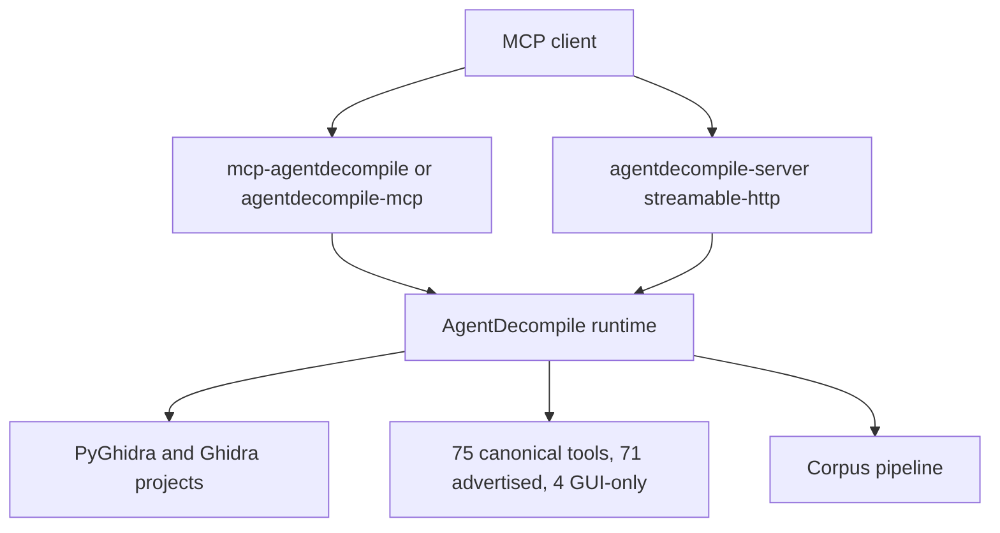
````

#### S078-C0002: What it does

Source `README.md` lines 22–31; accountable coverage owner U1.

```md
## What it does

1. **Analyze with agents** — MCP tools read live Ghidra state (functions, xrefs, memory, decompilation) instead of guessing from file names.
2. **Recover rebuildable C** — The reconstruct pipeline only promotes functions that compile and pass objdiff with zero differences. Everything else stays in advisory folders with honest labels.
3. **Run your way** — Stdio for desktop MCP clients, HTTP at `/mcp` for scripts and remote use, optional browser UI when you start the server locally.

A finished dashboard job is not a match. Verified C requires compile plus objdiff 0; terminal recovery additionally requires a fresh whole-image byte-identical rebuild, with C+assembly-floor and max-C variants separately measured.

Source lives at [github.com/bodencrouch/AgentDecompile](https://github.com/bodencrouch/AgentDecompile). The published container image is still `docker.io/bolabaden/agentdecompile-mcp`. The Pages site is [bodecloud.github.io/AgentDecompile](https://bodecloud.github.io/AgentDecompile/).
```

#### S078-C0003: Installation

Source `README.md` lines 32–35; accountable coverage owner U1.

```md
## Installation

Pick one start path. Use **stdio** if your editor or Claude Desktop will spawn the server. Use **HTTP** if you want a URL you can point the CLI or another client at. Use **Docker** if you want Ghidra and the server in one image.
```

#### S078-C0004: 1. Stdio (desktop MCP clients)

Source `README.md` lines 36–45; accountable coverage owner U1.

````md
### 1. Stdio (desktop MCP clients)

```bash
uv run mcp-agentdecompile
# or, without a local checkout:
uvx --from git+https://github.com/bodencrouch/AgentDecompile mcp-agentdecompile
```

Success: the MCP client stays connected and can call `tools/list`.
````

#### S078-C0005: 2. HTTP / uvx

Source `README.md` lines 46–83; accountable coverage owner U1.

````md
### 2. HTTP / uvx

```bash
uv run agentdecompile-server -t streamable-http
# or:
uvx --from git+https://github.com/bodencrouch/AgentDecompile agentdecompile-server -t streamable-http
```

The MCP endpoint is `http://127.0.0.1:8080/mcp`. `/` and `/api` are metadata only. `/api/mcp` is not supported.

```bash
uv run agentdecompile-cli --server-url http://127.0.0.1:8080/mcp tool --list-tools
```

**Current recovery operations:** reuse the existing listener on 8080. Inspect
`GET /api/v1/actions` and submit work through the advertised catalog.
Do not start a second server, Vite on 5174, a watcher or an alternate port.
[AGENTS.md](AGENTS.md) owns process/mission rules. Startup commands above are
installation reference, not instructions to replace an active owner.

For a browser IDE, set `VITE_AGENTDECOMPILE_WEB_IDE_URL` while building or
running Vite and expose the same origin to the dashboard process as either
`AGENTDECOMPILE_WEB_IDE_URL` or `VITE_AGENTDECOMPILE_WEB_IDE_URL`. Embedding
also requires `VITE_AGENTDECOMPILE_WEB_IDE_EMBED=1` and a browser IDE whose
frame policy permits this dashboard origin; otherwise the workbench keeps the
external browser-IDE link as the honest fallback.

Success: the CLI prints the advertised tool list.

From source:

```bash
git clone https://github.com/bodencrouch/AgentDecompile.git
cd AgentDecompile
uv sync
export GHIDRA_INSTALL_DIR=/path/to/ghidra
```
````

#### S078-C0006: 3. Docker

Source `README.md` lines 84–104; accountable coverage owner U1.

````md
### 3. Docker

```bash
docker run --rm \
  --add-host host.docker.internal:host-gateway \
  -p 8080:8080 \
  docker.io/bolabaden/agentdecompile-mcp:latest
```

Then point a client at `http://127.0.0.1:8080/mcp`. For a client that spawns stdio:

```bash
docker run --rm -i \
  --add-host host.docker.internal:host-gateway \
  --entrypoint /ghidra/venv/bin/agentdecompile-server \
  docker.io/bolabaden/agentdecompile-mcp:latest \
  -t stdio
```

.NET/IL decompilation needs [ilspycmd](https://github.com/icsharpcode/ILSpy) separately (`dotnet tool install -g ilspycmd`). It is not a pip extra.
````

#### S078-C0007: First-run environment

Source `README.md` lines 105–116; accountable coverage owner U1.

```md
## First-run environment

| Variable | Purpose |
|----------|---------|
| `GHIDRA_INSTALL_DIR` | Local Ghidra install (source checkouts) |
| `AGENT_DECOMPILE_MCP_SERVER_URL` | CLI connect URL, usually `http://127.0.0.1:8080/mcp` |
| `AGENT_DECOMPILE_GHIDRA_SERVER_HOST` / `_PORT` / `_USERNAME` / `_PASSWORD` | Ghidra Server (shared repos) only — not MCP HTTP auth |

HTTP examples in this README bind `127.0.0.1`. Do not set `AGENT_DECOMPILE_HOST=0.0.0.0` without `AGENT_DECOMPILE_AUTH_ENABLED` and a firewall. See [docs/MCP_CONFIGURATION_SECURITY.md](docs/MCP_CONFIGURATION_SECURITY.md).

The full env-var and HTTP-header catalog lives in [USAGE.md](USAGE.md).
```

#### S078-C0008: Corpus recovery

Source `README.md` lines 117–144; accountable coverage owner U1.

````md
## Corpus recovery

For more than one build, use the corpus actions advertised on 8080. Register each binary. Mark the STABS/DWARF build as `--donor`. Recover a function once on the easy build, then propagate. Do not re-analyze a Ghidra program that already has analysis. A green dashboard label is not proof.

Implementation CLI reference (current recovery uses the 8080 catalog):

```bash
uv run agentdecompile-corpus init --id my-corpus --out target/corpus.json
uv run agentdecompile-corpus add-binary --corpus target/corpus.json \
  --id debug-build --path /path/to/debug-binary --debug stabs --donor
uv run agentdecompile-corpus run --corpus target/corpus.json \
  --snapshot-dir target/extracts --work-dir target/corpus-run --stop-after compile
```

`--stop-after compile` stops after donor C compiles. It is not a byte match. The workbench is `/dashboard` on the same HTTP server as `/mcp` (default 8080).

The [interface guide](src/agentdecompile_recovery/corpus/dashboard/frontend/README.md) distinguishes the static workbench source from the React frontend and its packaged routes. Use the current 8080 serving mode; source or asset presence does not prove a completed migration.

Cross-build identity is a `logical_id`, not a virtual address. After the store has bindings, inspect `corpus.export-hookpack` in the live catalog. Its implementation CLI equivalent is:

```bash
uv run agentdecompile-corpus export-hookpack --db target/corpus.sqlite --out target/hookpack.json
```

KotorPhasor already loads v1 packs, but exported names/build profiles and ABI adapters still require alignment. Resolution, installation, calls and observed behavior have separate gates. [Runtime reuse](docs/RUNTIME_REUSE.md) is useful before whole-image recovery and does not count original-code execution as recovered source.

Contract: [docs/CORPUS_PIPELINE.md](docs/CORPUS_PIPELINE.md). Bet: [STRATEGY.md](STRATEGY.md). Single-binary reconstruct (not the default): [docs/CRITICAL_PATH.md](docs/CRITICAL_PATH.md).
````

#### S078-C0009: Next

Source `README.md` lines 145–155; accountable coverage owner U1.

```md
## Next

- Day-to-day CLI, sessions, Web UI, and failures: [USAGE.md](USAGE.md)
- Tool parameters: [TOOLS_LIST.md](TOOLS_LIST.md)
- Windows / Podman: [docs/Podman-Windows-Complete-Setup-Guide.md](docs/Podman-Windows-Complete-Setup-Guide.md)
- Security reports: [SECURITY.md](SECURITY.md)
- Vocabulary: [CONCEPTS.md](CONCEPTS.md)
- Full map: [docs/INDEX.md](docs/INDEX.md)

CLI command recipes belong in USAGE. This file only changes when install or start-path text changes.
```

#### S078-C0010: License

Source `README.md` lines 156–159; accountable coverage owner U1.

```md
## License

GNU Affero General Public License v3.0. See [LICENSE](LICENSE).
```

#### S078-C0011: Contributing

Source `README.md` lines 160–162; accountable coverage owner U1.

```md
## Contributing

See [CONTRIBUTING.md](CONTRIBUTING.md).
```

#### S079-C0001: AgentDecompile Usage Guide

Source `USAGE.md` lines 1–22; accountable coverage owner U16.

````md
# AgentDecompile Usage Guide

Install and first start live in [README.md](README.md). This page is the day-to-day operator manual. Current recovery uses the existing 8080 action catalog under [AGENTS.md](AGENTS.md); CLI snippets below document implementation and general usage, not a recovery bypass. Do not start duplicate servers or use automatic local fallback for the current recovery mission.

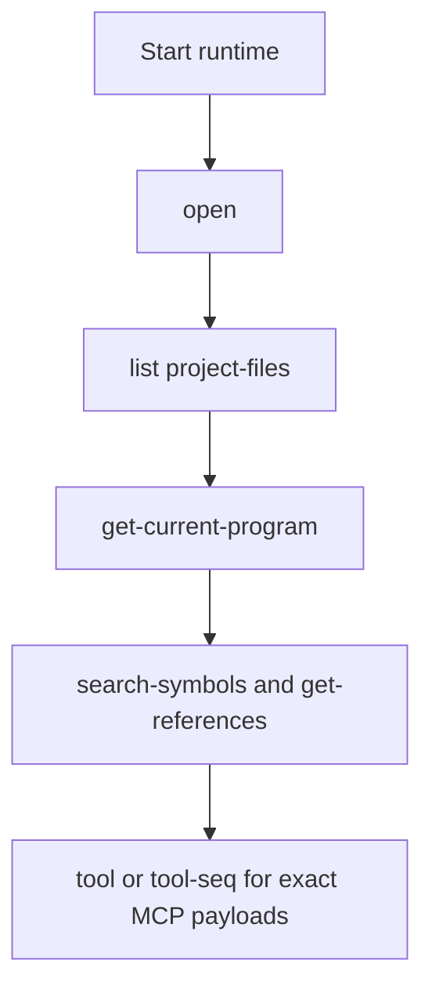

If you run from a local clone instead of the published repo:

```bash
git clone https://github.com/bolabaden/agentdecompile
uvx --from /path/to/agentdecompile/ --with-editable ./agentdecompile agentdecompile-cli ...
uvx --from /path/to/agentdecompile/ --with-editable ./agentdecompile agentdecompile-server ...
uvx --from /path/to/agentdecompile/ --with-editable ./agentdecompile agentdecompile-proxy ...
```
````

#### S079-C0002: Endpoints

Source `USAGE.md` lines 23–34; accountable coverage owner U1.

```md
## Endpoints

- Canonical MCP HTTP: `http://127.0.0.1:8080/mcp`
- Compatibility: `http://127.0.0.1:8080/mcp/message`
- `/` and `/api` return API index metadata
- `/docs` is Swagger UI
- `/api/mcp` is not supported

Prefer `--mcp-server-url http://127.0.0.1:8080/mcp` in examples. The CLI also accepts the base URL and normalizes it. Explicit `--server-url`, `--host`, or `--port` stay authoritative and fail instead of being ignored.

Implementation behavior outside the current recovery mission: when you do not pass an explicit backend, the CLI treats unreachable default or env URLs as recoverable: reuse a cached local server, auto-start one, or fall back to in-process local execution.
```

#### S079-C0003: Sessions

Source `USAGE.md` lines 35–46; accountable coverage owner U1.

```md
## Sessions

Each standalone CLI command is a fresh session unless you use `tool-seq`.

When no `mcp-session-id` (or session cookie) is sent, the server uses a single default session. Sequential CLI runs can reuse that session. For multi-session or multi-user use, send a distinct session id.

**Session IDs are not authentication.** Do not treat `mcp-session-id` or the default session as access control. Protocol rules: [docs/session-handling.md](docs/session-handling.md).

`tool-seq` counts a step as failed (and exits non-zero) if any text part contains markdown `## Error` with a blockquote, or `## Modification conflict`, even when the MCP envelope has `isError: false`.

Add `--verbose` on the CLI, server, or proxy when you need transport diagnostics.
```

#### S079-C0004: Workbench

Source `USAGE.md` lines 47–56; accountable coverage owner U1.

```md
## Workbench

The operator UI is `/dashboard` on the same HTTP server as `/mcp`. Default: `http://127.0.0.1:8080/dashboard`.

Reuse the existing listener. Read `GET /api/v1/actions`, select a listed action and its parameters, and inspect the resulting job and evidence. Do not infer missing analysis from an empty page; first check selected project/program and corpus binding.

Open an already-analyzed Ghidra project and use the functions already there. Do not call `analyze-program` unless that program has no analysis yet. Force only an explicitly requested retry or work shown to be invalid.

`AGENT_DECOMPILE_WEBUI_*` still starts an optional sidecar if you set it. Corpus recovery does not use that port.
```

#### S079-C0005: Shared Ghidra Server

Source `USAGE.md` lines 57–70; accountable coverage owner U1.

````md
## Shared Ghidra Server

Do not set `AGENT_DECOMPILE_PROJECT_PATH` in the same launch when the goal is a shared repository. Prefer separate editor entries for local vs shared.

```bash
export AGENT_DECOMPILE_GHIDRA_SERVER_HOST="YOUR_GHIDRA_HOST"
export AGENT_DECOMPILE_GHIDRA_SERVER_PORT="13100"
export AGENT_DECOMPILE_GHIDRA_SERVER_USERNAME="<set-in-user-env>"
export AGENT_DECOMPILE_GHIDRA_SERVER_PASSWORD="<set-in-user-env>"
export AGENT_DECOMPILE_GHIDRA_SERVER_REPOSITORY="<set-in-user-env>"
```

Those credentials authenticate Ghidra Server, not the MCP HTTP listener. See [docs/MCP_CONFIGURATION_SECURITY.md](docs/MCP_CONFIGURATION_SECURITY.md).
````

#### S079-C0006: Workflows

Source `USAGE.md` lines 71–74; accountable coverage owner U1.

```md
## Workflows

Public fixture: `tests/fixtures/test_x86_64`. Other examples use `/path/to/binary`.
```

#### S079-C0007: Open, list, inspect

Source `USAGE.md` lines 75–90; accountable coverage owner U1.

````md
### Open, list, inspect

```bash
uv run agentdecompile-cli --server-url http://127.0.0.1:8080/mcp \
  tool-seq '[{"name":"open","arguments":{"path":"tests/fixtures/test_x86_64"}},{"name":"list-project-files","arguments":{}},{"name":"get-current-program","arguments":{}}]'
```

Convenience forms (same session only if you use `tool-seq`):

```bash
uv run agentdecompile-cli --server-url http://127.0.0.1:8080/mcp open tests/fixtures/test_x86_64
uv run agentdecompile-cli --server-url http://127.0.0.1:8080/mcp list project-files
uv run agentdecompile-cli --server-url http://127.0.0.1:8080/mcp search-symbols --query main
uv run agentdecompile-cli --server-url http://127.0.0.1:8080/mcp get-functions --identifier main
```
````

#### S079-C0008: Import and export

Source `USAGE.md` lines 91–99; accountable coverage owner U1.

````md
### Import and export

```bash
uv run agentdecompile-cli import-binary /path/to/binary
uv run agentdecompile-cli tool export '{"programPath":"/path/to/binary","outputPath":"./analysis.sarif","format":"sarif"}'
```

Full parameter guide: [docs/IMPORT_EXPORT_GUIDE.md](docs/IMPORT_EXPORT_GUIDE.md).
````

#### S079-C0009: Context pieces

Source `USAGE.md` lines 100–103; accountable coverage owner U1.

```md
### Context pieces

Extra notes, dumps, and archives merge by address. They stay advisory until objdiff. See [docs/CONTEXT_FUSION.md](docs/CONTEXT_FUSION.md).
```

#### S079-C0010: Fast triage

Source `USAGE.md` lines 104–112; accountable coverage owner U1.

```md
### Fast triage

1. `agentdecompile-cli --mcp-server-url http://127.0.0.1:8080/mcp tool --list-tools`
2. `list project-files`
3. `get-current-program`
4. Use `tool-seq` when state must survive
5. Shared-server auth failures: check `AGENT_DECOMPILE_GHIDRA_SERVER_*` before retry loops
6. If local import succeeded but later errors mention `127.0.0.1:13100`, check whether shared-server env leaked into a local path
```

#### S079-C0011: Failure states

Source `USAGE.md` lines 113–136; accountable coverage owner U1.

````md
## Failure states

| Symptom | Check | Next |
|---------|-------|------|
| `No program loaded` | Did `open` / `import-binary` run in this session? | Use `tool-seq` or pass `programPath` |
| Shared-server `NotConnectedException` plus `FailedLoginException` | Host, port, username, password, repo | [docs/MCP_CONFIGURATION_SECURITY.md](docs/MCP_CONFIGURATION_SECURITY.md) |
| Tool content has `## Error` but process exit is 0 | Payload text, not transport | Treat payload as authoritative |
| Convenience flag missing | `agentdecompile-cli <command> -h` | Use raw `tool` for exact MCP keys |
| Local VC probe looks like success | Content may still say checkout failed | Trust payload semantics |
| Empty SARIF | Selected program, binding and existing analysis | Reuse valid analysis; analyze only proven missing/invalid work |

Typical unresolved-program payload:

```json
{
  "success": false,
  "error": "Program path '...' was provided but could not be resolved/opened ...",
  "nextSteps": [
    "Call `list-project-files` to discover the exact program path.",
    "Call `import-binary` to import if the file is not yet in the project."
  ]
}
```
````

#### S079-C0012: Environment variables

Source `USAGE.md` lines 137–187; accountable coverage owner U1.

```md
## Environment variables

`AGENTDECOMPILE_*` aliases mirror the `AGENT_DECOMPILE_*` names below.

| Variable(s) | Scope | Purpose |
|----------|---------|---------|
| `GHIDRA_INSTALL_DIR` | Runtime | Path to Ghidra |
| `AGENT_DECOMPILE_BACKEND_URL` | Runtime | Remote MCP backend for proxy |
| `AGENT_DECOMPILE_MCP_SERVER_URL` | Runtime/CLI | MCP URL for CLI connect and proxy |
| `AGENT_DECOMPILE_SERVER_URL` | Runtime/CLI | Legacy server URL alias |
| `AGENT_DECOMPILE_MCP_SERVER_HOST`, `AGENT_DECOMPILE_MCP_SERVER_PORT` | Runtime/CLI | Host/port when composing MCP URLs |
| `AGENT_DECOMPILE_HOST` | Runtime | MCP HTTP bind host |
| `AGENT_DECOMPILE_PORT` | Runtime | MCP HTTP bind port |
| `AGENT_DECOMPILE_PROJECT_PATH` | Runtime/CLI | Local project or `.gpr` |
| `AGENT_DECOMPILE_PROJECT_NAME` | Runtime/CLI | Local project name |
| `AGENT_DECOMPILE_DEFAULT_PROJECT_DIR` | Runtime | Default project directory |
| `AGENT_DECOMPILE_GHIDRA_SERVER_HOST`, `AGENT_DECOMPILE_HTTP_GHIDRA_SERVER_HOST`, `AGENT_DECOMPILE_SERVER_HOST`, `AGENT_DECOMPILE_GHIDRA_HOST` | Runtime/CLI | Shared Ghidra host |
| `AGENT_DECOMPILE_GHIDRA_SERVER_PORT`, `AGENT_DECOMPILE_HTTP_GHIDRA_SERVER_PORT`, `AGENT_DECOMPILE_SERVER_PORT`, `AGENT_DECOMPILE_GHIDRA_PORT` | Runtime/CLI | Shared Ghidra port |
| `AGENT_DECOMPILE_GHIDRA_SERVER_USERNAME`, `AGENT_DECOMPILE_SERVER_USERNAME`, `AGENT_DECOMPILE_GHIDRA_USERNAME` | Runtime/CLI | Shared Ghidra username |
| `AGENT_DECOMPILE_GHIDRA_SERVER_PASSWORD`, `AGENT_DECOMPILE_SERVER_PASSWORD`, `AGENT_DECOMPILE_GHIDRA_PASSWORD` | Runtime/CLI | Shared Ghidra password |
| `AGENT_DECOMPILE_GHIDRA_SERVER_REPOSITORY`, `AGENT_DECOMPILE_HTTP_GHIDRA_SERVER_REPOSITORY`, `AGENT_DECOMPILE_REPOSITORY`, `AGENT_DECOMPILE_GHIDRA_REPOSITORY` | Runtime/CLI | Shared repository name |
| `AGENT_DECOMPILE_AUTH_ENABLED` | Runtime | Require MCP HTTP auth |
| `AGENT_DECOMPILE_TLS_CERT`, `AGENT_DECOMPILE_TLS_KEY` | Runtime | TLS paths for HTTPS |
| `AGENT_DECOMPILE_PYGHIDRA_VMARGS` | Runtime/tests | Extra JVM args |
| `AGENT_DECOMPILE_CLI_OP_TIMEOUT` | CLI | Per-tool timeout |
| `AGENT_DECOMPILE_MCP_BIND_TIMEOUT` | Runtime | Bind timeout |
| `AGENT_DECOMPILE_SESSION_GRACE_PERIOD` | Runtime | Session cleanup grace |
| `AGENT_DECOMPILE_DEBUG` | Runtime | Debug logging |
| `AGENT_DECOMPILE_TOOL_SURFACE` | Runtime | `full`, `curated`, or `legacy` |
| `AGENT_DECOMPILE_DISABLE_TOOLS` | Runtime | Comma-separated hide list |
| `AGENT_DECOMPILE_ENABLE_TOOLS` | Runtime | Explicit allow-list |
| `AGENT_DECOMPILE_ENABLE_LEGACY_TOOLS`, `AGENT_DECOMPILE_SHOW_LEGACY_TOOLS` | Runtime | Re-advertise aliases |
| `AGENT_DECOMPILE_AUTO_CHECKIN` | Runtime | Auto check-in after setters |
| `AGENT_DECOMPILE_AUTO_MATCH_PROPAGATE` | Runtime | Auto `match-function` after setters |
| `AGENT_DECOMPILE_AUTO_MATCH_TARGET_PATHS` | Runtime | Propagation targets |
| `AGENT_DECOMPILE_JVM_EPOCH` | Runtime | Force shared-session refresh |
| `AGENT_DECOMPILE_LOCAL_MODE` | CLI | Force local-mode CLI |
| `AGENT_DECOMPILE_PROGRAM_PATH` | CLI | Default program path |
| `AGENT_DECOMPILE_PROGRAM` | CLI | Legacy program alias |
| `AGENT_DECOMPILE_BINARY_NAME` | CLI | Default `binaryName` |
| `AGENT_DECOMPILE_WEBUI_ENABLED`, `AGENT_DECOMPILE_WEBUI` | Runtime | Optional leftover sidecar on/off. Workbench is `/dashboard` on 8080. |
| `AGENT_DECOMPILE_EXCHANGE_ENABLED` | Runtime | Experimental donated-compute work exchange on the proxy. Off by default; `--enable-exchange` / `--no-enable-exchange` win over the variable. Contributions stay proposals until the local compile and objdiff gate verifies them. See [the exchange plan](docs/plans/2026-09-08-donated-compute-work-exchange.md). |
| `AGENT_DECOMPILE_WEBUI_HOST` | Runtime | Leftover sidecar bind host |
| `AGENT_DECOMPILE_WEBUI_PORT` | Runtime | Leftover sidecar bind port |
| `AGENT_DECOMPILE_WEBUI_BACKEND_URL` | Runtime | Leftover sidecar backend override |
| `AGENT_DECOMPILE_TEST_SERVER_URL` | Tests | External live server |
| `AGENT_DECOMPILE_STRESS_COPIES_PER_SEED` | Tests | Stress fixture copies |
| `AGENT_DECOMPILE_PROFILE_DIR` | Tests | Profile output dir |
| `AGENT_DECOMPILE_PROFILE_ANALYZER` | Tests | Analyzer script path |
| `AGENT_DECOMPILE_PROFILE_SEARCH_EVERYTHING` | Tests | Search profiling |
```

#### S079-C0013: HTTP headers for shared-server requests

Source `USAGE.md` lines 188–199; accountable coverage owner U1.

```md
### HTTP headers for shared-server requests

| Environment variable | HTTP equivalent |
|----------|---------|
| `AGENT_DECOMPILE_GHIDRA_SERVER_HOST` | `X-Ghidra-Server-Host` |
| `AGENT_DECOMPILE_GHIDRA_SERVER_PORT` | `X-Ghidra-Server-Port` |
| `AGENT_DECOMPILE_GHIDRA_SERVER_REPOSITORY` | `X-Ghidra-Repository` |
| `AGENT_DECOMPILE_GHIDRA_SERVER_USERNAME` + password | `Authorization: Basic <base64>` |
| same username / password | `X-Agent-Server-Username` / `X-Agent-Server-Password` |

Credential precedence: `Authorization: Basic` then the `X-Agent-Server-*` pair. Never hardcode passwords in `mcp.json`.
```

#### S079-C0014: Naming

Source `USAGE.md` lines 200–205; accountable coverage owner U1.

```md
## Naming

Canonical MCP tool names are kebab-case. JSON keys are camelCase. Convenience CLI flags are not always 1:1 with raw tool keys. Use `-h` or `agentdecompile-cli alias <tool-name>`. Prefer `search-symbols` over `search-symbols-by-name`. Prefer `open` over `switch-project`.

Modifying tools may return a `conflictId`. Complete the change with `resolve-modification-conflict`. Do not retry the same setter to force overwrite.
```

#### S079-C0015: Related docs

Source `USAGE.md` lines 206–217; accountable coverage owner U1.

```md
## Related docs

- [README.md](README.md) — install and start paths
- [docs/INDEX.md](docs/INDEX.md) — hub
- [docs/CORPUS_PIPELINE.md](docs/CORPUS_PIPELINE.md) — multi-binary recovery
- [docs/IMPORT_EXPORT_GUIDE.md](docs/IMPORT_EXPORT_GUIDE.md) — import/export
- [docs/MCP_CONFIGURATION_SECURITY.md](docs/MCP_CONFIGURATION_SECURITY.md) — bind, auth, `mcp.json`
- [docs/session-handling.md](docs/session-handling.md) — session id rules
- [CONCEPTS.md](CONCEPTS.md) — vocabulary
- [docs/CONTEXT_FUSION.md](docs/CONTEXT_FUSION.md) — merge notes and address-keyed conflicts
- [TOOLS_LIST.md](TOOLS_LIST.md) — tool parameters
```

#### S079-C0016: Workbench implementation and runtime reuse

Source `USAGE.md` lines 218–230; accountable coverage owner U1.

```md
### Workbench implementation and runtime reuse

Use the existing 8080 workbench. Static workbench source and the React frontend
coexist; see the [interface guide](src/agentdecompile_recovery/corpus/dashboard/frontend/README.md)
for source and packaged route distinctions. Do not start 5174 or infer completed
migration from generated assets.

`corpus.export-hookpack` is implemented and advertised through parser
introspection. [Runtime reuse](docs/RUNTIME_REUSE.md) describes the existing
KotorPhasor consumer, target bindings and unverified readiness/behavior gates.
An exported pack is not proof of a safe call or recovered source.
```

#### S079-C0017: Durable continuation and verification controls

Source `USAGE.md` lines 231–283; accountable coverage owner U1.

````md
## Durable continuation and verification controls

The September 22 foundation adds controls to the existing action catalog and CLI
implementation parsers. Recovery operations still use the existing 8080 action
catalog, discovered through `GET /api/v1/actions`; CLI names below identify the
implementation contract and are not instructions to bypass that catalog.

| Action | New behavior / parameters |
|---|---|
| `corpus.recovery-orchestrator` | Requires explicit `input-basis` for dispatch; `max-failed-exits` defaults to 3, `backoff` to 30 seconds and `success-backoff` to 300. Worker defaults are 1. `status` reads without dispatch; `once` performs one admission cycle and does not establish completion. |
| `corpus.verify-byteexact` | `cache-input-manifest` declares the compiler dependency closure; `transient-retry-seconds` defaults to 300. Cache identity uses content, relevant database rows, tool code and declared environment. |
| `corpus.verify-periodic` | `full-interval-seconds` defaults to 86400, `force-full` requests an explicit fresh pass. Legacy `full-every` defaults to 0. Failed full attempts consume the time interval too. |

The supervisor persists its state in the output directory's `.supervision` folder.
Its lock excludes other instances of this supervisor for that output root; it does
not prove exclusive ownership of all external compiler, Ghidra, Wine or corpus
writers. Unknown prior launches remain `needs_reconciliation`, even when their stage
is now disabled. Do not delete state to bypass a reservation or exhausted allowance.
A zero process exit records a completed pass, never recovery acceptance. The explicit
input basis must describe a real changed input set; arbitrary new labels are not a
repair. Automatic input-basis generation and cross-provider ownership reconciliation
remain roadmap work.

A cache manifest is a JSON object such as:

```json
{
  "complete": true,
  "files": ["toolchain/compiler.exe", "toolchain/runtime.dll", "include/header.h"],
  "environment": ["INCLUDE", "LIB"]
}
```

File paths resolve relative to the manifest. Include every material toolchain,
header, runtime and configuration dependency; completeness is asserted by the
provider, not automatically discovered by the verifier. Without complete closure,
a fresh comparison can run, but later unchanged cached positives are withheld with
`cache-basis-incomplete` rather than silently trusted or continuously recompiled.
Transient/unclassified failures expire under a rate limit. This TTL is not a total
objective spending cap. Only known deterministic compiler diagnostics are classified
as `compile-rejected`. Local function comparisons retain their existing comparison
semantics and do not establish fresh whole-image byte identity.

Preparation now records retry decisions, reasons, remaining attempts and wake
conditions. Both preparation interfaces expose them under **Recorded continuation
decisions**. Same-input resume preserves attempts, including after unrelated KB
writes. Unknown job outcomes hold the affected action while independent eligible
comparisons can proceed. A missing job during cancellation is not proof its work
stopped. The displayed history is a record, not proof every old condition remains
active. See the [roadmap](docs/plans/2026-09-22-autonomous-capability-product-roadmap.md)
and [verification receipt](docs/verification/2026-09-22-autonomy-foundation.md).
````

#### S079-C0018: External diagnostic report reader

Source `USAGE.md` lines 284–297; accountable coverage owner U1.

```md
### External diagnostic report reader

`corpus.normalize-validation-report` is a read-only catalog action and CLI command.
It takes `provider` (`reagent-benchmark` or `reccmp-compare`) and `report` (a JSON
report file), returning a normalized diagnostic proposal. It does not run the
provider or accept recovery claims. Invalid/empty/unknown-schema reports return
`invalid_output` and CLI exit 2; CLI exit 0 means normalization succeeded.

A ReAgent benchmark can meet its expected negative while the candidate mismatches.
The reader retains those separate outcomes. reccmp scores retain their comparison
scope, omitted-entity caveat and unknown eligible denominator. A standalone report
cannot prove input identity, freshness or the actual provider revision. Those gaps
remain explicit for the future execution adapter and independent acceptor.
```

#### S079-C0019: Resource reservations after uncertain outcomes

Source `USAGE.md` lines 298–320; accountable coverage owner U1.

```md
### Resource reservations after uncertain outcomes

Catalog jobs now expose `resourceDisposition`, `resourceKeys` and
`ownershipUnresolved`. Unknown child/remote outcomes and failed terminal receipt
writes retain identity/pair/Ghidra reservations in the existing job receipt store.
A receipt-root owner lock serializes admission authorities for that directory;
restart restores reservations before admitting scoped work. Unrelated resources
can proceed after the worker slot is released. Both activity surfaces show unknown
ownership, and React suppresses its retry shortcut for a quarantined job.

`workbench.resource-reconciliation-report` inspects a job's retained reservation;
`workbench.resource-reconcile` repairs a stale reservation only when a qualified
terminal release was already durably committed. Both accept `job_id`. The same
eligible repair runs during the next scoped admission. The initial qualified local
provider is `corpus.logical-build`; unknown remote/crash outcomes remain reserved.
Internal clearance binds the exact attempt, arguments, resource keys, process and
receipt generation. Child log claims and caller-supplied proof cannot release keys.

These changes do not infer clearance from age or a stopped coordinator. General
reconciliation of uncertain provider outcomes remains forthcoming. Different receipt roots,
external writers and deliberately detached children require the broader resource
contract; this local authority is not proof of universal writer exclusion.
```

#### S079-C0020: Cached evidence for ReAgent

Source `USAGE.md` lines 321–333; accountable coverage owner U1.

```md
### Cached evidence for ReAgent

`corpus.export-reagent-snapshot` exports selected existing `func_knowledge` rows
without live analysis. Its parameters are `kb`, `program`, repeated `address`, a
new `destination`, and optional `max_functions` (default 100, maximum 1000). The
action creates private artifacts and is marked mutating; the input cache is opened
read-only. Use the catalog for recovery operations.

The schema-1 snapshot preserves available source and assembly, records row/file
hashes, and publishes its manifest last. Missing context remains explicit gaps.
A cache program name is not verified original-binary identity. See the
[actual cached-evidence consumer receipt](docs/verification/2026-09-22-reagent-cache-export.md).
```

#### S079-C0021: Reusing local comparison evidence

Source `USAGE.md` lines 334–352; accountable coverage owner U1.

```md
### Reusing local comparison evidence

Current source ingestion and collection require `sourceSha256` from the observation
that actually compiled those source bytes. Old coverage flags paired only by function
name remain historical evidence. Revalidate through the existing catalog route for
current-source verification; do not add a digest to an old success by hand. Rejected
files remain candidates. Collection preserves exact verified bytes and moves stale
prior verified output under `unverified/`, reporting each preserved path.

This local source binding does not establish semantic identity, complete compiler
inputs or linked contribution. See the [verification scope](docs/verification/2026-09-26-current-source-binding.md).

Recovered-source ingestion now persists nullable `source_sha256`. Legacy rows remain
unbound until a producer supplies a checked observation; schema migration does not
hash today's files as proof of historical compilation. Covered automatic skip readers
recheck current source bytes, and database-backed packaging exports the same checked
byte snapshot. New restoration ledger rows are reused/unverified, even if their stored
source digest matches. See the [consumer freshness receipt](docs/verification/2026-09-26-recovered-source-freshness.md).
```

#### S079-C0022: Seed comparison reuse inputs

Source `USAGE.md` lines 353–367; accountable coverage owner U1.

```md
### Seed comparison reuse inputs

`corpus.seed-validation` accepts `compile-input-manifest` (CLI
`--compile-input-manifest`). It forwards the existing closure declaration format:
`complete: true`, a nonempty `files` list resolved relative to the manifest, and an
optional `environment` list. Known compiler/context/verifier inputs are also included;
receipts retain the basis digest and completeness state, without environment values.

The configured audit API accepts the compiler provider, object parsers and optional
objdiff checker. Missing compiler/verifier setup or an incomplete declaration cannot
qualify positive reuse. The standalone command still requires its supported compiler
configuration path to be completed for real compilation; the manifest option alone
is not a compiler setup. Fresh attempts and reusable positive evidence remain distinct.
See the [compile-input receipt](docs/verification/2026-09-27-seed-compile-input-basis.md).
```

#### S079-C0023: Preparation admission allocations

Source `USAGE.md` lines 368–378; accountable coverage owner U14.

```md
### Preparation admission allocations

The existing action catalog exposes `workbench.prepare.maxActionAdmissions` as an
optional nonnegative initial allocation. Omit it for Unlimited accounting. Resume
preserves the current allocation and spending. To revise an inactive preparation,
use `workbench.workflow-control` with `operation: "admission-budget"`, its
`preparation_id`, current `expectedAllocationRevision`, and a new total
`maxActionAdmissions`; explicit `unlimited: true` allows null. Active preparations
must pause and drain first. Existing nonpaused queued work remains eligible; paused
work requires resume. These are action admissions, not CPU/token/provider costs.
See the [accounting contract and proof](docs/verification/2026-09-27-objective-admission-accounting.md).
```

#### S080-C0001: VISION.md — AgentDecompile Intent, Purpose, and Role

Source `VISION.md` lines 1–8; accountable coverage owner U1.

```md
# VISION.md — AgentDecompile Intent, Purpose, and Role

**Audience:** founders, stakeholders, orchestrators, and agents who need to represent *why this codebase exists* — not how any particular line of it works today.  
**Not for:** end-user READMEs, API reference, runbooks, or status dashboards.  
**Character:** aspirational and contractual. Describes goals, expectations, and claim boundaries. Does not inventory defects, name modules, prescribe pipelines, or hardcode product identities.

---
```

#### S080-C0002: 1. Motif

Source `VISION.md` lines 9–29; accountable coverage owner U1.

````md
## 1. Motif

**Work with compiled binary data as rich, high-quality context that an agent can understand almost as seamlessly as straight source code.**

That is the permanent center of gravity. Everything else — extraction, lifting, decompilation, matching, verification, packaging, agent loops — exists to serve it.

AgentDecompile is a **context substrate for machine code and packaged software**, not a single-purpose decompiler and not a fixed recovery funnel. It turns opaque artifacts into structured, provenance-anchored evidence that language models and humans can reason over fluently. Verification and rebuildability are the strongest forms of that evidence — not the only forms, and not the only valid uses of the system.

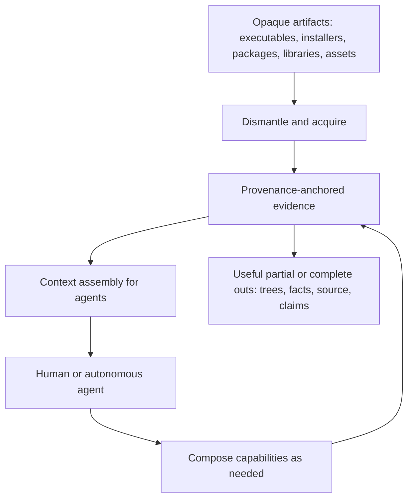

---
````

#### S080-C0003: 2. Charter

Source `VISION.md` lines 30–50; accountable coverage owner U1.

```md
## 2. Charter

AgentDecompile exists to close the gap between **binaries as opaque blobs** and **binaries as intelligible working material**.

The system should let even a small model move — with assistance from tooling, retrieval, and structure — between source, binary, and recovered understanding. Full automated round-tripping of arbitrary applications is a multi-decade horizon: exhaustive, meticulous, and never finished. The durable bet is the **design**: a substrate where every partial capability is immediately useful, accretes over time, and never requires the whole machine to be complete before any of it pays off.

**One product name. One honesty model. An open capability surface.**

| Surface | Role |
|---|---|
| **Acquisition and dismantling** | Unpack, section, rip, and layout opaque delivery formats into inspectable trees and facts. |
| **Analysis and lifting** | Decompile, disassemble, type, name, and relate code with citations back to bytes. |
| **Interactive RE** | Stable sessions so agents and operators share the same program state. |
| **Runtime context and reuse** | Supported adapters can observe or call original code and return provenance-bearing behavior evidence before complete recovery; runtime success does not establish recovered-source parity. |
| **Recovery and verification** | Optional, powerful loops that turn candidates into rebuildable claims when the caller wants that bar. |
| **Context assembly** | Progressive, budgeted, provenance-preserving presentation so models work from evidence instead of inventing it. |

**North star:** compiled reality in; agent-usable understanding out — as seamless as source, as honest as the bytes allow.

---
```

#### S080-C0004: 3. The Problem

Source `VISION.md` lines 51–66; accountable coverage owner U1.

```md
## 3. The Problem

Reverse engineering and agentic tooling both fail in the same place: **context without authority**.

Common failure modes:

- **Hallucinated identity** — models invent names, types, and origins because the chain from a local variable back to a stack slot, an address, a section, a resource, or a package payload was severed.
- **Flat dumps** — decompiler text or hex thrown at a model with no structure, no citations, no conflicts retained.
- **Hard-coded funnels** — “always decompile → always synthesize → always gate” policies baked into the product so agents cannot compose for their actual task.
- **All-or-nothing recovery** — if one-shot full source is unavailable, the run is treated as worthless instead of producing usable trees, facts, and partial lifts.
- **Forgotten packaging** — real software arrives as installers, packages, multi-part payloads, plugin bundles, and resource forests; treating only the main executable as the problem throws away most of the product.

AgentDecompile’s answer is architectural: **make the binary world legible, structured, and cite-able**, then let agents decide what to do with it.

---
```

#### S080-C0005: 4. What “Seamless and Robust” Means

Source `VISION.md` lines 67–76; accountable coverage owner U1.

```md
## 4. What “Seamless and Robust” Means

**Seamless** means an agent can treat dismantled binaries, live analysis, and recovered source fragments as ordinary working context — browsing layouts, asking about symbols, following provenance, assembling prompts — without learning a brittle ritual or being forced through a privileged pipeline.

**Robust** means missing tools, unsupported formats, incomplete lifts, or failed stages **narrow the evidence and lower the claim tier**; they do not blank the run, invent facts, or make the rest of the substrate unusable.

Partial implementations must always be useful in some way. A section dump with resources, an installer destination tree, a typed function with unresolved callers, an advisory decompile next to a verified neighbor — all are legitimate products of the system.

---
```

#### S080-C0006: 5. Dismantling as First-Class Context

Source `VISION.md` lines 77–99; accountable coverage owner U1.

```md
## 5. Dismantling as First-Class Context

A large share of real work is not “decompile this function.” It is **open the delivery artifact and make its internal world navigable**.

AgentDecompile should be excellent at dismantling opaque software into recognizable structural layouts — the same kinds of trees operators already produce by hand with unpackers and rippers. These layouts are generic; product names are never part of the design.

Illustrative structure families (not an exhaustive catalog, not product-specific):

| Family | What the agent should see |
|---|---|
| **Object / image sections** | Named segments and overlays (code, data, relocs, exports, resources, certificates, overlay blobs) as a filesystem-like tree rooted at the image. |
| **Installer and payload trees** | Destination-shaped directories (`install root`, shared/common areas, plugin dirs), staged files, scripts, and docs — as if the package had already been laid down. |
| **Package and product graphs** | Distribution metadata, bills of materials, compressed payloads, component packages, localized resources, and nested archives — recursively openable. |
| **Application and plugin layouts** | Program roots, system/helper libraries, fonts, documentation, presets, themes, scripts, data tables, and plugin/component bundles in their natural hierarchy. |
| **Resource forests** | Icons, manifests, version info, UI assets, samples, and embedded content typed and placed, not left as anonymous blobs. |
| **Companion and sidecar material** | Guides, licenses, drivers, redistributables, and related installers kept as related context for the same product surface. |

Dismantling is not a side quest. **Layout is context.** An agent that can walk an install tree, open a resource directory, and then dive into a binary’s sections is already operating closer to source-tree fluency than one that only sees a single decompile pane.

Acquisition tools — extractors, unpackers, rippers, transpilers, IL/bytecode lifters, debug-info parsers, signature matchers, decompilers — register through one open interface. Adding a new source of truth must not require rewriting the product’s control flow.

---
```

#### S080-C0007: 6. Provenance Against Hallucination

Source `VISION.md` lines 100–115; accountable coverage owner U1.

```md
## 6. Provenance Against Hallucination

The industry failure mode AgentDecompile refuses to inherit: **forgetting where a fact came from**.

Every useful claim an agent sees — a variable name, a type, a string, a resource path, a module boundary, a candidate source line — should answer:

1. **Where** in the artifact (address, section, package path, payload member)?  
2. **Which tool or witness** produced it?  
3. **How confident** is the system, and what conflicts exist?

Provenance is a data-model property, not a prompting tip. When the chain breaks, models confabulate. When the chain is retained — address-keyed, tool-attributed, conflict-retaining — even small models can stay grounded because they are not being asked to invent the world, only to navigate and transform it.

**Ground truth is the assembly and the bytes.** Notes, curated projects, decompiler output, and model proposals are witnesses that attach to that ground truth. They never replace it silently.

---
```

#### S080-C0008: 7. Agent-Directed Composition

Source `VISION.md` lines 116–128; accountable coverage owner U1.

```md
## 7. Agent-Directed Composition

Agents (and operators) compose the substrate as they see fit.

The design must **not** hardcode a single gate sequence or privilege one recovery story as the only valid path. Capabilities are independently addressable: dismantle, inventory, enrich, decompile, search, mutate analysis state, compile, compare objects, repair, dump trees, assemble prompts. Callers choose the policy.

That includes powerful **imperative** tooling — live analysis engines, compilers, object differs, permuters, and similar — exposed as richly configurable, introspectable capabilities with stable contracts. The agent orchestrates; the tools execute. Configuration around those tools should be deep and honest, not papered over by a one-size-fits-all workflow.

**Claim tiers stay non-negotiable; acceptance thresholds are the caller’s.**  
Verified, advisory, context-hint, and byte-authoritative meanings never blur. Whether a given task *requires* a hard verify step is a policy choice, not a product religion.

---
```

#### S080-C0009: 8. Round-Trip Horizon

Source `VISION.md` lines 129–138; accountable coverage owner U1.

```md
## 8. Round-Trip Horizon

The long-horizon invariant is **source → binary → source** (and the reverse) for arbitrary applications: compile with ease, recover with provenance, and eventually close the loop with confidence proportional to evidence.

That horizon is multi-decade because real software is exhaustively rich: native and managed code, installers, plugins, resources, drivers, scripts, data. AgentDecompile advances it by making every intermediate form — section trees, package graphs, typed inventories, advisory lifts, verified functions — a durable, usable stepping stone rather than a failed attempt at perfection.

Forward compilation and object-level comparison belong in the architecture because they are oracles for reverse understanding. They are not mandatory for every question an agent asks.

---
```

#### S080-C0010: 9. Context, Prompt, and Agent Engineering

Source `VISION.md` lines 139–152; accountable coverage owner U1.

```md
## 9. Context, Prompt, and Agent Engineering

Difficulty should live in **tooling and context design**, not in requiring frontier-scale models.

The product should use everything known to be effective in:

- **Context engineering** — progressive disclosure, evidence graphs, retrieval of related functions and layouts, budgeting, conflict surfaces.  
- **Prompt engineering** — structured, cite-able bundles; exemplars grounded in measured neighbors; no unverifiable assertions dressed as facts.  
- **Agentic tooling** — session-stable tools, flexible arguments, named terminals, repair loops, background work, MCP-native workflows.

If a small model with excellent binary context outperforms a large model staring at an unprovenanced dump, the design is working.

---
```

#### S080-C0011: 10. Users and Stakeholders

Source `VISION.md` lines 153–154; accountable coverage owner U1.

```md
## 10. Users and Stakeholders
```

#### S080-C0012: Primary

Source `VISION.md` lines 155–158; accountable coverage owner U1.

```md
### Primary

People and agents who need to **understand, dismantle, recover, or rebuild** software from compiled and packaged forms — native apps, plugins, installers, libraries — and who need context that stays honest to the bytes.
```

#### S080-C0013: Secondary

Source `VISION.md` lines 159–162; accountable coverage owner U1.

```md
### Secondary

Authors wiring agents into reverse-engineering and recovery workflows. They need composable capabilities, stable sessions, and outputs that remain useful when the hardest gates are not in play.
```

#### S080-C0014: Broader

Source `VISION.md` lines 163–168; accountable coverage owner U1.

```md
### Broader

Future maintainers of recovered trees, researchers of agent-native RE, and anyone who needs per-artifact provenance so downstream work does not inherit silent lies.

---
```

#### S080-C0015: 11. Product Identity

Source `VISION.md` lines 169–189; accountable coverage owner U1.

```md
## 11. Product Identity

**One line:** Binary reality as agent-native context — structured, citeable, partially useful immediately, fully honest always.

**What AgentDecompile is:**

- A substrate that makes compiled and packaged software legible to agents almost like source.  
- A comprehensive acquisition and dismantling layer for real delivery formats.  
- An analysis and recovery surface agents can compose without a hardcoded ritual.  
- An honesty model that never promotes bytes or guesses as proven source.

**What AgentDecompile is not:**

- A decompiler skin or pretty-printer.  
- A product-specific unpacker farm hardcoded to named commercial titles.  
- A single mandatory verify funnel that voids all other uses.  
- A byte-emitter or blob packager dressed as recovery.  
- A promise of near-term whole-application one-shot perfection.

---
```

#### S080-C0016: 12. Success Model

Source `VISION.md` lines 190–201; accountable coverage owner U1.

```md
## 12. Success Model

Success is **legibility under authority**.

Movement is good when agents can:

1. Open opaque artifacts into navigable structural layouts.  
2. See facts with provenance instead of orphaned names.  
3. Use partial lifts productively without waiting for total recovery.  
4. Optionally drive candidates through compile-and-compare when rebuildable truth is the goal.  
5. Stop with named outcomes and correct claim labels — never silent failure or inflated coverage.
```

#### S080-C0017: Claim layers (durable)

Source `VISION.md` lines 202–214; accountable coverage owner U1.

```md
### Claim layers (durable)

| Layer | Meaning |
|---|---|
| **Verified** | Survived the caller-selected hard proof (e.g. object-level match) — ladder-eligible when that proof is in force. |
| **Advisory** | Lifted or inferred — valuable, never proof. |
| **Context hint** | Names, notes, curated or debug-info witnesses — advisory until proven. |
| **Byte authoritative** | Copied target bytes — not recovered source; never promoted as authored recovery. |

Readability is a first-class goal. Readability never implies parity.

---
```

#### S080-C0018: 13. Design Principles (Durable)

Source `VISION.md` lines 215–231; accountable coverage owner U1.

```md
## 13. Design Principles (Durable)

1. **Binary-as-context is the motif** — seamlessness with compiled reality is the point.  
2. **Provenance always** — every fact knows where it came from; no orphan symbols.  
3. **Dismantling is core** — layouts, sections, packages, and resources are first-class context.  
4. **Compose, don’t funnel** — no hardcoded single gate sequence; agents choose policy.  
5. **Partial work must pay** — incomplete coverage still yields usable trees and facts.  
6. **Claim tiers never blur** — acceptance policy is configurable; honesty is not.  
7. **Ground truth over narrative** — bytes and live analysis beat stories and models.  
8. **Imperative tools, deep config** — analysis engines, compilers, differers, and peers are powerful because they are exact; expose that power.  
9. **Engineer for small models** — put difficulty in context and tools.  
10. **Fail loud, degrade graceful** — named stops; missing pieces narrow evidence, they don’t invent it.  
11. **One product, one honesty model** — interactive, dismantling, and recovery share the same epistemology.  
12. **Round-trip is the horizon** — design for decades of accretion, not a single heroic dump.

---
```

#### S080-C0019: 14. Strategic Work Tracks (Intent)

Source `VISION.md` lines 232–245; accountable coverage owner U1.

```md
## 14. Strategic Work Tracks (Intent)

These name investment themes, not a delivery checklist and not a privileged order of gates.

- **Acquisition breadth** — unpackers, rippers, section and resource extractors, package openers, managed/IL lifters, debug-info ingest.  
- **Structural legibility** — consistent trees and manifests for sections, install layouts, packages, plugins, and assets.  
- **Evidence and provenance** — address- and path-keyed facts, conflict retention, citation in every agent-facing bundle.  
- **Interactive analysis reliability** — session-stable tooling so agents see real program state.  
- **Composable recovery** — candidate generation, repair, and optional hard verification as capabilities, not as the only story.  
- **Context assembly** — retrieval, budgeting, progressive disclosure, prompt-ready evidence packs.  
- **Honest export** — layered outs with claim documentation; useful dumps even when verification is out of scope for the run.

---
```

#### S080-C0020: 15. Scope Boundaries

Source `VISION.md` lines 246–259; accountable coverage owner U1.

```md
## 15. Scope Boundaries

- Do not hardcode commercial product identities into generic defaults; profiles and layouts derive from formats and structure.  
- Do not treat decompiler text or model prose as proof without an explicit hard check when a proof claim is made.  
- Do not call byte copies or embedded blobs recovered source.  
- Do not require full one-shot recovery for the system to be useful.  
- Do not force every task through a single verify ritual.  
- Do not present stale artifacts as fresh work when production of new context was requested.  
- Do not silently overwrite contested analysis state.

Risk acknowledged: no industrial binary is fully understood in one automatic pass. The vision embraces **accretion and honest partials** over theatrical completeness.

---
```

#### S080-C0021: 16. Metrics That Matter (Strategic)

Source `VISION.md` lines 260–274; accountable coverage owner U21.

```md
## 16. Metrics That Matter (Strategic)

| Metric | What it measures |
|---|---|
| Context yield | How much authoritative, agent-usable structure and fact a run produces from opaque input. |
| Provenance coverage | Share of emitted symbols/facts with intact origin citations. |
| Dismantle fidelity | Correctness and navigability of section, package, install, and resource layouts. |
| Partial usefulness | Whether incomplete runs still leave operators/agents with actionable trees and claims. |
| False-claim rate | Promoted artifacts that fail stronger audit later — must fall. |
| Verified parity (when in play) | Share of inventoried functions at the chosen hard proof bar. |
| Agent loop completion | Cycles end in a named useful outcome — not hang or silence. |
| Small-model leverage | Task success attributable to context/tooling quality rather than raw model size. |

---
```

#### S080-C0022: 17. Long-Horizon Vision

Source `VISION.md` lines 275–289; accountable coverage owner U1.

```md
## 17. Long-Horizon Vision

When the substrate matures, AgentDecompile should feel like this:

- An agent opens a packaged application the way it opens a repo: layouts first, then code, then proof where needed.  
- Every name and type still knows its byte origin.  
- Extractors and lifters plug in without rewriting the world.  
- Partial recovery is normal and valuable; full round-trip is approached asymptotically.  
- Small models work because the context is excellent.  
- Other tools connect models to decompilers; AgentDecompile connects models to **compiled reality without lying**.

The codebase succeeds when it is cited as the reference for **how to give agents binary fluency** — seamless, robust, provenance-true, and useful at every stage of incompleteness.

---
```

#### S080-C0023: 18. Using This Document

Source `VISION.md` lines 290–299; accountable coverage owner U1.

```md
## 18. Using This Document

- **Stakeholder representation:** Sections 1–5 and 11–17 state *what we are building and why*.  
- **Anti-hallucination contract:** Section 6 defines *why facts must cite bytes*.  
- **Composition contract:** Section 7 defines *how agents may use the system without hardcoded funnels*.  
- **Drift detection:** If a change hard-codes product identities, severs provenance, forces a single gate ritual, voids partial usefulness, or blurs claim tiers — it violates this vision regardless of passing tests.

Implementation details, module maps, open defect lists, and measured snapshots belong elsewhere. This file answers: **What was AgentDecompile meant to become, and what obligations does that place on everyone who touches it?**

Near-term map: [STRATEGY.md](STRATEGY.md). Operators: [README.md](README.md).
```

#### S081-C0001: ---

Source `STRATEGY.md` lines 1–8; accountable coverage owner U1.

```md
---
name: AgentDecompile
last_updated: 2026-09-27
charter: VISION.md
active_living_plan: docs/plans/2026-09-27-implementation-progress-and-live-track.md
governing_design_scope: docs/plans/2026-09-27-weekend-design-scope.md
---
```

#### S081-C0002: AgentDecompile Strategy

Source `STRATEGY.md` lines 9–12; accountable coverage owner U1.

```md
# AgentDecompile Strategy

Charter lives in [VISION.md](VISION.md). Operators start at [README.md](README.md). This file is the investment bet under that charter, not a second north star.
```

#### S081-C0003: Governing design scope: September 18–21, 2026

Source `STRATEGY.md` lines 13–62; accountable coverage owner U1.

```md
## Governing design scope: September 18–21, 2026

This strategy and the [living implementation plan](docs/plans/2026-09-27-implementation-progress-and-live-track.md)
represent the user's September 18–21 designs, diagrams, plans and brainstorms.
The [scope index](docs/plans/2026-09-27-weekend-design-scope.md) preserves the full
[September 21 portable-substrate plan](docs/plans/2026-09-21-portable-signatures-codecaves-generic-plan.md),
its Phases 0–15 and named units, the [distributed design](docs/plans/2026-09-21-distributed-compute-design.md),
and the [consolidated product/workstation design](docs/dashboard-design/2026-09-21-consolidated-design-plan.md).
The September 22 package supplies later contracts and refinements; it is not a
replacement scope. The 110-item later register does not exhaust the weekend units.
The [weekend unit delivery ledger](docs/plans/2026-09-27-weekend-unit-delivery.json)
preserves 193 source-qualified identifiers and their definition/acceptance spans,
including explicit withdrawals and absorbed aliases. Its initial unverified states
require current evidence; historical checkmarks do not establish delivery.
Changes to this strategy or the master plan must retain traceability to
that baseline: name the affected original plan units and diagram views, record
any explicit supersession, and keep remaining requirements visible. A narrower
implementation slice or newer summary cannot silently redefine completion.

Carry these commitments through delivery:

- A deterministic, model-free path produces usable exports; bounded model help may
  accelerate diagnosed residue but cannot be the only mechanism for continuation.
- Cross-match every supported entity kind and data-access path, preserving per-build
  layouts, divergence and ordered locator fallbacks; pursue applicable strategies
  and learn new builds rather than treating an initial miss as the endpoint.
- Deliver the complete export bundle: portable `hookpack/v2`, generated Lua,
  per-build headers, readiness/divergence and evidence, alongside recovered projects.
  Ambiguous or contested records remain structured outputs and refuse unsafe use;
  they do not wait indefinitely for human triage before the rest can advance.
- Make the dense shared workspace show actual work and its evidence in both the
  static workbench and full React app. Explicit project open/add/resume admits
  eligible work automatically; ordinary browsing remains read-only. Preserve the
  September 21 pause/resume control model and readiness/review/residue views.
  Keep F01–F28, Phase 14 U104–U112 and both guide/donor workflow inventories:
  corpus-first comparison, project lifecycle, synchronized code/data/evidence,
  genuine type/storage editing, accessibility and inspectable work are required.
  The full optional Vite application and packaged `/react/` remain product scope;
  the 8080 recovery-operation rule does not reduce them to development previews.
- Build the reusable bounded-task compute/state foundation, starting with a local
  publish → work → verify → materialize cycle. Independent verification, resumable
  adapters and a materialized local view are architectural requirements. Remote
  fleet growth follows local qualification; it is not permission to postpone the
  foundation or make an unqualified shared SQLite file the permanent authority.

Historical progress marks and operating recipes are not current acceptance or
authorization. Current ownership/catalog constraints still govern execution.
Useful qualified RE/cross-match work and implementation proceed together; missing
unrelated milestones cannot become global gates.
```

#### S081-C0004: Target problem

Source `STRATEGY.md` lines 63–68; accountable coverage owner U1.

```md
## Target problem

A Ghidra project holds dozens of builds of the same codebase. Each build has its own addresses and may share logical functions and fields while changing their behavior, layout, or physical representation. Without cross-build identity and a propagation path, every recovery pass repeats work and metadata edits on one binary never reach the others. The crux is telling honest source from a wrapper that only compiles because it still contains the original bytes.

The end state is not per-function byte parity — it is a **whole-image byte-identical rebuild**: a source project that recompiles and *relinks* into a file bit-identical to the shipped executable. Per-function objdiff-0 is necessary but not sufficient. A stock linker assigns its own layout — section order, virtual addresses, padding, the PE/ELF headers, the import table, and base relocations — none of which reproduce the original image unless placement is enforced. This exact-placement gap is a first-class, unsolved part of the problem, not a footnote: the goal is a rebuilt binary whose whole-file hash equals the original's.
```

#### S081-C0005: Our approach

Source `STRATEGY.md` lines 69–74; accountable coverage owner U1.

```md
## Our approach

Recover from the best available evidence, reuse only what transfers, and verify each result at the level where it will be used. Distinguish logical entities, implementation variants and physical instances. Similarity, logical identity, code equality and behavioral test agreement are separate claims. Prefer authoritative debug/provenance and unique exact evidence, then rare references and neighborhood propagation, structure/BSim, and applicable second opinions on diagnosed residue. Preserve ambiguity, absent entities, folded bodies, inline occurrences and split regions. A `logical_id` never establishes source interchangeability or ABI/layout compatibility.

Reuse valid unchanged analysis and receipts. Revisit only affected dependencies when bytes, types, callees, toolchain or analysis evidence changes, or when a recorded uncertainty warrants an independent view. Establish minimum platform facts first; identity and calibration refine each other. Start reconstruction infrastructure during scaffolding and verify candidates continuously. Keep one operational catalog on 8080. The [design package](docs/plans/2026-09-22-design-package.md), [recovery contracts](docs/plans/2026-09-22-recovery-contracts-and-validation-plan.md) and [editable diagram](docs/dashboard-design/pipeline-diagram/README.md) carry the concrete contracts and current delivery limits.
```

#### S081-C0006: Failure containment and acceptance

Source `STRATEGY.md` lines 75–106; accountable coverage owner U1.

```md
### Failure containment and acceptance

The [failure prevention and recovery specification](docs/plans/2026-09-22-failure-prevention-and-recovery-contracts.md)
turns historical incidents into mandatory prevention, detection, containment,
recovery, wake and future acceptance contracts, including failures of the control
plane itself. It refines the design; it does not claim deployed resilience.

Missing evidence blocks the claim requiring it; an unhealthy resource blocks its
dependent work. Neither blocks the whole project by default. A byte signature
cannot authenticate the semantic label that selected its address. Binding acceptance
requires distinct presence and independent target identity predicates; each runtime
operation additionally needs current ABI/layout/lifetime/ownership/policy checks.
Original-code capabilities never require reconstructed source unless the requested
operation actually replaces that source.

[Task and acceptance contracts](docs/plans/2026-09-22-task-acceptance-and-continuation-design.md)
define dependency-local scheduling, complete input bundles, task-specific measured
resource budgets, capability-unlock priorities with aging, short acceptance commits
and one persistent retry owner. Actual resource ownership—not a stage name—controls
serialization. Publication generation fencing and mutable-resource quarantine are
separate; expiry and byte equality cannot clear unsafe access. Conditional continuation
requires suitable capacity, valid complete inputs and a compatible available worker.
Worker containment, restart recovery and host-loss failover are distinct claims.

Implementation and useful reverse-engineering/cross-match work advance in parallel
under the user's subsequent build and continuation directives. Do not wait for the
whole architecture to be finished before admitting an eligible target/build pair.
Actual recovery operations still require the authorized 8080 catalog, corroborated
ownership and their own complete prerequisites. Future execution contracts describe
required mechanisms and acceptance; they do not establish checks already passed or
authorize bypassing those operational constraints.
```

#### S081-C0007: Who it's for

Source `STRATEGY.md` lines 107–112; accountable coverage owner U1.

```md
## Who it's for

**Primary:** An operator, or an agent acting as one, finishing byte-accurate, assembly-free source for every program in a multi-build Ghidra corpus, with labels and structures kept in sync across builds.

**Secondary:** Someone who only needs citeable facts or a navigable tree and stops before the recovery bar.
```

#### S081-C0008: Key metrics

Source `STRATEGY.md` lines 113–121; accountable coverage owner U21.

```md
## Key metrics

- **Verified readable C:** source contributions with relocation-aware objdiff 0 against validated targets, plus linked-region checks when needed (with scope and receipts). Can regress on audit. Not the same as `real_c`.
- **Compiling Ghidra C share:** functions whose decompiled C is assembly-free and compiles (`ghidra-bulk` tally, `real_c=1`). Leading indicator, not proof.
- **Cross-placed compiling C:** compiling candidates distributed to compatible recipient implementation variants, with recipient acceptance still separate (`cross-place` receipts).
- **Identity coverage:** inventoried functions bound to a logical function (`identity` table). Must stay high before propagation claims. Auto-accept precision matters more than forcing 100% paired; unresolved/ambiguous counts should stay visible.
- **Runtime capability coverage:** accepted entity × build × operation claims against a named eligible inventory. Report known-build RVA resolution and unknown-build portable discovery separately; both need independent target identity and live operation checks. Preserve absent, unsupported, ambiguous, unclassified and excluded-with-reason counts. New collisions may reduce coverage.
- **Progress:** report liveness, durable distinct execution-unit results and accepted goal progress separately. A file, process, heartbeat or job completion alone is not acceptance.
```

#### S081-C0009: Tracks

Source `STRATEGY.md` lines 122–123; accountable coverage owner U1.

```md
## Tracks
```

#### S081-C0010: One operator surface (8080)

Source `STRATEGY.md` lines 124–129; accountable coverage owner U1.

```md
### One operator surface (8080)

Workbench + kotorxid corpus pages + Atlas + report + `/api/v1/actions` on the MCP HTTP server. Deprecate leftover dashboard ports when in-tree server runs with corpus env.

_Why it serves the approach:_ Agents and humans must share one catalog and one progress view or they will diverge on what "done" means.
```

#### S081-C0011: Corpus recovery pipeline

Source `STRATEGY.md` lines 130–141; accountable coverage owner U1.

```md
### Corpus recovery pipeline

The named stages describe dependencies, not a rigid one-pass schedule. Identity ↔ calibration → validated linkable-region scaffold → compiling C/C++ candidates → compatible-recipient candidate propagation → diagnosed source repair, with continuous local/linked parity and early reconstruction checks. Terminal acceptance remains a fresh whole-image rebuild and comparison. A receipt is reusable only while its relevant dependency hashes remain valid.

**Cross match pipeline:** `ghidra-bulk` → compile admission → compatible implementation variant and recipient ABI/layout gate → distribute candidate → recipient compile/local/linked verification. Compile success authorizes candidate distribution, not replacement, runtime calls or verified-source credit. Keep candidate storage separate from accepted replacement selection; legacy `real_c=1` records compilation only. A failed compile routes through behavior-preserving deterministic repair and then bounded AI when applicable. Diagnose behavior/types, ABI, compilation context, code generation and placement before source search or permutation.

Recovery units, compilation units and comparison units are distinct. Per-function fragments may be assembled into translation units or LTCG groups; compare the final emitted region when an intermediate object is insufficient. Toolchain records include compiler/linker hashes, headers/libraries, language, macros, packing, floating-point mode, grouping and scoped overrides. Probe legacy toolchain support instead of copying modern switches.

Knowledge fusion remains bidirectional and per field. The best donor may differ for every field or function. Human naming preference changes the display name, not physical-layout evidence. Logical field correspondence is separate from each build's physical layout; pointer-width scaling is only a search hint. Export known offsets and opaque unknown spans. Track evidence lineage: withdrawing an identity seed invalidates unsupported descendants, not independent corroboration. New evidence may reduce accepted coverage.

Workers read versioned snapshots and return proposals against those versions. Acceptance rechecks relevant dependencies, commits once, and rejects stale proposals. Local compilation keys exclude unrelated corpus additions; matching keys include their comparison evidence; publication keys include the corpus snapshot. Record exact AI proposals and runtime observations as immutable replay inputs. Shared read-only compiler installations are allowed; mutable compiler/PDB/temp output and Wine state require isolated ownership.
```

#### S081-C0012: Ghidra shared state

Source `STRATEGY.md` lines 142–153; accountable coverage owner U1.

```md
### Ghidra shared state

Name precedence is human-authored annotations → STABS/original source paths →
symbol-table/demangled names → meaningful Ghidra-derived names → placeholders.
Preserve the winning tier, provenance, rejected alternatives and conflicts. This
ordering applies to names; types/layouts/source retain their own compatibility
and verification gates. No placeholder may replace a stronger name.

One store, BSim, prompt evidence from this tree's venv CLI, session-stable `ensure-program`. Label/type edits flow through identity, not per-address copies. Ghidra Server is RMI over SSL, not HTTP.

_Why it serves the approach:_ Cross-match metadata only works if Ghidra state and recovery receipts share the same program binding.
```

#### S081-C0013: Portable identity / hook-pack export

Source `STRATEGY.md` lines 154–161; accountable coverage owner U24.

```md
### Portable identity / hook-pack export

The implemented `corpus.export-hookpack` is advertised through the 8080 catalog. It exports identities, signature strings and per-build instances; it does not prove a ready-to-call adapter. KotorPhasor already loads v1 packs and overlays, admits known builds and can fall back from a stale address hint to a unique executable-region byte scan. Matching hints and instances without expected bytes retain weaker checks. Export site names/build slugs must map to native adapter keys/profiles; raw export is not automatically drop-in.

Runtime reuse is a parallel branch after sufficient identity/ABI evidence, not a mandatory stage after full recovery. Shared corpus → runtime pack and target bindings → supported typed adapter or cave plan → preflight → controlled install/call → independently observed behavior → provenance feedback. KotorPhasor consumes original binaries; it does not replace recovery or turn original bytes into recovered C. Feed names, types, fields and behavioral observations back through the same field-level evidence gates.

[Runtime reuse](docs/RUNTIME_REUSE.md) records source pointers, architecture/ABI limits and missing readiness proof. Keep the core generic with target adapters and build profiles: all BioWare corpus builds remain in scope, with future other-game support requiring adapter work. A resolved address is not a universal C-call interface.
```

#### S081-C0014: Priority ladder (preserve prerequisites; allow feedback)

Source `STRATEGY.md` lines 162–163; accountable coverage owner U1.

```md
## Priority ladder (preserve prerequisites; allow feedback)
```

#### S081-C0015: Per-target loop and corpus roll-up

Source `STRATEGY.md` lines 164–187; accountable coverage owner U1.

```md
### Per-target loop and corpus roll-up

The ladder below describes stages within recovery, not a single global pass that
finishes the prototype. Drive one target through its requested byte-accurate source
outcome; enrich/replace its Ghidra knowledge with justified recovered information;
cross-match and apply eligible knowledge to sibling builds; repeat for the next
target using that accumulated evidence. Keep a per-binary ladder and a corpus
roll-up. Identity and field-level knowledge work may proceed concurrently, and
compile-gated source may cross-place before full-image completion; this target
loop must not block those useful branches or runtime reuse.

Within a target, reuse STABS-derived workspace/templates where available, then
Ghidra decompilation and deterministic preparse/sanitizer/helpers, compile, and
distribute candidates only on compile success and recipient compatibility. Retry supported helpers on failures, then a
bounded LLM cleanup and recompile. Byte verification, applicable m2c/permuter,
Mizuchi and other recovery plugins address measured residue under cheap-first,
LLM-last policy. Continue safe independent lanes when one tool/provider fails;
never let orchestration consume the recovery work or relax acceptance.

The user's “priorities 1–9” describes continuing the complete mission. This stage
list has eight named stages; no ninth stage is inferred from that shorthand.
[Unfinished outcomes](docs/PROTOTYPE_OUTCOMES.md) preserves the requested results
and evidence gaps without becoming a separate priority authority.
```

#### S081-C0016: Stages

Source `STRATEGY.md` lines 188–201; accountable coverage owner U1.

```md
### Stages

0. **Open/resume:** reconcile bindings and actual ownership; reuse receipts with unchanged relevant dependencies. No blanket reanalysis.
1. **Identity:** evidence-fusion cascade; logical entity → implementation variant → physical instance relationships. Similarity proposes; independent evidence accepts. Quarantine bad seeds and invalidate unsupported descendants.
2. **Calibration:** establish format, architecture and ABI minima, then refine toolchain/layout hypotheses with stage 1 and function evidence. Record build/library/translation-unit/function scope.
3. **Scaffolding:** reconstruct linkable regions with bytes, boundaries, external references, reconstructed fixups, associated data, exception/unwind metadata and provenance. Image base relocations are not original COFF relocations. Preserve larger regions when splitting is uncertain. Use architecture-appropriate objects or external assembly, not universal inline asm. Prove an unchanged extract → emit → place → compare round trip early, then prove a compiled replacement actually contributes.
4. **Readable C/C++:** admit compiling candidates; preserve the floor until the required acceptance checks pass. Repairs explain preserved machine behavior. Compilation is not source verification.
5. **Propagation:** distribute compiled candidates only to compatible recipient implementation variants. Each recipient has its own compile, ABI, local and linked checks; identity alone is insufficient.
6. **Targeted AI:** bounded diagnosed tasks after cheaper applicable methods, leaves before callers where useful. Record exact proposals, limits and evidence; outputs never establish trusted identity or parity by assertion.
7. **Parity:** run as candidates arrive. Separate compilation, ABI checks, tested behavior, local relocation-aware match and linked-region match. Validate reconstructed comparison objects independently against the original linked image. reccmp is an optional diagnostic companion to objdiff; neither a similarity percentage nor ReAgent GREEN is whole-file equality.
8. **Whole image:** develop placement/reconstruction alongside stage 3; final acceptance freshly compiles the current source, proves replacement contribution, and compares the entire output against the original. Distinguish reconstruction with preserved regions from original-style rebuilding. Record C+floor and max-C separately.

Named non-success outcomes include `absent`, `inlined_only`, `ambiguous`, `unsupported`, `insufficient_evidence`, `budget_exhausted` and `contested`. Try applicable methods within the declared budget; do not force a winner or run every method on a nonexistent standalone function.
```

#### S081-C0017: Whole-image byte identity (dedicated track)

Source `STRATEGY.md` lines 202–209; accountable coverage owner U1.

```md
## Whole-image byte identity (dedicated track)

Per-function objdiff-0 and a whole-image byte-identical rebuild are **separate claims** — the second is the project's terminal deliverable and the harder one. A source project can have every function compile byte-exact and still relink to a different file, because the linker owns layout: virtual addresses, section order and padding, the PE/ELF header fields, the import table / IAT, TLS, resources, and the base-relocation table. Closing this needs an exact-placement link: a layout spec derived from the original image (per-symbol VA, section geometry, header bytes, reloc sites) that the link honors, plus a rebuild-validation stage that compares whole-file hashes and localizes any residual byte delta back to the owning function/section. The floor preserves machine-code regions, associated data and required metadata through a supported object/assembly backend; placement and reconstructed fixups require independent verification. An unchanged round trip proves infrastructure only. Link maps and emitted-byte provenance must show that compiled replacements reach the checked image despite elimination, folding or preserved fallback code. An ordering directive alone is not exact placement. Each accepted C/C++ contribution must pass the relevant local/linked gate and the whole-image reconstruction. Record reconstruction and original-style compiler/linker rebuilding as different methods, even if both reach byte equality. Until a build produces a file whose hash equals the shipped binary, whole-image recovery is unproven — say so plainly and keep the exact-placement work visible on the ladder.

_Why it serves the approach:_ "Decompiled" means rebuildable to the original artifact, not just readable per function. Without this tier the corpus can look 100% recovered while no build reproduces the shipped file — the exact gap the mission audit flagged as never proven.

Maintain two separately measured variants: **byte-accurate C+assembly-floor**, with every assembly/original-byte contribution explicitly counted, and **max-C**, maximizing readable assembly-free C. Never count floor bytes toward recovered-C coverage or borrow one variant's receipt for the other. Final acceptance needs a fresh compiler/toolchain run on the complete current source, per-function relocation-aware objdiff and an exact-placement whole-image relink/hash comparison for each claimed build. Cached receipts guide reuse; they do not substitute for this terminal fresh rebuild. Cheap deterministic compile/repair/verification comes first; permuter next where applicable; LLM/Mizuchi last on measured residue.
```

#### S081-C0018: Marketing

Source `STRATEGY.md` lines 210–212; accountable coverage owner U1.

```md
## Marketing

**Key message:** Recover from the best available evidence, reuse only what transfers, and verify each result at the level where it will be used. One catalog; separate source, identity and runtime claims.
```

#### S082-C0001: AgentDecompile: consolidated user intent and frontend contract

Source `docs/FRONTEND_INTENT.md` lines 1–14; accountable coverage owner U42.

```md
# AgentDecompile: consolidated user intent and frontend contract

Consolidated 2026-09-20 from user messages in Claude, Cursor, Codex and Copilot,
the current conversation, the supplied AIO research, and the **current canonical**
[VISION.md](/run/media/brunner56/MyBook/Workspaces/ai-projects/AgentDecompile/VISION.md)
and [STRATEGY.md](/run/media/brunner56/MyBook/Workspaces/ai-projects/AgentDecompile/STRATEGY.md).

This is the single reading entry point for what the user wants the product and
frontends to do and feel like. It is a requirements consolidation, **not an
implementation-completion report**. It does not replace the charter or create a
competing recovery priority ladder. Source keys and limitations are at the end.
The evidence-limited implementation ledger and prioritized remaining work are in
[DELIVERY_STATUS.md](DELIVERY_STATUS.md).
```

#### S082-C0002: 1. The product in one paragraph

Source `docs/FRONTEND_INTENT.md` lines 15–30; accountable coverage owner U42.

```md
## 1. The product in one paragraph

Open compiled software as naturally as a source repository. See its packages,
resources, code, types and relationships; compare related builds as implementations
of a shared codebase; improve understanding once and reuse eligible knowledge
everywhere. Browse, edit, recover, compile, compare and inspect runtime behavior in
one coherent workspace. Watch actual evidence and transformations as work happens.
Do not make the operator manage internal stages, repeat configuration, rediscover
prior work, or infer meaning from a spinner. Every name, relationship, candidate,
source file and proof must retain its origin and exact scope.

The immediate recovery mission is the BioWare corpus, with K1 GOG first. The design
must also work for another game's multiple releases/platforms, and for non-game
compiled and packaged software. Product identities and C/C++ are not generic
platform constants. [D2:33936, H1, H3, C1, C3, C8; VISION §§1–7]
```

#### S082-C0003: 2. Delivery contract: two alternatives, one product

Source `docs/FRONTEND_INTENT.md` lines 31–53; accountable coverage owner U42.

```md
## 2. Delivery contract: two alternatives, one product

**Confirmed directly by the user on September 20: the September 8 request is
correct.**

| Surface | Required role |
|---|---|
| MCP HTTP server, normally `8080/dashboard` and related pages | Complete useful static HTML/CSS/JavaScript alternative, served without a Node runtime. Include every relevant capability that can be delivered this way. Static assets may still be interactive and receive live updates. |
| Optional React/TypeScript Vite application, default `5174` | Rich, desktop-like AIO workspace that can run alongside AgentDecompile; not merely a development-only preview and not a cosmetic copy of the older static dashboard. |
| Served React entry `/react/` | Preserve the explicitly requested route and compatibility navigation when packaging the React application through the backend. It does not eliminate either alternative above. |
| Backend/catalog | Shared capabilities, defaults, project identity, durable work, claims and mutation policy across both frontends and agent clients. No competing recovery implementations. |

The UI implementations may have different layouts and interaction richness; they
must not disagree on selected target identity, saved work, actual jobs or proof.
Do not confuse “static web assets” with “frozen screenshot,” or “Vite” with a second
analysis service. Both can render graphs, editors and live events in the browser.

Earlier instructions to operate recovery exclusively through 8080 remain relevant
to protecting live work. They are **not** a permanent ban on designing the optional
5174 application: the latest user explicitly reconfirms it. This document does not
authorize starting servers, moving databases, launching recovery, or exposing
services remotely. [D1:9,1420,1551,20841; D2:42243; C2:11; H2:678–680]
```

#### S082-C0004: 3. Authority and how to interpret history

Source `docs/FRONTEND_INTENT.md` lines 54–71; accountable coverage owner U42.

```md
## 3. Authority and how to interpret history

1. Current direct user corrections decide conflicts with earlier requests.
2. VISION is the charter; current canonical STRATEGY governs recovery priorities.
3. This document joins product requirements, frontend behavior and their sources.
4. Historical plans/prototypes explain intent, but their “shipped” labels are not
   current runtime proof. Older isolated-checkout strategy files are not current
   policy.
5. Quoted assistant research, handoffs, copied logs, skill bodies, generated worker
   prompts and tool output are evidence/reference material, not automatically
   user-authored instructions. A user request to implement an attached proposal
   brings its desired capabilities into scope, not its unverified factual claims,
   guessed schedule, package choices or external authorizations.

Consolidate duplicate exports of a message, not repeated human corrections. A
request appearing three times often means the implementation repeatedly missed it.
Do not call a requirement complete merely because an assistant once said “done.”
```

#### S082-C0005: 4. Workspace and interaction model

Source `docs/FRONTEND_INTENT.md` lines 72–73; accountable coverage owner U42.

```md
## 4. Workspace and interaction model
```

#### S082-C0006: 4.1 Start with the actual project, not a setup ritual

Source `docs/FRONTEND_INTENT.md` lines 74–108; accountable coverage owner U14.

```md
### 4.1 Start with the actual project, not a setup ritual

- **F01 — Resume:** opening a known `.gpr`, shared repository folder or supported
  remote locator must reconcile existing program bindings, corpus records, analysis,
  source and valid receipts. Never interpret an empty display as permission to
  analyze everything again. Show unavailable paths as unavailable, not as an empty
  new project. Do not tell someone with a loaded project to open another one.
- **F02 — Project manager:** create/open/save/save-as/import/export; drag and drop
  binaries and supported project/context material; manage existing entries. Preserve
  imported members and selection when saving. A `.gpr` export must contain the
  promised project data, not merely a plausible filename or skeleton.
- **F03 — One active project context:** the library may contain many projects, but
  there is one active project and mutation context. Opening another offers explicit
  switch or merge with both projects identified. Tabs represent views/entities,
  not silently competing active writers. No duplicate project rows caused by path,
  slug or refresh races.
- **F04 — Merge:** show a file-manager-like merge review. Match actual artifact
  identity, retain richer compatible fields, preserve conflicts and human edits.
  Afterwards show which binaries, names, types, comments and relationships were
  added, reused, skipped or conflicting—not just “Project data combined.”
  (Reworded 2026-09-21 from “contested”: that word now names one status in the
  cross-build plan's closed locator set and is reserved for it.)
- **F05 — Deduplicate and group:** SHA-256 identifies identical input artifacts;
  retain aliases/provenance rather than delete unrelated files. Group related
  variants from match evidence, not filename guesses. Insufficient evidence means
  unresolved grouping, not proof that builds are unrelated. Split incompatible or
  genuinely unrelated families without hiding them.
- **F06 — Nonblocking admission:** validate and durably accept an import, then close
  the modal and show its work in the workspace. Do not keep “Working…” over the
  whole application. Discovery/default resolution is automatic; explicit overrides
  are available without mandatory environment-variable setup.

Sources: D1:1420,5259,5638,10139,11181,12700,14347,39928,50894;
C5:26,33–34; C6:11; H1:1721–1726.
```

#### S082-C0007: 4.2 Shared codebase first; concrete builds always available

Source `docs/FRONTEND_INTENT.md` lines 109–140; accountable coverage owner U42.

```md
### 4.2 Shared codebase first; concrete builds always available

- **F07 — Shared entity navigation:** select a logical function/type/module and see
  its implementations across builds together. Keep unmatched functions and
  one-to-many/split/inlined regions representable. Do not invent an equivalent to
  fill a blank cell.
- **F08 — Concrete coordinates:** a logical identity is not an address. Bytes,
  calling conventions, storage, architecture and edits remain scoped to a concrete
  artifact/program/revision/address. Keep build-specific differences visible beside
  shared identity; never flatten them into a single “universal” ABI.
- **F09 — Connected views:** code, assembly, hex, CFG, call graph, xrefs, types,
  evidence and diff follow one shared selection. Clicking a reference navigates
  directly; Back/Forward restores selection and viewport. Switching a build keeps
  the logical entity where a counterpart exists, otherwise explains its absence.
- **F10 — Less chrome:** resizable persistent panes, dense readable rows, useful
  context menus, keyboard alternatives and a command palette. No cards of internal
  commands, redundant “Explore” buttons, nested links that lose context, duplicated
  Functions widgets or raw JSON as the default result.
- **F11 — Selection versus batch scope:** retain an inspectable primary item and a
  separately visible checked set with range/select-all support. Changing the active
  program cannot silently carry dangerous checked addresses into another binary.
- **F12 — Persistent activity dock:** Jobs, logs, diagnostics and notifications live
  together at the bottom (resizable/collapsible). Relevant active work remains
  perceptible while reading code; historical unrelated jobs do not dominate it.
  Refreshes do not steal focus, scroll or editor drafts.

The earlier prototype called cross-match a secondary panel. The current user
explicitly makes it the organizing relationship of the workspace. Likewise, the
September 8 left-hand Functions tree is superseded by the current request to remove
the duplicate sidebar widget; maintain one coherent Functions surface.
[D2:41315–41960; C2:11; C3:1,42; VISION §§4–6]
```

#### S082-C0008: Status note — match-review (2026-09-27, source-only)

Source `docs/FRONTEND_INTENT.md` lines 141–159; accountable coverage owner U42.

```md
### Status note — match-review (2026-09-27, source-only)

This is source-only: it describes what the code does, not what the mounted
8080 workbench does. See `docs/DELIVERY_STATUS.md` for the acceptance evidence.

- Select-all is added to the match-review surfaces covered by F11: a checkbox
  selects every decidable row on the current page, in the workstation, the
  static `/dashboard` window and the full app.
- Every decision now carries a token and a selection value; a decision missing
  either is refused.
- A successful decision returns HTTP 202. That means the decision is pending,
  not applied yet. The UI shows an outcome only once the job's terminal result
  says so.
- Score-ordered review paging is retired. Every surface pages the review queue
  by match ID instead. An old score-shaped cursor is refused by name, not
  silently misread as a match-ID cursor.
- Deciding one or more rows now opens a confirm step first ("Move ... to
  verification? This cannot be undone here.") before the decision is sent.
```

#### S082-C0009: 4.3 Draw the work, not a decorative indication of work

Source `docs/FRONTEND_INTENT.md` lines 160–189; accountable coverage owner U42.

```md
### 4.3 Draw the work, not a decorative indication of work

The following visual design is a synthesis of the explicit request to show *what*
is being done and the strategy's actual mechanisms. It is not a claim that the
required event instrumentation already exists.

| Work | Primary visual feedback | Inspectable truth |
|---|---|---|
| Extract/parse/unpack | Actual container tree expands with discovered members; section/overlay map resolves into identified regions | Input/member offsets, parser, content identity; unsupported or protected region remains marked |
| Candidate comparison | Selected counterpart blocks align across build lanes; matching strings, references and structural anchors highlight | Evidence channel, candidate alternatives, uniqueness/margin, rejection/conflict |
| Identity acceptance | An evidence-backed edge changes from candidate to accepted; split/merged regions remain explicit | Decision and supporting witnesses; not an unexplained confidence animation |
| Name/type/comment propagation | Exact field before/after shown from donor to eligible recipient; blocked recipients retain the conflicting field | Per-field origin, precedence and compatibility gate; no global donor overwrite |
| Source repair | Actual source diff beside the diagnostic that motivated it; compiler output links to the changed region | Candidate revision, compiler/flags/ABI, result and retry history |
| Object verification | Original and generated instructions/data align; changed operands, registers, bytes and relocations highlighted | Exact object pair and comparison receipt; byte equality distinct from semantic identity |
| Whole-image rebuild | Image/section map shows remaining deltas in headers, layout, imports, relocations, resources or function/data regions | Fresh complete build identity, hashes and actual differing ranges |
| Runtime reuse | Actual call/event trace and arguments/returns/state changes link to the selected function and typed adapter | Target process/build, preflight, observed behavior; never a recovery-proof badge |
| Waiting/failover | The affected branch visibly stops at its real unmet dependency while eligible branches continue | Named owner/resource/provider failure, last evidence, chosen fallback and retry eligibility |

Animation follows observed transitions. No simulated packet travel, random graph
motion or timer-driven “compiling” decoration. When a provider exposes only start
and finish, show those states honestly and add instrumentation before claiming to
show its internals. Keep a freeze/step/history view so fast changes are inspectable;
do not auto-pan away from the operator. Reduced-motion and keyboard-accessible
representations convey the same information. Numbers, logs, timestamps and measured
ETAs remain secondary detail; they are not replacements for the visual work.

The user's rejection of “unmeasured” means implement the measurement and expose its
cause/results, **not fabricate a measurement**. Use an explicit missing-evidence
state when reality requires it. [D1:5983,6372,12394; D2:41938,41960]
```

#### S082-C0010: 5. Complete functional scope

Source `docs/FRONTEND_INTENT.md` lines 190–217; accountable coverage owner U42.

```md
## 5. Complete functional scope

These are desired capabilities, not a claim every format/engine is implemented.
Availability must derive from actual providers. Missing support narrows the action,
not the whole workspace. Do not silently remove these requirements to ship a shell.

| ID | Capability family | Required user experience |
|---|---|---|
| F13 | Acquisition and dismantling | Open files, folders, packages, installer payloads, nested archives, image sections, resources and sidecars as navigable context. Preserve hierarchy, origin and bounded extraction. Show encryption/DRM/packing state alongside platform; apply supported preparation implicitly and explain unavailable support. |
| F14 | Context fusion | Add partial source, notes, structured facts, GZF and supported project snapshots as puzzle pieces. Place procedurally by identity/address/provenance; keep unplaced, skipped and conflicting evidence inspectable. No invented addresses or promotion of notes to proof. |
| F15 | Code browser | Virtualized listing and hex, decompiler/editor, synchronized cursor/reference navigation, functions, symbols, namespaces/classes, strings, imports/exports, sections/memory, bookmarks and search. Genuine edits save through the shared backend. |
| F16 | Ghidra guide coverage | Project/program lifecycle; listing/decompiler navigation; xrefs/call trees; data types/archives and uses; signatures/parameters/conventions; custom register/stack storage; structures/fields/arrays/pointers/unions/enums; C++ classes/vtables/inheritance; concrete template layouts; dataflow and decompile repair. No hardcoded guide-example ABI sizes or register assignments. |
| F17 | Comparison | Cross-build counterpart/difference alignment, bounded CFG/caller/callee graphs, code and metadata differences, ambiguous matches and rejected alternatives, object diff and whole-image delta inspection. One view can compare multiple decompiler witnesses without calling agreement proof. |
| F18 | Recovery workspace | Editable candidate source, exact historical compiler and flags, diagnostics, compile/diff/retry history and artifact linkage; automatic eligible pipeline work with expert overrides. Source and object receipts remain revision-bound. |
| F19 | Atlas/project intelligence | Function discovery/index, deterministic search, dependency/neighborhood exploration, evidence-based prioritization, similarity/function-cloud view where supported, reusable context/prompt assembly and recovery reports. Embeddings optional; geometric proximity is not identity acceptance. |
| F20 | Semantic findings | Capability/rule/match hierarchy with locations that jump into code, evidence and conflicts. Differentiate static inference from dynamic observation. |
| F21 | Agent context | Bounded provenance-preserving bundles containing selected function plus relevant callers/callees, types, strings, diagnostics and witnesses; inspect generated prompt/payload before authorized external transmission. Answers cite actually retrieved evidence. Small models must benefit from better context. |
| F22 | Expert operations | Catalog/MCP/API parity, scripts/console, capability-derived controls and optional overrides. Preserve low-level tools without exposing each automatic recovery stage as a normal workflow button. No separate hand-maintained argument/default/alias lists per frontend. |
| F23 | Durable workspace | Save/check-in semantic changes, drafts, selection, layout, filters, snapshots and job receipts; expose conflict/revision state. Crash/reconnect resumes acknowledged work. Never promise arbitrary unsaved RAM survives a kill; make durable acknowledgement observable. |
| F24 | Exports | Download a complete named source variant as ZIP with manifest, provenance, build instructions and precise verification status; project/snapshot/evidence/report/hook-pack exports where supported. Export without pretending missing files or ASM floors are recovered C. |
| F25 | Runtime reuse | KotorPhasor-style portable signatures, typed adapters, codecave/call plans, preflight and controlled invocation against original binaries; observe behavior and feed eligible evidence back. Original-byte calls are not source recovery. |
| F26 | Distributed contribution | Optional explicit opt-in for other machines/browser visitors to contribute suitable compute. Show leased work, resource limits, ownership, cancellation and returned evidence. A browser visit is not consent to consume resources or upload proprietary data. Native toolchain/Ghidra writers require appropriate workers and serialized ownership, not arbitrary browser execution. |
| F27 | Collaboration and CI | Retain requested linkable analysis/scratch, annotation collaboration, project event/history and Git/CI-report direction. Sharing/publishing is opt-in; no automatic upstream PR, public binary upload or public service exposure. |
| F28 | Language/engine extensibility | C/C++ is the current recovery target, not a universal language assumption. Normalize actual provider outputs behind existing contracts; expose supported operations and gaps without forcing one engine or an entirely new generic framework. |

Sources: VISION §§2,5–9; H1:1453,1663; H2:525,530,713; C1–C9; D1:8079;
current user-attached AIO reference [A1]; current Ghidra guide [R14].
```

#### S082-C0011: KotORXID is substantive scope, not just a visual theme

Source `docs/FRONTEND_INTENT.md` lines 218–232; accountable coverage owner U42.

```md
### KotORXID is substantive scope, not just a visual theme

Carry over the useful behavior of its corpus/build inventory, logical-function
membership, concrete function evidence, cross-build transfer provenance, bounded
call graph, recovery/report coverage, candidate review, STABS/source paths, knowledge
inspection, contained artifact viewing and operational history. Preserve distinctions
between real C, compiling C, ASM floor, per-function equality and rebuilt-image proof.
Integrate these in the shared entity workspace rather than embed a second dashboard
with another database, navigation model and server.

The existing donor and guide inventories remain supporting implementation evidence:
[KotORXID inventory](dashboard-design/2026-09-20-kotorxid-capability-inventory.md),
[guide inventory](dashboard-design/2026-09-20-ghidra-guide-capability-inventory.md).
Their existence does not close any missing capability.
```

#### S082-C0012: 6. Pipeline, failover and concurrency represented by the UI

Source `docs/FRONTEND_INTENT.md` lines 233–266; accountable coverage owner U42.

````md
## 6. Pipeline, failover and concurrency represented by the UI

**Use current STRATEGY for prerequisites and feedback.** The UI presents its actual state,
not an independently reimplemented ladder.

```text
Reconcile existing artifact/project/evidence/owners; reuse valid work
  → identity evidence cascade
  ↔ scoped compiler / ABI / layout hypotheses
  → validated linkable regions + early unchanged reconstruction round trip
  → C/C++ candidates from Ghidra / authoritative context
       compile fails → deterministic helpers → retry
                       → bounded LLM cleanup only when needed → recompile
       compile passes → compatible recipient candidate distribution
                       → verify → applicable permuter / residue tools → LLM last
  ↔ continuous local / linked parity; source contribution checked
  → fresh exact-placement whole-image rebuild + comparison
  → enrich eligible shared knowledge, continue next target

Concurrent branches where ownership permits:
  field-level knowledge fusion ↔ every eligible related build
  identity extraction / bounded read-only evidence and indexing
  runtime export → typed adapter / cave preflight → observed behavior → evidence
```

The [task/acceptance design](plans/2026-09-22-task-acceptance-and-continuation-design.md)
defines the shared states consumed by both UIs: separate liveness, execution and
goal progress; evidence-specific refusal and wake conditions; current publication
authority versus quarantined resources; per-operation capability/readiness; and
exhaustive inventory accounting. Correct bytes under a false semantic label must
remain a hypothesis, not animate an accepted binding. A source-floor badge cannot
hide a separately usable original-code capability. Partial behavior evidence with
failed recording remains visible without becoming video-qualified success.
````

#### S082-C0013: Identity is not source propagation

Source `docs/FRONTEND_INTENT.md` lines 267–285; accountable coverage owner U42.

```md
### Identity is not source propagation

Identity channels proceed cheap-first: authentic symbols/provenance, unique exact
or relocation-normalized evidence, rare references/C++ metadata, neighborhood
propagation, structural/CFG/SPP evidence, BSim significance and ABI checks, then
optional second-opinion engines and emulation on unresolved residue. Extract once,
reuse, maintain uniqueness/margins, quarantine bad seeds, retain ambiguity and
one-to-many relationships. Do not repeat the historical research's unsupported
“100% confidence” or “40–60% instantly” assertions as guarantees.

Source propagation requires compiled candidates, compatible implementation variants
and recipient-specific validation. Compilation, ABI checks, tested behavior, local
match, linked match and whole-file equality are separate facts; runtime capability
states are located/readable/callable/detourable/writable with their own evidence.
A shared logical ID alone does not make source, structure layout or calling
convention portable. Name precedence is human annotations, original debug/STABS
provenance, authentic symbols, meaningful analysis names, then placeholders.
Strongest **per field** wins; no single build is donor for every field.
```

#### S082-C0014: Start/pause/resume without stage babysitting

Source `docs/FRONTEND_INTENT.md` lines 286–314; accountable coverage owner U42.

```md
### Start/pause/resume without stage babysitting

> **Superseded 2026-09-21 (user directive):** there is no Start button. Analysis —
> admission of eligible missing work — begins on its own when a project is opened,
> binaries are added, or prior work is resumed; reopening known material still admits
> nothing that already has a receipt. The single control is **pause/resume and its
> scope**, never start. The paragraphs below are kept as written for history; read
> “start/resume” as the automatic admission they describe. Plan: Phase 14, U105.
> The same directive makes the pipeline unattended end to end: review is an override
> applied afterwards, never a gate on progress (plan “Autonomy rule”).

There is one context-aware workflow control, with truthful state and a clear scope.
Routine stage transitions, supported repair and eligible resume are automatic.
Adding new material can admit the authorized default workflow after deduplication
and ownership checks; merely selecting or reopening known material must not
reimport/reanalyze it or start a duplicate recovery session. Read-only hydration is
not the same thing as mutation admission. Preserve independent expert capabilities
because VISION explicitly forbids a compulsory recovery funnel for every task.

Pause means stop admitting subsequent work and acknowledge the actual safe boundary;
it is not a misleading label for killing a compiler. Stop/cancel and pause are
different. Resume validates source/target/toolchain/dependency identity and reuses
only valid work. A stale durable “running” record is not a live owner.

Default execution budget is unlimited as requested later on September 8, with
explicit opt-in budgets. That does **not** mean unbounded RAM, unchecked retry loops,
unlimited native workers or permanent repeated attempts without new evidence.
[D1:6431 superseded by10121; D2:41315; STRATEGY]
```

#### S082-C0015: What can run together

Source `docs/FRONTEND_INTENT.md` lines 315–330; accountable coverage owner U42.

```md
### What can run together

| Can overlap subject to resources | Must serialize or have separate isolated ownership |
|---|---|
| Browsing, searches, cached evidence reads; independent extraction/index work | Writes to the same Ghidra project/program or logical identity store |
| Field-level knowledge work and source recovery when transactions/resources do not collide | Shared corpus mutation and conflict resolution |
| Independent compile/objdiff work in distinct proven toolchain environments | The same compiler/Wine environment or generated output tree |
| Runtime evidence branch after sufficient identity/ABI evidence | One live game/harness target, saves and cave-installation state |
| Optional distributed workers on leased independent units | Central acceptance of results and authoritative receipt/identity writes |

Resource admission uses actual ownership and measured memory/swap. A configured
worker count is not permission for overlapping writers. Failed providers leave
their error/evidence visible while safe independent lanes continue; no silent
retry storm, stale-state reset or server restart. Priority-zero repair is the
minimum needed to safely resume useful work, not a new recurring bureaucracy.
```

#### S082-C0016: What “done” means

Source `docs/FRONTEND_INTENT.md` lines 331–342; accountable coverage owner U42.

```md
### What “done” means

Keep byte-accurate C+assembly-floor and max-C as separately measured variants.
Do not borrow a receipt between them. No copied-byte body counts as recovered C.
A finished job, source ZIP, compiling function, accepted identity, function-level
objdiff zero, runtime call or screenshot is not full-image acceptance. Terminal
recovery requires a fresh complete source/toolchain build, appropriate object
comparison, exact-placement relink and whole-file equality for the claimed target.

The broader product still provides useful browsing, acquisition and advisory
evidence before or without that recovery outcome. [VISION §§7,12; STRATEGY]
```

#### S082-C0017: 7. Reference projects: what belongs in this product

Source `docs/FRONTEND_INTENT.md` lines 343–372; accountable coverage owner U14.

```md
## 7. Reference projects: what belongs in this product

These are concrete design inputs, **not instructions to clone thirteen applications
or add every dependency they use**. The supplied popularity/version/date table is a
historical research snapshot, not a current integration contract. Primary README
and selected source documentation were inspected on September 20; functionality
below is documented upstream, not independently runtime-validated here.

| Reference | Design/capability to carry into AgentDecompile | Boundary |
|---|---|---|
| [RzWeb](https://github.com/IndAlok/rzweb) | Connected disassembly/decompiler/CFG/hex/xref views, command palette, persistent artifact contexts, snapshots; browser worker isolation for local analysis | Current README explicitly notes unavailable decompiler plugins and non-interruptible commands. Rizin WASM is a requested local-provider direction, not a reason to replace working Ghidra state. LICENSE file identifies LGPL-3.0-only; review before code reuse. |
| [Mizuchi / Decomp Atlas](https://github.com/macabeus/mizuchi) | Function discovery, similarity exploration, context/prompt building, source/assembly correlation, compiler/objdiff/plugin iteration and reports | Reuse native AgentDecompile capabilities already assimilated. Respect deterministic-first policy; don't route every function to AI. |
| [decomp.me](https://github.com/decompme/decomp.me) | A focused source/target-assembly scratch with compiler settings, compile/diff iteration and linkable collaboration | Workflow inspiration against our catalog, not a second Django application. Remote submission requires explicit consent. |
| [Dogbolt](https://github.com/decompiler-explorer/decompiler-explorer) | Side-by-side named decompiler witnesses for the same target | Optional supported/licensed runners; no automatic upload to its public service or assumption a public API exists. |
| [r2web](https://github.com/radareorg/r2web) | Lightweight expert terminal, search/goto, graph navigation and browser analysis | Commands remain provider-specific expert tools behind normalized selection; do not make users learn r2 syntax for ordinary work. |
| [objdiff](https://github.com/encounter/objdiff) / [objdiff-web](https://github.com/encounter/objdiff-web) | Actual symbol/instruction/data diff, register/value highlighting, navigable mismatch details; optional WASM comparison | Object-level comparison is not whole-image proof. Reuse existing integration before adding another engine or renderer. |
| [decomp.dev](https://github.com/encounter/decomp.dev) | Revision-aware project history, build/report and Git/CI integration | Secondary to actual-work visualization. Root license not established in this pass; no source copying on assumption. |
| [APKMan](https://github.com/jiusanzhou/apkman) | Container/resource tree, format-specific inspectors, grouped search, worker parsing, hash-keyed reuse, export and optional offline use | Generalize format-provider behavior. Its README distinguishes Smali export from future Java-source export; do not promise parity with headline claims alone. |
| [capa / Explorer](https://github.com/mandiant/capa) | Hierarchical capabilities/rules with supporting feature locations and drill-through into code | A semantic witness, not recovered-source or runtime proof. Reports can be browsed without rerunning analysis. |
| [idarem](https://github.com/xsslize/idarem) | Synchronized address/view navigation, optional follow/drive semantics, responsive virtualized panes and event-driven updates | IDA/Hex-Rays are optional licensed dependencies. Never force native application navigation or enable write-back implicitly. |
| [Rev·Deck](https://github.com/biniamf/ai-reverse-engineering) | Evidence-linked questions, bounded sub-investigations, checked citations and explicit provider boundaries | Model output cannot authorize writes or execution. License not established here; use concepts until source reuse is cleared. |
| [Grapefruit](https://github.com/ChiChou/grapefruit) | Runtime module/symbol/memory browsing; inspectable calls/events, structured arguments/returns, crash/backtrace and file/database views | Optional isolated dynamic provider with explicit target/permission state. Do not import its mobile-only assumptions into the BioWare workflow. |
| [rev.ng](https://github.com/revng/revng) | Coherent editable analysis model; type edits reflected in dependent code; connected artifact/analysis views and graph/code navigation | Primary docs describe model/type round trips. Do not claim its complete commercial/browser UI is reusable from the core repository; core/components have distinct licenses. |
| [PyKotor Ghidra guide](https://github.com/OpenKotOR/PyKotor/wiki/Ghidra-Reversing-Guide) | Complete supported code-browser/type/storage/C++ workflows in both frontends | Guide examples are illustrative, not universal architecture/ABI rules. |

Relevant rev.ng primary details:
[model](https://github.com/revng/revng/blob/develop/share/doc/revng/user-manual/key-concepts/model.md),
[editing types in C](https://github.com/revng/revng/blob/develop/share/doc/revng/user-manual/tutorial/editing-types-in-c.md).
No remote binaries, code, evidence or credentials were uploaded in this research.
```

#### S082-C0018: 8. Implementation direction and visual feel

Source `docs/FRONTEND_INTENT.md` lines 373–417; accountable coverage owner U42.

````md
## 8. Implementation direction and visual feel

This section translates requirements into design; it is not a mandate to build a
new framework. Inspect and reuse existing owners first.

```text
Active project / related-build scope · search / goto · one workflow control
┌────────────────────┬────────────────────────────────────┬──────────────────┐
│ Project/artifacts  │ Shared entity: actual code/graph    │ Evidence / types │
│ Variant groups     │ Build counterparts and divergences│ Origin/conflicts │
│ Containers/files  │ Synchronized assembly / hex / diff │ Contextual edits │
├────────────────────┴────────────────────────────────────┴──────────────────┤
│ Actual-work view: compare / change / propagate / verify / runtime events  │
├───────────────────────────────────────────────────────────────────────────┤
│ Activity dock: Jobs · diagnostics · logs · history                         │
└───────────────────────────────────────────────────────────────────────────┘
```

This is a compositional sketch, not a fixed four-pane quota. Collapse/rearrange for
small screens and focused work. One Functions view belongs in the main workspace,
not a duplicated sidebar list. Code and actual differences receive the area;
large statistical cards and slogans do not. One gesture should reach a counterpart,
its provenance or the failing instruction without resetting the current workspace.

Existing code discovered during this session already contains a Workstation shell,
CodeBrowser, guide workflows, storage editor, scratch workflow, durable workspace
state and action catalog. Extend/reconcile those; do not nest the older App/Atlas
roots or create another selection/default/job store. Source presence is not live
feature proof. The isolated entry reconciliation remains separately review-pending.

Dynamic design means deriving interfaces from authoritative capability/schema and
resource contracts, preserving explicit false/opt-outs, and invalidating only
dependent state. It does not mean guessing write safety from action names or
auto-discovering arbitrary executable code. Keep the engine-specific details in
adapters and the provider's real capabilities visible. Defaults discover legitimate
state; ambiguous databases/projects require a meaningful choice, never a silent
wrong-context fallback.

Continuous updates must preserve state: HMR for the frontend; compatible in-process
Python reload with explicit rejected-change reporting; long-running worker version
identity visible. No claim that every edit can migrate every active stack/native
extension/object without exceptions. Standalone pip-installable hot-reload capability
remains a requested outcome, but the user redirected further escalation toward
simplification after accepting diminishing returns. [D2:35561–36106]
````

#### S082-C0019: 9. Conflicts and supersessions retained explicitly

Source `docs/FRONTEND_INTENT.md` lines 418–440; accountable coverage owner U42.

```md
## 9. Conflicts and supersessions retained explicitly

| Earlier request/reference | Current interpretation and evidence |
|---|---|
| Multiple old dashboard ports; later “8080 only / don't touch 5174” | Preserve live-operation safety; the user now explicitly reconfirms optional Vite5174 and static8080 alternatives. Do not resurrect 3000/5173/8791 as separate products. |
| Vite merely a development server | Incorrect reduction, corrected by current user and Sep8 source. Optional application is required. |
| “None… static, all React” | Refined by explicit dual-surface request. Static-served HTML/JS can still be interactive/reactive. |
| Every input automatically starts everything | New imports admit authorized missing work; reopening/selection reuses and inspects existing state. One workflow owner, no duplicate analysis. |
| One context-aware start/pause/resume control (2026-09-16) | 2026-09-21: no Start button. Open / add / resume admits eligible work by itself; the one control is pause/resume + scope. Per-stage buttons stay banned; admission still gates only mutation. |
| Review lane as a gate before propagation or export | 2026-09-21: review is an override applied afterwards; ambiguous/contested entities export with evidence and refuse at use time. Nothing waits on a person. |
| Two left trees including Functions | Current explicit duplicate-widget removal wins; retain functionality once in the main workspace. |
| Numeric bars/ETA and “Running” as main feedback | Current user requires drawing actual work. Preserve numbers as secondary detail, not primary experience. |
| 24-hour default workflow budget | D1:10121 explicitly changes default to unlimited. Resource limits and bounded per-attempt behavior remain. |
| Eight named stages versus user shorthand “priorities1–9” | STRATEGY has eight named stages; don't invent a ninth or reorder it. Minimize priority-zero friction. |
| No assembly whatsoever | Current strategy and Sep15 user allow honest intermediary assembly floor. It never counts toward recovered C or substitutes for final readable-source work. |
| “Only code matters, not data” in June | Current whole-image contract includes data, placement and headers; function-only equality is insufficient. |
| Global metadata donor / forced1↔1 matching | Strongest per field with compatibility/provenance; ambiguity and split/merged regions remain first-class. |
| 80,000 lines, later one-fifth file target | Do not optimize to either quota. Current explicit correction asks for less duplication and shared authoritative mechanisms, not an arbitrary count. |
| KotorPhasor excluded in one older task | Current direct request includes it as a runtime-reuse branch. This does not make every unrelated KotorPhasor/ModSync task part of dashboard delivery. |
| Historical permission to push, delete repos or change account state | Historical task authorization is not renewed by archive consolidation. No publication/destructive actions inferred. |
| Pasted roadmap's mandatory local Rizin-first implementation order | Retain browser-local provider direction and capability coverage; current recovery priority is STRATEGY and existing useful Ghidra analysis must not be replaced/recomputed for architectural uniformity. |
| Old prototype says secondary corpus panels, manual stage buttons and quiet status text | Current corpus-first navigation and actual-work visual feedback supersede that presentation; retain useful parity/durability principles. |
```

#### S082-C0020: 10. Acceptance and unfinished-outcome ledger

Source `docs/FRONTEND_INTENT.md` lines 441–485; accountable coverage owner U42.

```md
## 10. Acceptance and unfinished-outcome ledger

Do not mark any row complete from this document. Implementation acceptance needs
observed behavior tied to target/revision and the relevant artifact, not a screenshot
or a successful compile alone.

| Scenario | Observable acceptance |
|---|---|
| Reopen known project | Same binaries, annotations, receipts, job owners and selection; no automatic destructive reset/reanalysis |
| Import duplicate/new input | Duplicate aliases existing identity; new input durably admitted once; dialog closes; actual work observable |
| Merge projects | Explicit overlap/conflict review, field-level outcomes, no lost human metadata or hidden original locations |
| Switch logical entity/build | All linked panes update correctly; stale responses cannot overwrite current view; absent counterpart stays absent |
| Inspect cross-match | See candidate evidence, alternatives, accepted relation and build divergence; no similarity-as-proof shortcut |
| Edit a signature/type/storage | Actual new value reaches correct program; dependent views update; draft/transaction conflicts stay visible |
| Watch recovery/failover | Actual code/evidence transformations visible; independent branches continue; pause/resume reflects real ownership |
| Export ZIP | Requested variant's complete available source/build manifest; missing/unverified/floor contributions disclosed |
| Use either frontend | Same backend work, artifacts and claim semantics; optional Vite is not required for8080 pages |
| Reload/disconnect | Durable acknowledged state survives; no duplicate writer; rejected incompatible reload does not restart jobs |
| Distributed/runtime mode | Explicit admission, supported environment and ownership; returned evidence distinct from source proof |
| Claim full recovery | Fresh source/toolchain/object/whole-image receipts meet STRATEGY, separately for each claimed build/variant |

Unfinished requests retained rather than silently dropped:

- Complete guide/KotORXID/AIO functionality and visual redesign, not just shell work.
- Full corpus ingestion/analysis/identity/knowledge/source/verification, with K1 first
  and explicit support gaps for sibling formats/architectures. Historical target
  counts and Witcher/DragonAge/Sonic deferrals are snapshots, not permanent exclusions.
- Maintain and package the max-C and byte-accurate variants; prior ZIP request needs
  an actual artifact receipt before being marked delivered.
- Durable resume, truthful current project binding, stale-queue cleanup and less
  orchestration overhead; optimize observed bottlenecks throughout the mission.
- Portable runtime reuse and behavioral evidence integration; distributed compute,
  additional providers, collaboration and CI remain visible scope, not implied done.
- Standalone hot-reload packaging and broad code/docs/plugin consolidation require
  their own evidence. Do not rename a partial cleanup “the entire thing complete.”
- Reporting integrations (including previously paused Discord reporting) remain
  operational follow-ups; do not post externally without current authorization.

Session constraints remain: no filesystem tests/test fixtures/test suites; no
systemctl; no curl for dashboard work; browser interactions through Playwright CLI;
GitHub research through gh; preserve dirty work, ledgers, raw archives and live
owners. Reading history is not permission to replay old commands. Validation in
this documentation task is read-only source/quote/link/diff review, not runtime
or recovery acceptance.
```

#### S082-C0021: 11. Source ledger and research coverage

Source `docs/FRONTEND_INTENT.md` lines 486–487; accountable coverage owner U42.

```md
## 11. Source ledger and research coverage
```

#### S082-C0022: Primary user sources

Source `docs/FRONTEND_INTENT.md` lines 488–551; accountable coverage owner U42.

```md
### Primary user sources

All Cursor indices below are zero-based JSON-array positions. Cursor file mtimes
are not message timestamps. Codex JSONL locations are physical line numbers;
migrated sessions may retain import timestamps rather than original send times.

- **D1:** [Codex dashboard session](/home/brunner56/.codex/sessions/2026/09/08/rollout-2026-09-08T06-42-18-01a080d3-7a48-7cf3-be7b-72e79532ae4b.jsonl).
  Key user lines:9 delivery;91 prior conversations/feel;247 approved plan;
  630 browser-only verification;1420 distinct Vite/project manager/automatic work;
  1448 preserve functionality;1551 guide on both;5259 grouping/protection;
  5638 dedup/select;6372 visible state/precedence;6431 earlier24-hour plan;
  8079 editor/ZIP;8739 context menu/reorder;10121 unlimited;10139 import/export;
  11181 merge;12394 real measurement;12700 one active project/merge;
  14347 merge details;20841 static migration;30830 pipeline/hotreload/persistence;
  39928 missing previous recovery;46201 assembly-floor then C;
  48052/49325 donor reuse;50894 reuse before work;51330 browser instead of curl.
- **D2:** [Current Codex recovery/redesign session](/home/brunner56/.codex/sessions/2026/09/16/rollout-2026-09-16T18-55-33-01a0aca5-acc2-7011-abdf-aba17449c646.jsonl).
  Key lines:33378 priority-zero/bottlenecks;33936 generic multi-build prototype;
  33996 no systemctl;34026 runtime reuse;34287 archive-informed continuity;
  35561 diminishing-return standalone hotreload;36106 simplification;
  36832 implicit defaults;37902 retract file quota;38060 broad intent beyond aliases;
  41315 project binding/one controller/no curl;41553 guide/KotORXID;
  41938 corpus-first;41960 actual-work animation;42005 consolidation;
  42243 explicit confirmation of Sep8 delivery. Browser-comment duplicate-Functions
  removal is also present in this conversation; do not mistake its screenshot text
  for the instruction.
- **H1:** [Claude prompt history](/home/brunner56/.claude/history.jsonl).
  1184 (2026-08-22, session7e5a0694-ed24-41ff-9b03-d38b372016ca): five-build mission;
  1453 (2026-08-30, c36fc397-b44d-4652-ae0a-39eee31f50c6): compile-gated reuse/fallback;
  1663 (2026-09-08,6abcf9a1-0f1f-46a8-924c-ca0b38038ec2): contribute compute;
  1721–1730 (2026-09-09,f2e9837c-09f2-48b2-a03c-00abf0f0be09): optional defaults,
  DB selection, usable frontend, hotreload and no filesystem tests.
- **H2:** [Codex prompt history](/home/brunner56/.codex/history.jsonl).
  160–161 (June29): original compiler round-trip goal;466/486 (July7): integrate
  Mizuchi into AgentDecompile;510/512: autonomous shared tools, documented functionality;
  525/530 (July8/12): context puzzle pieces;652–659 (August23/24): generic visual UI,
  broken navigation, ASM only intermediary;678–680 (September8/9): dual delivery;
  713/766: AIO reference/design request;767–771: functional full cross-match/hotreload;
  793: automatically resolve legitimate prerequisites instead of opaque errors.
- **H3:** Claude Aug11 semantic-matching request, raw user record line3 in
  [session 5b082fe3](/home/brunner56/.claude/projects/-run-media-brunner56-MyBook-Workspaces-agentdecompile/5b082fe3-0e6b-4932-a583-35e2a7154899.jsonl:3)
  (message `7999194b-9f13-4174-bb1c-115a93da379f`) and its mission-command copy in
  [session 5c087816](/home/brunner56/.claude/projects/-run-media-brunner56-MyBook-Workspaces-agentdecompile/5c087816-8588-4902-b8b5-58434b26399e.jsonl:3)
  (message `4292d031-82c9-41e4-9a1c-2c303e7d32d5`). Whole binaries, precision before
  recall, multiple evidence channels, split/merged relationships and preserved
  annotations. These duplicate submissions are one originating request, not two
  independent corroborations.
- **C1:** [Cursor25d4434a](/home/brunner56/.cursor/chats/11d8cc83fb53a73a56c3414c3a702fcc/25d4434a-7ebf-4d77-b3f3-1094b3621ccc/prompt_history.json), indices4,8,18.
- **C2:** [Cursor74f6348d](/home/brunner56/.cursor/chats/11d8cc83fb53a73a56c3414c3a702fcc/74f6348d-67a6-4f8f-abe7-dc810ca188d9/prompt_history.json), indices11 (dual delivery/resizing/activity),17 (portable runtime signatures).
- **C3:** [Cursor955d2c64](/home/brunner56/.cursor/chats/b3ef1b8d481db89ad32a0b54671dc79f/955d2c64-08fc-4884-bf7e-9fc1832ef7b1/prompt_history.json), indices1,14,28,33,36,42 (corpus/validation/genericity/context).
- **C4:** [Cursor63c56579](/home/brunner56/.cursor/chats/b3ef1b8d481db89ad32a0b54671dc79f/63c56579-f949-4f60-b7bd-ab707a96f741/prompt_history.json), indices7,9,10 (KotORXID consolidation).
- **C5:** [Cursorb6c775ed](/home/brunner56/.cursor/chats/b3ef1b8d481db89ad32a0b54671dc79f/b6c775ed-7a7e-4265-b9ce-c0a1e8316334/prompt_history.json), indices26,33,34 (load/save/API parity; task-local runtime exclusion).
- **C6:** [Cursora5028a3f](/home/brunner56/.cursor/chats/b3ef1b8d481db89ad32a0b54671dc79f/a5028a3f-4bfa-45bd-a0f7-9e8e79db7f96/prompt_history.json), indices11,15 (editing and usable RE workbench).
- **C7:** [Cursorc6524bea](/home/brunner56/.cursor/chats/b3ef1b8d481db89ad32a0b54671dc79f/c6524bea-1f3c-47eb-bbe7-e8417b035e68/prompt_history.json), index4 (useful reactions/pipeline-led design).
- **C8:** [Cursorf1e5d74c](/home/brunner56/.cursor/chats/b3ef1b8d481db89ad32a0b54671dc79f/f1e5d74c-b0a1-41c6-a02d-bb361577fef7/prompt_history.json), index43 (C/C++ one of supported languages).
- **C9:** [Cursor6ad18552](/home/brunner56/.cursor/chats/f82fcaf4e65ab215fe4a3db82ecbe728/6ad18552-2c59-4bc7-a73a-4d77e7f12473/prompt_history.json), index15 (target-derived runtime API names).
- **P1:** [Copilot session store](/home/brunner56/.copilot/session-store.db), table
  `turns`, `session_id=f437a830-34a9-4875-890c-4d6ea80d4af3`, `turn_index=8`,
  `user_message`, timestamp2026-09-09T11:27:21.456Z: replace Vite design from RE references.
  Related implementation requests: sessione7b1c769-92d4-49fd-8b36-0073f87f5dc0 turn3,
  session33b0d663-1e0b-43e1-8330-366729380127 turn0. These are not proof of delivery.
- **A1:** [Supplied AIO research](/home/brunner56/.codex/attachments/f8ba7cd0-912f-4208-9d2e-d3dfa9333209/pasted-text.txt), all356 lines read. Its embedded citation IDs and malformed `https:$$` URLs are historical artifacts; use the actual primary links in §7. Its implementation direction is relevant; its claims and effort estimates are not independently established here.
- **R14:** [Ghidra guide](https://github.com/OpenKotOR/PyKotor/wiki/Ghidra-Reversing-Guide), plus the detailed guide inventory above.
```

#### S082-C0023: Coverage and limitations — not an “all history exhausted” claim

Source `docs/FRONTEND_INTENT.md` lines 552–586; accountable coverage owner U42.

```md
### Coverage and limitations — not an “all history exhausted” claim

- **Claude:** researcher enumerated3 live top-level AgentDecompile JSONLs (5,513
  records),116 archived top-level JSONLs (241 including subagents/sidecars), and168
  AgentDecompile-project history entries across25 sessions. Relevant sibling-project
  prompts were considered when explicitly about this mission. Authored prompts were
  prioritized; not every assistant/tool byte in every archive was read.
- **Cursor/Copilot:** keyword enumeration across live Cursor `chats/**/prompt_history.json`
  and Copilot `turns.user_message` returned99 matches (91 Cursor,8 Copilot),97 distinct
  texts across36 source sessions/files. Terms included AgentDecompile, KotORXID,
  KotorPhasor, Mizuchi, Decomp Atlas and ghidra_bulk. Injected skills/reviewer prompts
  were excluded from product requirements; indirect pronouns may escape keyword recall.
- **Codex:** enumerated1,347 session files at that point in this live session;
  bounded metadata scan found93 project-path/non-subagent-source candidates with one
  header beyond the parsing bound. A role-level scan produced2,150 candidate user
  records, but these include migrated agent prompts, skills and automatic continuation
  messages—**not2,150 human requirements**. Detailed review focused on the major
  Sep8–15 dashboard session, current recovery session,810-entry prompt history
  (78 keyword hits), and relevant imported records. Oversized/truncated output was
  not counted as reviewed; selected user records were reread separately.
- **Boden archive:** relevant Claude originals and normalized Cursor/Copilot corpus
  locations were investigated. Giant single-line normalized records and unrecovered
  `[Pasted text #N]` references limit completeness. Raw private archives are preserved;
  no mass transcript copy is included in this repository document.
- **External references:** primary documentation for all13 named project families
  plus the Ghidra guide was consulted; selected APIs/docs were checked through gh.
  No claim of a full source/license audit, runtime benchmark or pixel-level inspection
  of every reference interface. Follow-up implementation must verify specific donor
  code, licensing, backend support and real browser behavior.

Remaining historical gaps do not erase known requirements. Add newly recovered
requirements here with sources and explicit supersession; do not create another
competing vision document or silently restore old presentation/port policies.
```

#### S082-C0024: Failure handling and unattended progress — required design

Source `docs/FRONTEND_INTENT.md` lines 587–624; accountable coverage owner U42.

```md
## Failure handling and unattended progress — required design

The [prevention and recovery contracts](plans/2026-09-22-failure-prevention-and-recovery-contracts.md)
define required behavior; this section is not an implementation claim. The same
projection drives both frontends, CLI and agent consumers.

Every objective shows accepted capabilities, active attempts, independent eligible
work, unmet required predicates and the next automatic action. A failure record
shows a stable reason, affected scope, evidence freshness, attempts/budget spent,
recovery action, wake condition and the authority needed only if an external
intervention is unavoidable. Diagnosis details expand in place; users must not need
to correlate several logs just to learn whether work is progressing.

| Situation | Required presentation and interaction |
|---|---|
| Deterministic worker error | “Provider paused for this input revision”; show diagnostic/repair dependency, continuing tasks and conditions for automatic resumption. Retry cannot bypass budget or ownership. |
| Slow but advancing attempt | Display actual durable units and last checkpoint with separate heartbeat. No invented percent or premature no-progress alarm. |
| Ambiguous command outcome | “Checking whether the operation completed”; mutation/retry controls disabled for that conflicting operation until reconciled. Read-only observations remain available where supported. |
| Resource quarantine | Name occupied resource and unresolved access evidence; lease countdown is never presented as a guaranteed release time. Show independent ready work. |
| Coordinator/store unavailable | Last verified snapshot visibly dated and read-only. Clearly show disconnected/unknown freshness. Do not queue hidden offline mutations or show a successful launch. |
| Missing fixture or capability | Show the exact missing predicate and planned compatible producer/alternative. Absent support remains explicit; it never becomes a generic red gameplay failure. |
| Evidence invalidation | Remove dependent readiness, retain history, explain changed basis and scheduled revalidation; coverage can fall without erasing prior receipts. |
| External action required | One deduplicated actionable item with impact and available independent work. Repeat notification only for material changes under notification policy; dismissing is not resolution. |
| Policy rollout | Show revision and affected scope. Rollback preserves command/acceptance history and never resurrects stale claims or spent budget. |

Operator actions use versioned intent IDs through the same admission path as agent
actions. Double-click, reconnect and stale-tab requests must not create duplicate
commands. Stale-version responses refresh the view with an explanation. Pause stops
new admission and asks owned workers to checkpoint; it does not claim immediate
process termination or freed memory. Resume reconciles durable state. Cancellation
applies to a named scope, preserves independently accepted outputs, and reports
unresolved side effects/access rather than pretending rollback occurred.

Future UX acceptance pairs each historical failure with a healthy independent task:
within the declared freshness contract, all surfaces must show the same reason,
automatic next step and accepted capability set. No user action should be necessary
for a policy-authorized routine retry, checkpoint resume or compatible fixture
selection. These acceptance checks have not been run.
```

#### S083-C0001: Delivery status and prioritized closeout

Source `docs/DELIVERY_STATUS.md` lines 1–13; accountable coverage owner U1.

```md
# Delivery status and prioritized closeout

Status date: 2026-09-27. This is the implementation/acceptance ledger for the
[September 18–21 design scope](plans/2026-09-27-weekend-design-scope.md), the later
[September 22 contract package](plans/2026-09-22-design-package.md) and
[autonomous capability roadmap](plans/2026-09-22-autonomous-capability-product-roadmap.md).
The [current progress and live track](plans/2026-09-27-implementation-progress-and-live-track.md)
orders their remaining work. [FRONTEND_INTENT.md](FRONTEND_INTENT.md), the
[workstation spec](dashboard-design/2026-09-20-unified-workstation-spec.md), and
its [implementation plan](plans/2026-09-20-unified-reversing-workstation.md)
remain the frontend requirements and implementation references within that program.
Requirements being documented or source code being present is not delivery.
```

#### S083-C0002: Match-review frontend and backend — 2026-09-27

Source `docs/DELIVERY_STATUS.md` lines 14–36; accountable coverage owner U1.

```md
## Match-review frontend and backend — 2026-09-27

Match-review is implemented in source across the workstation, the static
`/dashboard` window and the full app: token- and selection-bound decisions, a
pending HTTP 202 response, a two-step confirm before sending a decision, and
select-all for the current page. Every UI now pages the review queue by match
ID; the old score-ordered cursor is refused by name instead of being misread.

This is staged, synthetic qualification only, not a mounted-consumer check.
Backend: 90 tests passed and 3 were skipped (no native `clang`, so the
compiler-backed consumer half is not qualified). Frontend: 23 tests passed and
`tsc --noEmit` is clean. The mounted consumer on port 8080 is blocked: no
process owns 8080 in this session (see the 8080 diagnosis below), so none of
this was exercised in a browser. The Vite bundle under `static/react/` predates
this work and is stale; it needs to be rebuilt from current sources before the
optional Vite app can show any of it. The hand-written `static/workbench-app.js`
has no behavior tests of its own; only `node --check` (syntax) and the parallel
TypeScript logic, which `tsc` covers, back it.

Packaging status is separate from this frontend work: the `.18` overlay is in
qualification (built from the accepted `.16` wheel plus checkpoint fixes; it
excludes match-review and frontend changes). `.16` remains the accepted wheel.
```

#### S083-C0003: Cross-place and weekend export qualification — 2026-09-27

Source `docs/DELIVERY_STATUS.md` lines 37–72; accountable coverage owner U1.

```md
## Cross-place and weekend export qualification — 2026-09-27

The subsequent [D3 destination-isolation receipt](verification/2026-09-27-d3-destination-scope.md)
records accepted `.16`: conflict demotion is scoped to the actual destination
binary, with an explicit phase0.4 basis revision and retained phase0.3 history.
Its affected installed selection passed 32 cases and independent final artifact
review approved. Historical rows were not repaired or rebaselined; universal direct
mutator basis enforcement and live activation remain open. This quick matching
correctness prerequisite precedes the larger watch-continuation implementation.

The [living ledger](plans/2026-09-27-implementation-progress-and-live-track.md#accepted-admission-active-implementation-cross-place-continuation)
records the cross-place repair of address-only receipts and direct recipient
writes. All three placement entry paths now use the reviewed candidate admission
source. Repair3 passed 24 affected source cases, and a separate actual native
negative/replay case passed; earlier attempts and failures remain recorded. The
`.15` wheel passed **203 installed checks** and independent final artifact review
approved its bounded scope; the [receipt](verification/2026-09-27-cross-place-admission.md)
retains exact artifact hashes, earlier attempts and evidence classifications. No live propagation
was run. Its first constant-leaf provider does not establish general variant/ABI
compatibility or recipient source acceptance.

Continuous watch remains unfinished: the current process-local 128-key limit has
no automatic successor/cursor mechanism. Durable failure budgets, bounded epochs
and uninterrupted output ownership across session-cleared generations are the next
required increment. `.15` is a bounded safety increment, not completion of this
workstream. The [weekend unit ledger](plans/2026-09-27-weekend-unit-delivery.json)
now enumerates all 193 original D/U identifiers. Delivery starts unverified and
advances only on scoped evidence; D1/D9 have the first partial evidence entries,
without inheriting historical checkmarks as completion.

The same ledger now records a source-qualified Phase 12 U87–U90 audit: the v1
exporter and legacy header path are partial prerequisites, while the aggregate v2
bundle, generated Lua and readiness/v1 outputs remain open. The header producer
requires exact-layout improvements. These findings preserve the full weekend
scope and are not test or runtime acceptance claims.
```

#### S083-C0004: Native package-verifier ownership — 2026-09-27

Source `docs/DELIVERY_STATUS.md` lines 73–88; accountable coverage owner U1.

```md
## Native package-verifier ownership — 2026-09-27

The [native ownership receipt](verification/2026-09-27-native-verify-ownership.md)
records the bounded `recover.verify-package` output-tree and native compiler
lifecycle contract. Actual child metadata, environment, compiler and selected
input/output checks qualify the supported profile; release requires exact
executor/session evidence. Modern requests known never to have dispatched retain
durable proof through cancellation and restoration. Independent review corrected
both initial receipt durability and command-freeze cancellation races. All 139
affected source checks passed; the later test-only readiness correction passed
its two affected source cases. Both source review scopes and the fixture repair
are approved. The `.14` wheel passed all 139 installed checks and final independent
artifact review approved. General compiler/Wine/project/store
ownership, cross-version receipt migration and live activation remain open;
P0.3/D36 and M0 remain partial.
```

#### S083-C0005: Fresh source revalidation — 2026-09-27

Source `docs/DELIVERY_STATUS.md` lines 89–100; accountable coverage owner U1.

```md
## Fresh source revalidation — 2026-09-27

The [fresh revalidation receipt](verification/2026-09-27-fresh-source-revalidation.md)
records an explicit offline restart route using the existing supported compiler,
writer and matching-status consumer. Old audit JSON never restores authority.
A changed candidate is rejected while an independent sibling is freshly produced
and credited; later audit import still yields zero. The final new-module suite
passed 27 cases and independent source review approved. The `.13` wheel passed
the complete 60-case installed selection and independent artifact review approved. P0.4/RC-02 and M0 remain
partial; catalog/game-target qualification and durable trust without reexecution
remain open.
```

#### S083-C0006: Nested MCP dispatch accounting — 2026-09-27

Source `docs/DELIVERY_STATUS.md` lines 101–114; accountable coverage owner U21.

```md
## Nested MCP dispatch accounting — 2026-09-27

The [nested MCP budget receipt](verification/2026-09-27-nested-mcp-budget.md)
records a distinct preparation-owned tool-call allowance, durable intent charging,
lease-bound private dispatch authority, revision controls and explicit exhaustion
projection in both frontends. Unknown effects survive later quota refusal; normal
transport wrappers do not invent uncertainty. Backend source checks passed 113
cases after correcting unresolved-effect replay with spare budget. Frontend checks
passed 38, full TypeScript and locked asset build passed, and UI review is approved.
Final backend re-review approved the correction; development wheel `.12` passed
all 113 installed checks and final artifact review approved. Shared
circuits, other usage dimensions and live activation remain open; this is partial
P1.1/M0 delivery.
```

#### S083-C0007: Qualified local output ownership — 2026-09-27

Source `docs/DELIVERY_STATUS.md` lines 115–126; accountable coverage owner U1.

```md
## Qualified local output ownership — 2026-09-27

The [local-output ownership receipt](verification/2026-09-27-resource-claims.md)
records a source increment for the real ReAgent snapshot export action. It replaces
generic parameter-name inference with an explicit destination-tree contract,
binds execution to that path, checks overlapping paths across resource kinds and
retains unknown ownership across restart. Qualified executor clearance permits
automatic release. The receipt records focused product tests and independent
review status. The increment is packaged in `.12` with installed regression
coverage. Activation and general compiler/Wine/project/store lifecycle coverage
remain open; P0.3 and M0 remain partial.
```

#### S083-C0008: Scoped activity evidence — 2026-09-27

Source `docs/DELIVERY_STATUS.md` lines 127–137; accountable coverage owner U1.

```md
## Scoped activity evidence — 2026-09-27

The [scoped activity-evidence receipt](verification/2026-09-27-live-evidence.md)
records the `.10` package: one selected target's recorded region bytes, historical
PE export witness and unavailable process-local contribution are visible in static
Explorer and React Explorer/Workstation Evidence. Source digests are freshly checked;
target/compile acceptance is not inferred. Selection/reset races, malformed siblings
and receipt-link scope were corrected after independent review. Eight backend checks
pass in source and installed package; 12 frontend checks, TypeScript and locked
production build pass. Serving activation and live browser qualification remain open.
```

#### S083-C0009: Effective-scenario operation identity — 2026-09-27

Source `docs/DELIVERY_STATUS.md` lines 138–154; accountable coverage owner U1.

```md
## Effective-scenario operation identity — 2026-09-27

The [effective-scenario admission receipt](verification/2026-09-27-effective-scenario-admission.md)
records the first G3 subincrement in KotorPhasor. A generated-operation scenario now
pins its operation ID plus exact contract, target, deployed-script, fixture and runtime
digests; invalid, incomplete or noncanonical declarations are refused and the pin is
retained in `report.json`. Before `GameSession` construction, the CLI requires and
compares an operation-contract and generated hook pack. Explicit staged
script/fixture/runtime bytes are rechecked under staging. A canonical operation manifest
then holds a stable stage lock and creates a prepared lease before any staged-game mutation.
Owned, stale, malformed and quarantined predecessor records reject successor admission;
rejection cleanup cannot disturb a foreign game/session, and only the exact lease written
by the current session can be transitioned during teardown. The receipt records the terminal offline suite and exact
source hashes. Actual game/process ownership reconciliation and a live mutation receipt
remain open, and no game/harness scenario ran. This is partial G3 preparation, not M1
acceptance.
```

#### S083-C0010: Generated native-operation contract — 2026-09-27

Source `docs/DELIVERY_STATUS.md` lines 155–165; accountable coverage owner U1.

```md
## Generated native-operation contract — 2026-09-27

The [generated-operation receipt](verification/2026-09-27-generated-operation-contract.md)
records the `.11` package and paired KotorPhasor parser/runtime increment. A
model-scale operation can now be exported only after raw-image digest and byte-bound
adapter-role checks; the runtime reader preserves selected pack identity and adapter
keys, and the native model adapter consumes the admitted generated role addresses.
The compiled profile still separately supplies its ABI/layout guards. No ABI call,
game/harness scenario, actor/world lifetime check, independent observation or
restoration ran. This is M2 preparation, not M1/M2 acceptance.
```

#### S083-C0011: Preparation admission accounting — 2026-09-27

Source `docs/DELIVERY_STATUS.md` lines 166–179; accountable coverage owner U14.

```md
## Preparation admission accounting — 2026-09-27

The [preparation freshness and admission display](verification/2026-09-27-live-projection.md)
adds admission spending/uncertainty and retained-state freshness to static and React
views, rejects malformed/error snapshots and serializes static polling. Twelve focused
checks, TypeScript and an isolated production build passed after independent review.
The asset bundle is prepared with hashes; serving activation and live browser acceptance
remain open. This is partial delivery of the current usable live track.

The [objective admission receipt](verification/2026-09-27-objective-admission-accounting.md) records
durable preparation spending, explicit allocation revision and crash-boundary checks.
79 tests pass against source and installed wheel. This is partial P1.1 delivery;
nested provider spending and live consumer qualification remain open.
```

#### S083-C0012: Autonomous foundation implementation — 2026-09-22

Source `docs/DELIVERY_STATUS.md` lines 180–266; accountable coverage owner U1.

```md
## Autonomous foundation implementation — 2026-09-22

The [observed source-contribution increment](verification/2026-09-27-source-contribution.md)
now traces a supported native compiler's COFF bytes through actual PE placement and
independent final-writer evaluation. Discarded/overwritten candidates earn zero credit,
and selected-function counters require exact database/binary/address/size binding.
The `.9` installed suite passed 149 tests after independent review; its wheel includes
the locked live-projection assets. This is a bounded relocation-free backend with
process-local trust. General linking, durable re-admission, game-target acceptance and
serving activation remain open.

The subsequent explicit build request authorizes product changes following the
[autonomous capability roadmap](plans/2026-09-22-autonomous-capability-product-roadmap.md).
Durable supervisor admission, preparation retry preservation, and content-based
verification reuse are implemented in existing paths. CLI/catalog controls and both
preparation views expose the changes. The [implementation receipt](verification/2026-09-22-autonomy-foundation.md)
records the exact software checks, package and remaining boundaries. This supersedes
the earlier design-only execution scope for these changes; it does not turn future
M1–M7 roadmap features or live recovery into delivered outcomes.

No server was listening on 8080 at source preflight. No service was launched or
replaced. Built packages have not been installed into a serving recovery process.

The next [quarantine and external-report increment](verification/2026-09-22-quarantine-and-provider-reports.md)
adds durable catalog resource reservations and unknown remote-outcome propagation,
with 126 focused checks passing against source and the installed development wheel.
Real pinned external-tool canaries now have separate receipts. Broader adapter,
reconciliation and native acceptance remain open in the session audit.

The [committed-release reconciliation/cache-export increment](verification/2026-09-22-reconciliation-and-cache-package.md)
adds qualified stale-reservation repair and a cached-evidence ReAgent input adapter.
The combined source and installed-wheel checks each passed 153 cases. Actual existing
cached evidence was consumed by pinned ReAgent, retaining unknown binary identity
and missing context. General uncertain-owner reconciliation and scientific acceptance
remain open. On 2026-09-26, the packaged wheel digest and all 15 recorded source members
were rechecked against current files without drift; all 110 obligations remain tracked.
There is still no 8080 listener, and no replacement service was started.

The [current-source binding increment](verification/2026-09-26-current-source-binding.md)
updates actual local-comparison producers, collection and ingestion so stale/name-only
coverage cannot certify edited source. 51 regression cases pass against source and
installed wheel. This is partial P0.4 delivery; semantic identity, linked contribution
and general downstream invalidation remain open.

The [database-consumer freshness increment](verification/2026-09-26-recovered-source-freshness.md)
persists nullable producer source digests and rechecks them in covered work-selection
and packaging paths. Restoration emits reused/unverified observations. 84 tests passed
against both source and installed development wheel on 2026-09-27. Full acceptance
and comprehensive downstream invalidation remain open.

The [target-local queue correction](verification/2026-09-27-target-local-recovery-selection.md)
prevents current donor source from automatically suppressing recipient work by logical
ID, and validates existing local source before already-successful counting. 87 tests
pass against source and installed wheel. Full recipient acceptance remains open.

The [target snapshot increment](verification/2026-09-27-target-snapshot-provenance.md)
records captured whole-image and region digests in the three local-comparison producers.
Cache entries no longer collide across roots sharing a slug. Seed-result reuse requires
matching image/region/source bindings. 100 source and installed-wheel tests pass; current
target-file verification and compiler closure remain open.

The [target-consistency ingestion increment](verification/2026-09-27-target-consistency-gates.md)
checks image/region content before promotion and rejects contradictory aliases. Seed
raw equality no longer accepts prefixes or normalized-only matches. 129 tests pass in
source and installed-wheel runs; intended-build identity and VA mapping remain unverified.

The [seed compile-input increment](verification/2026-09-27-seed-compile-input-basis.md)
requires a matching complete declared compiler/context/verifier basis for positive reuse.
Configured audit tests demonstrate reuse and invalidation; 140 tests pass against source
and installed wheel. Automatic dependency discovery and real compiler-profile qualification
remain open.

The [raw local-observation increment](verification/2026-09-27-raw-local-observations.md)
keeps ordinary artifacts raw, confines masked comparisons to diagnostics, and withdraws
owned positives after cache loss or dependency invalidation. Restoration republishes only
after the dependency is valid again. Its 67 focused cases pass against source and the
installed development wheel. This does not establish independent function identity or
linked-source contribution.

The [target-embedded PE export-identity increment](verification/2026-09-27-target-pe-export-identity.md)
adds a bounded independent witness for supported PE32/PE32+ named exports. It binds the
captured image, exact case-sensitive name, VA and raw region through ingestion, storage,
reporting and packaging. A false name over another export's identical bytes remains local
only. Its 124 focused cases pass against source and the installed development wheel after
independent review. Non-export identity, current-at-consumption checks, linked-source
contribution and whole-image acceptance remain open.
```

#### S083-C0013: Recovery design revision — 2026-09-22

Source `docs/DELIVERY_STATUS.md` lines 267–287; accountable coverage owner U1.

```md
## Recovery design revision — 2026-09-22

The [design package](plans/2026-09-22-design-package.md) integrates the architecture
and hindsight reviews into recovery, task/acceptance, runtime and external-tool
contracts with synchronized editable diagrams. Completion here means document
coverage, mechanism consistency, explicit future falsifiers and independent design
review. It does not mean product code, adapters, recovered outputs or runtime proof.

The earlier out-of-scope requirements declaration is now a
[documentary integration proposal](plans/2026-09-22-external-validation-design.md).
At that design-only stage, no installation or runtime demonstration was performed.
The later authorized implementation increments above supersede that stage for their
explicitly recorded checks. They do not establish live recovery or game-runtime
acceptance. Existing implementation evidence below retains its original date and scope.

The [failure prevention and recovery refinement](plans/2026-09-22-failure-prevention-and-recovery-contracts.md)
extends this design with explicit responses for the historical incidents and
failures of the coordinator, storage, detection and repair paths themselves. The
resilience diagram and UI failure-state contract are design artifacts. Their
presence does not establish deployed self-healing or measured optimality.
```

#### S083-C0014: Evidence boundary

Source `docs/DELIVERY_STATUS.md` lines 288–342; accountable coverage owner U1.

```md
## Evidence boundary

Completed in documentation only:

- The current correction is explicit: deliver both a complete static HTML/CSS/JS
  alternative on8080 and an optional full Vite application (default5174 and
  packageable at `/react/`) over shared backend/state semantics.
- Recovery operations remain exclusively on the existing8080 service. No new
  server, port, recovery scheduler or state owner is authorized.
- The consolidated F01-F28 scope, conflicts/supersessions, acceptance scenarios,
  and archive/source limitations are recorded in `FRONTEND_INTENT.md`.

Observed by bounded source review, but not runtime-accepted:

- The inspected runtime routes static `/dashboard` separately from packaged
  `/react/`; packaged assets existed when inspected. Presence is not execution,
  currency or parity proof.
- The delivery investigation found different runtime and isolated roots. Commit
  `7b3ff60` now mounts WorkstationApp in the isolated source and reconciles its
  missing native dependencies. Task1 parameter storage (`a6bbe36`) has source
  review approval. Task2 and its stale-navigation/hidden-editor lifecycle fixes
  are source-reviewed at `275d50a`; neither React task is deployed or accepted
  in the browser. App/AtlasApp are not mounted by the reconciled entry.

Verified bounded delivery, not whole-workstation acceptance:

- The static job-activity correction in `275d50a` was selectively activated on
  NVMe. A Playwright reload retained the exact K1 selection, kept the duplicate
  Functions widget absent, and no longer announced historical completions.
  Only measured work totals produce determinate progress. The served asset was
  inspected after polling; server PID616810 and existing job50f7fc81e7ab remained
  unchanged. Two session-state PUTs occurred; no recovery POST was observed.
- Standalone hot-reload package `inplace-hotreload` exists independently under
  `/home/brunner56/inplace-hotreload`; its `0.1.0` wheel SHA256 is
  `6e65fbacd1bed118b2118dc6a4a2485049c7175aa12da3b82b55837e5185abca`.
  Installed metadata and the live in-process engine were inspected. This does
  not promise migration of active frames, native code or incompatible class
  layouts, and is not a PyPI publication or fresh behavioral reload receipt.

Still open: end-to-end parity, the current max-C ZIP, runtime-reuse proof,
distributed worker flow, optional Vite runtime acceptance, and fresh whole-image
recovery proof. The historical `k1gog_byteaccurate_build.zip` is not a current
max-C source archive. Existing compiler-owned source must reach a safe snapshot
boundary before export; cancel is not pause.

Runtime update after that observation: server616810 disappeared for an unknown
reason, while compiler701843 survived. After checking startup had no eligible
preparation/batch/inventory work, the exact NVMe server was restored as1102130;
Playwright confirmed healthy and the same selected K1 corpus. Existing history
projection observes the surviving process as running but non-cancellable. It is
not a reattached controllable job, and its retained log is not fresh progress.
No overlapping recovery was submitted. Durable child-output/ownership and
resource admission remain an explicit closeout item, not a reason to overwrite
the live compiler or fabricate completion.
```

#### S083-C0015: Actionable delivery checklist

Source `docs/DELIVERY_STATUS.md` lines 343–358; accountable coverage owner U1.

```md
## Actionable delivery checklist

These IDs track delivery dependencies, not recovery priorities. STRATEGY remains
the sole recovery ordering authority; this is not another priority-zero gate.

| ID | Delivery action | Evidence required to close |
|---|---|---|
| Delivery 0 | Reconcile executing, canonical and isolated source/build identities; preserve live owners and durable state. | File/revision/loaded-module and process-owner receipt; reviewed selective-transfer list. |
| Delivery 1 | Keep `/dashboard` complete as the static alternative; reconcile the optional Vite root around WorkstationApp without App/AtlasApp auto-prepare behavior. | Source review plus explicit proof that selecting/browsing cannot admit recovery. |
| Delivery 2 | Unify project/logical-entity/concrete-build selection, navigation, compatibility links and stale-response rejection across both alternatives. | Real reload/back/forward/deep-link/target-switch interactions with preserved identity and no duplicate work. |
| Delivery 3 | Deliver the corpus-first Code Browser, Compare, Recovery and Evidence workflows, all guide/KotORXID inventory rows, and genuine target-bound editing. | Requirement-to-live-evidence matrix; unsupported backend gaps named rather than represented by inert controls. |
| Delivery 4 | Connect one backend-owned start/pause/resume flow and evidence-bound actual-work events; remove routine manual stage launch controls. | Owner transitions, safe pause/resume, reconnect/failover and inspected entity/diff/event evidence; no fabricated progress. |
| Delivery 5 | Package and activate safely without replacing live state: static8080 independently useful, packaged `/react/` current, optional standalone5174 validated only when separately authorized. | Installed-artifact hashes/revision, atomic asset handoff, desktop/narrow real interactions for each claimed mode, and shared-state parity. |
| Delivery 6 | Close broader requested outcomes: durable project import/merge/export, max-C and byte-accurate variants, runtime reuse, distributed contribution, collaboration/CI, hot-reload packaging and reporting integrations. | Outcome-specific live/artifact receipts; current authorization for any external post or publication. |
| Delivery 7 | Claim a recovered build only after current STRATEGY terminal acceptance. | Fresh complete source/toolchain build, object evidence, exact-placement relink and whole-file comparison for that exact build/variant. |
```

#### S083-C0016: Source traceability limits

Source `docs/DELIVERY_STATUS.md` lines 359–368; accountable coverage owner U23.

```md
## Source traceability limits

`FRONTEND_INTENT.md` defines every shorthand key it uses (D1-D2, H1-H3,
C1-C9, P1, A1 and R14). Both H3 source locators were subsequently resolved and
their duplicated originating request is explicitly identified. The coverage
section records bounded scans, giant-record and missing pasted-text gaps.
Treat those remaining gaps as open provenance work, not unnamed
evidence or proof that all prior conversations were exhausted. New recovered
requirements must be added to the consolidated ledger with an explicit source
and supersession decision; do not create another competing intent document.
```

#### S084-C0001: Runtime reuse and recovery

Source `docs/RUNTIME_REUSE.md` lines 1–22; accountable coverage owner U6.

````md
# Runtime reuse and recovery

Initial assessment: 2026-09-20; source reconciliation: 2026-09-27. [STRATEGY.md](../STRATEGY.md) owns pipeline policy;
[AGENTS.md](../AGENTS.md) owns operations. This is an integration contract and
source-based assessment, not a completed runtime delivery claim.

KotorPhasor already consumes original binaries and can provide observations to
the shared corpus. It is not a replacement recovery engine. Runtime reuse may
branch after sufficient identity and ABI evidence, before whole-image recovery.
Calling original code never counts its bytes as recovered source.

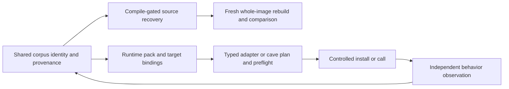
````

#### S084-C0002: Existing implementation and evidence

Source `docs/RUNTIME_REUSE.md` lines 23–45; accountable coverage owner U6.

```md
## Existing implementation and evidence

AgentDecompile paths below are in this repository. KotorPhasor paths refer to
the read-only sibling checkout `/run/media/brunner56/MyBook/Workspaces/KotorPhasor`.
Source inspection establishes implementation, not successful execution on every build.

| Requirement | Implemented or observed | Unverified or missing |
|---|---|---|
| Corpus export | [export_hookpack.py](../src/agentdecompile_recovery/corpus/export_hookpack.py) exports `agentdecompile.hookpack/v1` from logical functions, identities and instances. `corpus.export-hookpack` was observed in the live 8080 catalog on 2026-09-20; [catalog.py](../src/agentdecompile_recovery/corpus/dashboard/actions/catalog.py) introspects public parsers. | Catalog listing does not prove an export succeeded. The exporter emits site kinds, required flags and optional field offset/size through site policy. Complete typed operation ABI, lifetime, inverse/oracle and cave-patch contracts remain absent. |
| Executable admission | KotorPhasor `src/runtime/runtime.cpp` and `src/image/load.cpp` check known build identity, live code sections and code hash before resolution. Proxy and ELF preload initialization exist. | A pack cannot admit an arbitrary unknown executable. All-build and other-architecture support are not established. |
| Pack loading and resolution | `src/hooks/registry.cpp` loads v1 packs, selected build slugs and optional per-build overlays. Matching address hints are accepted; stale/missing hints can fall back to a unique executable-region scan. | An instance without expected bytes remains address-based. A matching hint is not globally uniqueness-checked. A shared signature string is not a universal runtime resolver or ABI. The exporter can emit `adapter_key`, aliases, image base and stored/computed SHA-256 when available. The inspected KotorPhasor v1 parser still binds literal site names and does not consume those adapter mappings or the exported binary SHA-256. Runtime image admission and optional overlays remain separate mechanisms; generated-pack identity and adapter-role binding are not yet established. |
| Detour installation | `src/hooks/trampoline.hpp` implements x86-32 five-byte jumps, whole-instruction displacement and supported relative-branch relocation; unsupported cases refuse. Hook-set failure rolls back installed detours. | Caller must establish quiescence. Rollback is not atomic concurrent patching. |
| Typed native calls | `src/hooks/thiscall.hpp` supplies typed C++ adapters for Windows ECX versus ELF stack `this`; `src/harness/fields.hpp` supplies field access. Missing sites/null objects refuse. | Native call sites fix arguments/returns; the registry does not interpret prototypes. Aggregate returns, varargs and x86-64 are excluded by this adapter. ARM source presence is not active support. |
| VM and events | `src/api/routines.cpp` marshals `nwscript.call`; runtime registration keeps NWScript and `kp.*` native APIs distinct. Event bodies and the Lua host dispatch callbacks. Harness commands queue work for the game thread. | Action closures are excluded from VM calls. The single-client harness is not a generally safe concurrent native-call endpoint. |
| Code caves | `docs/user/codecaves.md` describes unused executable padding; `src/api/memory.cpp` supports raw writes. | Raw writes do not validate payload capacity, semantics or machine code, and provide no automatic undo. A cave inventory is not an installable patch. |
| Live behavior | Historical `tmp/demos/cursed/10_rancor_roulette.report.json` records success for `k1_steam_103_unpacked`. | Video was not replayed in this assessment; no fresh export → resolve → typed call → observed behavior run, K1 GOG proof, cross-process multiplayer proof or source-built client/server proof was established. K2 hook loading and compilation do not establish gameplay. |

The exporter derives optional 8–24 byte unique windows from available raw images
through its format mapper. This establishes source routing, not every format's correctness. Raw-file uniqueness is distinct from runtime executable-region
uniqueness. KotorPhasor's `kp.mem.findsig` can select an occurrence (default
first); it does not carry the resolver's `find_unique` guarantee. Neither
mechanism replaces the corpus identity cascade in STRATEGY.
```

#### S084-C0003: First generated native operation — source assessment, 2026-09-27

Source `docs/RUNTIME_REUSE.md` lines 46–85; accountable coverage owner U6.

```md
## First generated native operation — source assessment, 2026-09-27

The September 22 M1/M2 roadmap can start with one Windows K1 GOG player-model
scale operation: identify → snapshot → resize → restore. KotorPhasor's
`src/api/model.cpp`, `model_backend.cpp` and `model_lua.cpp` already implement
the typed setter, protected capture, readback and restore path. This is source
feasibility, not a fresh game receipt. Its `model_profiles.cpp` entries remain
compiled constants; they are not independently accepted corpus evidence.

The next implementation should generate one versioned operation bundle and bind
it to that existing adapter. Include independently qualified entity roles,
exact build identity, RVA/live guards, root recipe and field extents, ABI/types,
units, thread/lifetime rules, inverse and independent observations. Help and
harness requirements must reference that same revision. The exporter must
corroborate its declared image digest against the actual image supplying bytes.
The consumer must enforce the exported digest and unambiguous adapter-role mapping;
its current `src/hooks/registry.cpp` v1 parser does neither. Model binding currently
precedes hookpack resolution in `src/runtime/runtime.cpp`; generated binding must
follow admitted-pack validation. A hardcoded fallback cannot count as generated use.

The [generated-operation contract increment](verification/2026-09-27-generated-operation-contract.md)
now implements the exporter-side exact raw-image/role checks and the KotorPhasor
parser/runtime-side selected digest plus adapter-key/alias support. Model binding
now waits for an admitted generated operation and uses its resolved role addresses;
compiled profile data remains the distinct ABI/layout guard. Independent generated
layout evidence, lifetime evidence and live runtime acceptance remain open.

Qualify one owned, stationary fixture first. Existing captures check epoch,
IDs and pointers but cannot detect exact address reuse. Require stable actor/world
lifetime, no load or competing scale writer, and refusal when ownership cannot be
established. Correlate baseline/change/restoration with an independent observation
of the same actor and run; the setter's own success log is insufficient. Verify
restored base and effective scale and continued gameplay. This inverse restores
model scale only; it is not a world checkpoint. Missing fixture, observer or
lifetime evidence blocks this scenario while unrelated work continues.

No export-to-native run, M1 mixed-batch continuation or M2 generated operation
acceptance was performed in this assessment. Source detail and snapshot hashes
are retained in `/home/brunner56/Documents/AgentDecompile-native-next-audit-20260927.md`.
```

#### S084-C0004: Integration contract (required work, not a new implemented API)

Source `docs/RUNTIME_REUSE.md` lines 86–109; accountable coverage owner U6.

```md
## Integration contract (required work, not a new implemented API)

Keep readiness states separate: discovered → identity-supported → resolved →
installable/installed → call-observed → behavior-observed. Each needs the exact
binary identity, site/region, inputs, tool/runtime revision, execution context,
evidence and limitations. Resolution alone is never a universal C-call promise.

- **Call sites:** known prototype and ABI, object lifetime, argument/return
  ownership, game-thread/context constraints and a supported native adapter.
  Metadata alone cannot synthesize a trusted call.
- **Detours and trampolines:** validated overwritten instructions, relocation
  support, saved originals, restoration and quiescence. Ordinary detours allocate
  their own trampolines; they do not require static caves.
- **Caves:** anchor and offset, capacity, original bytes, architecture and
  provenance, plus payload bounds, relocations, restoration and quiescence.
- **Source recovery:** compiling C, objdiff-0 functions and whole-image identity
  retain their separate gates. Runtime observations may refine names, types,
  field hypotheses and behavior evidence with provenance; they cannot promote
  source parity or overwrite stronger evidence wholesale.

Use the generic corpus/export core with target adapters and build profiles.
All BioWare corpus builds remain in recovery scope; future other games remain
in scope for the generic design, but require real adapter and ABI work.
```

#### S084-C0005: Capability refinement — 2026-09-22 (required, not delivered)

Source `docs/RUNTIME_REUSE.md` lines 110–133; accountable coverage owner U6.

```md
## Capability refinement — 2026-09-22 (required, not delivered)

[The recovery-contract plan](plans/2026-09-22-recovery-contracts-and-validation-plan.md)
extends this integration contract. Exact known build: verify image identity → recorded
RVA → expected live bytes/structure, then independently establish intended target
entity identity before requested operation preflight. A signature derived from the
label-selected address proves presence only. See the binding predicates and
Foo/Bar counterexample in the linked contract plan. Unknown or
changed builds use bounded discovery. Resolution is independent of the readable,
callable, detourable and writable capabilities, each of which carries evidence and
runtime conditions. Cache dynamic-root recipes, not unbounded-lifetime pointers.

Executable allocation is policy-dependent; slack/zero-filled storage is not
inherently expendable. Unsupported process mitigation yields a named refusal.
Installation and removal require a tested thread/lifetime protocol, including
safe trampoline reclamation. Suspending threads plus moving instruction pointers
is not a universal synchronization strategy. A byte journal restores recorded
patches, not arbitrary side effects of code already executed. Typed calls require
valid objects, supported prototypes, ownership and game-thread context.

New evidence can reduce trusted coverage. Unknown builds can remain absent,
inlined-only, ambiguous, unsupported, insufficient-evidence or budget-exhausted;
ingesting a runtime observation alone does not make every entity known or callable.
```

#### S084-C0006: M3–M7 findings — 2026-09-27 (read-only, source-only)

Source `docs/RUNTIME_REUSE.md` lines 134–164; accountable coverage owner U6.

```md
## M3–M7 findings — 2026-09-27 (read-only, source-only)

These are read-only findings from a separate inventory and assessment pass on
KotorPhasor, not new implementation, and not a build, test or game run. Full
packets: `/home/brunner56/agentdecompile-deliverables/2026-09-27-m3m5-inventory/report.md`
and `/home/brunner56/agentdecompile-deliverables/2026-09-27-m6m7-assessment/report.md`.

- **M3, shared operation IDs: not met.** The in-game console keeps its own
  request-ID counter; the harness only echoes the client's JSON ID back;
  `runtime.cpp` hard-codes `kotor.k1.model-scale.v1`; and `kp.model` results
  carry no operation ID at all. Nothing today ties a console request, a
  harness reply and a model operation to one shared ID.
- **M6, host matrix.** Independent sha256 checks against KotorPhasor's
  `reference_sha256` confirm three builds: K1 Windows GOG, K2 Windows GOG
  Aspyr, and K2 Windows Steam Aspyr (the last has three contradicting status
  sources across the address JSON, `builds.inc` and `builds.toml`). K1 and K2
  Mac are Mach-O and blocked: KotorPhasor has no Mach-O loader, and no macOS
  host exists to run one. K2 Linux is not registered in `builds.inc` and is
  refused at load. The only host with a real GPU today is a local Fedora
  machine (Intel UHD 630, AMD Polaris); the five active Tailnet peers have
  unverified hardware.
- **M7, route C measurement.** Of five candidate routes to a whole-game
  browser build, route C — BoxedWine (Wine plus an x86 emulator compiled to
  WASM) running the original executable with the KotorPhasor proxy, in
  Chrome, on the AMD GPU — is the only one that meets all three acceptance
  conditions, and is recommended for measurement. Nothing has been run yet.
  The gate: median at least 20 fps, a captured non-black Endar Spire frame,
  and `lua status` answering through the F12 console in the same session.
  Passing that gate is not M7 success by itself; input, audio, save/load and
  sustained play still remain open.
```

#### S084-C0007: Operator workflow

Source `docs/RUNTIME_REUSE.md` lines 165–184; accountable coverage owner U6.

```md
## Operator workflow

Use the existing 8080 workbench and `GET /api/v1/actions`; inspect the advertised
parameters for `corpus.export-hookpack` and submit through that catalog when
export is authorized. Reuse identity, analysis and receipts after corroborating
their target and provenance. Inspect the exported pack before choosing a
supported target adapter. Complete resolution/preflight, controlled installation
or call, independent observed state/event checks and provenance feedback as
separately authorized runtime work. No new runtime verb or automatic injection
route is claimed here. The current documentation task performs none of those
runtime actions.


The [execution design](plans/2026-09-22-task-acceptance-and-continuation-design.md)
specifies scenario prerequisite selection, same-run oracle/video correlation,
command-ID outcome reconciliation and separate status observation while mutation is
owned. Missing source reconstruction does not block verified original-code use.
Missing authentication, fixture or adapter blocks only dependent scenarios; healthy
independent analysis and capabilities continue. These are future design contracts,
not fresh runtime evidence.
```

#### S085-C0001: Documented solutions

Source `docs/solutions/README.md` lines 1–13; accountable coverage owner U1.

````md
# Documented solutions

Searchable institutional learnings from solved problems. Each file uses YAML frontmatter (`module`, `problem_type`, `component`, `tags`). Search by module or tag before changing `src/agentdecompile_cli/`.

User how-to lives in [USAGE.md](../../USAGE.md). Vocabulary: [CONCEPTS.md](../../CONCEPTS.md). Plans hub: [../plans/README.md](../plans/README.md).

```mermaid
flowchart TD
  problem[Solved problem] --> learning[docs/solutions entry]
  learning --> agents[AGENTS.md hop]
  learning --> skills[Skill references]
```
````

#### S085-C0002: Categories

Source `docs/solutions/README.md` lines 14–35; accountable coverage owner U1.

````md
## Categories

| Directory | What is here |
|-----------|----------------|
| `architecture-patterns/` | Coordinators, claim tiers, MCP surface, tiered RE, decomp matching |
| `integration-issues/` | MCP session, Ghidra import, analysis gate |
| `developer-experience/` | CLI ergonomics for agents |
| `mcp-ghidra-integration/` | Shared check-in / local VC mirror |
| `tooling-decisions/` | Plugin packaging and similar |
| `workflow-learnings/` | Dated run receipts — historical, not current smoke how-to |

Dated `workflow-learnings/` files may name old binaries or work dirs. Leave them. Current reconstruct smoke is `docs/CRITICAL_PATH.md`.

Current advertised tool counts are computed from `src/agentdecompile_cli/registry.py` (see README / TOOLS_LIST preamble). Do not copy a number out of an old learning.

Run `ce-compound` after solving a non-trivial problem. Run `ce-compound-refresh` periodically.

Validate new frontmatter:

```bash
python3 scripts/validate-frontmatter.py docs/solutions/<category>/<file>.md
```
````

#### S086-C0001: ---

Source `worktree/docs/plans/2026-09-28-0817-feat-static-codebrowser-project-tabs-plan.md` lines 1–11; accountable coverage owner U1.

```md
---
title: Static CodeBrowser Project Tabs - Plan
type: feat
date: 2026-09-28
topic: static-codebrowser-project-tabs
artifact_contract: ce-unified-plan/v1
artifact_readiness: implementation-ready
product_contract_source: ce-brainstorm
execution: code
---
```

#### S086-C0002: Static CodeBrowser Project Tabs - Plan

Source `worktree/docs/plans/2026-09-28-0817-feat-static-codebrowser-project-tabs-plan.md` lines 12–13; accountable coverage owner U14.

```md
# Static CodeBrowser Project Tabs - Plan
```

#### S086-C0003: Goal Capsule

Source `worktree/docs/plans/2026-09-28-0817-feat-static-codebrowser-project-tabs-plan.md` lines 14–27; accountable coverage owner U1.

```md
## Goal Capsule

**Objective:** An operator reverse-engineering a set of related builds works in one browser tab per project. They see every build, its code, its cross-build matches and its call graph at once, in the layout they already know from Ghidra's CodeBrowser. The recovery pipeline's automatic work shows as state they can read and pause, never as buttons they must press. Every cross-matching method stays available and visible, targeted AI is one operator-controlled toggle, and both frontends read one honest, reconciled progress picture.

**Means:** Rebuild the static dashboard on port 8080 as a CodeBrowser-parity workspace where a tab holds a project (KTD1-KTD4, KTD9 below). Close the cross-matching availability gaps the research found (KTD1-KTD4). Add one precedence-ruled AI toggle (KTD5-KTD6). Bring the Vite workstation and the report/progress spine into scope, built from the components already live in `frontend/src/workstation` (KTD7-KTD9).

**Product authority:** The user's 2026-09-28 directives, `docs/FRONTEND_INTENT.md`, and the 2026-09-28 scope-change directives recorded under Product Contract Preservation below. This plan now covers the static dashboard, cross-matching availability, the targeted-AI toggle, the Vite workstation and the report/progress spine.

**Source implementation update:** [September 28 implementation and acceptance boundaries](../FRONTEND_IMPLEMENTATION_STATUS.md). Commit `ef08633` implements a substantial subset; the plan is not complete.

**Execution profile:** Multi-phase implementation plan for `ce-work` or an equivalent executor. Start phases A–C in order; Phase A's U8 finishes after B supplies U14. D (Vite) and E (report spine) can run in parallel after B, honoring individual dependencies; neither phase depends on the other. G (exports and runtime reuse) follows its own unit dependencies. U43 adds report-backed matrix counts after U8 and U26. F (U30, tests last) follows all implementation units, including G and U43. Phase names are grouping labels, not additional dependency edges.

**Stop conditions:** Stop and return to planning if an owner-locked file (see Planning Contract) must be edited to close a requirement, or if a unit's fix requires renumbering the `match` table's primary key or removing a column another live consumer reads.
```

#### S086-C0004: Product Contract

Source `worktree/docs/plans/2026-09-28-0817-feat-static-codebrowser-project-tabs-plan.md` lines 28–29; accountable coverage owner U1.

```md
## Product Contract
```

#### S086-C0005: Summary

Source `worktree/docs/plans/2026-09-28-0817-feat-static-codebrowser-project-tabs-plan.md` lines 30–33; accountable coverage owner U1.

```md
### Summary

Replace the static dashboard's action tabs and pipeline buttons with Ghidra CodeBrowser parity. A browser tab holds a project whose binaries are peers on one shared cursor. A cross-build map dock shows the call graph and matcher together, with every matching method's status visible. Pipeline progress is shown and can be paused, never triggered. Targeted AI is one toggle with one precedence rule. The Vite workstation and a shared report/progress spine are now in scope, built from the already-live workstation components.
```

#### S086-C0006: Problem Frame

Source `worktree/docs/plans/2026-09-28-0817-feat-static-codebrowser-project-tabs-plan.md` lines 34–39; accountable coverage owner U1.

```md
### Problem Frame

The static dashboard grew around the pipeline's steps. Its menus mostly offer buttons for work the pipeline already schedules on its own. Ghidra's own model has a second cost: only one program drives the cursor at a time, so comparing builds means loading and switching between them.

Research since the first draft narrowed three more gaps. The matcher's channel model looks complete on paper but two channels never contribute in practice (BSim persistence, the ABI veto), one channel is missing metadata it claims to carry (X), and one stage is mislabeled under the wrong channel (the P-code skeleton stage under `M`). Targeted AI has four disagreeing defaults across five entry points and no operator-facing switch. The Vite workstation already has live components for half of what `docs/FRONTEND_INTENT.md` asks for, but the shipped bundle is a week stale and several reusable pieces sit behind dead root components. Progress reporting has at least three disagreeing counts for the same corpus, and no gate stops a mismatched count from reaching an outside publishing step.
```

#### S086-C0007: Product Contract Preservation

Source `worktree/docs/plans/2026-09-28-0817-feat-static-codebrowser-project-tabs-plan.md` lines 40–50; accountable coverage owner U1.

```md
### Product Contract Preservation

Scope changed on 2026-09-28. R1-R26, F1-F4, AE1-AE7 keep their IDs and meaning from the prior requirements-only draft. Four changes below extend the contract; they do not narrow or reinterpret an existing R, F or AE.

- changed: Cross-matching methods must have high availability — every method and channel (Z, I, H, X, G, S, T, M, D, donor scheduling, review decisions) is available with an ordered fallback, none blocks matching, and BSim especially never blocks. Reason: research found BSim hits are never persisted so channel S never contributes, X lacks C++/RTTI metadata, the P-code skeleton stage is mislabeled as channel M, the contract veto has no production caller, and match rows carry no queryable kind/confidence/algorithm. Adds R27-R34.
- changed: Targeted AI (stage 6 leftovers, and any LLM rewrite path) becomes one optional implementation, switched by an env var, a CLI flag at 8080 server start, and a dashboard setting, with one documented precedence rule, a visible value source, live application where possible, and no dependency from the deterministic path. Reason: five entry points (frontdoor, `ghidra-bulk --llm-cleanup`, `corpus run --llm`, the MCP recovery provider, the rewrite-worker skill) disagree on defaults and none is operator-switchable. Adds R35-R38.
- changed: The Vite workstation (objdiff-web first; decomp.me scratch, Dogbolt compare, RzWeb/r2web views, an APKMan-style container tree, a pipeline stage DAG with retry-on-failure, a lane E fleet roster, a spectator view) and the report spine (a per-binary-and-version objdiff-shaped `report.json`, a tier-split verified-vs-advisory progress display in both UIs, a count-reconciliation gate before any outside publishing, and publishing as its own approved step) move from Deferred into scope. Reason: `STRATEGY.md`'s "One catalog, two surfaces" track names both as committed, and research found live components (`ScratchWorkspace`, `MatchReview`, `CompareView`, `integration/boundaries.ts`, `PreparationActivity`) that make this buildable now rather than speculative. Adds R39-R50.
- changed: Operator user-research outputs — JTBD-derived acceptance examples and a usability task list per delivered slice, mapped to Ghidra-guide chapters and the 2026-09-28 directives — join the Verification Contract. Reason: the JTBD/journey research (`design:user-research` output) already produced eight usability tasks (T1-T8) with named success criteria; carrying them forward avoids re-deriving verification from scratch. Adds AE8-AE15 and the Usability Test Plan subsection.

The exports contract below incorporates `/tmp/exports-spec.md` (20 requirements and 12 units). The 13 doc-review resolutions from `/tmp/review-decisions.md` are decisions by the plan owner's delegate under the hands-off directive, not decisions attributed to the user. Original IDs remain stable; the split from U8 is U43. Historical draft implementation-status observations below are research leads that require source verification before implementation or completion claims.
```

#### S086-C0008: Actors

Source `worktree/docs/plans/2026-09-28-0817-feat-static-codebrowser-project-tabs-plan.md` lines 51–57; accountable coverage owner U1.

```md
### Actors

- A1. Operator: a person reading, naming and reviewing code across related builds while the pipeline runs.
- A2. Agent client: an automated caller acting through the same backend. It reads the same state the operator sees.
- A3. Recovery pipeline: admits and runs work on its own. The interface observes it.
- A4. Spectator: a second viewer following the operator's session read-only (Vite workstation only).
```

#### S086-C0009: Requirements

Source `worktree/docs/plans/2026-09-28-0817-feat-static-codebrowser-project-tabs-plan.md` lines 58–210; accountable coverage owner U1.

```md
### Requirements

**Pipeline-owned work is never a control**

- R1. No menu item, tab, toolbar button or panel button starts, reruns or duplicates work the recovery pipeline schedules on its own. This covers these stages: analysis; protection preparation; fact extraction; similarity indexing; matching; calibration; source recovery; cross-build placement; leftover recovery; byte verification.
- R2. Three events admit the pipeline's eligible missing work without a separate action: opening a project, adding a binary to a project, and registering a binary. Reopening material that already has receipts does not redo that work.
- R3. After admission, the interface shows a one-line receipt naming the admitted run, its generation and its queue position.
- R4. Pause, resume and stop are the only workflow controls. They appear wherever run state is shown, pre-scoped to the run in view.
- R5. Operator edits stay available as explicit user actions: rename; comments; bookmarks; retyping and data-type edits; accept or reject of match candidates, singly and in batches; opening, creating and saving projects; adding binaries.
- R6. An expert command palette stays available for low-level catalog actions. It is not the path for routine pipeline work.
- R7. The backend enforces R1 through its classification of which actions and modes change state. A new pipeline trigger added to a static surface fails that check.
- R8. R1 through R7 apply to every static surface served on 8080, including the explorer page.

**CodeBrowser parity**

- R9. The workspace follows Ghidra's stock CodeBrowser arrangement: the Symbol Tree and Program Trees in the left rail, with the Data Type Manager below them; the Listing and Decompiler in the center, with secondary providers tabbed alongside the Decompiler; Console and Bookmarks at the bottom; Data Type Preview as a thin strip.
- R10. Every CodeBrowser provider that the Ghidra reversing guide uses is present: Listing (address, bytes, mnemonic, operands, cross-reference and comment fields, with a function header); Decompiler; Symbol Tree; Program Trees; Data Type Manager; Memory Map; Bytes; Defined Strings; Symbol Table and References; Functions table; Function Graph; Function Call Trees and Call Graph; Bookmarks; Console; Function Comparison; Equates; Relocations.
- R11. Providers that only show data are read-only views. Providers that edit data do so only through R5's explicit user actions.
- R12. One program location drives every connected provider. Selecting an address, symbol or cross-reference in any provider moves the others. No tab switch or new search is needed.
- R13. Navigation matches Ghidra: back and forward history; go-to by address or name; previous and next function; highlight of the selected token wherever it recurs; an overview strip marking locations across the program.
- R14. The layout uses the page for content. Providers dock and tab like Ghidra's. No space goes to controls that R1 excludes.

**Project as tab**

- R15. A browser tab holds one project. Every binary in the project is a peer in that tab, not a hidden sibling of one active program.
- R16. Each peer shows whether it is readable locally, loading, queued for a serialized read, or blocked. A blocked peer shows the backend's own next step, for example that server credentials are required.
- R17. Selecting a function in one peer aligns the other peers to the same identity where one is bound. A peer without a binding shows "no identity binding". It is never an empty or hidden lane.
- R18. A project with tens of binaries stays usable, up to the corpus's ninety. A light track is one corpus-only row showing build name, readiness (R16), current stage and selected-function identity-binding availability; selection shows only the bound function name/address. It performs no live Ghidra reads and loads no Listing or Decompiler. Click or Enter focuses it and loads its providers. Each pane has at most one focused peer; unfocusing restores its light track.

**Call graph and matcher together**

- R19. A cross-build map is a docked view in the project tab. It shows the call graph across builds and the matcher's results together, on the same selection.
- R20. The map includes a matrix with one cell per pair of builds. Each cell shows match status and counts. A pair the pipeline never scheduled reads "not scheduled", which differs from a pair that failed.
- R21. Match results appear with the function in context. They show as marks at the function header in the Listing and Decompiler, and as edges on the call graph.
- R22. Match review shows status, match kind, score, confidence and algorithm. The operator can accept or reject one candidate, or a batch chosen by build pair and score band.
- R23. A byte-level match from object comparison and a match by name, signature or call graph always carry different labels.

**Pipeline state display**

- R24. Pipeline progress for the project is visible inside the workspace. The bottom activity dock shows the current stage per binary and the run's state.
- R25. A blocked state names its cause and the next step. It never shows a generic error.
- R26. The interface shows only state observed from the backend. It shows no simulated progress and no invented percentages.

**Cross-matching method availability**

- R27. Every cross-match method and channel — Z (identical image), I (authentic symbols), H (hashes), X (rare refs and C++/RTTI metadata), G (call-graph/CFG/SPP), S (BSim), T (ABI/contract veto), M (BinExport/BinDiff), D (emulation), donor scheduling and review decisions — is available with an ordered fallback. None blocks matching; BSim (S) unavailability especially never blocks the pipeline.
- R28. For any candidate pair or function, both frontends show, per method, whether it ran, was skipped (with a named reason), is unavailable, or is not built yet.
- R29. Match rows carry queryable kind, confidence and algorithm rather than only an evidence-JSON blob, so review can filter and sort without parsing evidence.
- R30. The cross-build matrix cell distinguishes a pair the donor scheduler never selected ("not scheduled") from a pair that ran and failed, and shows the scheduling reason (explicit pair, spanning-forest edge, hub-to-anchor link).
- R31. Channel S (BSim) persists its hits to a queryable store, so BSim results reach the matcher's fusion step and the availability display instead of permanently reading unavailable.
- R32. Channel X carries C++/RTTI/vtable/dispatch metadata, not only rare strings and constants.
- R33. The P-code/decompiler-skeleton exact-fingerprint stage carries its own channel label, distinct from channel M (BinExport/BinDiff), so confidence scoring and the availability display do not conflate the two methods.
- R34. The ABI/contract veto (channel T) has a production caller in the identity/propagation path so an incompatible high-score tie can resolve when enabled. It ships default-off as "available, off"; corpus-wide enabling requires KTD4's shadow-run validation.

**Targeted AI toggle**

- R35. Targeted AI (stage 6 leftover recovery, and any LLM rewrite path) is switched by exactly three surfaces: an environment variable, a CLI flag on the 8080 server start command, and a dashboard setting.
- R36. One documented precedence rule resolves the three surfaces to a single effective value. The dashboard shows which surface supplied the current value.
- R37. A change to the env var or the dashboard setting applies to the next job without a server restart. The CLI flag is fixed at process start, and the dashboard names that limit.
- R38. The deterministic recovery path (compile, repair, propagate, verify) never depends on targeted AI being enabled.

**Vite workstation**

- R39. The Vite workstation's main view is objdiff-web-first: an instruction-aligned two-column diff with register highlighting, navigable mismatches and a symbol tree.
- R40. A decomp.me-style scratch view lets the operator iterate a candidate against the catalog's compile and objdiff actions, extending the existing scratch workflow.
- R41. A Dogbolt-style compare view shows multiple decompiler outputs side by side, using only optional licensed local runners; it never uploads to the public Dogbolt service.
- R42. RzWeb/r2web-style expert views sit behind the workstation's one normalized selection, never a second selection store.
- R43. An APKMan-style container tree generalizes to any supported container or format, reusing the existing format-provider pattern.
- R44. A pipeline stage graph shows stage dependencies as a DAG with edges, and retries a stage only after that stage fails — never as a manual re-run control.
- R45. A lane E fleet roster shows donor and recipient decisions across a batch, reusing the existing match-review batch-decision contract.
- R46. Spectating is local, opt-in and off by default. The operator enables it on the same local host as the dashboard and creates a revocable token shown once. After first use the token travels in a header or cookie, never remains in the URL. Backend authorization restricts it to read-only access. The activity dock shows connected spectator count and supports revoking all tokens; this plan sets up no remote exposure.

**Report and progress spine**

- R47. The corpus produces an objdiff-shaped `report.json` per binary and version, generated from the corpus database, not only consumed from an external objdiff run.
- R48. Both frontends show progress as a tier-split bar: verified (byte-exact, relocation-aware objdiff 0) kept separate from advisory (compiling Ghidra C), never merged into one number.
- R49. A count-reconciliation gate runs before any decomp.dev publishing step. It fails closed when the accounting buckets (accepted source, candidate source, preserved region, unclassified, excluded-with-reason) do not exhaustively and exactly cover the inventory.
- R50. Publishing to decomp.dev is its own explicit, separately approved step. It never runs as a side effect of generating `report.json`.


**Export bundle**
- R51. The corpus provides one deterministic `export-bundle` verb that produces every
  required artifact in the export artifact contract below from (store + basis) with no manual finishing step, and refuses to emit
  if any artifact fails its own verify gate.
- R52. Re-running `export-bundle` under an identical basis over an unchanged store
  produces a byte-identical output tree; this is the acceptance test for the bundle, not
  a separate claim.
- R53. `bundle.json` names the basis, the corpus-manifest hash, and every artifact's
  own content hash, so a consumer can verify what it received without re-deriving it.
- R54. The recovered-source-variants row in the bundle is optional; its absence is
  recorded with a `not_in_scope` receipt rather than a missing file with no explanation.

**Lua**
- R55. The corpus generates a `require`-able Lua module purely from a hook pack (v2),
  never from the store directly, so the module is reproducible from the pack alone.
- R56. Every generated accessor, entry/handle helper, and call stub raises a
  structured error naming the entity and the resolution status attempted, on any
  non-resolved status; only a `describe()` helper may return without raising.
- R57. The generator refuses to emit a typed call stub for any entity whose ABI block
  confidence is below the declared threshold, rather than emitting a stub that can
  silently misinterpret arguments.
- R58. No literal address appears anywhere in generated Lua source; every access goes
  through resolve/field/entry/handle indirection.
- R59. The generated module's determinism (sorted emission order, no timestamps) is
  verified the same way as every other export: identical pack in, byte-identical module
  out.

**Codecave / injection**
- R60. Cave discovery validates every candidate against decode-derived instruction
  ranges (never an analyzer's function-body model), against relocation/data-reference/PC-
  relative targets, and against two decode-derived function boundaries, before it is
  emitted as a candidate.
- R61. A cave entry in the pack is a plan template (anchor, offset, capacity
  requirement, relocation rules, restoration data, per-build coverage) — never a fixed
  VA+bytes pair, and never itself a permission to patch memory.
- R62. The corpus ships multiple candidate caves per anchor where more than one valid
  candidate exists, so a consumer is not stranded when the first candidate is absent on a
  given build.
- R63. The pack records, per architecture, whether a codecave/detour adapter exists
  for that architecture at all; an architecture with no adapter is refused loudly in the
  export, not silently dropped from the pack.

**WASM**
- R64. Before any WASM-usable export of the hook pack, generated bindings, or the
  runtime harness itself is promised anywhere in the frontends plan, that requirement is
  logged as a distinct, currently unscoped item — it must not be implied by the existing
  browser-lane compute-donation work or the workbench's own local-analysis WASM provider,
  neither of which exports the pack.
- R65. If a WASM-consumable export is later authorized, it carries the same evidence
  requirements as every other export in the export artifact contract below (identity vs. locator separation, per-build
  instance status, expected-bytes-or-none, ABI confidence) — a browser runtime target is
  not exempt from the honesty rules.

**Surfacing in both frontends**
- R66. The static 8080 workbench lists every export artifact per project and per
  binary, with its readiness status, and offers it for download; this is a required
  surface, not optional richness reserved for the other frontend.
- R67. The Vite/React frontend shows export readiness per entity (not only per
  artifact), using the same closed status set and the same `observed_status` axis the
  pack itself carries, so the two frontends never disagree about what "ready" means for a
  given entity.
- R68. The Vite/React frontend shows the export bundle build itself as a pipeline
  output (an artifact with a receipt), not as a live-progress pipeline stage a user
  triggers by clicking through steps.
- R69. No export action is exposed as a pipeline "run" trigger button on either
  surface; exports are produced by the existing autonomous-admission model (opening a
  project, adding binaries, or resuming prior work admits eligible export work) and the
  only workflow controls are the existing pause/resume/stop (R4), never a per-export Start button.
- R70. Both frontends draw the readiness report's plain-language "what you can do on
  this build" summary somewhere a user encounters before they see a download link, so a
  download is never presented as more finished than the readiness data says it is.
```

#### S086-C0010: Key Flows

Source `worktree/docs/plans/2026-09-28-0817-feat-static-codebrowser-project-tabs-plan.md` lines 211–281; accountable coverage owner U1.

```md
### Key Flows

- F1. Open a project and start reading
  - **Trigger:** The operator opens a project in a new browser tab.
  - **Actors:** A1, A3
  - **Steps:**
    1. The tab shows the project's binaries as peers, each with its readiness (R15, R16).
    2. The pipeline admits missing work, and the admission receipt appears (R2, R3).
    3. The operator selects a function in any peer. The Listing, Decompiler, Symbol Tree and call trees follow (R12).
  - **Outcome:** The operator reads code while the pipeline works. Nothing asked them to start it.
  - **Covered by:** R2, R3, R12, R15, R16

- F2. Compare a function across builds
  - **Trigger:** The operator selects a function that exists in several builds.
  - **Actors:** A1
  - **Steps:**
    1. Bound peers align to the same identity (R17).
    2. The cross-build map shows the function's callers and callees across builds, with match edges (R19, R21).
    3. The matrix shows which build pairs were compared (R20).
  - **Outcome:** The call graph and matcher are visible together for one selection.
  - **Covered by:** R17, R19, R20, R21

- F3. Review matches in bulk
  - **Trigger:** The operator opens review for a build pair.
  - **Actors:** A1
  - **Steps:**
    1. Review lists candidates with status, kind, score, confidence and algorithm (R22).
    2. The operator accepts every candidate above a score band for that pair in one action.
    3. The two match kinds keep their separate labels (R23).
  - **Outcome:** Review scales to large sets of candidates.
  - **Covered by:** R22, R23

- F4. Pause the pipeline
  - **Trigger:** The operator needs the machine for something else.
  - **Actors:** A1, A3
  - **Steps:**
    1. The activity dock shows the run and its stage (R24).
    2. The operator pauses the run in view, then resumes it later (R4).
  - **Outcome:** The pipeline stops and resumes, and no start control exists.
  - **Covered by:** R4, R24

- F5. Inspect a candidate with an unavailable method
  - **Trigger:** The operator opens a match candidate where BSim (or another channel) is unavailable.
  - **Actors:** A1
  - **Steps:**
    1. Each channel's row shows ran / skipped:reason / unavailable / not-built (R28).
    2. The matcher's decision used the available channels; the unavailable one narrowed evidence, it did not stop matching (R27).
    3. The operator can still accept or reject the candidate.
  - **Outcome:** One missing method never blocks review.
  - **Covered by:** R27, R28

- F6. Toggle targeted AI
  - **Trigger:** The operator wants stage 6 leftover recovery to use bounded LLM cleanup on the next run.
  - **Actors:** A1
  - **Steps:**
    1. The operator sets the dashboard setting or a supported live environment-setting surface. A startup CLI override is reported as fixed for the serving process; this flow does not restart it.
    2. The dashboard shows the effective value and which surface supplied it (R36).
    3. The next job picks up the change; the CLI-flag case is named as fixed at process start (R37).
  - **Outcome:** One switch, one precedence rule, no silent default drift.
  - **Covered by:** R35, R36, R37

- F7. Publish verified progress
  - **Trigger:** The operator wants to publish a binary's progress externally.
  - **Actors:** A1
  - **Steps:**
    1. `report.json` is generated for the binary and version (R47).
    2. The count-reconciliation gate checks the accounting buckets exhaustively cover the inventory (R49).
    3. A gate failure blocks publishing and names the unreconciled count; a pass requires the operator's explicit approval before anything is sent outside (R50).
  - **Outcome:** No published number can silently disagree with the corpus.
  - **Covered by:** R47, R49, R50
```

#### S086-C0011: Acceptance Examples

Source `worktree/docs/plans/2026-09-28-0817-feat-static-codebrowser-project-tabs-plan.md` lines 282–304; accountable coverage owner U1.

```md
### Acceptance Examples

- AE1. **Covers R1, R8.** The redesigned static surfaces are in place. The check lists every menu, tab and button. None of them starts or reruns analysis, matching, recovery, placement or verification. Neither the "Run pipeline" control nor the "Start workflow" control exists.
- AE2. **Covers R2, R3.** A project holds a binary that has no analysis yet. When the operator opens the project, the admission receipt appears. The operator pressed nothing.
- AE3. **Covers R12.** The Listing shows a call. When the operator activates its target, the Decompiler, Symbol Tree and call trees move to the target without a tab switch.
- AE4. **Covers R17.** A function is bound in two of three peers. When the operator selects it, two peers align. The third shows "no identity binding".
- AE5. **Covers R20.** The pipeline compared a spanning subset of build pairs in a project. When the operator views the matrix, the pairs it did not compare read "not scheduled".
- AE6. **Covers R23.** One pair matched on object bytes, and another matched on name only. When both appear in review, their kind labels differ.
- AE7. **Covers R16, R25.** A peer needs server credentials before it can be read. When the tab loads, the peer shows a blocked state that names the credential step.
- AE8. **Covers R27, F5 (JTBD-6).** The BSim database is absent for a project. When the operator opens a match candidate, channel S shows "unavailable: reason", the other channels still decide, and review is not blocked.
- AE9. **Covers R35, R36, F6 (JTBD-7).** The operator toggles targeted AI through the env var, the server flag and the dashboard, in turn. Each time, the effective state and its source are shown; when off, stage 6 reads "disabled by operator", not "pending".
- AE10. **Covers R2 (JTBD-1).** The operator reopens a known project. The same binaries, annotations, receipts, job owners and selection return. No reanalysis job starts and no Start button appears.
- AE11. **Covers R1, R14 (JTBD-2).** The operator counts pipeline-stage buttons across the redesigned surface. The count is zero; only pause/resume/stop and the expert palette remain.
- AE12. **Covers R9, R10 (JTBD-3).** The operator opens a class and its struct from the Symbol Tree or Data Type Manager. The path takes fewer than three gestures and triggers no destructive-action prompt.
- AE13. **Covers R19, R20 (JTBD-4).** The operator opens the call graph and match review for the same entity. Both are visible at once, on one selection, without hiding either.
- AE14. **Covers R48 (JTBD-8).** The operator views a binary's progress. Verified and advisory counts render as separate segments; the export or report never merges them into one recovered number.
- AE15. **Covers R49, R50 (JTBD-8).** A binary's accounting buckets do not exhaustively cover its inventory. Publishing is blocked and names the gap; no report reaches an outside site until the operator approves a passing gate.

- AE16. **Covers R46.** Spectating starts disabled. An operator creates a token and a local spectator follows the same selection/stage. Write requests using that token are rejected by the backend; the dock counts the viewer; revoking all tokens terminates access. The token is absent from the URL after first use.
- AE17. **Covers R51–R59.** Identical store/basis inputs produce identical complete bundle trees. Required-artifact verification failure publishes no partial bundle; optional source absence has a `not_in_scope` receipt. Lua reads only the pack, contains no literal addresses and refuses low-confidence calls/non-resolved access.
- AE18. **Covers R60–R65.** Decode-overlapping cave candidates are rejected; valid multiple candidates retain restoration and adapter evidence. Missing adapters are explicit refusals. WASM pack export is explicitly unscoped, never inferred from browser compute or local analysis.
- AE19. **Covers R66–R70.** Both frontends show the same entity/build statuses and a readiness summary before artifact downloads. Bundle output carries a receipt and no export Start control exists.
```

#### S086-C0012: Success Criteria

Source `worktree/docs/plans/2026-09-28-0817-feat-static-codebrowser-project-tabs-plan.md` lines 305–312; accountable coverage owner U1.

```md
### Success Criteria

- The operator can work through every chapter of the Ghidra reversing guide in the static workspace: orient; symbols and types; listing and decompiler; call trees; memory map and bookmarks; signatures; structures and vtables; templates; diagnosis.
- No static surface offers a control for pipeline-owned work, and the backend classification check in R7 passes.
- For any selected function in a multi-build project, the call graph and matcher results are visible together, and every method's status (ran/skipped/unavailable/not-built) is visible for that function.
- The guide's flows produce no console errors and reach no dead controls.
- The operator can complete each usability task in the Usability Test Plan (Verification Contract) against its named success criterion.
```

#### S086-C0013: Scope Boundaries

Source `worktree/docs/plans/2026-09-28-0817-feat-static-codebrowser-project-tabs-plan.md` lines 313–328; accountable coverage owner U1.

```md
### Scope Boundaries

**Deferred to Follow-Up Work**

- WASM-consumable pack/bindings/harness target design and execution remain unscoped (R64/R65, U40). This plan delivers an explicit scope receipt, not a WASM implementation. Original-byte runtime calls and recovered-source variants remain governed by their separate recovery/runtime acceptance contracts.
- Publishing statistics to decomp.dev itself (R50 covers the gate and the approval step; the publishing integration's own delivery, and resolving decomp.dev's license, are follow-up work once R47-R49 land).
- Distributed-compute lane E scheduling beyond the fleet roster's display (`grid_lanes/cascade.py` already exists; scaling it across workers is a separate track).
- Native decompiler tier (JVM-free replay) — tracked separately in `STRATEGY.md`'s own track, not part of this plan.

**Outside this product's identity**

- A second job or selection store in the static surface or the Vite workstation.
- Any control that starts pipeline stages by hand, including run buttons for single stages.
- Uploading binaries or decompiler output to the public Dogbolt service.
- Auto-publishing a report to an outside site as a side effect of generating it.
```

#### S086-C0014: Key Decisions

Source `worktree/docs/plans/2026-09-28-0817-feat-static-codebrowser-project-tabs-plan.md` lines 329–338; accountable coverage owner U1.

```md
### Key Decisions

- Builds are peers. This replaces Version Tracking's source and destination pair. Ghidra's limit of one active program is what the project tab removes, so no build drops to a secondary role.
- The cross-build map is a dock inside the CodeBrowser layout, not the tab's landing view. This keeps CodeBrowser parity and adds the one view Ghidra cannot show.
- Full provider parity is required. Delivery may start with the providers the guide's first chapters use: Listing, Decompiler, Symbol Tree, call trees, cross-references and the cross-build map.
- The menubar stays, without an Analysis menu, because analysis belongs to the pipeline. The items that remain follow Ghidra's naming: navigation, search, window, help and file operations on projects.
- Method availability is shown, not hidden or defaulted to "not run". `Governs R27, R28.`
- Targeted AI is a toggle, not a removed capability. `Governs R35-R38.`
- The Vite workstation and the report spine build from live workstation components first, and add net-new views only where research found no reusable component. `Governs R39-R50.`
```

#### S086-C0015: Dependencies / Assumptions

Source `worktree/docs/plans/2026-09-28-0817-feat-static-codebrowser-project-tabs-plan.md` lines 339–349; accountable coverage owner U1.

```md
### Dependencies / Assumptions

- Peers read at the same time only if the backend scopes its live-read path to each project and binary. Today one active locator is shared across the whole process (`src/agentdecompile_recovery/corpus/dashboard/mcp_bridge.py:20-26`, `CONTEXT_LOCK` and the global `_ACTIVE_LOCATOR`). U3 resolves this before R15 and R18 can hold.
- Admission on open and register (R2) is new behavior. Today only adding a program to an open project admits work; `workbench.py:1131-1135` admits prepare only on add-to-project.
- `src/agentdecompile_recovery/corpus/ghidra_project.py:1445` `_dedupe_project_sessions` hides all but one project session; U4 resolves this before multiple peers can stay open.
- Assumption: menubar contents beyond removing Analysis follow Ghidra's naming. The user said the top menu holds useless buttons but did not say what should replace them.
- Assumption: in large projects, peers not in focus render as light tracks rather than full workspaces.
- Live decompiler reads of the shared repository need server credentials. A local copy of the project reads without them.
- The draft research reported the shipped Vite bundle (`static/react`) behind its source; verify current source/bundle correspondence before claiming delivery. Necessary implementation work follows current session authority and existing 8080 serving constraints.
- Owner-locked files (Planning Contract) cannot be edited by any unit in this plan; units that would otherwise touch them call the existing entry points instead.
```

#### S086-C0016: Risks and decision preservation

Source `worktree/docs/plans/2026-09-28-0817-feat-static-codebrowser-project-tabs-plan.md` lines 350–355; accountable coverage owner U1.

```md
### Risks and decision preservation

- KTD3 backfill changes scores only, never a recorded operator decision. A decided row whose new score would flip the decision is flagged for review.
- Every Vite view U18–U23 and each matrix cell defines loading, empty and failed states with an actionable backend reason; no missing data is rendered as success.
- Export research identified three gaps: hook pack v2 unbuilt (U33), ABI storage dropped at extraction and export (U31), and no WASM target design (U40). The first two require implementation; the last requires explicit scope disclosure and cannot be reported as a delivered target.
```

#### S086-C0017: Outstanding Questions

Source `worktree/docs/plans/2026-09-28-0817-feat-static-codebrowser-project-tabs-plan.md` lines 356–364; accountable coverage owner U1.

```md
### Outstanding Questions

All prior outstanding questions are resolved for planning purposes below; none blocks `implementation-ready` readiness.

- How the cross-build call graph performs across tens of builds, and whether it loads a piece at a time. **Deferred** — U8's Approach states the default (progressive load past a peer-count threshold); tuning the threshold is an implementation-time detail, not a blocker.
- Which existing static panels are removed, merged or rehomed as CodeBrowser providers, and how existing deep links keep working. **Deferred** — resolved per-provider inside U6's Approach; no product-level ambiguity remains.
- Whether the explorer page folds into the project-tab workspace or stays a separate view under R8. **Deferred** — U2 keeps it a separate view that still satisfies R1-R8; folding it in is a future simplification, not required for this plan's Definition of Done.

<!-- ce-section: work-relationships -->
```

#### S086-C0018: How This Work Fits Together

Source `worktree/docs/plans/2026-09-28-0817-feat-static-codebrowser-project-tabs-plan.md` lines 365–376; accountable coverage owner U1.

```md
### How This Work Fits Together

The 2026-09-28 directives, and the 2026-09-28 scope-change directives above, cover five areas, all now owned by this plan:

- **Static CodeBrowser workspace** (Phase A) and **matching availability** (Phase B) share the same backend match store and identity tables.
- **Targeted AI toggle** (Phase C) is read by both the static dashboard's stage-6 leftover recovery and the corpus CLI's LLM cleanup path; it has no UI dependency on Phase A or D.
- **Vite workstation** (Phase D) and **report spine** (Phase E) share the one catalog, one job store and one claim model that Phase A's static surface also reads (`STRATEGY.md`, "One catalog, two surfaces"). Phase D's stage graph and fleet roster read the same activity and match-review contracts Phase A's activity dock and match review use.

Phase B's availability display (R27-R34) is consumed by both Phase A's cross-build map (R19-R23) and Phase D's fleet roster (R45). Phase E's `report.json` (R47) feeds Phase A's and Phase D's progress displays (R24-R26, R48) identically — one producer, two consumers.

Phase G produces the common pack, Lua bindings, cave plans, headers, readiness/divergence reports and bundle consumed by both surfaces. U43 consumes U26 independently of the core U8 matrix.
```

#### S086-C0019: Sources / Research

Source `worktree/docs/plans/2026-09-28-0817-feat-static-codebrowser-project-tabs-plan.md` lines 377–388; accountable coverage owner U1.

```md
### Sources / Research

- `docs/FRONTEND_INTENT.md`: the split between surfaces, "no Start button", and the single store.
- `docs/ideation/2026-09-28-frontends-redesign-ideation.html`: ranked ideas and their evidence, including the decomp.dev progress-card idea (lines 85, 90, 296-312) and the "89 directed pairs" donor-scheduling figure (line 136).
- `docs/dashboard-design/2026-09-28-static-codebrowser-guide-redesign.md`: earlier redesign slices built on the guide, including the wb-sessions "one tab per project" vs. `renderEditorBody` "one pane at a time" conflict (sec 2.1) this plan resolves in U7-U8.
- `docs/dashboard-design/pipeline-diagram/README.md`: pipeline stages and lanes.
- `docs/plans/2026-09-09-0334-feat-evidence-fusion-matcher-plan.md`: the 8-channel cascade (R1, R2), BSim's mutual-best-plus-significance rule (KTD3 there), and R9's optional-tool skip list that omits BSim's own fallback chain — the gap Phase B closes.
- `STRATEGY.md` "One catalog, two surfaces" and "Corpus recovery pipeline" tracks: the two-frontend split, the targeted-AI precedence requirement, and the `report.json` / decomp.dev publishing sequencing this plan's Phase C and E implement.
- Operator user research (JTBD, journey map, affinity themes, usability task list): the eight JTBDs and T1-T8 usability tasks behind AE8-AE15 and the Verification Contract's Usability Test Plan. Two of its citations (JTBD-1's `docs/FRONTEND_INTENT.md:83-88` and the "per-stage buttons stay banned" cite at `:432-433`) failed spot-check on line range; the underlying claims held on independent re-read and are restated here without the unverified line numbers.

---
```

#### S086-C0020: Export artifact contract

Source `worktree/docs/plans/2026-09-28-0817-feat-static-codebrowser-project-tabs-plan.md` lines 389–392; accountable coverage owner U28.

```md
## Export artifact contract
```

#### S086-C0021: Export 1 Export bundle (`corpus.export-bundle`, designed-only)

Source `worktree/docs/plans/2026-09-28-0817-feat-static-codebrowser-project-tabs-plan.md` lines 393–400; accountable coverage owner U28.

```md
### Export 1 Export bundle (`corpus.export-bundle`, designed-only)
One deterministic verb that runs every required exporter below in a fixed order into a
content-addressed directory, writes a `bundle.json` naming the basis, the corpus-manifest
hash, and each artifact's hash, and refuses to emit if any artifact fails its own verify
gate. Re-running under an identical basis must yield a byte-identical tree. Consumers: the
static workbench (browse/download), any downstream tool that wants "everything the corpus
knows" in one fetch.
```

#### S086-C0022: Export 2 Hook pack (`agentdecompile.hookpack`, v1 implemented / v2 designed)

Source `worktree/docs/plans/2026-09-28-0817-feat-static-codebrowser-project-tabs-plan.md` lines 401–414; accountable coverage owner U24.

```md
### Export 2 Hook pack (`agentdecompile.hookpack`, v1 implemented / v2 designed)
The central artifact. Root carries `format`, a `basis` object, a pack hash, and a
corpus-manifest hash. Per build: slug, content hash, image base, arch/bits/format,
compiler spec, and (in v2) unpack state and CFG-instrumentation flags. Per entity
(v1: functions only, called `sites[]`; v2: any of ~30 kinds, called `entities[]`):
identity, ABI block, locator family (ordered fallback list, each carrying a portability
flag, uniqueness/margin evidence, and expected-bytes or region verification), per-build
instances with resolution status, and a closed status set per member
(`resolved / pinned / degraded(reason) / ambiguous / unresolved / contested`) distinct
from an `observed_status`. In v2 the pack also carries `caves[]`: anchor, offset,
capacity, original bytes, relocation rules, restoration data, and per-build coverage.
Consumers: the runtime harness (primary), the generated Lua module (reads the pack, not
the store), the per-build header generator, the readiness/divergence reports.
```

#### S086-C0023: Export 3 Generated Lua bindings (designed-only)

Source `worktree/docs/plans/2026-09-28-0817-feat-static-codebrowser-project-tabs-plan.md` lines 415–426; accountable coverage owner U26.

```md
### Export 3 Generated Lua bindings (designed-only)
A `require`-able Lua module generated purely from a hook pack (never from the store
directly, so it is reproducible from the pack alone): named roots, one typed accessor
table per struct (typed getters/setters from the field map), `entry()`/`handle()`
helpers bound to those descriptors, typed call stubs generated only where the ABI block
expresses enough confidence to call safely (refuses to generate otherwise), and hook
helpers per site kind. Every generated accessor raises a structured error
(`{status, entity, members_tried}`) on any non-resolved status instead of returning a
value; only a `describe()` helper is allowed to return without raising. No literal
address ever appears in the generated source. Consumer: mod/script authors writing Lua
against a build, through the runtime harness's Lua host.
```

#### S086-C0024: Export 4 Codecave / call plans and code injection

Source `worktree/docs/plans/2026-09-28-0817-feat-static-codebrowser-project-tabs-plan.md` lines 427–440; accountable coverage owner U25.

```md
### Export 4 Codecave / call plans and code injection
Two related but distinct things:
- **Cave discovery**: candidate injection sites found in a build's image (uniform-filler
  runs in executable sections, validated against decoded instruction ranges, not against
  an analyzer's function-body model, and never assumed unused just because bytes look
  blank). Emitted as `caves[]` plan templates in the pack, anchored to a decode-derived
  function boundary, with per-build capacity coverage — never a fixed VA+bytes.
- **Injection/detour mechanics** live in the runtime harness (a separate repository), not
  the corpus: length-disassembly, relocation of displaced instructions, thread
  quiescence, and restoration bookkeeping. The corpus's job stops at the plan (anchor +
  capacity requirement + relocation rules); the harness's job is to execute the plan and
  own thread safety. The two are named separately in every honesty rule below so a plan
  is never mistaken for permission to patch.
```

#### S086-C0025: Export 5 Hook pack format versions

Source `worktree/docs/plans/2026-09-28-0817-feat-static-codebrowser-project-tabs-plan.md` lines 441–450; accountable coverage owner U24.

```md
### Export 5 Hook pack format versions
- **v1** (implemented): `sites[]` (functions only), simple `instances[]`, best/majority
  signature per site, an optional `operations[]` block for tightly validated native call
  contracts.
- **v2** (designed): `entities[]` replacing `sites[]`, the full locator-family model,
  `caves[]`, structured ABI blocks, struct field maps with correspondence, and a closed
  status set. v1 stays available under `--format v1` until a refuse-on-unknown consumer
  path lands; consumers must ignore unknown entity kinds and refuse unknown formats
  outright.
```

#### S086-C0026: Export 6 Per-build C/C++ headers and build manifest

Source `worktree/docs/plans/2026-09-28-0817-feat-static-codebrowser-project-tabs-plan.md` lines 451–457; accountable coverage owner U1.

```md
### Export 6 Per-build C/C++ headers and build manifest
Per-build struct/prototype headers with exact per-build layouts (bitfields, unions, real
pointee types, not the byte-array fallback), a size-check assertion per struct as a
determinism guard, vtable slot enums, constants/enums, and a manifest naming the build
hash, toolchain identity, and basis. Consumers: native mod authors, recompilation and
matching-decompilation workflows that need real types rather than opaque offsets.
```

#### S086-C0027: Export 7 Readiness report

Source `worktree/docs/plans/2026-09-28-0817-feat-static-codebrowser-project-tabs-plan.md` lines 458–465; accountable coverage owner U27.

```md
### Export 7 Readiness report
Per entity × per build: the closed status set plus `observed_status`; per build:
environment facts (unpack state, CFG instrumentation, integrity checks, endianness,
pointer width, missing adapters); a plain-language "what a mod can and cannot do on this
build" summary. This is the honest counterpart to "ready to go" and is meant to be read
first, before any other artifact. Consumers: everyone — reviewers, mod authors, the
surfaces (below).
```

#### S086-C0028: Export 8 Divergence report

Source `worktree/docs/plans/2026-09-28-0817-feat-static-codebrowser-project-tabs-plan.md` lines 466–473; accountable coverage owner U27.

```md
### Export 8 Divergence report
Per-entity cross-build classification: `1↔1 structural match`, `1↔N split-or-inlined
candidate`, or `diverged, no confident counterpart`, computed from integer graph
components (node/edge symmetric differences, neighborhood symmetric difference) against
versioned rational thresholds — no floats, no forced 1-to-1 mapping. Includes field-map,
vtable-slot, and table deltas between any two builds. Consumers: reviewers deciding
whether a match is trustworthy, mod authors porting a mod from one build to another.
```

#### S086-C0029: Export 9 Recovered source variants and manifests (optional, out of this plan's scope)

Source `worktree/docs/plans/2026-09-28-0817-feat-static-codebrowser-project-tabs-plan.md` lines 474–479; accountable coverage owner U1.

```md
### Export 9 Recovered source variants and manifests (optional, out of this plan's scope)
Byte-accurate C + assembly floor and max-C variants with build instructions and
verification status. Named here because the export bundle's `bundle.json` lists it, but
its gates belong to the separate source-recovery program scope; absent, it is recorded
with a `not_in_scope` receipt rather than silently omitted.
```

#### S086-C0030: Export 10 Receipts

Source `worktree/docs/plans/2026-09-28-0817-feat-static-codebrowser-project-tabs-plan.md` lines 480–484; accountable coverage owner U1.

```md
### Export 10 Receipts
Content-addressed receipts for every artifact, keyed by `hash(inputs + basis)`. An
identical-basis re-run is a cache hit. Consumers: determinism verification, audit,
anything that wants to know an export is reproducible before trusting it.
```

#### S086-C0031: Export 11 WASM / browser-facing targets

Source `worktree/docs/plans/2026-09-28-0817-feat-static-codebrowser-project-tabs-plan.md` lines 485–511; accountable coverage owner U1.

```md
### Export 11 WASM / browser-facing targets
No export in this plan emits a WASM build of a hook pack, bindings, or the runtime
harness itself. What the source docs do name, in a browser/WASM context, is distinct
from the entity exports above and must not be conflated with them:
- A **separate roadmap workstream** ("whole-game browser execution") that
  would run an entire build inside a browser via an emulation route, with the runtime
  harness proxying calls into it. This is assessed feasibility, not a delivered export;
  nothing in the corpus produces this today. A job result, syntax pass, browser shell, or
  a WASM utility running does not itself prove this delivery.
- The **local-first workbench's own analysis tooling** (a separate, optional disassembly
  provider) may run as WASM inside a browser worker for its own UI purposes. This has
  nothing to do with the hook pack, Lua bindings, or codecave plans — it is the
  workbench's local analysis path, gated on its own license/provenance/size review.
- A **distributed-compute browser lane** accepts a narrow, low-trust task set from
  volunteer browser tabs (parity-checking two compiled objects via a WASM parity
  checker, proposing rewrites, permuter search) — never a toolchain or analyzer task,
  because a browser tab's own capability proof (a fixture-derived receipt) cannot
  demonstrate those. This is a compute-donation mechanism, not an export target for mod
  authors.
None of the three is "a WASM-usable export of the hook pack." If the frontends plan needs
a WASM-consumable pack, that is an unscoped requirement today and should be logged as a
gap (see report), not implied by any of the above.

The U40 documentation receipt is recorded in [export scope](../EXPORT_SCOPE.md).
Its `not_in_scope` applies to the unspecified WASM export target, not to the
independent M7 whole-game browser delivery objective authorized for implementation.
```

#### S086-C0032: Evidence every export must carry, and the honesty rules

Source `worktree/docs/plans/2026-09-28-0817-feat-static-codebrowser-project-tabs-plan.md` lines 512–545; accountable coverage owner U1.

```md
### Evidence every export must carry, and the honesty rules

- **Identity before locator.** An entity's identity (that it *is* logical entity X across
  builds) is a separate evidence chain from the *locator* used to find its address on one
  build at runtime. A resolved address is not proof of a stable C-call interface — it is
  proof of an address, nothing about calling convention, object lifetime, or thread
  context.
- **Per-build instance, not a global address.** Every entity carries one instance per
  build it was found on, each with its own resolution status; there is no single
  "the address" for an entity across builds.
- **Expected bytes, never invented.** A locator's `expected_bytes` are copied from a
  registered image only when the window is unique; a site with no unique window is
  marked `not_unique` or `no_image`, never filled with a guess.
- **ABI/layout confidence is explicit.** Custom parameter storage, hidden return
  pointers, `this`/varargs collapse, and aggregate-by-value rules can all invert a naive
  ABI read; every ABI block records its own confidence and provenance, and low-confidence
  ABIs must not get a generated call stub.
- **Readiness and divergence are first-class, not a display afterthought.** The closed
  status set (`resolved / pinned / degraded / ambiguous / unresolved / contested`) and the
  three-way divergence class must be exported alongside the data itself, not computed
  only for a UI to show.
- **Unknowns stay explicit.** `ambiguous`, `unresolved`, and `contested` records are
  structured outputs, not blockers that wait indefinitely for a human — but they must
  never be silently promoted to `resolved` or dropped.
- **Original-byte calls are not recovered source.** Calling into a build's own original
  code through a resolved call site never counts as recovered C, no matter how confident
  the resolution.
- **A resolved locator is not an install permission.** A cave plan template or a detour
  target is a plan; actually patching memory requires the runtime harness's own
  quiescence, capacity, and restoration guarantees on top of it.
- **Basis and reproducibility travel with every artifact.** Every export carries the
  determinism basis and corpus-manifest hash it was produced under; re-running the same
  basis over the same store must produce a byte-identical artifact.
```

#### S086-C0033: Export implementation status — draft research snapshot

Source `worktree/docs/plans/2026-09-28-0817-feat-static-codebrowser-project-tabs-plan.md` lines 546–566; accountable coverage owner U1.

```md
### Export implementation status — draft research snapshot

| Export | Status | Evidence |
|---|---|---|
| Hook pack v1 (`sites[]`, `instances[]`) | **Implemented** | `src/agentdecompile_recovery/corpus/export_hookpack.py:126` `export_hookpack()`; `FORMAT = "agentdecompile.hookpack/v1"` at `export_hookpack.py:33`; wired into the CLI at `src/agentdecompile_recovery/corpus/cli.py:1050-1073` (`export-hookpack` / `export-hook-pack` / verify-export). |
| Hook pack `expected_bytes` uniqueness | **Implemented** | `unique_window()`, `export_hookpack.py:57-67`, shortest-unique-slice search, `None` when not unique. |
| Optional operation contracts in the pack | **Implemented (narrow)** | `src/agentdecompile_recovery/corpus/operation_contract.py`, `bind_operations()`; only serializes an operation when every named adapter role has a byte-bound instance on the exact target image (`operation_contract.py:1-8` docstring). |
| Hook pack v2 (`entities[]`, `caves[]`, structured ABI, closed status set) | **Designed-only** | No `entities[]`, `caves[]`, or v2 format constant anywhere in `export_hookpack.py`; the plan's own "Format bump" note (portable-signatures plan, "Target artifact" section) says v2 lands "behind `--format v2`" and has not landed. |
| Cave discovery | **Designed-only** | No cave-discovery code found under `src/` (`grep -rln "codecave\|cave" src/ --include=*.py` matches only an unrelated CLI registry file); plan unit U12 is unimplemented. |
| Codecave/detour mechanics (length-disasm, relocation, restore) | **Implemented, but in the runtime harness, not this repo** | `docs/RUNTIME_REUSE.md` table: `trampoline.hpp` "implements x86-32 five-byte jumps, whole-instruction displacement and supported relative-branch relocation; unsupported cases refuse"; that repo is out of scope for the corpus's own export code. |
| ABI/parameter export (`storage_pieces`, `varargs`, thiscall/fastcall) | **Partial, largely un-exported** | The plan's U8 describes the per-parameter storage collector already existing at `[CLI] guide_function.py:7-38`, but the batch recovery path "drops it at extraction (`features.py:131` records type names only) and the exporter drops it again (`export_hookpack.py:120`)" — i.e. the data is collected upstream but never reaches the pack. |
| Struct field export | **Partial, lossy** | `export_types.py` exists and is wired into `pipeline.py:237-258` and `kx_cli.py:428`, but per the plan's U11b it "renders every pointer as `void *` and every nested composite as a byte array" — byte-accurate offsets, not typed field access. |
| Per-build C/C++ headers | **Partial** | `src/agentdecompile_recovery/corpus/build_types_header.py` exists (sanitizes field names, strips `_sizecheck_` asserts while counting them) and is called from `pipeline.py:237-238` and `kx_cli.py:490`; it does not yet carry the full manifest (build hash + toolchain identity + basis) the plan's U89 specifies. |
| Generated Lua bindings | **Designed-only** | No `export_lua_bindings.py` or any Lua-code-generation module under `src/agentdecompile_recovery/corpus/`; the only `.lua` references in the corpus code are in `context_export.py:35`, which just classifies `.lua` as a source-file extension for an unrelated generic file-context exporter, not runtime bindings. |
| Export bundle verb (`corpus.export-bundle`) | **Designed-only** | No such verb in `cli.py`; only `export-hookpack`/`export-hook-pack`/`verify-export` exist. |
| Readiness report | **Designed-only** | No `readiness_report.py` under `src/agentdecompile_recovery/corpus/`. |
| Divergence computation | **Designed-only** | `docs/plans/.../portable-signatures-codecaves-generic-plan.md` Phase 5 (U14-U17b) describes `corpus/divergence.py` as a unit to build; no such module exists in `src/agentdecompile_recovery/corpus/`. |
| Runtime pack consumption (v1 parser) | **Implemented, narrow** | `docs/RUNTIME_REUSE.md`: `src/hooks/registry.cpp` (runtime harness repo) "loads v1 packs, selected build slugs and optional per-build overlays"; does not yet consume `adapter_key`, aliases, or the exported SHA-256 per the same doc. |
| WASM-usable export of the hook pack / bindings | **Missing — not designed** | No document in the priority list names a WASM export of the pack itself; WASM appears only for (a) an unauthorized whole-game-in-browser workstream (`docs/RUNTIME_REUSE.md` M7 section), (b) the workbench's own optional local-analysis provider (`docs/plans/2026-09-09-0630-feat-local-first-re-workbench-plan.md` R5/R20/KTD2/KTD4), and (c) a distributed-compute browser lane limited to parity-checking and rewrite proposals (`docs/plans/2026-09-21-distributed-compute-design.md`, U154). |
```

#### S086-C0034: Planning Contract

Source `worktree/docs/plans/2026-09-28-0817-feat-static-codebrowser-project-tabs-plan.md` lines 567–568; accountable coverage owner U1.

```md
## Planning Contract
```

#### S086-C0035: Planning-time constraints (numbered KTDs)

Source `worktree/docs/plans/2026-09-28-0817-feat-static-codebrowser-project-tabs-plan.md` lines 569–582; accountable coverage owner U1.

```md
### Planning-time constraints (numbered KTDs)

- KTD1. Match-method status renders from a five-state enum — `ran`, `skipped:<reason>`, `unavailable`, `not-built`, `not-scheduled` (pair-level only) — read from the skip-reason strings `match_store.py` already writes (for example `skipped/missing_bsim_hit_table`, `skipped/no_pairwise_bindiff_adapter`, `skipped/residue_path_not_configured`, `skipped/no_embedding_evidence_store`) plus two new reasons this plan adds for the X-channel metadata gap and the not-yet-wired contract veto. No new state machine; the enum only names states the code already distinguishes. Operator enablement is a separate field: an implemented but disabled veto renders "available, off" with `skipped:operator_disabled`, not `not-built`. `Governs R27, R28, R30.`
- KTD2. BSim persistence adds a `bsim_hit` table populated by the existing Ghidra BSim ingest/preparation stage (`src/agentdecompile_recovery/corpus/dashboard/preparation.py`'s BSim stage is owner-locked — this unit calls it, it does not edit it). The matcher's already-implemented `_fuse_bsim` (`src/agentdecompile_recovery/corpus/match_store.py:308-375`) reads the new table unchanged; inspect the actual stage output first; if it is not queryable, a separate read-only BSim query job supplies the hits without editing the locked stage. Fusion changes are needed only if observed shapes differ. `Governs R31.`
- KTD3. The P-code/decompiler-skeleton stage gets its own `primary_channel` value, distinct from `'M'`, with its own `channel_confidence.py` base score (not BinDiff's 66). Existing rows already written with `primary_channel='M'` for this stage need a one-time backfill to the new value so history does not silently split. `Governs R33.`
- KTD4. The contract veto (`_contract_veto`, `src/agentdecompile_recovery/corpus/match_store.py:389,707-760,850-873`) gets a caller in the identity/propagation path (`identity.py` or `propagate.py`, per the actual best/runner-up selection point found during implementation) that passes `contract_features`. It ships default-off and availability reads "available, off". Before corpus-wide enablement, shadow-evaluate all current best/runner-up pairs without applying vetoes, report the count of changed decisions, and review at least 50 changed decisions. Default-on is permitted only with sampled error rate strictly below 5%; insufficient changed cases keep it off. `Governs R34.`
- KTD5. Targeted-AI precedence: CLI flag (fixed at 8080 server start) > env var > dashboard setting > compiled default (off). This follows the existing work-exchange tri-state pattern (`src/agentdecompile_cli/server.py:1085-1096,1178-1193`, `_set_env_from_args`), which already resolves a CLI/env pair and re-exports the resolved value to `os.environ` so child jobs see it. (session-settled: user-directed — chosen over leaving the existing 0-vs-1 rewrite-budget default drift unresolved: the user's 2026-09-28 directive requires one documented precedence rule, so this plan states CLI > env > dashboard > default explicitly and reconciles the drift as part of landing it.) `Governs R35, R36, R38.`
- KTD6. The dashboard AI setting persists like the existing notifications settings page: `GET`/`POST /dashboard/api/settings/ai` reads and writes a JSON file under `AGENT_DECOMPILE_CORPUS_WORK_DIR`, read fresh on every call so a change applies without a restart. The CLI flag is the one surface that cannot apply live; the dashboard names that limit per R37. `Governs R36, R37.`
- KTD7. `report.json` generation reuses `decomp_match.py`'s existing objdiff-report parsing shape (`units[].measures.matched_percent` etc.) but as a producer over the corpus database instead of a consumer of an external objdiff project's output. This keeps one schema for both directions. `Governs R47.`
- KTD8. The count-reconciliation gate implements the exhaustive-accounting design already specified in `docs/plans/2026-09-22-task-acceptance-and-continuation-design.md:650-657`: mutually exclusive buckets (accepted source, candidate source, preserved region, unclassified, excluded-with-reason), each corpus member appearing exactly once, fail rather than invent a missing count. `Governs R49.`
- KTD9. Vite views build from the already-live workstation components first: `CompareView`/`DiffEvidence`/`integration/boundaries.ts` for objdiff-web (R39), `ScratchWorkspace` for the decomp.me view (R40), `PreparationActivity`/`activity.ts` extended with `EntityActivity.dependencies[]` edges for the stage graph (R44), `MatchReview` for the fleet roster (R45). Dogbolt compare, RzWeb/r2web views, the APKMan-style tree and the spectator view are net-new (R41-R43, R46); research found no reusable component for any of them. `Governs R39-R46.`

- KTD10. One upstream MCP session per open (project, binary) peer, with explicit program paths on every read and one writer per program. Probe concurrent-session support; if unsupported, serialize reads and expose R16's queued state. One backend process per project is rejected for memory cost at ninety binaries. `Governs R15–R18; delegate decision.`
```

#### S086-C0036: High-Level Technical Design

Source `worktree/docs/plans/2026-09-28-0817-feat-static-codebrowser-project-tabs-plan.md` lines 583–720; accountable coverage owner U1.

````md
### High-Level Technical Design

**Unit dependency and phase diagram.**

```mermaid
flowchart TB
  subgraph PhaseA["Phase A: Static 8080 CodeBrowser"]
    U1["U1 Landed: trigger removal (af761fe)"]
    U2["U2 actions.js quick actions + R7 check"]
    U3["U3 Per-call locator scoping"]
    U4["U4 Multi-project session support"]
    U5["U5 Admission on open/register"]
    U6["U6 CodeBrowser providers"]
    U7["U7 Project-as-tab layer"]
    U8["U8 Cross-build map dock"]
    U1 --> U2
    U3 --> U4
    U4 --> U7
    U5 --> U7
    U6 --> U8
    U7 --> U8
  end
  subgraph PhaseB["Phase B: Matching availability"]
    U9["U9 BSim hit persistence"]
    U10["U10 X channel C++/RTTI metadata"]
    U11["U11 Relabel P-code skeleton stage"]
    U12["U12 Wire contract veto"]
    U13["U13 Match row kind/confidence/algorithm columns"]
    U14["U14 Per-pair/function availability surface"]
    U9 --> U14
    U10 --> U14
    U11 --> U13
    U12 --> U14
    U13 --> U14
  end
  subgraph PhaseC["Phase C: AI toggle"]
    U15["U15 Config precedence resolver"]
    U16["U16 Wire resolver into rewrite + LLM-cleanup paths"]
    U17["U17 Dashboard AI setting"]
    U15 --> U16
    U15 --> U17
  end
  subgraph PhaseD["Phase D: Vite workstation"]
    U18["U18 objdiff-web main view"]
    U19["U19 decomp.me scratch view"]
    U20["U20 Dogbolt compare view"]
    U21["U21 RzWeb/r2web views"]
    U22["U22 APKMan container tree"]
    U23["U23 Pipeline stage DAG"]
    U24["U24 Lane E fleet roster"]
    U25["U25 Spectator view"]
    U18 --> U19
    U18 --> U20
    U18 --> U21
    U18 --> U25
  end
  subgraph PhaseE["Phase E: Report spine"]
    U26["U26 report.json generation"]
    U27["U27 Tier-split progress bar"]
    U28["U28 Count-reconciliation gate"]
    U29["U29 Explicit publish step"]
    U26 --> U27
    U26 --> U28
    U28 --> U29
  end
  subgraph PhaseF["Phase F: Tests last"]
    U30["U30 Write tests from verification sequences"]
  end
  U7 --> U24
  U14 --> U24
  U14 --> U8
  U8 --> U43["U43 Tier-split matrix counts"]
  U26 --> U43
  subgraph PhaseG["Phase G: Exports and runtime reuse"]
    U31["U31 ABI storage bridge"] --> U33["U33 Hook pack v2"]
    U32["U32 Typed fields"] --> U33
    U33 --> U34["U34 Cave discovery"]
    U33 --> U35["U35 Lua bindings"]
    U33 --> U37["U37 Readiness report"]
    U32 --> U36["U36 Header manifest"]
    U33 --> U38["U38 Divergence report"]
    U33 --> U39["U39 Export bundle"]
    U34 --> U39
    U35 --> U39
    U36 --> U39
    U37 --> U39
    U38 --> U39
    U40["U40 WASM scope receipt"] --> U39
    U37 --> U41["U41 Static export surface"]
    U39 --> U41
    U33 --> U42["U42 Vite export surface"]
    U37 --> U42
    U39 --> U42
  end
  U43 --> U30
  PhaseG --> PhaseF
  PhaseA --> PhaseF
  PhaseB --> PhaseF
  PhaseC --> PhaseF
  PhaseD --> PhaseF
  PhaseE --> PhaseF
```

**Per-method availability status flow (Phase B).**

```mermaid
stateDiagram-v2
  [*] --> Considered
  Considered --> NotBuilt: method has no production caller yet
  Considered --> Unavailable: required resource missing (DB, binary, tool)
  Considered --> Skipped: preconditions unmet, reason recorded
  Considered --> Ran: preconditions met
  Ran --> Contributed: channel produced a candidate or veto
  Ran --> RanNoResult: channel ran, found nothing
  NotBuilt --> [*]
  Unavailable --> [*]
  Skipped --> [*]
  Contributed --> [*]
  RanNoResult --> [*]
```

**Targeted-AI precedence flow (Phase C).**

```mermaid
flowchart TB
  Start["Resolve effective AI state"] --> CLI{"CLI flag set\nat 8080 start?"}
  CLI -->|yes| UseCLI["Effective = CLI value\nSource = 'server flag'"]
  CLI -->|no| ENV{"Env var set?"}
  ENV -->|yes| UseENV["Effective = env value\nSource = 'environment'"]
  ENV -->|no| DASH{"Dashboard setting\nfile present?"}
  DASH -->|yes| UseDash["Effective = dashboard value\nSource = 'dashboard'"]
  DASH -->|no| Default["Effective = off (default)\nSource = 'default'"]
  UseCLI --> Show["Dashboard shows effective + source"]
  UseENV --> Show
  UseDash --> Show
  Default --> Show
```
````

#### S086-C0037: Execution preconditions (not planning blockers)

Source `worktree/docs/plans/2026-09-28-0817-feat-static-codebrowser-project-tabs-plan.md` lines 721–725; accountable coverage owner U1.

```md
### Execution preconditions (not planning blockers)

- Verify existing dependencies and the frontend source/package paths before implementation. The user has authorized hands-off implementation in this session; do not ask again for routine necessary implementation work. This does not authorize tests or builds for documentation validation, another server/port, or external publication.
- `docs/dashboard-design/pipeline-diagram/README.md` is the reference diagram for stage names; units that add or relabel a channel (U11) update the generator (`docs/dashboard-design/pipeline-diagram/generate_pipeline_diagram.py`) so the two stay in sync.
```

#### S086-C0038: Owner-locked files (must not be edited; call, don't edit)

Source `worktree/docs/plans/2026-09-28-0817-feat-static-codebrowser-project-tabs-plan.md` lines 726–735; accountable coverage owner U1.

```md
### Owner-locked files (must not be edited; call, don't edit)

- `src/agentdecompile_recovery/corpus/dashboard/actions/catalog.py`
- `src/agentdecompile_recovery/corpus/dashboard/actions/jobs.py`
- `src/agentdecompile_recovery/corpus/dashboard/preparation.py`
- `src/agentdecompile_recovery/corpus/dashboard/protection.py`
- `src/agentdecompile_recovery/corpus/dashboard/capability_continuation.py`

Every unit below that would otherwise touch one of these calls its existing entry point (an action row, a job launch, a preparation stage, a continuation call) instead of editing the file.
```

#### S086-C0039: Serving-process and verification authority

Source `worktree/docs/plans/2026-09-28-0817-feat-static-codebrowser-project-tabs-plan.md` lines 736–739; accountable coverage owner U1.

```md
### Serving-process and verification authority

Current AGENTS.md supersedes the handoff's retired jurigged/restart recipes. Before Python edits, corroborate PID/start time, cwd, loaded module `__file__`, source revision and checkout ownership. Use the standalone in-process reloader documented in `docs/PYTHON_HOT_RELOAD.md`; inspect `/health`, verify the real consumer and unchanged process/state identities. A rejected reload is a blocker to activation, not permission to restart or overwrite another owner's tree. Do not use systemctl, Restart/Shutdown, alternate servers or alternate ports.
```

#### S086-C0040: Tests-last constraint and current mission

Source `worktree/docs/plans/2026-09-28-0817-feat-static-codebrowser-project-tabs-plan.md` lines 740–745; accountable coverage owner U1.

```md
### Tests-last constraint and current mission

U30 remains the last test-authoring unit and covers U1–U29, U31–U42 and U43. Per-unit test paths and scenarios below are future acceptance specifications, not instructions to run filesystem tests, test suites or builds for documentation validation. During this consolidation use read-only diff/link/source checks only. Authorized live recovery validation goes through the existing 8080 action catalog after ownership and resource checks. CLI references are implementation references, not recovery operating instructions. The full Vite product may be served at `/react/` on existing 8080; do not start 5174 for verification. Any outstanding acceptance sequence must remain explicitly unverified until actually observed under current authority.

---
```

#### S086-C0041: Implementation Units

Source `worktree/docs/plans/2026-09-28-0817-feat-static-codebrowser-project-tabs-plan.md` lines 746–747; accountable coverage owner U1.

```md
## Implementation Units
```

#### S086-C0042: Unit Index

Source `worktree/docs/plans/2026-09-28-0817-feat-static-codebrowser-project-tabs-plan.md` lines 748–795; accountable coverage owner U1.

```md
### Unit Index

| U-ID | Title | Files touched | Depends on |
|---|---|---|---|
| U1 | Landed: pipeline-trigger removal | `static/workbench-app.js`, `static/explorer-page.js` | — |
| U2 | Remove remaining quick actions + R7 check | `static/actions.js`, `src/agentdecompile_cli/registry.py`, `src/agentdecompile_cli/mcp_server/program_metadata.py` | U1 |
| U3 | Per-call locator scoping | `src/agentdecompile_recovery/corpus/dashboard/mcp_bridge.py` | — |
| U4 | Multi-project session support | `src/agentdecompile_recovery/corpus/ghidra_project.py` | U3 |
| U5 | Admission on open/register | `src/agentdecompile_recovery/corpus/dashboard/workbench.py` | — |
| U6 | CodeBrowser provider build-out | `src/agentdecompile_recovery/ghidra_db/*`, dashboard panels | — |
| U7 | Project-as-tab layer | `static/workbench-app.js`, `static/workbench.js` | U4, U5 |
| U8 | Cross-build map dock | `static/workbench-app.js`, dashboard panels/callgraph.py | U6, U7, U14 |
| U9 | BSim hit persistence | `src/agentdecompile_recovery/corpus/match_store.py`, new `bsim_hit` schema | — |
| U10 | X channel C++/RTTI metadata | `src/agentdecompile_recovery/corpus/match_store.py`, `features.py` | — |
| U11 | Relabel P-code skeleton stage | `src/agentdecompile_recovery/corpus/match_store.py`, `channel_confidence.py` | — |
| U12 | Wire contract veto | `src/agentdecompile_recovery/corpus/identity.py` or `propagate.py`, `contract_features.py` | — |
| U13 | Match row kind/confidence/algorithm columns | `src/agentdecompile_recovery/corpus/propagate.py`, schema migration | U11 |
| U14 | Per-pair/function availability surface | dashboard panels/callgraph.py, `static/workbench-app.js`, `frontend/src/workstation` | U9, U10, U12, U13 |
| U15 | Config precedence resolver | `src/agentdecompile_cli/server.py` | — |
| U16 | Wire resolver into rewrite + LLM-cleanup paths | `src/agentdecompile_recovery/frontdoor.py`, `rewrite_provider.py`, `plugin_pipeline.py`, `corpus/llm_cleanup.py`, `corpus/cli.py`, `corpus/ghidra_bulk.py`, `autonomy_budget.py`, `autonomous_policy.py` | U15 |
| U17 | Dashboard AI setting | `src/agentdecompile_recovery/corpus/dashboard/settings_page.py`, `router.py` | U15 |
| U18 | objdiff-web main view | `frontend/src/workstation/CompareView.tsx`, `views/DiffEvidence.tsx`, `integration/boundaries.ts` | — |
| U19 | decomp.me scratch view | `frontend/src/scratch/ScratchWorkspace.tsx` | U18 |
| U20 | Dogbolt compare view | `frontend/src/workstation/` (new component) | U18 |
| U21 | RzWeb/r2web expert views | `frontend/src/workstation/` (new component) | U18 |
| U22 | APKMan container tree | `frontend/src/workers/artifactParser.worker.ts`, `runtime/localProject.ts` | — |
| U23 | Pipeline stage DAG | `frontend/src/PreparationActivity.tsx`, `activity.ts` | — |
| U24 | Lane E fleet roster | `frontend/src/workstation/MatchReview.tsx` | U7, U14 |
| U25 | Spectator view | `frontend/src/workstation/WorkstationApp.tsx` (new read-only mode) | U18 |
| U26 | report.json generation | `src/agentdecompile_cli/mcp_utils/decomp_match.py`, new report generator module | — |
| U27 | Tier-split progress bar | `static/workbench-app.js`, `frontend/src/Surfaces.tsx` (or its live successor) | U26 |
| U28 | Count-reconciliation gate | `src/agentdecompile_recovery/corpus/export_run_report.py`, new reconciliation module | U26 |
| U29 | Explicit publish step | dashboard action row (new, catalog-compatible), router.py | U28 |
| U30 | Write tests from verification sequences | test files listed per unit | U1–U29, U31–U43 |
| U31 | Bridge the ABI storage collector into the batch/export path | See unit file ownership below | — |
| U32 | Typed struct field export (replace `void *`/byte-array fallback) | See unit file ownership below | — |
| U33 | Hook pack v2 format: `entities[]`, closed status set, basis-carrying root | See unit file ownership below | U31, U32 |
| U34 | Cave discovery into `caves[]` | See unit file ownership below | U33 |
| U35 | Generated Lua bindings module | See unit file ownership below | U33 |
| U36 | Per-build header manifest completion | See unit file ownership below | U32 |
| U37 | Readiness report exporter | See unit file ownership below | U33 |
| U38 | Divergence computation and report exporter | See unit file ownership below | U33 (external decoder prerequisite in unit) |
| U39 | `export-bundle` verb | See unit file ownership below | U33, U34, U35, U36, U37, U38, U40 |
| U40 | WASM export scoping receipt | See unit file ownership below | — |
| U41 | 8080 workbench: export listing, readiness, and download per project/binary | See unit file ownership below | U37, U39 |
| U42 | Vite/React: export readiness per entity + bundle build as pipeline output | See unit file ownership below | U33, U37, U39 |
| U43 | Tier-split counts in cross-build matrix cells | See unit file ownership below | U8, U26 |
```

#### S086-C0043: U1. Landed: pipeline-trigger removal

Source `worktree/docs/plans/2026-09-28-0817-feat-static-codebrowser-project-tabs-plan.md` lines 796–817; accountable coverage owner U14.

```md
### U1. Landed: pipeline-trigger removal

**Goal:** Record the already-landed baseline so later units build on it without re-doing it.

**Requirements:** R1, R4, R8

**Dependencies:** none

**Files:** `src/agentdecompile_recovery/corpus/dashboard/static/workbench-app.js`, `src/agentdecompile_recovery/corpus/dashboard/static/explorer-page.js`

**Approach:**
- Commit `af761fe` already removed every pipeline-stage trigger from `workbench-app.js` and `explorer-page.js`, and added pause/resume/stop through the `workbench.workflow-control` action.
- This unit's only work is verification: confirm the commit is on the branch this plan builds from, and confirm no later commit reintroduced a trigger.
- The residual gap this commit left — `static/actions.js` still lists `corpus.ghidra-bulk`/`cross-place`/`propagate-source`/`logical-build`/`run` quick actions — is U2, not this unit.

**Test scenarios:**
- Test expectation: none -- verification-only unit; U2's scenarios cover the remaining gap.

**Verification:** `git log --oneline | grep af761fe` shows the commit is present; `grep -n "onRun\|QUICK_ACTION_SETS.pipeline" static/workbench-app.js static/explorer-page.js` returns no pipeline-stage trigger.

---
```

#### S086-C0044: U2. Remove remaining quick actions and add the R7 enforcement check

Source `worktree/docs/plans/2026-09-28-0817-feat-static-codebrowser-project-tabs-plan.md` lines 818–842; accountable coverage owner U14.

```md
### U2. Remove remaining quick actions and add the R7 enforcement check

**Goal:** Close the residual gap U1 left and make R7 a real backend check instead of a convention.

**Requirements:** R1, R7, R8

**Dependencies:** U1

**Files:** `src/agentdecompile_recovery/corpus/dashboard/static/actions.js`, `src/agentdecompile_cli/registry.py`, `src/agentdecompile_cli/mcp_server/program_metadata.py`

**Approach:**
1. Remove the `corpus.ghidra-bulk`, `cross-place`, `propagate-source`, `logical-build` and `run` quick-action entries from `static/actions.js`; route any still-needed low-level access through the expert command palette (R6).
2. Implement the R7 check using `registry._STATE_WRITING_TOOLS` (`src/agentdecompile_cli/registry.py`) and `mcp_server/program_metadata.py`, not `dashboard/actions/catalog.py` — `catalog.py` is owner-locked, and the task packet names these two files as the intended classification source.
3. The check classifies each static-surface action by whether it appears in `_STATE_WRITING_TOOLS`; a static action that writes pipeline state and is not one of R5's explicit edits fails the check.
4. Wire the check to run over the full static action inventory (`actions.js`, `workbench-app.js`, `explorer-page.js`) so a new pipeline trigger added later fails it.

**Test scenarios:**
- Happy path: run the check against the current `static/` tree after step 1; it passes with zero violations.
- Edge case: temporarily reintroduce a `corpus.ghidra-bulk` quick action in a scratch copy; the check flags it.
- Edge case: an R5 explicit edit action (rename, comment, bookmark) is correctly excluded from the violation list.

**Verification:** The check runs as a script against `static/actions.js`, `workbench-app.js`, `explorer-page.js` and reports zero violations; manually confirm the five removed quick actions are gone from the rendered palette.

---
```

#### S086-C0045: U3. Per-call locator scoping

Source `worktree/docs/plans/2026-09-28-0817-feat-static-codebrowser-project-tabs-plan.md` lines 843–868; accountable coverage owner U29.

```md
### U3. Per-call locator scoping

**Goal:** Let two or more project peers read live state at the same time, which R15 and R18 need.

**Requirements:** R15, R18

**Dependencies:** none

**Files:** `src/agentdecompile_recovery/corpus/dashboard/mcp_bridge.py`

**Approach:**
1. `mcp_bridge.py:20-26` holds `CONTEXT_LOCK` and a single global `_ACTIVE_LOCATOR`, serializing every live read behind one process-wide lock.
2. Scope the locator per (project, binary) pair instead of globally: replace the single global with a dict keyed by that pair, each entry holding its own lock.
3. Open one upstream MCP session per (project, binary) peer and pass its explicit program path on every read. Verify multiple concurrent sessions from one process are supported; otherwise serialize reads and expose queued peer state. Preserve the existing one-writer-per-program transaction guard.
4. Keep a narrow global lock only around the dict's own mutation (insert/remove an entry), not around the read itself.
5. Confirm this file is not in the owner-locked list before editing (it is not — only `catalog.py`, `jobs.py`, `preparation.py`, `protection.py` and `capability_continuation.py` are locked).

**Test scenarios:**
- Happy path: two peers in different projects issue concurrent live reads; each returns its own program data, matching a direct single-peer read; unsupported concurrency instead produces an explicit queued state.
- Edge case: two peers in the *same* project and binary issue concurrent reads; they still serialize correctly (no corrupted read).
- Error path: a locator for a project/binary pair that was never registered raises the existing not-found behavior, not a new error.

**Verification:** A scripted concurrent-read check (two threads, two distinct project/binary pairs) compares each result against a direct single-peer read and confirms no cross-program leakage. Record session capability and either real concurrency or explicit queued serialization; single-pair behavior stays unchanged.

---
```

#### S086-C0046: U4. Multi-project session support

Source `worktree/docs/plans/2026-09-28-0817-feat-static-codebrowser-project-tabs-plan.md` lines 869–892; accountable coverage owner U14.

```md
### U4. Multi-project session support

**Goal:** Stop hiding all but one open project so R15's peer model can hold across projects, not just within one.

**Requirements:** R15, R18

**Dependencies:** U3

**Files:** `src/agentdecompile_recovery/corpus/ghidra_project.py`

**Approach:**
1. `ghidra_project.py:1445` `_dedupe_project_sessions` collapses multiple open project sessions to one, which conflicts with a browser tab holding a project while other tabs hold others.
2. Change the dedupe key from "one session total" to "one session per project", so distinct projects keep distinct sessions while a duplicate open of the *same* project still dedupes.
3. Depends on U3's per-pair locator scoping being in place first, since multiple live sessions now need to read concurrently.

**Test scenarios:**
- Happy path: open project A in one tab and project B in another; both sessions stay live and readable.
- Edge case: open project A twice (two tabs, same project); the existing dedupe-to-one behavior still applies within that project.
- Integration: a peer read in project A's tab does not disturb project B's session state.

**Verification:** Manual two-tab check against the running dashboard: both projects' peers show live (not blocked) state at the same time.

---
```

#### S086-C0047: U5. Admission on open and register

Source `worktree/docs/plans/2026-09-28-0817-feat-static-codebrowser-project-tabs-plan.md` lines 893–917; accountable coverage owner U14.

```md
### U5. Admission on open and register

**Goal:** Make R2's "three events admit work" true for open and register, not only add-to-project.

**Requirements:** R2, R3

**Dependencies:** none

**Files:** `src/agentdecompile_recovery/corpus/dashboard/workbench.py`

**Approach:**
1. `workbench.py:1131-1135` admits prepare work only when a binary is added to an open project; `registerLocator` and plain `open` do not admit.
2. Extend the same admission call to fire on `registerLocator` and `open`, guarded by the existing "has receipts, don't redo" check R2 already requires.
3. `workbench.py` is not in the owner-locked list, so this is a direct edit, not a call-through.
4. Respect the hot-reload constraint: no signature change to the existing admission function; add the new call sites, not a new parameter.

**Test scenarios:**
- Happy path: open a project whose binary has no analysis receipts; the admission receipt (R3) appears without a separate action.
- Happy path: register a new locator; the same admission fires.
- Edge case: reopen a project whose binaries already have receipts; no new admission fires, and no duplicate run starts.

**Verification:** Open a fixture project with a not-yet-analyzed binary; confirm the one-line admission receipt (run, generation, queue position) appears within the same request/response cycle as the open.

---
```

#### S086-C0048: U6. CodeBrowser provider build-out

Source `worktree/docs/plans/2026-09-28-0817-feat-static-codebrowser-project-tabs-plan.md` lines 918–944; accountable coverage owner U16.

```md
### U6. CodeBrowser provider build-out

**Goal:** Deliver the CodeBrowser providers R10 requires, including the four ghidra_db readers the task packet flags as missing.

**Requirements:** R9, R10, R11, R13

**Dependencies:** none

**Files:** `src/agentdecompile_recovery/ghidra_db/*` (readers), relevant `src/agentdecompile_recovery/corpus/dashboard/panels/*.py` and `static/workbench-app.js` provider wiring

**Approach:**
1. `ghidra_db` already has readers for symbols, functions, comments, memory blocks and composite data types. It has none for Equates, Relocations, Bookmarks or Defined Strings — add four readers following the existing readers' pattern (`ghidra_db/program.py`, `store.py`).
2. Wire each new reader into its CodeBrowser provider panel: Equates, Relocations, Bookmarks, Defined Strings.
3. For the providers that already have partial coverage (Listing as `<pre>` text, per JTBD-3 research), rebuild as a structured field-per-row view: address, bytes, mnemonic, operands, cross-reference and comment fields, with a function header (R10's Listing requirement).
4. Every provider here is read-only (R11) except where R5 already names an explicit edit action (rename, comment, bookmark, retype); wire those through the existing edit actions, not through a new write path in the provider itself.
5. Function Graph, Function Call Trees, Call Graph, Functions table and Memory Map reuse the existing call-graph and function-table backend endpoints; this unit's new work is the four missing readers and the Listing rebuild.

**Test scenarios:**
- Happy path: open a binary with equates, relocations, bookmarks and defined strings; each provider renders real data, not an empty panel.
- Happy path: the rebuilt Listing shows address/bytes/mnemonic/operands/xref/comment columns and a function header for a known function.
- Edge case: a binary with none of one data kind (for example, no bookmarks) shows an empty state, not an error.
- Integration: selecting an address in the Listing updates the Bytes and Defined Strings providers per R12 (tested fully in U7/U8, but this unit's providers must expose the hook).

**Verification:** Each of the seventeen R10 providers renders real backend data for a fixture binary; the four new readers pass a round-trip read against a binary known to carry equates/relocations/bookmarks/strings.

---
```

#### S086-C0049: U7. Project-as-tab layer

Source `worktree/docs/plans/2026-09-28-0817-feat-static-codebrowser-project-tabs-plan.md` lines 945–972; accountable coverage owner U14.

```md
### U7. Project-as-tab layer

**Goal:** Make a browser tab hold a project with its binaries as peers on one shared cursor (R15-R18).

**Requirements:** R15, R16, R17, R18

**Dependencies:** U4, U5

**Files:** `src/agentdecompile_recovery/corpus/dashboard/static/workbench-app.js`, `src/agentdecompile_recovery/corpus/dashboard/static/workbench.js`

**Approach:**
1. The existing `wb-sessions` tab strip (`workbench-app.js:5549-5614`) already gives "one tab per open project"; keep it as the outer tab layer.
2. Replace `renderEditorBody`'s single active-pane model (`workbench-app.js:4848-5422`, "one pane at a time, switched by `centerTab`") with a peer-lane layout: every binary in the project renders as a lane inside the tab, not behind a `centerTab` switch.
3. Each peer lane shows its readiness state (readable / loading / blocked, with the backend's named next step for blocked) per R16.
4. Selecting a function in one peer looks up the shared identity binding and aligns bound peers to it; an unbound peer renders "no identity binding" rather than an empty lane (R17).
5. A light track is one corpus-only row: build name, R16 readiness, current stage and selected-function identity binding. Selection shows bound name/address only, with no Listing/Decompiler or live Ghidra read. Click or Enter focuses that peer and loads U6 providers; at most one peer per pane is focused and unfocusing restores the row.
6. This is the change that resolves the JTBD-4 conflict the research flagged between "one tab per project" and "one active program drives the cursor" — the project tab now holds the peers, and the cursor is shared, not switched.

**Test scenarios:**
- Happy path: open a project with three binaries; all three render as peer lanes in one tab.
- Happy path: select a function bound in two of three peers; two align, the third reads "no identity binding" (AE4).
- Edge case: a project at the corpus's ninety-binary ceiling stays usable — peers out of focus render light, and bringing any one into focus works.
- Integration: a peer whose live read is blocked (server credentials required) shows the blocked state with the named next step, and does not block the other peers' lanes from rendering (R16, R25).

**Verification:** Manual check against a fixture multi-binary project: all peers visible at once, shared-selection alignment matches AE4's example, no lane silently disappears at the ninety-binary ceiling in a scaled fixture.

---
```

#### S086-C0050: U8. Cross-build map dock

Source `worktree/docs/plans/2026-09-28-0817-feat-static-codebrowser-project-tabs-plan.md` lines 973–1002; accountable coverage owner U18.

```md
### U8. Cross-build map dock

**Goal:** Show the call graph and matcher together, on one selection, inside the project tab (R19-R23).

**Requirements:** R19, R20, R21, R22, R23

**Dependencies:** U6, U7, U14

**Files:** `src/agentdecompile_recovery/corpus/dashboard/static/workbench-app.js`, `src/agentdecompile_recovery/corpus/dashboard/panels/callgraph.py`

**Approach:**
1. `panels/callgraph.py` already has the identity join needed to relate a function across builds; this unit adds the dock UI, not a new backend join.
2. Dock the cross-build map inside the CodeBrowser layout (Key Decision), not as the tab's landing view.
3. The matrix has one cell per build pair; a pair the donor scheduler never selected reads "not scheduled" (fed by U14's availability surface), distinct from a pair that ran and failed.
4. Match results render as marks at the function header in the Listing/Decompiler (from U6) and as edges on the call graph, for the function currently selected via U7's shared cursor.
5. Review (R22) reuses the existing match-review paging and batch-decision contract (`match_review.py`, `dashboard/actions/match_review.py`) — this unit is the display and batch-selection UI over that existing contract, not a new review backend.
6. Byte-level (object comparison) and name/signature/call-graph matches keep visually distinct labels (R23) — reuse the `kind` column U13 adds rather than inferring the label from evidence JSON.

7. Matrix match status/counts come directly from corpus data and have no Phase E dependency. Verified/advisory report counts are added separately by U43. Define loading, empty and failed states per cell.

**Test scenarios:**
- Happy path: select a function present in three builds; the map shows callers/callees across builds with match edges, and the matrix shows which pairs were compared (F2, AE5).
- Happy path: review a build pair's candidates; accept every candidate above a score band in one action (F3).
- Edge case: a byte-level match and a name-only match appear in the same review batch; their kind labels differ (AE6).
- Integration: the matrix's "not scheduled" cells match U14's donor-scheduling reason surface exactly — no cell is unexplained.

**Verification:** Manual check against a fixture multi-build project: F2 and F3's flows both complete as described; AE5 and AE6 hold on real matrix/review data.

---
```

#### S086-C0051: U9. BSim hit persistence

Source `worktree/docs/plans/2026-09-28-0817-feat-static-codebrowser-project-tabs-plan.md` lines 1003–1028; accountable coverage owner U18.

```md
### U9. BSim hit persistence

**Goal:** Make channel S (BSim) actually contribute, per KTD2.

**Requirements:** R27, R31

**Dependencies:** none

**Files:** `src/agentdecompile_recovery/corpus/match_store.py`, new schema addition for a `bsim_hit` table

**Approach:**
0. Inspect current BSim stage output read-only and record its shape in the unit receipt. If it produces no queryable hits, use a separate read-only BSim query job after the stage; do not edit the owner-locked stage.
1. `_fuse_bsim` (`match_store.py:308-375,686-705,947-977`) already implements the mutual-best-plus-significance rule against a `bsim_hit` table that no code creates or fills; the live corpus lacks it, so every pair records `skipped/missing_bsim_hit_table`.
2. Add the `bsim_hit` table (schema: at minimum function address, BSim database id, candidate address, significance, self-significance — match the fields `_fuse_bsim` already reads).
3. Populate it from the existing Ghidra BSim ingest/preparation stage (`dashboard/preparation.py`'s BSim stage is owner-locked — call its existing output path, do not edit `preparation.py` itself; if the stage does not currently write a queryable result, run the separate read-only query job and persist its results outside the locked stage).
4. Change fusion logic only if the observed producer shape differs from the existing reader contract; otherwise supply its existing input unchanged.

**Test scenarios:**
- Happy path: a project with a populated BSim database and the new `bsim_hit` table; `_fuse_bsim` produces `kind=bsim` verify rows where mutual-best-plus-significance holds.
- Edge case: BSim database present but the significance threshold (30.0) is not met for any pair; no row is forced, and the skip reason changes from `missing_bsim_hit_table` to a threshold-specific reason.
- Edge case: BSim database entirely absent; the pair still records `unavailable`, not a crash, and matching still completes on the other channels (R27).

**Verification:** Query the corpus DB after a matching run on a fixture project with a populated BSim database; confirm rows with `kind=bsim` exist where expected, and `skipped/missing_bsim_hit_table` no longer appears when the table is populated.

---
```

#### S086-C0052: U10. X channel C++/RTTI metadata

Source `worktree/docs/plans/2026-09-28-0817-feat-static-codebrowser-project-tabs-plan.md` lines 1029–1053; accountable coverage owner U18.

```md
### U10. X channel C++/RTTI metadata

**Goal:** Give channel X the C++/RTTI/vtable/dispatch metadata the plan's own channel legend already claims it carries.

**Requirements:** R27, R32

**Dependencies:** none

**Files:** `src/agentdecompile_recovery/corpus/match_store.py`, `src/agentdecompile_recovery/corpus/features.py`

**Approach:**
1. Today `match_store.py:502-503` seeds channel X anchors from unique strings and constants only; no RTTI, vtable or C++ dispatch metadata exists anywhere in `match_store.py` or `features.py`.
2. Add extraction of C++/RTTI/vtable metadata as a new feature source (mirroring the existing string/constant anchor pattern in shape: extract once, persist, seed `unique_index_anchors` only when unique).
3. Feed the new metadata into the same X-channel seeding path `match_store.py:502-503` already uses, so it becomes one more anchor source under the existing channel, not a new channel.
4. Until this unit lands, U14's availability surface must show X as partial (metadata subset only) rather than implying full coverage — coordinate the wording with U14.

**Test scenarios:**
- Happy path: a binary with distinguishable RTTI/vtable structures produces new X-channel anchors from that metadata, in addition to the existing string/constant anchors.
- Edge case: a binary with no C++ metadata (pure C) falls back to the existing string/constant behavior unchanged.
- Integration: the new anchors go through the same uniqueness/margin rules as existing X-channel anchors — no new acceptance path is introduced.

**Verification:** Run matching on a fixture binary pair with known C++ vtables; confirm new anchors trace to RTTI/vtable metadata (not just strings) in the evidence JSON.

---
```

#### S086-C0053: U11. Relabel the P-code skeleton stage

Source `worktree/docs/plans/2026-09-28-0817-feat-static-codebrowser-project-tabs-plan.md` lines 1054–1081; accountable coverage owner U18.

```md
### U11. Relabel the P-code skeleton stage

**Goal:** Stop scoring the P-code/decompiler-skeleton stage with BinDiff's base score under a shared `M` label.

**Requirements:** R27, R33

**Dependencies:** none

**Files:** `src/agentdecompile_recovery/corpus/match_store.py`, `src/agentdecompile_recovery/corpus/channel_confidence.py`

**Approach:**
1. `match_store.py:661-682` tags the P-code skeleton exact-fingerprint stage with `primary_channel='M'`, `kind=structural`, `stage=pcode_il_ast`; `channel_confidence.py:23-24` scores `M`/bindiff at base 66, so this stage inherits BinDiff's score though it is not BinDiff.
2. Add a new `primary_channel` value (for example `'K'` or `'pcode'`) distinct from `'M'`, used only by this stage.
3. Add its own base score in `channel_confidence.py`'s `BASE` table, distinct from `M`'s 66 — pick the value from where the stage actually sits in the cascade (after CFG/SPP, before BSim and fuzzy scoring, per research), roughly between `G`'s 72 and `S`'s 68.
4. Backfill existing `match` rows written with `primary_channel='M'` and `stage='pcode_il_ast'` to the new value, so historical data does not silently misreport as BinDiff.
5. Never change recorded operator decisions during backfill; flag decided rows whose new score would flip their decision for review.
6. Update `docs/dashboard-design/pipeline-diagram/generate_pipeline_diagram.py` so the diagram's channel legend matches (execution precondition already named in Planning Contract).

**Test scenarios:**
- Happy path: a fresh P-code skeleton match writes the new `primary_channel` value, not `'M'`.
- Happy path: `channel_confidence.py` scores the new channel with its own base, not 66.
- Edge case: an existing row with `primary_channel='M'`, `stage='pcode_il_ast'` is backfilled correctly and does not double-count as both M and the new channel.
- Regression: a true BinDiff/BinExport match (channel M, no `pcode_il_ast` stage) is unaffected — still scores at base 66.

**Verification:** Run matching on a fixture pair that exercises both the P-code skeleton path and a real BinExport/BinDiff import; confirm they now carry distinct `primary_channel` values and distinct base scores.

---
```

#### S086-C0054: U12. Wire the contract veto

Source `worktree/docs/plans/2026-09-28-0817-feat-static-codebrowser-project-tabs-plan.md` lines 1082–1105; accountable coverage owner U18.

```md
### U12. Wire the contract veto

**Goal:** Give the ABI/contract veto a production caller so R34 holds.

**Requirements:** R27, R34

**Dependencies:** none

**Files:** `src/agentdecompile_recovery/corpus/identity.py` or `src/agentdecompile_recovery/corpus/propagate.py` (whichever owns the actual best/runner-up selection point — confirm during implementation), `src/agentdecompile_recovery/corpus/contract_features.py`

**Approach:**
1. `_contract_veto` (`match_store.py:389,707-760,850-873`) already handles the best/runner-up pair correctly (drops a lone `Unwind@` hard negative, vetoes `ret_cleanup` incompatibility, keeps or promotes the survivor under review) but has no caller passing `contract_features` in `identity.py`, `propagate.py` or `evaluate.py`.
2. Add the call at the point the best/runner-up pair is chosen, passing `contract_features` from the same source `_contract_veto` already expects.
3. Ship default-off with availability "available, off". Shadow-evaluate every current best/runner-up pair without applying the veto, report changed-decision count and review at least 50 changed decisions. Only a sampled error rate below 5% permits default-on; otherwise preserve off and the shadow receipt.

**Test scenarios:**
- Happy path: a known high-score tie with an incompatible calling contract resolves instead of staying ambiguous, once the flag is on.
- Edge case: a lone `Unwind@` hard negative is dropped as designed, not treated as a tie-breaker.
- Regression: a tie with *compatible* contracts on both sides is unaffected — still resolves (or stays ambiguous) exactly as before the veto was wired.

**Verification:** Require the corpus-wide shadow receipt, at least 50 reviewed changed decisions and sampled error rate below 5% before any default-on change. Too few cases do not satisfy the gate. Also re-run matching on the fixture pair(s) that produced the 0.99/0.98 ties found in research; confirm the veto resolves them once contract features differ, and leaves them ambiguous when contracts genuinely match.

---
```

#### S086-C0055: U13. Match row kind/confidence/algorithm columns

Source `worktree/docs/plans/2026-09-28-0817-feat-static-codebrowser-project-tabs-plan.md` lines 1106–1131; accountable coverage owner U18.

```md
### U13. Match row kind/confidence/algorithm columns

**Goal:** Let review and the availability display filter and sort without parsing evidence JSON.

**Requirements:** R22, R27, R29

**Dependencies:** U11

**Files:** `src/agentdecompile_recovery/corpus/propagate.py`, a schema migration for the `match` table

**Approach:**
1. Today the `match` table has `id, run, src/dst binary+addr, score, margin, evidence TEXT, status, relation, src_end, dst_end`; `kind`, `primary_channel`, `channels`, `status_band` and `alternatives` live only inside the `evidence` JSON blob, which `propagate.py:74-77,114-120,258-261` already writes.
2. Add three columns to `match`: `kind`, `confidence` (numeric, already computed by `channel_confidence.py`), `algorithm` (the `primary_channel` value, post-U11's relabel).
3. Populate them at write time in `propagate.py`, from the same values it already puts into the evidence JSON — this is a column promotion, not a new computation.
4. Backfill existing rows from their evidence JSON in one pass.
5. This depends on U11 landing first so `algorithm` reflects the post-relabel channel values, not the pre-relabel conflated ones.

**Test scenarios:**
- Happy path: a fresh match row has `kind`, `confidence` and `algorithm` populated and matching the same values in its evidence JSON.
- Edge case: a backfilled historical row's new columns match what its evidence JSON already said.
- Integration: review UI (U8) can filter/sort on the new columns without touching evidence JSON.

**Verification:** Query the `match` table after a fresh run and after backfill; spot-check ten rows' new columns against their evidence JSON for exact agreement.

---
```

#### S086-C0056: U14. Per-pair and per-function availability surface

Source `worktree/docs/plans/2026-09-28-0817-feat-static-codebrowser-project-tabs-plan.md` lines 1132–1157; accountable coverage owner U18.

```md
### U14. Per-pair and per-function availability surface

**Goal:** Show, for any pair or function, which methods ran, skipped (with reason), are unavailable, or are not built — in both frontends.

**Requirements:** R27, R28, R30

**Dependencies:** U9, U10, U12, U13

**Files:** `src/agentdecompile_recovery/corpus/dashboard/panels/callgraph.py`, `src/agentdecompile_recovery/corpus/dashboard/static/workbench-app.js`, `frontend/src/workstation/coverageMatrix.tsx` (or its live successor)

**Approach:**
1. Build a per-pair, per-function availability response from KTD1's five-state enum, reading the skip-reason strings already written by each channel's code path (`match_store.py:1027` for M, `:1028` for D, `:1030` for embeddings/AI, plus U9's new BSim reasons and U10/U12's new not-built-until-landed reasons where those units have not yet shipped).
2. Surface it in the static dashboard's cross-build map (U8) at the matrix-cell level (R30: "not scheduled" vs. failed) and at the per-function channel-row level (R28).
3. `coverageMatrix.tsx` already renders one row per build for a logical identity but "openly says per-build locator status is not sent by the server" — this unit is the backend gap that component names; extend the server response it already consumes, not the component's rendering logic.
4. Surface the donor-scheduling reason (explicit pair, spanning-forest edge, hub-to-anchor link) alongside "not scheduled", reading `donor_schedule.py`'s existing `spanning_forest_pairs` output.

**Test scenarios:**
- Happy path: a function with BSim unavailable shows `unavailable: reason` for channel S while other channels show their real status (AE8).
- Happy path: a build pair the donor scheduler never selected shows "not scheduled" with its scheduling reason, distinct from a pair that ran and failed (AE5, R30).
- Edge case: a channel this plan has not yet landed (X's metadata subset before U10, or the veto before U12) shows `not-built`, not a false `unavailable` or `skipped`.
- Integration: the static dashboard (U8) and the Vite fleet roster (U24) read the same availability response and render consistent status for the same pair.

**Verification:** Load a fixture project with a known-unavailable BSim database; confirm the per-function channel row and the matrix cell both show correct, consistent status per AE8 and AE5.

---
```

#### S086-C0057: U15. Config precedence resolver

Source `worktree/docs/plans/2026-09-28-0817-feat-static-codebrowser-project-tabs-plan.md` lines 1158–1185; accountable coverage owner U22.

```md
### U15. Config precedence resolver

**Goal:** Implement one CLI > env > dashboard > default resolution for the AI toggle (KTD5).

**Requirements:** R35, R36, R38

**Dependencies:** none

**Files:** `src/agentdecompile_cli/server.py`

**Approach:**
1. Follow the existing work-exchange tri-state pattern exactly: `server.py:1085-1096` (flags in `build_proxy_parser`), `:1178-1193` (resolve + `os.environ` export), `:433-455` (`_set_env_from_args`, the generic CLI-to-env mapper).
2. Add a CLI flag (for example `--enable-targeted-ai`/`--no-enable-targeted-ai`, default `None`) to the 8080 server's argument parser, resolved against an env var (for example `AGENT_DECOMPILE_TARGETED_AI_ENABLED`), which is resolved against the dashboard setting file (U17), which falls back to compiled-default off.
3. Export the resolved value to `os.environ` so child jobs see the same decision, matching the existing pattern.
4. Both `agentdecompile-server` and `agentdecompile-proxy` mount the dashboard (`mcp_server/server.py:682-684`, `mcp_server/proxy_server.py:353-355`), so the resolver must run in both entry points, not only one.
5. This unit resolves the value; U16 wires it into the actual rewrite and LLM-cleanup call sites.

**Test scenarios:**
- Happy path: CLI flag set to enabled; effective value is enabled regardless of env or dashboard.
- Happy path: no CLI flag, env var set; effective value follows env.
- Happy path: no CLI flag, no env var, dashboard setting present; effective value follows dashboard.
- Edge case: none of the three set; effective value is the compiled default (off).
- Integration: resolved value is present in `os.environ` for a spawned child job.

**Verification:** Check resolver inputs for each precedence combination without starting/restarting a server; separately observe the existing consumer's effective value/source through 8080. Preserve startup-source provenance when propagating effective values to child jobs; an exported effective value must not become a synthetic environment override that permanently masks dashboard changes.

---
```

#### S086-C0058: U16. Wire the resolver into the rewrite and LLM-cleanup paths

Source `worktree/docs/plans/2026-09-28-0817-feat-static-codebrowser-project-tabs-plan.md` lines 1186–1215; accountable coverage owner U22.

```md
### U16. Wire the resolver into the rewrite and LLM-cleanup paths

**Goal:** Make the resolved AI state actually gate stage-6 leftover recovery and the LLM-cleanup entry points, and fix the 0-vs-1 default drift.

**Requirements:** R35, R38

**Dependencies:** U15

**Files:** `src/agentdecompile_cli/mcp_server/providers/recovery.py`, `src/agentdecompile_recovery/frontdoor.py`, `src/agentdecompile_recovery/rewrite_provider.py`, `src/agentdecompile_recovery/plugin_pipeline.py`, `src/agentdecompile_recovery/corpus/llm_cleanup.py`, `src/agentdecompile_recovery/corpus/cli.py`, `src/agentdecompile_recovery/corpus/ghidra_bulk.py`, `src/agentdecompile_recovery/autonomy_budget.py`, `src/agentdecompile_recovery/autonomous_policy.py`

**Approach:**
0. R35 names the three user-facing configuration surfaces: environment variable, CLI flag on the 8080 server start command, dashboard setting. U15/U17 resolve those inputs; this unit routes that one decision through frontdoor (`frontdoor.py`, `rewrite_provider.py`, `plugin_pipeline.py`), `ghidra-bulk --llm-cleanup` (`corpus/ghidra_bulk.py`, `llm_cleanup.py`), `corpus run --llm` (`corpus/cli.py`), MCP recovery (`src/agentdecompile_cli/mcp_server/providers/recovery.py`) and the rewrite-worker skill/budget modules. Their legacy options cannot become a fourth configuration precedence source.
1. Today six entry points disagree: `frontdoor.py` defaults the rewrite budget to 0 (disabled); `autonomy_budget.py:21-26` defaults `DEFAULT_MAX_REWRITE_REQUESTS_PER_FUNCTION` to 1 with a comment against 0; `autonomous_policy.py:223-227` falls back to `or 0`; `ghidra_bulk.py --llm-cleanup` defaults `True`; `corpus/cli.py run --llm` defaults off; the rewrite-worker skill says the default is 1.
2. Make U15's resolved value the single source of truth for whether targeted AI runs at all; keep the *budget* (how many rewrite requests per function) as a separate, still-tunable number that only takes effect when the resolved state is enabled.
3. Reconcile the drift: set every entry point's off-state to mean the same thing (targeted AI does not run), and every on-state to use the same default budget — pick `autonomy_budget.py`'s existing `DEFAULT_MAX_REWRITE_REQUESTS_PER_FUNCTION = 1` as that shared default, since it already carries a documented rationale against 0.
4. `workflow.py`'s hard-coded `'autonomous': True` for leftover-recover stays — that flag means "run leftover recovery," not "run the AI rewrite." Gate the *rewrite* call inside that path on U15's resolved state, not on removing the `autonomous: True` flag.
5. `rewriteFulfillment`'s dead `'queue'` context switch (`plugin_pipeline.py:544`) stays dead — it is out of this plan's scope; do not wire it as part of this unit.
6. The MCP recovery provider (`mcp_server/providers/recovery.py:78-80,153,165`) reads the same resolved state so MCP-triggered runs match dashboard-triggered runs.
7. R38: confirm the deterministic path (compile, repair via supported helpers, propagate, verify) has no code path that branches on the AI state except the rewrite/LLM-cleanup call sites themselves.

**Test scenarios:**
- Happy path: resolved state enabled, default budget; a leftover-recovery run that previously never reached `rewrite_provider.fulfill_rewrite` now reaches it.
- Happy path: resolved state disabled; `corpus run --llm`, `ghidra-bulk --llm-cleanup` and the in-process rewrite path all skip, and `leftover-recover.json` records `ran=false` with a reason naming the operator-disabled state (not a generic "opt-in" message).
- Edge case: MCP-triggered recovery (`autonomous` provider default false) still follows the same resolved state as a dashboard-triggered run.
- Regression: the deterministic path (compile/repair/propagate/verify) produces identical output whether AI is enabled or disabled, when no AI proposal is actually needed (R38).

**Verification:** Run leftover recovery once with the resolved state enabled and once disabled, on the same fixture binary; confirm the enabled run reaches the rewrite provider and the disabled run does not, and confirm the deterministic-only parts of both runs produce identical output.

---
```

#### S086-C0059: U17. Dashboard AI setting

Source `worktree/docs/plans/2026-09-28-0817-feat-static-codebrowser-project-tabs-plan.md` lines 1216–1240; accountable coverage owner U22.

```md
### U17. Dashboard AI setting

**Goal:** Give the operator a dashboard control for the AI toggle, applying live per KTD6.

**Requirements:** R36, R37

**Dependencies:** U15

**Files:** `src/agentdecompile_recovery/corpus/dashboard/settings_page.py`, `src/agentdecompile_recovery/corpus/dashboard/router.py`

**Approach:**
1. Follow the existing notifications settings pattern exactly: `router.py:130-165` and `settings_page.py:10` already implement `GET`/`POST /dashboard/api/settings/notifications`, reading/writing a JSON file under `AGENT_DECOMPILE_CORPUS_WORK_DIR`, read fresh on every call.
2. Add `GET`/`POST /dashboard/api/settings/ai` following the same shape.
3. Render the effective value and its source (`server flag` / `environment` / `dashboard` / `default`) wherever the AI state is shown — the dashboard settings panel itself, and the stage-6 activity dock entry from U8/U24.
4. Name the CLI flag's process-start limit explicitly (R37). If a server flag or environment setting overrides the dashboard, disable its toggle and show inline text naming that source. This UI does not offer or request a server restart.

**Test scenarios:**
- Happy path: set the dashboard AI setting; the next job (not a running one) picks up the change without a server restart.
- Happy path: the settings panel shows the correct source label for each of the four precedence states.
- Edge case: the dashboard setting is overridden by a higher-precedence CLI flag; the UI shows the CLI flag as the source, not the dashboard value the operator just set (KTD5's precedence, surfaced honestly).

**Verification:** Toggle the dashboard setting with no CLI flag or env var set; confirm the next job picks up the new state and the UI shows `source: dashboard`; then set an env var and confirm the UI now shows `source: environment` even though the dashboard file still holds the old value.

---
```

#### S086-C0060: U18. objdiff-web main view

Source `worktree/docs/plans/2026-09-28-0817-feat-static-codebrowser-project-tabs-plan.md` lines 1241–1267; accountable coverage owner U19.

```md
### U18. objdiff-web main view

**Goal:** Deliver an objdiff-web-first main view in the Vite workstation (R39).

**Requirements:** R39

**Dependencies:** none

**Files:** `frontend/src/workstation/CompareView.tsx`, `frontend/src/views/DiffEvidence.tsx`, `frontend/src/integration/boundaries.ts`

**Approach:**
0. Embedding the reference tools is rejected because they cannot join the shared ProgramLocation/job store (R12/R42) and would add a second backend data path. Reimplement against their data shapes and reuse the existing objdiff integration where present.
1. `CompareView.tsx` today reads `GET {API}/function` and renders only recorded mismatch lists and receipts, with no live diff; `DiffEvidence.tsx` is a flat summary/address/expected-actual/histogram list. Neither has objdiff-web's instruction-aligned two-column rendering, register highlighting or symbol tree — this is net-new work, not a reskin.
2. Build the two-column instruction-aligned diff as a new rendering mode inside `CompareView`, reusing `integration/boundaries.ts`'s existing `MatchPhase` state machine and `parseMatchPayload` (schema `agentdecompile.workbench-match-candidate.v1`) for the underlying data — do not invent a second match-payload schema.
3. Before this lands, move `integration/boundaries.ts`'s `MatchPhase` type import out of the dead `matching/MatchingWorkspace.tsx` (research flagged this as a needed pre-step before the dead roots can be deleted) — relocate the type to `integration/boundaries.ts` itself or a shared types module.
4. Add register highlighting and a symbol tree as new sub-components; source symbol data from the same backend endpoints U6's providers use.

**Test scenarios:**
- Happy path: a function with recorded mismatches renders as a two-column instruction-aligned diff with register differences highlighted.
- Happy path: clicking a mismatch in the diff navigates the symbol tree to the relevant symbol.
- Edge case: a function with `objdiff-verified` status (per `boundaries.ts`'s existing consistency check: differences==0, objdiffExit==0, matching revisions) renders as a clean match, not a diff view.
- Regression: `MatchPhase`'s relocation out of `MatchingWorkspace.tsx` does not break `ScratchWorkspace`'s existing use of the same type (checked again in U19).

**Verification:** Load a fixture function with known mismatches in the Vite product on existing 8080 `/react/`; confirm the two-column diff renders correctly and matches `boundaries.ts`'s phase classification.

---
```

#### S086-C0061: U19. decomp.me scratch view

Source `worktree/docs/plans/2026-09-28-0817-feat-static-codebrowser-project-tabs-plan.md` lines 1268–1291; accountable coverage owner U19.

```md
### U19. decomp.me scratch view

**Goal:** Extend the live scratch workflow into a full decomp.me-style view (R40).

**Requirements:** R40

**Dependencies:** U18

**Files:** `frontend/src/scratch/ScratchWorkspace.tsx`

**Approach:**
1. `ScratchWorkspace.tsx` is already live in the Matching tab: it stores scratches locally (`scratch/records.ts`), supports preset/target/revision binding, runs compile+objdiff via `workbench.match-candidate`, and watches the job via `boundaries.ts`.
2. This unit extends its layout and iteration UX toward decomp.me's shape (side-by-side source/target, live recompile-on-edit feedback) without changing its underlying action or schema.
3. Reuse U18's two-column diff rendering for the scratch's compile-result display, so both views share one diff component.

**Test scenarios:**
- Happy path: create a scratch bound to a known preset/target/revision; edit source, trigger compile+objdiff, see the result in U18's diff component.
- Edge case: a scratch with no bound preset shows a clear "no target selected" state rather than a failed compile.
- Integration: the scratch's job polling still uses the existing `/api/v1/jobs/{id}` contract unchanged.

**Verification:** Create and iterate a scratch in the Vite product on existing 8080 `/react/`; confirm compile+objdiff results render through the shared diff component from U18.

---
```

#### S086-C0062: U20. Dogbolt compare view

Source `worktree/docs/plans/2026-09-28-0817-feat-static-codebrowser-project-tabs-plan.md` lines 1292–1317; accountable coverage owner U19.

```md
### U20. Dogbolt compare view

**Goal:** Add a Dogbolt-style multi-decompiler compare view, licensed-local-only (R41).

**Requirements:** R41

**Dependencies:** U18

**Files:** `frontend/src/workstation/` (new component)

**Approach:**
0. Embedding the reference tools is rejected because they cannot join the shared ProgramLocation/job store (R12/R42) and would add a second backend data path. Reimplement against their data shapes and reuse the existing objdiff integration where present.
1. Research found no existing component for this — it is net new.
2. Build a side-by-side multi-decompiler output view, sourcing each decompiler's output from optional licensed local runners configured by the operator; never call or upload to the public Dogbolt service (R41, Scope Boundaries).
3. Reuse U18's diff rendering primitives for aligning outputs where useful, but this view compares *decompiler outputs* to each other, not to a ground truth — keep it a distinct component from `CompareView`.
4. Gate the view entirely on whether at least one licensed local runner is configured; render an explicit "no local decompiler runner configured" state otherwise, never a silent empty panel.

**Test scenarios:**
- Happy path: two configured local runners produce side-by-side output for the same function.
- Edge case: no runner configured; the view shows the explicit unconfigured state, not an error or empty panel.
- Regression: no network call to any public Dogbolt endpoint occurs, confirmed by inspecting outbound requests during a test session.

**Verification:** Configure one local runner in a fixture environment; confirm output renders and confirm (via network inspection) zero calls to any public Dogbolt host.

---
```

#### S086-C0063: U21. RzWeb/r2web expert views

Source `worktree/docs/plans/2026-09-28-0817-feat-static-codebrowser-project-tabs-plan.md` lines 1318–1342; accountable coverage owner U19.

```md
### U21. RzWeb/r2web expert views

**Goal:** Add RzWeb/r2web-style expert views behind the workstation's one normalized selection (R42).

**Requirements:** R42

**Dependencies:** U18

**Files:** `frontend/src/workstation/` (new component)

**Approach:**
0. Embedding the reference tools is rejected because they cannot join the shared ProgramLocation/job store (R12/R42) and would add a second backend data path. Reimplement against their data shapes and reuse the existing objdiff integration where present.
1. Research found no existing component for this — net new.
2. Build the expert view(s) as consumers of the workstation's existing selection state (the same one `CompareView`, `ScratchWorkspace` and U6's providers read) — never introduce a second selection store, per R42 and the FRONTEND_INTENT §8 constraint research cited.
3. RzWeb is LGPL-3.0 licensed; if any RzWeb code or assets are reused rather than reimplemented against its data shapes, review the license obligation before merging (flag explicitly in this unit's PR description, not silently).

**Test scenarios:**
- Happy path: selecting a function in the Listing (or any other provider) updates the expert view to the same function, with no separate selection action needed.
- Edge case: a function with no disassembly data available (for example, a stripped region) shows an explicit empty state.
- License check: if any RzWeb source is reused, the license review is documented before merge; if none is reused, this scenario is not applicable.

**Verification:** Select a function in the Listing; confirm the expert view follows without a separate click, using the shared selection state.

---
```

#### S086-C0064: U22. APKMan container tree

Source `worktree/docs/plans/2026-09-28-0817-feat-static-codebrowser-project-tabs-plan.md` lines 1343–1366; accountable coverage owner U19.

```md
### U22. APKMan container tree

**Goal:** Generalize a container/format tree view (R43).

**Requirements:** R43

**Dependencies:** none

**Files:** `frontend/src/workers/artifactParser.worker.ts`, `frontend/src/runtime/localProject.ts`

**Approach:**
1. Reuse the existing `workers/artifactParser.worker.ts` (container/format parsing) and `runtime/localProject.ts` (local container project handling) — research names these as the pieces to reuse for local container parsing.
2. Build the tree view as a new panel reading the parser worker's output; generalize the parser to any container/format it does not yet handle, following its existing provider pattern rather than adding a parallel one-off parser.
3. The hidden `Providers` tab and the unused `providers/registry.ts` `ProviderRegistry` (currently no importers) are candidate integration points — wire the container tree through that registry if it fits the existing provider contract, rather than bypassing it.

**Test scenarios:**
- Happy path: load a supported container format; the tree renders its structure using the existing parser worker.
- Edge case: an unsupported container format shows an explicit "format not supported" state, not a crash.
- Integration: the tree view registers through `providers/registry.ts` if that registry's contract fits; document the decision either way in the unit's PR.

**Verification:** Load a fixture container of a currently-supported format; confirm the tree renders correctly via the existing worker.

---
```

#### S086-C0065: U23. Pipeline stage DAG

Source `worktree/docs/plans/2026-09-28-0817-feat-static-codebrowser-project-tabs-plan.md` lines 1367–1392; accountable coverage owner U20.

```md
### U23. Pipeline stage DAG

**Goal:** Show stage dependencies as a DAG with edges, retrying only on failure (R44).

**Requirements:** R44

**Dependencies:** none

**Files:** `frontend/src/PreparationActivity.tsx`, `frontend/src/activity.ts`

**Approach:**
1. `StageTrace.tsx` has a fixed linear 6-stage placeholder but is dead (only `AtlasApp.tsx` imports it, and `AtlasApp.tsx` is itself dead) — do not resurrect it; build the DAG from the live components instead.
2. `PreparationActivity.tsx` is live: it polls `{API}/preparations` every 2s and posts `workbench.workflow-control`. `activity.ts`'s `EntityActivity.dependencies[]` is the only existing dependency data.
3. Extend `PreparationActivity` to render `dependencies[]` as DAG edges between stages, replacing the linear placeholder model entirely.
4. Retry is stage-scoped and fires only after that stage's own failure — reuse the existing `workbench.workflow-control` action for retry, never a manual per-stage run control (this is the same R1/R44 pipeline-owned-work constraint the static surface already enforces).

**Test scenarios:**
- Happy path: a project with stages that have real dependency edges renders them as a DAG, not a flat list.
- Happy path: a failed stage shows a retry control scoped to that stage; retrying re-triggers only that stage via `workflow-control`.
- Edge case: a stage with no dependencies renders as a root node with no incoming edges.
- Regression: no manual "run this stage" control exists anywhere in the DAG view (R1 still applies here).

**Verification:** Load a fixture project mid-pipeline with at least one failed stage; confirm the DAG renders real edges from `dependencies[]` and the retry control only appears on the failed stage.

---
```

#### S086-C0066: U24. Lane E fleet roster

Source `worktree/docs/plans/2026-09-28-0817-feat-static-codebrowser-project-tabs-plan.md` lines 1393–1417; accountable coverage owner U20.

```md
### U24. Lane E fleet roster

**Goal:** Show donor/recipient decisions across a batch, reusing the match-review batch contract (R45).

**Requirements:** R45

**Dependencies:** U7, U14

**Files:** `frontend/src/workstation/MatchReview.tsx`

**Approach:**
1. `MatchReview.tsx` is already live: paged review via `GET {API}/match-review?after_id&limit`, batch decisions via `POST {API}/match-decide-batch` (202 + job polling), typed refusal codes. The static mirror in `workbench-app.js` reuses the same contract.
2. Build the fleet roster as a new view mode over the same `MatchReview` data and actions — one row per donor/recipient decision across the batch, not a new decision backend.
3. Pull per-row method availability from U14's surface so the roster shows, per row, which channels backed that decision.
4. Depends on U7 (project-as-tab, so the roster can scope to the project in view) and U14 (availability data).

**Test scenarios:**
- Happy path: a batch of pending decisions renders as a roster with donor/recipient pairs and their backing channels.
- Happy path: accepting a batch selection by build pair and score band works identically to the existing `MatchReview` batch action.
- Integration: a row's channel-availability display matches U14's per-pair surface for the same pair.

**Verification:** Load a fixture batch of pending review candidates; confirm the roster renders correctly and a batch accept produces the same job/refusal-code behavior as the existing `MatchReview` component.

---
```

#### S086-C0067: U25. Spectator view

Source `worktree/docs/plans/2026-09-28-0817-feat-static-codebrowser-project-tabs-plan.md` lines 1418–1441; accountable coverage owner U20.

```md
### U25. Spectator view

**Goal:** Let a second viewer follow the operator's session read-only (R46).

**Requirements:** R46

**Dependencies:** U18

**Files:** `frontend/src/workstation/WorkstationApp.tsx` (new read-only mode), existing dashboard settings/authentication/router extension points outside owner-locked files

**Approach:**
1. Research found no existing component for this — net new.
2. Add a read-only mode to `WorkstationApp` that subscribes to the same activity SSE stream (`activity.ts`'s `EventSource {API}/activity/events`) the operator's session already uses, and mirrors the operator's current selection without accepting any write action.
3. Spectating is disabled until the operator enables it locally. Create revocable tokens shown once; after first use send via header/cookie and remove from URL. Enforce read-only token permissions at backend write endpoints as well as disabling UI actions. Share the existing selection/job store, show viewer count in the activity dock, support revoke-all and configure no remote exposure.

**Test scenarios:**
- Happy path: a spectator session mirrors the operator's selection changes in near-real-time via the activity stream.
- Edge case: a spectator token attempts a direct write request; the backend rejects it even if UI controls are bypassed.
- Integration: multiple spectators can follow the same operator session without conflicting with each other or the operator.

**Verification:** AE16 must hold, including off-by-default, token removal from URL, direct-write rejection and revoke-all. Open an operator session and a spectator session against the same project; confirm the spectator's view follows the operator's selection and that no write control is reachable in spectator mode.

---
```

#### S086-C0068: U26. report.json generation

Source `worktree/docs/plans/2026-09-28-0817-feat-static-codebrowser-project-tabs-plan.md` lines 1442–1466; accountable coverage owner U21.

```md
### U26. report.json generation

**Goal:** Produce an objdiff-shaped `report.json` per binary and version from the corpus database (R47).

**Requirements:** R47

**Dependencies:** none

**Files:** `src/agentdecompile_cli/mcp_utils/decomp_match.py`, a new report-generator module

**Approach:**
1. `decomp_match.py` today only *consumes* an objdiff project's `report.json` (parsing `units[].measures.matched_percent`/`fuzzy_match_percent`, computing an unweighted mean). Nothing generates a corpus-shaped equivalent.
2. Add a new module that walks the corpus database for a given binary and version, and emits the same `units[].measures` shape `decomp_match.py` already parses — one schema for both directions (KTD7).
3. Keep the corpus-DB-to-report generation separate from `export_run_report.py`'s existing recovery-run-shaped export (`config.promptsDir`, `results[].postMatchPhase`) — that export answers a different question (run summary) and stays as-is; this unit's `report.json` is the objdiff-shaped progress artifact R47 asks for.
4. Weight the overall percentage by unit size to match objdiff/decomp.dev convention, correcting the existing unweighted-mean approach `decomp_match.py:183-184` uses for the *consumption* side (note this as a deliberate improvement over the existing consumer behavior, flagged for the consumer's own follow-up if it should also switch to weighted).

**Test scenarios:**
- Happy path: generate `report.json` for a fixture binary/version with known matched/fuzzy percentages; confirm the shape round-trips through `decomp_match.py`'s existing parser.
- Edge case: a binary with zero recovered units produces a valid (empty-but-well-formed) report, not an error.
- Integration: the size-weighted overall percentage differs correctly from an unweighted mean on a fixture with uneven unit sizes.

**Verification:** Generate `report.json` for a fixture binary; parse it back through `decomp_match.py`'s existing `_parse`/`_summarize_objdiff_report` functions and confirm no shape mismatch.

---
```

#### S086-C0069: U27. Tier-split progress bar

Source `worktree/docs/plans/2026-09-28-0817-feat-static-codebrowser-project-tabs-plan.md` lines 1467–1490; accountable coverage owner U21.

```md
### U27. Tier-split progress bar

**Goal:** Show verified vs. advisory progress as separate segments in both UIs (R48).

**Requirements:** R48

**Dependencies:** U26

**Files:** `src/agentdecompile_recovery/corpus/dashboard/static/workbench-app.js`, `frontend/src/Surfaces.tsx` (or its live successor component, since `Surfaces.tsx` itself is currently reachable only through the dead `App.tsx` root — confirm the live equivalent before editing)

**Approach:**
1. Reuse the existing tier vocabulary from `package_readable_index.py:23-32`: verified-byte-exact and advisory-ghidra, already documented as "never merged into a single recovered number."
2. Render `report.json` (U26) as a solid segment for verified and a hatched segment for advisory, per binary and version, in both the static dashboard's headline (`workbench-app.js`'s existing `CorpusHeadline` renderer) and the Vite workstation's equivalent live component.
3. Before editing `Surfaces.tsx`, confirm whether its progress-display responsibilities have moved to a live `WorkstationApp` sub-component (research flagged `Surfaces.tsx` as dead-root-only); if so, edit the live component instead and note the correction in this unit's PR.

**Test scenarios:**
- Happy path: a binary with both verified and advisory contributions renders two visually distinct segments summing correctly.
- Edge case: a binary with only advisory contributions (no verified) renders zero-width verified segment, not a missing bar.
- Regression: no code path merges the two tiers into one combined number anywhere in either renderer (AE14).

**Verification:** Load a fixture binary with mixed verified/advisory contributions in both UIs; confirm the tier split renders correctly and matches AE14.

---
```

#### S086-C0070: U28. Count-reconciliation gate

Source `worktree/docs/plans/2026-09-28-0817-feat-static-codebrowser-project-tabs-plan.md` lines 1491–1515; accountable coverage owner U21.

```md
### U28. Count-reconciliation gate

**Goal:** Fail closed before publishing when the accounting buckets do not exhaustively cover the inventory (R49).

**Requirements:** R49

**Dependencies:** U26

**Files:** `src/agentdecompile_recovery/corpus/export_run_report.py`, a new reconciliation module

**Approach:**
1. Implement KTD8's exhaustive-accounting design: mutually exclusive buckets — accepted source, candidate source, preserved region, unclassified, excluded-with-reason — each corpus member appears exactly once, byte extents unioned separately.
2. This closes the gap research found between disagreeing counts for the same corpus (a row-count sum, a stale per-binary receipt union under old rules, and the function-table denominator all disagreeing) — the gate's job is to catch exactly that kind of disagreement before it reaches a report.
3. Run the gate against `report.json` (U26) before any publish action (U29) is enabled; a failing gate blocks the publish action entirely, not just warns.
4. Fail with a named unreconciled count and the bucket(s) involved — never silently invent the missing count (KTD8's explicit rule).

**Test scenarios:**
- Happy path: a binary whose buckets exhaustively and exactly cover its inventory passes the gate.
- Happy path: a binary with a known undercounted bucket (fixture with a deliberately missing entry) fails the gate and names the gap.
- Edge case: a corpus member appearing in two buckets simultaneously (double-count) fails the gate with a distinct "not mutually exclusive" reason.

**Verification:** Run the gate against one fixture that reconciles cleanly and one that does not; confirm the pass/fail outcome and the named-gap message in the failing case (AE15).

---
```

#### S086-C0071: U29. Explicit publish step

Source `worktree/docs/plans/2026-09-28-0817-feat-static-codebrowser-project-tabs-plan.md` lines 1516–1541; accountable coverage owner U21.

```md
### U29. Explicit publish step

**Goal:** Make publishing to decomp.dev its own approved step, never a side effect of generating `report.json` (R50).

**Requirements:** R50

**Dependencies:** U28

**Files:** a new dashboard action row (catalog-compatible, not added to the owner-locked `catalog.py` directly — follow the existing pattern for registering a new action outside that file, or route the addition through whatever the catalog's own extension point is), `src/agentdecompile_recovery/corpus/dashboard/router.py`

**Approach:**
1. Add a publish action that only runs after U28's gate passes for the target binary/version; the action itself requires an explicit operator confirmation (mirroring the existing dangerous-action confirm pattern research found in `catalog.py`'s `DANGEROUS_CORPUS`/`DANGEROUS_ARGV_FLAGS` handling, without editing that owner-locked file — call its confirm contract, don't duplicate its logic).
2. The action is disabled (not hidden) when the gate has not passed, with the gate's failure reason shown inline.
3. decomp.dev's own license is unestablished per `FRONTEND_INTENT.md`; this unit implements the gate-and-approve mechanism only — it does not implement the actual outbound network call to decomp.dev (Scope Boundaries: "Deferred to Follow-Up Work").

4. A confirmed but unsent approval is labeled "Approved. Publishing is not connected yet." Never present approval as a completed publish.

**Test scenarios:**
- Happy path: with a passing gate, the operator confirms publish; the action records the approval and (per Scope Boundaries) stops short of an actual outbound call until that follow-up work lands.
- Edge case: with a failing gate, the publish action is visibly disabled and shows the gate's failure reason (AE15).
- Regression: no code path reaches this action automatically as a side effect of `report.json` generation (R50).

**Verification:** Attempt publish with a failing gate (disabled, reason shown) and with a passing gate (confirmable, approval recorded) on fixture data; confirm neither path issues an actual outbound network call.

---
```

#### S086-C0072: U30. Write tests from verification sequences

Source `worktree/docs/plans/2026-09-28-0817-feat-static-codebrowser-project-tabs-plan.md` lines 1542–1564; accountable coverage owner U42.

```md
### U30. Write tests from verification sequences

**Goal:** Convert the most-run inline verification commands from U1–U29 and U31–U43 into the repo's test suites.

**Requirements:** all (test coverage for R1–R70)

**Dependencies:** U1–U29 and U31–U43

**Files:** test files under each touched component's existing test layout — for Python units, `tests/` paths mirroring `src/agentdecompile_recovery/corpus/test_match_store.py`-style existing conventions; for frontend units, `frontend/src/**/*.test.tsx` under Vitest, matching `package.json`'s existing `test` script.

**Approach:**
1. This is the only unit that creates test files (Planning Contract's tests-last constraint).
2. For each unit U1–U29 and U31–U43, take the verification command sequence actually run during that unit's implementation (heredocs, curl calls, DB queries, browser checks) and convert the most-run ones into permanent tests.
3. Group by phase: Phase A/B (Python, pytest-style), Phase C (Python, config-resolution unit tests), Phase D (Vitest component tests), Phase E (Python, report/reconciliation tests), Phase G (export/receipt tests) and U43 (matrix counts).
4. Prioritize the acceptance examples (AE1–AE19) as integration-level tests, since they already name concrete inputs and expected outcomes.

**Test scenarios:**
- Test expectation: this unit's own scenarios are exactly its Approach — no additional meta-test layer is needed.

**Verification:** The repo's existing test command (`pytest` for Python, `npm run test` / `vitest run` for frontend, per `frontend/package.json`'s scripts) passes with the new tests included; AE1–AE19 each have at least one corresponding test.

---
```

#### S086-C0073: Phase G — Exports and runtime reuse

Source `worktree/docs/plans/2026-09-28-0817-feat-static-codebrowser-project-tabs-plan.md` lines 1565–1567; accountable coverage owner U1.

```md
## Phase G — Exports and runtime reuse
```

#### S086-C0074: U31. Bridge the ABI storage collector into the batch/export path

Source `worktree/docs/plans/2026-09-28-0817-feat-static-codebrowser-project-tabs-plan.md` lines 1568–1587; accountable coverage owner U23.

```md
### U31. Bridge the ABI storage collector into the batch/export path
- **Goal:** Get the already-collected per-parameter storage data (`storage_pieces`,
  `function_properties`) from the CLI tree into the hook pack instead of being dropped at
  extraction and again at export.
- **Requirements:** R55, R57 (Lua stub confidence depends on this data existing).
- **Dependencies:** none within this phase; depends on the existing CLI-tree collector.
- **Files:** `src/agentdecompile_cli/mcp_server/providers/guide_function.py` (`storage_pieces`, `function_properties`, verified in this repository); `src/agentdecompile_recovery/corpus/extract.py`, `migrations.py`, `store.py`, and this repo's
  `src/agentdecompile_recovery/corpus/export_hookpack.py` (currently drops ABI data at
  line ~120); the batch extraction path around `features.py` (type names only today).
- **Approach:** Persist `storage_pieces` output into a `func_param` table
  (`binary_id, addr, ordinal, name, type, pieces_json`) plus a `func.return_storage`
  column; reuse the same shape as the exporter's ABI source rather than inventing a
  second schema. Keep ABI persistence additive and preserve byte-identical v1 export compatibility; expose the richer ABI through the explicit v2 path.
- **Test scenarios (named, not written here):** a fixture build with a known
  register-passed parameter round-trips through extraction into the pack's ABI block
  unchanged; a fixture with stack-passed parameters keeps its offsets; a build with no
  collected storage data exports an ABI block explicitly marked low-confidence rather
  than empty.
- **Verification:** `tests/corpus/test_export_hookpack_abi.py` (new, written last).
```

#### S086-C0075: U32. Typed struct field export (replace `void *`/byte-array fallback)

Source `worktree/docs/plans/2026-09-28-0817-feat-static-codebrowser-project-tabs-plan.md` lines 1588–1601; accountable coverage owner U23.

```md
### U32. Typed struct field export (replace `void *`/byte-array fallback)
- **Goal:** Emit real pointee types and nested composite references instead of the
  current lossy byte-accurate-only field export.
- **Requirements:** R55 (Lua accessors need typed fields to be useful).
- **Dependencies:** none.
- **Files:** `src/agentdecompile_recovery/corpus/export_types.py` (the `void *`/byte-array
  fallback the plan names); keep its existing `_sizecheck_`-style determinism guard.
- **Approach:** Add a pointee-type and nested-composite-reference field alongside the
  existing offset/size, without removing the byte-accurate fallback for genuinely
  undetermined fields — only replace it where a type is actually known.
- **Test scenarios:** a struct with a known pointer field emits the pointee type name; an
  unresolved field still emits the byte-accurate fallback rather than a fabricated type.
- **Verification:** `tests/corpus/test_export_types.py` (new, written last).
```

#### S086-C0076: U33. Hook pack v2 format: `entities[]`, closed status set, basis-carrying root

Source `worktree/docs/plans/2026-09-28-0817-feat-static-codebrowser-project-tabs-plan.md` lines 1602–1617; accountable coverage owner U24.

```md
### U33. Hook pack v2 format: `entities[]`, closed status set, basis-carrying root
- **Goal:** Land the v2 pack shape (entity catalog beyond functions, closed status set,
  locator-family model) behind `--format v2`, with v1 unchanged as the default.
- **Requirements:** R61, R63.
- **Dependencies:** U31, U32 (v2 entities carry the ABI/field data those units add).
- **Files:** `src/agentdecompile_recovery/corpus/export_hookpack.py`
  (`FORMAT = "agentdecompile.hookpack/v1"` at line 33; add a v2 constant and a
  `--format` branch); `src/agentdecompile_recovery/corpus/cli.py:1050-1073` (wire the new
  flag through `export-hookpack`).
- **Approach:** Keep v1 `sites[]` output unchanged under `--format v1`; v2 replaces it with `entities[]` and adds `caves[]`, basis and closed per-build status. Readers refuse unknown format versions and ignore unknown entity kinds without upgrading their status. Default remains v1 until the refusing consumer exists.
- **Test scenarios:** `--format v1` output is byte-identical to today's; `--format v2`
  output includes at least one non-function entity kind on a fixture store; an unknown
  entity kind in a hand-crafted v2 pack is ignored, not rejected, by a lenient reader
  fixture.
- **Verification:** `tests/corpus/test_export_hookpack_v2.py` (new, written last).
```

#### S086-C0077: U34. Cave discovery into `caves[]`

Source `worktree/docs/plans/2026-09-28-0817-feat-static-codebrowser-project-tabs-plan.md` lines 1618–1643; accountable coverage owner U25.

```md
### U34. Cave discovery into `caves[]`
- **Goal:** Implement cave-candidate discovery and validation, writing directly into the
  v2 pack's `caves[]` — no separate artifact or verb.
- **Requirements:** R60, R61, R62.
- **Dependencies:** U33 (needs the v2 `caves[]` slot to exist); depends on the existing
  decoder used elsewhere in the corpus for instruction-range validation (identify the
  concrete module before starting — the portable-signatures plan calls it "the U4 decoder", unrelated to this plan's U4 session unit).
  Do not touch `corpus/dashboard/actions/catalog.py`, `corpus/dashboard/actions/jobs.py`,
  `corpus/dashboard/preparation.py`, `corpus/dashboard/protection.py`, or
  `corpus/dashboard/capability_continuation.py` — those are owner-locked; advertise the
  new capability through the existing action-catalog mechanism without editing those
  files directly (coordinate with their owner for the wiring).
- **Files:** new module for cave discovery under `src/agentdecompile_recovery/corpus/`
  (name to match the existing exporter naming convention, e.g.
  `export_hookpack.py`-adjacent); `export_hookpack.py` for the `caves[]` write path.
- **Approach:** Enumerate uniform-filler runs in executable sections from the raw image;
  reject anything covered by a decoded instruction range, anything that is a relocation
  or data-reference target, and anything not bounded by two decoded function ends;
  anchor each surviving candidate to the nearest function whose tail passes the existing
  uniqueness-with-margin test.
- **Test scenarios:** a fixture image with a known padding run produces exactly one cave
  candidate anchored correctly; a filler run that overlaps a decoded instruction range
  produces zero candidates; a fixture with two valid candidates near one anchor emits
  both, ordered largest-first.
- **Verification:** `tests/corpus/test_cave_discovery.py` (new, written last).
```

#### S086-C0078: U35. Generated Lua bindings module

Source `worktree/docs/plans/2026-09-28-0817-feat-static-codebrowser-project-tabs-plan.md` lines 1644–1666; accountable coverage owner U26.

```md
### U35. Generated Lua bindings module
- **Goal:** Build a new exporter that consumes a v2 hook pack (never the store) and
  generates a `require`-able Lua module per corpus.
- **Requirements:** R55, R56, R57, R58, R59.
- **Dependencies:** U33 (needs v2 entities + ABI blocks + closed status set to generate
  against).
- **Files:** new `src/agentdecompile_recovery/corpus/export_lua_bindings.py`; wire a new
  `export-lua-bindings` (or `corpus.export-lua-bindings`) verb into
  `src/agentdecompile_recovery/corpus/cli.py` alongside the existing `export-hookpack`
  verb registration (around line 404/1050).
- **Approach:** Read the pack only; emit named roots, per-struct accessor tables with
  typed getters/setters from the field map, `entry()`/`handle()` helpers, typed call
  stubs only where ABI confidence clears the threshold, and hook helpers per site kind;
  sort all emission deterministically with no timestamps; every generated
  getter/setter/entry/handle wraps its body to raise `{status, entity, members_tried}` on
  non-resolved status.
- **Test scenarios:** a fixture v2 pack with one resolved struct and one unresolved
  struct generates accessors for the resolved one and a raising stub for the unresolved
  one; regenerating from the identical pack produces a byte-identical module; a pack with
  a low-confidence ABI function generates no call stub for it and records why in
  `describe()`.
- **Verification:** `tests/corpus/test_export_lua_bindings.py` (new, written last).
```

#### S086-C0079: U36. Per-build header manifest completion

Source `worktree/docs/plans/2026-09-28-0817-feat-static-codebrowser-project-tabs-plan.md` lines 1667–1682; accountable coverage owner U26.

```md
### U36. Per-build header manifest completion
- **Goal:** Extend the existing per-build header generator with the full manifest (build
  hash, toolchain identity, basis) the export bundle needs, without adding a second
  header path.
- **Requirements:** part of the export-bundle contract (R51, R53).
- **Dependencies:** U32, plus the existing basis module.
- **Files:** `src/agentdecompile_recovery/corpus/build_types_header.py` (extend, do not
  fork); its call sites at `pipeline.py:237-238` and `kx_cli.py:490`.
- **Approach:** Add a manifest emission alongside the existing header text, naming the
  build's content hash, toolchain identity, and the declared basis object already used by
  `export_hookpack.py`'s `basis()` call.
- **Test scenarios:** a fixture build's header manifest names the same basis hash as that
  build's hook pack; two runs under an unchanged basis produce byte-identical manifests.
- **Verification:** `tests/corpus/test_build_types_header_manifest.py` (new, written
  last).
```

#### S086-C0080: U37. Readiness report exporter

Source `worktree/docs/plans/2026-09-28-0817-feat-static-codebrowser-project-tabs-plan.md` lines 1683–1697; accountable coverage owner U27.

```md
### U37. Readiness report exporter
- **Goal:** New exporter that reads the pack's coverage matrices and produces both a
  human-readable report and a versioned JSON (`readiness/v1`).
- **Requirements:** R66, R69, R70.
- **Dependencies:** U33 (needs the closed status set per entity × build to summarize).
- **Files:** new `src/agentdecompile_recovery/corpus/readiness_report.py`; a new verb
  (`corpus.readiness-report`) registered the same way as `export-hookpack` in `cli.py`.
- **Approach:** Pure function of (pack + basis): per entity × build status row, per-build
  environment facts (unpack state, CFG instrumentation, integrity checks, missing
  adapters), and a plain-language summary sentence per build.
- **Test scenarios:** a fixture pack with one fully resolved build and one degraded build
  produces two summary sentences that differ in the expected way; the JSON schema version
  is present and stable across re-runs.
- **Verification:** `tests/corpus/test_readiness_report.py` (new, written last).
```

#### S086-C0081: U38. Divergence computation and report exporter

Source `worktree/docs/plans/2026-09-28-0817-feat-static-codebrowser-project-tabs-plan.md` lines 1698–1716; accountable coverage owner U27.

```md
### U38. Divergence computation and report exporter
- **Goal:** Implement the deterministic divergence metric (node/edge symmetric
  differences, neighborhood symmetric difference, integer components, rational
  thresholds) and a report exporter over it.
- **Requirements:** R66 (divergence feeds the entity readiness picture on both
  surfaces).
- **Dependencies:** U33, plus the decode-driven block-hash basis named by the portable-signatures plan (its U4/U6b, not this plan's session units; confirm the concrete module before starting);
  the divergence module itself should be new and pure.
- **Files:** new `src/agentdecompile_recovery/corpus/divergence.py`; a report exporter
  consuming it, following the same pack-only-input pattern as U37.
- **Approach:** Compute integer-only components on sorted key multisets; classify
  `1↔1 / split-or-inlined / diverged` by cross-multiplication against versioned rational
  thresholds — no floats, no division; persist components alongside the classification.
- **Test scenarios:** two structurally identical fixture builds classify `1↔1`; a fixture
  pair with one function split into two on the second build classifies
  `split-or-inlined` with the split direction recorded; swapping the pair's order swaps
  the `_A/_B` components but not the class.
- **Verification:** `tests/corpus/test_divergence.py` (new, written last).
```

#### S086-C0082: U39. `export-bundle` verb

Source `worktree/docs/plans/2026-09-28-0817-feat-static-codebrowser-project-tabs-plan.md` lines 1717–1733; accountable coverage owner U28.

```md
### U39. `export-bundle` verb
- **Goal:** One verb that runs every exporter above (plus the existing hook pack v1/v2
  and operation-contract exporters) in a fixed order into a content-addressed tree, with
  a `bundle.json` manifest and a gate that refuses partial emission.
- **Requirements:** R51, R52, R53, R54.
- **Dependencies:** U33, U34, U35, U36, U37, U38, U40. Implementation may land incrementally, but a successful bundle requires every required exporter and gate; unavailable required work cannot be marked not_in_scope.
- **Files:** new `src/agentdecompile_recovery/corpus/export_bundle.py`; wire into
  `cli.py` next to `export-hookpack`'s registration; do not edit the owner-locked
  dashboard action files listed under U34 — coordinate catalog wiring with their owner.
- **Approach:** Fixed exporter order; per-artifact verify-gate check before writing;
  `bundle.json` with basis, corpus-manifest hash, and per-artifact content hash; the
  recovered-source-variants row is written as a `not_in_scope` receipt when source
  recovery is out of scope for the current run.
- **Test scenarios:** a fixture store with all exporters available produces a bundle
  whose re-run under the identical basis is byte-identical; a fixture missing a required exporter prerequisite fails closed with a named reason and publishes no partial tree. Only optional recovered-source or explicitly unscoped WASM rows receive `not_in_scope` receipts.
- **Verification:** `tests/corpus/test_export_bundle.py` (new, written last).
```

#### S086-C0083: U40. WASM export scoping receipt

Source `worktree/docs/plans/2026-09-28-0817-feat-static-codebrowser-project-tabs-plan.md` lines 1734–1749; accountable coverage owner U28.

```md
### U40. WASM export scoping receipt
- **Goal:** Not an export — an explicit refusal/scoping unit so the frontends plan cannot
  silently imply a WASM-consumable pack exists.
- **Requirements:** R64, R65.
- **Dependencies:** none.
- **Files:** a short addition to whichever doc in this repo tracks export scope (align
  with wherever `bundle.json`'s `not_in_scope` convention is documented, e.g. near
  `export_bundle.py`'s docstring from U39).
- **Approach:** Record, in the same `not_in_scope`-receipt style the bundle already uses
  for optional rows, that a WASM-consumable pack/bindings/harness export is currently
  unscoped, distinct from the browser-lane compute-donation and local-analysis-provider
  WASM uses that already exist elsewhere in the codebase.
- **Test scenarios:** none — this is a documentation/receipt unit, not runtime behavior;
  no test path applies.
- **Verification:** reviewed as part of the export-bundle documentation, not a test file.
```

#### S086-C0084: U41. 8080 workbench: export listing, readiness, and download per project/binary

Source `worktree/docs/plans/2026-09-28-0817-feat-static-codebrowser-project-tabs-plan.md` lines 1750–1765; accountable coverage owner U28.

```md
### U41. 8080 workbench: export listing, readiness, and download per project/binary
- **Goal:** Surface every export bundle artifact per project and per binary on the
  required static workbench, with readiness shown alongside.
- **Requirements:** R66, R69, R70.
- **Dependencies:** U37 (readiness data), U39 (bundle to list).
- **Files:** the existing 8080 action/catalog surface (coordinate with the owner-locked
  `corpus/dashboard/actions/catalog.py` rather than editing it directly — this unit adds
  a read/download route and a rendering panel, not a new admission action).
- **Approach:** List bundle artifacts per project/binary with their readiness summary
  from U37's report; offer download; no per-export "run" control, consistent with the
  existing autonomous-admission model.
- **Test scenarios:** a fixture project with a built bundle shows every artifact with its
  readiness line; a project with no bundle yet shows nothing to download rather than a
  broken link.
- **Verification:** `tests/dashboard/test_export_listing_8080.py` (new, written last).
```

#### S086-C0085: U42. Vite/React: export readiness per entity + bundle build as pipeline output

Source `worktree/docs/plans/2026-09-28-0817-feat-static-codebrowser-project-tabs-plan.md` lines 1766–1786; accountable coverage owner U28.

```md
### U42. Vite/React: export readiness per entity + bundle build as pipeline output
- **Goal:** Show export readiness per entity (not just per artifact) using the same
  closed status set the pack carries, and show the bundle build as a pipeline output
  artifact rather than a triggerable stage.
- **Requirements:** R67, R68, R69, R70.
- **Dependencies:** U33 (closed status set), U37 (readiness summary), U39 (bundle as an artifact with a receipt).
- **Files:** the Vite/React frontend tree (existing corpus-first logical view, per the
  main plan's surface-ownership rule — `wb-logical`/`Logical`-equivalent view); no
  changes to the owner-locked dashboard action files.
- **Approach:** Reuse U41's status vocabulary and glyphs, keeping runtime readiness distinct from identity-edge status; show U37's plain-language readiness summary before downloads; render the bundle build as a
  receipt-backed artifact card, not a Run button; remove or refuse to add any per-export
  trigger control.
- **Test scenarios:** a fixture entity's readiness status renders identically (same
  status value) on both the 8080 matrix and the Vite view for the same underlying JSON
  row; no export-related button in the Vite view issues a "run" API call — only a
  download/view action.
- **Verification:** `tests/frontend/test_export_readiness_vite.py` (new, written last).


---
```

#### S086-C0086: U43. Tier-split counts in cross-build matrix cells

Source `worktree/docs/plans/2026-09-28-0817-feat-static-codebrowser-project-tabs-plan.md` lines 1787–1804; accountable coverage owner U21.

```md
### U43. Tier-split counts in cross-build matrix cells

**Goal:** Add report-backed verified/advisory counts without coupling the core matrix to Phase E.

**Requirements:** R20, R26, R48

**Dependencies:** U8, U26

**Files:** `src/agentdecompile_recovery/corpus/dashboard/static/workbench-app.js`, the shared report consumer used by the Vite matrix where present.

**Approach:** Read U26's report for each cell's exact build/version basis; display verified and advisory separately, alongside U8's corpus match counts. Missing, stale or failed report data is explicit, never zero or invented progress. Keep one producer shared by both surfaces.

**Test scenarios:** Mixed-tier fixture counts remain separate; an absent report leaves the core U8 matrix usable with an unavailable-count reason; changing selection never shows another pair's counts.

**Verification:** Observe AE14 on matrix cells and compare each tier to its exact report basis; retain the observed receipt. Permanent tests are authored in U30.

---
```

#### S086-C0087: Verification Contract

Source `worktree/docs/plans/2026-09-28-0817-feat-static-codebrowser-project-tabs-plan.md` lines 1805–1818; accountable coverage owner U1.

```md
## Verification Contract

| Area | Command | Applies to | Done signal |
|---|---|---|---|
| Python unit/integration tests | `pytest` (repo-standard invocation) | Phases A, B, C, E, F, G; U43 | All tests pass, including U30's additions |
| Frontend unit tests | `npm run test` (Vitest, per `frontend/package.json`) | Phase D, F, G; U43 | All tests pass |
| Frontend build check | `npm run build` (`tsc --noEmit && vite build`) — implementation acceptance only; never documentation validation | Phase D | Build succeeds with no type errors |
| Static-surface action classification | The R7 check built in U2 | Phases A, B (any new action) | Zero violations |
| Backend static checks | repo-standard lint/type check for the touched Python modules | All Python-touching units | Passes |
| Manual browser verification | Load the running 8080 dashboard and the Vite product on existing 8080 `/react/` against fixture projects; walk F1–F7 and AE1–AE19 | All phases | Each flow completes as described; each AE holds |
| Documentation source review | Read-only diff, local-link and requirement/unit cross-reference checks | This plan document itself | No broken added references, missing IDs or contradictory scope claims |

The commands above describe implementation acceptance only and are subordinate to current AGENTS.md. None is run for this documentation merge. No dev-server startup, restart or direct recovery CLI is authorized by a verification recipe. Use the existing 8080 catalog and `/react/` when observing live behavior; retain unobserved checks as pending.
```

#### S086-C0088: Usability Test Plan

Source `worktree/docs/plans/2026-09-28-0817-feat-static-codebrowser-project-tabs-plan.md` lines 1819–1840; accountable coverage owner U23.

```md
### Usability Test Plan

Per-slice, operator-run, mapped to Ghidra-guide chapters and the 2026-09-28 directives. Run each task against the delivered slice once its units land.

| Task | Guide chapters / directive | Delivered by | Success criterion |
|---|---|---|---|
| T1. Reopen a known project | ch.2, directive on resume | U5, U7 | Same selection and receipts return; no reanalysis job; no Start button (AE10) |
| T2. Find a class and open its struct | ch.4-5 | U6 | Fewer than three gestures; no destructive-action prompt (AE12) |
| T3. Step through a function in the Listing | ch.6-7 | U6, U7 | Per-instruction rows; clickable xrefs; Decompiler follows; Back restores the viewport |
| T4. Open the call graph and Match review for one entity side by side | ch.8, directive 2 | U8 | Both visible at once, one selection (AE13) |
| T5. Count pipeline-stage buttons | directive 1 | U1, U2 | Zero; only pause/resume/stop and the expert palette (AE11) |
| T6. Open a match candidate with BSim's database absent | directives 4, 5 | U9, U14 | Channel S shows `unavailable: reason`; other channels still decide; nothing is blocked (AE8) |
| T7. Toggle targeted AI via env, server flag and dashboard | directive 5 | U15, U16, U17 | Effective state and its source are shown each time; when off, stage 6 reads "disabled by operator" (AE9) |
| T8. Diagnose a residue case, then export | ch.15, export flow | U26, U27, U28 | Evidence-driven diagnosis; export/report discloses floor vs. unverified parts (AE14, AE15) |
| T9. Compare decompiler outputs | R41 | U20 | Compare two outputs for one function and name the difference without changing the selection |
| T10. Follow an expert-view xref | R42 | U21 | Follow a cross-reference without losing the shared selection |
| T11. Follow as a spectator | R46 | U25 | Identify the current pipeline stage from the same local read-only session; AE16 holds |

T9–T11 cover the Vite product on its existing 8080 `/react/` surface; publish approval remains a separate U29 check.

---
```

#### S086-C0089: Definition of Done

Source `worktree/docs/plans/2026-09-28-0817-feat-static-codebrowser-project-tabs-plan.md` lines 1841–1853; accountable coverage owner U1.

```md
## Definition of Done

- Every R1–R70 has at least one implementation unit and at least one verification path (unit test, AE, or usability task) that would fail if the requirement regressed.
- AE1–AE19 all hold against a running fixture environment (static 8080 and, where Vite-scoped, the product at existing 8080 `/react/`).
- The R7 enforcement check (U2) runs clean over the full static action inventory, with no manual exception list.
- No owner-locked file (`catalog.py`, `jobs.py`, `preparation.py`, `protection.py`, `capability_continuation.py`) has a diff against its state at plan start.
- The current standalone in-process reload contract holds, with serving PID/state identities and actual consumer activation observed; no server restart is used as verification.
- T1–T11 meet their success criteria; R51–R70 meet AE17–AE19, including explicit WASM scope disclosure rather than a false WASM-delivery claim.
- U43 report counts and all Phase G required artifacts are observed against their declared basis; no partial bundle passes.
- U30 has landed: the test files named in the Verification Contract exist and pass.
- No dead-end or abandoned-approach code remains from units that changed direction during implementation (for example, if U27's target component turns out to be neither `Surfaces.tsx` nor a single successor, the unit's final PR contains only the component it actually edited, not scaffolding for a path not taken).
- Read-only review of this plan's added text preserves generic export terminology and validates requirement/unit links; no ephemeral `/tmp` validation script is a completion dependency.
- Every unit's Approach that cites an owner-locked file states which existing entry point it calls, not a proposed edit to that file.
```

#### S087-C0001: Frontend and export implementation — September 28, 2026

Source `worktree/docs/FRONTEND_IMPLEMENTATION_STATUS.md` lines 1–25; accountable coverage owner U42.

```md
# Frontend and export implementation — September 28, 2026

The implementation batch is committed as `ef08633` on
`codex/branch-consolidation-20260928` in the NVMe consolidation worktree.
It changes 63 owned files: 3,183 insertions and 187 deletions. This is source
implementation with focused software checks, not live delivery acceptance.
The [product guide](PRODUCT_AND_WORKSPACE_GUIDE.md) explains the intended workflows;
the [43-unit plan](plans/2026-09-28-0817-feat-static-codebrowser-project-tabs-plan.md)
still defines the unfinished work.

| Area | Implemented behavior | Remaining acceptance or integration |
| --- | --- | --- |
| Project opening | Explicit open and successful binary registration use the existing admission coordinator without resume/reset. | Live two-project and admission acceptance. |
| Scoped Ghidra reads | Project/program peer state, serialized fallback, explicit queued reads and bounded client retry. | Prove native session isolation before allowing concurrent reads. |
| Matching | BSim persistence, named C++ metadata anchors, K P-code separated from M BinDiff, shadow contract veto and typed match columns. | Admitted BSim query producer, wider metadata recovery and contract-veto qualification. |
| Matching UI | Selection-bound method availability; Vite fleet filters and static method details. | Browser acceptance and complete scheduling receipts. |
| Optional AI | Shared precedence, captured job/child decisions, guarded model boundaries, protected settings endpoint. | Mounted settings and real off/on job verification. |
| Instruction comparison | Shared target/candidate alignment display, register highlighting, mismatch navigation, paged symbols and scratch integration. | Recorded backend receipt and browser workflow acceptance. |
| Expert inspection | Shared-selection assembly, source, references and evidence metadata. | Browser acceptance; no external RzWeb source reused. |
| Format tree | Existing worker parses bounded ELF/PE sections; runtime registers the provider; unsupported formats refuse. | Browser acceptance; archive expansion is unsupported. |
| Dependencies | Actual workstation recovery dock displays recorded prerequisites, independent levels and cycles. | Stage retry is not advertised by the protected workflow catalog and is not fabricated. |
| Exports | V2 packs, generated Lua, header manifests, cave algorithm, readiness/divergence, validation and atomic content-addressed bundle assembly. | Complete image-bound cave evidence and qualified graph producers; native runtime adapters. |
| Export UI | Both surfaces list readiness and verified downloads through a shared scoped reader. | Live route activation and a complete real bundle. |
| Reports | Objdiff-shaped inventory report, weighted consumer, disjoint member accounting, independent extent unions and separate verified/advisory displays. | Independent byte-acceptance provider integration, per-entity matrix counts and publish approval. |
```

#### S087-C0002: What the checks establish

Source `worktree/docs/FRONTEND_IMPLEMENTATION_STATUS.md` lines 26–44; accountable coverage owner U42.

```md
## What the checks establish

Changed Python modules parse. Static JavaScript passes `node --check`; the
static-action ownership checker reports zero violations across all three required
surfaces. A TypeScript program check using the existing NVMe dependency tree
reports zero diagnostics; it emits no files and is not a Vite build.

Focused in-memory checks cover schema migration, matching evidence, policy
capture, header manifests, pack validation, divergence, report weighting,
accounting gaps/double counting and open admission. Generated Lua was exercised
under Lua and LuaJIT with a fake host adapter. Parser checks cover bounded PE
sections, absent ELF section tables, truncated input and unsafe offsets. These
checks do not establish a real Ghidra, compiler, binary, game or browser result.

All eight owner-locked files retain their original SHA-256 values. No tests were
edited, no suite or build ran, and no server was restarted. Parallel workers hit
an account usage limit; local implementation continued. No usage-reset credit
was consumed.
```

#### S087-C0003: Activation boundary

Source `worktree/docs/FRONTEND_IMPLEMENTATION_STATUS.md` lines 45–58; accountable coverage owner U42.

```md
## Activation boundary

The observed 8080 process imports the canonical MyBook source tree despite its
NVMe working directory. Its reloader reported zero watched files. The edited
consolidation worktree is therefore not the mounted consumer. No blind copy,
restart, alternate port, overlapping recovery job or owner-file edit was used to
hide this distinction. Vite source changes also require a separately qualified
bundle before the mounted application can display them.

Current export publication refuses missing required cave/graph prerequisites.
An empty cave list is not a successful discovery receipt. The dashboard's report
projection has no connected independent byte-acceptance provider, so it reports
that limitation and does not promote recorded source to byte-exact acceptance.
```

#### S087-C0004: Remaining scope

Source `worktree/docs/FRONTEND_IMPLEMENTATION_STATUS.md` lines 59–67; accountable coverage owner U42.

```md
## Remaining scope

The source batch does not complete all 43 units. Full provider/project-tab/map
integration (U6–U8), licensed local multi-decompiler comparison (U20), spectator
permissions and mirrored selection (U25), explicit publish approval (U29),
owner-locked test authoring (U30), and report-backed matrix cells (U43) remain.
The partial rows above retain their additional prerequisites. The original
193-unit recovery program and autonomous M0–M7 roadmap remain independently
required; none is closed by this implementation batch.
```

#### S088-C0001: AgentDecompile: what it delivers and how the workspaces should explain it

Source `worktree/docs/PRODUCT_AND_WORKSPACE_GUIDE.md` lines 1–10; accountable coverage owner U42.

```md
# AgentDecompile: what it delivers and how the workspaces should explain it

This guide explains the product and translates its recovery diagrams into useful
operator workflows. It supplements the [charter](../VISION.md),
[strategy](../STRATEGY.md), [frontend requirements](FRONTEND_INTENT.md) and
[frontends implementation plan](plans/2026-09-28-0817-feat-static-codebrowser-project-tabs-plan.md).
It does not replace those authorities or declare their unfinished work complete.
The [delivery ledger](DELIVERY_STATUS.md) owns historical qualification claims;
new source changes need their own consumer evidence. The [September 28 source status](FRONTEND_IMPLEMENTATION_STATUS.md) records the implemented interfaces and their remaining acceptance boundaries.
```

#### S088-C0002: The problem AgentDecompile solves

Source `worktree/docs/PRODUCT_AND_WORKSPACE_GUIDE.md` lines 11–34; accountable coverage owner U42.

```md
## The problem AgentDecompile solves

Compiled software contains much more information than a decompiler's text pane
can express. Instructions, data, calling conventions, resource layouts, debug
symbols, relationships between builds and observed runtime behavior all help
explain what a program does. Usually that information is scattered across tools,
addresses, spreadsheets and individual researchers' notes. A useful discovery in
one release is difficult to transfer to another release without accidentally
carrying over a wrong address, type layout or implementation assumption.

AgentDecompile brings this material into a shared, provenance-bearing workspace.
Its Ghidra/PyGhidra integration supplies analysis and interactive access; the
recovery layer organizes evidence, identifies related entities, produces source
candidates, compares compiled output, and exports reusable knowledge. Humans and
agents should be able to inspect the same facts, follow the same program location
and use the same backend actions. An incomplete recovery should still leave useful
names, source fragments, types, signatures, layouts and explicit unresolved work.

The near-term recovery objective is demanding: recover readable C/C++ and rebuild
an image whose bytes match the original. That objective coexists with earlier
useful results. A verified signature, an evidenced structure field or a supported
call into the original game can be valuable before full source recovery finishes.
Each has its own evidence requirements. None silently becomes proof of the others.
```

#### S088-C0003: Deterministic recovery with optional AI

Source `worktree/docs/PRODUCT_AND_WORKSPACE_GUIDE.md` lines 35–53; accountable coverage owner U22.

```md
### Deterministic recovery with optional AI

The supplied Wizard account describes the intended shift clearly: much of the
reverse-engineering work should become an automated, deterministic pipeline over
related binaries, with reusable signatures and source replacing repeated manual
address research. This is consistent with the strategy's cheap-first recovery
policy. Existing analysis, authentic symbols, hashes, references, control-flow
relationships, decompiler output, compiler diagnostics and byte comparison should
resolve everything they can before model-based repair is considered.

AI remains an optional way to propose repairs for diagnosed residue. Switching it
off must leave deterministic matching, compilation, repair, candidate propagation
and verification usable. The effective setting and its source belong in the UI;
a generic “AI working” indicator would obscure the actual task and evidence.
An AI proposal is retained as an input to verification, never as proof of identity
or parity. Deterministic replay means the same recorded inputs, options, toolchain,
policy and basis reproduce the same decisions and artifacts. Discovery and live
observations may vary; their recorded results become versioned replay inputs.
```

#### S088-C0004: One entity across several builds

Source `worktree/docs/PRODUCT_AND_WORKSPACE_GUIDE.md` lines 54–74; accountable coverage owner U42.

```md
### One entity across several builds

Consider a function that hosts a lobby. Related builds may implement the same
logical operation with different addresses, instruction sequences, calling
conventions and object layouts. AgentDecompile should relate the logical entity
to its implementation variants and then to physical instances in each image.
A matching name alone is insufficient to share source or call an instance.

For an exact known build, a recorded module-relative address followed by current
byte and identity checks can be the best route. For another build, a supported
resolver can try masked signatures, identified callers, imports, strings, vtables
or other bounded locators. The result records which method succeeded, what was
verified and where ambiguity remains. Portable identity does not promise that
one byte pattern or one ABI works everywhere. Known-build address resolution is
useful but must remain visibly distinct from successful portable discovery.

A user then works with “host lobby on this build” or a named field rather than
copying an absolute platform address into a script. A runtime adapter still needs
the right arguments, object lifetime, engine thread, permissions and current
state. Missing prerequisites produce a structured refusal and a next step.
```

#### S088-C0005: What the multiplayer report establishes

Source `worktree/docs/PRODUCT_AND_WORKSPACE_GUIDE.md` lines 75–89; accountable coverage owner U42.

```md
### What the multiplayer report establishes

The user reports that original BioWare code can now create a server, host a lobby,
view the lobby and let players join. This is a user-reported original-code
capability, a concrete motivation for runtime reuse. This guide has not observed
that scenario or inspected a matching live receipt. It does not establish full
multiplayer gameplay, protocol compatibility, qualification across all builds,
recovered-source equivalence or a whole-image rebuild.

The useful product response is to make each supported operation discoverable,
show the exact build and prerequisites, expose its binding through the shared
operation contract, and retain independent observations of its result. The UI
should say “reported; awaiting attached scenario evidence” until a qualified
receipt is available, then name precisely what that receipt proves.
```

#### S088-C0006: Two different server/client distinctions

Source `worktree/docs/PRODUCT_AND_WORKSPACE_GUIDE.md` lines 90–110; accountable coverage owner U42.

```md
## Two different server/client distinctions

AgentDecompile's coordinator, workers and interfaces are product deployment roles.
The coordinator owns durable decisions and acceptance; capable workers carry out
bounded tasks; the static and Vite frontends present shared state. Separating these
responsibilities supports smaller client installations, focused worker
capabilities and remote compute without duplicating the acceptance authority.

A game's server and client are reverse-engineering targets and runtime roles.
Their original functions, data and network behavior are material the product may
identify and expose. Splitting AgentDecompile's coordinator from its clients does
not itself produce a game server, establish a game protocol or make multiplayer
work. The two distinctions need different names in navigation and documentation.

The donated-compute package is a supporting execution layer. Its purpose is to
let a laptop, an idle desktop or a compatible cloud worker contribute useful work
under explicit resource limits. It is not the entire recovery product, and a
large worker count is not a recovery result. The [grid gap assessment](plans/2026-09-28-grid-multi-node-gaps.md)
tracks its own implementation limits. Donation here means compute capacity; no
fundraising workflow is required to explain or use the architecture.
```

#### S088-C0007: Reading the pipeline as work that produces evidence

Source `worktree/docs/PRODUCT_AND_WORKSPACE_GUIDE.md` lines 111–135; accountable coverage owner U42.

```md
## Reading the pipeline as work that produces evidence

The [recovery overview](dashboard-design/pipeline-diagram/agentdecompile-recovery-pipeline.svg)
is a dependency map. Stages are not nine buttons and not a mandatory single pass.
Identity and calibration refine one another; reconstruction checks start early;
parity runs whenever candidates become available. Valid unchanged receipts are
reused, and only affected descendants are invalidated when evidence changes.

| Stage | Problem solved | Useful output and acceptance boundary |
|---|---|---|
| 0 — Open, add, resume | Recover the actual project state without duplicate work. | Bindings, current ownership, reusable receipts and admission of eligible missing work. Reopening does not imply reanalysis. |
| 1 — Identity | Relate entities across builds without forcing false matches. | Logical entities, variants, instances and evidence lineage. Similarity is a candidate relationship until independently accepted. |
| 2 — Calibration | Determine the platform and compilation context. | Versioned format, architecture, ABI, compiler/linker, libraries, macros and layout facts with build/TU/function scope. |
| 3 — Linkable regions | Preserve enough original structure to reconstruct an image correctly. | Regions, fixups, data, unwind information and placement recipes. An unchanged round trip proves infrastructure, not recovered C. |
| 4 — C/C++ candidates | Turn decompilation into readable compiling material. | Source candidates and compile receipts. Compilation admits a candidate; it does not authorize replacement. |
| 5 — Propagation | Reuse a candidate where the recipient can support it. | Compatible recipient candidates with separate compile, ABI, layout and parity checks. A logical identity alone cannot authorize copying. |
| 6 — Optional targeted AI | Repair diagnosed residue after cheaper applicable methods. | Bounded, recorded source proposals, with the reason AI was needed. Disabled AI never blocks deterministic work. |
| 7 — Continuous parity | Compare emitted regions with trustworthy target material. | Separate local relocation-aware, linked-region and behavioral evidence. Local zero difference is not whole-image identity. |
| 8 — Whole-image identity | Establish the terminal byte-accurate recovery claim. | A fresh compile of current source, proven replacement contribution, complete reconstruction and whole-file byte/hash comparison for the named build and variant. |

The pipeline reports explicit non-success outcomes: absent, inlined-only,
ambiguous, unsupported, insufficient evidence, budget exhausted and contested.
These are useful answers. Forcing a guessed match would make every downstream
export less trustworthy.
```

#### S088-C0008: Five lanes remain active beside the stages

Source `worktree/docs/PRODUCT_AND_WORKSPACE_GUIDE.md` lines 136–149; accountable coverage owner U42.

```md
### Five lanes remain active beside the stages

| Lane | Practical purpose | Workspace consequence |
|---|---|---|
| A — Knowledge fusion | Keep the strongest supported name, comment, type and field information from each build. Preserve provenance and alternatives; gate physical layouts separately. | Show origin and conflicts per field. Editing one name must not wholesale overwrite another build's type evidence. |
| B — Cross-build unification and export | Describe all relevant entity kinds, locators, layouts, divergence, ABI and cave plans. | Navigate functions and data together; inspect entity-by-build readiness and explain each exported capability. |
| C — Runtime reuse and learning | Resolve supported original-code operations, preflight them, observe behavior and return provisional evidence to the corpus. | Keep runtime observations separate from source parity and pack resolution status. |
| D — Verification and determinism | Bind outputs to relevant input and tool versions; reject stale evidence; reproduce artifacts under the same basis. | Every claim links to its basis and receipt. Coverage may decrease after a contradiction without deleting history. |
| E — Distributed compute | Run bounded tasks on qualified machines and independently accept returned proposals. | Show worker capabilities, actual assigned units, resource pressure, acceptance and exact waits. Heartbeats do not increase recovered coverage. |

The overview's entity scope includes functions, patch points, globals, structures,
fields, vtables, strings, tables, dispatch, resources and other kinds. A
function-only viewer or exporter cannot stand in for that broader contract.
```

#### S088-C0009: Useful deliverables before full recovery

Source `worktree/docs/PRODUCT_AND_WORKSPACE_GUIDE.md` lines 150–178; accountable coverage owner U42.

```md
## Useful deliverables before full recovery

| Deliverable | What it enables | What the UI must disclose |
|---|---|---|
| Source and comparison projects | Inspect and improve recovered candidates, rebuild and compare named regions. | Candidate versus accepted source; exact toolchain/basis; byte-accurate C+floor and max-C as separate variants. |
| Signatures and entity catalog | Find a logical entity in supported builds without application code carrying fixed absolute addresses. | Identity evidence versus locator evidence; known-build pinning, ambiguity and per-build coverage. |
| Per-build C/C++ headers | Consume evidenced types, offsets and calling conventions. | Unknown spans remain opaque; layouts belong to a particular build; pointers cannot be guessed by width scaling. |
| Hook pack v2 | Carry entity kinds, ordered locators, ABI/storage, caves, integrity information and basis in one consumer contract. | A pack is evidence and plans, not permission to call or patch a process. |
| Generated Lua | Address entities and fields by supported names and handles; share typed operations with other clients. | No literal addresses; structured refusals on unsupported resolution or inadequate ABI confidence. |
| Cave and injection plans | Describe possible detour placement and restoration for a qualified adapter. | Anchor, capacity, relocation rules, originals and architecture support; live install/remove and safe reclamation still require proof. |
| Readiness report | Answer “what can I do on this build?” before downloading artifacts. | Resolved, pinned, degraded, ambiguous, unresolved and contested pack states, with runtime `observed_status` on a separate axis. |
| Divergence report | Explain why related builds cannot share an implementation or layout directly. | One-to-one, split/inlined and diverged relations; field, slot and table changes with evidence. |
| Bundle manifest and receipts | Let a consumer verify exactly what was exported and reproduce it. | Basis, input and artifact hashes, required-artifact verification and explicit `not_in_scope` for optional source variants. |

A partially populated corpus can produce honest exports, but a required artifact
failing its verification gate cannot be hidden by publishing an apparently
complete bundle. Entity uncertainty is data inside a valid export; a broken
artifact contract is an export failure.

WASM has several distinct meanings here: browser-local analysis, donated browser
compute, a WASM-consumable export and a whole game running in the browser. Evidence
for one does not establish another. The frontends plan explicitly records an
unscoped WASM export target; that disclosure is not its implementation. The M7
roadmap separately requires a demonstrated executable route and interactive game
acceptance.

The [export scope receipt](EXPORT_SCOPE.md) records the WASM exclusion explicitly
without removing the independent whole-game browser objective.
```

#### S088-C0010: Execution, evidence and recovery in plain language

Source `worktree/docs/PRODUCT_AND_WORKSPACE_GUIDE.md` lines 179–217; accountable coverage owner U42.

```md
## Execution, evidence and recovery in plain language

The [execution companion](dashboard-design/pipeline-diagram/execution-contracts.svg)
requires a task to declare its exact inputs, requested result, proof obligations,
resource needs, retry owner and budget. Admission checks complete prepared inputs,
capacity and actual ownership. Workers compute outside a long database
transaction and return immutable proposals. Artifacts are prepared durably before
a short acceptance transaction checks current dependency versions and ownership
generation and commits references to the accepted evidence.

Runtime use has three independent questions: are the expected bytes present; is
this independently identified as the intended entity; and does current ABI,
layout, lifetime, thread and policy evidence permit this operation? A signature
made from a selected address cannot prove the name used to select it. “Located,”
“readable,” “callable,” “detourable” and “writable” are different capabilities.
Original-code operation acceptance and recovered-source acceptance remain
independent outcomes, not successive rungs of a single readiness ladder.

Fencing rejects publication from an obsolete attempt. Quarantine prevents reuse
of resources an old worker may still access. These solve different problems. If
an expired worker later returns byte-perfect output, those bytes do not restore
its authority, and expiry does not prove its process stopped. A replacement can
continue only on safe resources with complete inputs and current authority.

The [resilience companion](dashboard-design/pipeline-diagram/resilience-contracts.svg)
adds the failure lifecycle: classify the observed problem, durably record the
decision, repair or reroute only justified prerequisites, independently accept
new evidence, resume the affected capability, and use bounded policy experiments
to prevent recurrence. One noisy sample is insufficient to declare a provider
unhealthy. A deterministic negative needs a changed hypothesis, not endless retry.

If a runtime command might have executed before its acknowledgement was lost,
its outcome remains unknown until observed and reconciled. Reconnecting must not
blindly repeat it. If the decision store becomes unavailable, affected mutations
pause and cached evidence remains visibly dated and read-only. The system retains
the objective and unrelated eligible work. Host failover requires both a complete
independent input replica and a capable worker; the mere presence of another host
is insufficient.
```

#### S088-C0011: Static 8080: a project-wide CodeBrowser

Source `worktree/docs/PRODUCT_AND_WORKSPACE_GUIDE.md` lines 218–254; accountable coverage owner U14.

```md
## Static 8080: a project-wide CodeBrowser

The static dashboard should feel like an analysis workspace that happens to show
ongoing recovery. It must remain usable without a Node runtime. One workspace tab
contains one project, with related builds as peers. The main navigation is the
program location and logical entity, not the pipeline stage.

The left rail contains Symbol Tree and Program Trees, with Data Type Manager
below. Listing and Decompiler occupy the central workspace; secondary providers
dock or tab beside them. Console, Bookmarks and actual pipeline activity occupy
the bottom dock, with a compact type preview. Memory Map, Bytes, Defined Strings,
Symbol Table, References, Functions, Function Graph, call trees, Function
Comparison, Equates and Relocations remain available without duplicate trees.

Selecting a symbol, address or reference moves every connected provider. Back and
forward, go-to, previous/next function and token highlighting make navigation
predictable. The docked cross-build map shows both call relationships and matching
results on that same selection. Listing and Decompiler function headers carry
match marks; details distinguish a byte comparison from a name or graph match.

For a large corpus, most builds remain lightweight rows showing build identity,
readiness, stage and whether the selected entity is bound. Only the focused peer
in each pane loads expensive live Listing or Decompiler data. A peer can be
loading, queued for a serialized read, locally readable or blocked with the real
backend reason. “No identity binding” stays visible rather than becoming an empty
pane or an invented counterpart.

Opening a project, adding a binary or resuming admits only eligible missing work.
The admission receipt names the run, generation and queue position. Pause, resume
and stop are the workflow controls; stage and export Start buttons are absent.
Renames, comments, bookmarks, type edits and match decisions remain explicit
operator actions, with backend version checks and visible conflicts.

Readiness is encountered before artifact download links. The static surface must
expose project/build exports and their evidence; it is not a reduced landing page
that sends operators to Vite for essential functionality.
```

#### S088-C0012: Vite: an evidence and comparison workstation

Source `worktree/docs/PRODUCT_AND_WORKSPACE_GUIDE.md` lines 255–289; accountable coverage owner U42.

```md
## Vite: an evidence and comparison workstation

The Vite application is a full alternative product surface over the same backend,
with `/react/` as its packaged route. Its principal view is an instruction-aligned,
two-column comparison with a symbol tree, register highlighting and navigable
mismatches. A selected entity, build pair, version and region drive all panels.
It must not introduce a second selection store or a separate interpretation of
readiness.

Scratch work extends the existing candidate workflow through catalog-backed
compile and comparison actions. Multiple decompiler outputs can sit side by side
using supported local runners; this does not imply uploading binaries to a public
service. Expert views and container/resource navigation keep the normalized
selection. The pipeline DAG shows dependencies, actual advancing units and
failures; it is an observation surface, not a collection of manual stage buttons.

The distributed view distinguishes source/recipient build decisions from worker
machines. It shows task capability, input availability, owner, checkpoint,
proposal, verifier and accepted result. Spectating is a separate read-only mode,
local and opt-in, with revocable authorization and no mutation capability.

| Shared question | Static presentation | Vite presentation |
|---|---|---|
| Where am I? | Connected Listing/Decompiler cursor across project peers. | Selected entity/build pair/region across aligned comparisons and expert views. |
| Why are these related? | Function-header marks, call graph and build-pair matrix. | Evidence details, candidate alternatives and comparison views. |
| What changed? | Current annotations, source and receipt-linked activity. | Instruction and source differences with exact mismatch navigation. |
| What can I use? | Build readiness summary followed by exports and downloads. | Entity-by-build readiness with artifact and operation details. |
| Why is work waiting? | Inline peer state and bottom activity reason. | Dependency DAG, affected task and exact wake condition. |
| What has been proven? | Shared tiered report and receipts. | The same report basis and claim tiers, expanded for investigation. |

Both surfaces should draw actual work: changed code, completed comparison regions,
new evidence, accepted bindings and invalidations. Movement must correspond to
observed events. Counts and percentages remain secondary and use explicit,
reconciled inventories; animation must not manufacture apparent progress.
```

#### S088-C0013: State and error behavior

Source `worktree/docs/PRODUCT_AND_WORKSPACE_GUIDE.md` lines 290–304; accountable coverage owner U42.

```md
### State and error behavior

| Situation | Required behavior |
|---|---|
| Loading or queued read | Retain selection, name the pending provider or serialized resource, and distinguish waiting from absence. |
| Request returns after selection changes | Discard or retain it only under its original selection key; never overwrite the newly selected build. |
| Method unavailable | Show the method and reason; continue applicable fallback methods. BSim availability is not a global gate. |
| Pair not scheduled | Say “not scheduled” with the scheduler reason; do not render it as a failed match. |
| Stale edit/review basis | Explain the changed version and refresh; never silently apply a decision to a different selection. |
| Connection lost | Show the last observation time and read-only stale snapshot. Never claim freshness or queue hidden mutations. |
| Unknown command effect | Show reconciliation state and block conflicting replay, while independent read-only work remains accessible. |
| Resource quarantine | Name the occupied resource and missing release evidence; a lease countdown is not a release promise. |
| Evidence invalidated | Withdraw only dependent readiness, retain history and explain scheduled revalidation. |
| Missing support or credential | Name the precise dependency, affected scope and continuing independent work. Avoid a generic “failed” badge. |
```

#### S088-C0014: Three progress measures and honest metrics

Source `worktree/docs/PRODUCT_AND_WORKSPACE_GUIDE.md` lines 305–324; accountable coverage owner U21.

```md
### Three progress measures and honest metrics

Liveness answers whether a process or connection is responding. Execution progress
counts durable, distinct completed work units, including negative results. Goal
progress counts newly accepted predicates or capabilities on the current basis.
These should appear separately. An uninstrumented external worker has unknown
execution progress even if it is alive.

Source metrics distinguish compiling advisory C, accepted readable source,
preserved floor and unclassified material. A report should reconcile disjoint
representation buckets to the exact inventory while allowing capability claims
to overlap. Cross-placed compiling candidates are not accepted recipient source.
Identity coverage includes unresolved/ambiguous outcomes, and runtime coverage is
entity × build × operation over a named eligible inventory. Show known-build
resolution separately from portable discovery. New contradictions can lower
coverage; retaining that decrease is correct behavior.

Generating local `report.json` is separate from publishing statistics. External
publishing remains its own explicitly authorized action.
```

#### S088-C0015: From foundations to autonomous capabilities

Source `worktree/docs/PRODUCT_AND_WORKSPACE_GUIDE.md` lines 325–346; accountable coverage owner U23.

```md
## From foundations to autonomous capabilities

The [autonomous capabilities diagram](dashboard-design/pipeline-diagram/autonomous-capabilities.svg)
and [roadmap](plans/2026-09-22-autonomous-capability-product-roadmap.md) distinguish
future product delivery from partial software foundations.

| Milestone | Intended useful outcome | Required proof boundary |
|---|---|---|
| M0 — Reliable continuation | Preserve attempts, budgets, unknown outcomes and exact next actions across resume. | Diagram records an implemented, partially verified foundation; broader obligations and native live delivery remain open. |
| M1 — Effective scenario | Prepare a fixture, execute the effective script, observe, capture and clean up without routine user repair. | Actual game receipt, including resumption of mixed passed/blocked work. |
| M2 — Operation bundle | Share ABI, units, ID domains, lifetime and effect/restoration contracts across help, CLI, Lua and harness. | A consumed binding plus an independent game-state oracle; unsupported builds refuse. |
| M3 — F12 workspace | Query objects, execute Lua, edit supported properties, inspect errors and copy operations as Lua. | Real keyboard/focus/input, engine-thread execution and shared operation IDs; a browser mockup is insufficient. |
| M4 — Creative projects | Compose and reopen a meaningful native scene and shot. | Defining native behavior, intact capture and usable presentation, with protected installs and isolated scripts. |
| M5 — Playback/checkpoints | Pause, save, restore and replay supported branches using stable selectors and fresh lifetimes. | Scoped inventory/quest/party/script restoration and explicit exclusions; no arbitrary-memory rewind claim. |
| M6 — Native host matrix | Support exact native builds and compatible execution workers. | ABI, graphics, input and capture evidence per build and architecture; one platform's evidence does not qualify another. |
| M7 — Whole-game browser | Establish a feasible browser runtime route, then useful interactive gameplay. | Rendering, input, audio, saves, main loop, sustained play and shared devtools protocol. A WASM helper or shell does not qualify it. |

A complete product demonstration must connect discovery, binding, UI or Lua,
prepared scenario, independent observation, supported restoration and a useful
recorded clip. Behavior, capture integrity, presentation, source parity and
platform qualification retain separate predicates and receipts.
```

#### S088-C0016: Three practical workflows the interfaces should support

Source `worktree/docs/PRODUCT_AND_WORKSPACE_GUIDE.md` lines 347–350; accountable coverage owner U42.

```md
## Three practical workflows the interfaces should support

These are intended end-to-end workflows, not reports of completed demonstrations.
```

#### S088-C0017: Investigate a function across releases

Source `worktree/docs/PRODUCT_AND_WORKSPACE_GUIDE.md` lines 351–366; accountable coverage owner U42.

```md
### Investigate a function across releases

An operator opens a project containing several related builds and selects a
function in the best-understood build. The static workspace synchronizes Listing,
Decompiler, references and the cross-build map. Vite can open the same selection
as a two-build comparison. Both surfaces show whether each proposed counterpart
comes from accepted identity, a name, a signature, a graph relationship or a
still-unreviewed candidate.

For a recipient with different object layout, the operator sees the incompatible
fields and the evidence behind that decision. The pipeline may reuse knowledge
that is valid per field, while refusing incompatible source placement. A source
candidate that compiles appears as compiling; linked comparison and whole-image
results stay separate. The result is useful even when recovery is incomplete:
an explained relationship, reusable names and types, and a precise remaining gap.
```

#### S088-C0018: Expose an original-code lobby operation

Source `worktree/docs/PRODUCT_AND_WORKSPACE_GUIDE.md` lines 367–382; accountable coverage owner U42.

```md
### Expose an original-code lobby operation

The starting fact is the user's reported server/lobby/join capability. Select the
exact game build and a named operation, then inspect its identity and runtime
prerequisites before exposing a call. The consumer needs the verified entity,
parameter and return storage, object lifetime, engine-thread rule and supported
state. Finding a signature does not fill those other fields automatically.

The intended operation bundle gives UI, Lua and the scenario harness the same
operation ID and contract. A controlled scenario records the requested effect
and independently observes the server or lobby state. A join operation needs its
own observations; a successful host call cannot stand in for it. If a reply is
lost, show the outcome as unknown and reconcile game state before considering a
retry. Once evidence qualifies an operation, the UI can explain exactly which
build and scenario it supports. Recovered-source parity remains a separate task.
```

#### S088-C0019: Contribute an idle machine

Source `worktree/docs/PRODUCT_AND_WORKSPACE_GUIDE.md` lines 383–397; accountable coverage owner U42.

```md
### Contribute an idle machine

A contributor joins with declared capabilities and resource limits. The
coordinator assigns only tasks with complete available inputs and a compatible
worker/toolchain, and preserves the user's ability to pause or stop contribution.
The contribution view shows the actual unit, input basis, resource use, checkpoint
and waiting reason rather than presenting a heartbeat as recovered code.

Returned artifacts are proposals. An independent verifier checks their required
predicates under the current basis and ownership generation before acceptance.
Late output retains its history but cannot replace current accepted work; resource
release still needs proof that the old worker stopped accessing it. The donor
therefore contributes measurable accepted work without becoming the authority
that declares its own result correct.
```

#### S088-C0020: Traceability and remaining delivery scope

Source `worktree/docs/PRODUCT_AND_WORKSPACE_GUIDE.md` lines 398–448; accountable coverage owner U23.

```md
## Traceability and remaining delivery scope

Requirement and unit IDs below are scoped to the
[September 28 frontends plan](plans/2026-09-28-0817-feat-static-codebrowser-project-tabs-plan.md).
That plan's U30, for example, is not the older portable-plan U30. The
[weekend delivery ledger](plans/2026-09-27-weekend-unit-delivery.json) preserves all
193 original identifiers; the newer frontend/export slice does not retire them.

| Diagram/product obligation | Frontends plan coverage | Broader obligation that remains independently required |
|---|---|---|
| Open/resume without duplicate work; visible ownership | R1–R8, R15–R18, R24–R26; U1–U7 | Full admission/resource ownership and durable continuation across backend providers. |
| Entity relationships and available matching methods | R19–R34; U8–U14, U43 | Evidence lineage, independent identity acceptance and all entity kinds in the weekend scope. |
| Deterministic path with optional AI residue | R35–R38; U15–U17 | Every producer and nested retry path respects the same effective policy and budget. |
| Comparison workstation, activity, compute and spectator views | R39–R46; U18–U25 | Real provider execution, distributed acceptance, local authorization and qualified runtime consumers. |
| Honest progress and publication separation | R47–R50; U26–U29, U43 | Scoped receipts, exact inventory reconciliation and fresh terminal whole-image acceptance. |
| ABI, pack, Lua, cave/header/readiness/divergence bundle | R51–R63, R66–R70; U31–U39, U41–U42 | All required underlying entity/locator/decoder/adapter contracts and live operation proof. |
| WASM scope made explicit | R64–R65; U40 | A selected export/runtime target and the independent M7 feasibility and interactive acceptance work. |
| Verification | U30 and the plan's acceptance/usability examples | Actual checks under current operating authority; a written test scenario is not a passed receipt. |

The inspected source includes a v1 hook-pack emitter in
[`export_hookpack.py`](../src/agentdecompile_recovery/corpus/export_hookpack.py)
(`FORMAT = "agentdecompile.hookpack/v1"`). It carries instances, signatures and
observed image bytes, and has a separate ABI helper intended for v2 consumers;
that helper explicitly does not change v1 emission. Its presence is not a
complete v2 bundle or live ABI qualification. The inspected
[`runtime_lifecycle.py`](../src/agentdecompile_recovery/runtime_lifecycle.py)
contains owner-record and reconciliation functions; a source module alone does
not establish that the executing consumer uses it or that a game scenario passed.

The [delivery ledger](DELIVERY_STATUS.md) records bounded historical source and
package qualification, while explicitly retaining integration and live gaps.
Its dated port/process observations are historical snapshots and must not be
repeated as current host facts without a fresh check. The frontends plan's
research observations similarly identify work to verify, not permanent claims
that a particular defect still exists after subsequent edits.

Full delivery therefore requires more than connecting panels: complete export
contracts and ABI storage flow, recipient compatibility and acceptance, validated
reconstruction and contribution proof, durable retry/resource ownership, generic
entity and adapter coverage, independently verified worker results, and the
runtime milestones above. These remain visible in their existing plans and
ledgers. This guide does not mark them done or introduce a second completion
checklist with weaker criteria.

The diagrams' “DESIGN ONLY” and “NOT RUN” labels describe their evidence status.
They do not negate a subsequent user authorization to implement the designs.
Likewise, implementation authorization does not turn the diagrams into observed
runtime results. This document was prepared from the linked authorities, all four
SVG text sources and bounded source inspection. No tests, builds, diagram
generation, server changes, live recovery operations or game scenarios were run
as part of authoring it.
```

#### S089-C0001: Export scope and explicit exclusions

Source `worktree/docs/EXPORT_SCOPE.md` lines 1–9; accountable coverage owner U28.

```md
# Export scope and explicit exclusions

The [frontends and exports plan](plans/2026-09-28-0817-feat-static-codebrowser-project-tabs-plan.md)
defines the required bundle artifacts and their acceptance gates. A required
artifact that cannot be produced or verified blocks successful bundle publication.
An unresolved entity inside a valid artifact is a different outcome: preserve its
explicit status and reason. Do not replace a missing required artifact with an
optional exclusion.
```

#### S089-C0002: WASM scoping receipt (U40)

Source `worktree/docs/EXPORT_SCOPE.md` lines 10–48; accountable coverage owner U28.

````md
## WASM scoping receipt (U40)

```json
{
  "artifact": "wasm-consumable-pack-bindings-harness",
  "status": "not_in_scope",
  "reason_code": "export_target_unscoped",
  "reason": "No concrete WASM consumer ABI, binding format or harness export target is specified in the frontends export contract.",
  "scope": "frontends-export-bundle",
  "requirements": ["R64", "R65"],
  "unit": "U40"
}
```

This is a documentation scoping receipt, not a generated bundle, a verification
receipt, or a completed browser-runtime capability. The future bundle manifest
must retain this exclusion explicitly until an export target is defined. Its
content-addressed basis and artifact hashes belong to the actual bundle exporter;
this document does not fabricate those values.

Three distinct browser workstreams cannot satisfy this export implicitly:

- Browser-local analysis may use a WASM disassembly provider.
- Donated browser compute may return bounded proposals for independently verified
  tasks within the browser worker's qualified capabilities.
- The autonomous roadmap's M7 targets a whole game running interactively in the
  browser, requiring an executable route and rendering, input, audio, save and
  sustained-play evidence.

None defines a WASM consumer of the hook pack, generated bindings or runtime
harness. Likewise, this narrowly scoped exclusion does not remove M7 from the
[autonomous capability roadmap](plans/2026-09-22-autonomous-capability-product-roadmap.md).
That delivery obligation and its acceptance evidence remain independent.

To replace this exclusion, specify the intended consumer and artifact, target ABI
and memory model, operation boundary, supported architectures, and deterministic
verification/consumer checks. A JavaScript wrapper, a compiled WASM utility or a
browser shell alone does not close that contract.
````

#### S089-C0003: Other optional rows

Source `worktree/docs/EXPORT_SCOPE.md` lines 49–57; accountable coverage owner U28.

```md
## Other optional rows

Recovered-source variants may receive `not_in_scope` only when source recovery is
outside the declared export run. If included, byte-accurate C+assembly-floor and
max-C retain separate manifests and acceptance. The required pack, bindings,
cave plans, headers, readiness and divergence artifacts cannot use this exemption.

The [product and workspace guide](PRODUCT_AND_WORKSPACE_GUIDE.md) explains how
both interfaces expose these boundaries before offering artifact downloads.
```

#### S061-E0001: Canvas background

Source `docs/dashboard-design/pipeline-diagram/agentdecompile-recovery-pipeline.drawio` lines 0–0; accountable coverage owner U42.

```drawio
<mxCell id="1" value="Canvas background" style="locked=1;" parent="0" />
        
```

Graph label index (original topology remains in the XML):

```text
Canvas background
```

#### S061-E0002: Header

Source `docs/dashboard-design/pipeline-diagram/agentdecompile-recovery-pipeline.drawio` lines 0–0; accountable coverage owner U8.

```drawio
<mxCell id="L1" value="Header" style="" parent="0" />
        
```

Graph label index (original topology remains in the XML):

```text
Header
```

#### S061-E0003: Row 0 - intake and the 8-stage ladder

Source `docs/dashboard-design/pipeline-diagram/agentdecompile-recovery-pipeline.drawio` lines 0–0; accountable coverage owner U42.

```drawio
<mxCell id="L2" value="Row 0 - intake and the 8-stage ladder" style="" parent="0" />
        
```

Graph label index (original topology remains in the XML):

```text
Row 0 - intake and the 8-stage ladder
```

#### S061-E0004: Row 1 - concurrent lanes

Source `docs/dashboard-design/pipeline-diagram/agentdecompile-recovery-pipeline.drawio` lines 0–0; accountable coverage owner U42.

```drawio
<mxCell id="L3" value="Row 1 - concurrent lanes" style="" parent="0" />
        
```

Graph label index (original topology remains in the XML):

```text
Row 1 - concurrent lanes
```

#### S061-E0005: Row 2 - exhaustive resolution ladders

Source `docs/dashboard-design/pipeline-diagram/agentdecompile-recovery-pipeline.drawio` lines 0–0; accountable coverage owner U42.

```drawio
<mxCell id="L4" value="Row 2 - exhaustive resolution ladders" style="" parent="0" />
        
```

Graph label index (original topology remains in the XML):

```text
Row 2 - exhaustive resolution ladders
```

#### S061-E0006: Row 2 - locks and failover rules

Source `docs/dashboard-design/pipeline-diagram/agentdecompile-recovery-pipeline.drawio` lines 0–0; accountable coverage owner U42.

```drawio
<mxCell id="L5" value="Row 2 - locks and failover rules" style="" parent="0" />
        
```

Graph label index (original topology remains in the XML):

```text
Row 2 - locks and failover rules
```

#### S061-E0007: Terminal band - what you get

Source `docs/dashboard-design/pipeline-diagram/agentdecompile-recovery-pipeline.drawio` lines 0–0; accountable coverage owner U42.

```drawio
<mxCell id="L6" value="Terminal band - what you get" style="" parent="0" />
        
```

Graph label index (original topology remains in the XML):

```text
Terminal band - what you get
```

#### S061-E0008: Footer - legend and determinism basis

Source `docs/dashboard-design/pipeline-diagram/agentdecompile-recovery-pipeline.drawio` lines 0–0; accountable coverage owner U42.

```drawio
<mxCell id="L7" value="Footer - legend and determinism basis" style="" parent="0" />
        
```

Graph label index (original topology remains in the XML):

```text
Footer - legend and determinism basis
```

#### S061-E0009: AgentDecompile — the recovery pipeline, end to end

Source `docs/dashboard-design/pipeline-diagram/agentdecompile-recovery-pipeline.drawio` lines 0–0; accountable coverage owner U4.

```drawio
<mxCell id="c3" value="AgentDecompile — the recovery pipeline, end to end" style="text;html=1;strokeColor=none;fillColor=none;align=left;verticalAlign=middle;whiteSpace=nowrap;overflow=visible;fontFamily=Inter;fontSize=30;fontColor=#f2f4f7;fontStyle=1;spacing=0;spacingLeft=0;spacingRight=0;spacingTop=0;spacingBottom=0;" vertex="1" parent="L1"><mxGeometry x="40" y="20.5" width="906" height="42" as="geometry" /></mxCell>
        
```

Graph label index (original topology remains in the XML):

```text
AgentDecompile — the recovery pipeline, end to end
```

#### S061-E0010: Reading order: named stages retain prerequisites; evidence feeds back and verification starts early. Every card answers: what we're trying to do · how · what goes in and comes out · what gates it.

Source `docs/dashboard-design/pipeline-diagram/agentdecompile-recovery-pipeline.drawio` lines 0–0; accountable coverage owner U42.

```drawio
<mxCell id="c4" value="Reading order: named stages retain prerequisites; evidence feeds back and verification starts early. Every card answers: what we're trying to do · how · what goes in and comes out · what gates it." style="text;html=1;strokeColor=none;fillColor=none;align=left;verticalAlign=middle;whiteSpace=nowrap;overflow=visible;fontFamily=Inter;fontSize=14;fontColor=#98a0ad;spacing=0;spacingLeft=0;spacingRight=0;spacingTop=0;spacingBottom=0;" vertex="1" parent="L1"><mxGeometry x="40" y="69.3" width="1542.64" height="19.6" as="geometry" /></mxCell>
        
```

Graph label index (original topology remains in the XML):

```text
Reading order: named stages retain prerequisites; evidence feeds back and verification starts early. Every card answers: what we're trying to do · how · what goes in and comes out · what gates it.
```

#### S061-E0011: HOW TO READ THIS IN 20 SECONDS

Source `docs/dashboard-design/pipeline-diagram/agentdecompile-recovery-pipeline.drawio` lines 0–0; accountable coverage owner U42.

```drawio
<mxCell id="c6" value="HOW TO READ THIS IN 20 SECONDS" style="text;html=1;strokeColor=none;fillColor=none;align=left;verticalAlign=middle;whiteSpace=nowrap;overflow=visible;fontFamily=Inter;fontSize=12;fontColor=#f0c060;fontStyle=1;spacing=0;spacingLeft=0;spacingRight=0;spacingTop=0;spacingBottom=0;" vertex="1" parent="c945"><mxGeometry x="12" y="9.4" width="222" height="16.8" as="geometry" /></mxCell>
        
```

Graph label index (original topology remains in the XML):

```text
HOW TO READ THIS IN 20 SECONDS
```

#### S061-E0012: 1. Follow prerequisites; identity/calibration iterate and parity runs continuously.

Source `docs/dashboard-design/pipeline-diagram/agentdecompile-recovery-pipeline.drawio` lines 0–0; accountable coverage owner U3.

```drawio
<mxCell id="c7" value="1. Follow prerequisites; identity/calibration iterate and parity runs continuously." style="text;html=1;strokeColor=none;fillColor=none;align=left;verticalAlign=middle;whiteSpace=nowrap;overflow=visible;fontFamily=Inter;fontSize=11.5;fontColor=#d8dbe0;spacing=0;spacingLeft=0;spacingRight=0;spacingTop=0;spacingBottom=0;" vertex="1" parent="c945"><mxGeometry x="12" y="29.92" width="540.52" height="16.1" as="geometry" /></mxCell>
        
```

Graph label index (original topology remains in the XML):

```text
1. Follow prerequisites; identity/calibration iterate and parity runs continuously.
```

#### S061-E0013: 2. Lanes may overlap within ownership, resource and snapshot-dependency limits.

Source `docs/dashboard-design/pipeline-diagram/agentdecompile-recovery-pipeline.drawio` lines 0–0; accountable coverage owner U9.

```drawio
<mxCell id="c8" value="2. Lanes may overlap within ownership, resource and snapshot-dependency limits." style="text;html=1;strokeColor=none;fillColor=none;align=left;verticalAlign=middle;whiteSpace=nowrap;overflow=visible;fontFamily=Inter;fontSize=11.5;fontColor=#d8dbe0;spacing=0;spacingLeft=0;spacingRight=0;spacingTop=0;spacingBottom=0;" vertex="1" parent="c945"><mxGeometry x="12" y="45.92" width="514.76" height="16.1" as="geometry" /></mxCell>
        
```

Graph label index (original topology remains in the XML):

```text
2. Lanes may overlap within ownership, resource and snapshot-dependency limits.
```

#### S061-E0014: 3. Try applicable lookups; exports state capabilities, uncertainty and evidence.

Source `docs/dashboard-design/pipeline-diagram/agentdecompile-recovery-pipeline.drawio` lines 0–0; accountable coverage owner U8.

```drawio
<mxCell id="c9" value="3. Try applicable lookups; exports state capabilities, uncertainty and evidence." style="text;html=1;strokeColor=none;fillColor=none;align=left;verticalAlign=middle;whiteSpace=nowrap;overflow=visible;fontFamily=Inter;fontSize=11.5;fontColor=#d8dbe0;spacing=0;spacingLeft=0;spacingRight=0;spacingTop=0;spacingBottom=0;" vertex="1" parent="c945"><mxGeometry x="12" y="61.92" width="521.2" height="16.1" as="geometry" /></mxCell>
        
```

Graph label index (original topology remains in the XML):

```text
3. Try applicable lookups; exports state capabilities, uncertainty and evidence.
```

#### S061-E0015: Design target: recover from the best evidence, reuse only what transfers, verify at the level of use — packs, generated bindings, headers and readiness reports with explicit capability limits.

Source `docs/dashboard-design/pipeline-diagram/agentdecompile-recovery-pipeline.drawio` lines 0–0; accountable coverage owner U8.

```drawio
<mxCell id="c10" value="Design target: recover from the best evidence, reuse only what transfers, verify at the level of use — packs, generated bindings, headers and readiness reports with explicit capability limits." style="text;html=1;strokeColor=none;fillColor=none;align=left;verticalAlign=middle;whiteSpace=nowrap;overflow=visible;fontFamily=Inter;fontSize=14;fontColor=#f0c060;fontStyle=2;spacing=0;spacingLeft=0;spacingRight=0;spacingTop=0;spacingBottom=0;" vertex="1" parent="L1"><mxGeometry x="40" y="93.3" width="1511.28" height="19.6" as="geometry" /></mxCell>
        
```

Graph label index (original topology remains in the XML):

```text
Design target: recover from the best evidence, reuse only what transfers, verify at the level of use — packs, generated bindings, headers and readiness reports with explicit capability limits.
```

#### S061-E0016: Runs on a laptop; scales by concurrency, then by donated idle compute and free cloud nodes; task-specific budgets and isolated storage probes; complete prepared inputs enable independent continuation; see execution-contracts companion.

Source `docs/dashboard-design/pipeline-diagram/agentdecompile-recovery-pipeline.drawio` lines 0–0; accountable coverage owner U9.

```drawio
<mxCell id="c11" value="Runs on a laptop; scales by concurrency, then by donated idle compute and free cloud nodes; task-specific budgets and isolated storage probes; complete prepared inputs enable independent continuation; see execution-contracts companion." style="text;html=1;strokeColor=none;fillColor=none;align=left;verticalAlign=middle;whiteSpace=nowrap;overflow=visible;fontFamily=Inter;fontSize=12.5;fontColor=#98a0ad;fontStyle=2;spacing=0;spacingLeft=0;spacingRight=0;spacingTop=0;spacingBottom=0;" vertex="1" parent="L1"><mxGeometry x="40" y="114.88" width="1651" height="17.5" as="geometry" /></mxCell>
        
```

Graph label index (original topology remains in the XML):

```text
Runs on a laptop; scales by concurrency, then by donated idle compute and free cloud nodes; task-specific budgets and isolated storage probes; complete prepared inputs enable independent continuation; see execution-contracts companion.
```

#### S061-E0017: MAIN PIPELINE — compatible reuse · validated reconstruction · independent claim gates

Source `docs/dashboard-design/pipeline-diagram/agentdecompile-recovery-pipeline.drawio` lines 0–0; accountable coverage owner U4.

```drawio
<mxCell id="c13" value="MAIN PIPELINE — compatible reuse · validated reconstruction · independent claim gates" style="text;html=1;strokeColor=none;fillColor=none;align=left;verticalAlign=middle;whiteSpace=nowrap;overflow=visible;fontFamily=Inter;fontSize=14;fontColor=#f2f4f7;fontStyle=1;spacing=0;spacingLeft=0;spacingRight=0;spacingTop=0;spacingBottom=0;" vertex="1" parent="c955"><mxGeometry x="12" y="7.3" width="720" height="19.6" as="geometry" /></mxCell>
        
```

Graph label index (original topology remains in the XML):

```text
MAIN PIPELINE — compatible reuse · validated reconstruction · independent claim gates
```

#### S061-E0018: 0 + eight named stages · feedback allowed · reuse valid unchanged receipts

Source `docs/dashboard-design/pipeline-diagram/agentdecompile-recovery-pipeline.drawio` lines 0–0; accountable coverage owner U42.

```drawio
<mxCell id="c14" value="0 + eight named stages · feedback allowed · reuse valid unchanged receipts" style="text;html=1;strokeColor=none;fillColor=none;align=right;verticalAlign=middle;whiteSpace=nowrap;overflow=visible;fontFamily=Inter;fontSize=11.5;fontColor=#7fd6a4;fontStyle=2;spacing=0;spacingLeft=0;spacingRight=0;spacingTop=0;spacingBottom=0;" vertex="1" parent="c955"><mxGeometry x="3825.44" y="9.92" width="482.56" height="16.1" as="geometry" /></mxCell>
        
```

Graph label index (original topology remains in the XML):

```text
0 + eight named stages · feedback allowed · reuse valid unchanged receipts
```

#### S061-E0019: 0

Source `docs/dashboard-design/pipeline-diagram/agentdecompile-recovery-pipeline.drawio` lines 0–0; accountable coverage owner U42.

```drawio
<mxCell id="c18" value="0" style="text;html=1;strokeColor=none;fillColor=none;align=left;verticalAlign=middle;whiteSpace=nowrap;overflow=visible;fontFamily=Inter;fontSize=13;fontColor=#f2f4f7;fontStyle=1;spacing=0;spacingLeft=0;spacingRight=0;spacingTop=0;spacingBottom=0;" vertex="1" parent="c946"><mxGeometry x="10" y="6.35" width="13.8" height="18.2" as="geometry" /></mxCell>
        
```

Graph label index (original topology remains in the XML):

```text
0
```

#### S061-E0020: Open · add · resume (priority-zero)

Source `docs/dashboard-design/pipeline-diagram/agentdecompile-recovery-pipeline.drawio` lines 0–0; accountable coverage owner U42.

```drawio
<mxCell id="c19" value="Open · add · resume (priority-zero)" style="text;html=1;strokeColor=none;fillColor=none;align=left;verticalAlign=middle;whiteSpace=nowrap;overflow=visible;fontFamily=Inter;fontSize=13.5;fontColor=#f2f4f7;fontStyle=1;spacing=0;spacingLeft=0;spacingRight=0;spacingTop=0;spacingBottom=0;" vertex="1" parent="c946"><mxGeometry x="44" y="5.83" width="289.5" height="18.9" as="geometry" /></mxCell>
        
```

Graph label index (original topology remains in the XML):

```text
Open · add · resume (priority-zero)
```

#### S061-E0021: Trying to:

Source `docs/dashboard-design/pipeline-diagram/agentdecompile-recovery-pipeline.drawio` lines 0–0; accountable coverage owner U42.

```drawio
<mxCell id="c20" value="Trying to:" style="text;html=1;strokeColor=none;fillColor=none;align=left;verticalAlign=middle;whiteSpace=nowrap;overflow=visible;fontFamily=Inter;fontSize=10.5;fontColor=#b0b6c2;fontStyle=1;spacing=0;spacingLeft=0;spacingRight=0;spacingTop=0;spacingBottom=0;" vertex="1" parent="c946"><mxGeometry x="10" y="36.97" width="69" height="14.7" as="geometry" /></mxCell>
        
```

Graph label index (original topology remains in the XML):

```text
Trying to:
```

#### S061-E0022: Start from the actual project, never a setup ritual:

Source `docs/dashboard-design/pipeline-diagram/agentdecompile-recovery-pipeline.drawio` lines 0–0; accountable coverage owner U42.

```drawio
<mxCell id="c21" value="Start from the actual project, never a setup ritual:" style="text;html=1;strokeColor=none;fillColor=none;align=left;verticalAlign=middle;whiteSpace=nowrap;overflow=visible;fontFamily=Inter;fontSize=11.5;fontColor=#d8dbe0;spacing=0;spacingLeft=0;spacingRight=0;spacingTop=0;spacingBottom=0;" vertex="1" parent="c946"><mxGeometry x="10" y="50.92" width="340.88" height="16.1" as="geometry" /></mxCell>
        
```

Graph label index (original topology remains in the XML):

```text
Start from the actual project, never a setup ritual:
```

#### S061-E0023: open, add or resume admits only missing eligible work;

Source `docs/dashboard-design/pipeline-diagram/agentdecompile-recovery-pipeline.drawio` lines 0–0; accountable coverage owner U42.

```drawio
<mxCell id="c22" value="open, add or resume admits only missing eligible work;" style="text;html=1;strokeColor=none;fillColor=none;align=left;verticalAlign=middle;whiteSpace=nowrap;overflow=visible;fontFamily=Inter;fontSize=11.5;fontColor=#d8dbe0;spacing=0;spacingLeft=0;spacingRight=0;spacingTop=0;spacingBottom=0;" vertex="1" parent="c946"><mxGeometry x="10" y="65.93" width="353.76" height="16.1" as="geometry" /></mxCell>
        
```

Graph label index (original topology remains in the XML):

```text
open, add or resume admits only missing eligible work;
```

#### S061-E0024: pause/resume controls admission — no Start ritual.

Source `docs/dashboard-design/pipeline-diagram/agentdecompile-recovery-pipeline.drawio` lines 0–0; accountable coverage owner U42.

```drawio
<mxCell id="c23" value="pause/resume controls admission — no Start ritual." style="text;html=1;strokeColor=none;fillColor=none;align=left;verticalAlign=middle;whiteSpace=nowrap;overflow=visible;fontFamily=Inter;fontSize=11.5;fontColor=#d8dbe0;spacing=0;spacingLeft=0;spacingRight=0;spacingTop=0;spacingBottom=0;" vertex="1" parent="c946"><mxGeometry x="10" y="80.93" width="328" height="16.1" as="geometry" /></mxCell>
        
```

Graph label index (original topology remains in the XML):

```text
pause/resume controls admission — no Start ritual.
```

#### S061-E0025: How:

Source `docs/dashboard-design/pipeline-diagram/agentdecompile-recovery-pipeline.drawio` lines 0–0; accountable coverage owner U42.

```drawio
<mxCell id="c24" value="How:" style="text;html=1;strokeColor=none;fillColor=none;align=left;verticalAlign=middle;whiteSpace=nowrap;overflow=visible;fontFamily=Inter;fontSize=10.5;fontColor=#b0b6c2;fontStyle=1;spacing=0;spacingLeft=0;spacingRight=0;spacingTop=0;spacingBottom=0;" vertex="1" parent="c946"><mxGeometry x="10" y="100.97" width="31.2" height="14.7" as="geometry" /></mxCell>
        
```

Graph label index (original topology remains in the XML):

```text
How:
```

#### S061-E0026: • reconcile bindings; reuse dependency-valid receipts

Source `docs/dashboard-design/pipeline-diagram/agentdecompile-recovery-pipeline.drawio` lines 0–0; accountable coverage owner U42.

```drawio
<mxCell id="c25" value="• reconcile bindings; reuse dependency-valid receipts" style="text;html=1;strokeColor=none;fillColor=none;align=left;verticalAlign=middle;whiteSpace=nowrap;overflow=visible;fontFamily=Inter;fontSize=11;fontColor=#d8dbe0;spacing=0;spacingLeft=0;spacingRight=0;spacingTop=0;spacingBottom=0;" vertex="1" parent="c946"><mxGeometry x="10" y="115.45" width="332.48" height="15.4" as="geometry" /></mxCell>
        
```

Graph label index (original topology remains in the XML):

```text
• reconcile bindings; reuse dependency-valid receipts
```

#### S061-E0027: • gate writes; reads use stable versioned snapshots

Source `docs/dashboard-design/pipeline-diagram/agentdecompile-recovery-pipeline.drawio` lines 0–0; accountable coverage owner U42.

```drawio
<mxCell id="c26" value="• gate writes; reads use stable versioned snapshots" style="text;html=1;strokeColor=none;fillColor=none;align=left;verticalAlign=middle;whiteSpace=nowrap;overflow=visible;fontFamily=Inter;fontSize=11;fontColor=#d8dbe0;spacing=0;spacingLeft=0;spacingRight=0;spacingTop=0;spacingBottom=0;" vertex="1" parent="c946"><mxGeometry x="10" y="129.95" width="320.16" height="15.4" as="geometry" /></mxCell>
        
```

Graph label index (original topology remains in the XML):

```text
• gate writes; reads use stable versioned snapshots
```

#### S061-E0028: • the one control is pause/resume (+ scope), never start

Source `docs/dashboard-design/pipeline-diagram/agentdecompile-recovery-pipeline.drawio` lines 0–0; accountable coverage owner U42.

```drawio
<mxCell id="c27" value="• the one control is pause/resume (+ scope), never start" style="text;html=1;strokeColor=none;fillColor=none;align=left;verticalAlign=middle;whiteSpace=nowrap;overflow=visible;fontFamily=Inter;fontSize=11;fontColor=#d8dbe0;spacing=0;spacingLeft=0;spacingRight=0;spacingTop=0;spacingBottom=0;" vertex="1" parent="c946"><mxGeometry x="10" y="144.45" width="350.96" height="15.4" as="geometry" /></mxCell>
        
```

Graph label index (original topology remains in the XML):

```text
• the one control is pause/resume (+ scope), never start
```

#### S061-E0029: • checkpoint-trusting; repair only on detected breakage:

Source `docs/dashboard-design/pipeline-diagram/agentdecompile-recovery-pipeline.drawio` lines 0–0; accountable coverage owner U12.

```drawio
<mxCell id="c28" value="• checkpoint-trusting; repair only on detected breakage:" style="text;html=1;strokeColor=none;fillColor=none;align=left;verticalAlign=middle;whiteSpace=nowrap;overflow=visible;fontFamily=Inter;fontSize=11;fontColor=#d8dbe0;spacing=0;spacingLeft=0;spacingRight=0;spacingTop=0;spacingBottom=0;" vertex="1" parent="c946"><mxGeometry x="10" y="158.95" width="350.96" height="15.4" as="geometry" /></mxCell>
        
```

Graph label index (original topology remains in the XML):

```text
• checkpoint-trusting; repair only on detected breakage:
```

#### S061-E0030: •   NULL content_sha256 / mixed basis_hash → receipted

Source `docs/dashboard-design/pipeline-diagram/agentdecompile-recovery-pipeline.drawio` lines 0–0; accountable coverage owner U42.

```drawio
<mxCell id="c29" value="•   NULL content_sha256 / mixed basis_hash → receipted" style="text;html=1;strokeColor=none;fillColor=none;align=left;verticalAlign=middle;whiteSpace=nowrap;overflow=visible;fontFamily=Inter;fontSize=11;fontColor=#d8dbe0;spacing=0;spacingLeft=0;spacingRight=0;spacingTop=0;spacingBottom=0;" vertex="1" parent="c946"><mxGeometry x="10" y="173.45" width="338.64" height="15.4" as="geometry" /></mxCell>
        
```

Graph label index (original topology remains in the XML):

```text
•   NULL content_sha256 / mixed basis_hash → receipted
```

#### S061-E0031: •   backfill, never auto-run

Source `docs/dashboard-design/pipeline-diagram/agentdecompile-recovery-pipeline.drawio` lines 0–0; accountable coverage owner U42.

```drawio
<mxCell id="c30" value="•   backfill, never auto-run" style="text;html=1;strokeColor=none;fillColor=none;align=left;verticalAlign=middle;whiteSpace=nowrap;overflow=visible;fontFamily=Inter;fontSize=11;fontColor=#d8dbe0;spacing=0;spacingLeft=0;spacingRight=0;spacingTop=0;spacingBottom=0;" vertex="1" parent="c946"><mxGeometry x="10" y="187.95" width="178.48" height="15.4" as="geometry" /></mxCell>
        
```

Graph label index (original topology remains in the XML):

```text
•   backfill, never auto-run
```

#### S061-E0032: • revisit affected evidence only; no blanket reanalysis

Source `docs/dashboard-design/pipeline-diagram/agentdecompile-recovery-pipeline.drawio` lines 0–0; accountable coverage owner U42.

```drawio
<mxCell id="c31" value="• revisit affected evidence only; no blanket reanalysis" style="text;html=1;strokeColor=none;fillColor=none;align=left;verticalAlign=middle;whiteSpace=nowrap;overflow=visible;fontFamily=Inter;fontSize=11;fontColor=#d8dbe0;spacing=0;spacingLeft=0;spacingRight=0;spacingTop=0;spacingBottom=0;" vertex="1" parent="c946"><mxGeometry x="10" y="202.45" width="344.8" height="15.4" as="geometry" /></mxCell>
        
```

Graph label index (original topology remains in the XML):

```text
• revisit affected evidence only; no blanket reanalysis
```

#### S061-E0033: • reopen reuses valid work; changed evidence re-keys work

Source `docs/dashboard-design/pipeline-diagram/agentdecompile-recovery-pipeline.drawio` lines 0–0; accountable coverage owner U42.

```drawio
<mxCell id="c32" value="• reopen reuses valid work; changed evidence re-keys work" style="text;html=1;strokeColor=none;fillColor=none;align=left;verticalAlign=middle;whiteSpace=nowrap;overflow=visible;fontFamily=Inter;fontSize=11;fontColor=#d8dbe0;spacing=0;spacingLeft=0;spacingRight=0;spacingTop=0;spacingBottom=0;" vertex="1" parent="c946"><mxGeometry x="10" y="216.95" width="357.12" height="15.4" as="geometry" /></mxCell>
        
```

Graph label index (original topology remains in the XML):

```text
• reopen reuses valid work; changed evidence re-keys work
```

#### S061-E0034: In → out:

Source `docs/dashboard-design/pipeline-diagram/agentdecompile-recovery-pipeline.drawio` lines 0–0; accountable coverage owner U42.

```drawio
<mxCell id="c33" value="In → out:" style="text;html=1;strokeColor=none;fillColor=none;align=left;verticalAlign=middle;whiteSpace=nowrap;overflow=visible;fontFamily=Inter;fontSize=10.5;fontColor=#b0b6c2;fontStyle=1;spacing=0;spacingLeft=0;spacingRight=0;spacingTop=0;spacingBottom=0;" vertex="1" parent="c946"><mxGeometry x="10" y="235.97" width="62.7" height="14.7" as="geometry" /></mxCell>
        
```

Graph label index (original topology remains in the XML):

```text
In → out:
```

#### S061-E0035: in: .gpr / repo / binaries / prior receipts

Source `docs/dashboard-design/pipeline-diagram/agentdecompile-recovery-pipeline.drawio` lines 0–0; accountable coverage owner U42.

```drawio
<mxCell id="c34" value="in: .gpr / repo / binaries / prior receipts" style="text;html=1;strokeColor=none;fillColor=none;align=left;verticalAlign=middle;whiteSpace=nowrap;overflow=visible;fontFamily=Inter;fontSize=11;fontColor=#98a0ad;spacing=0;spacingLeft=0;spacingRight=0;spacingTop=0;spacingBottom=0;" vertex="1" parent="c946"><mxGeometry x="10" y="250.45" width="270.88" height="15.4" as="geometry" /></mxCell>
        
```

Graph label index (original topology remains in the XML):

```text
in: .gpr / repo / binaries / prior receipts
```

#### S061-E0036: out: one active project, known state, no duplicate work

Source `docs/dashboard-design/pipeline-diagram/agentdecompile-recovery-pipeline.drawio` lines 0–0; accountable coverage owner U42.

```drawio
<mxCell id="c35" value="out: one active project, known state, no duplicate work" style="text;html=1;strokeColor=none;fillColor=none;align=left;verticalAlign=middle;whiteSpace=nowrap;overflow=visible;fontFamily=Inter;fontSize=11;fontColor=#98a0ad;spacing=0;spacingLeft=0;spacingRight=0;spacingTop=0;spacingBottom=0;" vertex="1" parent="c946"><mxGeometry x="10" y="264.95" width="344.8" height="15.4" as="geometry" /></mxCell>
        
```

Graph label index (original topology remains in the XML):

```text
out: one active project, known state, no duplicate work
```

#### S061-E0037: Gate:

Source `docs/dashboard-design/pipeline-diagram/agentdecompile-recovery-pipeline.drawio` lines 0–0; accountable coverage owner U42.

```drawio
<mxCell id="c36" value="Gate: " style="text;html=1;strokeColor=none;fillColor=none;align=left;verticalAlign=middle;whiteSpace=nowrap;overflow=visible;fontFamily=Inter;fontSize=10.5;fontColor=#f0c060;fontStyle=1;spacing=0;spacingLeft=0;spacingRight=0;spacingTop=0;spacingBottom=0;" vertex="1" parent="c946"><mxGeometry x="10" y="283.97" width="43.8" height="14.7" as="geometry" /></mxCell>
        
```

Graph label index (original topology remains in the XML):

```text
Gate: 
```

#### S061-E0038: mutation-admission only (real owner state)

Source `docs/dashboard-design/pipeline-diagram/agentdecompile-recovery-pipeline.drawio` lines 0–0; accountable coverage owner U42.

```drawio
<mxCell id="c37" value="mutation-admission only (real owner state)" style="text;html=1;strokeColor=none;fillColor=none;align=left;verticalAlign=middle;whiteSpace=nowrap;overflow=visible;fontFamily=Inter;fontSize=11;fontColor=#f0c060;spacing=0;spacingLeft=0;spacingRight=0;spacingTop=0;spacingBottom=0;" vertex="1" parent="c946"><mxGeometry x="46" y="283.45" width="264.72" height="15.4" as="geometry" /></mxCell>
        
```

Graph label index (original topology remains in the XML):

```text
mutation-admission only (real owner state)
```

#### S061-E0039: Edge ? -> ?

Source `docs/dashboard-design/pipeline-diagram/agentdecompile-recovery-pipeline.drawio` lines 0–0; accountable coverage owner U42.

```drawio
<mxCell id="c38" value="" style="edgeStyle=none;html=1;strokeColor=#98a0ad;strokeWidth=2;endArrow=block;endFill=1;endSize=6;rounded=0;" edge="1" parent="L2"><mxGeometry relative="1" as="geometry"><mxPoint x="440" y="380" as="sourcePoint" /><mxPoint x="474" y="380" as="targetPoint" /></mxGeometry></mxCell>
        
```

Graph label index (original topology remains in the XML):

```text

```

#### S061-E0040: 1

Source `docs/dashboard-design/pipeline-diagram/agentdecompile-recovery-pipeline.drawio` lines 0–0; accountable coverage owner U42.

```drawio
<mxCell id="c42" value="1" style="text;html=1;strokeColor=none;fillColor=none;align=left;verticalAlign=middle;whiteSpace=nowrap;overflow=visible;fontFamily=Inter;fontSize=13;fontColor=#f2f4f7;fontStyle=1;spacing=0;spacingLeft=0;spacingRight=0;spacingTop=0;spacingBottom=0;" vertex="1" parent="c947"><mxGeometry x="10" y="6.35" width="13.8" height="18.2" as="geometry" /></mxCell>
        
```

Graph label index (original topology remains in the XML):

```text
1
```

#### S061-E0041: Identity

Source `docs/dashboard-design/pipeline-diagram/agentdecompile-recovery-pipeline.drawio` lines 0–0; accountable coverage owner U3.

```drawio
<mxCell id="c43" value="Identity" style="text;html=1;strokeColor=none;fillColor=none;align=left;verticalAlign=middle;whiteSpace=nowrap;overflow=visible;fontFamily=Inter;fontSize=13.5;fontColor=#f2f4f7;fontStyle=1;spacing=0;spacingLeft=0;spacingRight=0;spacingTop=0;spacingBottom=0;" vertex="1" parent="c947"><mxGeometry x="44" y="5.83" width="70.8" height="18.9" as="geometry" /></mxCell>
        
```

Graph label index (original topology remains in the XML):

```text
Identity
```

#### S061-E0042: ∥ extraction + indexing run in parallel

Source `docs/dashboard-design/pipeline-diagram/agentdecompile-recovery-pipeline.drawio` lines 0–0; accountable coverage owner U42.

```drawio
<mxCell id="c44" value="∥ extraction + indexing run in parallel" style="text;html=1;strokeColor=none;fillColor=none;align=right;verticalAlign=middle;whiteSpace=nowrap;overflow=visible;fontFamily=Inter;fontSize=9.5;fontColor=#8cbaff;fontStyle=1;spacing=0;spacingLeft=0;spacingRight=0;spacingTop=0;spacingBottom=0;" vertex="1" parent="c947"><mxGeometry x="161.7" y="27.03" width="228.3" height="13.3" as="geometry" /></mxCell>
        
```

Graph label index (original topology remains in the XML):

```text
∥ extraction + indexing run in parallel
```

#### S061-E0043: Trying to:

Source `docs/dashboard-design/pipeline-diagram/agentdecompile-recovery-pipeline.drawio` lines 0–0; accountable coverage owner U42.

```drawio
<mxCell id="c45" value="Trying to:" style="text;html=1;strokeColor=none;fillColor=none;align=left;verticalAlign=middle;whiteSpace=nowrap;overflow=visible;fontFamily=Inter;fontSize=10.5;fontColor=#8cbaff;fontStyle=1;spacing=0;spacingLeft=0;spacingRight=0;spacingTop=0;spacingBottom=0;" vertex="1" parent="c947"><mxGeometry x="10" y="36.97" width="69" height="14.7" as="geometry" /></mxCell>
        
```

Graph label index (original topology remains in the XML):

```text
Trying to:
```

#### S061-E0044: Decide which functions/entities across builds are

Source `docs/dashboard-design/pipeline-diagram/agentdecompile-recovery-pipeline.drawio` lines 0–0; accountable coverage owner U42.

```drawio
<mxCell id="c46" value="Decide which functions/entities across builds are" style="text;html=1;strokeColor=none;fillColor=none;align=left;verticalAlign=middle;whiteSpace=nowrap;overflow=visible;fontFamily=Inter;fontSize=11.5;fontColor=#d8dbe0;spacing=0;spacingLeft=0;spacingRight=0;spacingTop=0;spacingBottom=0;" vertex="1" parent="c947"><mxGeometry x="10" y="50.92" width="321.56" height="16.1" as="geometry" /></mxCell>
        
```

Graph label index (original topology remains in the XML):

```text
Decide which functions/entities across builds are
```

#### S061-E0045: logical entity, implementation variant and instance;

Source `docs/dashboard-design/pipeline-diagram/agentdecompile-recovery-pipeline.drawio` lines 0–0; accountable coverage owner U3.

```drawio
<mxCell id="c47" value="logical entity, implementation variant and instance;" style="text;html=1;strokeColor=none;fillColor=none;align=left;verticalAlign=middle;whiteSpace=nowrap;overflow=visible;fontFamily=Inter;fontSize=11.5;fontColor=#d8dbe0;spacing=0;spacingLeft=0;spacingRight=0;spacingTop=0;spacingBottom=0;" vertex="1" parent="c947"><mxGeometry x="10" y="65.93" width="340.88" height="16.1" as="geometry" /></mxCell>
        
```

Graph label index (original topology remains in the XML):

```text
logical entity, implementation variant and instance;
```

#### S061-E0046: similarity does not prove interchangeable behavior.

Source `docs/dashboard-design/pipeline-diagram/agentdecompile-recovery-pipeline.drawio` lines 0–0; accountable coverage owner U42.

```drawio
<mxCell id="c48" value="similarity does not prove interchangeable behavior." style="text;html=1;strokeColor=none;fillColor=none;align=left;verticalAlign=middle;whiteSpace=nowrap;overflow=visible;fontFamily=Inter;fontSize=11.5;fontColor=#d8dbe0;spacing=0;spacingLeft=0;spacingRight=0;spacingTop=0;spacingBottom=0;" vertex="1" parent="c947"><mxGeometry x="10" y="80.93" width="334.44" height="16.1" as="geometry" /></mxCell>
        
```

Graph label index (original topology remains in the XML):

```text
similarity does not prove interchangeable behavior.
```

#### S061-E0047: How:

Source `docs/dashboard-design/pipeline-diagram/agentdecompile-recovery-pipeline.drawio` lines 0–0; accountable coverage owner U42.

```drawio
<mxCell id="c49" value="How:" style="text;html=1;strokeColor=none;fillColor=none;align=left;verticalAlign=middle;whiteSpace=nowrap;overflow=visible;fontFamily=Inter;fontSize=10.5;fontColor=#8cbaff;fontStyle=1;spacing=0;spacingLeft=0;spacingRight=0;spacingTop=0;spacingBottom=0;" vertex="1" parent="c947"><mxGeometry x="10" y="100.97" width="31.2" height="14.7" as="geometry" /></mxCell>
        
```

Graph label index (original topology remains in the XML):

```text
How:
```

#### S061-E0048: • extract facts once; short-circuit identical images

Source `docs/dashboard-design/pipeline-diagram/agentdecompile-recovery-pipeline.drawio` lines 0–0; accountable coverage owner U42.

```drawio
<mxCell id="c50" value="• extract facts once; short-circuit identical images" style="text;html=1;strokeColor=none;fillColor=none;align=left;verticalAlign=middle;whiteSpace=nowrap;overflow=visible;fontFamily=Inter;fontSize=11;fontColor=#d8dbe0;spacing=0;spacingLeft=0;spacingRight=0;spacingTop=0;spacingBottom=0;" vertex="1" parent="c947"><mxGeometry x="10" y="115.45" width="326.32" height="15.4" as="geometry" /></mxCell>
        
```

Graph label index (original topology remains in the XML):

```text
• extract facts once; short-circuit identical images
```

#### S061-E0049: • cheap-first cascade: symbols/provenance → exact &amp;

Source `docs/dashboard-design/pipeline-diagram/agentdecompile-recovery-pipeline.drawio` lines 0–0; accountable coverage owner U42.

```drawio
<mxCell id="c51" value="• cheap-first cascade: symbols/provenance → exact &amp;amp;" style="text;html=1;strokeColor=none;fillColor=none;align=left;verticalAlign=middle;whiteSpace=nowrap;overflow=visible;fontFamily=Inter;fontSize=11;fontColor=#d8dbe0;spacing=0;spacingLeft=0;spacingRight=0;spacingTop=0;spacingBottom=0;" vertex="1" parent="c947"><mxGeometry x="10" y="129.95" width="320.16" height="15.4" as="geometry" /></mxCell>
        
```

Graph label index (original topology remains in the XML):

```text
• cheap-first cascade: symbols/provenance → exact &amp;
```

#### S061-E0050: •   reloc-normalized hashes → rare refs / C++ meta →

Source `docs/dashboard-design/pipeline-diagram/agentdecompile-recovery-pipeline.drawio` lines 0–0; accountable coverage owner U42.

```drawio
<mxCell id="c52" value="•   reloc-normalized hashes → rare refs / C++ meta →" style="text;html=1;strokeColor=none;fillColor=none;align=left;verticalAlign=middle;whiteSpace=nowrap;overflow=visible;fontFamily=Inter;fontSize=11;fontColor=#d8dbe0;spacing=0;spacingLeft=0;spacingRight=0;spacingTop=0;spacingBottom=0;" vertex="1" parent="c947"><mxGeometry x="10" y="144.45" width="326.32" height="15.4" as="geometry" /></mxCell>
        
```

Graph label index (original topology remains in the XML):

```text
•   reloc-normalized hashes → rare refs / C++ meta →
```

#### S061-E0051: •   neighborhood → CFG/SPP → BSim → ABI → optional

Source `docs/dashboard-design/pipeline-diagram/agentdecompile-recovery-pipeline.drawio` lines 0–0; accountable coverage owner U42.

```drawio
<mxCell id="c53" value="•   neighborhood → CFG/SPP → BSim → ABI → optional" style="text;html=1;strokeColor=none;fillColor=none;align=left;verticalAlign=middle;whiteSpace=nowrap;overflow=visible;fontFamily=Inter;fontSize=11;fontColor=#d8dbe0;spacing=0;spacingLeft=0;spacingRight=0;spacingTop=0;spacingBottom=0;" vertex="1" parent="c947"><mxGeometry x="10" y="158.95" width="314" height="15.4" as="geometry" /></mxCell>
        
```

Graph label index (original topology remains in the XML):

```text
•   neighborhood → CFG/SPP → BSim → ABI → optional
```

#### S061-E0052: •   BinDiff/BinExport → optional emulation on residue

Source `docs/dashboard-design/pipeline-diagram/agentdecompile-recovery-pipeline.drawio` lines 0–0; accountable coverage owner U8.

```drawio
<mxCell id="c54" value="•   BinDiff/BinExport → optional emulation on residue" style="text;html=1;strokeColor=none;fillColor=none;align=left;verticalAlign=middle;whiteSpace=nowrap;overflow=visible;fontFamily=Inter;fontSize=11;fontColor=#d8dbe0;spacing=0;spacingLeft=0;spacingRight=0;spacingTop=0;spacingBottom=0;" vertex="1" parent="c947"><mxGeometry x="10" y="173.45" width="332.48" height="15.4" as="geometry" /></mxCell>
        
```

Graph label index (original topology remains in the XML):

```text
•   BinDiff/BinExport → optional emulation on residue
```

#### S061-E0053: • require uniqueness + margin; keep ambiguity;

Source `docs/dashboard-design/pipeline-diagram/agentdecompile-recovery-pipeline.drawio` lines 0–0; accountable coverage owner U42.

```drawio
<mxCell id="c55" value="• require uniqueness + margin; keep ambiguity;" style="text;html=1;strokeColor=none;fillColor=none;align=left;verticalAlign=middle;whiteSpace=nowrap;overflow=visible;fontFamily=Inter;fontSize=11;fontColor=#d8dbe0;spacing=0;spacingLeft=0;spacingRight=0;spacingTop=0;spacingBottom=0;" vertex="1" parent="c947"><mxGeometry x="10" y="187.95" width="289.36" height="15.4" as="geometry" /></mxCell>
        
```

Graph label index (original topology remains in the XML):

```text
• require uniqueness + margin; keep ambiguity;
```

#### S061-E0054: •   withdraw bad seeds + unsupported descendants

Source `docs/dashboard-design/pipeline-diagram/agentdecompile-recovery-pipeline.drawio` lines 0–0; accountable coverage owner U42.

```drawio
<mxCell id="c56" value="•   withdraw bad seeds + unsupported descendants" style="text;html=1;strokeColor=none;fillColor=none;align=left;verticalAlign=middle;whiteSpace=nowrap;overflow=visible;fontFamily=Inter;fontSize=11;fontColor=#d8dbe0;spacing=0;spacingLeft=0;spacingRight=0;spacingTop=0;spacingBottom=0;" vertex="1" parent="c947"><mxGeometry x="10" y="202.45" width="301.68" height="15.4" as="geometry" /></mxCell>
        
```

Graph label index (original topology remains in the XML):

```text
•   withdraw bad seeds + unsupported descendants
```

#### S061-E0055: In → out:

Source `docs/dashboard-design/pipeline-diagram/agentdecompile-recovery-pipeline.drawio` lines 0–0; accountable coverage owner U42.

```drawio
<mxCell id="c57" value="In → out:" style="text;html=1;strokeColor=none;fillColor=none;align=left;verticalAlign=middle;whiteSpace=nowrap;overflow=visible;fontFamily=Inter;fontSize=10.5;fontColor=#8cbaff;fontStyle=1;spacing=0;spacingLeft=0;spacingRight=0;spacingTop=0;spacingBottom=0;" vertex="1" parent="c947"><mxGeometry x="10" y="221.47" width="62.7" height="14.7" as="geometry" /></mxCell>
        
```

Graph label index (original topology remains in the XML):

```text
In → out:
```

#### S061-E0056: in: analyzed programs, debug info, formats

Source `docs/dashboard-design/pipeline-diagram/agentdecompile-recovery-pipeline.drawio` lines 0–0; accountable coverage owner U42.

```drawio
<mxCell id="c58" value="in: analyzed programs, debug info, formats" style="text;html=1;strokeColor=none;fillColor=none;align=left;verticalAlign=middle;whiteSpace=nowrap;overflow=visible;fontFamily=Inter;fontSize=11;fontColor=#98a0ad;spacing=0;spacingLeft=0;spacingRight=0;spacingTop=0;spacingBottom=0;" vertex="1" parent="c947"><mxGeometry x="10" y="235.95" width="264.72" height="15.4" as="geometry" /></mxCell>
        
```

Graph label index (original topology remains in the XML):

```text
in: analyzed programs, debug info, formats
```

#### S061-E0057: out: entity / variant / instance + evidence lineage

Source `docs/dashboard-design/pipeline-diagram/agentdecompile-recovery-pipeline.drawio` lines 0–0; accountable coverage owner U42.

```drawio
<mxCell id="c59" value="out: entity / variant / instance + evidence lineage" style="text;html=1;strokeColor=none;fillColor=none;align=left;verticalAlign=middle;whiteSpace=nowrap;overflow=visible;fontFamily=Inter;fontSize=11;fontColor=#98a0ad;spacing=0;spacingLeft=0;spacingRight=0;spacingTop=0;spacingBottom=0;" vertex="1" parent="c947"><mxGeometry x="10" y="250.45" width="320.16" height="15.4" as="geometry" /></mxCell>
        
```

Graph label index (original topology remains in the XML):

```text
out: entity / variant / instance + evidence lineage
```

#### S061-E0058: Gate:

Source `docs/dashboard-design/pipeline-diagram/agentdecompile-recovery-pipeline.drawio` lines 0–0; accountable coverage owner U42.

```drawio
<mxCell id="c60" value="Gate: " style="text;html=1;strokeColor=none;fillColor=none;align=left;verticalAlign=middle;whiteSpace=nowrap;overflow=visible;fontFamily=Inter;fontSize=10.5;fontColor=#f0c060;fontStyle=1;spacing=0;spacingLeft=0;spacingRight=0;spacingTop=0;spacingBottom=0;" vertex="1" parent="c947"><mxGeometry x="10" y="269.47" width="43.8" height="14.7" as="geometry" /></mxCell>
        
```

Graph label index (original topology remains in the XML):

```text
Gate: 
```

#### S061-E0059: candidate ≠ acceptance

Source `docs/dashboard-design/pipeline-diagram/agentdecompile-recovery-pipeline.drawio` lines 0–0; accountable coverage owner U42.

```drawio
<mxCell id="c61" value="candidate ≠ acceptance" style="text;html=1;strokeColor=none;fillColor=none;align=left;verticalAlign=middle;whiteSpace=nowrap;overflow=visible;fontFamily=Inter;fontSize=11;fontColor=#f0c060;spacing=0;spacingLeft=0;spacingRight=0;spacingTop=0;spacingBottom=0;" vertex="1" parent="c947"><mxGeometry x="46" y="268.95" width="141.52" height="15.4" as="geometry" /></mxCell>
        
```

Graph label index (original topology remains in the XML):

```text
candidate ≠ acceptance
```

#### S061-E0060: Edge ? -> ?

Source `docs/dashboard-design/pipeline-diagram/agentdecompile-recovery-pipeline.drawio` lines 0–0; accountable coverage owner U42.

```drawio
<mxCell id="c62" value="" style="edgeStyle=none;html=1;strokeColor=#98a0ad;strokeWidth=2;endArrow=block;endFill=1;endSize=6;rounded=0;" edge="1" parent="L2"><mxGeometry relative="1" as="geometry"><mxPoint x="874" y="380" as="sourcePoint" /><mxPoint x="908" y="380" as="targetPoint" /></mxGeometry></mxCell>
        
```

Graph label index (original topology remains in the XML):

```text

```

#### S061-E0061: 2

Source `docs/dashboard-design/pipeline-diagram/agentdecompile-recovery-pipeline.drawio` lines 0–0; accountable coverage owner U42.

```drawio
<mxCell id="c66" value="2" style="text;html=1;strokeColor=none;fillColor=none;align=left;verticalAlign=middle;whiteSpace=nowrap;overflow=visible;fontFamily=Inter;fontSize=13;fontColor=#f2f4f7;fontStyle=1;spacing=0;spacingLeft=0;spacingRight=0;spacingTop=0;spacingBottom=0;" vertex="1" parent="c948"><mxGeometry x="10" y="6.35" width="13.8" height="18.2" as="geometry" /></mxCell>
        
```

Graph label index (original topology remains in the XML):

```text
2
```

#### S061-E0062: Incremental calibration

Source `docs/dashboard-design/pipeline-diagram/agentdecompile-recovery-pipeline.drawio` lines 0–0; accountable coverage owner U42.

```drawio
<mxCell id="c67" value="Incremental calibration" style="text;html=1;strokeColor=none;fillColor=none;align=left;verticalAlign=middle;whiteSpace=nowrap;overflow=visible;fontFamily=Inter;fontSize=13.5;fontColor=#f2f4f7;fontStyle=1;spacing=0;spacingLeft=0;spacingRight=0;spacingTop=0;spacingBottom=0;" vertex="1" parent="c948"><mxGeometry x="44" y="5.83" width="192.3" height="18.9" as="geometry" /></mxCell>
        
```

Graph label index (original topology remains in the XML):

```text
Incremental calibration
```

#### S061-E0063: Trying to:

Source `docs/dashboard-design/pipeline-diagram/agentdecompile-recovery-pipeline.drawio` lines 0–0; accountable coverage owner U42.

```drawio
<mxCell id="c68" value="Trying to:" style="text;html=1;strokeColor=none;fillColor=none;align=left;verticalAlign=middle;whiteSpace=nowrap;overflow=visible;fontFamily=Inter;fontSize=10.5;fontColor=#7fd6a4;fontStyle=1;spacing=0;spacingLeft=0;spacingRight=0;spacingTop=0;spacingBottom=0;" vertex="1" parent="c948"><mxGeometry x="10" y="36.97" width="69" height="14.7" as="geometry" /></mxCell>
        
```

Graph label index (original topology remains in the XML):

```text
Trying to:
```

#### S061-E0064: Establish minimum platform facts, then refine

Source `docs/dashboard-design/pipeline-diagram/agentdecompile-recovery-pipeline.drawio` lines 0–0; accountable coverage owner U42.

```drawio
<mxCell id="c69" value="Establish minimum platform facts, then refine" style="text;html=1;strokeColor=none;fillColor=none;align=left;verticalAlign=middle;whiteSpace=nowrap;overflow=visible;fontFamily=Inter;fontSize=11.5;fontColor=#d8dbe0;spacing=0;spacingLeft=0;spacingRight=0;spacingTop=0;spacingBottom=0;" vertex="1" parent="c948"><mxGeometry x="10" y="50.92" width="295.8" height="16.1" as="geometry" /></mxCell>
        
```

Graph label index (original topology remains in the XML):

```text
Establish minimum platform facts, then refine
```

#### S061-E0065: compiler, ABI and layout hypotheses with

Source `docs/dashboard-design/pipeline-diagram/agentdecompile-recovery-pipeline.drawio` lines 0–0; accountable coverage owner U4.

```drawio
<mxCell id="c70" value="compiler, ABI and layout hypotheses with" style="text;html=1;strokeColor=none;fillColor=none;align=left;verticalAlign=middle;whiteSpace=nowrap;overflow=visible;fontFamily=Inter;fontSize=11.5;fontColor=#d8dbe0;spacing=0;spacingLeft=0;spacingRight=0;spacingTop=0;spacingBottom=0;" vertex="1" parent="c948"><mxGeometry x="10" y="65.93" width="263.6" height="16.1" as="geometry" /></mxCell>
        
```

Graph label index (original topology remains in the XML):

```text
compiler, ABI and layout hypotheses with
```

#### S061-E0066: identity and function evidence; version each input.

Source `docs/dashboard-design/pipeline-diagram/agentdecompile-recovery-pipeline.drawio` lines 0–0; accountable coverage owner U3.

```drawio
<mxCell id="c71" value="identity and function evidence; version each input." style="text;html=1;strokeColor=none;fillColor=none;align=left;verticalAlign=middle;whiteSpace=nowrap;overflow=visible;fontFamily=Inter;fontSize=11.5;fontColor=#d8dbe0;spacing=0;spacingLeft=0;spacingRight=0;spacingTop=0;spacingBottom=0;" vertex="1" parent="c948"><mxGeometry x="10" y="80.93" width="334.44" height="16.1" as="geometry" /></mxCell>
        
```

Graph label index (original topology remains in the XML):

```text
identity and function evidence; version each input.
```

#### S061-E0067: How:

Source `docs/dashboard-design/pipeline-diagram/agentdecompile-recovery-pipeline.drawio` lines 0–0; accountable coverage owner U42.

```drawio
<mxCell id="c72" value="How:" style="text;html=1;strokeColor=none;fillColor=none;align=left;verticalAlign=middle;whiteSpace=nowrap;overflow=visible;fontFamily=Inter;fontSize=10.5;fontColor=#7fd6a4;fontStyle=1;spacing=0;spacingLeft=0;spacingRight=0;spacingTop=0;spacingBottom=0;" vertex="1" parent="c948"><mxGeometry x="10" y="100.97" width="31.2" height="14.7" as="geometry" /></mxCell>
        
```

Graph label index (original topology remains in the XML):

```text
How:
```

#### S061-E0068: • compiler/linker + headers/libs + macros + FP mode

Source `docs/dashboard-design/pipeline-diagram/agentdecompile-recovery-pipeline.drawio` lines 0–0; accountable coverage owner U8.

```drawio
<mxCell id="c73" value="• compiler/linker + headers/libs + macros + FP mode" style="text;html=1;strokeColor=none;fillColor=none;align=left;verticalAlign=middle;whiteSpace=nowrap;overflow=visible;fontFamily=Inter;fontSize=11;fontColor=#d8dbe0;spacing=0;spacingLeft=0;spacingRight=0;spacingTop=0;spacingBottom=0;" vertex="1" parent="c948"><mxGeometry x="10" y="115.45" width="320.16" height="15.4" as="geometry" /></mxCell>
        
```

Graph label index (original topology remains in the XML):

```text
• compiler/linker + headers/libs + macros + FP mode
```

#### S061-E0069: • scope: build / library / TU / function overrides

Source `docs/dashboard-design/pipeline-diagram/agentdecompile-recovery-pipeline.drawio` lines 0–0; accountable coverage owner U42.

```drawio
<mxCell id="c74" value="• scope: build / library / TU / function overrides" style="text;html=1;strokeColor=none;fillColor=none;align=left;verticalAlign=middle;whiteSpace=nowrap;overflow=visible;fontFamily=Inter;fontSize=11;fontColor=#d8dbe0;spacing=0;spacingLeft=0;spacingRight=0;spacingTop=0;spacingBottom=0;" vertex="1" parent="c948"><mxGeometry x="10" y="129.95" width="314" height="15.4" as="geometry" /></mxCell>
        
```

Graph label index (original topology remains in the XML):

```text
• scope: build / library / TU / function overrides
```

#### S061-E0070: • group fragments into TUs/LTCG as required

Source `docs/dashboard-design/pipeline-diagram/agentdecompile-recovery-pipeline.drawio` lines 0–0; accountable coverage owner U42.

```drawio
<mxCell id="c75" value="• group fragments into TUs/LTCG as required" style="text;html=1;strokeColor=none;fillColor=none;align=left;verticalAlign=middle;whiteSpace=nowrap;overflow=visible;fontFamily=Inter;fontSize=11;fontColor=#d8dbe0;spacing=0;spacingLeft=0;spacingRight=0;spacingTop=0;spacingBottom=0;" vertex="1" parent="c948"><mxGeometry x="10" y="144.45" width="270.88" height="15.4" as="geometry" /></mxCell>
        
```

Graph label index (original topology remains in the XML):

```text
• group fragments into TUs/LTCG as required
```

#### S061-E0071: • probe legacy switches; record scoped dependencies

Source `docs/dashboard-design/pipeline-diagram/agentdecompile-recovery-pipeline.drawio` lines 0–0; accountable coverage owner U42.

```drawio
<mxCell id="c76" value="• probe legacy switches; record scoped dependencies" style="text;html=1;strokeColor=none;fillColor=none;align=left;verticalAlign=middle;whiteSpace=nowrap;overflow=visible;fontFamily=Inter;fontSize=11;fontColor=#d8dbe0;spacing=0;spacingLeft=0;spacingRight=0;spacingTop=0;spacingBottom=0;" vertex="1" parent="c948"><mxGeometry x="10" y="158.95" width="320.16" height="15.4" as="geometry" /></mxCell>
        
```

Graph label index (original topology remains in the XML):

```text
• probe legacy switches; record scoped dependencies
```

#### S061-E0072: In → out:

Source `docs/dashboard-design/pipeline-diagram/agentdecompile-recovery-pipeline.drawio` lines 0–0; accountable coverage owner U42.

```drawio
<mxCell id="c77" value="In → out:" style="text;html=1;strokeColor=none;fillColor=none;align=left;verticalAlign=middle;whiteSpace=nowrap;overflow=visible;fontFamily=Inter;fontSize=10.5;fontColor=#7fd6a4;fontStyle=1;spacing=0;spacingLeft=0;spacingRight=0;spacingTop=0;spacingBottom=0;" vertex="1" parent="c948"><mxGeometry x="10" y="177.97" width="62.7" height="14.7" as="geometry" /></mxCell>
        
```

Graph label index (original topology remains in the XML):

```text
In → out:
```

#### S061-E0073: in: identified builds + toolchain evidence

Source `docs/dashboard-design/pipeline-diagram/agentdecompile-recovery-pipeline.drawio` lines 0–0; accountable coverage owner U42.

```drawio
<mxCell id="c78" value="in: identified builds + toolchain evidence" style="text;html=1;strokeColor=none;fillColor=none;align=left;verticalAlign=middle;whiteSpace=nowrap;overflow=visible;fontFamily=Inter;fontSize=11;fontColor=#98a0ad;spacing=0;spacingLeft=0;spacingRight=0;spacingTop=0;spacingBottom=0;" vertex="1" parent="c948"><mxGeometry x="10" y="192.45" width="264.72" height="15.4" as="geometry" /></mxCell>
        
```

Graph label index (original topology remains in the XML):

```text
in: identified builds + toolchain evidence
```

#### S061-E0074: out: calibration record (part of the basis)

Source `docs/dashboard-design/pipeline-diagram/agentdecompile-recovery-pipeline.drawio` lines 0–0; accountable coverage owner U42.

```drawio
<mxCell id="c79" value="out: calibration record (part of the basis)" style="text;html=1;strokeColor=none;fillColor=none;align=left;verticalAlign=middle;whiteSpace=nowrap;overflow=visible;fontFamily=Inter;fontSize=11;fontColor=#98a0ad;spacing=0;spacingLeft=0;spacingRight=0;spacingTop=0;spacingBottom=0;" vertex="1" parent="c948"><mxGeometry x="10" y="206.95" width="270.88" height="15.4" as="geometry" /></mxCell>
        
```

Graph label index (original topology remains in the XML):

```text
out: calibration record (part of the basis)
```

#### S061-E0075: Edge ? -> ?

Source `docs/dashboard-design/pipeline-diagram/agentdecompile-recovery-pipeline.drawio` lines 0–0; accountable coverage owner U42.

```drawio
<mxCell id="c80" value="" style="edgeStyle=none;html=1;strokeColor=#98a0ad;strokeWidth=2;endArrow=block;endFill=1;endSize=6;rounded=0;" edge="1" parent="L2"><mxGeometry relative="1" as="geometry"><mxPoint x="1308" y="380" as="sourcePoint" /><mxPoint x="1342" y="380" as="targetPoint" /></mxGeometry></mxCell>
        
```

Graph label index (original topology remains in the XML):

```text

```

#### S061-E0076: 3

Source `docs/dashboard-design/pipeline-diagram/agentdecompile-recovery-pipeline.drawio` lines 0–0; accountable coverage owner U42.

```drawio
<mxCell id="c84" value="3" style="text;html=1;strokeColor=none;fillColor=none;align=left;verticalAlign=middle;whiteSpace=nowrap;overflow=visible;fontFamily=Inter;fontSize=13;fontColor=#f2f4f7;fontStyle=1;spacing=0;spacingLeft=0;spacingRight=0;spacingTop=0;spacingBottom=0;" vertex="1" parent="c949"><mxGeometry x="10" y="6.35" width="13.8" height="18.2" as="geometry" /></mxCell>
        
```

Graph label index (original topology remains in the XML):

```text
3
```

#### S061-E0077: Validated linkable regions

Source `docs/dashboard-design/pipeline-diagram/agentdecompile-recovery-pipeline.drawio` lines 0–0; accountable coverage owner U42.

```drawio
<mxCell id="c85" value="Validated linkable regions" style="text;html=1;strokeColor=none;fillColor=none;align=left;verticalAlign=middle;whiteSpace=nowrap;overflow=visible;fontFamily=Inter;fontSize=13.5;fontColor=#f2f4f7;fontStyle=1;spacing=0;spacingLeft=0;spacingRight=0;spacingTop=0;spacingBottom=0;" vertex="1" parent="c949"><mxGeometry x="44" y="5.83" width="216.6" height="18.9" as="geometry" /></mxCell>
        
```

Graph label index (original topology remains in the XML):

```text
Validated linkable regions
```

#### S061-E0078: Trying to:

Source `docs/dashboard-design/pipeline-diagram/agentdecompile-recovery-pipeline.drawio` lines 0–0; accountable coverage owner U42.

```drawio
<mxCell id="c86" value="Trying to:" style="text;html=1;strokeColor=none;fillColor=none;align=left;verticalAlign=middle;whiteSpace=nowrap;overflow=visible;fontFamily=Inter;fontSize=10.5;fontColor=#7fd6a4;fontStyle=1;spacing=0;spacingLeft=0;spacingRight=0;spacingTop=0;spacingBottom=0;" vertex="1" parent="c949"><mxGeometry x="10" y="36.97" width="69" height="14.7" as="geometry" /></mxCell>
        
```

Graph label index (original topology remains in the XML):

```text
Trying to:
```

#### S061-E0079: Reconstruct objects and placement from the image;

Source `docs/dashboard-design/pipeline-diagram/agentdecompile-recovery-pipeline.drawio` lines 0–0; accountable coverage owner U42.

```drawio
<mxCell id="c87" value="Reconstruct objects and placement from the image;" style="text;html=1;strokeColor=none;fillColor=none;align=left;verticalAlign=middle;whiteSpace=nowrap;overflow=visible;fontFamily=Inter;fontSize=11.5;fontColor=#d8dbe0;spacing=0;spacingLeft=0;spacingRight=0;spacingTop=0;spacingBottom=0;" vertex="1" parent="c949"><mxGeometry x="10" y="50.92" width="321.56" height="16.1" as="geometry" /></mxCell>
        
```

Graph label index (original topology remains in the XML):

```text
Reconstruct objects and placement from the image;
```

#### S061-E0080: keep uncertain boundaries in larger regions;

Source `docs/dashboard-design/pipeline-diagram/agentdecompile-recovery-pipeline.drawio` lines 0–0; accountable coverage owner U42.

```drawio
<mxCell id="c88" value="keep uncertain boundaries in larger regions;" style="text;html=1;strokeColor=none;fillColor=none;align=left;verticalAlign=middle;whiteSpace=nowrap;overflow=visible;fontFamily=Inter;fontSize=11.5;fontColor=#d8dbe0;spacing=0;spacingLeft=0;spacingRight=0;spacingTop=0;spacingBottom=0;" vertex="1" parent="c949"><mxGeometry x="10" y="65.93" width="289.36" height="16.1" as="geometry" /></mxCell>
        
```

Graph label index (original topology remains in the XML):

```text
keep uncertain boundaries in larger regions;
```

#### S061-E0081: prove reconstruction before scaling source work.

Source `docs/dashboard-design/pipeline-diagram/agentdecompile-recovery-pipeline.drawio` lines 0–0; accountable coverage owner U4.

```drawio
<mxCell id="c89" value="prove reconstruction before scaling source work." style="text;html=1;strokeColor=none;fillColor=none;align=left;verticalAlign=middle;whiteSpace=nowrap;overflow=visible;fontFamily=Inter;fontSize=11.5;fontColor=#d8dbe0;spacing=0;spacingLeft=0;spacingRight=0;spacingTop=0;spacingBottom=0;" vertex="1" parent="c949"><mxGeometry x="10" y="80.93" width="315.12" height="16.1" as="geometry" /></mxCell>
        
```

Graph label index (original topology remains in the XML):

```text
prove reconstruction before scaling source work.
```

#### S061-E0082: How:

Source `docs/dashboard-design/pipeline-diagram/agentdecompile-recovery-pipeline.drawio` lines 0–0; accountable coverage owner U42.

```drawio
<mxCell id="c90" value="How:" style="text;html=1;strokeColor=none;fillColor=none;align=left;verticalAlign=middle;whiteSpace=nowrap;overflow=visible;fontFamily=Inter;fontSize=10.5;fontColor=#7fd6a4;fontStyle=1;spacing=0;spacingLeft=0;spacingRight=0;spacingTop=0;spacingBottom=0;" vertex="1" parent="c949"><mxGeometry x="10" y="100.97" width="31.2" height="14.7" as="geometry" /></mxCell>
        
```

Graph label index (original topology remains in the XML):

```text
How:
```

#### S061-E0083: • bytes + fixups + refs + data + unwind metadata

Source `docs/dashboard-design/pipeline-diagram/agentdecompile-recovery-pipeline.drawio` lines 0–0; accountable coverage owner U42.

```drawio
<mxCell id="c91" value="• bytes + fixups + refs + data + unwind metadata" style="text;html=1;strokeColor=none;fillColor=none;align=left;verticalAlign=middle;whiteSpace=nowrap;overflow=visible;fontFamily=Inter;fontSize=11;fontColor=#d8dbe0;spacing=0;spacingLeft=0;spacingRight=0;spacingTop=0;spacingBottom=0;" vertex="1" parent="c949"><mxGeometry x="10" y="115.45" width="301.68" height="15.4" as="geometry" /></mxCell>
        
```

Graph label index (original topology remains in the XML):

```text
• bytes + fixups + refs + data + unwind metadata
```

#### S061-E0084: • architecture-specific objects / external assembly

Source `docs/dashboard-design/pipeline-diagram/agentdecompile-recovery-pipeline.drawio` lines 0–0; accountable coverage owner U42.

```drawio
<mxCell id="c92" value="• architecture-specific objects / external assembly" style="text;html=1;strokeColor=none;fillColor=none;align=left;verticalAlign=middle;whiteSpace=nowrap;overflow=visible;fontFamily=Inter;fontSize=11;fontColor=#d8dbe0;spacing=0;spacingLeft=0;spacingRight=0;spacingTop=0;spacingBottom=0;" vertex="1" parent="c949"><mxGeometry x="10" y="129.95" width="320.16" height="15.4" as="geometry" /></mxCell>
        
```

Graph label index (original topology remains in the XML):

```text
• architecture-specific objects / external assembly
```

#### S061-E0085: • extract → emit → place → compare original bytes

Source `docs/dashboard-design/pipeline-diagram/agentdecompile-recovery-pipeline.drawio` lines 0–0; accountable coverage owner U42.

```drawio
<mxCell id="c93" value="• extract → emit → place → compare original bytes" style="text;html=1;strokeColor=none;fillColor=none;align=left;verticalAlign=middle;whiteSpace=nowrap;overflow=visible;fontFamily=Inter;fontSize=11;fontColor=#d8dbe0;spacing=0;spacingLeft=0;spacingRight=0;spacingTop=0;spacingBottom=0;" vertex="1" parent="c949"><mxGeometry x="10" y="144.45" width="307.84" height="15.4" as="geometry" /></mxCell>
        
```

Graph label index (original topology remains in the XML):

```text
• extract → emit → place → compare original bytes
```

#### S061-E0086: • then prove a compiled replacement actually contributes

Source `docs/dashboard-design/pipeline-diagram/agentdecompile-recovery-pipeline.drawio` lines 0–0; accountable coverage owner U4.

```drawio
<mxCell id="c94" value="• then prove a compiled replacement actually contributes" style="text;html=1;strokeColor=none;fillColor=none;align=left;verticalAlign=middle;whiteSpace=nowrap;overflow=visible;fontFamily=Inter;fontSize=11;fontColor=#d8dbe0;spacing=0;spacingLeft=0;spacingRight=0;spacingTop=0;spacingBottom=0;" vertex="1" parent="c949"><mxGeometry x="10" y="158.95" width="350.96" height="15.4" as="geometry" /></mxCell>
        
```

Graph label index (original topology remains in the XML):

```text
• then prove a compiled replacement actually contributes
```

#### S061-E0087: In → out:

Source `docs/dashboard-design/pipeline-diagram/agentdecompile-recovery-pipeline.drawio` lines 0–0; accountable coverage owner U42.

```drawio
<mxCell id="c95" value="In → out:" style="text;html=1;strokeColor=none;fillColor=none;align=left;verticalAlign=middle;whiteSpace=nowrap;overflow=visible;fontFamily=Inter;fontSize=10.5;fontColor=#7fd6a4;fontStyle=1;spacing=0;spacingLeft=0;spacingRight=0;spacingTop=0;spacingBottom=0;" vertex="1" parent="c949"><mxGeometry x="10" y="177.97" width="62.7" height="14.7" as="geometry" /></mxCell>
        
```

Graph label index (original topology remains in the XML):

```text
In → out:
```

#### S061-E0088: in: calibration + donor build

Source `docs/dashboard-design/pipeline-diagram/agentdecompile-recovery-pipeline.drawio` lines 0–0; accountable coverage owner U42.

```drawio
<mxCell id="c96" value="in: calibration + donor build" style="text;html=1;strokeColor=none;fillColor=none;align=left;verticalAlign=middle;whiteSpace=nowrap;overflow=visible;fontFamily=Inter;fontSize=11;fontColor=#98a0ad;spacing=0;spacingLeft=0;spacingRight=0;spacingTop=0;spacingBottom=0;" vertex="1" parent="c949"><mxGeometry x="10" y="192.45" width="184.64" height="15.4" as="geometry" /></mxCell>
        
```

Graph label index (original topology remains in the XML):

```text
in: calibration + donor build
```

#### S061-E0089: out: validated region scaffold; floor ≠ recovered C

Source `docs/dashboard-design/pipeline-diagram/agentdecompile-recovery-pipeline.drawio` lines 0–0; accountable coverage owner U42.

```drawio
<mxCell id="c97" value="out: validated region scaffold; floor ≠ recovered C" style="text;html=1;strokeColor=none;fillColor=none;align=left;verticalAlign=middle;whiteSpace=nowrap;overflow=visible;fontFamily=Inter;fontSize=11;fontColor=#98a0ad;spacing=0;spacingLeft=0;spacingRight=0;spacingTop=0;spacingBottom=0;" vertex="1" parent="c949"><mxGeometry x="10" y="206.95" width="320.16" height="15.4" as="geometry" /></mxCell>
        
```

Graph label index (original topology remains in the XML):

```text
out: validated region scaffold; floor ≠ recovered C
```

#### S061-E0090: Gate:

Source `docs/dashboard-design/pipeline-diagram/agentdecompile-recovery-pipeline.drawio` lines 0–0; accountable coverage owner U42.

```drawio
<mxCell id="c98" value="Gate: " style="text;html=1;strokeColor=none;fillColor=none;align=left;verticalAlign=middle;whiteSpace=nowrap;overflow=visible;fontFamily=Inter;fontSize=10.5;fontColor=#f0c060;fontStyle=1;spacing=0;spacingLeft=0;spacingRight=0;spacingTop=0;spacingBottom=0;" vertex="1" parent="c949"><mxGeometry x="10" y="225.97" width="43.8" height="14.7" as="geometry" /></mxCell>
        
```

Graph label index (original topology remains in the XML):

```text
Gate: 
```

#### S061-E0091: round trip + independent linked-image oracle

Source `docs/dashboard-design/pipeline-diagram/agentdecompile-recovery-pipeline.drawio` lines 0–0; accountable coverage owner U42.

```drawio
<mxCell id="c99" value="round trip + independent linked-image oracle" style="text;html=1;strokeColor=none;fillColor=none;align=left;verticalAlign=middle;whiteSpace=nowrap;overflow=visible;fontFamily=Inter;fontSize=11;fontColor=#f0c060;spacing=0;spacingLeft=0;spacingRight=0;spacingTop=0;spacingBottom=0;" vertex="1" parent="c949"><mxGeometry x="46" y="225.45" width="277.04" height="15.4" as="geometry" /></mxCell>
        
```

Graph label index (original topology remains in the XML):

```text
round trip + independent linked-image oracle
```

#### S061-E0092: Edge ? -> ?

Source `docs/dashboard-design/pipeline-diagram/agentdecompile-recovery-pipeline.drawio` lines 0–0; accountable coverage owner U42.

```drawio
<mxCell id="c100" value="" style="edgeStyle=none;html=1;strokeColor=#98a0ad;strokeWidth=2;endArrow=block;endFill=1;endSize=6;rounded=0;" edge="1" parent="L2"><mxGeometry relative="1" as="geometry"><mxPoint x="1742" y="380" as="sourcePoint" /><mxPoint x="1776" y="380" as="targetPoint" /></mxGeometry></mxCell>
        
```

Graph label index (original topology remains in the XML):

```text

```

#### S061-E0093: 4

Source `docs/dashboard-design/pipeline-diagram/agentdecompile-recovery-pipeline.drawio` lines 0–0; accountable coverage owner U42.

```drawio
<mxCell id="c104" value="4" style="text;html=1;strokeColor=none;fillColor=none;align=left;verticalAlign=middle;whiteSpace=nowrap;overflow=visible;fontFamily=Inter;fontSize=13;fontColor=#f2f4f7;fontStyle=1;spacing=0;spacingLeft=0;spacingRight=0;spacingTop=0;spacingBottom=0;" vertex="1" parent="c950"><mxGeometry x="10" y="6.35" width="13.8" height="18.2" as="geometry" /></mxCell>
        
```

Graph label index (original topology remains in the XML):

```text
4
```

#### S061-E0094: C/C++ candidates

Source `docs/dashboard-design/pipeline-diagram/agentdecompile-recovery-pipeline.drawio` lines 0–0; accountable coverage owner U42.

```drawio
<mxCell id="c105" value="C/C++ candidates" style="text;html=1;strokeColor=none;fillColor=none;align=left;verticalAlign=middle;whiteSpace=nowrap;overflow=visible;fontFamily=Inter;fontSize=13.5;fontColor=#f2f4f7;fontStyle=1;spacing=0;spacingLeft=0;spacingRight=0;spacingTop=0;spacingBottom=0;" vertex="1" parent="c950"><mxGeometry x="44" y="5.83" width="135.6" height="18.9" as="geometry" /></mxCell>
        
```

Graph label index (original topology remains in the XML):

```text
C/C++ candidates
```

#### S061-E0095: isolated mutable outputs / PDB / Wine state

Source `docs/dashboard-design/pipeline-diagram/agentdecompile-recovery-pipeline.drawio` lines 0–0; accountable coverage owner U42.

```drawio
<mxCell id="c106" value="isolated mutable outputs / PDB / Wine state" style="text;html=1;strokeColor=none;fillColor=none;align=right;verticalAlign=middle;whiteSpace=nowrap;overflow=visible;fontFamily=Inter;fontSize=9.5;fontColor=#7fd6a4;fontStyle=1;spacing=0;spacingLeft=0;spacingRight=0;spacingTop=0;spacingBottom=0;" vertex="1" parent="c950"><mxGeometry x="138.9" y="27.03" width="251.1" height="13.3" as="geometry" /></mxCell>
        
```

Graph label index (original topology remains in the XML):

```text
isolated mutable outputs / PDB / Wine state
```

#### S061-E0096: Trying to:

Source `docs/dashboard-design/pipeline-diagram/agentdecompile-recovery-pipeline.drawio` lines 0–0; accountable coverage owner U42.

```drawio
<mxCell id="c107" value="Trying to:" style="text;html=1;strokeColor=none;fillColor=none;align=left;verticalAlign=middle;whiteSpace=nowrap;overflow=visible;fontFamily=Inter;fontSize=10.5;fontColor=#7fd6a4;fontStyle=1;spacing=0;spacingLeft=0;spacingRight=0;spacingTop=0;spacingBottom=0;" vertex="1" parent="c950"><mxGeometry x="10" y="36.97" width="69" height="14.7" as="geometry" /></mxCell>
        
```

Graph label index (original topology remains in the XML):

```text
Trying to:
```

#### S061-E0097: Produce readable candidates; preserve the floor

Source `docs/dashboard-design/pipeline-diagram/agentdecompile-recovery-pipeline.drawio` lines 0–0; accountable coverage owner U42.

```drawio
<mxCell id="c108" value="Produce readable candidates; preserve the floor" style="text;html=1;strokeColor=none;fillColor=none;align=left;verticalAlign=middle;whiteSpace=nowrap;overflow=visible;fontFamily=Inter;fontSize=11.5;fontColor=#d8dbe0;spacing=0;spacingLeft=0;spacingRight=0;spacingTop=0;spacingBottom=0;" vertex="1" parent="c950"><mxGeometry x="10" y="50.92" width="308.68" height="16.1" as="geometry" /></mxCell>
        
```

Graph label index (original topology remains in the XML):

```text
Produce readable candidates; preserve the floor
```

#### S061-E0098: until replacement acceptance passes.

Source `docs/dashboard-design/pipeline-diagram/agentdecompile-recovery-pipeline.drawio` lines 0–0; accountable coverage owner U42.

```drawio
<mxCell id="c109" value="until replacement acceptance passes." style="text;html=1;strokeColor=none;fillColor=none;align=left;verticalAlign=middle;whiteSpace=nowrap;overflow=visible;fontFamily=Inter;fontSize=11.5;fontColor=#d8dbe0;spacing=0;spacingLeft=0;spacingRight=0;spacingTop=0;spacingBottom=0;" vertex="1" parent="c950"><mxGeometry x="10" y="65.93" width="237.84" height="16.1" as="geometry" /></mxCell>
        
```

Graph label index (original topology remains in the XML):

```text
until replacement acceptance passes.
```

#### S061-E0099: How:

Source `docs/dashboard-design/pipeline-diagram/agentdecompile-recovery-pipeline.drawio` lines 0–0; accountable coverage owner U42.

```drawio
<mxCell id="c110" value="How:" style="text;html=1;strokeColor=none;fillColor=none;align=left;verticalAlign=middle;whiteSpace=nowrap;overflow=visible;fontFamily=Inter;fontSize=10.5;fontColor=#7fd6a4;fontStyle=1;spacing=0;spacingLeft=0;spacingRight=0;spacingTop=0;spacingBottom=0;" vertex="1" parent="c950"><mxGeometry x="10" y="85.97" width="31.2" height="14.7" as="geometry" /></mxCell>
        
```

Graph label index (original topology remains in the XML):

```text
How:
```

#### S061-E0100: • recovery unit ≠ compilation unit ≠ comparison unit

Source `docs/dashboard-design/pipeline-diagram/agentdecompile-recovery-pipeline.drawio` lines 0–0; accountable coverage owner U4.

```drawio
<mxCell id="c111" value="• recovery unit ≠ compilation unit ≠ comparison unit" style="text;html=1;strokeColor=none;fillColor=none;align=left;verticalAlign=middle;whiteSpace=nowrap;overflow=visible;fontFamily=Inter;fontSize=11;fontColor=#d8dbe0;spacing=0;spacingLeft=0;spacingRight=0;spacingTop=0;spacingBottom=0;" vertex="1" parent="c950"><mxGeometry x="10" y="100.45" width="326.32" height="15.4" as="geometry" /></mxCell>
        
```

Graph label index (original topology remains in the XML):

```text
• recovery unit ≠ compilation unit ≠ comparison unit
```

#### S061-E0101: • compile pass → candidate (real_c is compile-only)

Source `docs/dashboard-design/pipeline-diagram/agentdecompile-recovery-pipeline.drawio` lines 0–0; accountable coverage owner U4.

```drawio
<mxCell id="c112" value="• compile pass → candidate (real_c is compile-only)" style="text;html=1;strokeColor=none;fillColor=none;align=left;verticalAlign=middle;whiteSpace=nowrap;overflow=visible;fontFamily=Inter;fontSize=11;fontColor=#d8dbe0;spacing=0;spacingLeft=0;spacingRight=0;spacingTop=0;spacingBottom=0;" vertex="1" parent="c950"><mxGeometry x="10" y="114.95" width="320.16" height="15.4" as="geometry" /></mxCell>
        
```

Graph label index (original topology remains in the XML):

```text
• compile pass → candidate (real_c is compile-only)
```

#### S061-E0102: • fail → deterministic helpers (sanitizer/preparse) →

Source `docs/dashboard-design/pipeline-diagram/agentdecompile-recovery-pipeline.drawio` lines 0–0; accountable coverage owner U42.

```drawio
<mxCell id="c113" value="• fail → deterministic helpers (sanitizer/preparse) →" style="text;html=1;strokeColor=none;fillColor=none;align=left;verticalAlign=middle;whiteSpace=nowrap;overflow=visible;fontFamily=Inter;fontSize=11;fontColor=#d8dbe0;spacing=0;spacingLeft=0;spacingRight=0;spacingTop=0;spacingBottom=0;" vertex="1" parent="c950"><mxGeometry x="10" y="129.45" width="332.48" height="15.4" as="geometry" /></mxCell>
        
```

Graph label index (original topology remains in the XML):

```text
• fail → deterministic helpers (sanitizer/preparse) →
```

#### S061-E0103: •   retry → ONE bounded LLM cleanup → retry → keep asm

Source `docs/dashboard-design/pipeline-diagram/agentdecompile-recovery-pipeline.drawio` lines 0–0; accountable coverage owner U9.

```drawio
<mxCell id="c114" value="•   retry → ONE bounded LLM cleanup → retry → keep asm" style="text;html=1;strokeColor=none;fillColor=none;align=left;verticalAlign=middle;whiteSpace=nowrap;overflow=visible;fontFamily=Inter;fontSize=11;fontColor=#d8dbe0;spacing=0;spacingLeft=0;spacingRight=0;spacingTop=0;spacingBottom=0;" vertex="1" parent="c950"><mxGeometry x="10" y="143.95" width="338.64" height="15.4" as="geometry" /></mxCell>
        
```

Graph label index (original topology remains in the XML):

```text
•   retry → ONE bounded LLM cleanup → retry → keep asm
```

#### S061-E0104: • never repeat valid unchanged work

Source `docs/dashboard-design/pipeline-diagram/agentdecompile-recovery-pipeline.drawio` lines 0–0; accountable coverage owner U42.

```drawio
<mxCell id="c115" value="• never repeat valid unchanged work" style="text;html=1;strokeColor=none;fillColor=none;align=left;verticalAlign=middle;whiteSpace=nowrap;overflow=visible;fontFamily=Inter;fontSize=11;fontColor=#d8dbe0;spacing=0;spacingLeft=0;spacingRight=0;spacingTop=0;spacingBottom=0;" vertex="1" parent="c950"><mxGeometry x="10" y="158.45" width="221.6" height="15.4" as="geometry" /></mxCell>
        
```

Graph label index (original topology remains in the XML):

```text
• never repeat valid unchanged work
```

#### S061-E0105: • repair explains preserved machine behavior

Source `docs/dashboard-design/pipeline-diagram/agentdecompile-recovery-pipeline.drawio` lines 0–0; accountable coverage owner U42.

```drawio
<mxCell id="c116" value="• repair explains preserved machine behavior" style="text;html=1;strokeColor=none;fillColor=none;align=left;verticalAlign=middle;whiteSpace=nowrap;overflow=visible;fontFamily=Inter;fontSize=11;fontColor=#d8dbe0;spacing=0;spacingLeft=0;spacingRight=0;spacingTop=0;spacingBottom=0;" vertex="1" parent="c950"><mxGeometry x="10" y="172.95" width="277.04" height="15.4" as="geometry" /></mxCell>
        
```

Graph label index (original topology remains in the XML):

```text
• repair explains preserved machine behavior
```

#### S061-E0106: In → out:

Source `docs/dashboard-design/pipeline-diagram/agentdecompile-recovery-pipeline.drawio` lines 0–0; accountable coverage owner U42.

```drawio
<mxCell id="c117" value="In → out:" style="text;html=1;strokeColor=none;fillColor=none;align=left;verticalAlign=middle;whiteSpace=nowrap;overflow=visible;fontFamily=Inter;fontSize=10.5;fontColor=#7fd6a4;fontStyle=1;spacing=0;spacingLeft=0;spacingRight=0;spacingTop=0;spacingBottom=0;" vertex="1" parent="c950"><mxGeometry x="10" y="191.97" width="62.7" height="14.7" as="geometry" /></mxCell>
        
```

Graph label index (original topology remains in the XML):

```text
In → out:
```

#### S061-E0107: in: scaffold + decompiler output

Source `docs/dashboard-design/pipeline-diagram/agentdecompile-recovery-pipeline.drawio` lines 0–0; accountable coverage owner U4.

```drawio
<mxCell id="c118" value="in: scaffold + decompiler output" style="text;html=1;strokeColor=none;fillColor=none;align=left;verticalAlign=middle;whiteSpace=nowrap;overflow=visible;fontFamily=Inter;fontSize=11;fontColor=#98a0ad;spacing=0;spacingLeft=0;spacingRight=0;spacingTop=0;spacingBottom=0;" vertex="1" parent="c950"><mxGeometry x="10" y="206.45" width="203.12" height="15.4" as="geometry" /></mxCell>
        
```

Graph label index (original topology remains in the XML):

```text
in: scaffold + decompiler output
```

#### S061-E0108: out: compiled candidates + scoped compile receipts

Source `docs/dashboard-design/pipeline-diagram/agentdecompile-recovery-pipeline.drawio` lines 0–0; accountable coverage owner U4.

```drawio
<mxCell id="c119" value="out: compiled candidates + scoped compile receipts" style="text;html=1;strokeColor=none;fillColor=none;align=left;verticalAlign=middle;whiteSpace=nowrap;overflow=visible;fontFamily=Inter;fontSize=11;fontColor=#98a0ad;spacing=0;spacingLeft=0;spacingRight=0;spacingTop=0;spacingBottom=0;" vertex="1" parent="c950"><mxGeometry x="10" y="220.95" width="314" height="15.4" as="geometry" /></mxCell>
        
```

Graph label index (original topology remains in the XML):

```text
out: compiled candidates + scoped compile receipts
```

#### S061-E0109: Gate:

Source `docs/dashboard-design/pipeline-diagram/agentdecompile-recovery-pipeline.drawio` lines 0–0; accountable coverage owner U42.

```drawio
<mxCell id="c120" value="Gate: " style="text;html=1;strokeColor=none;fillColor=none;align=left;verticalAlign=middle;whiteSpace=nowrap;overflow=visible;fontFamily=Inter;fontSize=10.5;fontColor=#f0c060;fontStyle=1;spacing=0;spacingLeft=0;spacingRight=0;spacingTop=0;spacingBottom=0;" vertex="1" parent="c950"><mxGeometry x="10" y="239.97" width="43.8" height="14.7" as="geometry" /></mxCell>
        
```

Graph label index (original topology remains in the XML):

```text
Gate: 
```

#### S061-E0110: compile admits candidate, not replacement

Source `docs/dashboard-design/pipeline-diagram/agentdecompile-recovery-pipeline.drawio` lines 0–0; accountable coverage owner U4.

```drawio
<mxCell id="c121" value="compile admits candidate, not replacement" style="text;html=1;strokeColor=none;fillColor=none;align=left;verticalAlign=middle;whiteSpace=nowrap;overflow=visible;fontFamily=Inter;fontSize=11;fontColor=#f0c060;spacing=0;spacingLeft=0;spacingRight=0;spacingTop=0;spacingBottom=0;" vertex="1" parent="c950"><mxGeometry x="46" y="239.45" width="258.56" height="15.4" as="geometry" /></mxCell>
        
```

Graph label index (original topology remains in the XML):

```text
compile admits candidate, not replacement
```

#### S061-E0111: Edge ? -> ?

Source `docs/dashboard-design/pipeline-diagram/agentdecompile-recovery-pipeline.drawio` lines 0–0; accountable coverage owner U42.

```drawio
<mxCell id="c122" value="" style="edgeStyle=none;html=1;strokeColor=#98a0ad;strokeWidth=2;endArrow=block;endFill=1;endSize=6;rounded=0;" edge="1" parent="L2"><mxGeometry relative="1" as="geometry"><mxPoint x="2176" y="380" as="sourcePoint" /><mxPoint x="2210" y="380" as="targetPoint" /></mxGeometry></mxCell>
        
```

Graph label index (original topology remains in the XML):

```text

```

#### S061-E0112: Edge ? -> ?

Source `docs/dashboard-design/pipeline-diagram/agentdecompile-recovery-pipeline.drawio` lines 0–0; accountable coverage owner U42.

```drawio
<mxCell id="c123" value="" style="edgeStyle=none;html=1;strokeColor=#ef968b;strokeWidth=2;endArrow=block;endFill=1;endSize=6;dashed=1;dashPattern=6 4;fixDash=1;rounded=0;" edge="1" parent="L2"><mxGeometry relative="1" as="geometry"><mxPoint x="2076" y="570" as="sourcePoint" /><mxPoint x="1856" y="570" as="targetPoint" /><Array as="points"><mxPoint x="2076" y="596" /><mxPoint x="1856" y="596" /></Array></mxGeometry></mxCell>
        
```

Graph label index (original topology remains in the XML):

```text

```

#### S061-E0113: compile fails → helpers → bounded LLM → retry (dashed = failover, never blocks siblings)

Source `docs/dashboard-design/pipeline-diagram/agentdecompile-recovery-pipeline.drawio` lines 0–0; accountable coverage owner U9.

```drawio
<mxCell id="c124" value="compile fails → helpers → bounded LLM → retry (dashed = failover, never blocks siblings)" style="text;html=1;strokeColor=none;fillColor=none;align=center;verticalAlign=middle;whiteSpace=nowrap;overflow=visible;fontFamily=Inter;fontSize=10.5;fontColor=#ef968b;fontStyle=2;spacing=0;spacingLeft=0;spacingRight=0;spacingTop=0;spacingBottom=0;" vertex="1" parent="L2"><mxGeometry x="1704.28" y="600.98" width="523.44" height="14.7" as="geometry" /></mxCell>
        
```

Graph label index (original topology remains in the XML):

```text
compile fails → helpers → bounded LLM → retry (dashed = failover, never blocks siblings)
```

#### S061-E0114: 5

Source `docs/dashboard-design/pipeline-diagram/agentdecompile-recovery-pipeline.drawio` lines 0–0; accountable coverage owner U42.

```drawio
<mxCell id="c128" value="5" style="text;html=1;strokeColor=none;fillColor=none;align=left;verticalAlign=middle;whiteSpace=nowrap;overflow=visible;fontFamily=Inter;fontSize=13;fontColor=#f2f4f7;fontStyle=1;spacing=0;spacingLeft=0;spacingRight=0;spacingTop=0;spacingBottom=0;" vertex="1" parent="c951"><mxGeometry x="10" y="6.35" width="13.8" height="18.2" as="geometry" /></mxCell>
        
```

Graph label index (original topology remains in the XML):

```text
5
```

#### S061-E0115: Propagation (cross-place)

Source `docs/dashboard-design/pipeline-diagram/agentdecompile-recovery-pipeline.drawio` lines 0–0; accountable coverage owner U42.

```drawio
<mxCell id="c129" value="Propagation (cross-place)" style="text;html=1;strokeColor=none;fillColor=none;align=left;verticalAlign=middle;whiteSpace=nowrap;overflow=visible;fontFamily=Inter;fontSize=13.5;fontColor=#f2f4f7;fontStyle=1;spacing=0;spacingLeft=0;spacingRight=0;spacingTop=0;spacingBottom=0;" vertex="1" parent="c951"><mxGeometry x="44" y="5.83" width="208.5" height="18.9" as="geometry" /></mxCell>
        
```

Graph label index (original topology remains in the XML):

```text
Propagation (cross-place)
```

#### S061-E0116: the cross-match tier

Source `docs/dashboard-design/pipeline-diagram/agentdecompile-recovery-pipeline.drawio` lines 0–0; accountable coverage owner U42.

```drawio
<mxCell id="c130" value="the cross-match tier" style="text;html=1;strokeColor=none;fillColor=none;align=right;verticalAlign=middle;whiteSpace=nowrap;overflow=visible;fontFamily=Inter;fontSize=9.5;fontColor=#7fd6a4;fontStyle=1;spacing=0;spacingLeft=0;spacingRight=0;spacingTop=0;spacingBottom=0;" vertex="1" parent="c951"><mxGeometry x="270" y="27.03" width="120" height="13.3" as="geometry" /></mxCell>
        
```

Graph label index (original topology remains in the XML):

```text
the cross-match tier
```

#### S061-E0117: Trying to:

Source `docs/dashboard-design/pipeline-diagram/agentdecompile-recovery-pipeline.drawio` lines 0–0; accountable coverage owner U42.

```drawio
<mxCell id="c131" value="Trying to:" style="text;html=1;strokeColor=none;fillColor=none;align=left;verticalAlign=middle;whiteSpace=nowrap;overflow=visible;fontFamily=Inter;fontSize=10.5;fontColor=#7fd6a4;fontStyle=1;spacing=0;spacingLeft=0;spacingRight=0;spacingTop=0;spacingBottom=0;" vertex="1" parent="c951"><mxGeometry x="10" y="36.97" width="69" height="14.7" as="geometry" /></mxCell>
        
```

Graph label index (original topology remains in the XML):

```text
Trying to:
```

#### S061-E0118: Reuse a donor candidate only for compatible

Source `docs/dashboard-design/pipeline-diagram/agentdecompile-recovery-pipeline.drawio` lines 0–0; accountable coverage owner U42.

```drawio
<mxCell id="c132" value="Reuse a donor candidate only for compatible" style="text;html=1;strokeColor=none;fillColor=none;align=left;verticalAlign=middle;whiteSpace=nowrap;overflow=visible;fontFamily=Inter;fontSize=11.5;fontColor=#d8dbe0;spacing=0;spacingLeft=0;spacingRight=0;spacingTop=0;spacingBottom=0;" vertex="1" parent="c951"><mxGeometry x="10" y="50.92" width="282.92" height="16.1" as="geometry" /></mxCell>
        
```

Graph label index (original topology remains in the XML):

```text
Reuse a donor candidate only for compatible
```

#### S061-E0119: recipient implementation variants;

Source `docs/dashboard-design/pipeline-diagram/agentdecompile-recovery-pipeline.drawio` lines 0–0; accountable coverage owner U42.

```drawio
<mxCell id="c133" value="recipient implementation variants;" style="text;html=1;strokeColor=none;fillColor=none;align=left;verticalAlign=middle;whiteSpace=nowrap;overflow=visible;fontFamily=Inter;fontSize=11.5;fontColor=#d8dbe0;spacing=0;spacingLeft=0;spacingRight=0;spacingTop=0;spacingBottom=0;" vertex="1" parent="c951"><mxGeometry x="10" y="65.93" width="224.96" height="16.1" as="geometry" /></mxCell>
        
```

Graph label index (original topology remains in the XML):

```text
recipient implementation variants;
```

#### S061-E0120: each recipient earns its own acceptance.

Source `docs/dashboard-design/pipeline-diagram/agentdecompile-recovery-pipeline.drawio` lines 0–0; accountable coverage owner U42.

```drawio
<mxCell id="c134" value="each recipient earns its own acceptance." style="text;html=1;strokeColor=none;fillColor=none;align=left;verticalAlign=middle;whiteSpace=nowrap;overflow=visible;fontFamily=Inter;fontSize=11.5;fontColor=#d8dbe0;spacing=0;spacingLeft=0;spacingRight=0;spacingTop=0;spacingBottom=0;" vertex="1" parent="c951"><mxGeometry x="10" y="80.93" width="263.6" height="16.1" as="geometry" /></mxCell>
        
```

Graph label index (original topology remains in the XML):

```text
each recipient earns its own acceptance.
```

#### S061-E0121: How:

Source `docs/dashboard-design/pipeline-diagram/agentdecompile-recovery-pipeline.drawio` lines 0–0; accountable coverage owner U42.

```drawio
<mxCell id="c135" value="How:" style="text;html=1;strokeColor=none;fillColor=none;align=left;verticalAlign=middle;whiteSpace=nowrap;overflow=visible;fontFamily=Inter;fontSize=10.5;fontColor=#7fd6a4;fontStyle=1;spacing=0;spacingLeft=0;spacingRight=0;spacingTop=0;spacingBottom=0;" vertex="1" parent="c951"><mxGeometry x="10" y="100.97" width="31.2" height="14.7" as="geometry" /></mxCell>
        
```

Graph label index (original topology remains in the XML):

```text
How:
```

#### S061-E0122: • compile + variant/ABI/layout compatibility gate

Source `docs/dashboard-design/pipeline-diagram/agentdecompile-recovery-pipeline.drawio` lines 0–0; accountable coverage owner U4.

```drawio
<mxCell id="c136" value="• compile + variant/ABI/layout compatibility gate" style="text;html=1;strokeColor=none;fillColor=none;align=left;verticalAlign=middle;whiteSpace=nowrap;overflow=visible;fontFamily=Inter;fontSize=11;fontColor=#d8dbe0;spacing=0;spacingLeft=0;spacingRight=0;spacingTop=0;spacingBottom=0;" vertex="1" parent="c951"><mxGeometry x="10" y="115.45" width="307.84" height="15.4" as="geometry" /></mxCell>
        
```

Graph label index (original topology remains in the XML):

```text
• compile + variant/ABI/layout compatibility gate
```

#### S061-E0123: • then byte-exact verify → permuter → LLM last

Source `docs/dashboard-design/pipeline-diagram/agentdecompile-recovery-pipeline.drawio` lines 0–0; accountable coverage owner U42.

```drawio
<mxCell id="c137" value="• then byte-exact verify → permuter → LLM last" style="text;html=1;strokeColor=none;fillColor=none;align=left;verticalAlign=middle;whiteSpace=nowrap;overflow=visible;fontFamily=Inter;fontSize=11;fontColor=#d8dbe0;spacing=0;spacingLeft=0;spacingRight=0;spacingTop=0;spacingBottom=0;" vertex="1" parent="c951"><mxGeometry x="10" y="129.95" width="289.36" height="15.4" as="geometry" /></mxCell>
        
```

Graph label index (original topology remains in the XML):

```text
• then byte-exact verify → permuter → LLM last
```

#### S061-E0124: • a logical_id bind alone NEVER authorizes copying

Source `docs/dashboard-design/pipeline-diagram/agentdecompile-recovery-pipeline.drawio` lines 0–0; accountable coverage owner U3.

```drawio
<mxCell id="c138" value="• a logical_id bind alone NEVER authorizes copying" style="text;html=1;strokeColor=none;fillColor=none;align=left;verticalAlign=middle;whiteSpace=nowrap;overflow=visible;fontFamily=Inter;fontSize=11;fontColor=#d8dbe0;spacing=0;spacingLeft=0;spacingRight=0;spacingTop=0;spacingBottom=0;" vertex="1" parent="c951"><mxGeometry x="10" y="144.45" width="314" height="15.4" as="geometry" /></mxCell>
        
```

Graph label index (original topology remains in the XML):

```text
• a logical_id bind alone NEVER authorizes copying
```

#### S061-E0125: • ABI-sensitive types re-validated per recipient

Source `docs/dashboard-design/pipeline-diagram/agentdecompile-recovery-pipeline.drawio` lines 0–0; accountable coverage owner U42.

```drawio
<mxCell id="c139" value="• ABI-sensitive types re-validated per recipient" style="text;html=1;strokeColor=none;fillColor=none;align=left;verticalAlign=middle;whiteSpace=nowrap;overflow=visible;fontFamily=Inter;fontSize=11;fontColor=#d8dbe0;spacing=0;spacingLeft=0;spacingRight=0;spacingTop=0;spacingBottom=0;" vertex="1" parent="c951"><mxGeometry x="10" y="158.95" width="301.68" height="15.4" as="geometry" /></mxCell>
        
```

Graph label index (original topology remains in the XML):

```text
• ABI-sensitive types re-validated per recipient
```

#### S061-E0126: • field-level knowledge fusion runs alongside (lane A)

Source `docs/dashboard-design/pipeline-diagram/agentdecompile-recovery-pipeline.drawio` lines 0–0; accountable coverage owner U42.

```drawio
<mxCell id="c140" value="• field-level knowledge fusion runs alongside (lane A)" style="text;html=1;strokeColor=none;fillColor=none;align=left;verticalAlign=middle;whiteSpace=nowrap;overflow=visible;fontFamily=Inter;fontSize=11;fontColor=#d8dbe0;spacing=0;spacingLeft=0;spacingRight=0;spacingTop=0;spacingBottom=0;" vertex="1" parent="c951"><mxGeometry x="10" y="173.45" width="338.64" height="15.4" as="geometry" /></mxCell>
        
```

Graph label index (original topology remains in the XML):

```text
• field-level knowledge fusion runs alongside (lane A)
```

#### S061-E0127: In → out:

Source `docs/dashboard-design/pipeline-diagram/agentdecompile-recovery-pipeline.drawio` lines 0–0; accountable coverage owner U42.

```drawio
<mxCell id="c141" value="In → out:" style="text;html=1;strokeColor=none;fillColor=none;align=left;verticalAlign=middle;whiteSpace=nowrap;overflow=visible;fontFamily=Inter;fontSize=10.5;fontColor=#7fd6a4;fontStyle=1;spacing=0;spacingLeft=0;spacingRight=0;spacingTop=0;spacingBottom=0;" vertex="1" parent="c951"><mxGeometry x="10" y="192.47" width="62.7" height="14.7" as="geometry" /></mxCell>
        
```

Graph label index (original topology remains in the XML):

```text
In → out:
```

#### S061-E0128: in: compile receipts + identity table

Source `docs/dashboard-design/pipeline-diagram/agentdecompile-recovery-pipeline.drawio` lines 0–0; accountable coverage owner U3.

```drawio
<mxCell id="c142" value="in: compile receipts + identity table" style="text;html=1;strokeColor=none;fillColor=none;align=left;verticalAlign=middle;whiteSpace=nowrap;overflow=visible;fontFamily=Inter;fontSize=11;fontColor=#98a0ad;spacing=0;spacingLeft=0;spacingRight=0;spacingTop=0;spacingBottom=0;" vertex="1" parent="c951"><mxGeometry x="10" y="206.95" width="233.92" height="15.4" as="geometry" /></mxCell>
        
```

Graph label index (original topology remains in the XML):

```text
in: compile receipts + identity table
```

#### S061-E0129: out: recipient candidates; separate verification

Source `docs/dashboard-design/pipeline-diagram/agentdecompile-recovery-pipeline.drawio` lines 0–0; accountable coverage owner U42.

```drawio
<mxCell id="c143" value="out: recipient candidates; separate verification" style="text;html=1;strokeColor=none;fillColor=none;align=left;verticalAlign=middle;whiteSpace=nowrap;overflow=visible;fontFamily=Inter;fontSize=11;fontColor=#98a0ad;spacing=0;spacingLeft=0;spacingRight=0;spacingTop=0;spacingBottom=0;" vertex="1" parent="c951"><mxGeometry x="10" y="221.45" width="301.68" height="15.4" as="geometry" /></mxCell>
        
```

Graph label index (original topology remains in the XML):

```text
out: recipient candidates; separate verification
```

#### S061-E0130: Gate:

Source `docs/dashboard-design/pipeline-diagram/agentdecompile-recovery-pipeline.drawio` lines 0–0; accountable coverage owner U42.

```drawio
<mxCell id="c144" value="Gate: " style="text;html=1;strokeColor=none;fillColor=none;align=left;verticalAlign=middle;whiteSpace=nowrap;overflow=visible;fontFamily=Inter;fontSize=10.5;fontColor=#f0c060;fontStyle=1;spacing=0;spacingLeft=0;spacingRight=0;spacingTop=0;spacingBottom=0;" vertex="1" parent="c951"><mxGeometry x="10" y="240.47" width="43.8" height="14.7" as="geometry" /></mxCell>
        
```

Graph label index (original topology remains in the XML):

```text
Gate: 
```

#### S061-E0131: candidate distribution ≠ accepted source

Source `docs/dashboard-design/pipeline-diagram/agentdecompile-recovery-pipeline.drawio` lines 0–0; accountable coverage owner U42.

```drawio
<mxCell id="c145" value="candidate distribution ≠ accepted source" style="text;html=1;strokeColor=none;fillColor=none;align=left;verticalAlign=middle;whiteSpace=nowrap;overflow=visible;fontFamily=Inter;fontSize=11;fontColor=#f0c060;spacing=0;spacingLeft=0;spacingRight=0;spacingTop=0;spacingBottom=0;" vertex="1" parent="c951"><mxGeometry x="46" y="239.95" width="252.4" height="15.4" as="geometry" /></mxCell>
        
```

Graph label index (original topology remains in the XML):

```text
candidate distribution ≠ accepted source
```

#### S061-E0132: Edge ? -> ?

Source `docs/dashboard-design/pipeline-diagram/agentdecompile-recovery-pipeline.drawio` lines 0–0; accountable coverage owner U42.

```drawio
<mxCell id="c146" value="" style="edgeStyle=none;html=1;strokeColor=#98a0ad;strokeWidth=2;endArrow=block;endFill=1;endSize=6;rounded=0;" edge="1" parent="L2"><mxGeometry relative="1" as="geometry"><mxPoint x="2610" y="380" as="sourcePoint" /><mxPoint x="2644" y="380" as="targetPoint" /></mxGeometry></mxCell>
        
```

Graph label index (original topology remains in the XML):

```text

```

#### S061-E0133: G

Source `docs/dashboard-design/pipeline-diagram/agentdecompile-recovery-pipeline.drawio` lines 0–0; accountable coverage owner U42.

```drawio
<mxCell id="c148" value="G" style="text;html=1;strokeColor=none;fillColor=none;align=center;verticalAlign=middle;whiteSpace=nowrap;overflow=visible;fontFamily=Inter;fontSize=11;fontColor=#f0c060;fontStyle=1;spacing=0;spacingLeft=0;spacingRight=0;spacingTop=0;spacingBottom=0;" vertex="1" parent="L2"><mxGeometry x="2186.7" y="312.45" width="12.6" height="15.4" as="geometry" /></mxCell>
        
```

Graph label index (original topology remains in the XML):

```text
G
```

#### S061-E0134: candidate

Source `docs/dashboard-design/pipeline-diagram/agentdecompile-recovery-pipeline.drawio` lines 0–0; accountable coverage owner U42.

```drawio
<mxCell id="c149" value="candidate" style="text;html=1;strokeColor=none;fillColor=none;align=center;verticalAlign=middle;whiteSpace=nowrap;overflow=visible;fontFamily=Inter;fontSize=10.5;fontColor=#f0c060;fontStyle=1;spacing=0;spacingLeft=0;spacingRight=0;spacingTop=0;spacingBottom=0;" vertex="1" parent="L2"><mxGeometry x="2161.65" y="340.97" width="62.7" height="14.7" as="geometry" /></mxCell>
        
```

Graph label index (original topology remains in the XML):

```text
candidate
```

#### S061-E0135: compile + compatibility

Source `docs/dashboard-design/pipeline-diagram/agentdecompile-recovery-pipeline.drawio` lines 0–0; accountable coverage owner U4.

```drawio
<mxCell id="c150" value="compile + compatibility" style="text;html=1;strokeColor=none;fillColor=none;align=center;verticalAlign=middle;whiteSpace=nowrap;overflow=visible;fontFamily=Inter;fontSize=10;fontColor=#98a0ad;fontStyle=2;spacing=0;spacingLeft=0;spacingRight=0;spacingTop=0;spacingBottom=0;" vertex="1" parent="L2"><mxGeometry x="2125.6" y="354.5" width="134.8" height="14" as="geometry" /></mxCell>
        
```

Graph label index (original topology remains in the XML):

```text
compile + compatibility
```

#### S061-E0136: 6

Source `docs/dashboard-design/pipeline-diagram/agentdecompile-recovery-pipeline.drawio` lines 0–0; accountable coverage owner U42.

```drawio
<mxCell id="c154" value="6" style="text;html=1;strokeColor=none;fillColor=none;align=left;verticalAlign=middle;whiteSpace=nowrap;overflow=visible;fontFamily=Inter;fontSize=13;fontColor=#f2f4f7;fontStyle=1;spacing=0;spacingLeft=0;spacingRight=0;spacingTop=0;spacingBottom=0;" vertex="1" parent="c952"><mxGeometry x="10" y="6.35" width="13.8" height="18.2" as="geometry" /></mxCell>
        
```

Graph label index (original topology remains in the XML):

```text
6
```

#### S061-E0137: Targeted AI (leftovers only)

Source `docs/dashboard-design/pipeline-diagram/agentdecompile-recovery-pipeline.drawio` lines 0–0; accountable coverage owner U42.

```drawio
<mxCell id="c155" value="Targeted AI (leftovers only)" style="text;html=1;strokeColor=none;fillColor=none;align=left;verticalAlign=middle;whiteSpace=nowrap;overflow=visible;fontFamily=Inter;fontSize=13.5;fontColor=#f2f4f7;fontStyle=1;spacing=0;spacingLeft=0;spacingRight=0;spacingTop=0;spacingBottom=0;" vertex="1" parent="c952"><mxGeometry x="44" y="5.83" width="232.8" height="18.9" as="geometry" /></mxCell>
        
```

Graph label index (original topology remains in the XML):

```text
Targeted AI (leftovers only)
```

#### S061-E0138: Trying to:

Source `docs/dashboard-design/pipeline-diagram/agentdecompile-recovery-pipeline.drawio` lines 0–0; accountable coverage owner U42.

```drawio
<mxCell id="c156" value="Trying to:" style="text;html=1;strokeColor=none;fillColor=none;align=left;verticalAlign=middle;whiteSpace=nowrap;overflow=visible;fontFamily=Inter;fontSize=10.5;fontColor=#7fd6a4;fontStyle=1;spacing=0;spacingLeft=0;spacingRight=0;spacingTop=0;spacingBottom=0;" vertex="1" parent="c952"><mxGeometry x="10" y="36.97" width="69" height="14.7" as="geometry" /></mxCell>
        
```

Graph label index (original topology remains in the XML):

```text
Trying to:
```

#### S061-E0139: Spend model effort ONLY on what deterministic

Source `docs/dashboard-design/pipeline-diagram/agentdecompile-recovery-pipeline.drawio` lines 0–0; accountable coverage owner U42.

```drawio
<mxCell id="c157" value="Spend model effort ONLY on what deterministic" style="text;html=1;strokeColor=none;fillColor=none;align=left;verticalAlign=middle;whiteSpace=nowrap;overflow=visible;fontFamily=Inter;fontSize=11.5;fontColor=#d8dbe0;spacing=0;spacingLeft=0;spacingRight=0;spacingTop=0;spacingBottom=0;" vertex="1" parent="c952"><mxGeometry x="10" y="50.92" width="295.8" height="16.1" as="geometry" /></mxCell>
        
```

Graph label index (original topology remains in the XML):

```text
Spend model effort ONLY on what deterministic
```

#### S061-E0140: methods left behind — leaves before callers.

Source `docs/dashboard-design/pipeline-diagram/agentdecompile-recovery-pipeline.drawio` lines 0–0; accountable coverage owner U42.

```drawio
<mxCell id="c158" value="methods left behind — leaves before callers." style="text;html=1;strokeColor=none;fillColor=none;align=left;verticalAlign=middle;whiteSpace=nowrap;overflow=visible;fontFamily=Inter;fontSize=11.5;fontColor=#d8dbe0;spacing=0;spacingLeft=0;spacingRight=0;spacingTop=0;spacingBottom=0;" vertex="1" parent="c952"><mxGeometry x="10" y="65.93" width="289.36" height="16.1" as="geometry" /></mxCell>
        
```

Graph label index (original topology remains in the XML):

```text
methods left behind — leaves before callers.
```

#### S061-E0141: How:

Source `docs/dashboard-design/pipeline-diagram/agentdecompile-recovery-pipeline.drawio` lines 0–0; accountable coverage owner U42.

```drawio
<mxCell id="c159" value="How:" style="text;html=1;strokeColor=none;fillColor=none;align=left;verticalAlign=middle;whiteSpace=nowrap;overflow=visible;fontFamily=Inter;fontSize=10.5;fontColor=#7fd6a4;fontStyle=1;spacing=0;spacingLeft=0;spacingRight=0;spacingTop=0;spacingBottom=0;" vertex="1" parent="c952"><mxGeometry x="10" y="85.97" width="31.2" height="14.7" as="geometry" /></mxCell>
        
```

Graph label index (original topology remains in the XML):

```text
How:
```

#### S061-E0142: • residue queue, tagged with WHY AI was needed

Source `docs/dashboard-design/pipeline-diagram/agentdecompile-recovery-pipeline.drawio` lines 0–0; accountable coverage owner U42.

```drawio
<mxCell id="c160" value="• residue queue, tagged with WHY AI was needed" style="text;html=1;strokeColor=none;fillColor=none;align=left;verticalAlign=middle;whiteSpace=nowrap;overflow=visible;fontFamily=Inter;fontSize=11;fontColor=#d8dbe0;spacing=0;spacingLeft=0;spacingRight=0;spacingTop=0;spacingBottom=0;" vertex="1" parent="c952"><mxGeometry x="10" y="100.45" width="289.36" height="15.4" as="geometry" /></mxCell>
        
```

Graph label index (original topology remains in the XML):

```text
• residue queue, tagged with WHY AI was needed
```

#### S061-E0143: • diagnose behavior/types → ABI → context → codegen

Source `docs/dashboard-design/pipeline-diagram/agentdecompile-recovery-pipeline.drawio` lines 0–0; accountable coverage owner U42.

```drawio
<mxCell id="c161" value="• diagnose behavior/types → ABI → context → codegen" style="text;html=1;strokeColor=none;fillColor=none;align=left;verticalAlign=middle;whiteSpace=nowrap;overflow=visible;fontFamily=Inter;fontSize=11;fontColor=#d8dbe0;spacing=0;spacingLeft=0;spacingRight=0;spacingTop=0;spacingBottom=0;" vertex="1" parent="c952"><mxGeometry x="10" y="114.95" width="320.16" height="15.4" as="geometry" /></mxCell>
        
```

Graph label index (original topology remains in the XML):

```text
• diagnose behavior/types → ABI → context → codegen
```

#### S061-E0144: • LLM output is a candidate — never a trusted edge

Source `docs/dashboard-design/pipeline-diagram/agentdecompile-recovery-pipeline.drawio` lines 0–0; accountable coverage owner U42.

```drawio
<mxCell id="c162" value="• LLM output is a candidate — never a trusted edge" style="text;html=1;strokeColor=none;fillColor=none;align=left;verticalAlign=middle;whiteSpace=nowrap;overflow=visible;fontFamily=Inter;fontSize=11;fontColor=#d8dbe0;spacing=0;spacingLeft=0;spacingRight=0;spacingTop=0;spacingBottom=0;" vertex="1" parent="c952"><mxGeometry x="10" y="129.45" width="314" height="15.4" as="geometry" /></mxCell>
        
```

Graph label index (original topology remains in the XML):

```text
• LLM output is a candidate — never a trusted edge
```

#### S061-E0145: • ReAgent checker; record exact proposals + bounds

Source `docs/dashboard-design/pipeline-diagram/agentdecompile-recovery-pipeline.drawio` lines 0–0; accountable coverage owner U42.

```drawio
<mxCell id="c163" value="• ReAgent checker; record exact proposals + bounds" style="text;html=1;strokeColor=none;fillColor=none;align=left;verticalAlign=middle;whiteSpace=nowrap;overflow=visible;fontFamily=Inter;fontSize=11;fontColor=#d8dbe0;spacing=0;spacingLeft=0;spacingRight=0;spacingTop=0;spacingBottom=0;" vertex="1" parent="c952"><mxGeometry x="10" y="143.95" width="314" height="15.4" as="geometry" /></mxCell>
        
```

Graph label index (original topology remains in the XML):

```text
• ReAgent checker; record exact proposals + bounds
```

#### S061-E0146: In → out:

Source `docs/dashboard-design/pipeline-diagram/agentdecompile-recovery-pipeline.drawio` lines 0–0; accountable coverage owner U42.

```drawio
<mxCell id="c164" value="In → out:" style="text;html=1;strokeColor=none;fillColor=none;align=left;verticalAlign=middle;whiteSpace=nowrap;overflow=visible;fontFamily=Inter;fontSize=10.5;fontColor=#7fd6a4;fontStyle=1;spacing=0;spacingLeft=0;spacingRight=0;spacingTop=0;spacingBottom=0;" vertex="1" parent="c952"><mxGeometry x="10" y="162.97" width="62.7" height="14.7" as="geometry" /></mxCell>
        
```

Graph label index (original topology remains in the XML):

```text
In → out:
```

#### S061-E0147: in: residue after 4–5

Source `docs/dashboard-design/pipeline-diagram/agentdecompile-recovery-pipeline.drawio` lines 0–0; accountable coverage owner U42.

```drawio
<mxCell id="c165" value="in: residue after 4–5" style="text;html=1;strokeColor=none;fillColor=none;align=left;verticalAlign=middle;whiteSpace=nowrap;overflow=visible;fontFamily=Inter;fontSize=11;fontColor=#98a0ad;spacing=0;spacingLeft=0;spacingRight=0;spacingTop=0;spacingBottom=0;" vertex="1" parent="c952"><mxGeometry x="10" y="177.45" width="135.36" height="15.4" as="geometry" /></mxCell>
        
```

Graph label index (original topology remains in the XML):

```text
in: residue after 4–5
```

#### S061-E0148: out: candidate C for review + provenance

Source `docs/dashboard-design/pipeline-diagram/agentdecompile-recovery-pipeline.drawio` lines 0–0; accountable coverage owner U42.

```drawio
<mxCell id="c166" value="out: candidate C for review + provenance" style="text;html=1;strokeColor=none;fillColor=none;align=left;verticalAlign=middle;whiteSpace=nowrap;overflow=visible;fontFamily=Inter;fontSize=11;fontColor=#98a0ad;spacing=0;spacingLeft=0;spacingRight=0;spacingTop=0;spacingBottom=0;" vertex="1" parent="c952"><mxGeometry x="10" y="191.95" width="252.4" height="15.4" as="geometry" /></mxCell>
        
```

Graph label index (original topology remains in the XML):

```text
out: candidate C for review + provenance
```

#### S061-E0149: Gate:

Source `docs/dashboard-design/pipeline-diagram/agentdecompile-recovery-pipeline.drawio` lines 0–0; accountable coverage owner U42.

```drawio
<mxCell id="c167" value="Gate: " style="text;html=1;strokeColor=none;fillColor=none;align=left;verticalAlign=middle;whiteSpace=nowrap;overflow=visible;fontFamily=Inter;fontSize=10.5;fontColor=#f0c060;fontStyle=1;spacing=0;spacingLeft=0;spacingRight=0;spacingTop=0;spacingBottom=0;" vertex="1" parent="c952"><mxGeometry x="10" y="210.97" width="43.8" height="14.7" as="geometry" /></mxCell>
        
```

Graph label index (original topology remains in the XML):

```text
Gate: 
```

#### S061-E0150: candidate only

Source `docs/dashboard-design/pipeline-diagram/agentdecompile-recovery-pipeline.drawio` lines 0–0; accountable coverage owner U42.

```drawio
<mxCell id="c168" value="candidate only" style="text;html=1;strokeColor=none;fillColor=none;align=left;verticalAlign=middle;whiteSpace=nowrap;overflow=visible;fontFamily=Inter;fontSize=11;fontColor=#f0c060;spacing=0;spacingLeft=0;spacingRight=0;spacingTop=0;spacingBottom=0;" vertex="1" parent="c952"><mxGeometry x="46" y="210.45" width="92.24" height="15.4" as="geometry" /></mxCell>
        
```

Graph label index (original topology remains in the XML):

```text
candidate only
```

#### S061-E0151: Edge ? -> ?

Source `docs/dashboard-design/pipeline-diagram/agentdecompile-recovery-pipeline.drawio` lines 0–0; accountable coverage owner U42.

```drawio
<mxCell id="c169" value="" style="edgeStyle=none;html=1;strokeColor=#98a0ad;strokeWidth=2;endArrow=block;endFill=1;endSize=6;rounded=0;" edge="1" parent="L2"><mxGeometry relative="1" as="geometry"><mxPoint x="3044" y="380" as="sourcePoint" /><mxPoint x="3078" y="380" as="targetPoint" /></mxGeometry></mxCell>
        
```

Graph label index (original topology remains in the XML):

```text

```

#### S061-E0152: 7

Source `docs/dashboard-design/pipeline-diagram/agentdecompile-recovery-pipeline.drawio` lines 0–0; accountable coverage owner U42.

```drawio
<mxCell id="c173" value="7" style="text;html=1;strokeColor=none;fillColor=none;align=left;verticalAlign=middle;whiteSpace=nowrap;overflow=visible;fontFamily=Inter;fontSize=13;fontColor=#f2f4f7;fontStyle=1;spacing=0;spacingLeft=0;spacingRight=0;spacingTop=0;spacingBottom=0;" vertex="1" parent="c953"><mxGeometry x="10" y="6.35" width="13.8" height="18.2" as="geometry" /></mxCell>
        
```

Graph label index (original topology remains in the XML):

```text
7
```

#### S061-E0153: Continuous parity

Source `docs/dashboard-design/pipeline-diagram/agentdecompile-recovery-pipeline.drawio` lines 0–0; accountable coverage owner U4.

```drawio
<mxCell id="c174" value="Continuous parity" style="text;html=1;strokeColor=none;fillColor=none;align=left;verticalAlign=middle;whiteSpace=nowrap;overflow=visible;fontFamily=Inter;fontSize=13.5;fontColor=#f2f4f7;fontStyle=1;spacing=0;spacingLeft=0;spacingRight=0;spacingTop=0;spacingBottom=0;" vertex="1" parent="c953"><mxGeometry x="44" y="5.83" width="143.7" height="18.9" as="geometry" /></mxCell>
        
```

Graph label index (original topology remains in the XML):

```text
Continuous parity
```

#### S061-E0154: Trying to:

Source `docs/dashboard-design/pipeline-diagram/agentdecompile-recovery-pipeline.drawio` lines 0–0; accountable coverage owner U42.

```drawio
<mxCell id="c175" value="Trying to:" style="text;html=1;strokeColor=none;fillColor=none;align=left;verticalAlign=middle;whiteSpace=nowrap;overflow=visible;fontFamily=Inter;fontSize=10.5;fontColor=#c9a4f0;fontStyle=1;spacing=0;spacingLeft=0;spacingRight=0;spacingTop=0;spacingBottom=0;" vertex="1" parent="c953"><mxGeometry x="10" y="36.97" width="69" height="14.7" as="geometry" /></mxCell>
        
```

Graph label index (original topology remains in the XML):

```text
Trying to:
```

#### S061-E0155: Compare emitted code/data against validated

Source `docs/dashboard-design/pipeline-diagram/agentdecompile-recovery-pipeline.drawio` lines 0–0; accountable coverage owner U42.

```drawio
<mxCell id="c176" value="Compare emitted code/data against validated" style="text;html=1;strokeColor=none;fillColor=none;align=left;verticalAlign=middle;whiteSpace=nowrap;overflow=visible;fontFamily=Inter;fontSize=11.5;fontColor=#d8dbe0;spacing=0;spacingLeft=0;spacingRight=0;spacingTop=0;spacingBottom=0;" vertex="1" parent="c953"><mxGeometry x="10" y="50.92" width="282.92" height="16.1" as="geometry" /></mxCell>
        
```

Graph label index (original topology remains in the XML):

```text
Compare emitted code/data against validated
```

#### S061-E0156: targets and independently against linked bytes.

Source `docs/dashboard-design/pipeline-diagram/agentdecompile-recovery-pipeline.drawio` lines 0–0; accountable coverage owner U42.

```drawio
<mxCell id="c177" value="targets and independently against linked bytes." style="text;html=1;strokeColor=none;fillColor=none;align=left;verticalAlign=middle;whiteSpace=nowrap;overflow=visible;fontFamily=Inter;fontSize=11.5;fontColor=#d8dbe0;spacing=0;spacingLeft=0;spacingRight=0;spacingTop=0;spacingBottom=0;" vertex="1" parent="c953"><mxGeometry x="10" y="65.93" width="308.68" height="16.1" as="geometry" /></mxCell>
        
```

Graph label index (original topology remains in the XML):

```text
targets and independently against linked bytes.
```

#### S061-E0157: How:

Source `docs/dashboard-design/pipeline-diagram/agentdecompile-recovery-pipeline.drawio` lines 0–0; accountable coverage owner U42.

```drawio
<mxCell id="c178" value="How:" style="text;html=1;strokeColor=none;fillColor=none;align=left;verticalAlign=middle;whiteSpace=nowrap;overflow=visible;fontFamily=Inter;fontSize=10.5;fontColor=#c9a4f0;fontStyle=1;spacing=0;spacingLeft=0;spacingRight=0;spacingTop=0;spacingBottom=0;" vertex="1" parent="c953"><mxGeometry x="10" y="85.97" width="31.2" height="14.7" as="geometry" /></mxCell>
        
```

Graph label index (original topology remains in the XML):

```text
How:
```

#### S061-E0158: • objdiff local + linked-region checks (LTCG aware)

Source `docs/dashboard-design/pipeline-diagram/agentdecompile-recovery-pipeline.drawio` lines 0–0; accountable coverage owner U42.

```drawio
<mxCell id="c179" value="• objdiff local + linked-region checks (LTCG aware)" style="text;html=1;strokeColor=none;fillColor=none;align=left;verticalAlign=middle;whiteSpace=nowrap;overflow=visible;fontFamily=Inter;fontSize=11;fontColor=#d8dbe0;spacing=0;spacingLeft=0;spacingRight=0;spacingTop=0;spacingBottom=0;" vertex="1" parent="c953"><mxGeometry x="10" y="100.45" width="320.16" height="15.4" as="geometry" /></mxCell>
        
```

Graph label index (original topology remains in the XML):

```text
• objdiff local + linked-region checks (LTCG aware)
```

#### S061-E0159: • reccmp: supported MSVC / PDB diagnostics

Source `docs/dashboard-design/pipeline-diagram/agentdecompile-recovery-pipeline.drawio` lines 0–0; accountable coverage owner U42.

```drawio
<mxCell id="c180" value="• reccmp: supported MSVC / PDB diagnostics" style="text;html=1;strokeColor=none;fillColor=none;align=left;verticalAlign=middle;whiteSpace=nowrap;overflow=visible;fontFamily=Inter;fontSize=11;fontColor=#d8dbe0;spacing=0;spacingLeft=0;spacingRight=0;spacingTop=0;spacingBottom=0;" vertex="1" parent="c953"><mxGeometry x="10" y="114.95" width="264.72" height="15.4" as="geometry" /></mxCell>
        
```

Graph label index (original topology remains in the XML):

```text
• reccmp: supported MSVC / PDB diagnostics
```

#### S061-E0160: • compile / ABI / tested behavior / local / linked

Source `docs/dashboard-design/pipeline-diagram/agentdecompile-recovery-pipeline.drawio` lines 0–0; accountable coverage owner U4.

```drawio
<mxCell id="c181" value="• compile / ABI / tested behavior / local / linked" style="text;html=1;strokeColor=none;fillColor=none;align=left;verticalAlign=middle;whiteSpace=nowrap;overflow=visible;fontFamily=Inter;fontSize=11;fontColor=#d8dbe0;spacing=0;spacingLeft=0;spacingRight=0;spacingTop=0;spacingBottom=0;" vertex="1" parent="c953"><mxGeometry x="10" y="129.45" width="314" height="15.4" as="geometry" /></mxCell>
        
```

Graph label index (original topology remains in the XML):

```text
• compile / ABI / tested behavior / local / linked
```

#### S061-E0161: • a function-level zero is NOT whole-image proof

Source `docs/dashboard-design/pipeline-diagram/agentdecompile-recovery-pipeline.drawio` lines 0–0; accountable coverage owner U4.

```drawio
<mxCell id="c182" value="• a function-level zero is NOT whole-image proof" style="text;html=1;strokeColor=none;fillColor=none;align=left;verticalAlign=middle;whiteSpace=nowrap;overflow=visible;fontFamily=Inter;fontSize=11;fontColor=#d8dbe0;spacing=0;spacingLeft=0;spacingRight=0;spacingTop=0;spacingBottom=0;" vertex="1" parent="c953"><mxGeometry x="10" y="143.95" width="301.68" height="15.4" as="geometry" /></mxCell>
        
```

Graph label index (original topology remains in the XML):

```text
• a function-level zero is NOT whole-image proof
```

#### S061-E0162: In → out:

Source `docs/dashboard-design/pipeline-diagram/agentdecompile-recovery-pipeline.drawio` lines 0–0; accountable coverage owner U42.

```drawio
<mxCell id="c183" value="In → out:" style="text;html=1;strokeColor=none;fillColor=none;align=left;verticalAlign=middle;whiteSpace=nowrap;overflow=visible;fontFamily=Inter;fontSize=10.5;fontColor=#c9a4f0;fontStyle=1;spacing=0;spacingLeft=0;spacingRight=0;spacingTop=0;spacingBottom=0;" vertex="1" parent="c953"><mxGeometry x="10" y="162.97" width="62.7" height="14.7" as="geometry" /></mxCell>
        
```

Graph label index (original topology remains in the XML):

```text
In → out:
```

#### S061-E0163: in: emitted regions + validated original references

Source `docs/dashboard-design/pipeline-diagram/agentdecompile-recovery-pipeline.drawio` lines 0–0; accountable coverage owner U42.

```drawio
<mxCell id="c184" value="in: emitted regions + validated original references" style="text;html=1;strokeColor=none;fillColor=none;align=left;verticalAlign=middle;whiteSpace=nowrap;overflow=visible;fontFamily=Inter;fontSize=11;fontColor=#98a0ad;spacing=0;spacingLeft=0;spacingRight=0;spacingTop=0;spacingBottom=0;" vertex="1" parent="c953"><mxGeometry x="10" y="177.45" width="320.16" height="15.4" as="geometry" /></mxCell>
        
```

Graph label index (original topology remains in the XML):

```text
in: emitted regions + validated original references
```

#### S061-E0164: out: separate facts with mapping, bounds + evidence

Source `docs/dashboard-design/pipeline-diagram/agentdecompile-recovery-pipeline.drawio` lines 0–0; accountable coverage owner U42.

```drawio
<mxCell id="c185" value="out: separate facts with mapping, bounds + evidence" style="text;html=1;strokeColor=none;fillColor=none;align=left;verticalAlign=middle;whiteSpace=nowrap;overflow=visible;fontFamily=Inter;fontSize=11;fontColor=#98a0ad;spacing=0;spacingLeft=0;spacingRight=0;spacingTop=0;spacingBottom=0;" vertex="1" parent="c953"><mxGeometry x="10" y="191.95" width="320.16" height="15.4" as="geometry" /></mxCell>
        
```

Graph label index (original topology remains in the XML):

```text
out: separate facts with mapping, bounds + evidence
```

#### S061-E0165: Gate:

Source `docs/dashboard-design/pipeline-diagram/agentdecompile-recovery-pipeline.drawio` lines 0–0; accountable coverage owner U42.

```drawio
<mxCell id="c186" value="Gate: " style="text;html=1;strokeColor=none;fillColor=none;align=left;verticalAlign=middle;whiteSpace=nowrap;overflow=visible;fontFamily=Inter;fontSize=10.5;fontColor=#f0c060;fontStyle=1;spacing=0;spacingLeft=0;spacingRight=0;spacingTop=0;spacingBottom=0;" vertex="1" parent="c953"><mxGeometry x="10" y="210.97" width="43.8" height="14.7" as="geometry" /></mxCell>
        
```

Graph label index (original topology remains in the XML):

```text
Gate: 
```

#### S061-E0166: local zero ≠ full-image or behavior proof

Source `docs/dashboard-design/pipeline-diagram/agentdecompile-recovery-pipeline.drawio` lines 0–0; accountable coverage owner U42.

```drawio
<mxCell id="c187" value="local zero ≠ full-image or behavior proof" style="text;html=1;strokeColor=none;fillColor=none;align=left;verticalAlign=middle;whiteSpace=nowrap;overflow=visible;fontFamily=Inter;fontSize=11;fontColor=#f0c060;spacing=0;spacingLeft=0;spacingRight=0;spacingTop=0;spacingBottom=0;" vertex="1" parent="c953"><mxGeometry x="46" y="210.45" width="258.56" height="15.4" as="geometry" /></mxCell>
        
```

Graph label index (original topology remains in the XML):

```text
local zero ≠ full-image or behavior proof
```

#### S061-E0167: Edge ? -> ?

Source `docs/dashboard-design/pipeline-diagram/agentdecompile-recovery-pipeline.drawio` lines 0–0; accountable coverage owner U42.

```drawio
<mxCell id="c188" value="" style="edgeStyle=none;html=1;strokeColor=#98a0ad;strokeWidth=2;endArrow=block;endFill=1;endSize=6;rounded=0;" edge="1" parent="L2"><mxGeometry relative="1" as="geometry"><mxPoint x="3478" y="380" as="sourcePoint" /><mxPoint x="3512" y="380" as="targetPoint" /></mxGeometry></mxCell>
        
```

Graph label index (original topology remains in the XML):

```text

```

#### S061-E0168: 8

Source `docs/dashboard-design/pipeline-diagram/agentdecompile-recovery-pipeline.drawio` lines 0–0; accountable coverage owner U42.

```drawio
<mxCell id="c192" value="8" style="text;html=1;strokeColor=none;fillColor=none;align=left;verticalAlign=middle;whiteSpace=nowrap;overflow=visible;fontFamily=Inter;fontSize=13;fontColor=#f2f4f7;fontStyle=1;spacing=0;spacingLeft=0;spacingRight=0;spacingTop=0;spacingBottom=0;" vertex="1" parent="c954"><mxGeometry x="10" y="6.35" width="13.8" height="18.2" as="geometry" /></mxCell>
        
```

Graph label index (original topology remains in the XML):

```text
8
```

#### S061-E0169: Whole-image byte identity

Source `docs/dashboard-design/pipeline-diagram/agentdecompile-recovery-pipeline.drawio` lines 0–0; accountable coverage owner U3.

```drawio
<mxCell id="c193" value="Whole-image byte identity" style="text;html=1;strokeColor=none;fillColor=none;align=left;verticalAlign=middle;whiteSpace=nowrap;overflow=visible;fontFamily=Inter;fontSize=13.5;fontColor=#f2f4f7;fontStyle=1;spacing=0;spacingLeft=0;spacingRight=0;spacingTop=0;spacingBottom=0;" vertex="1" parent="c954"><mxGeometry x="44" y="5.83" width="208.5" height="18.9" as="geometry" /></mxCell>
        
```

Graph label index (original topology remains in the XML):

```text
Whole-image byte identity
```

#### S061-E0170: terminal

Source `docs/dashboard-design/pipeline-diagram/agentdecompile-recovery-pipeline.drawio` lines 0–0; accountable coverage owner U42.

```drawio
<mxCell id="c194" value="terminal" style="text;html=1;strokeColor=none;fillColor=none;align=right;verticalAlign=middle;whiteSpace=nowrap;overflow=visible;fontFamily=Inter;fontSize=9.5;fontColor=#c9a4f0;fontStyle=1;spacing=0;spacingLeft=0;spacingRight=0;spacingTop=0;spacingBottom=0;" vertex="1" parent="c954"><mxGeometry x="338.4" y="27.03" width="51.6" height="13.3" as="geometry" /></mxCell>
        
```

Graph label index (original topology remains in the XML):

```text
terminal
```

#### S061-E0171: Trying to:

Source `docs/dashboard-design/pipeline-diagram/agentdecompile-recovery-pipeline.drawio` lines 0–0; accountable coverage owner U42.

```drawio
<mxCell id="c195" value="Trying to:" style="text;html=1;strokeColor=none;fillColor=none;align=left;verticalAlign=middle;whiteSpace=nowrap;overflow=visible;fontFamily=Inter;fontSize=10.5;fontColor=#c9a4f0;fontStyle=1;spacing=0;spacingLeft=0;spacingRight=0;spacingTop=0;spacingBottom=0;" vertex="1" parent="c954"><mxGeometry x="10" y="36.97" width="69" height="14.7" as="geometry" /></mxCell>
        
```

Graph label index (original topology remains in the XML):

```text
Trying to:
```

#### S061-E0172: The terminal goal: relink into a file whose

Source `docs/dashboard-design/pipeline-diagram/agentdecompile-recovery-pipeline.drawio` lines 0–0; accountable coverage owner U42.

```drawio
<mxCell id="c196" value="The terminal goal: relink into a file whose" style="text;html=1;strokeColor=none;fillColor=none;align=left;verticalAlign=middle;whiteSpace=nowrap;overflow=visible;fontFamily=Inter;fontSize=11.5;fontColor=#d8dbe0;spacing=0;spacingLeft=0;spacingRight=0;spacingTop=0;spacingBottom=0;" vertex="1" parent="c954"><mxGeometry x="10" y="50.92" width="282.92" height="16.1" as="geometry" /></mxCell>
        
```

Graph label index (original topology remains in the XML):

```text
The terminal goal: relink into a file whose
```

#### S061-E0173: whole-file hash EQUALS the shipped binary.

Source `docs/dashboard-design/pipeline-diagram/agentdecompile-recovery-pipeline.drawio` lines 0–0; accountable coverage owner U42.

```drawio
<mxCell id="c197" value="whole-file hash EQUALS the shipped binary." style="text;html=1;strokeColor=none;fillColor=none;align=left;verticalAlign=middle;whiteSpace=nowrap;overflow=visible;fontFamily=Inter;fontSize=11.5;fontColor=#d8dbe0;spacing=0;spacingLeft=0;spacingRight=0;spacingTop=0;spacingBottom=0;" vertex="1" parent="c954"><mxGeometry x="10" y="65.93" width="276.48" height="16.1" as="geometry" /></mxCell>
        
```

Graph label index (original topology remains in the XML):

```text
whole-file hash EQUALS the shipped binary.
```

#### S061-E0174: How:

Source `docs/dashboard-design/pipeline-diagram/agentdecompile-recovery-pipeline.drawio` lines 0–0; accountable coverage owner U42.

```drawio
<mxCell id="c198" value="How:" style="text;html=1;strokeColor=none;fillColor=none;align=left;verticalAlign=middle;whiteSpace=nowrap;overflow=visible;fontFamily=Inter;fontSize=10.5;fontColor=#c9a4f0;fontStyle=1;spacing=0;spacingLeft=0;spacingRight=0;spacingTop=0;spacingBottom=0;" vertex="1" parent="c954"><mxGeometry x="10" y="85.97" width="31.2" height="14.7" as="geometry" /></mxCell>
        
```

Graph label index (original topology remains in the XML):

```text
How:
```

#### S061-E0175: • early stage-3 round trips; fresh terminal compilation

Source `docs/dashboard-design/pipeline-diagram/agentdecompile-recovery-pipeline.drawio` lines 0–0; accountable coverage owner U4.

```drawio
<mxCell id="c199" value="• early stage-3 round trips; fresh terminal compilation" style="text;html=1;strokeColor=none;fillColor=none;align=left;verticalAlign=middle;whiteSpace=nowrap;overflow=visible;fontFamily=Inter;fontSize=11;fontColor=#d8dbe0;spacing=0;spacingLeft=0;spacingRight=0;spacingTop=0;spacingBottom=0;" vertex="1" parent="c954"><mxGeometry x="10" y="100.45" width="344.8" height="15.4" as="geometry" /></mxCell>
        
```

Graph label index (original topology remains in the XML):

```text
• early stage-3 round trips; fresh terminal compilation
```

#### S061-E0176: • reproduce section order, padding, headers, IAT, relocs

Source `docs/dashboard-design/pipeline-diagram/agentdecompile-recovery-pipeline.drawio` lines 0–0; accountable coverage owner U8.

```drawio
<mxCell id="c200" value="• reproduce section order, padding, headers, IAT, relocs" style="text;html=1;strokeColor=none;fillColor=none;align=left;verticalAlign=middle;whiteSpace=nowrap;overflow=visible;fontFamily=Inter;fontSize=11;fontColor=#d8dbe0;spacing=0;spacingLeft=0;spacingRight=0;spacingTop=0;spacingBottom=0;" vertex="1" parent="c954"><mxGeometry x="10" y="114.95" width="350.96" height="15.4" as="geometry" /></mxCell>
        
```

Graph label index (original topology remains in the XML):

```text
• reproduce section order, padding, headers, IAT, relocs
```

#### S061-E0177: • prove replacement use → whole-file byte/hash check

Source `docs/dashboard-design/pipeline-diagram/agentdecompile-recovery-pipeline.drawio` lines 0–0; accountable coverage owner U42.

```drawio
<mxCell id="c201" value="• prove replacement use → whole-file byte/hash check" style="text;html=1;strokeColor=none;fillColor=none;align=left;verticalAlign=middle;whiteSpace=nowrap;overflow=visible;fontFamily=Inter;fontSize=11;fontColor=#d8dbe0;spacing=0;spacingLeft=0;spacingRight=0;spacingTop=0;spacingBottom=0;" vertex="1" parent="c954"><mxGeometry x="10" y="129.45" width="326.32" height="15.4" as="geometry" /></mxCell>
        
```

Graph label index (original topology remains in the XML):

```text
• prove replacement use → whole-file byte/hash check
```

#### S061-E0178: • two variants measured separately: byte-accurate+floor

Source `docs/dashboard-design/pipeline-diagram/agentdecompile-recovery-pipeline.drawio` lines 0–0; accountable coverage owner U42.

```drawio
<mxCell id="c202" value="• two variants measured separately: byte-accurate+floor" style="text;html=1;strokeColor=none;fillColor=none;align=left;verticalAlign=middle;whiteSpace=nowrap;overflow=visible;fontFamily=Inter;fontSize=11;fontColor=#d8dbe0;spacing=0;spacingLeft=0;spacingRight=0;spacingTop=0;spacingBottom=0;" vertex="1" parent="c954"><mxGeometry x="10" y="143.95" width="344.8" height="15.4" as="geometry" /></mxCell>
        
```

Graph label index (original topology remains in the XML):

```text
• two variants measured separately: byte-accurate+floor
```

#### S061-E0179: •   vs max-C; never borrow a receipt between them

Source `docs/dashboard-design/pipeline-diagram/agentdecompile-recovery-pipeline.drawio` lines 0–0; accountable coverage owner U42.

```drawio
<mxCell id="c203" value="•   vs max-C; never borrow a receipt between them" style="text;html=1;strokeColor=none;fillColor=none;align=left;verticalAlign=middle;whiteSpace=nowrap;overflow=visible;fontFamily=Inter;fontSize=11;fontColor=#d8dbe0;spacing=0;spacingLeft=0;spacingRight=0;spacingTop=0;spacingBottom=0;" vertex="1" parent="c954"><mxGeometry x="10" y="158.45" width="307.84" height="15.4" as="geometry" /></mxCell>
        
```

Graph label index (original topology remains in the XML):

```text
•   vs max-C; never borrow a receipt between them
```

#### S061-E0180: • reconstruction ≠ original-style rebuild; record method

Source `docs/dashboard-design/pipeline-diagram/agentdecompile-recovery-pipeline.drawio` lines 0–0; accountable coverage owner U4.

```drawio
<mxCell id="c204" value="• reconstruction ≠ original-style rebuild; record method" style="text;html=1;strokeColor=none;fillColor=none;align=left;verticalAlign=middle;whiteSpace=nowrap;overflow=visible;fontFamily=Inter;fontSize=11;fontColor=#d8dbe0;spacing=0;spacingLeft=0;spacingRight=0;spacingTop=0;spacingBottom=0;" vertex="1" parent="c954"><mxGeometry x="10" y="172.95" width="350.96" height="15.4" as="geometry" /></mxCell>
        
```

Graph label index (original topology remains in the XML):

```text
• reconstruction ≠ original-style rebuild; record method
```

#### S061-E0181: In → out:

Source `docs/dashboard-design/pipeline-diagram/agentdecompile-recovery-pipeline.drawio` lines 0–0; accountable coverage owner U42.

```drawio
<mxCell id="c205" value="In → out:" style="text;html=1;strokeColor=none;fillColor=none;align=left;verticalAlign=middle;whiteSpace=nowrap;overflow=visible;fontFamily=Inter;fontSize=10.5;fontColor=#c9a4f0;fontStyle=1;spacing=0;spacingLeft=0;spacingRight=0;spacingTop=0;spacingBottom=0;" vertex="1" parent="c954"><mxGeometry x="10" y="191.97" width="62.7" height="14.7" as="geometry" /></mxCell>
        
```

Graph label index (original topology remains in the XML):

```text
In → out:
```

#### S061-E0182: in: scoped parity + contribution map + layout recipe

Source `docs/dashboard-design/pipeline-diagram/agentdecompile-recovery-pipeline.drawio` lines 0–0; accountable coverage owner U4.

```drawio
<mxCell id="c206" value="in: scoped parity + contribution map + layout recipe" style="text;html=1;strokeColor=none;fillColor=none;align=left;verticalAlign=middle;whiteSpace=nowrap;overflow=visible;fontFamily=Inter;fontSize=11;fontColor=#98a0ad;spacing=0;spacingLeft=0;spacingRight=0;spacingTop=0;spacingBottom=0;" vertex="1" parent="c954"><mxGeometry x="10" y="206.45" width="326.32" height="15.4" as="geometry" /></mxCell>
        
```

Graph label index (original topology remains in the XML):

```text
in: scoped parity + contribution map + layout recipe
```

#### S061-E0183: out: rebuilt image + whole-file hash receipt

Source `docs/dashboard-design/pipeline-diagram/agentdecompile-recovery-pipeline.drawio` lines 0–0; accountable coverage owner U42.

```drawio
<mxCell id="c207" value="out: rebuilt image + whole-file hash receipt" style="text;html=1;strokeColor=none;fillColor=none;align=left;verticalAlign=middle;whiteSpace=nowrap;overflow=visible;fontFamily=Inter;fontSize=11;fontColor=#98a0ad;spacing=0;spacingLeft=0;spacingRight=0;spacingTop=0;spacingBottom=0;" vertex="1" parent="c954"><mxGeometry x="10" y="220.95" width="277.04" height="15.4" as="geometry" /></mxCell>
        
```

Graph label index (original topology remains in the XML):

```text
out: rebuilt image + whole-file hash receipt
```

#### S061-E0184: Gate:

Source `docs/dashboard-design/pipeline-diagram/agentdecompile-recovery-pipeline.drawio` lines 0–0; accountable coverage owner U42.

```drawio
<mxCell id="c208" value="Gate: " style="text;html=1;strokeColor=none;fillColor=none;align=left;verticalAlign=middle;whiteSpace=nowrap;overflow=visible;fontFamily=Inter;fontSize=10.5;fontColor=#f0c060;fontStyle=1;spacing=0;spacingLeft=0;spacingRight=0;spacingTop=0;spacingBottom=0;" vertex="1" parent="c954"><mxGeometry x="10" y="239.97" width="43.8" height="14.7" as="geometry" /></mxCell>
        
```

Graph label index (original topology remains in the XML):

```text
Gate: 
```

#### S061-E0185: whole-file hash equality

Source `docs/dashboard-design/pipeline-diagram/agentdecompile-recovery-pipeline.drawio` lines 0–0; accountable coverage owner U42.

```drawio
<mxCell id="c209" value="whole-file hash equality" style="text;html=1;strokeColor=none;fillColor=none;align=left;verticalAlign=middle;whiteSpace=nowrap;overflow=visible;fontFamily=Inter;fontSize=11;fontColor=#f0c060;spacing=0;spacingLeft=0;spacingRight=0;spacingTop=0;spacingBottom=0;" vertex="1" parent="c954"><mxGeometry x="46" y="239.45" width="153.84" height="15.4" as="geometry" /></mxCell>
        
```

Graph label index (original topology remains in the XML):

```text
whole-file hash equality
```

#### S061-E0186: Edge ? -> ?

Source `docs/dashboard-design/pipeline-diagram/agentdecompile-recovery-pipeline.drawio` lines 0–0; accountable coverage owner U42.

```drawio
<mxCell id="c210" value="" style="edgeStyle=none;html=1;strokeColor=#8cbaff;strokeWidth=2;endArrow=block;endFill=1;endSize=6;dashed=1;dashPattern=4 4;fixDash=1;rounded=0;" edge="1" parent="L2"><mxGeometry relative="1" as="geometry"><mxPoint x="1080" y="582" as="sourcePoint" /><mxPoint x="674" y="582" as="targetPoint" /></mxGeometry></mxCell>
        
```

Graph label index (original topology remains in the XML):

```text

```

#### S061-E0187: 1 ↔ 2: refine scoped hypotheses

Source `docs/dashboard-design/pipeline-diagram/agentdecompile-recovery-pipeline.drawio` lines 0–0; accountable coverage owner U42.

```drawio
<mxCell id="c211" value="1 ↔ 2: refine scoped hypotheses" style="text;html=1;strokeColor=none;fillColor=none;align=center;verticalAlign=middle;whiteSpace=nowrap;overflow=visible;fontFamily=Inter;fontSize=11;fontColor=#8cbaff;spacing=0;spacingLeft=0;spacingRight=0;spacingTop=0;spacingBottom=0;" vertex="1" parent="L2"><mxGeometry x="761.52" y="586.45" width="196.96" height="15.4" as="geometry" /></mxCell>
        
```

Graph label index (original topology remains in the XML):

```text
1 ↔ 2: refine scoped hypotheses
```

#### S061-E0188: Edge ? -> ?

Source `docs/dashboard-design/pipeline-diagram/agentdecompile-recovery-pipeline.drawio` lines 0–0; accountable coverage owner U42.

```drawio
<mxCell id="c212" value="" style="edgeStyle=none;html=1;strokeColor=#c9a4f0;strokeWidth=2;endArrow=block;endFill=1;endSize=6;dashed=1;dashPattern=4 4;fixDash=1;rounded=0;" edge="1" parent="L2"><mxGeometry relative="1" as="geometry"><mxPoint x="3200" y="582" as="sourcePoint" /><mxPoint x="1560" y="582" as="targetPoint" /></mxGeometry></mxCell>
        
```

Graph label index (original topology remains in the XML):

```text

```

#### S061-E0189: 7–8 verify early scaffold and candidates

Source `docs/dashboard-design/pipeline-diagram/agentdecompile-recovery-pipeline.drawio` lines 0–0; accountable coverage owner U42.

```drawio
<mxCell id="c213" value="7–8 verify early scaffold and candidates" style="text;html=1;strokeColor=none;fillColor=none;align=center;verticalAlign=middle;whiteSpace=nowrap;overflow=visible;fontFamily=Inter;fontSize=11;fontColor=#c9a4f0;spacing=0;spacingLeft=0;spacingRight=0;spacingTop=0;spacingBottom=0;" vertex="1" parent="L2"><mxGeometry x="2753.8" y="587.45" width="252.4" height="15.4" as="geometry" /></mxCell>
        
```

Graph label index (original topology remains in the XML):

```text
7–8 verify early scaffold and candidates
```

#### S061-E0190: Edge ? -> ?

Source `docs/dashboard-design/pipeline-diagram/agentdecompile-recovery-pipeline.drawio` lines 0–0; accountable coverage owner U42.

```drawio
<mxCell id="c214" value="" style="edgeStyle=none;html=1;strokeColor=#f0c060;strokeWidth=2.5;endArrow=none;rounded=0;" edge="1" parent="L3"><mxGeometry relative="1" as="geometry"><mxPoint x="44" y="640" as="sourcePoint" /><mxPoint x="44" y="2090" as="targetPoint" /><Array as="points"><mxPoint x="30" y="640" /><mxPoint x="30" y="2090" /></Array></mxGeometry></mxCell>
        
```

Graph label index (original topology remains in the XML):

```text

```

#### S061-E0191: RUNS CONCURRENTLY WITH STAGES 1–8 (where ownership permits)

Source `docs/dashboard-design/pipeline-diagram/agentdecompile-recovery-pipeline.drawio` lines 0–0; accountable coverage owner U9.

```drawio
<mxCell id="c215" value="RUNS CONCURRENTLY WITH STAGES 1–8 (where ownership permits)" style="text;html=1;strokeColor=none;fillColor=none;align=center;verticalAlign=middle;whiteSpace=nowrap;overflow=visible;fontFamily=Inter;fontSize=12.5;fontColor=#f0c060;fontStyle=1;spacing=0;spacingLeft=0;spacingRight=0;spacingTop=0;spacingBottom=0;rotation=-90;" vertex="1" parent="L3"><mxGeometry x="-206.62" y="1356.25" width="448.5" height="17.5" as="geometry" /></mxCell>
        
```

Graph label index (original topology remains in the XML):

```text
RUNS CONCURRENTLY WITH STAGES 1–8 (where ownership permits)
```

#### S061-E0192: LANE A · Knowledge fusion — bidirectional, per field

Source `docs/dashboard-design/pipeline-diagram/agentdecompile-recovery-pipeline.drawio` lines 0–0; accountable coverage owner U42.

```drawio
<mxCell id="c217" value="LANE A · Knowledge fusion — bidirectional, per field" style="text;html=1;strokeColor=none;fillColor=none;align=left;verticalAlign=middle;whiteSpace=nowrap;overflow=visible;fontFamily=Inter;fontSize=14;fontColor=#f2f4f7;fontStyle=1;spacing=0;spacingLeft=0;spacingRight=0;spacingTop=0;spacingBottom=0;" vertex="1" parent="c961"><mxGeometry x="12" y="7.3" width="442.8" height="19.6" as="geometry" /></mxCell>
        
```

Graph label index (original topology remains in the XML):

```text
LANE A · Knowledge fusion — bidirectional, per field
```

#### S061-E0193: labels · comments · structs/types · debug-info names flow between every build sharing a logical id; strongest source per field wins; a build donates a FIELD, never everything

Source `docs/dashboard-design/pipeline-diagram/agentdecompile-recovery-pipeline.drawio` lines 0–0; accountable coverage owner U3.

```drawio
<mxCell id="c218" value="labels · comments · structs/types · debug-info names flow between every build sharing a logical id; strongest source per field wins; a build donates a FIELD, never everything" style="text;html=1;strokeColor=none;fillColor=none;align=right;verticalAlign=middle;whiteSpace=nowrap;overflow=visible;fontFamily=Inter;fontSize=11.5;fontColor=#f0c060;fontStyle=2;spacing=0;spacingLeft=0;spacingRight=0;spacingTop=0;spacingBottom=0;" vertex="1" parent="c961"><mxGeometry x="3161.44" y="9.93" width="1126.56" height="16.1" as="geometry" /></mxCell>
        
```

Graph label index (original topology remains in the XML):

```text
labels · comments · structs/types · debug-info names flow between every build sharing a logical id; strongest source per field wins; a build donates a FIELD, never everything
```

#### S061-E0194: consumes stage 1 identity · runs beside stages 4–5 · feeds every sibling build

Source `docs/dashboard-design/pipeline-diagram/agentdecompile-recovery-pipeline.drawio` lines 0–0; accountable coverage owner U3.

```drawio
<mxCell id="c220" value="consumes stage 1 identity · runs beside stages 4–5 · feeds every sibling build" style="text;html=1;strokeColor=none;fillColor=none;align=right;verticalAlign=middle;whiteSpace=nowrap;overflow=visible;fontFamily=Inter;fontSize=10.5;fontColor=#f0c060;fontStyle=1;spacing=0;spacingLeft=0;spacingRight=0;spacingTop=0;spacingBottom=0;" vertex="1" parent="L3"><mxGeometry x="3857.6" y="625.98" width="497.4" height="14.7" as="geometry" /></mxCell>
        
```

Graph label index (original topology remains in the XML):

```text
consumes stage 1 identity · runs beside stages 4–5 · feeds every sibling build
```

#### S061-E0195: Name precedence (per field)

Source `docs/dashboard-design/pipeline-diagram/agentdecompile-recovery-pipeline.drawio` lines 0–0; accountable coverage owner U3.

```drawio
<mxCell id="c224" value="Name precedence (per field)" style="text;html=1;strokeColor=none;fillColor=none;align=left;verticalAlign=middle;whiteSpace=nowrap;overflow=visible;fontFamily=Inter;fontSize=13.5;fontColor=#f2f4f7;fontStyle=1;spacing=0;spacingLeft=0;spacingRight=0;spacingTop=0;spacingBottom=0;" vertex="1" parent="c982"><mxGeometry x="10" y="5.82" width="224.7" height="18.9" as="geometry" /></mxCell>
        
```

Graph label index (original topology remains in the XML):

```text
Name precedence (per field)
```

#### S061-E0196: field-level

Source `docs/dashboard-design/pipeline-diagram/agentdecompile-recovery-pipeline.drawio` lines 0–0; accountable coverage owner U42.

```drawio
<mxCell id="c225" value="field-level" style="text;html=1;strokeColor=none;fillColor=none;align=right;verticalAlign=middle;whiteSpace=nowrap;overflow=visible;fontFamily=Inter;fontSize=9.5;fontColor=#f0c060;fontStyle=1;spacing=0;spacingLeft=0;spacingRight=0;spacingTop=0;spacingBottom=0;" vertex="1" parent="c982"><mxGeometry x="421.3" y="27.02" width="68.7" height="13.3" as="geometry" /></mxCell>
        
```

Graph label index (original topology remains in the XML):

```text
field-level
```

#### S061-E0197: Trying to:

Source `docs/dashboard-design/pipeline-diagram/agentdecompile-recovery-pipeline.drawio` lines 0–0; accountable coverage owner U42.

```drawio
<mxCell id="c226" value="Trying to:" style="text;html=1;strokeColor=none;fillColor=none;align=left;verticalAlign=middle;whiteSpace=nowrap;overflow=visible;fontFamily=Inter;fontSize=10.5;fontColor=#f0c060;fontStyle=1;spacing=0;spacingLeft=0;spacingRight=0;spacingTop=0;spacingBottom=0;" vertex="1" parent="c982"><mxGeometry x="10" y="36.98" width="69" height="14.7" as="geometry" /></mxCell>
        
```

Graph label index (original topology remains in the XML):

```text
Trying to:
```

#### S061-E0198: Keep the strongest name for every field,

Source `docs/dashboard-design/pipeline-diagram/agentdecompile-recovery-pipeline.drawio` lines 0–0; accountable coverage owner U42.

```drawio
<mxCell id="c227" value="Keep the strongest name for every field," style="text;html=1;strokeColor=none;fillColor=none;align=left;verticalAlign=middle;whiteSpace=nowrap;overflow=visible;fontFamily=Inter;fontSize=11.5;fontColor=#d8dbe0;spacing=0;spacingLeft=0;spacingRight=0;spacingTop=0;spacingBottom=0;" vertex="1" parent="c982"><mxGeometry x="10" y="50.93" width="263.6" height="16.1" as="geometry" /></mxCell>
        
```

Graph label index (original topology remains in the XML):

```text
Keep the strongest name for every field,
```

#### S061-E0199: never let a placeholder win.

Source `docs/dashboard-design/pipeline-diagram/agentdecompile-recovery-pipeline.drawio` lines 0–0; accountable coverage owner U42.

```drawio
<mxCell id="c228" value="never let a placeholder win." style="text;html=1;strokeColor=none;fillColor=none;align=left;verticalAlign=middle;whiteSpace=nowrap;overflow=visible;fontFamily=Inter;fontSize=11.5;fontColor=#d8dbe0;spacing=0;spacingLeft=0;spacingRight=0;spacingTop=0;spacingBottom=0;" vertex="1" parent="c982"><mxGeometry x="10" y="65.93" width="186.32" height="16.1" as="geometry" /></mxCell>
        
```

Graph label index (original topology remains in the XML):

```text
never let a placeholder win.
```

#### S061-E0200: How:

Source `docs/dashboard-design/pipeline-diagram/agentdecompile-recovery-pipeline.drawio` lines 0–0; accountable coverage owner U42.

```drawio
<mxCell id="c229" value="How:" style="text;html=1;strokeColor=none;fillColor=none;align=left;verticalAlign=middle;whiteSpace=nowrap;overflow=visible;fontFamily=Inter;fontSize=10.5;fontColor=#f0c060;fontStyle=1;spacing=0;spacingLeft=0;spacingRight=0;spacingTop=0;spacingBottom=0;" vertex="1" parent="c982"><mxGeometry x="10" y="85.98" width="31.2" height="14.7" as="geometry" /></mxCell>
        
```

Graph label index (original topology remains in the XML):

```text
How:
```

#### S061-E0201: • human annotation → debug info / STABS →

Source `docs/dashboard-design/pipeline-diagram/agentdecompile-recovery-pipeline.drawio` lines 0–0; accountable coverage owner U42.

```drawio
<mxCell id="c230" value="• human annotation → debug info / STABS →" style="text;html=1;strokeColor=none;fillColor=none;align=left;verticalAlign=middle;whiteSpace=nowrap;overflow=visible;fontFamily=Inter;fontSize=11;fontColor=#d8dbe0;spacing=0;spacingLeft=0;spacingRight=0;spacingTop=0;spacingBottom=0;" vertex="1" parent="c982"><mxGeometry x="10" y="100.45" width="258.56" height="15.4" as="geometry" /></mxCell>
        
```

Graph label index (original topology remains in the XML):

```text
• human annotation → debug info / STABS →
```

#### S061-E0202: •   authentic symbols → analysis names → placeholders

Source `docs/dashboard-design/pipeline-diagram/agentdecompile-recovery-pipeline.drawio` lines 0–0; accountable coverage owner U42.

```drawio
<mxCell id="c231" value="•   authentic symbols → analysis names → placeholders" style="text;html=1;strokeColor=none;fillColor=none;align=left;verticalAlign=middle;whiteSpace=nowrap;overflow=visible;fontFamily=Inter;fontSize=11;fontColor=#d8dbe0;spacing=0;spacingLeft=0;spacingRight=0;spacingTop=0;spacingBottom=0;" vertex="1" parent="c982"><mxGeometry x="10" y="114.95" width="332.48" height="15.4" as="geometry" /></mxCell>
        
```

Graph label index (original topology remains in the XML):

```text
•   authentic symbols → analysis names → placeholders
```

#### S061-E0203: • provenance + rejected alternatives retained

Source `docs/dashboard-design/pipeline-diagram/agentdecompile-recovery-pipeline.drawio` lines 0–0; accountable coverage owner U42.

```drawio
<mxCell id="c232" value="• provenance + rejected alternatives retained" style="text;html=1;strokeColor=none;fillColor=none;align=left;verticalAlign=middle;whiteSpace=nowrap;overflow=visible;fontFamily=Inter;fontSize=11;fontColor=#d8dbe0;spacing=0;spacingLeft=0;spacingRight=0;spacingTop=0;spacingBottom=0;" vertex="1" parent="c982"><mxGeometry x="10" y="129.45" width="283.2" height="15.4" as="geometry" /></mxCell>
        
```

Graph label index (original topology remains in the XML):

```text
• provenance + rejected alternatives retained
```

#### S061-E0204: In → out:

Source `docs/dashboard-design/pipeline-diagram/agentdecompile-recovery-pipeline.drawio` lines 0–0; accountable coverage owner U42.

```drawio
<mxCell id="c233" value="In → out:" style="text;html=1;strokeColor=none;fillColor=none;align=left;verticalAlign=middle;whiteSpace=nowrap;overflow=visible;fontFamily=Inter;fontSize=10.5;fontColor=#f0c060;fontStyle=1;spacing=0;spacingLeft=0;spacingRight=0;spacingTop=0;spacingBottom=0;" vertex="1" parent="c982"><mxGeometry x="10" y="148.48" width="62.7" height="14.7" as="geometry" /></mxCell>
        
```

Graph label index (original topology remains in the XML):

```text
In → out:
```

#### S061-E0205: in: all builds' names

Source `docs/dashboard-design/pipeline-diagram/agentdecompile-recovery-pipeline.drawio` lines 0–0; accountable coverage owner U42.

```drawio
<mxCell id="c234" value="in: all builds' names" style="text;html=1;strokeColor=none;fillColor=none;align=left;verticalAlign=middle;whiteSpace=nowrap;overflow=visible;fontFamily=Inter;fontSize=11;fontColor=#98a0ad;spacing=0;spacingLeft=0;spacingRight=0;spacingTop=0;spacingBottom=0;" vertex="1" parent="c982"><mxGeometry x="10" y="162.95" width="135.36" height="15.4" as="geometry" /></mxCell>
        
```

Graph label index (original topology remains in the XML):

```text
in: all builds' names
```

#### S061-E0206: out: merged names with origin

Source `docs/dashboard-design/pipeline-diagram/agentdecompile-recovery-pipeline.drawio` lines 0–0; accountable coverage owner U42.

```drawio
<mxCell id="c235" value="out: merged names with origin" style="text;html=1;strokeColor=none;fillColor=none;align=left;verticalAlign=middle;whiteSpace=nowrap;overflow=visible;fontFamily=Inter;fontSize=11;fontColor=#98a0ad;spacing=0;spacingLeft=0;spacingRight=0;spacingTop=0;spacingBottom=0;" vertex="1" parent="c982"><mxGeometry x="10" y="177.45" width="184.64" height="15.4" as="geometry" /></mxCell>
        
```

Graph label index (original topology remains in the XML):

```text
out: merged names with origin
```

#### S061-E0207: Types &amp; layouts

Source `docs/dashboard-design/pipeline-diagram/agentdecompile-recovery-pipeline.drawio` lines 0–0; accountable coverage owner U42.

```drawio
<mxCell id="c239" value="Types &amp;amp; layouts" style="text;html=1;strokeColor=none;fillColor=none;align=left;verticalAlign=middle;whiteSpace=nowrap;overflow=visible;fontFamily=Inter;fontSize=13.5;fontColor=#f2f4f7;fontStyle=1;spacing=0;spacingLeft=0;spacingRight=0;spacingTop=0;spacingBottom=0;" vertex="1" parent="c983"><mxGeometry x="10" y="5.82" width="127.5" height="18.9" as="geometry" /></mxCell>
        
```

Graph label index (original topology remains in the XML):

```text
Types &amp; layouts
```

#### S061-E0208: Trying to:

Source `docs/dashboard-design/pipeline-diagram/agentdecompile-recovery-pipeline.drawio` lines 0–0; accountable coverage owner U42.

```drawio
<mxCell id="c240" value="Trying to:" style="text;html=1;strokeColor=none;fillColor=none;align=left;verticalAlign=middle;whiteSpace=nowrap;overflow=visible;fontFamily=Inter;fontSize=10.5;fontColor=#f0c060;fontStyle=1;spacing=0;spacingLeft=0;spacingRight=0;spacingTop=0;spacingBottom=0;" vertex="1" parent="c983"><mxGeometry x="10" y="36.98" width="69" height="14.7" as="geometry" /></mxCell>
        
```

Graph label index (original topology remains in the XML):

```text
Trying to:
```

#### S061-E0209: Merge struct/type knowledge only where

Source `docs/dashboard-design/pipeline-diagram/agentdecompile-recovery-pipeline.drawio` lines 0–0; accountable coverage owner U42.

```drawio
<mxCell id="c241" value="Merge struct/type knowledge only where" style="text;html=1;strokeColor=none;fillColor=none;align=left;verticalAlign=middle;whiteSpace=nowrap;overflow=visible;fontFamily=Inter;fontSize=11.5;fontColor=#d8dbe0;spacing=0;spacingLeft=0;spacingRight=0;spacingTop=0;spacingBottom=0;" vertex="1" parent="c983"><mxGeometry x="10" y="50.93" width="250.72" height="16.1" as="geometry" /></mxCell>
        
```

Graph label index (original topology remains in the XML):

```text
Merge struct/type knowledge only where
```

#### S061-E0210: compatibility gates allow.

Source `docs/dashboard-design/pipeline-diagram/agentdecompile-recovery-pipeline.drawio` lines 0–0; accountable coverage owner U42.

```drawio
<mxCell id="c242" value="compatibility gates allow." style="text;html=1;strokeColor=none;fillColor=none;align=left;verticalAlign=middle;whiteSpace=nowrap;overflow=visible;fontFamily=Inter;fontSize=11.5;fontColor=#d8dbe0;spacing=0;spacingLeft=0;spacingRight=0;spacingTop=0;spacingBottom=0;" vertex="1" parent="c983"><mxGeometry x="10" y="65.93" width="173.44" height="16.1" as="geometry" /></mxCell>
        
```

Graph label index (original topology remains in the XML):

```text
compatibility gates allow.
```

#### S061-E0211: How:

Source `docs/dashboard-design/pipeline-diagram/agentdecompile-recovery-pipeline.drawio` lines 0–0; accountable coverage owner U42.

```drawio
<mxCell id="c243" value="How:" style="text;html=1;strokeColor=none;fillColor=none;align=left;verticalAlign=middle;whiteSpace=nowrap;overflow=visible;fontFamily=Inter;fontSize=10.5;fontColor=#f0c060;fontStyle=1;spacing=0;spacingLeft=0;spacingRight=0;spacingTop=0;spacingBottom=0;" vertex="1" parent="c983"><mxGeometry x="10" y="85.98" width="31.2" height="14.7" as="geometry" /></mxCell>
        
```

Graph label index (original topology remains in the XML):

```text
How:
```

#### S061-E0212: • types/layouts keep their own gates (never auto-copied)

Source `docs/dashboard-design/pipeline-diagram/agentdecompile-recovery-pipeline.drawio` lines 0–0; accountable coverage owner U42.

```drawio
<mxCell id="c244" value="• types/layouts keep their own gates (never auto-copied)" style="text;html=1;strokeColor=none;fillColor=none;align=left;verticalAlign=middle;whiteSpace=nowrap;overflow=visible;fontFamily=Inter;fontSize=11;fontColor=#d8dbe0;spacing=0;spacingLeft=0;spacingRight=0;spacingTop=0;spacingBottom=0;" vertex="1" parent="c983"><mxGeometry x="10" y="100.45" width="350.96" height="15.4" as="geometry" /></mxCell>
        
```

Graph label index (original topology remains in the XML):

```text
• types/layouts keep their own gates (never auto-copied)
```

#### S061-E0213: • platform-gated donors: (arch, bits, endian, compiler)

Source `docs/dashboard-design/pipeline-diagram/agentdecompile-recovery-pipeline.drawio` lines 0–0; accountable coverage owner U4.

```drawio
<mxCell id="c245" value="• platform-gated donors: (arch, bits, endian, compiler)" style="text;html=1;strokeColor=none;fillColor=none;align=left;verticalAlign=middle;whiteSpace=nowrap;overflow=visible;fontFamily=Inter;fontSize=11;fontColor=#d8dbe0;spacing=0;spacingLeft=0;spacingRight=0;spacingTop=0;spacingBottom=0;" vertex="1" parent="c983"><mxGeometry x="10" y="114.95" width="344.8" height="15.4" as="geometry" /></mxCell>
        
```

Graph label index (original topology remains in the XML):

```text
• platform-gated donors: (arch, bits, endian, compiler)
```

#### S061-E0214: • per-build layouts; unknown spans opaque; no scaling

Source `docs/dashboard-design/pipeline-diagram/agentdecompile-recovery-pipeline.drawio` lines 0–0; accountable coverage owner U42.

```drawio
<mxCell id="c246" value="• per-build layouts; unknown spans opaque; no scaling" style="text;html=1;strokeColor=none;fillColor=none;align=left;verticalAlign=middle;whiteSpace=nowrap;overflow=visible;fontFamily=Inter;fontSize=11;fontColor=#d8dbe0;spacing=0;spacingLeft=0;spacingRight=0;spacingTop=0;spacingBottom=0;" vertex="1" parent="c983"><mxGeometry x="10" y="129.45" width="332.48" height="15.4" as="geometry" /></mxCell>
        
```

Graph label index (original topology remains in the XML):

```text
• per-build layouts; unknown spans opaque; no scaling
```

#### S061-E0215: In → out:

Source `docs/dashboard-design/pipeline-diagram/agentdecompile-recovery-pipeline.drawio` lines 0–0; accountable coverage owner U42.

```drawio
<mxCell id="c247" value="In → out:" style="text;html=1;strokeColor=none;fillColor=none;align=left;verticalAlign=middle;whiteSpace=nowrap;overflow=visible;fontFamily=Inter;fontSize=10.5;fontColor=#f0c060;fontStyle=1;spacing=0;spacingLeft=0;spacingRight=0;spacingTop=0;spacingBottom=0;" vertex="1" parent="c983"><mxGeometry x="10" y="148.48" width="62.7" height="14.7" as="geometry" /></mxCell>
        
```

Graph label index (original topology remains in the XML):

```text
In → out:
```

#### S061-E0216: in: per-build type rows

Source `docs/dashboard-design/pipeline-diagram/agentdecompile-recovery-pipeline.drawio` lines 0–0; accountable coverage owner U42.

```drawio
<mxCell id="c248" value="in: per-build type rows" style="text;html=1;strokeColor=none;fillColor=none;align=left;verticalAlign=middle;whiteSpace=nowrap;overflow=visible;fontFamily=Inter;fontSize=11;fontColor=#98a0ad;spacing=0;spacingLeft=0;spacingRight=0;spacingTop=0;spacingBottom=0;" vertex="1" parent="c983"><mxGeometry x="10" y="162.95" width="147.68" height="15.4" as="geometry" /></mxCell>
        
```

Graph label index (original topology remains in the XML):

```text
in: per-build type rows
```

#### S061-E0217: out: logical structs + field correspondence

Source `docs/dashboard-design/pipeline-diagram/agentdecompile-recovery-pipeline.drawio` lines 0–0; accountable coverage owner U3.

```drawio
<mxCell id="c249" value="out: logical structs + field correspondence" style="text;html=1;strokeColor=none;fillColor=none;align=left;verticalAlign=middle;whiteSpace=nowrap;overflow=visible;fontFamily=Inter;fontSize=11;fontColor=#98a0ad;spacing=0;spacingLeft=0;spacingRight=0;spacingTop=0;spacingBottom=0;" vertex="1" parent="c983"><mxGeometry x="10" y="177.45" width="270.88" height="15.4" as="geometry" /></mxCell>
        
```

Graph label index (original topology remains in the XML):

```text
out: logical structs + field correspondence
```

#### S061-E0218: Gate:

Source `docs/dashboard-design/pipeline-diagram/agentdecompile-recovery-pipeline.drawio` lines 0–0; accountable coverage owner U42.

```drawio
<mxCell id="c250" value="Gate: " style="text;html=1;strokeColor=none;fillColor=none;align=left;verticalAlign=middle;whiteSpace=nowrap;overflow=visible;fontFamily=Inter;fontSize=10.5;fontColor=#f0c060;fontStyle=1;spacing=0;spacingLeft=0;spacingRight=0;spacingTop=0;spacingBottom=0;" vertex="1" parent="c983"><mxGeometry x="10" y="196.48" width="43.8" height="14.7" as="geometry" /></mxCell>
        
```

Graph label index (original topology remains in the XML):

```text
Gate: 
```

#### S061-E0219: compatibility gate

Source `docs/dashboard-design/pipeline-diagram/agentdecompile-recovery-pipeline.drawio` lines 0–0; accountable coverage owner U42.

```drawio
<mxCell id="c251" value="compatibility gate" style="text;html=1;strokeColor=none;fillColor=none;align=left;verticalAlign=middle;whiteSpace=nowrap;overflow=visible;fontFamily=Inter;fontSize=11;fontColor=#f0c060;spacing=0;spacingLeft=0;spacingRight=0;spacingTop=0;spacingBottom=0;" vertex="1" parent="c983"><mxGeometry x="46" y="195.95" width="116.88" height="15.4" as="geometry" /></mxCell>
        
```

Graph label index (original topology remains in the XML):

```text
compatibility gate
```

#### S061-E0220: Comments · bookmarks · evidence

Source `docs/dashboard-design/pipeline-diagram/agentdecompile-recovery-pipeline.drawio` lines 0–0; accountable coverage owner U42.

```drawio
<mxCell id="c255" value="Comments · bookmarks · evidence" style="text;html=1;strokeColor=none;fillColor=none;align=left;verticalAlign=middle;whiteSpace=nowrap;overflow=visible;fontFamily=Inter;fontSize=13.5;fontColor=#f2f4f7;fontStyle=1;spacing=0;spacingLeft=0;spacingRight=0;spacingTop=0;spacingBottom=0;" vertex="1" parent="c984"><mxGeometry x="10" y="5.82" width="257.1" height="18.9" as="geometry" /></mxCell>
        
```

Graph label index (original topology remains in the XML):

```text
Comments · bookmarks · evidence
```

#### S061-E0221: Trying to:

Source `docs/dashboard-design/pipeline-diagram/agentdecompile-recovery-pipeline.drawio` lines 0–0; accountable coverage owner U42.

```drawio
<mxCell id="c256" value="Trying to:" style="text;html=1;strokeColor=none;fillColor=none;align=left;verticalAlign=middle;whiteSpace=nowrap;overflow=visible;fontFamily=Inter;fontSize=10.5;fontColor=#f0c060;fontStyle=1;spacing=0;spacingLeft=0;spacingRight=0;spacingTop=0;spacingBottom=0;" vertex="1" parent="c984"><mxGeometry x="10" y="36.98" width="69" height="14.7" as="geometry" /></mxCell>
        
```

Graph label index (original topology remains in the XML):

```text
Trying to:
```

#### S061-E0222: Nothing authored is lost; conflicts stay visible.

Source `docs/dashboard-design/pipeline-diagram/agentdecompile-recovery-pipeline.drawio` lines 0–0; accountable coverage owner U42.

```drawio
<mxCell id="c257" value="Nothing authored is lost; conflicts stay visible." style="text;html=1;strokeColor=none;fillColor=none;align=left;verticalAlign=middle;whiteSpace=nowrap;overflow=visible;fontFamily=Inter;fontSize=11.5;fontColor=#d8dbe0;spacing=0;spacingLeft=0;spacingRight=0;spacingTop=0;spacingBottom=0;" vertex="1" parent="c984"><mxGeometry x="10" y="50.93" width="321.56" height="16.1" as="geometry" /></mxCell>
        
```

Graph label index (original topology remains in the XML):

```text
Nothing authored is lost; conflicts stay visible.
```

#### S061-E0223: How:

Source `docs/dashboard-design/pipeline-diagram/agentdecompile-recovery-pipeline.drawio` lines 0–0; accountable coverage owner U42.

```drawio
<mxCell id="c258" value="How:" style="text;html=1;strokeColor=none;fillColor=none;align=left;verticalAlign=middle;whiteSpace=nowrap;overflow=visible;fontFamily=Inter;fontSize=10.5;fontColor=#f0c060;fontStyle=1;spacing=0;spacingLeft=0;spacingRight=0;spacingTop=0;spacingBottom=0;" vertex="1" parent="c984"><mxGeometry x="10" y="70.98" width="31.2" height="14.7" as="geometry" /></mxCell>
        
```

Graph label index (original topology remains in the XML):

```text
How:
```

#### S061-E0224: • per-field precedence merge, never wholesale

Source `docs/dashboard-design/pipeline-diagram/agentdecompile-recovery-pipeline.drawio` lines 0–0; accountable coverage owner U42.

```drawio
<mxCell id="c259" value="• per-field precedence merge, never wholesale" style="text;html=1;strokeColor=none;fillColor=none;align=left;verticalAlign=middle;whiteSpace=nowrap;overflow=visible;fontFamily=Inter;fontSize=11;fontColor=#d8dbe0;spacing=0;spacingLeft=0;spacingRight=0;spacingTop=0;spacingBottom=0;" vertex="1" parent="c984"><mxGeometry x="10" y="85.45" width="283.2" height="15.4" as="geometry" /></mxCell>
        
```

Graph label index (original topology remains in the XML):

```text
• per-field precedence merge, never wholesale
```

#### S061-E0225: • conflicts and human edits preserved

Source `docs/dashboard-design/pipeline-diagram/agentdecompile-recovery-pipeline.drawio` lines 0–0; accountable coverage owner U42.

```drawio
<mxCell id="c260" value="• conflicts and human edits preserved" style="text;html=1;strokeColor=none;fillColor=none;align=left;verticalAlign=middle;whiteSpace=nowrap;overflow=visible;fontFamily=Inter;fontSize=11;fontColor=#d8dbe0;spacing=0;spacingLeft=0;spacingRight=0;spacingTop=0;spacingBottom=0;" vertex="1" parent="c984"><mxGeometry x="10" y="99.95" width="233.92" height="15.4" as="geometry" /></mxCell>
        
```

Graph label index (original topology remains in the XML):

```text
• conflicts and human edits preserved
```

#### S061-E0226: • receipt per merged field

Source `docs/dashboard-design/pipeline-diagram/agentdecompile-recovery-pipeline.drawio` lines 0–0; accountable coverage owner U42.

```drawio
<mxCell id="c261" value="• receipt per merged field" style="text;html=1;strokeColor=none;fillColor=none;align=left;verticalAlign=middle;whiteSpace=nowrap;overflow=visible;fontFamily=Inter;fontSize=11;fontColor=#d8dbe0;spacing=0;spacingLeft=0;spacingRight=0;spacingTop=0;spacingBottom=0;" vertex="1" parent="c984"><mxGeometry x="10" y="114.45" width="166.16" height="15.4" as="geometry" /></mxCell>
        
```

Graph label index (original topology remains in the XML):

```text
• receipt per merged field
```

#### S061-E0227: In → out:

Source `docs/dashboard-design/pipeline-diagram/agentdecompile-recovery-pipeline.drawio` lines 0–0; accountable coverage owner U42.

```drawio
<mxCell id="c262" value="In → out:" style="text;html=1;strokeColor=none;fillColor=none;align=left;verticalAlign=middle;whiteSpace=nowrap;overflow=visible;fontFamily=Inter;fontSize=10.5;fontColor=#f0c060;fontStyle=1;spacing=0;spacingLeft=0;spacingRight=0;spacingTop=0;spacingBottom=0;" vertex="1" parent="c984"><mxGeometry x="10" y="133.48" width="62.7" height="14.7" as="geometry" /></mxCell>
        
```

Graph label index (original topology remains in the XML):

```text
In → out:
```

#### S061-E0228: in: annotations

Source `docs/dashboard-design/pipeline-diagram/agentdecompile-recovery-pipeline.drawio` lines 0–0; accountable coverage owner U42.

```drawio
<mxCell id="c263" value="in: annotations" style="text;html=1;strokeColor=none;fillColor=none;align=left;verticalAlign=middle;whiteSpace=nowrap;overflow=visible;fontFamily=Inter;fontSize=11;fontColor=#98a0ad;spacing=0;spacingLeft=0;spacingRight=0;spacingTop=0;spacingBottom=0;" vertex="1" parent="c984"><mxGeometry x="10" y="147.95" width="98.4" height="15.4" as="geometry" /></mxCell>
        
```

Graph label index (original topology remains in the XML):

```text
in: annotations
```

#### S061-E0229: out: merged annotations + conflicts

Source `docs/dashboard-design/pipeline-diagram/agentdecompile-recovery-pipeline.drawio` lines 0–0; accountable coverage owner U42.

```drawio
<mxCell id="c264" value="out: merged annotations + conflicts" style="text;html=1;strokeColor=none;fillColor=none;align=left;verticalAlign=middle;whiteSpace=nowrap;overflow=visible;fontFamily=Inter;fontSize=11;fontColor=#98a0ad;spacing=0;spacingLeft=0;spacingRight=0;spacingTop=0;spacingBottom=0;" vertex="1" parent="c984"><mxGeometry x="10" y="162.45" width="221.6" height="15.4" as="geometry" /></mxCell>
        
```

Graph label index (original topology remains in the XML):

```text
out: merged annotations + conflicts
```

#### S061-E0230: Runs alongside recovery

Source `docs/dashboard-design/pipeline-diagram/agentdecompile-recovery-pipeline.drawio` lines 0–0; accountable coverage owner U42.

```drawio
<mxCell id="c268" value="Runs alongside recovery" style="text;html=1;strokeColor=none;fillColor=none;align=left;verticalAlign=middle;whiteSpace=nowrap;overflow=visible;fontFamily=Inter;fontSize=13.5;fontColor=#f2f4f7;fontStyle=1;spacing=0;spacingLeft=0;spacingRight=0;spacingTop=0;spacingBottom=0;" vertex="1" parent="c985"><mxGeometry x="10" y="5.82" width="192.3" height="18.9" as="geometry" /></mxCell>
        
```

Graph label index (original topology remains in the XML):

```text
Runs alongside recovery
```

#### S061-E0231: concurrent

Source `docs/dashboard-design/pipeline-diagram/agentdecompile-recovery-pipeline.drawio` lines 0–0; accountable coverage owner U42.

```drawio
<mxCell id="c269" value="concurrent" style="text;html=1;strokeColor=none;fillColor=none;align=right;verticalAlign=middle;whiteSpace=nowrap;overflow=visible;fontFamily=Inter;fontSize=9.5;fontColor=#f0c060;fontStyle=1;spacing=0;spacingLeft=0;spacingRight=0;spacingTop=0;spacingBottom=0;" vertex="1" parent="c985"><mxGeometry x="427" y="27.02" width="63" height="13.3" as="geometry" /></mxCell>
        
```

Graph label index (original topology remains in the XML):

```text
concurrent
```

#### S061-E0232: Trying to:

Source `docs/dashboard-design/pipeline-diagram/agentdecompile-recovery-pipeline.drawio` lines 0–0; accountable coverage owner U42.

```drawio
<mxCell id="c270" value="Trying to:" style="text;html=1;strokeColor=none;fillColor=none;align=left;verticalAlign=middle;whiteSpace=nowrap;overflow=visible;fontFamily=Inter;fontSize=10.5;fontColor=#f0c060;fontStyle=1;spacing=0;spacingLeft=0;spacingRight=0;spacingTop=0;spacingBottom=0;" vertex="1" parent="c985"><mxGeometry x="10" y="36.98" width="69" height="14.7" as="geometry" /></mxCell>
        
```

Graph label index (original topology remains in the XML):

```text
Trying to:
```

#### S061-E0233: Fusion never waits for source recovery

Source `docs/dashboard-design/pipeline-diagram/agentdecompile-recovery-pipeline.drawio` lines 0–0; accountable coverage owner U4.

```drawio
<mxCell id="c271" value="Fusion never waits for source recovery" style="text;html=1;strokeColor=none;fillColor=none;align=left;verticalAlign=middle;whiteSpace=nowrap;overflow=visible;fontFamily=Inter;fontSize=11.5;fontColor=#d8dbe0;spacing=0;spacingLeft=0;spacingRight=0;spacingTop=0;spacingBottom=0;" vertex="1" parent="c985"><mxGeometry x="10" y="50.93" width="250.72" height="16.1" as="geometry" /></mxCell>
        
```

Graph label index (original topology remains in the XML):

```text
Fusion never waits for source recovery
```

#### S061-E0234: and never blocks it.

Source `docs/dashboard-design/pipeline-diagram/agentdecompile-recovery-pipeline.drawio` lines 0–0; accountable coverage owner U42.

```drawio
<mxCell id="c272" value="and never blocks it." style="text;html=1;strokeColor=none;fillColor=none;align=left;verticalAlign=middle;whiteSpace=nowrap;overflow=visible;fontFamily=Inter;fontSize=11.5;fontColor=#d8dbe0;spacing=0;spacingLeft=0;spacingRight=0;spacingTop=0;spacingBottom=0;" vertex="1" parent="c985"><mxGeometry x="10" y="65.93" width="134.8" height="16.1" as="geometry" /></mxCell>
        
```

Graph label index (original topology remains in the XML):

```text
and never blocks it.
```

#### S061-E0235: How:

Source `docs/dashboard-design/pipeline-diagram/agentdecompile-recovery-pipeline.drawio` lines 0–0; accountable coverage owner U42.

```drawio
<mxCell id="c273" value="How:" style="text;html=1;strokeColor=none;fillColor=none;align=left;verticalAlign=middle;whiteSpace=nowrap;overflow=visible;fontFamily=Inter;fontSize=10.5;fontColor=#f0c060;fontStyle=1;spacing=0;spacingLeft=0;spacingRight=0;spacingTop=0;spacingBottom=0;" vertex="1" parent="c985"><mxGeometry x="10" y="85.98" width="31.2" height="14.7" as="geometry" /></mxCell>
        
```

Graph label index (original topology remains in the XML):

```text
How:
```

#### S061-E0236: • overlaps when transactions don't collide

Source `docs/dashboard-design/pipeline-diagram/agentdecompile-recovery-pipeline.drawio` lines 0–0; accountable coverage owner U42.

```drawio
<mxCell id="c274" value="• overlaps when transactions don't collide" style="text;html=1;strokeColor=none;fillColor=none;align=left;verticalAlign=middle;whiteSpace=nowrap;overflow=visible;fontFamily=Inter;fontSize=11;fontColor=#d8dbe0;spacing=0;spacingLeft=0;spacingRight=0;spacingTop=0;spacingBottom=0;" vertex="1" parent="c985"><mxGeometry x="10" y="100.45" width="264.72" height="15.4" as="geometry" /></mxCell>
        
```

Graph label index (original topology remains in the XML):

```text
• overlaps when transactions don't collide
```

#### S061-E0237: • serialized only at the shared corpus mutation point

Source `docs/dashboard-design/pipeline-diagram/agentdecompile-recovery-pipeline.drawio` lines 0–0; accountable coverage owner U42.

```drawio
<mxCell id="c275" value="• serialized only at the shared corpus mutation point" style="text;html=1;strokeColor=none;fillColor=none;align=left;verticalAlign=middle;whiteSpace=nowrap;overflow=visible;fontFamily=Inter;fontSize=11;fontColor=#d8dbe0;spacing=0;spacingLeft=0;spacingRight=0;spacingTop=0;spacingBottom=0;" vertex="1" parent="c985"><mxGeometry x="10" y="114.95" width="332.48" height="15.4" as="geometry" /></mxCell>
        
```

Graph label index (original topology remains in the XML):

```text
• serialized only at the shared corpus mutation point
```

#### S061-E0238: • resource-aware admission (measured memory/swap)

Source `docs/dashboard-design/pipeline-diagram/agentdecompile-recovery-pipeline.drawio` lines 0–0; accountable coverage owner U42.

```drawio
<mxCell id="c276" value="• resource-aware admission (measured memory/swap)" style="text;html=1;strokeColor=none;fillColor=none;align=left;verticalAlign=middle;whiteSpace=nowrap;overflow=visible;fontFamily=Inter;fontSize=11;fontColor=#d8dbe0;spacing=0;spacingLeft=0;spacingRight=0;spacingTop=0;spacingBottom=0;" vertex="1" parent="c985"><mxGeometry x="10" y="129.45" width="307.84" height="15.4" as="geometry" /></mxCell>
        
```

Graph label index (original topology remains in the XML):

```text
• resource-aware admission (measured memory/swap)
```

#### S061-E0239: In → out:

Source `docs/dashboard-design/pipeline-diagram/agentdecompile-recovery-pipeline.drawio` lines 0–0; accountable coverage owner U42.

```drawio
<mxCell id="c277" value="In → out:" style="text;html=1;strokeColor=none;fillColor=none;align=left;verticalAlign=middle;whiteSpace=nowrap;overflow=visible;fontFamily=Inter;fontSize=10.5;fontColor=#f0c060;fontStyle=1;spacing=0;spacingLeft=0;spacingRight=0;spacingTop=0;spacingBottom=0;" vertex="1" parent="c985"><mxGeometry x="10" y="148.48" width="62.7" height="14.7" as="geometry" /></mxCell>
        
```

Graph label index (original topology remains in the XML):

```text
In → out:
```

#### S061-E0240: OUTPUTS  →  who consumes them

Source `docs/dashboard-design/pipeline-diagram/agentdecompile-recovery-pipeline.drawio` lines 0–0; accountable coverage owner U42.

```drawio
<mxCell id="c279" value="OUTPUTS  →  who consumes them" style="text;html=1;strokeColor=none;fillColor=none;align=left;verticalAlign=middle;whiteSpace=nowrap;overflow=visible;fontFamily=Inter;fontSize=12;fontColor=#f0c060;fontStyle=1;spacing=0;spacingLeft=0;spacingRight=0;spacingTop=0;spacingBottom=0;" vertex="1" parent="c957"><mxGeometry x="14" y="11.4" width="214.8" height="16.8" as="geometry" /></mxCell>
        
```

Graph label index (original topology remains in the XML):

```text
OUTPUTS  →  who consumes them
```

#### S061-E0241: → merged names / types / comments PER FIELD, each with origin and rejected alternatives

Source `docs/dashboard-design/pipeline-diagram/agentdecompile-recovery-pipeline.drawio` lines 0–0; accountable coverage owner U42.

```drawio
<mxCell id="c280" value="→ merged names / types / comments PER FIELD, each with origin and rejected alternatives" style="text;html=1;strokeColor=none;fillColor=none;align=left;verticalAlign=middle;whiteSpace=nowrap;overflow=visible;fontFamily=Inter;fontSize=11.5;fontColor=#d8dbe0;spacing=0;spacingLeft=0;spacingRight=0;spacingTop=0;spacingBottom=0;" vertex="1" parent="c957"><mxGeometry x="14" y="35.93" width="566.28" height="16.1" as="geometry" /></mxCell>
        
```

Graph label index (original topology remains in the XML):

```text
→ merged names / types / comments PER FIELD, each with origin and rejected alternatives
```

#### S061-E0242: → consumed by stage 5 placement (type-compatibility gate) and by the ABI + struct blocks of the pack

Source `docs/dashboard-design/pipeline-diagram/agentdecompile-recovery-pipeline.drawio` lines 0–0; accountable coverage owner U42.

```drawio
<mxCell id="c281" value="→ consumed by stage 5 placement (type-compatibility gate) and by the ABI + struct blocks of the pack" style="text;html=1;strokeColor=none;fillColor=none;align=left;verticalAlign=middle;whiteSpace=nowrap;overflow=visible;fontFamily=Inter;fontSize=11.5;fontColor=#d8dbe0;spacing=0;spacingLeft=0;spacingRight=0;spacingTop=0;spacingBottom=0;" vertex="1" parent="c957"><mxGeometry x="14" y="52.93" width="650" height="16.1" as="geometry" /></mxCell>
        
```

Graph label index (original topology remains in the XML):

```text
→ consumed by stage 5 placement (type-compatibility gate) and by the ABI + struct blocks of the pack
```

#### S061-E0243: → surfaces in the readiness report as which build donated which field

Source `docs/dashboard-design/pipeline-diagram/agentdecompile-recovery-pipeline.drawio` lines 0–0; accountable coverage owner U8.

```drawio
<mxCell id="c282" value="→ surfaces in the readiness report as which build donated which field" style="text;html=1;strokeColor=none;fillColor=none;align=left;verticalAlign=middle;whiteSpace=nowrap;overflow=visible;fontFamily=Inter;fontSize=11.5;fontColor=#d8dbe0;spacing=0;spacingLeft=0;spacingRight=0;spacingTop=0;spacingBottom=0;" vertex="1" parent="c957"><mxGeometry x="14" y="69.93" width="450.36" height="16.1" as="geometry" /></mxCell>
        
```

Graph label index (original topology remains in the XML):

```text
→ surfaces in the readiness report as which build donated which field
```

#### S061-E0244: → never overwrites a stronger field; conflicts stay visible for review

Source `docs/dashboard-design/pipeline-diagram/agentdecompile-recovery-pipeline.drawio` lines 0–0; accountable coverage owner U42.

```drawio
<mxCell id="c283" value="→ never overwrites a stronger field; conflicts stay visible for review" style="text;html=1;strokeColor=none;fillColor=none;align=left;verticalAlign=middle;whiteSpace=nowrap;overflow=visible;fontFamily=Inter;fontSize=11.5;fontColor=#d8dbe0;spacing=0;spacingLeft=0;spacingRight=0;spacingTop=0;spacingBottom=0;" vertex="1" parent="c957"><mxGeometry x="14" y="86.93" width="456.8" height="16.1" as="geometry" /></mxCell>
        
```

Graph label index (original topology remains in the XML):

```text
→ never overwrites a stronger field; conflicts stay visible for review
```

#### S061-E0245: LANE B · Cross-build entity unification &amp; export — every entity, not just functions

Source `docs/dashboard-design/pipeline-diagram/agentdecompile-recovery-pipeline.drawio` lines 0–0; accountable coverage owner U8.

```drawio
<mxCell id="c285" value="LANE B · Cross-build entity unification &amp;amp; export — every entity, not just functions" style="text;html=1;strokeColor=none;fillColor=none;align=left;verticalAlign=middle;whiteSpace=nowrap;overflow=visible;fontFamily=Inter;fontSize=14;fontColor=#f2f4f7;fontStyle=1;spacing=0;spacingLeft=0;spacingRight=0;spacingTop=0;spacingBottom=0;" vertex="1" parent="c962"><mxGeometry x="12" y="7.3" width="703.2" height="19.6" as="geometry" /></mxCell>
        
```

Graph label index (original topology remains in the XML):

```text
LANE B · Cross-build entity unification &amp; export — every entity, not just functions
```

#### S061-E0246: portable signatures · entity catalog · data-root locator families with fallbacks · divergence · codecaves · ABI — feeds the runtime pack

Source `docs/dashboard-design/pipeline-diagram/agentdecompile-recovery-pipeline.drawio` lines 0–0; accountable coverage owner U6.

```drawio
<mxCell id="c286" value="portable signatures · entity catalog · data-root locator families with fallbacks · divergence · codecaves · ABI — feeds the runtime pack" style="text;html=1;strokeColor=none;fillColor=none;align=right;verticalAlign=middle;whiteSpace=nowrap;overflow=visible;fontFamily=Inter;fontSize=11.5;fontColor=#f0c060;fontStyle=2;spacing=0;spacingLeft=0;spacingRight=0;spacingTop=0;spacingBottom=0;" vertex="1" parent="c962"><mxGeometry x="3406.16" y="9.93" width="881.84" height="16.1" as="geometry" /></mxCell>
        
```

Graph label index (original topology remains in the XML):

```text
portable signatures · entity catalog · data-root locator families with fallbacks · divergence · codecaves · ABI — feeds the runtime pack
```

#### S061-E0247: consumes stages 1–2 (+ raw images) · feeds lane C and the export bundle

Source `docs/dashboard-design/pipeline-diagram/agentdecompile-recovery-pipeline.drawio` lines 0–0; accountable coverage owner U8.

```drawio
<mxCell id="c288" value="consumes stages 1–2 (+ raw images) · feeds lane C and the export bundle" style="text;html=1;strokeColor=none;fillColor=none;align=right;verticalAlign=middle;whiteSpace=nowrap;overflow=visible;fontFamily=Inter;fontSize=10.5;fontColor=#f0c060;fontStyle=1;spacing=0;spacingLeft=0;spacingRight=0;spacingTop=0;spacingBottom=0;" vertex="1" parent="L3"><mxGeometry x="3901.7" y="899.98" width="453.3" height="14.7" as="geometry" /></mxCell>
        
```

Graph label index (original topology remains in the XML):

```text
consumes stages 1–2 (+ raw images) · feeds lane C and the export bundle
```

#### S061-E0248: Portable signatures (identity ≠ locator)

Source `docs/dashboard-design/pipeline-diagram/agentdecompile-recovery-pipeline.drawio` lines 0–0; accountable coverage owner U3.

```drawio
<mxCell id="c292" value="Portable signatures (identity ≠ locator)" style="text;html=1;strokeColor=none;fillColor=none;align=left;verticalAlign=middle;whiteSpace=nowrap;overflow=visible;fontFamily=Inter;fontSize=13.5;fontColor=#f2f4f7;fontStyle=1;spacing=0;spacingLeft=0;spacingRight=0;spacingTop=0;spacingBottom=0;" vertex="1" parent="c966"><mxGeometry x="10" y="5.82" width="330" height="18.9" as="geometry" /></mxCell>
        
```

Graph label index (original topology remains in the XML):

```text
Portable signatures (identity ≠ locator)
```

#### S061-E0249: deterministic

Source `docs/dashboard-design/pipeline-diagram/agentdecompile-recovery-pipeline.drawio` lines 0–0; accountable coverage owner U42.

```drawio
<mxCell id="c293" value="deterministic" style="text;html=1;strokeColor=none;fillColor=none;align=right;verticalAlign=middle;whiteSpace=nowrap;overflow=visible;fontFamily=Inter;fontSize=9.5;fontColor=#f0c060;fontStyle=1;spacing=0;spacingLeft=0;spacingRight=0;spacingTop=0;spacingBottom=0;" vertex="1" parent="c966"><mxGeometry x="409.9" y="27.02" width="80.1" height="13.3" as="geometry" /></mxCell>
        
```

Graph label index (original topology remains in the XML):

```text
deterministic
```

#### S061-E0250: Trying to:

Source `docs/dashboard-design/pipeline-diagram/agentdecompile-recovery-pipeline.drawio` lines 0–0; accountable coverage owner U42.

```drawio
<mxCell id="c294" value="Trying to:" style="text;html=1;strokeColor=none;fillColor=none;align=left;verticalAlign=middle;whiteSpace=nowrap;overflow=visible;fontFamily=Inter;fontSize=10.5;fontColor=#f0c060;fontStyle=1;spacing=0;spacingLeft=0;spacingRight=0;spacingTop=0;spacingBottom=0;" vertex="1" parent="c966"><mxGeometry x="10" y="36.98" width="69" height="14.7" as="geometry" /></mxCell>
        
```

Graph label index (original topology remains in the XML):

```text
Trying to:
```

#### S061-E0251: Discover supported entities across related builds;

Source `docs/dashboard-design/pipeline-diagram/agentdecompile-recovery-pipeline.drawio` lines 0–0; accountable coverage owner U42.

```drawio
<mxCell id="c295" value="Discover supported entities across related builds;" style="text;html=1;strokeColor=none;fillColor=none;align=left;verticalAlign=middle;whiteSpace=nowrap;overflow=visible;fontFamily=Inter;fontSize=11.5;fontColor=#d8dbe0;spacing=0;spacingLeft=0;spacingRight=0;spacingTop=0;spacingBottom=0;" vertex="1" parent="c966"><mxGeometry x="10" y="50.93" width="328" height="16.1" as="geometry" /></mxCell>
        
```

Graph label index (original topology remains in the XML):

```text
Discover supported entities across related builds;
```

#### S061-E0252: record absent, ambiguous and unsupported outcomes.

Source `docs/dashboard-design/pipeline-diagram/agentdecompile-recovery-pipeline.drawio` lines 0–0; accountable coverage owner U42.

```drawio
<mxCell id="c296" value="record absent, ambiguous and unsupported outcomes." style="text;html=1;strokeColor=none;fillColor=none;align=left;verticalAlign=middle;whiteSpace=nowrap;overflow=visible;fontFamily=Inter;fontSize=11.5;fontColor=#d8dbe0;spacing=0;spacingLeft=0;spacingRight=0;spacingTop=0;spacingBottom=0;" vertex="1" parent="c966"><mxGeometry x="10" y="65.92" width="328" height="16.1" as="geometry" /></mxCell>
        
```

Graph label index (original topology remains in the XML):

```text
record absent, ambiguous and unsupported outcomes.
```

#### S061-E0253: How:

Source `docs/dashboard-design/pipeline-diagram/agentdecompile-recovery-pipeline.drawio` lines 0–0; accountable coverage owner U42.

```drawio
<mxCell id="c297" value="How:" style="text;html=1;strokeColor=none;fillColor=none;align=left;verticalAlign=middle;whiteSpace=nowrap;overflow=visible;fontFamily=Inter;fontSize=10.5;fontColor=#f0c060;fontStyle=1;spacing=0;spacingLeft=0;spacingRight=0;spacingTop=0;spacingBottom=0;" vertex="1" parent="c966"><mxGeometry x="10" y="85.98" width="31.2" height="14.7" as="geometry" /></mxCell>
        
```

Graph label index (original topology remains in the XML):

```text
How:
```

#### S061-E0254: • identity evidence cascade ≠ runtime locator search

Source `docs/dashboard-design/pipeline-diagram/agentdecompile-recovery-pipeline.drawio` lines 0–0; accountable coverage owner U6.

```drawio
<mxCell id="c298" value="• identity evidence cascade ≠ runtime locator search" style="text;html=1;strokeColor=none;fillColor=none;align=left;verticalAlign=middle;whiteSpace=nowrap;overflow=visible;fontFamily=Inter;fontSize=11;fontColor=#d8dbe0;spacing=0;spacingLeft=0;spacingRight=0;spacingTop=0;spacingBottom=0;" vertex="1" parent="c966"><mxGeometry x="10" y="100.45" width="326.32" height="15.4" as="geometry" /></mxCell>
        
```

Graph label index (original topology remains in the XML):

```text
• identity evidence cascade ≠ runtime locator search
```

#### S061-E0255: • runtime LOCATOR family: reloc-masked window →

Source `docs/dashboard-design/pipeline-diagram/agentdecompile-recovery-pipeline.drawio` lines 0–0; accountable coverage owner U6.

```drawio
<mxCell id="c299" value="• runtime LOCATOR family: reloc-masked window →" style="text;html=1;strokeColor=none;fillColor=none;align=left;verticalAlign=middle;whiteSpace=nowrap;overflow=visible;fontFamily=Inter;fontSize=11;fontColor=#d8dbe0;spacing=0;spacingLeft=0;spacingRight=0;spacingTop=0;spacingBottom=0;" vertex="1" parent="c966"><mxGeometry x="10" y="114.95" width="295.52" height="15.4" as="geometry" /></mxCell>
        
```

Graph label index (original topology remains in the XML):

```text
• runtime LOCATOR family: reloc-masked window →
```

#### S061-E0256: •   anchor-relative (import/export/string) → verify hash

Source `docs/dashboard-design/pipeline-diagram/agentdecompile-recovery-pipeline.drawio` lines 0–0; accountable coverage owner U8.

```drawio
<mxCell id="c300" value="•   anchor-relative (import/export/string) → verify hash" style="text;html=1;strokeColor=none;fillColor=none;align=left;verticalAlign=middle;whiteSpace=nowrap;overflow=visible;fontFamily=Inter;fontSize=11;fontColor=#d8dbe0;spacing=0;spacingLeft=0;spacingRight=0;spacingTop=0;spacingBottom=0;" vertex="1" parent="c966"><mxGeometry x="10" y="129.45" width="350.96" height="15.4" as="geometry" /></mxCell>
        
```

Graph label index (original topology remains in the XML):

```text
•   anchor-relative (import/export/string) → verify hash
```

#### S061-E0257: • corpus-computed uniqueness + margin shipped in pack

Source `docs/dashboard-design/pipeline-diagram/agentdecompile-recovery-pipeline.drawio` lines 0–0; accountable coverage owner U11.

```drawio
<mxCell id="c301" value="• corpus-computed uniqueness + margin shipped in pack" style="text;html=1;strokeColor=none;fillColor=none;align=left;verticalAlign=middle;whiteSpace=nowrap;overflow=visible;fontFamily=Inter;fontSize=11;fontColor=#d8dbe0;spacing=0;spacingLeft=0;spacingRight=0;spacingTop=0;spacingBottom=0;" vertex="1" parent="c966"><mxGeometry x="10" y="143.95" width="332.48" height="15.4" as="geometry" /></mxCell>
        
```

Graph label index (original topology remains in the XML):

```text
• corpus-computed uniqueness + margin shipped in pack
```

#### S061-E0258: • library/CRT excluded; identical bodies → anchors

Source `docs/dashboard-design/pipeline-diagram/agentdecompile-recovery-pipeline.drawio` lines 0–0; accountable coverage owner U42.

```drawio
<mxCell id="c302" value="• library/CRT excluded; identical bodies → anchors" style="text;html=1;strokeColor=none;fillColor=none;align=left;verticalAlign=middle;whiteSpace=nowrap;overflow=visible;fontFamily=Inter;fontSize=11;fontColor=#d8dbe0;spacing=0;spacingLeft=0;spacingRight=0;spacingTop=0;spacingBottom=0;" vertex="1" parent="c966"><mxGeometry x="10" y="158.45" width="314" height="15.4" as="geometry" /></mxCell>
        
```

Graph label index (original topology remains in the XML):

```text
• library/CRT excluded; identical bodies → anchors
```

#### S061-E0259: In → out:

Source `docs/dashboard-design/pipeline-diagram/agentdecompile-recovery-pipeline.drawio` lines 0–0; accountable coverage owner U42.

```drawio
<mxCell id="c303" value="In → out:" style="text;html=1;strokeColor=none;fillColor=none;align=left;verticalAlign=middle;whiteSpace=nowrap;overflow=visible;fontFamily=Inter;fontSize=10.5;fontColor=#f0c060;fontStyle=1;spacing=0;spacingLeft=0;spacingRight=0;spacingTop=0;spacingBottom=0;" vertex="1" parent="c966"><mxGeometry x="10" y="177.48" width="62.7" height="14.7" as="geometry" /></mxCell>
        
```

Graph label index (original topology remains in the XML):

```text
In → out:
```

#### S061-E0260: in: raw image + decode + reloc table

Source `docs/dashboard-design/pipeline-diagram/agentdecompile-recovery-pipeline.drawio` lines 0–0; accountable coverage owner U42.

```drawio
<mxCell id="c304" value="in: raw image + decode + reloc table" style="text;html=1;strokeColor=none;fillColor=none;align=left;verticalAlign=middle;whiteSpace=nowrap;overflow=visible;fontFamily=Inter;fontSize=11;fontColor=#98a0ad;spacing=0;spacingLeft=0;spacingRight=0;spacingTop=0;spacingBottom=0;" vertex="1" parent="c966"><mxGeometry x="10" y="191.95" width="227.76" height="15.4" as="geometry" /></mxCell>
        
```

Graph label index (original topology remains in the XML):

```text
in: raw image + decode + reloc table
```

#### S061-E0261: out: logical_signature per entity + coverage

Source `docs/dashboard-design/pipeline-diagram/agentdecompile-recovery-pipeline.drawio` lines 0–0; accountable coverage owner U3.

```drawio
<mxCell id="c305" value="out: logical_signature per entity + coverage" style="text;html=1;strokeColor=none;fillColor=none;align=left;verticalAlign=middle;whiteSpace=nowrap;overflow=visible;fontFamily=Inter;fontSize=11;fontColor=#98a0ad;spacing=0;spacingLeft=0;spacingRight=0;spacingTop=0;spacingBottom=0;" vertex="1" parent="c966"><mxGeometry x="10" y="206.45" width="277.04" height="15.4" as="geometry" /></mxCell>
        
```

Graph label index (original topology remains in the XML):

```text
out: logical_signature per entity + coverage
```

#### S061-E0262: Entity catalog

Source `docs/dashboard-design/pipeline-diagram/agentdecompile-recovery-pipeline.drawio` lines 0–0; accountable coverage owner U42.

```drawio
<mxCell id="c309" value="Entity catalog" style="text;html=1;strokeColor=none;fillColor=none;align=left;verticalAlign=middle;whiteSpace=nowrap;overflow=visible;fontFamily=Inter;fontSize=13.5;fontColor=#f2f4f7;fontStyle=1;spacing=0;spacingLeft=0;spacingRight=0;spacingTop=0;spacingBottom=0;" vertex="1" parent="c967"><mxGeometry x="10" y="5.82" width="119.4" height="18.9" as="geometry" /></mxCell>
        
```

Graph label index (original topology remains in the XML):

```text
Entity catalog
```

#### S061-E0263: 30 kinds (pack enum)

Source `docs/dashboard-design/pipeline-diagram/agentdecompile-recovery-pipeline.drawio` lines 0–0; accountable coverage owner U42.

```drawio
<mxCell id="c310" value="30 kinds (pack enum)" style="text;html=1;strokeColor=none;fillColor=none;align=right;verticalAlign=middle;whiteSpace=nowrap;overflow=visible;fontFamily=Inter;fontSize=9.5;fontColor=#f0c060;fontStyle=1;spacing=0;spacingLeft=0;spacingRight=0;spacingTop=0;spacingBottom=0;" vertex="1" parent="c967"><mxGeometry x="370" y="27.02" width="120" height="13.3" as="geometry" /></mxCell>
        
```

Graph label index (original topology remains in the XML):

```text
30 kinds (pack enum)
```

#### S061-E0264: Trying to:

Source `docs/dashboard-design/pipeline-diagram/agentdecompile-recovery-pipeline.drawio` lines 0–0; accountable coverage owner U42.

```drawio
<mxCell id="c311" value="Trying to:" style="text;html=1;strokeColor=none;fillColor=none;align=left;verticalAlign=middle;whiteSpace=nowrap;overflow=visible;fontFamily=Inter;fontSize=10.5;fontColor=#f0c060;fontStyle=1;spacing=0;spacingLeft=0;spacingRight=0;spacingTop=0;spacingBottom=0;" vertex="1" parent="c967"><mxGeometry x="10" y="36.98" width="69" height="14.7" as="geometry" /></mxCell>
        
```

Graph label index (original topology remains in the XML):

```text
Trying to:
```

#### S061-E0265: Everything a mod could want, unified:

Source `docs/dashboard-design/pipeline-diagram/agentdecompile-recovery-pipeline.drawio` lines 0–0; accountable coverage owner U42.

```drawio
<mxCell id="c312" value="Everything a mod could want, unified:" style="text;html=1;strokeColor=none;fillColor=none;align=left;verticalAlign=middle;whiteSpace=nowrap;overflow=visible;fontFamily=Inter;fontSize=11.5;fontColor=#d8dbe0;spacing=0;spacingLeft=0;spacingRight=0;spacingTop=0;spacingBottom=0;" vertex="1" parent="c967"><mxGeometry x="10" y="50.93" width="244.28" height="16.1" as="geometry" /></mxCell>
        
```

Graph label index (original topology remains in the XML):

```text
Everything a mod could want, unified:
```

#### S061-E0266: How:

Source `docs/dashboard-design/pipeline-diagram/agentdecompile-recovery-pipeline.drawio` lines 0–0; accountable coverage owner U42.

```drawio
<mxCell id="c313" value="How:" style="text;html=1;strokeColor=none;fillColor=none;align=left;verticalAlign=middle;whiteSpace=nowrap;overflow=visible;fontFamily=Inter;fontSize=10.5;fontColor=#f0c060;fontStyle=1;spacing=0;spacingLeft=0;spacingRight=0;spacingTop=0;spacingBottom=0;" vertex="1" parent="c967"><mxGeometry x="10" y="70.98" width="31.2" height="14.7" as="geometry" /></mxCell>
        
```

Graph label index (original topology remains in the XML):

```text
How:
```

#### S061-E0267: • functions · patch points · immediates · call sites

Source `docs/dashboard-design/pipeline-diagram/agentdecompile-recovery-pipeline.drawio` lines 0–0; accountable coverage owner U42.

```drawio
<mxCell id="c314" value="• functions · patch points · immediates · call sites" style="text;html=1;strokeColor=none;fillColor=none;align=left;verticalAlign=middle;whiteSpace=nowrap;overflow=visible;fontFamily=Inter;fontSize=11;fontColor=#d8dbe0;spacing=0;spacingLeft=0;spacingRight=0;spacingTop=0;spacingBottom=0;" vertex="1" parent="c967"><mxGeometry x="10" y="85.45" width="326.32" height="15.4" as="geometry" /></mxCell>
        
```

Graph label index (original topology remains in the XML):

```text
• functions · patch points · immediates · call sites
```

#### S061-E0268: • globals · singletons · structs &amp; fields · vtables · RTTI

Source `docs/dashboard-design/pipeline-diagram/agentdecompile-recovery-pipeline.drawio` lines 0–0; accountable coverage owner U42.

```drawio
<mxCell id="c315" value="• globals · singletons · structs &amp;amp; fields · vtables · RTTI" style="text;html=1;strokeColor=none;fillColor=none;align=left;verticalAlign=middle;whiteSpace=nowrap;overflow=visible;fontFamily=Inter;fontSize=11;fontColor=#d8dbe0;spacing=0;spacingLeft=0;spacingRight=0;spacingTop=0;spacingBottom=0;" vertex="1" parent="c967"><mxGeometry x="10" y="99.95" width="363.28" height="15.4" as="geometry" /></mxCell>
        
```

Graph label index (original topology remains in the XML):

```text
• globals · singletons · structs &amp; fields · vtables · RTTI
```

#### S061-E0269: • strings · tables · enums · imports/exports · dispatch

Source `docs/dashboard-design/pipeline-diagram/agentdecompile-recovery-pipeline.drawio` lines 0–0; accountable coverage owner U8.

```drawio
<mxCell id="c316" value="• strings · tables · enums · imports/exports · dispatch" style="text;html=1;strokeColor=none;fillColor=none;align=left;verticalAlign=middle;whiteSpace=nowrap;overflow=visible;fontFamily=Inter;fontSize=11;fontColor=#d8dbe0;spacing=0;spacingLeft=0;spacingRight=0;spacingTop=0;spacingBottom=0;" vertex="1" parent="c967"><mxGeometry x="10" y="114.45" width="344.8" height="15.4" as="geometry" /></mxCell>
        
```

Graph label index (original topology remains in the XML):

```text
• strings · tables · enums · imports/exports · dispatch
```

#### S061-E0270: • TLS · unwind · sections · resources · integrity checks

Source `docs/dashboard-design/pipeline-diagram/agentdecompile-recovery-pipeline.drawio` lines 0–0; accountable coverage owner U42.

```drawio
<mxCell id="c317" value="• TLS · unwind · sections · resources · integrity checks" style="text;html=1;strokeColor=none;fillColor=none;align=left;verticalAlign=middle;whiteSpace=nowrap;overflow=visible;fontFamily=Inter;fontSize=11;fontColor=#d8dbe0;spacing=0;spacingLeft=0;spacingRight=0;spacingTop=0;spacingBottom=0;" vertex="1" parent="c967"><mxGeometry x="10" y="128.95" width="350.96" height="15.4" as="geometry" /></mxCell>
        
```

Graph label index (original topology remains in the XML):

```text
• TLS · unwind · sections · resources · integrity checks
```

#### S061-E0271: In → out:

Source `docs/dashboard-design/pipeline-diagram/agentdecompile-recovery-pipeline.drawio` lines 0–0; accountable coverage owner U42.

```drawio
<mxCell id="c318" value="In → out:" style="text;html=1;strokeColor=none;fillColor=none;align=left;verticalAlign=middle;whiteSpace=nowrap;overflow=visible;fontFamily=Inter;fontSize=10.5;fontColor=#f0c060;fontStyle=1;spacing=0;spacingLeft=0;spacingRight=0;spacingTop=0;spacingBottom=0;" vertex="1" parent="c967"><mxGeometry x="10" y="147.98" width="62.7" height="14.7" as="geometry" /></mxCell>
        
```

Graph label index (original topology remains in the XML):

```text
In → out:
```

#### S061-E0272: in: analysis + formats

Source `docs/dashboard-design/pipeline-diagram/agentdecompile-recovery-pipeline.drawio` lines 0–0; accountable coverage owner U42.

```drawio
<mxCell id="c319" value="in: analysis + formats" style="text;html=1;strokeColor=none;fillColor=none;align=left;verticalAlign=middle;whiteSpace=nowrap;overflow=visible;fontFamily=Inter;fontSize=11;fontColor=#98a0ad;spacing=0;spacingLeft=0;spacingRight=0;spacingTop=0;spacingBottom=0;" vertex="1" parent="c967"><mxGeometry x="10" y="162.45" width="141.52" height="15.4" as="geometry" /></mxCell>
        
```

Graph label index (original topology remains in the XML):

```text
in: analysis + formats
```

#### S061-E0273: out: entities[] with kind, shape, locators

Source `docs/dashboard-design/pipeline-diagram/agentdecompile-recovery-pipeline.drawio` lines 0–0; accountable coverage owner U42.

```drawio
<mxCell id="c320" value="out: entities[] with kind, shape, locators" style="text;html=1;strokeColor=none;fillColor=none;align=left;verticalAlign=middle;whiteSpace=nowrap;overflow=visible;fontFamily=Inter;fontSize=11;fontColor=#98a0ad;spacing=0;spacingLeft=0;spacingRight=0;spacingTop=0;spacingBottom=0;" vertex="1" parent="c967"><mxGeometry x="10" y="176.95" width="264.72" height="15.4" as="geometry" /></mxCell>
        
```

Graph label index (original topology remains in the XML):

```text
out: entities[] with kind, shape, locators
```

#### S061-E0274: Data-root locator families

Source `docs/dashboard-design/pipeline-diagram/agentdecompile-recovery-pipeline.drawio` lines 0–0; accountable coverage owner U42.

```drawio
<mxCell id="c324" value="Data-root locator families" style="text;html=1;strokeColor=none;fillColor=none;align=left;verticalAlign=middle;whiteSpace=nowrap;overflow=visible;fontFamily=Inter;fontSize=13.5;fontColor=#f2f4f7;fontStyle=1;spacing=0;spacingLeft=0;spacingRight=0;spacingTop=0;spacingBottom=0;" vertex="1" parent="c968"><mxGeometry x="10" y="5.82" width="216.6" height="18.9" as="geometry" /></mxCell>
        
```

Graph label index (original topology remains in the XML):

```text
Data-root locator families
```

#### S061-E0275: Trying to:

Source `docs/dashboard-design/pipeline-diagram/agentdecompile-recovery-pipeline.drawio` lines 0–0; accountable coverage owner U42.

```drawio
<mxCell id="c325" value="Trying to:" style="text;html=1;strokeColor=none;fillColor=none;align=left;verticalAlign=middle;whiteSpace=nowrap;overflow=visible;fontFamily=Inter;fontSize=10.5;fontColor=#f0c060;fontStyle=1;spacing=0;spacingLeft=0;spacingRight=0;spacingTop=0;spacingBottom=0;" vertex="1" parent="c968"><mxGeometry x="10" y="36.98" width="69" height="14.7" as="geometry" /></mxCell>
        
```

Graph label index (original topology remains in the XML):

```text
Trying to:
```

#### S061-E0276: Known build: identity → RVA → live check.

Source `docs/dashboard-design/pipeline-diagram/agentdecompile-recovery-pipeline.drawio` lines 0–0; accountable coverage owner U3.

```drawio
<mxCell id="c326" value="Known build: identity → RVA → live check." style="text;html=1;strokeColor=none;fillColor=none;align=left;verticalAlign=middle;whiteSpace=nowrap;overflow=visible;fontFamily=Inter;fontSize=11.5;fontColor=#d8dbe0;spacing=0;spacingLeft=0;spacingRight=0;spacingTop=0;spacingBottom=0;" vertex="1" parent="c968"><mxGeometry x="10" y="50.93" width="270.04" height="16.1" as="geometry" /></mxCell>
        
```

Graph label index (original topology remains in the XML):

```text
Known build: identity → RVA → live check.
```

#### S061-E0277: Unknown build: applicable discovery + refusal.

Source `docs/dashboard-design/pipeline-diagram/agentdecompile-recovery-pipeline.drawio` lines 0–0; accountable coverage owner U42.

```drawio
<mxCell id="c327" value="Unknown build: applicable discovery + refusal." style="text;html=1;strokeColor=none;fillColor=none;align=left;verticalAlign=middle;whiteSpace=nowrap;overflow=visible;fontFamily=Inter;fontSize=11.5;fontColor=#d8dbe0;spacing=0;spacingLeft=0;spacingRight=0;spacingTop=0;spacingBottom=0;" vertex="1" parent="c968"><mxGeometry x="10" y="65.92" width="302.24" height="16.1" as="geometry" /></mxCell>
        
```

Graph label index (original topology remains in the XML):

```text
Unknown build: applicable discovery + refusal.
```

#### S061-E0278: How:

Source `docs/dashboard-design/pipeline-diagram/agentdecompile-recovery-pipeline.drawio` lines 0–0; accountable coverage owner U42.

```drawio
<mxCell id="c328" value="How:" style="text;html=1;strokeColor=none;fillColor=none;align=left;verticalAlign=middle;whiteSpace=nowrap;overflow=visible;fontFamily=Inter;fontSize=10.5;fontColor=#f0c060;fontStyle=1;spacing=0;spacingLeft=0;spacingRight=0;spacingTop=0;spacingBottom=0;" vertex="1" parent="c968"><mxGeometry x="10" y="85.98" width="31.2" height="14.7" as="geometry" /></mxCell>
        
```

Graph label index (original topology remains in the XML):

```text
How:
```

#### S061-E0279: • symbol → xref-from-identified-function → anchor-rel

Source `docs/dashboard-design/pipeline-diagram/agentdecompile-recovery-pipeline.drawio` lines 0–0; accountable coverage owner U42.

```drawio
<mxCell id="c329" value="• symbol → xref-from-identified-function → anchor-rel" style="text;html=1;strokeColor=none;fillColor=none;align=left;verticalAlign=middle;whiteSpace=nowrap;overflow=visible;fontFamily=Inter;fontSize=11;fontColor=#d8dbe0;spacing=0;spacingLeft=0;spacingRight=0;spacingTop=0;spacingBottom=0;" vertex="1" parent="c968"><mxGeometry x="10" y="100.45" width="332.48" height="15.4" as="geometry" /></mxCell>
        
```

Graph label index (original topology remains in the XML):

```text
• symbol → xref-from-identified-function → anchor-rel
```

#### S061-E0280: •   → masked adjacency → pointer chain → vtable/RTTI

Source `docs/dashboard-design/pipeline-diagram/agentdecompile-recovery-pipeline.drawio` lines 0–0; accountable coverage owner U42.

```drawio
<mxCell id="c330" value="•   → masked adjacency → pointer chain → vtable/RTTI" style="text;html=1;strokeColor=none;fillColor=none;align=left;verticalAlign=middle;whiteSpace=nowrap;overflow=visible;fontFamily=Inter;fontSize=11;fontColor=#d8dbe0;spacing=0;spacingLeft=0;spacingRight=0;spacingTop=0;spacingBottom=0;" vertex="1" parent="c968"><mxGeometry x="10" y="114.95" width="326.32" height="15.4" as="geometry" /></mxCell>
        
```

Graph label index (original topology remains in the XML):

```text
•   → masked adjacency → pointer chain → vtable/RTTI
```

#### S061-E0281: •   known-build RVA is preferred; portable:false

Source `docs/dashboard-design/pipeline-diagram/agentdecompile-recovery-pipeline.drawio` lines 0–0; accountable coverage owner U42.

```drawio
<mxCell id="c331" value="•   known-build RVA is preferred; portable:false" style="text;html=1;strokeColor=none;fillColor=none;align=left;verticalAlign=middle;whiteSpace=nowrap;overflow=visible;fontFamily=Inter;fontSize=11;fontColor=#d8dbe0;spacing=0;spacingLeft=0;spacingRight=0;spacingTop=0;spacingBottom=0;" vertex="1" parent="c968"><mxGeometry x="10" y="129.45" width="301.68" height="15.4" as="geometry" /></mxCell>
        
```

Graph label index (original topology remains in the XML):

```text
•   known-build RVA is preferred; portable:false
```

#### S061-E0282: • resolver: verify · memoize per build hash · report

Source `docs/dashboard-design/pipeline-diagram/agentdecompile-recovery-pipeline.drawio` lines 0–0; accountable coverage owner U42.

```drawio
<mxCell id="c332" value="• resolver: verify · memoize per build hash · report" style="text;html=1;strokeColor=none;fillColor=none;align=left;verticalAlign=middle;whiteSpace=nowrap;overflow=visible;fontFamily=Inter;fontSize=11;fontColor=#d8dbe0;spacing=0;spacingLeft=0;spacingRight=0;spacingTop=0;spacingBottom=0;" vertex="1" parent="c968"><mxGeometry x="10" y="143.95" width="326.32" height="15.4" as="geometry" /></mxCell>
        
```

Graph label index (original topology remains in the XML):

```text
• resolver: verify · memoize per build hash · report
```

#### S061-E0283: •   member · REFUSE, never zero

Source `docs/dashboard-design/pipeline-diagram/agentdecompile-recovery-pipeline.drawio` lines 0–0; accountable coverage owner U42.

```drawio
<mxCell id="c333" value="•   member · REFUSE, never zero" style="text;html=1;strokeColor=none;fillColor=none;align=left;verticalAlign=middle;whiteSpace=nowrap;overflow=visible;fontFamily=Inter;fontSize=11;fontColor=#d8dbe0;spacing=0;spacingLeft=0;spacingRight=0;spacingTop=0;spacingBottom=0;" vertex="1" parent="c968"><mxGeometry x="10" y="158.45" width="196.96" height="15.4" as="geometry" /></mxCell>
        
```

Graph label index (original topology remains in the XML):

```text
•   member · REFUSE, never zero
```

#### S061-E0284: In → out:

Source `docs/dashboard-design/pipeline-diagram/agentdecompile-recovery-pipeline.drawio` lines 0–0; accountable coverage owner U42.

```drawio
<mxCell id="c334" value="In → out:" style="text;html=1;strokeColor=none;fillColor=none;align=left;verticalAlign=middle;whiteSpace=nowrap;overflow=visible;fontFamily=Inter;fontSize=10.5;fontColor=#f0c060;fontStyle=1;spacing=0;spacingLeft=0;spacingRight=0;spacingTop=0;spacingBottom=0;" vertex="1" parent="c968"><mxGeometry x="10" y="177.48" width="62.7" height="14.7" as="geometry" /></mxCell>
        
```

Graph label index (original topology remains in the XML):

```text
In → out:
```

#### S061-E0285: in: entities + xrefs

Source `docs/dashboard-design/pipeline-diagram/agentdecompile-recovery-pipeline.drawio` lines 0–0; accountable coverage owner U42.

```drawio
<mxCell id="c335" value="in: entities + xrefs" style="text;html=1;strokeColor=none;fillColor=none;align=left;verticalAlign=middle;whiteSpace=nowrap;overflow=visible;fontFamily=Inter;fontSize=11;fontColor=#98a0ad;spacing=0;spacingLeft=0;spacingRight=0;spacingTop=0;spacingBottom=0;" vertex="1" parent="c968"><mxGeometry x="10" y="191.95" width="129.2" height="15.4" as="geometry" /></mxCell>
        
```

Graph label index (original topology remains in the XML):

```text
in: entities + xrefs
```

#### S061-E0286: out: per-root recipes + per-build coverage

Source `docs/dashboard-design/pipeline-diagram/agentdecompile-recovery-pipeline.drawio` lines 0–0; accountable coverage owner U42.

```drawio
<mxCell id="c336" value="out: per-root recipes + per-build coverage" style="text;html=1;strokeColor=none;fillColor=none;align=left;verticalAlign=middle;whiteSpace=nowrap;overflow=visible;fontFamily=Inter;fontSize=11;fontColor=#98a0ad;spacing=0;spacingLeft=0;spacingRight=0;spacingTop=0;spacingBottom=0;" vertex="1" parent="c968"><mxGeometry x="10" y="206.45" width="264.72" height="15.4" as="geometry" /></mxCell>
        
```

Graph label index (original topology remains in the XML):

```text
out: per-root recipes + per-build coverage
```

#### S061-E0287: Gate:

Source `docs/dashboard-design/pipeline-diagram/agentdecompile-recovery-pipeline.drawio` lines 0–0; accountable coverage owner U42.

```drawio
<mxCell id="c337" value="Gate: " style="text;html=1;strokeColor=none;fillColor=none;align=left;verticalAlign=middle;whiteSpace=nowrap;overflow=visible;fontFamily=Inter;fontSize=10.5;fontColor=#f0c060;fontStyle=1;spacing=0;spacingLeft=0;spacingRight=0;spacingTop=0;spacingBottom=0;" vertex="1" parent="c968"><mxGeometry x="10" y="225.48" width="43.8" height="14.7" as="geometry" /></mxCell>
        
```

Graph label index (original topology remains in the XML):

```text
Gate: 
```

#### S061-E0288: verify before trust

Source `docs/dashboard-design/pipeline-diagram/agentdecompile-recovery-pipeline.drawio` lines 0–0; accountable coverage owner U42.

```drawio
<mxCell id="c338" value="verify before trust" style="text;html=1;strokeColor=none;fillColor=none;align=left;verticalAlign=middle;whiteSpace=nowrap;overflow=visible;fontFamily=Inter;fontSize=11;fontColor=#f0c060;spacing=0;spacingLeft=0;spacingRight=0;spacingTop=0;spacingBottom=0;" vertex="1" parent="c968"><mxGeometry x="46" y="224.95" width="123.04" height="15.4" as="geometry" /></mxCell>
        
```

Graph label index (original topology remains in the XML):

```text
verify before trust
```

#### S061-E0289: Divergence (3-way, never forced)

Source `docs/dashboard-design/pipeline-diagram/agentdecompile-recovery-pipeline.drawio` lines 0–0; accountable coverage owner U42.

```drawio
<mxCell id="c342" value="Divergence (3-way, never forced)" style="text;html=1;strokeColor=none;fillColor=none;align=left;verticalAlign=middle;whiteSpace=nowrap;overflow=visible;fontFamily=Inter;fontSize=13.5;fontColor=#f2f4f7;fontStyle=1;spacing=0;spacingLeft=0;spacingRight=0;spacingTop=0;spacingBottom=0;" vertex="1" parent="c969"><mxGeometry x="10" y="5.82" width="265.2" height="18.9" as="geometry" /></mxCell>
        
```

Graph label index (original topology remains in the XML):

```text
Divergence (3-way, never forced)
```

#### S061-E0290: Trying to:

Source `docs/dashboard-design/pipeline-diagram/agentdecompile-recovery-pipeline.drawio` lines 0–0; accountable coverage owner U42.

```drawio
<mxCell id="c343" value="Trying to:" style="text;html=1;strokeColor=none;fillColor=none;align=left;verticalAlign=middle;whiteSpace=nowrap;overflow=visible;fontFamily=Inter;fontSize=10.5;fontColor=#f0c060;fontStyle=1;spacing=0;spacingLeft=0;spacingRight=0;spacingTop=0;spacingBottom=0;" vertex="1" parent="c969"><mxGeometry x="10" y="36.98" width="69" height="14.7" as="geometry" /></mxCell>
        
```

Graph label index (original topology remains in the XML):

```text
Trying to:
```

#### S061-E0291: When the surrounding logic is too different,

Source `docs/dashboard-design/pipeline-diagram/agentdecompile-recovery-pipeline.drawio` lines 0–0; accountable coverage owner U42.

```drawio
<mxCell id="c344" value="When the surrounding logic is too different," style="text;html=1;strokeColor=none;fillColor=none;align=left;verticalAlign=middle;whiteSpace=nowrap;overflow=visible;fontFamily=Inter;fontSize=11.5;fontColor=#d8dbe0;spacing=0;spacingLeft=0;spacingRight=0;spacingTop=0;spacingBottom=0;" vertex="1" parent="c969"><mxGeometry x="10" y="50.93" width="289.36" height="16.1" as="geometry" /></mxCell>
        
```

Graph label index (original topology remains in the XML):

```text
When the surrounding logic is too different,
```

#### S061-E0292: SAY so and SHOW it — never fake a match.

Source `docs/dashboard-design/pipeline-diagram/agentdecompile-recovery-pipeline.drawio` lines 0–0; accountable coverage owner U42.

```drawio
<mxCell id="c345" value="SAY so and SHOW it — never fake a match." style="text;html=1;strokeColor=none;fillColor=none;align=left;verticalAlign=middle;whiteSpace=nowrap;overflow=visible;fontFamily=Inter;fontSize=11.5;fontColor=#d8dbe0;spacing=0;spacingLeft=0;spacingRight=0;spacingTop=0;spacingBottom=0;" vertex="1" parent="c969"><mxGeometry x="10" y="65.92" width="263.6" height="16.1" as="geometry" /></mxCell>
        
```

Graph label index (original topology remains in the XML):

```text
SAY so and SHOW it — never fake a match.
```

#### S061-E0293: How:

Source `docs/dashboard-design/pipeline-diagram/agentdecompile-recovery-pipeline.drawio` lines 0–0; accountable coverage owner U42.

```drawio
<mxCell id="c346" value="How:" style="text;html=1;strokeColor=none;fillColor=none;align=left;verticalAlign=middle;whiteSpace=nowrap;overflow=visible;fontFamily=Inter;fontSize=10.5;fontColor=#f0c060;fontStyle=1;spacing=0;spacingLeft=0;spacingRight=0;spacingTop=0;spacingBottom=0;" vertex="1" parent="c969"><mxGeometry x="10" y="85.98" width="31.2" height="14.7" as="geometry" /></mxCell>
        
```

Graph label index (original topology remains in the XML):

```text
How:
```

#### S061-E0294: • CFG delta + neighborhood symmetric difference

Source `docs/dashboard-design/pipeline-diagram/agentdecompile-recovery-pipeline.drawio` lines 0–0; accountable coverage owner U42.

```drawio
<mxCell id="c347" value="• CFG delta + neighborhood symmetric difference" style="text;html=1;strokeColor=none;fillColor=none;align=left;verticalAlign=middle;whiteSpace=nowrap;overflow=visible;fontFamily=Inter;fontSize=11;fontColor=#d8dbe0;spacing=0;spacingLeft=0;spacingRight=0;spacingTop=0;spacingBottom=0;" vertex="1" parent="c969"><mxGeometry x="10" y="100.45" width="295.52" height="15.4" as="geometry" /></mxCell>
        
```

Graph label index (original topology remains in the XML):

```text
• CFG delta + neighborhood symmetric difference
```

#### S061-E0295: • integer components, rational thresholds (no floats)

Source `docs/dashboard-design/pipeline-diagram/agentdecompile-recovery-pipeline.drawio` lines 0–0; accountable coverage owner U42.

```drawio
<mxCell id="c348" value="• integer components, rational thresholds (no floats)" style="text;html=1;strokeColor=none;fillColor=none;align=left;verticalAlign=middle;whiteSpace=nowrap;overflow=visible;fontFamily=Inter;fontSize=11;fontColor=#d8dbe0;spacing=0;spacingLeft=0;spacingRight=0;spacingTop=0;spacingBottom=0;" vertex="1" parent="c969"><mxGeometry x="10" y="114.95" width="332.48" height="15.4" as="geometry" /></mxCell>
        
```

Graph label index (original topology remains in the XML):

```text
• integer components, rational thresholds (no floats)
```

#### S061-E0296: • 1↔1 · split-or-inlined · diverged

Source `docs/dashboard-design/pipeline-diagram/agentdecompile-recovery-pipeline.drawio` lines 0–0; accountable coverage owner U42.

```drawio
<mxCell id="c349" value="• 1↔1 · split-or-inlined · diverged" style="text;html=1;strokeColor=none;fillColor=none;align=left;verticalAlign=middle;whiteSpace=nowrap;overflow=visible;fontFamily=Inter;fontSize=11;fontColor=#d8dbe0;spacing=0;spacingLeft=0;spacingRight=0;spacingTop=0;spacingBottom=0;" vertex="1" parent="c969"><mxGeometry x="10" y="129.45" width="221.6" height="15.4" as="geometry" /></mxCell>
        
```

Graph label index (original topology remains in the XML):

```text
• 1↔1 · split-or-inlined · diverged
```

#### S061-E0297: • review lane shows why; nothing propagates silently

Source `docs/dashboard-design/pipeline-diagram/agentdecompile-recovery-pipeline.drawio` lines 0–0; accountable coverage owner U42.

```drawio
<mxCell id="c350" value="• review lane shows why; nothing propagates silently" style="text;html=1;strokeColor=none;fillColor=none;align=left;verticalAlign=middle;whiteSpace=nowrap;overflow=visible;fontFamily=Inter;fontSize=11;fontColor=#d8dbe0;spacing=0;spacingLeft=0;spacingRight=0;spacingTop=0;spacingBottom=0;" vertex="1" parent="c969"><mxGeometry x="10" y="143.95" width="326.32" height="15.4" as="geometry" /></mxCell>
        
```

Graph label index (original topology remains in the XML):

```text
• review lane shows why; nothing propagates silently
```

#### S061-E0298: In → out:

Source `docs/dashboard-design/pipeline-diagram/agentdecompile-recovery-pipeline.drawio` lines 0–0; accountable coverage owner U42.

```drawio
<mxCell id="c351" value="In → out:" style="text;html=1;strokeColor=none;fillColor=none;align=left;verticalAlign=middle;whiteSpace=nowrap;overflow=visible;fontFamily=Inter;fontSize=10.5;fontColor=#f0c060;fontStyle=1;spacing=0;spacingLeft=0;spacingRight=0;spacingTop=0;spacingBottom=0;" vertex="1" parent="c969"><mxGeometry x="10" y="162.98" width="62.7" height="14.7" as="geometry" /></mxCell>
        
```

Graph label index (original topology remains in the XML):

```text
In → out:
```

#### S061-E0299: in: cross-build pairs

Source `docs/dashboard-design/pipeline-diagram/agentdecompile-recovery-pipeline.drawio` lines 0–0; accountable coverage owner U42.

```drawio
<mxCell id="c352" value="in: cross-build pairs" style="text;html=1;strokeColor=none;fillColor=none;align=left;verticalAlign=middle;whiteSpace=nowrap;overflow=visible;fontFamily=Inter;fontSize=11;fontColor=#98a0ad;spacing=0;spacingLeft=0;spacingRight=0;spacingTop=0;spacingBottom=0;" vertex="1" parent="c969"><mxGeometry x="10" y="177.45" width="135.36" height="15.4" as="geometry" /></mxCell>
        
```

Graph label index (original topology remains in the XML):

```text
in: cross-build pairs
```

#### S061-E0300: out: relation + class + evidence

Source `docs/dashboard-design/pipeline-diagram/agentdecompile-recovery-pipeline.drawio` lines 0–0; accountable coverage owner U42.

```drawio
<mxCell id="c353" value="out: relation + class + evidence" style="text;html=1;strokeColor=none;fillColor=none;align=left;verticalAlign=middle;whiteSpace=nowrap;overflow=visible;fontFamily=Inter;fontSize=11;fontColor=#98a0ad;spacing=0;spacingLeft=0;spacingRight=0;spacingTop=0;spacingBottom=0;" vertex="1" parent="c969"><mxGeometry x="10" y="191.95" width="203.12" height="15.4" as="geometry" /></mxCell>
        
```

Graph label index (original topology remains in the XML):

```text
out: relation + class + evidence
```

#### S061-E0301: Codecaves &amp; ABI (Lua-ready)

Source `docs/dashboard-design/pipeline-diagram/agentdecompile-recovery-pipeline.drawio` lines 0–0; accountable coverage owner U8.

```drawio
<mxCell id="c357" value="Codecaves &amp;amp; ABI (Lua-ready)" style="text;html=1;strokeColor=none;fillColor=none;align=left;verticalAlign=middle;whiteSpace=nowrap;overflow=visible;fontFamily=Inter;fontSize=13.5;fontColor=#f2f4f7;fontStyle=1;spacing=0;spacingLeft=0;spacingRight=0;spacingTop=0;spacingBottom=0;" vertex="1" parent="c970"><mxGeometry x="10" y="5.82" width="224.7" height="18.9" as="geometry" /></mxCell>
        
```

Graph label index (original topology remains in the XML):

```text
Codecaves &amp; ABI (Lua-ready)
```

#### S061-E0302: Trying to:

Source `docs/dashboard-design/pipeline-diagram/agentdecompile-recovery-pipeline.drawio` lines 0–0; accountable coverage owner U42.

```drawio
<mxCell id="c358" value="Trying to:" style="text;html=1;strokeColor=none;fillColor=none;align=left;verticalAlign=middle;whiteSpace=nowrap;overflow=visible;fontFamily=Inter;fontSize=10.5;fontColor=#f0c060;fontStyle=1;spacing=0;spacingLeft=0;spacingRight=0;spacingTop=0;spacingBottom=0;" vertex="1" parent="c970"><mxGeometry x="10" y="36.98" width="69" height="14.7" as="geometry" /></mxCell>
        
```

Graph label index (original topology remains in the XML):

```text
Trying to:
```

#### S061-E0303: Export what injection needs, portable:

Source `docs/dashboard-design/pipeline-diagram/agentdecompile-recovery-pipeline.drawio` lines 0–0; accountable coverage owner U8.

```drawio
<mxCell id="c359" value="Export what injection needs, portable:" style="text;html=1;strokeColor=none;fillColor=none;align=left;verticalAlign=middle;whiteSpace=nowrap;overflow=visible;fontFamily=Inter;fontSize=11.5;fontColor=#d8dbe0;spacing=0;spacingLeft=0;spacingRight=0;spacingTop=0;spacingBottom=0;" vertex="1" parent="c970"><mxGeometry x="10" y="50.93" width="250.72" height="16.1" as="geometry" /></mxCell>
        
```

Graph label index (original topology remains in the XML):

```text
Export what injection needs, portable:
```

#### S061-E0304: caves as plan templates, ABI as data.

Source `docs/dashboard-design/pipeline-diagram/agentdecompile-recovery-pipeline.drawio` lines 0–0; accountable coverage owner U6.

```drawio
<mxCell id="c360" value="caves as plan templates, ABI as data." style="text;html=1;strokeColor=none;fillColor=none;align=left;verticalAlign=middle;whiteSpace=nowrap;overflow=visible;fontFamily=Inter;fontSize=11.5;fontColor=#d8dbe0;spacing=0;spacingLeft=0;spacingRight=0;spacingTop=0;spacingBottom=0;" vertex="1" parent="c970"><mxGeometry x="10" y="65.92" width="244.28" height="16.1" as="geometry" /></mxCell>
        
```

Graph label index (original topology remains in the XML):

```text
caves as plan templates, ABI as data.
```

#### S061-E0305: How:

Source `docs/dashboard-design/pipeline-diagram/agentdecompile-recovery-pipeline.drawio` lines 0–0; accountable coverage owner U42.

```drawio
<mxCell id="c361" value="How:" style="text;html=1;strokeColor=none;fillColor=none;align=left;verticalAlign=middle;whiteSpace=nowrap;overflow=visible;fontFamily=Inter;fontSize=10.5;fontColor=#f0c060;fontStyle=1;spacing=0;spacingLeft=0;spacingRight=0;spacingTop=0;spacingBottom=0;" vertex="1" parent="c970"><mxGeometry x="10" y="85.98" width="31.2" height="14.7" as="geometry" /></mxCell>
        
```

Graph label index (original topology remains in the XML):

```text
How:
```

#### S061-E0306: • cave = anchor-sig + offset + capacity REQUIREMENT +

Source `docs/dashboard-design/pipeline-diagram/agentdecompile-recovery-pipeline.drawio` lines 0–0; accountable coverage owner U6.

```drawio
<mxCell id="c362" value="• cave = anchor-sig + offset + capacity REQUIREMENT +" style="text;html=1;strokeColor=none;fillColor=none;align=left;verticalAlign=middle;whiteSpace=nowrap;overflow=visible;fontFamily=Inter;fontSize=11;fontColor=#d8dbe0;spacing=0;spacingLeft=0;spacingRight=0;spacingTop=0;spacingBottom=0;" vertex="1" parent="c970"><mxGeometry x="10" y="100.45" width="332.48" height="15.4" as="geometry" /></mxCell>
        
```

Graph label index (original topology remains in the XML):

```text
• cave = anchor-sig + offset + capacity REQUIREMENT +
```

#### S061-E0307: •   relocation rules + originals + restoration + claim

Source `docs/dashboard-design/pipeline-diagram/agentdecompile-recovery-pipeline.drawio` lines 0–0; accountable coverage owner U42.

```drawio
<mxCell id="c363" value="•   relocation rules + originals + restoration + claim" style="text;html=1;strokeColor=none;fillColor=none;align=left;verticalAlign=middle;whiteSpace=nowrap;overflow=visible;fontFamily=Inter;fontSize=11;fontColor=#d8dbe0;spacing=0;spacingLeft=0;spacingRight=0;spacingTop=0;spacingBottom=0;" vertex="1" parent="c970"><mxGeometry x="10" y="114.95" width="338.64" height="15.4" as="geometry" /></mxCell>
        
```

Graph label index (original topology remains in the XML):

```text
•   relocation rules + originals + restoration + claim
```

#### S061-E0308: • ABI: convention · this-kind · per-arg storage · sret

Source `docs/dashboard-design/pipeline-diagram/agentdecompile-recovery-pipeline.drawio` lines 0–0; accountable coverage owner U42.

```drawio
<mxCell id="c364" value="• ABI: convention · this-kind · per-arg storage · sret" style="text;html=1;strokeColor=none;fillColor=none;align=left;verticalAlign=middle;whiteSpace=nowrap;overflow=visible;fontFamily=Inter;fontSize=11;fontColor=#d8dbe0;spacing=0;spacingLeft=0;spacingRight=0;spacingTop=0;spacingBottom=0;" vertex="1" parent="c970"><mxGeometry x="10" y="129.45" width="338.64" height="15.4" as="geometry" /></mxCell>
        
```

Graph label index (original topology remains in the XML):

```text
• ABI: convention · this-kind · per-arg storage · sret
```

#### S061-E0309: • allocation policy + lifetime checks; refusal supported

Source `docs/dashboard-design/pipeline-diagram/agentdecompile-recovery-pipeline.drawio` lines 0–0; accountable coverage owner U42.

```drawio
<mxCell id="c365" value="• allocation policy + lifetime checks; refusal supported" style="text;html=1;strokeColor=none;fillColor=none;align=left;verticalAlign=middle;whiteSpace=nowrap;overflow=visible;fontFamily=Inter;fontSize=11;fontColor=#d8dbe0;spacing=0;spacingLeft=0;spacingRight=0;spacingTop=0;spacingBottom=0;" vertex="1" parent="c970"><mxGeometry x="10" y="143.95" width="350.96" height="15.4" as="geometry" /></mxCell>
        
```

Graph label index (original topology remains in the XML):

```text
• allocation policy + lifetime checks; refusal supported
```

#### S061-E0310: In → out:

Source `docs/dashboard-design/pipeline-diagram/agentdecompile-recovery-pipeline.drawio` lines 0–0; accountable coverage owner U42.

```drawio
<mxCell id="c366" value="In → out:" style="text;html=1;strokeColor=none;fillColor=none;align=left;verticalAlign=middle;whiteSpace=nowrap;overflow=visible;fontFamily=Inter;fontSize=10.5;fontColor=#f0c060;fontStyle=1;spacing=0;spacingLeft=0;spacingRight=0;spacingTop=0;spacingBottom=0;" vertex="1" parent="c970"><mxGeometry x="10" y="162.98" width="62.7" height="14.7" as="geometry" /></mxCell>
        
```

Graph label index (original topology remains in the XML):

```text
In → out:
```

#### S061-E0311: in: entities + validation rules

Source `docs/dashboard-design/pipeline-diagram/agentdecompile-recovery-pipeline.drawio` lines 0–0; accountable coverage owner U42.

```drawio
<mxCell id="c367" value="in: entities + validation rules" style="text;html=1;strokeColor=none;fillColor=none;align=left;verticalAlign=middle;whiteSpace=nowrap;overflow=visible;fontFamily=Inter;fontSize=11;fontColor=#98a0ad;spacing=0;spacingLeft=0;spacingRight=0;spacingTop=0;spacingBottom=0;" vertex="1" parent="c970"><mxGeometry x="10" y="177.45" width="196.96" height="15.4" as="geometry" /></mxCell>
        
```

Graph label index (original topology remains in the XML):

```text
in: entities + validation rules
```

#### S061-E0312: out: caves[] + abi blocks in pack v2

Source `docs/dashboard-design/pipeline-diagram/agentdecompile-recovery-pipeline.drawio` lines 0–0; accountable coverage owner U6.

```drawio
<mxCell id="c368" value="out: caves[] + abi blocks in pack v2" style="text;html=1;strokeColor=none;fillColor=none;align=left;verticalAlign=middle;whiteSpace=nowrap;overflow=visible;fontFamily=Inter;fontSize=11;fontColor=#98a0ad;spacing=0;spacingLeft=0;spacingRight=0;spacingTop=0;spacingBottom=0;" vertex="1" parent="c970"><mxGeometry x="10" y="191.95" width="227.76" height="15.4" as="geometry" /></mxCell>
        
```

Graph label index (original topology remains in the XML):

```text
out: caves[] + abi blocks in pack v2
```

#### S061-E0313: Gate:

Source `docs/dashboard-design/pipeline-diagram/agentdecompile-recovery-pipeline.drawio` lines 0–0; accountable coverage owner U42.

```drawio
<mxCell id="c369" value="Gate: " style="text;html=1;strokeColor=none;fillColor=none;align=left;verticalAlign=middle;whiteSpace=nowrap;overflow=visible;fontFamily=Inter;fontSize=10.5;fontColor=#f0c060;fontStyle=1;spacing=0;spacingLeft=0;spacingRight=0;spacingTop=0;spacingBottom=0;" vertex="1" parent="c970"><mxGeometry x="10" y="210.98" width="43.8" height="14.7" as="geometry" /></mxCell>
        
```

Graph label index (original topology remains in the XML):

```text
Gate: 
```

#### S061-E0314: exported plan ≠ live detour permission

Source `docs/dashboard-design/pipeline-diagram/agentdecompile-recovery-pipeline.drawio` lines 0–0; accountable coverage owner U8.

```drawio
<mxCell id="c370" value="exported plan ≠ live detour permission" style="text;html=1;strokeColor=none;fillColor=none;align=left;verticalAlign=middle;whiteSpace=nowrap;overflow=visible;fontFamily=Inter;fontSize=11;fontColor=#f0c060;spacing=0;spacingLeft=0;spacingRight=0;spacingTop=0;spacingBottom=0;" vertex="1" parent="c970"><mxGeometry x="46" y="210.45" width="240.08" height="15.4" as="geometry" /></mxCell>
        
```

Graph label index (original topology remains in the XML):

```text
exported plan ≠ live detour permission
```

#### S061-E0315: Generic core · adapters

Source `docs/dashboard-design/pipeline-diagram/agentdecompile-recovery-pipeline.drawio` lines 0–0; accountable coverage owner U42.

```drawio
<mxCell id="c374" value="Generic core · adapters" style="text;html=1;strokeColor=none;fillColor=none;align=left;verticalAlign=middle;whiteSpace=nowrap;overflow=visible;fontFamily=Inter;fontSize=13.5;fontColor=#f2f4f7;fontStyle=1;spacing=0;spacingLeft=0;spacingRight=0;spacingTop=0;spacingBottom=0;" vertex="1" parent="c971"><mxGeometry x="10" y="5.82" width="192.3" height="18.9" as="geometry" /></mxCell>
        
```

Graph label index (original topology remains in the XML):

```text
Generic core · adapters
```

#### S061-E0316: 3 layers

Source `docs/dashboard-design/pipeline-diagram/agentdecompile-recovery-pipeline.drawio` lines 0–0; accountable coverage owner U42.

```drawio
<mxCell id="c375" value="3 layers" style="text;html=1;strokeColor=none;fillColor=none;align=right;verticalAlign=middle;whiteSpace=nowrap;overflow=visible;fontFamily=Inter;fontSize=9.5;fontColor=#f0c060;fontStyle=1;spacing=0;spacingLeft=0;spacingRight=0;spacingTop=0;spacingBottom=0;" vertex="1" parent="c971"><mxGeometry x="438.4" y="27.02" width="51.6" height="13.3" as="geometry" /></mxCell>
        
```

Graph label index (original topology remains in the XML):

```text
3 layers
```

#### S061-E0317: Trying to:

Source `docs/dashboard-design/pipeline-diagram/agentdecompile-recovery-pipeline.drawio` lines 0–0; accountable coverage owner U42.

```drawio
<mxCell id="c376" value="Trying to:" style="text;html=1;strokeColor=none;fillColor=none;align=left;verticalAlign=middle;whiteSpace=nowrap;overflow=visible;fontFamily=Inter;fontSize=10.5;fontColor=#f0c060;fontStyle=1;spacing=0;spacingLeft=0;spacingRight=0;spacingTop=0;spacingBottom=0;" vertex="1" parent="c971"><mxGeometry x="10" y="36.98" width="69" height="14.7" as="geometry" /></mxCell>
        
```

Graph label index (original topology remains in the XML):

```text
Trying to:
```

#### S061-E0318: No product ever in the core.

Source `docs/dashboard-design/pipeline-diagram/agentdecompile-recovery-pipeline.drawio` lines 0–0; accountable coverage owner U42.

```drawio
<mxCell id="c377" value="No product ever in the core." style="text;html=1;strokeColor=none;fillColor=none;align=left;verticalAlign=middle;whiteSpace=nowrap;overflow=visible;fontFamily=Inter;fontSize=11.5;fontColor=#d8dbe0;spacing=0;spacingLeft=0;spacingRight=0;spacingTop=0;spacingBottom=0;" vertex="1" parent="c971"><mxGeometry x="10" y="50.93" width="186.32" height="16.1" as="geometry" /></mxCell>
        
```

Graph label index (original topology remains in the XML):

```text
No product ever in the core.
```

#### S061-E0319: How:

Source `docs/dashboard-design/pipeline-diagram/agentdecompile-recovery-pipeline.drawio` lines 0–0; accountable coverage owner U42.

```drawio
<mxCell id="c378" value="How:" style="text;html=1;strokeColor=none;fillColor=none;align=left;verticalAlign=middle;whiteSpace=nowrap;overflow=visible;fontFamily=Inter;fontSize=10.5;fontColor=#f0c060;fontStyle=1;spacing=0;spacingLeft=0;spacingRight=0;spacingTop=0;spacingBottom=0;" vertex="1" parent="c971"><mxGeometry x="10" y="70.98" width="31.2" height="14.7" as="geometry" /></mxCell>
        
```

Graph label index (original topology remains in the XML):

```text
How:
```

#### S061-E0320: • L1 core: any PE/ELF/Mach-O/XBE — masks, CFG, caves

Source `docs/dashboard-design/pipeline-diagram/agentdecompile-recovery-pipeline.drawio` lines 0–0; accountable coverage owner U6.

```drawio
<mxCell id="c379" value="• L1 core: any PE/ELF/Mach-O/XBE — masks, CFG, caves" style="text;html=1;strokeColor=none;fillColor=none;align=left;verticalAlign=middle;whiteSpace=nowrap;overflow=visible;fontFamily=Inter;fontSize=11;fontColor=#d8dbe0;spacing=0;spacingLeft=0;spacingRight=0;spacingTop=0;spacingBottom=0;" vertex="1" parent="c971"><mxGeometry x="10" y="85.45" width="326.32" height="15.4" as="geometry" /></mxCell>
        
```

Graph label index (original topology remains in the XML):

```text
• L1 core: any PE/ELF/Mach-O/XBE — masks, CFG, caves
```

#### S061-E0321: • L2 arch adapter: detour width, relocs, reach

Source `docs/dashboard-design/pipeline-diagram/agentdecompile-recovery-pipeline.drawio` lines 0–0; accountable coverage owner U6.

```drawio
<mxCell id="c380" value="• L2 arch adapter: detour width, relocs, reach" style="text;html=1;strokeColor=none;fillColor=none;align=left;verticalAlign=middle;whiteSpace=nowrap;overflow=visible;fontFamily=Inter;fontSize=11;fontColor=#d8dbe0;spacing=0;spacingLeft=0;spacingRight=0;spacingTop=0;spacingBottom=0;" vertex="1" parent="c971"><mxGeometry x="10" y="99.95" width="289.36" height="15.4" as="geometry" /></mxCell>
        
```

Graph label index (original topology remains in the XML):

```text
• L2 arch adapter: detour width, relocs, reach
```

#### S061-E0322: • L3 engine adapter + build profile: script API, this-kind

Source `docs/dashboard-design/pipeline-diagram/agentdecompile-recovery-pipeline.drawio` lines 0–0; accountable coverage owner U42.

```drawio
<mxCell id="c381" value="• L3 engine adapter + build profile: script API, this-kind" style="text;html=1;strokeColor=none;fillColor=none;align=left;verticalAlign=middle;whiteSpace=nowrap;overflow=visible;fontFamily=Inter;fontSize=11;fontColor=#d8dbe0;spacing=0;spacingLeft=0;spacingRight=0;spacingTop=0;spacingBottom=0;" vertex="1" parent="c971"><mxGeometry x="10" y="114.45" width="363.28" height="15.4" as="geometry" /></mxCell>
        
```

Graph label index (original topology remains in the XML):

```text
• L3 engine adapter + build profile: script API, this-kind
```

#### S061-E0323: • names live in external data packs only

Source `docs/dashboard-design/pipeline-diagram/agentdecompile-recovery-pipeline.drawio` lines 0–0; accountable coverage owner U42.

```drawio
<mxCell id="c382" value="• names live in external data packs only" style="text;html=1;strokeColor=none;fillColor=none;align=left;verticalAlign=middle;whiteSpace=nowrap;overflow=visible;fontFamily=Inter;fontSize=11;fontColor=#d8dbe0;spacing=0;spacingLeft=0;spacingRight=0;spacingTop=0;spacingBottom=0;" vertex="1" parent="c971"><mxGeometry x="10" y="128.95" width="252.4" height="15.4" as="geometry" /></mxCell>
        
```

Graph label index (original topology remains in the XML):

```text
• names live in external data packs only
```

#### S061-E0324: • pack.json + sha256 in the basis; missing pack →

Source `docs/dashboard-design/pipeline-diagram/agentdecompile-recovery-pipeline.drawio` lines 0–0; accountable coverage owner U42.

```drawio
<mxCell id="c383" value="• pack.json + sha256 in the basis; missing pack →" style="text;html=1;strokeColor=none;fillColor=none;align=left;verticalAlign=middle;whiteSpace=nowrap;overflow=visible;fontFamily=Inter;fontSize=11;fontColor=#d8dbe0;spacing=0;spacingLeft=0;spacingRight=0;spacingTop=0;spacingBottom=0;" vertex="1" parent="c971"><mxGeometry x="10" y="143.45" width="307.84" height="15.4" as="geometry" /></mxCell>
        
```

Graph label index (original topology remains in the XML):

```text
• pack.json + sha256 in the basis; missing pack →
```

#### S061-E0325: •   missing_adapter, never a default

Source `docs/dashboard-design/pipeline-diagram/agentdecompile-recovery-pipeline.drawio` lines 0–0; accountable coverage owner U42.

```drawio
<mxCell id="c384" value="•   missing_adapter, never a default" style="text;html=1;strokeColor=none;fillColor=none;align=left;verticalAlign=middle;whiteSpace=nowrap;overflow=visible;fontFamily=Inter;fontSize=11;fontColor=#d8dbe0;spacing=0;spacingLeft=0;spacingRight=0;spacingTop=0;spacingBottom=0;" vertex="1" parent="c971"><mxGeometry x="10" y="157.95" width="227.76" height="15.4" as="geometry" /></mxCell>
        
```

Graph label index (original topology remains in the XML):

```text
•   missing_adapter, never a default
```

#### S061-E0326: In → out:

Source `docs/dashboard-design/pipeline-diagram/agentdecompile-recovery-pipeline.drawio` lines 0–0; accountable coverage owner U42.

```drawio
<mxCell id="c385" value="In → out:" style="text;html=1;strokeColor=none;fillColor=none;align=left;verticalAlign=middle;whiteSpace=nowrap;overflow=visible;fontFamily=Inter;fontSize=10.5;fontColor=#f0c060;fontStyle=1;spacing=0;spacingLeft=0;spacingRight=0;spacingTop=0;spacingBottom=0;" vertex="1" parent="c971"><mxGeometry x="10" y="176.98" width="62.7" height="14.7" as="geometry" /></mxCell>
        
```

Graph label index (original topology remains in the XML):

```text
In → out:
```

#### S061-E0327: OUTPUTS  →  who consumes them

Source `docs/dashboard-design/pipeline-diagram/agentdecompile-recovery-pipeline.drawio` lines 0–0; accountable coverage owner U42.

```drawio
<mxCell id="c387" value="OUTPUTS  →  who consumes them" style="text;html=1;strokeColor=none;fillColor=none;align=left;verticalAlign=middle;whiteSpace=nowrap;overflow=visible;fontFamily=Inter;fontSize=12;fontColor=#f0c060;fontStyle=1;spacing=0;spacingLeft=0;spacingRight=0;spacingTop=0;spacingBottom=0;" vertex="1" parent="c959"><mxGeometry x="14" y="11.4" width="214.8" height="16.8" as="geometry" /></mxCell>
        
```

Graph label index (original topology remains in the XML):

```text
OUTPUTS  →  who consumes them
```

#### S061-E0328: → logical_signature per entity + per-build coverage · entities[] catalog (30 kinds, pack enum)

Source `docs/dashboard-design/pipeline-diagram/agentdecompile-recovery-pipeline.drawio` lines 0–0; accountable coverage owner U3.

```drawio
<mxCell id="c388" value="→ logical_signature per entity + per-build coverage · entities[] catalog (30 kinds, pack enum)" style="text;html=1;strokeColor=none;fillColor=none;align=left;verticalAlign=middle;whiteSpace=nowrap;overflow=visible;fontFamily=Inter;fontSize=11.5;fontColor=#d8dbe0;spacing=0;spacingLeft=0;spacingRight=0;spacingTop=0;spacingBottom=0;" vertex="1" parent="c959"><mxGeometry x="14" y="35.93" width="611.36" height="16.1" as="geometry" /></mxCell>
        
```

Graph label index (original topology remains in the XML):

```text
→ logical_signature per entity + per-build coverage · entities[] catalog (30 kinds, pack enum)
```

#### S061-E0329: → data-root recipes with ordered fallbacks · divergence class per pair · caves[] + ABI blocks

Source `docs/dashboard-design/pipeline-diagram/agentdecompile-recovery-pipeline.drawio` lines 0–0; accountable coverage owner U6.

```drawio
<mxCell id="c389" value="→ data-root recipes with ordered fallbacks · divergence class per pair · caves[] + ABI blocks" style="text;html=1;strokeColor=none;fillColor=none;align=left;verticalAlign=middle;whiteSpace=nowrap;overflow=visible;fontFamily=Inter;fontSize=11.5;fontColor=#d8dbe0;spacing=0;spacingLeft=0;spacingRight=0;spacingTop=0;spacingBottom=0;" vertex="1" parent="c959"><mxGeometry x="14" y="52.93" width="604.92" height="16.1" as="geometry" /></mxCell>
        
```

Graph label index (original topology remains in the XML):

```text
→ data-root recipes with ordered fallbacks · divergence class per pair · caves[] + ABI blocks
```

#### S061-E0330: → all of it lands in hookpack v2 → consumed by lane C (runtime) and the export bundle

Source `docs/dashboard-design/pipeline-diagram/agentdecompile-recovery-pipeline.drawio` lines 0–0; accountable coverage owner U8.

```drawio
<mxCell id="c390" value="→ all of it lands in hookpack v2 → consumed by lane C (runtime) and the export bundle" style="text;html=1;strokeColor=none;fillColor=none;align=left;verticalAlign=middle;whiteSpace=nowrap;overflow=visible;fontFamily=Inter;fontSize=11.5;fontColor=#d8dbe0;spacing=0;spacingLeft=0;spacingRight=0;spacingTop=0;spacingBottom=0;" vertex="1" parent="c959"><mxGeometry x="14" y="69.92" width="553.4" height="16.1" as="geometry" /></mxCell>
        
```

Graph label index (original topology remains in the XML):

```text
→ all of it lands in hookpack v2 → consumed by lane C (runtime) and the export bundle
```

#### S061-E0331: → generic core + adapters: a new engine adds an L3 data pack, never core code

Source `docs/dashboard-design/pipeline-diagram/agentdecompile-recovery-pipeline.drawio` lines 0–0; accountable coverage owner U42.

```drawio
<mxCell id="c391" value="→ generic core + adapters: a new engine adds an L3 data pack, never core code" style="text;html=1;strokeColor=none;fillColor=none;align=left;verticalAlign=middle;whiteSpace=nowrap;overflow=visible;fontFamily=Inter;fontSize=11.5;fontColor=#d8dbe0;spacing=0;spacingLeft=0;spacingRight=0;spacingTop=0;spacingBottom=0;" vertex="1" parent="c959"><mxGeometry x="14" y="86.92" width="501.88" height="16.1" as="geometry" /></mxCell>
        
```

Graph label index (original topology remains in the XML):

```text
→ generic core + adapters: a new engine adds an L3 data pack, never core code
```

#### S061-E0332: LANE C · Runtime reuse &amp; learn-the-build — branches after identity/ABI evidence, before whole-image recovery

Source `docs/dashboard-design/pipeline-diagram/agentdecompile-recovery-pipeline.drawio` lines 0–0; accountable coverage owner U6.

```drawio
<mxCell id="c393" value="LANE C · Runtime reuse &amp;amp; learn-the-build — branches after identity/ABI evidence, before whole-image recovery" style="text;html=1;strokeColor=none;fillColor=none;align=left;verticalAlign=middle;whiteSpace=nowrap;overflow=visible;fontFamily=Inter;fontSize=14;fontColor=#f2f4f7;fontStyle=1;spacing=0;spacingLeft=0;spacingRight=0;spacingTop=0;spacingBottom=0;" vertex="1" parent="c963"><mxGeometry x="12" y="7.3" width="913.2" height="19.6" as="geometry" /></mxCell>
        
```

Graph label index (original topology remains in the XML):

```text
LANE C · Runtime reuse &amp; learn-the-build — branches after identity/ABI evidence, before whole-image recovery
```

#### S061-E0333: calling original code never counts as recovered source; observations feed back as evidence with provenance

Source `docs/dashboard-design/pipeline-diagram/agentdecompile-recovery-pipeline.drawio` lines 0–0; accountable coverage owner U42.

```drawio
<mxCell id="c394" value="calling original code never counts as recovered source; observations feed back as evidence with provenance" style="text;html=1;strokeColor=none;fillColor=none;align=right;verticalAlign=middle;whiteSpace=nowrap;overflow=visible;fontFamily=Inter;fontSize=11.5;fontColor=#67d3d0;fontStyle=2;spacing=0;spacingLeft=0;spacingRight=0;spacingTop=0;spacingBottom=0;" vertex="1" parent="c963"><mxGeometry x="3599.36" y="9.92" width="688.64" height="16.1" as="geometry" /></mxCell>
        
```

Graph label index (original topology remains in the XML):

```text
calling original code never counts as recovered source; observations feed back as evidence with provenance
```

#### S061-E0334: branches after stages 1–2 evidence · consumes lane B's pack · feeds evidence back into stage 1

Source `docs/dashboard-design/pipeline-diagram/agentdecompile-recovery-pipeline.drawio` lines 0–0; accountable coverage owner U42.

```drawio
<mxCell id="c396" value="branches after stages 1–2 evidence · consumes lane B's pack · feeds evidence back into stage 1" style="text;html=1;strokeColor=none;fillColor=none;align=right;verticalAlign=middle;whiteSpace=nowrap;overflow=visible;fontFamily=Inter;fontSize=10.5;fontColor=#67d3d0;fontStyle=1;spacing=0;spacingLeft=0;spacingRight=0;spacingTop=0;spacingBottom=0;" vertex="1" parent="L3"><mxGeometry x="3756.8" y="1205.98" width="598.2" height="14.7" as="geometry" /></mxCell>
        
```

Graph label index (original topology remains in the XML):

```text
branches after stages 1–2 evidence · consumes lane B's pack · feeds evidence back into stage 1
```

#### S061-E0335: Pack → resolve

Source `docs/dashboard-design/pipeline-diagram/agentdecompile-recovery-pipeline.drawio` lines 0–0; accountable coverage owner U42.

```drawio
<mxCell id="c400" value="Pack → resolve" style="text;html=1;strokeColor=none;fillColor=none;align=left;verticalAlign=middle;whiteSpace=nowrap;overflow=visible;fontFamily=Inter;fontSize=13.5;fontColor=#f2f4f7;fontStyle=1;spacing=0;spacingLeft=0;spacingRight=0;spacingTop=0;spacingBottom=0;" vertex="1" parent="c986"><mxGeometry x="10" y="5.83" width="119.4" height="18.9" as="geometry" /></mxCell>
        
```

Graph label index (original topology remains in the XML):

```text
Pack → resolve
```

#### S061-E0336: Trying to:

Source `docs/dashboard-design/pipeline-diagram/agentdecompile-recovery-pipeline.drawio` lines 0–0; accountable coverage owner U42.

```drawio
<mxCell id="c401" value="Trying to:" style="text;html=1;strokeColor=none;fillColor=none;align=left;verticalAlign=middle;whiteSpace=nowrap;overflow=visible;fontFamily=Inter;fontSize=10.5;fontColor=#67d3d0;fontStyle=1;spacing=0;spacingLeft=0;spacingRight=0;spacingTop=0;spacingBottom=0;" vertex="1" parent="c986"><mxGeometry x="10" y="36.98" width="69" height="14.7" as="geometry" /></mxCell>
        
```

Graph label index (original topology remains in the XML):

```text
Trying to:
```

#### S061-E0337: Verify build identity and live evidence before

Source `docs/dashboard-design/pipeline-diagram/agentdecompile-recovery-pipeline.drawio` lines 0–0; accountable coverage owner U3.

```drawio
<mxCell id="c402" value="Verify build identity and live evidence before" style="text;html=1;strokeColor=none;fillColor=none;align=left;verticalAlign=middle;whiteSpace=nowrap;overflow=visible;fontFamily=Inter;fontSize=11.5;fontColor=#d8dbe0;spacing=0;spacingLeft=0;spacingRight=0;spacingTop=0;spacingBottom=0;" vertex="1" parent="c986"><mxGeometry x="10" y="50.92" width="302.24" height="16.1" as="geometry" /></mxCell>
        
```

Graph label index (original topology remains in the XML):

```text
Verify build identity and live evidence before
```

#### S061-E0338: authorizing each requested runtime operation.

Source `docs/dashboard-design/pipeline-diagram/agentdecompile-recovery-pipeline.drawio` lines 0–0; accountable coverage owner U6.

```drawio
<mxCell id="c403" value="authorizing each requested runtime operation." style="text;html=1;strokeColor=none;fillColor=none;align=left;verticalAlign=middle;whiteSpace=nowrap;overflow=visible;fontFamily=Inter;fontSize=11.5;fontColor=#d8dbe0;spacing=0;spacingLeft=0;spacingRight=0;spacingTop=0;spacingBottom=0;" vertex="1" parent="c986"><mxGeometry x="10" y="65.92" width="295.8" height="16.1" as="geometry" /></mxCell>
        
```

Graph label index (original topology remains in the XML):

```text
authorizing each requested runtime operation.
```

#### S061-E0339: How:

Source `docs/dashboard-design/pipeline-diagram/agentdecompile-recovery-pipeline.drawio` lines 0–0; accountable coverage owner U42.

```drawio
<mxCell id="c404" value="How:" style="text;html=1;strokeColor=none;fillColor=none;align=left;verticalAlign=middle;whiteSpace=nowrap;overflow=visible;fontFamily=Inter;fontSize=10.5;fontColor=#67d3d0;fontStyle=1;spacing=0;spacingLeft=0;spacingRight=0;spacingTop=0;spacingBottom=0;" vertex="1" parent="c986"><mxGeometry x="10" y="85.98" width="31.2" height="14.7" as="geometry" /></mxCell>
        
```

Graph label index (original topology remains in the XML):

```text
How:
```

#### S061-E0340: • try members in order; verify each; memoize by image hash

Source `docs/dashboard-design/pipeline-diagram/agentdecompile-recovery-pipeline.drawio` lines 0–0; accountable coverage owner U42.

```drawio
<mxCell id="c405" value="• try members in order; verify each; memoize by image hash" style="text;html=1;strokeColor=none;fillColor=none;align=left;verticalAlign=middle;whiteSpace=nowrap;overflow=visible;fontFamily=Inter;fontSize=11;fontColor=#d8dbe0;spacing=0;spacingLeft=0;spacingRight=0;spacingTop=0;spacingBottom=0;" vertex="1" parent="c986"><mxGeometry x="10" y="100.45" width="363.28" height="15.4" as="geometry" /></mxCell>
        
```

Graph label index (original topology remains in the XML):

```text
• try members in order; verify each; memoize by image hash
```

#### S061-E0341: • known: recorded RVA first → expected live bytes

Source `docs/dashboard-design/pipeline-diagram/agentdecompile-recovery-pipeline.drawio` lines 0–0; accountable coverage owner U42.

```drawio
<mxCell id="c406" value="• known: recorded RVA first → expected live bytes" style="text;html=1;strokeColor=none;fillColor=none;align=left;verticalAlign=middle;whiteSpace=nowrap;overflow=visible;fontFamily=Inter;fontSize=11;fontColor=#d8dbe0;spacing=0;spacingLeft=0;spacingRight=0;spacingTop=0;spacingBottom=0;" vertex="1" parent="c986"><mxGeometry x="10" y="114.95" width="307.84" height="15.4" as="geometry" /></mxCell>
        
```

Graph label index (original topology remains in the XML):

```text
• known: recorded RVA first → expected live bytes
```

#### S061-E0342: • unknown: bounded discovery; report uncertainty

Source `docs/dashboard-design/pipeline-diagram/agentdecompile-recovery-pipeline.drawio` lines 0–0; accountable coverage owner U42.

```drawio
<mxCell id="c407" value="• unknown: bounded discovery; report uncertainty" style="text;html=1;strokeColor=none;fillColor=none;align=left;verticalAlign=middle;whiteSpace=nowrap;overflow=visible;fontFamily=Inter;fontSize=11;fontColor=#d8dbe0;spacing=0;spacingLeft=0;spacingRight=0;spacingTop=0;spacingBottom=0;" vertex="1" parent="c986"><mxGeometry x="10" y="129.45" width="301.68" height="15.4" as="geometry" /></mxCell>
        
```

Graph label index (original topology remains in the XML):

```text
• unknown: bounded discovery; report uncertainty
```

#### S061-E0343: In → out:

Source `docs/dashboard-design/pipeline-diagram/agentdecompile-recovery-pipeline.drawio` lines 0–0; accountable coverage owner U42.

```drawio
<mxCell id="c408" value="In → out:" style="text;html=1;strokeColor=none;fillColor=none;align=left;verticalAlign=middle;whiteSpace=nowrap;overflow=visible;fontFamily=Inter;fontSize=10.5;fontColor=#67d3d0;fontStyle=1;spacing=0;spacingLeft=0;spacingRight=0;spacingTop=0;spacingBottom=0;" vertex="1" parent="c986"><mxGeometry x="10" y="148.48" width="62.7" height="14.7" as="geometry" /></mxCell>
        
```

Graph label index (original topology remains in the XML):

```text
In → out:
```

#### S061-E0344: in: hookpack v2 + live image

Source `docs/dashboard-design/pipeline-diagram/agentdecompile-recovery-pipeline.drawio` lines 0–0; accountable coverage owner U8.

```drawio
<mxCell id="c409" value="in: hookpack v2 + live image" style="text;html=1;strokeColor=none;fillColor=none;align=left;verticalAlign=middle;whiteSpace=nowrap;overflow=visible;fontFamily=Inter;fontSize=11;fontColor=#98a0ad;spacing=0;spacingLeft=0;spacingRight=0;spacingTop=0;spacingBottom=0;" vertex="1" parent="c986"><mxGeometry x="10" y="162.95" width="178.48" height="15.4" as="geometry" /></mxCell>
        
```

Graph label index (original topology remains in the XML):

```text
in: hookpack v2 + live image
```

#### S061-E0345: out: located/readable/callable/detourable/writable

Source `docs/dashboard-design/pipeline-diagram/agentdecompile-recovery-pipeline.drawio` lines 0–0; accountable coverage owner U6.

```drawio
<mxCell id="c410" value="out: located/readable/callable/detourable/writable" style="text;html=1;strokeColor=none;fillColor=none;align=left;verticalAlign=middle;whiteSpace=nowrap;overflow=visible;fontFamily=Inter;fontSize=11;fontColor=#98a0ad;spacing=0;spacingLeft=0;spacingRight=0;spacingTop=0;spacingBottom=0;" vertex="1" parent="c986"><mxGeometry x="10" y="177.45" width="314" height="15.4" as="geometry" /></mxCell>
        
```

Graph label index (original topology remains in the XML):

```text
out: located/readable/callable/detourable/writable
```

#### S061-E0346: Gate:

Source `docs/dashboard-design/pipeline-diagram/agentdecompile-recovery-pipeline.drawio` lines 0–0; accountable coverage owner U42.

```drawio
<mxCell id="c411" value="Gate: " style="text;html=1;strokeColor=none;fillColor=none;align=left;verticalAlign=middle;whiteSpace=nowrap;overflow=visible;fontFamily=Inter;fontSize=10.5;fontColor=#f0c060;fontStyle=1;spacing=0;spacingLeft=0;spacingRight=0;spacingTop=0;spacingBottom=0;" vertex="1" parent="c986"><mxGeometry x="10" y="196.48" width="43.8" height="14.7" as="geometry" /></mxCell>
        
```

Graph label index (original topology remains in the XML):

```text
Gate: 
```

#### S061-E0347: verify or refuse

Source `docs/dashboard-design/pipeline-diagram/agentdecompile-recovery-pipeline.drawio` lines 0–0; accountable coverage owner U42.

```drawio
<mxCell id="c412" value="verify or refuse" style="text;html=1;strokeColor=none;fillColor=none;align=left;verticalAlign=middle;whiteSpace=nowrap;overflow=visible;fontFamily=Inter;fontSize=11;fontColor=#f0c060;spacing=0;spacingLeft=0;spacingRight=0;spacingTop=0;spacingBottom=0;" vertex="1" parent="c986"><mxGeometry x="46" y="195.95" width="104.56" height="15.4" as="geometry" /></mxCell>
        
```

Graph label index (original topology remains in the XML):

```text
verify or refuse
```

#### S061-E0348: Preflight → controlled call/install

Source `docs/dashboard-design/pipeline-diagram/agentdecompile-recovery-pipeline.drawio` lines 0–0; accountable coverage owner U6.

```drawio
<mxCell id="c416" value="Preflight → controlled call/install" style="text;html=1;strokeColor=none;fillColor=none;align=left;verticalAlign=middle;whiteSpace=nowrap;overflow=visible;fontFamily=Inter;fontSize=13.5;fontColor=#f2f4f7;fontStyle=1;spacing=0;spacingLeft=0;spacingRight=0;spacingTop=0;spacingBottom=0;" vertex="1" parent="c987"><mxGeometry x="10" y="5.83" width="289.5" height="18.9" as="geometry" /></mxCell>
        
```

Graph label index (original topology remains in the XML):

```text
Preflight → controlled call/install
```

#### S061-E0349: Trying to:

Source `docs/dashboard-design/pipeline-diagram/agentdecompile-recovery-pipeline.drawio` lines 0–0; accountable coverage owner U42.

```drawio
<mxCell id="c417" value="Trying to:" style="text;html=1;strokeColor=none;fillColor=none;align=left;verticalAlign=middle;whiteSpace=nowrap;overflow=visible;fontFamily=Inter;fontSize=10.5;fontColor=#67d3d0;fontStyle=1;spacing=0;spacingLeft=0;spacingRight=0;spacingTop=0;spacingBottom=0;" vertex="1" parent="c987"><mxGeometry x="10" y="36.98" width="69" height="14.7" as="geometry" /></mxCell>
        
```

Graph label index (original topology remains in the XML):

```text
Trying to:
```

#### S061-E0350: Never write into a process blind.

Source `docs/dashboard-design/pipeline-diagram/agentdecompile-recovery-pipeline.drawio` lines 0–0; accountable coverage owner U42.

```drawio
<mxCell id="c418" value="Never write into a process blind." style="text;html=1;strokeColor=none;fillColor=none;align=left;verticalAlign=middle;whiteSpace=nowrap;overflow=visible;fontFamily=Inter;fontSize=11.5;fontColor=#d8dbe0;spacing=0;spacingLeft=0;spacingRight=0;spacingTop=0;spacingBottom=0;" vertex="1" parent="c987"><mxGeometry x="10" y="50.92" width="218.52" height="16.1" as="geometry" /></mxCell>
        
```

Graph label index (original topology remains in the XML):

```text
Never write into a process blind.
```

#### S061-E0351: How:

Source `docs/dashboard-design/pipeline-diagram/agentdecompile-recovery-pipeline.drawio` lines 0–0; accountable coverage owner U42.

```drawio
<mxCell id="c419" value="How:" style="text;html=1;strokeColor=none;fillColor=none;align=left;verticalAlign=middle;whiteSpace=nowrap;overflow=visible;fontFamily=Inter;fontSize=10.5;fontColor=#67d3d0;fontStyle=1;spacing=0;spacingLeft=0;spacingRight=0;spacingTop=0;spacingBottom=0;" vertex="1" parent="c987"><mxGeometry x="10" y="70.98" width="31.2" height="14.7" as="geometry" /></mxCell>
        
```

Graph label index (original topology remains in the XML):

```text
How:
```

#### S061-E0352: • capacity + originals + page protection checked live

Source `docs/dashboard-design/pipeline-diagram/agentdecompile-recovery-pipeline.drawio` lines 0–0; accountable coverage owner U42.

```drawio
<mxCell id="c420" value="• capacity + originals + page protection checked live" style="text;html=1;strokeColor=none;fillColor=none;align=left;verticalAlign=middle;whiteSpace=nowrap;overflow=visible;fontFamily=Inter;fontSize=11;fontColor=#d8dbe0;spacing=0;spacingLeft=0;spacingRight=0;spacingTop=0;spacingBottom=0;" vertex="1" parent="c987"><mxGeometry x="10" y="85.45" width="332.48" height="15.4" as="geometry" /></mxCell>
        
```

Graph label index (original topology remains in the XML):

```text
• capacity + originals + page protection checked live
```

#### S061-E0353: • tested install/remove + safe trampoline reclamation

Source `docs/dashboard-design/pipeline-diagram/agentdecompile-recovery-pipeline.drawio` lines 0–0; accountable coverage owner U42.

```drawio
<mxCell id="c421" value="• tested install/remove + safe trampoline reclamation" style="text;html=1;strokeColor=none;fillColor=none;align=left;verticalAlign=middle;whiteSpace=nowrap;overflow=visible;fontFamily=Inter;fontSize=11;fontColor=#d8dbe0;spacing=0;spacingLeft=0;spacingRight=0;spacingTop=0;spacingBottom=0;" vertex="1" parent="c987"><mxGeometry x="10" y="99.95" width="332.48" height="15.4" as="geometry" /></mxCell>
        
```

Graph label index (original topology remains in the XML):

```text
• tested install/remove + safe trampoline reclamation
```

#### S061-E0354: • ABI / object lifetime / thread / policy / owner checked

Source `docs/dashboard-design/pipeline-diagram/agentdecompile-recovery-pipeline.drawio` lines 0–0; accountable coverage owner U42.

```drawio
<mxCell id="c422" value="• ABI / object lifetime / thread / policy / owner checked" style="text;html=1;strokeColor=none;fillColor=none;align=left;verticalAlign=middle;whiteSpace=nowrap;overflow=visible;fontFamily=Inter;fontSize=11;fontColor=#d8dbe0;spacing=0;spacingLeft=0;spacingRight=0;spacingTop=0;spacingBottom=0;" vertex="1" parent="c987"><mxGeometry x="10" y="114.45" width="357.12" height="15.4" as="geometry" /></mxCell>
        
```

Graph label index (original topology remains in the XML):

```text
• ABI / object lifetime / thread / policy / owner checked
```

#### S061-E0355: • byte journal rollback ≠ undo of executed side effects

Source `docs/dashboard-design/pipeline-diagram/agentdecompile-recovery-pipeline.drawio` lines 0–0; accountable coverage owner U42.

```drawio
<mxCell id="c423" value="• byte journal rollback ≠ undo of executed side effects" style="text;html=1;strokeColor=none;fillColor=none;align=left;verticalAlign=middle;whiteSpace=nowrap;overflow=visible;fontFamily=Inter;fontSize=11;fontColor=#d8dbe0;spacing=0;spacingLeft=0;spacingRight=0;spacingTop=0;spacingBottom=0;" vertex="1" parent="c987"><mxGeometry x="10" y="128.95" width="344.8" height="15.4" as="geometry" /></mxCell>
        
```

Graph label index (original topology remains in the XML):

```text
• byte journal rollback ≠ undo of executed side effects
```

#### S061-E0356: In → out:

Source `docs/dashboard-design/pipeline-diagram/agentdecompile-recovery-pipeline.drawio` lines 0–0; accountable coverage owner U42.

```drawio
<mxCell id="c424" value="In → out:" style="text;html=1;strokeColor=none;fillColor=none;align=left;verticalAlign=middle;whiteSpace=nowrap;overflow=visible;fontFamily=Inter;fontSize=10.5;fontColor=#67d3d0;fontStyle=1;spacing=0;spacingLeft=0;spacingRight=0;spacingTop=0;spacingBottom=0;" vertex="1" parent="c987"><mxGeometry x="10" y="147.98" width="62.7" height="14.7" as="geometry" /></mxCell>
        
```

Graph label index (original topology remains in the XML):

```text
In → out:
```

#### S061-E0357: in: resolved sites

Source `docs/dashboard-design/pipeline-diagram/agentdecompile-recovery-pipeline.drawio` lines 0–0; accountable coverage owner U42.

```drawio
<mxCell id="c425" value="in: resolved sites" style="text;html=1;strokeColor=none;fillColor=none;align=left;verticalAlign=middle;whiteSpace=nowrap;overflow=visible;fontFamily=Inter;fontSize=11;fontColor=#98a0ad;spacing=0;spacingLeft=0;spacingRight=0;spacingTop=0;spacingBottom=0;" vertex="1" parent="c987"><mxGeometry x="10" y="162.45" width="116.88" height="15.4" as="geometry" /></mxCell>
        
```

Graph label index (original topology remains in the XML):

```text
in: resolved sites
```

#### S061-E0358: out: installed hooks / typed calls

Source `docs/dashboard-design/pipeline-diagram/agentdecompile-recovery-pipeline.drawio` lines 0–0; accountable coverage owner U42.

```drawio
<mxCell id="c426" value="out: installed hooks / typed calls" style="text;html=1;strokeColor=none;fillColor=none;align=left;verticalAlign=middle;whiteSpace=nowrap;overflow=visible;fontFamily=Inter;fontSize=11;fontColor=#98a0ad;spacing=0;spacingLeft=0;spacingRight=0;spacingTop=0;spacingBottom=0;" vertex="1" parent="c987"><mxGeometry x="10" y="176.95" width="215.44" height="15.4" as="geometry" /></mxCell>
        
```

Graph label index (original topology remains in the XML):

```text
out: installed hooks / typed calls
```

#### S061-E0359: Gate:

Source `docs/dashboard-design/pipeline-diagram/agentdecompile-recovery-pipeline.drawio` lines 0–0; accountable coverage owner U42.

```drawio
<mxCell id="c427" value="Gate: " style="text;html=1;strokeColor=none;fillColor=none;align=left;verticalAlign=middle;whiteSpace=nowrap;overflow=visible;fontFamily=Inter;fontSize=10.5;fontColor=#f0c060;fontStyle=1;spacing=0;spacingLeft=0;spacingRight=0;spacingTop=0;spacingBottom=0;" vertex="1" parent="c987"><mxGeometry x="10" y="195.98" width="43.8" height="14.7" as="geometry" /></mxCell>
        
```

Graph label index (original topology remains in the XML):

```text
Gate: 
```

#### S061-E0360: quiescence + claim

Source `docs/dashboard-design/pipeline-diagram/agentdecompile-recovery-pipeline.drawio` lines 0–0; accountable coverage owner U42.

```drawio
<mxCell id="c428" value="quiescence + claim" style="text;html=1;strokeColor=none;fillColor=none;align=left;verticalAlign=middle;whiteSpace=nowrap;overflow=visible;fontFamily=Inter;fontSize=11;fontColor=#f0c060;spacing=0;spacingLeft=0;spacingRight=0;spacingTop=0;spacingBottom=0;" vertex="1" parent="c987"><mxGeometry x="46" y="195.45" width="116.88" height="15.4" as="geometry" /></mxCell>
        
```

Graph label index (original topology remains in the XML):

```text
quiescence + claim
```

#### S061-E0361: Observe → evidence

Source `docs/dashboard-design/pipeline-diagram/agentdecompile-recovery-pipeline.drawio` lines 0–0; accountable coverage owner U42.

```drawio
<mxCell id="c432" value="Observe → evidence" style="text;html=1;strokeColor=none;fillColor=none;align=left;verticalAlign=middle;whiteSpace=nowrap;overflow=visible;fontFamily=Inter;fontSize=13.5;fontColor=#f2f4f7;fontStyle=1;spacing=0;spacingLeft=0;spacingRight=0;spacingTop=0;spacingBottom=0;" vertex="1" parent="c988"><mxGeometry x="10" y="5.83" width="151.8" height="18.9" as="geometry" /></mxCell>
        
```

Graph label index (original topology remains in the XML):

```text
Observe → evidence
```

#### S061-E0362: Trying to:

Source `docs/dashboard-design/pipeline-diagram/agentdecompile-recovery-pipeline.drawio` lines 0–0; accountable coverage owner U42.

```drawio
<mxCell id="c433" value="Trying to:" style="text;html=1;strokeColor=none;fillColor=none;align=left;verticalAlign=middle;whiteSpace=nowrap;overflow=visible;fontFamily=Inter;fontSize=10.5;fontColor=#67d3d0;fontStyle=1;spacing=0;spacingLeft=0;spacingRight=0;spacingTop=0;spacingBottom=0;" vertex="1" parent="c988"><mxGeometry x="10" y="36.98" width="69" height="14.7" as="geometry" /></mxCell>
        
```

Graph label index (original topology remains in the XML):

```text
Trying to:
```

#### S061-E0363: Turn runtime behavior into corpus evidence.

Source `docs/dashboard-design/pipeline-diagram/agentdecompile-recovery-pipeline.drawio` lines 0–0; accountable coverage owner U6.

```drawio
<mxCell id="c434" value="Turn runtime behavior into corpus evidence." style="text;html=1;strokeColor=none;fillColor=none;align=left;verticalAlign=middle;whiteSpace=nowrap;overflow=visible;fontFamily=Inter;fontSize=11.5;fontColor=#d8dbe0;spacing=0;spacingLeft=0;spacingRight=0;spacingTop=0;spacingBottom=0;" vertex="1" parent="c988"><mxGeometry x="10" y="50.92" width="282.92" height="16.1" as="geometry" /></mxCell>
        
```

Graph label index (original topology remains in the XML):

```text
Turn runtime behavior into corpus evidence.
```

#### S061-E0364: How:

Source `docs/dashboard-design/pipeline-diagram/agentdecompile-recovery-pipeline.drawio` lines 0–0; accountable coverage owner U42.

```drawio
<mxCell id="c435" value="How:" style="text;html=1;strokeColor=none;fillColor=none;align=left;verticalAlign=middle;whiteSpace=nowrap;overflow=visible;fontFamily=Inter;fontSize=10.5;fontColor=#67d3d0;fontStyle=1;spacing=0;spacingLeft=0;spacingRight=0;spacingTop=0;spacingBottom=0;" vertex="1" parent="c988"><mxGeometry x="10" y="70.98" width="31.2" height="14.7" as="geometry" /></mxCell>
        
```

Graph label index (original topology remains in the XML):

```text
How:
```

#### S061-E0365: • traces: calls, args, returns, field changes

Source `docs/dashboard-design/pipeline-diagram/agentdecompile-recovery-pipeline.drawio` lines 0–0; accountable coverage owner U42.

```drawio
<mxCell id="c436" value="• traces: calls, args, returns, field changes" style="text;html=1;strokeColor=none;fillColor=none;align=left;verticalAlign=middle;whiteSpace=nowrap;overflow=visible;fontFamily=Inter;fontSize=11;fontColor=#d8dbe0;spacing=0;spacingLeft=0;spacingRight=0;spacingTop=0;spacingBottom=0;" vertex="1" parent="c988"><mxGeometry x="10" y="85.45" width="283.2" height="15.4" as="geometry" /></mxCell>
        
```

Graph label index (original topology remains in the XML):

```text
• traces: calls, args, returns, field changes
```

#### S061-E0366: • provenance-bearing; refines names/types/behavior

Source `docs/dashboard-design/pipeline-diagram/agentdecompile-recovery-pipeline.drawio` lines 0–0; accountable coverage owner U42.

```drawio
<mxCell id="c437" value="• provenance-bearing; refines names/types/behavior" style="text;html=1;strokeColor=none;fillColor=none;align=left;verticalAlign=middle;whiteSpace=nowrap;overflow=visible;fontFamily=Inter;fontSize=11;fontColor=#d8dbe0;spacing=0;spacingLeft=0;spacingRight=0;spacingTop=0;spacingBottom=0;" vertex="1" parent="c988"><mxGeometry x="10" y="99.95" width="314" height="15.4" as="geometry" /></mxCell>
        
```

Graph label index (original topology remains in the XML):

```text
• provenance-bearing; refines names/types/behavior
```

#### S061-E0367: • never promotes source parity

Source `docs/dashboard-design/pipeline-diagram/agentdecompile-recovery-pipeline.drawio` lines 0–0; accountable coverage owner U4.

```drawio
<mxCell id="c438" value="• never promotes source parity" style="text;html=1;strokeColor=none;fillColor=none;align=left;verticalAlign=middle;whiteSpace=nowrap;overflow=visible;fontFamily=Inter;fontSize=11;fontColor=#d8dbe0;spacing=0;spacingLeft=0;spacingRight=0;spacingTop=0;spacingBottom=0;" vertex="1" parent="c988"><mxGeometry x="10" y="114.45" width="190.8" height="15.4" as="geometry" /></mxCell>
        
```

Graph label index (original topology remains in the XML):

```text
• never promotes source parity
```

#### S061-E0368: In → out:

Source `docs/dashboard-design/pipeline-diagram/agentdecompile-recovery-pipeline.drawio` lines 0–0; accountable coverage owner U42.

```drawio
<mxCell id="c439" value="In → out:" style="text;html=1;strokeColor=none;fillColor=none;align=left;verticalAlign=middle;whiteSpace=nowrap;overflow=visible;fontFamily=Inter;fontSize=10.5;fontColor=#67d3d0;fontStyle=1;spacing=0;spacingLeft=0;spacingRight=0;spacingTop=0;spacingBottom=0;" vertex="1" parent="c988"><mxGeometry x="10" y="133.48" width="62.7" height="14.7" as="geometry" /></mxCell>
        
```

Graph label index (original topology remains in the XML):

```text
In → out:
```

#### S061-E0369: in: live behavior

Source `docs/dashboard-design/pipeline-diagram/agentdecompile-recovery-pipeline.drawio` lines 0–0; accountable coverage owner U42.

```drawio
<mxCell id="c440" value="in: live behavior" style="text;html=1;strokeColor=none;fillColor=none;align=left;verticalAlign=middle;whiteSpace=nowrap;overflow=visible;fontFamily=Inter;fontSize=11;fontColor=#98a0ad;spacing=0;spacingLeft=0;spacingRight=0;spacingTop=0;spacingBottom=0;" vertex="1" parent="c988"><mxGeometry x="10" y="147.95" width="110.72" height="15.4" as="geometry" /></mxCell>
        
```

Graph label index (original topology remains in the XML):

```text
in: live behavior
```

#### S061-E0370: out: observations with provenance

Source `docs/dashboard-design/pipeline-diagram/agentdecompile-recovery-pipeline.drawio` lines 0–0; accountable coverage owner U42.

```drawio
<mxCell id="c441" value="out: observations with provenance" style="text;html=1;strokeColor=none;fillColor=none;align=left;verticalAlign=middle;whiteSpace=nowrap;overflow=visible;fontFamily=Inter;fontSize=11;fontColor=#98a0ad;spacing=0;spacingLeft=0;spacingRight=0;spacingTop=0;spacingBottom=0;" vertex="1" parent="c988"><mxGeometry x="10" y="162.45" width="209.28" height="15.4" as="geometry" /></mxCell>
        
```

Graph label index (original topology remains in the XML):

```text
out: observations with provenance
```

#### S061-E0371: Learn the build

Source `docs/dashboard-design/pipeline-diagram/agentdecompile-recovery-pipeline.drawio` lines 0–0; accountable coverage owner U42.

```drawio
<mxCell id="c445" value="Learn the build" style="text;html=1;strokeColor=none;fillColor=none;align=left;verticalAlign=middle;whiteSpace=nowrap;overflow=visible;fontFamily=Inter;fontSize=13.5;fontColor=#f2f4f7;fontStyle=1;spacing=0;spacingLeft=0;spacingRight=0;spacingTop=0;spacingBottom=0;" vertex="1" parent="c989"><mxGeometry x="10" y="5.83" width="127.5" height="18.9" as="geometry" /></mxCell>
        
```

Graph label index (original topology remains in the XML):

```text
Learn the build
```

#### S061-E0372: records uncertainty

Source `docs/dashboard-design/pipeline-diagram/agentdecompile-recovery-pipeline.drawio` lines 0–0; accountable coverage owner U42.

```drawio
<mxCell id="c446" value="records uncertainty" style="text;html=1;strokeColor=none;fillColor=none;align=right;verticalAlign=middle;whiteSpace=nowrap;overflow=visible;fontFamily=Inter;fontSize=9.5;fontColor=#67d3d0;fontStyle=1;spacing=0;spacingLeft=0;spacingRight=0;spacingTop=0;spacingBottom=0;" vertex="1" parent="c989"><mxGeometry x="375.7" y="27.02" width="114.3" height="13.3" as="geometry" /></mxCell>
        
```

Graph label index (original topology remains in the XML):

```text
records uncertainty
```

#### S061-E0373: Trying to:

Source `docs/dashboard-design/pipeline-diagram/agentdecompile-recovery-pipeline.drawio` lines 0–0; accountable coverage owner U42.

```drawio
<mxCell id="c447" value="Trying to:" style="text;html=1;strokeColor=none;fillColor=none;align=left;verticalAlign=middle;whiteSpace=nowrap;overflow=visible;fontFamily=Inter;fontSize=10.5;fontColor=#67d3d0;fontStyle=1;spacing=0;spacingLeft=0;spacingRight=0;spacingTop=0;spacingBottom=0;" vertex="1" parent="c989"><mxGeometry x="10" y="36.98" width="69" height="14.7" as="geometry" /></mxCell>
        
```

Graph label index (original topology remains in the XML):

```text
Trying to:
```

#### S061-E0374: Each new build contributes provisional evidence;

Source `docs/dashboard-design/pipeline-diagram/agentdecompile-recovery-pipeline.drawio` lines 0–0; accountable coverage owner U42.

```drawio
<mxCell id="c448" value="Each new build contributes provisional evidence;" style="text;html=1;strokeColor=none;fillColor=none;align=left;verticalAlign=middle;whiteSpace=nowrap;overflow=visible;fontFamily=Inter;fontSize=11.5;fontColor=#d8dbe0;spacing=0;spacingLeft=0;spacingRight=0;spacingTop=0;spacingBottom=0;" vertex="1" parent="c989"><mxGeometry x="10" y="50.92" width="315.12" height="16.1" as="geometry" /></mxCell>
        
```

Graph label index (original topology remains in the XML):

```text
Each new build contributes provisional evidence;
```

#### S061-E0375: contradictions may lower accepted coverage.

Source `docs/dashboard-design/pipeline-diagram/agentdecompile-recovery-pipeline.drawio` lines 0–0; accountable coverage owner U42.

```drawio
<mxCell id="c449" value="contradictions may lower accepted coverage." style="text;html=1;strokeColor=none;fillColor=none;align=left;verticalAlign=middle;whiteSpace=nowrap;overflow=visible;fontFamily=Inter;fontSize=11.5;fontColor=#d8dbe0;spacing=0;spacingLeft=0;spacingRight=0;spacingTop=0;spacingBottom=0;" vertex="1" parent="c989"><mxGeometry x="10" y="65.92" width="282.92" height="16.1" as="geometry" /></mxCell>
        
```

Graph label index (original topology remains in the XML):

```text
contradictions may lower accepted coverage.
```

#### S061-E0376: How:

Source `docs/dashboard-design/pipeline-diagram/agentdecompile-recovery-pipeline.drawio` lines 0–0; accountable coverage owner U42.

```drawio
<mxCell id="c450" value="How:" style="text;html=1;strokeColor=none;fillColor=none;align=left;verticalAlign=middle;whiteSpace=nowrap;overflow=visible;fontFamily=Inter;fontSize=10.5;fontColor=#67d3d0;fontStyle=1;spacing=0;spacingLeft=0;spacingRight=0;spacingTop=0;spacingBottom=0;" vertex="1" parent="c989"><mxGeometry x="10" y="85.98" width="31.2" height="14.7" as="geometry" /></mxCell>
        
```

Graph label index (original topology remains in the XML):

```text
How:
```

#### S061-E0377: • export per-member resolution results as a build report

Source `docs/dashboard-design/pipeline-diagram/agentdecompile-recovery-pipeline.drawio` lines 0–0; accountable coverage owner U8.

```drawio
<mxCell id="c451" value="• export per-member resolution results as a build report" style="text;html=1;strokeColor=none;fillColor=none;align=left;verticalAlign=middle;whiteSpace=nowrap;overflow=visible;fontFamily=Inter;fontSize=11;fontColor=#d8dbe0;spacing=0;spacingLeft=0;spacingRight=0;spacingTop=0;spacingBottom=0;" vertex="1" parent="c989"><mxGeometry x="10" y="100.45" width="350.96" height="15.4" as="geometry" /></mxCell>
        
```

Graph label index (original topology remains in the XML):

```text
• export per-member resolution results as a build report
```

#### S061-E0378: • corpus ingests runtime_claim rows — never identity;

Source `docs/dashboard-design/pipeline-diagram/agentdecompile-recovery-pipeline.drawio` lines 0–0; accountable coverage owner U6.

```drawio
<mxCell id="c452" value="• corpus ingests runtime_claim rows — never identity;" style="text;html=1;strokeColor=none;fillColor=none;align=left;verticalAlign=middle;whiteSpace=nowrap;overflow=visible;fontFamily=Inter;fontSize=11;fontColor=#d8dbe0;spacing=0;spacingLeft=0;spacingRight=0;spacingTop=0;spacingBottom=0;" vertex="1" parent="c989"><mxGeometry x="10" y="114.95" width="332.48" height="15.4" as="geometry" /></mxCell>
        
```

Graph label index (original topology remains in the XML):

```text
• corpus ingests runtime_claim rows — never identity;
```

#### S061-E0379: •   bind_identities promotes or rejects (receipt + delete)

Source `docs/dashboard-design/pipeline-diagram/agentdecompile-recovery-pipeline.drawio` lines 0–0; accountable coverage owner U42.

```drawio
<mxCell id="c453" value="•   bind_identities promotes or rejects (receipt + delete)" style="text;html=1;strokeColor=none;fillColor=none;align=left;verticalAlign=middle;whiteSpace=nowrap;overflow=visible;fontFamily=Inter;fontSize=11;fontColor=#d8dbe0;spacing=0;spacingLeft=0;spacingRight=0;spacingTop=0;spacingBottom=0;" vertex="1" parent="c989"><mxGeometry x="10" y="129.45" width="363.28" height="15.4" as="geometry" /></mxCell>
        
```

Graph label index (original topology remains in the XML):

```text
•   bind_identities promotes or rejects (receipt + delete)
```

#### S061-E0380: • residue re-attacked offline (BSim, emulation)

Source `docs/dashboard-design/pipeline-diagram/agentdecompile-recovery-pipeline.drawio` lines 0–0; accountable coverage owner U42.

```drawio
<mxCell id="c454" value="• residue re-attacked offline (BSim, emulation)" style="text;html=1;strokeColor=none;fillColor=none;align=left;verticalAlign=middle;whiteSpace=nowrap;overflow=visible;fontFamily=Inter;fontSize=11;fontColor=#d8dbe0;spacing=0;spacingLeft=0;spacingRight=0;spacingTop=0;spacingBottom=0;" vertex="1" parent="c989"><mxGeometry x="10" y="143.95" width="295.52" height="15.4" as="geometry" /></mxCell>
        
```

Graph label index (original topology remains in the XML):

```text
• residue re-attacked offline (BSim, emulation)
```

#### S061-E0381: In → out:

Source `docs/dashboard-design/pipeline-diagram/agentdecompile-recovery-pipeline.drawio` lines 0–0; accountable coverage owner U42.

```drawio
<mxCell id="c455" value="In → out:" style="text;html=1;strokeColor=none;fillColor=none;align=left;verticalAlign=middle;whiteSpace=nowrap;overflow=visible;fontFamily=Inter;fontSize=10.5;fontColor=#67d3d0;fontStyle=1;spacing=0;spacingLeft=0;spacingRight=0;spacingTop=0;spacingBottom=0;" vertex="1" parent="c989"><mxGeometry x="10" y="162.98" width="62.7" height="14.7" as="geometry" /></mxCell>
        
```

Graph label index (original topology remains in the XML):

```text
In → out:
```

#### S061-E0382: in: build report

Source `docs/dashboard-design/pipeline-diagram/agentdecompile-recovery-pipeline.drawio` lines 0–0; accountable coverage owner U42.

```drawio
<mxCell id="c456" value="in: build report" style="text;html=1;strokeColor=none;fillColor=none;align=left;verticalAlign=middle;whiteSpace=nowrap;overflow=visible;fontFamily=Inter;fontSize=11;fontColor=#98a0ad;spacing=0;spacingLeft=0;spacingRight=0;spacingTop=0;spacingBottom=0;" vertex="1" parent="c989"><mxGeometry x="10" y="177.45" width="104.56" height="15.4" as="geometry" /></mxCell>
        
```

Graph label index (original topology remains in the XML):

```text
in: build report
```

#### S061-E0383: out: accepted/rejected evidence; updated coverage

Source `docs/dashboard-design/pipeline-diagram/agentdecompile-recovery-pipeline.drawio` lines 0–0; accountable coverage owner U42.

```drawio
<mxCell id="c457" value="out: accepted/rejected evidence; updated coverage" style="text;html=1;strokeColor=none;fillColor=none;align=left;verticalAlign=middle;whiteSpace=nowrap;overflow=visible;fontFamily=Inter;fontSize=11;fontColor=#98a0ad;spacing=0;spacingLeft=0;spacingRight=0;spacingTop=0;spacingBottom=0;" vertex="1" parent="c989"><mxGeometry x="10" y="191.95" width="307.84" height="15.4" as="geometry" /></mxCell>
        
```

Graph label index (original topology remains in the XML):

```text
out: accepted/rejected evidence; updated coverage
```

#### S061-E0384: OUTPUTS  →  who consumes them

Source `docs/dashboard-design/pipeline-diagram/agentdecompile-recovery-pipeline.drawio` lines 0–0; accountable coverage owner U42.

```drawio
<mxCell id="c459" value="OUTPUTS  →  who consumes them" style="text;html=1;strokeColor=none;fillColor=none;align=left;verticalAlign=middle;whiteSpace=nowrap;overflow=visible;fontFamily=Inter;fontSize=12;fontColor=#67d3d0;fontStyle=1;spacing=0;spacingLeft=0;spacingRight=0;spacingTop=0;spacingBottom=0;" vertex="1" parent="c958"><mxGeometry x="14" y="11.4" width="214.8" height="16.8" as="geometry" /></mxCell>
        
```

Graph label index (original topology remains in the XML):

```text
OUTPUTS  →  who consumes them
```

#### S061-E0385: → resolved sites per build + WHICH ladder member resolved each (feeds coverage + readiness)

Source `docs/dashboard-design/pipeline-diagram/agentdecompile-recovery-pipeline.drawio` lines 0–0; accountable coverage owner U42.

```drawio
<mxCell id="c460" value="→ resolved sites per build + WHICH ladder member resolved each (feeds coverage + readiness)" style="text;html=1;strokeColor=none;fillColor=none;align=left;verticalAlign=middle;whiteSpace=nowrap;overflow=visible;fontFamily=Inter;fontSize=11.5;fontColor=#d8dbe0;spacing=0;spacingLeft=0;spacingRight=0;spacingTop=0;spacingBottom=0;" vertex="1" parent="c958"><mxGeometry x="14" y="35.92" width="592.04" height="16.1" as="geometry" /></mxCell>
        
```

Graph label index (original topology remains in the XML):

```text
→ resolved sites per build + WHICH ladder member resolved each (feeds coverage + readiness)
```

#### S061-E0386: → observations → runtime_claim + observed_status; promotion only through bind_identities

Source `docs/dashboard-design/pipeline-diagram/agentdecompile-recovery-pipeline.drawio` lines 0–0; accountable coverage owner U6.

```drawio
<mxCell id="c461" value="→ observations → runtime_claim + observed_status; promotion only through bind_identities" style="text;html=1;strokeColor=none;fillColor=none;align=left;verticalAlign=middle;whiteSpace=nowrap;overflow=visible;fontFamily=Inter;fontSize=11.5;fontColor=#d8dbe0;spacing=0;spacingLeft=0;spacingRight=0;spacingTop=0;spacingBottom=0;" vertex="1" parent="c958"><mxGeometry x="14" y="52.92" width="572.72" height="16.1" as="geometry" /></mxCell>
        
```

Graph label index (original topology remains in the XML):

```text
→ observations → runtime_claim + observed_status; promotion only through bind_identities
```

#### S061-E0387: → build reports → provisional claims → independent acceptance or named unresolved outcomes

Source `docs/dashboard-design/pipeline-diagram/agentdecompile-recovery-pipeline.drawio` lines 0–0; accountable coverage owner U42.

```drawio
<mxCell id="c462" value="→ build reports → provisional claims → independent acceptance or named unresolved outcomes" style="text;html=1;strokeColor=none;fillColor=none;align=left;verticalAlign=middle;whiteSpace=nowrap;overflow=visible;fontFamily=Inter;fontSize=11.5;fontColor=#d8dbe0;spacing=0;spacingLeft=0;spacingRight=0;spacingTop=0;spacingBottom=0;" vertex="1" parent="c958"><mxGeometry x="14" y="69.92" width="585.6" height="16.1" as="geometry" /></mxCell>
        
```

Graph label index (original topology remains in the XML):

```text
→ build reports → provisional claims → independent acceptance or named unresolved outcomes
```

#### S061-E0388: → never promotes source parity; never counts original bytes as recovered C

Source `docs/dashboard-design/pipeline-diagram/agentdecompile-recovery-pipeline.drawio` lines 0–0; accountable coverage owner U4.

```drawio
<mxCell id="c463" value="→ never promotes source parity; never counts original bytes as recovered C" style="text;html=1;strokeColor=none;fillColor=none;align=left;verticalAlign=middle;whiteSpace=nowrap;overflow=visible;fontFamily=Inter;fontSize=11.5;fontColor=#d8dbe0;spacing=0;spacingLeft=0;spacingRight=0;spacingTop=0;spacingBottom=0;" vertex="1" parent="c958"><mxGeometry x="14" y="86.92" width="482.56" height="16.1" as="geometry" /></mxCell>
        
```

Graph label index (original topology remains in the XML):

```text
→ never promotes source parity; never counts original bytes as recovered C
```

#### S061-E0389: LANE D · Verification &amp; determinism — same inputs → byte-identical outputs, under a declared basis

Source `docs/dashboard-design/pipeline-diagram/agentdecompile-recovery-pipeline.drawio` lines 0–0; accountable coverage owner U42.

```drawio
<mxCell id="c465" value="LANE D · Verification &amp;amp; determinism — same inputs → byte-identical outputs, under a declared basis" style="text;html=1;strokeColor=none;fillColor=none;align=left;verticalAlign=middle;whiteSpace=nowrap;overflow=visible;fontFamily=Inter;fontSize=14;fontColor=#f2f4f7;fontStyle=1;spacing=0;spacingLeft=0;spacingRight=0;spacingTop=0;spacingBottom=0;" vertex="1" parent="c964"><mxGeometry x="12" y="7.3" width="829.2" height="19.6" as="geometry" /></mxCell>
        
```

Graph label index (original topology remains in the XML):

```text
LANE D · Verification &amp; determinism — same inputs → byte-identical outputs, under a declared basis
```

#### S061-E0390: replay recorded proposals and observations under a versioned basis; discovery itself need not be deterministic

Source `docs/dashboard-design/pipeline-diagram/agentdecompile-recovery-pipeline.drawio` lines 0–0; accountable coverage owner U42.

```drawio
<mxCell id="c466" value="replay recorded proposals and observations under a versioned basis; discovery itself need not be deterministic" style="text;html=1;strokeColor=none;fillColor=none;align=right;verticalAlign=middle;whiteSpace=nowrap;overflow=visible;fontFamily=Inter;fontSize=11.5;fontColor=#c9a4f0;fontStyle=2;spacing=0;spacingLeft=0;spacingRight=0;spacingTop=0;spacingBottom=0;" vertex="1" parent="c964"><mxGeometry x="3573.6" y="9.92" width="714.4" height="16.1" as="geometry" /></mxCell>
        
```

Graph label index (original topology remains in the XML):

```text
replay recorded proposals and observations under a versioned basis; discovery itself need not be deterministic
```

#### S061-E0391: wraps every stage and lane · gates every export

Source `docs/dashboard-design/pipeline-diagram/agentdecompile-recovery-pipeline.drawio` lines 0–0; accountable coverage owner U8.

```drawio
<mxCell id="c468" value="wraps every stage and lane · gates every export" style="text;html=1;strokeColor=none;fillColor=none;align=right;verticalAlign=middle;whiteSpace=nowrap;overflow=visible;fontFamily=Inter;fontSize=10.5;fontColor=#c9a4f0;fontStyle=1;spacing=0;spacingLeft=0;spacingRight=0;spacingTop=0;spacingBottom=0;" vertex="1" parent="L3"><mxGeometry x="4052.9" y="1479.98" width="302.1" height="14.7" as="geometry" /></mxCell>
        
```

Graph label index (original topology remains in the XML):

```text
wraps every stage and lane · gates every export
```

#### S061-E0392: Determinism basis

Source `docs/dashboard-design/pipeline-diagram/agentdecompile-recovery-pipeline.drawio` lines 0–0; accountable coverage owner U42.

```drawio
<mxCell id="c472" value="Determinism basis" style="text;html=1;strokeColor=none;fillColor=none;align=left;verticalAlign=middle;whiteSpace=nowrap;overflow=visible;fontFamily=Inter;fontSize=13.5;fontColor=#f2f4f7;fontStyle=1;spacing=0;spacingLeft=0;spacingRight=0;spacingTop=0;spacingBottom=0;" vertex="1" parent="c972"><mxGeometry x="10" y="5.83" width="143.7" height="18.9" as="geometry" /></mxCell>
        
```

Graph label index (original topology remains in the XML):

```text
Determinism basis
```

#### S061-E0393: recorded

Source `docs/dashboard-design/pipeline-diagram/agentdecompile-recovery-pipeline.drawio` lines 0–0; accountable coverage owner U42.

```drawio
<mxCell id="c473" value="recorded" style="text;html=1;strokeColor=none;fillColor=none;align=right;verticalAlign=middle;whiteSpace=nowrap;overflow=visible;fontFamily=Inter;fontSize=9.5;fontColor=#c9a4f0;fontStyle=1;spacing=0;spacingLeft=0;spacingRight=0;spacingTop=0;spacingBottom=0;" vertex="1" parent="c972"><mxGeometry x="438.4" y="27.02" width="51.6" height="13.3" as="geometry" /></mxCell>
        
```

Graph label index (original topology remains in the XML):

```text
recorded
```

#### S061-E0394: Trying to:

Source `docs/dashboard-design/pipeline-diagram/agentdecompile-recovery-pipeline.drawio` lines 0–0; accountable coverage owner U42.

```drawio
<mxCell id="c474" value="Trying to:" style="text;html=1;strokeColor=none;fillColor=none;align=left;verticalAlign=middle;whiteSpace=nowrap;overflow=visible;fontFamily=Inter;fontSize=10.5;fontColor=#c9a4f0;fontStyle=1;spacing=0;spacingLeft=0;spacingRight=0;spacingTop=0;spacingBottom=0;" vertex="1" parent="c972"><mxGeometry x="10" y="36.98" width="69" height="14.7" as="geometry" /></mxCell>
        
```

Graph label index (original topology remains in the XML):

```text
Trying to:
```

#### S061-E0395: Make 'same result' meaningful.

Source `docs/dashboard-design/pipeline-diagram/agentdecompile-recovery-pipeline.drawio` lines 0–0; accountable coverage owner U42.

```drawio
<mxCell id="c475" value="Make 'same result' meaningful." style="text;html=1;strokeColor=none;fillColor=none;align=left;verticalAlign=middle;whiteSpace=nowrap;overflow=visible;fontFamily=Inter;fontSize=11.5;fontColor=#d8dbe0;spacing=0;spacingLeft=0;spacingRight=0;spacingTop=0;spacingBottom=0;" vertex="1" parent="c972"><mxGeometry x="10" y="50.92" width="199.2" height="16.1" as="geometry" /></mxCell>
        
```

Graph label index (original topology remains in the XML):

```text
Make 'same result' meaningful.
```

#### S061-E0396: How:

Source `docs/dashboard-design/pipeline-diagram/agentdecompile-recovery-pipeline.drawio` lines 0–0; accountable coverage owner U42.

```drawio
<mxCell id="c476" value="How:" style="text;html=1;strokeColor=none;fillColor=none;align=left;verticalAlign=middle;whiteSpace=nowrap;overflow=visible;fontFamily=Inter;fontSize=10.5;fontColor=#c9a4f0;fontStyle=1;spacing=0;spacingLeft=0;spacingRight=0;spacingTop=0;spacingBottom=0;" vertex="1" parent="c972"><mxGeometry x="10" y="70.98" width="31.2" height="14.7" as="geometry" /></mxCell>
        
```

Graph label index (original topology remains in the XML):

```text
How:
```

#### S061-E0397: • decoder/analyzer revision + option set + cspec id

Source `docs/dashboard-design/pipeline-diagram/agentdecompile-recovery-pipeline.drawio` lines 0–0; accountable coverage owner U42.

```drawio
<mxCell id="c477" value="• decoder/analyzer revision + option set + cspec id" style="text;html=1;strokeColor=none;fillColor=none;align=left;verticalAlign=middle;whiteSpace=nowrap;overflow=visible;fontFamily=Inter;fontSize=11;fontColor=#d8dbe0;spacing=0;spacingLeft=0;spacingRight=0;spacingTop=0;spacingBottom=0;" vertex="1" parent="c972"><mxGeometry x="10" y="85.45" width="320.16" height="15.4" as="geometry" /></mxCell>
        
```

Graph label index (original topology remains in the XML):

```text
• decoder/analyzer revision + option set + cspec id
```

#### S061-E0398: • algorithm / masking / threshold versions

Source `docs/dashboard-design/pipeline-diagram/agentdecompile-recovery-pipeline.drawio` lines 0–0; accountable coverage owner U42.

```drawio
<mxCell id="c478" value="• algorithm / masking / threshold versions" style="text;html=1;strokeColor=none;fillColor=none;align=left;verticalAlign=middle;whiteSpace=nowrap;overflow=visible;fontFamily=Inter;fontSize=11;fontColor=#d8dbe0;spacing=0;spacingLeft=0;spacingRight=0;spacingTop=0;spacingBottom=0;" vertex="1" parent="c972"><mxGeometry x="10" y="99.95" width="264.72" height="15.4" as="geometry" /></mxCell>
        
```

Graph label index (original topology remains in the XML):

```text
• algorithm / masking / threshold versions
```

#### S061-E0399: • toolchain identity per build; filler set; seeds

Source `docs/dashboard-design/pipeline-diagram/agentdecompile-recovery-pipeline.drawio` lines 0–0; accountable coverage owner U3.

```drawio
<mxCell id="c479" value="• toolchain identity per build; filler set; seeds" style="text;html=1;strokeColor=none;fillColor=none;align=left;verticalAlign=middle;whiteSpace=nowrap;overflow=visible;fontFamily=Inter;fontSize=11;fontColor=#d8dbe0;spacing=0;spacingLeft=0;spacingRight=0;spacingTop=0;spacingBottom=0;" vertex="1" parent="c972"><mxGeometry x="10" y="114.45" width="307.84" height="15.4" as="geometry" /></mxCell>
        
```

Graph label index (original topology remains in the XML):

```text
• toolchain identity per build; filler set; seeds
```

#### S061-E0400: • data-pack hashes; per-binary basis_hash

Source `docs/dashboard-design/pipeline-diagram/agentdecompile-recovery-pipeline.drawio` lines 0–0; accountable coverage owner U42.

```drawio
<mxCell id="c480" value="• data-pack hashes; per-binary basis_hash" style="text;html=1;strokeColor=none;fillColor=none;align=left;verticalAlign=middle;whiteSpace=nowrap;overflow=visible;fontFamily=Inter;fontSize=11;fontColor=#d8dbe0;spacing=0;spacingLeft=0;spacingRight=0;spacingTop=0;spacingBottom=0;" vertex="1" parent="c972"><mxGeometry x="10" y="128.95" width="258.56" height="15.4" as="geometry" /></mxCell>
        
```

Graph label index (original topology remains in the XML):

```text
• data-pack hashes; per-binary basis_hash
```

#### S061-E0401: • refuse on unknown / empty / mixed basis

Source `docs/dashboard-design/pipeline-diagram/agentdecompile-recovery-pipeline.drawio` lines 0–0; accountable coverage owner U42.

```drawio
<mxCell id="c481" value="• refuse on unknown / empty / mixed basis" style="text;html=1;strokeColor=none;fillColor=none;align=left;verticalAlign=middle;whiteSpace=nowrap;overflow=visible;fontFamily=Inter;fontSize=11;fontColor=#d8dbe0;spacing=0;spacingLeft=0;spacingRight=0;spacingTop=0;spacingBottom=0;" vertex="1" parent="c972"><mxGeometry x="10" y="143.45" width="258.56" height="15.4" as="geometry" /></mxCell>
        
```

Graph label index (original topology remains in the XML):

```text
• refuse on unknown / empty / mixed basis
```

#### S061-E0402: • corpus hash only for corpus-dependent work

Source `docs/dashboard-design/pipeline-diagram/agentdecompile-recovery-pipeline.drawio` lines 0–0; accountable coverage owner U42.

```drawio
<mxCell id="c482" value="• corpus hash only for corpus-dependent work" style="text;html=1;strokeColor=none;fillColor=none;align=left;verticalAlign=middle;whiteSpace=nowrap;overflow=visible;fontFamily=Inter;fontSize=11;fontColor=#d8dbe0;spacing=0;spacingLeft=0;spacingRight=0;spacingTop=0;spacingBottom=0;" vertex="1" parent="c972"><mxGeometry x="10" y="157.95" width="277.04" height="15.4" as="geometry" /></mxCell>
        
```

Graph label index (original topology remains in the XML):

```text
• corpus hash only for corpus-dependent work
```

#### S061-E0403: In → out:

Source `docs/dashboard-design/pipeline-diagram/agentdecompile-recovery-pipeline.drawio` lines 0–0; accountable coverage owner U42.

```drawio
<mxCell id="c483" value="In → out:" style="text;html=1;strokeColor=none;fillColor=none;align=left;verticalAlign=middle;whiteSpace=nowrap;overflow=visible;fontFamily=Inter;fontSize=10.5;fontColor=#c9a4f0;fontStyle=1;spacing=0;spacingLeft=0;spacingRight=0;spacingTop=0;spacingBottom=0;" vertex="1" parent="c972"><mxGeometry x="10" y="176.98" width="62.7" height="14.7" as="geometry" /></mxCell>
        
```

Graph label index (original topology remains in the XML):

```text
In → out:
```

#### S061-E0404: in: environment

Source `docs/dashboard-design/pipeline-diagram/agentdecompile-recovery-pipeline.drawio` lines 0–0; accountable coverage owner U42.

```drawio
<mxCell id="c484" value="in: environment" style="text;html=1;strokeColor=none;fillColor=none;align=left;verticalAlign=middle;whiteSpace=nowrap;overflow=visible;fontFamily=Inter;fontSize=11;fontColor=#98a0ad;spacing=0;spacingLeft=0;spacingRight=0;spacingTop=0;spacingBottom=0;" vertex="1" parent="c972"><mxGeometry x="10" y="191.45" width="98.4" height="15.4" as="geometry" /></mxCell>
        
```

Graph label index (original topology remains in the XML):

```text
in: environment
```

#### S061-E0405: out: basis object in every pack

Source `docs/dashboard-design/pipeline-diagram/agentdecompile-recovery-pipeline.drawio` lines 0–0; accountable coverage owner U42.

```drawio
<mxCell id="c485" value="out: basis object in every pack" style="text;html=1;strokeColor=none;fillColor=none;align=left;verticalAlign=middle;whiteSpace=nowrap;overflow=visible;fontFamily=Inter;fontSize=11;fontColor=#98a0ad;spacing=0;spacingLeft=0;spacingRight=0;spacingTop=0;spacingBottom=0;" vertex="1" parent="c972"><mxGeometry x="10" y="205.95" width="196.96" height="15.4" as="geometry" /></mxCell>
        
```

Graph label index (original topology remains in the XML):

```text
out: basis object in every pack
```

#### S061-E0406: Two gates

Source `docs/dashboard-design/pipeline-diagram/agentdecompile-recovery-pipeline.drawio` lines 0–0; accountable coverage owner U42.

```drawio
<mxCell id="c489" value="Two gates" style="text;html=1;strokeColor=none;fillColor=none;align=left;verticalAlign=middle;whiteSpace=nowrap;overflow=visible;fontFamily=Inter;fontSize=13.5;fontColor=#f2f4f7;fontStyle=1;spacing=0;spacingLeft=0;spacingRight=0;spacingTop=0;spacingBottom=0;" vertex="1" parent="c973"><mxGeometry x="10" y="5.83" width="78.9" height="18.9" as="geometry" /></mxCell>
        
```

Graph label index (original topology remains in the XML):

```text
Two gates
```

#### S061-E0407: Trying to:

Source `docs/dashboard-design/pipeline-diagram/agentdecompile-recovery-pipeline.drawio` lines 0–0; accountable coverage owner U42.

```drawio
<mxCell id="c490" value="Trying to:" style="text;html=1;strokeColor=none;fillColor=none;align=left;verticalAlign=middle;whiteSpace=nowrap;overflow=visible;fontFamily=Inter;fontSize=10.5;fontColor=#c9a4f0;fontStyle=1;spacing=0;spacingLeft=0;spacingRight=0;spacingTop=0;spacingBottom=0;" vertex="1" parent="c973"><mxGeometry x="10" y="36.98" width="69" height="14.7" as="geometry" /></mxCell>
        
```

Graph label index (original topology remains in the XML):

```text
Trying to:
```

#### S061-E0408: Prove reproducibility, don't assume it.

Source `docs/dashboard-design/pipeline-diagram/agentdecompile-recovery-pipeline.drawio` lines 0–0; accountable coverage owner U42.

```drawio
<mxCell id="c491" value="Prove reproducibility, don't assume it." style="text;html=1;strokeColor=none;fillColor=none;align=left;verticalAlign=middle;whiteSpace=nowrap;overflow=visible;fontFamily=Inter;fontSize=11.5;fontColor=#d8dbe0;spacing=0;spacingLeft=0;spacingRight=0;spacingTop=0;spacingBottom=0;" vertex="1" parent="c973"><mxGeometry x="10" y="50.92" width="257.16" height="16.1" as="geometry" /></mxCell>
        
```

Graph label index (original topology remains in the XML):

```text
Prove reproducibility, don't assume it.
```

#### S061-E0409: How:

Source `docs/dashboard-design/pipeline-diagram/agentdecompile-recovery-pipeline.drawio` lines 0–0; accountable coverage owner U42.

```drawio
<mxCell id="c492" value="How:" style="text;html=1;strokeColor=none;fillColor=none;align=left;verticalAlign=middle;whiteSpace=nowrap;overflow=visible;fontFamily=Inter;fontSize=10.5;fontColor=#c9a4f0;fontStyle=1;spacing=0;spacingLeft=0;spacingRight=0;spacingTop=0;spacingBottom=0;" vertex="1" parent="c973"><mxGeometry x="10" y="70.98" width="31.2" height="14.7" as="geometry" /></mxCell>
        
```

Graph label index (original topology remains in the XML):

```text
How:
```

#### S061-E0410: • export byte-diff: export twice → identical bytes

Source `docs/dashboard-design/pipeline-diagram/agentdecompile-recovery-pipeline.drawio` lines 0–0; accountable coverage owner U8.

```drawio
<mxCell id="c493" value="• export byte-diff: export twice → identical bytes" style="text;html=1;strokeColor=none;fillColor=none;align=left;verticalAlign=middle;whiteSpace=nowrap;overflow=visible;fontFamily=Inter;fontSize=11;fontColor=#d8dbe0;spacing=0;spacingLeft=0;spacingRight=0;spacingTop=0;spacingBottom=0;" vertex="1" parent="c973"><mxGeometry x="10" y="85.45" width="314" height="15.4" as="geometry" /></mxCell>
        
```

Graph label index (original topology remains in the XML):

```text
• export byte-diff: export twice → identical bytes
```

#### S061-E0411: • cascade harness: three layouts (canonical · shuffled

Source `docs/dashboard-design/pipeline-diagram/agentdecompile-recovery-pipeline.drawio` lines 0–0; accountable coverage owner U42.

```drawio
<mxCell id="c494" value="• cascade harness: three layouts (canonical · shuffled" style="text;html=1;strokeColor=none;fillColor=none;align=left;verticalAlign=middle;whiteSpace=nowrap;overflow=visible;fontFamily=Inter;fontSize=11;fontColor=#d8dbe0;spacing=0;spacingLeft=0;spacingRight=0;spacingTop=0;spacingBottom=0;" vertex="1" parent="c973"><mxGeometry x="10" y="99.95" width="338.64" height="15.4" as="geometry" /></mxCell>
        
```

Graph label index (original topology remains in the XML):

```text
• cascade harness: three layouts (canonical · shuffled
```

#### S061-E0412: •   rows + shuffled binary order · + VACUUM/ANALYZE)

Source `docs/dashboard-design/pipeline-diagram/agentdecompile-recovery-pipeline.drawio` lines 0–0; accountable coverage owner U42.

```drawio
<mxCell id="c495" value="•   rows + shuffled binary order · + VACUUM/ANALYZE)" style="text;html=1;strokeColor=none;fillColor=none;align=left;verticalAlign=middle;whiteSpace=nowrap;overflow=visible;fontFamily=Inter;fontSize=11;fontColor=#d8dbe0;spacing=0;spacingLeft=0;spacingRight=0;spacingTop=0;spacingBottom=0;" vertex="1" parent="c973"><mxGeometry x="10" y="114.45" width="326.32" height="15.4" as="geometry" /></mxCell>
        
```

Graph label index (original topology remains in the XML):

```text
•   rows + shuffled binary order · + VACUUM/ANALYZE)
```

#### S061-E0413: •   + key-stability run → identity, match (incl. id),

Source `docs/dashboard-design/pipeline-diagram/agentdecompile-recovery-pipeline.drawio` lines 0–0; accountable coverage owner U3.

```drawio
<mxCell id="c496" value="•   + key-stability run → identity, match (incl. id)," style="text;html=1;strokeColor=none;fillColor=none;align=left;verticalAlign=middle;whiteSpace=nowrap;overflow=visible;fontFamily=Inter;fontSize=11;fontColor=#d8dbe0;spacing=0;spacingLeft=0;spacingRight=0;spacingTop=0;spacingBottom=0;" vertex="1" parent="c973"><mxGeometry x="10" y="128.95" width="332.48" height="15.4" as="geometry" /></mxCell>
        
```

Graph label index (original topology remains in the XML):

```text
•   + key-stability run → identity, match (incl. id),
```

#### S061-E0414: •   logical_function, recovery_family equal as sorted row-sets

Source `docs/dashboard-design/pipeline-diagram/agentdecompile-recovery-pipeline.drawio` lines 0–0; accountable coverage owner U3.

```drawio
<mxCell id="c497" value="•   logical_function, recovery_family equal as sorted row-sets" style="text;html=1;strokeColor=none;fillColor=none;align=left;verticalAlign=middle;whiteSpace=nowrap;overflow=visible;fontFamily=Inter;fontSize=11;fontColor=#d8dbe0;spacing=0;spacingLeft=0;spacingRight=0;spacingTop=0;spacingBottom=0;" vertex="1" parent="c973"><mxGeometry x="10" y="143.45" width="387.92" height="15.4" as="geometry" /></mxCell>
        
```

Graph label index (original topology remains in the XML):

```text
•   logical_function, recovery_family equal as sorted row-sets
```

#### S061-E0415: In → out:

Source `docs/dashboard-design/pipeline-diagram/agentdecompile-recovery-pipeline.drawio` lines 0–0; accountable coverage owner U42.

```drawio
<mxCell id="c498" value="In → out:" style="text;html=1;strokeColor=none;fillColor=none;align=left;verticalAlign=middle;whiteSpace=nowrap;overflow=visible;fontFamily=Inter;fontSize=10.5;fontColor=#c9a4f0;fontStyle=1;spacing=0;spacingLeft=0;spacingRight=0;spacingTop=0;spacingBottom=0;" vertex="1" parent="c973"><mxGeometry x="10" y="162.48" width="62.7" height="14.7" as="geometry" /></mxCell>
        
```

Graph label index (original topology remains in the XML):

```text
In → out:
```

#### S061-E0416: in: store

Source `docs/dashboard-design/pipeline-diagram/agentdecompile-recovery-pipeline.drawio` lines 0–0; accountable coverage owner U42.

```drawio
<mxCell id="c499" value="in: store" style="text;html=1;strokeColor=none;fillColor=none;align=left;verticalAlign=middle;whiteSpace=nowrap;overflow=visible;fontFamily=Inter;fontSize=11;fontColor=#98a0ad;spacing=0;spacingLeft=0;spacingRight=0;spacingTop=0;spacingBottom=0;" vertex="1" parent="c973"><mxGeometry x="10" y="176.95" width="61.44" height="15.4" as="geometry" /></mxCell>
        
```

Graph label index (original topology remains in the XML):

```text
in: store
```

#### S061-E0417: out: pass / first differing key

Source `docs/dashboard-design/pipeline-diagram/agentdecompile-recovery-pipeline.drawio` lines 0–0; accountable coverage owner U42.

```drawio
<mxCell id="c500" value="out: pass / first differing key" style="text;html=1;strokeColor=none;fillColor=none;align=left;verticalAlign=middle;whiteSpace=nowrap;overflow=visible;fontFamily=Inter;fontSize=11;fontColor=#98a0ad;spacing=0;spacingLeft=0;spacingRight=0;spacingTop=0;spacingBottom=0;" vertex="1" parent="c973"><mxGeometry x="10" y="191.45" width="196.96" height="15.4" as="geometry" /></mxCell>
        
```

Graph label index (original topology remains in the XML):

```text
out: pass / first differing key
```

#### S061-E0418: Gate:

Source `docs/dashboard-design/pipeline-diagram/agentdecompile-recovery-pipeline.drawio` lines 0–0; accountable coverage owner U42.

```drawio
<mxCell id="c501" value="Gate: " style="text;html=1;strokeColor=none;fillColor=none;align=left;verticalAlign=middle;whiteSpace=nowrap;overflow=visible;fontFamily=Inter;fontSize=10.5;fontColor=#f0c060;fontStyle=1;spacing=0;spacingLeft=0;spacingRight=0;spacingTop=0;spacingBottom=0;" vertex="1" parent="c973"><mxGeometry x="10" y="210.48" width="43.8" height="14.7" as="geometry" /></mxCell>
        
```

Graph label index (original topology remains in the XML):

```text
Gate: 
```

#### S061-E0419: both must pass

Source `docs/dashboard-design/pipeline-diagram/agentdecompile-recovery-pipeline.drawio` lines 0–0; accountable coverage owner U42.

```drawio
<mxCell id="c502" value="both must pass" style="text;html=1;strokeColor=none;fillColor=none;align=left;verticalAlign=middle;whiteSpace=nowrap;overflow=visible;fontFamily=Inter;fontSize=11;fontColor=#f0c060;spacing=0;spacingLeft=0;spacingRight=0;spacingTop=0;spacingBottom=0;" vertex="1" parent="c973"><mxGeometry x="46" y="209.95" width="92.24" height="15.4" as="geometry" /></mxCell>
        
```

Graph label index (original topology remains in the XML):

```text
both must pass
```

#### S061-E0420: Ordering discipline

Source `docs/dashboard-design/pipeline-diagram/agentdecompile-recovery-pipeline.drawio` lines 0–0; accountable coverage owner U42.

```drawio
<mxCell id="c506" value="Ordering discipline" style="text;html=1;strokeColor=none;fillColor=none;align=left;verticalAlign=middle;whiteSpace=nowrap;overflow=visible;fontFamily=Inter;fontSize=13.5;fontColor=#f2f4f7;fontStyle=1;spacing=0;spacingLeft=0;spacingRight=0;spacingTop=0;spacingBottom=0;" vertex="1" parent="c974"><mxGeometry x="10" y="5.83" width="159.9" height="18.9" as="geometry" /></mxCell>
        
```

Graph label index (original topology remains in the XML):

```text
Ordering discipline
```

#### S061-E0421: Trying to:

Source `docs/dashboard-design/pipeline-diagram/agentdecompile-recovery-pipeline.drawio` lines 0–0; accountable coverage owner U42.

```drawio
<mxCell id="c507" value="Trying to:" style="text;html=1;strokeColor=none;fillColor=none;align=left;verticalAlign=middle;whiteSpace=nowrap;overflow=visible;fontFamily=Inter;fontSize=10.5;fontColor=#c9a4f0;fontStyle=1;spacing=0;spacingLeft=0;spacingRight=0;spacingTop=0;spacingBottom=0;" vertex="1" parent="c974"><mxGeometry x="10" y="36.98" width="69" height="14.7" as="geometry" /></mxCell>
        
```

Graph label index (original topology remains in the XML):

```text
Trying to:
```

#### S061-E0422: No hidden order can reach a persisted value.

Source `docs/dashboard-design/pipeline-diagram/agentdecompile-recovery-pipeline.drawio` lines 0–0; accountable coverage owner U42.

```drawio
<mxCell id="c508" value="No hidden order can reach a persisted value." style="text;html=1;strokeColor=none;fillColor=none;align=left;verticalAlign=middle;whiteSpace=nowrap;overflow=visible;fontFamily=Inter;fontSize=11.5;fontColor=#d8dbe0;spacing=0;spacingLeft=0;spacingRight=0;spacingTop=0;spacingBottom=0;" vertex="1" parent="c974"><mxGeometry x="10" y="50.92" width="289.36" height="16.1" as="geometry" /></mxCell>
        
```

Graph label index (original topology remains in the XML):

```text
No hidden order can reach a persisted value.
```

#### S061-E0423: How:

Source `docs/dashboard-design/pipeline-diagram/agentdecompile-recovery-pipeline.drawio` lines 0–0; accountable coverage owner U42.

```drawio
<mxCell id="c509" value="How:" style="text;html=1;strokeColor=none;fillColor=none;align=left;verticalAlign=middle;whiteSpace=nowrap;overflow=visible;fontFamily=Inter;fontSize=10.5;fontColor=#c9a4f0;fontStyle=1;spacing=0;spacingLeft=0;spacingRight=0;spacingTop=0;spacingBottom=0;" vertex="1" parent="c974"><mxGeometry x="10" y="70.98" width="31.2" height="14.7" as="geometry" /></mxCell>
        
```

Graph label index (original topology remains in the XML):

```text
How:
```

#### S061-E0424: • every SELECT feeding a decision has a total ORDER BY

Source `docs/dashboard-design/pipeline-diagram/agentdecompile-recovery-pipeline.drawio` lines 0–0; accountable coverage owner U42.

```drawio
<mxCell id="c510" value="• every SELECT feeding a decision has a total ORDER BY" style="text;html=1;strokeColor=none;fillColor=none;align=left;verticalAlign=middle;whiteSpace=nowrap;overflow=visible;fontFamily=Inter;fontSize=11;fontColor=#d8dbe0;spacing=0;spacingLeft=0;spacingRight=0;spacingTop=0;spacingBottom=0;" vertex="1" parent="c974"><mxGeometry x="10" y="85.45" width="338.64" height="15.4" as="geometry" /></mxCell>
        
```

Graph label index (original topology remains in the XML):

```text
• every SELECT feeding a decision has a total ORDER BY
```

#### S061-E0425: • every 'best/first' pick has a total tie-break

Source `docs/dashboard-design/pipeline-diagram/agentdecompile-recovery-pipeline.drawio` lines 0–0; accountable coverage owner U42.

```drawio
<mxCell id="c511" value="• every 'best/first' pick has a total tie-break" style="text;html=1;strokeColor=none;fillColor=none;align=left;verticalAlign=middle;whiteSpace=nowrap;overflow=visible;fontFamily=Inter;fontSize=11;fontColor=#d8dbe0;spacing=0;spacingLeft=0;spacingRight=0;spacingTop=0;spacingBottom=0;" vertex="1" parent="c974"><mxGeometry x="10" y="99.95" width="295.52" height="15.4" as="geometry" /></mxCell>
        
```

Graph label index (original topology remains in the XML):

```text
• every 'best/first' pick has a total tie-break
```

#### S061-E0426: • sets/dicts sorted before hashing or serializing

Source `docs/dashboard-design/pipeline-diagram/agentdecompile-recovery-pipeline.drawio` lines 0–0; accountable coverage owner U42.

```drawio
<mxCell id="c512" value="• sets/dicts sorted before hashing or serializing" style="text;html=1;strokeColor=none;fillColor=none;align=left;verticalAlign=middle;whiteSpace=nowrap;overflow=visible;fontFamily=Inter;fontSize=11;fontColor=#d8dbe0;spacing=0;spacingLeft=0;spacingRight=0;spacingTop=0;spacingBottom=0;" vertex="1" parent="c974"><mxGeometry x="10" y="114.45" width="307.84" height="15.4" as="geometry" /></mxCell>
        
```

Graph label index (original topology remains in the XML):

```text
• sets/dicts sorted before hashing or serializing
```

#### S061-E0427: • floats rounded before persistence

Source `docs/dashboard-design/pipeline-diagram/agentdecompile-recovery-pipeline.drawio` lines 0–0; accountable coverage owner U42.

```drawio
<mxCell id="c513" value="• floats rounded before persistence" style="text;html=1;strokeColor=none;fillColor=none;align=left;verticalAlign=middle;whiteSpace=nowrap;overflow=visible;fontFamily=Inter;fontSize=11;fontColor=#d8dbe0;spacing=0;spacingLeft=0;spacingRight=0;spacingTop=0;spacingBottom=0;" vertex="1" parent="c974"><mxGeometry x="10" y="128.95" width="221.6" height="15.4" as="geometry" /></mxCell>
        
```

Graph label index (original topology remains in the XML):

```text
• floats rounded before persistence
```

#### S061-E0428: In → out:

Source `docs/dashboard-design/pipeline-diagram/agentdecompile-recovery-pipeline.drawio` lines 0–0; accountable coverage owner U42.

```drawio
<mxCell id="c514" value="In → out:" style="text;html=1;strokeColor=none;fillColor=none;align=left;verticalAlign=middle;whiteSpace=nowrap;overflow=visible;fontFamily=Inter;fontSize=10.5;fontColor=#c9a4f0;fontStyle=1;spacing=0;spacingLeft=0;spacingRight=0;spacingTop=0;spacingBottom=0;" vertex="1" parent="c974"><mxGeometry x="10" y="147.98" width="62.7" height="14.7" as="geometry" /></mxCell>
        
```

Graph label index (original topology remains in the XML):

```text
In → out:
```

#### S061-E0429: Receipts &amp; re-baseline

Source `docs/dashboard-design/pipeline-diagram/agentdecompile-recovery-pipeline.drawio` lines 0–0; accountable coverage owner U42.

```drawio
<mxCell id="c518" value="Receipts &amp;amp; re-baseline" style="text;html=1;strokeColor=none;fillColor=none;align=left;verticalAlign=middle;whiteSpace=nowrap;overflow=visible;fontFamily=Inter;fontSize=13.5;fontColor=#f2f4f7;fontStyle=1;spacing=0;spacingLeft=0;spacingRight=0;spacingTop=0;spacingBottom=0;" vertex="1" parent="c975"><mxGeometry x="10" y="5.83" width="184.2" height="18.9" as="geometry" /></mxCell>
        
```

Graph label index (original topology remains in the XML):

```text
Receipts &amp; re-baseline
```

#### S061-E0430: Trying to:

Source `docs/dashboard-design/pipeline-diagram/agentdecompile-recovery-pipeline.drawio` lines 0–0; accountable coverage owner U42.

```drawio
<mxCell id="c519" value="Trying to:" style="text;html=1;strokeColor=none;fillColor=none;align=left;verticalAlign=middle;whiteSpace=nowrap;overflow=visible;fontFamily=Inter;fontSize=10.5;fontColor=#c9a4f0;fontStyle=1;spacing=0;spacingLeft=0;spacingRight=0;spacingTop=0;spacingBottom=0;" vertex="1" parent="c975"><mxGeometry x="10" y="36.98" width="69" height="14.7" as="geometry" /></mxCell>
        
```

Graph label index (original topology remains in the XML):

```text
Trying to:
```

#### S061-E0431: Change the basis deliberately, never silently.

Source `docs/dashboard-design/pipeline-diagram/agentdecompile-recovery-pipeline.drawio` lines 0–0; accountable coverage owner U42.

```drawio
<mxCell id="c520" value="Change the basis deliberately, never silently." style="text;html=1;strokeColor=none;fillColor=none;align=left;verticalAlign=middle;whiteSpace=nowrap;overflow=visible;fontFamily=Inter;fontSize=11.5;fontColor=#d8dbe0;spacing=0;spacingLeft=0;spacingRight=0;spacingTop=0;spacingBottom=0;" vertex="1" parent="c975"><mxGeometry x="10" y="50.92" width="302.24" height="16.1" as="geometry" /></mxCell>
        
```

Graph label index (original topology remains in the XML):

```text
Change the basis deliberately, never silently.
```

#### S061-E0432: How:

Source `docs/dashboard-design/pipeline-diagram/agentdecompile-recovery-pipeline.drawio` lines 0–0; accountable coverage owner U42.

```drawio
<mxCell id="c521" value="How:" style="text;html=1;strokeColor=none;fillColor=none;align=left;verticalAlign=middle;whiteSpace=nowrap;overflow=visible;fontFamily=Inter;fontSize=10.5;fontColor=#c9a4f0;fontStyle=1;spacing=0;spacingLeft=0;spacingRight=0;spacingTop=0;spacingBottom=0;" vertex="1" parent="c975"><mxGeometry x="10" y="70.98" width="31.2" height="14.7" as="geometry" /></mxCell>
        
```

Graph label index (original topology remains in the XML):

```text
How:
```

#### S061-E0433: • receipts hash relevant dependencies + snapshot

Source `docs/dashboard-design/pipeline-diagram/agentdecompile-recovery-pipeline.drawio` lines 0–0; accountable coverage owner U42.

```drawio
<mxCell id="c522" value="• receipts hash relevant dependencies + snapshot" style="text;html=1;strokeColor=none;fillColor=none;align=left;verticalAlign=middle;whiteSpace=nowrap;overflow=visible;fontFamily=Inter;fontSize=11;fontColor=#d8dbe0;spacing=0;spacingLeft=0;spacingRight=0;spacingTop=0;spacingBottom=0;" vertex="1" parent="c975"><mxGeometry x="10" y="85.45" width="301.68" height="15.4" as="geometry" /></mxCell>
        
```

Graph label index (original topology remains in the XML):

```text
• receipts hash relevant dependencies + snapshot
```

#### S061-E0434: • changed input → invalidate affected descendants

Source `docs/dashboard-design/pipeline-diagram/agentdecompile-recovery-pipeline.drawio` lines 0–0; accountable coverage owner U42.

```drawio
<mxCell id="c523" value="• changed input → invalidate affected descendants" style="text;html=1;strokeColor=none;fillColor=none;align=left;verticalAlign=middle;whiteSpace=nowrap;overflow=visible;fontFamily=Inter;fontSize=11;fontColor=#d8dbe0;spacing=0;spacingLeft=0;spacingRight=0;spacingTop=0;spacingBottom=0;" vertex="1" parent="c975"><mxGeometry x="10" y="99.95" width="307.84" height="15.4" as="geometry" /></mxCell>
        
```

Graph label index (original topology remains in the XML):

```text
• changed input → invalidate affected descendants
```

#### S061-E0435: • acceptance rejects stale versions; old packs readable

Source `docs/dashboard-design/pipeline-diagram/agentdecompile-recovery-pipeline.drawio` lines 0–0; accountable coverage owner U42.

```drawio
<mxCell id="c524" value="• acceptance rejects stale versions; old packs readable" style="text;html=1;strokeColor=none;fillColor=none;align=left;verticalAlign=middle;whiteSpace=nowrap;overflow=visible;fontFamily=Inter;fontSize=11;fontColor=#d8dbe0;spacing=0;spacingLeft=0;spacingRight=0;spacingTop=0;spacingBottom=0;" vertex="1" parent="c975"><mxGeometry x="10" y="114.45" width="344.8" height="15.4" as="geometry" /></mxCell>
        
```

Graph label index (original topology remains in the XML):

```text
• acceptance rejects stale versions; old packs readable
```

#### S061-E0436: In → out:

Source `docs/dashboard-design/pipeline-diagram/agentdecompile-recovery-pipeline.drawio` lines 0–0; accountable coverage owner U42.

```drawio
<mxCell id="c525" value="In → out:" style="text;html=1;strokeColor=none;fillColor=none;align=left;verticalAlign=middle;whiteSpace=nowrap;overflow=visible;fontFamily=Inter;fontSize=10.5;fontColor=#c9a4f0;fontStyle=1;spacing=0;spacingLeft=0;spacingRight=0;spacingTop=0;spacingBottom=0;" vertex="1" parent="c975"><mxGeometry x="10" y="133.48" width="62.7" height="14.7" as="geometry" /></mxCell>
        
```

Graph label index (original topology remains in the XML):

```text
In → out:
```

#### S061-E0437: OUTPUTS  →  who consumes them

Source `docs/dashboard-design/pipeline-diagram/agentdecompile-recovery-pipeline.drawio` lines 0–0; accountable coverage owner U42.

```drawio
<mxCell id="c527" value="OUTPUTS  →  who consumes them" style="text;html=1;strokeColor=none;fillColor=none;align=left;verticalAlign=middle;whiteSpace=nowrap;overflow=visible;fontFamily=Inter;fontSize=12;fontColor=#c9a4f0;fontStyle=1;spacing=0;spacingLeft=0;spacingRight=0;spacingTop=0;spacingBottom=0;" vertex="1" parent="c956"><mxGeometry x="14" y="11.4" width="214.8" height="16.8" as="geometry" /></mxCell>
        
```

Graph label index (original topology remains in the XML):

```text
OUTPUTS  →  who consumes them
```

#### S061-E0438: → the basis object stamped into every pack, header, report and receipt

Source `docs/dashboard-design/pipeline-diagram/agentdecompile-recovery-pipeline.drawio` lines 0–0; accountable coverage owner U8.

```drawio
<mxCell id="c528" value="→ the basis object stamped into every pack, header, report and receipt" style="text;html=1;strokeColor=none;fillColor=none;align=left;verticalAlign=middle;whiteSpace=nowrap;overflow=visible;fontFamily=Inter;fontSize=11.5;fontColor=#d8dbe0;spacing=0;spacingLeft=0;spacingRight=0;spacingTop=0;spacingBottom=0;" vertex="1" parent="c956"><mxGeometry x="14" y="35.92" width="456.8" height="16.1" as="geometry" /></mxCell>
        
```

Graph label index (original topology remains in the XML):

```text
→ the basis object stamped into every pack, header, report and receipt
```

#### S061-E0439: → two pass/fail gates in CI: export byte-diff and the cascade harness

Source `docs/dashboard-design/pipeline-diagram/agentdecompile-recovery-pipeline.drawio` lines 0–0; accountable coverage owner U8.

```drawio
<mxCell id="c529" value="→ two pass/fail gates in CI: export byte-diff and the cascade harness" style="text;html=1;strokeColor=none;fillColor=none;align=left;verticalAlign=middle;whiteSpace=nowrap;overflow=visible;fontFamily=Inter;fontSize=11.5;fontColor=#d8dbe0;spacing=0;spacingLeft=0;spacingRight=0;spacingTop=0;spacingBottom=0;" vertex="1" parent="c956"><mxGeometry x="14" y="52.92" width="450.36" height="16.1" as="geometry" /></mxCell>
        
```

Graph label index (original topology remains in the XML):

```text
→ two pass/fail gates in CI: export byte-diff and the cascade harness
```

#### S061-E0440: → content-addressed receipts → identical-basis re-runs are cache hits

Source `docs/dashboard-design/pipeline-diagram/agentdecompile-recovery-pipeline.drawio` lines 0–0; accountable coverage owner U42.

```drawio
<mxCell id="c530" value="→ content-addressed receipts → identical-basis re-runs are cache hits" style="text;html=1;strokeColor=none;fillColor=none;align=left;verticalAlign=middle;whiteSpace=nowrap;overflow=visible;fontFamily=Inter;fontSize=11.5;fontColor=#d8dbe0;spacing=0;spacingLeft=0;spacingRight=0;spacingTop=0;spacingBottom=0;" vertex="1" parent="c956"><mxGeometry x="14" y="69.92" width="450.36" height="16.1" as="geometry" /></mxCell>
        
```

Graph label index (original topology remains in the XML):

```text
→ content-addressed receipts → identical-basis re-runs are cache hits
```

#### S061-E0441: → basis change → deliberate re-baseline with a recorded supersession, never silent drift

Source `docs/dashboard-design/pipeline-diagram/agentdecompile-recovery-pipeline.drawio` lines 0–0; accountable coverage owner U42.

```drawio
<mxCell id="c531" value="→ basis change → deliberate re-baseline with a recorded supersession, never silent drift" style="text;html=1;strokeColor=none;fillColor=none;align=left;verticalAlign=middle;whiteSpace=nowrap;overflow=visible;fontFamily=Inter;fontSize=11.5;fontColor=#d8dbe0;spacing=0;spacingLeft=0;spacingRight=0;spacingTop=0;spacingBottom=0;" vertex="1" parent="c956"><mxGeometry x="14" y="86.92" width="572.72" height="16.1" as="geometry" /></mxCell>
        
```

Graph label index (original topology remains in the XML):

```text
→ basis change → deliberate re-baseline with a recorded supersession, never silent drift
```

#### S061-E0442: LANE E · Distributed compute (agentdecompile_grid) — laptop → concurrency → donated idle compute and free cloud nodes

Source `docs/dashboard-design/pipeline-diagram/agentdecompile-recovery-pipeline.drawio` lines 0–0; accountable coverage owner U11.

```drawio
<mxCell id="c533" value="LANE E · Distributed compute (agentdecompile_grid) — laptop → concurrency → donated idle compute and free cloud nodes" style="text;html=1;strokeColor=none;fillColor=none;align=left;verticalAlign=middle;whiteSpace=nowrap;overflow=visible;fontFamily=Inter;fontSize=14;fontColor=#f2f4f7;fontStyle=1;spacing=0;spacingLeft=0;spacingRight=0;spacingTop=0;spacingBottom=0;" vertex="1" parent="c965"><mxGeometry x="12" y="7.3" width="988.8" height="19.6" as="geometry" /></mxCell>
        
```

Graph label index (original topology remains in the XML):

```text
LANE E · Distributed compute (agentdecompile_grid) — laptop → concurrency → donated idle compute and free cloud nodes
```

#### S061-E0443: content-addressed objects · per-partition logs · every result a proposal · capability by canary, never by role · SQLite as a materialized view

Source `docs/dashboard-design/pipeline-diagram/agentdecompile-recovery-pipeline.drawio` lines 0–0; accountable coverage owner U42.

```drawio
<mxCell id="c534" value="content-addressed objects · per-partition logs · every result a proposal · capability by canary, never by role · SQLite as a materialized view" style="text;html=1;strokeColor=none;fillColor=none;align=right;verticalAlign=middle;whiteSpace=nowrap;overflow=visible;fontFamily=Inter;fontSize=11.5;fontColor=#b0b6c2;fontStyle=2;spacing=0;spacingLeft=0;spacingRight=0;spacingTop=0;spacingBottom=0;" vertex="1" parent="c965"><mxGeometry x="3367.52" y="9.92" width="920.48" height="16.1" as="geometry" /></mxCell>
        
```

Graph label index (original topology remains in the XML):

```text
content-addressed objects · per-partition logs · every result a proposal · capability by canary, never by role · SQLite as a materialized view
```

#### S061-E0444: wraps every stage and lane · one-command join · fleet of free cloud nodes

Source `docs/dashboard-design/pipeline-diagram/agentdecompile-recovery-pipeline.drawio` lines 0–0; accountable coverage owner U11.

```drawio
<mxCell id="c536" value="wraps every stage and lane · one-command join · fleet of free cloud nodes" style="text;html=1;strokeColor=none;fillColor=none;align=right;verticalAlign=middle;whiteSpace=nowrap;overflow=visible;fontFamily=Inter;fontSize=10.5;fontColor=#b0b6c2;fontStyle=1;spacing=0;spacingLeft=0;spacingRight=0;spacingTop=0;spacingBottom=0;" vertex="1" parent="L3"><mxGeometry x="3889.1" y="1785.98" width="465.9" height="14.7" as="geometry" /></mxCell>
        
```

Graph label index (original topology remains in the XML):

```text
wraps every stage and lane · one-command join · fleet of free cloud nodes
```

#### S061-E0445: Objects &amp; logs

Source `docs/dashboard-design/pipeline-diagram/agentdecompile-recovery-pipeline.drawio` lines 0–0; accountable coverage owner U42.

```drawio
<mxCell id="c540" value="Objects &amp;amp; logs" style="text;html=1;strokeColor=none;fillColor=none;align=left;verticalAlign=middle;whiteSpace=nowrap;overflow=visible;fontFamily=Inter;fontSize=13.5;fontColor=#f2f4f7;fontStyle=1;spacing=0;spacingLeft=0;spacingRight=0;spacingTop=0;spacingBottom=0;" vertex="1" parent="c976"><mxGeometry x="10" y="5.83" width="119.4" height="18.9" as="geometry" /></mxCell>
        
```

Graph label index (original topology remains in the XML):

```text
Objects &amp; logs
```

#### S061-E0446: substrate

Source `docs/dashboard-design/pipeline-diagram/agentdecompile-recovery-pipeline.drawio` lines 0–0; accountable coverage owner U42.

```drawio
<mxCell id="c541" value="substrate" style="text;html=1;strokeColor=none;fillColor=none;align=right;verticalAlign=middle;whiteSpace=nowrap;overflow=visible;fontFamily=Inter;fontSize=9.5;fontColor=#b0b6c2;fontStyle=1;spacing=0;spacingLeft=0;spacingRight=0;spacingTop=0;spacingBottom=0;" vertex="1" parent="c976"><mxGeometry x="432.7" y="27.02" width="57.3" height="13.3" as="geometry" /></mxCell>
        
```

Graph label index (original topology remains in the XML):

```text
substrate
```

#### S061-E0447: Trying to:

Source `docs/dashboard-design/pipeline-diagram/agentdecompile-recovery-pipeline.drawio` lines 0–0; accountable coverage owner U42.

```drawio
<mxCell id="c542" value="Trying to:" style="text;html=1;strokeColor=none;fillColor=none;align=left;verticalAlign=middle;whiteSpace=nowrap;overflow=visible;fontFamily=Inter;fontSize=10.5;fontColor=#b0b6c2;fontStyle=1;spacing=0;spacingLeft=0;spacingRight=0;spacingTop=0;spacingBottom=0;" vertex="1" parent="c976"><mxGeometry x="10" y="36.98" width="69" height="14.7" as="geometry" /></mxCell>
        
```

Graph label index (original topology remains in the XML):

```text
Trying to:
```

#### S061-E0448: Working state supports independent replicas:

Source `docs/dashboard-design/pipeline-diagram/agentdecompile-recovery-pipeline.drawio` lines 0–0; accountable coverage owner U42.

```drawio
<mxCell id="c543" value="Working state supports independent replicas:" style="text;html=1;strokeColor=none;fillColor=none;align=left;verticalAlign=middle;whiteSpace=nowrap;overflow=visible;fontFamily=Inter;fontSize=11.5;fontColor=#d8dbe0;spacing=0;spacingLeft=0;spacingRight=0;spacingTop=0;spacingBottom=0;" vertex="1" parent="c976"><mxGeometry x="10" y="50.92" width="289.36" height="16.1" as="geometry" /></mxCell>
        
```

Graph label index (original topology remains in the XML):

```text
Working state supports independent replicas:
```

#### S061-E0449: content-addressed, log-structured, network-capable.

Source `docs/dashboard-design/pipeline-diagram/agentdecompile-recovery-pipeline.drawio` lines 0–0; accountable coverage owner U42.

```drawio
<mxCell id="c544" value="content-addressed, log-structured, network-capable." style="text;html=1;strokeColor=none;fillColor=none;align=left;verticalAlign=middle;whiteSpace=nowrap;overflow=visible;fontFamily=Inter;fontSize=11.5;fontColor=#d8dbe0;spacing=0;spacingLeft=0;spacingRight=0;spacingTop=0;spacingBottom=0;" vertex="1" parent="c976"><mxGeometry x="10" y="65.92" width="334.44" height="16.1" as="geometry" /></mxCell>
        
```

Graph label index (original topology remains in the XML):

```text
content-addressed, log-structured, network-capable.
```

#### S061-E0450: How:

Source `docs/dashboard-design/pipeline-diagram/agentdecompile-recovery-pipeline.drawio` lines 0–0; accountable coverage owner U42.

```drawio
<mxCell id="c545" value="How:" style="text;html=1;strokeColor=none;fillColor=none;align=left;verticalAlign=middle;whiteSpace=nowrap;overflow=visible;fontFamily=Inter;fontSize=10.5;fontColor=#b0b6c2;fontStyle=1;spacing=0;spacingLeft=0;spacingRight=0;spacingTop=0;spacingBottom=0;" vertex="1" parent="c976"><mxGeometry x="10" y="85.98" width="31.2" height="14.7" as="geometry" /></mxCell>
        
```

Graph label index (original topology remains in the XML):

```text
How:
```

#### S061-E0451: • sha256 objects, write-once (If-None-Match / atomic rename)

Source `docs/dashboard-design/pipeline-diagram/agentdecompile-recovery-pipeline.drawio` lines 0–0; accountable coverage owner U42.

```drawio
<mxCell id="c546" value="• sha256 objects, write-once (If-None-Match / atomic rename)" style="text;html=1;strokeColor=none;fillColor=none;align=left;verticalAlign=middle;whiteSpace=nowrap;overflow=visible;fontFamily=Inter;fontSize=11;fontColor=#d8dbe0;spacing=0;spacingLeft=0;spacingRight=0;spacingTop=0;spacingBottom=0;" vertex="1" parent="c976"><mxGeometry x="10" y="100.45" width="375.6" height="15.4" as="geometry" /></mxCell>
        
```

Graph label index (original topology remains in the XML):

```text
• sha256 objects, write-once (If-None-Match / atomic rename)
```

#### S061-E0452: • per-partition append-only logs of signed, chained records

Source `docs/dashboard-design/pipeline-diagram/agentdecompile-recovery-pipeline.drawio` lines 0–0; accountable coverage owner U42.

```drawio
<mxCell id="c547" value="• per-partition append-only logs of signed, chained records" style="text;html=1;strokeColor=none;fillColor=none;align=left;verticalAlign=middle;whiteSpace=nowrap;overflow=visible;fontFamily=Inter;fontSize=11;fontColor=#d8dbe0;spacing=0;spacingLeft=0;spacingRight=0;spacingTop=0;spacingBottom=0;" vertex="1" parent="c976"><mxGeometry x="10" y="114.95" width="369.44" height="15.4" as="geometry" /></mxCell>
        
```

Graph label index (original topology remains in the XML):

```text
• per-partition append-only logs of signed, chained records
```

#### S061-E0453: • heads = one CAS pointer per partition; rebuilt by chain scan

Source `docs/dashboard-design/pipeline-diagram/agentdecompile-recovery-pipeline.drawio` lines 0–0; accountable coverage owner U42.

```drawio
<mxCell id="c548" value="• heads = one CAS pointer per partition; rebuilt by chain scan" style="text;html=1;strokeColor=none;fillColor=none;align=left;verticalAlign=middle;whiteSpace=nowrap;overflow=visible;fontFamily=Inter;fontSize=11;fontColor=#d8dbe0;spacing=0;spacingLeft=0;spacingRight=0;spacingTop=0;spacingBottom=0;" vertex="1" parent="c976"><mxGeometry x="10" y="129.45" width="387.92" height="15.4" as="geometry" /></mxCell>
        
```

Graph label index (original topology remains in the XML):

```text
• heads = one CAS pointer per partition; rebuilt by chain scan
```

#### S061-E0454: • adapters: local · S3-compatible · static mirror · peer HTTP

Source `docs/dashboard-design/pipeline-diagram/agentdecompile-recovery-pipeline.drawio` lines 0–0; accountable coverage owner U42.

```drawio
<mxCell id="c549" value="• adapters: local · S3-compatible · static mirror · peer HTTP" style="text;html=1;strokeColor=none;fillColor=none;align=left;verticalAlign=middle;whiteSpace=nowrap;overflow=visible;fontFamily=Inter;fontSize=11;fontColor=#d8dbe0;spacing=0;spacingLeft=0;spacingRight=0;spacingTop=0;spacingBottom=0;" vertex="1" parent="c976"><mxGeometry x="10" y="143.95" width="381.76" height="15.4" as="geometry" /></mxCell>
        
```

Graph label index (original topology remains in the XML):

```text
• adapters: local · S3-compatible · static mirror · peer HTTP
```

#### S061-E0455: • compaction: signed checkpoints; peers prune below them

Source `docs/dashboard-design/pipeline-diagram/agentdecompile-recovery-pipeline.drawio` lines 0–0; accountable coverage owner U12.

```drawio
<mxCell id="c550" value="• compaction: signed checkpoints; peers prune below them" style="text;html=1;strokeColor=none;fillColor=none;align=left;verticalAlign=middle;whiteSpace=nowrap;overflow=visible;fontFamily=Inter;fontSize=11;fontColor=#d8dbe0;spacing=0;spacingLeft=0;spacingRight=0;spacingTop=0;spacingBottom=0;" vertex="1" parent="c976"><mxGeometry x="10" y="158.45" width="350.96" height="15.4" as="geometry" /></mxCell>
        
```

Graph label index (original topology remains in the XML):

```text
• compaction: signed checkpoints; peers prune below them
```

#### S061-E0456: In → out:

Source `docs/dashboard-design/pipeline-diagram/agentdecompile-recovery-pipeline.drawio` lines 0–0; accountable coverage owner U42.

```drawio
<mxCell id="c551" value="In → out:" style="text;html=1;strokeColor=none;fillColor=none;align=left;verticalAlign=middle;whiteSpace=nowrap;overflow=visible;fontFamily=Inter;fontSize=10.5;fontColor=#b0b6c2;fontStyle=1;spacing=0;spacingLeft=0;spacingRight=0;spacingTop=0;spacingBottom=0;" vertex="1" parent="c976"><mxGeometry x="10" y="177.48" width="62.7" height="14.7" as="geometry" /></mxCell>
        
```

Graph label index (original topology remains in the XML):

```text
In → out:
```

#### S061-E0457: in: inputs, sources, objects, receipts

Source `docs/dashboard-design/pipeline-diagram/agentdecompile-recovery-pipeline.drawio` lines 0–0; accountable coverage owner U42.

```drawio
<mxCell id="c552" value="in: inputs, sources, objects, receipts" style="text;html=1;strokeColor=none;fillColor=none;align=left;verticalAlign=middle;whiteSpace=nowrap;overflow=visible;fontFamily=Inter;fontSize=11;fontColor=#98a0ad;spacing=0;spacingLeft=0;spacingRight=0;spacingTop=0;spacingBottom=0;" vertex="1" parent="c976"><mxGeometry x="10" y="191.95" width="240.08" height="15.4" as="geometry" /></mxCell>
        
```

Graph label index (original topology remains in the XML):

```text
in: inputs, sources, objects, receipts
```

#### S061-E0458: out: immutable objects + verifiable partition chains

Source `docs/dashboard-design/pipeline-diagram/agentdecompile-recovery-pipeline.drawio` lines 0–0; accountable coverage owner U42.

```drawio
<mxCell id="c553" value="out: immutable objects + verifiable partition chains" style="text;html=1;strokeColor=none;fillColor=none;align=left;verticalAlign=middle;whiteSpace=nowrap;overflow=visible;fontFamily=Inter;fontSize=11;fontColor=#98a0ad;spacing=0;spacingLeft=0;spacingRight=0;spacingTop=0;spacingBottom=0;" vertex="1" parent="c976"><mxGeometry x="10" y="206.45" width="326.32" height="15.4" as="geometry" /></mxCell>
        
```

Graph label index (original topology remains in the XML):

```text
out: immutable objects + verifiable partition chains
```

#### S061-E0459: Gate:

Source `docs/dashboard-design/pipeline-diagram/agentdecompile-recovery-pipeline.drawio` lines 0–0; accountable coverage owner U42.

```drawio
<mxCell id="c554" value="Gate: " style="text;html=1;strokeColor=none;fillColor=none;align=left;verticalAlign=middle;whiteSpace=nowrap;overflow=visible;fontFamily=Inter;fontSize=10.5;fontColor=#f0c060;fontStyle=1;spacing=0;spacingLeft=0;spacingRight=0;spacingTop=0;spacingBottom=0;" vertex="1" parent="c976"><mxGeometry x="10" y="225.47" width="43.8" height="14.7" as="geometry" /></mxCell>
        
```

Graph label index (original topology remains in the XML):

```text
Gate: 
```

#### S061-E0460: write-once; chain verifies offline

Source `docs/dashboard-design/pipeline-diagram/agentdecompile-recovery-pipeline.drawio` lines 0–0; accountable coverage owner U42.

```drawio
<mxCell id="c555" value="write-once; chain verifies offline" style="text;html=1;strokeColor=none;fillColor=none;align=left;verticalAlign=middle;whiteSpace=nowrap;overflow=visible;fontFamily=Inter;fontSize=11;fontColor=#f0c060;spacing=0;spacingLeft=0;spacingRight=0;spacingTop=0;spacingBottom=0;" vertex="1" parent="c976"><mxGeometry x="46" y="224.95" width="215.44" height="15.4" as="geometry" /></mxCell>
        
```

Graph label index (original topology remains in the XML):

```text
write-once; chain verifies offline
```

#### S061-E0461: Tasks &amp; frontier

Source `docs/dashboard-design/pipeline-diagram/agentdecompile-recovery-pipeline.drawio` lines 0–0; accountable coverage owner U42.

```drawio
<mxCell id="c559" value="Tasks &amp;amp; frontier" style="text;html=1;strokeColor=none;fillColor=none;align=left;verticalAlign=middle;whiteSpace=nowrap;overflow=visible;fontFamily=Inter;fontSize=13.5;fontColor=#f2f4f7;fontStyle=1;spacing=0;spacingLeft=0;spacingRight=0;spacingTop=0;spacingBottom=0;" vertex="1" parent="c977"><mxGeometry x="10" y="5.83" width="135.6" height="18.9" as="geometry" /></mxCell>
        
```

Graph label index (original topology remains in the XML):

```text
Tasks &amp; frontier
```

#### S061-E0462: never awaited

Source `docs/dashboard-design/pipeline-diagram/agentdecompile-recovery-pipeline.drawio` lines 0–0; accountable coverage owner U42.

```drawio
<mxCell id="c560" value="never awaited" style="text;html=1;strokeColor=none;fillColor=none;align=right;verticalAlign=middle;whiteSpace=nowrap;overflow=visible;fontFamily=Inter;fontSize=9.5;fontColor=#b0b6c2;fontStyle=1;spacing=0;spacingLeft=0;spacingRight=0;spacingTop=0;spacingBottom=0;" vertex="1" parent="c977"><mxGeometry x="409.9" y="27.02" width="80.1" height="13.3" as="geometry" /></mxCell>
        
```

Graph label index (original topology remains in the XML):

```text
never awaited
```

#### S061-E0463: Trying to:

Source `docs/dashboard-design/pipeline-diagram/agentdecompile-recovery-pipeline.drawio` lines 0–0; accountable coverage owner U42.

```drawio
<mxCell id="c561" value="Trying to:" style="text;html=1;strokeColor=none;fillColor=none;align=left;verticalAlign=middle;whiteSpace=nowrap;overflow=visible;fontFamily=Inter;fontSize=10.5;fontColor=#b0b6c2;fontStyle=1;spacing=0;spacingLeft=0;spacingRight=0;spacingTop=0;spacingBottom=0;" vertex="1" parent="c977"><mxGeometry x="10" y="36.98" width="69" height="14.7" as="geometry" /></mxCell>
        
```

Graph label index (original topology remains in the XML):

```text
Trying to:
```

#### S061-E0464: Jobs bounded and addressable; resume where inputs exist;

Source `docs/dashboard-design/pipeline-diagram/agentdecompile-recovery-pipeline.drawio` lines 0–0; accountable coverage owner U42.

```drawio
<mxCell id="c562" value="Jobs bounded and addressable; resume where inputs exist;" style="text;html=1;strokeColor=none;fillColor=none;align=left;verticalAlign=middle;whiteSpace=nowrap;overflow=visible;fontFamily=Inter;fontSize=11.5;fontColor=#d8dbe0;spacing=0;spacingLeft=0;spacingRight=0;spacingTop=0;spacingBottom=0;" vertex="1" parent="c977"><mxGeometry x="10" y="50.92" width="366.64" height="16.1" as="geometry" /></mxCell>
        
```

Graph label index (original topology remains in the XML):

```text
Jobs bounded and addressable; resume where inputs exist;
```

#### S061-E0465: result exists ≠ independently accepted claim.

Source `docs/dashboard-design/pipeline-diagram/agentdecompile-recovery-pipeline.drawio` lines 0–0; accountable coverage owner U42.

```drawio
<mxCell id="c563" value="result exists ≠ independently accepted claim." style="text;html=1;strokeColor=none;fillColor=none;align=left;verticalAlign=middle;whiteSpace=nowrap;overflow=visible;fontFamily=Inter;fontSize=11.5;fontColor=#d8dbe0;spacing=0;spacingLeft=0;spacingRight=0;spacingTop=0;spacingBottom=0;" vertex="1" parent="c977"><mxGeometry x="10" y="65.92" width="295.8" height="16.1" as="geometry" /></mxCell>
        
```

Graph label index (original topology remains in the XML):

```text
result exists ≠ independently accepted claim.
```

#### S061-E0466: How:

Source `docs/dashboard-design/pipeline-diagram/agentdecompile-recovery-pipeline.drawio` lines 0–0; accountable coverage owner U42.

```drawio
<mxCell id="c564" value="How:" style="text;html=1;strokeColor=none;fillColor=none;align=left;verticalAlign=middle;whiteSpace=nowrap;overflow=visible;fontFamily=Inter;fontSize=10.5;fontColor=#b0b6c2;fontStyle=1;spacing=0;spacingLeft=0;spacingRight=0;spacingTop=0;spacingBottom=0;" vertex="1" parent="c977"><mxGeometry x="10" y="85.98" width="31.2" height="14.7" as="geometry" /></mxCell>
        
```

Graph label index (original topology remains in the XML):

```text
How:
```

#### S061-E0467: • task_id = sha256(kind, version, inputs, params, basis projection)

Source `docs/dashboard-design/pipeline-diagram/agentdecompile-recovery-pipeline.drawio` lines 0–0; accountable coverage owner U42.

```drawio
<mxCell id="c565" value="• task_id = sha256(kind, version, inputs, params, basis projection)" style="text;html=1;strokeColor=none;fillColor=none;align=left;verticalAlign=middle;whiteSpace=nowrap;overflow=visible;fontFamily=Inter;fontSize=11;fontColor=#d8dbe0;spacing=0;spacingLeft=0;spacingRight=0;spacingTop=0;spacingBottom=0;" vertex="1" parent="c977"><mxGeometry x="10" y="100.45" width="418.72" height="15.4" as="geometry" /></mxCell>
        
```

Graph label index (original topology remains in the XML):

```text
• task_id = sha256(kind, version, inputs, params, basis projection)
```

#### S061-E0468: • frontier from log; admission checks live resources separately

Source `docs/dashboard-design/pipeline-diagram/agentdecompile-recovery-pipeline.drawio` lines 0–0; accountable coverage owner U42.

```drawio
<mxCell id="c566" value="• frontier from log; admission checks live resources separately" style="text;html=1;strokeColor=none;fillColor=none;align=left;verticalAlign=middle;whiteSpace=nowrap;overflow=visible;fontFamily=Inter;fontSize=11;fontColor=#d8dbe0;spacing=0;spacingLeft=0;spacingRight=0;spacingTop=0;spacingBottom=0;" vertex="1" parent="c977"><mxGeometry x="10" y="114.95" width="394.08" height="15.4" as="geometry" /></mxCell>
        
```

Graph label index (original topology remains in the XML):

```text
• frontier from log; admission checks live resources separately
```

#### S061-E0469: • expired lease fences publication; uncertain resources quarantine

Source `docs/dashboard-design/pipeline-diagram/agentdecompile-recovery-pipeline.drawio` lines 0–0; accountable coverage owner U9.

```drawio
<mxCell id="c567" value="• expired lease fences publication; uncertain resources quarantine" style="text;html=1;strokeColor=none;fillColor=none;align=left;verticalAlign=middle;whiteSpace=nowrap;overflow=visible;fontFamily=Inter;fontSize=11;fontColor=#d8dbe0;spacing=0;spacingLeft=0;spacingRight=0;spacingTop=0;spacingBottom=0;" vertex="1" parent="c977"><mxGeometry x="10" y="129.45" width="412.56" height="15.4" as="geometry" /></mxCell>
        
```

Graph label index (original topology remains in the XML):

```text
• expired lease fences publication; uncertain resources quarantine
```

#### S061-E0470: • persistent input-scoped retry budget; deadline ≠ termination

Source `docs/dashboard-design/pipeline-diagram/agentdecompile-recovery-pipeline.drawio` lines 0–0; accountable coverage owner U9.

```drawio
<mxCell id="c568" value="• persistent input-scoped retry budget; deadline ≠ termination" style="text;html=1;strokeColor=none;fillColor=none;align=left;verticalAlign=middle;whiteSpace=nowrap;overflow=visible;fontFamily=Inter;fontSize=11;fontColor=#d8dbe0;spacing=0;spacingLeft=0;spacingRight=0;spacingTop=0;spacingBottom=0;" vertex="1" parent="c977"><mxGeometry x="10" y="143.95" width="387.92" height="15.4" as="geometry" /></mxCell>
        
```

Graph label index (original topology remains in the XML):

```text
• persistent input-scoped retry budget; deadline ≠ termination
```

#### S061-E0471: • a basis field change re-keys only the kinds that consume it

Source `docs/dashboard-design/pipeline-diagram/agentdecompile-recovery-pipeline.drawio` lines 0–0; accountable coverage owner U42.

```drawio
<mxCell id="c569" value="• a basis field change re-keys only the kinds that consume it" style="text;html=1;strokeColor=none;fillColor=none;align=left;verticalAlign=middle;whiteSpace=nowrap;overflow=visible;fontFamily=Inter;fontSize=11;fontColor=#d8dbe0;spacing=0;spacingLeft=0;spacingRight=0;spacingTop=0;spacingBottom=0;" vertex="1" parent="c977"><mxGeometry x="10" y="158.45" width="381.76" height="15.4" as="geometry" /></mxCell>
        
```

Graph label index (original topology remains in the XML):

```text
• a basis field change re-keys only the kinds that consume it
```

#### S061-E0472: In → out:

Source `docs/dashboard-design/pipeline-diagram/agentdecompile-recovery-pipeline.drawio` lines 0–0; accountable coverage owner U42.

```drawio
<mxCell id="c570" value="In → out:" style="text;html=1;strokeColor=none;fillColor=none;align=left;verticalAlign=middle;whiteSpace=nowrap;overflow=visible;fontFamily=Inter;fontSize=10.5;fontColor=#b0b6c2;fontStyle=1;spacing=0;spacingLeft=0;spacingRight=0;spacingTop=0;spacingBottom=0;" vertex="1" parent="c977"><mxGeometry x="10" y="177.48" width="62.7" height="14.7" as="geometry" /></mxCell>
        
```

Graph label index (original topology remains in the XML):

```text
In → out:
```

#### S061-E0473: in: partition chain + checkpoint index

Source `docs/dashboard-design/pipeline-diagram/agentdecompile-recovery-pipeline.drawio` lines 0–0; accountable coverage owner U12.

```drawio
<mxCell id="c571" value="in: partition chain + checkpoint index" style="text;html=1;strokeColor=none;fillColor=none;align=left;verticalAlign=middle;whiteSpace=nowrap;overflow=visible;fontFamily=Inter;fontSize=11;fontColor=#98a0ad;spacing=0;spacingLeft=0;spacingRight=0;spacingTop=0;spacingBottom=0;" vertex="1" parent="c977"><mxGeometry x="10" y="191.95" width="240.08" height="15.4" as="geometry" /></mxCell>
        
```

Graph label index (original topology remains in the XML):

```text
in: partition chain + checkpoint index
```

#### S061-E0474: out: offered tasks · result objects · timeout records

Source `docs/dashboard-design/pipeline-diagram/agentdecompile-recovery-pipeline.drawio` lines 0–0; accountable coverage owner U42.

```drawio
<mxCell id="c572" value="out: offered tasks · result objects · timeout records" style="text;html=1;strokeColor=none;fillColor=none;align=left;verticalAlign=middle;whiteSpace=nowrap;overflow=visible;fontFamily=Inter;fontSize=11;fontColor=#98a0ad;spacing=0;spacingLeft=0;spacingRight=0;spacingTop=0;spacingBottom=0;" vertex="1" parent="c977"><mxGeometry x="10" y="206.45" width="332.48" height="15.4" as="geometry" /></mxCell>
        
```

Graph label index (original topology remains in the XML):

```text
out: offered tasks · result objects · timeout records
```

#### S061-E0475: Gate:

Source `docs/dashboard-design/pipeline-diagram/agentdecompile-recovery-pipeline.drawio` lines 0–0; accountable coverage owner U42.

```drawio
<mxCell id="c573" value="Gate: " style="text;html=1;strokeColor=none;fillColor=none;align=left;verticalAlign=middle;whiteSpace=nowrap;overflow=visible;fontFamily=Inter;fontSize=10.5;fontColor=#f0c060;fontStyle=1;spacing=0;spacingLeft=0;spacingRight=0;spacingTop=0;spacingBottom=0;" vertex="1" parent="c977"><mxGeometry x="10" y="225.47" width="43.8" height="14.7" as="geometry" /></mxCell>
        
```

Graph label index (original topology remains in the XML):

```text
Gate: 
```

#### S061-E0476: basis projection admitted

Source `docs/dashboard-design/pipeline-diagram/agentdecompile-recovery-pipeline.drawio` lines 0–0; accountable coverage owner U42.

```drawio
<mxCell id="c574" value="basis projection admitted" style="text;html=1;strokeColor=none;fillColor=none;align=left;verticalAlign=middle;whiteSpace=nowrap;overflow=visible;fontFamily=Inter;fontSize=11;fontColor=#f0c060;spacing=0;spacingLeft=0;spacingRight=0;spacingTop=0;spacingBottom=0;" vertex="1" parent="c977"><mxGeometry x="46" y="224.95" width="160" height="15.4" as="geometry" /></mxCell>
        
```

Graph label index (original topology remains in the XML):

```text
basis projection admitted
```

#### S061-E0477: Join (one command)

Source `docs/dashboard-design/pipeline-diagram/agentdecompile-recovery-pipeline.drawio` lines 0–0; accountable coverage owner U42.

```drawio
<mxCell id="c578" value="Join (one command)" style="text;html=1;strokeColor=none;fillColor=none;align=left;verticalAlign=middle;whiteSpace=nowrap;overflow=visible;fontFamily=Inter;fontSize=13.5;fontColor=#f2f4f7;fontStyle=1;spacing=0;spacingLeft=0;spacingRight=0;spacingTop=0;spacingBottom=0;" vertex="1" parent="c978"><mxGeometry x="10" y="5.83" width="151.8" height="18.9" as="geometry" /></mxCell>
        
```

Graph label index (original topology remains in the XML):

```text
Join (one command)
```

#### S061-E0478: capability-only

Source `docs/dashboard-design/pipeline-diagram/agentdecompile-recovery-pipeline.drawio` lines 0–0; accountable coverage owner U42.

```drawio
<mxCell id="c579" value="capability-only" style="text;html=1;strokeColor=none;fillColor=none;align=right;verticalAlign=middle;whiteSpace=nowrap;overflow=visible;fontFamily=Inter;fontSize=9.5;fontColor=#b0b6c2;fontStyle=1;spacing=0;spacingLeft=0;spacingRight=0;spacingTop=0;spacingBottom=0;" vertex="1" parent="c978"><mxGeometry x="398.5" y="27.02" width="91.5" height="13.3" as="geometry" /></mxCell>
        
```

Graph label index (original topology remains in the XML):

```text
capability-only
```

#### S061-E0479: Trying to:

Source `docs/dashboard-design/pipeline-diagram/agentdecompile-recovery-pipeline.drawio` lines 0–0; accountable coverage owner U42.

```drawio
<mxCell id="c580" value="Trying to:" style="text;html=1;strokeColor=none;fillColor=none;align=left;verticalAlign=middle;whiteSpace=nowrap;overflow=visible;fontFamily=Inter;fontSize=10.5;fontColor=#b0b6c2;fontStyle=1;spacing=0;spacingLeft=0;spacingRight=0;spacingTop=0;spacingBottom=0;" vertex="1" parent="c978"><mxGeometry x="10" y="36.98" width="69" height="14.7" as="geometry" /></mxCell>
        
```

Graph label index (original topology remains in the XML):

```text
Trying to:
```

#### S061-E0480: Any machine, one verb: laptop, donated idle box,

Source `docs/dashboard-design/pipeline-diagram/agentdecompile-recovery-pipeline.drawio` lines 0–0; accountable coverage owner U42.

```drawio
<mxCell id="c581" value="Any machine, one verb: laptop, donated idle box," style="text;html=1;strokeColor=none;fillColor=none;align=left;verticalAlign=middle;whiteSpace=nowrap;overflow=visible;fontFamily=Inter;fontSize=11.5;fontColor=#d8dbe0;spacing=0;spacingLeft=0;spacingRight=0;spacingTop=0;spacingBottom=0;" vertex="1" parent="c978"><mxGeometry x="10" y="50.92" width="315.12" height="16.1" as="geometry" /></mxCell>
        
```

Graph label index (original topology remains in the XML):

```text
Any machine, one verb: laptop, donated idle box,
```

#### S061-E0481: free cloud node, browser tab.

Source `docs/dashboard-design/pipeline-diagram/agentdecompile-recovery-pipeline.drawio` lines 0–0; accountable coverage owner U42.

```drawio
<mxCell id="c582" value="free cloud node, browser tab." style="text;html=1;strokeColor=none;fillColor=none;align=left;verticalAlign=middle;whiteSpace=nowrap;overflow=visible;fontFamily=Inter;fontSize=11.5;fontColor=#d8dbe0;spacing=0;spacingLeft=0;spacingRight=0;spacingTop=0;spacingBottom=0;" vertex="1" parent="c978"><mxGeometry x="10" y="65.92" width="192.76" height="16.1" as="geometry" /></mxCell>
        
```

Graph label index (original topology remains in the XML):

```text
free cloud node, browser tab.
```

#### S061-E0482: How:

Source `docs/dashboard-design/pipeline-diagram/agentdecompile-recovery-pipeline.drawio` lines 0–0; accountable coverage owner U42.

```drawio
<mxCell id="c583" value="How:" style="text;html=1;strokeColor=none;fillColor=none;align=left;verticalAlign=middle;whiteSpace=nowrap;overflow=visible;fontFamily=Inter;fontSize=10.5;fontColor=#b0b6c2;fontStyle=1;spacing=0;spacingLeft=0;spacingRight=0;spacingTop=0;spacingBottom=0;" vertex="1" parent="c978"><mxGeometry x="10" y="85.98" width="31.2" height="14.7" as="geometry" /></mxCell>
        
```

Graph label index (original topology remains in the XML):

```text
How:
```

#### S061-E0483: • attach-first: find the running local agent, never a second start

Source `docs/dashboard-design/pipeline-diagram/agentdecompile-recovery-pipeline.drawio` lines 0–0; accountable coverage owner U42.

```drawio
<mxCell id="c584" value="• attach-first: find the running local agent, never a second start" style="text;html=1;strokeColor=none;fillColor=none;align=left;verticalAlign=middle;whiteSpace=nowrap;overflow=visible;fontFamily=Inter;fontSize=11;fontColor=#d8dbe0;spacing=0;spacingLeft=0;spacingRight=0;spacingTop=0;spacingBottom=0;" vertex="1" parent="c978"><mxGeometry x="10" y="100.45" width="412.56" height="15.4" as="geometry" /></mxCell>
        
```

Graph label index (original topology remains in the XML):

```text
• attach-first: find the running local agent, never a second start
```

#### S061-E0484: • canaries prove capability: python · parity · toolchain · analyzer

Source `docs/dashboard-design/pipeline-diagram/agentdecompile-recovery-pipeline.drawio` lines 0–0; accountable coverage owner U4.

```drawio
<mxCell id="c585" value="• canaries prove capability: python · parity · toolchain · analyzer" style="text;html=1;strokeColor=none;fillColor=none;align=left;verticalAlign=middle;whiteSpace=nowrap;overflow=visible;fontFamily=Inter;fontSize=11;fontColor=#d8dbe0;spacing=0;spacingLeft=0;spacingRight=0;spacingTop=0;spacingBottom=0;" vertex="1" parent="c978"><mxGeometry x="10" y="114.95" width="418.72" height="15.4" as="geometry" /></mxCell>
        
```

Graph label index (original topology remains in the XML):

```text
• canaries prove capability: python · parity · toolchain · analyzer
```

#### S061-E0485: • capability decides lanes and fetches — a role never does

Source `docs/dashboard-design/pipeline-diagram/agentdecompile-recovery-pipeline.drawio` lines 0–0; accountable coverage owner U42.

```drawio
<mxCell id="c586" value="• capability decides lanes and fetches — a role never does" style="text;html=1;strokeColor=none;fillColor=none;align=left;verticalAlign=middle;whiteSpace=nowrap;overflow=visible;fontFamily=Inter;fontSize=11;fontColor=#d8dbe0;spacing=0;spacingLeft=0;spacingRight=0;spacingTop=0;spacingBottom=0;" vertex="1" parent="c978"><mxGeometry x="10" y="129.45" width="363.28" height="15.4" as="geometry" /></mxCell>
        
```

Graph label index (original topology remains in the XML):

```text
• capability decides lanes and fetches — a role never does
```

#### S061-E0486: • roles decide only mirrors + who signs invites / verifies / applies

Source `docs/dashboard-design/pipeline-diagram/agentdecompile-recovery-pipeline.drawio` lines 0–0; accountable coverage owner U42.

```drawio
<mxCell id="c587" value="• roles decide only mirrors + who signs invites / verifies / applies" style="text;html=1;strokeColor=none;fillColor=none;align=left;verticalAlign=middle;whiteSpace=nowrap;overflow=visible;fontFamily=Inter;fontSize=11;fontColor=#d8dbe0;spacing=0;spacingLeft=0;spacingRight=0;spacingTop=0;spacingBottom=0;" vertex="1" parent="c978"><mxGeometry x="10" y="143.95" width="424.88" height="15.4" as="geometry" /></mxCell>
        
```

Graph label index (original topology remains in the XML):

```text
• roles decide only mirrors + who signs invites / verifies / applies
```

#### S061-E0487: • outbound HTTPS only; no inbound port; --idle-only, --cores N

Source `docs/dashboard-design/pipeline-diagram/agentdecompile-recovery-pipeline.drawio` lines 0–0; accountable coverage owner U42.

```drawio
<mxCell id="c588" value="• outbound HTTPS only; no inbound port; --idle-only, --cores N" style="text;html=1;strokeColor=none;fillColor=none;align=left;verticalAlign=middle;whiteSpace=nowrap;overflow=visible;fontFamily=Inter;fontSize=11;fontColor=#d8dbe0;spacing=0;spacingLeft=0;spacingRight=0;spacingTop=0;spacingBottom=0;" vertex="1" parent="c978"><mxGeometry x="10" y="158.45" width="387.92" height="15.4" as="geometry" /></mxCell>
        
```

Graph label index (original topology remains in the XML):

```text
• outbound HTTPS only; no inbound port; --idle-only, --cores N
```

#### S061-E0488: In → out:

Source `docs/dashboard-design/pipeline-diagram/agentdecompile-recovery-pipeline.drawio` lines 0–0; accountable coverage owner U42.

```drawio
<mxCell id="c589" value="In → out:" style="text;html=1;strokeColor=none;fillColor=none;align=left;verticalAlign=middle;whiteSpace=nowrap;overflow=visible;fontFamily=Inter;fontSize=10.5;fontColor=#b0b6c2;fontStyle=1;spacing=0;spacingLeft=0;spacingRight=0;spacingTop=0;spacingBottom=0;" vertex="1" parent="c978"><mxGeometry x="10" y="177.48" width="62.7" height="14.7" as="geometry" /></mxCell>
        
```

Graph label index (original topology remains in the XML):

```text
In → out:
```

#### S061-E0489: in: invite URL + what the node can prove

Source `docs/dashboard-design/pipeline-diagram/agentdecompile-recovery-pipeline.drawio` lines 0–0; accountable coverage owner U42.

```drawio
<mxCell id="c590" value="in: invite URL + what the node can prove" style="text;html=1;strokeColor=none;fillColor=none;align=left;verticalAlign=middle;whiteSpace=nowrap;overflow=visible;fontFamily=Inter;fontSize=11;fontColor=#98a0ad;spacing=0;spacingLeft=0;spacingRight=0;spacingTop=0;spacingBottom=0;" vertex="1" parent="c978"><mxGeometry x="10" y="191.95" width="252.4" height="15.4" as="geometry" /></mxCell>
        
```

Graph label index (original topology remains in the XML):

```text
in: invite URL + what the node can prove
```

#### S061-E0490: out: lanes offered by canary; inputs fetched by task

Source `docs/dashboard-design/pipeline-diagram/agentdecompile-recovery-pipeline.drawio` lines 0–0; accountable coverage owner U42.

```drawio
<mxCell id="c591" value="out: lanes offered by canary; inputs fetched by task" style="text;html=1;strokeColor=none;fillColor=none;align=left;verticalAlign=middle;whiteSpace=nowrap;overflow=visible;fontFamily=Inter;fontSize=11;fontColor=#98a0ad;spacing=0;spacingLeft=0;spacingRight=0;spacingTop=0;spacingBottom=0;" vertex="1" parent="c978"><mxGeometry x="10" y="206.45" width="326.32" height="15.4" as="geometry" /></mxCell>
        
```

Graph label index (original topology remains in the XML):

```text
out: lanes offered by canary; inputs fetched by task
```

#### S061-E0491: Gate:

Source `docs/dashboard-design/pipeline-diagram/agentdecompile-recovery-pipeline.drawio` lines 0–0; accountable coverage owner U42.

```drawio
<mxCell id="c592" value="Gate: " style="text;html=1;strokeColor=none;fillColor=none;align=left;verticalAlign=middle;whiteSpace=nowrap;overflow=visible;fontFamily=Inter;fontSize=10.5;fontColor=#f0c060;fontStyle=1;spacing=0;spacingLeft=0;spacingRight=0;spacingTop=0;spacingBottom=0;" vertex="1" parent="c978"><mxGeometry x="10" y="225.47" width="43.8" height="14.7" as="geometry" /></mxCell>
        
```

Graph label index (original topology remains in the XML):

```text
Gate: 
```

#### S061-E0492: canary hash = pinned value

Source `docs/dashboard-design/pipeline-diagram/agentdecompile-recovery-pipeline.drawio` lines 0–0; accountable coverage owner U42.

```drawio
<mxCell id="c593" value="canary hash = pinned value" style="text;html=1;strokeColor=none;fillColor=none;align=left;verticalAlign=middle;whiteSpace=nowrap;overflow=visible;fontFamily=Inter;fontSize=11;fontColor=#f0c060;spacing=0;spacingLeft=0;spacingRight=0;spacingTop=0;spacingBottom=0;" vertex="1" parent="c978"><mxGeometry x="46" y="224.95" width="166.16" height="15.4" as="geometry" /></mxCell>
        
```

Graph label index (original topology remains in the XML):

```text
canary hash = pinned value
```

#### S061-E0493: Verify (every result a proposal)

Source `docs/dashboard-design/pipeline-diagram/agentdecompile-recovery-pipeline.drawio` lines 0–0; accountable coverage owner U42.

```drawio
<mxCell id="c597" value="Verify (every result a proposal)" style="text;html=1;strokeColor=none;fillColor=none;align=left;verticalAlign=middle;whiteSpace=nowrap;overflow=visible;fontFamily=Inter;fontSize=13.5;fontColor=#f2f4f7;fontStyle=1;spacing=0;spacingLeft=0;spacingRight=0;spacingTop=0;spacingBottom=0;" vertex="1" parent="c979"><mxGeometry x="10" y="5.83" width="265.2" height="18.9" as="geometry" /></mxCell>
        
```

Graph label index (original topology remains in the XML):

```text
Verify (every result a proposal)
```

#### S061-E0494: H8

Source `docs/dashboard-design/pipeline-diagram/agentdecompile-recovery-pipeline.drawio` lines 0–0; accountable coverage owner U42.

```drawio
<mxCell id="c598" value="H8" style="text;html=1;strokeColor=none;fillColor=none;align=right;verticalAlign=middle;whiteSpace=nowrap;overflow=visible;fontFamily=Inter;fontSize=9.5;fontColor=#b0b6c2;fontStyle=1;spacing=0;spacingLeft=0;spacingRight=0;spacingTop=0;spacingBottom=0;" vertex="1" parent="c979"><mxGeometry x="472.6" y="27.02" width="17.4" height="13.3" as="geometry" /></mxCell>
        
```

Graph label index (original topology remains in the XML):

```text
H8
```

#### S061-E0495: Trying to:

Source `docs/dashboard-design/pipeline-diagram/agentdecompile-recovery-pipeline.drawio` lines 0–0; accountable coverage owner U42.

```drawio
<mxCell id="c599" value="Trying to:" style="text;html=1;strokeColor=none;fillColor=none;align=left;verticalAlign=middle;whiteSpace=nowrap;overflow=visible;fontFamily=Inter;fontSize=10.5;fontColor=#b0b6c2;fontStyle=1;spacing=0;spacingLeft=0;spacingRight=0;spacingTop=0;spacingBottom=0;" vertex="1" parent="c979"><mxGeometry x="10" y="36.98" width="69" height="14.7" as="geometry" /></mxCell>
        
```

Graph label index (original topology remains in the XML):

```text
Trying to:
```

#### S061-E0496: Trust the hash, never the key — fleet nodes included.

Source `docs/dashboard-design/pipeline-diagram/agentdecompile-recovery-pipeline.drawio` lines 0–0; accountable coverage owner U11.

```drawio
<mxCell id="c600" value="Trust the hash, never the key — fleet nodes included." style="text;html=1;strokeColor=none;fillColor=none;align=left;verticalAlign=middle;whiteSpace=nowrap;overflow=visible;fontFamily=Inter;fontSize=11.5;fontColor=#d8dbe0;spacing=0;spacingLeft=0;spacingRight=0;spacingTop=0;spacingBottom=0;" vertex="1" parent="c979"><mxGeometry x="10" y="50.92" width="347.32" height="16.1" as="geometry" /></mxCell>
        
```

Graph label index (original topology remains in the XML):

```text
Trust the hash, never the key — fleet nodes included.
```

#### S061-E0497: How:

Source `docs/dashboard-design/pipeline-diagram/agentdecompile-recovery-pipeline.drawio` lines 0–0; accountable coverage owner U42.

```drawio
<mxCell id="c601" value="How:" style="text;html=1;strokeColor=none;fillColor=none;align=left;verticalAlign=middle;whiteSpace=nowrap;overflow=visible;fontFamily=Inter;fontSize=10.5;fontColor=#b0b6c2;fontStyle=1;spacing=0;spacingLeft=0;spacingRight=0;spacingTop=0;spacingBottom=0;" vertex="1" parent="c979"><mxGeometry x="10" y="70.98" width="31.2" height="14.7" as="geometry" /></mxCell>
        
```

Graph label index (original topology remains in the XML):

```text
How:
```

#### S061-E0498: • acceptance requires independent evidence roots, not just keys

Source `docs/dashboard-design/pipeline-diagram/agentdecompile-recovery-pipeline.drawio` lines 0–0; accountable coverage owner U42.

```drawio
<mxCell id="c602" value="• acceptance requires independent evidence roots, not just keys" style="text;html=1;strokeColor=none;fillColor=none;align=left;verticalAlign=middle;whiteSpace=nowrap;overflow=visible;fontFamily=Inter;fontSize=11;fontColor=#d8dbe0;spacing=0;spacingLeft=0;spacingRight=0;spacingTop=0;spacingBottom=0;" vertex="1" parent="c979"><mxGeometry x="10" y="85.45" width="394.08" height="15.4" as="geometry" /></mxCell>
        
```

Graph label index (original topology remains in the XML):

```text
• acceptance requires independent evidence roots, not just keys
```

#### S061-E0499: • recompute or hash-lookup; byte-exact = recompile + parity

Source `docs/dashboard-design/pipeline-diagram/agentdecompile-recovery-pipeline.drawio` lines 0–0; accountable coverage owner U11.

```drawio
<mxCell id="c603" value="• recompute or hash-lookup; byte-exact = recompile + parity" style="text;html=1;strokeColor=none;fillColor=none;align=left;verticalAlign=middle;whiteSpace=nowrap;overflow=visible;fontFamily=Inter;fontSize=11;fontColor=#d8dbe0;spacing=0;spacingLeft=0;spacingRight=0;spacingTop=0;spacingBottom=0;" vertex="1" parent="c979"><mxGeometry x="10" y="99.95" width="369.44" height="15.4" as="geometry" /></mxCell>
        
```

Graph label index (original topology remains in the XML):

```text
• recompute or hash-lookup; byte-exact = recompile + parity
```

#### S061-E0500: • no quorum, no credit, no reputation; a liar wastes ≤ 4 verifies

Source `docs/dashboard-design/pipeline-diagram/agentdecompile-recovery-pipeline.drawio` lines 0–0; accountable coverage owner U42.

```drawio
<mxCell id="c604" value="• no quorum, no credit, no reputation; a liar wastes ≤ 4 verifies" style="text;html=1;strokeColor=none;fillColor=none;align=left;verticalAlign=middle;whiteSpace=nowrap;overflow=visible;fontFamily=Inter;fontSize=11;fontColor=#d8dbe0;spacing=0;spacingLeft=0;spacingRight=0;spacingTop=0;spacingBottom=0;" vertex="1" parent="c979"><mxGeometry x="10" y="114.45" width="406.4" height="15.4" as="geometry" /></mxCell>
        
```

Graph label index (original topology remains in the XML):

```text
• no quorum, no credit, no reputation; a liar wastes ≤ 4 verifies
```

#### S061-E0501: • donated .obj / .bin never evidence (byte-emitter refuted)

Source `docs/dashboard-design/pipeline-diagram/agentdecompile-recovery-pipeline.drawio` lines 0–0; accountable coverage owner U42.

```drawio
<mxCell id="c605" value="• donated .obj / .bin never evidence (byte-emitter refuted)" style="text;html=1;strokeColor=none;fillColor=none;align=left;verticalAlign=middle;whiteSpace=nowrap;overflow=visible;fontFamily=Inter;fontSize=11;fontColor=#d8dbe0;spacing=0;spacingLeft=0;spacingRight=0;spacingTop=0;spacingBottom=0;" vertex="1" parent="c979"><mxGeometry x="10" y="128.95" width="369.44" height="15.4" as="geometry" /></mxCell>
        
```

Graph label index (original topology remains in the XML):

```text
• donated .obj / .bin never evidence (byte-emitter refuted)
```

#### S061-E0502: • verification ordered before generation (no livelock)

Source `docs/dashboard-design/pipeline-diagram/agentdecompile-recovery-pipeline.drawio` lines 0–0; accountable coverage owner U42.

```drawio
<mxCell id="c606" value="• verification ordered before generation (no livelock)" style="text;html=1;strokeColor=none;fillColor=none;align=left;verticalAlign=middle;whiteSpace=nowrap;overflow=visible;fontFamily=Inter;fontSize=11;fontColor=#d8dbe0;spacing=0;spacingLeft=0;spacingRight=0;spacingTop=0;spacingBottom=0;" vertex="1" parent="c979"><mxGeometry x="10" y="143.45" width="338.64" height="15.4" as="geometry" /></mxCell>
        
```

Graph label index (original topology remains in the XML):

```text
• verification ordered before generation (no livelock)
```

#### S061-E0503: In → out:

Source `docs/dashboard-design/pipeline-diagram/agentdecompile-recovery-pipeline.drawio` lines 0–0; accountable coverage owner U42.

```drawio
<mxCell id="c607" value="In → out:" style="text;html=1;strokeColor=none;fillColor=none;align=left;verticalAlign=middle;whiteSpace=nowrap;overflow=visible;fontFamily=Inter;fontSize=10.5;fontColor=#b0b6c2;fontStyle=1;spacing=0;spacingLeft=0;spacingRight=0;spacingTop=0;spacingBottom=0;" vertex="1" parent="c979"><mxGeometry x="10" y="162.48" width="62.7" height="14.7" as="geometry" /></mxCell>
        
```

Graph label index (original topology remains in the XML):

```text
In → out:
```

#### S061-E0504: in: proposals from any key

Source `docs/dashboard-design/pipeline-diagram/agentdecompile-recovery-pipeline.drawio` lines 0–0; accountable coverage owner U42.

```drawio
<mxCell id="c608" value="in: proposals from any key" style="text;html=1;strokeColor=none;fillColor=none;align=left;verticalAlign=middle;whiteSpace=nowrap;overflow=visible;fontFamily=Inter;fontSize=11;fontColor=#98a0ad;spacing=0;spacingLeft=0;spacingRight=0;spacingTop=0;spacingBottom=0;" vertex="1" parent="c979"><mxGeometry x="10" y="176.95" width="166.16" height="15.4" as="geometry" /></mxCell>
        
```

Graph label index (original topology remains in the XML):

```text
in: proposals from any key
```

#### S061-E0505: out: result-verified / result-refuted records

Source `docs/dashboard-design/pipeline-diagram/agentdecompile-recovery-pipeline.drawio` lines 0–0; accountable coverage owner U42.

```drawio
<mxCell id="c609" value="out: result-verified / result-refuted records" style="text;html=1;strokeColor=none;fillColor=none;align=left;verticalAlign=middle;whiteSpace=nowrap;overflow=visible;fontFamily=Inter;fontSize=11;fontColor=#98a0ad;spacing=0;spacingLeft=0;spacingRight=0;spacingTop=0;spacingBottom=0;" vertex="1" parent="c979"><mxGeometry x="10" y="191.45" width="283.2" height="15.4" as="geometry" /></mxCell>
        
```

Graph label index (original topology remains in the XML):

```text
out: result-verified / result-refuted records
```

#### S061-E0506: Gate:

Source `docs/dashboard-design/pipeline-diagram/agentdecompile-recovery-pipeline.drawio` lines 0–0; accountable coverage owner U42.

```drawio
<mxCell id="c610" value="Gate: " style="text;html=1;strokeColor=none;fillColor=none;align=left;verticalAlign=middle;whiteSpace=nowrap;overflow=visible;fontFamily=Inter;fontSize=10.5;fontColor=#f0c060;fontStyle=1;spacing=0;spacingLeft=0;spacingRight=0;spacingTop=0;spacingBottom=0;" vertex="1" parent="c979"><mxGeometry x="10" y="210.47" width="43.8" height="14.7" as="geometry" /></mxCell>
        
```

Graph label index (original topology remains in the XML):

```text
Gate: 
```

#### S061-E0507: independent evidence lineage

Source `docs/dashboard-design/pipeline-diagram/agentdecompile-recovery-pipeline.drawio` lines 0–0; accountable coverage owner U42.

```drawio
<mxCell id="c611" value="independent evidence lineage" style="text;html=1;strokeColor=none;fillColor=none;align=left;verticalAlign=middle;whiteSpace=nowrap;overflow=visible;fontFamily=Inter;fontSize=11;fontColor=#f0c060;spacing=0;spacingLeft=0;spacingRight=0;spacingTop=0;spacingBottom=0;" vertex="1" parent="c979"><mxGeometry x="46" y="209.95" width="178.48" height="15.4" as="geometry" /></mxCell>
        
```

Graph label index (original topology remains in the XML):

```text
independent evidence lineage
```

#### S061-E0508: Views (SQLite as a materialized view)

Source `docs/dashboard-design/pipeline-diagram/agentdecompile-recovery-pipeline.drawio` lines 0–0; accountable coverage owner U42.

```drawio
<mxCell id="c615" value="Views (SQLite as a materialized view)" style="text;html=1;strokeColor=none;fillColor=none;align=left;verticalAlign=middle;whiteSpace=nowrap;overflow=visible;fontFamily=Inter;fontSize=13.5;fontColor=#f2f4f7;fontStyle=1;spacing=0;spacingLeft=0;spacingRight=0;spacingTop=0;spacingBottom=0;" vertex="1" parent="c980"><mxGeometry x="10" y="5.83" width="305.7" height="18.9" as="geometry" /></mxCell>
        
```

Graph label index (original topology remains in the XML):

```text
Views (SQLite as a materialized view)
```

#### S061-E0509: H1 / H11

Source `docs/dashboard-design/pipeline-diagram/agentdecompile-recovery-pipeline.drawio` lines 0–0; accountable coverage owner U42.

```drawio
<mxCell id="c616" value="H1 / H11" style="text;html=1;strokeColor=none;fillColor=none;align=right;verticalAlign=middle;whiteSpace=nowrap;overflow=visible;fontFamily=Inter;fontSize=9.5;fontColor=#b0b6c2;fontStyle=1;spacing=0;spacingLeft=0;spacingRight=0;spacingTop=0;spacingBottom=0;" vertex="1" parent="c980"><mxGeometry x="438.4" y="27.02" width="51.6" height="13.3" as="geometry" /></mxCell>
        
```

Graph label index (original topology remains in the XML):

```text
H1 / H11
```

#### S061-E0510: Trying to:

Source `docs/dashboard-design/pipeline-diagram/agentdecompile-recovery-pipeline.drawio` lines 0–0; accountable coverage owner U42.

```drawio
<mxCell id="c617" value="Trying to:" style="text;html=1;strokeColor=none;fillColor=none;align=left;verticalAlign=middle;whiteSpace=nowrap;overflow=visible;fontFamily=Inter;fontSize=10.5;fontColor=#b0b6c2;fontStyle=1;spacing=0;spacingLeft=0;spacingRight=0;spacingTop=0;spacingBottom=0;" vertex="1" parent="c980"><mxGeometry x="10" y="36.98" width="69" height="14.7" as="geometry" /></mxCell>
        
```

Graph label index (original topology remains in the XML):

```text
Trying to:
```

#### S061-E0511: The corpus store and the similarity index are replays of

Source `docs/dashboard-design/pipeline-diagram/agentdecompile-recovery-pipeline.drawio` lines 0–0; accountable coverage owner U42.

```drawio
<mxCell id="c618" value="The corpus store and the similarity index are replays of" style="text;html=1;strokeColor=none;fillColor=none;align=left;verticalAlign=middle;whiteSpace=nowrap;overflow=visible;fontFamily=Inter;fontSize=11.5;fontColor=#d8dbe0;spacing=0;spacingLeft=0;spacingRight=0;spacingTop=0;spacingBottom=0;" vertex="1" parent="c980"><mxGeometry x="10" y="50.92" width="366.64" height="16.1" as="geometry" /></mxCell>
        
```

Graph label index (original topology remains in the XML):

```text
The corpus store and the similarity index are replays of
```

#### S061-E0512: verified records: deletable, rebuildable, never locked by work.

Source `docs/dashboard-design/pipeline-diagram/agentdecompile-recovery-pipeline.drawio` lines 0–0; accountable coverage owner U42.

```drawio
<mxCell id="c619" value="verified records: deletable, rebuildable, never locked by work." style="text;html=1;strokeColor=none;fillColor=none;align=left;verticalAlign=middle;whiteSpace=nowrap;overflow=visible;fontFamily=Inter;fontSize=11.5;fontColor=#d8dbe0;spacing=0;spacingLeft=0;spacingRight=0;spacingTop=0;spacingBottom=0;" vertex="1" parent="c980"><mxGeometry x="10" y="65.92" width="411.72" height="16.1" as="geometry" /></mxCell>
        
```

Graph label index (original topology remains in the XML):

```text
verified records: deletable, rebuildable, never locked by work.
```

#### S061-E0513: How:

Source `docs/dashboard-design/pipeline-diagram/agentdecompile-recovery-pipeline.drawio` lines 0–0; accountable coverage owner U42.

```drawio
<mxCell id="c620" value="How:" style="text;html=1;strokeColor=none;fillColor=none;align=left;verticalAlign=middle;whiteSpace=nowrap;overflow=visible;fontFamily=Inter;fontSize=10.5;fontColor=#b0b6c2;fontStyle=1;spacing=0;spacingLeft=0;spacingRight=0;spacingTop=0;spacingBottom=0;" vertex="1" parent="c980"><mxGeometry x="10" y="85.98" width="31.2" height="14.7" as="geometry" /></mxCell>
        
```

Graph label index (original topology remains in the XML):

```text
How:
```

#### S061-E0514: • one applier per view; bounded transactions; ack after commit

Source `docs/dashboard-design/pipeline-diagram/agentdecompile-recovery-pipeline.drawio` lines 0–0; accountable coverage owner U42.

```drawio
<mxCell id="c621" value="• one applier per view; bounded transactions; ack after commit" style="text;html=1;strokeColor=none;fillColor=none;align=left;verticalAlign=middle;whiteSpace=nowrap;overflow=visible;fontFamily=Inter;fontSize=11;fontColor=#d8dbe0;spacing=0;spacingLeft=0;spacingRight=0;spacingTop=0;spacingBottom=0;" vertex="1" parent="c980"><mxGeometry x="10" y="100.45" width="387.92" height="15.4" as="geometry" /></mxCell>
        
```

Graph label index (original topology remains in the XML):

```text
• one applier per view; bounded transactions; ack after commit
```

#### S061-E0515: • identity / logical / match / knowledge / receipts from deltas

Source `docs/dashboard-design/pipeline-diagram/agentdecompile-recovery-pipeline.drawio` lines 0–0; accountable coverage owner U3.

```drawio
<mxCell id="c622" value="• identity / logical / match / knowledge / receipts from deltas" style="text;html=1;strokeColor=none;fillColor=none;align=left;verticalAlign=middle;whiteSpace=nowrap;overflow=visible;fontFamily=Inter;fontSize=11;fontColor=#d8dbe0;spacing=0;spacingLeft=0;spacingRight=0;spacingTop=0;spacingBottom=0;" vertex="1" parent="c980"><mxGeometry x="10" y="114.95" width="394.08" height="15.4" as="geometry" /></mxCell>
        
```

Graph label index (original topology remains in the XML):

```text
• identity / logical / match / knowledge / receipts from deltas
```

#### S061-E0516: • view-stale is a named state with an age (H11), never a stall

Source `docs/dashboard-design/pipeline-diagram/agentdecompile-recovery-pipeline.drawio` lines 0–0; accountable coverage owner U42.

```drawio
<mxCell id="c623" value="• view-stale is a named state with an age (H11), never a stall" style="text;html=1;strokeColor=none;fillColor=none;align=left;verticalAlign=middle;whiteSpace=nowrap;overflow=visible;fontFamily=Inter;fontSize=11;fontColor=#d8dbe0;spacing=0;spacingLeft=0;spacingRight=0;spacingTop=0;spacingBottom=0;" vertex="1" parent="c980"><mxGeometry x="10" y="129.45" width="387.92" height="15.4" as="geometry" /></mxCell>
        
```

Graph label index (original topology remains in the XML):

```text
• view-stale is a named state with an age (H11), never a stall
```

#### S061-E0517: • no worker ever opens a view for writing (H1 by construction)

Source `docs/dashboard-design/pipeline-diagram/agentdecompile-recovery-pipeline.drawio` lines 0–0; accountable coverage owner U11.

```drawio
<mxCell id="c624" value="• no worker ever opens a view for writing (H1 by construction)" style="text;html=1;strokeColor=none;fillColor=none;align=left;verticalAlign=middle;whiteSpace=nowrap;overflow=visible;fontFamily=Inter;fontSize=11;fontColor=#d8dbe0;spacing=0;spacingLeft=0;spacingRight=0;spacingTop=0;spacingBottom=0;" vertex="1" parent="c980"><mxGeometry x="10" y="143.95" width="387.92" height="15.4" as="geometry" /></mxCell>
        
```

Graph label index (original topology remains in the XML):

```text
• no worker ever opens a view for writing (H1 by construction)
```

#### S061-E0518: • adgrid view materialize rebuilds from record 1

Source `docs/dashboard-design/pipeline-diagram/agentdecompile-recovery-pipeline.drawio` lines 0–0; accountable coverage owner U11.

```drawio
<mxCell id="c625" value="• adgrid view materialize rebuilds from record 1" style="text;html=1;strokeColor=none;fillColor=none;align=left;verticalAlign=middle;whiteSpace=nowrap;overflow=visible;fontFamily=Inter;fontSize=11;fontColor=#d8dbe0;spacing=0;spacingLeft=0;spacingRight=0;spacingTop=0;spacingBottom=0;" vertex="1" parent="c980"><mxGeometry x="10" y="158.45" width="301.68" height="15.4" as="geometry" /></mxCell>
        
```

Graph label index (original topology remains in the XML):

```text
• adgrid view materialize rebuilds from record 1
```

#### S061-E0519: In → out:

Source `docs/dashboard-design/pipeline-diagram/agentdecompile-recovery-pipeline.drawio` lines 0–0; accountable coverage owner U42.

```drawio
<mxCell id="c626" value="In → out:" style="text;html=1;strokeColor=none;fillColor=none;align=left;verticalAlign=middle;whiteSpace=nowrap;overflow=visible;fontFamily=Inter;fontSize=10.5;fontColor=#b0b6c2;fontStyle=1;spacing=0;spacingLeft=0;spacingRight=0;spacingTop=0;spacingBottom=0;" vertex="1" parent="c980"><mxGeometry x="10" y="177.48" width="62.7" height="14.7" as="geometry" /></mxCell>
        
```

Graph label index (original topology remains in the XML):

```text
In → out:
```

#### S061-E0520: in: result-verified records

Source `docs/dashboard-design/pipeline-diagram/agentdecompile-recovery-pipeline.drawio` lines 0–0; accountable coverage owner U42.

```drawio
<mxCell id="c627" value="in: result-verified records" style="text;html=1;strokeColor=none;fillColor=none;align=left;verticalAlign=middle;whiteSpace=nowrap;overflow=visible;fontFamily=Inter;fontSize=11;fontColor=#98a0ad;spacing=0;spacingLeft=0;spacingRight=0;spacingTop=0;spacingBottom=0;" vertex="1" parent="c980"><mxGeometry x="10" y="191.95" width="172.32" height="15.4" as="geometry" /></mxCell>
        
```

Graph label index (original topology remains in the XML):

```text
in: result-verified records
```

#### S061-E0521: out: grid_* tables · similarity index · receipts

Source `docs/dashboard-design/pipeline-diagram/agentdecompile-recovery-pipeline.drawio` lines 0–0; accountable coverage owner U11.

```drawio
<mxCell id="c628" value="out: grid_* tables · similarity index · receipts" style="text;html=1;strokeColor=none;fillColor=none;align=left;verticalAlign=middle;whiteSpace=nowrap;overflow=visible;fontFamily=Inter;fontSize=11;fontColor=#98a0ad;spacing=0;spacingLeft=0;spacingRight=0;spacingTop=0;spacingBottom=0;" vertex="1" parent="c980"><mxGeometry x="10" y="206.45" width="301.68" height="15.4" as="geometry" /></mxCell>
        
```

Graph label index (original topology remains in the XML):

```text
out: grid_* tables · similarity index · receipts
```

#### S061-E0522: Gate:

Source `docs/dashboard-design/pipeline-diagram/agentdecompile-recovery-pipeline.drawio` lines 0–0; accountable coverage owner U42.

```drawio
<mxCell id="c629" value="Gate: " style="text;html=1;strokeColor=none;fillColor=none;align=left;verticalAlign=middle;whiteSpace=nowrap;overflow=visible;fontFamily=Inter;fontSize=10.5;fontColor=#f0c060;fontStyle=1;spacing=0;spacingLeft=0;spacingRight=0;spacingTop=0;spacingBottom=0;" vertex="1" parent="c980"><mxGeometry x="10" y="225.47" width="43.8" height="14.7" as="geometry" /></mxCell>
        
```

Graph label index (original topology remains in the XML):

```text
Gate: 
```

#### S061-E0523: materialize twice → identical dump

Source `docs/dashboard-design/pipeline-diagram/agentdecompile-recovery-pipeline.drawio` lines 0–0; accountable coverage owner U42.

```drawio
<mxCell id="c630" value="materialize twice → identical dump" style="text;html=1;strokeColor=none;fillColor=none;align=left;verticalAlign=middle;whiteSpace=nowrap;overflow=visible;fontFamily=Inter;fontSize=11;fontColor=#f0c060;spacing=0;spacingLeft=0;spacingRight=0;spacingTop=0;spacingBottom=0;" vertex="1" parent="c980"><mxGeometry x="46" y="224.95" width="215.44" height="15.4" as="geometry" /></mxCell>
        
```

Graph label index (original topology remains in the XML):

```text
materialize twice → identical dump
```

#### S061-E0524: Fleet (free cloud nodes)

Source `docs/dashboard-design/pipeline-diagram/agentdecompile-recovery-pipeline.drawio` lines 0–0; accountable coverage owner U11.

```drawio
<mxCell id="c634" value="Fleet (free cloud nodes)" style="text;html=1;strokeColor=none;fillColor=none;align=left;verticalAlign=middle;whiteSpace=nowrap;overflow=visible;fontFamily=Inter;fontSize=13.5;fontColor=#f2f4f7;fontStyle=1;spacing=0;spacingLeft=0;spacingRight=0;spacingTop=0;spacingBottom=0;" vertex="1" parent="c981"><mxGeometry x="10" y="5.83" width="200.4" height="18.9" as="geometry" /></mxCell>
        
```

Graph label index (original topology remains in the XML):

```text
Fleet (free cloud nodes)
```

#### S061-E0525: conditional host failover

Source `docs/dashboard-design/pipeline-diagram/agentdecompile-recovery-pipeline.drawio` lines 0–0; accountable coverage owner U42.

```drawio
<mxCell id="c635" value="conditional host failover" style="text;html=1;strokeColor=none;fillColor=none;align=right;verticalAlign=middle;whiteSpace=nowrap;overflow=visible;fontFamily=Inter;fontSize=9.5;fontColor=#b0b6c2;fontStyle=1;spacing=0;spacingLeft=0;spacingRight=0;spacingTop=0;spacingBottom=0;" vertex="1" parent="c981"><mxGeometry x="341.5" y="27.02" width="148.5" height="13.3" as="geometry" /></mxCell>
        
```

Graph label index (original topology remains in the XML):

```text
conditional host failover
```

#### S061-E0526: Trying to:

Source `docs/dashboard-design/pipeline-diagram/agentdecompile-recovery-pipeline.drawio` lines 0–0; accountable coverage owner U42.

```drawio
<mxCell id="c636" value="Trying to:" style="text;html=1;strokeColor=none;fillColor=none;align=left;verticalAlign=middle;whiteSpace=nowrap;overflow=visible;fontFamily=Inter;fontSize=10.5;fontColor=#b0b6c2;fontStyle=1;spacing=0;spacingLeft=0;spacingRight=0;spacingTop=0;spacingBottom=0;" vertex="1" parent="c981"><mxGeometry x="10" y="36.98" width="69" height="14.7" as="geometry" /></mxCell>
        
```

Graph label index (original topology remains in the XML):

```text
Trying to:
```

#### S061-E0527: The operator never depends on volunteers: rented

Source `docs/dashboard-design/pipeline-diagram/agentdecompile-recovery-pipeline.drawio` lines 0–0; accountable coverage owner U42.

```drawio
<mxCell id="c637" value="The operator never depends on volunteers: rented" style="text;html=1;strokeColor=none;fillColor=none;align=left;verticalAlign=middle;whiteSpace=nowrap;overflow=visible;fontFamily=Inter;fontSize=11.5;fontColor=#d8dbe0;spacing=0;spacingLeft=0;spacingRight=0;spacingTop=0;spacingBottom=0;" vertex="1" parent="c981"><mxGeometry x="10" y="50.92" width="315.12" height="16.1" as="geometry" /></mxCell>
        
```

Graph label index (original topology remains in the XML):

```text
The operator never depends on volunteers: rented
```

#### S061-E0528: free-tier nodes join with the same command in cloud-init.

Source `docs/dashboard-design/pipeline-diagram/agentdecompile-recovery-pipeline.drawio` lines 0–0; accountable coverage owner U42.

```drawio
<mxCell id="c638" value="free-tier nodes join with the same command in cloud-init." style="text;html=1;strokeColor=none;fillColor=none;align=left;verticalAlign=middle;whiteSpace=nowrap;overflow=visible;fontFamily=Inter;fontSize=11.5;fontColor=#d8dbe0;spacing=0;spacingLeft=0;spacingRight=0;spacingTop=0;spacingBottom=0;" vertex="1" parent="c981"><mxGeometry x="10" y="65.92" width="373.08" height="16.1" as="geometry" /></mxCell>
        
```

Graph label index (original topology remains in the XML):

```text
free-tier nodes join with the same command in cloud-init.
```

#### S061-E0529: How:

Source `docs/dashboard-design/pipeline-diagram/agentdecompile-recovery-pipeline.drawio` lines 0–0; accountable coverage owner U42.

```drawio
<mxCell id="c639" value="How:" style="text;html=1;strokeColor=none;fillColor=none;align=left;verticalAlign=middle;whiteSpace=nowrap;overflow=visible;fontFamily=Inter;fontSize=10.5;fontColor=#b0b6c2;fontStyle=1;spacing=0;spacingLeft=0;spacingRight=0;spacingTop=0;spacingBottom=0;" vertex="1" parent="c981"><mxGeometry x="10" y="85.98" width="31.2" height="14.7" as="geometry" /></mxCell>
        
```

Graph label index (original topology remains in the XML):

```text
How:
```

#### S061-E0530: • adgrid fleet up / down / status / replace; manifest as objects

Source `docs/dashboard-design/pipeline-diagram/agentdecompile-recovery-pipeline.drawio` lines 0–0; accountable coverage owner U11.

```drawio
<mxCell id="c640" value="• adgrid fleet up / down / status / replace; manifest as objects" style="text;html=1;strokeColor=none;fillColor=none;align=left;verticalAlign=middle;whiteSpace=nowrap;overflow=visible;fontFamily=Inter;fontSize=11;fontColor=#d8dbe0;spacing=0;spacingLeft=0;spacingRight=0;spacingTop=0;spacingBottom=0;" vertex="1" parent="c981"><mxGeometry x="10" y="100.45" width="400.24" height="15.4" as="geometry" /></mxCell>
        
```

Graph label index (original topology remains in the XML):

```text
• adgrid fleet up / down / status / replace; manifest as objects
```

#### S061-E0531: • providers: manual · ssh · declared cloud adapters

Source `docs/dashboard-design/pipeline-diagram/agentdecompile-recovery-pipeline.drawio` lines 0–0; accountable coverage owner U42.

```drawio
<mxCell id="c641" value="• providers: manual · ssh · declared cloud adapters" style="text;html=1;strokeColor=none;fillColor=none;align=left;verticalAlign=middle;whiteSpace=nowrap;overflow=visible;fontFamily=Inter;fontSize=11;fontColor=#d8dbe0;spacing=0;spacingLeft=0;spacingRight=0;spacingTop=0;spacingBottom=0;" vertex="1" parent="c981"><mxGeometry x="10" y="114.95" width="320.16" height="15.4" as="geometry" /></mxCell>
        
```

Graph label index (original topology remains in the XML):

```text
• providers: manual · ssh · declared cloud adapters
```

#### S061-E0532: • lane placement by canary, never by tier or role

Source `docs/dashboard-design/pipeline-diagram/agentdecompile-recovery-pipeline.drawio` lines 0–0; accountable coverage owner U42.

```drawio
<mxCell id="c642" value="• lane placement by canary, never by tier or role" style="text;html=1;strokeColor=none;fillColor=none;align=left;verticalAlign=middle;whiteSpace=nowrap;overflow=visible;fontFamily=Inter;fontSize=11;fontColor=#d8dbe0;spacing=0;spacingLeft=0;spacingRight=0;spacingTop=0;spacingBottom=0;" vertex="1" parent="c981"><mxGeometry x="10" y="129.45" width="307.84" height="15.4" as="geometry" /></mxCell>
        
```

Graph label index (original topology remains in the XML):

```text
• lane placement by canary, never by tier or role
```

#### S061-E0533: • host failover needs independent replica + capable worker

Source `docs/dashboard-design/pipeline-diagram/agentdecompile-recovery-pipeline.drawio` lines 0–0; accountable coverage owner U11.

```drawio
<mxCell id="c643" value="• host failover needs independent replica + capable worker" style="text;html=1;strokeColor=none;fillColor=none;align=left;verticalAlign=middle;whiteSpace=nowrap;overflow=visible;fontFamily=Inter;fontSize=11;fontColor=#d8dbe0;spacing=0;spacingLeft=0;spacingRight=0;spacingTop=0;spacingBottom=0;" vertex="1" parent="c981"><mxGeometry x="10" y="143.95" width="363.28" height="15.4" as="geometry" /></mxCell>
        
```

Graph label index (original topology remains in the XML):

```text
• host failover needs independent replica + capable worker
```

#### S061-E0534: • host loss: continue only with complete surviving input closure

Source `docs/dashboard-design/pipeline-diagram/agentdecompile-recovery-pipeline.drawio` lines 0–0; accountable coverage owner U42.

```drawio
<mxCell id="c644" value="• host loss: continue only with complete surviving input closure" style="text;html=1;strokeColor=none;fillColor=none;align=left;verticalAlign=middle;whiteSpace=nowrap;overflow=visible;fontFamily=Inter;fontSize=11;fontColor=#d8dbe0;spacing=0;spacingLeft=0;spacingRight=0;spacingTop=0;spacingBottom=0;" vertex="1" parent="c981"><mxGeometry x="10" y="158.45" width="400.24" height="15.4" as="geometry" /></mxCell>
        
```

Graph label index (original topology remains in the XML):

```text
• host loss: continue only with complete surviving input closure
```

#### S061-E0535: In → out:

Source `docs/dashboard-design/pipeline-diagram/agentdecompile-recovery-pipeline.drawio` lines 0–0; accountable coverage owner U42.

```drawio
<mxCell id="c645" value="In → out:" style="text;html=1;strokeColor=none;fillColor=none;align=left;verticalAlign=middle;whiteSpace=nowrap;overflow=visible;fontFamily=Inter;fontSize=10.5;fontColor=#b0b6c2;fontStyle=1;spacing=0;spacingLeft=0;spacingRight=0;spacingTop=0;spacingBottom=0;" vertex="1" parent="c981"><mxGeometry x="10" y="177.48" width="62.7" height="14.7" as="geometry" /></mxCell>
        
```

Graph label index (original topology remains in the XML):

```text
In → out:
```

#### S061-E0536: in: provider credentials via the secret path; an invite

Source `docs/dashboard-design/pipeline-diagram/agentdecompile-recovery-pipeline.drawio` lines 0–0; accountable coverage owner U42.

```drawio
<mxCell id="c646" value="in: provider credentials via the secret path; an invite" style="text;html=1;strokeColor=none;fillColor=none;align=left;verticalAlign=middle;whiteSpace=nowrap;overflow=visible;fontFamily=Inter;fontSize=11;fontColor=#98a0ad;spacing=0;spacingLeft=0;spacingRight=0;spacingTop=0;spacingBottom=0;" vertex="1" parent="c981"><mxGeometry x="10" y="191.95" width="344.8" height="15.4" as="geometry" /></mxCell>
        
```

Graph label index (original topology remains in the XML):

```text
in: provider credentials via the secret path; an invite
```

#### S061-E0537: out: nodes that joined; fleet manifest objects

Source `docs/dashboard-design/pipeline-diagram/agentdecompile-recovery-pipeline.drawio` lines 0–0; accountable coverage owner U11.

```drawio
<mxCell id="c647" value="out: nodes that joined; fleet manifest objects" style="text;html=1;strokeColor=none;fillColor=none;align=left;verticalAlign=middle;whiteSpace=nowrap;overflow=visible;fontFamily=Inter;fontSize=11;fontColor=#98a0ad;spacing=0;spacingLeft=0;spacingRight=0;spacingTop=0;spacingBottom=0;" vertex="1" parent="c981"><mxGeometry x="10" y="206.45" width="289.36" height="15.4" as="geometry" /></mxCell>
        
```

Graph label index (original topology remains in the XML):

```text
out: nodes that joined; fleet manifest objects
```

#### S061-E0538: Gate:

Source `docs/dashboard-design/pipeline-diagram/agentdecompile-recovery-pipeline.drawio` lines 0–0; accountable coverage owner U42.

```drawio
<mxCell id="c648" value="Gate: " style="text;html=1;strokeColor=none;fillColor=none;align=left;verticalAlign=middle;whiteSpace=nowrap;overflow=visible;fontFamily=Inter;fontSize=10.5;fontColor=#f0c060;fontStyle=1;spacing=0;spacingLeft=0;spacingRight=0;spacingTop=0;spacingBottom=0;" vertex="1" parent="c981"><mxGeometry x="10" y="225.47" width="43.8" height="14.7" as="geometry" /></mxCell>
        
```

Graph label index (original topology remains in the XML):

```text
Gate: 
```

#### S061-E0539: user-data = the join command only

Source `docs/dashboard-design/pipeline-diagram/agentdecompile-recovery-pipeline.drawio` lines 0–0; accountable coverage owner U42.

```drawio
<mxCell id="c649" value="user-data = the join command only" style="text;html=1;strokeColor=none;fillColor=none;align=left;verticalAlign=middle;whiteSpace=nowrap;overflow=visible;fontFamily=Inter;fontSize=11;fontColor=#f0c060;spacing=0;spacingLeft=0;spacingRight=0;spacingTop=0;spacingBottom=0;" vertex="1" parent="c981"><mxGeometry x="46" y="224.95" width="209.28" height="15.4" as="geometry" /></mxCell>
        
```

Graph label index (original topology remains in the XML):

```text
user-data = the join command only
```

#### S061-E0540: OUTPUTS  →  who consumes them

Source `docs/dashboard-design/pipeline-diagram/agentdecompile-recovery-pipeline.drawio` lines 0–0; accountable coverage owner U42.

```drawio
<mxCell id="c651" value="OUTPUTS  →  who consumes them" style="text;html=1;strokeColor=none;fillColor=none;align=left;verticalAlign=middle;whiteSpace=nowrap;overflow=visible;fontFamily=Inter;fontSize=12;fontColor=#b0b6c2;fontStyle=1;spacing=0;spacingLeft=0;spacingRight=0;spacingTop=0;spacingBottom=0;" vertex="1" parent="c960"><mxGeometry x="14" y="11.4" width="214.8" height="16.8" as="geometry" /></mxCell>
        
```

Graph label index (original topology remains in the XML):

```text
OUTPUTS  →  who consumes them
```

#### S061-E0541: → one package (CLI adgrid) reusable for any CPU/IO-heavy work; the pipeline's lanes are adapters over it

Source `docs/dashboard-design/pipeline-diagram/agentdecompile-recovery-pipeline.drawio` lines 0–0; accountable coverage owner U11.

```drawio
<mxCell id="c652" value="→ one package (CLI adgrid) reusable for any CPU/IO-heavy work; the pipeline's lanes are adapters over it" style="text;html=1;strokeColor=none;fillColor=none;align=left;verticalAlign=middle;whiteSpace=nowrap;overflow=visible;fontFamily=Inter;fontSize=11.5;fontColor=#d8dbe0;spacing=0;spacingLeft=0;spacingRight=0;spacingTop=0;spacingBottom=0;" vertex="1" parent="c960"><mxGeometry x="14" y="35.92" width="675.76" height="16.1" as="geometry" /></mxCell>
        
```

Graph label index (original topology remains in the XML):

```text
→ one package (CLI adgrid) reusable for any CPU/IO-heavy work; the pipeline's lanes are adapters over it
```

#### S061-E0542: → planned grid contracts; implementation status belongs to delivery evidence, not this design diagram

Source `docs/dashboard-design/pipeline-diagram/agentdecompile-recovery-pipeline.drawio` lines 0–0; accountable coverage owner U11.

```drawio
<mxCell id="c653" value="→ planned grid contracts; implementation status belongs to delivery evidence, not this design diagram" style="text;html=1;strokeColor=none;fillColor=none;align=left;verticalAlign=middle;whiteSpace=nowrap;overflow=visible;fontFamily=Inter;fontSize=11.5;fontColor=#d8dbe0;spacing=0;spacingLeft=0;spacingRight=0;spacingTop=0;spacingBottom=0;" vertex="1" parent="c960"><mxGeometry x="14" y="52.92" width="656.44" height="16.1" as="geometry" /></mxCell>
        
```

Graph label index (original topology remains in the XML):

```text
→ planned grid contracts; implementation status belongs to delivery evidence, not this design diagram
```

#### S061-E0543: → every stage runs as grid tasks: compile / parity / decompile / cascade / export lanes, each a proposal

Source `docs/dashboard-design/pipeline-diagram/agentdecompile-recovery-pipeline.drawio` lines 0–0; accountable coverage owner U11.

```drawio
<mxCell id="c654" value="→ every stage runs as grid tasks: compile / parity / decompile / cascade / export lanes, each a proposal" style="text;html=1;strokeColor=none;fillColor=none;align=left;verticalAlign=middle;whiteSpace=nowrap;overflow=visible;fontFamily=Inter;fontSize=11.5;fontColor=#d8dbe0;spacing=0;spacingLeft=0;spacingRight=0;spacingTop=0;spacingBottom=0;" vertex="1" parent="c960"><mxGeometry x="14" y="69.92" width="675.76" height="16.1" as="geometry" /></mxCell>
        
```

Graph label index (original topology remains in the XML):

```text
→ every stage runs as grid tasks: compile / parity / decompile / cascade / export lanes, each a proposal
```

#### S061-E0544: → timeouts record attempt outcomes, not termination; resource release requires evidence; independent acceptance only

Source `docs/dashboard-design/pipeline-diagram/agentdecompile-recovery-pipeline.drawio` lines 0–0; accountable coverage owner U9.

```drawio
<mxCell id="c655" value="→ timeouts record attempt outcomes, not termination; resource release requires evidence; independent acceptance only" style="text;html=1;strokeColor=none;fillColor=none;align=left;verticalAlign=middle;whiteSpace=nowrap;overflow=visible;fontFamily=Inter;fontSize=11.5;fontColor=#d8dbe0;spacing=0;spacingLeft=0;spacingRight=0;spacingTop=0;spacingBottom=0;" vertex="1" parent="c960"><mxGeometry x="14" y="86.92" width="753.04" height="16.1" as="geometry" /></mxCell>
        
```

Graph label index (original topology remains in the XML):

```text
→ timeouts record attempt outcomes, not termination; resource release requires evidence; independent acceptance only
```

#### S061-E0545: BOUNDED RESOLUTION — try applicable methods; stop with absent / inlined-only / ambiguous / unsupported / insufficient evidence / budget exhausted.

Source `docs/dashboard-design/pipeline-diagram/agentdecompile-recovery-pipeline.drawio` lines 0–0; accountable coverage owner U9.

```drawio
<mxCell id="c656" value="BOUNDED RESOLUTION — try applicable methods; stop with absent / inlined-only / ambiguous / unsupported / insufficient evidence / budget exhausted." style="text;html=1;strokeColor=none;fillColor=none;align=left;verticalAlign=middle;whiteSpace=nowrap;overflow=visible;fontFamily=Inter;fontSize=15;fontColor=#f2f4f7;fontStyle=1;spacing=0;spacingLeft=0;spacingRight=0;spacingTop=0;spacingBottom=0;" vertex="1" parent="L4"><mxGeometry x="40" y="2152.25" width="1320" height="21" as="geometry" /></mxCell>
        
```

Graph label index (original topology remains in the XML):

```text
BOUNDED RESOLUTION — try applicable methods; stop with absent / inlined-only / ambiguous / unsupported / insufficient evidence / budget exhausted.
```

#### S061-E0546: A · Function whose bytes changed

Source `docs/dashboard-design/pipeline-diagram/agentdecompile-recovery-pipeline.drawio` lines 0–0; accountable coverage owner U42.

```drawio
<mxCell id="c660" value="A · Function whose bytes changed" style="text;html=1;strokeColor=none;fillColor=none;align=left;verticalAlign=middle;whiteSpace=nowrap;overflow=visible;fontFamily=Inter;fontSize=13;fontColor=#f2f4f7;fontStyle=1;spacing=0;spacingLeft=0;spacingRight=0;spacingTop=0;spacingBottom=0;" vertex="1" parent="c990"><mxGeometry x="10" y="6.35" width="255.6" height="18.2" as="geometry" /></mxCell>
        
```

Graph label index (original topology remains in the XML):

```text
A · Function whose bytes changed
```

#### S061-E0547: 1

Source `docs/dashboard-design/pipeline-diagram/agentdecompile-recovery-pipeline.drawio` lines 0–0; accountable coverage owner U42.

```drawio
<mxCell id="c662" value="1" style="text;html=1;strokeColor=none;fillColor=none;align=center;verticalAlign=middle;whiteSpace=nowrap;overflow=visible;fontFamily=Inter;fontSize=10;fontColor=#f2f4f7;fontStyle=1;spacing=0;spacingLeft=0;spacingRight=0;spacingTop=0;spacingBottom=0;" vertex="1" parent="c990"><mxGeometry x="12" y="35.5" width="12" height="14" as="geometry" /></mxCell>
        
```

Graph label index (original topology remains in the XML):

```text
1
```

#### S061-E0548: [anchor_rel] anchor-relative (import/export/string)

Source `docs/dashboard-design/pipeline-diagram/agentdecompile-recovery-pipeline.drawio` lines 0–0; accountable coverage owner U8.

```drawio
<mxCell id="c663" value="[anchor_rel] anchor-relative (import/export/string)" style="text;html=1;strokeColor=none;fillColor=none;align=left;verticalAlign=middle;whiteSpace=nowrap;overflow=visible;fontFamily=Inter;fontSize=11;fontColor=#d8dbe0;spacing=0;spacingLeft=0;spacingRight=0;spacingTop=0;spacingBottom=0;" vertex="1" parent="c990"><mxGeometry x="34" y="34.45" width="320.16" height="15.4" as="geometry" /></mxCell>
        
```

Graph label index (original topology remains in the XML):

```text
[anchor_rel] anchor-relative (import/export/string)
```

#### S061-E0549: Edge ? -> ?

Source `docs/dashboard-design/pipeline-diagram/agentdecompile-recovery-pipeline.drawio` lines 0–0; accountable coverage owner U42.

```drawio
<mxCell id="c664" value="" style="edgeStyle=none;html=1;strokeColor=#ef968b;strokeWidth=1.5;endArrow=none;dashed=1;dashPattern=3 3;fixDash=1;rounded=0;" edge="1" parent="c990"><mxGeometry relative="1" as="geometry"><mxPoint x="18" y="52" as="sourcePoint" /><mxPoint x="18" y="64" as="targetPoint" /></mxGeometry></mxCell>
        
```

Graph label index (original topology remains in the XML):

```text

```

#### S061-E0550: 2

Source `docs/dashboard-design/pipeline-diagram/agentdecompile-recovery-pipeline.drawio` lines 0–0; accountable coverage owner U42.

```drawio
<mxCell id="c666" value="2" style="text;html=1;strokeColor=none;fillColor=none;align=center;verticalAlign=middle;whiteSpace=nowrap;overflow=visible;fontFamily=Inter;fontSize=10;fontColor=#f2f4f7;fontStyle=1;spacing=0;spacingLeft=0;spacingRight=0;spacingTop=0;spacingBottom=0;" vertex="1" parent="c990"><mxGeometry x="12" y="59.5" width="12" height="14" as="geometry" /></mxCell>
        
```

Graph label index (original topology remains in the XML):

```text
2
```

#### S061-E0551: [caller_callsite] via a resolved CALLER (decode its call)

Source `docs/dashboard-design/pipeline-diagram/agentdecompile-recovery-pipeline.drawio` lines 0–0; accountable coverage owner U42.

```drawio
<mxCell id="c667" value="[caller_callsite] via a resolved CALLER (decode its call)" style="text;html=1;strokeColor=none;fillColor=none;align=left;verticalAlign=middle;whiteSpace=nowrap;overflow=visible;fontFamily=Inter;fontSize=11;fontColor=#d8dbe0;spacing=0;spacingLeft=0;spacingRight=0;spacingTop=0;spacingBottom=0;" vertex="1" parent="c990"><mxGeometry x="34" y="58.45" width="357.12" height="15.4" as="geometry" /></mxCell>
        
```

Graph label index (original topology remains in the XML):

```text
[caller_callsite] via a resolved CALLER (decode its call)
```

#### S061-E0552: Edge ? -> ?

Source `docs/dashboard-design/pipeline-diagram/agentdecompile-recovery-pipeline.drawio` lines 0–0; accountable coverage owner U42.

```drawio
<mxCell id="c668" value="" style="edgeStyle=none;html=1;strokeColor=#ef968b;strokeWidth=1.5;endArrow=none;dashed=1;dashPattern=3 3;fixDash=1;rounded=0;" edge="1" parent="c990"><mxGeometry relative="1" as="geometry"><mxPoint x="18" y="76" as="sourcePoint" /><mxPoint x="18" y="88" as="targetPoint" /></mxGeometry></mxCell>
        
```

Graph label index (original topology remains in the XML):

```text

```

#### S061-E0553: 3

Source `docs/dashboard-design/pipeline-diagram/agentdecompile-recovery-pipeline.drawio` lines 0–0; accountable coverage owner U42.

```drawio
<mxCell id="c670" value="3" style="text;html=1;strokeColor=none;fillColor=none;align=center;verticalAlign=middle;whiteSpace=nowrap;overflow=visible;fontFamily=Inter;fontSize=10;fontColor=#f2f4f7;fontStyle=1;spacing=0;spacingLeft=0;spacingRight=0;spacingTop=0;spacingBottom=0;" vertex="1" parent="c990"><mxGeometry x="12" y="83.5" width="12" height="14" as="geometry" /></mxCell>
        
```

Graph label index (original topology remains in the XML):

```text
3
```

#### S061-E0554: [callee_order] via resolved CALLEES (order match)

Source `docs/dashboard-design/pipeline-diagram/agentdecompile-recovery-pipeline.drawio` lines 0–0; accountable coverage owner U42.

```drawio
<mxCell id="c671" value="[callee_order] via resolved CALLEES (order match)" style="text;html=1;strokeColor=none;fillColor=none;align=left;verticalAlign=middle;whiteSpace=nowrap;overflow=visible;fontFamily=Inter;fontSize=11;fontColor=#d8dbe0;spacing=0;spacingLeft=0;spacingRight=0;spacingTop=0;spacingBottom=0;" vertex="1" parent="c990"><mxGeometry x="34" y="82.45" width="307.84" height="15.4" as="geometry" /></mxCell>
        
```

Graph label index (original topology remains in the XML):

```text
[callee_order] via resolved CALLEES (order match)
```

#### S061-E0555: Edge ? -> ?

Source `docs/dashboard-design/pipeline-diagram/agentdecompile-recovery-pipeline.drawio` lines 0–0; accountable coverage owner U42.

```drawio
<mxCell id="c672" value="" style="edgeStyle=none;html=1;strokeColor=#ef968b;strokeWidth=1.5;endArrow=none;dashed=1;dashPattern=3 3;fixDash=1;rounded=0;" edge="1" parent="c990"><mxGeometry relative="1" as="geometry"><mxPoint x="18" y="100" as="sourcePoint" /><mxPoint x="18" y="112" as="targetPoint" /></mxGeometry></mxCell>
        
```

Graph label index (original topology remains in the XML):

```text

```

#### S061-E0556: 4

Source `docs/dashboard-design/pipeline-diagram/agentdecompile-recovery-pipeline.drawio` lines 0–0; accountable coverage owner U42.

```drawio
<mxCell id="c674" value="4" style="text;html=1;strokeColor=none;fillColor=none;align=center;verticalAlign=middle;whiteSpace=nowrap;overflow=visible;fontFamily=Inter;fontSize=10;fontColor=#f2f4f7;fontStyle=1;spacing=0;spacingLeft=0;spacingRight=0;spacingTop=0;spacingBottom=0;" vertex="1" parent="c990"><mxGeometry x="12" y="107.5" width="12" height="14" as="geometry" /></mxCell>
        
```

Graph label index (original topology remains in the XML):

```text
4
```

#### S061-E0557: [data_xref] via data it references (inverse xref)

Source `docs/dashboard-design/pipeline-diagram/agentdecompile-recovery-pipeline.drawio` lines 0–0; accountable coverage owner U42.

```drawio
<mxCell id="c675" value="[data_xref] via data it references (inverse xref)" style="text;html=1;strokeColor=none;fillColor=none;align=left;verticalAlign=middle;whiteSpace=nowrap;overflow=visible;fontFamily=Inter;fontSize=11;fontColor=#d8dbe0;spacing=0;spacingLeft=0;spacingRight=0;spacingTop=0;spacingBottom=0;" vertex="1" parent="c990"><mxGeometry x="34" y="106.45" width="307.84" height="15.4" as="geometry" /></mxCell>
        
```

Graph label index (original topology remains in the XML):

```text
[data_xref] via data it references (inverse xref)
```

#### S061-E0558: Edge ? -> ?

Source `docs/dashboard-design/pipeline-diagram/agentdecompile-recovery-pipeline.drawio` lines 0–0; accountable coverage owner U42.

```drawio
<mxCell id="c676" value="" style="edgeStyle=none;html=1;strokeColor=#ef968b;strokeWidth=1.5;endArrow=none;dashed=1;dashPattern=3 3;fixDash=1;rounded=0;" edge="1" parent="c990"><mxGeometry relative="1" as="geometry"><mxPoint x="18" y="124" as="sourcePoint" /><mxPoint x="18" y="136" as="targetPoint" /></mxGeometry></mxCell>
        
```

Graph label index (original topology remains in the XML):

```text

```

#### S061-E0559: 5

Source `docs/dashboard-design/pipeline-diagram/agentdecompile-recovery-pipeline.drawio` lines 0–0; accountable coverage owner U42.

```drawio
<mxCell id="c678" value="5" style="text;html=1;strokeColor=none;fillColor=none;align=center;verticalAlign=middle;whiteSpace=nowrap;overflow=visible;fontFamily=Inter;fontSize=10;fontColor=#f2f4f7;fontStyle=1;spacing=0;spacingLeft=0;spacingRight=0;spacingTop=0;spacingBottom=0;" vertex="1" parent="c990"><mxGeometry x="12" y="131.5" width="12" height="14" as="geometry" /></mxCell>
        
```

Graph label index (original topology remains in the XML):

```text
5
```

#### S061-E0560: [vtable_slot] via its vtable slot

Source `docs/dashboard-design/pipeline-diagram/agentdecompile-recovery-pipeline.drawio` lines 0–0; accountable coverage owner U42.

```drawio
<mxCell id="c679" value="[vtable_slot] via its vtable slot" style="text;html=1;strokeColor=none;fillColor=none;align=left;verticalAlign=middle;whiteSpace=nowrap;overflow=visible;fontFamily=Inter;fontSize=11;fontColor=#d8dbe0;spacing=0;spacingLeft=0;spacingRight=0;spacingTop=0;spacingBottom=0;" vertex="1" parent="c990"><mxGeometry x="34" y="130.45" width="209.28" height="15.4" as="geometry" /></mxCell>
        
```

Graph label index (original topology remains in the XML):

```text
[vtable_slot] via its vtable slot
```

#### S061-E0561: Edge ? -> ?

Source `docs/dashboard-design/pipeline-diagram/agentdecompile-recovery-pipeline.drawio` lines 0–0; accountable coverage owner U42.

```drawio
<mxCell id="c680" value="" style="edgeStyle=none;html=1;strokeColor=#ef968b;strokeWidth=1.5;endArrow=none;dashed=1;dashPattern=3 3;fixDash=1;rounded=0;" edge="1" parent="c990"><mxGeometry relative="1" as="geometry"><mxPoint x="18" y="148" as="sourcePoint" /><mxPoint x="18" y="160" as="targetPoint" /></mxGeometry></mxCell>
        
```

Graph label index (original topology remains in the XML):

```text

```

#### S061-E0562: 6

Source `docs/dashboard-design/pipeline-diagram/agentdecompile-recovery-pipeline.drawio` lines 0–0; accountable coverage owner U42.

```drawio
<mxCell id="c682" value="6" style="text;html=1;strokeColor=none;fillColor=none;align=center;verticalAlign=middle;whiteSpace=nowrap;overflow=visible;fontFamily=Inter;fontSize=10;fontColor=#f2f4f7;fontStyle=1;spacing=0;spacingLeft=0;spacingRight=0;spacingTop=0;spacingBottom=0;" vertex="1" parent="c990"><mxGeometry x="12" y="155.5" width="12" height="14" as="geometry" /></mxCell>
        
```

Graph label index (original topology remains in the XML):

```text
6
```

#### S061-E0563: [neighbour_position] positional neighbour (order-preserving)

Source `docs/dashboard-design/pipeline-diagram/agentdecompile-recovery-pipeline.drawio` lines 0–0; accountable coverage owner U42.

```drawio
<mxCell id="c683" value="[neighbour_position] positional neighbour (order-preserving)" style="text;html=1;strokeColor=none;fillColor=none;align=left;verticalAlign=middle;whiteSpace=nowrap;overflow=visible;fontFamily=Inter;fontSize=11;fontColor=#d8dbe0;spacing=0;spacingLeft=0;spacingRight=0;spacingTop=0;spacingBottom=0;" vertex="1" parent="c990"><mxGeometry x="34" y="154.45" width="375.6" height="15.4" as="geometry" /></mxCell>
        
```

Graph label index (original topology remains in the XML):

```text
[neighbour_position] positional neighbour (order-preserving)
```

#### S061-E0564: Edge ? -> ?

Source `docs/dashboard-design/pipeline-diagram/agentdecompile-recovery-pipeline.drawio` lines 0–0; accountable coverage owner U42.

```drawio
<mxCell id="c684" value="" style="edgeStyle=none;html=1;strokeColor=#ef968b;strokeWidth=1.5;endArrow=none;dashed=1;dashPattern=3 3;fixDash=1;rounded=0;" edge="1" parent="c990"><mxGeometry relative="1" as="geometry"><mxPoint x="18" y="172" as="sourcePoint" /><mxPoint x="18" y="184" as="targetPoint" /></mxGeometry></mxCell>
        
```

Graph label index (original topology remains in the XML):

```text

```

#### S061-E0565: 7

Source `docs/dashboard-design/pipeline-diagram/agentdecompile-recovery-pipeline.drawio` lines 0–0; accountable coverage owner U42.

```drawio
<mxCell id="c686" value="7" style="text;html=1;strokeColor=none;fillColor=none;align=center;verticalAlign=middle;whiteSpace=nowrap;overflow=visible;fontFamily=Inter;fontSize=10;fontColor=#f2f4f7;fontStyle=1;spacing=0;spacingLeft=0;spacingRight=0;spacingTop=0;spacingBottom=0;" vertex="1" parent="c990"><mxGeometry x="12" y="179.5" width="12" height="14" as="geometry" /></mxCell>
        
```

Graph label index (original topology remains in the XML):

```text
7
```

#### S061-E0566: [structural] structural match (embedded decoder)

Source `docs/dashboard-design/pipeline-diagram/agentdecompile-recovery-pipeline.drawio` lines 0–0; accountable coverage owner U42.

```drawio
<mxCell id="c687" value="[structural] structural match (embedded decoder)" style="text;html=1;strokeColor=none;fillColor=none;align=left;verticalAlign=middle;whiteSpace=nowrap;overflow=visible;fontFamily=Inter;fontSize=11;fontColor=#d8dbe0;spacing=0;spacingLeft=0;spacingRight=0;spacingTop=0;spacingBottom=0;" vertex="1" parent="c990"><mxGeometry x="34" y="178.45" width="301.68" height="15.4" as="geometry" /></mxCell>
        
```

Graph label index (original topology remains in the XML):

```text
[structural] structural match (embedded decoder)
```

#### S061-E0567: Edge ? -> ?

Source `docs/dashboard-design/pipeline-diagram/agentdecompile-recovery-pipeline.drawio` lines 0–0; accountable coverage owner U42.

```drawio
<mxCell id="c688" value="" style="edgeStyle=none;html=1;strokeColor=#ef968b;strokeWidth=1.5;endArrow=none;dashed=1;dashPattern=3 3;fixDash=1;rounded=0;" edge="1" parent="c990"><mxGeometry relative="1" as="geometry"><mxPoint x="18" y="196" as="sourcePoint" /><mxPoint x="18" y="208" as="targetPoint" /></mxGeometry></mxCell>
        
```

Graph label index (original topology remains in the XML):

```text

```

#### S061-E0568: 8

Source `docs/dashboard-design/pipeline-diagram/agentdecompile-recovery-pipeline.drawio` lines 0–0; accountable coverage owner U42.

```drawio
<mxCell id="c690" value="8" style="text;html=1;strokeColor=none;fillColor=none;align=center;verticalAlign=middle;whiteSpace=nowrap;overflow=visible;fontFamily=Inter;fontSize=10;fontColor=#f2f4f7;fontStyle=1;spacing=0;spacingLeft=0;spacingRight=0;spacingTop=0;spacingBottom=0;" vertex="1" parent="c990"><mxGeometry x="12" y="203.5" width="12" height="14" as="geometry" /></mxCell>
        
```

Graph label index (original topology remains in the XML):

```text
8
```

#### S061-E0569: [region · review-only] region match (inlined / split)

Source `docs/dashboard-design/pipeline-diagram/agentdecompile-recovery-pipeline.drawio` lines 0–0; accountable coverage owner U42.

```drawio
<mxCell id="c691" value="[region · review-only] region match (inlined / split)" style="text;html=1;strokeColor=none;fillColor=none;align=left;verticalAlign=middle;whiteSpace=nowrap;overflow=visible;fontFamily=Inter;fontSize=11;fontColor=#d8dbe0;spacing=0;spacingLeft=0;spacingRight=0;spacingTop=0;spacingBottom=0;" vertex="1" parent="c990"><mxGeometry x="34" y="202.45" width="332.48" height="15.4" as="geometry" /></mxCell>
        
```

Graph label index (original topology remains in the XML):

```text
[region · review-only] region match (inlined / split)
```

#### S061-E0570: Edge ? -> ?

Source `docs/dashboard-design/pipeline-diagram/agentdecompile-recovery-pipeline.drawio` lines 0–0; accountable coverage owner U42.

```drawio
<mxCell id="c692" value="" style="edgeStyle=none;html=1;strokeColor=#ef968b;strokeWidth=1.5;endArrow=none;dashed=1;dashPattern=3 3;fixDash=1;rounded=0;" edge="1" parent="c990"><mxGeometry relative="1" as="geometry"><mxPoint x="18" y="220" as="sourcePoint" /><mxPoint x="18" y="232" as="targetPoint" /></mxGeometry></mxCell>
        
```

Graph label index (original topology remains in the XML):

```text

```

#### S061-E0571: 9

Source `docs/dashboard-design/pipeline-diagram/agentdecompile-recovery-pipeline.drawio` lines 0–0; accountable coverage owner U42.

```drawio
<mxCell id="c694" value="9" style="text;html=1;strokeColor=none;fillColor=none;align=center;verticalAlign=middle;whiteSpace=nowrap;overflow=visible;fontFamily=Inter;fontSize=10;fontColor=#f2f4f7;fontStyle=1;spacing=0;spacingLeft=0;spacingRight=0;spacingTop=0;spacingBottom=0;" vertex="1" parent="c990"><mxGeometry x="12" y="227.5" width="12" height="14" as="geometry" /></mxCell>
        
```

Graph label index (original topology remains in the XML):

```text
9
```

#### S061-E0572: [symbol] symbol/debug info at runtime

Source `docs/dashboard-design/pipeline-diagram/agentdecompile-recovery-pipeline.drawio` lines 0–0; accountable coverage owner U6.

```drawio
<mxCell id="c695" value="[symbol] symbol/debug info at runtime" style="text;html=1;strokeColor=none;fillColor=none;align=left;verticalAlign=middle;whiteSpace=nowrap;overflow=visible;fontFamily=Inter;fontSize=11;fontColor=#d8dbe0;spacing=0;spacingLeft=0;spacingRight=0;spacingTop=0;spacingBottom=0;" vertex="1" parent="c990"><mxGeometry x="34" y="226.45" width="233.92" height="15.4" as="geometry" /></mxCell>
        
```

Graph label index (original topology remains in the XML):

```text
[symbol] symbol/debug info at runtime
```

#### S061-E0573: Edge ? -> ?

Source `docs/dashboard-design/pipeline-diagram/agentdecompile-recovery-pipeline.drawio` lines 0–0; accountable coverage owner U42.

```drawio
<mxCell id="c696" value="" style="edgeStyle=none;html=1;strokeColor=#ef968b;strokeWidth=1.5;endArrow=none;dashed=1;dashPattern=3 3;fixDash=1;rounded=0;" edge="1" parent="c990"><mxGeometry relative="1" as="geometry"><mxPoint x="18" y="244" as="sourcePoint" /><mxPoint x="18" y="256" as="targetPoint" /></mxGeometry></mxCell>
        
```

Graph label index (original topology remains in the XML):

```text

```

#### S061-E0574: 10

Source `docs/dashboard-design/pipeline-diagram/agentdecompile-recovery-pipeline.drawio` lines 0–0; accountable coverage owner U42.

```drawio
<mxCell id="c698" value="10" style="text;html=1;strokeColor=none;fillColor=none;align=center;verticalAlign=middle;whiteSpace=nowrap;overflow=visible;fontFamily=Inter;fontSize=10;fontColor=#f2f4f7;fontStyle=1;spacing=0;spacingLeft=0;spacingRight=0;spacingTop=0;spacingBottom=0;" vertex="1" parent="c990"><mxGeometry x="9" y="251.5" width="18" height="14" as="geometry" /></mxCell>
        
```

Graph label index (original topology remains in the XML):

```text
10
```

#### S061-E0575: [offline] emulation, BSim on residue

Source `docs/dashboard-design/pipeline-diagram/agentdecompile-recovery-pipeline.drawio` lines 0–0; accountable coverage owner U42.

```drawio
<mxCell id="c699" value="[offline] emulation, BSim on residue" style="text;html=1;strokeColor=none;fillColor=none;align=left;verticalAlign=middle;whiteSpace=nowrap;overflow=visible;fontFamily=Inter;fontSize=11;fontColor=#d8dbe0;spacing=0;spacingLeft=0;spacingRight=0;spacingTop=0;spacingBottom=0;" vertex="1" parent="c990"><mxGeometry x="34" y="250.45" width="227.76" height="15.4" as="geometry" /></mxCell>
        
```

Graph label index (original topology remains in the XML):

```text
[offline] emulation, BSim on residue
```

#### S061-E0576: Edge ? -> ?

Source `docs/dashboard-design/pipeline-diagram/agentdecompile-recovery-pipeline.drawio` lines 0–0; accountable coverage owner U42.

```drawio
<mxCell id="c700" value="" style="edgeStyle=none;html=1;strokeColor=#ef968b;strokeWidth=1.5;endArrow=none;dashed=1;dashPattern=3 3;fixDash=1;rounded=0;" edge="1" parent="c990"><mxGeometry relative="1" as="geometry"><mxPoint x="18" y="268" as="sourcePoint" /><mxPoint x="18" y="280" as="targetPoint" /></mxGeometry></mxCell>
        
```

Graph label index (original topology remains in the XML):

```text

```

#### S061-E0577: 11

Source `docs/dashboard-design/pipeline-diagram/agentdecompile-recovery-pipeline.drawio` lines 0–0; accountable coverage owner U42.

```drawio
<mxCell id="c702" value="11" style="text;html=1;strokeColor=none;fillColor=none;align=center;verticalAlign=middle;whiteSpace=nowrap;overflow=visible;fontFamily=Inter;fontSize=10;fontColor=#f2f4f7;fontStyle=1;spacing=0;spacingLeft=0;spacingRight=0;spacingTop=0;spacingBottom=0;" vertex="1" parent="c990"><mxGeometry x="9" y="275.5" width="18" height="14" as="geometry" /></mxCell>
        
```

Graph label index (original topology remains in the XML):

```text
11
```

#### S061-E0578: [annotation] annotation with provenance (a claim, never resolved)

Source `docs/dashboard-design/pipeline-diagram/agentdecompile-recovery-pipeline.drawio` lines 0–0; accountable coverage owner U42.

```drawio
<mxCell id="c703" value="[annotation] annotation with provenance (a claim, never resolved)" style="text;html=1;strokeColor=none;fillColor=none;align=left;verticalAlign=middle;whiteSpace=nowrap;overflow=visible;fontFamily=Inter;fontSize=11;fontColor=#d8dbe0;spacing=0;spacingLeft=0;spacingRight=0;spacingTop=0;spacingBottom=0;" vertex="1" parent="c990"><mxGeometry x="34" y="274.45" width="406.4" height="15.4" as="geometry" /></mxCell>
        
```

Graph label index (original topology remains in the XML):

```text
[annotation] annotation with provenance (a claim, never resolved)
```

#### S061-E0579: two verified hits disagree → contested

Source `docs/dashboard-design/pipeline-diagram/agentdecompile-recovery-pipeline.drawio` lines 0–0; accountable coverage owner U42.

```drawio
<mxCell id="c704" value="two verified hits disagree → contested" style="text;html=1;strokeColor=none;fillColor=none;align=left;verticalAlign=middle;whiteSpace=nowrap;overflow=visible;fontFamily=Inter;fontSize=10.5;fontColor=#ef968b;fontStyle=1;spacing=0;spacingLeft=0;spacingRight=0;spacingTop=0;spacingBottom=0;" vertex="1" parent="c990"><mxGeometry x="10" y="444.97" width="245.4" height="14.7" as="geometry" /></mxCell>
        
```

Graph label index (original topology remains in the XML):

```text
two verified hits disagree → contested
```

#### S061-E0580: then: unresolved (per-member reasons)

Source `docs/dashboard-design/pipeline-diagram/agentdecompile-recovery-pipeline.drawio` lines 0–0; accountable coverage owner U42.

```drawio
<mxCell id="c705" value="then: unresolved (per-member reasons)" style="text;html=1;strokeColor=none;fillColor=none;align=left;verticalAlign=middle;whiteSpace=nowrap;overflow=visible;fontFamily=Inter;fontSize=10.5;fontColor=#ef968b;fontStyle=1;spacing=0;spacingLeft=0;spacingRight=0;spacingTop=0;spacingBottom=0;" vertex="1" parent="c990"><mxGeometry x="10" y="430.97" width="239.1" height="14.7" as="geometry" /></mxCell>
        
```

Graph label index (original topology remains in the XML):

```text
then: unresolved (per-member reasons)
```

#### S061-E0581: B · Cave missing or too small

Source `docs/dashboard-design/pipeline-diagram/agentdecompile-recovery-pipeline.drawio` lines 0–0; accountable coverage owner U6.

```drawio
<mxCell id="c709" value="B · Cave missing or too small" style="text;html=1;strokeColor=none;fillColor=none;align=left;verticalAlign=middle;whiteSpace=nowrap;overflow=visible;fontFamily=Inter;fontSize=13;fontColor=#f2f4f7;fontStyle=1;spacing=0;spacingLeft=0;spacingRight=0;spacingTop=0;spacingBottom=0;" vertex="1" parent="c991"><mxGeometry x="10" y="6.35" width="232.2" height="18.2" as="geometry" /></mxCell>
        
```

Graph label index (original topology remains in the XML):

```text
B · Cave missing or too small
```

#### S061-E0582: 1

Source `docs/dashboard-design/pipeline-diagram/agentdecompile-recovery-pipeline.drawio` lines 0–0; accountable coverage owner U42.

```drawio
<mxCell id="c711" value="1" style="text;html=1;strokeColor=none;fillColor=none;align=center;verticalAlign=middle;whiteSpace=nowrap;overflow=visible;fontFamily=Inter;fontSize=10;fontColor=#f2f4f7;fontStyle=1;spacing=0;spacingLeft=0;spacingRight=0;spacingTop=0;spacingBottom=0;" vertex="1" parent="c991"><mxGeometry x="12" y="35.5" width="12" height="14" as="geometry" /></mxCell>
        
```

Graph label index (original topology remains in the XML):

```text
1
```

#### S061-E0583: N candidate caves per anchor

Source `docs/dashboard-design/pipeline-diagram/agentdecompile-recovery-pipeline.drawio` lines 0–0; accountable coverage owner U6.

```drawio
<mxCell id="c712" value="N candidate caves per anchor" style="text;html=1;strokeColor=none;fillColor=none;align=left;verticalAlign=middle;whiteSpace=nowrap;overflow=visible;fontFamily=Inter;fontSize=11;fontColor=#d8dbe0;spacing=0;spacingLeft=0;spacingRight=0;spacingTop=0;spacingBottom=0;" vertex="1" parent="c991"><mxGeometry x="34" y="34.45" width="178.48" height="15.4" as="geometry" /></mxCell>
        
```

Graph label index (original topology remains in the XML):

```text
N candidate caves per anchor
```

#### S061-E0584: Edge ? -> ?

Source `docs/dashboard-design/pipeline-diagram/agentdecompile-recovery-pipeline.drawio` lines 0–0; accountable coverage owner U42.

```drawio
<mxCell id="c713" value="" style="edgeStyle=none;html=1;strokeColor=#ef968b;strokeWidth=1.5;endArrow=none;dashed=1;dashPattern=3 3;fixDash=1;rounded=0;" edge="1" parent="c991"><mxGeometry relative="1" as="geometry"><mxPoint x="18" y="52" as="sourcePoint" /><mxPoint x="18" y="64" as="targetPoint" /></mxGeometry></mxCell>
        
```

Graph label index (original topology remains in the XML):

```text

```

#### S061-E0585: 2

Source `docs/dashboard-design/pipeline-diagram/agentdecompile-recovery-pipeline.drawio` lines 0–0; accountable coverage owner U42.

```drawio
<mxCell id="c715" value="2" style="text;html=1;strokeColor=none;fillColor=none;align=center;verticalAlign=middle;whiteSpace=nowrap;overflow=visible;fontFamily=Inter;fontSize=10;fontColor=#f2f4f7;fontStyle=1;spacing=0;spacingLeft=0;spacingRight=0;spacingTop=0;spacingBottom=0;" vertex="1" parent="c991"><mxGeometry x="12" y="59.5" width="12" height="14" as="geometry" /></mxCell>
        
```

Graph label index (original topology remains in the XML):

```text
2
```

#### S061-E0586: live cave discovery (validated)

Source `docs/dashboard-design/pipeline-diagram/agentdecompile-recovery-pipeline.drawio` lines 0–0; accountable coverage owner U6.

```drawio
<mxCell id="c716" value="live cave discovery (validated)" style="text;html=1;strokeColor=none;fillColor=none;align=left;verticalAlign=middle;whiteSpace=nowrap;overflow=visible;fontFamily=Inter;fontSize=11;fontColor=#d8dbe0;spacing=0;spacingLeft=0;spacingRight=0;spacingTop=0;spacingBottom=0;" vertex="1" parent="c991"><mxGeometry x="34" y="58.45" width="196.96" height="15.4" as="geometry" /></mxCell>
        
```

Graph label index (original topology remains in the XML):

```text
live cave discovery (validated)
```

#### S061-E0587: Edge ? -> ?

Source `docs/dashboard-design/pipeline-diagram/agentdecompile-recovery-pipeline.drawio` lines 0–0; accountable coverage owner U42.

```drawio
<mxCell id="c717" value="" style="edgeStyle=none;html=1;strokeColor=#ef968b;strokeWidth=1.5;endArrow=none;dashed=1;dashPattern=3 3;fixDash=1;rounded=0;" edge="1" parent="c991"><mxGeometry relative="1" as="geometry"><mxPoint x="18" y="76" as="sourcePoint" /><mxPoint x="18" y="88" as="targetPoint" /></mxGeometry></mxCell>
        
```

Graph label index (original topology remains in the XML):

```text

```

#### S061-E0588: 3

Source `docs/dashboard-design/pipeline-diagram/agentdecompile-recovery-pipeline.drawio` lines 0–0; accountable coverage owner U42.

```drawio
<mxCell id="c719" value="3" style="text;html=1;strokeColor=none;fillColor=none;align=center;verticalAlign=middle;whiteSpace=nowrap;overflow=visible;fontFamily=Inter;fontSize=10;fontColor=#f2f4f7;fontStyle=1;spacing=0;spacingLeft=0;spacingRight=0;spacingTop=0;spacingBottom=0;" vertex="1" parent="c991"><mxGeometry x="12" y="83.5" width="12" height="14" as="geometry" /></mxCell>
        
```

Graph label index (original topology remains in the XML):

```text
3
```

#### S061-E0589: section slack only with expendability proof

Source `docs/dashboard-design/pipeline-diagram/agentdecompile-recovery-pipeline.drawio` lines 0–0; accountable coverage owner U42.

```drawio
<mxCell id="c720" value="section slack only with expendability proof" style="text;html=1;strokeColor=none;fillColor=none;align=left;verticalAlign=middle;whiteSpace=nowrap;overflow=visible;fontFamily=Inter;fontSize=11;fontColor=#d8dbe0;spacing=0;spacingLeft=0;spacingRight=0;spacingTop=0;spacingBottom=0;" vertex="1" parent="c991"><mxGeometry x="34" y="82.45" width="270.88" height="15.4" as="geometry" /></mxCell>
        
```

Graph label index (original topology remains in the XML):

```text
section slack only with expendability proof
```

#### S061-E0590: Edge ? -> ?

Source `docs/dashboard-design/pipeline-diagram/agentdecompile-recovery-pipeline.drawio` lines 0–0; accountable coverage owner U42.

```drawio
<mxCell id="c721" value="" style="edgeStyle=none;html=1;strokeColor=#ef968b;strokeWidth=1.5;endArrow=none;dashed=1;dashPattern=3 3;fixDash=1;rounded=0;" edge="1" parent="c991"><mxGeometry relative="1" as="geometry"><mxPoint x="18" y="100" as="sourcePoint" /><mxPoint x="18" y="112" as="targetPoint" /></mxGeometry></mxCell>
        
```

Graph label index (original topology remains in the XML):

```text

```

#### S061-E0591: 4

Source `docs/dashboard-design/pipeline-diagram/agentdecompile-recovery-pipeline.drawio` lines 0–0; accountable coverage owner U42.

```drawio
<mxCell id="c723" value="4" style="text;html=1;strokeColor=none;fillColor=none;align=center;verticalAlign=middle;whiteSpace=nowrap;overflow=visible;fontFamily=Inter;fontSize=10;fontColor=#f2f4f7;fontStyle=1;spacing=0;spacingLeft=0;spacingRight=0;spacingTop=0;spacingBottom=0;" vertex="1" parent="c991"><mxGeometry x="12" y="107.5" width="12" height="14" as="geometry" /></mxCell>
        
```

Graph label index (original topology remains in the XML):

```text
4
```

#### S061-E0592: header / stub space only with explicit proof

Source `docs/dashboard-design/pipeline-diagram/agentdecompile-recovery-pipeline.drawio` lines 0–0; accountable coverage owner U8.

```drawio
<mxCell id="c724" value="header / stub space only with explicit proof" style="text;html=1;strokeColor=none;fillColor=none;align=left;verticalAlign=middle;whiteSpace=nowrap;overflow=visible;fontFamily=Inter;fontSize=11;fontColor=#d8dbe0;spacing=0;spacingLeft=0;spacingRight=0;spacingTop=0;spacingBottom=0;" vertex="1" parent="c991"><mxGeometry x="34" y="106.45" width="277.04" height="15.4" as="geometry" /></mxCell>
        
```

Graph label index (original topology remains in the XML):

```text
header / stub space only with explicit proof
```

#### S061-E0593: Edge ? -> ?

Source `docs/dashboard-design/pipeline-diagram/agentdecompile-recovery-pipeline.drawio` lines 0–0; accountable coverage owner U42.

```drawio
<mxCell id="c725" value="" style="edgeStyle=none;html=1;strokeColor=#ef968b;strokeWidth=1.5;endArrow=none;dashed=1;dashPattern=3 3;fixDash=1;rounded=0;" edge="1" parent="c991"><mxGeometry relative="1" as="geometry"><mxPoint x="18" y="124" as="sourcePoint" /><mxPoint x="18" y="136" as="targetPoint" /></mxGeometry></mxCell>
        
```

Graph label index (original topology remains in the XML):

```text

```

#### S061-E0594: 5

Source `docs/dashboard-design/pipeline-diagram/agentdecompile-recovery-pipeline.drawio` lines 0–0; accountable coverage owner U42.

```drawio
<mxCell id="c727" value="5" style="text;html=1;strokeColor=none;fillColor=none;align=center;verticalAlign=middle;whiteSpace=nowrap;overflow=visible;fontFamily=Inter;fontSize=10;fontColor=#f2f4f7;fontStyle=1;spacing=0;spacingLeft=0;spacingRight=0;spacingTop=0;spacingBottom=0;" vertex="1" parent="c991"><mxGeometry x="12" y="131.5" width="12" height="14" as="geometry" /></mxCell>
        
```

Graph label index (original topology remains in the XML):

```text
5
```

#### S061-E0595: executable allocation if process policy permits

Source `docs/dashboard-design/pipeline-diagram/agentdecompile-recovery-pipeline.drawio` lines 0–0; accountable coverage owner U42.

```drawio
<mxCell id="c728" value="executable allocation if process policy permits" style="text;html=1;strokeColor=none;fillColor=none;align=left;verticalAlign=middle;whiteSpace=nowrap;overflow=visible;fontFamily=Inter;fontSize=11;fontColor=#d8dbe0;spacing=0;spacingLeft=0;spacingRight=0;spacingTop=0;spacingBottom=0;" vertex="1" parent="c991"><mxGeometry x="34" y="130.45" width="295.52" height="15.4" as="geometry" /></mxCell>
        
```

Graph label index (original topology remains in the XML):

```text
executable allocation if process policy permits
```

#### S061-E0596: Edge ? -> ?

Source `docs/dashboard-design/pipeline-diagram/agentdecompile-recovery-pipeline.drawio` lines 0–0; accountable coverage owner U42.

```drawio
<mxCell id="c729" value="" style="edgeStyle=none;html=1;strokeColor=#ef968b;strokeWidth=1.5;endArrow=none;dashed=1;dashPattern=3 3;fixDash=1;rounded=0;" edge="1" parent="c991"><mxGeometry relative="1" as="geometry"><mxPoint x="18" y="148" as="sourcePoint" /><mxPoint x="18" y="160" as="targetPoint" /></mxGeometry></mxCell>
        
```

Graph label index (original topology remains in the XML):

```text

```

#### S061-E0597: 6

Source `docs/dashboard-design/pipeline-diagram/agentdecompile-recovery-pipeline.drawio` lines 0–0; accountable coverage owner U42.

```drawio
<mxCell id="c731" value="6" style="text;html=1;strokeColor=none;fillColor=none;align=center;verticalAlign=middle;whiteSpace=nowrap;overflow=visible;fontFamily=Inter;fontSize=10;fontColor=#f2f4f7;fontStyle=1;spacing=0;spacingLeft=0;spacingRight=0;spacingTop=0;spacingBottom=0;" vertex="1" parent="c991"><mxGeometry x="12" y="155.5" width="12" height="14" as="geometry" /></mxCell>
        
```

Graph label index (original topology remains in the XML):

```text
6
```

#### S061-E0598: image extension (on-disk patches)

Source `docs/dashboard-design/pipeline-diagram/agentdecompile-recovery-pipeline.drawio` lines 0–0; accountable coverage owner U42.

```drawio
<mxCell id="c732" value="image extension (on-disk patches)" style="text;html=1;strokeColor=none;fillColor=none;align=left;verticalAlign=middle;whiteSpace=nowrap;overflow=visible;fontFamily=Inter;fontSize=11;fontColor=#d8dbe0;spacing=0;spacingLeft=0;spacingRight=0;spacingTop=0;spacingBottom=0;" vertex="1" parent="c991"><mxGeometry x="34" y="154.45" width="209.28" height="15.4" as="geometry" /></mxCell>
        
```

Graph label index (original topology remains in the XML):

```text
image extension (on-disk patches)
```

#### S061-E0599: then: no_placement / unsupported_dynamic_code

Source `docs/dashboard-design/pipeline-diagram/agentdecompile-recovery-pipeline.drawio` lines 0–0; accountable coverage owner U42.

```drawio
<mxCell id="c733" value="then: no_placement / unsupported_dynamic_code" style="text;html=1;strokeColor=none;fillColor=none;align=left;verticalAlign=middle;whiteSpace=nowrap;overflow=visible;fontFamily=Inter;fontSize=10.5;fontColor=#ef968b;fontStyle=1;spacing=0;spacingLeft=0;spacingRight=0;spacingTop=0;spacingBottom=0;" vertex="1" parent="c991"><mxGeometry x="10" y="444.97" width="289.5" height="14.7" as="geometry" /></mxCell>
        
```

Graph label index (original topology remains in the XML):

```text
then: no_placement / unsupported_dynamic_code
```

#### S061-E0600: C · Data root unresolved

Source `docs/dashboard-design/pipeline-diagram/agentdecompile-recovery-pipeline.drawio` lines 0–0; accountable coverage owner U42.

```drawio
<mxCell id="c737" value="C · Data root unresolved" style="text;html=1;strokeColor=none;fillColor=none;align=left;verticalAlign=middle;whiteSpace=nowrap;overflow=visible;fontFamily=Inter;fontSize=13;fontColor=#f2f4f7;fontStyle=1;spacing=0;spacingLeft=0;spacingRight=0;spacingTop=0;spacingBottom=0;" vertex="1" parent="c992"><mxGeometry x="10" y="6.35" width="193.2" height="18.2" as="geometry" /></mxCell>
        
```

Graph label index (original topology remains in the XML):

```text
C · Data root unresolved
```

#### S061-E0601: 1

Source `docs/dashboard-design/pipeline-diagram/agentdecompile-recovery-pipeline.drawio` lines 0–0; accountable coverage owner U42.

```drawio
<mxCell id="c739" value="1" style="text;html=1;strokeColor=none;fillColor=none;align=center;verticalAlign=middle;whiteSpace=nowrap;overflow=visible;fontFamily=Inter;fontSize=10;fontColor=#f2f4f7;fontStyle=1;spacing=0;spacingLeft=0;spacingRight=0;spacingTop=0;spacingBottom=0;" vertex="1" parent="c992"><mxGeometry x="12" y="35.5" width="12" height="14" as="geometry" /></mxCell>
        
```

Graph label index (original topology remains in the XML):

```text
1
```

#### S061-E0602: [known build] identity → RVA → live check

Source `docs/dashboard-design/pipeline-diagram/agentdecompile-recovery-pipeline.drawio` lines 0–0; accountable coverage owner U3.

```drawio
<mxCell id="c740" value="[known build] identity → RVA → live check" style="text;html=1;strokeColor=none;fillColor=none;align=left;verticalAlign=middle;whiteSpace=nowrap;overflow=visible;fontFamily=Inter;fontSize=11;fontColor=#d8dbe0;spacing=0;spacingLeft=0;spacingRight=0;spacingTop=0;spacingBottom=0;" vertex="1" parent="c992"><mxGeometry x="34" y="34.45" width="258.56" height="15.4" as="geometry" /></mxCell>
        
```

Graph label index (original topology remains in the XML):

```text
[known build] identity → RVA → live check
```

#### S061-E0603: Edge ? -> ?

Source `docs/dashboard-design/pipeline-diagram/agentdecompile-recovery-pipeline.drawio` lines 0–0; accountable coverage owner U42.

```drawio
<mxCell id="c741" value="" style="edgeStyle=none;html=1;strokeColor=#ef968b;strokeWidth=1.5;endArrow=none;dashed=1;dashPattern=3 3;fixDash=1;rounded=0;" edge="1" parent="c992"><mxGeometry relative="1" as="geometry"><mxPoint x="18" y="52" as="sourcePoint" /><mxPoint x="18" y="64" as="targetPoint" /></mxGeometry></mxCell>
        
```

Graph label index (original topology remains in the XML):

```text

```

#### S061-E0604: 2

Source `docs/dashboard-design/pipeline-diagram/agentdecompile-recovery-pipeline.drawio` lines 0–0; accountable coverage owner U42.

```drawio
<mxCell id="c743" value="2" style="text;html=1;strokeColor=none;fillColor=none;align=center;verticalAlign=middle;whiteSpace=nowrap;overflow=visible;fontFamily=Inter;fontSize=10;fontColor=#f2f4f7;fontStyle=1;spacing=0;spacingLeft=0;spacingRight=0;spacingTop=0;spacingBottom=0;" vertex="1" parent="c992"><mxGeometry x="12" y="59.5" width="12" height="14" as="geometry" /></mxCell>
        
```

Graph label index (original topology remains in the XML):

```text
2
```

#### S061-E0605: [unknown] symbol / debug info

Source `docs/dashboard-design/pipeline-diagram/agentdecompile-recovery-pipeline.drawio` lines 0–0; accountable coverage owner U42.

```drawio
<mxCell id="c744" value="[unknown] symbol / debug info" style="text;html=1;strokeColor=none;fillColor=none;align=left;verticalAlign=middle;whiteSpace=nowrap;overflow=visible;fontFamily=Inter;fontSize=11;fontColor=#d8dbe0;spacing=0;spacingLeft=0;spacingRight=0;spacingTop=0;spacingBottom=0;" vertex="1" parent="c992"><mxGeometry x="34" y="58.45" width="184.64" height="15.4" as="geometry" /></mxCell>
        
```

Graph label index (original topology remains in the XML):

```text
[unknown] symbol / debug info
```

#### S061-E0606: Edge ? -> ?

Source `docs/dashboard-design/pipeline-diagram/agentdecompile-recovery-pipeline.drawio` lines 0–0; accountable coverage owner U42.

```drawio
<mxCell id="c745" value="" style="edgeStyle=none;html=1;strokeColor=#ef968b;strokeWidth=1.5;endArrow=none;dashed=1;dashPattern=3 3;fixDash=1;rounded=0;" edge="1" parent="c992"><mxGeometry relative="1" as="geometry"><mxPoint x="18" y="76" as="sourcePoint" /><mxPoint x="18" y="88" as="targetPoint" /></mxGeometry></mxCell>
        
```

Graph label index (original topology remains in the XML):

```text

```

#### S061-E0607: 3

Source `docs/dashboard-design/pipeline-diagram/agentdecompile-recovery-pipeline.drawio` lines 0–0; accountable coverage owner U42.

```drawio
<mxCell id="c747" value="3" style="text;html=1;strokeColor=none;fillColor=none;align=center;verticalAlign=middle;whiteSpace=nowrap;overflow=visible;fontFamily=Inter;fontSize=10;fontColor=#f2f4f7;fontStyle=1;spacing=0;spacingLeft=0;spacingRight=0;spacingTop=0;spacingBottom=0;" vertex="1" parent="c992"><mxGeometry x="12" y="83.5" width="12" height="14" as="geometry" /></mxCell>
        
```

Graph label index (original topology remains in the XML):

```text
3
```

#### S061-E0608: [xref_from_function] xref from identified function

Source `docs/dashboard-design/pipeline-diagram/agentdecompile-recovery-pipeline.drawio` lines 0–0; accountable coverage owner U42.

```drawio
<mxCell id="c748" value="[xref_from_function] xref from identified function" style="text;html=1;strokeColor=none;fillColor=none;align=left;verticalAlign=middle;whiteSpace=nowrap;overflow=visible;fontFamily=Inter;fontSize=11;fontColor=#d8dbe0;spacing=0;spacingLeft=0;spacingRight=0;spacingTop=0;spacingBottom=0;" vertex="1" parent="c992"><mxGeometry x="34" y="82.45" width="314" height="15.4" as="geometry" /></mxCell>
        
```

Graph label index (original topology remains in the XML):

```text
[xref_from_function] xref from identified function
```

#### S061-E0609: Edge ? -> ?

Source `docs/dashboard-design/pipeline-diagram/agentdecompile-recovery-pipeline.drawio` lines 0–0; accountable coverage owner U42.

```drawio
<mxCell id="c749" value="" style="edgeStyle=none;html=1;strokeColor=#ef968b;strokeWidth=1.5;endArrow=none;dashed=1;dashPattern=3 3;fixDash=1;rounded=0;" edge="1" parent="c992"><mxGeometry relative="1" as="geometry"><mxPoint x="18" y="100" as="sourcePoint" /><mxPoint x="18" y="112" as="targetPoint" /></mxGeometry></mxCell>
        
```

Graph label index (original topology remains in the XML):

```text

```

#### S061-E0610: 4

Source `docs/dashboard-design/pipeline-diagram/agentdecompile-recovery-pipeline.drawio` lines 0–0; accountable coverage owner U42.

```drawio
<mxCell id="c751" value="4" style="text;html=1;strokeColor=none;fillColor=none;align=center;verticalAlign=middle;whiteSpace=nowrap;overflow=visible;fontFamily=Inter;fontSize=10;fontColor=#f2f4f7;fontStyle=1;spacing=0;spacingLeft=0;spacingRight=0;spacingTop=0;spacingBottom=0;" vertex="1" parent="c992"><mxGeometry x="12" y="107.5" width="12" height="14" as="geometry" /></mxCell>
        
```

Graph label index (original topology remains in the XML):

```text
4
```

#### S061-E0611: [data_xref] inverse access-instruction scan

Source `docs/dashboard-design/pipeline-diagram/agentdecompile-recovery-pipeline.drawio` lines 0–0; accountable coverage owner U42.

```drawio
<mxCell id="c752" value="[data_xref] inverse access-instruction scan" style="text;html=1;strokeColor=none;fillColor=none;align=left;verticalAlign=middle;whiteSpace=nowrap;overflow=visible;fontFamily=Inter;fontSize=11;fontColor=#d8dbe0;spacing=0;spacingLeft=0;spacingRight=0;spacingTop=0;spacingBottom=0;" vertex="1" parent="c992"><mxGeometry x="34" y="106.45" width="270.88" height="15.4" as="geometry" /></mxCell>
        
```

Graph label index (original topology remains in the XML):

```text
[data_xref] inverse access-instruction scan
```

#### S061-E0612: Edge ? -> ?

Source `docs/dashboard-design/pipeline-diagram/agentdecompile-recovery-pipeline.drawio` lines 0–0; accountable coverage owner U42.

```drawio
<mxCell id="c753" value="" style="edgeStyle=none;html=1;strokeColor=#ef968b;strokeWidth=1.5;endArrow=none;dashed=1;dashPattern=3 3;fixDash=1;rounded=0;" edge="1" parent="c992"><mxGeometry relative="1" as="geometry"><mxPoint x="18" y="124" as="sourcePoint" /><mxPoint x="18" y="136" as="targetPoint" /></mxGeometry></mxCell>
        
```

Graph label index (original topology remains in the XML):

```text

```

#### S061-E0613: 5

Source `docs/dashboard-design/pipeline-diagram/agentdecompile-recovery-pipeline.drawio` lines 0–0; accountable coverage owner U42.

```drawio
<mxCell id="c755" value="5" style="text;html=1;strokeColor=none;fillColor=none;align=center;verticalAlign=middle;whiteSpace=nowrap;overflow=visible;fontFamily=Inter;fontSize=10;fontColor=#f2f4f7;fontStyle=1;spacing=0;spacingLeft=0;spacingRight=0;spacingTop=0;spacingBottom=0;" vertex="1" parent="c992"><mxGeometry x="12" y="131.5" width="12" height="14" as="geometry" /></mxCell>
        
```

Graph label index (original topology remains in the XML):

```text
5
```

#### S061-E0614: [anchor_rel] relative to import/export/string

Source `docs/dashboard-design/pipeline-diagram/agentdecompile-recovery-pipeline.drawio` lines 0–0; accountable coverage owner U8.

```drawio
<mxCell id="c756" value="[anchor_rel] relative to import/export/string" style="text;html=1;strokeColor=none;fillColor=none;align=left;verticalAlign=middle;whiteSpace=nowrap;overflow=visible;fontFamily=Inter;fontSize=11;fontColor=#d8dbe0;spacing=0;spacingLeft=0;spacingRight=0;spacingTop=0;spacingBottom=0;" vertex="1" parent="c992"><mxGeometry x="34" y="130.45" width="283.2" height="15.4" as="geometry" /></mxCell>
        
```

Graph label index (original topology remains in the XML):

```text
[anchor_rel] relative to import/export/string
```

#### S061-E0615: Edge ? -> ?

Source `docs/dashboard-design/pipeline-diagram/agentdecompile-recovery-pipeline.drawio` lines 0–0; accountable coverage owner U42.

```drawio
<mxCell id="c757" value="" style="edgeStyle=none;html=1;strokeColor=#ef968b;strokeWidth=1.5;endArrow=none;dashed=1;dashPattern=3 3;fixDash=1;rounded=0;" edge="1" parent="c992"><mxGeometry relative="1" as="geometry"><mxPoint x="18" y="148" as="sourcePoint" /><mxPoint x="18" y="160" as="targetPoint" /></mxGeometry></mxCell>
        
```

Graph label index (original topology remains in the XML):

```text

```

#### S061-E0616: 6

Source `docs/dashboard-design/pipeline-diagram/agentdecompile-recovery-pipeline.drawio` lines 0–0; accountable coverage owner U42.

```drawio
<mxCell id="c759" value="6" style="text;html=1;strokeColor=none;fillColor=none;align=center;verticalAlign=middle;whiteSpace=nowrap;overflow=visible;fontFamily=Inter;fontSize=10;fontColor=#f2f4f7;fontStyle=1;spacing=0;spacingLeft=0;spacingRight=0;spacingTop=0;spacingBottom=0;" vertex="1" parent="c992"><mxGeometry x="12" y="155.5" width="12" height="14" as="geometry" /></mxCell>
        
```

Graph label index (original topology remains in the XML):

```text
6
```

#### S061-E0617: [masked_window] data-section adjacency

Source `docs/dashboard-design/pipeline-diagram/agentdecompile-recovery-pipeline.drawio` lines 0–0; accountable coverage owner U42.

```drawio
<mxCell id="c760" value="[masked_window] data-section adjacency" style="text;html=1;strokeColor=none;fillColor=none;align=left;verticalAlign=middle;whiteSpace=nowrap;overflow=visible;fontFamily=Inter;fontSize=11;fontColor=#d8dbe0;spacing=0;spacingLeft=0;spacingRight=0;spacingTop=0;spacingBottom=0;" vertex="1" parent="c992"><mxGeometry x="34" y="154.45" width="240.08" height="15.4" as="geometry" /></mxCell>
        
```

Graph label index (original topology remains in the XML):

```text
[masked_window] data-section adjacency
```

#### S061-E0618: Edge ? -> ?

Source `docs/dashboard-design/pipeline-diagram/agentdecompile-recovery-pipeline.drawio` lines 0–0; accountable coverage owner U42.

```drawio
<mxCell id="c761" value="" style="edgeStyle=none;html=1;strokeColor=#ef968b;strokeWidth=1.5;endArrow=none;dashed=1;dashPattern=3 3;fixDash=1;rounded=0;" edge="1" parent="c992"><mxGeometry relative="1" as="geometry"><mxPoint x="18" y="172" as="sourcePoint" /><mxPoint x="18" y="184" as="targetPoint" /></mxGeometry></mxCell>
        
```

Graph label index (original topology remains in the XML):

```text

```

#### S061-E0619: 7

Source `docs/dashboard-design/pipeline-diagram/agentdecompile-recovery-pipeline.drawio` lines 0–0; accountable coverage owner U42.

```drawio
<mxCell id="c763" value="7" style="text;html=1;strokeColor=none;fillColor=none;align=center;verticalAlign=middle;whiteSpace=nowrap;overflow=visible;fontFamily=Inter;fontSize=10;fontColor=#f2f4f7;fontStyle=1;spacing=0;spacingLeft=0;spacingRight=0;spacingTop=0;spacingBottom=0;" vertex="1" parent="c992"><mxGeometry x="12" y="179.5" width="12" height="14" as="geometry" /></mxCell>
        
```

Graph label index (original topology remains in the XML):

```text
7
```

#### S061-E0620: [pointer_chain] from a resolved root

Source `docs/dashboard-design/pipeline-diagram/agentdecompile-recovery-pipeline.drawio` lines 0–0; accountable coverage owner U42.

```drawio
<mxCell id="c764" value="[pointer_chain] from a resolved root" style="text;html=1;strokeColor=none;fillColor=none;align=left;verticalAlign=middle;whiteSpace=nowrap;overflow=visible;fontFamily=Inter;fontSize=11;fontColor=#d8dbe0;spacing=0;spacingLeft=0;spacingRight=0;spacingTop=0;spacingBottom=0;" vertex="1" parent="c992"><mxGeometry x="34" y="178.45" width="227.76" height="15.4" as="geometry" /></mxCell>
        
```

Graph label index (original topology remains in the XML):

```text
[pointer_chain] from a resolved root
```

#### S061-E0621: Edge ? -> ?

Source `docs/dashboard-design/pipeline-diagram/agentdecompile-recovery-pipeline.drawio` lines 0–0; accountable coverage owner U42.

```drawio
<mxCell id="c765" value="" style="edgeStyle=none;html=1;strokeColor=#ef968b;strokeWidth=1.5;endArrow=none;dashed=1;dashPattern=3 3;fixDash=1;rounded=0;" edge="1" parent="c992"><mxGeometry relative="1" as="geometry"><mxPoint x="18" y="196" as="sourcePoint" /><mxPoint x="18" y="208" as="targetPoint" /></mxGeometry></mxCell>
        
```

Graph label index (original topology remains in the XML):

```text

```

#### S061-E0622: 8

Source `docs/dashboard-design/pipeline-diagram/agentdecompile-recovery-pipeline.drawio` lines 0–0; accountable coverage owner U42.

```drawio
<mxCell id="c767" value="8" style="text;html=1;strokeColor=none;fillColor=none;align=center;verticalAlign=middle;whiteSpace=nowrap;overflow=visible;fontFamily=Inter;fontSize=10;fontColor=#f2f4f7;fontStyle=1;spacing=0;spacingLeft=0;spacingRight=0;spacingTop=0;spacingBottom=0;" vertex="1" parent="c992"><mxGeometry x="12" y="203.5" width="12" height="14" as="geometry" /></mxCell>
        
```

Graph label index (original topology remains in the XML):

```text
8
```

#### S061-E0623: via constructor / initializer

Source `docs/dashboard-design/pipeline-diagram/agentdecompile-recovery-pipeline.drawio` lines 0–0; accountable coverage owner U42.

```drawio
<mxCell id="c768" value="via constructor / initializer" style="text;html=1;strokeColor=none;fillColor=none;align=left;verticalAlign=middle;whiteSpace=nowrap;overflow=visible;fontFamily=Inter;fontSize=11;fontColor=#d8dbe0;spacing=0;spacingLeft=0;spacingRight=0;spacingTop=0;spacingBottom=0;" vertex="1" parent="c992"><mxGeometry x="34" y="202.45" width="184.64" height="15.4" as="geometry" /></mxCell>
        
```

Graph label index (original topology remains in the XML):

```text
via constructor / initializer
```

#### S061-E0624: Edge ? -> ?

Source `docs/dashboard-design/pipeline-diagram/agentdecompile-recovery-pipeline.drawio` lines 0–0; accountable coverage owner U42.

```drawio
<mxCell id="c769" value="" style="edgeStyle=none;html=1;strokeColor=#ef968b;strokeWidth=1.5;endArrow=none;dashed=1;dashPattern=3 3;fixDash=1;rounded=0;" edge="1" parent="c992"><mxGeometry relative="1" as="geometry"><mxPoint x="18" y="220" as="sourcePoint" /><mxPoint x="18" y="232" as="targetPoint" /></mxGeometry></mxCell>
        
```

Graph label index (original topology remains in the XML):

```text

```

#### S061-E0625: 9

Source `docs/dashboard-design/pipeline-diagram/agentdecompile-recovery-pipeline.drawio` lines 0–0; accountable coverage owner U42.

```drawio
<mxCell id="c771" value="9" style="text;html=1;strokeColor=none;fillColor=none;align=center;verticalAlign=middle;whiteSpace=nowrap;overflow=visible;fontFamily=Inter;fontSize=10;fontColor=#f2f4f7;fontStyle=1;spacing=0;spacingLeft=0;spacingRight=0;spacingTop=0;spacingBottom=0;" vertex="1" parent="c992"><mxGeometry x="12" y="227.5" width="12" height="14" as="geometry" /></mxCell>
        
```

Graph label index (original topology remains in the XML):

```text
9
```

#### S061-E0626: [vtable_slot] vtable / RTTI-derived

Source `docs/dashboard-design/pipeline-diagram/agentdecompile-recovery-pipeline.drawio` lines 0–0; accountable coverage owner U42.

```drawio
<mxCell id="c772" value="[vtable_slot] vtable / RTTI-derived" style="text;html=1;strokeColor=none;fillColor=none;align=left;verticalAlign=middle;whiteSpace=nowrap;overflow=visible;fontFamily=Inter;fontSize=11;fontColor=#d8dbe0;spacing=0;spacingLeft=0;spacingRight=0;spacingTop=0;spacingBottom=0;" vertex="1" parent="c992"><mxGeometry x="34" y="226.45" width="221.6" height="15.4" as="geometry" /></mxCell>
        
```

Graph label index (original topology remains in the XML):

```text
[vtable_slot] vtable / RTTI-derived
```

#### S061-E0627: Edge ? -> ?

Source `docs/dashboard-design/pipeline-diagram/agentdecompile-recovery-pipeline.drawio` lines 0–0; accountable coverage owner U42.

```drawio
<mxCell id="c773" value="" style="edgeStyle=none;html=1;strokeColor=#ef968b;strokeWidth=1.5;endArrow=none;dashed=1;dashPattern=3 3;fixDash=1;rounded=0;" edge="1" parent="c992"><mxGeometry relative="1" as="geometry"><mxPoint x="18" y="244" as="sourcePoint" /><mxPoint x="18" y="256" as="targetPoint" /></mxGeometry></mxCell>
        
```

Graph label index (original topology remains in the XML):

```text

```

#### S061-E0628: 10

Source `docs/dashboard-design/pipeline-diagram/agentdecompile-recovery-pipeline.drawio` lines 0–0; accountable coverage owner U42.

```drawio
<mxCell id="c775" value="10" style="text;html=1;strokeColor=none;fillColor=none;align=center;verticalAlign=middle;whiteSpace=nowrap;overflow=visible;fontFamily=Inter;fontSize=10;fontColor=#f2f4f7;fontStyle=1;spacing=0;spacingLeft=0;spacingRight=0;spacingTop=0;spacingBottom=0;" vertex="1" parent="c992"><mxGeometry x="9" y="251.5" width="18" height="14" as="geometry" /></mxCell>
        
```

Graph label index (original topology remains in the XML):

```text
10
```

#### S061-E0629: value-shape probe + independent confirmation

Source `docs/dashboard-design/pipeline-diagram/agentdecompile-recovery-pipeline.drawio` lines 0–0; accountable coverage owner U42.

```drawio
<mxCell id="c776" value="value-shape probe + independent confirmation" style="text;html=1;strokeColor=none;fillColor=none;align=left;verticalAlign=middle;whiteSpace=nowrap;overflow=visible;fontFamily=Inter;fontSize=11;fontColor=#d8dbe0;spacing=0;spacingLeft=0;spacingRight=0;spacingTop=0;spacingBottom=0;" vertex="1" parent="c992"><mxGeometry x="34" y="250.45" width="277.04" height="15.4" as="geometry" /></mxCell>
        
```

Graph label index (original topology remains in the XML):

```text
value-shape probe + independent confirmation
```

#### S061-E0630: then: unresolved — never a silent zero

Source `docs/dashboard-design/pipeline-diagram/agentdecompile-recovery-pipeline.drawio` lines 0–0; accountable coverage owner U42.

```drawio
<mxCell id="c777" value="then: unresolved — never a silent zero" style="text;html=1;strokeColor=none;fillColor=none;align=left;verticalAlign=middle;whiteSpace=nowrap;overflow=visible;fontFamily=Inter;fontSize=10.5;fontColor=#ef968b;fontStyle=1;spacing=0;spacingLeft=0;spacingRight=0;spacingTop=0;spacingBottom=0;" vertex="1" parent="c992"><mxGeometry x="10" y="444.97" width="245.4" height="14.7" as="geometry" /></mxCell>
        
```

Graph label index (original topology remains in the XML):

```text
then: unresolved — never a silent zero
```

#### S061-E0631: D · Struct field moved / stripped build

Source `docs/dashboard-design/pipeline-diagram/agentdecompile-recovery-pipeline.drawio` lines 0–0; accountable coverage owner U42.

```drawio
<mxCell id="c781" value="D · Struct field moved / stripped build" style="text;html=1;strokeColor=none;fillColor=none;align=left;verticalAlign=middle;whiteSpace=nowrap;overflow=visible;fontFamily=Inter;fontSize=13;fontColor=#f2f4f7;fontStyle=1;spacing=0;spacingLeft=0;spacingRight=0;spacingTop=0;spacingBottom=0;" vertex="1" parent="c993"><mxGeometry x="10" y="6.35" width="310.2" height="18.2" as="geometry" /></mxCell>
        
```

Graph label index (original topology remains in the XML):

```text
D · Struct field moved / stripped build
```

#### S061-E0632: 1

Source `docs/dashboard-design/pipeline-diagram/agentdecompile-recovery-pipeline.drawio` lines 0–0; accountable coverage owner U42.

```drawio
<mxCell id="c783" value="1" style="text;html=1;strokeColor=none;fillColor=none;align=center;verticalAlign=middle;whiteSpace=nowrap;overflow=visible;fontFamily=Inter;fontSize=10;fontColor=#f2f4f7;fontStyle=1;spacing=0;spacingLeft=0;spacingRight=0;spacingTop=0;spacingBottom=0;" vertex="1" parent="c993"><mxGeometry x="12" y="35.5" width="12" height="14" as="geometry" /></mxCell>
        
```

Graph label index (original topology remains in the XML):

```text
1
```

#### S061-E0633: name / debug-info donor

Source `docs/dashboard-design/pipeline-diagram/agentdecompile-recovery-pipeline.drawio` lines 0–0; accountable coverage owner U42.

```drawio
<mxCell id="c784" value="name / debug-info donor" style="text;html=1;strokeColor=none;fillColor=none;align=left;verticalAlign=middle;whiteSpace=nowrap;overflow=visible;fontFamily=Inter;fontSize=11;fontColor=#d8dbe0;spacing=0;spacingLeft=0;spacingRight=0;spacingTop=0;spacingBottom=0;" vertex="1" parent="c993"><mxGeometry x="34" y="34.45" width="147.68" height="15.4" as="geometry" /></mxCell>
        
```

Graph label index (original topology remains in the XML):

```text
name / debug-info donor
```

#### S061-E0634: Edge ? -> ?

Source `docs/dashboard-design/pipeline-diagram/agentdecompile-recovery-pipeline.drawio` lines 0–0; accountable coverage owner U42.

```drawio
<mxCell id="c785" value="" style="edgeStyle=none;html=1;strokeColor=#ef968b;strokeWidth=1.5;endArrow=none;dashed=1;dashPattern=3 3;fixDash=1;rounded=0;" edge="1" parent="c993"><mxGeometry relative="1" as="geometry"><mxPoint x="18" y="52" as="sourcePoint" /><mxPoint x="18" y="64" as="targetPoint" /></mxGeometry></mxCell>
        
```

Graph label index (original topology remains in the XML):

```text

```

#### S061-E0635: 2

Source `docs/dashboard-design/pipeline-diagram/agentdecompile-recovery-pipeline.drawio` lines 0–0; accountable coverage owner U42.

```drawio
<mxCell id="c787" value="2" style="text;html=1;strokeColor=none;fillColor=none;align=center;verticalAlign=middle;whiteSpace=nowrap;overflow=visible;fontFamily=Inter;fontSize=10;fontColor=#f2f4f7;fontStyle=1;spacing=0;spacingLeft=0;spacingRight=0;spacingTop=0;spacingBottom=0;" vertex="1" parent="c993"><mxGeometry x="12" y="59.5" width="12" height="14" as="geometry" /></mxCell>
        
```

Graph label index (original topology remains in the XML):

```text
2
```

#### S061-E0636: ACCESSOR DECODE → exact per-build offset

Source `docs/dashboard-design/pipeline-diagram/agentdecompile-recovery-pipeline.drawio` lines 0–0; accountable coverage owner U42.

```drawio
<mxCell id="c788" value="ACCESSOR DECODE → exact per-build offset" style="text;html=1;strokeColor=none;fillColor=none;align=left;verticalAlign=middle;whiteSpace=nowrap;overflow=visible;fontFamily=Inter;fontSize=11;fontColor=#d8dbe0;spacing=0;spacingLeft=0;spacingRight=0;spacingTop=0;spacingBottom=0;" vertex="1" parent="c993"><mxGeometry x="34" y="58.45" width="252.4" height="15.4" as="geometry" /></mxCell>
        
```

Graph label index (original topology remains in the XML):

```text
ACCESSOR DECODE → exact per-build offset
```

#### S061-E0637: Edge ? -> ?

Source `docs/dashboard-design/pipeline-diagram/agentdecompile-recovery-pipeline.drawio` lines 0–0; accountable coverage owner U42.

```drawio
<mxCell id="c789" value="" style="edgeStyle=none;html=1;strokeColor=#ef968b;strokeWidth=1.5;endArrow=none;dashed=1;dashPattern=3 3;fixDash=1;rounded=0;" edge="1" parent="c993"><mxGeometry relative="1" as="geometry"><mxPoint x="18" y="76" as="sourcePoint" /><mxPoint x="18" y="88" as="targetPoint" /></mxGeometry></mxCell>
        
```

Graph label index (original topology remains in the XML):

```text

```

#### S061-E0638: 3

Source `docs/dashboard-design/pipeline-diagram/agentdecompile-recovery-pipeline.drawio` lines 0–0; accountable coverage owner U42.

```drawio
<mxCell id="c791" value="3" style="text;html=1;strokeColor=none;fillColor=none;align=center;verticalAlign=middle;whiteSpace=nowrap;overflow=visible;fontFamily=Inter;fontSize=10;fontColor=#f2f4f7;fontStyle=1;spacing=0;spacingLeft=0;spacingRight=0;spacingTop=0;spacingBottom=0;" vertex="1" parent="c993"><mxGeometry x="12" y="83.5" width="12" height="14" as="geometry" /></mxCell>
        
```

Graph label index (original topology remains in the XML):

```text
3
```

#### S061-E0639: constructor initializer sequence

Source `docs/dashboard-design/pipeline-diagram/agentdecompile-recovery-pipeline.drawio` lines 0–0; accountable coverage owner U42.

```drawio
<mxCell id="c792" value="constructor initializer sequence" style="text;html=1;strokeColor=none;fillColor=none;align=left;verticalAlign=middle;whiteSpace=nowrap;overflow=visible;fontFamily=Inter;fontSize=11;fontColor=#d8dbe0;spacing=0;spacingLeft=0;spacingRight=0;spacingTop=0;spacingBottom=0;" vertex="1" parent="c993"><mxGeometry x="34" y="82.45" width="203.12" height="15.4" as="geometry" /></mxCell>
        
```

Graph label index (original topology remains in the XML):

```text
constructor initializer sequence
```

#### S061-E0640: Edge ? -> ?

Source `docs/dashboard-design/pipeline-diagram/agentdecompile-recovery-pipeline.drawio` lines 0–0; accountable coverage owner U42.

```drawio
<mxCell id="c793" value="" style="edgeStyle=none;html=1;strokeColor=#ef968b;strokeWidth=1.5;endArrow=none;dashed=1;dashPattern=3 3;fixDash=1;rounded=0;" edge="1" parent="c993"><mxGeometry relative="1" as="geometry"><mxPoint x="18" y="100" as="sourcePoint" /><mxPoint x="18" y="112" as="targetPoint" /></mxGeometry></mxCell>
        
```

Graph label index (original topology remains in the XML):

```text

```

#### S061-E0641: 4

Source `docs/dashboard-design/pipeline-diagram/agentdecompile-recovery-pipeline.drawio` lines 0–0; accountable coverage owner U42.

```drawio
<mxCell id="c795" value="4" style="text;html=1;strokeColor=none;fillColor=none;align=center;verticalAlign=middle;whiteSpace=nowrap;overflow=visible;fontFamily=Inter;fontSize=10;fontColor=#f2f4f7;fontStyle=1;spacing=0;spacingLeft=0;spacingRight=0;spacingTop=0;spacingBottom=0;" vertex="1" parent="c993"><mxGeometry x="12" y="107.5" width="12" height="14" as="geometry" /></mxCell>
        
```

Graph label index (original topology remains in the XML):

```text
4
```

#### S061-E0642: field-access fingerprint match

Source `docs/dashboard-design/pipeline-diagram/agentdecompile-recovery-pipeline.drawio` lines 0–0; accountable coverage owner U42.

```drawio
<mxCell id="c796" value="field-access fingerprint match" style="text;html=1;strokeColor=none;fillColor=none;align=left;verticalAlign=middle;whiteSpace=nowrap;overflow=visible;fontFamily=Inter;fontSize=11;fontColor=#d8dbe0;spacing=0;spacingLeft=0;spacingRight=0;spacingTop=0;spacingBottom=0;" vertex="1" parent="c993"><mxGeometry x="34" y="106.45" width="190.8" height="15.4" as="geometry" /></mxCell>
        
```

Graph label index (original topology remains in the XML):

```text
field-access fingerprint match
```

#### S061-E0643: Edge ? -> ?

Source `docs/dashboard-design/pipeline-diagram/agentdecompile-recovery-pipeline.drawio` lines 0–0; accountable coverage owner U42.

```drawio
<mxCell id="c797" value="" style="edgeStyle=none;html=1;strokeColor=#ef968b;strokeWidth=1.5;endArrow=none;dashed=1;dashPattern=3 3;fixDash=1;rounded=0;" edge="1" parent="c993"><mxGeometry relative="1" as="geometry"><mxPoint x="18" y="124" as="sourcePoint" /><mxPoint x="18" y="136" as="targetPoint" /></mxGeometry></mxCell>
        
```

Graph label index (original topology remains in the XML):

```text

```

#### S061-E0644: 5

Source `docs/dashboard-design/pipeline-diagram/agentdecompile-recovery-pipeline.drawio` lines 0–0; accountable coverage owner U42.

```drawio
<mxCell id="c799" value="5" style="text;html=1;strokeColor=none;fillColor=none;align=center;verticalAlign=middle;whiteSpace=nowrap;overflow=visible;fontFamily=Inter;fontSize=10;fontColor=#f2f4f7;fontStyle=1;spacing=0;spacingLeft=0;spacingRight=0;spacingTop=0;spacingBottom=0;" vertex="1" parent="c993"><mxGeometry x="12" y="131.5" width="12" height="14" as="geometry" /></mxCell>
        
```

Graph label index (original topology remains in the XML):

```text
5
```

#### S061-E0645: sibling-field anchoring

Source `docs/dashboard-design/pipeline-diagram/agentdecompile-recovery-pipeline.drawio` lines 0–0; accountable coverage owner U42.

```drawio
<mxCell id="c800" value="sibling-field anchoring" style="text;html=1;strokeColor=none;fillColor=none;align=left;verticalAlign=middle;whiteSpace=nowrap;overflow=visible;fontFamily=Inter;fontSize=11;fontColor=#d8dbe0;spacing=0;spacingLeft=0;spacingRight=0;spacingTop=0;spacingBottom=0;" vertex="1" parent="c993"><mxGeometry x="34" y="130.45" width="147.68" height="15.4" as="geometry" /></mxCell>
        
```

Graph label index (original topology remains in the XML):

```text
sibling-field anchoring
```

#### S061-E0646: Edge ? -> ?

Source `docs/dashboard-design/pipeline-diagram/agentdecompile-recovery-pipeline.drawio` lines 0–0; accountable coverage owner U42.

```drawio
<mxCell id="c801" value="" style="edgeStyle=none;html=1;strokeColor=#ef968b;strokeWidth=1.5;endArrow=none;dashed=1;dashPattern=3 3;fixDash=1;rounded=0;" edge="1" parent="c993"><mxGeometry relative="1" as="geometry"><mxPoint x="18" y="148" as="sourcePoint" /><mxPoint x="18" y="160" as="targetPoint" /></mxGeometry></mxCell>
        
```

Graph label index (original topology remains in the XML):

```text

```

#### S061-E0647: 6

Source `docs/dashboard-design/pipeline-diagram/agentdecompile-recovery-pipeline.drawio` lines 0–0; accountable coverage owner U42.

```drawio
<mxCell id="c803" value="6" style="text;html=1;strokeColor=none;fillColor=none;align=center;verticalAlign=middle;whiteSpace=nowrap;overflow=visible;fontFamily=Inter;fontSize=10;fontColor=#f2f4f7;fontStyle=1;spacing=0;spacingLeft=0;spacingRight=0;spacingTop=0;spacingBottom=0;" vertex="1" parent="c993"><mxGeometry x="12" y="155.5" width="12" height="14" as="geometry" /></mxCell>
        
```

Graph label index (original topology remains in the XML):

```text
6
```

#### S061-E0648: pointer-width hints only; verify actual layout

Source `docs/dashboard-design/pipeline-diagram/agentdecompile-recovery-pipeline.drawio` lines 0–0; accountable coverage owner U42.

```drawio
<mxCell id="c804" value="pointer-width hints only; verify actual layout" style="text;html=1;strokeColor=none;fillColor=none;align=left;verticalAlign=middle;whiteSpace=nowrap;overflow=visible;fontFamily=Inter;fontSize=11;fontColor=#d8dbe0;spacing=0;spacingLeft=0;spacingRight=0;spacingTop=0;spacingBottom=0;" vertex="1" parent="c993"><mxGeometry x="34" y="154.45" width="289.36" height="15.4" as="geometry" /></mxCell>
        
```

Graph label index (original topology remains in the XML):

```text
pointer-width hints only; verify actual layout
```

#### S061-E0649: then: ambiguous / insufficient_evidence / absent

Source `docs/dashboard-design/pipeline-diagram/agentdecompile-recovery-pipeline.drawio` lines 0–0; accountable coverage owner U42.

```drawio
<mxCell id="c805" value="then: ambiguous / insufficient_evidence / absent" style="text;html=1;strokeColor=none;fillColor=none;align=left;verticalAlign=middle;whiteSpace=nowrap;overflow=visible;fontFamily=Inter;fontSize=10.5;fontColor=#ef968b;fontStyle=1;spacing=0;spacingLeft=0;spacingRight=0;spacingTop=0;spacingBottom=0;" vertex="1" parent="c993"><mxGeometry x="10" y="444.97" width="308.4" height="14.7" as="geometry" /></mxCell>
        
```

Graph label index (original topology remains in the XML):

```text
then: ambiguous / insufficient_evidence / absent
```

#### S061-E0650: E · VTable / dispatch slots

Source `docs/dashboard-design/pipeline-diagram/agentdecompile-recovery-pipeline.drawio` lines 0–0; accountable coverage owner U42.

```drawio
<mxCell id="c809" value="E · VTable / dispatch slots" style="text;html=1;strokeColor=none;fillColor=none;align=left;verticalAlign=middle;whiteSpace=nowrap;overflow=visible;fontFamily=Inter;fontSize=13;fontColor=#f2f4f7;fontStyle=1;spacing=0;spacingLeft=0;spacingRight=0;spacingTop=0;spacingBottom=0;" vertex="1" parent="c994"><mxGeometry x="10" y="6.35" width="216.6" height="18.2" as="geometry" /></mxCell>
        
```

Graph label index (original topology remains in the XML):

```text
E · VTable / dispatch slots
```

#### S061-E0651: 1

Source `docs/dashboard-design/pipeline-diagram/agentdecompile-recovery-pipeline.drawio` lines 0–0; accountable coverage owner U42.

```drawio
<mxCell id="c811" value="1" style="text;html=1;strokeColor=none;fillColor=none;align=center;verticalAlign=middle;whiteSpace=nowrap;overflow=visible;fontFamily=Inter;fontSize=10;fontColor=#f2f4f7;fontStyle=1;spacing=0;spacingLeft=0;spacingRight=0;spacingTop=0;spacingBottom=0;" vertex="1" parent="c994"><mxGeometry x="12" y="35.5" width="12" height="14" as="geometry" /></mxCell>
        
```

Graph label index (original topology remains in the XML):

```text
1
```

#### S061-E0652: RTTI

Source `docs/dashboard-design/pipeline-diagram/agentdecompile-recovery-pipeline.drawio` lines 0–0; accountable coverage owner U42.

```drawio
<mxCell id="c812" value="RTTI" style="text;html=1;strokeColor=none;fillColor=none;align=left;verticalAlign=middle;whiteSpace=nowrap;overflow=visible;fontFamily=Inter;fontSize=11;fontColor=#d8dbe0;spacing=0;spacingLeft=0;spacingRight=0;spacingTop=0;spacingBottom=0;" vertex="1" parent="c994"><mxGeometry x="34" y="34.45" width="30.64" height="15.4" as="geometry" /></mxCell>
        
```

Graph label index (original topology remains in the XML):

```text
RTTI
```

#### S061-E0653: Edge ? -> ?

Source `docs/dashboard-design/pipeline-diagram/agentdecompile-recovery-pipeline.drawio` lines 0–0; accountable coverage owner U42.

```drawio
<mxCell id="c813" value="" style="edgeStyle=none;html=1;strokeColor=#ef968b;strokeWidth=1.5;endArrow=none;dashed=1;dashPattern=3 3;fixDash=1;rounded=0;" edge="1" parent="c994"><mxGeometry relative="1" as="geometry"><mxPoint x="18" y="52" as="sourcePoint" /><mxPoint x="18" y="64" as="targetPoint" /></mxGeometry></mxCell>
        
```

Graph label index (original topology remains in the XML):

```text

```

#### S061-E0654: 2

Source `docs/dashboard-design/pipeline-diagram/agentdecompile-recovery-pipeline.drawio` lines 0–0; accountable coverage owner U42.

```drawio
<mxCell id="c815" value="2" style="text;html=1;strokeColor=none;fillColor=none;align=center;verticalAlign=middle;whiteSpace=nowrap;overflow=visible;fontFamily=Inter;fontSize=10;fontColor=#f2f4f7;fontStyle=1;spacing=0;spacingLeft=0;spacingRight=0;spacingTop=0;spacingBottom=0;" vertex="1" parent="c994"><mxGeometry x="12" y="59.5" width="12" height="14" as="geometry" /></mxCell>
        
```

Graph label index (original topology remains in the XML):

```text
2
```

#### S061-E0655: constructor vtable-store decode

Source `docs/dashboard-design/pipeline-diagram/agentdecompile-recovery-pipeline.drawio` lines 0–0; accountable coverage owner U42.

```drawio
<mxCell id="c816" value="constructor vtable-store decode" style="text;html=1;strokeColor=none;fillColor=none;align=left;verticalAlign=middle;whiteSpace=nowrap;overflow=visible;fontFamily=Inter;fontSize=11;fontColor=#d8dbe0;spacing=0;spacingLeft=0;spacingRight=0;spacingTop=0;spacingBottom=0;" vertex="1" parent="c994"><mxGeometry x="34" y="58.45" width="196.96" height="15.4" as="geometry" /></mxCell>
        
```

Graph label index (original topology remains in the XML):

```text
constructor vtable-store decode
```

#### S061-E0656: Edge ? -> ?

Source `docs/dashboard-design/pipeline-diagram/agentdecompile-recovery-pipeline.drawio` lines 0–0; accountable coverage owner U42.

```drawio
<mxCell id="c817" value="" style="edgeStyle=none;html=1;strokeColor=#ef968b;strokeWidth=1.5;endArrow=none;dashed=1;dashPattern=3 3;fixDash=1;rounded=0;" edge="1" parent="c994"><mxGeometry relative="1" as="geometry"><mxPoint x="18" y="76" as="sourcePoint" /><mxPoint x="18" y="88" as="targetPoint" /></mxGeometry></mxCell>
        
```

Graph label index (original topology remains in the XML):

```text

```

#### S061-E0657: 3

Source `docs/dashboard-design/pipeline-diagram/agentdecompile-recovery-pipeline.drawio` lines 0–0; accountable coverage owner U42.

```drawio
<mxCell id="c819" value="3" style="text;html=1;strokeColor=none;fillColor=none;align=center;verticalAlign=middle;whiteSpace=nowrap;overflow=visible;fontFamily=Inter;fontSize=10;fontColor=#f2f4f7;fontStyle=1;spacing=0;spacingLeft=0;spacingRight=0;spacingTop=0;spacingBottom=0;" vertex="1" parent="c994"><mxGeometry x="12" y="83.5" width="12" height="14" as="geometry" /></mxCell>
        
```

Graph label index (original topology remains in the XML):

```text
3
```

#### S061-E0658: slot matched by METHOD identity

Source `docs/dashboard-design/pipeline-diagram/agentdecompile-recovery-pipeline.drawio` lines 0–0; accountable coverage owner U3.

```drawio
<mxCell id="c820" value="slot matched by METHOD identity" style="text;html=1;strokeColor=none;fillColor=none;align=left;verticalAlign=middle;whiteSpace=nowrap;overflow=visible;fontFamily=Inter;fontSize=11;fontColor=#d8dbe0;spacing=0;spacingLeft=0;spacingRight=0;spacingTop=0;spacingBottom=0;" vertex="1" parent="c994"><mxGeometry x="34" y="82.45" width="196.96" height="15.4" as="geometry" /></mxCell>
        
```

Graph label index (original topology remains in the XML):

```text
slot matched by METHOD identity
```

#### S061-E0659: Edge ? -> ?

Source `docs/dashboard-design/pipeline-diagram/agentdecompile-recovery-pipeline.drawio` lines 0–0; accountable coverage owner U42.

```drawio
<mxCell id="c821" value="" style="edgeStyle=none;html=1;strokeColor=#ef968b;strokeWidth=1.5;endArrow=none;dashed=1;dashPattern=3 3;fixDash=1;rounded=0;" edge="1" parent="c994"><mxGeometry relative="1" as="geometry"><mxPoint x="18" y="100" as="sourcePoint" /><mxPoint x="18" y="112" as="targetPoint" /></mxGeometry></mxCell>
        
```

Graph label index (original topology remains in the XML):

```text

```

#### S061-E0660: 4

Source `docs/dashboard-design/pipeline-diagram/agentdecompile-recovery-pipeline.drawio` lines 0–0; accountable coverage owner U42.

```drawio
<mxCell id="c823" value="4" style="text;html=1;strokeColor=none;fillColor=none;align=center;verticalAlign=middle;whiteSpace=nowrap;overflow=visible;fontFamily=Inter;fontSize=10;fontColor=#f2f4f7;fontStyle=1;spacing=0;spacingLeft=0;spacingRight=0;spacingTop=0;spacingBottom=0;" vertex="1" parent="c994"><mxGeometry x="12" y="107.5" width="12" height="14" as="geometry" /></mxCell>
        
```

Graph label index (original topology remains in the XML):

```text
4
```

#### S061-E0661: dispatch entries by HANDLER identity

Source `docs/dashboard-design/pipeline-diagram/agentdecompile-recovery-pipeline.drawio` lines 0–0; accountable coverage owner U3.

```drawio
<mxCell id="c824" value="dispatch entries by HANDLER identity" style="text;html=1;strokeColor=none;fillColor=none;align=left;verticalAlign=middle;whiteSpace=nowrap;overflow=visible;fontFamily=Inter;fontSize=11;fontColor=#d8dbe0;spacing=0;spacingLeft=0;spacingRight=0;spacingTop=0;spacingBottom=0;" vertex="1" parent="c994"><mxGeometry x="34" y="106.45" width="227.76" height="15.4" as="geometry" /></mxCell>
        
```

Graph label index (original topology remains in the XML):

```text
dispatch entries by HANDLER identity
```

#### S061-E0662: then: per-slot unresolved

Source `docs/dashboard-design/pipeline-diagram/agentdecompile-recovery-pipeline.drawio` lines 0–0; accountable coverage owner U42.

```drawio
<mxCell id="c825" value="then: per-slot unresolved" style="text;html=1;strokeColor=none;fillColor=none;align=left;verticalAlign=middle;whiteSpace=nowrap;overflow=visible;fontFamily=Inter;fontSize=10.5;fontColor=#ef968b;fontStyle=1;spacing=0;spacingLeft=0;spacingRight=0;spacingTop=0;spacingBottom=0;" vertex="1" parent="c994"><mxGeometry x="10" y="444.97" width="163.5" height="14.7" as="geometry" /></mxCell>
        
```

Graph label index (original topology remains in the XML):

```text
then: per-slot unresolved
```

#### S061-E0663: F · Unknown build

Source `docs/dashboard-design/pipeline-diagram/agentdecompile-recovery-pipeline.drawio` lines 0–0; accountable coverage owner U42.

```drawio
<mxCell id="c829" value="F · Unknown build" style="text;html=1;strokeColor=none;fillColor=none;align=left;verticalAlign=middle;whiteSpace=nowrap;overflow=visible;fontFamily=Inter;fontSize=13;fontColor=#f2f4f7;fontStyle=1;spacing=0;spacingLeft=0;spacingRight=0;spacingTop=0;spacingBottom=0;" vertex="1" parent="c995"><mxGeometry x="10" y="6.35" width="138.6" height="18.2" as="geometry" /></mxCell>
        
```

Graph label index (original topology remains in the XML):

```text
F · Unknown build
```

#### S061-E0664: 1

Source `docs/dashboard-design/pipeline-diagram/agentdecompile-recovery-pipeline.drawio` lines 0–0; accountable coverage owner U42.

```drawio
<mxCell id="c831" value="1" style="text;html=1;strokeColor=none;fillColor=none;align=center;verticalAlign=middle;whiteSpace=nowrap;overflow=visible;fontFamily=Inter;fontSize=10;fontColor=#f2f4f7;fontStyle=1;spacing=0;spacingLeft=0;spacingRight=0;spacingTop=0;spacingBottom=0;" vertex="1" parent="c995"><mxGeometry x="12" y="35.5" width="12" height="14" as="geometry" /></mxCell>
        
```

Graph label index (original topology remains in the XML):

```text
1
```

#### S061-E0665: admit in signature-only mode

Source `docs/dashboard-design/pipeline-diagram/agentdecompile-recovery-pipeline.drawio` lines 0–0; accountable coverage owner U42.

```drawio
<mxCell id="c832" value="admit in signature-only mode" style="text;html=1;strokeColor=none;fillColor=none;align=left;verticalAlign=middle;whiteSpace=nowrap;overflow=visible;fontFamily=Inter;fontSize=11;fontColor=#d8dbe0;spacing=0;spacingLeft=0;spacingRight=0;spacingTop=0;spacingBottom=0;" vertex="1" parent="c995"><mxGeometry x="34" y="34.45" width="178.48" height="15.4" as="geometry" /></mxCell>
        
```

Graph label index (original topology remains in the XML):

```text
admit in signature-only mode
```

#### S061-E0666: Edge ? -> ?

Source `docs/dashboard-design/pipeline-diagram/agentdecompile-recovery-pipeline.drawio` lines 0–0; accountable coverage owner U42.

```drawio
<mxCell id="c833" value="" style="edgeStyle=none;html=1;strokeColor=#ef968b;strokeWidth=1.5;endArrow=none;dashed=1;dashPattern=3 3;fixDash=1;rounded=0;" edge="1" parent="c995"><mxGeometry relative="1" as="geometry"><mxPoint x="18" y="52" as="sourcePoint" /><mxPoint x="18" y="64" as="targetPoint" /></mxGeometry></mxCell>
        
```

Graph label index (original topology remains in the XML):

```text

```

#### S061-E0667: 2

Source `docs/dashboard-design/pipeline-diagram/agentdecompile-recovery-pipeline.drawio` lines 0–0; accountable coverage owner U42.

```drawio
<mxCell id="c835" value="2" style="text;html=1;strokeColor=none;fillColor=none;align=center;verticalAlign=middle;whiteSpace=nowrap;overflow=visible;fontFamily=Inter;fontSize=10;fontColor=#f2f4f7;fontStyle=1;spacing=0;spacingLeft=0;spacingRight=0;spacingTop=0;spacingBottom=0;" vertex="1" parent="c995"><mxGeometry x="12" y="59.5" width="12" height="14" as="geometry" /></mxCell>
        
```

Graph label index (original topology remains in the XML):

```text
2
```

#### S061-E0668: run applicable ladders within declared budget

Source `docs/dashboard-design/pipeline-diagram/agentdecompile-recovery-pipeline.drawio` lines 0–0; accountable coverage owner U9.

```drawio
<mxCell id="c836" value="run applicable ladders within declared budget" style="text;html=1;strokeColor=none;fillColor=none;align=left;verticalAlign=middle;whiteSpace=nowrap;overflow=visible;fontFamily=Inter;fontSize=11;fontColor=#d8dbe0;spacing=0;spacingLeft=0;spacingRight=0;spacingTop=0;spacingBottom=0;" vertex="1" parent="c995"><mxGeometry x="34" y="58.45" width="283.2" height="15.4" as="geometry" /></mxCell>
        
```

Graph label index (original topology remains in the XML):

```text
run applicable ladders within declared budget
```

#### S061-E0669: Edge ? -> ?

Source `docs/dashboard-design/pipeline-diagram/agentdecompile-recovery-pipeline.drawio` lines 0–0; accountable coverage owner U42.

```drawio
<mxCell id="c837" value="" style="edgeStyle=none;html=1;strokeColor=#ef968b;strokeWidth=1.5;endArrow=none;dashed=1;dashPattern=3 3;fixDash=1;rounded=0;" edge="1" parent="c995"><mxGeometry relative="1" as="geometry"><mxPoint x="18" y="76" as="sourcePoint" /><mxPoint x="18" y="88" as="targetPoint" /></mxGeometry></mxCell>
        
```

Graph label index (original topology remains in the XML):

```text

```

#### S061-E0670: 3

Source `docs/dashboard-design/pipeline-diagram/agentdecompile-recovery-pipeline.drawio` lines 0–0; accountable coverage owner U42.

```drawio
<mxCell id="c839" value="3" style="text;html=1;strokeColor=none;fillColor=none;align=center;verticalAlign=middle;whiteSpace=nowrap;overflow=visible;fontFamily=Inter;fontSize=10;fontColor=#f2f4f7;fontStyle=1;spacing=0;spacingLeft=0;spacingRight=0;spacingTop=0;spacingBottom=0;" vertex="1" parent="c995"><mxGeometry x="12" y="83.5" width="12" height="14" as="geometry" /></mxCell>
        
```

Graph label index (original topology remains in the XML):

```text
3
```

#### S061-E0671: record every resolution + residue

Source `docs/dashboard-design/pipeline-diagram/agentdecompile-recovery-pipeline.drawio` lines 0–0; accountable coverage owner U42.

```drawio
<mxCell id="c840" value="record every resolution + residue" style="text;html=1;strokeColor=none;fillColor=none;align=left;verticalAlign=middle;whiteSpace=nowrap;overflow=visible;fontFamily=Inter;fontSize=11;fontColor=#d8dbe0;spacing=0;spacingLeft=0;spacingRight=0;spacingTop=0;spacingBottom=0;" vertex="1" parent="c995"><mxGeometry x="34" y="82.45" width="209.28" height="15.4" as="geometry" /></mxCell>
        
```

Graph label index (original topology remains in the XML):

```text
record every resolution + residue
```

#### S061-E0672: Edge ? -> ?

Source `docs/dashboard-design/pipeline-diagram/agentdecompile-recovery-pipeline.drawio` lines 0–0; accountable coverage owner U42.

```drawio
<mxCell id="c841" value="" style="edgeStyle=none;html=1;strokeColor=#ef968b;strokeWidth=1.5;endArrow=none;dashed=1;dashPattern=3 3;fixDash=1;rounded=0;" edge="1" parent="c995"><mxGeometry relative="1" as="geometry"><mxPoint x="18" y="100" as="sourcePoint" /><mxPoint x="18" y="112" as="targetPoint" /></mxGeometry></mxCell>
        
```

Graph label index (original topology remains in the XML):

```text

```

#### S061-E0673: 4

Source `docs/dashboard-design/pipeline-diagram/agentdecompile-recovery-pipeline.drawio` lines 0–0; accountable coverage owner U42.

```drawio
<mxCell id="c843" value="4" style="text;html=1;strokeColor=none;fillColor=none;align=center;verticalAlign=middle;whiteSpace=nowrap;overflow=visible;fontFamily=Inter;fontSize=10;fontColor=#f2f4f7;fontStyle=1;spacing=0;spacingLeft=0;spacingRight=0;spacingTop=0;spacingBottom=0;" vertex="1" parent="c995"><mxGeometry x="12" y="107.5" width="12" height="14" as="geometry" /></mxCell>
        
```

Graph label index (original topology remains in the XML):

```text
4
```

#### S061-E0674: ingest as runtime_claim → bind_identities confirms → KNOWN

Source `docs/dashboard-design/pipeline-diagram/agentdecompile-recovery-pipeline.drawio` lines 0–0; accountable coverage owner U6.

```drawio
<mxCell id="c844" value="ingest as runtime_claim → bind_identities confirms → KNOWN" style="text;html=1;strokeColor=none;fillColor=none;align=left;verticalAlign=middle;whiteSpace=nowrap;overflow=visible;fontFamily=Inter;fontSize=11;fontColor=#d8dbe0;spacing=0;spacingLeft=0;spacingRight=0;spacingTop=0;spacingBottom=0;" vertex="1" parent="c995"><mxGeometry x="34" y="106.45" width="363.28" height="15.4" as="geometry" /></mxCell>
        
```

Graph label index (original topology remains in the XML):

```text
ingest as runtime_claim → bind_identities confirms → KNOWN
```

#### S061-E0675: Edge ? -> ?

Source `docs/dashboard-design/pipeline-diagram/agentdecompile-recovery-pipeline.drawio` lines 0–0; accountable coverage owner U42.

```drawio
<mxCell id="c845" value="" style="edgeStyle=none;html=1;strokeColor=#ef968b;strokeWidth=1.5;endArrow=none;dashed=1;dashPattern=3 3;fixDash=1;rounded=0;" edge="1" parent="c995"><mxGeometry relative="1" as="geometry"><mxPoint x="18" y="124" as="sourcePoint" /><mxPoint x="18" y="136" as="targetPoint" /></mxGeometry></mxCell>
        
```

Graph label index (original topology remains in the XML):

```text

```

#### S061-E0676: 5

Source `docs/dashboard-design/pipeline-diagram/agentdecompile-recovery-pipeline.drawio` lines 0–0; accountable coverage owner U42.

```drawio
<mxCell id="c847" value="5" style="text;html=1;strokeColor=none;fillColor=none;align=center;verticalAlign=middle;whiteSpace=nowrap;overflow=visible;fontFamily=Inter;fontSize=10;fontColor=#f2f4f7;fontStyle=1;spacing=0;spacingLeft=0;spacingRight=0;spacingTop=0;spacingBottom=0;" vertex="1" parent="c995"><mxGeometry x="12" y="131.5" width="12" height="14" as="geometry" /></mxCell>
        
```

Graph label index (original topology remains in the XML):

```text
5
```

#### S061-E0677: residue re-attacked offline

Source `docs/dashboard-design/pipeline-diagram/agentdecompile-recovery-pipeline.drawio` lines 0–0; accountable coverage owner U42.

```drawio
<mxCell id="c848" value="residue re-attacked offline" style="text;html=1;strokeColor=none;fillColor=none;align=left;verticalAlign=middle;whiteSpace=nowrap;overflow=visible;fontFamily=Inter;fontSize=11;fontColor=#d8dbe0;spacing=0;spacingLeft=0;spacingRight=0;spacingTop=0;spacingBottom=0;" vertex="1" parent="c995"><mxGeometry x="34" y="130.45" width="172.32" height="15.4" as="geometry" /></mxCell>
        
```

Graph label index (original topology remains in the XML):

```text
residue re-attacked offline
```

#### S061-E0678: coverage may regress when collisions are found

Source `docs/dashboard-design/pipeline-diagram/agentdecompile-recovery-pipeline.drawio` lines 0–0; accountable coverage owner U42.

```drawio
<mxCell id="c849" value="coverage may regress when collisions are found" style="text;html=1;strokeColor=none;fillColor=none;align=left;verticalAlign=middle;whiteSpace=nowrap;overflow=visible;fontFamily=Inter;fontSize=10.5;fontColor=#ef968b;fontStyle=1;spacing=0;spacingLeft=0;spacingRight=0;spacingTop=0;spacingBottom=0;" vertex="1" parent="c995"><mxGeometry x="10" y="444.97" width="295.8" height="14.7" as="geometry" /></mxCell>
        
```

Graph label index (original topology remains in the XML):

```text
coverage may regress when collisions are found
```

#### S061-E0679: OWNERSHIP IS RESOURCE-SCOPED (eligible independent work overlaps)

Source `docs/dashboard-design/pipeline-diagram/agentdecompile-recovery-pipeline.drawio` lines 0–0; accountable coverage owner U9.

```drawio
<mxCell id="c851" value="OWNERSHIP IS RESOURCE-SCOPED (eligible independent work overlaps)" style="text;html=1;strokeColor=none;fillColor=none;align=left;verticalAlign=middle;whiteSpace=nowrap;overflow=visible;fontFamily=Inter;fontSize=12.5;fontColor=#ef968b;fontStyle=1;spacing=0;spacingLeft=0;spacingRight=0;spacingTop=0;spacingBottom=0;" vertex="1" parent="c996"><mxGeometry x="12" y="10.88" width="493.5" height="17.5" as="geometry" /></mxCell>
        
```

Graph label index (original topology remains in the XML):

```text
OWNERSHIP IS RESOURCE-SCOPED (eligible independent work overlaps)
```

#### S061-E0680: writes to one Ghidra program's analysis DB

Source `docs/dashboard-design/pipeline-diagram/agentdecompile-recovery-pipeline.drawio` lines 0–0; accountable coverage owner U42.

```drawio
<mxCell id="c854" value="writes to one Ghidra program's analysis DB" style="text;html=1;strokeColor=none;fillColor=none;align=left;verticalAlign=middle;whiteSpace=nowrap;overflow=visible;fontFamily=Inter;fontSize=10.5;fontColor=#ef968b;fontStyle=1;spacing=0;spacingLeft=0;spacingRight=0;spacingTop=0;spacingBottom=0;" vertex="1" parent="c996"><mxGeometry x="36" y="44.97" width="270.6" height="14.7" as="geometry" /></mxCell>
        
```

Graph label index (original topology remains in the XML):

```text
writes to one Ghidra program's analysis DB
```

#### S061-E0681: shared corpus mutation / conflict resolution

Source `docs/dashboard-design/pipeline-diagram/agentdecompile-recovery-pipeline.drawio` lines 0–0; accountable coverage owner U42.

```drawio
<mxCell id="c857" value="shared corpus mutation / conflict resolution" style="text;html=1;strokeColor=none;fillColor=none;align=left;verticalAlign=middle;whiteSpace=nowrap;overflow=visible;fontFamily=Inter;fontSize=10.5;fontColor=#ef968b;fontStyle=1;spacing=0;spacingLeft=0;spacingRight=0;spacingTop=0;spacingBottom=0;" vertex="1" parent="c996"><mxGeometry x="36" y="68.97" width="283.2" height="14.7" as="geometry" /></mxCell>
        
```

Graph label index (original topology remains in the XML):

```text
shared corpus mutation / conflict resolution
```

#### S061-E0682: shared mutable compiler outputs / Wine context (private outputs may overlap)

Source `docs/dashboard-design/pipeline-diagram/agentdecompile-recovery-pipeline.drawio` lines 0–0; accountable coverage owner U4.

```drawio
<mxCell id="c860" value="shared mutable compiler outputs / Wine context (private outputs may overlap)" style="text;html=1;strokeColor=none;fillColor=none;align=left;verticalAlign=middle;whiteSpace=nowrap;overflow=visible;fontFamily=Inter;fontSize=10.5;fontColor=#ef968b;fontStyle=1;spacing=0;spacingLeft=0;spacingRight=0;spacingTop=0;spacingBottom=0;" vertex="1" parent="c996"><mxGeometry x="36" y="92.97" width="484.8" height="14.7" as="geometry" /></mxCell>
        
```

Graph label index (original topology remains in the XML):

```text
shared mutable compiler outputs / Wine context (private outputs may overlap)
```

#### S061-E0683: one scenario bundle: staged tree + saves + Wine + display + ports + harness

Source `docs/dashboard-design/pipeline-diagram/agentdecompile-recovery-pipeline.drawio` lines 0–0; accountable coverage owner U12.

```drawio
<mxCell id="c863" value="one scenario bundle: staged tree + saves + Wine + display + ports + harness" style="text;html=1;strokeColor=none;fillColor=none;align=left;verticalAlign=middle;whiteSpace=nowrap;overflow=visible;fontFamily=Inter;fontSize=10.5;fontColor=#ef968b;fontStyle=1;spacing=0;spacingLeft=0;spacingRight=0;spacingTop=0;spacingBottom=0;" vertex="1" parent="c996"><mxGeometry x="36" y="116.97" width="478.5" height="14.7" as="geometry" /></mxCell>
        
```

Graph label index (original topology remains in the XML):

```text
one scenario bundle: staged tree + saves + Wine + display + ports + harness
```

#### S061-E0684: short acceptance commit: current basis + generation + independent proof

Source `docs/dashboard-design/pipeline-diagram/agentdecompile-recovery-pipeline.drawio` lines 0–0; accountable coverage owner U42.

```drawio
<mxCell id="c866" value="short acceptance commit: current basis + generation + independent proof" style="text;html=1;strokeColor=none;fillColor=none;align=left;verticalAlign=middle;whiteSpace=nowrap;overflow=visible;fontFamily=Inter;fontSize=10.5;fontColor=#ef968b;fontStyle=1;spacing=0;spacingLeft=0;spacingRight=0;spacingTop=0;spacingBottom=0;" vertex="1" parent="c996"><mxGeometry x="36" y="140.97" width="453.3" height="14.7" as="geometry" /></mxCell>
        
```

Graph label index (original topology remains in the XML):

```text
short acceptance commit: current basis + generation + independent proof
```

#### S061-E0685: Atomic resource-set admission; measured process-tree budgets and pressure; external owners remain external.

Source `docs/dashboard-design/pipeline-diagram/agentdecompile-recovery-pipeline.drawio` lines 0–0; accountable coverage owner U9.

```drawio
<mxCell id="c867" value="Atomic resource-set admission; measured process-tree budgets and pressure; external owners remain external." style="text;html=1;strokeColor=none;fillColor=none;align=left;verticalAlign=middle;whiteSpace=nowrap;overflow=visible;fontFamily=Inter;fontSize=10.5;fontColor=#98a0ad;fontStyle=2;spacing=0;spacingLeft=0;spacingRight=0;spacingTop=0;spacingBottom=0;" vertex="1" parent="c996"><mxGeometry x="12" y="170.97" width="635.16" height="14.7" as="geometry" /></mxCell>
        
```

Graph label index (original topology remains in the XML):

```text
Atomic resource-set admission; measured process-tree budgets and pressure; external owners remain external.
```

#### S061-E0686: FAILOVER RULE

Source `docs/dashboard-design/pipeline-diagram/agentdecompile-recovery-pipeline.drawio` lines 0–0; accountable coverage owner U42.

```drawio
<mxCell id="c869" value="FAILOVER RULE" style="text;html=1;strokeColor=none;fillColor=none;align=left;verticalAlign=middle;whiteSpace=nowrap;overflow=visible;fontFamily=Inter;fontSize=12.5;fontColor=#ef968b;fontStyle=1;spacing=0;spacingLeft=0;spacingRight=0;spacingTop=0;spacingBottom=0;" vertex="1" parent="c997"><mxGeometry x="12" y="10.88" width="103.5" height="17.5" as="geometry" /></mxCell>
        
```

Graph label index (original topology remains in the XML):

```text
FAILOVER RULE
```

#### S061-E0687: The affected branch stops VISIBLY at its real unmet dependency;

Source `docs/dashboard-design/pipeline-diagram/agentdecompile-recovery-pipeline.drawio` lines 0–0; accountable coverage owner U42.

```drawio
<mxCell id="c870" value="The affected branch stops VISIBLY at its real unmet dependency;" style="text;html=1;strokeColor=none;fillColor=none;align=left;verticalAlign=middle;whiteSpace=nowrap;overflow=visible;fontFamily=Inter;fontSize=11;fontColor=#d8dbe0;spacing=0;spacingLeft=0;spacingRight=0;spacingTop=0;spacingBottom=0;" vertex="1" parent="c997"><mxGeometry x="12" y="34.45" width="394.08" height="15.4" as="geometry" /></mxCell>
        
```

Graph label index (original topology remains in the XML):

```text
The affected branch stops VISIBLY at its real unmet dependency;
```

#### S061-E0688: every eligible sibling lane continues.

Source `docs/dashboard-design/pipeline-diagram/agentdecompile-recovery-pipeline.drawio` lines 0–0; accountable coverage owner U42.

```drawio
<mxCell id="c871" value="every eligible sibling lane continues." style="text;html=1;strokeColor=none;fillColor=none;align=left;verticalAlign=middle;whiteSpace=nowrap;overflow=visible;fontFamily=Inter;fontSize=11;fontColor=#d8dbe0;spacing=0;spacingLeft=0;spacingRight=0;spacingTop=0;spacingBottom=0;" vertex="1" parent="c997"><mxGeometry x="12" y="49.45" width="240.08" height="15.4" as="geometry" /></mxCell>
        
```

Graph label index (original topology remains in the XML):

```text
every eligible sibling lane continues.
```

#### S061-E0689: Show the named owner/provider failure, last evidence, chosen fallback,

Source `docs/dashboard-design/pipeline-diagram/agentdecompile-recovery-pipeline.drawio` lines 0–0; accountable coverage owner U42.

```drawio
<mxCell id="c872" value="Show the named owner/provider failure, last evidence, chosen fallback," style="text;html=1;strokeColor=none;fillColor=none;align=left;verticalAlign=middle;whiteSpace=nowrap;overflow=visible;fontFamily=Inter;fontSize=11;fontColor=#d8dbe0;spacing=0;spacingLeft=0;spacingRight=0;spacingTop=0;spacingBottom=0;" vertex="1" parent="c997"><mxGeometry x="12" y="64.45" width="437.2" height="15.4" as="geometry" /></mxCell>
        
```

Graph label index (original topology remains in the XML):

```text
Show the named owner/provider failure, last evidence, chosen fallback,
```

#### S061-E0690: one retry owner and persistent budget; deterministic negatives require changed basis.

Source `docs/dashboard-design/pipeline-diagram/agentdecompile-recovery-pipeline.drawio` lines 0–0; accountable coverage owner U9.

```drawio
<mxCell id="c873" value="one retry owner and persistent budget; deterministic negatives require changed basis." style="text;html=1;strokeColor=none;fillColor=none;align=left;verticalAlign=middle;whiteSpace=nowrap;overflow=visible;fontFamily=Inter;fontSize=11;fontColor=#d8dbe0;spacing=0;spacingLeft=0;spacingRight=0;spacingTop=0;spacingBottom=0;" vertex="1" parent="c997"><mxGeometry x="12" y="79.45" width="529.6" height="15.4" as="geometry" /></mxCell>
        
```

Graph label index (original topology remains in the XML):

```text
one retry owner and persistent budget; deterministic negatives require changed basis.
```

#### S061-E0691: Deadline ends attempt, not objective; expired ownership does not free resources;

Source `docs/dashboard-design/pipeline-diagram/agentdecompile-recovery-pipeline.drawio` lines 0–0; accountable coverage owner U9.

```drawio
<mxCell id="c874" value="Deadline ends attempt, not objective; expired ownership does not free resources;" style="text;html=1;strokeColor=none;fillColor=none;align=left;verticalAlign=middle;whiteSpace=nowrap;overflow=visible;fontFamily=Inter;fontSize=11;fontColor=#d8dbe0;spacing=0;spacingLeft=0;spacingRight=0;spacingTop=0;spacingBottom=0;" vertex="1" parent="c997"><mxGeometry x="12" y="94.45" width="498.8" height="15.4" as="geometry" /></mxCell>
        
```

Graph label index (original topology remains in the XML):

```text
Deadline ends attempt, not objective; expired ownership does not free resources;
```

#### S061-E0692: quarantine uncertain resources; show wake conditions, progress unknown and aging.

Source `docs/dashboard-design/pipeline-diagram/agentdecompile-recovery-pipeline.drawio` lines 0–0; accountable coverage owner U9.

```drawio
<mxCell id="c875" value="quarantine uncertain resources; show wake conditions, progress unknown and aging." style="text;html=1;strokeColor=none;fillColor=none;align=left;verticalAlign=middle;whiteSpace=nowrap;overflow=visible;fontFamily=Inter;fontSize=11;fontColor=#d8dbe0;spacing=0;spacingLeft=0;spacingRight=0;spacingTop=0;spacingBottom=0;" vertex="1" parent="c997"><mxGeometry x="12" y="109.45" width="504.96" height="15.4" as="geometry" /></mxCell>
        
```

Graph label index (original topology remains in the XML):

```text
quarantine uncertain resources; show wake conditions, progress unknown and aging.
```

#### S061-E0693: EXPORT TARGET — reusable recovery projects + vanilla-game bindings; capabilities and unknowns explicit

Source `docs/dashboard-design/pipeline-diagram/agentdecompile-recovery-pipeline.drawio` lines 0–0; accountable coverage owner U8.

```drawio
<mxCell id="c877" value="EXPORT TARGET — reusable recovery projects + vanilla-game bindings; capabilities and unknowns explicit" style="text;html=1;strokeColor=none;fillColor=none;align=left;verticalAlign=middle;whiteSpace=nowrap;overflow=visible;fontFamily=Inter;fontSize=14;fontColor=#f2f4f7;fontStyle=1;spacing=0;spacingLeft=0;spacingRight=0;spacingTop=0;spacingBottom=0;" vertex="1" parent="c998"><mxGeometry x="12" y="7.3" width="862.8" height="19.6" as="geometry" /></mxCell>
        
```

Graph label index (original topology remains in the XML):

```text
EXPORT TARGET — reusable recovery projects + vanilla-game bindings; capabilities and unknowns explicit
```

#### S061-E0694: re-run under the same basis → byte-identical bundle

Source `docs/dashboard-design/pipeline-diagram/agentdecompile-recovery-pipeline.drawio` lines 0–0; accountable coverage owner U42.

```drawio
<mxCell id="c878" value="re-run under the same basis → byte-identical bundle" style="text;html=1;strokeColor=none;fillColor=none;align=right;verticalAlign=middle;whiteSpace=nowrap;overflow=visible;fontFamily=Inter;fontSize=11.5;fontColor=#f0c060;fontStyle=2;spacing=0;spacingLeft=0;spacingRight=0;spacingTop=0;spacingBottom=0;" vertex="1" parent="c998"><mxGeometry x="3973.56" y="9.92" width="334.44" height="16.1" as="geometry" /></mxCell>
        
```

Graph label index (original topology remains in the XML):

```text
re-run under the same basis → byte-identical bundle
```

#### S061-E0695: hookpack v2

Source `docs/dashboard-design/pipeline-diagram/agentdecompile-recovery-pipeline.drawio` lines 0–0; accountable coverage owner U8.

```drawio
<mxCell id="c880" value="hookpack v2" style="text;html=1;strokeColor=none;fillColor=none;align=left;verticalAlign=middle;whiteSpace=nowrap;overflow=visible;fontFamily=Inter;fontSize=14;fontColor=#f2f4f7;fontStyle=1;spacing=0;spacingLeft=0;spacingRight=0;spacingTop=0;spacingBottom=0;" vertex="1" parent="c999"><mxGeometry x="12" y="11.3" width="98.4" height="19.6" as="geometry" /></mxCell>
        
```

Graph label index (original topology remains in the XML):

```text
hookpack v2
```

#### S061-E0696: every entity kind, locator families,

Source `docs/dashboard-design/pipeline-diagram/agentdecompile-recovery-pipeline.drawio` lines 0–0; accountable coverage owner U42.

```drawio
<mxCell id="c881" value="every entity kind, locator families," style="text;html=1;strokeColor=none;fillColor=none;align=left;verticalAlign=middle;whiteSpace=nowrap;overflow=visible;fontFamily=Inter;fontSize=11.5;fontColor=#d8dbe0;spacing=0;spacingLeft=0;spacingRight=0;spacingTop=0;spacingBottom=0;" vertex="1" parent="c999"><mxGeometry x="12" y="39.92" width="237.84" height="16.1" as="geometry" /></mxCell>
        
```

Graph label index (original topology remains in the XML):

```text
every entity kind, locator families,
```

#### S061-E0697: per-build coverage, ABI blocks, caves,

Source `docs/dashboard-design/pipeline-diagram/agentdecompile-recovery-pipeline.drawio` lines 0–0; accountable coverage owner U6.

```drawio
<mxCell id="c882" value="per-build coverage, ABI blocks, caves," style="text;html=1;strokeColor=none;fillColor=none;align=left;verticalAlign=middle;whiteSpace=nowrap;overflow=visible;fontFamily=Inter;fontSize=11.5;fontColor=#d8dbe0;spacing=0;spacingLeft=0;spacingRight=0;spacingTop=0;spacingBottom=0;" vertex="1" parent="c999"><mxGeometry x="12" y="56.92" width="250.72" height="16.1" as="geometry" /></mxCell>
        
```

Graph label index (original topology remains in the XML):

```text
per-build coverage, ABI blocks, caves,
```

#### S061-E0698: integrity ranges, basis, pack hash

Source `docs/dashboard-design/pipeline-diagram/agentdecompile-recovery-pipeline.drawio` lines 0–0; accountable coverage owner U42.

```drawio
<mxCell id="c883" value="integrity ranges, basis, pack hash" style="text;html=1;strokeColor=none;fillColor=none;align=left;verticalAlign=middle;whiteSpace=nowrap;overflow=visible;fontFamily=Inter;fontSize=11.5;fontColor=#d8dbe0;spacing=0;spacingLeft=0;spacingRight=0;spacingTop=0;spacingBottom=0;" vertex="1" parent="c999"><mxGeometry x="12" y="73.92" width="224.96" height="16.1" as="geometry" /></mxCell>
        
```

Graph label index (original topology remains in the XML):

```text
integrity ranges, basis, pack hash
```

#### S061-E0699: Generated Lua bindings

Source `docs/dashboard-design/pipeline-diagram/agentdecompile-recovery-pipeline.drawio` lines 0–0; accountable coverage owner U8.

```drawio
<mxCell id="c885" value="Generated Lua bindings" style="text;html=1;strokeColor=none;fillColor=none;align=left;verticalAlign=middle;whiteSpace=nowrap;overflow=visible;fontFamily=Inter;fontSize=14;fontColor=#f2f4f7;fontStyle=1;spacing=0;spacingLeft=0;spacingRight=0;spacingTop=0;spacingBottom=0;" vertex="1" parent="c1000"><mxGeometry x="12" y="11.3" width="190.8" height="19.6" as="geometry" /></mxCell>
        
```

Graph label index (original topology remains in the XML):

```text
Generated Lua bindings
```

#### S061-E0700: roots by name · typed struct accessors

Source `docs/dashboard-design/pipeline-diagram/agentdecompile-recovery-pipeline.drawio` lines 0–0; accountable coverage owner U42.

```drawio
<mxCell id="c886" value="roots by name · typed struct accessors" style="text;html=1;strokeColor=none;fillColor=none;align=left;verticalAlign=middle;whiteSpace=nowrap;overflow=visible;fontFamily=Inter;fontSize=11.5;fontColor=#d8dbe0;spacing=0;spacingLeft=0;spacingRight=0;spacingTop=0;spacingBottom=0;" vertex="1" parent="c1000"><mxGeometry x="12" y="39.92" width="250.72" height="16.1" as="geometry" /></mxCell>
        
```

Graph label index (original topology remains in the XML):

```text
roots by name · typed struct accessors
```

#### S061-E0701: table/handle/bitfield/string helpers

Source `docs/dashboard-design/pipeline-diagram/agentdecompile-recovery-pipeline.drawio` lines 0–0; accountable coverage owner U42.

```drawio
<mxCell id="c887" value="table/handle/bitfield/string helpers" style="text;html=1;strokeColor=none;fillColor=none;align=left;verticalAlign=middle;whiteSpace=nowrap;overflow=visible;fontFamily=Inter;fontSize=11.5;fontColor=#d8dbe0;spacing=0;spacingLeft=0;spacingRight=0;spacingTop=0;spacingBottom=0;" vertex="1" parent="c1000"><mxGeometry x="12" y="56.92" width="237.84" height="16.1" as="geometry" /></mxCell>
        
```

Graph label index (original topology remains in the XML):

```text
table/handle/bitfield/string helpers
```

#### S061-E0702: typed call stubs only for ABIs the

Source `docs/dashboard-design/pipeline-diagram/agentdecompile-recovery-pipeline.drawio` lines 0–0; accountable coverage owner U42.

```drawio
<mxCell id="c888" value="typed call stubs only for ABIs the" style="text;html=1;strokeColor=none;fillColor=none;align=left;verticalAlign=middle;whiteSpace=nowrap;overflow=visible;fontFamily=Inter;fontSize=11.5;fontColor=#d8dbe0;spacing=0;spacingLeft=0;spacingRight=0;spacingTop=0;spacingBottom=0;" vertex="1" parent="c1000"><mxGeometry x="12" y="73.92" width="224.96" height="16.1" as="geometry" /></mxCell>
        
```

Graph label index (original topology remains in the XML):

```text
typed call stubs only for ABIs the
```

#### S061-E0703: descriptor layer expresses; else refuse

Source `docs/dashboard-design/pipeline-diagram/agentdecompile-recovery-pipeline.drawio` lines 0–0; accountable coverage owner U42.

```drawio
<mxCell id="c889" value="descriptor layer expresses; else refuse" style="text;html=1;strokeColor=none;fillColor=none;align=left;verticalAlign=middle;whiteSpace=nowrap;overflow=visible;fontFamily=Inter;fontSize=11.5;fontColor=#d8dbe0;spacing=0;spacingLeft=0;spacingRight=0;spacingTop=0;spacingBottom=0;" vertex="1" parent="c1000"><mxGeometry x="12" y="90.92" width="257.16" height="16.1" as="geometry" /></mxCell>
        
```

Graph label index (original topology remains in the XML):

```text
descriptor layer expresses; else refuse
```

#### S061-E0704: NO literal address

Source `docs/dashboard-design/pipeline-diagram/agentdecompile-recovery-pipeline.drawio` lines 0–0; accountable coverage owner U42.

```drawio
<mxCell id="c890" value="NO literal address" style="text;html=1;strokeColor=none;fillColor=none;align=left;verticalAlign=middle;whiteSpace=nowrap;overflow=visible;fontFamily=Inter;fontSize=11.5;fontColor=#d8dbe0;spacing=0;spacingLeft=0;spacingRight=0;spacingTop=0;spacingBottom=0;" vertex="1" parent="c1000"><mxGeometry x="12" y="107.92" width="121.92" height="16.1" as="geometry" /></mxCell>
        
```

Graph label index (original topology remains in the XML):

```text
NO literal address
```

#### S061-E0705: Per-build C/C++ headers

Source `docs/dashboard-design/pipeline-diagram/agentdecompile-recovery-pipeline.drawio` lines 0–0; accountable coverage owner U8.

```drawio
<mxCell id="c892" value="Per-build C/C++ headers" style="text;html=1;strokeColor=none;fillColor=none;align=left;verticalAlign=middle;whiteSpace=nowrap;overflow=visible;fontFamily=Inter;fontSize=14;fontColor=#f2f4f7;fontStyle=1;spacing=0;spacingLeft=0;spacingRight=0;spacingTop=0;spacingBottom=0;" vertex="1" parent="c1001"><mxGeometry x="12" y="11.3" width="199.2" height="19.6" as="geometry" /></mxCell>
        
```

Graph label index (original topology remains in the XML):

```text
Per-build C/C++ headers
```

#### S061-E0706: evidenced per-build layouts;

Source `docs/dashboard-design/pipeline-diagram/agentdecompile-recovery-pipeline.drawio` lines 0–0; accountable coverage owner U42.

```drawio
<mxCell id="c893" value="evidenced per-build layouts;" style="text;html=1;strokeColor=none;fillColor=none;align=left;verticalAlign=middle;whiteSpace=nowrap;overflow=visible;fontFamily=Inter;fontSize=11.5;fontColor=#d8dbe0;spacing=0;spacingLeft=0;spacingRight=0;spacingTop=0;spacingBottom=0;" vertex="1" parent="c1001"><mxGeometry x="12" y="39.92" width="186.32" height="16.1" as="geometry" /></mxCell>
        
```

Graph label index (original topology remains in the XML):

```text
evidenced per-build layouts;
```

#### S061-E0707: opaque unknown spans · prototypes with

Source `docs/dashboard-design/pipeline-diagram/agentdecompile-recovery-pipeline.drawio` lines 0–0; accountable coverage owner U42.

```drawio
<mxCell id="c894" value="opaque unknown spans · prototypes with" style="text;html=1;strokeColor=none;fillColor=none;align=left;verticalAlign=middle;whiteSpace=nowrap;overflow=visible;fontFamily=Inter;fontSize=11.5;fontColor=#d8dbe0;spacing=0;spacingLeft=0;spacingRight=0;spacingTop=0;spacingBottom=0;" vertex="1" parent="c1001"><mxGeometry x="12" y="56.92" width="250.72" height="16.1" as="geometry" /></mxCell>
        
```

Graph label index (original topology remains in the XML):

```text
opaque unknown spans · prototypes with
```

#### S061-E0708: conventions + storage · build manifest

Source `docs/dashboard-design/pipeline-diagram/agentdecompile-recovery-pipeline.drawio` lines 0–0; accountable coverage owner U42.

```drawio
<mxCell id="c895" value="conventions + storage · build manifest" style="text;html=1;strokeColor=none;fillColor=none;align=left;verticalAlign=middle;whiteSpace=nowrap;overflow=visible;fontFamily=Inter;fontSize=11.5;fontColor=#d8dbe0;spacing=0;spacingLeft=0;spacingRight=0;spacingTop=0;spacingBottom=0;" vertex="1" parent="c1001"><mxGeometry x="12" y="73.92" width="250.72" height="16.1" as="geometry" /></mxCell>
        
```

Graph label index (original topology remains in the XML):

```text
conventions + storage · build manifest
```

#### S061-E0709: Readiness report

Source `docs/dashboard-design/pipeline-diagram/agentdecompile-recovery-pipeline.drawio` lines 0–0; accountable coverage owner U8.

```drawio
<mxCell id="c897" value="Readiness report" style="text;html=1;strokeColor=none;fillColor=none;align=left;verticalAlign=middle;whiteSpace=nowrap;overflow=visible;fontFamily=Inter;fontSize=14;fontColor=#f2f4f7;fontStyle=1;spacing=0;spacingLeft=0;spacingRight=0;spacingTop=0;spacingBottom=0;" vertex="1" parent="c1002"><mxGeometry x="12" y="11.3" width="140.4" height="19.6" as="geometry" /></mxCell>
        
```

Graph label index (original topology remains in the XML):

```text
Readiness report
```

#### S061-E0710: per entity × build: resolved(member) /

Source `docs/dashboard-design/pipeline-diagram/agentdecompile-recovery-pipeline.drawio` lines 0–0; accountable coverage owner U42.

```drawio
<mxCell id="c898" value="per entity × build: resolved(member) /" style="text;html=1;strokeColor=none;fillColor=none;align=left;verticalAlign=middle;whiteSpace=nowrap;overflow=visible;fontFamily=Inter;fontSize=11.5;fontColor=#d8dbe0;spacing=0;spacingLeft=0;spacingRight=0;spacingTop=0;spacingBottom=0;" vertex="1" parent="c1002"><mxGeometry x="12" y="39.92" width="250.72" height="16.1" as="geometry" /></mxCell>
        
```

Graph label index (original topology remains in the XML):

```text
per entity × build: resolved(member) /
```

#### S061-E0711: pinned(member) / degraded(member, reason) /

Source `docs/dashboard-design/pipeline-diagram/agentdecompile-recovery-pipeline.drawio` lines 0–0; accountable coverage owner U42.

```drawio
<mxCell id="c899" value="pinned(member) / degraded(member, reason) /" style="text;html=1;strokeColor=none;fillColor=none;align=left;verticalAlign=middle;whiteSpace=nowrap;overflow=visible;fontFamily=Inter;fontSize=11.5;fontColor=#d8dbe0;spacing=0;spacingLeft=0;spacingRight=0;spacingTop=0;spacingBottom=0;" vertex="1" parent="c1002"><mxGeometry x="12" y="56.92" width="282.92" height="16.1" as="geometry" /></mxCell>
        
```

Graph label index (original topology remains in the XML):

```text
pinned(member) / degraded(member, reason) /
```

#### S061-E0712: ambiguous / unresolved / contested

Source `docs/dashboard-design/pipeline-diagram/agentdecompile-recovery-pipeline.drawio` lines 0–0; accountable coverage owner U42.

```drawio
<mxCell id="c900" value="ambiguous / unresolved / contested" style="text;html=1;strokeColor=none;fillColor=none;align=left;verticalAlign=middle;whiteSpace=nowrap;overflow=visible;fontFamily=Inter;fontSize=11.5;fontColor=#d8dbe0;spacing=0;spacingLeft=0;spacingRight=0;spacingTop=0;spacingBottom=0;" vertex="1" parent="c1002"><mxGeometry x="12" y="73.92" width="224.96" height="16.1" as="geometry" /></mxCell>
        
```

Graph label index (original topology remains in the XML):

```text
ambiguous / unresolved / contested
```

#### S061-E0713: observed_status separate · what a mod

Source `docs/dashboard-design/pipeline-diagram/agentdecompile-recovery-pipeline.drawio` lines 0–0; accountable coverage owner U42.

```drawio
<mxCell id="c901" value="observed_status separate · what a mod" style="text;html=1;strokeColor=none;fillColor=none;align=left;verticalAlign=middle;whiteSpace=nowrap;overflow=visible;fontFamily=Inter;fontSize=11.5;fontColor=#d8dbe0;spacing=0;spacingLeft=0;spacingRight=0;spacingTop=0;spacingBottom=0;" vertex="1" parent="c1002"><mxGeometry x="12" y="90.92" width="244.28" height="16.1" as="geometry" /></mxCell>
        
```

Graph label index (original topology remains in the XML):

```text
observed_status separate · what a mod
```

#### S061-E0714: can do here

Source `docs/dashboard-design/pipeline-diagram/agentdecompile-recovery-pipeline.drawio` lines 0–0; accountable coverage owner U42.

```drawio
<mxCell id="c902" value="can do here" style="text;html=1;strokeColor=none;fillColor=none;align=left;verticalAlign=middle;whiteSpace=nowrap;overflow=visible;fontFamily=Inter;fontSize=11.5;fontColor=#d8dbe0;spacing=0;spacingLeft=0;spacingRight=0;spacingTop=0;spacingBottom=0;" vertex="1" parent="c1002"><mxGeometry x="12" y="107.92" width="76.84" height="16.1" as="geometry" /></mxCell>
        
```

Graph label index (original topology remains in the XML):

```text
can do here
```

#### S061-E0715: Divergence report

Source `docs/dashboard-design/pipeline-diagram/agentdecompile-recovery-pipeline.drawio` lines 0–0; accountable coverage owner U8.

```drawio
<mxCell id="c904" value="Divergence report" style="text;html=1;strokeColor=none;fillColor=none;align=left;verticalAlign=middle;whiteSpace=nowrap;overflow=visible;fontFamily=Inter;fontSize=14;fontColor=#f2f4f7;fontStyle=1;spacing=0;spacingLeft=0;spacingRight=0;spacingTop=0;spacingBottom=0;" vertex="1" parent="c1003"><mxGeometry x="12" y="11.3" width="148.8" height="19.6" as="geometry" /></mxCell>
        
```

Graph label index (original topology remains in the XML):

```text
Divergence report
```

#### S061-E0716: 1↔1 · split-or-inlined · diverged

Source `docs/dashboard-design/pipeline-diagram/agentdecompile-recovery-pipeline.drawio` lines 0–0; accountable coverage owner U42.

```drawio
<mxCell id="c905" value="1↔1 · split-or-inlined · diverged" style="text;html=1;strokeColor=none;fillColor=none;align=left;verticalAlign=middle;whiteSpace=nowrap;overflow=visible;fontFamily=Inter;fontSize=11.5;fontColor=#d8dbe0;spacing=0;spacingLeft=0;spacingRight=0;spacingTop=0;spacingBottom=0;" vertex="1" parent="c1003"><mxGeometry x="12" y="39.92" width="218.52" height="16.1" as="geometry" /></mxCell>
        
```

Graph label index (original topology remains in the XML):

```text
1↔1 · split-or-inlined · diverged
```

#### S061-E0717: field-map, slot and table deltas

Source `docs/dashboard-design/pipeline-diagram/agentdecompile-recovery-pipeline.drawio` lines 0–0; accountable coverage owner U42.

```drawio
<mxCell id="c906" value="field-map, slot and table deltas" style="text;html=1;strokeColor=none;fillColor=none;align=left;verticalAlign=middle;whiteSpace=nowrap;overflow=visible;fontFamily=Inter;fontSize=11.5;fontColor=#d8dbe0;spacing=0;spacingLeft=0;spacingRight=0;spacingTop=0;spacingBottom=0;" vertex="1" parent="c1003"><mxGeometry x="12" y="56.92" width="212.08" height="16.1" as="geometry" /></mxCell>
        
```

Graph label index (original topology remains in the XML):

```text
field-map, slot and table deltas
```

#### S061-E0718: between any two builds

Source `docs/dashboard-design/pipeline-diagram/agentdecompile-recovery-pipeline.drawio` lines 0–0; accountable coverage owner U42.

```drawio
<mxCell id="c907" value="between any two builds" style="text;html=1;strokeColor=none;fillColor=none;align=left;verticalAlign=middle;whiteSpace=nowrap;overflow=visible;fontFamily=Inter;fontSize=11.5;fontColor=#d8dbe0;spacing=0;spacingLeft=0;spacingRight=0;spacingTop=0;spacingBottom=0;" vertex="1" parent="c1003"><mxGeometry x="12" y="73.92" width="147.68" height="16.1" as="geometry" /></mxCell>
        
```

Graph label index (original topology remains in the XML):

```text
between any two builds
```

#### S061-E0719: Receipts

Source `docs/dashboard-design/pipeline-diagram/agentdecompile-recovery-pipeline.drawio` lines 0–0; accountable coverage owner U42.

```drawio
<mxCell id="c909" value="Receipts" style="text;html=1;strokeColor=none;fillColor=none;align=left;verticalAlign=middle;whiteSpace=nowrap;overflow=visible;fontFamily=Inter;fontSize=14;fontColor=#f2f4f7;fontStyle=1;spacing=0;spacingLeft=0;spacingRight=0;spacingTop=0;spacingBottom=0;" vertex="1" parent="c1004"><mxGeometry x="12" y="11.3" width="73.2" height="19.6" as="geometry" /></mxCell>
        
```

Graph label index (original topology remains in the XML):

```text
Receipts
```

#### S061-E0720: content-addressed, keyed by

Source `docs/dashboard-design/pipeline-diagram/agentdecompile-recovery-pipeline.drawio` lines 0–0; accountable coverage owner U42.

```drawio
<mxCell id="c910" value="content-addressed, keyed by" style="text;html=1;strokeColor=none;fillColor=none;align=left;verticalAlign=middle;whiteSpace=nowrap;overflow=visible;fontFamily=Inter;fontSize=11.5;fontColor=#d8dbe0;spacing=0;spacingLeft=0;spacingRight=0;spacingTop=0;spacingBottom=0;" vertex="1" parent="c1004"><mxGeometry x="12" y="39.92" width="179.88" height="16.1" as="geometry" /></mxCell>
        
```

Graph label index (original topology remains in the XML):

```text
content-addressed, keyed by
```

#### S061-E0721: hash(inputs+basis) · every artifact

Source `docs/dashboard-design/pipeline-diagram/agentdecompile-recovery-pipeline.drawio` lines 0–0; accountable coverage owner U42.

```drawio
<mxCell id="c911" value="hash(inputs+basis) · every artifact" style="text;html=1;strokeColor=none;fillColor=none;align=left;verticalAlign=middle;whiteSpace=nowrap;overflow=visible;fontFamily=Inter;fontSize=11.5;fontColor=#d8dbe0;spacing=0;spacingLeft=0;spacingRight=0;spacingTop=0;spacingBottom=0;" vertex="1" parent="c1004"><mxGeometry x="12" y="56.92" width="231.4" height="16.1" as="geometry" /></mxCell>
        
```

Graph label index (original topology remains in the XML):

```text
hash(inputs+basis) · every artifact
```

#### S061-E0722: identical-basis re-run = cache hit

Source `docs/dashboard-design/pipeline-diagram/agentdecompile-recovery-pipeline.drawio` lines 0–0; accountable coverage owner U42.

```drawio
<mxCell id="c912" value="identical-basis re-run = cache hit" style="text;html=1;strokeColor=none;fillColor=none;align=left;verticalAlign=middle;whiteSpace=nowrap;overflow=visible;fontFamily=Inter;fontSize=11.5;fontColor=#d8dbe0;spacing=0;spacingLeft=0;spacingRight=0;spacingTop=0;spacingBottom=0;" vertex="1" parent="c1004"><mxGeometry x="12" y="73.92" width="224.96" height="16.1" as="geometry" /></mxCell>
        
```

Graph label index (original topology remains in the XML):

```text
identical-basis re-run = cache hit
```

#### S061-E0723: Source + comparison projects

Source `docs/dashboard-design/pipeline-diagram/agentdecompile-recovery-pipeline.drawio` lines 0–0; accountable coverage owner U42.

```drawio
<mxCell id="c914" value="Source + comparison projects" style="text;html=1;strokeColor=none;fillColor=none;align=left;verticalAlign=middle;whiteSpace=nowrap;overflow=visible;fontFamily=Inter;fontSize=14;fontColor=#f2f4f7;fontStyle=1;spacing=0;spacingLeft=0;spacingRight=0;spacingTop=0;spacingBottom=0;" vertex="1" parent="c1005"><mxGeometry x="12" y="11.3" width="241.2" height="19.6" as="geometry" /></mxCell>
        
```

Graph label index (original topology remains in the XML):

```text
Source + comparison projects
```

#### S061-E0724: byte-accurate C+floor and max-C

Source `docs/dashboard-design/pipeline-diagram/agentdecompile-recovery-pipeline.drawio` lines 0–0; accountable coverage owner U42.

```drawio
<mxCell id="c915" value="byte-accurate C+floor and max-C" style="text;html=1;strokeColor=none;fillColor=none;align=left;verticalAlign=middle;whiteSpace=nowrap;overflow=visible;fontFamily=Inter;fontSize=11.5;fontColor=#d8dbe0;spacing=0;spacingLeft=0;spacingRight=0;spacingTop=0;spacingBottom=0;" vertex="1" parent="c1005"><mxGeometry x="12" y="39.92" width="205.64" height="16.1" as="geometry" /></mxCell>
        
```

Graph label index (original topology remains in the XML):

```text
byte-accurate C+floor and max-C
```

#### S061-E0725: with manifests

Source `docs/dashboard-design/pipeline-diagram/agentdecompile-recovery-pipeline.drawio` lines 0–0; accountable coverage owner U42.

```drawio
<mxCell id="c916" value="with manifests" style="text;html=1;strokeColor=none;fillColor=none;align=left;verticalAlign=middle;whiteSpace=nowrap;overflow=visible;fontFamily=Inter;fontSize=11.5;fontColor=#d8dbe0;spacing=0;spacingLeft=0;spacingRight=0;spacingTop=0;spacingBottom=0;" vertex="1" parent="c1005"><mxGeometry x="12" y="56.92" width="96.16" height="16.1" as="geometry" /></mxCell>
        
```

Graph label index (original topology remains in the XML):

```text
with manifests
```

#### S061-E0726: reccmp reports + independent image receipts

Source `docs/dashboard-design/pipeline-diagram/agentdecompile-recovery-pipeline.drawio` lines 0–0; accountable coverage owner U42.

```drawio
<mxCell id="c917" value="reccmp reports + independent image receipts" style="text;html=1;strokeColor=none;fillColor=none;align=left;verticalAlign=middle;whiteSpace=nowrap;overflow=visible;fontFamily=Inter;fontSize=11.5;fontColor=#d8dbe0;spacing=0;spacingLeft=0;spacingRight=0;spacingTop=0;spacingBottom=0;" vertex="1" parent="c1005"><mxGeometry x="12" y="73.92" width="282.92" height="16.1" as="geometry" /></mxCell>
        
```

Graph label index (original topology remains in the XML):

```text
reccmp reports + independent image receipts
```

#### S061-E0727: LEGEND

Source `docs/dashboard-design/pipeline-diagram/agentdecompile-recovery-pipeline.drawio` lines 0–0; accountable coverage owner U42.

```drawio
<mxCell id="c919" value="LEGEND" style="text;html=1;strokeColor=none;fillColor=none;align=left;verticalAlign=middle;whiteSpace=nowrap;overflow=visible;fontFamily=Inter;fontSize=12.5;fontColor=#f2f4f7;fontStyle=1;spacing=0;spacingLeft=0;spacingRight=0;spacingTop=0;spacingBottom=0;" vertex="1" parent="c1006"><mxGeometry x="12" y="10.88" width="51" height="17.5" as="geometry" /></mxCell>
        
```

Graph label index (original topology remains in the XML):

```text
LEGEND
```

#### S061-E0728: Edge ? -> ?

Source `docs/dashboard-design/pipeline-diagram/agentdecompile-recovery-pipeline.drawio` lines 0–0; accountable coverage owner U42.

```drawio
<mxCell id="c920" value="" style="edgeStyle=none;html=1;strokeColor=#98a0ad;strokeWidth=2;endArrow=block;endFill=1;endSize=6;rounded=0;" edge="1" parent="c1006"><mxGeometry relative="1" as="geometry"><mxPoint x="90" y="20" as="sourcePoint" /><mxPoint x="150" y="20" as="targetPoint" /></mxGeometry></mxCell>
        
```

Graph label index (original topology remains in the XML):

```text

```

#### S061-E0729: data / dependency flow

Source `docs/dashboard-design/pipeline-diagram/agentdecompile-recovery-pipeline.drawio` lines 0–0; accountable coverage owner U42.

```drawio
<mxCell id="c921" value="data / dependency flow" style="text;html=1;strokeColor=none;fillColor=none;align=left;verticalAlign=middle;whiteSpace=nowrap;overflow=visible;fontFamily=Inter;fontSize=11;fontColor=#d8dbe0;spacing=0;spacingLeft=0;spacingRight=0;spacingTop=0;spacingBottom=0;" vertex="1" parent="c1006"><mxGeometry x="158" y="12.45" width="141.52" height="15.4" as="geometry" /></mxCell>
        
```

Graph label index (original topology remains in the XML):

```text
data / dependency flow
```

#### S061-E0730: Edge ? -> ?

Source `docs/dashboard-design/pipeline-diagram/agentdecompile-recovery-pipeline.drawio` lines 0–0; accountable coverage owner U42.

```drawio
<mxCell id="c922" value="" style="edgeStyle=none;html=1;strokeColor=#ef968b;strokeWidth=2;endArrow=block;endFill=1;endSize=6;dashed=1;dashPattern=6 4;fixDash=1;rounded=0;" edge="1" parent="c1006"><mxGeometry relative="1" as="geometry"><mxPoint x="330" y="20" as="sourcePoint" /><mxPoint x="390" y="20" as="targetPoint" /></mxGeometry></mxCell>
        
```

Graph label index (original topology remains in the XML):

```text

```

#### S061-E0731: failover / fallback

Source `docs/dashboard-design/pipeline-diagram/agentdecompile-recovery-pipeline.drawio` lines 0–0; accountable coverage owner U42.

```drawio
<mxCell id="c923" value="failover / fallback" style="text;html=1;strokeColor=none;fillColor=none;align=left;verticalAlign=middle;whiteSpace=nowrap;overflow=visible;fontFamily=Inter;fontSize=11;fontColor=#d8dbe0;spacing=0;spacingLeft=0;spacingRight=0;spacingTop=0;spacingBottom=0;" vertex="1" parent="c1006"><mxGeometry x="398" y="12.45" width="123.04" height="15.4" as="geometry" /></mxCell>
        
```

Graph label index (original topology remains in the XML):

```text
failover / fallback
```

#### S061-E0732: G

Source `docs/dashboard-design/pipeline-diagram/agentdecompile-recovery-pipeline.drawio` lines 0–0; accountable coverage owner U42.

```drawio
<mxCell id="c925" value="G" style="text;html=1;strokeColor=none;fillColor=none;align=center;verticalAlign=middle;whiteSpace=nowrap;overflow=visible;fontFamily=Inter;fontSize=11;fontColor=#f0c060;fontStyle=1;spacing=0;spacingLeft=0;spacingRight=0;spacingTop=0;spacingBottom=0;" vertex="1" parent="c1006"><mxGeometry x="513.7" y="12.45" width="12.6" height="15.4" as="geometry" /></mxCell>
        
```

Graph label index (original topology remains in the XML):

```text
G
```

#### S061-E0733: gate — must pass (compile receipt, verify, hash)

Source `docs/dashboard-design/pipeline-diagram/agentdecompile-recovery-pipeline.drawio` lines 0–0; accountable coverage owner U4.

```drawio
<mxCell id="c926" value="gate — must pass (compile receipt, verify, hash)" style="text;html=1;strokeColor=none;fillColor=none;align=left;verticalAlign=middle;whiteSpace=nowrap;overflow=visible;fontFamily=Inter;fontSize=11;fontColor=#d8dbe0;spacing=0;spacingLeft=0;spacingRight=0;spacingTop=0;spacingBottom=0;" vertex="1" parent="c1006"><mxGeometry x="546" y="12.45" width="301.68" height="15.4" as="geometry" /></mxCell>
        
```

Graph label index (original topology remains in the XML):

```text
gate — must pass (compile receipt, verify, hash)
```

#### S061-E0734: serialized — one owner

Source `docs/dashboard-design/pipeline-diagram/agentdecompile-recovery-pipeline.drawio` lines 0–0; accountable coverage owner U42.

```drawio
<mxCell id="c929" value="serialized — one owner" style="text;html=1;strokeColor=none;fillColor=none;align=left;verticalAlign=middle;whiteSpace=nowrap;overflow=visible;fontFamily=Inter;fontSize=10.5;fontColor=#ef968b;fontStyle=1;spacing=0;spacingLeft=0;spacingRight=0;spacingTop=0;spacingBottom=0;" vertex="1" parent="c1006"><mxGeometry x="894" y="14.97" width="144.6" height="14.7" as="geometry" /></mxCell>
        
```

Graph label index (original topology remains in the XML):

```text
serialized — one owner
```

#### S061-E0735: Edge ? -> ?

Source `docs/dashboard-design/pipeline-diagram/agentdecompile-recovery-pipeline.drawio` lines 0–0; accountable coverage owner U42.

```drawio
<mxCell id="c930" value="" style="edgeStyle=none;html=1;strokeColor=#f0c060;strokeWidth=2.5;endArrow=none;rounded=0;" edge="1" parent="c1006"><mxGeometry relative="1" as="geometry"><mxPoint x="1104" y="8" as="sourcePoint" /><mxPoint x="1104" y="32" as="targetPoint" /><Array as="points"><mxPoint x="1090" y="8" /><mxPoint x="1090" y="32" /></Array></mxGeometry></mxCell>
        
```

Graph label index (original topology remains in the XML):

```text

```

#### S061-E0736: bracket — eligible independent work may overlap

Source `docs/dashboard-design/pipeline-diagram/agentdecompile-recovery-pipeline.drawio` lines 0–0; accountable coverage owner U42.

```drawio
<mxCell id="c931" value="bracket — eligible independent work may overlap" style="text;html=1;strokeColor=none;fillColor=none;align=left;verticalAlign=middle;whiteSpace=nowrap;overflow=visible;fontFamily=Inter;fontSize=11;fontColor=#d8dbe0;spacing=0;spacingLeft=0;spacingRight=0;spacingTop=0;spacingBottom=0;" vertex="1" parent="c1006"><mxGeometry x="1112" y="12.45" width="295.52" height="15.4" as="geometry" /></mxCell>
        
```

Graph label index (original topology remains in the XML):

```text
bracket — eligible independent work may overlap
```

#### S061-E0737: identity

Source `docs/dashboard-design/pipeline-diagram/agentdecompile-recovery-pipeline.drawio` lines 0–0; accountable coverage owner U3.

```drawio
<mxCell id="c933" value="identity" style="text;html=1;strokeColor=none;fillColor=none;align=left;verticalAlign=middle;whiteSpace=nowrap;overflow=visible;fontFamily=Inter;fontSize=11;fontColor=#d8dbe0;spacing=0;spacingLeft=0;spacingRight=0;spacingTop=0;spacingBottom=0;" vertex="1" parent="c1006"><mxGeometry x="1504" y="12.45" width="55.28" height="15.4" as="geometry" /></mxCell>
        
```

Graph label index (original topology remains in the XML):

```text
identity
```

#### S061-E0738: source recovery

Source `docs/dashboard-design/pipeline-diagram/agentdecompile-recovery-pipeline.drawio` lines 0–0; accountable coverage owner U4.

```drawio
<mxCell id="c935" value="source recovery" style="text;html=1;strokeColor=none;fillColor=none;align=left;verticalAlign=middle;whiteSpace=nowrap;overflow=visible;fontFamily=Inter;fontSize=11;fontColor=#d8dbe0;spacing=0;spacingLeft=0;spacingRight=0;spacingTop=0;spacingBottom=0;" vertex="1" parent="c1006"><mxGeometry x="1764" y="12.45" width="98.4" height="15.4" as="geometry" /></mxCell>
        
```

Graph label index (original topology remains in the XML):

```text
source recovery
```

#### S061-E0739: cross-build unification &amp; export

Source `docs/dashboard-design/pipeline-diagram/agentdecompile-recovery-pipeline.drawio` lines 0–0; accountable coverage owner U8.

```drawio
<mxCell id="c937" value="cross-build unification &amp;amp; export" style="text;html=1;strokeColor=none;fillColor=none;align=left;verticalAlign=middle;whiteSpace=nowrap;overflow=visible;fontFamily=Inter;fontSize=11;fontColor=#d8dbe0;spacing=0;spacingLeft=0;spacingRight=0;spacingTop=0;spacingBottom=0;" vertex="1" parent="c1006"><mxGeometry x="2024" y="12.45" width="203.12" height="15.4" as="geometry" /></mxCell>
        
```

Graph label index (original topology remains in the XML):

```text
cross-build unification &amp; export
```

#### S061-E0740: runtime reuse / learn

Source `docs/dashboard-design/pipeline-diagram/agentdecompile-recovery-pipeline.drawio` lines 0–0; accountable coverage owner U6.

```drawio
<mxCell id="c939" value="runtime reuse / learn" style="text;html=1;strokeColor=none;fillColor=none;align=left;verticalAlign=middle;whiteSpace=nowrap;overflow=visible;fontFamily=Inter;fontSize=11;fontColor=#d8dbe0;spacing=0;spacingLeft=0;spacingRight=0;spacingTop=0;spacingBottom=0;" vertex="1" parent="c1006"><mxGeometry x="2284" y="12.45" width="135.36" height="15.4" as="geometry" /></mxCell>
        
```

Graph label index (original topology remains in the XML):

```text
runtime reuse / learn
```

#### S061-E0741: verification &amp; determinism

Source `docs/dashboard-design/pipeline-diagram/agentdecompile-recovery-pipeline.drawio` lines 0–0; accountable coverage owner U42.

```drawio
<mxCell id="c941" value="verification &amp;amp; determinism" style="text;html=1;strokeColor=none;fillColor=none;align=left;verticalAlign=middle;whiteSpace=nowrap;overflow=visible;fontFamily=Inter;fontSize=11;fontColor=#d8dbe0;spacing=0;spacingLeft=0;spacingRight=0;spacingTop=0;spacingBottom=0;" vertex="1" parent="c1006"><mxGeometry x="2544" y="12.45" width="166.16" height="15.4" as="geometry" /></mxCell>
        
```

Graph label index (original topology remains in the XML):

```text
verification &amp; determinism
```

#### S061-E0742: intake / cross-cutting

Source `docs/dashboard-design/pipeline-diagram/agentdecompile-recovery-pipeline.drawio` lines 0–0; accountable coverage owner U42.

```drawio
<mxCell id="c943" value="intake / cross-cutting" style="text;html=1;strokeColor=none;fillColor=none;align=left;verticalAlign=middle;whiteSpace=nowrap;overflow=visible;fontFamily=Inter;fontSize=11;fontColor=#d8dbe0;spacing=0;spacingLeft=0;spacingRight=0;spacingTop=0;spacingBottom=0;" vertex="1" parent="c1006"><mxGeometry x="2804" y="12.45" width="141.52" height="15.4" as="geometry" /></mxCell>
        
```

Graph label index (original topology remains in the XML):

```text
intake / cross-cutting
```

#### S061-E0743: DESIGN ONLY · future checks NOT RUN. Companions: execution-contracts.svg — evidence/admission; resilience-contracts.svg — prevention, containment, recovery. Replay records observations + dependencies.

Source `docs/dashboard-design/pipeline-diagram/agentdecompile-recovery-pipeline.drawio` lines 0–0; accountable coverage owner U42.

```drawio
<mxCell id="c944" value="DESIGN ONLY · future checks NOT RUN. Companions: execution-contracts.svg — evidence/admission; resilience-contracts.svg — prevention, containment, recovery. Replay records observations + dependencies." style="text;html=1;strokeColor=none;fillColor=none;align=left;verticalAlign=middle;whiteSpace=nowrap;overflow=visible;fontFamily=Inter;fontSize=11.5;fontColor=#98a0ad;fontStyle=2;spacing=0;spacingLeft=0;spacingRight=0;spacingTop=0;spacingBottom=0;" vertex="1" parent="c1006"><mxGeometry x="12" y="39.92" width="1294" height="16.1" as="geometry" /></mxCell>
      
```

Graph label index (original topology remains in the XML):

```text
DESIGN ONLY · future checks NOT RUN. Companions: execution-contracts.svg — evidence/admission; resilience-contracts.svg — prevention, containment, recovery. Replay records observations + dependencies.
```

#### S063-E0001: AgentDecompile — the recovery pipeline, end to end

Source `docs/dashboard-design/pipeline-diagram/agentdecompile-recovery-pipeline.svg` lines 0–0; accountable coverage owner U4.

```svg
<ns0:text xmlns:ns0="http://www.w3.org/2000/svg" x="40" y="52" font-family="Inter, 'Segoe UI', system-ui, sans-serif" font-size="30" fill="#f2f4f7" font-weight="bold" text-anchor="start">AgentDecompile — the recovery pipeline, end to end</ns0:text>
```

Graph label index (original topology remains in the XML):

```text
AgentDecompile — the recovery pipeline, end to end
```

#### S063-E0002: Reading order: named stages retain prerequisites; evidence feeds back and verification starts early. Every card answers: what we're trying to do · how · what goes in and comes out · what gates it.

Source `docs/dashboard-design/pipeline-diagram/agentdecompile-recovery-pipeline.svg` lines 0–0; accountable coverage owner U42.

```svg
<ns0:text xmlns:ns0="http://www.w3.org/2000/svg" x="40" y="84" font-family="Inter, 'Segoe UI', system-ui, sans-serif" font-size="14" fill="#98a0ad" font-weight="normal" text-anchor="start">Reading order: named stages retain prerequisites; evidence feeds back and verification starts early. Every card answers: what we're trying to do · how · what goes in and comes out · what gates it.</ns0:text>
```

Graph label index (original topology remains in the XML):

```text
Reading order: named stages retain prerequisites; evidence feeds back and verification starts early. Every card answers: what we're trying to do · how · what goes in and comes out · what gates it.
```

#### S063-E0003: HOW TO READ THIS IN 20 SECONDS

Source `docs/dashboard-design/pipeline-diagram/agentdecompile-recovery-pipeline.svg` lines 0–0; accountable coverage owner U42.

```svg
<ns0:text xmlns:ns0="http://www.w3.org/2000/svg" x="2712" y="44" font-family="Inter, 'Segoe UI', system-ui, sans-serif" font-size="12" fill="#f0c060" font-weight="bold" text-anchor="start">HOW TO READ THIS IN 20 SECONDS</ns0:text>
```

Graph label index (original topology remains in the XML):

```text
HOW TO READ THIS IN 20 SECONDS
```

#### S063-E0004: 1. Follow prerequisites; identity/calibration iterate and parity runs continuously.

Source `docs/dashboard-design/pipeline-diagram/agentdecompile-recovery-pipeline.svg` lines 0–0; accountable coverage owner U3.

```svg
<ns0:text xmlns:ns0="http://www.w3.org/2000/svg" x="2712" y="64" font-family="Inter, 'Segoe UI', system-ui, sans-serif" font-size="11.5" fill="#d8dbe0" font-weight="normal" text-anchor="start">1. Follow prerequisites; identity/calibration iterate and parity runs continuously.</ns0:text>
```

Graph label index (original topology remains in the XML):

```text
1. Follow prerequisites; identity/calibration iterate and parity runs continuously.
```

#### S063-E0005: 2. Lanes may overlap within ownership, resource and snapshot-dependency limits.

Source `docs/dashboard-design/pipeline-diagram/agentdecompile-recovery-pipeline.svg` lines 0–0; accountable coverage owner U9.

```svg
<ns0:text xmlns:ns0="http://www.w3.org/2000/svg" x="2712" y="80" font-family="Inter, 'Segoe UI', system-ui, sans-serif" font-size="11.5" fill="#d8dbe0" font-weight="normal" text-anchor="start">2. Lanes may overlap within ownership, resource and snapshot-dependency limits.</ns0:text>
```

Graph label index (original topology remains in the XML):

```text
2. Lanes may overlap within ownership, resource and snapshot-dependency limits.
```

#### S063-E0006: 3. Try applicable lookups; exports state capabilities, uncertainty and evidence.

Source `docs/dashboard-design/pipeline-diagram/agentdecompile-recovery-pipeline.svg` lines 0–0; accountable coverage owner U8.

```svg
<ns0:text xmlns:ns0="http://www.w3.org/2000/svg" x="2712" y="96" font-family="Inter, 'Segoe UI', system-ui, sans-serif" font-size="11.5" fill="#d8dbe0" font-weight="normal" text-anchor="start">3. Try applicable lookups; exports state capabilities, uncertainty and evidence.</ns0:text>
```

Graph label index (original topology remains in the XML):

```text
3. Try applicable lookups; exports state capabilities, uncertainty and evidence.
```

#### S063-E0007: Design target: recover from the best evidence, reuse only what transfers, verify at the level of use — packs, generated bindings, headers and readiness reports with explicit capability limits.

Source `docs/dashboard-design/pipeline-diagram/agentdecompile-recovery-pipeline.svg` lines 0–0; accountable coverage owner U8.

```svg
<ns0:text xmlns:ns0="http://www.w3.org/2000/svg" x="40" y="108" font-family="Inter, 'Segoe UI', system-ui, sans-serif" font-size="14" fill="#f0c060" font-weight="normal" text-anchor="start" font-style="italic">Design target: recover from the best evidence, reuse only what transfers, verify at the level of use — packs, generated bindings, headers and readiness reports with explicit capability limits.</ns0:text>
```

Graph label index (original topology remains in the XML):

```text
Design target: recover from the best evidence, reuse only what transfers, verify at the level of use — packs, generated bindings, headers and readiness reports with explicit capability limits.
```

#### S063-E0008: Runs on a laptop; scales by concurrency, then by donated idle compute and free cloud nodes; task-specific budgets and isolated storage probes; complete prepared inputs enable independent continuation; see execution-contracts companion.

Source `docs/dashboard-design/pipeline-diagram/agentdecompile-recovery-pipeline.svg` lines 0–0; accountable coverage owner U9.

```svg
<ns0:text xmlns:ns0="http://www.w3.org/2000/svg" x="40" y="128" font-family="Inter, 'Segoe UI', system-ui, sans-serif" font-size="12.5" fill="#98a0ad" font-weight="normal" text-anchor="start" font-style="italic">Runs on a laptop; scales by concurrency, then by donated idle compute and free cloud nodes; task-specific budgets and isolated storage probes; complete prepared inputs enable independent continuation; see execution-contracts companion.</ns0:text>
```

Graph label index (original topology remains in the XML):

```text
Runs on a laptop; scales by concurrency, then by donated idle compute and free cloud nodes; task-specific budgets and isolated storage probes; complete prepared inputs enable independent continuation; see execution-contracts companion.
```

#### S063-E0009: MAIN PIPELINE — compatible reuse · validated reconstruction · independent claim gates

Source `docs/dashboard-design/pipeline-diagram/agentdecompile-recovery-pipeline.svg` lines 0–0; accountable coverage owner U4.

```svg
<ns0:text xmlns:ns0="http://www.w3.org/2000/svg" x="52" y="162" font-family="Inter, 'Segoe UI', system-ui, sans-serif" font-size="14" fill="#f2f4f7" font-weight="bold" text-anchor="start">MAIN PIPELINE — compatible reuse · validated reconstruction · independent claim gates</ns0:text>
```

Graph label index (original topology remains in the XML):

```text
MAIN PIPELINE — compatible reuse · validated reconstruction · independent claim gates
```

#### S063-E0010: 0 + eight named stages · feedback allowed · reuse valid unchanged receipts

Source `docs/dashboard-design/pipeline-diagram/agentdecompile-recovery-pipeline.svg` lines 0–0; accountable coverage owner U42.

```svg
<ns0:text xmlns:ns0="http://www.w3.org/2000/svg" x="4348" y="162" font-family="Inter, 'Segoe UI', system-ui, sans-serif" font-size="11.5" fill="#7fd6a4" font-weight="normal" text-anchor="end" font-style="italic">0 + eight named stages · feedback allowed · reuse valid unchanged receipts</ns0:text>
```

Graph label index (original topology remains in the XML):

```text
0 + eight named stages · feedback allowed · reuse valid unchanged receipts
```

#### S063-E0011: 0

Source `docs/dashboard-design/pipeline-diagram/agentdecompile-recovery-pipeline.svg` lines 0–0; accountable coverage owner U42.

```svg
<ns0:text xmlns:ns0="http://www.w3.org/2000/svg" x="50" y="210" font-family="Inter, 'Segoe UI', system-ui, sans-serif" font-size="13" fill="#f2f4f7" font-weight="bold" text-anchor="start">0</ns0:text>
```

Graph label index (original topology remains in the XML):

```text
0
```

#### S063-E0012: Open · add · resume (priority-zero)

Source `docs/dashboard-design/pipeline-diagram/agentdecompile-recovery-pipeline.svg` lines 0–0; accountable coverage owner U42.

```svg
<ns0:text xmlns:ns0="http://www.w3.org/2000/svg" x="84" y="210" font-family="Inter, 'Segoe UI', system-ui, sans-serif" font-size="13.5" fill="#f2f4f7" font-weight="bold" text-anchor="start">Open · add · resume (priority-zero)</ns0:text>
```

Graph label index (original topology remains in the XML):

```text
Open · add · resume (priority-zero)
```

#### S063-E0013: Trying to:

Source `docs/dashboard-design/pipeline-diagram/agentdecompile-recovery-pipeline.svg` lines 0–0; accountable coverage owner U42.

```svg
<ns0:text xmlns:ns0="http://www.w3.org/2000/svg" x="50" y="238" font-family="Inter, 'Segoe UI', system-ui, sans-serif" font-size="10.5" fill="#b0b6c2" font-weight="bold" text-anchor="start">Trying to:</ns0:text>
```

Graph label index (original topology remains in the XML):

```text
Trying to:
```

#### S063-E0014: Start from the actual project, never a setup ritual:

Source `docs/dashboard-design/pipeline-diagram/agentdecompile-recovery-pipeline.svg` lines 0–0; accountable coverage owner U42.

```svg
<ns0:text xmlns:ns0="http://www.w3.org/2000/svg" x="50" y="253" font-family="Inter, 'Segoe UI', system-ui, sans-serif" font-size="11.5" fill="#d8dbe0" font-weight="normal" text-anchor="start">Start from the actual project, never a setup ritual:</ns0:text>
```

Graph label index (original topology remains in the XML):

```text
Start from the actual project, never a setup ritual:
```

#### S063-E0015: open, add or resume admits only missing eligible work;

Source `docs/dashboard-design/pipeline-diagram/agentdecompile-recovery-pipeline.svg` lines 0–0; accountable coverage owner U42.

```svg
<ns0:text xmlns:ns0="http://www.w3.org/2000/svg" x="50" y="268" font-family="Inter, 'Segoe UI', system-ui, sans-serif" font-size="11.5" fill="#d8dbe0" font-weight="normal" text-anchor="start">open, add or resume admits only missing eligible work;</ns0:text>
```

Graph label index (original topology remains in the XML):

```text
open, add or resume admits only missing eligible work;
```

#### S063-E0016: pause/resume controls admission — no Start ritual.

Source `docs/dashboard-design/pipeline-diagram/agentdecompile-recovery-pipeline.svg` lines 0–0; accountable coverage owner U42.

```svg
<ns0:text xmlns:ns0="http://www.w3.org/2000/svg" x="50" y="283" font-family="Inter, 'Segoe UI', system-ui, sans-serif" font-size="11.5" fill="#d8dbe0" font-weight="normal" text-anchor="start">pause/resume controls admission — no Start ritual.</ns0:text>
```

Graph label index (original topology remains in the XML):

```text
pause/resume controls admission — no Start ritual.
```

#### S063-E0017: How:

Source `docs/dashboard-design/pipeline-diagram/agentdecompile-recovery-pipeline.svg` lines 0–0; accountable coverage owner U42.

```svg
<ns0:text xmlns:ns0="http://www.w3.org/2000/svg" x="50" y="302" font-family="Inter, 'Segoe UI', system-ui, sans-serif" font-size="10.5" fill="#b0b6c2" font-weight="bold" text-anchor="start">How:</ns0:text>
```

Graph label index (original topology remains in the XML):

```text
How:
```

#### S063-E0018: • reconcile bindings; reuse dependency-valid receipts

Source `docs/dashboard-design/pipeline-diagram/agentdecompile-recovery-pipeline.svg` lines 0–0; accountable coverage owner U42.

```svg
<ns0:text xmlns:ns0="http://www.w3.org/2000/svg" x="50" y="317.0" font-family="Inter, 'Segoe UI', system-ui, sans-serif" font-size="11" fill="#d8dbe0" font-weight="normal" text-anchor="start">• reconcile bindings; reuse dependency-valid receipts</ns0:text>
```

Graph label index (original topology remains in the XML):

```text
• reconcile bindings; reuse dependency-valid receipts
```

#### S063-E0019: • gate writes; reads use stable versioned snapshots

Source `docs/dashboard-design/pipeline-diagram/agentdecompile-recovery-pipeline.svg` lines 0–0; accountable coverage owner U42.

```svg
<ns0:text xmlns:ns0="http://www.w3.org/2000/svg" x="50" y="331.5" font-family="Inter, 'Segoe UI', system-ui, sans-serif" font-size="11" fill="#d8dbe0" font-weight="normal" text-anchor="start">• gate writes; reads use stable versioned snapshots</ns0:text>
```

Graph label index (original topology remains in the XML):

```text
• gate writes; reads use stable versioned snapshots
```

#### S063-E0020: • the one control is pause/resume (+ scope), never start

Source `docs/dashboard-design/pipeline-diagram/agentdecompile-recovery-pipeline.svg` lines 0–0; accountable coverage owner U42.

```svg
<ns0:text xmlns:ns0="http://www.w3.org/2000/svg" x="50" y="346.0" font-family="Inter, 'Segoe UI', system-ui, sans-serif" font-size="11" fill="#d8dbe0" font-weight="normal" text-anchor="start">• the one control is pause/resume (+ scope), never start</ns0:text>
```

Graph label index (original topology remains in the XML):

```text
• the one control is pause/resume (+ scope), never start
```

#### S063-E0021: • checkpoint-trusting; repair only on detected breakage:

Source `docs/dashboard-design/pipeline-diagram/agentdecompile-recovery-pipeline.svg` lines 0–0; accountable coverage owner U12.

```svg
<ns0:text xmlns:ns0="http://www.w3.org/2000/svg" x="50" y="360.5" font-family="Inter, 'Segoe UI', system-ui, sans-serif" font-size="11" fill="#d8dbe0" font-weight="normal" text-anchor="start">• checkpoint-trusting; repair only on detected breakage:</ns0:text>
```

Graph label index (original topology remains in the XML):

```text
• checkpoint-trusting; repair only on detected breakage:
```

#### S063-E0022: •   NULL content_sha256 / mixed basis_hash → receipted

Source `docs/dashboard-design/pipeline-diagram/agentdecompile-recovery-pipeline.svg` lines 0–0; accountable coverage owner U42.

```svg
<ns0:text xmlns:ns0="http://www.w3.org/2000/svg" x="50" y="375.0" font-family="Inter, 'Segoe UI', system-ui, sans-serif" font-size="11" fill="#d8dbe0" font-weight="normal" text-anchor="start">•   NULL content_sha256 / mixed basis_hash → receipted</ns0:text>
```

Graph label index (original topology remains in the XML):

```text
•   NULL content_sha256 / mixed basis_hash → receipted
```

#### S063-E0023: •   backfill, never auto-run

Source `docs/dashboard-design/pipeline-diagram/agentdecompile-recovery-pipeline.svg` lines 0–0; accountable coverage owner U42.

```svg
<ns0:text xmlns:ns0="http://www.w3.org/2000/svg" x="50" y="389.5" font-family="Inter, 'Segoe UI', system-ui, sans-serif" font-size="11" fill="#d8dbe0" font-weight="normal" text-anchor="start">•   backfill, never auto-run</ns0:text>
```

Graph label index (original topology remains in the XML):

```text
•   backfill, never auto-run
```

#### S063-E0024: • revisit affected evidence only; no blanket reanalysis

Source `docs/dashboard-design/pipeline-diagram/agentdecompile-recovery-pipeline.svg` lines 0–0; accountable coverage owner U42.

```svg
<ns0:text xmlns:ns0="http://www.w3.org/2000/svg" x="50" y="404.0" font-family="Inter, 'Segoe UI', system-ui, sans-serif" font-size="11" fill="#d8dbe0" font-weight="normal" text-anchor="start">• revisit affected evidence only; no blanket reanalysis</ns0:text>
```

Graph label index (original topology remains in the XML):

```text
• revisit affected evidence only; no blanket reanalysis
```

#### S063-E0025: • reopen reuses valid work; changed evidence re-keys work

Source `docs/dashboard-design/pipeline-diagram/agentdecompile-recovery-pipeline.svg` lines 0–0; accountable coverage owner U42.

```svg
<ns0:text xmlns:ns0="http://www.w3.org/2000/svg" x="50" y="418.5" font-family="Inter, 'Segoe UI', system-ui, sans-serif" font-size="11" fill="#d8dbe0" font-weight="normal" text-anchor="start">• reopen reuses valid work; changed evidence re-keys work</ns0:text>
```

Graph label index (original topology remains in the XML):

```text
• reopen reuses valid work; changed evidence re-keys work
```

#### S063-E0026: In → out:

Source `docs/dashboard-design/pipeline-diagram/agentdecompile-recovery-pipeline.svg` lines 0–0; accountable coverage owner U42.

```svg
<ns0:text xmlns:ns0="http://www.w3.org/2000/svg" x="50" y="437.0" font-family="Inter, 'Segoe UI', system-ui, sans-serif" font-size="10.5" fill="#b0b6c2" font-weight="bold" text-anchor="start">In → out:</ns0:text>
```

Graph label index (original topology remains in the XML):

```text
In → out:
```

#### S063-E0027: in: .gpr / repo / binaries / prior receipts

Source `docs/dashboard-design/pipeline-diagram/agentdecompile-recovery-pipeline.svg` lines 0–0; accountable coverage owner U42.

```svg
<ns0:text xmlns:ns0="http://www.w3.org/2000/svg" x="50" y="452.0" font-family="Inter, 'Segoe UI', system-ui, sans-serif" font-size="11" fill="#98a0ad" font-weight="normal" text-anchor="start">in: .gpr / repo / binaries / prior receipts</ns0:text>
```

Graph label index (original topology remains in the XML):

```text
in: .gpr / repo / binaries / prior receipts
```

#### S063-E0028: out: one active project, known state, no duplicate work

Source `docs/dashboard-design/pipeline-diagram/agentdecompile-recovery-pipeline.svg` lines 0–0; accountable coverage owner U42.

```svg
<ns0:text xmlns:ns0="http://www.w3.org/2000/svg" x="50" y="466.5" font-family="Inter, 'Segoe UI', system-ui, sans-serif" font-size="11" fill="#98a0ad" font-weight="normal" text-anchor="start">out: one active project, known state, no duplicate work</ns0:text>
```

Graph label index (original topology remains in the XML):

```text
out: one active project, known state, no duplicate work
```

#### S063-E0029: Gate:

Source `docs/dashboard-design/pipeline-diagram/agentdecompile-recovery-pipeline.svg` lines 0–0; accountable coverage owner U42.

```svg
<ns0:text xmlns:ns0="http://www.w3.org/2000/svg" x="50" y="485.0" font-family="Inter, 'Segoe UI', system-ui, sans-serif" font-size="10.5" fill="#f0c060" font-weight="bold" text-anchor="start">Gate: </ns0:text>
```

Graph label index (original topology remains in the XML):

```text
Gate:
```

#### S063-E0030: mutation-admission only (real owner state)

Source `docs/dashboard-design/pipeline-diagram/agentdecompile-recovery-pipeline.svg` lines 0–0; accountable coverage owner U42.

```svg
<ns0:text xmlns:ns0="http://www.w3.org/2000/svg" x="86" y="485.0" font-family="Inter, 'Segoe UI', system-ui, sans-serif" font-size="11" fill="#f0c060" font-weight="normal" text-anchor="start">mutation-admission only (real owner state)</ns0:text>
```

Graph label index (original topology remains in the XML):

```text
mutation-admission only (real owner state)
```

#### S063-E0031: 1

Source `docs/dashboard-design/pipeline-diagram/agentdecompile-recovery-pipeline.svg` lines 0–0; accountable coverage owner U42.

```svg
<ns0:text xmlns:ns0="http://www.w3.org/2000/svg" x="484" y="210" font-family="Inter, 'Segoe UI', system-ui, sans-serif" font-size="13" fill="#f2f4f7" font-weight="bold" text-anchor="start">1</ns0:text>
```

Graph label index (original topology remains in the XML):

```text
1
```

#### S063-E0032: Identity

Source `docs/dashboard-design/pipeline-diagram/agentdecompile-recovery-pipeline.svg` lines 0–0; accountable coverage owner U3.

```svg
<ns0:text xmlns:ns0="http://www.w3.org/2000/svg" x="518" y="210" font-family="Inter, 'Segoe UI', system-ui, sans-serif" font-size="13.5" fill="#f2f4f7" font-weight="bold" text-anchor="start">Identity</ns0:text>
```

Graph label index (original topology remains in the XML):

```text
Identity
```

#### S063-E0033: ∥ extraction + indexing run in parallel

Source `docs/dashboard-design/pipeline-diagram/agentdecompile-recovery-pipeline.svg` lines 0–0; accountable coverage owner U42.

```svg
<ns0:text xmlns:ns0="http://www.w3.org/2000/svg" x="864" y="227" font-family="Inter, 'Segoe UI', system-ui, sans-serif" font-size="9.5" fill="#8cbaff" font-weight="bold" text-anchor="end">∥ extraction + indexing run in parallel</ns0:text>
```

Graph label index (original topology remains in the XML):

```text
∥ extraction + indexing run in parallel
```

#### S063-E0034: Trying to:

Source `docs/dashboard-design/pipeline-diagram/agentdecompile-recovery-pipeline.svg` lines 0–0; accountable coverage owner U42.

```svg
<ns0:text xmlns:ns0="http://www.w3.org/2000/svg" x="484" y="238" font-family="Inter, 'Segoe UI', system-ui, sans-serif" font-size="10.5" fill="#8cbaff" font-weight="bold" text-anchor="start">Trying to:</ns0:text>
```

Graph label index (original topology remains in the XML):

```text
Trying to:
```

#### S063-E0035: Decide which functions/entities across builds are

Source `docs/dashboard-design/pipeline-diagram/agentdecompile-recovery-pipeline.svg` lines 0–0; accountable coverage owner U42.

```svg
<ns0:text xmlns:ns0="http://www.w3.org/2000/svg" x="484" y="253" font-family="Inter, 'Segoe UI', system-ui, sans-serif" font-size="11.5" fill="#d8dbe0" font-weight="normal" text-anchor="start">Decide which functions/entities across builds are</ns0:text>
```

Graph label index (original topology remains in the XML):

```text
Decide which functions/entities across builds are
```

#### S063-E0036: logical entity, implementation variant and instance;

Source `docs/dashboard-design/pipeline-diagram/agentdecompile-recovery-pipeline.svg` lines 0–0; accountable coverage owner U3.

```svg
<ns0:text xmlns:ns0="http://www.w3.org/2000/svg" x="484" y="268" font-family="Inter, 'Segoe UI', system-ui, sans-serif" font-size="11.5" fill="#d8dbe0" font-weight="normal" text-anchor="start">logical entity, implementation variant and instance;</ns0:text>
```

Graph label index (original topology remains in the XML):

```text
logical entity, implementation variant and instance;
```

#### S063-E0037: similarity does not prove interchangeable behavior.

Source `docs/dashboard-design/pipeline-diagram/agentdecompile-recovery-pipeline.svg` lines 0–0; accountable coverage owner U42.

```svg
<ns0:text xmlns:ns0="http://www.w3.org/2000/svg" x="484" y="283" font-family="Inter, 'Segoe UI', system-ui, sans-serif" font-size="11.5" fill="#d8dbe0" font-weight="normal" text-anchor="start">similarity does not prove interchangeable behavior.</ns0:text>
```

Graph label index (original topology remains in the XML):

```text
similarity does not prove interchangeable behavior.
```

#### S063-E0038: How:

Source `docs/dashboard-design/pipeline-diagram/agentdecompile-recovery-pipeline.svg` lines 0–0; accountable coverage owner U42.

```svg
<ns0:text xmlns:ns0="http://www.w3.org/2000/svg" x="484" y="302" font-family="Inter, 'Segoe UI', system-ui, sans-serif" font-size="10.5" fill="#8cbaff" font-weight="bold" text-anchor="start">How:</ns0:text>
```

Graph label index (original topology remains in the XML):

```text
How:
```

#### S063-E0039: • extract facts once; short-circuit identical images

Source `docs/dashboard-design/pipeline-diagram/agentdecompile-recovery-pipeline.svg` lines 0–0; accountable coverage owner U42.

```svg
<ns0:text xmlns:ns0="http://www.w3.org/2000/svg" x="484" y="317.0" font-family="Inter, 'Segoe UI', system-ui, sans-serif" font-size="11" fill="#d8dbe0" font-weight="normal" text-anchor="start">• extract facts once; short-circuit identical images</ns0:text>
```

Graph label index (original topology remains in the XML):

```text
• extract facts once; short-circuit identical images
```

#### S063-E0040: • cheap-first cascade: symbols/provenance → exact &

Source `docs/dashboard-design/pipeline-diagram/agentdecompile-recovery-pipeline.svg` lines 0–0; accountable coverage owner U42.

```svg
<ns0:text xmlns:ns0="http://www.w3.org/2000/svg" x="484" y="331.5" font-family="Inter, 'Segoe UI', system-ui, sans-serif" font-size="11" fill="#d8dbe0" font-weight="normal" text-anchor="start">• cheap-first cascade: symbols/provenance → exact &amp;</ns0:text>
```

Graph label index (original topology remains in the XML):

```text
• cheap-first cascade: symbols/provenance → exact &
```

#### S063-E0041: •   reloc-normalized hashes → rare refs / C++ meta →

Source `docs/dashboard-design/pipeline-diagram/agentdecompile-recovery-pipeline.svg` lines 0–0; accountable coverage owner U42.

```svg
<ns0:text xmlns:ns0="http://www.w3.org/2000/svg" x="484" y="346.0" font-family="Inter, 'Segoe UI', system-ui, sans-serif" font-size="11" fill="#d8dbe0" font-weight="normal" text-anchor="start">•   reloc-normalized hashes → rare refs / C++ meta →</ns0:text>
```

Graph label index (original topology remains in the XML):

```text
•   reloc-normalized hashes → rare refs / C++ meta →
```

#### S063-E0042: •   neighborhood → CFG/SPP → BSim → ABI → optional

Source `docs/dashboard-design/pipeline-diagram/agentdecompile-recovery-pipeline.svg` lines 0–0; accountable coverage owner U42.

```svg
<ns0:text xmlns:ns0="http://www.w3.org/2000/svg" x="484" y="360.5" font-family="Inter, 'Segoe UI', system-ui, sans-serif" font-size="11" fill="#d8dbe0" font-weight="normal" text-anchor="start">•   neighborhood → CFG/SPP → BSim → ABI → optional</ns0:text>
```

Graph label index (original topology remains in the XML):

```text
•   neighborhood → CFG/SPP → BSim → ABI → optional
```

#### S063-E0043: •   BinDiff/BinExport → optional emulation on residue

Source `docs/dashboard-design/pipeline-diagram/agentdecompile-recovery-pipeline.svg` lines 0–0; accountable coverage owner U8.

```svg
<ns0:text xmlns:ns0="http://www.w3.org/2000/svg" x="484" y="375.0" font-family="Inter, 'Segoe UI', system-ui, sans-serif" font-size="11" fill="#d8dbe0" font-weight="normal" text-anchor="start">•   BinDiff/BinExport → optional emulation on residue</ns0:text>
```

Graph label index (original topology remains in the XML):

```text
•   BinDiff/BinExport → optional emulation on residue
```

#### S063-E0044: • require uniqueness + margin; keep ambiguity;

Source `docs/dashboard-design/pipeline-diagram/agentdecompile-recovery-pipeline.svg` lines 0–0; accountable coverage owner U42.

```svg
<ns0:text xmlns:ns0="http://www.w3.org/2000/svg" x="484" y="389.5" font-family="Inter, 'Segoe UI', system-ui, sans-serif" font-size="11" fill="#d8dbe0" font-weight="normal" text-anchor="start">• require uniqueness + margin; keep ambiguity;</ns0:text>
```

Graph label index (original topology remains in the XML):

```text
• require uniqueness + margin; keep ambiguity;
```

#### S063-E0045: •   withdraw bad seeds + unsupported descendants

Source `docs/dashboard-design/pipeline-diagram/agentdecompile-recovery-pipeline.svg` lines 0–0; accountable coverage owner U42.

```svg
<ns0:text xmlns:ns0="http://www.w3.org/2000/svg" x="484" y="404.0" font-family="Inter, 'Segoe UI', system-ui, sans-serif" font-size="11" fill="#d8dbe0" font-weight="normal" text-anchor="start">•   withdraw bad seeds + unsupported descendants</ns0:text>
```

Graph label index (original topology remains in the XML):

```text
•   withdraw bad seeds + unsupported descendants
```

#### S063-E0046: In → out:

Source `docs/dashboard-design/pipeline-diagram/agentdecompile-recovery-pipeline.svg` lines 0–0; accountable coverage owner U42.

```svg
<ns0:text xmlns:ns0="http://www.w3.org/2000/svg" x="484" y="422.5" font-family="Inter, 'Segoe UI', system-ui, sans-serif" font-size="10.5" fill="#8cbaff" font-weight="bold" text-anchor="start">In → out:</ns0:text>
```

Graph label index (original topology remains in the XML):

```text
In → out:
```

#### S063-E0047: in: analyzed programs, debug info, formats

Source `docs/dashboard-design/pipeline-diagram/agentdecompile-recovery-pipeline.svg` lines 0–0; accountable coverage owner U42.

```svg
<ns0:text xmlns:ns0="http://www.w3.org/2000/svg" x="484" y="437.5" font-family="Inter, 'Segoe UI', system-ui, sans-serif" font-size="11" fill="#98a0ad" font-weight="normal" text-anchor="start">in: analyzed programs, debug info, formats</ns0:text>
```

Graph label index (original topology remains in the XML):

```text
in: analyzed programs, debug info, formats
```

#### S063-E0048: out: entity / variant / instance + evidence lineage

Source `docs/dashboard-design/pipeline-diagram/agentdecompile-recovery-pipeline.svg` lines 0–0; accountable coverage owner U42.

```svg
<ns0:text xmlns:ns0="http://www.w3.org/2000/svg" x="484" y="452.0" font-family="Inter, 'Segoe UI', system-ui, sans-serif" font-size="11" fill="#98a0ad" font-weight="normal" text-anchor="start">out: entity / variant / instance + evidence lineage</ns0:text>
```

Graph label index (original topology remains in the XML):

```text
out: entity / variant / instance + evidence lineage
```

#### S063-E0049: Gate:

Source `docs/dashboard-design/pipeline-diagram/agentdecompile-recovery-pipeline.svg` lines 0–0; accountable coverage owner U42.

```svg
<ns0:text xmlns:ns0="http://www.w3.org/2000/svg" x="484" y="470.5" font-family="Inter, 'Segoe UI', system-ui, sans-serif" font-size="10.5" fill="#f0c060" font-weight="bold" text-anchor="start">Gate: </ns0:text>
```

Graph label index (original topology remains in the XML):

```text
Gate:
```

#### S063-E0050: candidate ≠ acceptance

Source `docs/dashboard-design/pipeline-diagram/agentdecompile-recovery-pipeline.svg` lines 0–0; accountable coverage owner U42.

```svg
<ns0:text xmlns:ns0="http://www.w3.org/2000/svg" x="520" y="470.5" font-family="Inter, 'Segoe UI', system-ui, sans-serif" font-size="11" fill="#f0c060" font-weight="normal" text-anchor="start">candidate ≠ acceptance</ns0:text>
```

Graph label index (original topology remains in the XML):

```text
candidate ≠ acceptance
```

#### S063-E0051: 2

Source `docs/dashboard-design/pipeline-diagram/agentdecompile-recovery-pipeline.svg` lines 0–0; accountable coverage owner U42.

```svg
<ns0:text xmlns:ns0="http://www.w3.org/2000/svg" x="918" y="210" font-family="Inter, 'Segoe UI', system-ui, sans-serif" font-size="13" fill="#f2f4f7" font-weight="bold" text-anchor="start">2</ns0:text>
```

Graph label index (original topology remains in the XML):

```text
2
```

#### S063-E0052: Incremental calibration

Source `docs/dashboard-design/pipeline-diagram/agentdecompile-recovery-pipeline.svg` lines 0–0; accountable coverage owner U42.

```svg
<ns0:text xmlns:ns0="http://www.w3.org/2000/svg" x="952" y="210" font-family="Inter, 'Segoe UI', system-ui, sans-serif" font-size="13.5" fill="#f2f4f7" font-weight="bold" text-anchor="start">Incremental calibration</ns0:text>
```

Graph label index (original topology remains in the XML):

```text
Incremental calibration
```

#### S063-E0053: Trying to:

Source `docs/dashboard-design/pipeline-diagram/agentdecompile-recovery-pipeline.svg` lines 0–0; accountable coverage owner U42.

```svg
<ns0:text xmlns:ns0="http://www.w3.org/2000/svg" x="918" y="238" font-family="Inter, 'Segoe UI', system-ui, sans-serif" font-size="10.5" fill="#7fd6a4" font-weight="bold" text-anchor="start">Trying to:</ns0:text>
```

Graph label index (original topology remains in the XML):

```text
Trying to:
```

#### S063-E0054: Establish minimum platform facts, then refine

Source `docs/dashboard-design/pipeline-diagram/agentdecompile-recovery-pipeline.svg` lines 0–0; accountable coverage owner U42.

```svg
<ns0:text xmlns:ns0="http://www.w3.org/2000/svg" x="918" y="253" font-family="Inter, 'Segoe UI', system-ui, sans-serif" font-size="11.5" fill="#d8dbe0" font-weight="normal" text-anchor="start">Establish minimum platform facts, then refine</ns0:text>
```

Graph label index (original topology remains in the XML):

```text
Establish minimum platform facts, then refine
```

#### S063-E0055: compiler, ABI and layout hypotheses with

Source `docs/dashboard-design/pipeline-diagram/agentdecompile-recovery-pipeline.svg` lines 0–0; accountable coverage owner U4.

```svg
<ns0:text xmlns:ns0="http://www.w3.org/2000/svg" x="918" y="268" font-family="Inter, 'Segoe UI', system-ui, sans-serif" font-size="11.5" fill="#d8dbe0" font-weight="normal" text-anchor="start">compiler, ABI and layout hypotheses with</ns0:text>
```

Graph label index (original topology remains in the XML):

```text
compiler, ABI and layout hypotheses with
```

#### S063-E0056: identity and function evidence; version each input.

Source `docs/dashboard-design/pipeline-diagram/agentdecompile-recovery-pipeline.svg` lines 0–0; accountable coverage owner U3.

```svg
<ns0:text xmlns:ns0="http://www.w3.org/2000/svg" x="918" y="283" font-family="Inter, 'Segoe UI', system-ui, sans-serif" font-size="11.5" fill="#d8dbe0" font-weight="normal" text-anchor="start">identity and function evidence; version each input.</ns0:text>
```

Graph label index (original topology remains in the XML):

```text
identity and function evidence; version each input.
```

#### S063-E0057: How:

Source `docs/dashboard-design/pipeline-diagram/agentdecompile-recovery-pipeline.svg` lines 0–0; accountable coverage owner U42.

```svg
<ns0:text xmlns:ns0="http://www.w3.org/2000/svg" x="918" y="302" font-family="Inter, 'Segoe UI', system-ui, sans-serif" font-size="10.5" fill="#7fd6a4" font-weight="bold" text-anchor="start">How:</ns0:text>
```

Graph label index (original topology remains in the XML):

```text
How:
```

#### S063-E0058: • compiler/linker + headers/libs + macros + FP mode

Source `docs/dashboard-design/pipeline-diagram/agentdecompile-recovery-pipeline.svg` lines 0–0; accountable coverage owner U8.

```svg
<ns0:text xmlns:ns0="http://www.w3.org/2000/svg" x="918" y="317.0" font-family="Inter, 'Segoe UI', system-ui, sans-serif" font-size="11" fill="#d8dbe0" font-weight="normal" text-anchor="start">• compiler/linker + headers/libs + macros + FP mode</ns0:text>
```

Graph label index (original topology remains in the XML):

```text
• compiler/linker + headers/libs + macros + FP mode
```

#### S063-E0059: • scope: build / library / TU / function overrides

Source `docs/dashboard-design/pipeline-diagram/agentdecompile-recovery-pipeline.svg` lines 0–0; accountable coverage owner U42.

```svg
<ns0:text xmlns:ns0="http://www.w3.org/2000/svg" x="918" y="331.5" font-family="Inter, 'Segoe UI', system-ui, sans-serif" font-size="11" fill="#d8dbe0" font-weight="normal" text-anchor="start">• scope: build / library / TU / function overrides</ns0:text>
```

Graph label index (original topology remains in the XML):

```text
• scope: build / library / TU / function overrides
```

#### S063-E0060: • group fragments into TUs/LTCG as required

Source `docs/dashboard-design/pipeline-diagram/agentdecompile-recovery-pipeline.svg` lines 0–0; accountable coverage owner U42.

```svg
<ns0:text xmlns:ns0="http://www.w3.org/2000/svg" x="918" y="346.0" font-family="Inter, 'Segoe UI', system-ui, sans-serif" font-size="11" fill="#d8dbe0" font-weight="normal" text-anchor="start">• group fragments into TUs/LTCG as required</ns0:text>
```

Graph label index (original topology remains in the XML):

```text
• group fragments into TUs/LTCG as required
```

#### S063-E0061: • probe legacy switches; record scoped dependencies

Source `docs/dashboard-design/pipeline-diagram/agentdecompile-recovery-pipeline.svg` lines 0–0; accountable coverage owner U42.

```svg
<ns0:text xmlns:ns0="http://www.w3.org/2000/svg" x="918" y="360.5" font-family="Inter, 'Segoe UI', system-ui, sans-serif" font-size="11" fill="#d8dbe0" font-weight="normal" text-anchor="start">• probe legacy switches; record scoped dependencies</ns0:text>
```

Graph label index (original topology remains in the XML):

```text
• probe legacy switches; record scoped dependencies
```

#### S063-E0062: In → out:

Source `docs/dashboard-design/pipeline-diagram/agentdecompile-recovery-pipeline.svg` lines 0–0; accountable coverage owner U42.

```svg
<ns0:text xmlns:ns0="http://www.w3.org/2000/svg" x="918" y="379.0" font-family="Inter, 'Segoe UI', system-ui, sans-serif" font-size="10.5" fill="#7fd6a4" font-weight="bold" text-anchor="start">In → out:</ns0:text>
```

Graph label index (original topology remains in the XML):

```text
In → out:
```

#### S063-E0063: in: identified builds + toolchain evidence

Source `docs/dashboard-design/pipeline-diagram/agentdecompile-recovery-pipeline.svg` lines 0–0; accountable coverage owner U42.

```svg
<ns0:text xmlns:ns0="http://www.w3.org/2000/svg" x="918" y="394.0" font-family="Inter, 'Segoe UI', system-ui, sans-serif" font-size="11" fill="#98a0ad" font-weight="normal" text-anchor="start">in: identified builds + toolchain evidence</ns0:text>
```

Graph label index (original topology remains in the XML):

```text
in: identified builds + toolchain evidence
```

#### S063-E0064: out: calibration record (part of the basis)

Source `docs/dashboard-design/pipeline-diagram/agentdecompile-recovery-pipeline.svg` lines 0–0; accountable coverage owner U42.

```svg
<ns0:text xmlns:ns0="http://www.w3.org/2000/svg" x="918" y="408.5" font-family="Inter, 'Segoe UI', system-ui, sans-serif" font-size="11" fill="#98a0ad" font-weight="normal" text-anchor="start">out: calibration record (part of the basis)</ns0:text>
```

Graph label index (original topology remains in the XML):

```text
out: calibration record (part of the basis)
```

#### S063-E0065: 3

Source `docs/dashboard-design/pipeline-diagram/agentdecompile-recovery-pipeline.svg` lines 0–0; accountable coverage owner U42.

```svg
<ns0:text xmlns:ns0="http://www.w3.org/2000/svg" x="1352" y="210" font-family="Inter, 'Segoe UI', system-ui, sans-serif" font-size="13" fill="#f2f4f7" font-weight="bold" text-anchor="start">3</ns0:text>
```

Graph label index (original topology remains in the XML):

```text
3
```

#### S063-E0066: Validated linkable regions

Source `docs/dashboard-design/pipeline-diagram/agentdecompile-recovery-pipeline.svg` lines 0–0; accountable coverage owner U42.

```svg
<ns0:text xmlns:ns0="http://www.w3.org/2000/svg" x="1386" y="210" font-family="Inter, 'Segoe UI', system-ui, sans-serif" font-size="13.5" fill="#f2f4f7" font-weight="bold" text-anchor="start">Validated linkable regions</ns0:text>
```

Graph label index (original topology remains in the XML):

```text
Validated linkable regions
```

#### S063-E0067: Trying to:

Source `docs/dashboard-design/pipeline-diagram/agentdecompile-recovery-pipeline.svg` lines 0–0; accountable coverage owner U42.

```svg
<ns0:text xmlns:ns0="http://www.w3.org/2000/svg" x="1352" y="238" font-family="Inter, 'Segoe UI', system-ui, sans-serif" font-size="10.5" fill="#7fd6a4" font-weight="bold" text-anchor="start">Trying to:</ns0:text>
```

Graph label index (original topology remains in the XML):

```text
Trying to:
```

#### S063-E0068: Reconstruct objects and placement from the image;

Source `docs/dashboard-design/pipeline-diagram/agentdecompile-recovery-pipeline.svg` lines 0–0; accountable coverage owner U42.

```svg
<ns0:text xmlns:ns0="http://www.w3.org/2000/svg" x="1352" y="253" font-family="Inter, 'Segoe UI', system-ui, sans-serif" font-size="11.5" fill="#d8dbe0" font-weight="normal" text-anchor="start">Reconstruct objects and placement from the image;</ns0:text>
```

Graph label index (original topology remains in the XML):

```text
Reconstruct objects and placement from the image;
```

#### S063-E0069: keep uncertain boundaries in larger regions;

Source `docs/dashboard-design/pipeline-diagram/agentdecompile-recovery-pipeline.svg` lines 0–0; accountable coverage owner U42.

```svg
<ns0:text xmlns:ns0="http://www.w3.org/2000/svg" x="1352" y="268" font-family="Inter, 'Segoe UI', system-ui, sans-serif" font-size="11.5" fill="#d8dbe0" font-weight="normal" text-anchor="start">keep uncertain boundaries in larger regions;</ns0:text>
```

Graph label index (original topology remains in the XML):

```text
keep uncertain boundaries in larger regions;
```

#### S063-E0070: prove reconstruction before scaling source work.

Source `docs/dashboard-design/pipeline-diagram/agentdecompile-recovery-pipeline.svg` lines 0–0; accountable coverage owner U4.

```svg
<ns0:text xmlns:ns0="http://www.w3.org/2000/svg" x="1352" y="283" font-family="Inter, 'Segoe UI', system-ui, sans-serif" font-size="11.5" fill="#d8dbe0" font-weight="normal" text-anchor="start">prove reconstruction before scaling source work.</ns0:text>
```

Graph label index (original topology remains in the XML):

```text
prove reconstruction before scaling source work.
```

#### S063-E0071: How:

Source `docs/dashboard-design/pipeline-diagram/agentdecompile-recovery-pipeline.svg` lines 0–0; accountable coverage owner U42.

```svg
<ns0:text xmlns:ns0="http://www.w3.org/2000/svg" x="1352" y="302" font-family="Inter, 'Segoe UI', system-ui, sans-serif" font-size="10.5" fill="#7fd6a4" font-weight="bold" text-anchor="start">How:</ns0:text>
```

Graph label index (original topology remains in the XML):

```text
How:
```

#### S063-E0072: • bytes + fixups + refs + data + unwind metadata

Source `docs/dashboard-design/pipeline-diagram/agentdecompile-recovery-pipeline.svg` lines 0–0; accountable coverage owner U42.

```svg
<ns0:text xmlns:ns0="http://www.w3.org/2000/svg" x="1352" y="317.0" font-family="Inter, 'Segoe UI', system-ui, sans-serif" font-size="11" fill="#d8dbe0" font-weight="normal" text-anchor="start">• bytes + fixups + refs + data + unwind metadata</ns0:text>
```

Graph label index (original topology remains in the XML):

```text
• bytes + fixups + refs + data + unwind metadata
```

#### S063-E0073: • architecture-specific objects / external assembly

Source `docs/dashboard-design/pipeline-diagram/agentdecompile-recovery-pipeline.svg` lines 0–0; accountable coverage owner U42.

```svg
<ns0:text xmlns:ns0="http://www.w3.org/2000/svg" x="1352" y="331.5" font-family="Inter, 'Segoe UI', system-ui, sans-serif" font-size="11" fill="#d8dbe0" font-weight="normal" text-anchor="start">• architecture-specific objects / external assembly</ns0:text>
```

Graph label index (original topology remains in the XML):

```text
• architecture-specific objects / external assembly
```

#### S063-E0074: • extract → emit → place → compare original bytes

Source `docs/dashboard-design/pipeline-diagram/agentdecompile-recovery-pipeline.svg` lines 0–0; accountable coverage owner U42.

```svg
<ns0:text xmlns:ns0="http://www.w3.org/2000/svg" x="1352" y="346.0" font-family="Inter, 'Segoe UI', system-ui, sans-serif" font-size="11" fill="#d8dbe0" font-weight="normal" text-anchor="start">• extract → emit → place → compare original bytes</ns0:text>
```

Graph label index (original topology remains in the XML):

```text
• extract → emit → place → compare original bytes
```

#### S063-E0075: • then prove a compiled replacement actually contributes

Source `docs/dashboard-design/pipeline-diagram/agentdecompile-recovery-pipeline.svg` lines 0–0; accountable coverage owner U4.

```svg
<ns0:text xmlns:ns0="http://www.w3.org/2000/svg" x="1352" y="360.5" font-family="Inter, 'Segoe UI', system-ui, sans-serif" font-size="11" fill="#d8dbe0" font-weight="normal" text-anchor="start">• then prove a compiled replacement actually contributes</ns0:text>
```

Graph label index (original topology remains in the XML):

```text
• then prove a compiled replacement actually contributes
```

#### S063-E0076: In → out:

Source `docs/dashboard-design/pipeline-diagram/agentdecompile-recovery-pipeline.svg` lines 0–0; accountable coverage owner U42.

```svg
<ns0:text xmlns:ns0="http://www.w3.org/2000/svg" x="1352" y="379.0" font-family="Inter, 'Segoe UI', system-ui, sans-serif" font-size="10.5" fill="#7fd6a4" font-weight="bold" text-anchor="start">In → out:</ns0:text>
```

Graph label index (original topology remains in the XML):

```text
In → out:
```

#### S063-E0077: in: calibration + donor build

Source `docs/dashboard-design/pipeline-diagram/agentdecompile-recovery-pipeline.svg` lines 0–0; accountable coverage owner U42.

```svg
<ns0:text xmlns:ns0="http://www.w3.org/2000/svg" x="1352" y="394.0" font-family="Inter, 'Segoe UI', system-ui, sans-serif" font-size="11" fill="#98a0ad" font-weight="normal" text-anchor="start">in: calibration + donor build</ns0:text>
```

Graph label index (original topology remains in the XML):

```text
in: calibration + donor build
```

#### S063-E0078: out: validated region scaffold; floor ≠ recovered C

Source `docs/dashboard-design/pipeline-diagram/agentdecompile-recovery-pipeline.svg` lines 0–0; accountable coverage owner U42.

```svg
<ns0:text xmlns:ns0="http://www.w3.org/2000/svg" x="1352" y="408.5" font-family="Inter, 'Segoe UI', system-ui, sans-serif" font-size="11" fill="#98a0ad" font-weight="normal" text-anchor="start">out: validated region scaffold; floor ≠ recovered C</ns0:text>
```

Graph label index (original topology remains in the XML):

```text
out: validated region scaffold; floor ≠ recovered C
```

#### S063-E0079: Gate:

Source `docs/dashboard-design/pipeline-diagram/agentdecompile-recovery-pipeline.svg` lines 0–0; accountable coverage owner U42.

```svg
<ns0:text xmlns:ns0="http://www.w3.org/2000/svg" x="1352" y="427.0" font-family="Inter, 'Segoe UI', system-ui, sans-serif" font-size="10.5" fill="#f0c060" font-weight="bold" text-anchor="start">Gate: </ns0:text>
```

Graph label index (original topology remains in the XML):

```text
Gate:
```

#### S063-E0080: round trip + independent linked-image oracle

Source `docs/dashboard-design/pipeline-diagram/agentdecompile-recovery-pipeline.svg` lines 0–0; accountable coverage owner U42.

```svg
<ns0:text xmlns:ns0="http://www.w3.org/2000/svg" x="1388" y="427.0" font-family="Inter, 'Segoe UI', system-ui, sans-serif" font-size="11" fill="#f0c060" font-weight="normal" text-anchor="start">round trip + independent linked-image oracle</ns0:text>
```

Graph label index (original topology remains in the XML):

```text
round trip + independent linked-image oracle
```

#### S063-E0081: 4

Source `docs/dashboard-design/pipeline-diagram/agentdecompile-recovery-pipeline.svg` lines 0–0; accountable coverage owner U42.

```svg
<ns0:text xmlns:ns0="http://www.w3.org/2000/svg" x="1786" y="210" font-family="Inter, 'Segoe UI', system-ui, sans-serif" font-size="13" fill="#f2f4f7" font-weight="bold" text-anchor="start">4</ns0:text>
```

Graph label index (original topology remains in the XML):

```text
4
```

#### S063-E0082: C/C++ candidates

Source `docs/dashboard-design/pipeline-diagram/agentdecompile-recovery-pipeline.svg` lines 0–0; accountable coverage owner U42.

```svg
<ns0:text xmlns:ns0="http://www.w3.org/2000/svg" x="1820" y="210" font-family="Inter, 'Segoe UI', system-ui, sans-serif" font-size="13.5" fill="#f2f4f7" font-weight="bold" text-anchor="start">C/C++ candidates</ns0:text>
```

Graph label index (original topology remains in the XML):

```text
C/C++ candidates
```

#### S063-E0083: isolated mutable outputs / PDB / Wine state

Source `docs/dashboard-design/pipeline-diagram/agentdecompile-recovery-pipeline.svg` lines 0–0; accountable coverage owner U42.

```svg
<ns0:text xmlns:ns0="http://www.w3.org/2000/svg" x="2166" y="227" font-family="Inter, 'Segoe UI', system-ui, sans-serif" font-size="9.5" fill="#7fd6a4" font-weight="bold" text-anchor="end">isolated mutable outputs / PDB / Wine state</ns0:text>
```

Graph label index (original topology remains in the XML):

```text
isolated mutable outputs / PDB / Wine state
```

#### S063-E0084: Trying to:

Source `docs/dashboard-design/pipeline-diagram/agentdecompile-recovery-pipeline.svg` lines 0–0; accountable coverage owner U42.

```svg
<ns0:text xmlns:ns0="http://www.w3.org/2000/svg" x="1786" y="238" font-family="Inter, 'Segoe UI', system-ui, sans-serif" font-size="10.5" fill="#7fd6a4" font-weight="bold" text-anchor="start">Trying to:</ns0:text>
```

Graph label index (original topology remains in the XML):

```text
Trying to:
```

#### S063-E0085: Produce readable candidates; preserve the floor

Source `docs/dashboard-design/pipeline-diagram/agentdecompile-recovery-pipeline.svg` lines 0–0; accountable coverage owner U42.

```svg
<ns0:text xmlns:ns0="http://www.w3.org/2000/svg" x="1786" y="253" font-family="Inter, 'Segoe UI', system-ui, sans-serif" font-size="11.5" fill="#d8dbe0" font-weight="normal" text-anchor="start">Produce readable candidates; preserve the floor</ns0:text>
```

Graph label index (original topology remains in the XML):

```text
Produce readable candidates; preserve the floor
```

#### S063-E0086: until replacement acceptance passes.

Source `docs/dashboard-design/pipeline-diagram/agentdecompile-recovery-pipeline.svg` lines 0–0; accountable coverage owner U42.

```svg
<ns0:text xmlns:ns0="http://www.w3.org/2000/svg" x="1786" y="268" font-family="Inter, 'Segoe UI', system-ui, sans-serif" font-size="11.5" fill="#d8dbe0" font-weight="normal" text-anchor="start">until replacement acceptance passes.</ns0:text>
```

Graph label index (original topology remains in the XML):

```text
until replacement acceptance passes.
```

#### S063-E0087: How:

Source `docs/dashboard-design/pipeline-diagram/agentdecompile-recovery-pipeline.svg` lines 0–0; accountable coverage owner U42.

```svg
<ns0:text xmlns:ns0="http://www.w3.org/2000/svg" x="1786" y="287" font-family="Inter, 'Segoe UI', system-ui, sans-serif" font-size="10.5" fill="#7fd6a4" font-weight="bold" text-anchor="start">How:</ns0:text>
```

Graph label index (original topology remains in the XML):

```text
How:
```

#### S063-E0088: • recovery unit ≠ compilation unit ≠ comparison unit

Source `docs/dashboard-design/pipeline-diagram/agentdecompile-recovery-pipeline.svg` lines 0–0; accountable coverage owner U4.

```svg
<ns0:text xmlns:ns0="http://www.w3.org/2000/svg" x="1786" y="302.0" font-family="Inter, 'Segoe UI', system-ui, sans-serif" font-size="11" fill="#d8dbe0" font-weight="normal" text-anchor="start">• recovery unit ≠ compilation unit ≠ comparison unit</ns0:text>
```

Graph label index (original topology remains in the XML):

```text
• recovery unit ≠ compilation unit ≠ comparison unit
```

#### S063-E0089: • compile pass → candidate (real_c is compile-only)

Source `docs/dashboard-design/pipeline-diagram/agentdecompile-recovery-pipeline.svg` lines 0–0; accountable coverage owner U4.

```svg
<ns0:text xmlns:ns0="http://www.w3.org/2000/svg" x="1786" y="316.5" font-family="Inter, 'Segoe UI', system-ui, sans-serif" font-size="11" fill="#d8dbe0" font-weight="normal" text-anchor="start">• compile pass → candidate (real_c is compile-only)</ns0:text>
```

Graph label index (original topology remains in the XML):

```text
• compile pass → candidate (real_c is compile-only)
```

#### S063-E0090: • fail → deterministic helpers (sanitizer/preparse) →

Source `docs/dashboard-design/pipeline-diagram/agentdecompile-recovery-pipeline.svg` lines 0–0; accountable coverage owner U42.

```svg
<ns0:text xmlns:ns0="http://www.w3.org/2000/svg" x="1786" y="331.0" font-family="Inter, 'Segoe UI', system-ui, sans-serif" font-size="11" fill="#d8dbe0" font-weight="normal" text-anchor="start">• fail → deterministic helpers (sanitizer/preparse) →</ns0:text>
```

Graph label index (original topology remains in the XML):

```text
• fail → deterministic helpers (sanitizer/preparse) →
```

#### S063-E0091: •   retry → ONE bounded LLM cleanup → retry → keep asm

Source `docs/dashboard-design/pipeline-diagram/agentdecompile-recovery-pipeline.svg` lines 0–0; accountable coverage owner U9.

```svg
<ns0:text xmlns:ns0="http://www.w3.org/2000/svg" x="1786" y="345.5" font-family="Inter, 'Segoe UI', system-ui, sans-serif" font-size="11" fill="#d8dbe0" font-weight="normal" text-anchor="start">•   retry → ONE bounded LLM cleanup → retry → keep asm</ns0:text>
```

Graph label index (original topology remains in the XML):

```text
•   retry → ONE bounded LLM cleanup → retry → keep asm
```

#### S063-E0092: • never repeat valid unchanged work

Source `docs/dashboard-design/pipeline-diagram/agentdecompile-recovery-pipeline.svg` lines 0–0; accountable coverage owner U42.

```svg
<ns0:text xmlns:ns0="http://www.w3.org/2000/svg" x="1786" y="360.0" font-family="Inter, 'Segoe UI', system-ui, sans-serif" font-size="11" fill="#d8dbe0" font-weight="normal" text-anchor="start">• never repeat valid unchanged work</ns0:text>
```

Graph label index (original topology remains in the XML):

```text
• never repeat valid unchanged work
```

#### S063-E0093: • repair explains preserved machine behavior

Source `docs/dashboard-design/pipeline-diagram/agentdecompile-recovery-pipeline.svg` lines 0–0; accountable coverage owner U42.

```svg
<ns0:text xmlns:ns0="http://www.w3.org/2000/svg" x="1786" y="374.5" font-family="Inter, 'Segoe UI', system-ui, sans-serif" font-size="11" fill="#d8dbe0" font-weight="normal" text-anchor="start">• repair explains preserved machine behavior</ns0:text>
```

Graph label index (original topology remains in the XML):

```text
• repair explains preserved machine behavior
```

#### S063-E0094: In → out:

Source `docs/dashboard-design/pipeline-diagram/agentdecompile-recovery-pipeline.svg` lines 0–0; accountable coverage owner U42.

```svg
<ns0:text xmlns:ns0="http://www.w3.org/2000/svg" x="1786" y="393.0" font-family="Inter, 'Segoe UI', system-ui, sans-serif" font-size="10.5" fill="#7fd6a4" font-weight="bold" text-anchor="start">In → out:</ns0:text>
```

Graph label index (original topology remains in the XML):

```text
In → out:
```

#### S063-E0095: in: scaffold + decompiler output

Source `docs/dashboard-design/pipeline-diagram/agentdecompile-recovery-pipeline.svg` lines 0–0; accountable coverage owner U4.

```svg
<ns0:text xmlns:ns0="http://www.w3.org/2000/svg" x="1786" y="408.0" font-family="Inter, 'Segoe UI', system-ui, sans-serif" font-size="11" fill="#98a0ad" font-weight="normal" text-anchor="start">in: scaffold + decompiler output</ns0:text>
```

Graph label index (original topology remains in the XML):

```text
in: scaffold + decompiler output
```

#### S063-E0096: out: compiled candidates + scoped compile receipts

Source `docs/dashboard-design/pipeline-diagram/agentdecompile-recovery-pipeline.svg` lines 0–0; accountable coverage owner U4.

```svg
<ns0:text xmlns:ns0="http://www.w3.org/2000/svg" x="1786" y="422.5" font-family="Inter, 'Segoe UI', system-ui, sans-serif" font-size="11" fill="#98a0ad" font-weight="normal" text-anchor="start">out: compiled candidates + scoped compile receipts</ns0:text>
```

Graph label index (original topology remains in the XML):

```text
out: compiled candidates + scoped compile receipts
```

#### S063-E0097: Gate:

Source `docs/dashboard-design/pipeline-diagram/agentdecompile-recovery-pipeline.svg` lines 0–0; accountable coverage owner U42.

```svg
<ns0:text xmlns:ns0="http://www.w3.org/2000/svg" x="1786" y="441.0" font-family="Inter, 'Segoe UI', system-ui, sans-serif" font-size="10.5" fill="#f0c060" font-weight="bold" text-anchor="start">Gate: </ns0:text>
```

Graph label index (original topology remains in the XML):

```text
Gate:
```

#### S063-E0098: compile admits candidate, not replacement

Source `docs/dashboard-design/pipeline-diagram/agentdecompile-recovery-pipeline.svg` lines 0–0; accountable coverage owner U4.

```svg
<ns0:text xmlns:ns0="http://www.w3.org/2000/svg" x="1822" y="441.0" font-family="Inter, 'Segoe UI', system-ui, sans-serif" font-size="11" fill="#f0c060" font-weight="normal" text-anchor="start">compile admits candidate, not replacement</ns0:text>
```

Graph label index (original topology remains in the XML):

```text
compile admits candidate, not replacement
```

#### S063-E0099: compile fails → helpers → bounded LLM → retry (dashed = failover, never blocks siblings)

Source `docs/dashboard-design/pipeline-diagram/agentdecompile-recovery-pipeline.svg` lines 0–0; accountable coverage owner U9.

```svg
<ns0:text xmlns:ns0="http://www.w3.org/2000/svg" x="1966" y="612" font-family="Inter, 'Segoe UI', system-ui, sans-serif" font-size="10.5" fill="#ef968b" font-weight="normal" text-anchor="middle" font-style="italic">compile fails → helpers → bounded LLM → retry (dashed = failover, never blocks siblings)</ns0:text>
```

Graph label index (original topology remains in the XML):

```text
compile fails → helpers → bounded LLM → retry (dashed = failover, never blocks siblings)
```

#### S063-E0100: 5

Source `docs/dashboard-design/pipeline-diagram/agentdecompile-recovery-pipeline.svg` lines 0–0; accountable coverage owner U42.

```svg
<ns0:text xmlns:ns0="http://www.w3.org/2000/svg" x="2220" y="210" font-family="Inter, 'Segoe UI', system-ui, sans-serif" font-size="13" fill="#f2f4f7" font-weight="bold" text-anchor="start">5</ns0:text>
```

Graph label index (original topology remains in the XML):

```text
5
```

#### S063-E0101: Propagation (cross-place)

Source `docs/dashboard-design/pipeline-diagram/agentdecompile-recovery-pipeline.svg` lines 0–0; accountable coverage owner U42.

```svg
<ns0:text xmlns:ns0="http://www.w3.org/2000/svg" x="2254" y="210" font-family="Inter, 'Segoe UI', system-ui, sans-serif" font-size="13.5" fill="#f2f4f7" font-weight="bold" text-anchor="start">Propagation (cross-place)</ns0:text>
```

Graph label index (original topology remains in the XML):

```text
Propagation (cross-place)
```

#### S063-E0102: the cross-match tier

Source `docs/dashboard-design/pipeline-diagram/agentdecompile-recovery-pipeline.svg` lines 0–0; accountable coverage owner U42.

```svg
<ns0:text xmlns:ns0="http://www.w3.org/2000/svg" x="2600" y="227" font-family="Inter, 'Segoe UI', system-ui, sans-serif" font-size="9.5" fill="#7fd6a4" font-weight="bold" text-anchor="end">the cross-match tier</ns0:text>
```

Graph label index (original topology remains in the XML):

```text
the cross-match tier
```

#### S063-E0103: Trying to:

Source `docs/dashboard-design/pipeline-diagram/agentdecompile-recovery-pipeline.svg` lines 0–0; accountable coverage owner U42.

```svg
<ns0:text xmlns:ns0="http://www.w3.org/2000/svg" x="2220" y="238" font-family="Inter, 'Segoe UI', system-ui, sans-serif" font-size="10.5" fill="#7fd6a4" font-weight="bold" text-anchor="start">Trying to:</ns0:text>
```

Graph label index (original topology remains in the XML):

```text
Trying to:
```

#### S063-E0104: Reuse a donor candidate only for compatible

Source `docs/dashboard-design/pipeline-diagram/agentdecompile-recovery-pipeline.svg` lines 0–0; accountable coverage owner U42.

```svg
<ns0:text xmlns:ns0="http://www.w3.org/2000/svg" x="2220" y="253" font-family="Inter, 'Segoe UI', system-ui, sans-serif" font-size="11.5" fill="#d8dbe0" font-weight="normal" text-anchor="start">Reuse a donor candidate only for compatible</ns0:text>
```

Graph label index (original topology remains in the XML):

```text
Reuse a donor candidate only for compatible
```

#### S063-E0105: recipient implementation variants;

Source `docs/dashboard-design/pipeline-diagram/agentdecompile-recovery-pipeline.svg` lines 0–0; accountable coverage owner U42.

```svg
<ns0:text xmlns:ns0="http://www.w3.org/2000/svg" x="2220" y="268" font-family="Inter, 'Segoe UI', system-ui, sans-serif" font-size="11.5" fill="#d8dbe0" font-weight="normal" text-anchor="start">recipient implementation variants;</ns0:text>
```

Graph label index (original topology remains in the XML):

```text
recipient implementation variants;
```

#### S063-E0106: each recipient earns its own acceptance.

Source `docs/dashboard-design/pipeline-diagram/agentdecompile-recovery-pipeline.svg` lines 0–0; accountable coverage owner U42.

```svg
<ns0:text xmlns:ns0="http://www.w3.org/2000/svg" x="2220" y="283" font-family="Inter, 'Segoe UI', system-ui, sans-serif" font-size="11.5" fill="#d8dbe0" font-weight="normal" text-anchor="start">each recipient earns its own acceptance.</ns0:text>
```

Graph label index (original topology remains in the XML):

```text
each recipient earns its own acceptance.
```

#### S063-E0107: How:

Source `docs/dashboard-design/pipeline-diagram/agentdecompile-recovery-pipeline.svg` lines 0–0; accountable coverage owner U42.

```svg
<ns0:text xmlns:ns0="http://www.w3.org/2000/svg" x="2220" y="302" font-family="Inter, 'Segoe UI', system-ui, sans-serif" font-size="10.5" fill="#7fd6a4" font-weight="bold" text-anchor="start">How:</ns0:text>
```

Graph label index (original topology remains in the XML):

```text
How:
```

#### S063-E0108: • compile + variant/ABI/layout compatibility gate

Source `docs/dashboard-design/pipeline-diagram/agentdecompile-recovery-pipeline.svg` lines 0–0; accountable coverage owner U4.

```svg
<ns0:text xmlns:ns0="http://www.w3.org/2000/svg" x="2220" y="317.0" font-family="Inter, 'Segoe UI', system-ui, sans-serif" font-size="11" fill="#d8dbe0" font-weight="normal" text-anchor="start">• compile + variant/ABI/layout compatibility gate</ns0:text>
```

Graph label index (original topology remains in the XML):

```text
• compile + variant/ABI/layout compatibility gate
```

#### S063-E0109: • then byte-exact verify → permuter → LLM last

Source `docs/dashboard-design/pipeline-diagram/agentdecompile-recovery-pipeline.svg` lines 0–0; accountable coverage owner U42.

```svg
<ns0:text xmlns:ns0="http://www.w3.org/2000/svg" x="2220" y="331.5" font-family="Inter, 'Segoe UI', system-ui, sans-serif" font-size="11" fill="#d8dbe0" font-weight="normal" text-anchor="start">• then byte-exact verify → permuter → LLM last</ns0:text>
```

Graph label index (original topology remains in the XML):

```text
• then byte-exact verify → permuter → LLM last
```

#### S063-E0110: • a logical_id bind alone NEVER authorizes copying

Source `docs/dashboard-design/pipeline-diagram/agentdecompile-recovery-pipeline.svg` lines 0–0; accountable coverage owner U3.

```svg
<ns0:text xmlns:ns0="http://www.w3.org/2000/svg" x="2220" y="346.0" font-family="Inter, 'Segoe UI', system-ui, sans-serif" font-size="11" fill="#d8dbe0" font-weight="normal" text-anchor="start">• a logical_id bind alone NEVER authorizes copying</ns0:text>
```

Graph label index (original topology remains in the XML):

```text
• a logical_id bind alone NEVER authorizes copying
```

#### S063-E0111: • ABI-sensitive types re-validated per recipient

Source `docs/dashboard-design/pipeline-diagram/agentdecompile-recovery-pipeline.svg` lines 0–0; accountable coverage owner U42.

```svg
<ns0:text xmlns:ns0="http://www.w3.org/2000/svg" x="2220" y="360.5" font-family="Inter, 'Segoe UI', system-ui, sans-serif" font-size="11" fill="#d8dbe0" font-weight="normal" text-anchor="start">• ABI-sensitive types re-validated per recipient</ns0:text>
```

Graph label index (original topology remains in the XML):

```text
• ABI-sensitive types re-validated per recipient
```

#### S063-E0112: • field-level knowledge fusion runs alongside (lane A)

Source `docs/dashboard-design/pipeline-diagram/agentdecompile-recovery-pipeline.svg` lines 0–0; accountable coverage owner U42.

```svg
<ns0:text xmlns:ns0="http://www.w3.org/2000/svg" x="2220" y="375.0" font-family="Inter, 'Segoe UI', system-ui, sans-serif" font-size="11" fill="#d8dbe0" font-weight="normal" text-anchor="start">• field-level knowledge fusion runs alongside (lane A)</ns0:text>
```

Graph label index (original topology remains in the XML):

```text
• field-level knowledge fusion runs alongside (lane A)
```

#### S063-E0113: In → out:

Source `docs/dashboard-design/pipeline-diagram/agentdecompile-recovery-pipeline.svg` lines 0–0; accountable coverage owner U42.

```svg
<ns0:text xmlns:ns0="http://www.w3.org/2000/svg" x="2220" y="393.5" font-family="Inter, 'Segoe UI', system-ui, sans-serif" font-size="10.5" fill="#7fd6a4" font-weight="bold" text-anchor="start">In → out:</ns0:text>
```

Graph label index (original topology remains in the XML):

```text
In → out:
```

#### S063-E0114: in: compile receipts + identity table

Source `docs/dashboard-design/pipeline-diagram/agentdecompile-recovery-pipeline.svg` lines 0–0; accountable coverage owner U3.

```svg
<ns0:text xmlns:ns0="http://www.w3.org/2000/svg" x="2220" y="408.5" font-family="Inter, 'Segoe UI', system-ui, sans-serif" font-size="11" fill="#98a0ad" font-weight="normal" text-anchor="start">in: compile receipts + identity table</ns0:text>
```

Graph label index (original topology remains in the XML):

```text
in: compile receipts + identity table
```

#### S063-E0115: out: recipient candidates; separate verification

Source `docs/dashboard-design/pipeline-diagram/agentdecompile-recovery-pipeline.svg` lines 0–0; accountable coverage owner U42.

```svg
<ns0:text xmlns:ns0="http://www.w3.org/2000/svg" x="2220" y="423.0" font-family="Inter, 'Segoe UI', system-ui, sans-serif" font-size="11" fill="#98a0ad" font-weight="normal" text-anchor="start">out: recipient candidates; separate verification</ns0:text>
```

Graph label index (original topology remains in the XML):

```text
out: recipient candidates; separate verification
```

#### S063-E0116: Gate:

Source `docs/dashboard-design/pipeline-diagram/agentdecompile-recovery-pipeline.svg` lines 0–0; accountable coverage owner U42.

```svg
<ns0:text xmlns:ns0="http://www.w3.org/2000/svg" x="2220" y="441.5" font-family="Inter, 'Segoe UI', system-ui, sans-serif" font-size="10.5" fill="#f0c060" font-weight="bold" text-anchor="start">Gate: </ns0:text>
```

Graph label index (original topology remains in the XML):

```text
Gate:
```

#### S063-E0117: candidate distribution ≠ accepted source

Source `docs/dashboard-design/pipeline-diagram/agentdecompile-recovery-pipeline.svg` lines 0–0; accountable coverage owner U42.

```svg
<ns0:text xmlns:ns0="http://www.w3.org/2000/svg" x="2256" y="441.5" font-family="Inter, 'Segoe UI', system-ui, sans-serif" font-size="11" fill="#f0c060" font-weight="normal" text-anchor="start">candidate distribution ≠ accepted source</ns0:text>
```

Graph label index (original topology remains in the XML):

```text
candidate distribution ≠ accepted source
```

#### S063-E0118: G

Source `docs/dashboard-design/pipeline-diagram/agentdecompile-recovery-pipeline.svg` lines 0–0; accountable coverage owner U42.

```svg
<ns0:text xmlns:ns0="http://www.w3.org/2000/svg" x="2193.0" y="324.0" font-family="Inter, 'Segoe UI', system-ui, sans-serif" font-size="11" fill="#f0c060" font-weight="bold" text-anchor="middle">G</ns0:text>
```

Graph label index (original topology remains in the XML):

```text
G
```

#### S063-E0119: candidate

Source `docs/dashboard-design/pipeline-diagram/agentdecompile-recovery-pipeline.svg` lines 0–0; accountable coverage owner U42.

```svg
<ns0:text xmlns:ns0="http://www.w3.org/2000/svg" x="2193.0" y="352.0" font-family="Inter, 'Segoe UI', system-ui, sans-serif" font-size="10.5" fill="#f0c060" font-weight="bold" text-anchor="middle">candidate</ns0:text>
```

Graph label index (original topology remains in the XML):

```text
candidate
```

#### S063-E0120: compile + compatibility

Source `docs/dashboard-design/pipeline-diagram/agentdecompile-recovery-pipeline.svg` lines 0–0; accountable coverage owner U4.

```svg
<ns0:text xmlns:ns0="http://www.w3.org/2000/svg" x="2193.0" y="365.0" font-family="Inter, 'Segoe UI', system-ui, sans-serif" font-size="10" fill="#98a0ad" font-weight="normal" text-anchor="middle" font-style="italic">compile + compatibility</ns0:text>
```

Graph label index (original topology remains in the XML):

```text
compile + compatibility
```

#### S063-E0121: 6

Source `docs/dashboard-design/pipeline-diagram/agentdecompile-recovery-pipeline.svg` lines 0–0; accountable coverage owner U42.

```svg
<ns0:text xmlns:ns0="http://www.w3.org/2000/svg" x="2654" y="210" font-family="Inter, 'Segoe UI', system-ui, sans-serif" font-size="13" fill="#f2f4f7" font-weight="bold" text-anchor="start">6</ns0:text>
```

Graph label index (original topology remains in the XML):

```text
6
```

#### S063-E0122: Targeted AI (leftovers only)

Source `docs/dashboard-design/pipeline-diagram/agentdecompile-recovery-pipeline.svg` lines 0–0; accountable coverage owner U42.

```svg
<ns0:text xmlns:ns0="http://www.w3.org/2000/svg" x="2688" y="210" font-family="Inter, 'Segoe UI', system-ui, sans-serif" font-size="13.5" fill="#f2f4f7" font-weight="bold" text-anchor="start">Targeted AI (leftovers only)</ns0:text>
```

Graph label index (original topology remains in the XML):

```text
Targeted AI (leftovers only)
```

#### S063-E0123: Trying to:

Source `docs/dashboard-design/pipeline-diagram/agentdecompile-recovery-pipeline.svg` lines 0–0; accountable coverage owner U42.

```svg
<ns0:text xmlns:ns0="http://www.w3.org/2000/svg" x="2654" y="238" font-family="Inter, 'Segoe UI', system-ui, sans-serif" font-size="10.5" fill="#7fd6a4" font-weight="bold" text-anchor="start">Trying to:</ns0:text>
```

Graph label index (original topology remains in the XML):

```text
Trying to:
```

#### S063-E0124: Spend model effort ONLY on what deterministic

Source `docs/dashboard-design/pipeline-diagram/agentdecompile-recovery-pipeline.svg` lines 0–0; accountable coverage owner U42.

```svg
<ns0:text xmlns:ns0="http://www.w3.org/2000/svg" x="2654" y="253" font-family="Inter, 'Segoe UI', system-ui, sans-serif" font-size="11.5" fill="#d8dbe0" font-weight="normal" text-anchor="start">Spend model effort ONLY on what deterministic</ns0:text>
```

Graph label index (original topology remains in the XML):

```text
Spend model effort ONLY on what deterministic
```

#### S063-E0125: methods left behind — leaves before callers.

Source `docs/dashboard-design/pipeline-diagram/agentdecompile-recovery-pipeline.svg` lines 0–0; accountable coverage owner U42.

```svg
<ns0:text xmlns:ns0="http://www.w3.org/2000/svg" x="2654" y="268" font-family="Inter, 'Segoe UI', system-ui, sans-serif" font-size="11.5" fill="#d8dbe0" font-weight="normal" text-anchor="start">methods left behind — leaves before callers.</ns0:text>
```

Graph label index (original topology remains in the XML):

```text
methods left behind — leaves before callers.
```

#### S063-E0126: How:

Source `docs/dashboard-design/pipeline-diagram/agentdecompile-recovery-pipeline.svg` lines 0–0; accountable coverage owner U42.

```svg
<ns0:text xmlns:ns0="http://www.w3.org/2000/svg" x="2654" y="287" font-family="Inter, 'Segoe UI', system-ui, sans-serif" font-size="10.5" fill="#7fd6a4" font-weight="bold" text-anchor="start">How:</ns0:text>
```

Graph label index (original topology remains in the XML):

```text
How:
```

#### S063-E0127: • residue queue, tagged with WHY AI was needed

Source `docs/dashboard-design/pipeline-diagram/agentdecompile-recovery-pipeline.svg` lines 0–0; accountable coverage owner U42.

```svg
<ns0:text xmlns:ns0="http://www.w3.org/2000/svg" x="2654" y="302.0" font-family="Inter, 'Segoe UI', system-ui, sans-serif" font-size="11" fill="#d8dbe0" font-weight="normal" text-anchor="start">• residue queue, tagged with WHY AI was needed</ns0:text>
```

Graph label index (original topology remains in the XML):

```text
• residue queue, tagged with WHY AI was needed
```

#### S063-E0128: • diagnose behavior/types → ABI → context → codegen

Source `docs/dashboard-design/pipeline-diagram/agentdecompile-recovery-pipeline.svg` lines 0–0; accountable coverage owner U42.

```svg
<ns0:text xmlns:ns0="http://www.w3.org/2000/svg" x="2654" y="316.5" font-family="Inter, 'Segoe UI', system-ui, sans-serif" font-size="11" fill="#d8dbe0" font-weight="normal" text-anchor="start">• diagnose behavior/types → ABI → context → codegen</ns0:text>
```

Graph label index (original topology remains in the XML):

```text
• diagnose behavior/types → ABI → context → codegen
```

#### S063-E0129: • LLM output is a candidate — never a trusted edge

Source `docs/dashboard-design/pipeline-diagram/agentdecompile-recovery-pipeline.svg` lines 0–0; accountable coverage owner U42.

```svg
<ns0:text xmlns:ns0="http://www.w3.org/2000/svg" x="2654" y="331.0" font-family="Inter, 'Segoe UI', system-ui, sans-serif" font-size="11" fill="#d8dbe0" font-weight="normal" text-anchor="start">• LLM output is a candidate — never a trusted edge</ns0:text>
```

Graph label index (original topology remains in the XML):

```text
• LLM output is a candidate — never a trusted edge
```

#### S063-E0130: • ReAgent checker; record exact proposals + bounds

Source `docs/dashboard-design/pipeline-diagram/agentdecompile-recovery-pipeline.svg` lines 0–0; accountable coverage owner U42.

```svg
<ns0:text xmlns:ns0="http://www.w3.org/2000/svg" x="2654" y="345.5" font-family="Inter, 'Segoe UI', system-ui, sans-serif" font-size="11" fill="#d8dbe0" font-weight="normal" text-anchor="start">• ReAgent checker; record exact proposals + bounds</ns0:text>
```

Graph label index (original topology remains in the XML):

```text
• ReAgent checker; record exact proposals + bounds
```

#### S063-E0131: In → out:

Source `docs/dashboard-design/pipeline-diagram/agentdecompile-recovery-pipeline.svg` lines 0–0; accountable coverage owner U42.

```svg
<ns0:text xmlns:ns0="http://www.w3.org/2000/svg" x="2654" y="364.0" font-family="Inter, 'Segoe UI', system-ui, sans-serif" font-size="10.5" fill="#7fd6a4" font-weight="bold" text-anchor="start">In → out:</ns0:text>
```

Graph label index (original topology remains in the XML):

```text
In → out:
```

#### S063-E0132: in: residue after 4–5

Source `docs/dashboard-design/pipeline-diagram/agentdecompile-recovery-pipeline.svg` lines 0–0; accountable coverage owner U42.

```svg
<ns0:text xmlns:ns0="http://www.w3.org/2000/svg" x="2654" y="379.0" font-family="Inter, 'Segoe UI', system-ui, sans-serif" font-size="11" fill="#98a0ad" font-weight="normal" text-anchor="start">in: residue after 4–5</ns0:text>
```

Graph label index (original topology remains in the XML):

```text
in: residue after 4–5
```

#### S063-E0133: out: candidate C for review + provenance

Source `docs/dashboard-design/pipeline-diagram/agentdecompile-recovery-pipeline.svg` lines 0–0; accountable coverage owner U42.

```svg
<ns0:text xmlns:ns0="http://www.w3.org/2000/svg" x="2654" y="393.5" font-family="Inter, 'Segoe UI', system-ui, sans-serif" font-size="11" fill="#98a0ad" font-weight="normal" text-anchor="start">out: candidate C for review + provenance</ns0:text>
```

Graph label index (original topology remains in the XML):

```text
out: candidate C for review + provenance
```

#### S063-E0134: Gate:

Source `docs/dashboard-design/pipeline-diagram/agentdecompile-recovery-pipeline.svg` lines 0–0; accountable coverage owner U42.

```svg
<ns0:text xmlns:ns0="http://www.w3.org/2000/svg" x="2654" y="412.0" font-family="Inter, 'Segoe UI', system-ui, sans-serif" font-size="10.5" fill="#f0c060" font-weight="bold" text-anchor="start">Gate: </ns0:text>
```

Graph label index (original topology remains in the XML):

```text
Gate:
```

#### S063-E0135: candidate only

Source `docs/dashboard-design/pipeline-diagram/agentdecompile-recovery-pipeline.svg` lines 0–0; accountable coverage owner U42.

```svg
<ns0:text xmlns:ns0="http://www.w3.org/2000/svg" x="2690" y="412.0" font-family="Inter, 'Segoe UI', system-ui, sans-serif" font-size="11" fill="#f0c060" font-weight="normal" text-anchor="start">candidate only</ns0:text>
```

Graph label index (original topology remains in the XML):

```text
candidate only
```

#### S063-E0136: 7

Source `docs/dashboard-design/pipeline-diagram/agentdecompile-recovery-pipeline.svg` lines 0–0; accountable coverage owner U42.

```svg
<ns0:text xmlns:ns0="http://www.w3.org/2000/svg" x="3088" y="210" font-family="Inter, 'Segoe UI', system-ui, sans-serif" font-size="13" fill="#f2f4f7" font-weight="bold" text-anchor="start">7</ns0:text>
```

Graph label index (original topology remains in the XML):

```text
7
```

#### S063-E0137: Continuous parity

Source `docs/dashboard-design/pipeline-diagram/agentdecompile-recovery-pipeline.svg` lines 0–0; accountable coverage owner U4.

```svg
<ns0:text xmlns:ns0="http://www.w3.org/2000/svg" x="3122" y="210" font-family="Inter, 'Segoe UI', system-ui, sans-serif" font-size="13.5" fill="#f2f4f7" font-weight="bold" text-anchor="start">Continuous parity</ns0:text>
```

Graph label index (original topology remains in the XML):

```text
Continuous parity
```

#### S063-E0138: Trying to:

Source `docs/dashboard-design/pipeline-diagram/agentdecompile-recovery-pipeline.svg` lines 0–0; accountable coverage owner U42.

```svg
<ns0:text xmlns:ns0="http://www.w3.org/2000/svg" x="3088" y="238" font-family="Inter, 'Segoe UI', system-ui, sans-serif" font-size="10.5" fill="#c9a4f0" font-weight="bold" text-anchor="start">Trying to:</ns0:text>
```

Graph label index (original topology remains in the XML):

```text
Trying to:
```

#### S063-E0139: Compare emitted code/data against validated

Source `docs/dashboard-design/pipeline-diagram/agentdecompile-recovery-pipeline.svg` lines 0–0; accountable coverage owner U42.

```svg
<ns0:text xmlns:ns0="http://www.w3.org/2000/svg" x="3088" y="253" font-family="Inter, 'Segoe UI', system-ui, sans-serif" font-size="11.5" fill="#d8dbe0" font-weight="normal" text-anchor="start">Compare emitted code/data against validated</ns0:text>
```

Graph label index (original topology remains in the XML):

```text
Compare emitted code/data against validated
```

#### S063-E0140: targets and independently against linked bytes.

Source `docs/dashboard-design/pipeline-diagram/agentdecompile-recovery-pipeline.svg` lines 0–0; accountable coverage owner U42.

```svg
<ns0:text xmlns:ns0="http://www.w3.org/2000/svg" x="3088" y="268" font-family="Inter, 'Segoe UI', system-ui, sans-serif" font-size="11.5" fill="#d8dbe0" font-weight="normal" text-anchor="start">targets and independently against linked bytes.</ns0:text>
```

Graph label index (original topology remains in the XML):

```text
targets and independently against linked bytes.
```

#### S063-E0141: How:

Source `docs/dashboard-design/pipeline-diagram/agentdecompile-recovery-pipeline.svg` lines 0–0; accountable coverage owner U42.

```svg
<ns0:text xmlns:ns0="http://www.w3.org/2000/svg" x="3088" y="287" font-family="Inter, 'Segoe UI', system-ui, sans-serif" font-size="10.5" fill="#c9a4f0" font-weight="bold" text-anchor="start">How:</ns0:text>
```

Graph label index (original topology remains in the XML):

```text
How:
```

#### S063-E0142: • objdiff local + linked-region checks (LTCG aware)

Source `docs/dashboard-design/pipeline-diagram/agentdecompile-recovery-pipeline.svg` lines 0–0; accountable coverage owner U42.

```svg
<ns0:text xmlns:ns0="http://www.w3.org/2000/svg" x="3088" y="302.0" font-family="Inter, 'Segoe UI', system-ui, sans-serif" font-size="11" fill="#d8dbe0" font-weight="normal" text-anchor="start">• objdiff local + linked-region checks (LTCG aware)</ns0:text>
```

Graph label index (original topology remains in the XML):

```text
• objdiff local + linked-region checks (LTCG aware)
```

#### S063-E0143: • reccmp: supported MSVC / PDB diagnostics

Source `docs/dashboard-design/pipeline-diagram/agentdecompile-recovery-pipeline.svg` lines 0–0; accountable coverage owner U42.

```svg
<ns0:text xmlns:ns0="http://www.w3.org/2000/svg" x="3088" y="316.5" font-family="Inter, 'Segoe UI', system-ui, sans-serif" font-size="11" fill="#d8dbe0" font-weight="normal" text-anchor="start">• reccmp: supported MSVC / PDB diagnostics</ns0:text>
```

Graph label index (original topology remains in the XML):

```text
• reccmp: supported MSVC / PDB diagnostics
```

#### S063-E0144: • compile / ABI / tested behavior / local / linked

Source `docs/dashboard-design/pipeline-diagram/agentdecompile-recovery-pipeline.svg` lines 0–0; accountable coverage owner U4.

```svg
<ns0:text xmlns:ns0="http://www.w3.org/2000/svg" x="3088" y="331.0" font-family="Inter, 'Segoe UI', system-ui, sans-serif" font-size="11" fill="#d8dbe0" font-weight="normal" text-anchor="start">• compile / ABI / tested behavior / local / linked</ns0:text>
```

Graph label index (original topology remains in the XML):

```text
• compile / ABI / tested behavior / local / linked
```

#### S063-E0145: • a function-level zero is NOT whole-image proof

Source `docs/dashboard-design/pipeline-diagram/agentdecompile-recovery-pipeline.svg` lines 0–0; accountable coverage owner U4.

```svg
<ns0:text xmlns:ns0="http://www.w3.org/2000/svg" x="3088" y="345.5" font-family="Inter, 'Segoe UI', system-ui, sans-serif" font-size="11" fill="#d8dbe0" font-weight="normal" text-anchor="start">• a function-level zero is NOT whole-image proof</ns0:text>
```

Graph label index (original topology remains in the XML):

```text
• a function-level zero is NOT whole-image proof
```

#### S063-E0146: In → out:

Source `docs/dashboard-design/pipeline-diagram/agentdecompile-recovery-pipeline.svg` lines 0–0; accountable coverage owner U42.

```svg
<ns0:text xmlns:ns0="http://www.w3.org/2000/svg" x="3088" y="364.0" font-family="Inter, 'Segoe UI', system-ui, sans-serif" font-size="10.5" fill="#c9a4f0" font-weight="bold" text-anchor="start">In → out:</ns0:text>
```

Graph label index (original topology remains in the XML):

```text
In → out:
```

#### S063-E0147: in: emitted regions + validated original references

Source `docs/dashboard-design/pipeline-diagram/agentdecompile-recovery-pipeline.svg` lines 0–0; accountable coverage owner U42.

```svg
<ns0:text xmlns:ns0="http://www.w3.org/2000/svg" x="3088" y="379.0" font-family="Inter, 'Segoe UI', system-ui, sans-serif" font-size="11" fill="#98a0ad" font-weight="normal" text-anchor="start">in: emitted regions + validated original references</ns0:text>
```

Graph label index (original topology remains in the XML):

```text
in: emitted regions + validated original references
```

#### S063-E0148: out: separate facts with mapping, bounds + evidence

Source `docs/dashboard-design/pipeline-diagram/agentdecompile-recovery-pipeline.svg` lines 0–0; accountable coverage owner U42.

```svg
<ns0:text xmlns:ns0="http://www.w3.org/2000/svg" x="3088" y="393.5" font-family="Inter, 'Segoe UI', system-ui, sans-serif" font-size="11" fill="#98a0ad" font-weight="normal" text-anchor="start">out: separate facts with mapping, bounds + evidence</ns0:text>
```

Graph label index (original topology remains in the XML):

```text
out: separate facts with mapping, bounds + evidence
```

#### S063-E0149: Gate:

Source `docs/dashboard-design/pipeline-diagram/agentdecompile-recovery-pipeline.svg` lines 0–0; accountable coverage owner U42.

```svg
<ns0:text xmlns:ns0="http://www.w3.org/2000/svg" x="3088" y="412.0" font-family="Inter, 'Segoe UI', system-ui, sans-serif" font-size="10.5" fill="#f0c060" font-weight="bold" text-anchor="start">Gate: </ns0:text>
```

Graph label index (original topology remains in the XML):

```text
Gate:
```

#### S063-E0150: local zero ≠ full-image or behavior proof

Source `docs/dashboard-design/pipeline-diagram/agentdecompile-recovery-pipeline.svg` lines 0–0; accountable coverage owner U42.

```svg
<ns0:text xmlns:ns0="http://www.w3.org/2000/svg" x="3124" y="412.0" font-family="Inter, 'Segoe UI', system-ui, sans-serif" font-size="11" fill="#f0c060" font-weight="normal" text-anchor="start">local zero ≠ full-image or behavior proof</ns0:text>
```

Graph label index (original topology remains in the XML):

```text
local zero ≠ full-image or behavior proof
```

#### S063-E0151: 8

Source `docs/dashboard-design/pipeline-diagram/agentdecompile-recovery-pipeline.svg` lines 0–0; accountable coverage owner U42.

```svg
<ns0:text xmlns:ns0="http://www.w3.org/2000/svg" x="3522" y="210" font-family="Inter, 'Segoe UI', system-ui, sans-serif" font-size="13" fill="#f2f4f7" font-weight="bold" text-anchor="start">8</ns0:text>
```

Graph label index (original topology remains in the XML):

```text
8
```

#### S063-E0152: Whole-image byte identity

Source `docs/dashboard-design/pipeline-diagram/agentdecompile-recovery-pipeline.svg` lines 0–0; accountable coverage owner U3.

```svg
<ns0:text xmlns:ns0="http://www.w3.org/2000/svg" x="3556" y="210" font-family="Inter, 'Segoe UI', system-ui, sans-serif" font-size="13.5" fill="#f2f4f7" font-weight="bold" text-anchor="start">Whole-image byte identity</ns0:text>
```

Graph label index (original topology remains in the XML):

```text
Whole-image byte identity
```

#### S063-E0153: terminal

Source `docs/dashboard-design/pipeline-diagram/agentdecompile-recovery-pipeline.svg` lines 0–0; accountable coverage owner U42.

```svg
<ns0:text xmlns:ns0="http://www.w3.org/2000/svg" x="3902" y="227" font-family="Inter, 'Segoe UI', system-ui, sans-serif" font-size="9.5" fill="#c9a4f0" font-weight="bold" text-anchor="end">terminal</ns0:text>
```

Graph label index (original topology remains in the XML):

```text
terminal
```

#### S063-E0154: Trying to:

Source `docs/dashboard-design/pipeline-diagram/agentdecompile-recovery-pipeline.svg` lines 0–0; accountable coverage owner U42.

```svg
<ns0:text xmlns:ns0="http://www.w3.org/2000/svg" x="3522" y="238" font-family="Inter, 'Segoe UI', system-ui, sans-serif" font-size="10.5" fill="#c9a4f0" font-weight="bold" text-anchor="start">Trying to:</ns0:text>
```

Graph label index (original topology remains in the XML):

```text
Trying to:
```

#### S063-E0155: The terminal goal: relink into a file whose

Source `docs/dashboard-design/pipeline-diagram/agentdecompile-recovery-pipeline.svg` lines 0–0; accountable coverage owner U42.

```svg
<ns0:text xmlns:ns0="http://www.w3.org/2000/svg" x="3522" y="253" font-family="Inter, 'Segoe UI', system-ui, sans-serif" font-size="11.5" fill="#d8dbe0" font-weight="normal" text-anchor="start">The terminal goal: relink into a file whose</ns0:text>
```

Graph label index (original topology remains in the XML):

```text
The terminal goal: relink into a file whose
```

#### S063-E0156: whole-file hash EQUALS the shipped binary.

Source `docs/dashboard-design/pipeline-diagram/agentdecompile-recovery-pipeline.svg` lines 0–0; accountable coverage owner U42.

```svg
<ns0:text xmlns:ns0="http://www.w3.org/2000/svg" x="3522" y="268" font-family="Inter, 'Segoe UI', system-ui, sans-serif" font-size="11.5" fill="#d8dbe0" font-weight="normal" text-anchor="start">whole-file hash EQUALS the shipped binary.</ns0:text>
```

Graph label index (original topology remains in the XML):

```text
whole-file hash EQUALS the shipped binary.
```

#### S063-E0157: How:

Source `docs/dashboard-design/pipeline-diagram/agentdecompile-recovery-pipeline.svg` lines 0–0; accountable coverage owner U42.

```svg
<ns0:text xmlns:ns0="http://www.w3.org/2000/svg" x="3522" y="287" font-family="Inter, 'Segoe UI', system-ui, sans-serif" font-size="10.5" fill="#c9a4f0" font-weight="bold" text-anchor="start">How:</ns0:text>
```

Graph label index (original topology remains in the XML):

```text
How:
```

#### S063-E0158: • early stage-3 round trips; fresh terminal compilation

Source `docs/dashboard-design/pipeline-diagram/agentdecompile-recovery-pipeline.svg` lines 0–0; accountable coverage owner U4.

```svg
<ns0:text xmlns:ns0="http://www.w3.org/2000/svg" x="3522" y="302.0" font-family="Inter, 'Segoe UI', system-ui, sans-serif" font-size="11" fill="#d8dbe0" font-weight="normal" text-anchor="start">• early stage-3 round trips; fresh terminal compilation</ns0:text>
```

Graph label index (original topology remains in the XML):

```text
• early stage-3 round trips; fresh terminal compilation
```

#### S063-E0159: • reproduce section order, padding, headers, IAT, relocs

Source `docs/dashboard-design/pipeline-diagram/agentdecompile-recovery-pipeline.svg` lines 0–0; accountable coverage owner U8.

```svg
<ns0:text xmlns:ns0="http://www.w3.org/2000/svg" x="3522" y="316.5" font-family="Inter, 'Segoe UI', system-ui, sans-serif" font-size="11" fill="#d8dbe0" font-weight="normal" text-anchor="start">• reproduce section order, padding, headers, IAT, relocs</ns0:text>
```

Graph label index (original topology remains in the XML):

```text
• reproduce section order, padding, headers, IAT, relocs
```

#### S063-E0160: • prove replacement use → whole-file byte/hash check

Source `docs/dashboard-design/pipeline-diagram/agentdecompile-recovery-pipeline.svg` lines 0–0; accountable coverage owner U42.

```svg
<ns0:text xmlns:ns0="http://www.w3.org/2000/svg" x="3522" y="331.0" font-family="Inter, 'Segoe UI', system-ui, sans-serif" font-size="11" fill="#d8dbe0" font-weight="normal" text-anchor="start">• prove replacement use → whole-file byte/hash check</ns0:text>
```

Graph label index (original topology remains in the XML):

```text
• prove replacement use → whole-file byte/hash check
```

#### S063-E0161: • two variants measured separately: byte-accurate+floor

Source `docs/dashboard-design/pipeline-diagram/agentdecompile-recovery-pipeline.svg` lines 0–0; accountable coverage owner U42.

```svg
<ns0:text xmlns:ns0="http://www.w3.org/2000/svg" x="3522" y="345.5" font-family="Inter, 'Segoe UI', system-ui, sans-serif" font-size="11" fill="#d8dbe0" font-weight="normal" text-anchor="start">• two variants measured separately: byte-accurate+floor</ns0:text>
```

Graph label index (original topology remains in the XML):

```text
• two variants measured separately: byte-accurate+floor
```

#### S063-E0162: •   vs max-C; never borrow a receipt between them

Source `docs/dashboard-design/pipeline-diagram/agentdecompile-recovery-pipeline.svg` lines 0–0; accountable coverage owner U42.

```svg
<ns0:text xmlns:ns0="http://www.w3.org/2000/svg" x="3522" y="360.0" font-family="Inter, 'Segoe UI', system-ui, sans-serif" font-size="11" fill="#d8dbe0" font-weight="normal" text-anchor="start">•   vs max-C; never borrow a receipt between them</ns0:text>
```

Graph label index (original topology remains in the XML):

```text
•   vs max-C; never borrow a receipt between them
```

#### S063-E0163: • reconstruction ≠ original-style rebuild; record method

Source `docs/dashboard-design/pipeline-diagram/agentdecompile-recovery-pipeline.svg` lines 0–0; accountable coverage owner U4.

```svg
<ns0:text xmlns:ns0="http://www.w3.org/2000/svg" x="3522" y="374.5" font-family="Inter, 'Segoe UI', system-ui, sans-serif" font-size="11" fill="#d8dbe0" font-weight="normal" text-anchor="start">• reconstruction ≠ original-style rebuild; record method</ns0:text>
```

Graph label index (original topology remains in the XML):

```text
• reconstruction ≠ original-style rebuild; record method
```

#### S063-E0164: In → out:

Source `docs/dashboard-design/pipeline-diagram/agentdecompile-recovery-pipeline.svg` lines 0–0; accountable coverage owner U42.

```svg
<ns0:text xmlns:ns0="http://www.w3.org/2000/svg" x="3522" y="393.0" font-family="Inter, 'Segoe UI', system-ui, sans-serif" font-size="10.5" fill="#c9a4f0" font-weight="bold" text-anchor="start">In → out:</ns0:text>
```

Graph label index (original topology remains in the XML):

```text
In → out:
```

#### S063-E0165: in: scoped parity + contribution map + layout recipe

Source `docs/dashboard-design/pipeline-diagram/agentdecompile-recovery-pipeline.svg` lines 0–0; accountable coverage owner U4.

```svg
<ns0:text xmlns:ns0="http://www.w3.org/2000/svg" x="3522" y="408.0" font-family="Inter, 'Segoe UI', system-ui, sans-serif" font-size="11" fill="#98a0ad" font-weight="normal" text-anchor="start">in: scoped parity + contribution map + layout recipe</ns0:text>
```

Graph label index (original topology remains in the XML):

```text
in: scoped parity + contribution map + layout recipe
```

#### S063-E0166: out: rebuilt image + whole-file hash receipt

Source `docs/dashboard-design/pipeline-diagram/agentdecompile-recovery-pipeline.svg` lines 0–0; accountable coverage owner U42.

```svg
<ns0:text xmlns:ns0="http://www.w3.org/2000/svg" x="3522" y="422.5" font-family="Inter, 'Segoe UI', system-ui, sans-serif" font-size="11" fill="#98a0ad" font-weight="normal" text-anchor="start">out: rebuilt image + whole-file hash receipt</ns0:text>
```

Graph label index (original topology remains in the XML):

```text
out: rebuilt image + whole-file hash receipt
```

#### S063-E0167: Gate:

Source `docs/dashboard-design/pipeline-diagram/agentdecompile-recovery-pipeline.svg` lines 0–0; accountable coverage owner U42.

```svg
<ns0:text xmlns:ns0="http://www.w3.org/2000/svg" x="3522" y="441.0" font-family="Inter, 'Segoe UI', system-ui, sans-serif" font-size="10.5" fill="#f0c060" font-weight="bold" text-anchor="start">Gate: </ns0:text>
```

Graph label index (original topology remains in the XML):

```text
Gate:
```

#### S063-E0168: whole-file hash equality

Source `docs/dashboard-design/pipeline-diagram/agentdecompile-recovery-pipeline.svg` lines 0–0; accountable coverage owner U42.

```svg
<ns0:text xmlns:ns0="http://www.w3.org/2000/svg" x="3558" y="441.0" font-family="Inter, 'Segoe UI', system-ui, sans-serif" font-size="11" fill="#f0c060" font-weight="normal" text-anchor="start">whole-file hash equality</ns0:text>
```

Graph label index (original topology remains in the XML):

```text
whole-file hash equality
```

#### S063-E0169: 1 ↔ 2: refine scoped hypotheses

Source `docs/dashboard-design/pipeline-diagram/agentdecompile-recovery-pipeline.svg` lines 0–0; accountable coverage owner U42.

```svg
<ns0:text xmlns:ns0="http://www.w3.org/2000/svg" x="860" y="598" font-family="Inter, 'Segoe UI', system-ui, sans-serif" font-size="11" fill="#8cbaff" font-weight="normal" text-anchor="middle">1 ↔ 2: refine scoped hypotheses</ns0:text>
```

Graph label index (original topology remains in the XML):

```text
1 ↔ 2: refine scoped hypotheses
```

#### S063-E0170: 7–8 verify early scaffold and candidates

Source `docs/dashboard-design/pipeline-diagram/agentdecompile-recovery-pipeline.svg` lines 0–0; accountable coverage owner U42.

```svg
<ns0:text xmlns:ns0="http://www.w3.org/2000/svg" x="2880" y="599" font-family="Inter, 'Segoe UI', system-ui, sans-serif" font-size="11" fill="#c9a4f0" font-weight="normal" text-anchor="middle">7–8 verify early scaffold and candidates</ns0:text>
```

Graph label index (original topology remains in the XML):

```text
7–8 verify early scaffold and candidates
```

#### S063-E0171: RUNS CONCURRENTLY WITH STAGES 1–8 (where ownership permits)

Source `docs/dashboard-design/pipeline-diagram/agentdecompile-recovery-pipeline.svg` lines 0–0; accountable coverage owner U9.

```svg
<ns0:text xmlns:ns0="http://www.w3.org/2000/svg" transform="translate(22,1365.0) rotate(-90)" font-family="Inter, system-ui, sans-serif" font-size="12.5" font-weight="bold" fill="#f0c060" text-anchor="middle">RUNS CONCURRENTLY WITH STAGES 1–8 (where ownership permits)</ns0:text>
```

Graph label index (original topology remains in the XML):

```text
RUNS CONCURRENTLY WITH STAGES 1–8 (where ownership permits)
```

#### S063-E0172: LANE A · Knowledge fusion — bidirectional, per field

Source `docs/dashboard-design/pipeline-diagram/agentdecompile-recovery-pipeline.svg` lines 0–0; accountable coverage owner U42.

```svg
<ns0:text xmlns:ns0="http://www.w3.org/2000/svg" x="72" y="662" font-family="Inter, 'Segoe UI', system-ui, sans-serif" font-size="14" fill="#f2f4f7" font-weight="bold" text-anchor="start">LANE A · Knowledge fusion — bidirectional, per field</ns0:text>
```

Graph label index (original topology remains in the XML):

```text
LANE A · Knowledge fusion — bidirectional, per field
```

#### S063-E0173: labels · comments · structs/types · debug-info names flow between every build sharing a logical id; strongest source per field wins; a build donates a FIELD, never everything

Source `docs/dashboard-design/pipeline-diagram/agentdecompile-recovery-pipeline.svg` lines 0–0; accountable coverage owner U3.

```svg
<ns0:text xmlns:ns0="http://www.w3.org/2000/svg" x="4348" y="662" font-family="Inter, 'Segoe UI', system-ui, sans-serif" font-size="11.5" fill="#f0c060" font-weight="normal" text-anchor="end" font-style="italic">labels · comments · structs/types · debug-info names flow between every build sharing a logical id; strongest source per field wins; a build donates a FIELD, never everything</ns0:text>
```

Graph label index (original topology remains in the XML):

```text
labels · comments · structs/types · debug-info names flow between every build sharing a logical id; strongest source per field wins; a build donates a FIELD, never everything
```

#### S063-E0174: consumes stage 1 identity · runs beside stages 4–5 · feeds every sibling build

Source `docs/dashboard-design/pipeline-diagram/agentdecompile-recovery-pipeline.svg` lines 0–0; accountable coverage owner U3.

```svg
<ns0:text xmlns:ns0="http://www.w3.org/2000/svg" x="4355" y="637" font-family="Inter, 'Segoe UI', system-ui, sans-serif" font-size="10.5" fill="#f0c060" font-weight="bold" text-anchor="end">consumes stage 1 identity · runs beside stages 4–5 · feeds every sibling build</ns0:text>
```

Graph label index (original topology remains in the XML):

```text
consumes stage 1 identity · runs beside stages 4–5 · feeds every sibling build
```

#### S063-E0175: Name precedence (per field)

Source `docs/dashboard-design/pipeline-diagram/agentdecompile-recovery-pipeline.svg` lines 0–0; accountable coverage owner U3.

```svg
<ns0:text xmlns:ns0="http://www.w3.org/2000/svg" x="70" y="702" font-family="Inter, 'Segoe UI', system-ui, sans-serif" font-size="13.5" fill="#f2f4f7" font-weight="bold" text-anchor="start">Name precedence (per field)</ns0:text>
```

Graph label index (original topology remains in the XML):

```text
Name precedence (per field)
```

#### S063-E0176: field-level

Source `docs/dashboard-design/pipeline-diagram/agentdecompile-recovery-pipeline.svg` lines 0–0; accountable coverage owner U42.

```svg
<ns0:text xmlns:ns0="http://www.w3.org/2000/svg" x="550" y="719" font-family="Inter, 'Segoe UI', system-ui, sans-serif" font-size="9.5" fill="#f0c060" font-weight="bold" text-anchor="end">field-level</ns0:text>
```

Graph label index (original topology remains in the XML):

```text
field-level
```

#### S063-E0177: Trying to:

Source `docs/dashboard-design/pipeline-diagram/agentdecompile-recovery-pipeline.svg` lines 0–0; accountable coverage owner U42.

```svg
<ns0:text xmlns:ns0="http://www.w3.org/2000/svg" x="70" y="730" font-family="Inter, 'Segoe UI', system-ui, sans-serif" font-size="10.5" fill="#f0c060" font-weight="bold" text-anchor="start">Trying to:</ns0:text>
```

Graph label index (original topology remains in the XML):

```text
Trying to:
```

#### S063-E0178: Keep the strongest name for every field,

Source `docs/dashboard-design/pipeline-diagram/agentdecompile-recovery-pipeline.svg` lines 0–0; accountable coverage owner U42.

```svg
<ns0:text xmlns:ns0="http://www.w3.org/2000/svg" x="70" y="745" font-family="Inter, 'Segoe UI', system-ui, sans-serif" font-size="11.5" fill="#d8dbe0" font-weight="normal" text-anchor="start">Keep the strongest name for every field,</ns0:text>
```

Graph label index (original topology remains in the XML):

```text
Keep the strongest name for every field,
```

#### S063-E0179: never let a placeholder win.

Source `docs/dashboard-design/pipeline-diagram/agentdecompile-recovery-pipeline.svg` lines 0–0; accountable coverage owner U42.

```svg
<ns0:text xmlns:ns0="http://www.w3.org/2000/svg" x="70" y="760" font-family="Inter, 'Segoe UI', system-ui, sans-serif" font-size="11.5" fill="#d8dbe0" font-weight="normal" text-anchor="start">never let a placeholder win.</ns0:text>
```

Graph label index (original topology remains in the XML):

```text
never let a placeholder win.
```

#### S063-E0180: How:

Source `docs/dashboard-design/pipeline-diagram/agentdecompile-recovery-pipeline.svg` lines 0–0; accountable coverage owner U42.

```svg
<ns0:text xmlns:ns0="http://www.w3.org/2000/svg" x="70" y="779" font-family="Inter, 'Segoe UI', system-ui, sans-serif" font-size="10.5" fill="#f0c060" font-weight="bold" text-anchor="start">How:</ns0:text>
```

Graph label index (original topology remains in the XML):

```text
How:
```

#### S063-E0181: • human annotation → debug info / STABS →

Source `docs/dashboard-design/pipeline-diagram/agentdecompile-recovery-pipeline.svg` lines 0–0; accountable coverage owner U42.

```svg
<ns0:text xmlns:ns0="http://www.w3.org/2000/svg" x="70" y="794.0" font-family="Inter, 'Segoe UI', system-ui, sans-serif" font-size="11" fill="#d8dbe0" font-weight="normal" text-anchor="start">• human annotation → debug info / STABS →</ns0:text>
```

Graph label index (original topology remains in the XML):

```text
• human annotation → debug info / STABS →
```

#### S063-E0182: •   authentic symbols → analysis names → placeholders

Source `docs/dashboard-design/pipeline-diagram/agentdecompile-recovery-pipeline.svg` lines 0–0; accountable coverage owner U42.

```svg
<ns0:text xmlns:ns0="http://www.w3.org/2000/svg" x="70" y="808.5" font-family="Inter, 'Segoe UI', system-ui, sans-serif" font-size="11" fill="#d8dbe0" font-weight="normal" text-anchor="start">•   authentic symbols → analysis names → placeholders</ns0:text>
```

Graph label index (original topology remains in the XML):

```text
•   authentic symbols → analysis names → placeholders
```

#### S063-E0183: • provenance + rejected alternatives retained

Source `docs/dashboard-design/pipeline-diagram/agentdecompile-recovery-pipeline.svg` lines 0–0; accountable coverage owner U42.

```svg
<ns0:text xmlns:ns0="http://www.w3.org/2000/svg" x="70" y="823.0" font-family="Inter, 'Segoe UI', system-ui, sans-serif" font-size="11" fill="#d8dbe0" font-weight="normal" text-anchor="start">• provenance + rejected alternatives retained</ns0:text>
```

Graph label index (original topology remains in the XML):

```text
• provenance + rejected alternatives retained
```

#### S063-E0184: In → out:

Source `docs/dashboard-design/pipeline-diagram/agentdecompile-recovery-pipeline.svg` lines 0–0; accountable coverage owner U42.

```svg
<ns0:text xmlns:ns0="http://www.w3.org/2000/svg" x="70" y="841.5" font-family="Inter, 'Segoe UI', system-ui, sans-serif" font-size="10.5" fill="#f0c060" font-weight="bold" text-anchor="start">In → out:</ns0:text>
```

Graph label index (original topology remains in the XML):

```text
In → out:
```

#### S063-E0185: in: all builds' names

Source `docs/dashboard-design/pipeline-diagram/agentdecompile-recovery-pipeline.svg` lines 0–0; accountable coverage owner U42.

```svg
<ns0:text xmlns:ns0="http://www.w3.org/2000/svg" x="70" y="856.5" font-family="Inter, 'Segoe UI', system-ui, sans-serif" font-size="11" fill="#98a0ad" font-weight="normal" text-anchor="start">in: all builds' names</ns0:text>
```

Graph label index (original topology remains in the XML):

```text
in: all builds' names
```

#### S063-E0186: out: merged names with origin

Source `docs/dashboard-design/pipeline-diagram/agentdecompile-recovery-pipeline.svg` lines 0–0; accountable coverage owner U42.

```svg
<ns0:text xmlns:ns0="http://www.w3.org/2000/svg" x="70" y="871.0" font-family="Inter, 'Segoe UI', system-ui, sans-serif" font-size="11" fill="#98a0ad" font-weight="normal" text-anchor="start">out: merged names with origin</ns0:text>
```

Graph label index (original topology remains in the XML):

```text
out: merged names with origin
```

#### S063-E0187: Types & layouts

Source `docs/dashboard-design/pipeline-diagram/agentdecompile-recovery-pipeline.svg` lines 0–0; accountable coverage owner U3.

```svg
<ns0:text xmlns:ns0="http://www.w3.org/2000/svg" x="584" y="702" font-family="Inter, 'Segoe UI', system-ui, sans-serif" font-size="13.5" fill="#f2f4f7" font-weight="bold" text-anchor="start">Types &amp; layouts</ns0:text>
```

Graph label index (original topology remains in the XML):

```text
Types & layouts
```

#### S063-E0188: Trying to:

Source `docs/dashboard-design/pipeline-diagram/agentdecompile-recovery-pipeline.svg` lines 0–0; accountable coverage owner U42.

```svg
<ns0:text xmlns:ns0="http://www.w3.org/2000/svg" x="584" y="730" font-family="Inter, 'Segoe UI', system-ui, sans-serif" font-size="10.5" fill="#f0c060" font-weight="bold" text-anchor="start">Trying to:</ns0:text>
```

Graph label index (original topology remains in the XML):

```text
Trying to:
```

#### S063-E0189: Merge struct/type knowledge only where

Source `docs/dashboard-design/pipeline-diagram/agentdecompile-recovery-pipeline.svg` lines 0–0; accountable coverage owner U42.

```svg
<ns0:text xmlns:ns0="http://www.w3.org/2000/svg" x="584" y="745" font-family="Inter, 'Segoe UI', system-ui, sans-serif" font-size="11.5" fill="#d8dbe0" font-weight="normal" text-anchor="start">Merge struct/type knowledge only where</ns0:text>
```

Graph label index (original topology remains in the XML):

```text
Merge struct/type knowledge only where
```

#### S063-E0190: compatibility gates allow.

Source `docs/dashboard-design/pipeline-diagram/agentdecompile-recovery-pipeline.svg` lines 0–0; accountable coverage owner U42.

```svg
<ns0:text xmlns:ns0="http://www.w3.org/2000/svg" x="584" y="760" font-family="Inter, 'Segoe UI', system-ui, sans-serif" font-size="11.5" fill="#d8dbe0" font-weight="normal" text-anchor="start">compatibility gates allow.</ns0:text>
```

Graph label index (original topology remains in the XML):

```text
compatibility gates allow.
```

#### S063-E0191: How:

Source `docs/dashboard-design/pipeline-diagram/agentdecompile-recovery-pipeline.svg` lines 0–0; accountable coverage owner U42.

```svg
<ns0:text xmlns:ns0="http://www.w3.org/2000/svg" x="584" y="779" font-family="Inter, 'Segoe UI', system-ui, sans-serif" font-size="10.5" fill="#f0c060" font-weight="bold" text-anchor="start">How:</ns0:text>
```

Graph label index (original topology remains in the XML):

```text
How:
```

#### S063-E0192: • types/layouts keep their own gates (never auto-copied)

Source `docs/dashboard-design/pipeline-diagram/agentdecompile-recovery-pipeline.svg` lines 0–0; accountable coverage owner U42.

```svg
<ns0:text xmlns:ns0="http://www.w3.org/2000/svg" x="584" y="794.0" font-family="Inter, 'Segoe UI', system-ui, sans-serif" font-size="11" fill="#d8dbe0" font-weight="normal" text-anchor="start">• types/layouts keep their own gates (never auto-copied)</ns0:text>
```

Graph label index (original topology remains in the XML):

```text
• types/layouts keep their own gates (never auto-copied)
```

#### S063-E0193: • platform-gated donors: (arch, bits, endian, compiler)

Source `docs/dashboard-design/pipeline-diagram/agentdecompile-recovery-pipeline.svg` lines 0–0; accountable coverage owner U4.

```svg
<ns0:text xmlns:ns0="http://www.w3.org/2000/svg" x="584" y="808.5" font-family="Inter, 'Segoe UI', system-ui, sans-serif" font-size="11" fill="#d8dbe0" font-weight="normal" text-anchor="start">• platform-gated donors: (arch, bits, endian, compiler)</ns0:text>
```

Graph label index (original topology remains in the XML):

```text
• platform-gated donors: (arch, bits, endian, compiler)
```

#### S063-E0194: • per-build layouts; unknown spans opaque; no scaling

Source `docs/dashboard-design/pipeline-diagram/agentdecompile-recovery-pipeline.svg` lines 0–0; accountable coverage owner U42.

```svg
<ns0:text xmlns:ns0="http://www.w3.org/2000/svg" x="584" y="823.0" font-family="Inter, 'Segoe UI', system-ui, sans-serif" font-size="11" fill="#d8dbe0" font-weight="normal" text-anchor="start">• per-build layouts; unknown spans opaque; no scaling</ns0:text>
```

Graph label index (original topology remains in the XML):

```text
• per-build layouts; unknown spans opaque; no scaling
```

#### S063-E0195: In → out:

Source `docs/dashboard-design/pipeline-diagram/agentdecompile-recovery-pipeline.svg` lines 0–0; accountable coverage owner U42.

```svg
<ns0:text xmlns:ns0="http://www.w3.org/2000/svg" x="584" y="841.5" font-family="Inter, 'Segoe UI', system-ui, sans-serif" font-size="10.5" fill="#f0c060" font-weight="bold" text-anchor="start">In → out:</ns0:text>
```

Graph label index (original topology remains in the XML):

```text
In → out:
```

#### S063-E0196: in: per-build type rows

Source `docs/dashboard-design/pipeline-diagram/agentdecompile-recovery-pipeline.svg` lines 0–0; accountable coverage owner U42.

```svg
<ns0:text xmlns:ns0="http://www.w3.org/2000/svg" x="584" y="856.5" font-family="Inter, 'Segoe UI', system-ui, sans-serif" font-size="11" fill="#98a0ad" font-weight="normal" text-anchor="start">in: per-build type rows</ns0:text>
```

Graph label index (original topology remains in the XML):

```text
in: per-build type rows
```

#### S063-E0197: out: logical structs + field correspondence

Source `docs/dashboard-design/pipeline-diagram/agentdecompile-recovery-pipeline.svg` lines 0–0; accountable coverage owner U3.

```svg
<ns0:text xmlns:ns0="http://www.w3.org/2000/svg" x="584" y="871.0" font-family="Inter, 'Segoe UI', system-ui, sans-serif" font-size="11" fill="#98a0ad" font-weight="normal" text-anchor="start">out: logical structs + field correspondence</ns0:text>
```

Graph label index (original topology remains in the XML):

```text
out: logical structs + field correspondence
```

#### S063-E0198: Gate:

Source `docs/dashboard-design/pipeline-diagram/agentdecompile-recovery-pipeline.svg` lines 0–0; accountable coverage owner U42.

```svg
<ns0:text xmlns:ns0="http://www.w3.org/2000/svg" x="584" y="889.5" font-family="Inter, 'Segoe UI', system-ui, sans-serif" font-size="10.5" fill="#f0c060" font-weight="bold" text-anchor="start">Gate: </ns0:text>
```

Graph label index (original topology remains in the XML):

```text
Gate:
```

#### S063-E0199: compatibility gate

Source `docs/dashboard-design/pipeline-diagram/agentdecompile-recovery-pipeline.svg` lines 0–0; accountable coverage owner U42.

```svg
<ns0:text xmlns:ns0="http://www.w3.org/2000/svg" x="620" y="889.5" font-family="Inter, 'Segoe UI', system-ui, sans-serif" font-size="11" fill="#f0c060" font-weight="normal" text-anchor="start">compatibility gate</ns0:text>
```

Graph label index (original topology remains in the XML):

```text
compatibility gate
```

#### S063-E0200: Comments · bookmarks · evidence

Source `docs/dashboard-design/pipeline-diagram/agentdecompile-recovery-pipeline.svg` lines 0–0; accountable coverage owner U42.

```svg
<ns0:text xmlns:ns0="http://www.w3.org/2000/svg" x="1098" y="702" font-family="Inter, 'Segoe UI', system-ui, sans-serif" font-size="13.5" fill="#f2f4f7" font-weight="bold" text-anchor="start">Comments · bookmarks · evidence</ns0:text>
```

Graph label index (original topology remains in the XML):

```text
Comments · bookmarks · evidence
```

#### S063-E0201: Trying to:

Source `docs/dashboard-design/pipeline-diagram/agentdecompile-recovery-pipeline.svg` lines 0–0; accountable coverage owner U42.

```svg
<ns0:text xmlns:ns0="http://www.w3.org/2000/svg" x="1098" y="730" font-family="Inter, 'Segoe UI', system-ui, sans-serif" font-size="10.5" fill="#f0c060" font-weight="bold" text-anchor="start">Trying to:</ns0:text>
```

Graph label index (original topology remains in the XML):

```text
Trying to:
```

#### S063-E0202: Nothing authored is lost; conflicts stay visible.

Source `docs/dashboard-design/pipeline-diagram/agentdecompile-recovery-pipeline.svg` lines 0–0; accountable coverage owner U42.

```svg
<ns0:text xmlns:ns0="http://www.w3.org/2000/svg" x="1098" y="745" font-family="Inter, 'Segoe UI', system-ui, sans-serif" font-size="11.5" fill="#d8dbe0" font-weight="normal" text-anchor="start">Nothing authored is lost; conflicts stay visible.</ns0:text>
```

Graph label index (original topology remains in the XML):

```text
Nothing authored is lost; conflicts stay visible.
```

#### S063-E0203: How:

Source `docs/dashboard-design/pipeline-diagram/agentdecompile-recovery-pipeline.svg` lines 0–0; accountable coverage owner U42.

```svg
<ns0:text xmlns:ns0="http://www.w3.org/2000/svg" x="1098" y="764" font-family="Inter, 'Segoe UI', system-ui, sans-serif" font-size="10.5" fill="#f0c060" font-weight="bold" text-anchor="start">How:</ns0:text>
```

Graph label index (original topology remains in the XML):

```text
How:
```

#### S063-E0204: • per-field precedence merge, never wholesale

Source `docs/dashboard-design/pipeline-diagram/agentdecompile-recovery-pipeline.svg` lines 0–0; accountable coverage owner U42.

```svg
<ns0:text xmlns:ns0="http://www.w3.org/2000/svg" x="1098" y="779.0" font-family="Inter, 'Segoe UI', system-ui, sans-serif" font-size="11" fill="#d8dbe0" font-weight="normal" text-anchor="start">• per-field precedence merge, never wholesale</ns0:text>
```

Graph label index (original topology remains in the XML):

```text
• per-field precedence merge, never wholesale
```

#### S063-E0205: • conflicts and human edits preserved

Source `docs/dashboard-design/pipeline-diagram/agentdecompile-recovery-pipeline.svg` lines 0–0; accountable coverage owner U42.

```svg
<ns0:text xmlns:ns0="http://www.w3.org/2000/svg" x="1098" y="793.5" font-family="Inter, 'Segoe UI', system-ui, sans-serif" font-size="11" fill="#d8dbe0" font-weight="normal" text-anchor="start">• conflicts and human edits preserved</ns0:text>
```

Graph label index (original topology remains in the XML):

```text
• conflicts and human edits preserved
```

#### S063-E0206: • receipt per merged field

Source `docs/dashboard-design/pipeline-diagram/agentdecompile-recovery-pipeline.svg` lines 0–0; accountable coverage owner U42.

```svg
<ns0:text xmlns:ns0="http://www.w3.org/2000/svg" x="1098" y="808.0" font-family="Inter, 'Segoe UI', system-ui, sans-serif" font-size="11" fill="#d8dbe0" font-weight="normal" text-anchor="start">• receipt per merged field</ns0:text>
```

Graph label index (original topology remains in the XML):

```text
• receipt per merged field
```

#### S063-E0207: In → out:

Source `docs/dashboard-design/pipeline-diagram/agentdecompile-recovery-pipeline.svg` lines 0–0; accountable coverage owner U42.

```svg
<ns0:text xmlns:ns0="http://www.w3.org/2000/svg" x="1098" y="826.5" font-family="Inter, 'Segoe UI', system-ui, sans-serif" font-size="10.5" fill="#f0c060" font-weight="bold" text-anchor="start">In → out:</ns0:text>
```

Graph label index (original topology remains in the XML):

```text
In → out:
```

#### S063-E0208: in: annotations

Source `docs/dashboard-design/pipeline-diagram/agentdecompile-recovery-pipeline.svg` lines 0–0; accountable coverage owner U42.

```svg
<ns0:text xmlns:ns0="http://www.w3.org/2000/svg" x="1098" y="841.5" font-family="Inter, 'Segoe UI', system-ui, sans-serif" font-size="11" fill="#98a0ad" font-weight="normal" text-anchor="start">in: annotations</ns0:text>
```

Graph label index (original topology remains in the XML):

```text
in: annotations
```

#### S063-E0209: out: merged annotations + conflicts

Source `docs/dashboard-design/pipeline-diagram/agentdecompile-recovery-pipeline.svg` lines 0–0; accountable coverage owner U42.

```svg
<ns0:text xmlns:ns0="http://www.w3.org/2000/svg" x="1098" y="856.0" font-family="Inter, 'Segoe UI', system-ui, sans-serif" font-size="11" fill="#98a0ad" font-weight="normal" text-anchor="start">out: merged annotations + conflicts</ns0:text>
```

Graph label index (original topology remains in the XML):

```text
out: merged annotations + conflicts
```

#### S063-E0210: Runs alongside recovery

Source `docs/dashboard-design/pipeline-diagram/agentdecompile-recovery-pipeline.svg` lines 0–0; accountable coverage owner U42.

```svg
<ns0:text xmlns:ns0="http://www.w3.org/2000/svg" x="1612" y="702" font-family="Inter, 'Segoe UI', system-ui, sans-serif" font-size="13.5" fill="#f2f4f7" font-weight="bold" text-anchor="start">Runs alongside recovery</ns0:text>
```

Graph label index (original topology remains in the XML):

```text
Runs alongside recovery
```

#### S063-E0211: concurrent

Source `docs/dashboard-design/pipeline-diagram/agentdecompile-recovery-pipeline.svg` lines 0–0; accountable coverage owner U42.

```svg
<ns0:text xmlns:ns0="http://www.w3.org/2000/svg" x="2092" y="719" font-family="Inter, 'Segoe UI', system-ui, sans-serif" font-size="9.5" fill="#f0c060" font-weight="bold" text-anchor="end">concurrent</ns0:text>
```

Graph label index (original topology remains in the XML):

```text
concurrent
```

#### S063-E0212: Trying to:

Source `docs/dashboard-design/pipeline-diagram/agentdecompile-recovery-pipeline.svg` lines 0–0; accountable coverage owner U42.

```svg
<ns0:text xmlns:ns0="http://www.w3.org/2000/svg" x="1612" y="730" font-family="Inter, 'Segoe UI', system-ui, sans-serif" font-size="10.5" fill="#f0c060" font-weight="bold" text-anchor="start">Trying to:</ns0:text>
```

Graph label index (original topology remains in the XML):

```text
Trying to:
```

#### S063-E0213: Fusion never waits for source recovery

Source `docs/dashboard-design/pipeline-diagram/agentdecompile-recovery-pipeline.svg` lines 0–0; accountable coverage owner U4.

```svg
<ns0:text xmlns:ns0="http://www.w3.org/2000/svg" x="1612" y="745" font-family="Inter, 'Segoe UI', system-ui, sans-serif" font-size="11.5" fill="#d8dbe0" font-weight="normal" text-anchor="start">Fusion never waits for source recovery</ns0:text>
```

Graph label index (original topology remains in the XML):

```text
Fusion never waits for source recovery
```

#### S063-E0214: and never blocks it.

Source `docs/dashboard-design/pipeline-diagram/agentdecompile-recovery-pipeline.svg` lines 0–0; accountable coverage owner U42.

```svg
<ns0:text xmlns:ns0="http://www.w3.org/2000/svg" x="1612" y="760" font-family="Inter, 'Segoe UI', system-ui, sans-serif" font-size="11.5" fill="#d8dbe0" font-weight="normal" text-anchor="start">and never blocks it.</ns0:text>
```

Graph label index (original topology remains in the XML):

```text
and never blocks it.
```

#### S063-E0215: How:

Source `docs/dashboard-design/pipeline-diagram/agentdecompile-recovery-pipeline.svg` lines 0–0; accountable coverage owner U42.

```svg
<ns0:text xmlns:ns0="http://www.w3.org/2000/svg" x="1612" y="779" font-family="Inter, 'Segoe UI', system-ui, sans-serif" font-size="10.5" fill="#f0c060" font-weight="bold" text-anchor="start">How:</ns0:text>
```

Graph label index (original topology remains in the XML):

```text
How:
```

#### S063-E0216: • overlaps when transactions don't collide

Source `docs/dashboard-design/pipeline-diagram/agentdecompile-recovery-pipeline.svg` lines 0–0; accountable coverage owner U42.

```svg
<ns0:text xmlns:ns0="http://www.w3.org/2000/svg" x="1612" y="794.0" font-family="Inter, 'Segoe UI', system-ui, sans-serif" font-size="11" fill="#d8dbe0" font-weight="normal" text-anchor="start">• overlaps when transactions don't collide</ns0:text>
```

Graph label index (original topology remains in the XML):

```text
• overlaps when transactions don't collide
```

#### S063-E0217: • serialized only at the shared corpus mutation point

Source `docs/dashboard-design/pipeline-diagram/agentdecompile-recovery-pipeline.svg` lines 0–0; accountable coverage owner U42.

```svg
<ns0:text xmlns:ns0="http://www.w3.org/2000/svg" x="1612" y="808.5" font-family="Inter, 'Segoe UI', system-ui, sans-serif" font-size="11" fill="#d8dbe0" font-weight="normal" text-anchor="start">• serialized only at the shared corpus mutation point</ns0:text>
```

Graph label index (original topology remains in the XML):

```text
• serialized only at the shared corpus mutation point
```

#### S063-E0218: • resource-aware admission (measured memory/swap)

Source `docs/dashboard-design/pipeline-diagram/agentdecompile-recovery-pipeline.svg` lines 0–0; accountable coverage owner U42.

```svg
<ns0:text xmlns:ns0="http://www.w3.org/2000/svg" x="1612" y="823.0" font-family="Inter, 'Segoe UI', system-ui, sans-serif" font-size="11" fill="#d8dbe0" font-weight="normal" text-anchor="start">• resource-aware admission (measured memory/swap)</ns0:text>
```

Graph label index (original topology remains in the XML):

```text
• resource-aware admission (measured memory/swap)
```

#### S063-E0219: In → out:

Source `docs/dashboard-design/pipeline-diagram/agentdecompile-recovery-pipeline.svg` lines 0–0; accountable coverage owner U42.

```svg
<ns0:text xmlns:ns0="http://www.w3.org/2000/svg" x="1612" y="841.5" font-family="Inter, 'Segoe UI', system-ui, sans-serif" font-size="10.5" fill="#f0c060" font-weight="bold" text-anchor="start">In → out:</ns0:text>
```

Graph label index (original topology remains in the XML):

```text
In → out:
```

#### S063-E0220: 

Source `docs/dashboard-design/pipeline-diagram/agentdecompile-recovery-pipeline.svg` lines 0–0; accountable coverage owner U42.

```svg
<ns0:text xmlns:ns0="http://www.w3.org/2000/svg" x="1612" y="856.5" font-family="Inter, 'Segoe UI', system-ui, sans-serif" font-size="11" fill="#98a0ad" font-weight="normal" text-anchor="start" />
```

Graph label index (original topology remains in the XML):

```text

```

#### S063-E0221: 

Source `docs/dashboard-design/pipeline-diagram/agentdecompile-recovery-pipeline.svg` lines 0–0; accountable coverage owner U42.

```svg
<ns0:text xmlns:ns0="http://www.w3.org/2000/svg" x="1612" y="871.0" font-family="Inter, 'Segoe UI', system-ui, sans-serif" font-size="11" fill="#98a0ad" font-weight="normal" text-anchor="start" />
```

Graph label index (original topology remains in the XML):

```text

```

#### S063-E0222: OUTPUTS  →  who consumes them

Source `docs/dashboard-design/pipeline-diagram/agentdecompile-recovery-pipeline.svg` lines 0–0; accountable coverage owner U42.

```svg
<ns0:text xmlns:ns0="http://www.w3.org/2000/svg" x="2130" y="706" font-family="Inter, 'Segoe UI', system-ui, sans-serif" font-size="12" fill="#f0c060" font-weight="bold" text-anchor="start">OUTPUTS  →  who consumes them</ns0:text>
```

Graph label index (original topology remains in the XML):

```text
OUTPUTS  →  who consumes them
```

#### S063-E0223: → merged names / types / comments PER FIELD, each with origin and rejected alternatives

Source `docs/dashboard-design/pipeline-diagram/agentdecompile-recovery-pipeline.svg` lines 0–0; accountable coverage owner U42.

```svg
<ns0:text xmlns:ns0="http://www.w3.org/2000/svg" x="2130" y="730" font-family="Inter, 'Segoe UI', system-ui, sans-serif" font-size="11.5" fill="#d8dbe0" font-weight="normal" text-anchor="start">→ merged names / types / comments PER FIELD, each with origin and rejected alternatives</ns0:text>
```

Graph label index (original topology remains in the XML):

```text
→ merged names / types / comments PER FIELD, each with origin and rejected alternatives
```

#### S063-E0224: → consumed by stage 5 placement (type-compatibility gate) and by the ABI + struct blocks of the pack

Source `docs/dashboard-design/pipeline-diagram/agentdecompile-recovery-pipeline.svg` lines 0–0; accountable coverage owner U42.

```svg
<ns0:text xmlns:ns0="http://www.w3.org/2000/svg" x="2130" y="747" font-family="Inter, 'Segoe UI', system-ui, sans-serif" font-size="11.5" fill="#d8dbe0" font-weight="normal" text-anchor="start">→ consumed by stage 5 placement (type-compatibility gate) and by the ABI + struct blocks of the pack</ns0:text>
```

Graph label index (original topology remains in the XML):

```text
→ consumed by stage 5 placement (type-compatibility gate) and by the ABI + struct blocks of the pack
```

#### S063-E0225: → surfaces in the readiness report as which build donated which field

Source `docs/dashboard-design/pipeline-diagram/agentdecompile-recovery-pipeline.svg` lines 0–0; accountable coverage owner U8.

```svg
<ns0:text xmlns:ns0="http://www.w3.org/2000/svg" x="2130" y="764" font-family="Inter, 'Segoe UI', system-ui, sans-serif" font-size="11.5" fill="#d8dbe0" font-weight="normal" text-anchor="start">→ surfaces in the readiness report as which build donated which field</ns0:text>
```

Graph label index (original topology remains in the XML):

```text
→ surfaces in the readiness report as which build donated which field
```

#### S063-E0226: → never overwrites a stronger field; conflicts stay visible for review

Source `docs/dashboard-design/pipeline-diagram/agentdecompile-recovery-pipeline.svg` lines 0–0; accountable coverage owner U42.

```svg
<ns0:text xmlns:ns0="http://www.w3.org/2000/svg" x="2130" y="781" font-family="Inter, 'Segoe UI', system-ui, sans-serif" font-size="11.5" fill="#d8dbe0" font-weight="normal" text-anchor="start">→ never overwrites a stronger field; conflicts stay visible for review</ns0:text>
```

Graph label index (original topology remains in the XML):

```text
→ never overwrites a stronger field; conflicts stay visible for review
```

#### S063-E0227: LANE B · Cross-build entity unification & export — every entity, not just functions

Source `docs/dashboard-design/pipeline-diagram/agentdecompile-recovery-pipeline.svg` lines 0–0; accountable coverage owner U8.

```svg
<ns0:text xmlns:ns0="http://www.w3.org/2000/svg" x="72" y="936" font-family="Inter, 'Segoe UI', system-ui, sans-serif" font-size="14" fill="#f2f4f7" font-weight="bold" text-anchor="start">LANE B · Cross-build entity unification &amp; export — every entity, not just functions</ns0:text>
```

Graph label index (original topology remains in the XML):

```text
LANE B · Cross-build entity unification & export — every entity, not just functions
```

#### S063-E0228: portable signatures · entity catalog · data-root locator families with fallbacks · divergence · codecaves · ABI — feeds the runtime pack

Source `docs/dashboard-design/pipeline-diagram/agentdecompile-recovery-pipeline.svg` lines 0–0; accountable coverage owner U6.

```svg
<ns0:text xmlns:ns0="http://www.w3.org/2000/svg" x="4348" y="936" font-family="Inter, 'Segoe UI', system-ui, sans-serif" font-size="11.5" fill="#f0c060" font-weight="normal" text-anchor="end" font-style="italic">portable signatures · entity catalog · data-root locator families with fallbacks · divergence · codecaves · ABI — feeds the runtime pack</ns0:text>
```

Graph label index (original topology remains in the XML):

```text
portable signatures · entity catalog · data-root locator families with fallbacks · divergence · codecaves · ABI — feeds the runtime pack
```

#### S063-E0229: consumes stages 1–2 (+ raw images) · feeds lane C and the export bundle

Source `docs/dashboard-design/pipeline-diagram/agentdecompile-recovery-pipeline.svg` lines 0–0; accountable coverage owner U8.

```svg
<ns0:text xmlns:ns0="http://www.w3.org/2000/svg" x="4355" y="911" font-family="Inter, 'Segoe UI', system-ui, sans-serif" font-size="10.5" fill="#f0c060" font-weight="bold" text-anchor="end">consumes stages 1–2 (+ raw images) · feeds lane C and the export bundle</ns0:text>
```

Graph label index (original topology remains in the XML):

```text
consumes stages 1–2 (+ raw images) · feeds lane C and the export bundle
```

#### S063-E0230: Portable signatures (identity ≠ locator)

Source `docs/dashboard-design/pipeline-diagram/agentdecompile-recovery-pipeline.svg` lines 0–0; accountable coverage owner U3.

```svg
<ns0:text xmlns:ns0="http://www.w3.org/2000/svg" x="70" y="976" font-family="Inter, 'Segoe UI', system-ui, sans-serif" font-size="13.5" fill="#f2f4f7" font-weight="bold" text-anchor="start">Portable signatures (identity ≠ locator)</ns0:text>
```

Graph label index (original topology remains in the XML):

```text
Portable signatures (identity ≠ locator)
```

#### S063-E0231: deterministic

Source `docs/dashboard-design/pipeline-diagram/agentdecompile-recovery-pipeline.svg` lines 0–0; accountable coverage owner U42.

```svg
<ns0:text xmlns:ns0="http://www.w3.org/2000/svg" x="550" y="993" font-family="Inter, 'Segoe UI', system-ui, sans-serif" font-size="9.5" fill="#f0c060" font-weight="bold" text-anchor="end">deterministic</ns0:text>
```

Graph label index (original topology remains in the XML):

```text
deterministic
```

#### S063-E0232: Trying to:

Source `docs/dashboard-design/pipeline-diagram/agentdecompile-recovery-pipeline.svg` lines 0–0; accountable coverage owner U42.

```svg
<ns0:text xmlns:ns0="http://www.w3.org/2000/svg" x="70" y="1004" font-family="Inter, 'Segoe UI', system-ui, sans-serif" font-size="10.5" fill="#f0c060" font-weight="bold" text-anchor="start">Trying to:</ns0:text>
```

Graph label index (original topology remains in the XML):

```text
Trying to:
```

#### S063-E0233: Discover supported entities across related builds;

Source `docs/dashboard-design/pipeline-diagram/agentdecompile-recovery-pipeline.svg` lines 0–0; accountable coverage owner U42.

```svg
<ns0:text xmlns:ns0="http://www.w3.org/2000/svg" x="70" y="1019" font-family="Inter, 'Segoe UI', system-ui, sans-serif" font-size="11.5" fill="#d8dbe0" font-weight="normal" text-anchor="start">Discover supported entities across related builds;</ns0:text>
```

Graph label index (original topology remains in the XML):

```text
Discover supported entities across related builds;
```

#### S063-E0234: record absent, ambiguous and unsupported outcomes.

Source `docs/dashboard-design/pipeline-diagram/agentdecompile-recovery-pipeline.svg` lines 0–0; accountable coverage owner U42.

```svg
<ns0:text xmlns:ns0="http://www.w3.org/2000/svg" x="70" y="1034" font-family="Inter, 'Segoe UI', system-ui, sans-serif" font-size="11.5" fill="#d8dbe0" font-weight="normal" text-anchor="start">record absent, ambiguous and unsupported outcomes.</ns0:text>
```

Graph label index (original topology remains in the XML):

```text
record absent, ambiguous and unsupported outcomes.
```

#### S063-E0235: How:

Source `docs/dashboard-design/pipeline-diagram/agentdecompile-recovery-pipeline.svg` lines 0–0; accountable coverage owner U42.

```svg
<ns0:text xmlns:ns0="http://www.w3.org/2000/svg" x="70" y="1053" font-family="Inter, 'Segoe UI', system-ui, sans-serif" font-size="10.5" fill="#f0c060" font-weight="bold" text-anchor="start">How:</ns0:text>
```

Graph label index (original topology remains in the XML):

```text
How:
```

#### S063-E0236: • identity evidence cascade ≠ runtime locator search

Source `docs/dashboard-design/pipeline-diagram/agentdecompile-recovery-pipeline.svg` lines 0–0; accountable coverage owner U6.

```svg
<ns0:text xmlns:ns0="http://www.w3.org/2000/svg" x="70" y="1068.0" font-family="Inter, 'Segoe UI', system-ui, sans-serif" font-size="11" fill="#d8dbe0" font-weight="normal" text-anchor="start">• identity evidence cascade ≠ runtime locator search</ns0:text>
```

Graph label index (original topology remains in the XML):

```text
• identity evidence cascade ≠ runtime locator search
```

#### S063-E0237: • runtime LOCATOR family: reloc-masked window →

Source `docs/dashboard-design/pipeline-diagram/agentdecompile-recovery-pipeline.svg` lines 0–0; accountable coverage owner U6.

```svg
<ns0:text xmlns:ns0="http://www.w3.org/2000/svg" x="70" y="1082.5" font-family="Inter, 'Segoe UI', system-ui, sans-serif" font-size="11" fill="#d8dbe0" font-weight="normal" text-anchor="start">• runtime LOCATOR family: reloc-masked window →</ns0:text>
```

Graph label index (original topology remains in the XML):

```text
• runtime LOCATOR family: reloc-masked window →
```

#### S063-E0238: •   anchor-relative (import/export/string) → verify hash

Source `docs/dashboard-design/pipeline-diagram/agentdecompile-recovery-pipeline.svg` lines 0–0; accountable coverage owner U8.

```svg
<ns0:text xmlns:ns0="http://www.w3.org/2000/svg" x="70" y="1097.0" font-family="Inter, 'Segoe UI', system-ui, sans-serif" font-size="11" fill="#d8dbe0" font-weight="normal" text-anchor="start">•   anchor-relative (import/export/string) → verify hash</ns0:text>
```

Graph label index (original topology remains in the XML):

```text
•   anchor-relative (import/export/string) → verify hash
```

#### S063-E0239: • corpus-computed uniqueness + margin shipped in pack

Source `docs/dashboard-design/pipeline-diagram/agentdecompile-recovery-pipeline.svg` lines 0–0; accountable coverage owner U11.

```svg
<ns0:text xmlns:ns0="http://www.w3.org/2000/svg" x="70" y="1111.5" font-family="Inter, 'Segoe UI', system-ui, sans-serif" font-size="11" fill="#d8dbe0" font-weight="normal" text-anchor="start">• corpus-computed uniqueness + margin shipped in pack</ns0:text>
```

Graph label index (original topology remains in the XML):

```text
• corpus-computed uniqueness + margin shipped in pack
```

#### S063-E0240: • library/CRT excluded; identical bodies → anchors

Source `docs/dashboard-design/pipeline-diagram/agentdecompile-recovery-pipeline.svg` lines 0–0; accountable coverage owner U42.

```svg
<ns0:text xmlns:ns0="http://www.w3.org/2000/svg" x="70" y="1126.0" font-family="Inter, 'Segoe UI', system-ui, sans-serif" font-size="11" fill="#d8dbe0" font-weight="normal" text-anchor="start">• library/CRT excluded; identical bodies → anchors</ns0:text>
```

Graph label index (original topology remains in the XML):

```text
• library/CRT excluded; identical bodies → anchors
```

#### S063-E0241: In → out:

Source `docs/dashboard-design/pipeline-diagram/agentdecompile-recovery-pipeline.svg` lines 0–0; accountable coverage owner U42.

```svg
<ns0:text xmlns:ns0="http://www.w3.org/2000/svg" x="70" y="1144.5" font-family="Inter, 'Segoe UI', system-ui, sans-serif" font-size="10.5" fill="#f0c060" font-weight="bold" text-anchor="start">In → out:</ns0:text>
```

Graph label index (original topology remains in the XML):

```text
In → out:
```

#### S063-E0242: in: raw image + decode + reloc table

Source `docs/dashboard-design/pipeline-diagram/agentdecompile-recovery-pipeline.svg` lines 0–0; accountable coverage owner U42.

```svg
<ns0:text xmlns:ns0="http://www.w3.org/2000/svg" x="70" y="1159.5" font-family="Inter, 'Segoe UI', system-ui, sans-serif" font-size="11" fill="#98a0ad" font-weight="normal" text-anchor="start">in: raw image + decode + reloc table</ns0:text>
```

Graph label index (original topology remains in the XML):

```text
in: raw image + decode + reloc table
```

#### S063-E0243: out: logical_signature per entity + coverage

Source `docs/dashboard-design/pipeline-diagram/agentdecompile-recovery-pipeline.svg` lines 0–0; accountable coverage owner U3.

```svg
<ns0:text xmlns:ns0="http://www.w3.org/2000/svg" x="70" y="1174.0" font-family="Inter, 'Segoe UI', system-ui, sans-serif" font-size="11" fill="#98a0ad" font-weight="normal" text-anchor="start">out: logical_signature per entity + coverage</ns0:text>
```

Graph label index (original topology remains in the XML):

```text
out: logical_signature per entity + coverage
```

#### S063-E0244: Entity catalog

Source `docs/dashboard-design/pipeline-diagram/agentdecompile-recovery-pipeline.svg` lines 0–0; accountable coverage owner U42.

```svg
<ns0:text xmlns:ns0="http://www.w3.org/2000/svg" x="584" y="976" font-family="Inter, 'Segoe UI', system-ui, sans-serif" font-size="13.5" fill="#f2f4f7" font-weight="bold" text-anchor="start">Entity catalog</ns0:text>
```

Graph label index (original topology remains in the XML):

```text
Entity catalog
```

#### S063-E0245: 30 kinds (pack enum)

Source `docs/dashboard-design/pipeline-diagram/agentdecompile-recovery-pipeline.svg` lines 0–0; accountable coverage owner U42.

```svg
<ns0:text xmlns:ns0="http://www.w3.org/2000/svg" x="1064" y="993" font-family="Inter, 'Segoe UI', system-ui, sans-serif" font-size="9.5" fill="#f0c060" font-weight="bold" text-anchor="end">30 kinds (pack enum)</ns0:text>
```

Graph label index (original topology remains in the XML):

```text
30 kinds (pack enum)
```

#### S063-E0246: Trying to:

Source `docs/dashboard-design/pipeline-diagram/agentdecompile-recovery-pipeline.svg` lines 0–0; accountable coverage owner U42.

```svg
<ns0:text xmlns:ns0="http://www.w3.org/2000/svg" x="584" y="1004" font-family="Inter, 'Segoe UI', system-ui, sans-serif" font-size="10.5" fill="#f0c060" font-weight="bold" text-anchor="start">Trying to:</ns0:text>
```

Graph label index (original topology remains in the XML):

```text
Trying to:
```

#### S063-E0247: Everything a mod could want, unified:

Source `docs/dashboard-design/pipeline-diagram/agentdecompile-recovery-pipeline.svg` lines 0–0; accountable coverage owner U42.

```svg
<ns0:text xmlns:ns0="http://www.w3.org/2000/svg" x="584" y="1019" font-family="Inter, 'Segoe UI', system-ui, sans-serif" font-size="11.5" fill="#d8dbe0" font-weight="normal" text-anchor="start">Everything a mod could want, unified:</ns0:text>
```

Graph label index (original topology remains in the XML):

```text
Everything a mod could want, unified:
```

#### S063-E0248: How:

Source `docs/dashboard-design/pipeline-diagram/agentdecompile-recovery-pipeline.svg` lines 0–0; accountable coverage owner U42.

```svg
<ns0:text xmlns:ns0="http://www.w3.org/2000/svg" x="584" y="1038" font-family="Inter, 'Segoe UI', system-ui, sans-serif" font-size="10.5" fill="#f0c060" font-weight="bold" text-anchor="start">How:</ns0:text>
```

Graph label index (original topology remains in the XML):

```text
How:
```

#### S063-E0249: • functions · patch points · immediates · call sites

Source `docs/dashboard-design/pipeline-diagram/agentdecompile-recovery-pipeline.svg` lines 0–0; accountable coverage owner U42.

```svg
<ns0:text xmlns:ns0="http://www.w3.org/2000/svg" x="584" y="1053.0" font-family="Inter, 'Segoe UI', system-ui, sans-serif" font-size="11" fill="#d8dbe0" font-weight="normal" text-anchor="start">• functions · patch points · immediates · call sites</ns0:text>
```

Graph label index (original topology remains in the XML):

```text
• functions · patch points · immediates · call sites
```

#### S063-E0250: • globals · singletons · structs & fields · vtables · RTTI

Source `docs/dashboard-design/pipeline-diagram/agentdecompile-recovery-pipeline.svg` lines 0–0; accountable coverage owner U42.

```svg
<ns0:text xmlns:ns0="http://www.w3.org/2000/svg" x="584" y="1067.5" font-family="Inter, 'Segoe UI', system-ui, sans-serif" font-size="11" fill="#d8dbe0" font-weight="normal" text-anchor="start">• globals · singletons · structs &amp; fields · vtables · RTTI</ns0:text>
```

Graph label index (original topology remains in the XML):

```text
• globals · singletons · structs & fields · vtables · RTTI
```

#### S063-E0251: • strings · tables · enums · imports/exports · dispatch

Source `docs/dashboard-design/pipeline-diagram/agentdecompile-recovery-pipeline.svg` lines 0–0; accountable coverage owner U8.

```svg
<ns0:text xmlns:ns0="http://www.w3.org/2000/svg" x="584" y="1082.0" font-family="Inter, 'Segoe UI', system-ui, sans-serif" font-size="11" fill="#d8dbe0" font-weight="normal" text-anchor="start">• strings · tables · enums · imports/exports · dispatch</ns0:text>
```

Graph label index (original topology remains in the XML):

```text
• strings · tables · enums · imports/exports · dispatch
```

#### S063-E0252: • TLS · unwind · sections · resources · integrity checks

Source `docs/dashboard-design/pipeline-diagram/agentdecompile-recovery-pipeline.svg` lines 0–0; accountable coverage owner U42.

```svg
<ns0:text xmlns:ns0="http://www.w3.org/2000/svg" x="584" y="1096.5" font-family="Inter, 'Segoe UI', system-ui, sans-serif" font-size="11" fill="#d8dbe0" font-weight="normal" text-anchor="start">• TLS · unwind · sections · resources · integrity checks</ns0:text>
```

Graph label index (original topology remains in the XML):

```text
• TLS · unwind · sections · resources · integrity checks
```

#### S063-E0253: In → out:

Source `docs/dashboard-design/pipeline-diagram/agentdecompile-recovery-pipeline.svg` lines 0–0; accountable coverage owner U42.

```svg
<ns0:text xmlns:ns0="http://www.w3.org/2000/svg" x="584" y="1115.0" font-family="Inter, 'Segoe UI', system-ui, sans-serif" font-size="10.5" fill="#f0c060" font-weight="bold" text-anchor="start">In → out:</ns0:text>
```

Graph label index (original topology remains in the XML):

```text
In → out:
```

#### S063-E0254: in: analysis + formats

Source `docs/dashboard-design/pipeline-diagram/agentdecompile-recovery-pipeline.svg` lines 0–0; accountable coverage owner U42.

```svg
<ns0:text xmlns:ns0="http://www.w3.org/2000/svg" x="584" y="1130.0" font-family="Inter, 'Segoe UI', system-ui, sans-serif" font-size="11" fill="#98a0ad" font-weight="normal" text-anchor="start">in: analysis + formats</ns0:text>
```

Graph label index (original topology remains in the XML):

```text
in: analysis + formats
```

#### S063-E0255: out: entities[] with kind, shape, locators

Source `docs/dashboard-design/pipeline-diagram/agentdecompile-recovery-pipeline.svg` lines 0–0; accountable coverage owner U42.

```svg
<ns0:text xmlns:ns0="http://www.w3.org/2000/svg" x="584" y="1144.5" font-family="Inter, 'Segoe UI', system-ui, sans-serif" font-size="11" fill="#98a0ad" font-weight="normal" text-anchor="start">out: entities[] with kind, shape, locators</ns0:text>
```

Graph label index (original topology remains in the XML):

```text
out: entities[] with kind, shape, locators
```

#### S063-E0256: Data-root locator families

Source `docs/dashboard-design/pipeline-diagram/agentdecompile-recovery-pipeline.svg` lines 0–0; accountable coverage owner U42.

```svg
<ns0:text xmlns:ns0="http://www.w3.org/2000/svg" x="1098" y="976" font-family="Inter, 'Segoe UI', system-ui, sans-serif" font-size="13.5" fill="#f2f4f7" font-weight="bold" text-anchor="start">Data-root locator families</ns0:text>
```

Graph label index (original topology remains in the XML):

```text
Data-root locator families
```

#### S063-E0257: Trying to:

Source `docs/dashboard-design/pipeline-diagram/agentdecompile-recovery-pipeline.svg` lines 0–0; accountable coverage owner U42.

```svg
<ns0:text xmlns:ns0="http://www.w3.org/2000/svg" x="1098" y="1004" font-family="Inter, 'Segoe UI', system-ui, sans-serif" font-size="10.5" fill="#f0c060" font-weight="bold" text-anchor="start">Trying to:</ns0:text>
```

Graph label index (original topology remains in the XML):

```text
Trying to:
```

#### S063-E0258: Known build: identity → RVA → live check.

Source `docs/dashboard-design/pipeline-diagram/agentdecompile-recovery-pipeline.svg` lines 0–0; accountable coverage owner U3.

```svg
<ns0:text xmlns:ns0="http://www.w3.org/2000/svg" x="1098" y="1019" font-family="Inter, 'Segoe UI', system-ui, sans-serif" font-size="11.5" fill="#d8dbe0" font-weight="normal" text-anchor="start">Known build: identity → RVA → live check.</ns0:text>
```

Graph label index (original topology remains in the XML):

```text
Known build: identity → RVA → live check.
```

#### S063-E0259: Unknown build: applicable discovery + refusal.

Source `docs/dashboard-design/pipeline-diagram/agentdecompile-recovery-pipeline.svg` lines 0–0; accountable coverage owner U42.

```svg
<ns0:text xmlns:ns0="http://www.w3.org/2000/svg" x="1098" y="1034" font-family="Inter, 'Segoe UI', system-ui, sans-serif" font-size="11.5" fill="#d8dbe0" font-weight="normal" text-anchor="start">Unknown build: applicable discovery + refusal.</ns0:text>
```

Graph label index (original topology remains in the XML):

```text
Unknown build: applicable discovery + refusal.
```

#### S063-E0260: How:

Source `docs/dashboard-design/pipeline-diagram/agentdecompile-recovery-pipeline.svg` lines 0–0; accountable coverage owner U42.

```svg
<ns0:text xmlns:ns0="http://www.w3.org/2000/svg" x="1098" y="1053" font-family="Inter, 'Segoe UI', system-ui, sans-serif" font-size="10.5" fill="#f0c060" font-weight="bold" text-anchor="start">How:</ns0:text>
```

Graph label index (original topology remains in the XML):

```text
How:
```

#### S063-E0261: • symbol → xref-from-identified-function → anchor-rel

Source `docs/dashboard-design/pipeline-diagram/agentdecompile-recovery-pipeline.svg` lines 0–0; accountable coverage owner U42.

```svg
<ns0:text xmlns:ns0="http://www.w3.org/2000/svg" x="1098" y="1068.0" font-family="Inter, 'Segoe UI', system-ui, sans-serif" font-size="11" fill="#d8dbe0" font-weight="normal" text-anchor="start">• symbol → xref-from-identified-function → anchor-rel</ns0:text>
```

Graph label index (original topology remains in the XML):

```text
• symbol → xref-from-identified-function → anchor-rel
```

#### S063-E0262: •   → masked adjacency → pointer chain → vtable/RTTI

Source `docs/dashboard-design/pipeline-diagram/agentdecompile-recovery-pipeline.svg` lines 0–0; accountable coverage owner U42.

```svg
<ns0:text xmlns:ns0="http://www.w3.org/2000/svg" x="1098" y="1082.5" font-family="Inter, 'Segoe UI', system-ui, sans-serif" font-size="11" fill="#d8dbe0" font-weight="normal" text-anchor="start">•   → masked adjacency → pointer chain → vtable/RTTI</ns0:text>
```

Graph label index (original topology remains in the XML):

```text
•   → masked adjacency → pointer chain → vtable/RTTI
```

#### S063-E0263: •   known-build RVA is preferred; portable:false

Source `docs/dashboard-design/pipeline-diagram/agentdecompile-recovery-pipeline.svg` lines 0–0; accountable coverage owner U42.

```svg
<ns0:text xmlns:ns0="http://www.w3.org/2000/svg" x="1098" y="1097.0" font-family="Inter, 'Segoe UI', system-ui, sans-serif" font-size="11" fill="#d8dbe0" font-weight="normal" text-anchor="start">•   known-build RVA is preferred; portable:false</ns0:text>
```

Graph label index (original topology remains in the XML):

```text
•   known-build RVA is preferred; portable:false
```

#### S063-E0264: • resolver: verify · memoize per build hash · report

Source `docs/dashboard-design/pipeline-diagram/agentdecompile-recovery-pipeline.svg` lines 0–0; accountable coverage owner U42.

```svg
<ns0:text xmlns:ns0="http://www.w3.org/2000/svg" x="1098" y="1111.5" font-family="Inter, 'Segoe UI', system-ui, sans-serif" font-size="11" fill="#d8dbe0" font-weight="normal" text-anchor="start">• resolver: verify · memoize per build hash · report</ns0:text>
```

Graph label index (original topology remains in the XML):

```text
• resolver: verify · memoize per build hash · report
```

#### S063-E0265: •   member · REFUSE, never zero

Source `docs/dashboard-design/pipeline-diagram/agentdecompile-recovery-pipeline.svg` lines 0–0; accountable coverage owner U42.

```svg
<ns0:text xmlns:ns0="http://www.w3.org/2000/svg" x="1098" y="1126.0" font-family="Inter, 'Segoe UI', system-ui, sans-serif" font-size="11" fill="#d8dbe0" font-weight="normal" text-anchor="start">•   member · REFUSE, never zero</ns0:text>
```

Graph label index (original topology remains in the XML):

```text
•   member · REFUSE, never zero
```

#### S063-E0266: In → out:

Source `docs/dashboard-design/pipeline-diagram/agentdecompile-recovery-pipeline.svg` lines 0–0; accountable coverage owner U42.

```svg
<ns0:text xmlns:ns0="http://www.w3.org/2000/svg" x="1098" y="1144.5" font-family="Inter, 'Segoe UI', system-ui, sans-serif" font-size="10.5" fill="#f0c060" font-weight="bold" text-anchor="start">In → out:</ns0:text>
```

Graph label index (original topology remains in the XML):

```text
In → out:
```

#### S063-E0267: in: entities + xrefs

Source `docs/dashboard-design/pipeline-diagram/agentdecompile-recovery-pipeline.svg` lines 0–0; accountable coverage owner U42.

```svg
<ns0:text xmlns:ns0="http://www.w3.org/2000/svg" x="1098" y="1159.5" font-family="Inter, 'Segoe UI', system-ui, sans-serif" font-size="11" fill="#98a0ad" font-weight="normal" text-anchor="start">in: entities + xrefs</ns0:text>
```

Graph label index (original topology remains in the XML):

```text
in: entities + xrefs
```

#### S063-E0268: out: per-root recipes + per-build coverage

Source `docs/dashboard-design/pipeline-diagram/agentdecompile-recovery-pipeline.svg` lines 0–0; accountable coverage owner U42.

```svg
<ns0:text xmlns:ns0="http://www.w3.org/2000/svg" x="1098" y="1174.0" font-family="Inter, 'Segoe UI', system-ui, sans-serif" font-size="11" fill="#98a0ad" font-weight="normal" text-anchor="start">out: per-root recipes + per-build coverage</ns0:text>
```

Graph label index (original topology remains in the XML):

```text
out: per-root recipes + per-build coverage
```

#### S063-E0269: Gate:

Source `docs/dashboard-design/pipeline-diagram/agentdecompile-recovery-pipeline.svg` lines 0–0; accountable coverage owner U42.

```svg
<ns0:text xmlns:ns0="http://www.w3.org/2000/svg" x="1098" y="1192.5" font-family="Inter, 'Segoe UI', system-ui, sans-serif" font-size="10.5" fill="#f0c060" font-weight="bold" text-anchor="start">Gate: </ns0:text>
```

Graph label index (original topology remains in the XML):

```text
Gate:
```

#### S063-E0270: verify before trust

Source `docs/dashboard-design/pipeline-diagram/agentdecompile-recovery-pipeline.svg` lines 0–0; accountable coverage owner U42.

```svg
<ns0:text xmlns:ns0="http://www.w3.org/2000/svg" x="1134" y="1192.5" font-family="Inter, 'Segoe UI', system-ui, sans-serif" font-size="11" fill="#f0c060" font-weight="normal" text-anchor="start">verify before trust</ns0:text>
```

Graph label index (original topology remains in the XML):

```text
verify before trust
```

#### S063-E0271: Divergence (3-way, never forced)

Source `docs/dashboard-design/pipeline-diagram/agentdecompile-recovery-pipeline.svg` lines 0–0; accountable coverage owner U42.

```svg
<ns0:text xmlns:ns0="http://www.w3.org/2000/svg" x="1612" y="976" font-family="Inter, 'Segoe UI', system-ui, sans-serif" font-size="13.5" fill="#f2f4f7" font-weight="bold" text-anchor="start">Divergence (3-way, never forced)</ns0:text>
```

Graph label index (original topology remains in the XML):

```text
Divergence (3-way, never forced)
```

#### S063-E0272: Trying to:

Source `docs/dashboard-design/pipeline-diagram/agentdecompile-recovery-pipeline.svg` lines 0–0; accountable coverage owner U42.

```svg
<ns0:text xmlns:ns0="http://www.w3.org/2000/svg" x="1612" y="1004" font-family="Inter, 'Segoe UI', system-ui, sans-serif" font-size="10.5" fill="#f0c060" font-weight="bold" text-anchor="start">Trying to:</ns0:text>
```

Graph label index (original topology remains in the XML):

```text
Trying to:
```

#### S063-E0273: When the surrounding logic is too different,

Source `docs/dashboard-design/pipeline-diagram/agentdecompile-recovery-pipeline.svg` lines 0–0; accountable coverage owner U42.

```svg
<ns0:text xmlns:ns0="http://www.w3.org/2000/svg" x="1612" y="1019" font-family="Inter, 'Segoe UI', system-ui, sans-serif" font-size="11.5" fill="#d8dbe0" font-weight="normal" text-anchor="start">When the surrounding logic is too different,</ns0:text>
```

Graph label index (original topology remains in the XML):

```text
When the surrounding logic is too different,
```

#### S063-E0274: SAY so and SHOW it — never fake a match.

Source `docs/dashboard-design/pipeline-diagram/agentdecompile-recovery-pipeline.svg` lines 0–0; accountable coverage owner U42.

```svg
<ns0:text xmlns:ns0="http://www.w3.org/2000/svg" x="1612" y="1034" font-family="Inter, 'Segoe UI', system-ui, sans-serif" font-size="11.5" fill="#d8dbe0" font-weight="normal" text-anchor="start">SAY so and SHOW it — never fake a match.</ns0:text>
```

Graph label index (original topology remains in the XML):

```text
SAY so and SHOW it — never fake a match.
```

#### S063-E0275: How:

Source `docs/dashboard-design/pipeline-diagram/agentdecompile-recovery-pipeline.svg` lines 0–0; accountable coverage owner U42.

```svg
<ns0:text xmlns:ns0="http://www.w3.org/2000/svg" x="1612" y="1053" font-family="Inter, 'Segoe UI', system-ui, sans-serif" font-size="10.5" fill="#f0c060" font-weight="bold" text-anchor="start">How:</ns0:text>
```

Graph label index (original topology remains in the XML):

```text
How:
```

#### S063-E0276: • CFG delta + neighborhood symmetric difference

Source `docs/dashboard-design/pipeline-diagram/agentdecompile-recovery-pipeline.svg` lines 0–0; accountable coverage owner U42.

```svg
<ns0:text xmlns:ns0="http://www.w3.org/2000/svg" x="1612" y="1068.0" font-family="Inter, 'Segoe UI', system-ui, sans-serif" font-size="11" fill="#d8dbe0" font-weight="normal" text-anchor="start">• CFG delta + neighborhood symmetric difference</ns0:text>
```

Graph label index (original topology remains in the XML):

```text
• CFG delta + neighborhood symmetric difference
```

#### S063-E0277: • integer components, rational thresholds (no floats)

Source `docs/dashboard-design/pipeline-diagram/agentdecompile-recovery-pipeline.svg` lines 0–0; accountable coverage owner U42.

```svg
<ns0:text xmlns:ns0="http://www.w3.org/2000/svg" x="1612" y="1082.5" font-family="Inter, 'Segoe UI', system-ui, sans-serif" font-size="11" fill="#d8dbe0" font-weight="normal" text-anchor="start">• integer components, rational thresholds (no floats)</ns0:text>
```

Graph label index (original topology remains in the XML):

```text
• integer components, rational thresholds (no floats)
```

#### S063-E0278: • 1↔1 · split-or-inlined · diverged

Source `docs/dashboard-design/pipeline-diagram/agentdecompile-recovery-pipeline.svg` lines 0–0; accountable coverage owner U42.

```svg
<ns0:text xmlns:ns0="http://www.w3.org/2000/svg" x="1612" y="1097.0" font-family="Inter, 'Segoe UI', system-ui, sans-serif" font-size="11" fill="#d8dbe0" font-weight="normal" text-anchor="start">• 1↔1 · split-or-inlined · diverged</ns0:text>
```

Graph label index (original topology remains in the XML):

```text
• 1↔1 · split-or-inlined · diverged
```

#### S063-E0279: • review lane shows why; nothing propagates silently

Source `docs/dashboard-design/pipeline-diagram/agentdecompile-recovery-pipeline.svg` lines 0–0; accountable coverage owner U42.

```svg
<ns0:text xmlns:ns0="http://www.w3.org/2000/svg" x="1612" y="1111.5" font-family="Inter, 'Segoe UI', system-ui, sans-serif" font-size="11" fill="#d8dbe0" font-weight="normal" text-anchor="start">• review lane shows why; nothing propagates silently</ns0:text>
```

Graph label index (original topology remains in the XML):

```text
• review lane shows why; nothing propagates silently
```

#### S063-E0280: In → out:

Source `docs/dashboard-design/pipeline-diagram/agentdecompile-recovery-pipeline.svg` lines 0–0; accountable coverage owner U42.

```svg
<ns0:text xmlns:ns0="http://www.w3.org/2000/svg" x="1612" y="1130.0" font-family="Inter, 'Segoe UI', system-ui, sans-serif" font-size="10.5" fill="#f0c060" font-weight="bold" text-anchor="start">In → out:</ns0:text>
```

Graph label index (original topology remains in the XML):

```text
In → out:
```

#### S063-E0281: in: cross-build pairs

Source `docs/dashboard-design/pipeline-diagram/agentdecompile-recovery-pipeline.svg` lines 0–0; accountable coverage owner U42.

```svg
<ns0:text xmlns:ns0="http://www.w3.org/2000/svg" x="1612" y="1145.0" font-family="Inter, 'Segoe UI', system-ui, sans-serif" font-size="11" fill="#98a0ad" font-weight="normal" text-anchor="start">in: cross-build pairs</ns0:text>
```

Graph label index (original topology remains in the XML):

```text
in: cross-build pairs
```

#### S063-E0282: out: relation + class + evidence

Source `docs/dashboard-design/pipeline-diagram/agentdecompile-recovery-pipeline.svg` lines 0–0; accountable coverage owner U42.

```svg
<ns0:text xmlns:ns0="http://www.w3.org/2000/svg" x="1612" y="1159.5" font-family="Inter, 'Segoe UI', system-ui, sans-serif" font-size="11" fill="#98a0ad" font-weight="normal" text-anchor="start">out: relation + class + evidence</ns0:text>
```

Graph label index (original topology remains in the XML):

```text
out: relation + class + evidence
```

#### S063-E0283: Codecaves & ABI (Lua-ready)

Source `docs/dashboard-design/pipeline-diagram/agentdecompile-recovery-pipeline.svg` lines 0–0; accountable coverage owner U8.

```svg
<ns0:text xmlns:ns0="http://www.w3.org/2000/svg" x="2126" y="976" font-family="Inter, 'Segoe UI', system-ui, sans-serif" font-size="13.5" fill="#f2f4f7" font-weight="bold" text-anchor="start">Codecaves &amp; ABI (Lua-ready)</ns0:text>
```

Graph label index (original topology remains in the XML):

```text
Codecaves & ABI (Lua-ready)
```

#### S063-E0284: Trying to:

Source `docs/dashboard-design/pipeline-diagram/agentdecompile-recovery-pipeline.svg` lines 0–0; accountable coverage owner U42.

```svg
<ns0:text xmlns:ns0="http://www.w3.org/2000/svg" x="2126" y="1004" font-family="Inter, 'Segoe UI', system-ui, sans-serif" font-size="10.5" fill="#f0c060" font-weight="bold" text-anchor="start">Trying to:</ns0:text>
```

Graph label index (original topology remains in the XML):

```text
Trying to:
```

#### S063-E0285: Export what injection needs, portable:

Source `docs/dashboard-design/pipeline-diagram/agentdecompile-recovery-pipeline.svg` lines 0–0; accountable coverage owner U8.

```svg
<ns0:text xmlns:ns0="http://www.w3.org/2000/svg" x="2126" y="1019" font-family="Inter, 'Segoe UI', system-ui, sans-serif" font-size="11.5" fill="#d8dbe0" font-weight="normal" text-anchor="start">Export what injection needs, portable:</ns0:text>
```

Graph label index (original topology remains in the XML):

```text
Export what injection needs, portable:
```

#### S063-E0286: caves as plan templates, ABI as data.

Source `docs/dashboard-design/pipeline-diagram/agentdecompile-recovery-pipeline.svg` lines 0–0; accountable coverage owner U6.

```svg
<ns0:text xmlns:ns0="http://www.w3.org/2000/svg" x="2126" y="1034" font-family="Inter, 'Segoe UI', system-ui, sans-serif" font-size="11.5" fill="#d8dbe0" font-weight="normal" text-anchor="start">caves as plan templates, ABI as data.</ns0:text>
```

Graph label index (original topology remains in the XML):

```text
caves as plan templates, ABI as data.
```

#### S063-E0287: How:

Source `docs/dashboard-design/pipeline-diagram/agentdecompile-recovery-pipeline.svg` lines 0–0; accountable coverage owner U42.

```svg
<ns0:text xmlns:ns0="http://www.w3.org/2000/svg" x="2126" y="1053" font-family="Inter, 'Segoe UI', system-ui, sans-serif" font-size="10.5" fill="#f0c060" font-weight="bold" text-anchor="start">How:</ns0:text>
```

Graph label index (original topology remains in the XML):

```text
How:
```

#### S063-E0288: • cave = anchor-sig + offset + capacity REQUIREMENT +

Source `docs/dashboard-design/pipeline-diagram/agentdecompile-recovery-pipeline.svg` lines 0–0; accountable coverage owner U6.

```svg
<ns0:text xmlns:ns0="http://www.w3.org/2000/svg" x="2126" y="1068.0" font-family="Inter, 'Segoe UI', system-ui, sans-serif" font-size="11" fill="#d8dbe0" font-weight="normal" text-anchor="start">• cave = anchor-sig + offset + capacity REQUIREMENT +</ns0:text>
```

Graph label index (original topology remains in the XML):

```text
• cave = anchor-sig + offset + capacity REQUIREMENT +
```

#### S063-E0289: •   relocation rules + originals + restoration + claim

Source `docs/dashboard-design/pipeline-diagram/agentdecompile-recovery-pipeline.svg` lines 0–0; accountable coverage owner U42.

```svg
<ns0:text xmlns:ns0="http://www.w3.org/2000/svg" x="2126" y="1082.5" font-family="Inter, 'Segoe UI', system-ui, sans-serif" font-size="11" fill="#d8dbe0" font-weight="normal" text-anchor="start">•   relocation rules + originals + restoration + claim</ns0:text>
```

Graph label index (original topology remains in the XML):

```text
•   relocation rules + originals + restoration + claim
```

#### S063-E0290: • ABI: convention · this-kind · per-arg storage · sret

Source `docs/dashboard-design/pipeline-diagram/agentdecompile-recovery-pipeline.svg` lines 0–0; accountable coverage owner U42.

```svg
<ns0:text xmlns:ns0="http://www.w3.org/2000/svg" x="2126" y="1097.0" font-family="Inter, 'Segoe UI', system-ui, sans-serif" font-size="11" fill="#d8dbe0" font-weight="normal" text-anchor="start">• ABI: convention · this-kind · per-arg storage · sret</ns0:text>
```

Graph label index (original topology remains in the XML):

```text
• ABI: convention · this-kind · per-arg storage · sret
```

#### S063-E0291: • allocation policy + lifetime checks; refusal supported

Source `docs/dashboard-design/pipeline-diagram/agentdecompile-recovery-pipeline.svg` lines 0–0; accountable coverage owner U42.

```svg
<ns0:text xmlns:ns0="http://www.w3.org/2000/svg" x="2126" y="1111.5" font-family="Inter, 'Segoe UI', system-ui, sans-serif" font-size="11" fill="#d8dbe0" font-weight="normal" text-anchor="start">• allocation policy + lifetime checks; refusal supported</ns0:text>
```

Graph label index (original topology remains in the XML):

```text
• allocation policy + lifetime checks; refusal supported
```

#### S063-E0292: In → out:

Source `docs/dashboard-design/pipeline-diagram/agentdecompile-recovery-pipeline.svg` lines 0–0; accountable coverage owner U42.

```svg
<ns0:text xmlns:ns0="http://www.w3.org/2000/svg" x="2126" y="1130.0" font-family="Inter, 'Segoe UI', system-ui, sans-serif" font-size="10.5" fill="#f0c060" font-weight="bold" text-anchor="start">In → out:</ns0:text>
```

Graph label index (original topology remains in the XML):

```text
In → out:
```

#### S063-E0293: in: entities + validation rules

Source `docs/dashboard-design/pipeline-diagram/agentdecompile-recovery-pipeline.svg` lines 0–0; accountable coverage owner U42.

```svg
<ns0:text xmlns:ns0="http://www.w3.org/2000/svg" x="2126" y="1145.0" font-family="Inter, 'Segoe UI', system-ui, sans-serif" font-size="11" fill="#98a0ad" font-weight="normal" text-anchor="start">in: entities + validation rules</ns0:text>
```

Graph label index (original topology remains in the XML):

```text
in: entities + validation rules
```

#### S063-E0294: out: caves[] + abi blocks in pack v2

Source `docs/dashboard-design/pipeline-diagram/agentdecompile-recovery-pipeline.svg` lines 0–0; accountable coverage owner U6.

```svg
<ns0:text xmlns:ns0="http://www.w3.org/2000/svg" x="2126" y="1159.5" font-family="Inter, 'Segoe UI', system-ui, sans-serif" font-size="11" fill="#98a0ad" font-weight="normal" text-anchor="start">out: caves[] + abi blocks in pack v2</ns0:text>
```

Graph label index (original topology remains in the XML):

```text
out: caves[] + abi blocks in pack v2
```

#### S063-E0295: Gate:

Source `docs/dashboard-design/pipeline-diagram/agentdecompile-recovery-pipeline.svg` lines 0–0; accountable coverage owner U42.

```svg
<ns0:text xmlns:ns0="http://www.w3.org/2000/svg" x="2126" y="1178.0" font-family="Inter, 'Segoe UI', system-ui, sans-serif" font-size="10.5" fill="#f0c060" font-weight="bold" text-anchor="start">Gate: </ns0:text>
```

Graph label index (original topology remains in the XML):

```text
Gate:
```

#### S063-E0296: exported plan ≠ live detour permission

Source `docs/dashboard-design/pipeline-diagram/agentdecompile-recovery-pipeline.svg` lines 0–0; accountable coverage owner U8.

```svg
<ns0:text xmlns:ns0="http://www.w3.org/2000/svg" x="2162" y="1178.0" font-family="Inter, 'Segoe UI', system-ui, sans-serif" font-size="11" fill="#f0c060" font-weight="normal" text-anchor="start">exported plan ≠ live detour permission</ns0:text>
```

Graph label index (original topology remains in the XML):

```text
exported plan ≠ live detour permission
```

#### S063-E0297: Generic core · adapters

Source `docs/dashboard-design/pipeline-diagram/agentdecompile-recovery-pipeline.svg` lines 0–0; accountable coverage owner U42.

```svg
<ns0:text xmlns:ns0="http://www.w3.org/2000/svg" x="2640" y="976" font-family="Inter, 'Segoe UI', system-ui, sans-serif" font-size="13.5" fill="#f2f4f7" font-weight="bold" text-anchor="start">Generic core · adapters</ns0:text>
```

Graph label index (original topology remains in the XML):

```text
Generic core · adapters
```

#### S063-E0298: 3 layers

Source `docs/dashboard-design/pipeline-diagram/agentdecompile-recovery-pipeline.svg` lines 0–0; accountable coverage owner U42.

```svg
<ns0:text xmlns:ns0="http://www.w3.org/2000/svg" x="3120" y="993" font-family="Inter, 'Segoe UI', system-ui, sans-serif" font-size="9.5" fill="#f0c060" font-weight="bold" text-anchor="end">3 layers</ns0:text>
```

Graph label index (original topology remains in the XML):

```text
3 layers
```

#### S063-E0299: Trying to:

Source `docs/dashboard-design/pipeline-diagram/agentdecompile-recovery-pipeline.svg` lines 0–0; accountable coverage owner U42.

```svg
<ns0:text xmlns:ns0="http://www.w3.org/2000/svg" x="2640" y="1004" font-family="Inter, 'Segoe UI', system-ui, sans-serif" font-size="10.5" fill="#f0c060" font-weight="bold" text-anchor="start">Trying to:</ns0:text>
```

Graph label index (original topology remains in the XML):

```text
Trying to:
```

#### S063-E0300: No product ever in the core.

Source `docs/dashboard-design/pipeline-diagram/agentdecompile-recovery-pipeline.svg` lines 0–0; accountable coverage owner U42.

```svg
<ns0:text xmlns:ns0="http://www.w3.org/2000/svg" x="2640" y="1019" font-family="Inter, 'Segoe UI', system-ui, sans-serif" font-size="11.5" fill="#d8dbe0" font-weight="normal" text-anchor="start">No product ever in the core.</ns0:text>
```

Graph label index (original topology remains in the XML):

```text
No product ever in the core.
```

#### S063-E0301: How:

Source `docs/dashboard-design/pipeline-diagram/agentdecompile-recovery-pipeline.svg` lines 0–0; accountable coverage owner U42.

```svg
<ns0:text xmlns:ns0="http://www.w3.org/2000/svg" x="2640" y="1038" font-family="Inter, 'Segoe UI', system-ui, sans-serif" font-size="10.5" fill="#f0c060" font-weight="bold" text-anchor="start">How:</ns0:text>
```

Graph label index (original topology remains in the XML):

```text
How:
```

#### S063-E0302: • L1 core: any PE/ELF/Mach-O/XBE — masks, CFG, caves

Source `docs/dashboard-design/pipeline-diagram/agentdecompile-recovery-pipeline.svg` lines 0–0; accountable coverage owner U6.

```svg
<ns0:text xmlns:ns0="http://www.w3.org/2000/svg" x="2640" y="1053.0" font-family="Inter, 'Segoe UI', system-ui, sans-serif" font-size="11" fill="#d8dbe0" font-weight="normal" text-anchor="start">• L1 core: any PE/ELF/Mach-O/XBE — masks, CFG, caves</ns0:text>
```

Graph label index (original topology remains in the XML):

```text
• L1 core: any PE/ELF/Mach-O/XBE — masks, CFG, caves
```

#### S063-E0303: • L2 arch adapter: detour width, relocs, reach

Source `docs/dashboard-design/pipeline-diagram/agentdecompile-recovery-pipeline.svg` lines 0–0; accountable coverage owner U6.

```svg
<ns0:text xmlns:ns0="http://www.w3.org/2000/svg" x="2640" y="1067.5" font-family="Inter, 'Segoe UI', system-ui, sans-serif" font-size="11" fill="#d8dbe0" font-weight="normal" text-anchor="start">• L2 arch adapter: detour width, relocs, reach</ns0:text>
```

Graph label index (original topology remains in the XML):

```text
• L2 arch adapter: detour width, relocs, reach
```

#### S063-E0304: • L3 engine adapter + build profile: script API, this-kind

Source `docs/dashboard-design/pipeline-diagram/agentdecompile-recovery-pipeline.svg` lines 0–0; accountable coverage owner U42.

```svg
<ns0:text xmlns:ns0="http://www.w3.org/2000/svg" x="2640" y="1082.0" font-family="Inter, 'Segoe UI', system-ui, sans-serif" font-size="11" fill="#d8dbe0" font-weight="normal" text-anchor="start">• L3 engine adapter + build profile: script API, this-kind</ns0:text>
```

Graph label index (original topology remains in the XML):

```text
• L3 engine adapter + build profile: script API, this-kind
```

#### S063-E0305: • names live in external data packs only

Source `docs/dashboard-design/pipeline-diagram/agentdecompile-recovery-pipeline.svg` lines 0–0; accountable coverage owner U42.

```svg
<ns0:text xmlns:ns0="http://www.w3.org/2000/svg" x="2640" y="1096.5" font-family="Inter, 'Segoe UI', system-ui, sans-serif" font-size="11" fill="#d8dbe0" font-weight="normal" text-anchor="start">• names live in external data packs only</ns0:text>
```

Graph label index (original topology remains in the XML):

```text
• names live in external data packs only
```

#### S063-E0306: • pack.json + sha256 in the basis; missing pack →

Source `docs/dashboard-design/pipeline-diagram/agentdecompile-recovery-pipeline.svg` lines 0–0; accountable coverage owner U42.

```svg
<ns0:text xmlns:ns0="http://www.w3.org/2000/svg" x="2640" y="1111.0" font-family="Inter, 'Segoe UI', system-ui, sans-serif" font-size="11" fill="#d8dbe0" font-weight="normal" text-anchor="start">• pack.json + sha256 in the basis; missing pack →</ns0:text>
```

Graph label index (original topology remains in the XML):

```text
• pack.json + sha256 in the basis; missing pack →
```

#### S063-E0307: •   missing_adapter, never a default

Source `docs/dashboard-design/pipeline-diagram/agentdecompile-recovery-pipeline.svg` lines 0–0; accountable coverage owner U42.

```svg
<ns0:text xmlns:ns0="http://www.w3.org/2000/svg" x="2640" y="1125.5" font-family="Inter, 'Segoe UI', system-ui, sans-serif" font-size="11" fill="#d8dbe0" font-weight="normal" text-anchor="start">•   missing_adapter, never a default</ns0:text>
```

Graph label index (original topology remains in the XML):

```text
•   missing_adapter, never a default
```

#### S063-E0308: In → out:

Source `docs/dashboard-design/pipeline-diagram/agentdecompile-recovery-pipeline.svg` lines 0–0; accountable coverage owner U42.

```svg
<ns0:text xmlns:ns0="http://www.w3.org/2000/svg" x="2640" y="1144.0" font-family="Inter, 'Segoe UI', system-ui, sans-serif" font-size="10.5" fill="#f0c060" font-weight="bold" text-anchor="start">In → out:</ns0:text>
```

Graph label index (original topology remains in the XML):

```text
In → out:
```

#### S063-E0309: 

Source `docs/dashboard-design/pipeline-diagram/agentdecompile-recovery-pipeline.svg` lines 0–0; accountable coverage owner U42.

```svg
<ns0:text xmlns:ns0="http://www.w3.org/2000/svg" x="2640" y="1159.0" font-family="Inter, 'Segoe UI', system-ui, sans-serif" font-size="11" fill="#98a0ad" font-weight="normal" text-anchor="start" />
```

Graph label index (original topology remains in the XML):

```text

```

#### S063-E0310: 

Source `docs/dashboard-design/pipeline-diagram/agentdecompile-recovery-pipeline.svg` lines 0–0; accountable coverage owner U42.

```svg
<ns0:text xmlns:ns0="http://www.w3.org/2000/svg" x="2640" y="1173.5" font-family="Inter, 'Segoe UI', system-ui, sans-serif" font-size="11" fill="#98a0ad" font-weight="normal" text-anchor="start" />
```

Graph label index (original topology remains in the XML):

```text

```

#### S063-E0311: OUTPUTS  →  who consumes them

Source `docs/dashboard-design/pipeline-diagram/agentdecompile-recovery-pipeline.svg` lines 0–0; accountable coverage owner U42.

```svg
<ns0:text xmlns:ns0="http://www.w3.org/2000/svg" x="3158" y="980" font-family="Inter, 'Segoe UI', system-ui, sans-serif" font-size="12" fill="#f0c060" font-weight="bold" text-anchor="start">OUTPUTS  →  who consumes them</ns0:text>
```

Graph label index (original topology remains in the XML):

```text
OUTPUTS  →  who consumes them
```

#### S063-E0312: → logical_signature per entity + per-build coverage · entities[] catalog (30 kinds, pack enum)

Source `docs/dashboard-design/pipeline-diagram/agentdecompile-recovery-pipeline.svg` lines 0–0; accountable coverage owner U3.

```svg
<ns0:text xmlns:ns0="http://www.w3.org/2000/svg" x="3158" y="1004" font-family="Inter, 'Segoe UI', system-ui, sans-serif" font-size="11.5" fill="#d8dbe0" font-weight="normal" text-anchor="start">→ logical_signature per entity + per-build coverage · entities[] catalog (30 kinds, pack enum)</ns0:text>
```

Graph label index (original topology remains in the XML):

```text
→ logical_signature per entity + per-build coverage · entities[] catalog (30 kinds, pack enum)
```

#### S063-E0313: → data-root recipes with ordered fallbacks · divergence class per pair · caves[] + ABI blocks

Source `docs/dashboard-design/pipeline-diagram/agentdecompile-recovery-pipeline.svg` lines 0–0; accountable coverage owner U6.

```svg
<ns0:text xmlns:ns0="http://www.w3.org/2000/svg" x="3158" y="1021" font-family="Inter, 'Segoe UI', system-ui, sans-serif" font-size="11.5" fill="#d8dbe0" font-weight="normal" text-anchor="start">→ data-root recipes with ordered fallbacks · divergence class per pair · caves[] + ABI blocks</ns0:text>
```

Graph label index (original topology remains in the XML):

```text
→ data-root recipes with ordered fallbacks · divergence class per pair · caves[] + ABI blocks
```

#### S063-E0314: → all of it lands in hookpack v2 → consumed by lane C (runtime) and the export bundle

Source `docs/dashboard-design/pipeline-diagram/agentdecompile-recovery-pipeline.svg` lines 0–0; accountable coverage owner U8.

```svg
<ns0:text xmlns:ns0="http://www.w3.org/2000/svg" x="3158" y="1038" font-family="Inter, 'Segoe UI', system-ui, sans-serif" font-size="11.5" fill="#d8dbe0" font-weight="normal" text-anchor="start">→ all of it lands in hookpack v2 → consumed by lane C (runtime) and the export bundle</ns0:text>
```

Graph label index (original topology remains in the XML):

```text
→ all of it lands in hookpack v2 → consumed by lane C (runtime) and the export bundle
```

#### S063-E0315: → generic core + adapters: a new engine adds an L3 data pack, never core code

Source `docs/dashboard-design/pipeline-diagram/agentdecompile-recovery-pipeline.svg` lines 0–0; accountable coverage owner U42.

```svg
<ns0:text xmlns:ns0="http://www.w3.org/2000/svg" x="3158" y="1055" font-family="Inter, 'Segoe UI', system-ui, sans-serif" font-size="11.5" fill="#d8dbe0" font-weight="normal" text-anchor="start">→ generic core + adapters: a new engine adds an L3 data pack, never core code</ns0:text>
```

Graph label index (original topology remains in the XML):

```text
→ generic core + adapters: a new engine adds an L3 data pack, never core code
```

#### S063-E0316: LANE C · Runtime reuse & learn-the-build — branches after identity/ABI evidence, before whole-image recovery

Source `docs/dashboard-design/pipeline-diagram/agentdecompile-recovery-pipeline.svg` lines 0–0; accountable coverage owner U6.

```svg
<ns0:text xmlns:ns0="http://www.w3.org/2000/svg" x="72" y="1242" font-family="Inter, 'Segoe UI', system-ui, sans-serif" font-size="14" fill="#f2f4f7" font-weight="bold" text-anchor="start">LANE C · Runtime reuse &amp; learn-the-build — branches after identity/ABI evidence, before whole-image recovery</ns0:text>
```

Graph label index (original topology remains in the XML):

```text
LANE C · Runtime reuse & learn-the-build — branches after identity/ABI evidence, before whole-image recovery
```

#### S063-E0317: calling original code never counts as recovered source; observations feed back as evidence with provenance

Source `docs/dashboard-design/pipeline-diagram/agentdecompile-recovery-pipeline.svg` lines 0–0; accountable coverage owner U42.

```svg
<ns0:text xmlns:ns0="http://www.w3.org/2000/svg" x="4348" y="1242" font-family="Inter, 'Segoe UI', system-ui, sans-serif" font-size="11.5" fill="#67d3d0" font-weight="normal" text-anchor="end" font-style="italic">calling original code never counts as recovered source; observations feed back as evidence with provenance</ns0:text>
```

Graph label index (original topology remains in the XML):

```text
calling original code never counts as recovered source; observations feed back as evidence with provenance
```

#### S063-E0318: branches after stages 1–2 evidence · consumes lane B's pack · feeds evidence back into stage 1

Source `docs/dashboard-design/pipeline-diagram/agentdecompile-recovery-pipeline.svg` lines 0–0; accountable coverage owner U42.

```svg
<ns0:text xmlns:ns0="http://www.w3.org/2000/svg" x="4355" y="1217" font-family="Inter, 'Segoe UI', system-ui, sans-serif" font-size="10.5" fill="#67d3d0" font-weight="bold" text-anchor="end">branches after stages 1–2 evidence · consumes lane B's pack · feeds evidence back into stage 1</ns0:text>
```

Graph label index (original topology remains in the XML):

```text
branches after stages 1–2 evidence · consumes lane B's pack · feeds evidence back into stage 1
```

#### S063-E0319: Pack → resolve

Source `docs/dashboard-design/pipeline-diagram/agentdecompile-recovery-pipeline.svg` lines 0–0; accountable coverage owner U42.

```svg
<ns0:text xmlns:ns0="http://www.w3.org/2000/svg" x="70" y="1282" font-family="Inter, 'Segoe UI', system-ui, sans-serif" font-size="13.5" fill="#f2f4f7" font-weight="bold" text-anchor="start">Pack → resolve</ns0:text>
```

Graph label index (original topology remains in the XML):

```text
Pack → resolve
```

#### S063-E0320: Trying to:

Source `docs/dashboard-design/pipeline-diagram/agentdecompile-recovery-pipeline.svg` lines 0–0; accountable coverage owner U42.

```svg
<ns0:text xmlns:ns0="http://www.w3.org/2000/svg" x="70" y="1310" font-family="Inter, 'Segoe UI', system-ui, sans-serif" font-size="10.5" fill="#67d3d0" font-weight="bold" text-anchor="start">Trying to:</ns0:text>
```

Graph label index (original topology remains in the XML):

```text
Trying to:
```

#### S063-E0321: Verify build identity and live evidence before

Source `docs/dashboard-design/pipeline-diagram/agentdecompile-recovery-pipeline.svg` lines 0–0; accountable coverage owner U3.

```svg
<ns0:text xmlns:ns0="http://www.w3.org/2000/svg" x="70" y="1325" font-family="Inter, 'Segoe UI', system-ui, sans-serif" font-size="11.5" fill="#d8dbe0" font-weight="normal" text-anchor="start">Verify build identity and live evidence before</ns0:text>
```

Graph label index (original topology remains in the XML):

```text
Verify build identity and live evidence before
```

#### S063-E0322: authorizing each requested runtime operation.

Source `docs/dashboard-design/pipeline-diagram/agentdecompile-recovery-pipeline.svg` lines 0–0; accountable coverage owner U6.

```svg
<ns0:text xmlns:ns0="http://www.w3.org/2000/svg" x="70" y="1340" font-family="Inter, 'Segoe UI', system-ui, sans-serif" font-size="11.5" fill="#d8dbe0" font-weight="normal" text-anchor="start">authorizing each requested runtime operation.</ns0:text>
```

Graph label index (original topology remains in the XML):

```text
authorizing each requested runtime operation.
```

#### S063-E0323: How:

Source `docs/dashboard-design/pipeline-diagram/agentdecompile-recovery-pipeline.svg` lines 0–0; accountable coverage owner U42.

```svg
<ns0:text xmlns:ns0="http://www.w3.org/2000/svg" x="70" y="1359" font-family="Inter, 'Segoe UI', system-ui, sans-serif" font-size="10.5" fill="#67d3d0" font-weight="bold" text-anchor="start">How:</ns0:text>
```

Graph label index (original topology remains in the XML):

```text
How:
```

#### S063-E0324: • try members in order; verify each; memoize by image hash

Source `docs/dashboard-design/pipeline-diagram/agentdecompile-recovery-pipeline.svg` lines 0–0; accountable coverage owner U42.

```svg
<ns0:text xmlns:ns0="http://www.w3.org/2000/svg" x="70" y="1374.0" font-family="Inter, 'Segoe UI', system-ui, sans-serif" font-size="11" fill="#d8dbe0" font-weight="normal" text-anchor="start">• try members in order; verify each; memoize by image hash</ns0:text>
```

Graph label index (original topology remains in the XML):

```text
• try members in order; verify each; memoize by image hash
```

#### S063-E0325: • known: recorded RVA first → expected live bytes

Source `docs/dashboard-design/pipeline-diagram/agentdecompile-recovery-pipeline.svg` lines 0–0; accountable coverage owner U42.

```svg
<ns0:text xmlns:ns0="http://www.w3.org/2000/svg" x="70" y="1388.5" font-family="Inter, 'Segoe UI', system-ui, sans-serif" font-size="11" fill="#d8dbe0" font-weight="normal" text-anchor="start">• known: recorded RVA first → expected live bytes</ns0:text>
```

Graph label index (original topology remains in the XML):

```text
• known: recorded RVA first → expected live bytes
```

#### S063-E0326: • unknown: bounded discovery; report uncertainty

Source `docs/dashboard-design/pipeline-diagram/agentdecompile-recovery-pipeline.svg` lines 0–0; accountable coverage owner U42.

```svg
<ns0:text xmlns:ns0="http://www.w3.org/2000/svg" x="70" y="1403.0" font-family="Inter, 'Segoe UI', system-ui, sans-serif" font-size="11" fill="#d8dbe0" font-weight="normal" text-anchor="start">• unknown: bounded discovery; report uncertainty</ns0:text>
```

Graph label index (original topology remains in the XML):

```text
• unknown: bounded discovery; report uncertainty
```

#### S063-E0327: In → out:

Source `docs/dashboard-design/pipeline-diagram/agentdecompile-recovery-pipeline.svg` lines 0–0; accountable coverage owner U42.

```svg
<ns0:text xmlns:ns0="http://www.w3.org/2000/svg" x="70" y="1421.5" font-family="Inter, 'Segoe UI', system-ui, sans-serif" font-size="10.5" fill="#67d3d0" font-weight="bold" text-anchor="start">In → out:</ns0:text>
```

Graph label index (original topology remains in the XML):

```text
In → out:
```

#### S063-E0328: in: hookpack v2 + live image

Source `docs/dashboard-design/pipeline-diagram/agentdecompile-recovery-pipeline.svg` lines 0–0; accountable coverage owner U8.

```svg
<ns0:text xmlns:ns0="http://www.w3.org/2000/svg" x="70" y="1436.5" font-family="Inter, 'Segoe UI', system-ui, sans-serif" font-size="11" fill="#98a0ad" font-weight="normal" text-anchor="start">in: hookpack v2 + live image</ns0:text>
```

Graph label index (original topology remains in the XML):

```text
in: hookpack v2 + live image
```

#### S063-E0329: out: located/readable/callable/detourable/writable

Source `docs/dashboard-design/pipeline-diagram/agentdecompile-recovery-pipeline.svg` lines 0–0; accountable coverage owner U6.

```svg
<ns0:text xmlns:ns0="http://www.w3.org/2000/svg" x="70" y="1451.0" font-family="Inter, 'Segoe UI', system-ui, sans-serif" font-size="11" fill="#98a0ad" font-weight="normal" text-anchor="start">out: located/readable/callable/detourable/writable</ns0:text>
```

Graph label index (original topology remains in the XML):

```text
out: located/readable/callable/detourable/writable
```

#### S063-E0330: Gate:

Source `docs/dashboard-design/pipeline-diagram/agentdecompile-recovery-pipeline.svg` lines 0–0; accountable coverage owner U42.

```svg
<ns0:text xmlns:ns0="http://www.w3.org/2000/svg" x="70" y="1469.5" font-family="Inter, 'Segoe UI', system-ui, sans-serif" font-size="10.5" fill="#f0c060" font-weight="bold" text-anchor="start">Gate: </ns0:text>
```

Graph label index (original topology remains in the XML):

```text
Gate:
```

#### S063-E0331: verify or refuse

Source `docs/dashboard-design/pipeline-diagram/agentdecompile-recovery-pipeline.svg` lines 0–0; accountable coverage owner U42.

```svg
<ns0:text xmlns:ns0="http://www.w3.org/2000/svg" x="106" y="1469.5" font-family="Inter, 'Segoe UI', system-ui, sans-serif" font-size="11" fill="#f0c060" font-weight="normal" text-anchor="start">verify or refuse</ns0:text>
```

Graph label index (original topology remains in the XML):

```text
verify or refuse
```

#### S063-E0332: Preflight → controlled call/install

Source `docs/dashboard-design/pipeline-diagram/agentdecompile-recovery-pipeline.svg` lines 0–0; accountable coverage owner U6.

```svg
<ns0:text xmlns:ns0="http://www.w3.org/2000/svg" x="584" y="1282" font-family="Inter, 'Segoe UI', system-ui, sans-serif" font-size="13.5" fill="#f2f4f7" font-weight="bold" text-anchor="start">Preflight → controlled call/install</ns0:text>
```

Graph label index (original topology remains in the XML):

```text
Preflight → controlled call/install
```

#### S063-E0333: Trying to:

Source `docs/dashboard-design/pipeline-diagram/agentdecompile-recovery-pipeline.svg` lines 0–0; accountable coverage owner U42.

```svg
<ns0:text xmlns:ns0="http://www.w3.org/2000/svg" x="584" y="1310" font-family="Inter, 'Segoe UI', system-ui, sans-serif" font-size="10.5" fill="#67d3d0" font-weight="bold" text-anchor="start">Trying to:</ns0:text>
```

Graph label index (original topology remains in the XML):

```text
Trying to:
```

#### S063-E0334: Never write into a process blind.

Source `docs/dashboard-design/pipeline-diagram/agentdecompile-recovery-pipeline.svg` lines 0–0; accountable coverage owner U42.

```svg
<ns0:text xmlns:ns0="http://www.w3.org/2000/svg" x="584" y="1325" font-family="Inter, 'Segoe UI', system-ui, sans-serif" font-size="11.5" fill="#d8dbe0" font-weight="normal" text-anchor="start">Never write into a process blind.</ns0:text>
```

Graph label index (original topology remains in the XML):

```text
Never write into a process blind.
```

#### S063-E0335: How:

Source `docs/dashboard-design/pipeline-diagram/agentdecompile-recovery-pipeline.svg` lines 0–0; accountable coverage owner U42.

```svg
<ns0:text xmlns:ns0="http://www.w3.org/2000/svg" x="584" y="1344" font-family="Inter, 'Segoe UI', system-ui, sans-serif" font-size="10.5" fill="#67d3d0" font-weight="bold" text-anchor="start">How:</ns0:text>
```

Graph label index (original topology remains in the XML):

```text
How:
```

#### S063-E0336: • capacity + originals + page protection checked live

Source `docs/dashboard-design/pipeline-diagram/agentdecompile-recovery-pipeline.svg` lines 0–0; accountable coverage owner U42.

```svg
<ns0:text xmlns:ns0="http://www.w3.org/2000/svg" x="584" y="1359.0" font-family="Inter, 'Segoe UI', system-ui, sans-serif" font-size="11" fill="#d8dbe0" font-weight="normal" text-anchor="start">• capacity + originals + page protection checked live</ns0:text>
```

Graph label index (original topology remains in the XML):

```text
• capacity + originals + page protection checked live
```

#### S063-E0337: • tested install/remove + safe trampoline reclamation

Source `docs/dashboard-design/pipeline-diagram/agentdecompile-recovery-pipeline.svg` lines 0–0; accountable coverage owner U42.

```svg
<ns0:text xmlns:ns0="http://www.w3.org/2000/svg" x="584" y="1373.5" font-family="Inter, 'Segoe UI', system-ui, sans-serif" font-size="11" fill="#d8dbe0" font-weight="normal" text-anchor="start">• tested install/remove + safe trampoline reclamation</ns0:text>
```

Graph label index (original topology remains in the XML):

```text
• tested install/remove + safe trampoline reclamation
```

#### S063-E0338: • ABI / object lifetime / thread / policy / owner checked

Source `docs/dashboard-design/pipeline-diagram/agentdecompile-recovery-pipeline.svg` lines 0–0; accountable coverage owner U42.

```svg
<ns0:text xmlns:ns0="http://www.w3.org/2000/svg" x="584" y="1388.0" font-family="Inter, 'Segoe UI', system-ui, sans-serif" font-size="11" fill="#d8dbe0" font-weight="normal" text-anchor="start">• ABI / object lifetime / thread / policy / owner checked</ns0:text>
```

Graph label index (original topology remains in the XML):

```text
• ABI / object lifetime / thread / policy / owner checked
```

#### S063-E0339: • byte journal rollback ≠ undo of executed side effects

Source `docs/dashboard-design/pipeline-diagram/agentdecompile-recovery-pipeline.svg` lines 0–0; accountable coverage owner U42.

```svg
<ns0:text xmlns:ns0="http://www.w3.org/2000/svg" x="584" y="1402.5" font-family="Inter, 'Segoe UI', system-ui, sans-serif" font-size="11" fill="#d8dbe0" font-weight="normal" text-anchor="start">• byte journal rollback ≠ undo of executed side effects</ns0:text>
```

Graph label index (original topology remains in the XML):

```text
• byte journal rollback ≠ undo of executed side effects
```

#### S063-E0340: In → out:

Source `docs/dashboard-design/pipeline-diagram/agentdecompile-recovery-pipeline.svg` lines 0–0; accountable coverage owner U42.

```svg
<ns0:text xmlns:ns0="http://www.w3.org/2000/svg" x="584" y="1421.0" font-family="Inter, 'Segoe UI', system-ui, sans-serif" font-size="10.5" fill="#67d3d0" font-weight="bold" text-anchor="start">In → out:</ns0:text>
```

Graph label index (original topology remains in the XML):

```text
In → out:
```

#### S063-E0341: in: resolved sites

Source `docs/dashboard-design/pipeline-diagram/agentdecompile-recovery-pipeline.svg` lines 0–0; accountable coverage owner U42.

```svg
<ns0:text xmlns:ns0="http://www.w3.org/2000/svg" x="584" y="1436.0" font-family="Inter, 'Segoe UI', system-ui, sans-serif" font-size="11" fill="#98a0ad" font-weight="normal" text-anchor="start">in: resolved sites</ns0:text>
```

Graph label index (original topology remains in the XML):

```text
in: resolved sites
```

#### S063-E0342: out: installed hooks / typed calls

Source `docs/dashboard-design/pipeline-diagram/agentdecompile-recovery-pipeline.svg` lines 0–0; accountable coverage owner U42.

```svg
<ns0:text xmlns:ns0="http://www.w3.org/2000/svg" x="584" y="1450.5" font-family="Inter, 'Segoe UI', system-ui, sans-serif" font-size="11" fill="#98a0ad" font-weight="normal" text-anchor="start">out: installed hooks / typed calls</ns0:text>
```

Graph label index (original topology remains in the XML):

```text
out: installed hooks / typed calls
```

#### S063-E0343: Gate:

Source `docs/dashboard-design/pipeline-diagram/agentdecompile-recovery-pipeline.svg` lines 0–0; accountable coverage owner U42.

```svg
<ns0:text xmlns:ns0="http://www.w3.org/2000/svg" x="584" y="1469.0" font-family="Inter, 'Segoe UI', system-ui, sans-serif" font-size="10.5" fill="#f0c060" font-weight="bold" text-anchor="start">Gate: </ns0:text>
```

Graph label index (original topology remains in the XML):

```text
Gate:
```

#### S063-E0344: quiescence + claim

Source `docs/dashboard-design/pipeline-diagram/agentdecompile-recovery-pipeline.svg` lines 0–0; accountable coverage owner U42.

```svg
<ns0:text xmlns:ns0="http://www.w3.org/2000/svg" x="620" y="1469.0" font-family="Inter, 'Segoe UI', system-ui, sans-serif" font-size="11" fill="#f0c060" font-weight="normal" text-anchor="start">quiescence + claim</ns0:text>
```

Graph label index (original topology remains in the XML):

```text
quiescence + claim
```

#### S063-E0345: Observe → evidence

Source `docs/dashboard-design/pipeline-diagram/agentdecompile-recovery-pipeline.svg` lines 0–0; accountable coverage owner U42.

```svg
<ns0:text xmlns:ns0="http://www.w3.org/2000/svg" x="1098" y="1282" font-family="Inter, 'Segoe UI', system-ui, sans-serif" font-size="13.5" fill="#f2f4f7" font-weight="bold" text-anchor="start">Observe → evidence</ns0:text>
```

Graph label index (original topology remains in the XML):

```text
Observe → evidence
```

#### S063-E0346: Trying to:

Source `docs/dashboard-design/pipeline-diagram/agentdecompile-recovery-pipeline.svg` lines 0–0; accountable coverage owner U42.

```svg
<ns0:text xmlns:ns0="http://www.w3.org/2000/svg" x="1098" y="1310" font-family="Inter, 'Segoe UI', system-ui, sans-serif" font-size="10.5" fill="#67d3d0" font-weight="bold" text-anchor="start">Trying to:</ns0:text>
```

Graph label index (original topology remains in the XML):

```text
Trying to:
```

#### S063-E0347: Turn runtime behavior into corpus evidence.

Source `docs/dashboard-design/pipeline-diagram/agentdecompile-recovery-pipeline.svg` lines 0–0; accountable coverage owner U6.

```svg
<ns0:text xmlns:ns0="http://www.w3.org/2000/svg" x="1098" y="1325" font-family="Inter, 'Segoe UI', system-ui, sans-serif" font-size="11.5" fill="#d8dbe0" font-weight="normal" text-anchor="start">Turn runtime behavior into corpus evidence.</ns0:text>
```

Graph label index (original topology remains in the XML):

```text
Turn runtime behavior into corpus evidence.
```

#### S063-E0348: How:

Source `docs/dashboard-design/pipeline-diagram/agentdecompile-recovery-pipeline.svg` lines 0–0; accountable coverage owner U42.

```svg
<ns0:text xmlns:ns0="http://www.w3.org/2000/svg" x="1098" y="1344" font-family="Inter, 'Segoe UI', system-ui, sans-serif" font-size="10.5" fill="#67d3d0" font-weight="bold" text-anchor="start">How:</ns0:text>
```

Graph label index (original topology remains in the XML):

```text
How:
```

#### S063-E0349: • traces: calls, args, returns, field changes

Source `docs/dashboard-design/pipeline-diagram/agentdecompile-recovery-pipeline.svg` lines 0–0; accountable coverage owner U42.

```svg
<ns0:text xmlns:ns0="http://www.w3.org/2000/svg" x="1098" y="1359.0" font-family="Inter, 'Segoe UI', system-ui, sans-serif" font-size="11" fill="#d8dbe0" font-weight="normal" text-anchor="start">• traces: calls, args, returns, field changes</ns0:text>
```

Graph label index (original topology remains in the XML):

```text
• traces: calls, args, returns, field changes
```

#### S063-E0350: • provenance-bearing; refines names/types/behavior

Source `docs/dashboard-design/pipeline-diagram/agentdecompile-recovery-pipeline.svg` lines 0–0; accountable coverage owner U42.

```svg
<ns0:text xmlns:ns0="http://www.w3.org/2000/svg" x="1098" y="1373.5" font-family="Inter, 'Segoe UI', system-ui, sans-serif" font-size="11" fill="#d8dbe0" font-weight="normal" text-anchor="start">• provenance-bearing; refines names/types/behavior</ns0:text>
```

Graph label index (original topology remains in the XML):

```text
• provenance-bearing; refines names/types/behavior
```

#### S063-E0351: • never promotes source parity

Source `docs/dashboard-design/pipeline-diagram/agentdecompile-recovery-pipeline.svg` lines 0–0; accountable coverage owner U4.

```svg
<ns0:text xmlns:ns0="http://www.w3.org/2000/svg" x="1098" y="1388.0" font-family="Inter, 'Segoe UI', system-ui, sans-serif" font-size="11" fill="#d8dbe0" font-weight="normal" text-anchor="start">• never promotes source parity</ns0:text>
```

Graph label index (original topology remains in the XML):

```text
• never promotes source parity
```

#### S063-E0352: In → out:

Source `docs/dashboard-design/pipeline-diagram/agentdecompile-recovery-pipeline.svg` lines 0–0; accountable coverage owner U42.

```svg
<ns0:text xmlns:ns0="http://www.w3.org/2000/svg" x="1098" y="1406.5" font-family="Inter, 'Segoe UI', system-ui, sans-serif" font-size="10.5" fill="#67d3d0" font-weight="bold" text-anchor="start">In → out:</ns0:text>
```

Graph label index (original topology remains in the XML):

```text
In → out:
```

#### S063-E0353: in: live behavior

Source `docs/dashboard-design/pipeline-diagram/agentdecompile-recovery-pipeline.svg` lines 0–0; accountable coverage owner U42.

```svg
<ns0:text xmlns:ns0="http://www.w3.org/2000/svg" x="1098" y="1421.5" font-family="Inter, 'Segoe UI', system-ui, sans-serif" font-size="11" fill="#98a0ad" font-weight="normal" text-anchor="start">in: live behavior</ns0:text>
```

Graph label index (original topology remains in the XML):

```text
in: live behavior
```

#### S063-E0354: out: observations with provenance

Source `docs/dashboard-design/pipeline-diagram/agentdecompile-recovery-pipeline.svg` lines 0–0; accountable coverage owner U42.

```svg
<ns0:text xmlns:ns0="http://www.w3.org/2000/svg" x="1098" y="1436.0" font-family="Inter, 'Segoe UI', system-ui, sans-serif" font-size="11" fill="#98a0ad" font-weight="normal" text-anchor="start">out: observations with provenance</ns0:text>
```

Graph label index (original topology remains in the XML):

```text
out: observations with provenance
```

#### S063-E0355: Learn the build

Source `docs/dashboard-design/pipeline-diagram/agentdecompile-recovery-pipeline.svg` lines 0–0; accountable coverage owner U42.

```svg
<ns0:text xmlns:ns0="http://www.w3.org/2000/svg" x="1612" y="1282" font-family="Inter, 'Segoe UI', system-ui, sans-serif" font-size="13.5" fill="#f2f4f7" font-weight="bold" text-anchor="start">Learn the build</ns0:text>
```

Graph label index (original topology remains in the XML):

```text
Learn the build
```

#### S063-E0356: records uncertainty

Source `docs/dashboard-design/pipeline-diagram/agentdecompile-recovery-pipeline.svg` lines 0–0; accountable coverage owner U42.

```svg
<ns0:text xmlns:ns0="http://www.w3.org/2000/svg" x="2092" y="1299" font-family="Inter, 'Segoe UI', system-ui, sans-serif" font-size="9.5" fill="#67d3d0" font-weight="bold" text-anchor="end">records uncertainty</ns0:text>
```

Graph label index (original topology remains in the XML):

```text
records uncertainty
```

#### S063-E0357: Trying to:

Source `docs/dashboard-design/pipeline-diagram/agentdecompile-recovery-pipeline.svg` lines 0–0; accountable coverage owner U42.

```svg
<ns0:text xmlns:ns0="http://www.w3.org/2000/svg" x="1612" y="1310" font-family="Inter, 'Segoe UI', system-ui, sans-serif" font-size="10.5" fill="#67d3d0" font-weight="bold" text-anchor="start">Trying to:</ns0:text>
```

Graph label index (original topology remains in the XML):

```text
Trying to:
```

#### S063-E0358: Each new build contributes provisional evidence;

Source `docs/dashboard-design/pipeline-diagram/agentdecompile-recovery-pipeline.svg` lines 0–0; accountable coverage owner U42.

```svg
<ns0:text xmlns:ns0="http://www.w3.org/2000/svg" x="1612" y="1325" font-family="Inter, 'Segoe UI', system-ui, sans-serif" font-size="11.5" fill="#d8dbe0" font-weight="normal" text-anchor="start">Each new build contributes provisional evidence;</ns0:text>
```

Graph label index (original topology remains in the XML):

```text
Each new build contributes provisional evidence;
```

#### S063-E0359: contradictions may lower accepted coverage.

Source `docs/dashboard-design/pipeline-diagram/agentdecompile-recovery-pipeline.svg` lines 0–0; accountable coverage owner U42.

```svg
<ns0:text xmlns:ns0="http://www.w3.org/2000/svg" x="1612" y="1340" font-family="Inter, 'Segoe UI', system-ui, sans-serif" font-size="11.5" fill="#d8dbe0" font-weight="normal" text-anchor="start">contradictions may lower accepted coverage.</ns0:text>
```

Graph label index (original topology remains in the XML):

```text
contradictions may lower accepted coverage.
```

#### S063-E0360: How:

Source `docs/dashboard-design/pipeline-diagram/agentdecompile-recovery-pipeline.svg` lines 0–0; accountable coverage owner U42.

```svg
<ns0:text xmlns:ns0="http://www.w3.org/2000/svg" x="1612" y="1359" font-family="Inter, 'Segoe UI', system-ui, sans-serif" font-size="10.5" fill="#67d3d0" font-weight="bold" text-anchor="start">How:</ns0:text>
```

Graph label index (original topology remains in the XML):

```text
How:
```

#### S063-E0361: • export per-member resolution results as a build report

Source `docs/dashboard-design/pipeline-diagram/agentdecompile-recovery-pipeline.svg` lines 0–0; accountable coverage owner U8.

```svg
<ns0:text xmlns:ns0="http://www.w3.org/2000/svg" x="1612" y="1374.0" font-family="Inter, 'Segoe UI', system-ui, sans-serif" font-size="11" fill="#d8dbe0" font-weight="normal" text-anchor="start">• export per-member resolution results as a build report</ns0:text>
```

Graph label index (original topology remains in the XML):

```text
• export per-member resolution results as a build report
```

#### S063-E0362: • corpus ingests runtime_claim rows — never identity;

Source `docs/dashboard-design/pipeline-diagram/agentdecompile-recovery-pipeline.svg` lines 0–0; accountable coverage owner U6.

```svg
<ns0:text xmlns:ns0="http://www.w3.org/2000/svg" x="1612" y="1388.5" font-family="Inter, 'Segoe UI', system-ui, sans-serif" font-size="11" fill="#d8dbe0" font-weight="normal" text-anchor="start">• corpus ingests runtime_claim rows — never identity;</ns0:text>
```

Graph label index (original topology remains in the XML):

```text
• corpus ingests runtime_claim rows — never identity;
```

#### S063-E0363: •   bind_identities promotes or rejects (receipt + delete)

Source `docs/dashboard-design/pipeline-diagram/agentdecompile-recovery-pipeline.svg` lines 0–0; accountable coverage owner U42.

```svg
<ns0:text xmlns:ns0="http://www.w3.org/2000/svg" x="1612" y="1403.0" font-family="Inter, 'Segoe UI', system-ui, sans-serif" font-size="11" fill="#d8dbe0" font-weight="normal" text-anchor="start">•   bind_identities promotes or rejects (receipt + delete)</ns0:text>
```

Graph label index (original topology remains in the XML):

```text
•   bind_identities promotes or rejects (receipt + delete)
```

#### S063-E0364: • residue re-attacked offline (BSim, emulation)

Source `docs/dashboard-design/pipeline-diagram/agentdecompile-recovery-pipeline.svg` lines 0–0; accountable coverage owner U42.

```svg
<ns0:text xmlns:ns0="http://www.w3.org/2000/svg" x="1612" y="1417.5" font-family="Inter, 'Segoe UI', system-ui, sans-serif" font-size="11" fill="#d8dbe0" font-weight="normal" text-anchor="start">• residue re-attacked offline (BSim, emulation)</ns0:text>
```

Graph label index (original topology remains in the XML):

```text
• residue re-attacked offline (BSim, emulation)
```

#### S063-E0365: In → out:

Source `docs/dashboard-design/pipeline-diagram/agentdecompile-recovery-pipeline.svg` lines 0–0; accountable coverage owner U42.

```svg
<ns0:text xmlns:ns0="http://www.w3.org/2000/svg" x="1612" y="1436.0" font-family="Inter, 'Segoe UI', system-ui, sans-serif" font-size="10.5" fill="#67d3d0" font-weight="bold" text-anchor="start">In → out:</ns0:text>
```

Graph label index (original topology remains in the XML):

```text
In → out:
```

#### S063-E0366: in: build report

Source `docs/dashboard-design/pipeline-diagram/agentdecompile-recovery-pipeline.svg` lines 0–0; accountable coverage owner U42.

```svg
<ns0:text xmlns:ns0="http://www.w3.org/2000/svg" x="1612" y="1451.0" font-family="Inter, 'Segoe UI', system-ui, sans-serif" font-size="11" fill="#98a0ad" font-weight="normal" text-anchor="start">in: build report</ns0:text>
```

Graph label index (original topology remains in the XML):

```text
in: build report
```

#### S063-E0367: out: accepted/rejected evidence; updated coverage

Source `docs/dashboard-design/pipeline-diagram/agentdecompile-recovery-pipeline.svg` lines 0–0; accountable coverage owner U42.

```svg
<ns0:text xmlns:ns0="http://www.w3.org/2000/svg" x="1612" y="1465.5" font-family="Inter, 'Segoe UI', system-ui, sans-serif" font-size="11" fill="#98a0ad" font-weight="normal" text-anchor="start">out: accepted/rejected evidence; updated coverage</ns0:text>
```

Graph label index (original topology remains in the XML):

```text
out: accepted/rejected evidence; updated coverage
```

#### S063-E0368: OUTPUTS  →  who consumes them

Source `docs/dashboard-design/pipeline-diagram/agentdecompile-recovery-pipeline.svg` lines 0–0; accountable coverage owner U42.

```svg
<ns0:text xmlns:ns0="http://www.w3.org/2000/svg" x="2130" y="1286" font-family="Inter, 'Segoe UI', system-ui, sans-serif" font-size="12" fill="#67d3d0" font-weight="bold" text-anchor="start">OUTPUTS  →  who consumes them</ns0:text>
```

Graph label index (original topology remains in the XML):

```text
OUTPUTS  →  who consumes them
```

#### S063-E0369: → resolved sites per build + WHICH ladder member resolved each (feeds coverage + readiness)

Source `docs/dashboard-design/pipeline-diagram/agentdecompile-recovery-pipeline.svg` lines 0–0; accountable coverage owner U42.

```svg
<ns0:text xmlns:ns0="http://www.w3.org/2000/svg" x="2130" y="1310" font-family="Inter, 'Segoe UI', system-ui, sans-serif" font-size="11.5" fill="#d8dbe0" font-weight="normal" text-anchor="start">→ resolved sites per build + WHICH ladder member resolved each (feeds coverage + readiness)</ns0:text>
```

Graph label index (original topology remains in the XML):

```text
→ resolved sites per build + WHICH ladder member resolved each (feeds coverage + readiness)
```

#### S063-E0370: → observations → runtime_claim + observed_status; promotion only through bind_identities

Source `docs/dashboard-design/pipeline-diagram/agentdecompile-recovery-pipeline.svg` lines 0–0; accountable coverage owner U6.

```svg
<ns0:text xmlns:ns0="http://www.w3.org/2000/svg" x="2130" y="1327" font-family="Inter, 'Segoe UI', system-ui, sans-serif" font-size="11.5" fill="#d8dbe0" font-weight="normal" text-anchor="start">→ observations → runtime_claim + observed_status; promotion only through bind_identities</ns0:text>
```

Graph label index (original topology remains in the XML):

```text
→ observations → runtime_claim + observed_status; promotion only through bind_identities
```

#### S063-E0371: → build reports → provisional claims → independent acceptance or named unresolved outcomes

Source `docs/dashboard-design/pipeline-diagram/agentdecompile-recovery-pipeline.svg` lines 0–0; accountable coverage owner U42.

```svg
<ns0:text xmlns:ns0="http://www.w3.org/2000/svg" x="2130" y="1344" font-family="Inter, 'Segoe UI', system-ui, sans-serif" font-size="11.5" fill="#d8dbe0" font-weight="normal" text-anchor="start">→ build reports → provisional claims → independent acceptance or named unresolved outcomes</ns0:text>
```

Graph label index (original topology remains in the XML):

```text
→ build reports → provisional claims → independent acceptance or named unresolved outcomes
```

#### S063-E0372: → never promotes source parity; never counts original bytes as recovered C

Source `docs/dashboard-design/pipeline-diagram/agentdecompile-recovery-pipeline.svg` lines 0–0; accountable coverage owner U4.

```svg
<ns0:text xmlns:ns0="http://www.w3.org/2000/svg" x="2130" y="1361" font-family="Inter, 'Segoe UI', system-ui, sans-serif" font-size="11.5" fill="#d8dbe0" font-weight="normal" text-anchor="start">→ never promotes source parity; never counts original bytes as recovered C</ns0:text>
```

Graph label index (original topology remains in the XML):

```text
→ never promotes source parity; never counts original bytes as recovered C
```

#### S063-E0373: LANE D · Verification & determinism — same inputs → byte-identical outputs, under a declared basis

Source `docs/dashboard-design/pipeline-diagram/agentdecompile-recovery-pipeline.svg` lines 0–0; accountable coverage owner U42.

```svg
<ns0:text xmlns:ns0="http://www.w3.org/2000/svg" x="72" y="1516" font-family="Inter, 'Segoe UI', system-ui, sans-serif" font-size="14" fill="#f2f4f7" font-weight="bold" text-anchor="start">LANE D · Verification &amp; determinism — same inputs → byte-identical outputs, under a declared basis</ns0:text>
```

Graph label index (original topology remains in the XML):

```text
LANE D · Verification & determinism — same inputs → byte-identical outputs, under a declared basis
```

#### S063-E0374: replay recorded proposals and observations under a versioned basis; discovery itself need not be deterministic

Source `docs/dashboard-design/pipeline-diagram/agentdecompile-recovery-pipeline.svg` lines 0–0; accountable coverage owner U42.

```svg
<ns0:text xmlns:ns0="http://www.w3.org/2000/svg" x="4348" y="1516" font-family="Inter, 'Segoe UI', system-ui, sans-serif" font-size="11.5" fill="#c9a4f0" font-weight="normal" text-anchor="end" font-style="italic">replay recorded proposals and observations under a versioned basis; discovery itself need not be deterministic</ns0:text>
```

Graph label index (original topology remains in the XML):

```text
replay recorded proposals and observations under a versioned basis; discovery itself need not be deterministic
```

#### S063-E0375: wraps every stage and lane · gates every export

Source `docs/dashboard-design/pipeline-diagram/agentdecompile-recovery-pipeline.svg` lines 0–0; accountable coverage owner U8.

```svg
<ns0:text xmlns:ns0="http://www.w3.org/2000/svg" x="4355" y="1491" font-family="Inter, 'Segoe UI', system-ui, sans-serif" font-size="10.5" fill="#c9a4f0" font-weight="bold" text-anchor="end">wraps every stage and lane · gates every export</ns0:text>
```

Graph label index (original topology remains in the XML):

```text
wraps every stage and lane · gates every export
```

#### S063-E0376: Determinism basis

Source `docs/dashboard-design/pipeline-diagram/agentdecompile-recovery-pipeline.svg` lines 0–0; accountable coverage owner U42.

```svg
<ns0:text xmlns:ns0="http://www.w3.org/2000/svg" x="70" y="1556" font-family="Inter, 'Segoe UI', system-ui, sans-serif" font-size="13.5" fill="#f2f4f7" font-weight="bold" text-anchor="start">Determinism basis</ns0:text>
```

Graph label index (original topology remains in the XML):

```text
Determinism basis
```

#### S063-E0377: recorded

Source `docs/dashboard-design/pipeline-diagram/agentdecompile-recovery-pipeline.svg` lines 0–0; accountable coverage owner U42.

```svg
<ns0:text xmlns:ns0="http://www.w3.org/2000/svg" x="550" y="1573" font-family="Inter, 'Segoe UI', system-ui, sans-serif" font-size="9.5" fill="#c9a4f0" font-weight="bold" text-anchor="end">recorded</ns0:text>
```

Graph label index (original topology remains in the XML):

```text
recorded
```

#### S063-E0378: Trying to:

Source `docs/dashboard-design/pipeline-diagram/agentdecompile-recovery-pipeline.svg` lines 0–0; accountable coverage owner U42.

```svg
<ns0:text xmlns:ns0="http://www.w3.org/2000/svg" x="70" y="1584" font-family="Inter, 'Segoe UI', system-ui, sans-serif" font-size="10.5" fill="#c9a4f0" font-weight="bold" text-anchor="start">Trying to:</ns0:text>
```

Graph label index (original topology remains in the XML):

```text
Trying to:
```

#### S063-E0379: Make 'same result' meaningful.

Source `docs/dashboard-design/pipeline-diagram/agentdecompile-recovery-pipeline.svg` lines 0–0; accountable coverage owner U42.

```svg
<ns0:text xmlns:ns0="http://www.w3.org/2000/svg" x="70" y="1599" font-family="Inter, 'Segoe UI', system-ui, sans-serif" font-size="11.5" fill="#d8dbe0" font-weight="normal" text-anchor="start">Make 'same result' meaningful.</ns0:text>
```

Graph label index (original topology remains in the XML):

```text
Make 'same result' meaningful.
```

#### S063-E0380: How:

Source `docs/dashboard-design/pipeline-diagram/agentdecompile-recovery-pipeline.svg` lines 0–0; accountable coverage owner U42.

```svg
<ns0:text xmlns:ns0="http://www.w3.org/2000/svg" x="70" y="1618" font-family="Inter, 'Segoe UI', system-ui, sans-serif" font-size="10.5" fill="#c9a4f0" font-weight="bold" text-anchor="start">How:</ns0:text>
```

Graph label index (original topology remains in the XML):

```text
How:
```

#### S063-E0381: • decoder/analyzer revision + option set + cspec id

Source `docs/dashboard-design/pipeline-diagram/agentdecompile-recovery-pipeline.svg` lines 0–0; accountable coverage owner U42.

```svg
<ns0:text xmlns:ns0="http://www.w3.org/2000/svg" x="70" y="1633.0" font-family="Inter, 'Segoe UI', system-ui, sans-serif" font-size="11" fill="#d8dbe0" font-weight="normal" text-anchor="start">• decoder/analyzer revision + option set + cspec id</ns0:text>
```

Graph label index (original topology remains in the XML):

```text
• decoder/analyzer revision + option set + cspec id
```

#### S063-E0382: • algorithm / masking / threshold versions

Source `docs/dashboard-design/pipeline-diagram/agentdecompile-recovery-pipeline.svg` lines 0–0; accountable coverage owner U42.

```svg
<ns0:text xmlns:ns0="http://www.w3.org/2000/svg" x="70" y="1647.5" font-family="Inter, 'Segoe UI', system-ui, sans-serif" font-size="11" fill="#d8dbe0" font-weight="normal" text-anchor="start">• algorithm / masking / threshold versions</ns0:text>
```

Graph label index (original topology remains in the XML):

```text
• algorithm / masking / threshold versions
```

#### S063-E0383: • toolchain identity per build; filler set; seeds

Source `docs/dashboard-design/pipeline-diagram/agentdecompile-recovery-pipeline.svg` lines 0–0; accountable coverage owner U3.

```svg
<ns0:text xmlns:ns0="http://www.w3.org/2000/svg" x="70" y="1662.0" font-family="Inter, 'Segoe UI', system-ui, sans-serif" font-size="11" fill="#d8dbe0" font-weight="normal" text-anchor="start">• toolchain identity per build; filler set; seeds</ns0:text>
```

Graph label index (original topology remains in the XML):

```text
• toolchain identity per build; filler set; seeds
```

#### S063-E0384: • data-pack hashes; per-binary basis_hash

Source `docs/dashboard-design/pipeline-diagram/agentdecompile-recovery-pipeline.svg` lines 0–0; accountable coverage owner U42.

```svg
<ns0:text xmlns:ns0="http://www.w3.org/2000/svg" x="70" y="1676.5" font-family="Inter, 'Segoe UI', system-ui, sans-serif" font-size="11" fill="#d8dbe0" font-weight="normal" text-anchor="start">• data-pack hashes; per-binary basis_hash</ns0:text>
```

Graph label index (original topology remains in the XML):

```text
• data-pack hashes; per-binary basis_hash
```

#### S063-E0385: • refuse on unknown / empty / mixed basis

Source `docs/dashboard-design/pipeline-diagram/agentdecompile-recovery-pipeline.svg` lines 0–0; accountable coverage owner U42.

```svg
<ns0:text xmlns:ns0="http://www.w3.org/2000/svg" x="70" y="1691.0" font-family="Inter, 'Segoe UI', system-ui, sans-serif" font-size="11" fill="#d8dbe0" font-weight="normal" text-anchor="start">• refuse on unknown / empty / mixed basis</ns0:text>
```

Graph label index (original topology remains in the XML):

```text
• refuse on unknown / empty / mixed basis
```

#### S063-E0386: • corpus hash only for corpus-dependent work

Source `docs/dashboard-design/pipeline-diagram/agentdecompile-recovery-pipeline.svg` lines 0–0; accountable coverage owner U42.

```svg
<ns0:text xmlns:ns0="http://www.w3.org/2000/svg" x="70" y="1705.5" font-family="Inter, 'Segoe UI', system-ui, sans-serif" font-size="11" fill="#d8dbe0" font-weight="normal" text-anchor="start">• corpus hash only for corpus-dependent work</ns0:text>
```

Graph label index (original topology remains in the XML):

```text
• corpus hash only for corpus-dependent work
```

#### S063-E0387: In → out:

Source `docs/dashboard-design/pipeline-diagram/agentdecompile-recovery-pipeline.svg` lines 0–0; accountable coverage owner U42.

```svg
<ns0:text xmlns:ns0="http://www.w3.org/2000/svg" x="70" y="1724.0" font-family="Inter, 'Segoe UI', system-ui, sans-serif" font-size="10.5" fill="#c9a4f0" font-weight="bold" text-anchor="start">In → out:</ns0:text>
```

Graph label index (original topology remains in the XML):

```text
In → out:
```

#### S063-E0388: in: environment

Source `docs/dashboard-design/pipeline-diagram/agentdecompile-recovery-pipeline.svg` lines 0–0; accountable coverage owner U42.

```svg
<ns0:text xmlns:ns0="http://www.w3.org/2000/svg" x="70" y="1739.0" font-family="Inter, 'Segoe UI', system-ui, sans-serif" font-size="11" fill="#98a0ad" font-weight="normal" text-anchor="start">in: environment</ns0:text>
```

Graph label index (original topology remains in the XML):

```text
in: environment
```

#### S063-E0389: out: basis object in every pack

Source `docs/dashboard-design/pipeline-diagram/agentdecompile-recovery-pipeline.svg` lines 0–0; accountable coverage owner U42.

```svg
<ns0:text xmlns:ns0="http://www.w3.org/2000/svg" x="70" y="1753.5" font-family="Inter, 'Segoe UI', system-ui, sans-serif" font-size="11" fill="#98a0ad" font-weight="normal" text-anchor="start">out: basis object in every pack</ns0:text>
```

Graph label index (original topology remains in the XML):

```text
out: basis object in every pack
```

#### S063-E0390: Two gates

Source `docs/dashboard-design/pipeline-diagram/agentdecompile-recovery-pipeline.svg` lines 0–0; accountable coverage owner U42.

```svg
<ns0:text xmlns:ns0="http://www.w3.org/2000/svg" x="584" y="1556" font-family="Inter, 'Segoe UI', system-ui, sans-serif" font-size="13.5" fill="#f2f4f7" font-weight="bold" text-anchor="start">Two gates</ns0:text>
```

Graph label index (original topology remains in the XML):

```text
Two gates
```

#### S063-E0391: Trying to:

Source `docs/dashboard-design/pipeline-diagram/agentdecompile-recovery-pipeline.svg` lines 0–0; accountable coverage owner U42.

```svg
<ns0:text xmlns:ns0="http://www.w3.org/2000/svg" x="584" y="1584" font-family="Inter, 'Segoe UI', system-ui, sans-serif" font-size="10.5" fill="#c9a4f0" font-weight="bold" text-anchor="start">Trying to:</ns0:text>
```

Graph label index (original topology remains in the XML):

```text
Trying to:
```

#### S063-E0392: Prove reproducibility, don't assume it.

Source `docs/dashboard-design/pipeline-diagram/agentdecompile-recovery-pipeline.svg` lines 0–0; accountable coverage owner U42.

```svg
<ns0:text xmlns:ns0="http://www.w3.org/2000/svg" x="584" y="1599" font-family="Inter, 'Segoe UI', system-ui, sans-serif" font-size="11.5" fill="#d8dbe0" font-weight="normal" text-anchor="start">Prove reproducibility, don't assume it.</ns0:text>
```

Graph label index (original topology remains in the XML):

```text
Prove reproducibility, don't assume it.
```

#### S063-E0393: How:

Source `docs/dashboard-design/pipeline-diagram/agentdecompile-recovery-pipeline.svg` lines 0–0; accountable coverage owner U42.

```svg
<ns0:text xmlns:ns0="http://www.w3.org/2000/svg" x="584" y="1618" font-family="Inter, 'Segoe UI', system-ui, sans-serif" font-size="10.5" fill="#c9a4f0" font-weight="bold" text-anchor="start">How:</ns0:text>
```

Graph label index (original topology remains in the XML):

```text
How:
```

#### S063-E0394: • export byte-diff: export twice → identical bytes

Source `docs/dashboard-design/pipeline-diagram/agentdecompile-recovery-pipeline.svg` lines 0–0; accountable coverage owner U8.

```svg
<ns0:text xmlns:ns0="http://www.w3.org/2000/svg" x="584" y="1633.0" font-family="Inter, 'Segoe UI', system-ui, sans-serif" font-size="11" fill="#d8dbe0" font-weight="normal" text-anchor="start">• export byte-diff: export twice → identical bytes</ns0:text>
```

Graph label index (original topology remains in the XML):

```text
• export byte-diff: export twice → identical bytes
```

#### S063-E0395: • cascade harness: three layouts (canonical · shuffled

Source `docs/dashboard-design/pipeline-diagram/agentdecompile-recovery-pipeline.svg` lines 0–0; accountable coverage owner U42.

```svg
<ns0:text xmlns:ns0="http://www.w3.org/2000/svg" x="584" y="1647.5" font-family="Inter, 'Segoe UI', system-ui, sans-serif" font-size="11" fill="#d8dbe0" font-weight="normal" text-anchor="start">• cascade harness: three layouts (canonical · shuffled</ns0:text>
```

Graph label index (original topology remains in the XML):

```text
• cascade harness: three layouts (canonical · shuffled
```

#### S063-E0396: •   rows + shuffled binary order · + VACUUM/ANALYZE)

Source `docs/dashboard-design/pipeline-diagram/agentdecompile-recovery-pipeline.svg` lines 0–0; accountable coverage owner U42.

```svg
<ns0:text xmlns:ns0="http://www.w3.org/2000/svg" x="584" y="1662.0" font-family="Inter, 'Segoe UI', system-ui, sans-serif" font-size="11" fill="#d8dbe0" font-weight="normal" text-anchor="start">•   rows + shuffled binary order · + VACUUM/ANALYZE)</ns0:text>
```

Graph label index (original topology remains in the XML):

```text
•   rows + shuffled binary order · + VACUUM/ANALYZE)
```

#### S063-E0397: •   + key-stability run → identity, match (incl. id),

Source `docs/dashboard-design/pipeline-diagram/agentdecompile-recovery-pipeline.svg` lines 0–0; accountable coverage owner U3.

```svg
<ns0:text xmlns:ns0="http://www.w3.org/2000/svg" x="584" y="1676.5" font-family="Inter, 'Segoe UI', system-ui, sans-serif" font-size="11" fill="#d8dbe0" font-weight="normal" text-anchor="start">•   + key-stability run → identity, match (incl. id),</ns0:text>
```

Graph label index (original topology remains in the XML):

```text
•   + key-stability run → identity, match (incl. id),
```

#### S063-E0398: •   logical_function, recovery_family equal as sorted row-sets

Source `docs/dashboard-design/pipeline-diagram/agentdecompile-recovery-pipeline.svg` lines 0–0; accountable coverage owner U3.

```svg
<ns0:text xmlns:ns0="http://www.w3.org/2000/svg" x="584" y="1691.0" font-family="Inter, 'Segoe UI', system-ui, sans-serif" font-size="11" fill="#d8dbe0" font-weight="normal" text-anchor="start">•   logical_function, recovery_family equal as sorted row-sets</ns0:text>
```

Graph label index (original topology remains in the XML):

```text
•   logical_function, recovery_family equal as sorted row-sets
```

#### S063-E0399: In → out:

Source `docs/dashboard-design/pipeline-diagram/agentdecompile-recovery-pipeline.svg` lines 0–0; accountable coverage owner U42.

```svg
<ns0:text xmlns:ns0="http://www.w3.org/2000/svg" x="584" y="1709.5" font-family="Inter, 'Segoe UI', system-ui, sans-serif" font-size="10.5" fill="#c9a4f0" font-weight="bold" text-anchor="start">In → out:</ns0:text>
```

Graph label index (original topology remains in the XML):

```text
In → out:
```

#### S063-E0400: in: store

Source `docs/dashboard-design/pipeline-diagram/agentdecompile-recovery-pipeline.svg` lines 0–0; accountable coverage owner U42.

```svg
<ns0:text xmlns:ns0="http://www.w3.org/2000/svg" x="584" y="1724.5" font-family="Inter, 'Segoe UI', system-ui, sans-serif" font-size="11" fill="#98a0ad" font-weight="normal" text-anchor="start">in: store</ns0:text>
```

Graph label index (original topology remains in the XML):

```text
in: store
```

#### S063-E0401: out: pass / first differing key

Source `docs/dashboard-design/pipeline-diagram/agentdecompile-recovery-pipeline.svg` lines 0–0; accountable coverage owner U42.

```svg
<ns0:text xmlns:ns0="http://www.w3.org/2000/svg" x="584" y="1739.0" font-family="Inter, 'Segoe UI', system-ui, sans-serif" font-size="11" fill="#98a0ad" font-weight="normal" text-anchor="start">out: pass / first differing key</ns0:text>
```

Graph label index (original topology remains in the XML):

```text
out: pass / first differing key
```

#### S063-E0402: Gate:

Source `docs/dashboard-design/pipeline-diagram/agentdecompile-recovery-pipeline.svg` lines 0–0; accountable coverage owner U42.

```svg
<ns0:text xmlns:ns0="http://www.w3.org/2000/svg" x="584" y="1757.5" font-family="Inter, 'Segoe UI', system-ui, sans-serif" font-size="10.5" fill="#f0c060" font-weight="bold" text-anchor="start">Gate: </ns0:text>
```

Graph label index (original topology remains in the XML):

```text
Gate:
```

#### S063-E0403: both must pass

Source `docs/dashboard-design/pipeline-diagram/agentdecompile-recovery-pipeline.svg` lines 0–0; accountable coverage owner U42.

```svg
<ns0:text xmlns:ns0="http://www.w3.org/2000/svg" x="620" y="1757.5" font-family="Inter, 'Segoe UI', system-ui, sans-serif" font-size="11" fill="#f0c060" font-weight="normal" text-anchor="start">both must pass</ns0:text>
```

Graph label index (original topology remains in the XML):

```text
both must pass
```

#### S063-E0404: Ordering discipline

Source `docs/dashboard-design/pipeline-diagram/agentdecompile-recovery-pipeline.svg` lines 0–0; accountable coverage owner U42.

```svg
<ns0:text xmlns:ns0="http://www.w3.org/2000/svg" x="1098" y="1556" font-family="Inter, 'Segoe UI', system-ui, sans-serif" font-size="13.5" fill="#f2f4f7" font-weight="bold" text-anchor="start">Ordering discipline</ns0:text>
```

Graph label index (original topology remains in the XML):

```text
Ordering discipline
```

#### S063-E0405: Trying to:

Source `docs/dashboard-design/pipeline-diagram/agentdecompile-recovery-pipeline.svg` lines 0–0; accountable coverage owner U42.

```svg
<ns0:text xmlns:ns0="http://www.w3.org/2000/svg" x="1098" y="1584" font-family="Inter, 'Segoe UI', system-ui, sans-serif" font-size="10.5" fill="#c9a4f0" font-weight="bold" text-anchor="start">Trying to:</ns0:text>
```

Graph label index (original topology remains in the XML):

```text
Trying to:
```

#### S063-E0406: No hidden order can reach a persisted value.

Source `docs/dashboard-design/pipeline-diagram/agentdecompile-recovery-pipeline.svg` lines 0–0; accountable coverage owner U42.

```svg
<ns0:text xmlns:ns0="http://www.w3.org/2000/svg" x="1098" y="1599" font-family="Inter, 'Segoe UI', system-ui, sans-serif" font-size="11.5" fill="#d8dbe0" font-weight="normal" text-anchor="start">No hidden order can reach a persisted value.</ns0:text>
```

Graph label index (original topology remains in the XML):

```text
No hidden order can reach a persisted value.
```

#### S063-E0407: How:

Source `docs/dashboard-design/pipeline-diagram/agentdecompile-recovery-pipeline.svg` lines 0–0; accountable coverage owner U42.

```svg
<ns0:text xmlns:ns0="http://www.w3.org/2000/svg" x="1098" y="1618" font-family="Inter, 'Segoe UI', system-ui, sans-serif" font-size="10.5" fill="#c9a4f0" font-weight="bold" text-anchor="start">How:</ns0:text>
```

Graph label index (original topology remains in the XML):

```text
How:
```

#### S063-E0408: • every SELECT feeding a decision has a total ORDER BY

Source `docs/dashboard-design/pipeline-diagram/agentdecompile-recovery-pipeline.svg` lines 0–0; accountable coverage owner U42.

```svg
<ns0:text xmlns:ns0="http://www.w3.org/2000/svg" x="1098" y="1633.0" font-family="Inter, 'Segoe UI', system-ui, sans-serif" font-size="11" fill="#d8dbe0" font-weight="normal" text-anchor="start">• every SELECT feeding a decision has a total ORDER BY</ns0:text>
```

Graph label index (original topology remains in the XML):

```text
• every SELECT feeding a decision has a total ORDER BY
```

#### S063-E0409: • every 'best/first' pick has a total tie-break

Source `docs/dashboard-design/pipeline-diagram/agentdecompile-recovery-pipeline.svg` lines 0–0; accountable coverage owner U42.

```svg
<ns0:text xmlns:ns0="http://www.w3.org/2000/svg" x="1098" y="1647.5" font-family="Inter, 'Segoe UI', system-ui, sans-serif" font-size="11" fill="#d8dbe0" font-weight="normal" text-anchor="start">• every 'best/first' pick has a total tie-break</ns0:text>
```

Graph label index (original topology remains in the XML):

```text
• every 'best/first' pick has a total tie-break
```

#### S063-E0410: • sets/dicts sorted before hashing or serializing

Source `docs/dashboard-design/pipeline-diagram/agentdecompile-recovery-pipeline.svg` lines 0–0; accountable coverage owner U42.

```svg
<ns0:text xmlns:ns0="http://www.w3.org/2000/svg" x="1098" y="1662.0" font-family="Inter, 'Segoe UI', system-ui, sans-serif" font-size="11" fill="#d8dbe0" font-weight="normal" text-anchor="start">• sets/dicts sorted before hashing or serializing</ns0:text>
```

Graph label index (original topology remains in the XML):

```text
• sets/dicts sorted before hashing or serializing
```

#### S063-E0411: • floats rounded before persistence

Source `docs/dashboard-design/pipeline-diagram/agentdecompile-recovery-pipeline.svg` lines 0–0; accountable coverage owner U42.

```svg
<ns0:text xmlns:ns0="http://www.w3.org/2000/svg" x="1098" y="1676.5" font-family="Inter, 'Segoe UI', system-ui, sans-serif" font-size="11" fill="#d8dbe0" font-weight="normal" text-anchor="start">• floats rounded before persistence</ns0:text>
```

Graph label index (original topology remains in the XML):

```text
• floats rounded before persistence
```

#### S063-E0412: In → out:

Source `docs/dashboard-design/pipeline-diagram/agentdecompile-recovery-pipeline.svg` lines 0–0; accountable coverage owner U42.

```svg
<ns0:text xmlns:ns0="http://www.w3.org/2000/svg" x="1098" y="1695.0" font-family="Inter, 'Segoe UI', system-ui, sans-serif" font-size="10.5" fill="#c9a4f0" font-weight="bold" text-anchor="start">In → out:</ns0:text>
```

Graph label index (original topology remains in the XML):

```text
In → out:
```

#### S063-E0413: 

Source `docs/dashboard-design/pipeline-diagram/agentdecompile-recovery-pipeline.svg` lines 0–0; accountable coverage owner U42.

```svg
<ns0:text xmlns:ns0="http://www.w3.org/2000/svg" x="1098" y="1710.0" font-family="Inter, 'Segoe UI', system-ui, sans-serif" font-size="11" fill="#98a0ad" font-weight="normal" text-anchor="start" />
```

Graph label index (original topology remains in the XML):

```text

```

#### S063-E0414: 

Source `docs/dashboard-design/pipeline-diagram/agentdecompile-recovery-pipeline.svg` lines 0–0; accountable coverage owner U42.

```svg
<ns0:text xmlns:ns0="http://www.w3.org/2000/svg" x="1098" y="1724.5" font-family="Inter, 'Segoe UI', system-ui, sans-serif" font-size="11" fill="#98a0ad" font-weight="normal" text-anchor="start" />
```

Graph label index (original topology remains in the XML):

```text

```

#### S063-E0415: Receipts & re-baseline

Source `docs/dashboard-design/pipeline-diagram/agentdecompile-recovery-pipeline.svg` lines 0–0; accountable coverage owner U42.

```svg
<ns0:text xmlns:ns0="http://www.w3.org/2000/svg" x="1612" y="1556" font-family="Inter, 'Segoe UI', system-ui, sans-serif" font-size="13.5" fill="#f2f4f7" font-weight="bold" text-anchor="start">Receipts &amp; re-baseline</ns0:text>
```

Graph label index (original topology remains in the XML):

```text
Receipts & re-baseline
```

#### S063-E0416: Trying to:

Source `docs/dashboard-design/pipeline-diagram/agentdecompile-recovery-pipeline.svg` lines 0–0; accountable coverage owner U42.

```svg
<ns0:text xmlns:ns0="http://www.w3.org/2000/svg" x="1612" y="1584" font-family="Inter, 'Segoe UI', system-ui, sans-serif" font-size="10.5" fill="#c9a4f0" font-weight="bold" text-anchor="start">Trying to:</ns0:text>
```

Graph label index (original topology remains in the XML):

```text
Trying to:
```

#### S063-E0417: Change the basis deliberately, never silently.

Source `docs/dashboard-design/pipeline-diagram/agentdecompile-recovery-pipeline.svg` lines 0–0; accountable coverage owner U42.

```svg
<ns0:text xmlns:ns0="http://www.w3.org/2000/svg" x="1612" y="1599" font-family="Inter, 'Segoe UI', system-ui, sans-serif" font-size="11.5" fill="#d8dbe0" font-weight="normal" text-anchor="start">Change the basis deliberately, never silently.</ns0:text>
```

Graph label index (original topology remains in the XML):

```text
Change the basis deliberately, never silently.
```

#### S063-E0418: How:

Source `docs/dashboard-design/pipeline-diagram/agentdecompile-recovery-pipeline.svg` lines 0–0; accountable coverage owner U42.

```svg
<ns0:text xmlns:ns0="http://www.w3.org/2000/svg" x="1612" y="1618" font-family="Inter, 'Segoe UI', system-ui, sans-serif" font-size="10.5" fill="#c9a4f0" font-weight="bold" text-anchor="start">How:</ns0:text>
```

Graph label index (original topology remains in the XML):

```text
How:
```

#### S063-E0419: • receipts hash relevant dependencies + snapshot

Source `docs/dashboard-design/pipeline-diagram/agentdecompile-recovery-pipeline.svg` lines 0–0; accountable coverage owner U42.

```svg
<ns0:text xmlns:ns0="http://www.w3.org/2000/svg" x="1612" y="1633.0" font-family="Inter, 'Segoe UI', system-ui, sans-serif" font-size="11" fill="#d8dbe0" font-weight="normal" text-anchor="start">• receipts hash relevant dependencies + snapshot</ns0:text>
```

Graph label index (original topology remains in the XML):

```text
• receipts hash relevant dependencies + snapshot
```

#### S063-E0420: • changed input → invalidate affected descendants

Source `docs/dashboard-design/pipeline-diagram/agentdecompile-recovery-pipeline.svg` lines 0–0; accountable coverage owner U42.

```svg
<ns0:text xmlns:ns0="http://www.w3.org/2000/svg" x="1612" y="1647.5" font-family="Inter, 'Segoe UI', system-ui, sans-serif" font-size="11" fill="#d8dbe0" font-weight="normal" text-anchor="start">• changed input → invalidate affected descendants</ns0:text>
```

Graph label index (original topology remains in the XML):

```text
• changed input → invalidate affected descendants
```

#### S063-E0421: • acceptance rejects stale versions; old packs readable

Source `docs/dashboard-design/pipeline-diagram/agentdecompile-recovery-pipeline.svg` lines 0–0; accountable coverage owner U42.

```svg
<ns0:text xmlns:ns0="http://www.w3.org/2000/svg" x="1612" y="1662.0" font-family="Inter, 'Segoe UI', system-ui, sans-serif" font-size="11" fill="#d8dbe0" font-weight="normal" text-anchor="start">• acceptance rejects stale versions; old packs readable</ns0:text>
```

Graph label index (original topology remains in the XML):

```text
• acceptance rejects stale versions; old packs readable
```

#### S063-E0422: In → out:

Source `docs/dashboard-design/pipeline-diagram/agentdecompile-recovery-pipeline.svg` lines 0–0; accountable coverage owner U42.

```svg
<ns0:text xmlns:ns0="http://www.w3.org/2000/svg" x="1612" y="1680.5" font-family="Inter, 'Segoe UI', system-ui, sans-serif" font-size="10.5" fill="#c9a4f0" font-weight="bold" text-anchor="start">In → out:</ns0:text>
```

Graph label index (original topology remains in the XML):

```text
In → out:
```

#### S063-E0423: 

Source `docs/dashboard-design/pipeline-diagram/agentdecompile-recovery-pipeline.svg` lines 0–0; accountable coverage owner U42.

```svg
<ns0:text xmlns:ns0="http://www.w3.org/2000/svg" x="1612" y="1695.5" font-family="Inter, 'Segoe UI', system-ui, sans-serif" font-size="11" fill="#98a0ad" font-weight="normal" text-anchor="start" />
```

Graph label index (original topology remains in the XML):

```text

```

#### S063-E0424: 

Source `docs/dashboard-design/pipeline-diagram/agentdecompile-recovery-pipeline.svg` lines 0–0; accountable coverage owner U42.

```svg
<ns0:text xmlns:ns0="http://www.w3.org/2000/svg" x="1612" y="1710.0" font-family="Inter, 'Segoe UI', system-ui, sans-serif" font-size="11" fill="#98a0ad" font-weight="normal" text-anchor="start" />
```

Graph label index (original topology remains in the XML):

```text

```

#### S063-E0425: OUTPUTS  →  who consumes them

Source `docs/dashboard-design/pipeline-diagram/agentdecompile-recovery-pipeline.svg` lines 0–0; accountable coverage owner U42.

```svg
<ns0:text xmlns:ns0="http://www.w3.org/2000/svg" x="2130" y="1560" font-family="Inter, 'Segoe UI', system-ui, sans-serif" font-size="12" fill="#c9a4f0" font-weight="bold" text-anchor="start">OUTPUTS  →  who consumes them</ns0:text>
```

Graph label index (original topology remains in the XML):

```text
OUTPUTS  →  who consumes them
```

#### S063-E0426: → the basis object stamped into every pack, header, report and receipt

Source `docs/dashboard-design/pipeline-diagram/agentdecompile-recovery-pipeline.svg` lines 0–0; accountable coverage owner U8.

```svg
<ns0:text xmlns:ns0="http://www.w3.org/2000/svg" x="2130" y="1584" font-family="Inter, 'Segoe UI', system-ui, sans-serif" font-size="11.5" fill="#d8dbe0" font-weight="normal" text-anchor="start">→ the basis object stamped into every pack, header, report and receipt</ns0:text>
```

Graph label index (original topology remains in the XML):

```text
→ the basis object stamped into every pack, header, report and receipt
```

#### S063-E0427: → two pass/fail gates in CI: export byte-diff and the cascade harness

Source `docs/dashboard-design/pipeline-diagram/agentdecompile-recovery-pipeline.svg` lines 0–0; accountable coverage owner U8.

```svg
<ns0:text xmlns:ns0="http://www.w3.org/2000/svg" x="2130" y="1601" font-family="Inter, 'Segoe UI', system-ui, sans-serif" font-size="11.5" fill="#d8dbe0" font-weight="normal" text-anchor="start">→ two pass/fail gates in CI: export byte-diff and the cascade harness</ns0:text>
```

Graph label index (original topology remains in the XML):

```text
→ two pass/fail gates in CI: export byte-diff and the cascade harness
```

#### S063-E0428: → content-addressed receipts → identical-basis re-runs are cache hits

Source `docs/dashboard-design/pipeline-diagram/agentdecompile-recovery-pipeline.svg` lines 0–0; accountable coverage owner U42.

```svg
<ns0:text xmlns:ns0="http://www.w3.org/2000/svg" x="2130" y="1618" font-family="Inter, 'Segoe UI', system-ui, sans-serif" font-size="11.5" fill="#d8dbe0" font-weight="normal" text-anchor="start">→ content-addressed receipts → identical-basis re-runs are cache hits</ns0:text>
```

Graph label index (original topology remains in the XML):

```text
→ content-addressed receipts → identical-basis re-runs are cache hits
```

#### S063-E0429: → basis change → deliberate re-baseline with a recorded supersession, never silent drift

Source `docs/dashboard-design/pipeline-diagram/agentdecompile-recovery-pipeline.svg` lines 0–0; accountable coverage owner U42.

```svg
<ns0:text xmlns:ns0="http://www.w3.org/2000/svg" x="2130" y="1635" font-family="Inter, 'Segoe UI', system-ui, sans-serif" font-size="11.5" fill="#d8dbe0" font-weight="normal" text-anchor="start">→ basis change → deliberate re-baseline with a recorded supersession, never silent drift</ns0:text>
```

Graph label index (original topology remains in the XML):

```text
→ basis change → deliberate re-baseline with a recorded supersession, never silent drift
```

#### S063-E0430: LANE E · Distributed compute (agentdecompile_grid) — laptop → concurrency → donated idle compute and free cloud nodes

Source `docs/dashboard-design/pipeline-diagram/agentdecompile-recovery-pipeline.svg` lines 0–0; accountable coverage owner U11.

```svg
<ns0:text xmlns:ns0="http://www.w3.org/2000/svg" x="72" y="1822" font-family="Inter, 'Segoe UI', system-ui, sans-serif" font-size="14" fill="#f2f4f7" font-weight="bold" text-anchor="start">LANE E · Distributed compute (agentdecompile_grid) — laptop → concurrency → donated idle compute and free cloud nodes</ns0:text>
```

Graph label index (original topology remains in the XML):

```text
LANE E · Distributed compute (agentdecompile_grid) — laptop → concurrency → donated idle compute and free cloud nodes
```

#### S063-E0431: content-addressed objects · per-partition logs · every result a proposal · capability by canary, never by role · SQLite as a materialized view

Source `docs/dashboard-design/pipeline-diagram/agentdecompile-recovery-pipeline.svg` lines 0–0; accountable coverage owner U42.

```svg
<ns0:text xmlns:ns0="http://www.w3.org/2000/svg" x="4348" y="1822" font-family="Inter, 'Segoe UI', system-ui, sans-serif" font-size="11.5" fill="#b0b6c2" font-weight="normal" text-anchor="end" font-style="italic">content-addressed objects · per-partition logs · every result a proposal · capability by canary, never by role · SQLite as a materialized view</ns0:text>
```

Graph label index (original topology remains in the XML):

```text
content-addressed objects · per-partition logs · every result a proposal · capability by canary, never by role · SQLite as a materialized view
```

#### S063-E0432: wraps every stage and lane · one-command join · fleet of free cloud nodes

Source `docs/dashboard-design/pipeline-diagram/agentdecompile-recovery-pipeline.svg` lines 0–0; accountable coverage owner U11.

```svg
<ns0:text xmlns:ns0="http://www.w3.org/2000/svg" x="4355" y="1797" font-family="Inter, 'Segoe UI', system-ui, sans-serif" font-size="10.5" fill="#b0b6c2" font-weight="bold" text-anchor="end">wraps every stage and lane · one-command join · fleet of free cloud nodes</ns0:text>
```

Graph label index (original topology remains in the XML):

```text
wraps every stage and lane · one-command join · fleet of free cloud nodes
```

#### S063-E0433: Objects & logs

Source `docs/dashboard-design/pipeline-diagram/agentdecompile-recovery-pipeline.svg` lines 0–0; accountable coverage owner U42.

```svg
<ns0:text xmlns:ns0="http://www.w3.org/2000/svg" x="70" y="1862" font-family="Inter, 'Segoe UI', system-ui, sans-serif" font-size="13.5" fill="#f2f4f7" font-weight="bold" text-anchor="start">Objects &amp; logs</ns0:text>
```

Graph label index (original topology remains in the XML):

```text
Objects & logs
```

#### S063-E0434: substrate

Source `docs/dashboard-design/pipeline-diagram/agentdecompile-recovery-pipeline.svg` lines 0–0; accountable coverage owner U42.

```svg
<ns0:text xmlns:ns0="http://www.w3.org/2000/svg" x="550" y="1879" font-family="Inter, 'Segoe UI', system-ui, sans-serif" font-size="9.5" fill="#b0b6c2" font-weight="bold" text-anchor="end">substrate</ns0:text>
```

Graph label index (original topology remains in the XML):

```text
substrate
```

#### S063-E0435: Trying to:

Source `docs/dashboard-design/pipeline-diagram/agentdecompile-recovery-pipeline.svg` lines 0–0; accountable coverage owner U42.

```svg
<ns0:text xmlns:ns0="http://www.w3.org/2000/svg" x="70" y="1890" font-family="Inter, 'Segoe UI', system-ui, sans-serif" font-size="10.5" fill="#b0b6c2" font-weight="bold" text-anchor="start">Trying to:</ns0:text>
```

Graph label index (original topology remains in the XML):

```text
Trying to:
```

#### S063-E0436: Working state supports independent replicas:

Source `docs/dashboard-design/pipeline-diagram/agentdecompile-recovery-pipeline.svg` lines 0–0; accountable coverage owner U42.

```svg
<ns0:text xmlns:ns0="http://www.w3.org/2000/svg" x="70" y="1905" font-family="Inter, 'Segoe UI', system-ui, sans-serif" font-size="11.5" fill="#d8dbe0" font-weight="normal" text-anchor="start">Working state supports independent replicas:</ns0:text>
```

Graph label index (original topology remains in the XML):

```text
Working state supports independent replicas:
```

#### S063-E0437: content-addressed, log-structured, network-capable.

Source `docs/dashboard-design/pipeline-diagram/agentdecompile-recovery-pipeline.svg` lines 0–0; accountable coverage owner U42.

```svg
<ns0:text xmlns:ns0="http://www.w3.org/2000/svg" x="70" y="1920" font-family="Inter, 'Segoe UI', system-ui, sans-serif" font-size="11.5" fill="#d8dbe0" font-weight="normal" text-anchor="start">content-addressed, log-structured, network-capable.</ns0:text>
```

Graph label index (original topology remains in the XML):

```text
content-addressed, log-structured, network-capable.
```

#### S063-E0438: How:

Source `docs/dashboard-design/pipeline-diagram/agentdecompile-recovery-pipeline.svg` lines 0–0; accountable coverage owner U42.

```svg
<ns0:text xmlns:ns0="http://www.w3.org/2000/svg" x="70" y="1939" font-family="Inter, 'Segoe UI', system-ui, sans-serif" font-size="10.5" fill="#b0b6c2" font-weight="bold" text-anchor="start">How:</ns0:text>
```

Graph label index (original topology remains in the XML):

```text
How:
```

#### S063-E0439: • sha256 objects, write-once (If-None-Match / atomic rename)

Source `docs/dashboard-design/pipeline-diagram/agentdecompile-recovery-pipeline.svg` lines 0–0; accountable coverage owner U42.

```svg
<ns0:text xmlns:ns0="http://www.w3.org/2000/svg" x="70" y="1954.0" font-family="Inter, 'Segoe UI', system-ui, sans-serif" font-size="11" fill="#d8dbe0" font-weight="normal" text-anchor="start">• sha256 objects, write-once (If-None-Match / atomic rename)</ns0:text>
```

Graph label index (original topology remains in the XML):

```text
• sha256 objects, write-once (If-None-Match / atomic rename)
```

#### S063-E0440: • per-partition append-only logs of signed, chained records

Source `docs/dashboard-design/pipeline-diagram/agentdecompile-recovery-pipeline.svg` lines 0–0; accountable coverage owner U42.

```svg
<ns0:text xmlns:ns0="http://www.w3.org/2000/svg" x="70" y="1968.5" font-family="Inter, 'Segoe UI', system-ui, sans-serif" font-size="11" fill="#d8dbe0" font-weight="normal" text-anchor="start">• per-partition append-only logs of signed, chained records</ns0:text>
```

Graph label index (original topology remains in the XML):

```text
• per-partition append-only logs of signed, chained records
```

#### S063-E0441: • heads = one CAS pointer per partition; rebuilt by chain scan

Source `docs/dashboard-design/pipeline-diagram/agentdecompile-recovery-pipeline.svg` lines 0–0; accountable coverage owner U42.

```svg
<ns0:text xmlns:ns0="http://www.w3.org/2000/svg" x="70" y="1983.0" font-family="Inter, 'Segoe UI', system-ui, sans-serif" font-size="11" fill="#d8dbe0" font-weight="normal" text-anchor="start">• heads = one CAS pointer per partition; rebuilt by chain scan</ns0:text>
```

Graph label index (original topology remains in the XML):

```text
• heads = one CAS pointer per partition; rebuilt by chain scan
```

#### S063-E0442: • adapters: local · S3-compatible · static mirror · peer HTTP

Source `docs/dashboard-design/pipeline-diagram/agentdecompile-recovery-pipeline.svg` lines 0–0; accountable coverage owner U42.

```svg
<ns0:text xmlns:ns0="http://www.w3.org/2000/svg" x="70" y="1997.5" font-family="Inter, 'Segoe UI', system-ui, sans-serif" font-size="11" fill="#d8dbe0" font-weight="normal" text-anchor="start">• adapters: local · S3-compatible · static mirror · peer HTTP</ns0:text>
```

Graph label index (original topology remains in the XML):

```text
• adapters: local · S3-compatible · static mirror · peer HTTP
```

#### S063-E0443: • compaction: signed checkpoints; peers prune below them

Source `docs/dashboard-design/pipeline-diagram/agentdecompile-recovery-pipeline.svg` lines 0–0; accountable coverage owner U12.

```svg
<ns0:text xmlns:ns0="http://www.w3.org/2000/svg" x="70" y="2012.0" font-family="Inter, 'Segoe UI', system-ui, sans-serif" font-size="11" fill="#d8dbe0" font-weight="normal" text-anchor="start">• compaction: signed checkpoints; peers prune below them</ns0:text>
```

Graph label index (original topology remains in the XML):

```text
• compaction: signed checkpoints; peers prune below them
```

#### S063-E0444: In → out:

Source `docs/dashboard-design/pipeline-diagram/agentdecompile-recovery-pipeline.svg` lines 0–0; accountable coverage owner U42.

```svg
<ns0:text xmlns:ns0="http://www.w3.org/2000/svg" x="70" y="2030.5" font-family="Inter, 'Segoe UI', system-ui, sans-serif" font-size="10.5" fill="#b0b6c2" font-weight="bold" text-anchor="start">In → out:</ns0:text>
```

Graph label index (original topology remains in the XML):

```text
In → out:
```

#### S063-E0445: in: inputs, sources, objects, receipts

Source `docs/dashboard-design/pipeline-diagram/agentdecompile-recovery-pipeline.svg` lines 0–0; accountable coverage owner U42.

```svg
<ns0:text xmlns:ns0="http://www.w3.org/2000/svg" x="70" y="2045.5" font-family="Inter, 'Segoe UI', system-ui, sans-serif" font-size="11" fill="#98a0ad" font-weight="normal" text-anchor="start">in: inputs, sources, objects, receipts</ns0:text>
```

Graph label index (original topology remains in the XML):

```text
in: inputs, sources, objects, receipts
```

#### S063-E0446: out: immutable objects + verifiable partition chains

Source `docs/dashboard-design/pipeline-diagram/agentdecompile-recovery-pipeline.svg` lines 0–0; accountable coverage owner U42.

```svg
<ns0:text xmlns:ns0="http://www.w3.org/2000/svg" x="70" y="2060.0" font-family="Inter, 'Segoe UI', system-ui, sans-serif" font-size="11" fill="#98a0ad" font-weight="normal" text-anchor="start">out: immutable objects + verifiable partition chains</ns0:text>
```

Graph label index (original topology remains in the XML):

```text
out: immutable objects + verifiable partition chains
```

#### S063-E0447: Gate:

Source `docs/dashboard-design/pipeline-diagram/agentdecompile-recovery-pipeline.svg` lines 0–0; accountable coverage owner U42.

```svg
<ns0:text xmlns:ns0="http://www.w3.org/2000/svg" x="70" y="2078.5" font-family="Inter, 'Segoe UI', system-ui, sans-serif" font-size="10.5" fill="#f0c060" font-weight="bold" text-anchor="start">Gate: </ns0:text>
```

Graph label index (original topology remains in the XML):

```text
Gate:
```

#### S063-E0448: write-once; chain verifies offline

Source `docs/dashboard-design/pipeline-diagram/agentdecompile-recovery-pipeline.svg` lines 0–0; accountable coverage owner U42.

```svg
<ns0:text xmlns:ns0="http://www.w3.org/2000/svg" x="106" y="2078.5" font-family="Inter, 'Segoe UI', system-ui, sans-serif" font-size="11" fill="#f0c060" font-weight="normal" text-anchor="start">write-once; chain verifies offline</ns0:text>
```

Graph label index (original topology remains in the XML):

```text
write-once; chain verifies offline
```

#### S063-E0449: Tasks & frontier

Source `docs/dashboard-design/pipeline-diagram/agentdecompile-recovery-pipeline.svg` lines 0–0; accountable coverage owner U42.

```svg
<ns0:text xmlns:ns0="http://www.w3.org/2000/svg" x="584" y="1862" font-family="Inter, 'Segoe UI', system-ui, sans-serif" font-size="13.5" fill="#f2f4f7" font-weight="bold" text-anchor="start">Tasks &amp; frontier</ns0:text>
```

Graph label index (original topology remains in the XML):

```text
Tasks & frontier
```

#### S063-E0450: never awaited

Source `docs/dashboard-design/pipeline-diagram/agentdecompile-recovery-pipeline.svg` lines 0–0; accountable coverage owner U42.

```svg
<ns0:text xmlns:ns0="http://www.w3.org/2000/svg" x="1064" y="1879" font-family="Inter, 'Segoe UI', system-ui, sans-serif" font-size="9.5" fill="#b0b6c2" font-weight="bold" text-anchor="end">never awaited</ns0:text>
```

Graph label index (original topology remains in the XML):

```text
never awaited
```

#### S063-E0451: Trying to:

Source `docs/dashboard-design/pipeline-diagram/agentdecompile-recovery-pipeline.svg` lines 0–0; accountable coverage owner U42.

```svg
<ns0:text xmlns:ns0="http://www.w3.org/2000/svg" x="584" y="1890" font-family="Inter, 'Segoe UI', system-ui, sans-serif" font-size="10.5" fill="#b0b6c2" font-weight="bold" text-anchor="start">Trying to:</ns0:text>
```

Graph label index (original topology remains in the XML):

```text
Trying to:
```

#### S063-E0452: Jobs bounded and addressable; resume where inputs exist;

Source `docs/dashboard-design/pipeline-diagram/agentdecompile-recovery-pipeline.svg` lines 0–0; accountable coverage owner U42.

```svg
<ns0:text xmlns:ns0="http://www.w3.org/2000/svg" x="584" y="1905" font-family="Inter, 'Segoe UI', system-ui, sans-serif" font-size="11.5" fill="#d8dbe0" font-weight="normal" text-anchor="start">Jobs bounded and addressable; resume where inputs exist;</ns0:text>
```

Graph label index (original topology remains in the XML):

```text
Jobs bounded and addressable; resume where inputs exist;
```

#### S063-E0453: result exists ≠ independently accepted claim.

Source `docs/dashboard-design/pipeline-diagram/agentdecompile-recovery-pipeline.svg` lines 0–0; accountable coverage owner U42.

```svg
<ns0:text xmlns:ns0="http://www.w3.org/2000/svg" x="584" y="1920" font-family="Inter, 'Segoe UI', system-ui, sans-serif" font-size="11.5" fill="#d8dbe0" font-weight="normal" text-anchor="start">result exists ≠ independently accepted claim.</ns0:text>
```

Graph label index (original topology remains in the XML):

```text
result exists ≠ independently accepted claim.
```

#### S063-E0454: How:

Source `docs/dashboard-design/pipeline-diagram/agentdecompile-recovery-pipeline.svg` lines 0–0; accountable coverage owner U42.

```svg
<ns0:text xmlns:ns0="http://www.w3.org/2000/svg" x="584" y="1939" font-family="Inter, 'Segoe UI', system-ui, sans-serif" font-size="10.5" fill="#b0b6c2" font-weight="bold" text-anchor="start">How:</ns0:text>
```

Graph label index (original topology remains in the XML):

```text
How:
```

#### S063-E0455: • task_id = sha256(kind, version, inputs, params, basis projection)

Source `docs/dashboard-design/pipeline-diagram/agentdecompile-recovery-pipeline.svg` lines 0–0; accountable coverage owner U42.

```svg
<ns0:text xmlns:ns0="http://www.w3.org/2000/svg" x="584" y="1954.0" font-family="Inter, 'Segoe UI', system-ui, sans-serif" font-size="11" fill="#d8dbe0" font-weight="normal" text-anchor="start">• task_id = sha256(kind, version, inputs, params, basis projection)</ns0:text>
```

Graph label index (original topology remains in the XML):

```text
• task_id = sha256(kind, version, inputs, params, basis projection)
```

#### S063-E0456: • frontier from log; admission checks live resources separately

Source `docs/dashboard-design/pipeline-diagram/agentdecompile-recovery-pipeline.svg` lines 0–0; accountable coverage owner U42.

```svg
<ns0:text xmlns:ns0="http://www.w3.org/2000/svg" x="584" y="1968.5" font-family="Inter, 'Segoe UI', system-ui, sans-serif" font-size="11" fill="#d8dbe0" font-weight="normal" text-anchor="start">• frontier from log; admission checks live resources separately</ns0:text>
```

Graph label index (original topology remains in the XML):

```text
• frontier from log; admission checks live resources separately
```

#### S063-E0457: • expired lease fences publication; uncertain resources quarantine

Source `docs/dashboard-design/pipeline-diagram/agentdecompile-recovery-pipeline.svg` lines 0–0; accountable coverage owner U9.

```svg
<ns0:text xmlns:ns0="http://www.w3.org/2000/svg" x="584" y="1983.0" font-family="Inter, 'Segoe UI', system-ui, sans-serif" font-size="11" fill="#d8dbe0" font-weight="normal" text-anchor="start">• expired lease fences publication; uncertain resources quarantine</ns0:text>
```

Graph label index (original topology remains in the XML):

```text
• expired lease fences publication; uncertain resources quarantine
```

#### S063-E0458: • persistent input-scoped retry budget; deadline ≠ termination

Source `docs/dashboard-design/pipeline-diagram/agentdecompile-recovery-pipeline.svg` lines 0–0; accountable coverage owner U9.

```svg
<ns0:text xmlns:ns0="http://www.w3.org/2000/svg" x="584" y="1997.5" font-family="Inter, 'Segoe UI', system-ui, sans-serif" font-size="11" fill="#d8dbe0" font-weight="normal" text-anchor="start">• persistent input-scoped retry budget; deadline ≠ termination</ns0:text>
```

Graph label index (original topology remains in the XML):

```text
• persistent input-scoped retry budget; deadline ≠ termination
```

#### S063-E0459: • a basis field change re-keys only the kinds that consume it

Source `docs/dashboard-design/pipeline-diagram/agentdecompile-recovery-pipeline.svg` lines 0–0; accountable coverage owner U42.

```svg
<ns0:text xmlns:ns0="http://www.w3.org/2000/svg" x="584" y="2012.0" font-family="Inter, 'Segoe UI', system-ui, sans-serif" font-size="11" fill="#d8dbe0" font-weight="normal" text-anchor="start">• a basis field change re-keys only the kinds that consume it</ns0:text>
```

Graph label index (original topology remains in the XML):

```text
• a basis field change re-keys only the kinds that consume it
```

#### S063-E0460: In → out:

Source `docs/dashboard-design/pipeline-diagram/agentdecompile-recovery-pipeline.svg` lines 0–0; accountable coverage owner U42.

```svg
<ns0:text xmlns:ns0="http://www.w3.org/2000/svg" x="584" y="2030.5" font-family="Inter, 'Segoe UI', system-ui, sans-serif" font-size="10.5" fill="#b0b6c2" font-weight="bold" text-anchor="start">In → out:</ns0:text>
```

Graph label index (original topology remains in the XML):

```text
In → out:
```

#### S063-E0461: in: partition chain + checkpoint index

Source `docs/dashboard-design/pipeline-diagram/agentdecompile-recovery-pipeline.svg` lines 0–0; accountable coverage owner U12.

```svg
<ns0:text xmlns:ns0="http://www.w3.org/2000/svg" x="584" y="2045.5" font-family="Inter, 'Segoe UI', system-ui, sans-serif" font-size="11" fill="#98a0ad" font-weight="normal" text-anchor="start">in: partition chain + checkpoint index</ns0:text>
```

Graph label index (original topology remains in the XML):

```text
in: partition chain + checkpoint index
```

#### S063-E0462: out: offered tasks · result objects · timeout records

Source `docs/dashboard-design/pipeline-diagram/agentdecompile-recovery-pipeline.svg` lines 0–0; accountable coverage owner U42.

```svg
<ns0:text xmlns:ns0="http://www.w3.org/2000/svg" x="584" y="2060.0" font-family="Inter, 'Segoe UI', system-ui, sans-serif" font-size="11" fill="#98a0ad" font-weight="normal" text-anchor="start">out: offered tasks · result objects · timeout records</ns0:text>
```

Graph label index (original topology remains in the XML):

```text
out: offered tasks · result objects · timeout records
```

#### S063-E0463: Gate:

Source `docs/dashboard-design/pipeline-diagram/agentdecompile-recovery-pipeline.svg` lines 0–0; accountable coverage owner U42.

```svg
<ns0:text xmlns:ns0="http://www.w3.org/2000/svg" x="584" y="2078.5" font-family="Inter, 'Segoe UI', system-ui, sans-serif" font-size="10.5" fill="#f0c060" font-weight="bold" text-anchor="start">Gate: </ns0:text>
```

Graph label index (original topology remains in the XML):

```text
Gate:
```

#### S063-E0464: basis projection admitted

Source `docs/dashboard-design/pipeline-diagram/agentdecompile-recovery-pipeline.svg` lines 0–0; accountable coverage owner U42.

```svg
<ns0:text xmlns:ns0="http://www.w3.org/2000/svg" x="620" y="2078.5" font-family="Inter, 'Segoe UI', system-ui, sans-serif" font-size="11" fill="#f0c060" font-weight="normal" text-anchor="start">basis projection admitted</ns0:text>
```

Graph label index (original topology remains in the XML):

```text
basis projection admitted
```

#### S063-E0465: Join (one command)

Source `docs/dashboard-design/pipeline-diagram/agentdecompile-recovery-pipeline.svg` lines 0–0; accountable coverage owner U42.

```svg
<ns0:text xmlns:ns0="http://www.w3.org/2000/svg" x="1098" y="1862" font-family="Inter, 'Segoe UI', system-ui, sans-serif" font-size="13.5" fill="#f2f4f7" font-weight="bold" text-anchor="start">Join (one command)</ns0:text>
```

Graph label index (original topology remains in the XML):

```text
Join (one command)
```

#### S063-E0466: capability-only

Source `docs/dashboard-design/pipeline-diagram/agentdecompile-recovery-pipeline.svg` lines 0–0; accountable coverage owner U42.

```svg
<ns0:text xmlns:ns0="http://www.w3.org/2000/svg" x="1578" y="1879" font-family="Inter, 'Segoe UI', system-ui, sans-serif" font-size="9.5" fill="#b0b6c2" font-weight="bold" text-anchor="end">capability-only</ns0:text>
```

Graph label index (original topology remains in the XML):

```text
capability-only
```

#### S063-E0467: Trying to:

Source `docs/dashboard-design/pipeline-diagram/agentdecompile-recovery-pipeline.svg` lines 0–0; accountable coverage owner U42.

```svg
<ns0:text xmlns:ns0="http://www.w3.org/2000/svg" x="1098" y="1890" font-family="Inter, 'Segoe UI', system-ui, sans-serif" font-size="10.5" fill="#b0b6c2" font-weight="bold" text-anchor="start">Trying to:</ns0:text>
```

Graph label index (original topology remains in the XML):

```text
Trying to:
```

#### S063-E0468: Any machine, one verb: laptop, donated idle box,

Source `docs/dashboard-design/pipeline-diagram/agentdecompile-recovery-pipeline.svg` lines 0–0; accountable coverage owner U42.

```svg
<ns0:text xmlns:ns0="http://www.w3.org/2000/svg" x="1098" y="1905" font-family="Inter, 'Segoe UI', system-ui, sans-serif" font-size="11.5" fill="#d8dbe0" font-weight="normal" text-anchor="start">Any machine, one verb: laptop, donated idle box,</ns0:text>
```

Graph label index (original topology remains in the XML):

```text
Any machine, one verb: laptop, donated idle box,
```

#### S063-E0469: free cloud node, browser tab.

Source `docs/dashboard-design/pipeline-diagram/agentdecompile-recovery-pipeline.svg` lines 0–0; accountable coverage owner U42.

```svg
<ns0:text xmlns:ns0="http://www.w3.org/2000/svg" x="1098" y="1920" font-family="Inter, 'Segoe UI', system-ui, sans-serif" font-size="11.5" fill="#d8dbe0" font-weight="normal" text-anchor="start">free cloud node, browser tab.</ns0:text>
```

Graph label index (original topology remains in the XML):

```text
free cloud node, browser tab.
```

#### S063-E0470: How:

Source `docs/dashboard-design/pipeline-diagram/agentdecompile-recovery-pipeline.svg` lines 0–0; accountable coverage owner U42.

```svg
<ns0:text xmlns:ns0="http://www.w3.org/2000/svg" x="1098" y="1939" font-family="Inter, 'Segoe UI', system-ui, sans-serif" font-size="10.5" fill="#b0b6c2" font-weight="bold" text-anchor="start">How:</ns0:text>
```

Graph label index (original topology remains in the XML):

```text
How:
```

#### S063-E0471: • attach-first: find the running local agent, never a second start

Source `docs/dashboard-design/pipeline-diagram/agentdecompile-recovery-pipeline.svg` lines 0–0; accountable coverage owner U42.

```svg
<ns0:text xmlns:ns0="http://www.w3.org/2000/svg" x="1098" y="1954.0" font-family="Inter, 'Segoe UI', system-ui, sans-serif" font-size="11" fill="#d8dbe0" font-weight="normal" text-anchor="start">• attach-first: find the running local agent, never a second start</ns0:text>
```

Graph label index (original topology remains in the XML):

```text
• attach-first: find the running local agent, never a second start
```

#### S063-E0472: • canaries prove capability: python · parity · toolchain · analyzer

Source `docs/dashboard-design/pipeline-diagram/agentdecompile-recovery-pipeline.svg` lines 0–0; accountable coverage owner U4.

```svg
<ns0:text xmlns:ns0="http://www.w3.org/2000/svg" x="1098" y="1968.5" font-family="Inter, 'Segoe UI', system-ui, sans-serif" font-size="11" fill="#d8dbe0" font-weight="normal" text-anchor="start">• canaries prove capability: python · parity · toolchain · analyzer</ns0:text>
```

Graph label index (original topology remains in the XML):

```text
• canaries prove capability: python · parity · toolchain · analyzer
```

#### S063-E0473: • capability decides lanes and fetches — a role never does

Source `docs/dashboard-design/pipeline-diagram/agentdecompile-recovery-pipeline.svg` lines 0–0; accountable coverage owner U42.

```svg
<ns0:text xmlns:ns0="http://www.w3.org/2000/svg" x="1098" y="1983.0" font-family="Inter, 'Segoe UI', system-ui, sans-serif" font-size="11" fill="#d8dbe0" font-weight="normal" text-anchor="start">• capability decides lanes and fetches — a role never does</ns0:text>
```

Graph label index (original topology remains in the XML):

```text
• capability decides lanes and fetches — a role never does
```

#### S063-E0474: • roles decide only mirrors + who signs invites / verifies / applies

Source `docs/dashboard-design/pipeline-diagram/agentdecompile-recovery-pipeline.svg` lines 0–0; accountable coverage owner U42.

```svg
<ns0:text xmlns:ns0="http://www.w3.org/2000/svg" x="1098" y="1997.5" font-family="Inter, 'Segoe UI', system-ui, sans-serif" font-size="11" fill="#d8dbe0" font-weight="normal" text-anchor="start">• roles decide only mirrors + who signs invites / verifies / applies</ns0:text>
```

Graph label index (original topology remains in the XML):

```text
• roles decide only mirrors + who signs invites / verifies / applies
```

#### S063-E0475: • outbound HTTPS only; no inbound port; --idle-only, --cores N

Source `docs/dashboard-design/pipeline-diagram/agentdecompile-recovery-pipeline.svg` lines 0–0; accountable coverage owner U42.

```svg
<ns0:text xmlns:ns0="http://www.w3.org/2000/svg" x="1098" y="2012.0" font-family="Inter, 'Segoe UI', system-ui, sans-serif" font-size="11" fill="#d8dbe0" font-weight="normal" text-anchor="start">• outbound HTTPS only; no inbound port; --idle-only, --cores N</ns0:text>
```

Graph label index (original topology remains in the XML):

```text
• outbound HTTPS only; no inbound port; --idle-only, --cores N
```

#### S063-E0476: In → out:

Source `docs/dashboard-design/pipeline-diagram/agentdecompile-recovery-pipeline.svg` lines 0–0; accountable coverage owner U42.

```svg
<ns0:text xmlns:ns0="http://www.w3.org/2000/svg" x="1098" y="2030.5" font-family="Inter, 'Segoe UI', system-ui, sans-serif" font-size="10.5" fill="#b0b6c2" font-weight="bold" text-anchor="start">In → out:</ns0:text>
```

Graph label index (original topology remains in the XML):

```text
In → out:
```

#### S063-E0477: in: invite URL + what the node can prove

Source `docs/dashboard-design/pipeline-diagram/agentdecompile-recovery-pipeline.svg` lines 0–0; accountable coverage owner U42.

```svg
<ns0:text xmlns:ns0="http://www.w3.org/2000/svg" x="1098" y="2045.5" font-family="Inter, 'Segoe UI', system-ui, sans-serif" font-size="11" fill="#98a0ad" font-weight="normal" text-anchor="start">in: invite URL + what the node can prove</ns0:text>
```

Graph label index (original topology remains in the XML):

```text
in: invite URL + what the node can prove
```

#### S063-E0478: out: lanes offered by canary; inputs fetched by task

Source `docs/dashboard-design/pipeline-diagram/agentdecompile-recovery-pipeline.svg` lines 0–0; accountable coverage owner U42.

```svg
<ns0:text xmlns:ns0="http://www.w3.org/2000/svg" x="1098" y="2060.0" font-family="Inter, 'Segoe UI', system-ui, sans-serif" font-size="11" fill="#98a0ad" font-weight="normal" text-anchor="start">out: lanes offered by canary; inputs fetched by task</ns0:text>
```

Graph label index (original topology remains in the XML):

```text
out: lanes offered by canary; inputs fetched by task
```

#### S063-E0479: Gate:

Source `docs/dashboard-design/pipeline-diagram/agentdecompile-recovery-pipeline.svg` lines 0–0; accountable coverage owner U42.

```svg
<ns0:text xmlns:ns0="http://www.w3.org/2000/svg" x="1098" y="2078.5" font-family="Inter, 'Segoe UI', system-ui, sans-serif" font-size="10.5" fill="#f0c060" font-weight="bold" text-anchor="start">Gate: </ns0:text>
```

Graph label index (original topology remains in the XML):

```text
Gate:
```

#### S063-E0480: canary hash = pinned value

Source `docs/dashboard-design/pipeline-diagram/agentdecompile-recovery-pipeline.svg` lines 0–0; accountable coverage owner U42.

```svg
<ns0:text xmlns:ns0="http://www.w3.org/2000/svg" x="1134" y="2078.5" font-family="Inter, 'Segoe UI', system-ui, sans-serif" font-size="11" fill="#f0c060" font-weight="normal" text-anchor="start">canary hash = pinned value</ns0:text>
```

Graph label index (original topology remains in the XML):

```text
canary hash = pinned value
```

#### S063-E0481: Verify (every result a proposal)

Source `docs/dashboard-design/pipeline-diagram/agentdecompile-recovery-pipeline.svg` lines 0–0; accountable coverage owner U42.

```svg
<ns0:text xmlns:ns0="http://www.w3.org/2000/svg" x="1612" y="1862" font-family="Inter, 'Segoe UI', system-ui, sans-serif" font-size="13.5" fill="#f2f4f7" font-weight="bold" text-anchor="start">Verify (every result a proposal)</ns0:text>
```

Graph label index (original topology remains in the XML):

```text
Verify (every result a proposal)
```

#### S063-E0482: H8

Source `docs/dashboard-design/pipeline-diagram/agentdecompile-recovery-pipeline.svg` lines 0–0; accountable coverage owner U42.

```svg
<ns0:text xmlns:ns0="http://www.w3.org/2000/svg" x="2092" y="1879" font-family="Inter, 'Segoe UI', system-ui, sans-serif" font-size="9.5" fill="#b0b6c2" font-weight="bold" text-anchor="end">H8</ns0:text>
```

Graph label index (original topology remains in the XML):

```text
H8
```

#### S063-E0483: Trying to:

Source `docs/dashboard-design/pipeline-diagram/agentdecompile-recovery-pipeline.svg` lines 0–0; accountable coverage owner U42.

```svg
<ns0:text xmlns:ns0="http://www.w3.org/2000/svg" x="1612" y="1890" font-family="Inter, 'Segoe UI', system-ui, sans-serif" font-size="10.5" fill="#b0b6c2" font-weight="bold" text-anchor="start">Trying to:</ns0:text>
```

Graph label index (original topology remains in the XML):

```text
Trying to:
```

#### S063-E0484: Trust the hash, never the key — fleet nodes included.

Source `docs/dashboard-design/pipeline-diagram/agentdecompile-recovery-pipeline.svg` lines 0–0; accountable coverage owner U11.

```svg
<ns0:text xmlns:ns0="http://www.w3.org/2000/svg" x="1612" y="1905" font-family="Inter, 'Segoe UI', system-ui, sans-serif" font-size="11.5" fill="#d8dbe0" font-weight="normal" text-anchor="start">Trust the hash, never the key — fleet nodes included.</ns0:text>
```

Graph label index (original topology remains in the XML):

```text
Trust the hash, never the key — fleet nodes included.
```

#### S063-E0485: How:

Source `docs/dashboard-design/pipeline-diagram/agentdecompile-recovery-pipeline.svg` lines 0–0; accountable coverage owner U42.

```svg
<ns0:text xmlns:ns0="http://www.w3.org/2000/svg" x="1612" y="1924" font-family="Inter, 'Segoe UI', system-ui, sans-serif" font-size="10.5" fill="#b0b6c2" font-weight="bold" text-anchor="start">How:</ns0:text>
```

Graph label index (original topology remains in the XML):

```text
How:
```

#### S063-E0486: • acceptance requires independent evidence roots, not just keys

Source `docs/dashboard-design/pipeline-diagram/agentdecompile-recovery-pipeline.svg` lines 0–0; accountable coverage owner U42.

```svg
<ns0:text xmlns:ns0="http://www.w3.org/2000/svg" x="1612" y="1939.0" font-family="Inter, 'Segoe UI', system-ui, sans-serif" font-size="11" fill="#d8dbe0" font-weight="normal" text-anchor="start">• acceptance requires independent evidence roots, not just keys</ns0:text>
```

Graph label index (original topology remains in the XML):

```text
• acceptance requires independent evidence roots, not just keys
```

#### S063-E0487: • recompute or hash-lookup; byte-exact = recompile + parity

Source `docs/dashboard-design/pipeline-diagram/agentdecompile-recovery-pipeline.svg` lines 0–0; accountable coverage owner U11.

```svg
<ns0:text xmlns:ns0="http://www.w3.org/2000/svg" x="1612" y="1953.5" font-family="Inter, 'Segoe UI', system-ui, sans-serif" font-size="11" fill="#d8dbe0" font-weight="normal" text-anchor="start">• recompute or hash-lookup; byte-exact = recompile + parity</ns0:text>
```

Graph label index (original topology remains in the XML):

```text
• recompute or hash-lookup; byte-exact = recompile + parity
```

#### S063-E0488: • no quorum, no credit, no reputation; a liar wastes ≤ 4 verifies

Source `docs/dashboard-design/pipeline-diagram/agentdecompile-recovery-pipeline.svg` lines 0–0; accountable coverage owner U42.

```svg
<ns0:text xmlns:ns0="http://www.w3.org/2000/svg" x="1612" y="1968.0" font-family="Inter, 'Segoe UI', system-ui, sans-serif" font-size="11" fill="#d8dbe0" font-weight="normal" text-anchor="start">• no quorum, no credit, no reputation; a liar wastes ≤ 4 verifies</ns0:text>
```

Graph label index (original topology remains in the XML):

```text
• no quorum, no credit, no reputation; a liar wastes ≤ 4 verifies
```

#### S063-E0489: • donated .obj / .bin never evidence (byte-emitter refuted)

Source `docs/dashboard-design/pipeline-diagram/agentdecompile-recovery-pipeline.svg` lines 0–0; accountable coverage owner U42.

```svg
<ns0:text xmlns:ns0="http://www.w3.org/2000/svg" x="1612" y="1982.5" font-family="Inter, 'Segoe UI', system-ui, sans-serif" font-size="11" fill="#d8dbe0" font-weight="normal" text-anchor="start">• donated .obj / .bin never evidence (byte-emitter refuted)</ns0:text>
```

Graph label index (original topology remains in the XML):

```text
• donated .obj / .bin never evidence (byte-emitter refuted)
```

#### S063-E0490: • verification ordered before generation (no livelock)

Source `docs/dashboard-design/pipeline-diagram/agentdecompile-recovery-pipeline.svg` lines 0–0; accountable coverage owner U42.

```svg
<ns0:text xmlns:ns0="http://www.w3.org/2000/svg" x="1612" y="1997.0" font-family="Inter, 'Segoe UI', system-ui, sans-serif" font-size="11" fill="#d8dbe0" font-weight="normal" text-anchor="start">• verification ordered before generation (no livelock)</ns0:text>
```

Graph label index (original topology remains in the XML):

```text
• verification ordered before generation (no livelock)
```

#### S063-E0491: In → out:

Source `docs/dashboard-design/pipeline-diagram/agentdecompile-recovery-pipeline.svg` lines 0–0; accountable coverage owner U42.

```svg
<ns0:text xmlns:ns0="http://www.w3.org/2000/svg" x="1612" y="2015.5" font-family="Inter, 'Segoe UI', system-ui, sans-serif" font-size="10.5" fill="#b0b6c2" font-weight="bold" text-anchor="start">In → out:</ns0:text>
```

Graph label index (original topology remains in the XML):

```text
In → out:
```

#### S063-E0492: in: proposals from any key

Source `docs/dashboard-design/pipeline-diagram/agentdecompile-recovery-pipeline.svg` lines 0–0; accountable coverage owner U42.

```svg
<ns0:text xmlns:ns0="http://www.w3.org/2000/svg" x="1612" y="2030.5" font-family="Inter, 'Segoe UI', system-ui, sans-serif" font-size="11" fill="#98a0ad" font-weight="normal" text-anchor="start">in: proposals from any key</ns0:text>
```

Graph label index (original topology remains in the XML):

```text
in: proposals from any key
```

#### S063-E0493: out: result-verified / result-refuted records

Source `docs/dashboard-design/pipeline-diagram/agentdecompile-recovery-pipeline.svg` lines 0–0; accountable coverage owner U42.

```svg
<ns0:text xmlns:ns0="http://www.w3.org/2000/svg" x="1612" y="2045.0" font-family="Inter, 'Segoe UI', system-ui, sans-serif" font-size="11" fill="#98a0ad" font-weight="normal" text-anchor="start">out: result-verified / result-refuted records</ns0:text>
```

Graph label index (original topology remains in the XML):

```text
out: result-verified / result-refuted records
```

#### S063-E0494: Gate:

Source `docs/dashboard-design/pipeline-diagram/agentdecompile-recovery-pipeline.svg` lines 0–0; accountable coverage owner U42.

```svg
<ns0:text xmlns:ns0="http://www.w3.org/2000/svg" x="1612" y="2063.5" font-family="Inter, 'Segoe UI', system-ui, sans-serif" font-size="10.5" fill="#f0c060" font-weight="bold" text-anchor="start">Gate: </ns0:text>
```

Graph label index (original topology remains in the XML):

```text
Gate:
```

#### S063-E0495: independent evidence lineage

Source `docs/dashboard-design/pipeline-diagram/agentdecompile-recovery-pipeline.svg` lines 0–0; accountable coverage owner U42.

```svg
<ns0:text xmlns:ns0="http://www.w3.org/2000/svg" x="1648" y="2063.5" font-family="Inter, 'Segoe UI', system-ui, sans-serif" font-size="11" fill="#f0c060" font-weight="normal" text-anchor="start">independent evidence lineage</ns0:text>
```

Graph label index (original topology remains in the XML):

```text
independent evidence lineage
```

#### S063-E0496: Views (SQLite as a materialized view)

Source `docs/dashboard-design/pipeline-diagram/agentdecompile-recovery-pipeline.svg` lines 0–0; accountable coverage owner U42.

```svg
<ns0:text xmlns:ns0="http://www.w3.org/2000/svg" x="2126" y="1862" font-family="Inter, 'Segoe UI', system-ui, sans-serif" font-size="13.5" fill="#f2f4f7" font-weight="bold" text-anchor="start">Views (SQLite as a materialized view)</ns0:text>
```

Graph label index (original topology remains in the XML):

```text
Views (SQLite as a materialized view)
```

#### S063-E0497: H1 / H11

Source `docs/dashboard-design/pipeline-diagram/agentdecompile-recovery-pipeline.svg` lines 0–0; accountable coverage owner U42.

```svg
<ns0:text xmlns:ns0="http://www.w3.org/2000/svg" x="2606" y="1879" font-family="Inter, 'Segoe UI', system-ui, sans-serif" font-size="9.5" fill="#b0b6c2" font-weight="bold" text-anchor="end">H1 / H11</ns0:text>
```

Graph label index (original topology remains in the XML):

```text
H1 / H11
```

#### S063-E0498: Trying to:

Source `docs/dashboard-design/pipeline-diagram/agentdecompile-recovery-pipeline.svg` lines 0–0; accountable coverage owner U42.

```svg
<ns0:text xmlns:ns0="http://www.w3.org/2000/svg" x="2126" y="1890" font-family="Inter, 'Segoe UI', system-ui, sans-serif" font-size="10.5" fill="#b0b6c2" font-weight="bold" text-anchor="start">Trying to:</ns0:text>
```

Graph label index (original topology remains in the XML):

```text
Trying to:
```

#### S063-E0499: The corpus store and the similarity index are replays of

Source `docs/dashboard-design/pipeline-diagram/agentdecompile-recovery-pipeline.svg` lines 0–0; accountable coverage owner U42.

```svg
<ns0:text xmlns:ns0="http://www.w3.org/2000/svg" x="2126" y="1905" font-family="Inter, 'Segoe UI', system-ui, sans-serif" font-size="11.5" fill="#d8dbe0" font-weight="normal" text-anchor="start">The corpus store and the similarity index are replays of</ns0:text>
```

Graph label index (original topology remains in the XML):

```text
The corpus store and the similarity index are replays of
```

#### S063-E0500: verified records: deletable, rebuildable, never locked by work.

Source `docs/dashboard-design/pipeline-diagram/agentdecompile-recovery-pipeline.svg` lines 0–0; accountable coverage owner U42.

```svg
<ns0:text xmlns:ns0="http://www.w3.org/2000/svg" x="2126" y="1920" font-family="Inter, 'Segoe UI', system-ui, sans-serif" font-size="11.5" fill="#d8dbe0" font-weight="normal" text-anchor="start">verified records: deletable, rebuildable, never locked by work.</ns0:text>
```

Graph label index (original topology remains in the XML):

```text
verified records: deletable, rebuildable, never locked by work.
```

#### S063-E0501: How:

Source `docs/dashboard-design/pipeline-diagram/agentdecompile-recovery-pipeline.svg` lines 0–0; accountable coverage owner U42.

```svg
<ns0:text xmlns:ns0="http://www.w3.org/2000/svg" x="2126" y="1939" font-family="Inter, 'Segoe UI', system-ui, sans-serif" font-size="10.5" fill="#b0b6c2" font-weight="bold" text-anchor="start">How:</ns0:text>
```

Graph label index (original topology remains in the XML):

```text
How:
```

#### S063-E0502: • one applier per view; bounded transactions; ack after commit

Source `docs/dashboard-design/pipeline-diagram/agentdecompile-recovery-pipeline.svg` lines 0–0; accountable coverage owner U42.

```svg
<ns0:text xmlns:ns0="http://www.w3.org/2000/svg" x="2126" y="1954.0" font-family="Inter, 'Segoe UI', system-ui, sans-serif" font-size="11" fill="#d8dbe0" font-weight="normal" text-anchor="start">• one applier per view; bounded transactions; ack after commit</ns0:text>
```

Graph label index (original topology remains in the XML):

```text
• one applier per view; bounded transactions; ack after commit
```

#### S063-E0503: • identity / logical / match / knowledge / receipts from deltas

Source `docs/dashboard-design/pipeline-diagram/agentdecompile-recovery-pipeline.svg` lines 0–0; accountable coverage owner U3.

```svg
<ns0:text xmlns:ns0="http://www.w3.org/2000/svg" x="2126" y="1968.5" font-family="Inter, 'Segoe UI', system-ui, sans-serif" font-size="11" fill="#d8dbe0" font-weight="normal" text-anchor="start">• identity / logical / match / knowledge / receipts from deltas</ns0:text>
```

Graph label index (original topology remains in the XML):

```text
• identity / logical / match / knowledge / receipts from deltas
```

#### S063-E0504: • view-stale is a named state with an age (H11), never a stall

Source `docs/dashboard-design/pipeline-diagram/agentdecompile-recovery-pipeline.svg` lines 0–0; accountable coverage owner U42.

```svg
<ns0:text xmlns:ns0="http://www.w3.org/2000/svg" x="2126" y="1983.0" font-family="Inter, 'Segoe UI', system-ui, sans-serif" font-size="11" fill="#d8dbe0" font-weight="normal" text-anchor="start">• view-stale is a named state with an age (H11), never a stall</ns0:text>
```

Graph label index (original topology remains in the XML):

```text
• view-stale is a named state with an age (H11), never a stall
```

#### S063-E0505: • no worker ever opens a view for writing (H1 by construction)

Source `docs/dashboard-design/pipeline-diagram/agentdecompile-recovery-pipeline.svg` lines 0–0; accountable coverage owner U11.

```svg
<ns0:text xmlns:ns0="http://www.w3.org/2000/svg" x="2126" y="1997.5" font-family="Inter, 'Segoe UI', system-ui, sans-serif" font-size="11" fill="#d8dbe0" font-weight="normal" text-anchor="start">• no worker ever opens a view for writing (H1 by construction)</ns0:text>
```

Graph label index (original topology remains in the XML):

```text
• no worker ever opens a view for writing (H1 by construction)
```

#### S063-E0506: • adgrid view materialize rebuilds from record 1

Source `docs/dashboard-design/pipeline-diagram/agentdecompile-recovery-pipeline.svg` lines 0–0; accountable coverage owner U11.

```svg
<ns0:text xmlns:ns0="http://www.w3.org/2000/svg" x="2126" y="2012.0" font-family="Inter, 'Segoe UI', system-ui, sans-serif" font-size="11" fill="#d8dbe0" font-weight="normal" text-anchor="start">• adgrid view materialize rebuilds from record 1</ns0:text>
```

Graph label index (original topology remains in the XML):

```text
• adgrid view materialize rebuilds from record 1
```

#### S063-E0507: In → out:

Source `docs/dashboard-design/pipeline-diagram/agentdecompile-recovery-pipeline.svg` lines 0–0; accountable coverage owner U42.

```svg
<ns0:text xmlns:ns0="http://www.w3.org/2000/svg" x="2126" y="2030.5" font-family="Inter, 'Segoe UI', system-ui, sans-serif" font-size="10.5" fill="#b0b6c2" font-weight="bold" text-anchor="start">In → out:</ns0:text>
```

Graph label index (original topology remains in the XML):

```text
In → out:
```

#### S063-E0508: in: result-verified records

Source `docs/dashboard-design/pipeline-diagram/agentdecompile-recovery-pipeline.svg` lines 0–0; accountable coverage owner U42.

```svg
<ns0:text xmlns:ns0="http://www.w3.org/2000/svg" x="2126" y="2045.5" font-family="Inter, 'Segoe UI', system-ui, sans-serif" font-size="11" fill="#98a0ad" font-weight="normal" text-anchor="start">in: result-verified records</ns0:text>
```

Graph label index (original topology remains in the XML):

```text
in: result-verified records
```

#### S063-E0509: out: grid_* tables · similarity index · receipts

Source `docs/dashboard-design/pipeline-diagram/agentdecompile-recovery-pipeline.svg` lines 0–0; accountable coverage owner U11.

```svg
<ns0:text xmlns:ns0="http://www.w3.org/2000/svg" x="2126" y="2060.0" font-family="Inter, 'Segoe UI', system-ui, sans-serif" font-size="11" fill="#98a0ad" font-weight="normal" text-anchor="start">out: grid_* tables · similarity index · receipts</ns0:text>
```

Graph label index (original topology remains in the XML):

```text
out: grid_* tables · similarity index · receipts
```

#### S063-E0510: Gate:

Source `docs/dashboard-design/pipeline-diagram/agentdecompile-recovery-pipeline.svg` lines 0–0; accountable coverage owner U42.

```svg
<ns0:text xmlns:ns0="http://www.w3.org/2000/svg" x="2126" y="2078.5" font-family="Inter, 'Segoe UI', system-ui, sans-serif" font-size="10.5" fill="#f0c060" font-weight="bold" text-anchor="start">Gate: </ns0:text>
```

Graph label index (original topology remains in the XML):

```text
Gate:
```

#### S063-E0511: materialize twice → identical dump

Source `docs/dashboard-design/pipeline-diagram/agentdecompile-recovery-pipeline.svg` lines 0–0; accountable coverage owner U42.

```svg
<ns0:text xmlns:ns0="http://www.w3.org/2000/svg" x="2162" y="2078.5" font-family="Inter, 'Segoe UI', system-ui, sans-serif" font-size="11" fill="#f0c060" font-weight="normal" text-anchor="start">materialize twice → identical dump</ns0:text>
```

Graph label index (original topology remains in the XML):

```text
materialize twice → identical dump
```

#### S063-E0512: Fleet (free cloud nodes)

Source `docs/dashboard-design/pipeline-diagram/agentdecompile-recovery-pipeline.svg` lines 0–0; accountable coverage owner U11.

```svg
<ns0:text xmlns:ns0="http://www.w3.org/2000/svg" x="2640" y="1862" font-family="Inter, 'Segoe UI', system-ui, sans-serif" font-size="13.5" fill="#f2f4f7" font-weight="bold" text-anchor="start">Fleet (free cloud nodes)</ns0:text>
```

Graph label index (original topology remains in the XML):

```text
Fleet (free cloud nodes)
```

#### S063-E0513: conditional host failover

Source `docs/dashboard-design/pipeline-diagram/agentdecompile-recovery-pipeline.svg` lines 0–0; accountable coverage owner U42.

```svg
<ns0:text xmlns:ns0="http://www.w3.org/2000/svg" x="3120" y="1879" font-family="Inter, 'Segoe UI', system-ui, sans-serif" font-size="9.5" fill="#b0b6c2" font-weight="bold" text-anchor="end">conditional host failover</ns0:text>
```

Graph label index (original topology remains in the XML):

```text
conditional host failover
```

#### S063-E0514: Trying to:

Source `docs/dashboard-design/pipeline-diagram/agentdecompile-recovery-pipeline.svg` lines 0–0; accountable coverage owner U42.

```svg
<ns0:text xmlns:ns0="http://www.w3.org/2000/svg" x="2640" y="1890" font-family="Inter, 'Segoe UI', system-ui, sans-serif" font-size="10.5" fill="#b0b6c2" font-weight="bold" text-anchor="start">Trying to:</ns0:text>
```

Graph label index (original topology remains in the XML):

```text
Trying to:
```

#### S063-E0515: The operator never depends on volunteers: rented

Source `docs/dashboard-design/pipeline-diagram/agentdecompile-recovery-pipeline.svg` lines 0–0; accountable coverage owner U42.

```svg
<ns0:text xmlns:ns0="http://www.w3.org/2000/svg" x="2640" y="1905" font-family="Inter, 'Segoe UI', system-ui, sans-serif" font-size="11.5" fill="#d8dbe0" font-weight="normal" text-anchor="start">The operator never depends on volunteers: rented</ns0:text>
```

Graph label index (original topology remains in the XML):

```text
The operator never depends on volunteers: rented
```

#### S063-E0516: free-tier nodes join with the same command in cloud-init.

Source `docs/dashboard-design/pipeline-diagram/agentdecompile-recovery-pipeline.svg` lines 0–0; accountable coverage owner U42.

```svg
<ns0:text xmlns:ns0="http://www.w3.org/2000/svg" x="2640" y="1920" font-family="Inter, 'Segoe UI', system-ui, sans-serif" font-size="11.5" fill="#d8dbe0" font-weight="normal" text-anchor="start">free-tier nodes join with the same command in cloud-init.</ns0:text>
```

Graph label index (original topology remains in the XML):

```text
free-tier nodes join with the same command in cloud-init.
```

#### S063-E0517: How:

Source `docs/dashboard-design/pipeline-diagram/agentdecompile-recovery-pipeline.svg` lines 0–0; accountable coverage owner U42.

```svg
<ns0:text xmlns:ns0="http://www.w3.org/2000/svg" x="2640" y="1939" font-family="Inter, 'Segoe UI', system-ui, sans-serif" font-size="10.5" fill="#b0b6c2" font-weight="bold" text-anchor="start">How:</ns0:text>
```

Graph label index (original topology remains in the XML):

```text
How:
```

#### S063-E0518: • adgrid fleet up / down / status / replace; manifest as objects

Source `docs/dashboard-design/pipeline-diagram/agentdecompile-recovery-pipeline.svg` lines 0–0; accountable coverage owner U11.

```svg
<ns0:text xmlns:ns0="http://www.w3.org/2000/svg" x="2640" y="1954.0" font-family="Inter, 'Segoe UI', system-ui, sans-serif" font-size="11" fill="#d8dbe0" font-weight="normal" text-anchor="start">• adgrid fleet up / down / status / replace; manifest as objects</ns0:text>
```

Graph label index (original topology remains in the XML):

```text
• adgrid fleet up / down / status / replace; manifest as objects
```

#### S063-E0519: • providers: manual · ssh · declared cloud adapters

Source `docs/dashboard-design/pipeline-diagram/agentdecompile-recovery-pipeline.svg` lines 0–0; accountable coverage owner U42.

```svg
<ns0:text xmlns:ns0="http://www.w3.org/2000/svg" x="2640" y="1968.5" font-family="Inter, 'Segoe UI', system-ui, sans-serif" font-size="11" fill="#d8dbe0" font-weight="normal" text-anchor="start">• providers: manual · ssh · declared cloud adapters</ns0:text>
```

Graph label index (original topology remains in the XML):

```text
• providers: manual · ssh · declared cloud adapters
```

#### S063-E0520: • lane placement by canary, never by tier or role

Source `docs/dashboard-design/pipeline-diagram/agentdecompile-recovery-pipeline.svg` lines 0–0; accountable coverage owner U42.

```svg
<ns0:text xmlns:ns0="http://www.w3.org/2000/svg" x="2640" y="1983.0" font-family="Inter, 'Segoe UI', system-ui, sans-serif" font-size="11" fill="#d8dbe0" font-weight="normal" text-anchor="start">• lane placement by canary, never by tier or role</ns0:text>
```

Graph label index (original topology remains in the XML):

```text
• lane placement by canary, never by tier or role
```

#### S063-E0521: • host failover needs independent replica + capable worker

Source `docs/dashboard-design/pipeline-diagram/agentdecompile-recovery-pipeline.svg` lines 0–0; accountable coverage owner U11.

```svg
<ns0:text xmlns:ns0="http://www.w3.org/2000/svg" x="2640" y="1997.5" font-family="Inter, 'Segoe UI', system-ui, sans-serif" font-size="11" fill="#d8dbe0" font-weight="normal" text-anchor="start">• host failover needs independent replica + capable worker</ns0:text>
```

Graph label index (original topology remains in the XML):

```text
• host failover needs independent replica + capable worker
```

#### S063-E0522: • host loss: continue only with complete surviving input closure

Source `docs/dashboard-design/pipeline-diagram/agentdecompile-recovery-pipeline.svg` lines 0–0; accountable coverage owner U42.

```svg
<ns0:text xmlns:ns0="http://www.w3.org/2000/svg" x="2640" y="2012.0" font-family="Inter, 'Segoe UI', system-ui, sans-serif" font-size="11" fill="#d8dbe0" font-weight="normal" text-anchor="start">• host loss: continue only with complete surviving input closure</ns0:text>
```

Graph label index (original topology remains in the XML):

```text
• host loss: continue only with complete surviving input closure
```

#### S063-E0523: In → out:

Source `docs/dashboard-design/pipeline-diagram/agentdecompile-recovery-pipeline.svg` lines 0–0; accountable coverage owner U42.

```svg
<ns0:text xmlns:ns0="http://www.w3.org/2000/svg" x="2640" y="2030.5" font-family="Inter, 'Segoe UI', system-ui, sans-serif" font-size="10.5" fill="#b0b6c2" font-weight="bold" text-anchor="start">In → out:</ns0:text>
```

Graph label index (original topology remains in the XML):

```text
In → out:
```

#### S063-E0524: in: provider credentials via the secret path; an invite

Source `docs/dashboard-design/pipeline-diagram/agentdecompile-recovery-pipeline.svg` lines 0–0; accountable coverage owner U42.

```svg
<ns0:text xmlns:ns0="http://www.w3.org/2000/svg" x="2640" y="2045.5" font-family="Inter, 'Segoe UI', system-ui, sans-serif" font-size="11" fill="#98a0ad" font-weight="normal" text-anchor="start">in: provider credentials via the secret path; an invite</ns0:text>
```

Graph label index (original topology remains in the XML):

```text
in: provider credentials via the secret path; an invite
```

#### S063-E0525: out: nodes that joined; fleet manifest objects

Source `docs/dashboard-design/pipeline-diagram/agentdecompile-recovery-pipeline.svg` lines 0–0; accountable coverage owner U11.

```svg
<ns0:text xmlns:ns0="http://www.w3.org/2000/svg" x="2640" y="2060.0" font-family="Inter, 'Segoe UI', system-ui, sans-serif" font-size="11" fill="#98a0ad" font-weight="normal" text-anchor="start">out: nodes that joined; fleet manifest objects</ns0:text>
```

Graph label index (original topology remains in the XML):

```text
out: nodes that joined; fleet manifest objects
```

#### S063-E0526: Gate:

Source `docs/dashboard-design/pipeline-diagram/agentdecompile-recovery-pipeline.svg` lines 0–0; accountable coverage owner U42.

```svg
<ns0:text xmlns:ns0="http://www.w3.org/2000/svg" x="2640" y="2078.5" font-family="Inter, 'Segoe UI', system-ui, sans-serif" font-size="10.5" fill="#f0c060" font-weight="bold" text-anchor="start">Gate: </ns0:text>
```

Graph label index (original topology remains in the XML):

```text
Gate:
```

#### S063-E0527: user-data = the join command only

Source `docs/dashboard-design/pipeline-diagram/agentdecompile-recovery-pipeline.svg` lines 0–0; accountable coverage owner U42.

```svg
<ns0:text xmlns:ns0="http://www.w3.org/2000/svg" x="2676" y="2078.5" font-family="Inter, 'Segoe UI', system-ui, sans-serif" font-size="11" fill="#f0c060" font-weight="normal" text-anchor="start">user-data = the join command only</ns0:text>
```

Graph label index (original topology remains in the XML):

```text
user-data = the join command only
```

#### S063-E0528: OUTPUTS  →  who consumes them

Source `docs/dashboard-design/pipeline-diagram/agentdecompile-recovery-pipeline.svg` lines 0–0; accountable coverage owner U42.

```svg
<ns0:text xmlns:ns0="http://www.w3.org/2000/svg" x="3158" y="1866" font-family="Inter, 'Segoe UI', system-ui, sans-serif" font-size="12" fill="#b0b6c2" font-weight="bold" text-anchor="start">OUTPUTS  →  who consumes them</ns0:text>
```

Graph label index (original topology remains in the XML):

```text
OUTPUTS  →  who consumes them
```

#### S063-E0529: → one package (CLI adgrid) reusable for any CPU/IO-heavy work; the pipeline's lanes are adapters over it

Source `docs/dashboard-design/pipeline-diagram/agentdecompile-recovery-pipeline.svg` lines 0–0; accountable coverage owner U11.

```svg
<ns0:text xmlns:ns0="http://www.w3.org/2000/svg" x="3158" y="1890" font-family="Inter, 'Segoe UI', system-ui, sans-serif" font-size="11.5" fill="#d8dbe0" font-weight="normal" text-anchor="start">→ one package (CLI adgrid) reusable for any CPU/IO-heavy work; the pipeline's lanes are adapters over it</ns0:text>
```

Graph label index (original topology remains in the XML):

```text
→ one package (CLI adgrid) reusable for any CPU/IO-heavy work; the pipeline's lanes are adapters over it
```

#### S063-E0530: → planned grid contracts; implementation status belongs to delivery evidence, not this design diagram

Source `docs/dashboard-design/pipeline-diagram/agentdecompile-recovery-pipeline.svg` lines 0–0; accountable coverage owner U11.

```svg
<ns0:text xmlns:ns0="http://www.w3.org/2000/svg" x="3158" y="1907" font-family="Inter, 'Segoe UI', system-ui, sans-serif" font-size="11.5" fill="#d8dbe0" font-weight="normal" text-anchor="start">→ planned grid contracts; implementation status belongs to delivery evidence, not this design diagram</ns0:text>
```

Graph label index (original topology remains in the XML):

```text
→ planned grid contracts; implementation status belongs to delivery evidence, not this design diagram
```

#### S063-E0531: → every stage runs as grid tasks: compile / parity / decompile / cascade / export lanes, each a proposal

Source `docs/dashboard-design/pipeline-diagram/agentdecompile-recovery-pipeline.svg` lines 0–0; accountable coverage owner U11.

```svg
<ns0:text xmlns:ns0="http://www.w3.org/2000/svg" x="3158" y="1924" font-family="Inter, 'Segoe UI', system-ui, sans-serif" font-size="11.5" fill="#d8dbe0" font-weight="normal" text-anchor="start">→ every stage runs as grid tasks: compile / parity / decompile / cascade / export lanes, each a proposal</ns0:text>
```

Graph label index (original topology remains in the XML):

```text
→ every stage runs as grid tasks: compile / parity / decompile / cascade / export lanes, each a proposal
```

#### S063-E0532: → timeouts record attempt outcomes, not termination; resource release requires evidence; independent acceptance only

Source `docs/dashboard-design/pipeline-diagram/agentdecompile-recovery-pipeline.svg` lines 0–0; accountable coverage owner U9.

```svg
<ns0:text xmlns:ns0="http://www.w3.org/2000/svg" x="3158" y="1941" font-family="Inter, 'Segoe UI', system-ui, sans-serif" font-size="11.5" fill="#d8dbe0" font-weight="normal" text-anchor="start">→ timeouts record attempt outcomes, not termination; resource release requires evidence; independent acceptance only</ns0:text>
```

Graph label index (original topology remains in the XML):

```text
→ timeouts record attempt outcomes, not termination; resource release requires evidence; independent acceptance only
```

#### S063-E0533: BOUNDED RESOLUTION — try applicable methods; stop with absent / inlined-only / ambiguous / unsupported / insufficient evidence / budget exhausted.

Source `docs/dashboard-design/pipeline-diagram/agentdecompile-recovery-pipeline.svg` lines 0–0; accountable coverage owner U9.

```svg
<ns0:text xmlns:ns0="http://www.w3.org/2000/svg" x="40" y="2168" font-family="Inter, 'Segoe UI', system-ui, sans-serif" font-size="15" fill="#f2f4f7" font-weight="bold" text-anchor="start">BOUNDED RESOLUTION — try applicable methods; stop with absent / inlined-only / ambiguous / unsupported / insufficient evidence / budget exhausted.</ns0:text>
```

Graph label index (original topology remains in the XML):

```text
BOUNDED RESOLUTION — try applicable methods; stop with absent / inlined-only / ambiguous / unsupported / insufficient evidence / budget exhausted.
```

#### S063-E0534: A · Function whose bytes changed

Source `docs/dashboard-design/pipeline-diagram/agentdecompile-recovery-pipeline.svg` lines 0–0; accountable coverage owner U42.

```svg
<ns0:text xmlns:ns0="http://www.w3.org/2000/svg" x="50" y="2206" font-family="Inter, 'Segoe UI', system-ui, sans-serif" font-size="13" fill="#f2f4f7" font-weight="bold" text-anchor="start">A · Function whose bytes changed</ns0:text>
```

Graph label index (original topology remains in the XML):

```text
A · Function whose bytes changed
```

#### S063-E0535: 1

Source `docs/dashboard-design/pipeline-diagram/agentdecompile-recovery-pipeline.svg` lines 0–0; accountable coverage owner U42.

```svg
<ns0:text xmlns:ns0="http://www.w3.org/2000/svg" x="58" y="2232" font-family="Inter, 'Segoe UI', system-ui, sans-serif" font-size="10" fill="#f2f4f7" font-weight="bold" text-anchor="middle">1</ns0:text>
```

Graph label index (original topology remains in the XML):

```text
1
```

#### S063-E0536: [anchor_rel] anchor-relative (import/export/string)

Source `docs/dashboard-design/pipeline-diagram/agentdecompile-recovery-pipeline.svg` lines 0–0; accountable coverage owner U8.

```svg
<ns0:text xmlns:ns0="http://www.w3.org/2000/svg" x="74" y="2232" font-family="Inter, 'Segoe UI', system-ui, sans-serif" font-size="11" fill="#d8dbe0" font-weight="normal" text-anchor="start">[anchor_rel] anchor-relative (import/export/string)</ns0:text>
```

Graph label index (original topology remains in the XML):

```text
[anchor_rel] anchor-relative (import/export/string)
```

#### S063-E0537: 2

Source `docs/dashboard-design/pipeline-diagram/agentdecompile-recovery-pipeline.svg` lines 0–0; accountable coverage owner U42.

```svg
<ns0:text xmlns:ns0="http://www.w3.org/2000/svg" x="58" y="2256" font-family="Inter, 'Segoe UI', system-ui, sans-serif" font-size="10" fill="#f2f4f7" font-weight="bold" text-anchor="middle">2</ns0:text>
```

Graph label index (original topology remains in the XML):

```text
2
```

#### S063-E0538: [caller_callsite] via a resolved CALLER (decode its call)

Source `docs/dashboard-design/pipeline-diagram/agentdecompile-recovery-pipeline.svg` lines 0–0; accountable coverage owner U42.

```svg
<ns0:text xmlns:ns0="http://www.w3.org/2000/svg" x="74" y="2256" font-family="Inter, 'Segoe UI', system-ui, sans-serif" font-size="11" fill="#d8dbe0" font-weight="normal" text-anchor="start">[caller_callsite] via a resolved CALLER (decode its call)</ns0:text>
```

Graph label index (original topology remains in the XML):

```text
[caller_callsite] via a resolved CALLER (decode its call)
```

#### S063-E0539: 3

Source `docs/dashboard-design/pipeline-diagram/agentdecompile-recovery-pipeline.svg` lines 0–0; accountable coverage owner U42.

```svg
<ns0:text xmlns:ns0="http://www.w3.org/2000/svg" x="58" y="2280" font-family="Inter, 'Segoe UI', system-ui, sans-serif" font-size="10" fill="#f2f4f7" font-weight="bold" text-anchor="middle">3</ns0:text>
```

Graph label index (original topology remains in the XML):

```text
3
```

#### S063-E0540: [callee_order] via resolved CALLEES (order match)

Source `docs/dashboard-design/pipeline-diagram/agentdecompile-recovery-pipeline.svg` lines 0–0; accountable coverage owner U42.

```svg
<ns0:text xmlns:ns0="http://www.w3.org/2000/svg" x="74" y="2280" font-family="Inter, 'Segoe UI', system-ui, sans-serif" font-size="11" fill="#d8dbe0" font-weight="normal" text-anchor="start">[callee_order] via resolved CALLEES (order match)</ns0:text>
```

Graph label index (original topology remains in the XML):

```text
[callee_order] via resolved CALLEES (order match)
```

#### S063-E0541: 4

Source `docs/dashboard-design/pipeline-diagram/agentdecompile-recovery-pipeline.svg` lines 0–0; accountable coverage owner U42.

```svg
<ns0:text xmlns:ns0="http://www.w3.org/2000/svg" x="58" y="2304" font-family="Inter, 'Segoe UI', system-ui, sans-serif" font-size="10" fill="#f2f4f7" font-weight="bold" text-anchor="middle">4</ns0:text>
```

Graph label index (original topology remains in the XML):

```text
4
```

#### S063-E0542: [data_xref] via data it references (inverse xref)

Source `docs/dashboard-design/pipeline-diagram/agentdecompile-recovery-pipeline.svg` lines 0–0; accountable coverage owner U42.

```svg
<ns0:text xmlns:ns0="http://www.w3.org/2000/svg" x="74" y="2304" font-family="Inter, 'Segoe UI', system-ui, sans-serif" font-size="11" fill="#d8dbe0" font-weight="normal" text-anchor="start">[data_xref] via data it references (inverse xref)</ns0:text>
```

Graph label index (original topology remains in the XML):

```text
[data_xref] via data it references (inverse xref)
```

#### S063-E0543: 5

Source `docs/dashboard-design/pipeline-diagram/agentdecompile-recovery-pipeline.svg` lines 0–0; accountable coverage owner U42.

```svg
<ns0:text xmlns:ns0="http://www.w3.org/2000/svg" x="58" y="2328" font-family="Inter, 'Segoe UI', system-ui, sans-serif" font-size="10" fill="#f2f4f7" font-weight="bold" text-anchor="middle">5</ns0:text>
```

Graph label index (original topology remains in the XML):

```text
5
```

#### S063-E0544: [vtable_slot] via its vtable slot

Source `docs/dashboard-design/pipeline-diagram/agentdecompile-recovery-pipeline.svg` lines 0–0; accountable coverage owner U42.

```svg
<ns0:text xmlns:ns0="http://www.w3.org/2000/svg" x="74" y="2328" font-family="Inter, 'Segoe UI', system-ui, sans-serif" font-size="11" fill="#d8dbe0" font-weight="normal" text-anchor="start">[vtable_slot] via its vtable slot</ns0:text>
```

Graph label index (original topology remains in the XML):

```text
[vtable_slot] via its vtable slot
```

#### S063-E0545: 6

Source `docs/dashboard-design/pipeline-diagram/agentdecompile-recovery-pipeline.svg` lines 0–0; accountable coverage owner U42.

```svg
<ns0:text xmlns:ns0="http://www.w3.org/2000/svg" x="58" y="2352" font-family="Inter, 'Segoe UI', system-ui, sans-serif" font-size="10" fill="#f2f4f7" font-weight="bold" text-anchor="middle">6</ns0:text>
```

Graph label index (original topology remains in the XML):

```text
6
```

#### S063-E0546: [neighbour_position] positional neighbour (order-preserving)

Source `docs/dashboard-design/pipeline-diagram/agentdecompile-recovery-pipeline.svg` lines 0–0; accountable coverage owner U42.

```svg
<ns0:text xmlns:ns0="http://www.w3.org/2000/svg" x="74" y="2352" font-family="Inter, 'Segoe UI', system-ui, sans-serif" font-size="11" fill="#d8dbe0" font-weight="normal" text-anchor="start">[neighbour_position] positional neighbour (order-preserving)</ns0:text>
```

Graph label index (original topology remains in the XML):

```text
[neighbour_position] positional neighbour (order-preserving)
```

#### S063-E0547: 7

Source `docs/dashboard-design/pipeline-diagram/agentdecompile-recovery-pipeline.svg` lines 0–0; accountable coverage owner U42.

```svg
<ns0:text xmlns:ns0="http://www.w3.org/2000/svg" x="58" y="2376" font-family="Inter, 'Segoe UI', system-ui, sans-serif" font-size="10" fill="#f2f4f7" font-weight="bold" text-anchor="middle">7</ns0:text>
```

Graph label index (original topology remains in the XML):

```text
7
```

#### S063-E0548: [structural] structural match (embedded decoder)

Source `docs/dashboard-design/pipeline-diagram/agentdecompile-recovery-pipeline.svg` lines 0–0; accountable coverage owner U42.

```svg
<ns0:text xmlns:ns0="http://www.w3.org/2000/svg" x="74" y="2376" font-family="Inter, 'Segoe UI', system-ui, sans-serif" font-size="11" fill="#d8dbe0" font-weight="normal" text-anchor="start">[structural] structural match (embedded decoder)</ns0:text>
```

Graph label index (original topology remains in the XML):

```text
[structural] structural match (embedded decoder)
```

#### S063-E0549: 8

Source `docs/dashboard-design/pipeline-diagram/agentdecompile-recovery-pipeline.svg` lines 0–0; accountable coverage owner U42.

```svg
<ns0:text xmlns:ns0="http://www.w3.org/2000/svg" x="58" y="2400" font-family="Inter, 'Segoe UI', system-ui, sans-serif" font-size="10" fill="#f2f4f7" font-weight="bold" text-anchor="middle">8</ns0:text>
```

Graph label index (original topology remains in the XML):

```text
8
```

#### S063-E0550: [region · review-only] region match (inlined / split)

Source `docs/dashboard-design/pipeline-diagram/agentdecompile-recovery-pipeline.svg` lines 0–0; accountable coverage owner U42.

```svg
<ns0:text xmlns:ns0="http://www.w3.org/2000/svg" x="74" y="2400" font-family="Inter, 'Segoe UI', system-ui, sans-serif" font-size="11" fill="#d8dbe0" font-weight="normal" text-anchor="start">[region · review-only] region match (inlined / split)</ns0:text>
```

Graph label index (original topology remains in the XML):

```text
[region · review-only] region match (inlined / split)
```

#### S063-E0551: 9

Source `docs/dashboard-design/pipeline-diagram/agentdecompile-recovery-pipeline.svg` lines 0–0; accountable coverage owner U42.

```svg
<ns0:text xmlns:ns0="http://www.w3.org/2000/svg" x="58" y="2424" font-family="Inter, 'Segoe UI', system-ui, sans-serif" font-size="10" fill="#f2f4f7" font-weight="bold" text-anchor="middle">9</ns0:text>
```

Graph label index (original topology remains in the XML):

```text
9
```

#### S063-E0552: [symbol] symbol/debug info at runtime

Source `docs/dashboard-design/pipeline-diagram/agentdecompile-recovery-pipeline.svg` lines 0–0; accountable coverage owner U6.

```svg
<ns0:text xmlns:ns0="http://www.w3.org/2000/svg" x="74" y="2424" font-family="Inter, 'Segoe UI', system-ui, sans-serif" font-size="11" fill="#d8dbe0" font-weight="normal" text-anchor="start">[symbol] symbol/debug info at runtime</ns0:text>
```

Graph label index (original topology remains in the XML):

```text
[symbol] symbol/debug info at runtime
```

#### S063-E0553: 10

Source `docs/dashboard-design/pipeline-diagram/agentdecompile-recovery-pipeline.svg` lines 0–0; accountable coverage owner U42.

```svg
<ns0:text xmlns:ns0="http://www.w3.org/2000/svg" x="58" y="2448" font-family="Inter, 'Segoe UI', system-ui, sans-serif" font-size="10" fill="#f2f4f7" font-weight="bold" text-anchor="middle">10</ns0:text>
```

Graph label index (original topology remains in the XML):

```text
10
```

#### S063-E0554: [offline] emulation, BSim on residue

Source `docs/dashboard-design/pipeline-diagram/agentdecompile-recovery-pipeline.svg` lines 0–0; accountable coverage owner U42.

```svg
<ns0:text xmlns:ns0="http://www.w3.org/2000/svg" x="74" y="2448" font-family="Inter, 'Segoe UI', system-ui, sans-serif" font-size="11" fill="#d8dbe0" font-weight="normal" text-anchor="start">[offline] emulation, BSim on residue</ns0:text>
```

Graph label index (original topology remains in the XML):

```text
[offline] emulation, BSim on residue
```

#### S063-E0555: 11

Source `docs/dashboard-design/pipeline-diagram/agentdecompile-recovery-pipeline.svg` lines 0–0; accountable coverage owner U42.

```svg
<ns0:text xmlns:ns0="http://www.w3.org/2000/svg" x="58" y="2472" font-family="Inter, 'Segoe UI', system-ui, sans-serif" font-size="10" fill="#f2f4f7" font-weight="bold" text-anchor="middle">11</ns0:text>
```

Graph label index (original topology remains in the XML):

```text
11
```

#### S063-E0556: [annotation] annotation with provenance (a claim, never resolved)

Source `docs/dashboard-design/pipeline-diagram/agentdecompile-recovery-pipeline.svg` lines 0–0; accountable coverage owner U42.

```svg
<ns0:text xmlns:ns0="http://www.w3.org/2000/svg" x="74" y="2472" font-family="Inter, 'Segoe UI', system-ui, sans-serif" font-size="11" fill="#d8dbe0" font-weight="normal" text-anchor="start">[annotation] annotation with provenance (a claim, never resolved)</ns0:text>
```

Graph label index (original topology remains in the XML):

```text
[annotation] annotation with provenance (a claim, never resolved)
```

#### S063-E0557: two verified hits disagree → contested

Source `docs/dashboard-design/pipeline-diagram/agentdecompile-recovery-pipeline.svg` lines 0–0; accountable coverage owner U42.

```svg
<ns0:text xmlns:ns0="http://www.w3.org/2000/svg" x="50" y="2642" font-family="Inter, 'Segoe UI', system-ui, sans-serif" font-size="10.5" fill="#ef968b" font-weight="bold" text-anchor="start">two verified hits disagree → contested</ns0:text>
```

Graph label index (original topology remains in the XML):

```text
two verified hits disagree → contested
```

#### S063-E0558: then: unresolved (per-member reasons)

Source `docs/dashboard-design/pipeline-diagram/agentdecompile-recovery-pipeline.svg` lines 0–0; accountable coverage owner U42.

```svg
<ns0:text xmlns:ns0="http://www.w3.org/2000/svg" x="50" y="2628" font-family="Inter, 'Segoe UI', system-ui, sans-serif" font-size="10.5" fill="#ef968b" font-weight="bold" text-anchor="start">then: unresolved (per-member reasons)</ns0:text>
```

Graph label index (original topology remains in the XML):

```text
then: unresolved (per-member reasons)
```

#### S063-E0559: B · Cave missing or too small

Source `docs/dashboard-design/pipeline-diagram/agentdecompile-recovery-pipeline.svg` lines 0–0; accountable coverage owner U6.

```svg
<ns0:text xmlns:ns0="http://www.w3.org/2000/svg" x="464" y="2206" font-family="Inter, 'Segoe UI', system-ui, sans-serif" font-size="13" fill="#f2f4f7" font-weight="bold" text-anchor="start">B · Cave missing or too small</ns0:text>
```

Graph label index (original topology remains in the XML):

```text
B · Cave missing or too small
```

#### S063-E0560: 1

Source `docs/dashboard-design/pipeline-diagram/agentdecompile-recovery-pipeline.svg` lines 0–0; accountable coverage owner U42.

```svg
<ns0:text xmlns:ns0="http://www.w3.org/2000/svg" x="472" y="2232" font-family="Inter, 'Segoe UI', system-ui, sans-serif" font-size="10" fill="#f2f4f7" font-weight="bold" text-anchor="middle">1</ns0:text>
```

Graph label index (original topology remains in the XML):

```text
1
```

#### S063-E0561: N candidate caves per anchor

Source `docs/dashboard-design/pipeline-diagram/agentdecompile-recovery-pipeline.svg` lines 0–0; accountable coverage owner U6.

```svg
<ns0:text xmlns:ns0="http://www.w3.org/2000/svg" x="488" y="2232" font-family="Inter, 'Segoe UI', system-ui, sans-serif" font-size="11" fill="#d8dbe0" font-weight="normal" text-anchor="start">N candidate caves per anchor</ns0:text>
```

Graph label index (original topology remains in the XML):

```text
N candidate caves per anchor
```

#### S063-E0562: 2

Source `docs/dashboard-design/pipeline-diagram/agentdecompile-recovery-pipeline.svg` lines 0–0; accountable coverage owner U42.

```svg
<ns0:text xmlns:ns0="http://www.w3.org/2000/svg" x="472" y="2256" font-family="Inter, 'Segoe UI', system-ui, sans-serif" font-size="10" fill="#f2f4f7" font-weight="bold" text-anchor="middle">2</ns0:text>
```

Graph label index (original topology remains in the XML):

```text
2
```

#### S063-E0563: live cave discovery (validated)

Source `docs/dashboard-design/pipeline-diagram/agentdecompile-recovery-pipeline.svg` lines 0–0; accountable coverage owner U6.

```svg
<ns0:text xmlns:ns0="http://www.w3.org/2000/svg" x="488" y="2256" font-family="Inter, 'Segoe UI', system-ui, sans-serif" font-size="11" fill="#d8dbe0" font-weight="normal" text-anchor="start">live cave discovery (validated)</ns0:text>
```

Graph label index (original topology remains in the XML):

```text
live cave discovery (validated)
```

#### S063-E0564: 3

Source `docs/dashboard-design/pipeline-diagram/agentdecompile-recovery-pipeline.svg` lines 0–0; accountable coverage owner U42.

```svg
<ns0:text xmlns:ns0="http://www.w3.org/2000/svg" x="472" y="2280" font-family="Inter, 'Segoe UI', system-ui, sans-serif" font-size="10" fill="#f2f4f7" font-weight="bold" text-anchor="middle">3</ns0:text>
```

Graph label index (original topology remains in the XML):

```text
3
```

#### S063-E0565: section slack only with expendability proof

Source `docs/dashboard-design/pipeline-diagram/agentdecompile-recovery-pipeline.svg` lines 0–0; accountable coverage owner U42.

```svg
<ns0:text xmlns:ns0="http://www.w3.org/2000/svg" x="488" y="2280" font-family="Inter, 'Segoe UI', system-ui, sans-serif" font-size="11" fill="#d8dbe0" font-weight="normal" text-anchor="start">section slack only with expendability proof</ns0:text>
```

Graph label index (original topology remains in the XML):

```text
section slack only with expendability proof
```

#### S063-E0566: 4

Source `docs/dashboard-design/pipeline-diagram/agentdecompile-recovery-pipeline.svg` lines 0–0; accountable coverage owner U42.

```svg
<ns0:text xmlns:ns0="http://www.w3.org/2000/svg" x="472" y="2304" font-family="Inter, 'Segoe UI', system-ui, sans-serif" font-size="10" fill="#f2f4f7" font-weight="bold" text-anchor="middle">4</ns0:text>
```

Graph label index (original topology remains in the XML):

```text
4
```

#### S063-E0567: header / stub space only with explicit proof

Source `docs/dashboard-design/pipeline-diagram/agentdecompile-recovery-pipeline.svg` lines 0–0; accountable coverage owner U8.

```svg
<ns0:text xmlns:ns0="http://www.w3.org/2000/svg" x="488" y="2304" font-family="Inter, 'Segoe UI', system-ui, sans-serif" font-size="11" fill="#d8dbe0" font-weight="normal" text-anchor="start">header / stub space only with explicit proof</ns0:text>
```

Graph label index (original topology remains in the XML):

```text
header / stub space only with explicit proof
```

#### S063-E0568: 5

Source `docs/dashboard-design/pipeline-diagram/agentdecompile-recovery-pipeline.svg` lines 0–0; accountable coverage owner U42.

```svg
<ns0:text xmlns:ns0="http://www.w3.org/2000/svg" x="472" y="2328" font-family="Inter, 'Segoe UI', system-ui, sans-serif" font-size="10" fill="#f2f4f7" font-weight="bold" text-anchor="middle">5</ns0:text>
```

Graph label index (original topology remains in the XML):

```text
5
```

#### S063-E0569: executable allocation if process policy permits

Source `docs/dashboard-design/pipeline-diagram/agentdecompile-recovery-pipeline.svg` lines 0–0; accountable coverage owner U42.

```svg
<ns0:text xmlns:ns0="http://www.w3.org/2000/svg" x="488" y="2328" font-family="Inter, 'Segoe UI', system-ui, sans-serif" font-size="11" fill="#d8dbe0" font-weight="normal" text-anchor="start">executable allocation if process policy permits</ns0:text>
```

Graph label index (original topology remains in the XML):

```text
executable allocation if process policy permits
```

#### S063-E0570: 6

Source `docs/dashboard-design/pipeline-diagram/agentdecompile-recovery-pipeline.svg` lines 0–0; accountable coverage owner U42.

```svg
<ns0:text xmlns:ns0="http://www.w3.org/2000/svg" x="472" y="2352" font-family="Inter, 'Segoe UI', system-ui, sans-serif" font-size="10" fill="#f2f4f7" font-weight="bold" text-anchor="middle">6</ns0:text>
```

Graph label index (original topology remains in the XML):

```text
6
```

#### S063-E0571: image extension (on-disk patches)

Source `docs/dashboard-design/pipeline-diagram/agentdecompile-recovery-pipeline.svg` lines 0–0; accountable coverage owner U42.

```svg
<ns0:text xmlns:ns0="http://www.w3.org/2000/svg" x="488" y="2352" font-family="Inter, 'Segoe UI', system-ui, sans-serif" font-size="11" fill="#d8dbe0" font-weight="normal" text-anchor="start">image extension (on-disk patches)</ns0:text>
```

Graph label index (original topology remains in the XML):

```text
image extension (on-disk patches)
```

#### S063-E0572: then: no_placement / unsupported_dynamic_code

Source `docs/dashboard-design/pipeline-diagram/agentdecompile-recovery-pipeline.svg` lines 0–0; accountable coverage owner U42.

```svg
<ns0:text xmlns:ns0="http://www.w3.org/2000/svg" x="464" y="2642" font-family="Inter, 'Segoe UI', system-ui, sans-serif" font-size="10.5" fill="#ef968b" font-weight="bold" text-anchor="start">then: no_placement / unsupported_dynamic_code</ns0:text>
```

Graph label index (original topology remains in the XML):

```text
then: no_placement / unsupported_dynamic_code
```

#### S063-E0573: C · Data root unresolved

Source `docs/dashboard-design/pipeline-diagram/agentdecompile-recovery-pipeline.svg` lines 0–0; accountable coverage owner U42.

```svg
<ns0:text xmlns:ns0="http://www.w3.org/2000/svg" x="878" y="2206" font-family="Inter, 'Segoe UI', system-ui, sans-serif" font-size="13" fill="#f2f4f7" font-weight="bold" text-anchor="start">C · Data root unresolved</ns0:text>
```

Graph label index (original topology remains in the XML):

```text
C · Data root unresolved
```

#### S063-E0574: 1

Source `docs/dashboard-design/pipeline-diagram/agentdecompile-recovery-pipeline.svg` lines 0–0; accountable coverage owner U42.

```svg
<ns0:text xmlns:ns0="http://www.w3.org/2000/svg" x="886" y="2232" font-family="Inter, 'Segoe UI', system-ui, sans-serif" font-size="10" fill="#f2f4f7" font-weight="bold" text-anchor="middle">1</ns0:text>
```

Graph label index (original topology remains in the XML):

```text
1
```

#### S063-E0575: [known build] identity → RVA → live check

Source `docs/dashboard-design/pipeline-diagram/agentdecompile-recovery-pipeline.svg` lines 0–0; accountable coverage owner U3.

```svg
<ns0:text xmlns:ns0="http://www.w3.org/2000/svg" x="902" y="2232" font-family="Inter, 'Segoe UI', system-ui, sans-serif" font-size="11" fill="#d8dbe0" font-weight="normal" text-anchor="start">[known build] identity → RVA → live check</ns0:text>
```

Graph label index (original topology remains in the XML):

```text
[known build] identity → RVA → live check
```

#### S063-E0576: 2

Source `docs/dashboard-design/pipeline-diagram/agentdecompile-recovery-pipeline.svg` lines 0–0; accountable coverage owner U42.

```svg
<ns0:text xmlns:ns0="http://www.w3.org/2000/svg" x="886" y="2256" font-family="Inter, 'Segoe UI', system-ui, sans-serif" font-size="10" fill="#f2f4f7" font-weight="bold" text-anchor="middle">2</ns0:text>
```

Graph label index (original topology remains in the XML):

```text
2
```

#### S063-E0577: [unknown] symbol / debug info

Source `docs/dashboard-design/pipeline-diagram/agentdecompile-recovery-pipeline.svg` lines 0–0; accountable coverage owner U42.

```svg
<ns0:text xmlns:ns0="http://www.w3.org/2000/svg" x="902" y="2256" font-family="Inter, 'Segoe UI', system-ui, sans-serif" font-size="11" fill="#d8dbe0" font-weight="normal" text-anchor="start">[unknown] symbol / debug info</ns0:text>
```

Graph label index (original topology remains in the XML):

```text
[unknown] symbol / debug info
```

#### S063-E0578: 3

Source `docs/dashboard-design/pipeline-diagram/agentdecompile-recovery-pipeline.svg` lines 0–0; accountable coverage owner U42.

```svg
<ns0:text xmlns:ns0="http://www.w3.org/2000/svg" x="886" y="2280" font-family="Inter, 'Segoe UI', system-ui, sans-serif" font-size="10" fill="#f2f4f7" font-weight="bold" text-anchor="middle">3</ns0:text>
```

Graph label index (original topology remains in the XML):

```text
3
```

#### S063-E0579: [xref_from_function] xref from identified function

Source `docs/dashboard-design/pipeline-diagram/agentdecompile-recovery-pipeline.svg` lines 0–0; accountable coverage owner U42.

```svg
<ns0:text xmlns:ns0="http://www.w3.org/2000/svg" x="902" y="2280" font-family="Inter, 'Segoe UI', system-ui, sans-serif" font-size="11" fill="#d8dbe0" font-weight="normal" text-anchor="start">[xref_from_function] xref from identified function</ns0:text>
```

Graph label index (original topology remains in the XML):

```text
[xref_from_function] xref from identified function
```

#### S063-E0580: 4

Source `docs/dashboard-design/pipeline-diagram/agentdecompile-recovery-pipeline.svg` lines 0–0; accountable coverage owner U42.

```svg
<ns0:text xmlns:ns0="http://www.w3.org/2000/svg" x="886" y="2304" font-family="Inter, 'Segoe UI', system-ui, sans-serif" font-size="10" fill="#f2f4f7" font-weight="bold" text-anchor="middle">4</ns0:text>
```

Graph label index (original topology remains in the XML):

```text
4
```

#### S063-E0581: [data_xref] inverse access-instruction scan

Source `docs/dashboard-design/pipeline-diagram/agentdecompile-recovery-pipeline.svg` lines 0–0; accountable coverage owner U42.

```svg
<ns0:text xmlns:ns0="http://www.w3.org/2000/svg" x="902" y="2304" font-family="Inter, 'Segoe UI', system-ui, sans-serif" font-size="11" fill="#d8dbe0" font-weight="normal" text-anchor="start">[data_xref] inverse access-instruction scan</ns0:text>
```

Graph label index (original topology remains in the XML):

```text
[data_xref] inverse access-instruction scan
```

#### S063-E0582: 5

Source `docs/dashboard-design/pipeline-diagram/agentdecompile-recovery-pipeline.svg` lines 0–0; accountable coverage owner U42.

```svg
<ns0:text xmlns:ns0="http://www.w3.org/2000/svg" x="886" y="2328" font-family="Inter, 'Segoe UI', system-ui, sans-serif" font-size="10" fill="#f2f4f7" font-weight="bold" text-anchor="middle">5</ns0:text>
```

Graph label index (original topology remains in the XML):

```text
5
```

#### S063-E0583: [anchor_rel] relative to import/export/string

Source `docs/dashboard-design/pipeline-diagram/agentdecompile-recovery-pipeline.svg` lines 0–0; accountable coverage owner U8.

```svg
<ns0:text xmlns:ns0="http://www.w3.org/2000/svg" x="902" y="2328" font-family="Inter, 'Segoe UI', system-ui, sans-serif" font-size="11" fill="#d8dbe0" font-weight="normal" text-anchor="start">[anchor_rel] relative to import/export/string</ns0:text>
```

Graph label index (original topology remains in the XML):

```text
[anchor_rel] relative to import/export/string
```

#### S063-E0584: 6

Source `docs/dashboard-design/pipeline-diagram/agentdecompile-recovery-pipeline.svg` lines 0–0; accountable coverage owner U42.

```svg
<ns0:text xmlns:ns0="http://www.w3.org/2000/svg" x="886" y="2352" font-family="Inter, 'Segoe UI', system-ui, sans-serif" font-size="10" fill="#f2f4f7" font-weight="bold" text-anchor="middle">6</ns0:text>
```

Graph label index (original topology remains in the XML):

```text
6
```

#### S063-E0585: [masked_window] data-section adjacency

Source `docs/dashboard-design/pipeline-diagram/agentdecompile-recovery-pipeline.svg` lines 0–0; accountable coverage owner U42.

```svg
<ns0:text xmlns:ns0="http://www.w3.org/2000/svg" x="902" y="2352" font-family="Inter, 'Segoe UI', system-ui, sans-serif" font-size="11" fill="#d8dbe0" font-weight="normal" text-anchor="start">[masked_window] data-section adjacency</ns0:text>
```

Graph label index (original topology remains in the XML):

```text
[masked_window] data-section adjacency
```

#### S063-E0586: 7

Source `docs/dashboard-design/pipeline-diagram/agentdecompile-recovery-pipeline.svg` lines 0–0; accountable coverage owner U42.

```svg
<ns0:text xmlns:ns0="http://www.w3.org/2000/svg" x="886" y="2376" font-family="Inter, 'Segoe UI', system-ui, sans-serif" font-size="10" fill="#f2f4f7" font-weight="bold" text-anchor="middle">7</ns0:text>
```

Graph label index (original topology remains in the XML):

```text
7
```

#### S063-E0587: [pointer_chain] from a resolved root

Source `docs/dashboard-design/pipeline-diagram/agentdecompile-recovery-pipeline.svg` lines 0–0; accountable coverage owner U42.

```svg
<ns0:text xmlns:ns0="http://www.w3.org/2000/svg" x="902" y="2376" font-family="Inter, 'Segoe UI', system-ui, sans-serif" font-size="11" fill="#d8dbe0" font-weight="normal" text-anchor="start">[pointer_chain] from a resolved root</ns0:text>
```

Graph label index (original topology remains in the XML):

```text
[pointer_chain] from a resolved root
```

#### S063-E0588: 8

Source `docs/dashboard-design/pipeline-diagram/agentdecompile-recovery-pipeline.svg` lines 0–0; accountable coverage owner U42.

```svg
<ns0:text xmlns:ns0="http://www.w3.org/2000/svg" x="886" y="2400" font-family="Inter, 'Segoe UI', system-ui, sans-serif" font-size="10" fill="#f2f4f7" font-weight="bold" text-anchor="middle">8</ns0:text>
```

Graph label index (original topology remains in the XML):

```text
8
```

#### S063-E0589: via constructor / initializer

Source `docs/dashboard-design/pipeline-diagram/agentdecompile-recovery-pipeline.svg` lines 0–0; accountable coverage owner U42.

```svg
<ns0:text xmlns:ns0="http://www.w3.org/2000/svg" x="902" y="2400" font-family="Inter, 'Segoe UI', system-ui, sans-serif" font-size="11" fill="#d8dbe0" font-weight="normal" text-anchor="start">via constructor / initializer</ns0:text>
```

Graph label index (original topology remains in the XML):

```text
via constructor / initializer
```

#### S063-E0590: 9

Source `docs/dashboard-design/pipeline-diagram/agentdecompile-recovery-pipeline.svg` lines 0–0; accountable coverage owner U42.

```svg
<ns0:text xmlns:ns0="http://www.w3.org/2000/svg" x="886" y="2424" font-family="Inter, 'Segoe UI', system-ui, sans-serif" font-size="10" fill="#f2f4f7" font-weight="bold" text-anchor="middle">9</ns0:text>
```

Graph label index (original topology remains in the XML):

```text
9
```

#### S063-E0591: [vtable_slot] vtable / RTTI-derived

Source `docs/dashboard-design/pipeline-diagram/agentdecompile-recovery-pipeline.svg` lines 0–0; accountable coverage owner U42.

```svg
<ns0:text xmlns:ns0="http://www.w3.org/2000/svg" x="902" y="2424" font-family="Inter, 'Segoe UI', system-ui, sans-serif" font-size="11" fill="#d8dbe0" font-weight="normal" text-anchor="start">[vtable_slot] vtable / RTTI-derived</ns0:text>
```

Graph label index (original topology remains in the XML):

```text
[vtable_slot] vtable / RTTI-derived
```

#### S063-E0592: 10

Source `docs/dashboard-design/pipeline-diagram/agentdecompile-recovery-pipeline.svg` lines 0–0; accountable coverage owner U42.

```svg
<ns0:text xmlns:ns0="http://www.w3.org/2000/svg" x="886" y="2448" font-family="Inter, 'Segoe UI', system-ui, sans-serif" font-size="10" fill="#f2f4f7" font-weight="bold" text-anchor="middle">10</ns0:text>
```

Graph label index (original topology remains in the XML):

```text
10
```

#### S063-E0593: value-shape probe + independent confirmation

Source `docs/dashboard-design/pipeline-diagram/agentdecompile-recovery-pipeline.svg` lines 0–0; accountable coverage owner U42.

```svg
<ns0:text xmlns:ns0="http://www.w3.org/2000/svg" x="902" y="2448" font-family="Inter, 'Segoe UI', system-ui, sans-serif" font-size="11" fill="#d8dbe0" font-weight="normal" text-anchor="start">value-shape probe + independent confirmation</ns0:text>
```

Graph label index (original topology remains in the XML):

```text
value-shape probe + independent confirmation
```

#### S063-E0594: then: unresolved — never a silent zero

Source `docs/dashboard-design/pipeline-diagram/agentdecompile-recovery-pipeline.svg` lines 0–0; accountable coverage owner U42.

```svg
<ns0:text xmlns:ns0="http://www.w3.org/2000/svg" x="878" y="2642" font-family="Inter, 'Segoe UI', system-ui, sans-serif" font-size="10.5" fill="#ef968b" font-weight="bold" text-anchor="start">then: unresolved — never a silent zero</ns0:text>
```

Graph label index (original topology remains in the XML):

```text
then: unresolved — never a silent zero
```

#### S063-E0595: D · Struct field moved / stripped build

Source `docs/dashboard-design/pipeline-diagram/agentdecompile-recovery-pipeline.svg` lines 0–0; accountable coverage owner U42.

```svg
<ns0:text xmlns:ns0="http://www.w3.org/2000/svg" x="1292" y="2206" font-family="Inter, 'Segoe UI', system-ui, sans-serif" font-size="13" fill="#f2f4f7" font-weight="bold" text-anchor="start">D · Struct field moved / stripped build</ns0:text>
```

Graph label index (original topology remains in the XML):

```text
D · Struct field moved / stripped build
```

#### S063-E0596: 1

Source `docs/dashboard-design/pipeline-diagram/agentdecompile-recovery-pipeline.svg` lines 0–0; accountable coverage owner U42.

```svg
<ns0:text xmlns:ns0="http://www.w3.org/2000/svg" x="1300" y="2232" font-family="Inter, 'Segoe UI', system-ui, sans-serif" font-size="10" fill="#f2f4f7" font-weight="bold" text-anchor="middle">1</ns0:text>
```

Graph label index (original topology remains in the XML):

```text
1
```

#### S063-E0597: name / debug-info donor

Source `docs/dashboard-design/pipeline-diagram/agentdecompile-recovery-pipeline.svg` lines 0–0; accountable coverage owner U42.

```svg
<ns0:text xmlns:ns0="http://www.w3.org/2000/svg" x="1316" y="2232" font-family="Inter, 'Segoe UI', system-ui, sans-serif" font-size="11" fill="#d8dbe0" font-weight="normal" text-anchor="start">name / debug-info donor</ns0:text>
```

Graph label index (original topology remains in the XML):

```text
name / debug-info donor
```

#### S063-E0598: 2

Source `docs/dashboard-design/pipeline-diagram/agentdecompile-recovery-pipeline.svg` lines 0–0; accountable coverage owner U42.

```svg
<ns0:text xmlns:ns0="http://www.w3.org/2000/svg" x="1300" y="2256" font-family="Inter, 'Segoe UI', system-ui, sans-serif" font-size="10" fill="#f2f4f7" font-weight="bold" text-anchor="middle">2</ns0:text>
```

Graph label index (original topology remains in the XML):

```text
2
```

#### S063-E0599: ACCESSOR DECODE → exact per-build offset

Source `docs/dashboard-design/pipeline-diagram/agentdecompile-recovery-pipeline.svg` lines 0–0; accountable coverage owner U42.

```svg
<ns0:text xmlns:ns0="http://www.w3.org/2000/svg" x="1316" y="2256" font-family="Inter, 'Segoe UI', system-ui, sans-serif" font-size="11" fill="#d8dbe0" font-weight="normal" text-anchor="start">ACCESSOR DECODE → exact per-build offset</ns0:text>
```

Graph label index (original topology remains in the XML):

```text
ACCESSOR DECODE → exact per-build offset
```

#### S063-E0600: 3

Source `docs/dashboard-design/pipeline-diagram/agentdecompile-recovery-pipeline.svg` lines 0–0; accountable coverage owner U42.

```svg
<ns0:text xmlns:ns0="http://www.w3.org/2000/svg" x="1300" y="2280" font-family="Inter, 'Segoe UI', system-ui, sans-serif" font-size="10" fill="#f2f4f7" font-weight="bold" text-anchor="middle">3</ns0:text>
```

Graph label index (original topology remains in the XML):

```text
3
```

#### S063-E0601: constructor initializer sequence

Source `docs/dashboard-design/pipeline-diagram/agentdecompile-recovery-pipeline.svg` lines 0–0; accountable coverage owner U42.

```svg
<ns0:text xmlns:ns0="http://www.w3.org/2000/svg" x="1316" y="2280" font-family="Inter, 'Segoe UI', system-ui, sans-serif" font-size="11" fill="#d8dbe0" font-weight="normal" text-anchor="start">constructor initializer sequence</ns0:text>
```

Graph label index (original topology remains in the XML):

```text
constructor initializer sequence
```

#### S063-E0602: 4

Source `docs/dashboard-design/pipeline-diagram/agentdecompile-recovery-pipeline.svg` lines 0–0; accountable coverage owner U42.

```svg
<ns0:text xmlns:ns0="http://www.w3.org/2000/svg" x="1300" y="2304" font-family="Inter, 'Segoe UI', system-ui, sans-serif" font-size="10" fill="#f2f4f7" font-weight="bold" text-anchor="middle">4</ns0:text>
```

Graph label index (original topology remains in the XML):

```text
4
```

#### S063-E0603: field-access fingerprint match

Source `docs/dashboard-design/pipeline-diagram/agentdecompile-recovery-pipeline.svg` lines 0–0; accountable coverage owner U42.

```svg
<ns0:text xmlns:ns0="http://www.w3.org/2000/svg" x="1316" y="2304" font-family="Inter, 'Segoe UI', system-ui, sans-serif" font-size="11" fill="#d8dbe0" font-weight="normal" text-anchor="start">field-access fingerprint match</ns0:text>
```

Graph label index (original topology remains in the XML):

```text
field-access fingerprint match
```

#### S063-E0604: 5

Source `docs/dashboard-design/pipeline-diagram/agentdecompile-recovery-pipeline.svg` lines 0–0; accountable coverage owner U42.

```svg
<ns0:text xmlns:ns0="http://www.w3.org/2000/svg" x="1300" y="2328" font-family="Inter, 'Segoe UI', system-ui, sans-serif" font-size="10" fill="#f2f4f7" font-weight="bold" text-anchor="middle">5</ns0:text>
```

Graph label index (original topology remains in the XML):

```text
5
```

#### S063-E0605: sibling-field anchoring

Source `docs/dashboard-design/pipeline-diagram/agentdecompile-recovery-pipeline.svg` lines 0–0; accountable coverage owner U42.

```svg
<ns0:text xmlns:ns0="http://www.w3.org/2000/svg" x="1316" y="2328" font-family="Inter, 'Segoe UI', system-ui, sans-serif" font-size="11" fill="#d8dbe0" font-weight="normal" text-anchor="start">sibling-field anchoring</ns0:text>
```

Graph label index (original topology remains in the XML):

```text
sibling-field anchoring
```

#### S063-E0606: 6

Source `docs/dashboard-design/pipeline-diagram/agentdecompile-recovery-pipeline.svg` lines 0–0; accountable coverage owner U42.

```svg
<ns0:text xmlns:ns0="http://www.w3.org/2000/svg" x="1300" y="2352" font-family="Inter, 'Segoe UI', system-ui, sans-serif" font-size="10" fill="#f2f4f7" font-weight="bold" text-anchor="middle">6</ns0:text>
```

Graph label index (original topology remains in the XML):

```text
6
```

#### S063-E0607: pointer-width hints only; verify actual layout

Source `docs/dashboard-design/pipeline-diagram/agentdecompile-recovery-pipeline.svg` lines 0–0; accountable coverage owner U42.

```svg
<ns0:text xmlns:ns0="http://www.w3.org/2000/svg" x="1316" y="2352" font-family="Inter, 'Segoe UI', system-ui, sans-serif" font-size="11" fill="#d8dbe0" font-weight="normal" text-anchor="start">pointer-width hints only; verify actual layout</ns0:text>
```

Graph label index (original topology remains in the XML):

```text
pointer-width hints only; verify actual layout
```

#### S063-E0608: then: ambiguous / insufficient_evidence / absent

Source `docs/dashboard-design/pipeline-diagram/agentdecompile-recovery-pipeline.svg` lines 0–0; accountable coverage owner U42.

```svg
<ns0:text xmlns:ns0="http://www.w3.org/2000/svg" x="1292" y="2642" font-family="Inter, 'Segoe UI', system-ui, sans-serif" font-size="10.5" fill="#ef968b" font-weight="bold" text-anchor="start">then: ambiguous / insufficient_evidence / absent</ns0:text>
```

Graph label index (original topology remains in the XML):

```text
then: ambiguous / insufficient_evidence / absent
```

#### S063-E0609: E · VTable / dispatch slots

Source `docs/dashboard-design/pipeline-diagram/agentdecompile-recovery-pipeline.svg` lines 0–0; accountable coverage owner U42.

```svg
<ns0:text xmlns:ns0="http://www.w3.org/2000/svg" x="1706" y="2206" font-family="Inter, 'Segoe UI', system-ui, sans-serif" font-size="13" fill="#f2f4f7" font-weight="bold" text-anchor="start">E · VTable / dispatch slots</ns0:text>
```

Graph label index (original topology remains in the XML):

```text
E · VTable / dispatch slots
```

#### S063-E0610: 1

Source `docs/dashboard-design/pipeline-diagram/agentdecompile-recovery-pipeline.svg` lines 0–0; accountable coverage owner U42.

```svg
<ns0:text xmlns:ns0="http://www.w3.org/2000/svg" x="1714" y="2232" font-family="Inter, 'Segoe UI', system-ui, sans-serif" font-size="10" fill="#f2f4f7" font-weight="bold" text-anchor="middle">1</ns0:text>
```

Graph label index (original topology remains in the XML):

```text
1
```

#### S063-E0611: RTTI

Source `docs/dashboard-design/pipeline-diagram/agentdecompile-recovery-pipeline.svg` lines 0–0; accountable coverage owner U42.

```svg
<ns0:text xmlns:ns0="http://www.w3.org/2000/svg" x="1730" y="2232" font-family="Inter, 'Segoe UI', system-ui, sans-serif" font-size="11" fill="#d8dbe0" font-weight="normal" text-anchor="start">RTTI</ns0:text>
```

Graph label index (original topology remains in the XML):

```text
RTTI
```

#### S063-E0612: 2

Source `docs/dashboard-design/pipeline-diagram/agentdecompile-recovery-pipeline.svg` lines 0–0; accountable coverage owner U42.

```svg
<ns0:text xmlns:ns0="http://www.w3.org/2000/svg" x="1714" y="2256" font-family="Inter, 'Segoe UI', system-ui, sans-serif" font-size="10" fill="#f2f4f7" font-weight="bold" text-anchor="middle">2</ns0:text>
```

Graph label index (original topology remains in the XML):

```text
2
```

#### S063-E0613: constructor vtable-store decode

Source `docs/dashboard-design/pipeline-diagram/agentdecompile-recovery-pipeline.svg` lines 0–0; accountable coverage owner U42.

```svg
<ns0:text xmlns:ns0="http://www.w3.org/2000/svg" x="1730" y="2256" font-family="Inter, 'Segoe UI', system-ui, sans-serif" font-size="11" fill="#d8dbe0" font-weight="normal" text-anchor="start">constructor vtable-store decode</ns0:text>
```

Graph label index (original topology remains in the XML):

```text
constructor vtable-store decode
```

#### S063-E0614: 3

Source `docs/dashboard-design/pipeline-diagram/agentdecompile-recovery-pipeline.svg` lines 0–0; accountable coverage owner U42.

```svg
<ns0:text xmlns:ns0="http://www.w3.org/2000/svg" x="1714" y="2280" font-family="Inter, 'Segoe UI', system-ui, sans-serif" font-size="10" fill="#f2f4f7" font-weight="bold" text-anchor="middle">3</ns0:text>
```

Graph label index (original topology remains in the XML):

```text
3
```

#### S063-E0615: slot matched by METHOD identity

Source `docs/dashboard-design/pipeline-diagram/agentdecompile-recovery-pipeline.svg` lines 0–0; accountable coverage owner U3.

```svg
<ns0:text xmlns:ns0="http://www.w3.org/2000/svg" x="1730" y="2280" font-family="Inter, 'Segoe UI', system-ui, sans-serif" font-size="11" fill="#d8dbe0" font-weight="normal" text-anchor="start">slot matched by METHOD identity</ns0:text>
```

Graph label index (original topology remains in the XML):

```text
slot matched by METHOD identity
```

#### S063-E0616: 4

Source `docs/dashboard-design/pipeline-diagram/agentdecompile-recovery-pipeline.svg` lines 0–0; accountable coverage owner U42.

```svg
<ns0:text xmlns:ns0="http://www.w3.org/2000/svg" x="1714" y="2304" font-family="Inter, 'Segoe UI', system-ui, sans-serif" font-size="10" fill="#f2f4f7" font-weight="bold" text-anchor="middle">4</ns0:text>
```

Graph label index (original topology remains in the XML):

```text
4
```

#### S063-E0617: dispatch entries by HANDLER identity

Source `docs/dashboard-design/pipeline-diagram/agentdecompile-recovery-pipeline.svg` lines 0–0; accountable coverage owner U3.

```svg
<ns0:text xmlns:ns0="http://www.w3.org/2000/svg" x="1730" y="2304" font-family="Inter, 'Segoe UI', system-ui, sans-serif" font-size="11" fill="#d8dbe0" font-weight="normal" text-anchor="start">dispatch entries by HANDLER identity</ns0:text>
```

Graph label index (original topology remains in the XML):

```text
dispatch entries by HANDLER identity
```

#### S063-E0618: then: per-slot unresolved

Source `docs/dashboard-design/pipeline-diagram/agentdecompile-recovery-pipeline.svg` lines 0–0; accountable coverage owner U42.

```svg
<ns0:text xmlns:ns0="http://www.w3.org/2000/svg" x="1706" y="2642" font-family="Inter, 'Segoe UI', system-ui, sans-serif" font-size="10.5" fill="#ef968b" font-weight="bold" text-anchor="start">then: per-slot unresolved</ns0:text>
```

Graph label index (original topology remains in the XML):

```text
then: per-slot unresolved
```

#### S063-E0619: F · Unknown build

Source `docs/dashboard-design/pipeline-diagram/agentdecompile-recovery-pipeline.svg` lines 0–0; accountable coverage owner U42.

```svg
<ns0:text xmlns:ns0="http://www.w3.org/2000/svg" x="2120" y="2206" font-family="Inter, 'Segoe UI', system-ui, sans-serif" font-size="13" fill="#f2f4f7" font-weight="bold" text-anchor="start">F · Unknown build</ns0:text>
```

Graph label index (original topology remains in the XML):

```text
F · Unknown build
```

#### S063-E0620: 1

Source `docs/dashboard-design/pipeline-diagram/agentdecompile-recovery-pipeline.svg` lines 0–0; accountable coverage owner U42.

```svg
<ns0:text xmlns:ns0="http://www.w3.org/2000/svg" x="2128" y="2232" font-family="Inter, 'Segoe UI', system-ui, sans-serif" font-size="10" fill="#f2f4f7" font-weight="bold" text-anchor="middle">1</ns0:text>
```

Graph label index (original topology remains in the XML):

```text
1
```

#### S063-E0621: admit in signature-only mode

Source `docs/dashboard-design/pipeline-diagram/agentdecompile-recovery-pipeline.svg` lines 0–0; accountable coverage owner U42.

```svg
<ns0:text xmlns:ns0="http://www.w3.org/2000/svg" x="2144" y="2232" font-family="Inter, 'Segoe UI', system-ui, sans-serif" font-size="11" fill="#d8dbe0" font-weight="normal" text-anchor="start">admit in signature-only mode</ns0:text>
```

Graph label index (original topology remains in the XML):

```text
admit in signature-only mode
```

#### S063-E0622: 2

Source `docs/dashboard-design/pipeline-diagram/agentdecompile-recovery-pipeline.svg` lines 0–0; accountable coverage owner U42.

```svg
<ns0:text xmlns:ns0="http://www.w3.org/2000/svg" x="2128" y="2256" font-family="Inter, 'Segoe UI', system-ui, sans-serif" font-size="10" fill="#f2f4f7" font-weight="bold" text-anchor="middle">2</ns0:text>
```

Graph label index (original topology remains in the XML):

```text
2
```

#### S063-E0623: run applicable ladders within declared budget

Source `docs/dashboard-design/pipeline-diagram/agentdecompile-recovery-pipeline.svg` lines 0–0; accountable coverage owner U9.

```svg
<ns0:text xmlns:ns0="http://www.w3.org/2000/svg" x="2144" y="2256" font-family="Inter, 'Segoe UI', system-ui, sans-serif" font-size="11" fill="#d8dbe0" font-weight="normal" text-anchor="start">run applicable ladders within declared budget</ns0:text>
```

Graph label index (original topology remains in the XML):

```text
run applicable ladders within declared budget
```

#### S063-E0624: 3

Source `docs/dashboard-design/pipeline-diagram/agentdecompile-recovery-pipeline.svg` lines 0–0; accountable coverage owner U42.

```svg
<ns0:text xmlns:ns0="http://www.w3.org/2000/svg" x="2128" y="2280" font-family="Inter, 'Segoe UI', system-ui, sans-serif" font-size="10" fill="#f2f4f7" font-weight="bold" text-anchor="middle">3</ns0:text>
```

Graph label index (original topology remains in the XML):

```text
3
```

#### S063-E0625: record every resolution + residue

Source `docs/dashboard-design/pipeline-diagram/agentdecompile-recovery-pipeline.svg` lines 0–0; accountable coverage owner U42.

```svg
<ns0:text xmlns:ns0="http://www.w3.org/2000/svg" x="2144" y="2280" font-family="Inter, 'Segoe UI', system-ui, sans-serif" font-size="11" fill="#d8dbe0" font-weight="normal" text-anchor="start">record every resolution + residue</ns0:text>
```

Graph label index (original topology remains in the XML):

```text
record every resolution + residue
```

#### S063-E0626: 4

Source `docs/dashboard-design/pipeline-diagram/agentdecompile-recovery-pipeline.svg` lines 0–0; accountable coverage owner U42.

```svg
<ns0:text xmlns:ns0="http://www.w3.org/2000/svg" x="2128" y="2304" font-family="Inter, 'Segoe UI', system-ui, sans-serif" font-size="10" fill="#f2f4f7" font-weight="bold" text-anchor="middle">4</ns0:text>
```

Graph label index (original topology remains in the XML):

```text
4
```

#### S063-E0627: ingest as runtime_claim → bind_identities confirms → KNOWN

Source `docs/dashboard-design/pipeline-diagram/agentdecompile-recovery-pipeline.svg` lines 0–0; accountable coverage owner U6.

```svg
<ns0:text xmlns:ns0="http://www.w3.org/2000/svg" x="2144" y="2304" font-family="Inter, 'Segoe UI', system-ui, sans-serif" font-size="11" fill="#d8dbe0" font-weight="normal" text-anchor="start">ingest as runtime_claim → bind_identities confirms → KNOWN</ns0:text>
```

Graph label index (original topology remains in the XML):

```text
ingest as runtime_claim → bind_identities confirms → KNOWN
```

#### S063-E0628: 5

Source `docs/dashboard-design/pipeline-diagram/agentdecompile-recovery-pipeline.svg` lines 0–0; accountable coverage owner U42.

```svg
<ns0:text xmlns:ns0="http://www.w3.org/2000/svg" x="2128" y="2328" font-family="Inter, 'Segoe UI', system-ui, sans-serif" font-size="10" fill="#f2f4f7" font-weight="bold" text-anchor="middle">5</ns0:text>
```

Graph label index (original topology remains in the XML):

```text
5
```

#### S063-E0629: residue re-attacked offline

Source `docs/dashboard-design/pipeline-diagram/agentdecompile-recovery-pipeline.svg` lines 0–0; accountable coverage owner U42.

```svg
<ns0:text xmlns:ns0="http://www.w3.org/2000/svg" x="2144" y="2328" font-family="Inter, 'Segoe UI', system-ui, sans-serif" font-size="11" fill="#d8dbe0" font-weight="normal" text-anchor="start">residue re-attacked offline</ns0:text>
```

Graph label index (original topology remains in the XML):

```text
residue re-attacked offline
```

#### S063-E0630: coverage may regress when collisions are found

Source `docs/dashboard-design/pipeline-diagram/agentdecompile-recovery-pipeline.svg` lines 0–0; accountable coverage owner U42.

```svg
<ns0:text xmlns:ns0="http://www.w3.org/2000/svg" x="2120" y="2642" font-family="Inter, 'Segoe UI', system-ui, sans-serif" font-size="10.5" fill="#ef968b" font-weight="bold" text-anchor="start">coverage may regress when collisions are found</ns0:text>
```

Graph label index (original topology remains in the XML):

```text
coverage may regress when collisions are found
```

#### S063-E0631: OWNERSHIP IS RESOURCE-SCOPED (eligible independent work overlaps)

Source `docs/dashboard-design/pipeline-diagram/agentdecompile-recovery-pipeline.svg` lines 0–0; accountable coverage owner U9.

```svg
<ns0:text xmlns:ns0="http://www.w3.org/2000/svg" x="2556" y="2210" font-family="Inter, 'Segoe UI', system-ui, sans-serif" font-size="12.5" fill="#ef968b" font-weight="bold" text-anchor="start">OWNERSHIP IS RESOURCE-SCOPED (eligible independent work overlaps)</ns0:text>
```

Graph label index (original topology remains in the XML):

```text
OWNERSHIP IS RESOURCE-SCOPED (eligible independent work overlaps)
```

#### S063-E0632: writes to one Ghidra program's analysis DB

Source `docs/dashboard-design/pipeline-diagram/agentdecompile-recovery-pipeline.svg` lines 0–0; accountable coverage owner U42.

```svg
<ns0:text xmlns:ns0="http://www.w3.org/2000/svg" x="2580" y="2242" font-family="Inter, 'Segoe UI', system-ui, sans-serif" font-size="10.5" fill="#ef968b" font-weight="bold" text-anchor="start">writes to one Ghidra program's analysis DB</ns0:text>
```

Graph label index (original topology remains in the XML):

```text
writes to one Ghidra program's analysis DB
```

#### S063-E0633: shared corpus mutation / conflict resolution

Source `docs/dashboard-design/pipeline-diagram/agentdecompile-recovery-pipeline.svg` lines 0–0; accountable coverage owner U42.

```svg
<ns0:text xmlns:ns0="http://www.w3.org/2000/svg" x="2580" y="2266" font-family="Inter, 'Segoe UI', system-ui, sans-serif" font-size="10.5" fill="#ef968b" font-weight="bold" text-anchor="start">shared corpus mutation / conflict resolution</ns0:text>
```

Graph label index (original topology remains in the XML):

```text
shared corpus mutation / conflict resolution
```

#### S063-E0634: shared mutable compiler outputs / Wine context (private outputs may overlap)

Source `docs/dashboard-design/pipeline-diagram/agentdecompile-recovery-pipeline.svg` lines 0–0; accountable coverage owner U4.

```svg
<ns0:text xmlns:ns0="http://www.w3.org/2000/svg" x="2580" y="2290" font-family="Inter, 'Segoe UI', system-ui, sans-serif" font-size="10.5" fill="#ef968b" font-weight="bold" text-anchor="start">shared mutable compiler outputs / Wine context (private outputs may overlap)</ns0:text>
```

Graph label index (original topology remains in the XML):

```text
shared mutable compiler outputs / Wine context (private outputs may overlap)
```

#### S063-E0635: one scenario bundle: staged tree + saves + Wine + display + ports + harness

Source `docs/dashboard-design/pipeline-diagram/agentdecompile-recovery-pipeline.svg` lines 0–0; accountable coverage owner U12.

```svg
<ns0:text xmlns:ns0="http://www.w3.org/2000/svg" x="2580" y="2314" font-family="Inter, 'Segoe UI', system-ui, sans-serif" font-size="10.5" fill="#ef968b" font-weight="bold" text-anchor="start">one scenario bundle: staged tree + saves + Wine + display + ports + harness</ns0:text>
```

Graph label index (original topology remains in the XML):

```text
one scenario bundle: staged tree + saves + Wine + display + ports + harness
```

#### S063-E0636: short acceptance commit: current basis + generation + independent proof

Source `docs/dashboard-design/pipeline-diagram/agentdecompile-recovery-pipeline.svg` lines 0–0; accountable coverage owner U42.

```svg
<ns0:text xmlns:ns0="http://www.w3.org/2000/svg" x="2580" y="2338" font-family="Inter, 'Segoe UI', system-ui, sans-serif" font-size="10.5" fill="#ef968b" font-weight="bold" text-anchor="start">short acceptance commit: current basis + generation + independent proof</ns0:text>
```

Graph label index (original topology remains in the XML):

```text
short acceptance commit: current basis + generation + independent proof
```

#### S063-E0637: Atomic resource-set admission; measured process-tree budgets and pressure; external owners remain external.

Source `docs/dashboard-design/pipeline-diagram/agentdecompile-recovery-pipeline.svg` lines 0–0; accountable coverage owner U9.

```svg
<ns0:text xmlns:ns0="http://www.w3.org/2000/svg" x="2556" y="2368" font-family="Inter, 'Segoe UI', system-ui, sans-serif" font-size="10.5" fill="#98a0ad" font-weight="normal" text-anchor="start" font-style="italic">Atomic resource-set admission; measured process-tree budgets and pressure; external owners remain external.</ns0:text>
```

Graph label index (original topology remains in the XML):

```text
Atomic resource-set admission; measured process-tree budgets and pressure; external owners remain external.
```

#### S063-E0638: FAILOVER RULE

Source `docs/dashboard-design/pipeline-diagram/agentdecompile-recovery-pipeline.svg` lines 0–0; accountable coverage owner U42.

```svg
<ns0:text xmlns:ns0="http://www.w3.org/2000/svg" x="2556" y="2426" font-family="Inter, 'Segoe UI', system-ui, sans-serif" font-size="12.5" fill="#ef968b" font-weight="bold" text-anchor="start">FAILOVER RULE</ns0:text>
```

Graph label index (original topology remains in the XML):

```text
FAILOVER RULE
```

#### S063-E0639: The affected branch stops VISIBLY at its real unmet dependency;

Source `docs/dashboard-design/pipeline-diagram/agentdecompile-recovery-pipeline.svg` lines 0–0; accountable coverage owner U42.

```svg
<ns0:text xmlns:ns0="http://www.w3.org/2000/svg" x="2556" y="2448" font-family="Inter, 'Segoe UI', system-ui, sans-serif" font-size="11" fill="#d8dbe0" font-weight="normal" text-anchor="start">The affected branch stops VISIBLY at its real unmet dependency;</ns0:text>
```

Graph label index (original topology remains in the XML):

```text
The affected branch stops VISIBLY at its real unmet dependency;
```

#### S063-E0640: every eligible sibling lane continues.

Source `docs/dashboard-design/pipeline-diagram/agentdecompile-recovery-pipeline.svg` lines 0–0; accountable coverage owner U42.

```svg
<ns0:text xmlns:ns0="http://www.w3.org/2000/svg" x="2556" y="2463" font-family="Inter, 'Segoe UI', system-ui, sans-serif" font-size="11" fill="#d8dbe0" font-weight="normal" text-anchor="start">every eligible sibling lane continues.</ns0:text>
```

Graph label index (original topology remains in the XML):

```text
every eligible sibling lane continues.
```

#### S063-E0641: Show the named owner/provider failure, last evidence, chosen fallback,

Source `docs/dashboard-design/pipeline-diagram/agentdecompile-recovery-pipeline.svg` lines 0–0; accountable coverage owner U42.

```svg
<ns0:text xmlns:ns0="http://www.w3.org/2000/svg" x="2556" y="2478" font-family="Inter, 'Segoe UI', system-ui, sans-serif" font-size="11" fill="#d8dbe0" font-weight="normal" text-anchor="start">Show the named owner/provider failure, last evidence, chosen fallback,</ns0:text>
```

Graph label index (original topology remains in the XML):

```text
Show the named owner/provider failure, last evidence, chosen fallback,
```

#### S063-E0642: one retry owner and persistent budget; deterministic negatives require changed basis.

Source `docs/dashboard-design/pipeline-diagram/agentdecompile-recovery-pipeline.svg` lines 0–0; accountable coverage owner U9.

```svg
<ns0:text xmlns:ns0="http://www.w3.org/2000/svg" x="2556" y="2493" font-family="Inter, 'Segoe UI', system-ui, sans-serif" font-size="11" fill="#d8dbe0" font-weight="normal" text-anchor="start">one retry owner and persistent budget; deterministic negatives require changed basis.</ns0:text>
```

Graph label index (original topology remains in the XML):

```text
one retry owner and persistent budget; deterministic negatives require changed basis.
```

#### S063-E0643: Deadline ends attempt, not objective; expired ownership does not free resources;

Source `docs/dashboard-design/pipeline-diagram/agentdecompile-recovery-pipeline.svg` lines 0–0; accountable coverage owner U9.

```svg
<ns0:text xmlns:ns0="http://www.w3.org/2000/svg" x="2556" y="2508" font-family="Inter, 'Segoe UI', system-ui, sans-serif" font-size="11" fill="#d8dbe0" font-weight="normal" text-anchor="start">Deadline ends attempt, not objective; expired ownership does not free resources;</ns0:text>
```

Graph label index (original topology remains in the XML):

```text
Deadline ends attempt, not objective; expired ownership does not free resources;
```

#### S063-E0644: quarantine uncertain resources; show wake conditions, progress unknown and aging.

Source `docs/dashboard-design/pipeline-diagram/agentdecompile-recovery-pipeline.svg` lines 0–0; accountable coverage owner U9.

```svg
<ns0:text xmlns:ns0="http://www.w3.org/2000/svg" x="2556" y="2523" font-family="Inter, 'Segoe UI', system-ui, sans-serif" font-size="11" fill="#d8dbe0" font-weight="normal" text-anchor="start">quarantine uncertain resources; show wake conditions, progress unknown and aging.</ns0:text>
```

Graph label index (original topology remains in the XML):

```text
quarantine uncertain resources; show wake conditions, progress unknown and aging.
```

#### S063-E0645: EXPORT TARGET — reusable recovery projects + vanilla-game bindings; capabilities and unknowns explicit

Source `docs/dashboard-design/pipeline-diagram/agentdecompile-recovery-pipeline.svg` lines 0–0; accountable coverage owner U8.

```svg
<ns0:text xmlns:ns0="http://www.w3.org/2000/svg" x="52" y="2708" font-family="Inter, 'Segoe UI', system-ui, sans-serif" font-size="14" fill="#f2f4f7" font-weight="bold" text-anchor="start">EXPORT TARGET — reusable recovery projects + vanilla-game bindings; capabilities and unknowns explicit</ns0:text>
```

Graph label index (original topology remains in the XML):

```text
EXPORT TARGET — reusable recovery projects + vanilla-game bindings; capabilities and unknowns explicit
```

#### S063-E0646: re-run under the same basis → byte-identical bundle

Source `docs/dashboard-design/pipeline-diagram/agentdecompile-recovery-pipeline.svg` lines 0–0; accountable coverage owner U42.

```svg
<ns0:text xmlns:ns0="http://www.w3.org/2000/svg" x="4348" y="2708" font-family="Inter, 'Segoe UI', system-ui, sans-serif" font-size="11.5" fill="#f0c060" font-weight="normal" text-anchor="end" font-style="italic">re-run under the same basis → byte-identical bundle</ns0:text>
```

Graph label index (original topology remains in the XML):

```text
re-run under the same basis → byte-identical bundle
```

#### S063-E0647: hookpack v2

Source `docs/dashboard-design/pipeline-diagram/agentdecompile-recovery-pipeline.svg` lines 0–0; accountable coverage owner U8.

```svg
<ns0:text xmlns:ns0="http://www.w3.org/2000/svg" x="52" y="2756" font-family="Inter, 'Segoe UI', system-ui, sans-serif" font-size="14" fill="#f2f4f7" font-weight="bold" text-anchor="start">hookpack v2</ns0:text>
```

Graph label index (original topology remains in the XML):

```text
hookpack v2
```

#### S063-E0648: every entity kind, locator families,

Source `docs/dashboard-design/pipeline-diagram/agentdecompile-recovery-pipeline.svg` lines 0–0; accountable coverage owner U42.

```svg
<ns0:text xmlns:ns0="http://www.w3.org/2000/svg" x="52" y="2782" font-family="Inter, 'Segoe UI', system-ui, sans-serif" font-size="11.5" fill="#d8dbe0" font-weight="normal" text-anchor="start">every entity kind, locator families,</ns0:text>
```

Graph label index (original topology remains in the XML):

```text
every entity kind, locator families,
```

#### S063-E0649: per-build coverage, ABI blocks, caves,

Source `docs/dashboard-design/pipeline-diagram/agentdecompile-recovery-pipeline.svg` lines 0–0; accountable coverage owner U6.

```svg
<ns0:text xmlns:ns0="http://www.w3.org/2000/svg" x="52" y="2799" font-family="Inter, 'Segoe UI', system-ui, sans-serif" font-size="11.5" fill="#d8dbe0" font-weight="normal" text-anchor="start">per-build coverage, ABI blocks, caves,</ns0:text>
```

Graph label index (original topology remains in the XML):

```text
per-build coverage, ABI blocks, caves,
```

#### S063-E0650: integrity ranges, basis, pack hash

Source `docs/dashboard-design/pipeline-diagram/agentdecompile-recovery-pipeline.svg` lines 0–0; accountable coverage owner U42.

```svg
<ns0:text xmlns:ns0="http://www.w3.org/2000/svg" x="52" y="2816" font-family="Inter, 'Segoe UI', system-ui, sans-serif" font-size="11.5" fill="#d8dbe0" font-weight="normal" text-anchor="start">integrity ranges, basis, pack hash</ns0:text>
```

Graph label index (original topology remains in the XML):

```text
integrity ranges, basis, pack hash
```

#### S063-E0651: Generated Lua bindings

Source `docs/dashboard-design/pipeline-diagram/agentdecompile-recovery-pipeline.svg` lines 0–0; accountable coverage owner U8.

```svg
<ns0:text xmlns:ns0="http://www.w3.org/2000/svg" x="671.4285714285714" y="2756" font-family="Inter, 'Segoe UI', system-ui, sans-serif" font-size="14" fill="#f2f4f7" font-weight="bold" text-anchor="start">Generated Lua bindings</ns0:text>
```

Graph label index (original topology remains in the XML):

```text
Generated Lua bindings
```

#### S063-E0652: roots by name · typed struct accessors

Source `docs/dashboard-design/pipeline-diagram/agentdecompile-recovery-pipeline.svg` lines 0–0; accountable coverage owner U42.

```svg
<ns0:text xmlns:ns0="http://www.w3.org/2000/svg" x="671.4285714285714" y="2782" font-family="Inter, 'Segoe UI', system-ui, sans-serif" font-size="11.5" fill="#d8dbe0" font-weight="normal" text-anchor="start">roots by name · typed struct accessors</ns0:text>
```

Graph label index (original topology remains in the XML):

```text
roots by name · typed struct accessors
```

#### S063-E0653: table/handle/bitfield/string helpers

Source `docs/dashboard-design/pipeline-diagram/agentdecompile-recovery-pipeline.svg` lines 0–0; accountable coverage owner U42.

```svg
<ns0:text xmlns:ns0="http://www.w3.org/2000/svg" x="671.4285714285714" y="2799" font-family="Inter, 'Segoe UI', system-ui, sans-serif" font-size="11.5" fill="#d8dbe0" font-weight="normal" text-anchor="start">table/handle/bitfield/string helpers</ns0:text>
```

Graph label index (original topology remains in the XML):

```text
table/handle/bitfield/string helpers
```

#### S063-E0654: typed call stubs only for ABIs the

Source `docs/dashboard-design/pipeline-diagram/agentdecompile-recovery-pipeline.svg` lines 0–0; accountable coverage owner U42.

```svg
<ns0:text xmlns:ns0="http://www.w3.org/2000/svg" x="671.4285714285714" y="2816" font-family="Inter, 'Segoe UI', system-ui, sans-serif" font-size="11.5" fill="#d8dbe0" font-weight="normal" text-anchor="start">typed call stubs only for ABIs the</ns0:text>
```

Graph label index (original topology remains in the XML):

```text
typed call stubs only for ABIs the
```

#### S063-E0655: descriptor layer expresses; else refuse

Source `docs/dashboard-design/pipeline-diagram/agentdecompile-recovery-pipeline.svg` lines 0–0; accountable coverage owner U42.

```svg
<ns0:text xmlns:ns0="http://www.w3.org/2000/svg" x="671.4285714285714" y="2833" font-family="Inter, 'Segoe UI', system-ui, sans-serif" font-size="11.5" fill="#d8dbe0" font-weight="normal" text-anchor="start">descriptor layer expresses; else refuse</ns0:text>
```

Graph label index (original topology remains in the XML):

```text
descriptor layer expresses; else refuse
```

#### S063-E0656: NO literal address

Source `docs/dashboard-design/pipeline-diagram/agentdecompile-recovery-pipeline.svg` lines 0–0; accountable coverage owner U42.

```svg
<ns0:text xmlns:ns0="http://www.w3.org/2000/svg" x="671.4285714285714" y="2850" font-family="Inter, 'Segoe UI', system-ui, sans-serif" font-size="11.5" fill="#d8dbe0" font-weight="normal" text-anchor="start">NO literal address</ns0:text>
```

Graph label index (original topology remains in the XML):

```text
NO literal address
```

#### S063-E0657: Per-build C/C++ headers

Source `docs/dashboard-design/pipeline-diagram/agentdecompile-recovery-pipeline.svg` lines 0–0; accountable coverage owner U8.

```svg
<ns0:text xmlns:ns0="http://www.w3.org/2000/svg" x="1290.857142857143" y="2756" font-family="Inter, 'Segoe UI', system-ui, sans-serif" font-size="14" fill="#f2f4f7" font-weight="bold" text-anchor="start">Per-build C/C++ headers</ns0:text>
```

Graph label index (original topology remains in the XML):

```text
Per-build C/C++ headers
```

#### S063-E0658: evidenced per-build layouts;

Source `docs/dashboard-design/pipeline-diagram/agentdecompile-recovery-pipeline.svg` lines 0–0; accountable coverage owner U42.

```svg
<ns0:text xmlns:ns0="http://www.w3.org/2000/svg" x="1290.857142857143" y="2782" font-family="Inter, 'Segoe UI', system-ui, sans-serif" font-size="11.5" fill="#d8dbe0" font-weight="normal" text-anchor="start">evidenced per-build layouts;</ns0:text>
```

Graph label index (original topology remains in the XML):

```text
evidenced per-build layouts;
```

#### S063-E0659: opaque unknown spans · prototypes with

Source `docs/dashboard-design/pipeline-diagram/agentdecompile-recovery-pipeline.svg` lines 0–0; accountable coverage owner U42.

```svg
<ns0:text xmlns:ns0="http://www.w3.org/2000/svg" x="1290.857142857143" y="2799" font-family="Inter, 'Segoe UI', system-ui, sans-serif" font-size="11.5" fill="#d8dbe0" font-weight="normal" text-anchor="start">opaque unknown spans · prototypes with</ns0:text>
```

Graph label index (original topology remains in the XML):

```text
opaque unknown spans · prototypes with
```

#### S063-E0660: conventions + storage · build manifest

Source `docs/dashboard-design/pipeline-diagram/agentdecompile-recovery-pipeline.svg` lines 0–0; accountable coverage owner U42.

```svg
<ns0:text xmlns:ns0="http://www.w3.org/2000/svg" x="1290.857142857143" y="2816" font-family="Inter, 'Segoe UI', system-ui, sans-serif" font-size="11.5" fill="#d8dbe0" font-weight="normal" text-anchor="start">conventions + storage · build manifest</ns0:text>
```

Graph label index (original topology remains in the XML):

```text
conventions + storage · build manifest
```

#### S063-E0661: Readiness report

Source `docs/dashboard-design/pipeline-diagram/agentdecompile-recovery-pipeline.svg` lines 0–0; accountable coverage owner U8.

```svg
<ns0:text xmlns:ns0="http://www.w3.org/2000/svg" x="1910.2857142857142" y="2756" font-family="Inter, 'Segoe UI', system-ui, sans-serif" font-size="14" fill="#f2f4f7" font-weight="bold" text-anchor="start">Readiness report</ns0:text>
```

Graph label index (original topology remains in the XML):

```text
Readiness report
```

#### S063-E0662: per entity × build: resolved(member) /

Source `docs/dashboard-design/pipeline-diagram/agentdecompile-recovery-pipeline.svg` lines 0–0; accountable coverage owner U42.

```svg
<ns0:text xmlns:ns0="http://www.w3.org/2000/svg" x="1910.2857142857142" y="2782" font-family="Inter, 'Segoe UI', system-ui, sans-serif" font-size="11.5" fill="#d8dbe0" font-weight="normal" text-anchor="start">per entity × build: resolved(member) /</ns0:text>
```

Graph label index (original topology remains in the XML):

```text
per entity × build: resolved(member) /
```

#### S063-E0663: pinned(member) / degraded(member, reason) /

Source `docs/dashboard-design/pipeline-diagram/agentdecompile-recovery-pipeline.svg` lines 0–0; accountable coverage owner U42.

```svg
<ns0:text xmlns:ns0="http://www.w3.org/2000/svg" x="1910.2857142857142" y="2799" font-family="Inter, 'Segoe UI', system-ui, sans-serif" font-size="11.5" fill="#d8dbe0" font-weight="normal" text-anchor="start">pinned(member) / degraded(member, reason) /</ns0:text>
```

Graph label index (original topology remains in the XML):

```text
pinned(member) / degraded(member, reason) /
```

#### S063-E0664: ambiguous / unresolved / contested

Source `docs/dashboard-design/pipeline-diagram/agentdecompile-recovery-pipeline.svg` lines 0–0; accountable coverage owner U42.

```svg
<ns0:text xmlns:ns0="http://www.w3.org/2000/svg" x="1910.2857142857142" y="2816" font-family="Inter, 'Segoe UI', system-ui, sans-serif" font-size="11.5" fill="#d8dbe0" font-weight="normal" text-anchor="start">ambiguous / unresolved / contested</ns0:text>
```

Graph label index (original topology remains in the XML):

```text
ambiguous / unresolved / contested
```

#### S063-E0665: observed_status separate · what a mod

Source `docs/dashboard-design/pipeline-diagram/agentdecompile-recovery-pipeline.svg` lines 0–0; accountable coverage owner U42.

```svg
<ns0:text xmlns:ns0="http://www.w3.org/2000/svg" x="1910.2857142857142" y="2833" font-family="Inter, 'Segoe UI', system-ui, sans-serif" font-size="11.5" fill="#d8dbe0" font-weight="normal" text-anchor="start">observed_status separate · what a mod</ns0:text>
```

Graph label index (original topology remains in the XML):

```text
observed_status separate · what a mod
```

#### S063-E0666: can do here

Source `docs/dashboard-design/pipeline-diagram/agentdecompile-recovery-pipeline.svg` lines 0–0; accountable coverage owner U42.

```svg
<ns0:text xmlns:ns0="http://www.w3.org/2000/svg" x="1910.2857142857142" y="2850" font-family="Inter, 'Segoe UI', system-ui, sans-serif" font-size="11.5" fill="#d8dbe0" font-weight="normal" text-anchor="start">can do here</ns0:text>
```

Graph label index (original topology remains in the XML):

```text
can do here
```

#### S063-E0667: Divergence report

Source `docs/dashboard-design/pipeline-diagram/agentdecompile-recovery-pipeline.svg` lines 0–0; accountable coverage owner U8.

```svg
<ns0:text xmlns:ns0="http://www.w3.org/2000/svg" x="2529.714285714286" y="2756" font-family="Inter, 'Segoe UI', system-ui, sans-serif" font-size="14" fill="#f2f4f7" font-weight="bold" text-anchor="start">Divergence report</ns0:text>
```

Graph label index (original topology remains in the XML):

```text
Divergence report
```

#### S063-E0668: 1↔1 · split-or-inlined · diverged

Source `docs/dashboard-design/pipeline-diagram/agentdecompile-recovery-pipeline.svg` lines 0–0; accountable coverage owner U42.

```svg
<ns0:text xmlns:ns0="http://www.w3.org/2000/svg" x="2529.714285714286" y="2782" font-family="Inter, 'Segoe UI', system-ui, sans-serif" font-size="11.5" fill="#d8dbe0" font-weight="normal" text-anchor="start">1↔1 · split-or-inlined · diverged</ns0:text>
```

Graph label index (original topology remains in the XML):

```text
1↔1 · split-or-inlined · diverged
```

#### S063-E0669: field-map, slot and table deltas

Source `docs/dashboard-design/pipeline-diagram/agentdecompile-recovery-pipeline.svg` lines 0–0; accountable coverage owner U42.

```svg
<ns0:text xmlns:ns0="http://www.w3.org/2000/svg" x="2529.714285714286" y="2799" font-family="Inter, 'Segoe UI', system-ui, sans-serif" font-size="11.5" fill="#d8dbe0" font-weight="normal" text-anchor="start">field-map, slot and table deltas</ns0:text>
```

Graph label index (original topology remains in the XML):

```text
field-map, slot and table deltas
```

#### S063-E0670: between any two builds

Source `docs/dashboard-design/pipeline-diagram/agentdecompile-recovery-pipeline.svg` lines 0–0; accountable coverage owner U42.

```svg
<ns0:text xmlns:ns0="http://www.w3.org/2000/svg" x="2529.714285714286" y="2816" font-family="Inter, 'Segoe UI', system-ui, sans-serif" font-size="11.5" fill="#d8dbe0" font-weight="normal" text-anchor="start">between any two builds</ns0:text>
```

Graph label index (original topology remains in the XML):

```text
between any two builds
```

#### S063-E0671: Receipts

Source `docs/dashboard-design/pipeline-diagram/agentdecompile-recovery-pipeline.svg` lines 0–0; accountable coverage owner U42.

```svg
<ns0:text xmlns:ns0="http://www.w3.org/2000/svg" x="3149.1428571428573" y="2756" font-family="Inter, 'Segoe UI', system-ui, sans-serif" font-size="14" fill="#f2f4f7" font-weight="bold" text-anchor="start">Receipts</ns0:text>
```

Graph label index (original topology remains in the XML):

```text
Receipts
```

#### S063-E0672: content-addressed, keyed by

Source `docs/dashboard-design/pipeline-diagram/agentdecompile-recovery-pipeline.svg` lines 0–0; accountable coverage owner U42.

```svg
<ns0:text xmlns:ns0="http://www.w3.org/2000/svg" x="3149.1428571428573" y="2782" font-family="Inter, 'Segoe UI', system-ui, sans-serif" font-size="11.5" fill="#d8dbe0" font-weight="normal" text-anchor="start">content-addressed, keyed by</ns0:text>
```

Graph label index (original topology remains in the XML):

```text
content-addressed, keyed by
```

#### S063-E0673: hash(inputs+basis) · every artifact

Source `docs/dashboard-design/pipeline-diagram/agentdecompile-recovery-pipeline.svg` lines 0–0; accountable coverage owner U42.

```svg
<ns0:text xmlns:ns0="http://www.w3.org/2000/svg" x="3149.1428571428573" y="2799" font-family="Inter, 'Segoe UI', system-ui, sans-serif" font-size="11.5" fill="#d8dbe0" font-weight="normal" text-anchor="start">hash(inputs+basis) · every artifact</ns0:text>
```

Graph label index (original topology remains in the XML):

```text
hash(inputs+basis) · every artifact
```

#### S063-E0674: identical-basis re-run = cache hit

Source `docs/dashboard-design/pipeline-diagram/agentdecompile-recovery-pipeline.svg` lines 0–0; accountable coverage owner U42.

```svg
<ns0:text xmlns:ns0="http://www.w3.org/2000/svg" x="3149.1428571428573" y="2816" font-family="Inter, 'Segoe UI', system-ui, sans-serif" font-size="11.5" fill="#d8dbe0" font-weight="normal" text-anchor="start">identical-basis re-run = cache hit</ns0:text>
```

Graph label index (original topology remains in the XML):

```text
identical-basis re-run = cache hit
```

#### S063-E0675: Source + comparison projects

Source `docs/dashboard-design/pipeline-diagram/agentdecompile-recovery-pipeline.svg` lines 0–0; accountable coverage owner U42.

```svg
<ns0:text xmlns:ns0="http://www.w3.org/2000/svg" x="3768.571428571429" y="2756" font-family="Inter, 'Segoe UI', system-ui, sans-serif" font-size="14" fill="#f2f4f7" font-weight="bold" text-anchor="start">Source + comparison projects</ns0:text>
```

Graph label index (original topology remains in the XML):

```text
Source + comparison projects
```

#### S063-E0676: byte-accurate C+floor and max-C

Source `docs/dashboard-design/pipeline-diagram/agentdecompile-recovery-pipeline.svg` lines 0–0; accountable coverage owner U42.

```svg
<ns0:text xmlns:ns0="http://www.w3.org/2000/svg" x="3768.571428571429" y="2782" font-family="Inter, 'Segoe UI', system-ui, sans-serif" font-size="11.5" fill="#d8dbe0" font-weight="normal" text-anchor="start">byte-accurate C+floor and max-C</ns0:text>
```

Graph label index (original topology remains in the XML):

```text
byte-accurate C+floor and max-C
```

#### S063-E0677: with manifests

Source `docs/dashboard-design/pipeline-diagram/agentdecompile-recovery-pipeline.svg` lines 0–0; accountable coverage owner U42.

```svg
<ns0:text xmlns:ns0="http://www.w3.org/2000/svg" x="3768.571428571429" y="2799" font-family="Inter, 'Segoe UI', system-ui, sans-serif" font-size="11.5" fill="#d8dbe0" font-weight="normal" text-anchor="start">with manifests</ns0:text>
```

Graph label index (original topology remains in the XML):

```text
with manifests
```

#### S063-E0678: reccmp reports + independent image receipts

Source `docs/dashboard-design/pipeline-diagram/agentdecompile-recovery-pipeline.svg` lines 0–0; accountable coverage owner U42.

```svg
<ns0:text xmlns:ns0="http://www.w3.org/2000/svg" x="3768.571428571429" y="2816" font-family="Inter, 'Segoe UI', system-ui, sans-serif" font-size="11.5" fill="#d8dbe0" font-weight="normal" text-anchor="start">reccmp reports + independent image receipts</ns0:text>
```

Graph label index (original topology remains in the XML):

```text
reccmp reports + independent image receipts
```

#### S063-E0679: LEGEND

Source `docs/dashboard-design/pipeline-diagram/agentdecompile-recovery-pipeline.svg` lines 0–0; accountable coverage owner U42.

```svg
<ns0:text xmlns:ns0="http://www.w3.org/2000/svg" x="52" y="2928" font-family="Inter, 'Segoe UI', system-ui, sans-serif" font-size="12.5" fill="#f2f4f7" font-weight="bold" text-anchor="start">LEGEND</ns0:text>
```

Graph label index (original topology remains in the XML):

```text
LEGEND
```

#### S063-E0680: data / dependency flow

Source `docs/dashboard-design/pipeline-diagram/agentdecompile-recovery-pipeline.svg` lines 0–0; accountable coverage owner U42.

```svg
<ns0:text xmlns:ns0="http://www.w3.org/2000/svg" x="198" y="2928" font-family="Inter, 'Segoe UI', system-ui, sans-serif" font-size="11" fill="#d8dbe0" font-weight="normal" text-anchor="start">data / dependency flow</ns0:text>
```

Graph label index (original topology remains in the XML):

```text
data / dependency flow
```

#### S063-E0681: failover / fallback

Source `docs/dashboard-design/pipeline-diagram/agentdecompile-recovery-pipeline.svg` lines 0–0; accountable coverage owner U42.

```svg
<ns0:text xmlns:ns0="http://www.w3.org/2000/svg" x="438" y="2928" font-family="Inter, 'Segoe UI', system-ui, sans-serif" font-size="11" fill="#d8dbe0" font-weight="normal" text-anchor="start">failover / fallback</ns0:text>
```

Graph label index (original topology remains in the XML):

```text
failover / fallback
```

#### S063-E0682: G

Source `docs/dashboard-design/pipeline-diagram/agentdecompile-recovery-pipeline.svg` lines 0–0; accountable coverage owner U42.

```svg
<ns0:text xmlns:ns0="http://www.w3.org/2000/svg" x="560" y="2928" font-family="Inter, 'Segoe UI', system-ui, sans-serif" font-size="11" fill="#f0c060" font-weight="bold" text-anchor="middle">G</ns0:text>
```

Graph label index (original topology remains in the XML):

```text
G
```

#### S063-E0683: 

Source `docs/dashboard-design/pipeline-diagram/agentdecompile-recovery-pipeline.svg` lines 0–0; accountable coverage owner U42.

```svg
<ns0:text xmlns:ns0="http://www.w3.org/2000/svg" x="560" y="2956" font-family="Inter, 'Segoe UI', system-ui, sans-serif" font-size="10.5" fill="#f0c060" font-weight="bold" text-anchor="middle" />
```

Graph label index (original topology remains in the XML):

```text

```

#### S063-E0684: gate — must pass (compile receipt, verify, hash)

Source `docs/dashboard-design/pipeline-diagram/agentdecompile-recovery-pipeline.svg` lines 0–0; accountable coverage owner U4.

```svg
<ns0:text xmlns:ns0="http://www.w3.org/2000/svg" x="586" y="2928" font-family="Inter, 'Segoe UI', system-ui, sans-serif" font-size="11" fill="#d8dbe0" font-weight="normal" text-anchor="start">gate — must pass (compile receipt, verify, hash)</ns0:text>
```

Graph label index (original topology remains in the XML):

```text
gate — must pass (compile receipt, verify, hash)
```

#### S063-E0685: serialized — one owner

Source `docs/dashboard-design/pipeline-diagram/agentdecompile-recovery-pipeline.svg` lines 0–0; accountable coverage owner U42.

```svg
<ns0:text xmlns:ns0="http://www.w3.org/2000/svg" x="934" y="2930" font-family="Inter, 'Segoe UI', system-ui, sans-serif" font-size="10.5" fill="#ef968b" font-weight="bold" text-anchor="start">serialized — one owner</ns0:text>
```

Graph label index (original topology remains in the XML):

```text
serialized — one owner
```

#### S063-E0686: bracket — eligible independent work may overlap

Source `docs/dashboard-design/pipeline-diagram/agentdecompile-recovery-pipeline.svg` lines 0–0; accountable coverage owner U42.

```svg
<ns0:text xmlns:ns0="http://www.w3.org/2000/svg" x="1152" y="2928" font-family="Inter, 'Segoe UI', system-ui, sans-serif" font-size="11" fill="#d8dbe0" font-weight="normal" text-anchor="start">bracket — eligible independent work may overlap</ns0:text>
```

Graph label index (original topology remains in the XML):

```text
bracket — eligible independent work may overlap
```

#### S063-E0687: identity

Source `docs/dashboard-design/pipeline-diagram/agentdecompile-recovery-pipeline.svg` lines 0–0; accountable coverage owner U3.

```svg
<ns0:text xmlns:ns0="http://www.w3.org/2000/svg" x="1544" y="2928" font-family="Inter, 'Segoe UI', system-ui, sans-serif" font-size="11" fill="#d8dbe0" font-weight="normal" text-anchor="start">identity</ns0:text>
```

Graph label index (original topology remains in the XML):

```text
identity
```

#### S063-E0688: source recovery

Source `docs/dashboard-design/pipeline-diagram/agentdecompile-recovery-pipeline.svg` lines 0–0; accountable coverage owner U4.

```svg
<ns0:text xmlns:ns0="http://www.w3.org/2000/svg" x="1804" y="2928" font-family="Inter, 'Segoe UI', system-ui, sans-serif" font-size="11" fill="#d8dbe0" font-weight="normal" text-anchor="start">source recovery</ns0:text>
```

Graph label index (original topology remains in the XML):

```text
source recovery
```

#### S063-E0689: cross-build unification & export

Source `docs/dashboard-design/pipeline-diagram/agentdecompile-recovery-pipeline.svg` lines 0–0; accountable coverage owner U8.

```svg
<ns0:text xmlns:ns0="http://www.w3.org/2000/svg" x="2064" y="2928" font-family="Inter, 'Segoe UI', system-ui, sans-serif" font-size="11" fill="#d8dbe0" font-weight="normal" text-anchor="start">cross-build unification &amp; export</ns0:text>
```

Graph label index (original topology remains in the XML):

```text
cross-build unification & export
```

#### S063-E0690: runtime reuse / learn

Source `docs/dashboard-design/pipeline-diagram/agentdecompile-recovery-pipeline.svg` lines 0–0; accountable coverage owner U6.

```svg
<ns0:text xmlns:ns0="http://www.w3.org/2000/svg" x="2324" y="2928" font-family="Inter, 'Segoe UI', system-ui, sans-serif" font-size="11" fill="#d8dbe0" font-weight="normal" text-anchor="start">runtime reuse / learn</ns0:text>
```

Graph label index (original topology remains in the XML):

```text
runtime reuse / learn
```

#### S063-E0691: verification & determinism

Source `docs/dashboard-design/pipeline-diagram/agentdecompile-recovery-pipeline.svg` lines 0–0; accountable coverage owner U42.

```svg
<ns0:text xmlns:ns0="http://www.w3.org/2000/svg" x="2584" y="2928" font-family="Inter, 'Segoe UI', system-ui, sans-serif" font-size="11" fill="#d8dbe0" font-weight="normal" text-anchor="start">verification &amp; determinism</ns0:text>
```

Graph label index (original topology remains in the XML):

```text
verification & determinism
```

#### S063-E0692: intake / cross-cutting

Source `docs/dashboard-design/pipeline-diagram/agentdecompile-recovery-pipeline.svg` lines 0–0; accountable coverage owner U42.

```svg
<ns0:text xmlns:ns0="http://www.w3.org/2000/svg" x="2844" y="2928" font-family="Inter, 'Segoe UI', system-ui, sans-serif" font-size="11" fill="#d8dbe0" font-weight="normal" text-anchor="start">intake / cross-cutting</ns0:text>
```

Graph label index (original topology remains in the XML):

```text
intake / cross-cutting
```

#### S063-E0693: DESIGN ONLY · future checks NOT RUN. Companions: execution-contracts.svg — evidence/admission; resilience-contracts.svg — prevention, containment, recovery. Replay records observations + dependencies.

Source `docs/dashboard-design/pipeline-diagram/agentdecompile-recovery-pipeline.svg` lines 0–0; accountable coverage owner U42.

```svg
<ns0:text xmlns:ns0="http://www.w3.org/2000/svg" x="52" y="2956" font-family="Inter, 'Segoe UI', system-ui, sans-serif" font-size="11.5" fill="#98a0ad" font-weight="normal" text-anchor="start" font-style="italic">DESIGN ONLY · future checks NOT RUN. Companions: execution-contracts.svg — evidence/admission; resilience-contracts.svg — prevention, containment, recovery. Replay records observations + dependencies.</ns0:text>
```

Graph label index (original topology remains in the XML):

```text
DESIGN ONLY · future checks NOT RUN. Companions: execution-contracts.svg — evidence/admission; resilience-contracts.svg — prevention, containment, recovery. Replay records observations + dependencies.
```

#### S064-E0001: Canvas

Source `docs/dashboard-design/pipeline-diagram/autonomous-capabilities.drawio` lines 0–0; accountable coverage owner U42.

```drawio
<mxCell id="1" value="Canvas" style="locked=1;" parent="0" />
        
```

Graph label index (original topology remains in the XML):

```text
Canvas
```

#### S064-E0002: Desired workflow

Source `docs/dashboard-design/pipeline-diagram/autonomous-capabilities.drawio` lines 0–0; accountable coverage owner U42.

```drawio
<mxCell id="L1" value="Desired workflow" style="" parent="0" />
        
```

Graph label index (original topology remains in the XML):

```text
Desired workflow
```

#### S064-E0003: Milestones and evidence boundaries

Source `docs/dashboard-design/pipeline-diagram/autonomous-capabilities.drawio` lines 0–0; accountable coverage owner U42.

```drawio
<mxCell id="L2" value="Milestones and evidence boundaries" style="" parent="0" />
        
```

Graph label index (original topology remains in the XML):

```text
Milestones and evidence boundaries
```

#### S064-E0004: Proof and human boundary

Source `docs/dashboard-design/pipeline-diagram/autonomous-capabilities.drawio` lines 0–0; accountable coverage owner U42.

```drawio
<mxCell id="L3" value="Proof and human boundary" style="" parent="0" />
        
```

Graph label index (original topology remains in the XML):

```text
Proof and human boundary
```

#### S064-E0005: Autonomous capability delivery

Source `docs/dashboard-design/pipeline-diagram/autonomous-capabilities.drawio` lines 0–0; accountable coverage owner U42.

```drawio
<mxCell id="c3" value="Autonomous capability delivery" style="text;html=1;strokeColor=none;fillColor=none;align=left;verticalAlign=middle;whiteSpace=nowrap;overflow=visible;fontFamily=Inter;fontSize=34;fontColor=#f2f4f7;spacing=0;spacingLeft=0;spacingRight=0;spacingTop=0;spacingBottom=0;" vertex="1" parent="L1"><mxGeometry x="35" y="19.3" width="577.2" height="47.6" as="geometry" /></mxCell>
        
```

Graph label index (original topology remains in the XML):

```text
Autonomous capability delivery
```

#### S064-E0006: Desired capability + exact eligible game/build → supported operation + understandable proof

Source `docs/dashboard-design/pipeline-diagram/autonomous-capabilities.drawio` lines 0–0; accountable coverage owner U42.

```drawio
<mxCell id="c4" value="Desired capability + exact eligible game/build → supported operation + understandable proof" style="text;html=1;strokeColor=none;fillColor=none;align=left;verticalAlign=middle;whiteSpace=nowrap;overflow=visible;fontFamily=Inter;fontSize=21;fontColor=#8cbaff;spacing=0;spacingLeft=0;spacingRight=0;spacingTop=0;spacingBottom=0;" vertex="1" parent="L1"><mxGeometry x="35" y="68.95" width="1076.16" height="29.4" as="geometry" /></mxCell>
        
```

Graph label index (original topology remains in the XML):

```text
Desired capability + exact eligible game/build → supported operation + understandable proof
```

#### S064-E0007: One task/acceptance authority • reuse preparation, corpus receipts, recovery supervision and KotorPhasor adapters

Source `docs/dashboard-design/pipeline-diagram/autonomous-capabilities.drawio` lines 0–0; accountable coverage owner U42.

```drawio
<mxCell id="c5" value="One task/acceptance authority • reuse preparation, corpus receipts, recovery supervision and KotorPhasor adapters" style="text;html=1;strokeColor=none;fillColor=none;align=left;verticalAlign=middle;whiteSpace=nowrap;overflow=visible;fontFamily=Inter;fontSize=17;fontColor=#d8dbe0;spacing=0;spacingLeft=0;spacingRight=0;spacingTop=0;spacingBottom=0;" vertex="1" parent="L1"><mxGeometry x="35" y="107.15" width="1081.76" height="23.8" as="geometry" /></mxCell>
        
```

Graph label index (original topology remains in the XML):

```text
One task/acceptance authority • reuse preparation, corpus receipts, recovery supervision and KotorPhasor adapters
```

#### S064-E0008: 1 Request

Source `docs/dashboard-design/pipeline-diagram/autonomous-capabilities.drawio` lines 0–0; accountable coverage owner U42.

```drawio
<mxCell id="c7" value="1 Request" style="text;html=1;strokeColor=none;fillColor=none;align=left;verticalAlign=middle;whiteSpace=nowrap;overflow=visible;fontFamily=Inter;fontSize=20;fontColor=#8cbaff;spacing=0;spacingLeft=0;spacingRight=0;spacingTop=0;spacingBottom=0;" vertex="1" parent="c127"><mxGeometry x="15" y="13" width="106.8" height="28" as="geometry" /></mxCell>
        
```

Graph label index (original topology remains in the XML):

```text
1 Request
```

#### S064-E0009: Behavior, target, predicates

Source `docs/dashboard-design/pipeline-diagram/autonomous-capabilities.drawio` lines 0–0; accountable coverage owner U42.

```drawio
<mxCell id="c8" value="Behavior, target, predicates" style="text;html=1;strokeColor=none;fillColor=none;align=left;verticalAlign=middle;whiteSpace=nowrap;overflow=visible;fontFamily=Inter;fontSize=15;fontColor=#d8dbe0;spacing=0;spacingLeft=0;spacingRight=0;spacingTop=0;spacingBottom=0;" vertex="1" parent="c127"><mxGeometry x="15" y="51.25" width="241.2" height="21" as="geometry" /></mxCell>
        
```

Graph label index (original topology remains in the XML):

```text
Behavior, target, predicates
```

#### S064-E0010: Allowed effects and cost

Source `docs/dashboard-design/pipeline-diagram/autonomous-capabilities.drawio` lines 0–0; accountable coverage owner U42.

```drawio
<mxCell id="c9" value="Allowed effects and cost" style="text;html=1;strokeColor=none;fillColor=none;align=left;verticalAlign=middle;whiteSpace=nowrap;overflow=visible;fontFamily=Inter;fontSize=15;fontColor=#d8dbe0;spacing=0;spacingLeft=0;spacingRight=0;spacingTop=0;spacingBottom=0;" vertex="1" parent="c127"><mxGeometry x="15" y="75.25" width="207.6" height="21" as="geometry" /></mxCell>
        
```

Graph label index (original topology remains in the XML):

```text
Allowed effects and cost
```

#### S064-E0011: →

Source `docs/dashboard-design/pipeline-diagram/autonomous-capabilities.drawio` lines 0–0; accountable coverage owner U42.

```drawio
<mxCell id="c10" value="→" style="text;html=1;strokeColor=none;fillColor=none;align=left;verticalAlign=middle;whiteSpace=nowrap;overflow=visible;fontFamily=Inter;fontSize=17;fontColor=#7fd6a4;spacing=0;spacingLeft=0;spacingRight=0;spacingTop=0;spacingBottom=0;" vertex="1" parent="c127"><mxGeometry x="272" y="52.15" width="15.52" height="23.8" as="geometry" /></mxCell>
        
```

Graph label index (original topology remains in the XML):

```text
→
```

#### S064-E0012: 2 Resolve evidence

Source `docs/dashboard-design/pipeline-diagram/autonomous-capabilities.drawio` lines 0–0; accountable coverage owner U42.

```drawio
<mxCell id="c12" value="2 Resolve evidence" style="text;html=1;strokeColor=none;fillColor=none;align=left;verticalAlign=middle;whiteSpace=nowrap;overflow=visible;fontFamily=Inter;fontSize=20;fontColor=#8cbaff;spacing=0;spacingLeft=0;spacingRight=0;spacingTop=0;spacingBottom=0;" vertex="1" parent="c128"><mxGeometry x="15" y="13" width="207.6" height="28" as="geometry" /></mxCell>
        
```

Graph label index (original topology remains in the XML):

```text
2 Resolve evidence
```

#### S064-E0013: Reuse valid receipts

Source `docs/dashboard-design/pipeline-diagram/autonomous-capabilities.drawio` lines 0–0; accountable coverage owner U42.

```drawio
<mxCell id="c13" value="Reuse valid receipts" style="text;html=1;strokeColor=none;fillColor=none;align=left;verticalAlign=middle;whiteSpace=nowrap;overflow=visible;fontFamily=Inter;fontSize=15;fontColor=#d8dbe0;spacing=0;spacingLeft=0;spacingRight=0;spacingTop=0;spacingBottom=0;" vertex="1" parent="c128"><mxGeometry x="15" y="51.25" width="174" height="21" as="geometry" /></mxCell>
        
```

Graph label index (original topology remains in the XML):

```text
Reuse valid receipts
```

#### S064-E0014: Name missing prerequisites

Source `docs/dashboard-design/pipeline-diagram/autonomous-capabilities.drawio` lines 0–0; accountable coverage owner U42.

```drawio
<mxCell id="c14" value="Name missing prerequisites" style="text;html=1;strokeColor=none;fillColor=none;align=left;verticalAlign=middle;whiteSpace=nowrap;overflow=visible;fontFamily=Inter;fontSize=15;fontColor=#d8dbe0;spacing=0;spacingLeft=0;spacingRight=0;spacingTop=0;spacingBottom=0;" vertex="1" parent="c128"><mxGeometry x="15" y="75.25" width="224.4" height="21" as="geometry" /></mxCell>
        
```

Graph label index (original topology remains in the XML):

```text
Name missing prerequisites
```

#### S064-E0015: →

Source `docs/dashboard-design/pipeline-diagram/autonomous-capabilities.drawio` lines 0–0; accountable coverage owner U42.

```drawio
<mxCell id="c15" value="→" style="text;html=1;strokeColor=none;fillColor=none;align=left;verticalAlign=middle;whiteSpace=nowrap;overflow=visible;fontFamily=Inter;fontSize=17;fontColor=#7fd6a4;spacing=0;spacingLeft=0;spacingRight=0;spacingTop=0;spacingBottom=0;" vertex="1" parent="c128"><mxGeometry x="272" y="52.15" width="15.52" height="23.8" as="geometry" /></mxCell>
        
```

Graph label index (original topology remains in the XML):

```text
→
```

#### S064-E0016: 3 Deterministic admit

Source `docs/dashboard-design/pipeline-diagram/autonomous-capabilities.drawio` lines 0–0; accountable coverage owner U42.

```drawio
<mxCell id="c17" value="3 Deterministic admit" style="text;html=1;strokeColor=none;fillColor=none;align=left;verticalAlign=middle;whiteSpace=nowrap;overflow=visible;fontFamily=Inter;fontSize=20;fontColor=#8cbaff;spacing=0;spacingLeft=0;spacingRight=0;spacingTop=0;spacingBottom=0;" vertex="1" parent="c129"><mxGeometry x="15" y="13" width="241.2" height="28" as="geometry" /></mxCell>
        
```

Graph label index (original topology remains in the XML):

```text
3 Deterministic admit
```

#### S064-E0017: Pinned observations + policy

Source `docs/dashboard-design/pipeline-diagram/autonomous-capabilities.drawio` lines 0–0; accountable coverage owner U42.

```drawio
<mxCell id="c18" value="Pinned observations + policy" style="text;html=1;strokeColor=none;fillColor=none;align=left;verticalAlign=middle;whiteSpace=nowrap;overflow=visible;fontFamily=Inter;fontSize=15;fontColor=#d8dbe0;spacing=0;spacingLeft=0;spacingRight=0;spacingTop=0;spacingBottom=0;" vertex="1" parent="c129"><mxGeometry x="15" y="51.25" width="241.2" height="21" as="geometry" /></mxCell>
        
```

Graph label index (original topology remains in the XML):

```text
Pinned observations + policy
```

#### S064-E0018: Ownership and budget gates

Source `docs/dashboard-design/pipeline-diagram/autonomous-capabilities.drawio` lines 0–0; accountable coverage owner U9.

```drawio
<mxCell id="c19" value="Ownership and budget gates" style="text;html=1;strokeColor=none;fillColor=none;align=left;verticalAlign=middle;whiteSpace=nowrap;overflow=visible;fontFamily=Inter;fontSize=15;fontColor=#d8dbe0;spacing=0;spacingLeft=0;spacingRight=0;spacingTop=0;spacingBottom=0;" vertex="1" parent="c129"><mxGeometry x="15" y="75.25" width="224.4" height="21" as="geometry" /></mxCell>
        
```

Graph label index (original topology remains in the XML):

```text
Ownership and budget gates
```

#### S064-E0019: →

Source `docs/dashboard-design/pipeline-diagram/autonomous-capabilities.drawio` lines 0–0; accountable coverage owner U42.

```drawio
<mxCell id="c20" value="→" style="text;html=1;strokeColor=none;fillColor=none;align=left;verticalAlign=middle;whiteSpace=nowrap;overflow=visible;fontFamily=Inter;fontSize=17;fontColor=#7fd6a4;spacing=0;spacingLeft=0;spacingRight=0;spacingTop=0;spacingBottom=0;" vertex="1" parent="c129"><mxGeometry x="272" y="52.15" width="15.52" height="23.8" as="geometry" /></mxCell>
        
```

Graph label index (original topology remains in the XML):

```text
→
```

#### S064-E0020: 4 Isolated action

Source `docs/dashboard-design/pipeline-diagram/autonomous-capabilities.drawio` lines 0–0; accountable coverage owner U42.

```drawio
<mxCell id="c22" value="4 Isolated action" style="text;html=1;strokeColor=none;fillColor=none;align=left;verticalAlign=middle;whiteSpace=nowrap;overflow=visible;fontFamily=Inter;fontSize=20;fontColor=#8cbaff;spacing=0;spacingLeft=0;spacingRight=0;spacingTop=0;spacingBottom=0;" vertex="1" parent="c130"><mxGeometry x="15" y="13" width="196.4" height="28" as="geometry" /></mxCell>
        
```

Graph label index (original topology remains in the XML):

```text
4 Isolated action
```

#### S064-E0021: Typed catalog operation

Source `docs/dashboard-design/pipeline-diagram/autonomous-capabilities.drawio` lines 0–0; accountable coverage owner U42.

```drawio
<mxCell id="c23" value="Typed catalog operation" style="text;html=1;strokeColor=none;fillColor=none;align=left;verticalAlign=middle;whiteSpace=nowrap;overflow=visible;fontFamily=Inter;fontSize=15;fontColor=#d8dbe0;spacing=0;spacingLeft=0;spacingRight=0;spacingTop=0;spacingBottom=0;" vertex="1" parent="c130"><mxGeometry x="15" y="51.25" width="199.2" height="21" as="geometry" /></mxCell>
        
```

Graph label index (original topology remains in the XML):

```text
Typed catalog operation
```

#### S064-E0022: Qualified engine adapter

Source `docs/dashboard-design/pipeline-diagram/autonomous-capabilities.drawio` lines 0–0; accountable coverage owner U42.

```drawio
<mxCell id="c24" value="Qualified engine adapter" style="text;html=1;strokeColor=none;fillColor=none;align=left;verticalAlign=middle;whiteSpace=nowrap;overflow=visible;fontFamily=Inter;fontSize=15;fontColor=#d8dbe0;spacing=0;spacingLeft=0;spacingRight=0;spacingTop=0;spacingBottom=0;" vertex="1" parent="c130"><mxGeometry x="15" y="75.25" width="207.6" height="21" as="geometry" /></mxCell>
        
```

Graph label index (original topology remains in the XML):

```text
Qualified engine adapter
```

#### S064-E0023: →

Source `docs/dashboard-design/pipeline-diagram/autonomous-capabilities.drawio` lines 0–0; accountable coverage owner U42.

```drawio
<mxCell id="c25" value="→" style="text;html=1;strokeColor=none;fillColor=none;align=left;verticalAlign=middle;whiteSpace=nowrap;overflow=visible;fontFamily=Inter;fontSize=17;fontColor=#7fd6a4;spacing=0;spacingLeft=0;spacingRight=0;spacingTop=0;spacingBottom=0;" vertex="1" parent="c130"><mxGeometry x="272" y="52.15" width="15.52" height="23.8" as="geometry" /></mxCell>
        
```

Graph label index (original topology remains in the XML):

```text
→
```

#### S064-E0024: 5 Accept independently

Source `docs/dashboard-design/pipeline-diagram/autonomous-capabilities.drawio` lines 0–0; accountable coverage owner U42.

```drawio
<mxCell id="c27" value="5 Accept independently" style="text;html=1;strokeColor=none;fillColor=none;align=left;verticalAlign=middle;whiteSpace=nowrap;overflow=visible;fontFamily=Inter;fontSize=20;fontColor=#8cbaff;spacing=0;spacingLeft=0;spacingRight=0;spacingTop=0;spacingBottom=0;" vertex="1" parent="c131"><mxGeometry x="15" y="13" width="252.4" height="28" as="geometry" /></mxCell>
        
```

Graph label index (original topology remains in the XML):

```text
5 Accept independently
```

#### S064-E0025: Observe required behavior

Source `docs/dashboard-design/pipeline-diagram/autonomous-capabilities.drawio` lines 0–0; accountable coverage owner U42.

```drawio
<mxCell id="c28" value="Observe required behavior" style="text;html=1;strokeColor=none;fillColor=none;align=left;verticalAlign=middle;whiteSpace=nowrap;overflow=visible;fontFamily=Inter;fontSize=15;fontColor=#d8dbe0;spacing=0;spacingLeft=0;spacingRight=0;spacingTop=0;spacingBottom=0;" vertex="1" parent="c131"><mxGeometry x="15" y="51.25" width="216" height="21" as="geometry" /></mxCell>
        
```

Graph label index (original topology remains in the XML):

```text
Observe required behavior
```

#### S064-E0026: Retain scoped proof

Source `docs/dashboard-design/pipeline-diagram/autonomous-capabilities.drawio` lines 0–0; accountable coverage owner U42.

```drawio
<mxCell id="c29" value="Retain scoped proof" style="text;html=1;strokeColor=none;fillColor=none;align=left;verticalAlign=middle;whiteSpace=nowrap;overflow=visible;fontFamily=Inter;fontSize=15;fontColor=#d8dbe0;spacing=0;spacingLeft=0;spacingRight=0;spacingTop=0;spacingBottom=0;" vertex="1" parent="c131"><mxGeometry x="15" y="75.25" width="165.6" height="21" as="geometry" /></mxCell>
        
```

Graph label index (original topology remains in the XML):

```text
Retain scoped proof
```

#### S064-E0027: →

Source `docs/dashboard-design/pipeline-diagram/autonomous-capabilities.drawio` lines 0–0; accountable coverage owner U42.

```drawio
<mxCell id="c30" value="→" style="text;html=1;strokeColor=none;fillColor=none;align=left;verticalAlign=middle;whiteSpace=nowrap;overflow=visible;fontFamily=Inter;fontSize=17;fontColor=#7fd6a4;spacing=0;spacingLeft=0;spacingRight=0;spacingTop=0;spacingBottom=0;" vertex="1" parent="c131"><mxGeometry x="272" y="52.15" width="15.52" height="23.8" as="geometry" /></mxCell>
        
```

Graph label index (original topology remains in the XML):

```text
→
```

#### S064-E0028: 6 Continue

Source `docs/dashboard-design/pipeline-diagram/autonomous-capabilities.drawio` lines 0–0; accountable coverage owner U42.

```drawio
<mxCell id="c32" value="6 Continue" style="text;html=1;strokeColor=none;fillColor=none;align=left;verticalAlign=middle;whiteSpace=nowrap;overflow=visible;fontFamily=Inter;fontSize=20;fontColor=#8cbaff;spacing=0;spacingLeft=0;spacingRight=0;spacingTop=0;spacingBottom=0;" vertex="1" parent="c132"><mxGeometry x="15" y="13" width="118" height="28" as="geometry" /></mxCell>
        
```

Graph label index (original topology remains in the XML):

```text
6 Continue
```

#### S064-E0029: Reuse accepted observations

Source `docs/dashboard-design/pipeline-diagram/autonomous-capabilities.drawio` lines 0–0; accountable coverage owner U42.

```drawio
<mxCell id="c33" value="Reuse accepted observations" style="text;html=1;strokeColor=none;fillColor=none;align=left;verticalAlign=middle;whiteSpace=nowrap;overflow=visible;fontFamily=Inter;fontSize=15;fontColor=#d8dbe0;spacing=0;spacingLeft=0;spacingRight=0;spacingTop=0;spacingBottom=0;" vertex="1" parent="c132"><mxGeometry x="15" y="51.25" width="232.8" height="21" as="geometry" /></mxCell>
        
```

Graph label index (original topology remains in the XML):

```text
Reuse accepted observations
```

#### S064-E0030: Exact wake; no blind replay

Source `docs/dashboard-design/pipeline-diagram/autonomous-capabilities.drawio` lines 0–0; accountable coverage owner U9.

```drawio
<mxCell id="c34" value="Exact wake; no blind replay" style="text;html=1;strokeColor=none;fillColor=none;align=left;verticalAlign=middle;whiteSpace=nowrap;overflow=visible;fontFamily=Inter;fontSize=15;fontColor=#d8dbe0;spacing=0;spacingLeft=0;spacingRight=0;spacingTop=0;spacingBottom=0;" vertex="1" parent="c132"><mxGeometry x="15" y="75.25" width="232.8" height="21" as="geometry" /></mxCell>
        
```

Graph label index (original topology remains in the XML):

```text
Exact wake; no blind replay
```

#### S064-E0031: Unknown effects → reconcile; unavailable authority → pause new mutations; unrelated eligible work → keep progressing.

Source `docs/dashboard-design/pipeline-diagram/autonomous-capabilities.drawio` lines 0–0; accountable coverage owner U42.

```drawio
<mxCell id="c36" value="Unknown effects → reconcile; unavailable authority → pause new mutations; unrelated eligible work → keep progressing." style="text;html=1;strokeColor=none;fillColor=none;align=left;verticalAlign=middle;whiteSpace=nowrap;overflow=visible;fontFamily=Inter;fontSize=19;fontColor=#f0c060;spacing=0;spacingLeft=0;spacingRight=0;spacingTop=0;spacingBottom=0;" vertex="1" parent="L1"><mxGeometry x="53" y="320.05" width="1250.88" height="26.6" as="geometry" /></mxCell>
        
```

Graph label index (original topology remains in the XML):

```text
Unknown effects → reconcile; unavailable authority → pause new mutations; unrelated eligible work → keep progressing.
```

#### S064-E0032: Useful native capabilities first; platform and browser investigations can proceed independently.

Source `docs/dashboard-design/pipeline-diagram/autonomous-capabilities.drawio` lines 0–0; accountable coverage owner U42.

```drawio
<mxCell id="c37" value="Useful native capabilities first; platform and browser investigations can proceed independently." style="text;html=1;strokeColor=none;fillColor=none;align=left;verticalAlign=middle;whiteSpace=nowrap;overflow=visible;fontFamily=Inter;fontSize=21;fontColor=#f2f4f7;spacing=0;spacingLeft=0;spacingRight=0;spacingTop=0;spacingBottom=0;" vertex="1" parent="L2"><mxGeometry x="35" y="385.95" width="1134.96" height="29.4" as="geometry" /></mxCell>
        
```

Graph label index (original topology remains in the XML):

```text
Useful native capabilities first; platform and browser investigations can proceed independently.
```

#### S064-E0033: M0  Reliable continuation

Source `docs/dashboard-design/pipeline-diagram/autonomous-capabilities.drawio` lines 0–0; accountable coverage owner U12.

```drawio
<mxCell id="c39" value="M0  Reliable continuation" style="text;html=1;strokeColor=none;fillColor=none;align=left;verticalAlign=middle;whiteSpace=nowrap;overflow=visible;fontFamily=Inter;fontSize=23;fontColor=#f2f4f7;spacing=0;spacingLeft=0;spacingRight=0;spacingTop=0;spacingBottom=0;" vertex="1" parent="c133"><mxGeometry x="17" y="11.85" width="328" height="32.2" as="geometry" /></mxCell>
        
```

Graph label index (original topology remains in the XML):

```text
M0  Reliable continuation
```

#### S064-E0034: IMPLEMENTED FOUNDATION · PARTIALLY VERIFIED

Source `docs/dashboard-design/pipeline-diagram/autonomous-capabilities.drawio` lines 0–0; accountable coverage owner U42.

```drawio
<mxCell id="c40" value="IMPLEMENTED FOUNDATION · PARTIALLY VERIFIED" style="text;html=1;strokeColor=none;fillColor=none;align=left;verticalAlign=middle;whiteSpace=nowrap;overflow=visible;fontFamily=Inter;fontSize=13;fontColor=#7fd6a4;spacing=0;spacingLeft=0;spacingRight=0;spacingTop=0;spacingBottom=0;" vertex="1" parent="c133"><mxGeometry x="17" y="53.35" width="319.04" height="18.2" as="geometry" /></mxCell>
        
```

Graph label index (original topology remains in the XML):

```text
IMPLEMENTED FOUNDATION · PARTIALLY VERIFIED
```

#### S064-E0035: Preserve attempts across resume.

Source `docs/dashboard-design/pipeline-diagram/autonomous-capabilities.drawio` lines 0–0; accountable coverage owner U9.

```drawio
<mxCell id="c41" value="Preserve attempts across resume." style="text;html=1;strokeColor=none;fillColor=none;align=left;verticalAlign=middle;whiteSpace=nowrap;overflow=visible;fontFamily=Inter;fontSize=17;fontColor=#d8dbe0;spacing=0;spacingLeft=0;spacingRight=0;spacingTop=0;spacingBottom=0;" vertex="1" parent="c133"><mxGeometry x="17" y="82.15" width="310.64" height="23.8" as="geometry" /></mxCell>
        
```

Graph label index (original topology remains in the XML):

```text
Preserve attempts across resume.
```

#### S064-E0036: Explain exhaustion, unknown outcomes

Source `docs/dashboard-design/pipeline-diagram/autonomous-capabilities.drawio` lines 0–0; accountable coverage owner U42.

```drawio
<mxCell id="c42" value="Explain exhaustion, unknown outcomes" style="text;html=1;strokeColor=none;fillColor=none;align=left;verticalAlign=middle;whiteSpace=nowrap;overflow=visible;fontFamily=Inter;fontSize=17;fontColor=#d8dbe0;spacing=0;spacingLeft=0;spacingRight=0;spacingTop=0;spacingBottom=0;" vertex="1" parent="c133"><mxGeometry x="17" y="107.15" width="348.72" height="23.8" as="geometry" /></mxCell>
        
```

Graph label index (original topology remains in the XML):

```text
Explain exhaustion, unknown outcomes
```

#### S064-E0037: and the exact next action.

Source `docs/dashboard-design/pipeline-diagram/autonomous-capabilities.drawio` lines 0–0; accountable coverage owner U42.

```drawio
<mxCell id="c43" value="and the exact next action." style="text;html=1;strokeColor=none;fillColor=none;align=left;verticalAlign=middle;whiteSpace=nowrap;overflow=visible;fontFamily=Inter;fontSize=17;fontColor=#d8dbe0;spacing=0;spacingLeft=0;spacingRight=0;spacingTop=0;spacingBottom=0;" vertex="1" parent="c133"><mxGeometry x="17" y="132.15" width="253.52" height="23.8" as="geometry" /></mxCell>
        
```

Graph label index (original topology remains in the XML):

```text
and the exact next action.
```

#### S064-E0038: Evidence: bounded coordinator and

Source `docs/dashboard-design/pipeline-diagram/autonomous-capabilities.drawio` lines 0–0; accountable coverage owner U42.

```drawio
<mxCell id="c44" value="Evidence: bounded coordinator and" style="text;html=1;strokeColor=none;fillColor=none;align=left;verticalAlign=middle;whiteSpace=nowrap;overflow=visible;fontFamily=Inter;fontSize=17;fontColor=#d8dbe0;spacing=0;spacingLeft=0;spacingRight=0;spacingTop=0;spacingBottom=0;" vertex="1" parent="c133"><mxGeometry x="17" y="182.15" width="320.16" height="23.8" as="geometry" /></mxCell>
        
```

Graph label index (original topology remains in the XML):

```text
Evidence: bounded coordinator and
```

#### S064-E0039: isolated worker software checks.

Source `docs/dashboard-design/pipeline-diagram/autonomous-capabilities.drawio` lines 0–0; accountable coverage owner U11.

```drawio
<mxCell id="c45" value="isolated worker software checks." style="text;html=1;strokeColor=none;fillColor=none;align=left;verticalAlign=middle;whiteSpace=nowrap;overflow=visible;fontFamily=Inter;fontSize=17;fontColor=#d8dbe0;spacing=0;spacingLeft=0;spacingRight=0;spacingTop=0;spacingBottom=0;" vertex="1" parent="c133"><mxGeometry x="17" y="207.15" width="310.64" height="23.8" as="geometry" /></mxCell>
        
```

Graph label index (original topology remains in the XML):

```text
isolated worker software checks.
```

#### S064-E0040: Broader M0 obligations remain open.

Source `docs/dashboard-design/pipeline-diagram/autonomous-capabilities.drawio` lines 0–0; accountable coverage owner U12.

```drawio
<mxCell id="c46" value="Broader M0 obligations remain open." style="text;html=1;strokeColor=none;fillColor=none;align=left;verticalAlign=middle;whiteSpace=nowrap;overflow=visible;fontFamily=Inter;fontSize=17;fontColor=#d8dbe0;spacing=0;spacingLeft=0;spacingRight=0;spacingTop=0;spacingBottom=0;" vertex="1" parent="c133"><mxGeometry x="17" y="232.15" width="339.2" height="23.8" as="geometry" /></mxCell>
        
```

Graph label index (original topology remains in the XML):

```text
Broader M0 obligations remain open.
```

#### S064-E0041: Native live delivery is unverified.

Source `docs/dashboard-design/pipeline-diagram/autonomous-capabilities.drawio` lines 0–0; accountable coverage owner U42.

```drawio
<mxCell id="c47" value="Native live delivery is unverified." style="text;html=1;strokeColor=none;fillColor=none;align=left;verticalAlign=middle;whiteSpace=nowrap;overflow=visible;fontFamily=Inter;fontSize=17;fontColor=#d8dbe0;spacing=0;spacingLeft=0;spacingRight=0;spacingTop=0;spacingBottom=0;" vertex="1" parent="c133"><mxGeometry x="17" y="257.15" width="339.2" height="23.8" as="geometry" /></mxCell>
        
```

Graph label index (original topology remains in the XML):

```text
Native live delivery is unverified.
```

#### S064-E0042: M1  Effective scenario

Source `docs/dashboard-design/pipeline-diagram/autonomous-capabilities.drawio` lines 0–0; accountable coverage owner U12.

```drawio
<mxCell id="c49" value="M1  Effective scenario" style="text;html=1;strokeColor=none;fillColor=none;align=left;verticalAlign=middle;whiteSpace=nowrap;overflow=visible;fontFamily=Inter;fontSize=23;fontColor=#f2f4f7;spacing=0;spacingLeft=0;spacingRight=0;spacingTop=0;spacingBottom=0;" vertex="1" parent="c134"><mxGeometry x="17" y="11.85" width="289.36" height="32.2" as="geometry" /></mxCell>
        
```

Graph label index (original topology remains in the XML):

```text
M1  Effective scenario
```

#### S064-E0043: FUTURE DELIVERY

Source `docs/dashboard-design/pipeline-diagram/autonomous-capabilities.drawio` lines 0–0; accountable coverage owner U42.

```drawio
<mxCell id="c50" value="FUTURE DELIVERY" style="text;html=1;strokeColor=none;fillColor=none;align=left;verticalAlign=middle;whiteSpace=nowrap;overflow=visible;fontFamily=Inter;fontSize=13;fontColor=#8cbaff;spacing=0;spacingLeft=0;spacingRight=0;spacingTop=0;spacingBottom=0;" vertex="1" parent="c134"><mxGeometry x="17" y="53.35" width="115.2" height="18.2" as="geometry" /></mxCell>
        
```

Graph label index (original topology remains in the XML):

```text
FUTURE DELIVERY
```

#### S064-E0044: Pin fixture and effective script.

Source `docs/dashboard-design/pipeline-diagram/autonomous-capabilities.drawio` lines 0–0; accountable coverage owner U42.

```drawio
<mxCell id="c51" value="Pin fixture and effective script." style="text;html=1;strokeColor=none;fillColor=none;align=left;verticalAlign=middle;whiteSpace=nowrap;overflow=visible;fontFamily=Inter;fontSize=17;fontColor=#d8dbe0;spacing=0;spacingLeft=0;spacingRight=0;spacingTop=0;spacingBottom=0;" vertex="1" parent="c134"><mxGeometry x="17" y="82.15" width="320.16" height="23.8" as="geometry" /></mxCell>
        
```

Graph label index (original topology remains in the XML):

```text
Pin fixture and effective script.
```

#### S064-E0045: Prepare, run, observe, capture, clean.

Source `docs/dashboard-design/pipeline-diagram/autonomous-capabilities.drawio` lines 0–0; accountable coverage owner U42.

```drawio
<mxCell id="c52" value="Prepare, run, observe, capture, clean." style="text;html=1;strokeColor=none;fillColor=none;align=left;verticalAlign=middle;whiteSpace=nowrap;overflow=visible;fontFamily=Inter;fontSize=17;fontColor=#d8dbe0;spacing=0;spacingLeft=0;spacingRight=0;spacingTop=0;spacingBottom=0;" vertex="1" parent="c134"><mxGeometry x="17" y="107.15" width="367.76" height="23.8" as="geometry" /></mxCell>
        
```

Graph label index (original topology remains in the XML):

```text
Prepare, run, observe, capture, clean.
```

#### S064-E0046: Resume a mixed pass/blocked batch.

Source `docs/dashboard-design/pipeline-diagram/autonomous-capabilities.drawio` lines 0–0; accountable coverage owner U42.

```drawio
<mxCell id="c53" value="Resume a mixed pass/blocked batch." style="text;html=1;strokeColor=none;fillColor=none;align=left;verticalAlign=middle;whiteSpace=nowrap;overflow=visible;fontFamily=Inter;fontSize=17;fontColor=#d8dbe0;spacing=0;spacingLeft=0;spacingRight=0;spacingTop=0;spacingBottom=0;" vertex="1" parent="c134"><mxGeometry x="17" y="132.15" width="329.68" height="23.8" as="geometry" /></mxCell>
        
```

Graph label index (original topology remains in the XML):

```text
Resume a mixed pass/blocked batch.
```

#### S064-E0047: Acceptance: actual game receipt;

Source `docs/dashboard-design/pipeline-diagram/autonomous-capabilities.drawio` lines 0–0; accountable coverage owner U42.

```drawio
<mxCell id="c54" value="Acceptance: actual game receipt;" style="text;html=1;strokeColor=none;fillColor=none;align=left;verticalAlign=middle;whiteSpace=nowrap;overflow=visible;fontFamily=Inter;fontSize=17;fontColor=#d8dbe0;spacing=0;spacingLeft=0;spacingRight=0;spacingTop=0;spacingBottom=0;" vertex="1" parent="c134"><mxGeometry x="17" y="182.15" width="310.64" height="23.8" as="geometry" /></mxCell>
        
```

Graph label index (original topology remains in the XML):

```text
Acceptance: actual game receipt;
```

#### S064-E0048: no routine user repair of paths,

Source `docs/dashboard-design/pipeline-diagram/autonomous-capabilities.drawio` lines 0–0; accountable coverage owner U42.

```drawio
<mxCell id="c55" value="no routine user repair of paths," style="text;html=1;strokeColor=none;fillColor=none;align=left;verticalAlign=middle;whiteSpace=nowrap;overflow=visible;fontFamily=Inter;fontSize=17;fontColor=#d8dbe0;spacing=0;spacingLeft=0;spacingRight=0;spacingTop=0;spacingBottom=0;" vertex="1" parent="c134"><mxGeometry x="17" y="207.15" width="310.64" height="23.8" as="geometry" /></mxCell>
        
```

Graph label index (original topology remains in the XML):

```text
no routine user repair of paths,
```

#### S064-E0049: manifests or lifecycle state.

Source `docs/dashboard-design/pipeline-diagram/autonomous-capabilities.drawio` lines 0–0; accountable coverage owner U42.

```drawio
<mxCell id="c56" value="manifests or lifecycle state." style="text;html=1;strokeColor=none;fillColor=none;align=left;verticalAlign=middle;whiteSpace=nowrap;overflow=visible;fontFamily=Inter;fontSize=17;fontColor=#d8dbe0;spacing=0;spacingLeft=0;spacingRight=0;spacingTop=0;spacingBottom=0;" vertex="1" parent="c134"><mxGeometry x="17" y="232.15" width="282.08" height="23.8" as="geometry" /></mxCell>
        
```

Graph label index (original topology remains in the XML):

```text
manifests or lifecycle state.
```

#### S064-E0050: M2  Operation bundle

Source `docs/dashboard-design/pipeline-diagram/autonomous-capabilities.drawio` lines 0–0; accountable coverage owner U12.

```drawio
<mxCell id="c58" value="M2  Operation bundle" style="text;html=1;strokeColor=none;fillColor=none;align=left;verticalAlign=middle;whiteSpace=nowrap;overflow=visible;fontFamily=Inter;fontSize=23;fontColor=#f2f4f7;spacing=0;spacingLeft=0;spacingRight=0;spacingTop=0;spacingBottom=0;" vertex="1" parent="c135"><mxGeometry x="17" y="11.85" width="263.6" height="32.2" as="geometry" /></mxCell>
        
```

Graph label index (original topology remains in the XML):

```text
M2  Operation bundle
```

#### S064-E0051: FUTURE DELIVERY

Source `docs/dashboard-design/pipeline-diagram/autonomous-capabilities.drawio` lines 0–0; accountable coverage owner U42.

```drawio
<mxCell id="c59" value="FUTURE DELIVERY" style="text;html=1;strokeColor=none;fillColor=none;align=left;verticalAlign=middle;whiteSpace=nowrap;overflow=visible;fontFamily=Inter;fontSize=13;fontColor=#8cbaff;spacing=0;spacingLeft=0;spacingRight=0;spacingTop=0;spacingBottom=0;" vertex="1" parent="c135"><mxGeometry x="17" y="53.35" width="115.2" height="18.2" as="geometry" /></mxCell>
        
```

Graph label index (original topology remains in the XML):

```text
FUTURE DELIVERY
```

#### S064-E0052: Generate ABI, units, ID domains,

Source `docs/dashboard-design/pipeline-diagram/autonomous-capabilities.drawio` lines 0–0; accountable coverage owner U42.

```drawio
<mxCell id="c60" value="Generate ABI, units, ID domains," style="text;html=1;strokeColor=none;fillColor=none;align=left;verticalAlign=middle;whiteSpace=nowrap;overflow=visible;fontFamily=Inter;fontSize=17;fontColor=#d8dbe0;spacing=0;spacingLeft=0;spacingRight=0;spacingTop=0;spacingBottom=0;" vertex="1" parent="c135"><mxGeometry x="17" y="82.15" width="310.64" height="23.8" as="geometry" /></mxCell>
        
```

Graph label index (original topology remains in the XML):

```text
Generate ABI, units, ID domains,
```

#### S064-E0053: lifetime and effect/restore contract.

Source `docs/dashboard-design/pipeline-diagram/autonomous-capabilities.drawio` lines 0–0; accountable coverage owner U42.

```drawio
<mxCell id="c61" value="lifetime and effect/restore contract." style="text;html=1;strokeColor=none;fillColor=none;align=left;verticalAlign=middle;whiteSpace=nowrap;overflow=visible;fontFamily=Inter;fontSize=17;fontColor=#d8dbe0;spacing=0;spacingLeft=0;spacingRight=0;spacingTop=0;spacingBottom=0;" vertex="1" parent="c135"><mxGeometry x="17" y="107.15" width="358.24" height="23.8" as="geometry" /></mxCell>
        
```

Graph label index (original topology remains in the XML):

```text
lifetime and effect/restore contract.
```

#### S064-E0054: Share help, CLI, Lua and harness.

Source `docs/dashboard-design/pipeline-diagram/autonomous-capabilities.drawio` lines 0–0; accountable coverage owner U8.

```drawio
<mxCell id="c62" value="Share help, CLI, Lua and harness." style="text;html=1;strokeColor=none;fillColor=none;align=left;verticalAlign=middle;whiteSpace=nowrap;overflow=visible;fontFamily=Inter;fontSize=17;fontColor=#d8dbe0;spacing=0;spacingLeft=0;spacingRight=0;spacingTop=0;spacingBottom=0;" vertex="1" parent="c135"><mxGeometry x="17" y="132.15" width="320.16" height="23.8" as="geometry" /></mxCell>
        
```

Graph label index (original topology remains in the XML):

```text
Share help, CLI, Lua and harness.
```

#### S064-E0055: Acceptance: consumed binding +

Source `docs/dashboard-design/pipeline-diagram/autonomous-capabilities.drawio` lines 0–0; accountable coverage owner U42.

```drawio
<mxCell id="c63" value="Acceptance: consumed binding +" style="text;html=1;strokeColor=none;fillColor=none;align=left;verticalAlign=middle;whiteSpace=nowrap;overflow=visible;fontFamily=Inter;fontSize=17;fontColor=#d8dbe0;spacing=0;spacingLeft=0;spacingRight=0;spacingTop=0;spacingBottom=0;" vertex="1" parent="c135"><mxGeometry x="17" y="182.15" width="291.6" height="23.8" as="geometry" /></mxCell>
        
```

Graph label index (original topology remains in the XML):

```text
Acceptance: consumed binding +
```

#### S064-E0056: independent game-state oracle.

Source `docs/dashboard-design/pipeline-diagram/autonomous-capabilities.drawio` lines 0–0; accountable coverage owner U42.

```drawio
<mxCell id="c64" value="independent game-state oracle." style="text;html=1;strokeColor=none;fillColor=none;align=left;verticalAlign=middle;whiteSpace=nowrap;overflow=visible;fontFamily=Inter;fontSize=17;fontColor=#d8dbe0;spacing=0;spacingLeft=0;spacingRight=0;spacingTop=0;spacingBottom=0;" vertex="1" parent="c135"><mxGeometry x="17" y="207.15" width="291.6" height="23.8" as="geometry" /></mxCell>
        
```

Graph label index (original topology remains in the XML):

```text
independent game-state oracle.
```

#### S064-E0057: Unsupported builds refuse.

Source `docs/dashboard-design/pipeline-diagram/autonomous-capabilities.drawio` lines 0–0; accountable coverage owner U42.

```drawio
<mxCell id="c65" value="Unsupported builds refuse." style="text;html=1;strokeColor=none;fillColor=none;align=left;verticalAlign=middle;whiteSpace=nowrap;overflow=visible;fontFamily=Inter;fontSize=17;fontColor=#d8dbe0;spacing=0;spacingLeft=0;spacingRight=0;spacingTop=0;spacingBottom=0;" vertex="1" parent="c135"><mxGeometry x="17" y="232.15" width="253.52" height="23.8" as="geometry" /></mxCell>
        
```

Graph label index (original topology remains in the XML):

```text
Unsupported builds refuse.
```

#### S064-E0058: M3  F12 workspace

Source `docs/dashboard-design/pipeline-diagram/autonomous-capabilities.drawio` lines 0–0; accountable coverage owner U12.

```drawio
<mxCell id="c67" value="M3  F12 workspace" style="text;html=1;strokeColor=none;fillColor=none;align=left;verticalAlign=middle;whiteSpace=nowrap;overflow=visible;fontFamily=Inter;fontSize=23;fontColor=#f2f4f7;spacing=0;spacingLeft=0;spacingRight=0;spacingTop=0;spacingBottom=0;" vertex="1" parent="c136"><mxGeometry x="17" y="11.85" width="224.96" height="32.2" as="geometry" /></mxCell>
        
```

Graph label index (original topology remains in the XML):

```text
M3  F12 workspace
```

#### S064-E0059: FUTURE DELIVERY

Source `docs/dashboard-design/pipeline-diagram/autonomous-capabilities.drawio` lines 0–0; accountable coverage owner U42.

```drawio
<mxCell id="c68" value="FUTURE DELIVERY" style="text;html=1;strokeColor=none;fillColor=none;align=left;verticalAlign=middle;whiteSpace=nowrap;overflow=visible;fontFamily=Inter;fontSize=13;fontColor=#8cbaff;spacing=0;spacingLeft=0;spacingRight=0;spacingTop=0;spacingBottom=0;" vertex="1" parent="c136"><mxGeometry x="17" y="53.35" width="115.2" height="18.2" as="geometry" /></mxCell>
        
```

Graph label index (original topology remains in the XML):

```text
FUTURE DELIVERY
```

#### S064-E0060: Select/query object; execute Lua.

Source `docs/dashboard-design/pipeline-diagram/autonomous-capabilities.drawio` lines 0–0; accountable coverage owner U8.

```drawio
<mxCell id="c69" value="Select/query object; execute Lua." style="text;html=1;strokeColor=none;fillColor=none;align=left;verticalAlign=middle;whiteSpace=nowrap;overflow=visible;fontFamily=Inter;fontSize=17;fontColor=#d8dbe0;spacing=0;spacingLeft=0;spacingRight=0;spacingTop=0;spacingBottom=0;" vertex="1" parent="c136"><mxGeometry x="17" y="82.15" width="320.16" height="23.8" as="geometry" /></mxCell>
        
```

Graph label index (original topology remains in the XML):

```text
Select/query object; execute Lua.
```

#### S064-E0061: Edit supported property; inspect

Source `docs/dashboard-design/pipeline-diagram/autonomous-capabilities.drawio` lines 0–0; accountable coverage owner U42.

```drawio
<mxCell id="c70" value="Edit supported property; inspect" style="text;html=1;strokeColor=none;fillColor=none;align=left;verticalAlign=middle;whiteSpace=nowrap;overflow=visible;fontFamily=Inter;fontSize=17;fontColor=#d8dbe0;spacing=0;spacingLeft=0;spacingRight=0;spacingTop=0;spacingBottom=0;" vertex="1" parent="c136"><mxGeometry x="17" y="107.15" width="310.64" height="23.8" as="geometry" /></mxCell>
        
```

Graph label index (original topology remains in the XML):

```text
Edit supported property; inspect
```

#### S064-E0062: result/error; undo; Copy as Lua.

Source `docs/dashboard-design/pipeline-diagram/autonomous-capabilities.drawio` lines 0–0; accountable coverage owner U8.

```drawio
<mxCell id="c71" value="result/error; undo; Copy as Lua." style="text;html=1;strokeColor=none;fillColor=none;align=left;verticalAlign=middle;whiteSpace=nowrap;overflow=visible;fontFamily=Inter;fontSize=17;fontColor=#d8dbe0;spacing=0;spacingLeft=0;spacingRight=0;spacingTop=0;spacingBottom=0;" vertex="1" parent="c136"><mxGeometry x="17" y="132.15" width="310.64" height="23.8" as="geometry" /></mxCell>
        
```

Graph label index (original topology remains in the XML):

```text
result/error; undo; Copy as Lua.
```

#### S064-E0063: Acceptance: real key/focus/input,

Source `docs/dashboard-design/pipeline-diagram/autonomous-capabilities.drawio` lines 0–0; accountable coverage owner U42.

```drawio
<mxCell id="c72" value="Acceptance: real key/focus/input," style="text;html=1;strokeColor=none;fillColor=none;align=left;verticalAlign=middle;whiteSpace=nowrap;overflow=visible;fontFamily=Inter;fontSize=17;fontColor=#d8dbe0;spacing=0;spacingLeft=0;spacingRight=0;spacingTop=0;spacingBottom=0;" vertex="1" parent="c136"><mxGeometry x="17" y="182.15" width="320.16" height="23.8" as="geometry" /></mxCell>
        
```

Graph label index (original topology remains in the XML):

```text
Acceptance: real key/focus/input,
```

#### S064-E0064: engine-thread execution and shared

Source `docs/dashboard-design/pipeline-diagram/autonomous-capabilities.drawio` lines 0–0; accountable coverage owner U42.

```drawio
<mxCell id="c73" value="engine-thread execution and shared" style="text;html=1;strokeColor=none;fillColor=none;align=left;verticalAlign=middle;whiteSpace=nowrap;overflow=visible;fontFamily=Inter;fontSize=17;fontColor=#d8dbe0;spacing=0;spacingLeft=0;spacingRight=0;spacingTop=0;spacingBottom=0;" vertex="1" parent="c136"><mxGeometry x="17" y="207.15" width="329.68" height="23.8" as="geometry" /></mxCell>
        
```

Graph label index (original topology remains in the XML):

```text
engine-thread execution and shared
```

#### S064-E0065: operation IDs in UI/script/harness.

Source `docs/dashboard-design/pipeline-diagram/autonomous-capabilities.drawio` lines 0–0; accountable coverage owner U42.

```drawio
<mxCell id="c74" value="operation IDs in UI/script/harness." style="text;html=1;strokeColor=none;fillColor=none;align=left;verticalAlign=middle;whiteSpace=nowrap;overflow=visible;fontFamily=Inter;fontSize=17;fontColor=#d8dbe0;spacing=0;spacingLeft=0;spacingRight=0;spacingTop=0;spacingBottom=0;" vertex="1" parent="c136"><mxGeometry x="17" y="232.15" width="339.2" height="23.8" as="geometry" /></mxCell>
        
```

Graph label index (original topology remains in the XML):

```text
operation IDs in UI/script/harness.
```

#### S064-E0066: M4  Creative projects

Source `docs/dashboard-design/pipeline-diagram/autonomous-capabilities.drawio` lines 0–0; accountable coverage owner U12.

```drawio
<mxCell id="c76" value="M4  Creative projects" style="text;html=1;strokeColor=none;fillColor=none;align=left;verticalAlign=middle;whiteSpace=nowrap;overflow=visible;fontFamily=Inter;fontSize=23;fontColor=#f2f4f7;spacing=0;spacingLeft=0;spacingRight=0;spacingTop=0;spacingBottom=0;" vertex="1" parent="c137"><mxGeometry x="17" y="11.85" width="276.48" height="32.2" as="geometry" /></mxCell>
        
```

Graph label index (original topology remains in the XML):

```text
M4  Creative projects
```

#### S064-E0067: FUTURE DELIVERY

Source `docs/dashboard-design/pipeline-diagram/autonomous-capabilities.drawio` lines 0–0; accountable coverage owner U42.

```drawio
<mxCell id="c77" value="FUTURE DELIVERY" style="text;html=1;strokeColor=none;fillColor=none;align=left;verticalAlign=middle;whiteSpace=nowrap;overflow=visible;fontFamily=Inter;fontSize=13;fontColor=#c9a4f0;spacing=0;spacingLeft=0;spacingRight=0;spacingTop=0;spacingBottom=0;" vertex="1" parent="c137"><mxGeometry x="17" y="53.35" width="115.2" height="18.2" as="geometry" /></mxCell>
        
```

Graph label index (original topology remains in the XML):

```text
FUTURE DELIVERY
```

#### S064-E0068: Compose meaningful scene + shot.

Source `docs/dashboard-design/pipeline-diagram/autonomous-capabilities.drawio` lines 0–0; accountable coverage owner U42.

```drawio
<mxCell id="c78" value="Compose meaningful scene + shot." style="text;html=1;strokeColor=none;fillColor=none;align=left;verticalAlign=middle;whiteSpace=nowrap;overflow=visible;fontFamily=Inter;fontSize=17;fontColor=#d8dbe0;spacing=0;spacingLeft=0;spacingRight=0;spacingTop=0;spacingBottom=0;" vertex="1" parent="c137"><mxGeometry x="17" y="82.15" width="310.64" height="23.8" as="geometry" /></mxCell>
        
```

Graph label index (original topology remains in the XML):

```text
Compose meaningful scene + shot.
```

#### S064-E0069: Reopen in a fresh game session.

Source `docs/dashboard-design/pipeline-diagram/autonomous-capabilities.drawio` lines 0–0; accountable coverage owner U42.

```drawio
<mxCell id="c79" value="Reopen in a fresh game session." style="text;html=1;strokeColor=none;fillColor=none;align=left;verticalAlign=middle;whiteSpace=nowrap;overflow=visible;fontFamily=Inter;fontSize=17;fontColor=#d8dbe0;spacing=0;spacingLeft=0;spacingRight=0;spacingTop=0;spacingBottom=0;" vertex="1" parent="c137"><mxGeometry x="17" y="107.15" width="301.12" height="23.8" as="geometry" /></mxCell>
        
```

Graph label index (original topology remains in the XML):

```text
Reopen in a fresh game session.
```

#### S064-E0070: Record the defining native effect.

Source `docs/dashboard-design/pipeline-diagram/autonomous-capabilities.drawio` lines 0–0; accountable coverage owner U42.

```drawio
<mxCell id="c80" value="Record the defining native effect." style="text;html=1;strokeColor=none;fillColor=none;align=left;verticalAlign=middle;whiteSpace=nowrap;overflow=visible;fontFamily=Inter;fontSize=17;fontColor=#d8dbe0;spacing=0;spacingLeft=0;spacingRight=0;spacingTop=0;spacingBottom=0;" vertex="1" parent="c137"><mxGeometry x="17" y="132.15" width="329.68" height="23.8" as="geometry" /></mxCell>
        
```

Graph label index (original topology remains in the XML):

```text
Record the defining native effect.
```

#### S064-E0071: Acceptance: behavior + capture +

Source `docs/dashboard-design/pipeline-diagram/autonomous-capabilities.drawio` lines 0–0; accountable coverage owner U42.

```drawio
<mxCell id="c81" value="Acceptance: behavior + capture +" style="text;html=1;strokeColor=none;fillColor=none;align=left;verticalAlign=middle;whiteSpace=nowrap;overflow=visible;fontFamily=Inter;fontSize=17;fontColor=#d8dbe0;spacing=0;spacingLeft=0;spacingRight=0;spacingTop=0;spacingBottom=0;" vertex="1" parent="c137"><mxGeometry x="17" y="182.15" width="310.64" height="23.8" as="geometry" /></mxCell>
        
```

Graph label index (original topology remains in the XML):

```text
Acceptance: behavior + capture +
```

#### S064-E0072: presentation; protected installs;

Source `docs/dashboard-design/pipeline-diagram/autonomous-capabilities.drawio` lines 0–0; accountable coverage owner U42.

```drawio
<mxCell id="c82" value="presentation; protected installs;" style="text;html=1;strokeColor=none;fillColor=none;align=left;verticalAlign=middle;whiteSpace=nowrap;overflow=visible;fontFamily=Inter;fontSize=17;fontColor=#d8dbe0;spacing=0;spacingLeft=0;spacingRight=0;spacingTop=0;spacingBottom=0;" vertex="1" parent="c137"><mxGeometry x="17" y="207.15" width="320.16" height="23.8" as="geometry" /></mxCell>
        
```

Graph label index (original topology remains in the XML):

```text
presentation; protected installs;
```

#### S064-E0073: no cross-script state collisions.

Source `docs/dashboard-design/pipeline-diagram/autonomous-capabilities.drawio` lines 0–0; accountable coverage owner U42.

```drawio
<mxCell id="c83" value="no cross-script state collisions." style="text;html=1;strokeColor=none;fillColor=none;align=left;verticalAlign=middle;whiteSpace=nowrap;overflow=visible;fontFamily=Inter;fontSize=17;fontColor=#d8dbe0;spacing=0;spacingLeft=0;spacingRight=0;spacingTop=0;spacingBottom=0;" vertex="1" parent="c137"><mxGeometry x="17" y="232.15" width="320.16" height="23.8" as="geometry" /></mxCell>
        
```

Graph label index (original topology remains in the XML):

```text
no cross-script state collisions.
```

#### S064-E0074: M5  Playback / checkpoints

Source `docs/dashboard-design/pipeline-diagram/autonomous-capabilities.drawio` lines 0–0; accountable coverage owner U12.

```drawio
<mxCell id="c85" value="M5  Playback / checkpoints" style="text;html=1;strokeColor=none;fillColor=none;align=left;verticalAlign=middle;whiteSpace=nowrap;overflow=visible;fontFamily=Inter;fontSize=23;fontColor=#f2f4f7;spacing=0;spacingLeft=0;spacingRight=0;spacingTop=0;spacingBottom=0;" vertex="1" parent="c138"><mxGeometry x="17" y="11.85" width="340.88" height="32.2" as="geometry" /></mxCell>
        
```

Graph label index (original topology remains in the XML):

```text
M5  Playback / checkpoints
```

#### S064-E0075: FUTURE DELIVERY

Source `docs/dashboard-design/pipeline-diagram/autonomous-capabilities.drawio` lines 0–0; accountable coverage owner U42.

```drawio
<mxCell id="c86" value="FUTURE DELIVERY" style="text;html=1;strokeColor=none;fillColor=none;align=left;verticalAlign=middle;whiteSpace=nowrap;overflow=visible;fontFamily=Inter;fontSize=13;fontColor=#c9a4f0;spacing=0;spacingLeft=0;spacingRight=0;spacingTop=0;spacingBottom=0;" vertex="1" parent="c138"><mxGeometry x="17" y="53.35" width="115.2" height="18.2" as="geometry" /></mxCell>
        
```

Graph label index (original topology remains in the XML):

```text
FUTURE DELIVERY
```

#### S064-E0076: Owned pause, save and restore.

Source `docs/dashboard-design/pipeline-diagram/autonomous-capabilities.drawio` lines 0–0; accountable coverage owner U42.

```drawio
<mxCell id="c87" value="Owned pause, save and restore." style="text;html=1;strokeColor=none;fillColor=none;align=left;verticalAlign=middle;whiteSpace=nowrap;overflow=visible;fontFamily=Inter;fontSize=17;fontColor=#d8dbe0;spacing=0;spacingLeft=0;spacingRight=0;spacingTop=0;spacingBottom=0;" vertex="1" parent="c138"><mxGeometry x="17" y="82.15" width="291.6" height="23.8" as="geometry" /></mxCell>
        
```

Graph label index (original topology remains in the XML):

```text
Owned pause, save and restore.
```

#### S064-E0077: Replay supported dialog branches.

Source `docs/dashboard-design/pipeline-diagram/autonomous-capabilities.drawio` lines 0–0; accountable coverage owner U42.

```drawio
<mxCell id="c88" value="Replay supported dialog branches." style="text;html=1;strokeColor=none;fillColor=none;align=left;verticalAlign=middle;whiteSpace=nowrap;overflow=visible;fontFamily=Inter;fontSize=17;fontColor=#d8dbe0;spacing=0;spacingLeft=0;spacingRight=0;spacingTop=0;spacingBottom=0;" vertex="1" parent="c138"><mxGeometry x="17" y="107.15" width="320.16" height="23.8" as="geometry" /></mxCell>
        
```

Graph label index (original topology remains in the XML):

```text
Replay supported dialog branches.
```

#### S064-E0078: Stable selectors; fresh lifetimes.

Source `docs/dashboard-design/pipeline-diagram/autonomous-capabilities.drawio` lines 0–0; accountable coverage owner U42.

```drawio
<mxCell id="c89" value="Stable selectors; fresh lifetimes." style="text;html=1;strokeColor=none;fillColor=none;align=left;verticalAlign=middle;whiteSpace=nowrap;overflow=visible;fontFamily=Inter;fontSize=17;fontColor=#d8dbe0;spacing=0;spacingLeft=0;spacingRight=0;spacingTop=0;spacingBottom=0;" vertex="1" parent="c138"><mxGeometry x="17" y="132.15" width="329.68" height="23.8" as="geometry" /></mxCell>
        
```

Graph label index (original topology remains in the XML):

```text
Stable selectors; fresh lifetimes.
```

#### S064-E0079: Acceptance: inventory/quest/party

Source `docs/dashboard-design/pipeline-diagram/autonomous-capabilities.drawio` lines 0–0; accountable coverage owner U42.

```drawio
<mxCell id="c90" value="Acceptance: inventory/quest/party" style="text;html=1;strokeColor=none;fillColor=none;align=left;verticalAlign=middle;whiteSpace=nowrap;overflow=visible;fontFamily=Inter;fontSize=17;fontColor=#d8dbe0;spacing=0;spacingLeft=0;spacingRight=0;spacingTop=0;spacingBottom=0;" vertex="1" parent="c138"><mxGeometry x="17" y="182.15" width="320.16" height="23.8" as="geometry" /></mxCell>
        
```

Graph label index (original topology remains in the XML):

```text
Acceptance: inventory/quest/party
```

#### S064-E0080: and script restoration; exclusions.

Source `docs/dashboard-design/pipeline-diagram/autonomous-capabilities.drawio` lines 0–0; accountable coverage owner U42.

```drawio
<mxCell id="c91" value="and script restoration; exclusions." style="text;html=1;strokeColor=none;fillColor=none;align=left;verticalAlign=middle;whiteSpace=nowrap;overflow=visible;fontFamily=Inter;fontSize=17;fontColor=#d8dbe0;spacing=0;spacingLeft=0;spacingRight=0;spacingTop=0;spacingBottom=0;" vertex="1" parent="c138"><mxGeometry x="17" y="207.15" width="339.2" height="23.8" as="geometry" /></mxCell>
        
```

Graph label index (original topology remains in the XML):

```text
and script restoration; exclusions.
```

#### S064-E0081: No arbitrary-memory rewind claim.

Source `docs/dashboard-design/pipeline-diagram/autonomous-capabilities.drawio` lines 0–0; accountable coverage owner U42.

```drawio
<mxCell id="c92" value="No arbitrary-memory rewind claim." style="text;html=1;strokeColor=none;fillColor=none;align=left;verticalAlign=middle;whiteSpace=nowrap;overflow=visible;fontFamily=Inter;fontSize=17;fontColor=#d8dbe0;spacing=0;spacingLeft=0;spacingRight=0;spacingTop=0;spacingBottom=0;" vertex="1" parent="c138"><mxGeometry x="17" y="232.15" width="320.16" height="23.8" as="geometry" /></mxCell>
        
```

Graph label index (original topology remains in the XML):

```text
No arbitrary-memory rewind claim.
```

#### S064-E0082: M6  Native host matrix

Source `docs/dashboard-design/pipeline-diagram/autonomous-capabilities.drawio` lines 0–0; accountable coverage owner U12.

```drawio
<mxCell id="c94" value="M6  Native host matrix" style="text;html=1;strokeColor=none;fillColor=none;align=left;verticalAlign=middle;whiteSpace=nowrap;overflow=visible;fontFamily=Inter;fontSize=23;fontColor=#f2f4f7;spacing=0;spacingLeft=0;spacingRight=0;spacingTop=0;spacingBottom=0;" vertex="1" parent="c139"><mxGeometry x="17" y="11.85" width="289.36" height="32.2" as="geometry" /></mxCell>
        
```

Graph label index (original topology remains in the XML):

```text
M6  Native host matrix
```

#### S064-E0083: FUTURE QUALIFICATION

Source `docs/dashboard-design/pipeline-diagram/autonomous-capabilities.drawio` lines 0–0; accountable coverage owner U42.

```drawio
<mxCell id="c95" value="FUTURE QUALIFICATION" style="text;html=1;strokeColor=none;fillColor=none;align=left;verticalAlign=middle;whiteSpace=nowrap;overflow=visible;fontFamily=Inter;fontSize=13;fontColor=#f0c060;spacing=0;spacingLeft=0;spacingRight=0;spacingTop=0;spacingBottom=0;" vertex="1" parent="c139"><mxGeometry x="17" y="53.35" width="151.6" height="18.2" as="geometry" /></mxCell>
        
```

Graph label index (original topology remains in the XML):

```text
FUTURE QUALIFICATION
```

#### S064-E0084: Exact native Mac K1/K2 builds;

Source `docs/dashboard-design/pipeline-diagram/autonomous-capabilities.drawio` lines 0–0; accountable coverage owner U42.

```drawio
<mxCell id="c96" value="Exact native Mac K1/K2 builds;" style="text;html=1;strokeColor=none;fillColor=none;align=left;verticalAlign=middle;whiteSpace=nowrap;overflow=visible;fontFamily=Inter;fontSize=17;fontColor=#d8dbe0;spacing=0;spacingLeft=0;spacingRight=0;spacingTop=0;spacingBottom=0;" vertex="1" parent="c139"><mxGeometry x="17" y="82.15" width="291.6" height="23.8" as="geometry" /></mxCell>
        
```

Graph label index (original topology remains in the XML):

```text
Exact native Mac K1/K2 builds;
```

#### S064-E0085: compatible Windows/Linux workers.

Source `docs/dashboard-design/pipeline-diagram/autonomous-capabilities.drawio` lines 0–0; accountable coverage owner U11.

```drawio
<mxCell id="c97" value="compatible Windows/Linux workers." style="text;html=1;strokeColor=none;fillColor=none;align=left;verticalAlign=middle;whiteSpace=nowrap;overflow=visible;fontFamily=Inter;fontSize=17;fontColor=#d8dbe0;spacing=0;spacingLeft=0;spacingRight=0;spacingTop=0;spacingBottom=0;" vertex="1" parent="c139"><mxGeometry x="17" y="107.15" width="320.16" height="23.8" as="geometry" /></mxCell>
        
```

Graph label index (original topology remains in the XML):

```text
compatible Windows/Linux workers.
```

#### S064-E0086: Qualify each build and architecture.

Source `docs/dashboard-design/pipeline-diagram/autonomous-capabilities.drawio` lines 0–0; accountable coverage owner U42.

```drawio
<mxCell id="c98" value="Qualify each build and architecture." style="text;html=1;strokeColor=none;fillColor=none;align=left;verticalAlign=middle;whiteSpace=nowrap;overflow=visible;fontFamily=Inter;fontSize=17;fontColor=#d8dbe0;spacing=0;spacingLeft=0;spacingRight=0;spacingTop=0;spacingBottom=0;" vertex="1" parent="c139"><mxGeometry x="17" y="132.15" width="348.72" height="23.8" as="geometry" /></mxCell>
        
```

Graph label index (original topology remains in the XML):

```text
Qualify each build and architecture.
```

#### S064-E0087: Acceptance: ABI, graphics, input

Source `docs/dashboard-design/pipeline-diagram/autonomous-capabilities.drawio` lines 0–0; accountable coverage owner U42.

```drawio
<mxCell id="c99" value="Acceptance: ABI, graphics, input" style="text;html=1;strokeColor=none;fillColor=none;align=left;verticalAlign=middle;whiteSpace=nowrap;overflow=visible;fontFamily=Inter;fontSize=17;fontColor=#d8dbe0;spacing=0;spacingLeft=0;spacingRight=0;spacingTop=0;spacingBottom=0;" vertex="1" parent="c139"><mxGeometry x="17" y="182.15" width="310.64" height="23.8" as="geometry" /></mxCell>
        
```

Graph label index (original topology remains in the XML):

```text
Acceptance: ABI, graphics, input
```

#### S064-E0088: and capture results per build.

Source `docs/dashboard-design/pipeline-diagram/autonomous-capabilities.drawio` lines 0–0; accountable coverage owner U42.

```drawio
<mxCell id="c100" value="and capture results per build." style="text;html=1;strokeColor=none;fillColor=none;align=left;verticalAlign=middle;whiteSpace=nowrap;overflow=visible;fontFamily=Inter;fontSize=17;fontColor=#d8dbe0;spacing=0;spacingLeft=0;spacingRight=0;spacingTop=0;spacingBottom=0;" vertex="1" parent="c139"><mxGeometry x="17" y="207.15" width="291.6" height="23.8" as="geometry" /></mxCell>
        
```

Graph label index (original topology remains in the XML):

```text
and capture results per build.
```

#### S064-E0089: Windows proof does not qualify Mac.

Source `docs/dashboard-design/pipeline-diagram/autonomous-capabilities.drawio` lines 0–0; accountable coverage owner U42.

```drawio
<mxCell id="c101" value="Windows proof does not qualify Mac." style="text;html=1;strokeColor=none;fillColor=none;align=left;verticalAlign=middle;whiteSpace=nowrap;overflow=visible;fontFamily=Inter;fontSize=17;fontColor=#d8dbe0;spacing=0;spacingLeft=0;spacingRight=0;spacingTop=0;spacingBottom=0;" vertex="1" parent="c139"><mxGeometry x="17" y="232.15" width="339.2" height="23.8" as="geometry" /></mxCell>
        
```

Graph label index (original topology remains in the XML):

```text
Windows proof does not qualify Mac.
```

#### S064-E0090: M7  Whole-game browser

Source `docs/dashboard-design/pipeline-diagram/autonomous-capabilities.drawio` lines 0–0; accountable coverage owner U12.

```drawio
<mxCell id="c103" value="M7  Whole-game browser" style="text;html=1;strokeColor=none;fillColor=none;align=left;verticalAlign=middle;whiteSpace=nowrap;overflow=visible;fontFamily=Inter;fontSize=23;fontColor=#f2f4f7;spacing=0;spacingLeft=0;spacingRight=0;spacingTop=0;spacingBottom=0;" vertex="1" parent="c140"><mxGeometry x="17" y="11.85" width="289.36" height="32.2" as="geometry" /></mxCell>
        
```

Graph label index (original topology remains in the XML):

```text
M7  Whole-game browser
```

#### S064-E0091: FUTURE FEASIBILITY → DELIVERY

Source `docs/dashboard-design/pipeline-diagram/autonomous-capabilities.drawio` lines 0–0; accountable coverage owner U42.

```drawio
<mxCell id="c104" value="FUTURE FEASIBILITY → DELIVERY" style="text;html=1;strokeColor=none;fillColor=none;align=left;verticalAlign=middle;whiteSpace=nowrap;overflow=visible;fontFamily=Inter;fontSize=13;fontColor=#f0c060;spacing=0;spacingLeft=0;spacingRight=0;spacingTop=0;spacingBottom=0;" vertex="1" parent="c140"><mxGeometry x="17" y="53.35" width="217.12" height="18.2" as="geometry" /></mxCell>
        
```

Graph label index (original topology remains in the XML):

```text
FUTURE FEASIBILITY → DELIVERY
```

#### S064-E0092: Inspect prior KotorPhasor work.

Source `docs/dashboard-design/pipeline-diagram/autonomous-capabilities.drawio` lines 0–0; accountable coverage owner U42.

```drawio
<mxCell id="c105" value="Inspect prior KotorPhasor work." style="text;html=1;strokeColor=none;fillColor=none;align=left;verticalAlign=middle;whiteSpace=nowrap;overflow=visible;fontFamily=Inter;fontSize=17;fontColor=#d8dbe0;spacing=0;spacingLeft=0;spacingRight=0;spacingTop=0;spacingBottom=0;" vertex="1" parent="c140"><mxGeometry x="17" y="82.15" width="301.12" height="23.8" as="geometry" /></mxCell>
        
```

Graph label index (original topology remains in the XML):

```text
Inspect prior KotorPhasor work.
```

#### S064-E0093: Prove an executable runtime route.

Source `docs/dashboard-design/pipeline-diagram/autonomous-capabilities.drawio` lines 0–0; accountable coverage owner U6.

```drawio
<mxCell id="c106" value="Prove an executable runtime route." style="text;html=1;strokeColor=none;fillColor=none;align=left;verticalAlign=middle;whiteSpace=nowrap;overflow=visible;fontFamily=Inter;fontSize=17;fontColor=#d8dbe0;spacing=0;spacingLeft=0;spacingRight=0;spacingTop=0;spacingBottom=0;" vertex="1" parent="c140"><mxGeometry x="17" y="107.15" width="329.68" height="23.8" as="geometry" /></mxCell>
        
```

Graph label index (original topology remains in the XML):

```text
Prove an executable runtime route.
```

#### S064-E0094: Then prove interactive game use.

Source `docs/dashboard-design/pipeline-diagram/autonomous-capabilities.drawio` lines 0–0; accountable coverage owner U42.

```drawio
<mxCell id="c107" value="Then prove interactive game use." style="text;html=1;strokeColor=none;fillColor=none;align=left;verticalAlign=middle;whiteSpace=nowrap;overflow=visible;fontFamily=Inter;fontSize=17;fontColor=#d8dbe0;spacing=0;spacingLeft=0;spacingRight=0;spacingTop=0;spacingBottom=0;" vertex="1" parent="c140"><mxGeometry x="17" y="132.15" width="310.64" height="23.8" as="geometry" /></mxCell>
        
```

Graph label index (original topology remains in the XML):

```text
Then prove interactive game use.
```

#### S064-E0095: Acceptance: rendering/input/audio,

Source `docs/dashboard-design/pipeline-diagram/autonomous-capabilities.drawio` lines 0–0; accountable coverage owner U42.

```drawio
<mxCell id="c108" value="Acceptance: rendering/input/audio," style="text;html=1;strokeColor=none;fillColor=none;align=left;verticalAlign=middle;whiteSpace=nowrap;overflow=visible;fontFamily=Inter;fontSize=17;fontColor=#d8dbe0;spacing=0;spacingLeft=0;spacingRight=0;spacingTop=0;spacingBottom=0;" vertex="1" parent="c140"><mxGeometry x="17" y="182.15" width="329.68" height="23.8" as="geometry" /></mxCell>
        
```

Graph label index (original topology remains in the XML):

```text
Acceptance: rendering/input/audio,
```

#### S064-E0096: save, main loop, sustained play

Source `docs/dashboard-design/pipeline-diagram/autonomous-capabilities.drawio` lines 0–0; accountable coverage owner U42.

```drawio
<mxCell id="c109" value="save, main loop, sustained play" style="text;html=1;strokeColor=none;fillColor=none;align=left;verticalAlign=middle;whiteSpace=nowrap;overflow=visible;fontFamily=Inter;fontSize=17;fontColor=#d8dbe0;spacing=0;spacingLeft=0;spacingRight=0;spacingTop=0;spacingBottom=0;" vertex="1" parent="c140"><mxGeometry x="17" y="207.15" width="301.12" height="23.8" as="geometry" /></mxCell>
        
```

Graph label index (original topology remains in the XML):

```text
save, main loop, sustained play
```

#### S064-E0097: and shared devtools protocol.

Source `docs/dashboard-design/pipeline-diagram/autonomous-capabilities.drawio` lines 0–0; accountable coverage owner U42.

```drawio
<mxCell id="c110" value="and shared devtools protocol." style="text;html=1;strokeColor=none;fillColor=none;align=left;verticalAlign=middle;whiteSpace=nowrap;overflow=visible;fontFamily=Inter;fontSize=17;fontColor=#d8dbe0;spacing=0;spacingLeft=0;spacingRight=0;spacingTop=0;spacingBottom=0;" vertex="1" parent="c140"><mxGeometry x="17" y="232.15" width="282.08" height="23.8" as="geometry" /></mxCell>
        
```

Graph label index (original topology remains in the XML):

```text
and shared devtools protocol.
```

#### S064-E0098: First complete product demonstration — FUTURE / NOT RUN

Source `docs/dashboard-design/pipeline-diagram/autonomous-capabilities.drawio` lines 0–0; accountable coverage owner U42.

```drawio
<mxCell id="c112" value="First complete product demonstration — FUTURE / NOT RUN" style="text;html=1;strokeColor=none;fillColor=none;align=left;verticalAlign=middle;whiteSpace=nowrap;overflow=visible;fontFamily=Inter;fontSize=22;fontColor=#7fd6a4;spacing=0;spacingLeft=0;spacingRight=0;spacingTop=0;spacingBottom=0;" vertex="1" parent="c141"><mxGeometry x="20" y="13.9" width="683.6" height="30.8" as="geometry" /></mxCell>
        
```

Graph label index (original topology remains in the XML):

```text
First complete product demonstration — FUTURE / NOT RUN
```

#### S064-E0099: One requested native capability: discovery → binding → UI or Lua → prepared scenario,

Source `docs/dashboard-design/pipeline-diagram/autonomous-capabilities.drawio` lines 0–0; accountable coverage owner U8.

```drawio
<mxCell id="c113" value="One requested native capability: discovery → binding → UI or Lua → prepared scenario," style="text;html=1;strokeColor=none;fillColor=none;align=left;verticalAlign=middle;whiteSpace=nowrap;overflow=visible;fontFamily=Inter;fontSize=18;fontColor=#d8dbe0;spacing=0;spacingLeft=0;spacingRight=0;spacingTop=0;spacingBottom=0;" vertex="1" parent="c141"><mxGeometry x="20" y="53.1" width="862.8" height="25.2" as="geometry" /></mxCell>
        
```

Graph label index (original topology remains in the XML):

```text
One requested native capability: discovery → binding → UI or Lua → prepared scenario,
```

#### S064-E0100: independent state observation → verified supported restoration → useful recorded clip.

Source `docs/dashboard-design/pipeline-diagram/autonomous-capabilities.drawio` lines 0–0; accountable coverage owner U42.

```drawio
<mxCell id="c114" value="independent state observation → verified supported restoration → useful recorded clip." style="text;html=1;strokeColor=none;fillColor=none;align=left;verticalAlign=middle;whiteSpace=nowrap;overflow=visible;fontFamily=Inter;fontSize=18;fontColor=#d8dbe0;spacing=0;spacingLeft=0;spacingRight=0;spacingTop=0;spacingBottom=0;" vertex="1" parent="c141"><mxGeometry x="20" y="80.1" width="872.88" height="25.2" as="geometry" /></mxCell>
        
```

Graph label index (original topology remains in the XML):

```text
independent state observation → verified supported restoration → useful recorded clip.
```

#### S064-E0101: Behavior, capture integrity and presentation are separate acceptance predicates.

Source `docs/dashboard-design/pipeline-diagram/autonomous-capabilities.drawio` lines 0–0; accountable coverage owner U42.

```drawio
<mxCell id="c115" value="Behavior, capture integrity and presentation are separate acceptance predicates." style="text;html=1;strokeColor=none;fillColor=none;align=left;verticalAlign=middle;whiteSpace=nowrap;overflow=visible;fontFamily=Inter;fontSize=18;fontColor=#d8dbe0;spacing=0;spacingLeft=0;spacingRight=0;spacingTop=0;spacingBottom=0;" vertex="1" parent="c141"><mxGeometry x="20" y="107.1" width="812.4" height="25.2" as="geometry" /></mxCell>
        
```

Graph label index (original topology remains in the XML):

```text
Behavior, capture integrity and presentation are separate acceptance predicates.
```

#### S064-E0102: A job result, syntax pass, browser shell or Wasm utility does not prove this delivery.

Source `docs/dashboard-design/pipeline-diagram/autonomous-capabilities.drawio` lines 0–0; accountable coverage owner U42.

```drawio
<mxCell id="c116" value="A job result, syntax pass, browser shell or Wasm utility does not prove this delivery." style="text;html=1;strokeColor=none;fillColor=none;align=left;verticalAlign=middle;whiteSpace=nowrap;overflow=visible;fontFamily=Inter;fontSize=18;fontColor=#d8dbe0;spacing=0;spacingLeft=0;spacingRight=0;spacingTop=0;spacingBottom=0;" vertex="1" parent="c141"><mxGeometry x="20" y="134.1" width="872.88" height="25.2" as="geometry" /></mxCell>
        
```

Graph label index (original topology remains in the XML):

```text
A job result, syntax pass, browser shell or Wasm utility does not prove this delivery.
```

#### S064-E0103: Source parity, native game behavior and platform qualification keep separate receipts.

Source `docs/dashboard-design/pipeline-diagram/autonomous-capabilities.drawio` lines 0–0; accountable coverage owner U4.

```drawio
<mxCell id="c117" value="Source parity, native game behavior and platform qualification keep separate receipts." style="text;html=1;strokeColor=none;fillColor=none;align=left;verticalAlign=middle;whiteSpace=nowrap;overflow=visible;fontFamily=Inter;fontSize=18;fontColor=#d8dbe0;spacing=0;spacingLeft=0;spacingRight=0;spacingTop=0;spacingBottom=0;" vertex="1" parent="c141"><mxGeometry x="20" y="161.1" width="872.88" height="25.2" as="geometry" /></mxCell>
        
```

Graph label index (original topology remains in the XML):

```text
Source parity, native game behavior and platform qualification keep separate receipts.
```

#### S064-E0104: Human input only for genuine exceptions

Source `docs/dashboard-design/pipeline-diagram/autonomous-capabilities.drawio` lines 0–0; accountable coverage owner U42.

```drawio
<mxCell id="c119" value="Human input only for genuine exceptions" style="text;html=1;strokeColor=none;fillColor=none;align=left;verticalAlign=middle;whiteSpace=nowrap;overflow=visible;fontFamily=Inter;fontSize=22;fontColor=#c9a4f0;spacing=0;spacingLeft=0;spacingRight=0;spacingTop=0;spacingBottom=0;" vertex="1" parent="c142"><mxGeometry x="20" y="13.9" width="486.48" height="30.8" as="geometry" /></mxCell>
        
```

Graph label index (original topology remains in the XML):

```text
Human input only for genuine exceptions
```

#### S064-E0105: Material objective / acceptance changes; unavailable

Source `docs/dashboard-design/pipeline-diagram/autonomous-capabilities.drawio` lines 0–0; accountable coverage owner U42.

```drawio
<mxCell id="c120" value="Material objective / acceptance changes; unavailable" style="text;html=1;strokeColor=none;fillColor=none;align=left;verticalAlign=middle;whiteSpace=nowrap;overflow=visible;fontFamily=Inter;fontSize=17;fontColor=#d8dbe0;spacing=0;spacingLeft=0;spacingRight=0;spacingTop=0;spacingBottom=0;" vertex="1" parent="c142"><mxGeometry x="20" y="54.15" width="501.04" height="23.8" as="geometry" /></mxCell>
        
```

Graph label index (original topology remains in the XML):

```text
Material objective / acceptance changes; unavailable
```

#### S064-E0106: legal, credential or device access; required external

Source `docs/dashboard-design/pipeline-diagram/autonomous-capabilities.drawio` lines 0–0; accountable coverage owner U42.

```drawio
<mxCell id="c121" value="legal, credential or device access; required external" style="text;html=1;strokeColor=none;fillColor=none;align=left;verticalAlign=middle;whiteSpace=nowrap;overflow=visible;fontFamily=Inter;fontSize=17;fontColor=#d8dbe0;spacing=0;spacingLeft=0;spacingRight=0;spacingTop=0;spacingBottom=0;" vertex="1" parent="c142"><mxGeometry x="20" y="81.15" width="510.56" height="23.8" as="geometry" /></mxCell>
        
```

Graph label index (original topology remains in the XML):

```text
legal, credential or device access; required external
```

#### S064-E0107: interaction; uninferable subjective creative direction.

Source `docs/dashboard-design/pipeline-diagram/autonomous-capabilities.drawio` lines 0–0; accountable coverage owner U12.

```drawio
<mxCell id="c122" value="interaction; uninferable subjective creative direction." style="text;html=1;strokeColor=none;fillColor=none;align=left;verticalAlign=middle;whiteSpace=nowrap;overflow=visible;fontFamily=Inter;fontSize=17;fontColor=#d8dbe0;spacing=0;spacingLeft=0;spacingRight=0;spacingTop=0;spacingBottom=0;" vertex="1" parent="c142"><mxGeometry x="20" y="108.15" width="529.6" height="23.8" as="geometry" /></mxCell>
        
```

Graph label index (original topology remains in the XML):

```text
interaction; uninferable subjective creative direction.
```

#### S064-E0108: Deduplicate requests; continue independent work.

Source `docs/dashboard-design/pipeline-diagram/autonomous-capabilities.drawio` lines 0–0; accountable coverage owner U42.

```drawio
<mxCell id="c123" value="Deduplicate requests; continue independent work." style="text;html=1;strokeColor=none;fillColor=none;align=left;verticalAlign=middle;whiteSpace=nowrap;overflow=visible;fontFamily=Inter;fontSize=17;fontColor=#d8dbe0;spacing=0;spacingLeft=0;spacingRight=0;spacingTop=0;spacingBottom=0;" vertex="1" parent="c142"><mxGeometry x="20" y="135.15" width="462.96" height="23.8" as="geometry" /></mxCell>
        
```

Graph label index (original topology remains in the XML):

```text
Deduplicate requests; continue independent work.
```

#### S064-E0109: Local artifact creation ≠ external publication authority.

Source `docs/dashboard-design/pipeline-diagram/autonomous-capabilities.drawio` lines 0–0; accountable coverage owner U42.

```drawio
<mxCell id="c124" value="Local artifact creation ≠ external publication authority." style="text;html=1;strokeColor=none;fillColor=none;align=left;verticalAlign=middle;whiteSpace=nowrap;overflow=visible;fontFamily=Inter;fontSize=17;fontColor=#d8dbe0;spacing=0;spacingLeft=0;spacingRight=0;spacingTop=0;spacingBottom=0;" vertex="1" parent="c142"><mxGeometry x="20" y="162.15" width="548.64" height="23.8" as="geometry" /></mxCell>
        
```

Graph label index (original topology remains in the XML):

```text
Local artifact creation ≠ external publication authority.
```

#### S064-E0110: Design status: M1–M7 are ambitions, not completed features. M0 software evidence does not establish live-game autonomy.

Source `docs/dashboard-design/pipeline-diagram/autonomous-capabilities.drawio` lines 0–0; accountable coverage owner U12.

```drawio
<mxCell id="c125" value="Design status: M1–M7 are ambitions, not completed features. M0 software evidence does not establish live-game autonomy." style="text;html=1;strokeColor=none;fillColor=none;align=left;verticalAlign=middle;whiteSpace=nowrap;overflow=visible;fontFamily=Inter;fontSize=19;fontColor=#f0c060;spacing=0;spacingLeft=0;spacingRight=0;spacingTop=0;spacingBottom=0;" vertex="1" parent="L3"><mxGeometry x="35" y="1350.05" width="1272.16" height="26.6" as="geometry" /></mxCell>
        
```

Graph label index (original topology remains in the XML):

```text
Design status: M1–M7 are ambitions, not completed features. M0 software evidence does not establish live-game autonomy.
```

#### S064-E0111: Contract: docs/plans/2026-09-22-autonomous-capability-product-roadmap.md • 2026-09-22

Source `docs/dashboard-design/pipeline-diagram/autonomous-capabilities.drawio` lines 0–0; accountable coverage owner U42.

```drawio
<mxCell id="c126" value="Contract: docs/plans/2026-09-22-autonomous-capability-product-roadmap.md • 2026-09-22" style="text;html=1;strokeColor=none;fillColor=none;align=left;verticalAlign=middle;whiteSpace=nowrap;overflow=visible;fontFamily=Inter;fontSize=17;fontColor=#d8dbe0;spacing=0;spacingLeft=0;spacingRight=0;spacingTop=0;spacingBottom=0;" vertex="1" parent="L3"><mxGeometry x="35" y="1388.15" width="815.2" height="23.8" as="geometry" /></mxCell>
      
```

Graph label index (original topology remains in the XML):

```text
Contract: docs/plans/2026-09-22-autonomous-capability-product-roadmap.md • 2026-09-22
```

#### S066-E0001: Autonomous capability delivery

Source `docs/dashboard-design/pipeline-diagram/autonomous-capabilities.svg` lines 0–0; accountable coverage owner U42.

```svg
<ns0:text xmlns:ns0="http://www.w3.org/2000/svg" x="35" y="55" fill="#f2f4f7" font-family="sans-serif" font-size="34">Autonomous capability delivery</ns0:text>
```

Graph label index (original topology remains in the XML):

```text
Autonomous capability delivery
```

#### S066-E0002: Desired capability + exact eligible game/build → supported operation + understandable proof

Source `docs/dashboard-design/pipeline-diagram/autonomous-capabilities.svg` lines 0–0; accountable coverage owner U42.

```svg
<ns0:text xmlns:ns0="http://www.w3.org/2000/svg" x="35" y="91" fill="#8cbaff" font-family="sans-serif" font-size="21">Desired capability + exact eligible game/build → supported operation + understandable proof</ns0:text>
```

Graph label index (original topology remains in the XML):

```text
Desired capability + exact eligible game/build → supported operation + understandable proof
```

#### S066-E0003: One task/acceptance authority • reuse preparation, corpus receipts, recovery supervision and KotorPhasor adapters

Source `docs/dashboard-design/pipeline-diagram/autonomous-capabilities.svg` lines 0–0; accountable coverage owner U42.

```svg
<ns0:text xmlns:ns0="http://www.w3.org/2000/svg" x="35" y="125" fill="#d8dbe0" font-family="sans-serif" font-size="17">One task/acceptance authority • reuse preparation, corpus receipts, recovery supervision and KotorPhasor adapters</ns0:text>
```

Graph label index (original topology remains in the XML):

```text
One task/acceptance authority • reuse preparation, corpus receipts, recovery supervision and KotorPhasor adapters
```

#### S066-E0004: 1 Request

Source `docs/dashboard-design/pipeline-diagram/autonomous-capabilities.svg` lines 0–0; accountable coverage owner U42.

```svg
<ns0:text xmlns:ns0="http://www.w3.org/2000/svg" x="50" y="192" fill="#8cbaff" font-family="sans-serif" font-size="20">1 Request</ns0:text>
```

Graph label index (original topology remains in the XML):

```text
1 Request
```

#### S066-E0005: Behavior, target, predicates

Source `docs/dashboard-design/pipeline-diagram/autonomous-capabilities.svg` lines 0–0; accountable coverage owner U42.

```svg
<ns0:text xmlns:ns0="http://www.w3.org/2000/svg" x="50" y="225" fill="#d8dbe0" font-family="sans-serif" font-size="15">Behavior, target, predicates</ns0:text>
```

Graph label index (original topology remains in the XML):

```text
Behavior, target, predicates
```

#### S066-E0006: Allowed effects and cost

Source `docs/dashboard-design/pipeline-diagram/autonomous-capabilities.svg` lines 0–0; accountable coverage owner U42.

```svg
<ns0:text xmlns:ns0="http://www.w3.org/2000/svg" x="50" y="249" fill="#d8dbe0" font-family="sans-serif" font-size="15">Allowed effects and cost</ns0:text>
```

Graph label index (original topology remains in the XML):

```text
Allowed effects and cost
```

#### S066-E0007: →

Source `docs/dashboard-design/pipeline-diagram/autonomous-capabilities.svg` lines 0–0; accountable coverage owner U42.

```svg
<ns0:text xmlns:ns0="http://www.w3.org/2000/svg" x="307" y="228" fill="#7fd6a4" font-family="sans-serif" font-size="17">→</ns0:text>
```

Graph label index (original topology remains in the XML):

```text
→
```

#### S066-E0008: 2 Resolve evidence

Source `docs/dashboard-design/pipeline-diagram/autonomous-capabilities.svg` lines 0–0; accountable coverage owner U42.

```svg
<ns0:text xmlns:ns0="http://www.w3.org/2000/svg" x="340" y="192" fill="#8cbaff" font-family="sans-serif" font-size="20">2 Resolve evidence</ns0:text>
```

Graph label index (original topology remains in the XML):

```text
2 Resolve evidence
```

#### S066-E0009: Reuse valid receipts

Source `docs/dashboard-design/pipeline-diagram/autonomous-capabilities.svg` lines 0–0; accountable coverage owner U42.

```svg
<ns0:text xmlns:ns0="http://www.w3.org/2000/svg" x="340" y="225" fill="#d8dbe0" font-family="sans-serif" font-size="15">Reuse valid receipts</ns0:text>
```

Graph label index (original topology remains in the XML):

```text
Reuse valid receipts
```

#### S066-E0010: Name missing prerequisites

Source `docs/dashboard-design/pipeline-diagram/autonomous-capabilities.svg` lines 0–0; accountable coverage owner U42.

```svg
<ns0:text xmlns:ns0="http://www.w3.org/2000/svg" x="340" y="249" fill="#d8dbe0" font-family="sans-serif" font-size="15">Name missing prerequisites</ns0:text>
```

Graph label index (original topology remains in the XML):

```text
Name missing prerequisites
```

#### S066-E0011: →

Source `docs/dashboard-design/pipeline-diagram/autonomous-capabilities.svg` lines 0–0; accountable coverage owner U42.

```svg
<ns0:text xmlns:ns0="http://www.w3.org/2000/svg" x="597" y="228" fill="#7fd6a4" font-family="sans-serif" font-size="17">→</ns0:text>
```

Graph label index (original topology remains in the XML):

```text
→
```

#### S066-E0012: 3 Deterministic admit

Source `docs/dashboard-design/pipeline-diagram/autonomous-capabilities.svg` lines 0–0; accountable coverage owner U42.

```svg
<ns0:text xmlns:ns0="http://www.w3.org/2000/svg" x="630" y="192" fill="#8cbaff" font-family="sans-serif" font-size="20">3 Deterministic admit</ns0:text>
```

Graph label index (original topology remains in the XML):

```text
3 Deterministic admit
```

#### S066-E0013: Pinned observations + policy

Source `docs/dashboard-design/pipeline-diagram/autonomous-capabilities.svg` lines 0–0; accountable coverage owner U42.

```svg
<ns0:text xmlns:ns0="http://www.w3.org/2000/svg" x="630" y="225" fill="#d8dbe0" font-family="sans-serif" font-size="15">Pinned observations + policy</ns0:text>
```

Graph label index (original topology remains in the XML):

```text
Pinned observations + policy
```

#### S066-E0014: Ownership and budget gates

Source `docs/dashboard-design/pipeline-diagram/autonomous-capabilities.svg` lines 0–0; accountable coverage owner U9.

```svg
<ns0:text xmlns:ns0="http://www.w3.org/2000/svg" x="630" y="249" fill="#d8dbe0" font-family="sans-serif" font-size="15">Ownership and budget gates</ns0:text>
```

Graph label index (original topology remains in the XML):

```text
Ownership and budget gates
```

#### S066-E0015: →

Source `docs/dashboard-design/pipeline-diagram/autonomous-capabilities.svg` lines 0–0; accountable coverage owner U42.

```svg
<ns0:text xmlns:ns0="http://www.w3.org/2000/svg" x="887" y="228" fill="#7fd6a4" font-family="sans-serif" font-size="17">→</ns0:text>
```

Graph label index (original topology remains in the XML):

```text
→
```

#### S066-E0016: 4 Isolated action

Source `docs/dashboard-design/pipeline-diagram/autonomous-capabilities.svg` lines 0–0; accountable coverage owner U42.

```svg
<ns0:text xmlns:ns0="http://www.w3.org/2000/svg" x="920" y="192" fill="#8cbaff" font-family="sans-serif" font-size="20">4 Isolated action</ns0:text>
```

Graph label index (original topology remains in the XML):

```text
4 Isolated action
```

#### S066-E0017: Typed catalog operation

Source `docs/dashboard-design/pipeline-diagram/autonomous-capabilities.svg` lines 0–0; accountable coverage owner U42.

```svg
<ns0:text xmlns:ns0="http://www.w3.org/2000/svg" x="920" y="225" fill="#d8dbe0" font-family="sans-serif" font-size="15">Typed catalog operation</ns0:text>
```

Graph label index (original topology remains in the XML):

```text
Typed catalog operation
```

#### S066-E0018: Qualified engine adapter

Source `docs/dashboard-design/pipeline-diagram/autonomous-capabilities.svg` lines 0–0; accountable coverage owner U42.

```svg
<ns0:text xmlns:ns0="http://www.w3.org/2000/svg" x="920" y="249" fill="#d8dbe0" font-family="sans-serif" font-size="15">Qualified engine adapter</ns0:text>
```

Graph label index (original topology remains in the XML):

```text
Qualified engine adapter
```

#### S066-E0019: →

Source `docs/dashboard-design/pipeline-diagram/autonomous-capabilities.svg` lines 0–0; accountable coverage owner U42.

```svg
<ns0:text xmlns:ns0="http://www.w3.org/2000/svg" x="1177" y="228" fill="#7fd6a4" font-family="sans-serif" font-size="17">→</ns0:text>
```

Graph label index (original topology remains in the XML):

```text
→
```

#### S066-E0020: 5 Accept independently

Source `docs/dashboard-design/pipeline-diagram/autonomous-capabilities.svg` lines 0–0; accountable coverage owner U42.

```svg
<ns0:text xmlns:ns0="http://www.w3.org/2000/svg" x="1210" y="192" fill="#8cbaff" font-family="sans-serif" font-size="20">5 Accept independently</ns0:text>
```

Graph label index (original topology remains in the XML):

```text
5 Accept independently
```

#### S066-E0021: Observe required behavior

Source `docs/dashboard-design/pipeline-diagram/autonomous-capabilities.svg` lines 0–0; accountable coverage owner U42.

```svg
<ns0:text xmlns:ns0="http://www.w3.org/2000/svg" x="1210" y="225" fill="#d8dbe0" font-family="sans-serif" font-size="15">Observe required behavior</ns0:text>
```

Graph label index (original topology remains in the XML):

```text
Observe required behavior
```

#### S066-E0022: Retain scoped proof

Source `docs/dashboard-design/pipeline-diagram/autonomous-capabilities.svg` lines 0–0; accountable coverage owner U42.

```svg
<ns0:text xmlns:ns0="http://www.w3.org/2000/svg" x="1210" y="249" fill="#d8dbe0" font-family="sans-serif" font-size="15">Retain scoped proof</ns0:text>
```

Graph label index (original topology remains in the XML):

```text
Retain scoped proof
```

#### S066-E0023: →

Source `docs/dashboard-design/pipeline-diagram/autonomous-capabilities.svg` lines 0–0; accountable coverage owner U42.

```svg
<ns0:text xmlns:ns0="http://www.w3.org/2000/svg" x="1467" y="228" fill="#7fd6a4" font-family="sans-serif" font-size="17">→</ns0:text>
```

Graph label index (original topology remains in the XML):

```text
→
```

#### S066-E0024: 6 Continue

Source `docs/dashboard-design/pipeline-diagram/autonomous-capabilities.svg` lines 0–0; accountable coverage owner U42.

```svg
<ns0:text xmlns:ns0="http://www.w3.org/2000/svg" x="1500" y="192" fill="#8cbaff" font-family="sans-serif" font-size="20">6 Continue</ns0:text>
```

Graph label index (original topology remains in the XML):

```text
6 Continue
```

#### S066-E0025: Reuse accepted observations

Source `docs/dashboard-design/pipeline-diagram/autonomous-capabilities.svg` lines 0–0; accountable coverage owner U42.

```svg
<ns0:text xmlns:ns0="http://www.w3.org/2000/svg" x="1500" y="225" fill="#d8dbe0" font-family="sans-serif" font-size="15">Reuse accepted observations</ns0:text>
```

Graph label index (original topology remains in the XML):

```text
Reuse accepted observations
```

#### S066-E0026: Exact wake; no blind replay

Source `docs/dashboard-design/pipeline-diagram/autonomous-capabilities.svg` lines 0–0; accountable coverage owner U9.

```svg
<ns0:text xmlns:ns0="http://www.w3.org/2000/svg" x="1500" y="249" fill="#d8dbe0" font-family="sans-serif" font-size="15">Exact wake; no blind replay</ns0:text>
```

Graph label index (original topology remains in the XML):

```text
Exact wake; no blind replay
```

#### S066-E0027: Unknown effects → reconcile; unavailable authority → pause new mutations; unrelated eligible work → keep progressing.

Source `docs/dashboard-design/pipeline-diagram/autonomous-capabilities.svg` lines 0–0; accountable coverage owner U42.

```svg
<ns0:text xmlns:ns0="http://www.w3.org/2000/svg" x="53" y="340" fill="#f0c060" font-family="sans-serif" font-size="19">Unknown effects → reconcile; unavailable authority → pause new mutations; unrelated eligible work → keep progressing.</ns0:text>
```

Graph label index (original topology remains in the XML):

```text
Unknown effects → reconcile; unavailable authority → pause new mutations; unrelated eligible work → keep progressing.
```

#### S066-E0028: Useful native capabilities first; platform and browser investigations can proceed independently.

Source `docs/dashboard-design/pipeline-diagram/autonomous-capabilities.svg` lines 0–0; accountable coverage owner U42.

```svg
<ns0:text xmlns:ns0="http://www.w3.org/2000/svg" x="35" y="408" fill="#f2f4f7" font-family="sans-serif" font-size="21">Useful native capabilities first; platform and browser investigations can proceed independently.</ns0:text>
```

Graph label index (original topology remains in the XML):

```text
Useful native capabilities first; platform and browser investigations can proceed independently.
```

#### S066-E0029: M0  Reliable continuation

Source `docs/dashboard-design/pipeline-diagram/autonomous-capabilities.svg` lines 0–0; accountable coverage owner U12.

```svg
<ns0:text xmlns:ns0="http://www.w3.org/2000/svg" x="52" y="471" fill="#f2f4f7" font-family="sans-serif" font-size="23">M0  Reliable continuation</ns0:text>
```

Graph label index (original topology remains in the XML):

```text
M0  Reliable continuation
```

#### S066-E0030: IMPLEMENTED FOUNDATION · PARTIALLY VERIFIED

Source `docs/dashboard-design/pipeline-diagram/autonomous-capabilities.svg` lines 0–0; accountable coverage owner U42.

```svg
<ns0:text xmlns:ns0="http://www.w3.org/2000/svg" x="52" y="502" fill="#7fd6a4" font-family="sans-serif" font-size="13">IMPLEMENTED FOUNDATION · PARTIALLY VERIFIED</ns0:text>
```

Graph label index (original topology remains in the XML):

```text
IMPLEMENTED FOUNDATION · PARTIALLY VERIFIED
```

#### S066-E0031: Preserve attempts across resume.

Source `docs/dashboard-design/pipeline-diagram/autonomous-capabilities.svg` lines 0–0; accountable coverage owner U9.

```svg
<ns0:text xmlns:ns0="http://www.w3.org/2000/svg" x="52" y="535" fill="#d8dbe0" font-family="sans-serif" font-size="17">Preserve attempts across resume.</ns0:text>
```

Graph label index (original topology remains in the XML):

```text
Preserve attempts across resume.
```

#### S066-E0032: Explain exhaustion, unknown outcomes

Source `docs/dashboard-design/pipeline-diagram/autonomous-capabilities.svg` lines 0–0; accountable coverage owner U42.

```svg
<ns0:text xmlns:ns0="http://www.w3.org/2000/svg" x="52" y="560" fill="#d8dbe0" font-family="sans-serif" font-size="17">Explain exhaustion, unknown outcomes</ns0:text>
```

Graph label index (original topology remains in the XML):

```text
Explain exhaustion, unknown outcomes
```

#### S066-E0033: and the exact next action.

Source `docs/dashboard-design/pipeline-diagram/autonomous-capabilities.svg` lines 0–0; accountable coverage owner U42.

```svg
<ns0:text xmlns:ns0="http://www.w3.org/2000/svg" x="52" y="585" fill="#d8dbe0" font-family="sans-serif" font-size="17">and the exact next action.</ns0:text>
```

Graph label index (original topology remains in the XML):

```text
and the exact next action.
```

#### S066-E0034: 

Source `docs/dashboard-design/pipeline-diagram/autonomous-capabilities.svg` lines 0–0; accountable coverage owner U42.

```svg
<ns0:text xmlns:ns0="http://www.w3.org/2000/svg" x="52" y="610" fill="#d8dbe0" font-family="sans-serif" font-size="17" />
```

Graph label index (original topology remains in the XML):

```text

```

#### S066-E0035: Evidence: bounded coordinator and

Source `docs/dashboard-design/pipeline-diagram/autonomous-capabilities.svg` lines 0–0; accountable coverage owner U42.

```svg
<ns0:text xmlns:ns0="http://www.w3.org/2000/svg" x="52" y="635" fill="#d8dbe0" font-family="sans-serif" font-size="17">Evidence: bounded coordinator and</ns0:text>
```

Graph label index (original topology remains in the XML):

```text
Evidence: bounded coordinator and
```

#### S066-E0036: isolated worker software checks.

Source `docs/dashboard-design/pipeline-diagram/autonomous-capabilities.svg` lines 0–0; accountable coverage owner U11.

```svg
<ns0:text xmlns:ns0="http://www.w3.org/2000/svg" x="52" y="660" fill="#d8dbe0" font-family="sans-serif" font-size="17">isolated worker software checks.</ns0:text>
```

Graph label index (original topology remains in the XML):

```text
isolated worker software checks.
```

#### S066-E0037: Broader M0 obligations remain open.

Source `docs/dashboard-design/pipeline-diagram/autonomous-capabilities.svg` lines 0–0; accountable coverage owner U12.

```svg
<ns0:text xmlns:ns0="http://www.w3.org/2000/svg" x="52" y="685" fill="#d8dbe0" font-family="sans-serif" font-size="17">Broader M0 obligations remain open.</ns0:text>
```

Graph label index (original topology remains in the XML):

```text
Broader M0 obligations remain open.
```

#### S066-E0038: Native live delivery is unverified.

Source `docs/dashboard-design/pipeline-diagram/autonomous-capabilities.svg` lines 0–0; accountable coverage owner U42.

```svg
<ns0:text xmlns:ns0="http://www.w3.org/2000/svg" x="52" y="710" fill="#d8dbe0" font-family="sans-serif" font-size="17">Native live delivery is unverified.</ns0:text>
```

Graph label index (original topology remains in the XML):

```text
Native live delivery is unverified.
```

#### S066-E0039: M1  Effective scenario

Source `docs/dashboard-design/pipeline-diagram/autonomous-capabilities.svg` lines 0–0; accountable coverage owner U12.

```svg
<ns0:text xmlns:ns0="http://www.w3.org/2000/svg" x="487" y="471" fill="#f2f4f7" font-family="sans-serif" font-size="23">M1  Effective scenario</ns0:text>
```

Graph label index (original topology remains in the XML):

```text
M1  Effective scenario
```

#### S066-E0040: FUTURE DELIVERY

Source `docs/dashboard-design/pipeline-diagram/autonomous-capabilities.svg` lines 0–0; accountable coverage owner U42.

```svg
<ns0:text xmlns:ns0="http://www.w3.org/2000/svg" x="487" y="502" fill="#8cbaff" font-family="sans-serif" font-size="13">FUTURE DELIVERY</ns0:text>
```

Graph label index (original topology remains in the XML):

```text
FUTURE DELIVERY
```

#### S066-E0041: Pin fixture and effective script.

Source `docs/dashboard-design/pipeline-diagram/autonomous-capabilities.svg` lines 0–0; accountable coverage owner U42.

```svg
<ns0:text xmlns:ns0="http://www.w3.org/2000/svg" x="487" y="535" fill="#d8dbe0" font-family="sans-serif" font-size="17">Pin fixture and effective script.</ns0:text>
```

Graph label index (original topology remains in the XML):

```text
Pin fixture and effective script.
```

#### S066-E0042: Prepare, run, observe, capture, clean.

Source `docs/dashboard-design/pipeline-diagram/autonomous-capabilities.svg` lines 0–0; accountable coverage owner U42.

```svg
<ns0:text xmlns:ns0="http://www.w3.org/2000/svg" x="487" y="560" fill="#d8dbe0" font-family="sans-serif" font-size="17">Prepare, run, observe, capture, clean.</ns0:text>
```

Graph label index (original topology remains in the XML):

```text
Prepare, run, observe, capture, clean.
```

#### S066-E0043: Resume a mixed pass/blocked batch.

Source `docs/dashboard-design/pipeline-diagram/autonomous-capabilities.svg` lines 0–0; accountable coverage owner U42.

```svg
<ns0:text xmlns:ns0="http://www.w3.org/2000/svg" x="487" y="585" fill="#d8dbe0" font-family="sans-serif" font-size="17">Resume a mixed pass/blocked batch.</ns0:text>
```

Graph label index (original topology remains in the XML):

```text
Resume a mixed pass/blocked batch.
```

#### S066-E0044: 

Source `docs/dashboard-design/pipeline-diagram/autonomous-capabilities.svg` lines 0–0; accountable coverage owner U42.

```svg
<ns0:text xmlns:ns0="http://www.w3.org/2000/svg" x="487" y="610" fill="#d8dbe0" font-family="sans-serif" font-size="17" />
```

Graph label index (original topology remains in the XML):

```text

```

#### S066-E0045: Acceptance: actual game receipt;

Source `docs/dashboard-design/pipeline-diagram/autonomous-capabilities.svg` lines 0–0; accountable coverage owner U42.

```svg
<ns0:text xmlns:ns0="http://www.w3.org/2000/svg" x="487" y="635" fill="#d8dbe0" font-family="sans-serif" font-size="17">Acceptance: actual game receipt;</ns0:text>
```

Graph label index (original topology remains in the XML):

```text
Acceptance: actual game receipt;
```

#### S066-E0046: no routine user repair of paths,

Source `docs/dashboard-design/pipeline-diagram/autonomous-capabilities.svg` lines 0–0; accountable coverage owner U42.

```svg
<ns0:text xmlns:ns0="http://www.w3.org/2000/svg" x="487" y="660" fill="#d8dbe0" font-family="sans-serif" font-size="17">no routine user repair of paths,</ns0:text>
```

Graph label index (original topology remains in the XML):

```text
no routine user repair of paths,
```

#### S066-E0047: manifests or lifecycle state.

Source `docs/dashboard-design/pipeline-diagram/autonomous-capabilities.svg` lines 0–0; accountable coverage owner U42.

```svg
<ns0:text xmlns:ns0="http://www.w3.org/2000/svg" x="487" y="685" fill="#d8dbe0" font-family="sans-serif" font-size="17">manifests or lifecycle state.</ns0:text>
```

Graph label index (original topology remains in the XML):

```text
manifests or lifecycle state.
```

#### S066-E0048: M2  Operation bundle

Source `docs/dashboard-design/pipeline-diagram/autonomous-capabilities.svg` lines 0–0; accountable coverage owner U12.

```svg
<ns0:text xmlns:ns0="http://www.w3.org/2000/svg" x="922" y="471" fill="#f2f4f7" font-family="sans-serif" font-size="23">M2  Operation bundle</ns0:text>
```

Graph label index (original topology remains in the XML):

```text
M2  Operation bundle
```

#### S066-E0049: FUTURE DELIVERY

Source `docs/dashboard-design/pipeline-diagram/autonomous-capabilities.svg` lines 0–0; accountable coverage owner U42.

```svg
<ns0:text xmlns:ns0="http://www.w3.org/2000/svg" x="922" y="502" fill="#8cbaff" font-family="sans-serif" font-size="13">FUTURE DELIVERY</ns0:text>
```

Graph label index (original topology remains in the XML):

```text
FUTURE DELIVERY
```

#### S066-E0050: Generate ABI, units, ID domains,

Source `docs/dashboard-design/pipeline-diagram/autonomous-capabilities.svg` lines 0–0; accountable coverage owner U42.

```svg
<ns0:text xmlns:ns0="http://www.w3.org/2000/svg" x="922" y="535" fill="#d8dbe0" font-family="sans-serif" font-size="17">Generate ABI, units, ID domains,</ns0:text>
```

Graph label index (original topology remains in the XML):

```text
Generate ABI, units, ID domains,
```

#### S066-E0051: lifetime and effect/restore contract.

Source `docs/dashboard-design/pipeline-diagram/autonomous-capabilities.svg` lines 0–0; accountable coverage owner U42.

```svg
<ns0:text xmlns:ns0="http://www.w3.org/2000/svg" x="922" y="560" fill="#d8dbe0" font-family="sans-serif" font-size="17">lifetime and effect/restore contract.</ns0:text>
```

Graph label index (original topology remains in the XML):

```text
lifetime and effect/restore contract.
```

#### S066-E0052: Share help, CLI, Lua and harness.

Source `docs/dashboard-design/pipeline-diagram/autonomous-capabilities.svg` lines 0–0; accountable coverage owner U8.

```svg
<ns0:text xmlns:ns0="http://www.w3.org/2000/svg" x="922" y="585" fill="#d8dbe0" font-family="sans-serif" font-size="17">Share help, CLI, Lua and harness.</ns0:text>
```

Graph label index (original topology remains in the XML):

```text
Share help, CLI, Lua and harness.
```

#### S066-E0053: 

Source `docs/dashboard-design/pipeline-diagram/autonomous-capabilities.svg` lines 0–0; accountable coverage owner U42.

```svg
<ns0:text xmlns:ns0="http://www.w3.org/2000/svg" x="922" y="610" fill="#d8dbe0" font-family="sans-serif" font-size="17" />
```

Graph label index (original topology remains in the XML):

```text

```

#### S066-E0054: Acceptance: consumed binding +

Source `docs/dashboard-design/pipeline-diagram/autonomous-capabilities.svg` lines 0–0; accountable coverage owner U42.

```svg
<ns0:text xmlns:ns0="http://www.w3.org/2000/svg" x="922" y="635" fill="#d8dbe0" font-family="sans-serif" font-size="17">Acceptance: consumed binding +</ns0:text>
```

Graph label index (original topology remains in the XML):

```text
Acceptance: consumed binding +
```

#### S066-E0055: independent game-state oracle.

Source `docs/dashboard-design/pipeline-diagram/autonomous-capabilities.svg` lines 0–0; accountable coverage owner U42.

```svg
<ns0:text xmlns:ns0="http://www.w3.org/2000/svg" x="922" y="660" fill="#d8dbe0" font-family="sans-serif" font-size="17">independent game-state oracle.</ns0:text>
```

Graph label index (original topology remains in the XML):

```text
independent game-state oracle.
```

#### S066-E0056: Unsupported builds refuse.

Source `docs/dashboard-design/pipeline-diagram/autonomous-capabilities.svg` lines 0–0; accountable coverage owner U42.

```svg
<ns0:text xmlns:ns0="http://www.w3.org/2000/svg" x="922" y="685" fill="#d8dbe0" font-family="sans-serif" font-size="17">Unsupported builds refuse.</ns0:text>
```

Graph label index (original topology remains in the XML):

```text
Unsupported builds refuse.
```

#### S066-E0057: M3  F12 workspace

Source `docs/dashboard-design/pipeline-diagram/autonomous-capabilities.svg` lines 0–0; accountable coverage owner U12.

```svg
<ns0:text xmlns:ns0="http://www.w3.org/2000/svg" x="1357" y="471" fill="#f2f4f7" font-family="sans-serif" font-size="23">M3  F12 workspace</ns0:text>
```

Graph label index (original topology remains in the XML):

```text
M3  F12 workspace
```

#### S066-E0058: FUTURE DELIVERY

Source `docs/dashboard-design/pipeline-diagram/autonomous-capabilities.svg` lines 0–0; accountable coverage owner U42.

```svg
<ns0:text xmlns:ns0="http://www.w3.org/2000/svg" x="1357" y="502" fill="#8cbaff" font-family="sans-serif" font-size="13">FUTURE DELIVERY</ns0:text>
```

Graph label index (original topology remains in the XML):

```text
FUTURE DELIVERY
```

#### S066-E0059: Select/query object; execute Lua.

Source `docs/dashboard-design/pipeline-diagram/autonomous-capabilities.svg` lines 0–0; accountable coverage owner U8.

```svg
<ns0:text xmlns:ns0="http://www.w3.org/2000/svg" x="1357" y="535" fill="#d8dbe0" font-family="sans-serif" font-size="17">Select/query object; execute Lua.</ns0:text>
```

Graph label index (original topology remains in the XML):

```text
Select/query object; execute Lua.
```

#### S066-E0060: Edit supported property; inspect

Source `docs/dashboard-design/pipeline-diagram/autonomous-capabilities.svg` lines 0–0; accountable coverage owner U42.

```svg
<ns0:text xmlns:ns0="http://www.w3.org/2000/svg" x="1357" y="560" fill="#d8dbe0" font-family="sans-serif" font-size="17">Edit supported property; inspect</ns0:text>
```

Graph label index (original topology remains in the XML):

```text
Edit supported property; inspect
```

#### S066-E0061: result/error; undo; Copy as Lua.

Source `docs/dashboard-design/pipeline-diagram/autonomous-capabilities.svg` lines 0–0; accountable coverage owner U8.

```svg
<ns0:text xmlns:ns0="http://www.w3.org/2000/svg" x="1357" y="585" fill="#d8dbe0" font-family="sans-serif" font-size="17">result/error; undo; Copy as Lua.</ns0:text>
```

Graph label index (original topology remains in the XML):

```text
result/error; undo; Copy as Lua.
```

#### S066-E0062: 

Source `docs/dashboard-design/pipeline-diagram/autonomous-capabilities.svg` lines 0–0; accountable coverage owner U42.

```svg
<ns0:text xmlns:ns0="http://www.w3.org/2000/svg" x="1357" y="610" fill="#d8dbe0" font-family="sans-serif" font-size="17" />
```

Graph label index (original topology remains in the XML):

```text

```

#### S066-E0063: Acceptance: real key/focus/input,

Source `docs/dashboard-design/pipeline-diagram/autonomous-capabilities.svg` lines 0–0; accountable coverage owner U42.

```svg
<ns0:text xmlns:ns0="http://www.w3.org/2000/svg" x="1357" y="635" fill="#d8dbe0" font-family="sans-serif" font-size="17">Acceptance: real key/focus/input,</ns0:text>
```

Graph label index (original topology remains in the XML):

```text
Acceptance: real key/focus/input,
```

#### S066-E0064: engine-thread execution and shared

Source `docs/dashboard-design/pipeline-diagram/autonomous-capabilities.svg` lines 0–0; accountable coverage owner U42.

```svg
<ns0:text xmlns:ns0="http://www.w3.org/2000/svg" x="1357" y="660" fill="#d8dbe0" font-family="sans-serif" font-size="17">engine-thread execution and shared</ns0:text>
```

Graph label index (original topology remains in the XML):

```text
engine-thread execution and shared
```

#### S066-E0065: operation IDs in UI/script/harness.

Source `docs/dashboard-design/pipeline-diagram/autonomous-capabilities.svg` lines 0–0; accountable coverage owner U42.

```svg
<ns0:text xmlns:ns0="http://www.w3.org/2000/svg" x="1357" y="685" fill="#d8dbe0" font-family="sans-serif" font-size="17">operation IDs in UI/script/harness.</ns0:text>
```

Graph label index (original topology remains in the XML):

```text
operation IDs in UI/script/harness.
```

#### S066-E0066: M4  Creative projects

Source `docs/dashboard-design/pipeline-diagram/autonomous-capabilities.svg` lines 0–0; accountable coverage owner U12.

```svg
<ns0:text xmlns:ns0="http://www.w3.org/2000/svg" x="52" y="801" fill="#f2f4f7" font-family="sans-serif" font-size="23">M4  Creative projects</ns0:text>
```

Graph label index (original topology remains in the XML):

```text
M4  Creative projects
```

#### S066-E0067: FUTURE DELIVERY

Source `docs/dashboard-design/pipeline-diagram/autonomous-capabilities.svg` lines 0–0; accountable coverage owner U42.

```svg
<ns0:text xmlns:ns0="http://www.w3.org/2000/svg" x="52" y="832" fill="#c9a4f0" font-family="sans-serif" font-size="13">FUTURE DELIVERY</ns0:text>
```

Graph label index (original topology remains in the XML):

```text
FUTURE DELIVERY
```

#### S066-E0068: Compose meaningful scene + shot.

Source `docs/dashboard-design/pipeline-diagram/autonomous-capabilities.svg` lines 0–0; accountable coverage owner U42.

```svg
<ns0:text xmlns:ns0="http://www.w3.org/2000/svg" x="52" y="865" fill="#d8dbe0" font-family="sans-serif" font-size="17">Compose meaningful scene + shot.</ns0:text>
```

Graph label index (original topology remains in the XML):

```text
Compose meaningful scene + shot.
```

#### S066-E0069: Reopen in a fresh game session.

Source `docs/dashboard-design/pipeline-diagram/autonomous-capabilities.svg` lines 0–0; accountable coverage owner U42.

```svg
<ns0:text xmlns:ns0="http://www.w3.org/2000/svg" x="52" y="890" fill="#d8dbe0" font-family="sans-serif" font-size="17">Reopen in a fresh game session.</ns0:text>
```

Graph label index (original topology remains in the XML):

```text
Reopen in a fresh game session.
```

#### S066-E0070: Record the defining native effect.

Source `docs/dashboard-design/pipeline-diagram/autonomous-capabilities.svg` lines 0–0; accountable coverage owner U42.

```svg
<ns0:text xmlns:ns0="http://www.w3.org/2000/svg" x="52" y="915" fill="#d8dbe0" font-family="sans-serif" font-size="17">Record the defining native effect.</ns0:text>
```

Graph label index (original topology remains in the XML):

```text
Record the defining native effect.
```

#### S066-E0071: 

Source `docs/dashboard-design/pipeline-diagram/autonomous-capabilities.svg` lines 0–0; accountable coverage owner U42.

```svg
<ns0:text xmlns:ns0="http://www.w3.org/2000/svg" x="52" y="940" fill="#d8dbe0" font-family="sans-serif" font-size="17" />
```

Graph label index (original topology remains in the XML):

```text

```

#### S066-E0072: Acceptance: behavior + capture +

Source `docs/dashboard-design/pipeline-diagram/autonomous-capabilities.svg` lines 0–0; accountable coverage owner U42.

```svg
<ns0:text xmlns:ns0="http://www.w3.org/2000/svg" x="52" y="965" fill="#d8dbe0" font-family="sans-serif" font-size="17">Acceptance: behavior + capture +</ns0:text>
```

Graph label index (original topology remains in the XML):

```text
Acceptance: behavior + capture +
```

#### S066-E0073: presentation; protected installs;

Source `docs/dashboard-design/pipeline-diagram/autonomous-capabilities.svg` lines 0–0; accountable coverage owner U42.

```svg
<ns0:text xmlns:ns0="http://www.w3.org/2000/svg" x="52" y="990" fill="#d8dbe0" font-family="sans-serif" font-size="17">presentation; protected installs;</ns0:text>
```

Graph label index (original topology remains in the XML):

```text
presentation; protected installs;
```

#### S066-E0074: no cross-script state collisions.

Source `docs/dashboard-design/pipeline-diagram/autonomous-capabilities.svg` lines 0–0; accountable coverage owner U42.

```svg
<ns0:text xmlns:ns0="http://www.w3.org/2000/svg" x="52" y="1015" fill="#d8dbe0" font-family="sans-serif" font-size="17">no cross-script state collisions.</ns0:text>
```

Graph label index (original topology remains in the XML):

```text
no cross-script state collisions.
```

#### S066-E0075: M5  Playback / checkpoints

Source `docs/dashboard-design/pipeline-diagram/autonomous-capabilities.svg` lines 0–0; accountable coverage owner U12.

```svg
<ns0:text xmlns:ns0="http://www.w3.org/2000/svg" x="487" y="801" fill="#f2f4f7" font-family="sans-serif" font-size="23">M5  Playback / checkpoints</ns0:text>
```

Graph label index (original topology remains in the XML):

```text
M5  Playback / checkpoints
```

#### S066-E0076: FUTURE DELIVERY

Source `docs/dashboard-design/pipeline-diagram/autonomous-capabilities.svg` lines 0–0; accountable coverage owner U42.

```svg
<ns0:text xmlns:ns0="http://www.w3.org/2000/svg" x="487" y="832" fill="#c9a4f0" font-family="sans-serif" font-size="13">FUTURE DELIVERY</ns0:text>
```

Graph label index (original topology remains in the XML):

```text
FUTURE DELIVERY
```

#### S066-E0077: Owned pause, save and restore.

Source `docs/dashboard-design/pipeline-diagram/autonomous-capabilities.svg` lines 0–0; accountable coverage owner U42.

```svg
<ns0:text xmlns:ns0="http://www.w3.org/2000/svg" x="487" y="865" fill="#d8dbe0" font-family="sans-serif" font-size="17">Owned pause, save and restore.</ns0:text>
```

Graph label index (original topology remains in the XML):

```text
Owned pause, save and restore.
```

#### S066-E0078: Replay supported dialog branches.

Source `docs/dashboard-design/pipeline-diagram/autonomous-capabilities.svg` lines 0–0; accountable coverage owner U42.

```svg
<ns0:text xmlns:ns0="http://www.w3.org/2000/svg" x="487" y="890" fill="#d8dbe0" font-family="sans-serif" font-size="17">Replay supported dialog branches.</ns0:text>
```

Graph label index (original topology remains in the XML):

```text
Replay supported dialog branches.
```

#### S066-E0079: Stable selectors; fresh lifetimes.

Source `docs/dashboard-design/pipeline-diagram/autonomous-capabilities.svg` lines 0–0; accountable coverage owner U42.

```svg
<ns0:text xmlns:ns0="http://www.w3.org/2000/svg" x="487" y="915" fill="#d8dbe0" font-family="sans-serif" font-size="17">Stable selectors; fresh lifetimes.</ns0:text>
```

Graph label index (original topology remains in the XML):

```text
Stable selectors; fresh lifetimes.
```

#### S066-E0080: 

Source `docs/dashboard-design/pipeline-diagram/autonomous-capabilities.svg` lines 0–0; accountable coverage owner U42.

```svg
<ns0:text xmlns:ns0="http://www.w3.org/2000/svg" x="487" y="940" fill="#d8dbe0" font-family="sans-serif" font-size="17" />
```

Graph label index (original topology remains in the XML):

```text

```

#### S066-E0081: Acceptance: inventory/quest/party

Source `docs/dashboard-design/pipeline-diagram/autonomous-capabilities.svg` lines 0–0; accountable coverage owner U42.

```svg
<ns0:text xmlns:ns0="http://www.w3.org/2000/svg" x="487" y="965" fill="#d8dbe0" font-family="sans-serif" font-size="17">Acceptance: inventory/quest/party</ns0:text>
```

Graph label index (original topology remains in the XML):

```text
Acceptance: inventory/quest/party
```

#### S066-E0082: and script restoration; exclusions.

Source `docs/dashboard-design/pipeline-diagram/autonomous-capabilities.svg` lines 0–0; accountable coverage owner U42.

```svg
<ns0:text xmlns:ns0="http://www.w3.org/2000/svg" x="487" y="990" fill="#d8dbe0" font-family="sans-serif" font-size="17">and script restoration; exclusions.</ns0:text>
```

Graph label index (original topology remains in the XML):

```text
and script restoration; exclusions.
```

#### S066-E0083: No arbitrary-memory rewind claim.

Source `docs/dashboard-design/pipeline-diagram/autonomous-capabilities.svg` lines 0–0; accountable coverage owner U42.

```svg
<ns0:text xmlns:ns0="http://www.w3.org/2000/svg" x="487" y="1015" fill="#d8dbe0" font-family="sans-serif" font-size="17">No arbitrary-memory rewind claim.</ns0:text>
```

Graph label index (original topology remains in the XML):

```text
No arbitrary-memory rewind claim.
```

#### S066-E0084: M6  Native host matrix

Source `docs/dashboard-design/pipeline-diagram/autonomous-capabilities.svg` lines 0–0; accountable coverage owner U12.

```svg
<ns0:text xmlns:ns0="http://www.w3.org/2000/svg" x="922" y="801" fill="#f2f4f7" font-family="sans-serif" font-size="23">M6  Native host matrix</ns0:text>
```

Graph label index (original topology remains in the XML):

```text
M6  Native host matrix
```

#### S066-E0085: FUTURE QUALIFICATION

Source `docs/dashboard-design/pipeline-diagram/autonomous-capabilities.svg` lines 0–0; accountable coverage owner U42.

```svg
<ns0:text xmlns:ns0="http://www.w3.org/2000/svg" x="922" y="832" fill="#f0c060" font-family="sans-serif" font-size="13">FUTURE QUALIFICATION</ns0:text>
```

Graph label index (original topology remains in the XML):

```text
FUTURE QUALIFICATION
```

#### S066-E0086: Exact native Mac K1/K2 builds;

Source `docs/dashboard-design/pipeline-diagram/autonomous-capabilities.svg` lines 0–0; accountable coverage owner U42.

```svg
<ns0:text xmlns:ns0="http://www.w3.org/2000/svg" x="922" y="865" fill="#d8dbe0" font-family="sans-serif" font-size="17">Exact native Mac K1/K2 builds;</ns0:text>
```

Graph label index (original topology remains in the XML):

```text
Exact native Mac K1/K2 builds;
```

#### S066-E0087: compatible Windows/Linux workers.

Source `docs/dashboard-design/pipeline-diagram/autonomous-capabilities.svg` lines 0–0; accountable coverage owner U11.

```svg
<ns0:text xmlns:ns0="http://www.w3.org/2000/svg" x="922" y="890" fill="#d8dbe0" font-family="sans-serif" font-size="17">compatible Windows/Linux workers.</ns0:text>
```

Graph label index (original topology remains in the XML):

```text
compatible Windows/Linux workers.
```

#### S066-E0088: Qualify each build and architecture.

Source `docs/dashboard-design/pipeline-diagram/autonomous-capabilities.svg` lines 0–0; accountable coverage owner U42.

```svg
<ns0:text xmlns:ns0="http://www.w3.org/2000/svg" x="922" y="915" fill="#d8dbe0" font-family="sans-serif" font-size="17">Qualify each build and architecture.</ns0:text>
```

Graph label index (original topology remains in the XML):

```text
Qualify each build and architecture.
```

#### S066-E0089: 

Source `docs/dashboard-design/pipeline-diagram/autonomous-capabilities.svg` lines 0–0; accountable coverage owner U42.

```svg
<ns0:text xmlns:ns0="http://www.w3.org/2000/svg" x="922" y="940" fill="#d8dbe0" font-family="sans-serif" font-size="17" />
```

Graph label index (original topology remains in the XML):

```text

```

#### S066-E0090: Acceptance: ABI, graphics, input

Source `docs/dashboard-design/pipeline-diagram/autonomous-capabilities.svg` lines 0–0; accountable coverage owner U42.

```svg
<ns0:text xmlns:ns0="http://www.w3.org/2000/svg" x="922" y="965" fill="#d8dbe0" font-family="sans-serif" font-size="17">Acceptance: ABI, graphics, input</ns0:text>
```

Graph label index (original topology remains in the XML):

```text
Acceptance: ABI, graphics, input
```

#### S066-E0091: and capture results per build.

Source `docs/dashboard-design/pipeline-diagram/autonomous-capabilities.svg` lines 0–0; accountable coverage owner U42.

```svg
<ns0:text xmlns:ns0="http://www.w3.org/2000/svg" x="922" y="990" fill="#d8dbe0" font-family="sans-serif" font-size="17">and capture results per build.</ns0:text>
```

Graph label index (original topology remains in the XML):

```text
and capture results per build.
```

#### S066-E0092: Windows proof does not qualify Mac.

Source `docs/dashboard-design/pipeline-diagram/autonomous-capabilities.svg` lines 0–0; accountable coverage owner U42.

```svg
<ns0:text xmlns:ns0="http://www.w3.org/2000/svg" x="922" y="1015" fill="#d8dbe0" font-family="sans-serif" font-size="17">Windows proof does not qualify Mac.</ns0:text>
```

Graph label index (original topology remains in the XML):

```text
Windows proof does not qualify Mac.
```

#### S066-E0093: M7  Whole-game browser

Source `docs/dashboard-design/pipeline-diagram/autonomous-capabilities.svg` lines 0–0; accountable coverage owner U12.

```svg
<ns0:text xmlns:ns0="http://www.w3.org/2000/svg" x="1357" y="801" fill="#f2f4f7" font-family="sans-serif" font-size="23">M7  Whole-game browser</ns0:text>
```

Graph label index (original topology remains in the XML):

```text
M7  Whole-game browser
```

#### S066-E0094: FUTURE FEASIBILITY → DELIVERY

Source `docs/dashboard-design/pipeline-diagram/autonomous-capabilities.svg` lines 0–0; accountable coverage owner U42.

```svg
<ns0:text xmlns:ns0="http://www.w3.org/2000/svg" x="1357" y="832" fill="#f0c060" font-family="sans-serif" font-size="13">FUTURE FEASIBILITY → DELIVERY</ns0:text>
```

Graph label index (original topology remains in the XML):

```text
FUTURE FEASIBILITY → DELIVERY
```

#### S066-E0095: Inspect prior KotorPhasor work.

Source `docs/dashboard-design/pipeline-diagram/autonomous-capabilities.svg` lines 0–0; accountable coverage owner U42.

```svg
<ns0:text xmlns:ns0="http://www.w3.org/2000/svg" x="1357" y="865" fill="#d8dbe0" font-family="sans-serif" font-size="17">Inspect prior KotorPhasor work.</ns0:text>
```

Graph label index (original topology remains in the XML):

```text
Inspect prior KotorPhasor work.
```

#### S066-E0096: Prove an executable runtime route.

Source `docs/dashboard-design/pipeline-diagram/autonomous-capabilities.svg` lines 0–0; accountable coverage owner U6.

```svg
<ns0:text xmlns:ns0="http://www.w3.org/2000/svg" x="1357" y="890" fill="#d8dbe0" font-family="sans-serif" font-size="17">Prove an executable runtime route.</ns0:text>
```

Graph label index (original topology remains in the XML):

```text
Prove an executable runtime route.
```

#### S066-E0097: Then prove interactive game use.

Source `docs/dashboard-design/pipeline-diagram/autonomous-capabilities.svg` lines 0–0; accountable coverage owner U42.

```svg
<ns0:text xmlns:ns0="http://www.w3.org/2000/svg" x="1357" y="915" fill="#d8dbe0" font-family="sans-serif" font-size="17">Then prove interactive game use.</ns0:text>
```

Graph label index (original topology remains in the XML):

```text
Then prove interactive game use.
```

#### S066-E0098: 

Source `docs/dashboard-design/pipeline-diagram/autonomous-capabilities.svg` lines 0–0; accountable coverage owner U42.

```svg
<ns0:text xmlns:ns0="http://www.w3.org/2000/svg" x="1357" y="940" fill="#d8dbe0" font-family="sans-serif" font-size="17" />
```

Graph label index (original topology remains in the XML):

```text

```

#### S066-E0099: Acceptance: rendering/input/audio,

Source `docs/dashboard-design/pipeline-diagram/autonomous-capabilities.svg` lines 0–0; accountable coverage owner U42.

```svg
<ns0:text xmlns:ns0="http://www.w3.org/2000/svg" x="1357" y="965" fill="#d8dbe0" font-family="sans-serif" font-size="17">Acceptance: rendering/input/audio,</ns0:text>
```

Graph label index (original topology remains in the XML):

```text
Acceptance: rendering/input/audio,
```

#### S066-E0100: save, main loop, sustained play

Source `docs/dashboard-design/pipeline-diagram/autonomous-capabilities.svg` lines 0–0; accountable coverage owner U42.

```svg
<ns0:text xmlns:ns0="http://www.w3.org/2000/svg" x="1357" y="990" fill="#d8dbe0" font-family="sans-serif" font-size="17">save, main loop, sustained play</ns0:text>
```

Graph label index (original topology remains in the XML):

```text
save, main loop, sustained play
```

#### S066-E0101: and shared devtools protocol.

Source `docs/dashboard-design/pipeline-diagram/autonomous-capabilities.svg` lines 0–0; accountable coverage owner U42.

```svg
<ns0:text xmlns:ns0="http://www.w3.org/2000/svg" x="1357" y="1015" fill="#d8dbe0" font-family="sans-serif" font-size="17">and shared devtools protocol.</ns0:text>
```

Graph label index (original topology remains in the XML):

```text
and shared devtools protocol.
```

#### S066-E0102: First complete product demonstration — FUTURE / NOT RUN

Source `docs/dashboard-design/pipeline-diagram/autonomous-capabilities.svg` lines 0–0; accountable coverage owner U42.

```svg
<ns0:text xmlns:ns0="http://www.w3.org/2000/svg" x="55" y="1152" fill="#7fd6a4" font-family="sans-serif" font-size="22">First complete product demonstration — FUTURE / NOT RUN</ns0:text>
```

Graph label index (original topology remains in the XML):

```text
First complete product demonstration — FUTURE / NOT RUN
```

#### S066-E0103: One requested native capability: discovery → binding → UI or Lua → prepared scenario,

Source `docs/dashboard-design/pipeline-diagram/autonomous-capabilities.svg` lines 0–0; accountable coverage owner U8.

```svg
<ns0:text xmlns:ns0="http://www.w3.org/2000/svg" x="55" y="1187" fill="#d8dbe0" font-family="sans-serif" font-size="18">One requested native capability: discovery → binding → UI or Lua → prepared scenario,</ns0:text>
```

Graph label index (original topology remains in the XML):

```text
One requested native capability: discovery → binding → UI or Lua → prepared scenario,
```

#### S066-E0104: independent state observation → verified supported restoration → useful recorded clip.

Source `docs/dashboard-design/pipeline-diagram/autonomous-capabilities.svg` lines 0–0; accountable coverage owner U42.

```svg
<ns0:text xmlns:ns0="http://www.w3.org/2000/svg" x="55" y="1214" fill="#d8dbe0" font-family="sans-serif" font-size="18">independent state observation → verified supported restoration → useful recorded clip.</ns0:text>
```

Graph label index (original topology remains in the XML):

```text
independent state observation → verified supported restoration → useful recorded clip.
```

#### S066-E0105: Behavior, capture integrity and presentation are separate acceptance predicates.

Source `docs/dashboard-design/pipeline-diagram/autonomous-capabilities.svg` lines 0–0; accountable coverage owner U42.

```svg
<ns0:text xmlns:ns0="http://www.w3.org/2000/svg" x="55" y="1241" fill="#d8dbe0" font-family="sans-serif" font-size="18">Behavior, capture integrity and presentation are separate acceptance predicates.</ns0:text>
```

Graph label index (original topology remains in the XML):

```text
Behavior, capture integrity and presentation are separate acceptance predicates.
```

#### S066-E0106: A job result, syntax pass, browser shell or Wasm utility does not prove this delivery.

Source `docs/dashboard-design/pipeline-diagram/autonomous-capabilities.svg` lines 0–0; accountable coverage owner U42.

```svg
<ns0:text xmlns:ns0="http://www.w3.org/2000/svg" x="55" y="1268" fill="#d8dbe0" font-family="sans-serif" font-size="18">A job result, syntax pass, browser shell or Wasm utility does not prove this delivery.</ns0:text>
```

Graph label index (original topology remains in the XML):

```text
A job result, syntax pass, browser shell or Wasm utility does not prove this delivery.
```

#### S066-E0107: Source parity, native game behavior and platform qualification keep separate receipts.

Source `docs/dashboard-design/pipeline-diagram/autonomous-capabilities.svg` lines 0–0; accountable coverage owner U4.

```svg
<ns0:text xmlns:ns0="http://www.w3.org/2000/svg" x="55" y="1295" fill="#d8dbe0" font-family="sans-serif" font-size="18">Source parity, native game behavior and platform qualification keep separate receipts.</ns0:text>
```

Graph label index (original topology remains in the XML):

```text
Source parity, native game behavior and platform qualification keep separate receipts.
```

#### S066-E0108: Human input only for genuine exceptions

Source `docs/dashboard-design/pipeline-diagram/autonomous-capabilities.svg` lines 0–0; accountable coverage owner U42.

```svg
<ns0:text xmlns:ns0="http://www.w3.org/2000/svg" x="1190" y="1152" fill="#c9a4f0" font-family="sans-serif" font-size="22">Human input only for genuine exceptions</ns0:text>
```

Graph label index (original topology remains in the XML):

```text
Human input only for genuine exceptions
```

#### S066-E0109: Material objective / acceptance changes; unavailable

Source `docs/dashboard-design/pipeline-diagram/autonomous-capabilities.svg` lines 0–0; accountable coverage owner U42.

```svg
<ns0:text xmlns:ns0="http://www.w3.org/2000/svg" x="1190" y="1187" fill="#d8dbe0" font-family="sans-serif" font-size="17">Material objective / acceptance changes; unavailable</ns0:text>
```

Graph label index (original topology remains in the XML):

```text
Material objective / acceptance changes; unavailable
```

#### S066-E0110: legal, credential or device access; required external

Source `docs/dashboard-design/pipeline-diagram/autonomous-capabilities.svg` lines 0–0; accountable coverage owner U42.

```svg
<ns0:text xmlns:ns0="http://www.w3.org/2000/svg" x="1190" y="1214" fill="#d8dbe0" font-family="sans-serif" font-size="17">legal, credential or device access; required external</ns0:text>
```

Graph label index (original topology remains in the XML):

```text
legal, credential or device access; required external
```

#### S066-E0111: interaction; uninferable subjective creative direction.

Source `docs/dashboard-design/pipeline-diagram/autonomous-capabilities.svg` lines 0–0; accountable coverage owner U12.

```svg
<ns0:text xmlns:ns0="http://www.w3.org/2000/svg" x="1190" y="1241" fill="#d8dbe0" font-family="sans-serif" font-size="17">interaction; uninferable subjective creative direction.</ns0:text>
```

Graph label index (original topology remains in the XML):

```text
interaction; uninferable subjective creative direction.
```

#### S066-E0112: Deduplicate requests; continue independent work.

Source `docs/dashboard-design/pipeline-diagram/autonomous-capabilities.svg` lines 0–0; accountable coverage owner U42.

```svg
<ns0:text xmlns:ns0="http://www.w3.org/2000/svg" x="1190" y="1268" fill="#d8dbe0" font-family="sans-serif" font-size="17">Deduplicate requests; continue independent work.</ns0:text>
```

Graph label index (original topology remains in the XML):

```text
Deduplicate requests; continue independent work.
```

#### S066-E0113: Local artifact creation ≠ external publication authority.

Source `docs/dashboard-design/pipeline-diagram/autonomous-capabilities.svg` lines 0–0; accountable coverage owner U42.

```svg
<ns0:text xmlns:ns0="http://www.w3.org/2000/svg" x="1190" y="1295" fill="#d8dbe0" font-family="sans-serif" font-size="17">Local artifact creation ≠ external publication authority.</ns0:text>
```

Graph label index (original topology remains in the XML):

```text
Local artifact creation ≠ external publication authority.
```

#### S066-E0114: Design status: M1–M7 are ambitions, not completed features. M0 software evidence does not establish live-game autonomy.

Source `docs/dashboard-design/pipeline-diagram/autonomous-capabilities.svg` lines 0–0; accountable coverage owner U12.

```svg
<ns0:text xmlns:ns0="http://www.w3.org/2000/svg" x="35" y="1370" fill="#f0c060" font-family="sans-serif" font-size="19">Design status: M1–M7 are ambitions, not completed features. M0 software evidence does not establish live-game autonomy.</ns0:text>
```

Graph label index (original topology remains in the XML):

```text
Design status: M1–M7 are ambitions, not completed features. M0 software evidence does not establish live-game autonomy.
```

#### S066-E0115: Contract: docs/plans/2026-09-22-autonomous-capability-product-roadmap.md • 2026-09-22

Source `docs/dashboard-design/pipeline-diagram/autonomous-capabilities.svg` lines 0–0; accountable coverage owner U42.

```svg
<ns0:text xmlns:ns0="http://www.w3.org/2000/svg" x="35" y="1406" fill="#d8dbe0" font-family="sans-serif" font-size="17">Contract: docs/plans/2026-09-22-autonomous-capability-product-roadmap.md • 2026-09-22</ns0:text>
```

Graph label index (original topology remains in the XML):

```text
Contract: docs/plans/2026-09-22-autonomous-capability-product-roadmap.md • 2026-09-22
```

#### S067-E0001: Canvas

Source `docs/dashboard-design/pipeline-diagram/execution-contracts.drawio` lines 0–0; accountable coverage owner U42.

```drawio
<mxCell id="1" value="Canvas" style="locked=1;" parent="0" />
        
```

Graph label index (original topology remains in the XML):

```text
Canvas
```

#### S067-E0002: Task and acceptance contract

Source `docs/dashboard-design/pipeline-diagram/execution-contracts.drawio` lines 0–0; accountable coverage owner U42.

```drawio
<mxCell id="L1" value="Task and acceptance contract" style="" parent="0" />
        
```

Graph label index (original topology remains in the XML):

```text
Task and acceptance contract
```

#### S067-E0003: Independent binding evidence

Source `docs/dashboard-design/pipeline-diagram/execution-contracts.drawio` lines 0–0; accountable coverage owner U42.

```drawio
<mxCell id="L2" value="Independent binding evidence" style="" parent="0" />
        
```

Graph label index (original topology remains in the XML):

```text
Independent binding evidence
```

#### S067-E0004: Acceptance and readiness fork

Source `docs/dashboard-design/pipeline-diagram/execution-contracts.drawio` lines 0–0; accountable coverage owner U42.

```drawio
<mxCell id="L3" value="Acceptance and readiness fork" style="" parent="0" />
        
```

Graph label index (original topology remains in the XML):

```text
Acceptance and readiness fork
```

#### S067-E0005: Failure containment and continuation

Source `docs/dashboard-design/pipeline-diagram/execution-contracts.drawio` lines 0–0; accountable coverage owner U42.

```drawio
<mxCell id="L4" value="Failure containment and continuation" style="" parent="0" />
        
```

Graph label index (original topology remains in the XML):

```text
Failure containment and continuation
```

#### S067-E0006: Design challenge and future evidence

Source `docs/dashboard-design/pipeline-diagram/execution-contracts.drawio` lines 0–0; accountable coverage owner U42.

```drawio
<mxCell id="L5" value="Design challenge and future evidence" style="" parent="0" />
        
```

Graph label index (original topology remains in the XML):

```text
Design challenge and future evidence
```

#### S067-E0007: Execution and evidence contracts

Source `docs/dashboard-design/pipeline-diagram/execution-contracts.drawio` lines 0–0; accountable coverage owner U42.

```drawio
<mxCell id="c3" value="Execution and evidence contracts" style="text;html=1;strokeColor=none;fillColor=none;align=left;verticalAlign=middle;whiteSpace=nowrap;overflow=visible;fontFamily=Inter;fontSize=32;fontColor=#f2f4f7;fontStyle=1;spacing=0;spacingLeft=0;spacingRight=0;spacingTop=0;spacingBottom=0;" vertex="1" parent="1"><mxGeometry x="35" y="9.4" width="620.4" height="44.8" as="geometry" /></mxCell>
        
```

Graph label index (original topology remains in the XML):

```text
Execution and evidence contracts
```

#### S067-E0008: Design specification · companion to the recovery overview · future software acceptance checks NOT RUN

Source `docs/dashboard-design/pipeline-diagram/execution-contracts.drawio` lines 0–0; accountable coverage owner U42.

```drawio
<mxCell id="c4" value="Design specification · companion to the recovery overview · future software acceptance checks NOT RUN" style="text;html=1;strokeColor=none;fillColor=none;align=left;verticalAlign=middle;whiteSpace=nowrap;overflow=visible;fontFamily=Inter;fontSize=18;fontColor=#f0c060;spacing=0;spacingLeft=0;spacingRight=0;spacingTop=0;spacingBottom=0;" vertex="1" parent="1"><mxGeometry x="35" y="57.1" width="1024.08" height="25.2" as="geometry" /></mxCell>
        
```

Graph label index (original topology remains in the XML):

```text
Design specification · companion to the recovery overview · future software acceptance checks NOT RUN
```

#### S067-E0009: Missing evidence blocks its claim. An unhealthy resource blocks its dependents. Ready independent work continues.

Source `docs/dashboard-design/pipeline-diagram/execution-contracts.drawio` lines 0–0; accountable coverage owner U42.

```drawio
<mxCell id="c5" value="Missing evidence blocks its claim. An unhealthy resource blocks its dependents. Ready independent work continues." style="text;html=1;strokeColor=none;fillColor=none;align=left;verticalAlign=middle;whiteSpace=nowrap;overflow=visible;fontFamily=Inter;fontSize=18;fontColor=#d8dbe0;spacing=0;spacingLeft=0;spacingRight=0;spacingTop=0;spacingBottom=0;" vertex="1" parent="1"><mxGeometry x="35" y="88.1" width="1145.04" height="25.2" as="geometry" /></mxCell>
        
```

Graph label index (original topology remains in the XML):

```text
Missing evidence blocks its claim. An unhealthy resource blocks its dependents. Ready independent work continues.
```

#### S067-E0010: 1 · Declare one task contract

Source `docs/dashboard-design/pipeline-diagram/execution-contracts.drawio` lines 0–0; accountable coverage owner U42.

```drawio
<mxCell id="c7" value="1 · Declare one task contract" style="text;html=1;strokeColor=none;fillColor=none;align=left;verticalAlign=middle;whiteSpace=nowrap;overflow=visible;fontFamily=Inter;fontSize=20;fontColor=#8cbaff;fontStyle=1;spacing=0;spacingLeft=0;spacingRight=0;spacingTop=0;spacingBottom=0;" vertex="1" parent="c105"><mxGeometry x="16" y="8" width="354" height="28" as="geometry" /></mxCell>
        
```

Graph label index (original topology remains in the XML):

```text
1 · Declare one task contract
```

#### S067-E0011: Immutable input manifest + dependency versions

Source `docs/dashboard-design/pipeline-diagram/execution-contracts.drawio` lines 0–0; accountable coverage owner U42.

```drawio
<mxCell id="c8" value="Immutable input manifest + dependency versions" style="text;html=1;strokeColor=none;fillColor=none;align=left;verticalAlign=middle;whiteSpace=nowrap;overflow=visible;fontFamily=Inter;fontSize=17;fontColor=#d8dbe0;spacing=0;spacingLeft=0;spacingRight=0;spacingTop=0;spacingBottom=0;" vertex="1" parent="c105"><mxGeometry x="16" y="42.15" width="443.92" height="23.8" as="geometry" /></mxCell>
        
```

Graph label index (original topology remains in the XML):

```text
Immutable input manifest + dependency versions
```

#### S067-E0012: Claim or capability requested; required evidence

Source `docs/dashboard-design/pipeline-diagram/execution-contracts.drawio` lines 0–0; accountable coverage owner U42.

```drawio
<mxCell id="c9" value="Claim or capability requested; required evidence" style="text;html=1;strokeColor=none;fillColor=none;align=left;verticalAlign=middle;whiteSpace=nowrap;overflow=visible;fontFamily=Inter;fontSize=17;fontColor=#d8dbe0;spacing=0;spacingLeft=0;spacingRight=0;spacingTop=0;spacingBottom=0;" vertex="1" parent="c105"><mxGeometry x="16" y="67.15" width="462.96" height="23.8" as="geometry" /></mxCell>
        
```

Graph label index (original topology remains in the XML):

```text
Claim or capability requested; required evidence
```

#### S067-E0013: Provider alternatives; prerequisite-producing tasks

Source `docs/dashboard-design/pipeline-diagram/execution-contracts.drawio` lines 0–0; accountable coverage owner U42.

```drawio
<mxCell id="c10" value="Provider alternatives; prerequisite-producing tasks" style="text;html=1;strokeColor=none;fillColor=none;align=left;verticalAlign=middle;whiteSpace=nowrap;overflow=visible;fontFamily=Inter;fontSize=17;fontColor=#d8dbe0;spacing=0;spacingLeft=0;spacingRight=0;spacingTop=0;spacingBottom=0;" vertex="1" parent="c105"><mxGeometry x="16" y="92.15" width="491.52" height="23.8" as="geometry" /></mxCell>
        
```

Graph label index (original topology remains in the XML):

```text
Provider alternatives; prerequisite-producing tasks
```

#### S067-E0014: Mutable resource set; process-tree resource budget

Source `docs/dashboard-design/pipeline-diagram/execution-contracts.drawio` lines 0–0; accountable coverage owner U9.

```drawio
<mxCell id="c11" value="Mutable resource set; process-tree resource budget" style="text;html=1;strokeColor=none;fillColor=none;align=left;verticalAlign=middle;whiteSpace=nowrap;overflow=visible;fontFamily=Inter;fontSize=17;fontColor=#d8dbe0;spacing=0;spacingLeft=0;spacingRight=0;spacingTop=0;spacingBottom=0;" vertex="1" parent="c105"><mxGeometry x="16" y="117.15" width="482" height="23.8" as="geometry" /></mxCell>
        
```

Graph label index (original topology remains in the XML):

```text
Mutable resource set; process-tree resource budget
```

#### S067-E0015: Progress units; outputs; deadline; retry owner/budget

Source `docs/dashboard-design/pipeline-diagram/execution-contracts.drawio` lines 0–0; accountable coverage owner U9.

```drawio
<mxCell id="c12" value="Progress units; outputs; deadline; retry owner/budget" style="text;html=1;strokeColor=none;fillColor=none;align=left;verticalAlign=middle;whiteSpace=nowrap;overflow=visible;fontFamily=Inter;fontSize=17;fontColor=#d8dbe0;spacing=0;spacingLeft=0;spacingRight=0;spacingTop=0;spacingBottom=0;" vertex="1" parent="c105"><mxGeometry x="16" y="142.15" width="510.56" height="23.8" as="geometry" /></mxCell>
        
```

Graph label index (original topology remains in the XML):

```text
Progress units; outputs; deadline; retry owner/budget
```

#### S067-E0016: Capability priority + capped aging / reservations

Source `docs/dashboard-design/pipeline-diagram/execution-contracts.drawio` lines 0–0; accountable coverage owner U42.

```drawio
<mxCell id="c13" value="Capability priority + capped aging / reservations" style="text;html=1;strokeColor=none;fillColor=none;align=left;verticalAlign=middle;whiteSpace=nowrap;overflow=visible;fontFamily=Inter;fontSize=17;fontColor=#d8dbe0;spacing=0;spacingLeft=0;spacingRight=0;spacingTop=0;spacingBottom=0;" vertex="1" parent="c105"><mxGeometry x="16" y="167.15" width="472.48" height="23.8" as="geometry" /></mxCell>
        
```

Graph label index (original topology remains in the XML):

```text
Capability priority + capped aging / reservations
```

#### S067-E0017: 2 · Admit one eligible attempt

Source `docs/dashboard-design/pipeline-diagram/execution-contracts.drawio` lines 0–0; accountable coverage owner U9.

```drawio
<mxCell id="c15" value="2 · Admit one eligible attempt" style="text;html=1;strokeColor=none;fillColor=none;align=left;verticalAlign=middle;whiteSpace=nowrap;overflow=visible;fontFamily=Inter;fontSize=20;fontColor=#8cbaff;fontStyle=1;spacing=0;spacingLeft=0;spacingRight=0;spacingTop=0;spacingBottom=0;" vertex="1" parent="c106"><mxGeometry x="16" y="8" width="366" height="28" as="geometry" /></mxCell>
        
```

Graph label index (original topology remains in the XML):

```text
2 · Admit one eligible attempt
```

#### S067-E0018: Complete input closure on healthy working storage

Source `docs/dashboard-design/pipeline-diagram/execution-contracts.drawio` lines 0–0; accountable coverage owner U42.

```drawio
<mxCell id="c16" value="Complete input closure on healthy working storage" style="text;html=1;strokeColor=none;fillColor=none;align=left;verticalAlign=middle;whiteSpace=nowrap;overflow=visible;fontFamily=Inter;fontSize=17;fontColor=#d8dbe0;spacing=0;spacingLeft=0;spacingRight=0;spacingTop=0;spacingBottom=0;" vertex="1" parent="c106"><mxGeometry x="16" y="42.15" width="472.48" height="23.8" as="geometry" /></mxCell>
        
```

Graph label index (original topology remains in the XML):

```text
Complete input closure on healthy working storage
```

#### S067-E0019: Capacity reserve + pressure + storage + limit events

Source `docs/dashboard-design/pipeline-diagram/execution-contracts.drawio` lines 0–0; accountable coverage owner U42.

```drawio
<mxCell id="c17" value="Capacity reserve + pressure + storage + limit events" style="text;html=1;strokeColor=none;fillColor=none;align=left;verticalAlign=middle;whiteSpace=nowrap;overflow=visible;fontFamily=Inter;fontSize=17;fontColor=#d8dbe0;spacing=0;spacingLeft=0;spacingRight=0;spacingTop=0;spacingBottom=0;" vertex="1" parent="c106"><mxGeometry x="16" y="67.15" width="501.04" height="23.8" as="geometry" /></mxCell>
        
```

Graph label index (original topology remains in the XML):

```text
Capacity reserve + pressure + storage + limit events
```

#### S067-E0020: Acquire entire resource set atomically or release

Source `docs/dashboard-design/pipeline-diagram/execution-contracts.drawio` lines 0–0; accountable coverage owner U9.

```drawio
<mxCell id="c18" value="Acquire entire resource set atomically or release" style="text;html=1;strokeColor=none;fillColor=none;align=left;verticalAlign=middle;whiteSpace=nowrap;overflow=visible;fontFamily=Inter;fontSize=17;fontColor=#d8dbe0;spacing=0;spacingLeft=0;spacingRight=0;spacingTop=0;spacingBottom=0;" vertex="1" parent="c106"><mxGeometry x="16" y="92.15" width="472.48" height="23.8" as="geometry" /></mxCell>
        
```

Graph label index (original topology remains in the XML):

```text
Acquire entire resource set atomically or release
```

#### S067-E0021: Current ownership generation + private outputs

Source `docs/dashboard-design/pipeline-diagram/execution-contracts.drawio` lines 0–0; accountable coverage owner U9.

```drawio
<mxCell id="c19" value="Current ownership generation + private outputs" style="text;html=1;strokeColor=none;fillColor=none;align=left;verticalAlign=middle;whiteSpace=nowrap;overflow=visible;fontFamily=Inter;fontSize=17;fontColor=#d8dbe0;spacing=0;spacingLeft=0;spacingRight=0;spacingTop=0;spacingBottom=0;" vertex="1" parent="c106"><mxGeometry x="16" y="117.15" width="443.92" height="23.8" as="geometry" /></mxCell>
        
```

Graph label index (original topology remains in the XML):

```text
Current ownership generation + private outputs
```

#### S067-E0022: Share nested build budget; external jobs not adopted

Source `docs/dashboard-design/pipeline-diagram/execution-contracts.drawio` lines 0–0; accountable coverage owner U9.

```drawio
<mxCell id="c20" value="Share nested build budget; external jobs not adopted" style="text;html=1;strokeColor=none;fillColor=none;align=left;verticalAlign=middle;whiteSpace=nowrap;overflow=visible;fontFamily=Inter;fontSize=17;fontColor=#d8dbe0;spacing=0;spacingLeft=0;spacingRight=0;spacingTop=0;spacingBottom=0;" vertex="1" parent="c106"><mxGeometry x="16" y="142.15" width="501.04" height="23.8" as="geometry" /></mxCell>
        
```

Graph label index (original topology remains in the XML):

```text
Share nested build budget; external jobs not adopted
```

#### S067-E0023: No provider: record exact dependency/wake condition

Source `docs/dashboard-design/pipeline-diagram/execution-contracts.drawio` lines 0–0; accountable coverage owner U9.

```drawio
<mxCell id="c21" value="No provider: record exact dependency/wake condition" style="text;html=1;strokeColor=none;fillColor=none;align=left;verticalAlign=middle;whiteSpace=nowrap;overflow=visible;fontFamily=Inter;fontSize=17;fontColor=#d8dbe0;spacing=0;spacingLeft=0;spacingRight=0;spacingTop=0;spacingBottom=0;" vertex="1" parent="c106"><mxGeometry x="16" y="167.15" width="491.52" height="23.8" as="geometry" /></mxCell>
        
```

Graph label index (original topology remains in the XML):

```text
No provider: record exact dependency/wake condition
```

#### S067-E0024: 3 · Compute outside commit

Source `docs/dashboard-design/pipeline-diagram/execution-contracts.drawio` lines 0–0; accountable coverage owner U11.

```drawio
<mxCell id="c23" value="3 · Compute outside commit" style="text;html=1;strokeColor=none;fillColor=none;align=left;verticalAlign=middle;whiteSpace=nowrap;overflow=visible;fontFamily=Inter;fontSize=20;fontColor=#8cbaff;fontStyle=1;spacing=0;spacingLeft=0;spacingRight=0;spacingTop=0;spacingBottom=0;" vertex="1" parent="c107"><mxGeometry x="16" y="8" width="318" height="28" as="geometry" /></mxCell>
        
```

Graph label index (original topology remains in the XML):

```text
3 · Compute outside commit
```

#### S067-E0025: Stable analysis snapshot; immutable proposals

Source `docs/dashboard-design/pipeline-diagram/execution-contracts.drawio` lines 0–0; accountable coverage owner U42.

```drawio
<mxCell id="c24" value="Stable analysis snapshot; immutable proposals" style="text;html=1;strokeColor=none;fillColor=none;align=left;verticalAlign=middle;whiteSpace=nowrap;overflow=visible;fontFamily=Inter;fontSize=17;fontColor=#d8dbe0;spacing=0;spacingLeft=0;spacingRight=0;spacingTop=0;spacingBottom=0;" vertex="1" parent="c107"><mxGeometry x="16" y="42.15" width="434.4" height="23.8" as="geometry" /></mxCell>
        
```

Graph label index (original topology remains in the XML):

```text
Stable analysis snapshot; immutable proposals
```

#### S067-E0026: Durable completed-unit receipts, including negatives

Source `docs/dashboard-design/pipeline-diagram/execution-contracts.drawio` lines 0–0; accountable coverage owner U42.

```drawio
<mxCell id="c25" value="Durable completed-unit receipts, including negatives" style="text;html=1;strokeColor=none;fillColor=none;align=left;verticalAlign=middle;whiteSpace=nowrap;overflow=visible;fontFamily=Inter;fontSize=17;fontColor=#d8dbe0;spacing=0;spacingLeft=0;spacingRight=0;spacingTop=0;spacingBottom=0;" vertex="1" parent="c107"><mxGeometry x="16" y="67.15" width="501.04" height="23.8" as="geometry" /></mxCell>
        
```

Graph label index (original topology remains in the XML):

```text
Durable completed-unit receipts, including negatives
```

#### S067-E0027: Liveness ≠ execution progress ≠ goal progress

Source `docs/dashboard-design/pipeline-diagram/execution-contracts.drawio` lines 0–0; accountable coverage owner U42.

```drawio
<mxCell id="c26" value="Liveness ≠ execution progress ≠ goal progress" style="text;html=1;strokeColor=none;fillColor=none;align=left;verticalAlign=middle;whiteSpace=nowrap;overflow=visible;fontFamily=Inter;fontSize=17;fontColor=#d8dbe0;spacing=0;spacingLeft=0;spacingRight=0;spacingTop=0;spacingBottom=0;" vertex="1" parent="c107"><mxGeometry x="16" y="92.15" width="434.4" height="23.8" as="geometry" /></mxCell>
        
```

Graph label index (original topology remains in the XML):

```text
Liveness ≠ execution progress ≠ goal progress
```

#### S067-E0028: Uninstrumented external worker: progress unknown

Source `docs/dashboard-design/pipeline-diagram/execution-contracts.drawio` lines 0–0; accountable coverage owner U11.

```drawio
<mxCell id="c27" value="Uninstrumented external worker: progress unknown" style="text;html=1;strokeColor=none;fillColor=none;align=left;verticalAlign=middle;whiteSpace=nowrap;overflow=visible;fontFamily=Inter;fontSize=17;fontColor=#d8dbe0;spacing=0;spacingLeft=0;spacingRight=0;spacingTop=0;spacingBottom=0;" vertex="1" parent="c107"><mxGeometry x="16" y="117.15" width="462.96" height="23.8" as="geometry" /></mxCell>
        
```

Graph label index (original topology remains in the XML):

```text
Uninstrumented external worker: progress unknown
```

#### S067-E0029: No corpus transaction during compiler / model / game

Source `docs/dashboard-design/pipeline-diagram/execution-contracts.drawio` lines 0–0; accountable coverage owner U4.

```drawio
<mxCell id="c28" value="No corpus transaction during compiler / model / game" style="text;html=1;strokeColor=none;fillColor=none;align=left;verticalAlign=middle;whiteSpace=nowrap;overflow=visible;fontFamily=Inter;fontSize=17;fontColor=#d8dbe0;spacing=0;spacingLeft=0;spacingRight=0;spacingTop=0;spacingBottom=0;" vertex="1" parent="c107"><mxGeometry x="16" y="142.15" width="501.04" height="23.8" as="geometry" /></mxCell>
        
```

Graph label index (original topology remains in the XML):

```text
No corpus transaction during compiler / model / game
```

#### S067-E0030: Stage, validate, flush, rename BEFORE DB commit

Source `docs/dashboard-design/pipeline-diagram/execution-contracts.drawio` lines 0–0; accountable coverage owner U42.

```drawio
<mxCell id="c29" value="Stage, validate, flush, rename BEFORE DB commit" style="text;html=1;strokeColor=none;fillColor=none;align=left;verticalAlign=middle;whiteSpace=nowrap;overflow=visible;fontFamily=Inter;fontSize=17;fontColor=#d8dbe0;spacing=0;spacingLeft=0;spacingRight=0;spacingTop=0;spacingBottom=0;" vertex="1" parent="c107"><mxGeometry x="16" y="167.15" width="453.44" height="23.8" as="geometry" /></mxCell>
        
```

Graph label index (original topology remains in the XML):

```text
Stage, validate, flush, rename BEFORE DB commit
```

#### S067-E0031: Edge ? -> ?

Source `docs/dashboard-design/pipeline-diagram/execution-contracts.drawio` lines 0–0; accountable coverage owner U42.

```drawio
<mxCell id="c30" value="" style="edgeStyle=none;html=1;strokeColor=#8cbaff;strokeWidth=3;endArrow=block;endFill=1;endSize=6;rounded=0;" edge="1" parent="L1"><mxGeometry relative="1" as="geometry"><mxPoint x="585" y="255" as="sourcePoint" /><mxPoint x="625" y="255" as="targetPoint" /></mxGeometry></mxCell>
        
```

Graph label index (original topology remains in the XML):

```text

```

#### S067-E0032: Edge ? -> ?

Source `docs/dashboard-design/pipeline-diagram/execution-contracts.drawio` lines 0–0; accountable coverage owner U42.

```drawio
<mxCell id="c31" value="" style="edgeStyle=none;html=1;strokeColor=#8cbaff;strokeWidth=3;endArrow=block;endFill=1;endSize=6;rounded=0;" edge="1" parent="L1"><mxGeometry relative="1" as="geometry"><mxPoint x="1175" y="255" as="sourcePoint" /><mxPoint x="1215" y="255" as="targetPoint" /></mxGeometry></mxCell>
        
```

Graph label index (original topology remains in the XML):

```text

```

#### S067-E0033: Runtime use requires presence, identity and operation evidence

Source `docs/dashboard-design/pipeline-diagram/execution-contracts.drawio` lines 0–0; accountable coverage owner U6.

```drawio
<mxCell id="c32" value="Runtime use requires presence, identity and operation evidence" style="text;html=1;strokeColor=none;fillColor=none;align=left;verticalAlign=middle;whiteSpace=nowrap;overflow=visible;fontFamily=Inter;fontSize=24;fontColor=#f2f4f7;fontStyle=1;spacing=0;spacingLeft=0;spacingRight=0;spacingTop=0;spacingBottom=0;" vertex="1" parent="L2"><mxGeometry x="35" y="397.8" width="898.8" height="33.6" as="geometry" /></mxCell>
        
```

Graph label index (original topology remains in the XML):

```text
Runtime use requires presence, identity and operation evidence
```

#### S067-E0034: BYTES · Are these bytes here?

Source `docs/dashboard-design/pipeline-diagram/execution-contracts.drawio` lines 0–0; accountable coverage owner U42.

```drawio
<mxCell id="c34" value="BYTES · Are these bytes here?" style="text;html=1;strokeColor=none;fillColor=none;align=left;verticalAlign=middle;whiteSpace=nowrap;overflow=visible;fontFamily=Inter;fontSize=20;fontColor=#7fd6a4;fontStyle=1;spacing=0;spacingLeft=0;spacingRight=0;spacingTop=0;spacingBottom=0;" vertex="1" parent="c108"><mxGeometry x="16" y="8" width="354" height="28" as="geometry" /></mxCell>
        
```

Graph label index (original topology remains in the XML):

```text
BYTES · Are these bytes here?
```

#### S067-E0035: Exact target digest + image/address mapping

Source `docs/dashboard-design/pipeline-diagram/execution-contracts.drawio` lines 0–0; accountable coverage owner U42.

```drawio
<mxCell id="c35" value="Exact target digest + image/address mapping" style="text;html=1;strokeColor=none;fillColor=none;align=left;verticalAlign=middle;whiteSpace=nowrap;overflow=visible;fontFamily=Inter;fontSize=17;fontColor=#d8dbe0;spacing=0;spacingLeft=0;spacingRight=0;spacingTop=0;spacingBottom=0;" vertex="1" parent="c108"><mxGeometry x="16" y="42.15" width="415.36" height="23.8" as="geometry" /></mxCell>
        
```

Graph label index (original topology remains in the XML):

```text
Exact target digest + image/address mapping
```

#### S067-E0036: Observed region and independent byte comparison

Source `docs/dashboard-design/pipeline-diagram/execution-contracts.drawio` lines 0–0; accountable coverage owner U42.

```drawio
<mxCell id="c36" value="Observed region and independent byte comparison" style="text;html=1;strokeColor=none;fillColor=none;align=left;verticalAlign=middle;whiteSpace=nowrap;overflow=visible;fontFamily=Inter;fontSize=17;fontColor=#d8dbe0;spacing=0;spacingLeft=0;spacingRight=0;spacingTop=0;spacingBottom=0;" vertex="1" parent="c108"><mxGeometry x="16" y="67.15" width="453.44" height="23.8" as="geometry" /></mxCell>
        
```

Graph label index (original topology remains in the XML):

```text
Observed region and independent byte comparison
```

#### S067-E0037: Receipt names region, input basis and verifier

Source `docs/dashboard-design/pipeline-diagram/execution-contracts.drawio` lines 0–0; accountable coverage owner U42.

```drawio
<mxCell id="c37" value="Receipt names region, input basis and verifier" style="text;html=1;strokeColor=none;fillColor=none;align=left;verticalAlign=middle;whiteSpace=nowrap;overflow=visible;fontFamily=Inter;fontSize=17;fontColor=#d8dbe0;spacing=0;spacingLeft=0;spacingRight=0;spacingTop=0;spacingBottom=0;" vertex="1" parent="c108"><mxGeometry x="16" y="92.15" width="443.92" height="23.8" as="geometry" /></mxCell>
        
```

Graph label index (original topology remains in the XML):

```text
Receipt names region, input basis and verifier
```

#### S067-E0038: Does not establish the selected function name

Source `docs/dashboard-design/pipeline-diagram/execution-contracts.drawio` lines 0–0; accountable coverage owner U42.

```drawio
<mxCell id="c38" value="Does not establish the selected function name" style="text;html=1;strokeColor=none;fillColor=none;align=left;verticalAlign=middle;whiteSpace=nowrap;overflow=visible;fontFamily=Inter;fontSize=17;fontColor=#d8dbe0;spacing=0;spacingLeft=0;spacingRight=0;spacingTop=0;spacingBottom=0;" vertex="1" parent="c108"><mxGeometry x="16" y="117.15" width="434.4" height="23.8" as="geometry" /></mxCell>
        
```

Graph label index (original topology remains in the XML):

```text
Does not establish the selected function name
```

#### S067-E0039: IDENTITY · Is this the intended entity?

Source `docs/dashboard-design/pipeline-diagram/execution-contracts.drawio` lines 0–0; accountable coverage owner U3.

```drawio
<mxCell id="c40" value="IDENTITY · Is this the intended entity?" style="text;html=1;strokeColor=none;fillColor=none;align=left;verticalAlign=middle;whiteSpace=nowrap;overflow=visible;fontFamily=Inter;fontSize=20;fontColor=#f0c060;fontStyle=1;spacing=0;spacingLeft=0;spacingRight=0;spacingTop=0;spacingBottom=0;" vertex="1" parent="c109"><mxGeometry x="16" y="8" width="474" height="28" as="geometry" /></mxCell>
        
```

Graph label index (original topology remains in the XML):

```text
IDENTITY · Is this the intended entity?
```

#### S067-E0040: Target-side boundaries and discriminating evidence

Source `docs/dashboard-design/pipeline-diagram/execution-contracts.drawio` lines 0–0; accountable coverage owner U42.

```drawio
<mxCell id="c41" value="Target-side boundaries and discriminating evidence" style="text;html=1;strokeColor=none;fillColor=none;align=left;verticalAlign=middle;whiteSpace=nowrap;overflow=visible;fontFamily=Inter;fontSize=17;fontColor=#d8dbe0;spacing=0;spacingLeft=0;spacingRight=0;spacingTop=0;spacingBottom=0;" vertex="1" parent="c109"><mxGeometry x="16" y="42.15" width="482" height="23.8" as="geometry" /></mxCell>
        
```

Graph label index (original topology remains in the XML):

```text
Target-side boundaries and discriminating evidence
```

#### S067-E0041: Donor labels remain hypotheses until accepted

Source `docs/dashboard-design/pipeline-diagram/execution-contracts.drawio` lines 0–0; accountable coverage owner U42.

```drawio
<mxCell id="c42" value="Donor labels remain hypotheses until accepted" style="text;html=1;strokeColor=none;fillColor=none;align=left;verticalAlign=middle;whiteSpace=nowrap;overflow=visible;fontFamily=Inter;fontSize=17;fontColor=#d8dbe0;spacing=0;spacingLeft=0;spacingRight=0;spacingTop=0;spacingBottom=0;" vertex="1" parent="c109"><mxGeometry x="16" y="67.15" width="434.4" height="23.8" as="geometry" /></mxCell>
        
```

Graph label index (original topology remains in the XML):

```text
Donor labels remain hypotheses until accepted
```

#### S067-E0042: Signature from selected RVA cannot prove its label

Source `docs/dashboard-design/pipeline-diagram/execution-contracts.drawio` lines 0–0; accountable coverage owner U42.

```drawio
<mxCell id="c43" value="Signature from selected RVA cannot prove its label" style="text;html=1;strokeColor=none;fillColor=none;align=left;verticalAlign=middle;whiteSpace=nowrap;overflow=visible;fontFamily=Inter;fontSize=17;fontColor=#d8dbe0;spacing=0;spacingLeft=0;spacingRight=0;spacingTop=0;spacingBottom=0;" vertex="1" parent="c109"><mxGeometry x="16" y="92.15" width="482" height="23.8" as="geometry" /></mxCell>
        
```

Graph label index (original topology remains in the XML):

```text
Signature from selected RVA cannot prove its label
```

#### S067-E0043: Withdraw bad seed → invalidate dependent claims

Source `docs/dashboard-design/pipeline-diagram/execution-contracts.drawio` lines 0–0; accountable coverage owner U42.

```drawio
<mxCell id="c44" value="Withdraw bad seed → invalidate dependent claims" style="text;html=1;strokeColor=none;fillColor=none;align=left;verticalAlign=middle;whiteSpace=nowrap;overflow=visible;fontFamily=Inter;fontSize=17;fontColor=#d8dbe0;spacing=0;spacingLeft=0;spacingRight=0;spacingTop=0;spacingBottom=0;" vertex="1" parent="c109"><mxGeometry x="16" y="117.15" width="453.44" height="23.8" as="geometry" /></mxCell>
        
```

Graph label index (original topology remains in the XML):

```text
Withdraw bad seed → invalidate dependent claims
```

#### S067-E0044: OPERATION · Is this use supported?

Source `docs/dashboard-design/pipeline-diagram/execution-contracts.drawio` lines 0–0; accountable coverage owner U42.

```drawio
<mxCell id="c46" value="OPERATION · Is this use supported?" style="text;html=1;strokeColor=none;fillColor=none;align=left;verticalAlign=middle;whiteSpace=nowrap;overflow=visible;fontFamily=Inter;fontSize=20;fontColor=#67d3d0;fontStyle=1;spacing=0;spacingLeft=0;spacingRight=0;spacingTop=0;spacingBottom=0;" vertex="1" parent="c110"><mxGeometry x="16" y="8" width="414" height="28" as="geometry" /></mxCell>
        
```

Graph label index (original topology remains in the XML):

```text
OPERATION · Is this use supported?
```

#### S067-E0045: ABI + layout + runtime state + policy requirements

Source `docs/dashboard-design/pipeline-diagram/execution-contracts.drawio` lines 0–0; accountable coverage owner U6.

```drawio
<mxCell id="c47" value="ABI + layout + runtime state + policy requirements" style="text;html=1;strokeColor=none;fillColor=none;align=left;verticalAlign=middle;whiteSpace=nowrap;overflow=visible;fontFamily=Inter;fontSize=17;fontColor=#d8dbe0;spacing=0;spacingLeft=0;spacingRight=0;spacingTop=0;spacingBottom=0;" vertex="1" parent="c110"><mxGeometry x="16" y="42.15" width="482" height="23.8" as="geometry" /></mxCell>
        
```

Graph label index (original topology remains in the XML):

```text
ABI + layout + runtime state + policy requirements
```

#### S067-E0046: Located / readable / callable / detourable / writable

Source `docs/dashboard-design/pipeline-diagram/execution-contracts.drawio` lines 0–0; accountable coverage owner U6.

```drawio
<mxCell id="c48" value="Located / readable / callable / detourable / writable" style="text;html=1;strokeColor=none;fillColor=none;align=left;verticalAlign=middle;whiteSpace=nowrap;overflow=visible;fontFamily=Inter;fontSize=17;fontColor=#d8dbe0;spacing=0;spacingLeft=0;spacingRight=0;spacingTop=0;spacingBottom=0;" vertex="1" parent="c110"><mxGeometry x="16" y="67.15" width="510.56" height="23.8" as="geometry" /></mxCell>
        
```

Graph label index (original topology remains in the XML):

```text
Located / readable / callable / detourable / writable
```

#### S067-E0047: Object lifetime and dynamic-root resolution recipe

Source `docs/dashboard-design/pipeline-diagram/execution-contracts.drawio` lines 0–0; accountable coverage owner U42.

```drawio
<mxCell id="c49" value="Object lifetime and dynamic-root resolution recipe" style="text;html=1;strokeColor=none;fillColor=none;align=left;verticalAlign=middle;whiteSpace=nowrap;overflow=visible;fontFamily=Inter;fontSize=17;fontColor=#d8dbe0;spacing=0;spacingLeft=0;spacingRight=0;spacingTop=0;spacingBottom=0;" vertex="1" parent="c110"><mxGeometry x="16" y="92.15" width="482" height="23.8" as="geometry" /></mxCell>
        
```

Graph label index (original topology remains in the XML):

```text
Object lifetime and dynamic-root resolution recipe
```

#### S067-E0048: Hook install AND removal; reclaim only when safe

Source `docs/dashboard-design/pipeline-diagram/execution-contracts.drawio` lines 0–0; accountable coverage owner U6.

```drawio
<mxCell id="c50" value="Hook install AND removal; reclaim only when safe" style="text;html=1;strokeColor=none;fillColor=none;align=left;verticalAlign=middle;whiteSpace=nowrap;overflow=visible;fontFamily=Inter;fontSize=17;fontColor=#d8dbe0;spacing=0;spacingLeft=0;spacingRight=0;spacingTop=0;spacingBottom=0;" vertex="1" parent="c110"><mxGeometry x="16" y="117.15" width="462.96" height="23.8" as="geometry" /></mxCell>
        
```

Graph label index (original topology remains in the XML):

```text
Hook install AND removal; reclaim only when safe
```

#### S067-E0049: 4 · Independent acceptance, short commit

Source `docs/dashboard-design/pipeline-diagram/execution-contracts.drawio` lines 0–0; accountable coverage owner U42.

```drawio
<mxCell id="c52" value="4 · Independent acceptance, short commit" style="text;html=1;strokeColor=none;fillColor=none;align=left;verticalAlign=middle;whiteSpace=nowrap;overflow=visible;fontFamily=Inter;fontSize=20;fontColor=#c9a4f0;fontStyle=1;spacing=0;spacingLeft=0;spacingRight=0;spacingTop=0;spacingBottom=0;" vertex="1" parent="c111"><mxGeometry x="16" y="8" width="486" height="28" as="geometry" /></mxCell>
        
```

Graph label index (original topology remains in the XML):

```text
4 · Independent acceptance, short commit
```

#### S067-E0050: Verifier checks exact claimed level and raw evidence

Source `docs/dashboard-design/pipeline-diagram/execution-contracts.drawio` lines 0–0; accountable coverage owner U42.

```drawio
<mxCell id="c53" value="Verifier checks exact claimed level and raw evidence" style="text;html=1;strokeColor=none;fillColor=none;align=left;verticalAlign=middle;whiteSpace=nowrap;overflow=visible;fontFamily=Inter;fontSize=17;fontColor=#d8dbe0;spacing=0;spacingLeft=0;spacingRight=0;spacingTop=0;spacingBottom=0;" vertex="1" parent="c111"><mxGeometry x="16" y="42.15" width="501.04" height="23.8" as="geometry" /></mxCell>
        
```

Graph label index (original topology remains in the XML):

```text
Verifier checks exact claimed level and raw evidence
```

#### S067-E0051: Check input versions AND current generation

Source `docs/dashboard-design/pipeline-diagram/execution-contracts.drawio` lines 0–0; accountable coverage owner U42.

```drawio
<mxCell id="c54" value="Check input versions AND current generation" style="text;html=1;strokeColor=none;fillColor=none;align=left;verticalAlign=middle;whiteSpace=nowrap;overflow=visible;fontFamily=Inter;fontSize=17;fontColor=#d8dbe0;spacing=0;spacingLeft=0;spacingRight=0;spacingTop=0;spacingBottom=0;" vertex="1" parent="c111"><mxGeometry x="16" y="67.15" width="415.36" height="23.8" as="geometry" /></mxCell>
        
```

Graph label index (original topology remains in the XML):

```text
Check input versions AND current generation
```

#### S067-E0052: Commit manifest + ledger; no artifact IO here

Source `docs/dashboard-design/pipeline-diagram/execution-contracts.drawio` lines 0–0; accountable coverage owner U42.

```drawio
<mxCell id="c55" value="Commit manifest + ledger; no artifact IO here" style="text;html=1;strokeColor=none;fillColor=none;align=left;verticalAlign=middle;whiteSpace=nowrap;overflow=visible;fontFamily=Inter;fontSize=17;fontColor=#d8dbe0;spacing=0;spacingLeft=0;spacingRight=0;spacingTop=0;spacingBottom=0;" vertex="1" parent="c111"><mxGeometry x="16" y="92.15" width="434.4" height="23.8" as="geometry" /></mxCell>
        
```

Graph label index (original topology remains in the XML):

```text
Commit manifest + ledger; no artifact IO here
```

#### S067-E0053: Task complete only when required predicates pass

Source `docs/dashboard-design/pipeline-diagram/execution-contracts.drawio` lines 0–0; accountable coverage owner U42.

```drawio
<mxCell id="c56" value="Task complete only when required predicates pass" style="text;html=1;strokeColor=none;fillColor=none;align=left;verticalAlign=middle;whiteSpace=nowrap;overflow=visible;fontFamily=Inter;fontSize=17;fontColor=#d8dbe0;spacing=0;spacingLeft=0;spacingRight=0;spacingTop=0;spacingBottom=0;" vertex="1" parent="c111"><mxGeometry x="16" y="117.15" width="462.96" height="23.8" as="geometry" /></mxCell>
        
```

Graph label index (original topology remains in the XML):

```text
Task complete only when required predicates pass
```

#### S067-E0054: Producers cannot self-promote or change criteria

Source `docs/dashboard-design/pipeline-diagram/execution-contracts.drawio` lines 0–0; accountable coverage owner U42.

```drawio
<mxCell id="c57" value="Producers cannot self-promote or change criteria" style="text;html=1;strokeColor=none;fillColor=none;align=left;verticalAlign=middle;whiteSpace=nowrap;overflow=visible;fontFamily=Inter;fontSize=17;fontColor=#d8dbe0;spacing=0;spacingLeft=0;spacingRight=0;spacingTop=0;spacingBottom=0;" vertex="1" parent="c111"><mxGeometry x="16" y="142.15" width="462.96" height="23.8" as="geometry" /></mxCell>
        
```

Graph label index (original topology remains in the XML):

```text
Producers cannot self-promote or change criteria
```

#### S067-E0055: 5A · Original-code capability

Source `docs/dashboard-design/pipeline-diagram/execution-contracts.drawio` lines 0–0; accountable coverage owner U42.

```drawio
<mxCell id="c59" value="5A · Original-code capability" style="text;html=1;strokeColor=none;fillColor=none;align=left;verticalAlign=middle;whiteSpace=nowrap;overflow=visible;fontFamily=Inter;fontSize=20;fontColor=#67d3d0;fontStyle=1;spacing=0;spacingLeft=0;spacingRight=0;spacingTop=0;spacingBottom=0;" vertex="1" parent="c112"><mxGeometry x="16" y="8" width="354" height="28" as="geometry" /></mxCell>
        
```

Graph label index (original topology remains in the XML):

```text
5A · Original-code capability
```

#### S067-E0056: Original implementation may remain assembly floor

Source `docs/dashboard-design/pipeline-diagram/execution-contracts.drawio` lines 0–0; accountable coverage owner U42.

```drawio
<mxCell id="c60" value="Original implementation may remain assembly floor" style="text;html=1;strokeColor=none;fillColor=none;align=left;verticalAlign=middle;whiteSpace=nowrap;overflow=visible;fontFamily=Inter;fontSize=17;fontColor=#d8dbe0;spacing=0;spacingLeft=0;spacingRight=0;spacingTop=0;spacingBottom=0;" vertex="1" parent="c112"><mxGeometry x="16" y="42.15" width="472.48" height="23.8" as="geometry" /></mxCell>
        
```

Graph label index (original topology remains in the XML):

```text
Original implementation may remain assembly floor
```

#### S067-E0057: Accept only operation-specific prerequisites

Source `docs/dashboard-design/pipeline-diagram/execution-contracts.drawio` lines 0–0; accountable coverage owner U42.

```drawio
<mxCell id="c61" value="Accept only operation-specific prerequisites" style="text;html=1;strokeColor=none;fillColor=none;align=left;verticalAlign=middle;whiteSpace=nowrap;overflow=visible;fontFamily=Inter;fontSize=17;fontColor=#d8dbe0;spacing=0;spacingLeft=0;spacingRight=0;spacingTop=0;spacingBottom=0;" vertex="1" parent="c112"><mxGeometry x="16" y="67.15" width="424.88" height="23.8" as="geometry" /></mxCell>
        
```

Graph label index (original topology remains in the XML):

```text
Accept only operation-specific prerequisites
```

#### S067-E0058: Scenario: build + fixture + driver + postconditions

Source `docs/dashboard-design/pipeline-diagram/execution-contracts.drawio` lines 0–0; accountable coverage owner U12.

```drawio
<mxCell id="c62" value="Scenario: build + fixture + driver + postconditions" style="text;html=1;strokeColor=none;fillColor=none;align=left;verticalAlign=middle;whiteSpace=nowrap;overflow=visible;fontFamily=Inter;fontSize=17;fontColor=#d8dbe0;spacing=0;spacingLeft=0;spacingRight=0;spacingTop=0;spacingBottom=0;" vertex="1" parent="c112"><mxGeometry x="16" y="92.15" width="491.52" height="23.8" as="geometry" /></mxCell>
        
```

Graph label index (original topology remains in the XML):

```text
Scenario: build + fixture + driver + postconditions
```

#### S067-E0059: Oracle and recording share one scenario attempt

Source `docs/dashboard-design/pipeline-diagram/execution-contracts.drawio` lines 0–0; accountable coverage owner U9.

```drawio
<mxCell id="c63" value="Oracle and recording share one scenario attempt" style="text;html=1;strokeColor=none;fillColor=none;align=left;verticalAlign=middle;whiteSpace=nowrap;overflow=visible;fontFamily=Inter;fontSize=17;fontColor=#d8dbe0;spacing=0;spacingLeft=0;spacingRight=0;spacingTop=0;spacingBottom=0;" vertex="1" parent="c112"><mxGeometry x="16" y="117.15" width="453.44" height="23.8" as="geometry" /></mxCell>
        
```

Graph label index (original topology remains in the XML):

```text
Oracle and recording share one scenario attempt
```

#### S067-E0060: Unknown command outcome → inspect before replay

Source `docs/dashboard-design/pipeline-diagram/execution-contracts.drawio` lines 0–0; accountable coverage owner U42.

```drawio
<mxCell id="c64" value="Unknown command outcome → inspect before replay" style="text;html=1;strokeColor=none;fillColor=none;align=left;verticalAlign=middle;whiteSpace=nowrap;overflow=visible;fontFamily=Inter;fontSize=17;fontColor=#d8dbe0;spacing=0;spacingLeft=0;spacingRight=0;spacingTop=0;spacingBottom=0;" vertex="1" parent="c112"><mxGeometry x="16" y="142.15" width="453.44" height="23.8" as="geometry" /></mxCell>
        
```

Graph label index (original topology remains in the XML):

```text
Unknown command outcome → inspect before replay
```

#### S067-E0061: 5B · Recovered-source capability

Source `docs/dashboard-design/pipeline-diagram/execution-contracts.drawio` lines 0–0; accountable coverage owner U4.

```drawio
<mxCell id="c66" value="5B · Recovered-source capability" style="text;html=1;strokeColor=none;fillColor=none;align=left;verticalAlign=middle;whiteSpace=nowrap;overflow=visible;fontFamily=Inter;fontSize=20;fontColor=#7fd6a4;fontStyle=1;spacing=0;spacingLeft=0;spacingRight=0;spacingTop=0;spacingBottom=0;" vertex="1" parent="c113"><mxGeometry x="16" y="8" width="390" height="28" as="geometry" /></mxCell>
        
```

Graph label index (original topology remains in the XML):

```text
5B · Recovered-source capability
```

#### S067-E0062: Recovery / compilation / comparison units may differ

Source `docs/dashboard-design/pipeline-diagram/execution-contracts.drawio` lines 0–0; accountable coverage owner U4.

```drawio
<mxCell id="c67" value="Recovery / compilation / comparison units may differ" style="text;html=1;strokeColor=none;fillColor=none;align=left;verticalAlign=middle;whiteSpace=nowrap;overflow=visible;fontFamily=Inter;fontSize=17;fontColor=#d8dbe0;spacing=0;spacingLeft=0;spacingRight=0;spacingTop=0;spacingBottom=0;" vertex="1" parent="c113"><mxGeometry x="16" y="42.15" width="501.04" height="23.8" as="geometry" /></mxCell>
        
```

Graph label index (original topology remains in the XML):

```text
Recovery / compilation / comparison units may differ
```

#### S067-E0063: Validated fixups + metadata + unchanged round trip

Source `docs/dashboard-design/pipeline-diagram/execution-contracts.drawio` lines 0–0; accountable coverage owner U42.

```drawio
<mxCell id="c68" value="Validated fixups + metadata + unchanged round trip" style="text;html=1;strokeColor=none;fillColor=none;align=left;verticalAlign=middle;whiteSpace=nowrap;overflow=visible;fontFamily=Inter;fontSize=17;fontColor=#d8dbe0;spacing=0;spacingLeft=0;spacingRight=0;spacingTop=0;spacingBottom=0;" vertex="1" parent="c113"><mxGeometry x="16" y="67.15" width="482" height="23.8" as="geometry" /></mxCell>
        
```

Graph label index (original topology remains in the XML):

```text
Validated fixups + metadata + unchanged round trip
```

#### S067-E0064: Compile ≠ local match ≠ linked match ≠ full equality

Source `docs/dashboard-design/pipeline-diagram/execution-contracts.drawio` lines 0–0; accountable coverage owner U4.

```drawio
<mxCell id="c69" value="Compile ≠ local match ≠ linked match ≠ full equality" style="text;html=1;strokeColor=none;fillColor=none;align=left;verticalAlign=middle;whiteSpace=nowrap;overflow=visible;fontFamily=Inter;fontSize=17;fontColor=#d8dbe0;spacing=0;spacingLeft=0;spacingRight=0;spacingTop=0;spacingBottom=0;" vertex="1" parent="c113"><mxGeometry x="16" y="92.15" width="501.04" height="23.8" as="geometry" /></mxCell>
        
```

Graph label index (original topology remains in the XML):

```text
Compile ≠ local match ≠ linked match ≠ full equality
```

#### S067-E0065: Prove replacement contributes; fallback is separate

Source `docs/dashboard-design/pipeline-diagram/execution-contracts.drawio` lines 0–0; accountable coverage owner U42.

```drawio
<mxCell id="c70" value="Prove replacement contributes; fallback is separate" style="text;html=1;strokeColor=none;fillColor=none;align=left;verticalAlign=middle;whiteSpace=nowrap;overflow=visible;fontFamily=Inter;fontSize=17;fontColor=#d8dbe0;spacing=0;spacingLeft=0;spacingRight=0;spacingTop=0;spacingBottom=0;" vertex="1" parent="c113"><mxGeometry x="16" y="117.15" width="491.52" height="23.8" as="geometry" /></mxCell>
        
```

Graph label index (original topology remains in the XML):

```text
Prove replacement contributes; fallback is separate
```

#### S067-E0066: C+assembly-floor and max-C have separate ledgers

Source `docs/dashboard-design/pipeline-diagram/execution-contracts.drawio` lines 0–0; accountable coverage owner U42.

```drawio
<mxCell id="c71" value="C+assembly-floor and max-C have separate ledgers" style="text;html=1;strokeColor=none;fillColor=none;align=left;verticalAlign=middle;whiteSpace=nowrap;overflow=visible;fontFamily=Inter;fontSize=17;fontColor=#d8dbe0;spacing=0;spacingLeft=0;spacingRight=0;spacingTop=0;spacingBottom=0;" vertex="1" parent="c113"><mxGeometry x="16" y="142.15" width="462.96" height="23.8" as="geometry" /></mxCell>
        
```

Graph label index (original topology remains in the XML):

```text
C+assembly-floor and max-C have separate ledgers
```

#### S067-E0067: All applicable proof receipts → acceptance (4) → original-code (5A) and recovered-source (5B) independently.

Source `docs/dashboard-design/pipeline-diagram/execution-contracts.drawio` lines 0–0; accountable coverage owner U4.

```drawio
<mxCell id="c72" value="All applicable proof receipts → acceptance (4) → original-code (5A) and recovered-source (5B) independently." style="text;html=1;strokeColor=none;fillColor=none;align=left;verticalAlign=middle;whiteSpace=nowrap;overflow=visible;fontFamily=Inter;fontSize=16;fontColor=#98a0ad;spacing=0;spacingLeft=0;spacingRight=0;spacingTop=0;spacingBottom=0;" vertex="1" parent="L3"><mxGeometry x="45" y="673.2" width="973.68" height="22.4" as="geometry" /></mxCell>
        
```

Graph label index (original topology remains in the XML):

```text
All applicable proof receipts → acceptance (4) → original-code (5A) and recovered-source (5B) independently.
```

#### S067-E0068: Separate outputs, never an implied readiness ladder

Source `docs/dashboard-design/pipeline-diagram/execution-contracts.drawio` lines 0–0; accountable coverage owner U42.

```drawio
<mxCell id="c73" value="Separate outputs, never an implied readiness ladder" style="text;html=1;strokeColor=none;fillColor=none;align=left;verticalAlign=middle;whiteSpace=nowrap;overflow=visible;fontFamily=Inter;fontSize=16;fontColor=#98a0ad;spacing=0;spacingLeft=0;spacingRight=0;spacingTop=0;spacingBottom=0;" vertex="1" parent="L3"><mxGeometry x="1181" y="929.2" width="462.96" height="22.4" as="geometry" /></mxCell>
        
```

Graph label index (original topology remains in the XML):

```text
Separate outputs, never an implied readiness ladder
```

#### S067-E0069: FENCE · Reject obsolete publication

Source `docs/dashboard-design/pipeline-diagram/execution-contracts.drawio` lines 0–0; accountable coverage owner U9.

```drawio
<mxCell id="c75" value="FENCE · Reject obsolete publication" style="text;html=1;strokeColor=none;fillColor=none;align=left;verticalAlign=middle;whiteSpace=nowrap;overflow=visible;fontFamily=Inter;fontSize=20;fontColor=#ef968b;fontStyle=1;spacing=0;spacingLeft=0;spacingRight=0;spacingTop=0;spacingBottom=0;" vertex="1" parent="c114"><mxGeometry x="16" y="8" width="426" height="28" as="geometry" /></mxCell>
        
```

Graph label index (original topology remains in the XML):

```text
FENCE · Reject obsolete publication
```

#### S067-E0070: Old generation or changed inputs → historical only

Source `docs/dashboard-design/pipeline-diagram/execution-contracts.drawio` lines 0–0; accountable coverage owner U42.

```drawio
<mxCell id="c76" value="Old generation or changed inputs → historical only" style="text;html=1;strokeColor=none;fillColor=none;align=left;verticalAlign=middle;whiteSpace=nowrap;overflow=visible;fontFamily=Inter;fontSize=17;fontColor=#d8dbe0;spacing=0;spacingLeft=0;spacingRight=0;spacingTop=0;spacingBottom=0;" vertex="1" parent="c114"><mxGeometry x="16" y="42.15" width="482" height="23.8" as="geometry" /></mxCell>
        
```

Graph label index (original topology remains in the XML):

```text
Old generation or changed inputs → historical only
```

#### S067-E0071: Keep artifact; refuse current acceptance/promotion

Source `docs/dashboard-design/pipeline-diagram/execution-contracts.drawio` lines 0–0; accountable coverage owner U42.

```drawio
<mxCell id="c77" value="Keep artifact; refuse current acceptance/promotion" style="text;html=1;strokeColor=none;fillColor=none;align=left;verticalAlign=middle;whiteSpace=nowrap;overflow=visible;fontFamily=Inter;fontSize=17;fontColor=#d8dbe0;spacing=0;spacingLeft=0;spacingRight=0;spacingTop=0;spacingBottom=0;" vertex="1" parent="c114"><mxGeometry x="16" y="67.15" width="482" height="23.8" as="geometry" /></mxCell>
        
```

Graph label index (original topology remains in the XML):

```text
Keep artifact; refuse current acceptance/promotion
```

#### S067-E0072: Re-key only affected dependency descendants

Source `docs/dashboard-design/pipeline-diagram/execution-contracts.drawio` lines 0–0; accountable coverage owner U42.

```drawio
<mxCell id="c78" value="Re-key only affected dependency descendants" style="text;html=1;strokeColor=none;fillColor=none;align=left;verticalAlign=middle;whiteSpace=nowrap;overflow=visible;fontFamily=Inter;fontSize=17;fontColor=#d8dbe0;spacing=0;spacingLeft=0;spacingRight=0;spacingTop=0;spacingBottom=0;" vertex="1" parent="c114"><mxGeometry x="16" y="92.15" width="415.36" height="23.8" as="geometry" /></mxCell>
        
```

Graph label index (original topology remains in the XML):

```text
Re-key only affected dependency descendants
```

#### S067-E0073: Collision discovery may reduce accepted coverage

Source `docs/dashboard-design/pipeline-diagram/execution-contracts.drawio` lines 0–0; accountable coverage owner U42.

```drawio
<mxCell id="c79" value="Collision discovery may reduce accepted coverage" style="text;html=1;strokeColor=none;fillColor=none;align=left;verticalAlign=middle;whiteSpace=nowrap;overflow=visible;fontFamily=Inter;fontSize=17;fontColor=#d8dbe0;spacing=0;spacingLeft=0;spacingRight=0;spacingTop=0;spacingBottom=0;" vertex="1" parent="c114"><mxGeometry x="16" y="117.15" width="462.96" height="23.8" as="geometry" /></mxCell>
        
```

Graph label index (original topology remains in the XML):

```text
Collision discovery may reduce accepted coverage
```

#### S067-E0074: Fencing does NOT prove a worker has stopped

Source `docs/dashboard-design/pipeline-diagram/execution-contracts.drawio` lines 0–0; accountable coverage owner U11.

```drawio
<mxCell id="c80" value="Fencing does NOT prove a worker has stopped" style="text;html=1;strokeColor=none;fillColor=none;align=left;verticalAlign=middle;whiteSpace=nowrap;overflow=visible;fontFamily=Inter;fontSize=17;fontColor=#d8dbe0;spacing=0;spacingLeft=0;spacingRight=0;spacingTop=0;spacingBottom=0;" vertex="1" parent="c114"><mxGeometry x="16" y="142.15" width="415.36" height="23.8" as="geometry" /></mxCell>
        
```

Graph label index (original topology remains in the XML):

```text
Fencing does NOT prove a worker has stopped
```

#### S067-E0075: Representation totals disjoint; capabilities overlap

Source `docs/dashboard-design/pipeline-diagram/execution-contracts.drawio` lines 0–0; accountable coverage owner U42.

```drawio
<mxCell id="c81" value="Representation totals disjoint; capabilities overlap" style="text;html=1;strokeColor=none;fillColor=none;align=left;verticalAlign=middle;whiteSpace=nowrap;overflow=visible;fontFamily=Inter;fontSize=17;fontColor=#d8dbe0;spacing=0;spacingLeft=0;spacingRight=0;spacingTop=0;spacingBottom=0;" vertex="1" parent="c114"><mxGeometry x="16" y="167.15" width="501.04" height="23.8" as="geometry" /></mxCell>
        
```

Graph label index (original topology remains in the XML):

```text
Representation totals disjoint; capabilities overlap
```

#### S067-E0076: QUARANTINE · Keep resources occupied

Source `docs/dashboard-design/pipeline-diagram/execution-contracts.drawio` lines 0–0; accountable coverage owner U9.

```drawio
<mxCell id="c83" value="QUARANTINE · Keep resources occupied" style="text;html=1;strokeColor=none;fillColor=none;align=left;verticalAlign=middle;whiteSpace=nowrap;overflow=visible;fontFamily=Inter;fontSize=20;fontColor=#ef968b;fontStyle=1;spacing=0;spacingLeft=0;spacingRight=0;spacingTop=0;spacingBottom=0;" vertex="1" parent="c115"><mxGeometry x="16" y="8" width="438" height="28" as="geometry" /></mxCell>
        
```

Graph label index (original topology remains in the XML):

```text
QUARANTINE · Keep resources occupied
```

#### S067-E0077: Expired lease / timeout ≠ safe resource release

Source `docs/dashboard-design/pipeline-diagram/execution-contracts.drawio` lines 0–0; accountable coverage owner U9.

```drawio
<mxCell id="c84" value="Expired lease / timeout ≠ safe resource release" style="text;html=1;strokeColor=none;fillColor=none;align=left;verticalAlign=middle;whiteSpace=nowrap;overflow=visible;fontFamily=Inter;fontSize=17;fontColor=#d8dbe0;spacing=0;spacingLeft=0;spacingRight=0;spacingTop=0;spacingBottom=0;" vertex="1" parent="c115"><mxGeometry x="16" y="42.15" width="453.44" height="23.8" as="geometry" /></mxCell>
        
```

Graph label index (original topology remains in the XML):

```text
Expired lease / timeout ≠ safe resource release
```

#### S067-E0078: Late or kernel-blocked worker may still access state

Source `docs/dashboard-design/pipeline-diagram/execution-contracts.drawio` lines 0–0; accountable coverage owner U11.

```drawio
<mxCell id="c85" value="Late or kernel-blocked worker may still access state" style="text;html=1;strokeColor=none;fillColor=none;align=left;verticalAlign=middle;whiteSpace=nowrap;overflow=visible;fontFamily=Inter;fontSize=17;fontColor=#d8dbe0;spacing=0;spacingLeft=0;spacingRight=0;spacingTop=0;spacingBottom=0;" vertex="1" parent="c115"><mxGeometry x="16" y="67.15" width="501.04" height="23.8" as="geometry" /></mxCell>
        
```

Graph label index (original topology remains in the XML):

```text
Late or kernel-blocked worker may still access state
```

#### S067-E0079: Release needs corroborated end of access + owner

Source `docs/dashboard-design/pipeline-diagram/execution-contracts.drawio` lines 0–0; accountable coverage owner U9.

```drawio
<mxCell id="c86" value="Release needs corroborated end of access + owner" style="text;html=1;strokeColor=none;fillColor=none;align=left;verticalAlign=middle;whiteSpace=nowrap;overflow=visible;fontFamily=Inter;fontSize=17;fontColor=#d8dbe0;spacing=0;spacingLeft=0;spacingRight=0;spacingTop=0;spacingBottom=0;" vertex="1" parent="c115"><mxGeometry x="16" y="92.15" width="462.96" height="23.8" as="geometry" /></mxCell>
        
```

Graph label index (original topology remains in the XML):

```text
Release needs corroborated end of access + owner
```

#### S067-E0080: Atomic local locks; PID identity alone is insufficient

Source `docs/dashboard-design/pipeline-diagram/execution-contracts.drawio` lines 0–0; accountable coverage owner U3.

```drawio
<mxCell id="c87" value="Atomic local locks; PID identity alone is insufficient" style="text;html=1;strokeColor=none;fillColor=none;align=left;verticalAlign=middle;whiteSpace=nowrap;overflow=visible;fontFamily=Inter;fontSize=17;fontColor=#d8dbe0;spacing=0;spacingLeft=0;spacingRight=0;spacingTop=0;spacingBottom=0;" vertex="1" parent="c115"><mxGeometry x="16" y="117.15" width="520.08" height="23.8" as="geometry" /></mxCell>
        
```

Graph label index (original topology remains in the XML):

```text
Atomic local locks; PID identity alone is insufficient
```

#### S067-E0081: Private replacement only on disjoint safe resources

Source `docs/dashboard-design/pipeline-diagram/execution-contracts.drawio` lines 0–0; accountable coverage owner U42.

```drawio
<mxCell id="c88" value="Private replacement only on disjoint safe resources" style="text;html=1;strokeColor=none;fillColor=none;align=left;verticalAlign=middle;whiteSpace=nowrap;overflow=visible;fontFamily=Inter;fontSize=17;fontColor=#d8dbe0;spacing=0;spacingLeft=0;spacingRight=0;spacingTop=0;spacingBottom=0;" vertex="1" parent="c115"><mxGeometry x="16" y="142.15" width="491.52" height="23.8" as="geometry" /></mxCell>
        
```

Graph label index (original topology remains in the XML):

```text
Private replacement only on disjoint safe resources
```

#### S067-E0082: Bound isolated storage probes; never block scheduler

Source `docs/dashboard-design/pipeline-diagram/execution-contracts.drawio` lines 0–0; accountable coverage owner U42.

```drawio
<mxCell id="c89" value="Bound isolated storage probes; never block scheduler" style="text;html=1;strokeColor=none;fillColor=none;align=left;verticalAlign=middle;whiteSpace=nowrap;overflow=visible;fontFamily=Inter;fontSize=17;fontColor=#d8dbe0;spacing=0;spacingLeft=0;spacingRight=0;spacingTop=0;spacingBottom=0;" vertex="1" parent="c115"><mxGeometry x="16" y="167.15" width="501.04" height="23.8" as="geometry" /></mxCell>
        
```

Graph label index (original topology remains in the XML):

```text
Bound isolated storage probes; never block scheduler
```

#### S067-E0083: CONTINUE · Only ready independent work

Source `docs/dashboard-design/pipeline-diagram/execution-contracts.drawio` lines 0–0; accountable coverage owner U42.

```drawio
<mxCell id="c91" value="CONTINUE · Only ready independent work" style="text;html=1;strokeColor=none;fillColor=none;align=left;verticalAlign=middle;whiteSpace=nowrap;overflow=visible;fontFamily=Inter;fontSize=20;fontColor=#f0c060;fontStyle=1;spacing=0;spacingLeft=0;spacingRight=0;spacingTop=0;spacingBottom=0;" vertex="1" parent="c116"><mxGeometry x="16" y="8" width="462" height="28" as="geometry" /></mxCell>
        
```

Graph label index (original topology remains in the XML):

```text
CONTINUE · Only ready independent work
```

#### S067-E0084: Transient failure: one owner, bounded durable retry

Source `docs/dashboard-design/pipeline-diagram/execution-contracts.drawio` lines 0–0; accountable coverage owner U9.

```drawio
<mxCell id="c92" value="Transient failure: one owner, bounded durable retry" style="text;html=1;strokeColor=none;fillColor=none;align=left;verticalAlign=middle;whiteSpace=nowrap;overflow=visible;fontFamily=Inter;fontSize=17;fontColor=#d8dbe0;spacing=0;spacingLeft=0;spacingRight=0;spacingTop=0;spacingBottom=0;" vertex="1" parent="c116"><mxGeometry x="16" y="42.15" width="491.52" height="23.8" as="geometry" /></mxCell>
        
```

Graph label index (original topology remains in the XML):

```text
Transient failure: one owner, bounded durable retry
```

#### S067-E0085: Deterministic negative: changed hypothesis required

Source `docs/dashboard-design/pipeline-diagram/execution-contracts.drawio` lines 0–0; accountable coverage owner U42.

```drawio
<mxCell id="c93" value="Deterministic negative: changed hypothesis required" style="text;html=1;strokeColor=none;fillColor=none;align=left;verticalAlign=middle;whiteSpace=nowrap;overflow=visible;fontFamily=Inter;fontSize=17;fontColor=#d8dbe0;spacing=0;spacingLeft=0;spacingRight=0;spacingTop=0;spacingBottom=0;" vertex="1" parent="c116"><mxGeometry x="16" y="67.15" width="491.52" height="23.8" as="geometry" /></mxCell>
        
```

Graph label index (original topology remains in the XML):

```text
Deterministic negative: changed hypothesis required
```

#### S067-E0086: Provider circuit break; split task or compatible route

Source `docs/dashboard-design/pipeline-diagram/execution-contracts.drawio` lines 0–0; accountable coverage owner U42.

```drawio
<mxCell id="c94" value="Provider circuit break; split task or compatible route" style="text;html=1;strokeColor=none;fillColor=none;align=left;verticalAlign=middle;whiteSpace=nowrap;overflow=visible;fontFamily=Inter;fontSize=17;fontColor=#d8dbe0;spacing=0;spacingLeft=0;spacingRight=0;spacingTop=0;spacingBottom=0;" vertex="1" parent="c116"><mxGeometry x="16" y="92.15" width="520.08" height="23.8" as="geometry" /></mxCell>
        
```

Graph label index (original topology remains in the XML):

```text
Provider circuit break; split task or compatible route
```

#### S067-E0087: No ready work: persist dependency sets + wake event

Source `docs/dashboard-design/pipeline-diagram/execution-contracts.drawio` lines 0–0; accountable coverage owner U9.

```drawio
<mxCell id="c95" value="No ready work: persist dependency sets + wake event" style="text;html=1;strokeColor=none;fillColor=none;align=left;verticalAlign=middle;whiteSpace=nowrap;overflow=visible;fontFamily=Inter;fontSize=17;fontColor=#d8dbe0;spacing=0;spacingLeft=0;spacingRight=0;spacingTop=0;spacingBottom=0;" vertex="1" parent="c116"><mxGeometry x="16" y="117.15" width="491.52" height="23.8" as="geometry" /></mxCell>
        
```

Graph label index (original topology remains in the XML):

```text
No ready work: persist dependency sets + wake event
```

#### S067-E0088: Complete remote replica + worker needed for host loss

Source `docs/dashboard-design/pipeline-diagram/execution-contracts.drawio` lines 0–0; accountable coverage owner U11.

```drawio
<mxCell id="c96" value="Complete remote replica + worker needed for host loss" style="text;html=1;strokeColor=none;fillColor=none;align=left;verticalAlign=middle;whiteSpace=nowrap;overflow=visible;fontFamily=Inter;fontSize=17;fontColor=#d8dbe0;spacing=0;spacingLeft=0;spacingRight=0;spacingTop=0;spacingBottom=0;" vertex="1" parent="c116"><mxGeometry x="16" y="142.15" width="510.56" height="23.8" as="geometry" /></mxCell>
        
```

Graph label index (original topology remains in the XML):

```text
Complete remote replica + worker needed for host loss
```

#### S067-E0089: New user message does not reset retry budget

Source `docs/dashboard-design/pipeline-diagram/execution-contracts.drawio` lines 0–0; accountable coverage owner U9.

```drawio
<mxCell id="c97" value="New user message does not reset retry budget" style="text;html=1;strokeColor=none;fillColor=none;align=left;verticalAlign=middle;whiteSpace=nowrap;overflow=visible;fontFamily=Inter;fontSize=17;fontColor=#d8dbe0;spacing=0;spacingLeft=0;spacingRight=0;spacingTop=0;spacingBottom=0;" vertex="1" parent="c116"><mxGeometry x="16" y="167.15" width="424.88" height="23.8" as="geometry" /></mxCell>
        
```

Graph label index (original topology remains in the XML):

```text
New user message does not reset retry budget
```

#### S067-E0090: Concrete design challenge · the late worker

Source `docs/dashboard-design/pipeline-diagram/execution-contracts.drawio` lines 0–0; accountable coverage owner U11.

```drawio
<mxCell id="c99" value="Concrete design challenge · the late worker" style="text;html=1;strokeColor=none;fillColor=none;align=left;verticalAlign=middle;whiteSpace=nowrap;overflow=visible;fontFamily=Inter;fontSize=23;fontColor=#f2f4f7;fontStyle=1;spacing=0;spacingLeft=0;spacingRight=0;spacingTop=0;spacingBottom=0;" vertex="1" parent="c117"><mxGeometry x="17" y="7.85" width="599.4" height="32.2" as="geometry" /></mxCell>
        
```

Graph label index (original topology remains in the XML):

```text
Concrete design challenge · the late worker
```

#### S067-E0091: Attempt A loses its lease while still writing. B runs on disjoint resources. A later submits a byte-perfect artifact.

Source `docs/dashboard-design/pipeline-diagram/execution-contracts.drawio` lines 0–0; accountable coverage owner U9.

```drawio
<mxCell id="c100" value="Attempt A loses its lease while still writing. B runs on disjoint resources. A later submits a byte-perfect artifact." style="text;html=1;strokeColor=none;fillColor=none;align=left;verticalAlign=middle;whiteSpace=nowrap;overflow=visible;fontFamily=Inter;fontSize=19;fontColor=#d8dbe0;spacing=0;spacingLeft=0;spacingRight=0;spacingTop=0;spacingBottom=0;" vertex="1" parent="c117"><mxGeometry x="17" y="46.05" width="1250.88" height="26.6" as="geometry" /></mxCell>
        
```

Graph label index (original topology remains in the XML):

```text
Attempt A loses its lease while still writing. B runs on disjoint resources. A later submits a byte-perfect artifact.
```

#### S067-E0092: Expected: reject A’s stale publication; retain A’s resource quarantine; permit B only with complete independent inputs.

Source `docs/dashboard-design/pipeline-diagram/execution-contracts.drawio` lines 0–0; accountable coverage owner U9.

```drawio
<mxCell id="c101" value="Expected: reject A’s stale publication; retain A’s resource quarantine; permit B only with complete independent inputs." style="text;html=1;strokeColor=none;fillColor=none;align=left;verticalAlign=middle;whiteSpace=nowrap;overflow=visible;fontFamily=Inter;fontSize=19;fontColor=#d8dbe0;spacing=0;spacingLeft=0;spacingRight=0;spacingTop=0;spacingBottom=0;" vertex="1" parent="c117"><mxGeometry x="17" y="79.05" width="1272.16" height="26.6" as="geometry" /></mxCell>
        
```

Graph label index (original topology remains in the XML):

```text
Expected: reject A’s stale publication; retain A’s resource quarantine; permit B only with complete independent inputs.
```

#### S067-E0093: Future proof: inject this race and inspect accepted-generation receipts, ownership events and B’s dependency manifest.

Source `docs/dashboard-design/pipeline-diagram/execution-contracts.drawio` lines 0–0; accountable coverage owner U9.

```drawio
<mxCell id="c102" value="Future proof: inject this race and inspect accepted-generation receipts, ownership events and B’s dependency manifest." style="text;html=1;strokeColor=none;fillColor=none;align=left;verticalAlign=middle;whiteSpace=nowrap;overflow=visible;fontFamily=Inter;fontSize=19;fontColor=#d8dbe0;spacing=0;spacingLeft=0;spacingRight=0;spacingTop=0;spacingBottom=0;" vertex="1" parent="c117"><mxGeometry x="17" y="112.05" width="1261.52" height="26.6" as="geometry" /></mxCell>
        
```

Graph label index (original topology remains in the XML):

```text
Future proof: inject this race and inspect accepted-generation receipts, ownership events and B’s dependency manifest.
```

#### S067-E0094: NOT RUN. This diagram defines the acceptance mechanism; it does not claim a scheduler, binding or recovery result exists.

Source `docs/dashboard-design/pipeline-diagram/execution-contracts.drawio` lines 0–0; accountable coverage owner U42.

```drawio
<mxCell id="c103" value="NOT RUN. This diagram defines the acceptance mechanism; it does not claim a scheduler, binding or recovery result exists." style="text;html=1;strokeColor=none;fillColor=none;align=left;verticalAlign=middle;whiteSpace=nowrap;overflow=visible;fontFamily=Inter;fontSize=18;fontColor=#f0c060;spacing=0;spacingLeft=0;spacingRight=0;spacingTop=0;spacingBottom=0;" vertex="1" parent="c117"><mxGeometry x="17" y="152.1" width="1225.68" height="25.2" as="geometry" /></mxCell>
        
```

Graph label index (original topology remains in the XML):

```text
NOT RUN. This diagram defines the acceptance mechanism; it does not claim a scheduler, binding or recovery result exists.
```

#### S067-E0095: Failure lifecycle and control-plane recovery: resilience-contracts.svg · detailed future checks in the linked plan

Source `docs/dashboard-design/pipeline-diagram/execution-contracts.drawio` lines 0–0; accountable coverage owner U42.

```drawio
<mxCell id="c104" value="Failure lifecycle and control-plane recovery: resilience-contracts.svg · detailed future checks in the linked plan" style="text;html=1;strokeColor=none;fillColor=none;align=left;verticalAlign=middle;whiteSpace=nowrap;overflow=visible;fontFamily=Inter;fontSize=16;fontColor=#98a0ad;spacing=0;spacingLeft=0;spacingRight=0;spacingTop=0;spacingBottom=0;" vertex="1" parent="L5"><mxGeometry x="35" y="1475.2" width="1027.44" height="22.4" as="geometry" /></mxCell>
      
```

Graph label index (original topology remains in the XML):

```text
Failure lifecycle and control-plane recovery: resilience-contracts.svg · detailed future checks in the linked plan
```

#### S069-E0001: Execution and evidence contracts

Source `docs/dashboard-design/pipeline-diagram/execution-contracts.svg` lines 0–0; accountable coverage owner U42.

```svg
<ns0:text xmlns:ns0="http://www.w3.org/2000/svg" x="35" y="43" font-family="DejaVu Sans, sans-serif" font-size="32" fill="#f2f4f7" font-weight="bold">Execution and evidence contracts</ns0:text>
```

Graph label index (original topology remains in the XML):

```text
Execution and evidence contracts
```

#### S069-E0002: Design specification · companion to the recovery overview · future software acceptance checks NOT RUN

Source `docs/dashboard-design/pipeline-diagram/execution-contracts.svg` lines 0–0; accountable coverage owner U42.

```svg
<ns0:text xmlns:ns0="http://www.w3.org/2000/svg" x="35" y="76" font-family="DejaVu Sans, sans-serif" font-size="18" fill="#f0c060" font-weight="normal">Design specification · companion to the recovery overview · future software acceptance checks NOT RUN</ns0:text>
```

Graph label index (original topology remains in the XML):

```text
Design specification · companion to the recovery overview · future software acceptance checks NOT RUN
```

#### S069-E0003: Missing evidence blocks its claim. An unhealthy resource blocks its dependents. Ready independent work continues.

Source `docs/dashboard-design/pipeline-diagram/execution-contracts.svg` lines 0–0; accountable coverage owner U42.

```svg
<ns0:text xmlns:ns0="http://www.w3.org/2000/svg" x="35" y="107" font-family="DejaVu Sans, sans-serif" font-size="18" fill="#d8dbe0" font-weight="normal">Missing evidence blocks its claim. An unhealthy resource blocks its dependents. Ready independent work continues.</ns0:text>
```

Graph label index (original topology remains in the XML):

```text
Missing evidence blocks its claim. An unhealthy resource blocks its dependents. Ready independent work continues.
```

#### S069-E0004: 1 · Declare one task contract

Source `docs/dashboard-design/pipeline-diagram/execution-contracts.svg` lines 0–0; accountable coverage owner U42.

```svg
<ns0:text xmlns:ns0="http://www.w3.org/2000/svg" x="51" y="164" font-family="DejaVu Sans, sans-serif" font-size="20" fill="#8cbaff" font-weight="bold">1 · Declare one task contract</ns0:text>
```

Graph label index (original topology remains in the XML):

```text
1 · Declare one task contract
```

#### S069-E0005: Immutable input manifest + dependency versions

Source `docs/dashboard-design/pipeline-diagram/execution-contracts.svg` lines 0–0; accountable coverage owner U42.

```svg
<ns0:text xmlns:ns0="http://www.w3.org/2000/svg" x="51" y="195" font-family="DejaVu Sans, sans-serif" font-size="17" fill="#d8dbe0" font-weight="normal">Immutable input manifest + dependency versions</ns0:text>
```

Graph label index (original topology remains in the XML):

```text
Immutable input manifest + dependency versions
```

#### S069-E0006: Claim or capability requested; required evidence

Source `docs/dashboard-design/pipeline-diagram/execution-contracts.svg` lines 0–0; accountable coverage owner U42.

```svg
<ns0:text xmlns:ns0="http://www.w3.org/2000/svg" x="51" y="220" font-family="DejaVu Sans, sans-serif" font-size="17" fill="#d8dbe0" font-weight="normal">Claim or capability requested; required evidence</ns0:text>
```

Graph label index (original topology remains in the XML):

```text
Claim or capability requested; required evidence
```

#### S069-E0007: Provider alternatives; prerequisite-producing tasks

Source `docs/dashboard-design/pipeline-diagram/execution-contracts.svg` lines 0–0; accountable coverage owner U42.

```svg
<ns0:text xmlns:ns0="http://www.w3.org/2000/svg" x="51" y="245" font-family="DejaVu Sans, sans-serif" font-size="17" fill="#d8dbe0" font-weight="normal">Provider alternatives; prerequisite-producing tasks</ns0:text>
```

Graph label index (original topology remains in the XML):

```text
Provider alternatives; prerequisite-producing tasks
```

#### S069-E0008: Mutable resource set; process-tree resource budget

Source `docs/dashboard-design/pipeline-diagram/execution-contracts.svg` lines 0–0; accountable coverage owner U9.

```svg
<ns0:text xmlns:ns0="http://www.w3.org/2000/svg" x="51" y="270" font-family="DejaVu Sans, sans-serif" font-size="17" fill="#d8dbe0" font-weight="normal">Mutable resource set; process-tree resource budget</ns0:text>
```

Graph label index (original topology remains in the XML):

```text
Mutable resource set; process-tree resource budget
```

#### S069-E0009: Progress units; outputs; deadline; retry owner/budget

Source `docs/dashboard-design/pipeline-diagram/execution-contracts.svg` lines 0–0; accountable coverage owner U9.

```svg
<ns0:text xmlns:ns0="http://www.w3.org/2000/svg" x="51" y="295" font-family="DejaVu Sans, sans-serif" font-size="17" fill="#d8dbe0" font-weight="normal">Progress units; outputs; deadline; retry owner/budget</ns0:text>
```

Graph label index (original topology remains in the XML):

```text
Progress units; outputs; deadline; retry owner/budget
```

#### S069-E0010: Capability priority + capped aging / reservations

Source `docs/dashboard-design/pipeline-diagram/execution-contracts.svg` lines 0–0; accountable coverage owner U42.

```svg
<ns0:text xmlns:ns0="http://www.w3.org/2000/svg" x="51" y="320" font-family="DejaVu Sans, sans-serif" font-size="17" fill="#d8dbe0" font-weight="normal">Capability priority + capped aging / reservations</ns0:text>
```

Graph label index (original topology remains in the XML):

```text
Capability priority + capped aging / reservations
```

#### S069-E0011: 2 · Admit one eligible attempt

Source `docs/dashboard-design/pipeline-diagram/execution-contracts.svg` lines 0–0; accountable coverage owner U9.

```svg
<ns0:text xmlns:ns0="http://www.w3.org/2000/svg" x="641" y="164" font-family="DejaVu Sans, sans-serif" font-size="20" fill="#8cbaff" font-weight="bold">2 · Admit one eligible attempt</ns0:text>
```

Graph label index (original topology remains in the XML):

```text
2 · Admit one eligible attempt
```

#### S069-E0012: Complete input closure on healthy working storage

Source `docs/dashboard-design/pipeline-diagram/execution-contracts.svg` lines 0–0; accountable coverage owner U42.

```svg
<ns0:text xmlns:ns0="http://www.w3.org/2000/svg" x="641" y="195" font-family="DejaVu Sans, sans-serif" font-size="17" fill="#d8dbe0" font-weight="normal">Complete input closure on healthy working storage</ns0:text>
```

Graph label index (original topology remains in the XML):

```text
Complete input closure on healthy working storage
```

#### S069-E0013: Capacity reserve + pressure + storage + limit events

Source `docs/dashboard-design/pipeline-diagram/execution-contracts.svg` lines 0–0; accountable coverage owner U42.

```svg
<ns0:text xmlns:ns0="http://www.w3.org/2000/svg" x="641" y="220" font-family="DejaVu Sans, sans-serif" font-size="17" fill="#d8dbe0" font-weight="normal">Capacity reserve + pressure + storage + limit events</ns0:text>
```

Graph label index (original topology remains in the XML):

```text
Capacity reserve + pressure + storage + limit events
```

#### S069-E0014: Acquire entire resource set atomically or release

Source `docs/dashboard-design/pipeline-diagram/execution-contracts.svg` lines 0–0; accountable coverage owner U9.

```svg
<ns0:text xmlns:ns0="http://www.w3.org/2000/svg" x="641" y="245" font-family="DejaVu Sans, sans-serif" font-size="17" fill="#d8dbe0" font-weight="normal">Acquire entire resource set atomically or release</ns0:text>
```

Graph label index (original topology remains in the XML):

```text
Acquire entire resource set atomically or release
```

#### S069-E0015: Current ownership generation + private outputs

Source `docs/dashboard-design/pipeline-diagram/execution-contracts.svg` lines 0–0; accountable coverage owner U9.

```svg
<ns0:text xmlns:ns0="http://www.w3.org/2000/svg" x="641" y="270" font-family="DejaVu Sans, sans-serif" font-size="17" fill="#d8dbe0" font-weight="normal">Current ownership generation + private outputs</ns0:text>
```

Graph label index (original topology remains in the XML):

```text
Current ownership generation + private outputs
```

#### S069-E0016: Share nested build budget; external jobs not adopted

Source `docs/dashboard-design/pipeline-diagram/execution-contracts.svg` lines 0–0; accountable coverage owner U9.

```svg
<ns0:text xmlns:ns0="http://www.w3.org/2000/svg" x="641" y="295" font-family="DejaVu Sans, sans-serif" font-size="17" fill="#d8dbe0" font-weight="normal">Share nested build budget; external jobs not adopted</ns0:text>
```

Graph label index (original topology remains in the XML):

```text
Share nested build budget; external jobs not adopted
```

#### S069-E0017: No provider: record exact dependency/wake condition

Source `docs/dashboard-design/pipeline-diagram/execution-contracts.svg` lines 0–0; accountable coverage owner U9.

```svg
<ns0:text xmlns:ns0="http://www.w3.org/2000/svg" x="641" y="320" font-family="DejaVu Sans, sans-serif" font-size="17" fill="#d8dbe0" font-weight="normal">No provider: record exact dependency/wake condition</ns0:text>
```

Graph label index (original topology remains in the XML):

```text
No provider: record exact dependency/wake condition
```

#### S069-E0018: 3 · Compute outside commit

Source `docs/dashboard-design/pipeline-diagram/execution-contracts.svg` lines 0–0; accountable coverage owner U11.

```svg
<ns0:text xmlns:ns0="http://www.w3.org/2000/svg" x="1231" y="164" font-family="DejaVu Sans, sans-serif" font-size="20" fill="#8cbaff" font-weight="bold">3 · Compute outside commit</ns0:text>
```

Graph label index (original topology remains in the XML):

```text
3 · Compute outside commit
```

#### S069-E0019: Stable analysis snapshot; immutable proposals

Source `docs/dashboard-design/pipeline-diagram/execution-contracts.svg` lines 0–0; accountable coverage owner U42.

```svg
<ns0:text xmlns:ns0="http://www.w3.org/2000/svg" x="1231" y="195" font-family="DejaVu Sans, sans-serif" font-size="17" fill="#d8dbe0" font-weight="normal">Stable analysis snapshot; immutable proposals</ns0:text>
```

Graph label index (original topology remains in the XML):

```text
Stable analysis snapshot; immutable proposals
```

#### S069-E0020: Durable completed-unit receipts, including negatives

Source `docs/dashboard-design/pipeline-diagram/execution-contracts.svg` lines 0–0; accountable coverage owner U42.

```svg
<ns0:text xmlns:ns0="http://www.w3.org/2000/svg" x="1231" y="220" font-family="DejaVu Sans, sans-serif" font-size="17" fill="#d8dbe0" font-weight="normal">Durable completed-unit receipts, including negatives</ns0:text>
```

Graph label index (original topology remains in the XML):

```text
Durable completed-unit receipts, including negatives
```

#### S069-E0021: Liveness ≠ execution progress ≠ goal progress

Source `docs/dashboard-design/pipeline-diagram/execution-contracts.svg` lines 0–0; accountable coverage owner U42.

```svg
<ns0:text xmlns:ns0="http://www.w3.org/2000/svg" x="1231" y="245" font-family="DejaVu Sans, sans-serif" font-size="17" fill="#d8dbe0" font-weight="normal">Liveness ≠ execution progress ≠ goal progress</ns0:text>
```

Graph label index (original topology remains in the XML):

```text
Liveness ≠ execution progress ≠ goal progress
```

#### S069-E0022: Uninstrumented external worker: progress unknown

Source `docs/dashboard-design/pipeline-diagram/execution-contracts.svg` lines 0–0; accountable coverage owner U11.

```svg
<ns0:text xmlns:ns0="http://www.w3.org/2000/svg" x="1231" y="270" font-family="DejaVu Sans, sans-serif" font-size="17" fill="#d8dbe0" font-weight="normal">Uninstrumented external worker: progress unknown</ns0:text>
```

Graph label index (original topology remains in the XML):

```text
Uninstrumented external worker: progress unknown
```

#### S069-E0023: No corpus transaction during compiler / model / game

Source `docs/dashboard-design/pipeline-diagram/execution-contracts.svg` lines 0–0; accountable coverage owner U4.

```svg
<ns0:text xmlns:ns0="http://www.w3.org/2000/svg" x="1231" y="295" font-family="DejaVu Sans, sans-serif" font-size="17" fill="#d8dbe0" font-weight="normal">No corpus transaction during compiler / model / game</ns0:text>
```

Graph label index (original topology remains in the XML):

```text
No corpus transaction during compiler / model / game
```

#### S069-E0024: Stage, validate, flush, rename BEFORE DB commit

Source `docs/dashboard-design/pipeline-diagram/execution-contracts.svg` lines 0–0; accountable coverage owner U42.

```svg
<ns0:text xmlns:ns0="http://www.w3.org/2000/svg" x="1231" y="320" font-family="DejaVu Sans, sans-serif" font-size="17" fill="#d8dbe0" font-weight="normal">Stage, validate, flush, rename BEFORE DB commit</ns0:text>
```

Graph label index (original topology remains in the XML):

```text
Stage, validate, flush, rename BEFORE DB commit
```

#### S069-E0025: Runtime use requires presence, identity and operation evidence

Source `docs/dashboard-design/pipeline-diagram/execution-contracts.svg` lines 0–0; accountable coverage owner U6.

```svg
<ns0:text xmlns:ns0="http://www.w3.org/2000/svg" x="35" y="423" font-family="DejaVu Sans, sans-serif" font-size="24" fill="#f2f4f7" font-weight="bold">Runtime use requires presence, identity and operation evidence</ns0:text>
```

Graph label index (original topology remains in the XML):

```text
Runtime use requires presence, identity and operation evidence
```

#### S069-E0026: BYTES · Are these bytes here?

Source `docs/dashboard-design/pipeline-diagram/execution-contracts.svg` lines 0–0; accountable coverage owner U42.

```svg
<ns0:text xmlns:ns0="http://www.w3.org/2000/svg" x="51" y="474" font-family="DejaVu Sans, sans-serif" font-size="20" fill="#7fd6a4" font-weight="bold">BYTES · Are these bytes here?</ns0:text>
```

Graph label index (original topology remains in the XML):

```text
BYTES · Are these bytes here?
```

#### S069-E0027: Exact target digest + image/address mapping

Source `docs/dashboard-design/pipeline-diagram/execution-contracts.svg` lines 0–0; accountable coverage owner U42.

```svg
<ns0:text xmlns:ns0="http://www.w3.org/2000/svg" x="51" y="505" font-family="DejaVu Sans, sans-serif" font-size="17" fill="#d8dbe0" font-weight="normal">Exact target digest + image/address mapping</ns0:text>
```

Graph label index (original topology remains in the XML):

```text
Exact target digest + image/address mapping
```

#### S069-E0028: Observed region and independent byte comparison

Source `docs/dashboard-design/pipeline-diagram/execution-contracts.svg` lines 0–0; accountable coverage owner U42.

```svg
<ns0:text xmlns:ns0="http://www.w3.org/2000/svg" x="51" y="530" font-family="DejaVu Sans, sans-serif" font-size="17" fill="#d8dbe0" font-weight="normal">Observed region and independent byte comparison</ns0:text>
```

Graph label index (original topology remains in the XML):

```text
Observed region and independent byte comparison
```

#### S069-E0029: Receipt names region, input basis and verifier

Source `docs/dashboard-design/pipeline-diagram/execution-contracts.svg` lines 0–0; accountable coverage owner U42.

```svg
<ns0:text xmlns:ns0="http://www.w3.org/2000/svg" x="51" y="555" font-family="DejaVu Sans, sans-serif" font-size="17" fill="#d8dbe0" font-weight="normal">Receipt names region, input basis and verifier</ns0:text>
```

Graph label index (original topology remains in the XML):

```text
Receipt names region, input basis and verifier
```

#### S069-E0030: Does not establish the selected function name

Source `docs/dashboard-design/pipeline-diagram/execution-contracts.svg` lines 0–0; accountable coverage owner U42.

```svg
<ns0:text xmlns:ns0="http://www.w3.org/2000/svg" x="51" y="580" font-family="DejaVu Sans, sans-serif" font-size="17" fill="#d8dbe0" font-weight="normal">Does not establish the selected function name</ns0:text>
```

Graph label index (original topology remains in the XML):

```text
Does not establish the selected function name
```

#### S069-E0031: IDENTITY · Is this the intended entity?

Source `docs/dashboard-design/pipeline-diagram/execution-contracts.svg` lines 0–0; accountable coverage owner U3.

```svg
<ns0:text xmlns:ns0="http://www.w3.org/2000/svg" x="641" y="474" font-family="DejaVu Sans, sans-serif" font-size="20" fill="#f0c060" font-weight="bold">IDENTITY · Is this the intended entity?</ns0:text>
```

Graph label index (original topology remains in the XML):

```text
IDENTITY · Is this the intended entity?
```

#### S069-E0032: Target-side boundaries and discriminating evidence

Source `docs/dashboard-design/pipeline-diagram/execution-contracts.svg` lines 0–0; accountable coverage owner U42.

```svg
<ns0:text xmlns:ns0="http://www.w3.org/2000/svg" x="641" y="505" font-family="DejaVu Sans, sans-serif" font-size="17" fill="#d8dbe0" font-weight="normal">Target-side boundaries and discriminating evidence</ns0:text>
```

Graph label index (original topology remains in the XML):

```text
Target-side boundaries and discriminating evidence
```

#### S069-E0033: Donor labels remain hypotheses until accepted

Source `docs/dashboard-design/pipeline-diagram/execution-contracts.svg` lines 0–0; accountable coverage owner U42.

```svg
<ns0:text xmlns:ns0="http://www.w3.org/2000/svg" x="641" y="530" font-family="DejaVu Sans, sans-serif" font-size="17" fill="#d8dbe0" font-weight="normal">Donor labels remain hypotheses until accepted</ns0:text>
```

Graph label index (original topology remains in the XML):

```text
Donor labels remain hypotheses until accepted
```

#### S069-E0034: Signature from selected RVA cannot prove its label

Source `docs/dashboard-design/pipeline-diagram/execution-contracts.svg` lines 0–0; accountable coverage owner U42.

```svg
<ns0:text xmlns:ns0="http://www.w3.org/2000/svg" x="641" y="555" font-family="DejaVu Sans, sans-serif" font-size="17" fill="#d8dbe0" font-weight="normal">Signature from selected RVA cannot prove its label</ns0:text>
```

Graph label index (original topology remains in the XML):

```text
Signature from selected RVA cannot prove its label
```

#### S069-E0035: Withdraw bad seed → invalidate dependent claims

Source `docs/dashboard-design/pipeline-diagram/execution-contracts.svg` lines 0–0; accountable coverage owner U42.

```svg
<ns0:text xmlns:ns0="http://www.w3.org/2000/svg" x="641" y="580" font-family="DejaVu Sans, sans-serif" font-size="17" fill="#d8dbe0" font-weight="normal">Withdraw bad seed → invalidate dependent claims</ns0:text>
```

Graph label index (original topology remains in the XML):

```text
Withdraw bad seed → invalidate dependent claims
```

#### S069-E0036: OPERATION · Is this use supported?

Source `docs/dashboard-design/pipeline-diagram/execution-contracts.svg` lines 0–0; accountable coverage owner U42.

```svg
<ns0:text xmlns:ns0="http://www.w3.org/2000/svg" x="1231" y="474" font-family="DejaVu Sans, sans-serif" font-size="20" fill="#67d3d0" font-weight="bold">OPERATION · Is this use supported?</ns0:text>
```

Graph label index (original topology remains in the XML):

```text
OPERATION · Is this use supported?
```

#### S069-E0037: ABI + layout + runtime state + policy requirements

Source `docs/dashboard-design/pipeline-diagram/execution-contracts.svg` lines 0–0; accountable coverage owner U6.

```svg
<ns0:text xmlns:ns0="http://www.w3.org/2000/svg" x="1231" y="505" font-family="DejaVu Sans, sans-serif" font-size="17" fill="#d8dbe0" font-weight="normal">ABI + layout + runtime state + policy requirements</ns0:text>
```

Graph label index (original topology remains in the XML):

```text
ABI + layout + runtime state + policy requirements
```

#### S069-E0038: Located / readable / callable / detourable / writable

Source `docs/dashboard-design/pipeline-diagram/execution-contracts.svg` lines 0–0; accountable coverage owner U6.

```svg
<ns0:text xmlns:ns0="http://www.w3.org/2000/svg" x="1231" y="530" font-family="DejaVu Sans, sans-serif" font-size="17" fill="#d8dbe0" font-weight="normal">Located / readable / callable / detourable / writable</ns0:text>
```

Graph label index (original topology remains in the XML):

```text
Located / readable / callable / detourable / writable
```

#### S069-E0039: Object lifetime and dynamic-root resolution recipe

Source `docs/dashboard-design/pipeline-diagram/execution-contracts.svg` lines 0–0; accountable coverage owner U42.

```svg
<ns0:text xmlns:ns0="http://www.w3.org/2000/svg" x="1231" y="555" font-family="DejaVu Sans, sans-serif" font-size="17" fill="#d8dbe0" font-weight="normal">Object lifetime and dynamic-root resolution recipe</ns0:text>
```

Graph label index (original topology remains in the XML):

```text
Object lifetime and dynamic-root resolution recipe
```

#### S069-E0040: Hook install AND removal; reclaim only when safe

Source `docs/dashboard-design/pipeline-diagram/execution-contracts.svg` lines 0–0; accountable coverage owner U6.

```svg
<ns0:text xmlns:ns0="http://www.w3.org/2000/svg" x="1231" y="580" font-family="DejaVu Sans, sans-serif" font-size="17" fill="#d8dbe0" font-weight="normal">Hook install AND removal; reclaim only when safe</ns0:text>
```

Graph label index (original topology remains in the XML):

```text
Hook install AND removal; reclaim only when safe
```

#### S069-E0041: 4 · Independent acceptance, short commit

Source `docs/dashboard-design/pipeline-diagram/execution-contracts.svg` lines 0–0; accountable coverage owner U42.

```svg
<ns0:text xmlns:ns0="http://www.w3.org/2000/svg" x="51" y="739" font-family="DejaVu Sans, sans-serif" font-size="20" fill="#c9a4f0" font-weight="bold">4 · Independent acceptance, short commit</ns0:text>
```

Graph label index (original topology remains in the XML):

```text
4 · Independent acceptance, short commit
```

#### S069-E0042: Verifier checks exact claimed level and raw evidence

Source `docs/dashboard-design/pipeline-diagram/execution-contracts.svg` lines 0–0; accountable coverage owner U42.

```svg
<ns0:text xmlns:ns0="http://www.w3.org/2000/svg" x="51" y="770" font-family="DejaVu Sans, sans-serif" font-size="17" fill="#d8dbe0" font-weight="normal">Verifier checks exact claimed level and raw evidence</ns0:text>
```

Graph label index (original topology remains in the XML):

```text
Verifier checks exact claimed level and raw evidence
```

#### S069-E0043: Check input versions AND current generation

Source `docs/dashboard-design/pipeline-diagram/execution-contracts.svg` lines 0–0; accountable coverage owner U42.

```svg
<ns0:text xmlns:ns0="http://www.w3.org/2000/svg" x="51" y="795" font-family="DejaVu Sans, sans-serif" font-size="17" fill="#d8dbe0" font-weight="normal">Check input versions AND current generation</ns0:text>
```

Graph label index (original topology remains in the XML):

```text
Check input versions AND current generation
```

#### S069-E0044: Commit manifest + ledger; no artifact IO here

Source `docs/dashboard-design/pipeline-diagram/execution-contracts.svg` lines 0–0; accountable coverage owner U42.

```svg
<ns0:text xmlns:ns0="http://www.w3.org/2000/svg" x="51" y="820" font-family="DejaVu Sans, sans-serif" font-size="17" fill="#d8dbe0" font-weight="normal">Commit manifest + ledger; no artifact IO here</ns0:text>
```

Graph label index (original topology remains in the XML):

```text
Commit manifest + ledger; no artifact IO here
```

#### S069-E0045: Task complete only when required predicates pass

Source `docs/dashboard-design/pipeline-diagram/execution-contracts.svg` lines 0–0; accountable coverage owner U42.

```svg
<ns0:text xmlns:ns0="http://www.w3.org/2000/svg" x="51" y="845" font-family="DejaVu Sans, sans-serif" font-size="17" fill="#d8dbe0" font-weight="normal">Task complete only when required predicates pass</ns0:text>
```

Graph label index (original topology remains in the XML):

```text
Task complete only when required predicates pass
```

#### S069-E0046: Producers cannot self-promote or change criteria

Source `docs/dashboard-design/pipeline-diagram/execution-contracts.svg` lines 0–0; accountable coverage owner U42.

```svg
<ns0:text xmlns:ns0="http://www.w3.org/2000/svg" x="51" y="870" font-family="DejaVu Sans, sans-serif" font-size="17" fill="#d8dbe0" font-weight="normal">Producers cannot self-promote or change criteria</ns0:text>
```

Graph label index (original topology remains in the XML):

```text
Producers cannot self-promote or change criteria
```

#### S069-E0047: 5A · Original-code capability

Source `docs/dashboard-design/pipeline-diagram/execution-contracts.svg` lines 0–0; accountable coverage owner U42.

```svg
<ns0:text xmlns:ns0="http://www.w3.org/2000/svg" x="641" y="739" font-family="DejaVu Sans, sans-serif" font-size="20" fill="#67d3d0" font-weight="bold">5A · Original-code capability</ns0:text>
```

Graph label index (original topology remains in the XML):

```text
5A · Original-code capability
```

#### S069-E0048: Original implementation may remain assembly floor

Source `docs/dashboard-design/pipeline-diagram/execution-contracts.svg` lines 0–0; accountable coverage owner U42.

```svg
<ns0:text xmlns:ns0="http://www.w3.org/2000/svg" x="641" y="770" font-family="DejaVu Sans, sans-serif" font-size="17" fill="#d8dbe0" font-weight="normal">Original implementation may remain assembly floor</ns0:text>
```

Graph label index (original topology remains in the XML):

```text
Original implementation may remain assembly floor
```

#### S069-E0049: Accept only operation-specific prerequisites

Source `docs/dashboard-design/pipeline-diagram/execution-contracts.svg` lines 0–0; accountable coverage owner U42.

```svg
<ns0:text xmlns:ns0="http://www.w3.org/2000/svg" x="641" y="795" font-family="DejaVu Sans, sans-serif" font-size="17" fill="#d8dbe0" font-weight="normal">Accept only operation-specific prerequisites</ns0:text>
```

Graph label index (original topology remains in the XML):

```text
Accept only operation-specific prerequisites
```

#### S069-E0050: Scenario: build + fixture + driver + postconditions

Source `docs/dashboard-design/pipeline-diagram/execution-contracts.svg` lines 0–0; accountable coverage owner U12.

```svg
<ns0:text xmlns:ns0="http://www.w3.org/2000/svg" x="641" y="820" font-family="DejaVu Sans, sans-serif" font-size="17" fill="#d8dbe0" font-weight="normal">Scenario: build + fixture + driver + postconditions</ns0:text>
```

Graph label index (original topology remains in the XML):

```text
Scenario: build + fixture + driver + postconditions
```

#### S069-E0051: Oracle and recording share one scenario attempt

Source `docs/dashboard-design/pipeline-diagram/execution-contracts.svg` lines 0–0; accountable coverage owner U9.

```svg
<ns0:text xmlns:ns0="http://www.w3.org/2000/svg" x="641" y="845" font-family="DejaVu Sans, sans-serif" font-size="17" fill="#d8dbe0" font-weight="normal">Oracle and recording share one scenario attempt</ns0:text>
```

Graph label index (original topology remains in the XML):

```text
Oracle and recording share one scenario attempt
```

#### S069-E0052: Unknown command outcome → inspect before replay

Source `docs/dashboard-design/pipeline-diagram/execution-contracts.svg` lines 0–0; accountable coverage owner U42.

```svg
<ns0:text xmlns:ns0="http://www.w3.org/2000/svg" x="641" y="870" font-family="DejaVu Sans, sans-serif" font-size="17" fill="#d8dbe0" font-weight="normal">Unknown command outcome → inspect before replay</ns0:text>
```

Graph label index (original topology remains in the XML):

```text
Unknown command outcome → inspect before replay
```

#### S069-E0053: 5B · Recovered-source capability

Source `docs/dashboard-design/pipeline-diagram/execution-contracts.svg` lines 0–0; accountable coverage owner U4.

```svg
<ns0:text xmlns:ns0="http://www.w3.org/2000/svg" x="1231" y="739" font-family="DejaVu Sans, sans-serif" font-size="20" fill="#7fd6a4" font-weight="bold">5B · Recovered-source capability</ns0:text>
```

Graph label index (original topology remains in the XML):

```text
5B · Recovered-source capability
```

#### S069-E0054: Recovery / compilation / comparison units may differ

Source `docs/dashboard-design/pipeline-diagram/execution-contracts.svg` lines 0–0; accountable coverage owner U4.

```svg
<ns0:text xmlns:ns0="http://www.w3.org/2000/svg" x="1231" y="770" font-family="DejaVu Sans, sans-serif" font-size="17" fill="#d8dbe0" font-weight="normal">Recovery / compilation / comparison units may differ</ns0:text>
```

Graph label index (original topology remains in the XML):

```text
Recovery / compilation / comparison units may differ
```

#### S069-E0055: Validated fixups + metadata + unchanged round trip

Source `docs/dashboard-design/pipeline-diagram/execution-contracts.svg` lines 0–0; accountable coverage owner U42.

```svg
<ns0:text xmlns:ns0="http://www.w3.org/2000/svg" x="1231" y="795" font-family="DejaVu Sans, sans-serif" font-size="17" fill="#d8dbe0" font-weight="normal">Validated fixups + metadata + unchanged round trip</ns0:text>
```

Graph label index (original topology remains in the XML):

```text
Validated fixups + metadata + unchanged round trip
```

#### S069-E0056: Compile ≠ local match ≠ linked match ≠ full equality

Source `docs/dashboard-design/pipeline-diagram/execution-contracts.svg` lines 0–0; accountable coverage owner U4.

```svg
<ns0:text xmlns:ns0="http://www.w3.org/2000/svg" x="1231" y="820" font-family="DejaVu Sans, sans-serif" font-size="17" fill="#d8dbe0" font-weight="normal">Compile ≠ local match ≠ linked match ≠ full equality</ns0:text>
```

Graph label index (original topology remains in the XML):

```text
Compile ≠ local match ≠ linked match ≠ full equality
```

#### S069-E0057: Prove replacement contributes; fallback is separate

Source `docs/dashboard-design/pipeline-diagram/execution-contracts.svg` lines 0–0; accountable coverage owner U42.

```svg
<ns0:text xmlns:ns0="http://www.w3.org/2000/svg" x="1231" y="845" font-family="DejaVu Sans, sans-serif" font-size="17" fill="#d8dbe0" font-weight="normal">Prove replacement contributes; fallback is separate</ns0:text>
```

Graph label index (original topology remains in the XML):

```text
Prove replacement contributes; fallback is separate
```

#### S069-E0058: C+assembly-floor and max-C have separate ledgers

Source `docs/dashboard-design/pipeline-diagram/execution-contracts.svg` lines 0–0; accountable coverage owner U42.

```svg
<ns0:text xmlns:ns0="http://www.w3.org/2000/svg" x="1231" y="870" font-family="DejaVu Sans, sans-serif" font-size="17" fill="#d8dbe0" font-weight="normal">C+assembly-floor and max-C have separate ledgers</ns0:text>
```

Graph label index (original topology remains in the XML):

```text
C+assembly-floor and max-C have separate ledgers
```

#### S069-E0059: All applicable proof receipts → acceptance (4) → original-code (5A) and recovered-source (5B) independently.

Source `docs/dashboard-design/pipeline-diagram/execution-contracts.svg` lines 0–0; accountable coverage owner U4.

```svg
<ns0:text xmlns:ns0="http://www.w3.org/2000/svg" x="45" y="690" font-family="DejaVu Sans, sans-serif" font-size="16" fill="#98a0ad" font-weight="normal">All applicable proof receipts → acceptance (4) → original-code (5A) and recovered-source (5B) independently.</ns0:text>
```

Graph label index (original topology remains in the XML):

```text
All applicable proof receipts → acceptance (4) → original-code (5A) and recovered-source (5B) independently.
```

#### S069-E0060: Separate outputs, never an implied readiness ladder

Source `docs/dashboard-design/pipeline-diagram/execution-contracts.svg` lines 0–0; accountable coverage owner U42.

```svg
<ns0:text xmlns:ns0="http://www.w3.org/2000/svg" x="1181" y="946" font-family="DejaVu Sans, sans-serif" font-size="16" fill="#98a0ad" font-weight="normal">Separate outputs, never an implied readiness ladder</ns0:text>
```

Graph label index (original topology remains in the XML):

```text
Separate outputs, never an implied readiness ladder
```

#### S069-E0061: FENCE · Reject obsolete publication

Source `docs/dashboard-design/pipeline-diagram/execution-contracts.svg` lines 0–0; accountable coverage owner U9.

```svg
<ns0:text xmlns:ns0="http://www.w3.org/2000/svg" x="51" y="1009" font-family="DejaVu Sans, sans-serif" font-size="20" fill="#ef968b" font-weight="bold">FENCE · Reject obsolete publication</ns0:text>
```

Graph label index (original topology remains in the XML):

```text
FENCE · Reject obsolete publication
```

#### S069-E0062: Old generation or changed inputs → historical only

Source `docs/dashboard-design/pipeline-diagram/execution-contracts.svg` lines 0–0; accountable coverage owner U42.

```svg
<ns0:text xmlns:ns0="http://www.w3.org/2000/svg" x="51" y="1040" font-family="DejaVu Sans, sans-serif" font-size="17" fill="#d8dbe0" font-weight="normal">Old generation or changed inputs → historical only</ns0:text>
```

Graph label index (original topology remains in the XML):

```text
Old generation or changed inputs → historical only
```

#### S069-E0063: Keep artifact; refuse current acceptance/promotion

Source `docs/dashboard-design/pipeline-diagram/execution-contracts.svg` lines 0–0; accountable coverage owner U42.

```svg
<ns0:text xmlns:ns0="http://www.w3.org/2000/svg" x="51" y="1065" font-family="DejaVu Sans, sans-serif" font-size="17" fill="#d8dbe0" font-weight="normal">Keep artifact; refuse current acceptance/promotion</ns0:text>
```

Graph label index (original topology remains in the XML):

```text
Keep artifact; refuse current acceptance/promotion
```

#### S069-E0064: Re-key only affected dependency descendants

Source `docs/dashboard-design/pipeline-diagram/execution-contracts.svg` lines 0–0; accountable coverage owner U42.

```svg
<ns0:text xmlns:ns0="http://www.w3.org/2000/svg" x="51" y="1090" font-family="DejaVu Sans, sans-serif" font-size="17" fill="#d8dbe0" font-weight="normal">Re-key only affected dependency descendants</ns0:text>
```

Graph label index (original topology remains in the XML):

```text
Re-key only affected dependency descendants
```

#### S069-E0065: Collision discovery may reduce accepted coverage

Source `docs/dashboard-design/pipeline-diagram/execution-contracts.svg` lines 0–0; accountable coverage owner U42.

```svg
<ns0:text xmlns:ns0="http://www.w3.org/2000/svg" x="51" y="1115" font-family="DejaVu Sans, sans-serif" font-size="17" fill="#d8dbe0" font-weight="normal">Collision discovery may reduce accepted coverage</ns0:text>
```

Graph label index (original topology remains in the XML):

```text
Collision discovery may reduce accepted coverage
```

#### S069-E0066: Fencing does NOT prove a worker has stopped

Source `docs/dashboard-design/pipeline-diagram/execution-contracts.svg` lines 0–0; accountable coverage owner U11.

```svg
<ns0:text xmlns:ns0="http://www.w3.org/2000/svg" x="51" y="1140" font-family="DejaVu Sans, sans-serif" font-size="17" fill="#d8dbe0" font-weight="normal">Fencing does NOT prove a worker has stopped</ns0:text>
```

Graph label index (original topology remains in the XML):

```text
Fencing does NOT prove a worker has stopped
```

#### S069-E0067: Representation totals disjoint; capabilities overlap

Source `docs/dashboard-design/pipeline-diagram/execution-contracts.svg` lines 0–0; accountable coverage owner U42.

```svg
<ns0:text xmlns:ns0="http://www.w3.org/2000/svg" x="51" y="1165" font-family="DejaVu Sans, sans-serif" font-size="17" fill="#d8dbe0" font-weight="normal">Representation totals disjoint; capabilities overlap</ns0:text>
```

Graph label index (original topology remains in the XML):

```text
Representation totals disjoint; capabilities overlap
```

#### S069-E0068: QUARANTINE · Keep resources occupied

Source `docs/dashboard-design/pipeline-diagram/execution-contracts.svg` lines 0–0; accountable coverage owner U9.

```svg
<ns0:text xmlns:ns0="http://www.w3.org/2000/svg" x="641" y="1009" font-family="DejaVu Sans, sans-serif" font-size="20" fill="#ef968b" font-weight="bold">QUARANTINE · Keep resources occupied</ns0:text>
```

Graph label index (original topology remains in the XML):

```text
QUARANTINE · Keep resources occupied
```

#### S069-E0069: Expired lease / timeout ≠ safe resource release

Source `docs/dashboard-design/pipeline-diagram/execution-contracts.svg` lines 0–0; accountable coverage owner U9.

```svg
<ns0:text xmlns:ns0="http://www.w3.org/2000/svg" x="641" y="1040" font-family="DejaVu Sans, sans-serif" font-size="17" fill="#d8dbe0" font-weight="normal">Expired lease / timeout ≠ safe resource release</ns0:text>
```

Graph label index (original topology remains in the XML):

```text
Expired lease / timeout ≠ safe resource release
```

#### S069-E0070: Late or kernel-blocked worker may still access state

Source `docs/dashboard-design/pipeline-diagram/execution-contracts.svg` lines 0–0; accountable coverage owner U11.

```svg
<ns0:text xmlns:ns0="http://www.w3.org/2000/svg" x="641" y="1065" font-family="DejaVu Sans, sans-serif" font-size="17" fill="#d8dbe0" font-weight="normal">Late or kernel-blocked worker may still access state</ns0:text>
```

Graph label index (original topology remains in the XML):

```text
Late or kernel-blocked worker may still access state
```

#### S069-E0071: Release needs corroborated end of access + owner

Source `docs/dashboard-design/pipeline-diagram/execution-contracts.svg` lines 0–0; accountable coverage owner U9.

```svg
<ns0:text xmlns:ns0="http://www.w3.org/2000/svg" x="641" y="1090" font-family="DejaVu Sans, sans-serif" font-size="17" fill="#d8dbe0" font-weight="normal">Release needs corroborated end of access + owner</ns0:text>
```

Graph label index (original topology remains in the XML):

```text
Release needs corroborated end of access + owner
```

#### S069-E0072: Atomic local locks; PID identity alone is insufficient

Source `docs/dashboard-design/pipeline-diagram/execution-contracts.svg` lines 0–0; accountable coverage owner U3.

```svg
<ns0:text xmlns:ns0="http://www.w3.org/2000/svg" x="641" y="1115" font-family="DejaVu Sans, sans-serif" font-size="17" fill="#d8dbe0" font-weight="normal">Atomic local locks; PID identity alone is insufficient</ns0:text>
```

Graph label index (original topology remains in the XML):

```text
Atomic local locks; PID identity alone is insufficient
```

#### S069-E0073: Private replacement only on disjoint safe resources

Source `docs/dashboard-design/pipeline-diagram/execution-contracts.svg` lines 0–0; accountable coverage owner U42.

```svg
<ns0:text xmlns:ns0="http://www.w3.org/2000/svg" x="641" y="1140" font-family="DejaVu Sans, sans-serif" font-size="17" fill="#d8dbe0" font-weight="normal">Private replacement only on disjoint safe resources</ns0:text>
```

Graph label index (original topology remains in the XML):

```text
Private replacement only on disjoint safe resources
```

#### S069-E0074: Bound isolated storage probes; never block scheduler

Source `docs/dashboard-design/pipeline-diagram/execution-contracts.svg` lines 0–0; accountable coverage owner U42.

```svg
<ns0:text xmlns:ns0="http://www.w3.org/2000/svg" x="641" y="1165" font-family="DejaVu Sans, sans-serif" font-size="17" fill="#d8dbe0" font-weight="normal">Bound isolated storage probes; never block scheduler</ns0:text>
```

Graph label index (original topology remains in the XML):

```text
Bound isolated storage probes; never block scheduler
```

#### S069-E0075: CONTINUE · Only ready independent work

Source `docs/dashboard-design/pipeline-diagram/execution-contracts.svg` lines 0–0; accountable coverage owner U42.

```svg
<ns0:text xmlns:ns0="http://www.w3.org/2000/svg" x="1231" y="1009" font-family="DejaVu Sans, sans-serif" font-size="20" fill="#f0c060" font-weight="bold">CONTINUE · Only ready independent work</ns0:text>
```

Graph label index (original topology remains in the XML):

```text
CONTINUE · Only ready independent work
```

#### S069-E0076: Transient failure: one owner, bounded durable retry

Source `docs/dashboard-design/pipeline-diagram/execution-contracts.svg` lines 0–0; accountable coverage owner U9.

```svg
<ns0:text xmlns:ns0="http://www.w3.org/2000/svg" x="1231" y="1040" font-family="DejaVu Sans, sans-serif" font-size="17" fill="#d8dbe0" font-weight="normal">Transient failure: one owner, bounded durable retry</ns0:text>
```

Graph label index (original topology remains in the XML):

```text
Transient failure: one owner, bounded durable retry
```

#### S069-E0077: Deterministic negative: changed hypothesis required

Source `docs/dashboard-design/pipeline-diagram/execution-contracts.svg` lines 0–0; accountable coverage owner U42.

```svg
<ns0:text xmlns:ns0="http://www.w3.org/2000/svg" x="1231" y="1065" font-family="DejaVu Sans, sans-serif" font-size="17" fill="#d8dbe0" font-weight="normal">Deterministic negative: changed hypothesis required</ns0:text>
```

Graph label index (original topology remains in the XML):

```text
Deterministic negative: changed hypothesis required
```

#### S069-E0078: Provider circuit break; split task or compatible route

Source `docs/dashboard-design/pipeline-diagram/execution-contracts.svg` lines 0–0; accountable coverage owner U42.

```svg
<ns0:text xmlns:ns0="http://www.w3.org/2000/svg" x="1231" y="1090" font-family="DejaVu Sans, sans-serif" font-size="17" fill="#d8dbe0" font-weight="normal">Provider circuit break; split task or compatible route</ns0:text>
```

Graph label index (original topology remains in the XML):

```text
Provider circuit break; split task or compatible route
```

#### S069-E0079: No ready work: persist dependency sets + wake event

Source `docs/dashboard-design/pipeline-diagram/execution-contracts.svg` lines 0–0; accountable coverage owner U9.

```svg
<ns0:text xmlns:ns0="http://www.w3.org/2000/svg" x="1231" y="1115" font-family="DejaVu Sans, sans-serif" font-size="17" fill="#d8dbe0" font-weight="normal">No ready work: persist dependency sets + wake event</ns0:text>
```

Graph label index (original topology remains in the XML):

```text
No ready work: persist dependency sets + wake event
```

#### S069-E0080: Complete remote replica + worker needed for host loss

Source `docs/dashboard-design/pipeline-diagram/execution-contracts.svg` lines 0–0; accountable coverage owner U11.

```svg
<ns0:text xmlns:ns0="http://www.w3.org/2000/svg" x="1231" y="1140" font-family="DejaVu Sans, sans-serif" font-size="17" fill="#d8dbe0" font-weight="normal">Complete remote replica + worker needed for host loss</ns0:text>
```

Graph label index (original topology remains in the XML):

```text
Complete remote replica + worker needed for host loss
```

#### S069-E0081: New user message does not reset retry budget

Source `docs/dashboard-design/pipeline-diagram/execution-contracts.svg` lines 0–0; accountable coverage owner U9.

```svg
<ns0:text xmlns:ns0="http://www.w3.org/2000/svg" x="1231" y="1165" font-family="DejaVu Sans, sans-serif" font-size="17" fill="#d8dbe0" font-weight="normal">New user message does not reset retry budget</ns0:text>
```

Graph label index (original topology remains in the XML):

```text
New user message does not reset retry budget
```

#### S069-E0082: Concrete design challenge · the late worker

Source `docs/dashboard-design/pipeline-diagram/execution-contracts.svg` lines 0–0; accountable coverage owner U11.

```svg
<ns0:text xmlns:ns0="http://www.w3.org/2000/svg" x="52" y="1282" font-family="DejaVu Sans, sans-serif" font-size="23" fill="#f2f4f7" font-weight="bold">Concrete design challenge · the late worker</ns0:text>
```

Graph label index (original topology remains in the XML):

```text
Concrete design challenge · the late worker
```

#### S069-E0083: Attempt A loses its lease while still writing. B runs on disjoint resources. A later submits a byte-perfect artifact.

Source `docs/dashboard-design/pipeline-diagram/execution-contracts.svg` lines 0–0; accountable coverage owner U9.

```svg
<ns0:text xmlns:ns0="http://www.w3.org/2000/svg" x="52" y="1316" font-family="DejaVu Sans, sans-serif" font-size="19" fill="#d8dbe0" font-weight="normal">Attempt A loses its lease while still writing. B runs on disjoint resources. A later submits a byte-perfect artifact.</ns0:text>
```

Graph label index (original topology remains in the XML):

```text
Attempt A loses its lease while still writing. B runs on disjoint resources. A later submits a byte-perfect artifact.
```

#### S069-E0084: Expected: reject A’s stale publication; retain A’s resource quarantine; permit B only with complete independent inputs.

Source `docs/dashboard-design/pipeline-diagram/execution-contracts.svg` lines 0–0; accountable coverage owner U9.

```svg
<ns0:text xmlns:ns0="http://www.w3.org/2000/svg" x="52" y="1349" font-family="DejaVu Sans, sans-serif" font-size="19" fill="#d8dbe0" font-weight="normal">Expected: reject A’s stale publication; retain A’s resource quarantine; permit B only with complete independent inputs.</ns0:text>
```

Graph label index (original topology remains in the XML):

```text
Expected: reject A’s stale publication; retain A’s resource quarantine; permit B only with complete independent inputs.
```

#### S069-E0085: Future proof: inject this race and inspect accepted-generation receipts, ownership events and B’s dependency manifest.

Source `docs/dashboard-design/pipeline-diagram/execution-contracts.svg` lines 0–0; accountable coverage owner U9.

```svg
<ns0:text xmlns:ns0="http://www.w3.org/2000/svg" x="52" y="1382" font-family="DejaVu Sans, sans-serif" font-size="19" fill="#d8dbe0" font-weight="normal">Future proof: inject this race and inspect accepted-generation receipts, ownership events and B’s dependency manifest.</ns0:text>
```

Graph label index (original topology remains in the XML):

```text
Future proof: inject this race and inspect accepted-generation receipts, ownership events and B’s dependency manifest.
```

#### S069-E0086: NOT RUN. This diagram defines the acceptance mechanism; it does not claim a scheduler, binding or recovery result exists.

Source `docs/dashboard-design/pipeline-diagram/execution-contracts.svg` lines 0–0; accountable coverage owner U42.

```svg
<ns0:text xmlns:ns0="http://www.w3.org/2000/svg" x="52" y="1421" font-family="DejaVu Sans, sans-serif" font-size="18" fill="#f0c060" font-weight="normal">NOT RUN. This diagram defines the acceptance mechanism; it does not claim a scheduler, binding or recovery result exists.</ns0:text>
```

Graph label index (original topology remains in the XML):

```text
NOT RUN. This diagram defines the acceptance mechanism; it does not claim a scheduler, binding or recovery result exists.
```

#### S069-E0087: Failure lifecycle and control-plane recovery: resilience-contracts.svg · detailed future checks in the linked plan

Source `docs/dashboard-design/pipeline-diagram/execution-contracts.svg` lines 0–0; accountable coverage owner U42.

```svg
<ns0:text xmlns:ns0="http://www.w3.org/2000/svg" x="35" y="1492" font-family="DejaVu Sans, sans-serif" font-size="16" fill="#98a0ad" font-weight="normal">Failure lifecycle and control-plane recovery: resilience-contracts.svg · detailed future checks in the linked plan</ns0:text>
```

Graph label index (original topology remains in the XML):

```text
Failure lifecycle and control-plane recovery: resilience-contracts.svg · detailed future checks in the linked plan
```

#### S073-E0001: Canvas

Source `docs/dashboard-design/pipeline-diagram/resilience-contracts.drawio` lines 0–0; accountable coverage owner U42.

```drawio
<mxCell id="1" value="Canvas" style="locked=1;" parent="0" />
        
```

Graph label index (original topology remains in the XML):

```text
Canvas
```

#### S073-E0002: Failure lifecycle

Source `docs/dashboard-design/pipeline-diagram/resilience-contracts.drawio` lines 0–0; accountable coverage owner U42.

```drawio
<mxCell id="L1" value="Failure lifecycle" style="" parent="0" />
        
```

Graph label index (original topology remains in the XML):

```text
Failure lifecycle
```

#### S073-E0003: Acceptance and preventive feedback

Source `docs/dashboard-design/pipeline-diagram/resilience-contracts.drawio` lines 0–0; accountable coverage owner U42.

```drawio
<mxCell id="L2" value="Acceptance and preventive feedback" style="" parent="0" />
        
```

Graph label index (original topology remains in the XML):

```text
Acceptance and preventive feedback
```

#### S073-E0004: Failure containment boundaries

Source `docs/dashboard-design/pipeline-diagram/resilience-contracts.drawio` lines 0–0; accountable coverage owner U42.

```drawio
<mxCell id="L3" value="Failure containment boundaries" style="" parent="0" />
        
```

Graph label index (original topology remains in the XML):

```text
Failure containment boundaries
```

#### S073-E0005: Worked interruption and evidence boundary

Source `docs/dashboard-design/pipeline-diagram/resilience-contracts.drawio` lines 0–0; accountable coverage owner U42.

```drawio
<mxCell id="L4" value="Worked interruption and evidence boundary" style="" parent="0" />
        
```

Graph label index (original topology remains in the XML):

```text
Worked interruption and evidence boundary
```

#### S073-E0006: Prevention, containment and recovery

Source `docs/dashboard-design/pipeline-diagram/resilience-contracts.drawio` lines 0–0; accountable coverage owner U42.

```drawio
<mxCell id="c3" value="Prevention, containment and recovery" style="text;html=1;strokeColor=none;fillColor=none;align=left;verticalAlign=middle;whiteSpace=nowrap;overflow=visible;fontFamily=Inter;fontSize=32;fontColor=#f2f4f7;fontStyle=1;spacing=0;spacingLeft=0;spacingRight=0;spacingTop=0;spacingBottom=0;" vertex="1" parent="1"><mxGeometry x="35" y="9.4" width="697.2" height="44.8" as="geometry" /></mxCell>
        
```

Graph label index (original topology remains in the XML):

```text
Prevention, containment and recovery
```

#### S073-E0007: DESIGN ONLY · future failure-injection checks NOT RUN · implement locally first using existing task/corpus contracts

Source `docs/dashboard-design/pipeline-diagram/resilience-contracts.drawio` lines 0–0; accountable coverage owner U42.

```drawio
<mxCell id="c4" value="DESIGN ONLY · future failure-injection checks NOT RUN · implement locally first using existing task/corpus contracts" style="text;html=1;strokeColor=none;fillColor=none;align=left;verticalAlign=middle;whiteSpace=nowrap;overflow=visible;fontFamily=Inter;fontSize=18;fontColor=#f0c060;spacing=0;spacingLeft=0;spacingRight=0;spacingTop=0;spacingBottom=0;" vertex="1" parent="1"><mxGeometry x="35" y="59.1" width="1175.28" height="25.2" as="geometry" /></mxCell>
        
```

Graph label index (original topology remains in the XML):

```text
DESIGN ONLY · future failure-injection checks NOT RUN · implement locally first using existing task/corpus contracts
```

#### S073-E0008: One durable decision owner. Recover the affected dependency; retain the objective, evidence and independent work.

Source `docs/dashboard-design/pipeline-diagram/resilience-contracts.drawio` lines 0–0; accountable coverage owner U42.

```drawio
<mxCell id="c5" value="One durable decision owner. Recover the affected dependency; retain the objective, evidence and independent work." style="text;html=1;strokeColor=none;fillColor=none;align=left;verticalAlign=middle;whiteSpace=nowrap;overflow=visible;fontFamily=Inter;fontSize=18;fontColor=#d8dbe0;spacing=0;spacingLeft=0;spacingRight=0;spacingTop=0;spacingBottom=0;" vertex="1" parent="1"><mxGeometry x="35" y="90.1" width="1145.04" height="25.2" as="geometry" /></mxCell>
        
```

Graph label index (original topology remains in the XML):

```text
One durable decision owner. Recover the affected dependency; retain the objective, evidence and independent work.
```

#### S073-E0009: 1 · Prevent, detect, classify

Source `docs/dashboard-design/pipeline-diagram/resilience-contracts.drawio` lines 0–0; accountable coverage owner U42.

```drawio
<mxCell id="c7" value="1 · Prevent, detect, classify" style="text;html=1;strokeColor=none;fillColor=none;align=left;verticalAlign=middle;whiteSpace=nowrap;overflow=visible;fontFamily=Inter;fontSize=21;fontColor=#8cbaff;fontStyle=1;spacing=0;spacingLeft=0;spacingRight=0;spacingTop=0;spacingBottom=0;" vertex="1" parent="c103"><mxGeometry x="16" y="7.95" width="371.4" height="29.4" as="geometry" /></mxCell>
        
```

Graph label index (original topology remains in the XML):

```text
1 · Prevent, detect, classify
```

#### S073-E0010: Fixture recheck after ownership, before mutation

Source `docs/dashboard-design/pipeline-diagram/resilience-contracts.drawio` lines 0–0; accountable coverage owner U9.

```drawio
<mxCell id="c8" value="Fixture recheck after ownership, before mutation" style="text;html=1;strokeColor=none;fillColor=none;align=left;verticalAlign=middle;whiteSpace=nowrap;overflow=visible;fontFamily=Inter;fontSize=17;fontColor=#d8dbe0;spacing=0;spacingLeft=0;spacingRight=0;spacingTop=0;spacingBottom=0;" vertex="1" parent="c103"><mxGeometry x="16" y="45.15" width="462.96" height="23.8" as="geometry" /></mxCell>
        
```

Graph label index (original topology remains in the XML):

```text
Fixture recheck after ownership, before mutation
```

#### S073-E0011: Observe process tree, unit receipts and goal facts

Source `docs/dashboard-design/pipeline-diagram/resilience-contracts.drawio` lines 0–0; accountable coverage owner U42.

```drawio
<mxCell id="c9" value="Observe process tree, unit receipts and goal facts" style="text;html=1;strokeColor=none;fillColor=none;align=left;verticalAlign=middle;whiteSpace=nowrap;overflow=visible;fontFamily=Inter;fontSize=17;fontColor=#d8dbe0;spacing=0;spacingLeft=0;spacingRight=0;spacingTop=0;spacingBottom=0;" vertex="1" parent="c103"><mxGeometry x="16" y="71.15" width="482" height="23.8" as="geometry" /></mxCell>
        
```

Graph label index (original topology remains in the XML):

```text
Observe process tree, unit receipts and goal facts
```

#### S073-E0012: Classify: mismatch / transient / resource / policy

Source `docs/dashboard-design/pipeline-diagram/resilience-contracts.drawio` lines 0–0; accountable coverage owner U42.

```drawio
<mxCell id="c10" value="Classify: mismatch / transient / resource / policy" style="text;html=1;strokeColor=none;fillColor=none;align=left;verticalAlign=middle;whiteSpace=nowrap;overflow=visible;fontFamily=Inter;fontSize=17;fontColor=#d8dbe0;spacing=0;spacingLeft=0;spacingRight=0;spacingTop=0;spacingBottom=0;" vertex="1" parent="c103"><mxGeometry x="16" y="97.15" width="482" height="23.8" as="geometry" /></mxCell>
        
```

Graph label index (original topology remains in the XML):

```text
Classify: mismatch / transient / resource / policy
```

#### S073-E0013: Distinguish missing evidence from unhealthy resource

Source `docs/dashboard-design/pipeline-diagram/resilience-contracts.drawio` lines 0–0; accountable coverage owner U42.

```drawio
<mxCell id="c11" value="Distinguish missing evidence from unhealthy resource" style="text;html=1;strokeColor=none;fillColor=none;align=left;verticalAlign=middle;whiteSpace=nowrap;overflow=visible;fontFamily=Inter;fontSize=17;fontColor=#d8dbe0;spacing=0;spacingLeft=0;spacingRight=0;spacingTop=0;spacingBottom=0;" vertex="1" parent="c103"><mxGeometry x="16" y="123.15" width="501.04" height="23.8" as="geometry" /></mxCell>
        
```

Graph label index (original topology remains in the XML):

```text
Distinguish missing evidence from unhealthy resource
```

#### S073-E0014: Unknown outcome stays unknown until reconciled

Source `docs/dashboard-design/pipeline-diagram/resilience-contracts.drawio` lines 0–0; accountable coverage owner U42.

```drawio
<mxCell id="c12" value="Unknown outcome stays unknown until reconciled" style="text;html=1;strokeColor=none;fillColor=none;align=left;verticalAlign=middle;whiteSpace=nowrap;overflow=visible;fontFamily=Inter;fontSize=17;fontColor=#d8dbe0;spacing=0;spacingLeft=0;spacingRight=0;spacingTop=0;spacingBottom=0;" vertex="1" parent="c103"><mxGeometry x="16" y="149.15" width="443.92" height="23.8" as="geometry" /></mxCell>
        
```

Graph label index (original topology remains in the XML):

```text
Unknown outcome stays unknown until reconciled
```

#### S073-E0015: No health decision from one noisy sample alone

Source `docs/dashboard-design/pipeline-diagram/resilience-contracts.drawio` lines 0–0; accountable coverage owner U42.

```drawio
<mxCell id="c13" value="No health decision from one noisy sample alone" style="text;html=1;strokeColor=none;fillColor=none;align=left;verticalAlign=middle;whiteSpace=nowrap;overflow=visible;fontFamily=Inter;fontSize=17;fontColor=#d8dbe0;spacing=0;spacingLeft=0;spacingRight=0;spacingTop=0;spacingBottom=0;" vertex="1" parent="c103"><mxGeometry x="16" y="175.15" width="443.92" height="23.8" as="geometry" /></mxCell>
        
```

Graph label index (original topology remains in the XML):

```text
No health decision from one noisy sample alone
```

#### S073-E0016: Capture exact input, policy and observation versions

Source `docs/dashboard-design/pipeline-diagram/resilience-contracts.drawio` lines 0–0; accountable coverage owner U42.

```drawio
<mxCell id="c14" value="Capture exact input, policy and observation versions" style="text;html=1;strokeColor=none;fillColor=none;align=left;verticalAlign=middle;whiteSpace=nowrap;overflow=visible;fontFamily=Inter;fontSize=17;fontColor=#d8dbe0;spacing=0;spacingLeft=0;spacingRight=0;spacingTop=0;spacingBottom=0;" vertex="1" parent="c103"><mxGeometry x="16" y="201.15" width="501.04" height="23.8" as="geometry" /></mxCell>
        
```

Graph label index (original topology remains in the XML):

```text
Capture exact input, policy and observation versions
```

#### S073-E0017: 2 · Record the decision before effects

Source `docs/dashboard-design/pipeline-diagram/resilience-contracts.drawio` lines 0–0; accountable coverage owner U42.

```drawio
<mxCell id="c16" value="2 · Record the decision before effects" style="text;html=1;strokeColor=none;fillColor=none;align=left;verticalAlign=middle;whiteSpace=nowrap;overflow=visible;fontFamily=Inter;fontSize=21;fontColor=#8cbaff;fontStyle=1;spacing=0;spacingLeft=0;spacingRight=0;spacingTop=0;spacingBottom=0;" vertex="1" parent="c104"><mxGeometry x="16" y="7.95" width="484.8" height="29.4" as="geometry" /></mxCell>
        
```

Graph label index (original topology remains in the XML):

```text
2 · Record the decision before effects
```

#### S073-E0018: Pure reducer: frozen facts + policy → next action

Source `docs/dashboard-design/pipeline-diagram/resilience-contracts.drawio` lines 0–0; accountable coverage owner U42.

```drawio
<mxCell id="c17" value="Pure reducer: frozen facts + policy → next action" style="text;html=1;strokeColor=none;fillColor=none;align=left;verticalAlign=middle;whiteSpace=nowrap;overflow=visible;fontFamily=Inter;fontSize=17;fontColor=#d8dbe0;spacing=0;spacingLeft=0;spacingRight=0;spacingTop=0;spacingBottom=0;" vertex="1" parent="c104"><mxGeometry x="16" y="45.15" width="472.48" height="23.8" as="geometry" /></mxCell>
        
```

Graph label index (original topology remains in the XML):

```text
Pure reducer: frozen facts + policy → next action
```

#### S073-E0019: Atomically reserve attempt budget + effect intent

Source `docs/dashboard-design/pipeline-diagram/resilience-contracts.drawio` lines 0–0; accountable coverage owner U9.

```drawio
<mxCell id="c18" value="Atomically reserve attempt budget + effect intent" style="text;html=1;strokeColor=none;fillColor=none;align=left;verticalAlign=middle;whiteSpace=nowrap;overflow=visible;fontFamily=Inter;fontSize=17;fontColor=#d8dbe0;spacing=0;spacingLeft=0;spacingRight=0;spacingTop=0;spacingBottom=0;" vertex="1" parent="c104"><mxGeometry x="16" y="71.15" width="472.48" height="23.8" as="geometry" /></mxCell>
        
```

Graph label index (original topology remains in the XML):

```text
Atomically reserve attempt budget + effect intent
```

#### S073-E0020: One durable retry budget; no nested retry owners

Source `docs/dashboard-design/pipeline-diagram/resilience-contracts.drawio` lines 0–0; accountable coverage owner U9.

```drawio
<mxCell id="c19" value="One durable retry budget; no nested retry owners" style="text;html=1;strokeColor=none;fillColor=none;align=left;verticalAlign=middle;whiteSpace=nowrap;overflow=visible;fontFamily=Inter;fontSize=17;fontColor=#d8dbe0;spacing=0;spacingLeft=0;spacingRight=0;spacingTop=0;spacingBottom=0;" vertex="1" parent="c104"><mxGeometry x="16" y="97.15" width="462.96" height="23.8" as="geometry" /></mxCell>
        
```

Graph label index (original topology remains in the XML):

```text
One durable retry budget; no nested retry owners
```

#### S073-E0021: Persist reason, scope, wake predicate + event cursor

Source `docs/dashboard-design/pipeline-diagram/resilience-contracts.drawio` lines 0–0; accountable coverage owner U9.

```drawio
<mxCell id="c20" value="Persist reason, scope, wake predicate + event cursor" style="text;html=1;strokeColor=none;fillColor=none;align=left;verticalAlign=middle;whiteSpace=nowrap;overflow=visible;fontFamily=Inter;fontSize=17;fontColor=#d8dbe0;spacing=0;spacingLeft=0;spacingRight=0;spacingTop=0;spacingBottom=0;" vertex="1" parent="c104"><mxGeometry x="16" y="123.15" width="501.04" height="23.8" as="geometry" /></mxCell>
        
```

Graph label index (original topology remains in the XML):

```text
Persist reason, scope, wake predicate + event cursor
```

#### S073-E0022: Deterministic negative requires changed hypothesis

Source `docs/dashboard-design/pipeline-diagram/resilience-contracts.drawio` lines 0–0; accountable coverage owner U42.

```drawio
<mxCell id="c21" value="Deterministic negative requires changed hypothesis" style="text;html=1;strokeColor=none;fillColor=none;align=left;verticalAlign=middle;whiteSpace=nowrap;overflow=visible;fontFamily=Inter;fontSize=17;fontColor=#d8dbe0;spacing=0;spacingLeft=0;spacingRight=0;spacingTop=0;spacingBottom=0;" vertex="1" parent="c104"><mxGeometry x="16" y="149.15" width="482" height="23.8" as="geometry" /></mxCell>
        
```

Graph label index (original topology remains in the XML):

```text
Deterministic negative requires changed hypothesis
```

#### S073-E0023: New user message does not reset attempt spending

Source `docs/dashboard-design/pipeline-diagram/resilience-contracts.drawio` lines 0–0; accountable coverage owner U9.

```drawio
<mxCell id="c22" value="New user message does not reset attempt spending" style="text;html=1;strokeColor=none;fillColor=none;align=left;verticalAlign=middle;whiteSpace=nowrap;overflow=visible;fontFamily=Inter;fontSize=17;fontColor=#d8dbe0;spacing=0;spacingLeft=0;spacingRight=0;spacingTop=0;spacingBottom=0;" vertex="1" parent="c104"><mxGeometry x="16" y="175.15" width="462.96" height="23.8" as="geometry" /></mxCell>
        
```

Graph label index (original topology remains in the XML):

```text
New user message does not reset attempt spending
```

#### S073-E0024: Ledger unavailable → pause new managed mutations

Source `docs/dashboard-design/pipeline-diagram/resilience-contracts.drawio` lines 0–0; accountable coverage owner U42.

```drawio
<mxCell id="c23" value="Ledger unavailable → pause new managed mutations" style="text;html=1;strokeColor=none;fillColor=none;align=left;verticalAlign=middle;whiteSpace=nowrap;overflow=visible;fontFamily=Inter;fontSize=17;fontColor=#d8dbe0;spacing=0;spacingLeft=0;spacingRight=0;spacingTop=0;spacingBottom=0;" vertex="1" parent="c104"><mxGeometry x="16" y="201.15" width="462.96" height="23.8" as="geometry" /></mxCell>
        
```

Graph label index (original topology remains in the XML):

```text
Ledger unavailable → pause new managed mutations
```

#### S073-E0025: 3 · Repair, reroute or wait

Source `docs/dashboard-design/pipeline-diagram/resilience-contracts.drawio` lines 0–0; accountable coverage owner U42.

```drawio
<mxCell id="c25" value="3 · Repair, reroute or wait" style="text;html=1;strokeColor=none;fillColor=none;align=left;verticalAlign=middle;whiteSpace=nowrap;overflow=visible;fontFamily=Inter;fontSize=21;fontColor=#8cbaff;fontStyle=1;spacing=0;spacingLeft=0;spacingRight=0;spacingTop=0;spacingBottom=0;" vertex="1" parent="c105"><mxGeometry x="16" y="7.95" width="346.2" height="29.4" as="geometry" /></mxCell>
        
```

Graph label index (original topology remains in the XML):

```text
3 · Repair, reroute or wait
```

#### S073-E0026: Repair only classified prerequisites with evidence

Source `docs/dashboard-design/pipeline-diagram/resilience-contracts.drawio` lines 0–0; accountable coverage owner U42.

```drawio
<mxCell id="c26" value="Repair only classified prerequisites with evidence" style="text;html=1;strokeColor=none;fillColor=none;align=left;verticalAlign=middle;whiteSpace=nowrap;overflow=visible;fontFamily=Inter;fontSize=17;fontColor=#d8dbe0;spacing=0;spacingLeft=0;spacingRight=0;spacingTop=0;spacingBottom=0;" vertex="1" parent="c105"><mxGeometry x="16" y="45.15" width="482" height="23.8" as="geometry" /></mxCell>
        
```

Graph label index (original topology remains in the XML):

```text
Repair only classified prerequisites with evidence
```

#### S073-E0027: Reroute only to declared compatible capabilities

Source `docs/dashboard-design/pipeline-diagram/resilience-contracts.drawio` lines 0–0; accountable coverage owner U42.

```drawio
<mxCell id="c27" value="Reroute only to declared compatible capabilities" style="text;html=1;strokeColor=none;fillColor=none;align=left;verticalAlign=middle;whiteSpace=nowrap;overflow=visible;fontFamily=Inter;fontSize=17;fontColor=#d8dbe0;spacing=0;spacingLeft=0;spacingRight=0;spacingTop=0;spacingBottom=0;" vertex="1" parent="c105"><mxGeometry x="16" y="71.15" width="462.96" height="23.8" as="geometry" /></mxCell>
        
```

Graph label index (original topology remains in the XML):

```text
Reroute only to declared compatible capabilities
```

#### S073-E0028: Checkpoint/split within the unchanged claim scope

Source `docs/dashboard-design/pipeline-diagram/resilience-contracts.drawio` lines 0–0; accountable coverage owner U12.

```drawio
<mxCell id="c28" value="Checkpoint/split within the unchanged claim scope" style="text;html=1;strokeColor=none;fillColor=none;align=left;verticalAlign=middle;whiteSpace=nowrap;overflow=visible;fontFamily=Inter;fontSize=17;fontColor=#d8dbe0;spacing=0;spacingLeft=0;spacingRight=0;spacingTop=0;spacingBottom=0;" vertex="1" parent="c105"><mxGeometry x="16" y="97.15" width="472.48" height="23.8" as="geometry" /></mxCell>
        
```

Graph label index (original topology remains in the XML):

```text
Checkpoint/split within the unchanged claim scope
```

#### S073-E0029: Reconcile cursor + exact version/owner/provider wake

Source `docs/dashboard-design/pipeline-diagram/resilience-contracts.drawio` lines 0–0; accountable coverage owner U9.

```drawio
<mxCell id="c29" value="Reconcile cursor + exact version/owner/provider wake" style="text;html=1;strokeColor=none;fillColor=none;align=left;verticalAlign=middle;whiteSpace=nowrap;overflow=visible;fontFamily=Inter;fontSize=17;fontColor=#d8dbe0;spacing=0;spacingLeft=0;spacingRight=0;spacingTop=0;spacingBottom=0;" vertex="1" parent="c105"><mxGeometry x="16" y="123.15" width="501.04" height="23.8" as="geometry" /></mxCell>
        
```

Graph label index (original topology remains in the XML):

```text
Reconcile cursor + exact version/owner/provider wake
```

#### S073-E0030: Unknown non-idempotent effect: inspect, never replay

Source `docs/dashboard-design/pipeline-diagram/resilience-contracts.drawio` lines 0–0; accountable coverage owner U42.

```drawio
<mxCell id="c30" value="Unknown non-idempotent effect: inspect, never replay" style="text;html=1;strokeColor=none;fillColor=none;align=left;verticalAlign=middle;whiteSpace=nowrap;overflow=visible;fontFamily=Inter;fontSize=17;fontColor=#d8dbe0;spacing=0;spacingLeft=0;spacingRight=0;spacingTop=0;spacingBottom=0;" vertex="1" parent="c105"><mxGeometry x="16" y="149.15" width="501.04" height="23.8" as="geometry" /></mxCell>
        
```

Graph label index (original topology remains in the XML):

```text
Unknown non-idempotent effect: inspect, never replay
```

#### S073-E0031: Quarantine resources until end of access is proven

Source `docs/dashboard-design/pipeline-diagram/resilience-contracts.drawio` lines 0–0; accountable coverage owner U9.

```drawio
<mxCell id="c31" value="Quarantine resources until end of access is proven" style="text;html=1;strokeColor=none;fillColor=none;align=left;verticalAlign=middle;whiteSpace=nowrap;overflow=visible;fontFamily=Inter;fontSize=17;fontColor=#d8dbe0;spacing=0;spacingLeft=0;spacingRight=0;spacingTop=0;spacingBottom=0;" vertex="1" parent="c105"><mxGeometry x="16" y="175.15" width="482" height="23.8" as="geometry" /></mxCell>
        
```

Graph label index (original topology remains in the XML):

```text
Quarantine resources until end of access is proven
```

#### S073-E0032: Independent work continues only if fully supplied

Source `docs/dashboard-design/pipeline-diagram/resilience-contracts.drawio` lines 0–0; accountable coverage owner U42.

```drawio
<mxCell id="c32" value="Independent work continues only if fully supplied" style="text;html=1;strokeColor=none;fillColor=none;align=left;verticalAlign=middle;whiteSpace=nowrap;overflow=visible;fontFamily=Inter;fontSize=17;fontColor=#d8dbe0;spacing=0;spacingLeft=0;spacingRight=0;spacingTop=0;spacingBottom=0;" vertex="1" parent="c105"><mxGeometry x="16" y="201.15" width="472.48" height="23.8" as="geometry" /></mxCell>
        
```

Graph label index (original topology remains in the XML):

```text
Independent work continues only if fully supplied
```

#### S073-E0033: Edge ? -> ?

Source `docs/dashboard-design/pipeline-diagram/resilience-contracts.drawio` lines 0–0; accountable coverage owner U42.

```drawio
<mxCell id="c33" value="" style="edgeStyle=none;html=1;strokeColor=#8cbaff;strokeWidth=3;endArrow=block;endFill=1;endSize=6;rounded=0;" edge="1" parent="L1"><mxGeometry relative="1" as="geometry"><mxPoint x="585" y="269" as="sourcePoint" /><mxPoint x="625" y="269" as="targetPoint" /></mxGeometry></mxCell>
        
```

Graph label index (original topology remains in the XML):

```text

```

#### S073-E0034: Edge ? -> ?

Source `docs/dashboard-design/pipeline-diagram/resilience-contracts.drawio` lines 0–0; accountable coverage owner U42.

```drawio
<mxCell id="c34" value="" style="edgeStyle=none;html=1;strokeColor=#8cbaff;strokeWidth=3;endArrow=block;endFill=1;endSize=6;rounded=0;" edge="1" parent="L1"><mxGeometry relative="1" as="geometry"><mxPoint x="1175" y="269" as="sourcePoint" /><mxPoint x="1215" y="269" as="targetPoint" /></mxGeometry></mxCell>
        
```

Graph label index (original topology remains in the XML):

```text

```

#### S073-E0035: Every recovery action returns through independent acceptance; an available process is not a repaired capability.

Source `docs/dashboard-design/pipeline-diagram/resilience-contracts.drawio` lines 0–0; accountable coverage owner U9.

```drawio
<mxCell id="c35" value="Every recovery action returns through independent acceptance; an available process is not a repaired capability." style="text;html=1;strokeColor=none;fillColor=none;align=left;verticalAlign=middle;whiteSpace=nowrap;overflow=visible;fontFamily=Inter;fontSize=21;fontColor=#f2f4f7;fontStyle=1;spacing=0;spacingLeft=0;spacingRight=0;spacingTop=0;spacingBottom=0;" vertex="1" parent="L2"><mxGeometry x="35" y="426.95" width="1417.2" height="29.4" as="geometry" /></mxCell>
        
```

Graph label index (original topology remains in the XML):

```text
Every recovery action returns through independent acceptance; an available process is not a repaired capability.
```

#### S073-E0036: 4 · Accept against the current basis

Source `docs/dashboard-design/pipeline-diagram/resilience-contracts.drawio` lines 0–0; accountable coverage owner U42.

```drawio
<mxCell id="c37" value="4 · Accept against the current basis" style="text;html=1;strokeColor=none;fillColor=none;align=left;verticalAlign=middle;whiteSpace=nowrap;overflow=visible;fontFamily=Inter;fontSize=21;fontColor=#c9a4f0;fontStyle=1;spacing=0;spacingLeft=0;spacingRight=0;spacingTop=0;spacingBottom=0;" vertex="1" parent="c106"><mxGeometry x="16" y="7.95" width="459.6" height="29.4" as="geometry" /></mxCell>
        
```

Graph label index (original topology remains in the XML):

```text
4 · Accept against the current basis
```

#### S073-E0037: Inspect new artifact and claim-specific proof roots

Source `docs/dashboard-design/pipeline-diagram/resilience-contracts.drawio` lines 0–0; accountable coverage owner U42.

```drawio
<mxCell id="c38" value="Inspect new artifact and claim-specific proof roots" style="text;html=1;strokeColor=none;fillColor=none;align=left;verticalAlign=middle;whiteSpace=nowrap;overflow=visible;fontFamily=Inter;fontSize=17;fontColor=#d8dbe0;spacing=0;spacingLeft=0;spacingRight=0;spacingTop=0;spacingBottom=0;" vertex="1" parent="c106"><mxGeometry x="16" y="45.15" width="491.52" height="23.8" as="geometry" /></mxCell>
        
```

Graph label index (original topology remains in the XML):

```text
Inspect new artifact and claim-specific proof roots
```

#### S073-E0038: Recheck dependencies, generation and policy version

Source `docs/dashboard-design/pipeline-diagram/resilience-contracts.drawio` lines 0–0; accountable coverage owner U42.

```drawio
<mxCell id="c39" value="Recheck dependencies, generation and policy version" style="text;html=1;strokeColor=none;fillColor=none;align=left;verticalAlign=middle;whiteSpace=nowrap;overflow=visible;fontFamily=Inter;fontSize=17;fontColor=#d8dbe0;spacing=0;spacingLeft=0;spacingRight=0;spacingTop=0;spacingBottom=0;" vertex="1" parent="c106"><mxGeometry x="16" y="71.15" width="491.52" height="23.8" as="geometry" /></mxCell>
        
```

Graph label index (original topology remains in the XML):

```text
Recheck dependencies, generation and policy version
```

#### S073-E0039: Prepare durable artifact outside acceptance commit

Source `docs/dashboard-design/pipeline-diagram/resilience-contracts.drawio` lines 0–0; accountable coverage owner U42.

```drawio
<mxCell id="c40" value="Prepare durable artifact outside acceptance commit" style="text;html=1;strokeColor=none;fillColor=none;align=left;verticalAlign=middle;whiteSpace=nowrap;overflow=visible;fontFamily=Inter;fontSize=17;fontColor=#d8dbe0;spacing=0;spacingLeft=0;spacingRight=0;spacingTop=0;spacingBottom=0;" vertex="1" parent="c106"><mxGeometry x="16" y="97.15" width="482" height="23.8" as="geometry" /></mxCell>
        
```

Graph label index (original topology remains in the XML):

```text
Prepare durable artifact outside acceptance commit
```

#### S073-E0040: Short commit: manifest reference + corpus receipt

Source `docs/dashboard-design/pipeline-diagram/resilience-contracts.drawio` lines 0–0; accountable coverage owner U42.

```drawio
<mxCell id="c41" value="Short commit: manifest reference + corpus receipt" style="text;html=1;strokeColor=none;fillColor=none;align=left;verticalAlign=middle;whiteSpace=nowrap;overflow=visible;fontFamily=Inter;fontSize=17;fontColor=#d8dbe0;spacing=0;spacingLeft=0;spacingRight=0;spacingTop=0;spacingBottom=0;" vertex="1" parent="c106"><mxGeometry x="16" y="123.15" width="472.48" height="23.8" as="geometry" /></mxCell>
        
```

Graph label index (original topology remains in the XML):

```text
Short commit: manifest reference + corpus receipt
```

#### S073-E0041: Required task predicates determine completion

Source `docs/dashboard-design/pipeline-diagram/resilience-contracts.drawio` lines 0–0; accountable coverage owner U42.

```drawio
<mxCell id="c42" value="Required task predicates determine completion" style="text;html=1;strokeColor=none;fillColor=none;align=left;verticalAlign=middle;whiteSpace=nowrap;overflow=visible;fontFamily=Inter;fontSize=17;fontColor=#d8dbe0;spacing=0;spacingLeft=0;spacingRight=0;spacingTop=0;spacingBottom=0;" vertex="1" parent="c106"><mxGeometry x="16" y="149.15" width="434.4" height="23.8" as="geometry" /></mxCell>
        
```

Graph label index (original topology remains in the XML):

```text
Required task predicates determine completion
```

#### S073-E0042: Failure retains useful units without promoting claim

Source `docs/dashboard-design/pipeline-diagram/resilience-contracts.drawio` lines 0–0; accountable coverage owner U42.

```drawio
<mxCell id="c43" value="Failure retains useful units without promoting claim" style="text;html=1;strokeColor=none;fillColor=none;align=left;verticalAlign=middle;whiteSpace=nowrap;overflow=visible;fontFamily=Inter;fontSize=17;fontColor=#d8dbe0;spacing=0;spacingLeft=0;spacingRight=0;spacingTop=0;spacingBottom=0;" vertex="1" parent="c106"><mxGeometry x="16" y="175.15" width="501.04" height="23.8" as="geometry" /></mxCell>
        
```

Graph label index (original topology remains in the XML):

```text
Failure retains useful units without promoting claim
```

#### S073-E0043: Resource release is separate from acceptance

Source `docs/dashboard-design/pipeline-diagram/resilience-contracts.drawio` lines 0–0; accountable coverage owner U9.

```drawio
<mxCell id="c44" value="Resource release is separate from acceptance" style="text;html=1;strokeColor=none;fillColor=none;align=left;verticalAlign=middle;whiteSpace=nowrap;overflow=visible;fontFamily=Inter;fontSize=17;fontColor=#d8dbe0;spacing=0;spacingLeft=0;spacingRight=0;spacingTop=0;spacingBottom=0;" vertex="1" parent="c106"><mxGeometry x="16" y="201.15" width="424.88" height="23.8" as="geometry" /></mxCell>
        
```

Graph label index (original topology remains in the XML):

```text
Resource release is separate from acceptance
```

#### S073-E0044: 5 · Resume only the justified capability

Source `docs/dashboard-design/pipeline-diagram/resilience-contracts.drawio` lines 0–0; accountable coverage owner U42.

```drawio
<mxCell id="c46" value="5 · Resume only the justified capability" style="text;html=1;strokeColor=none;fillColor=none;align=left;verticalAlign=middle;whiteSpace=nowrap;overflow=visible;fontFamily=Inter;fontSize=21;fontColor=#7fd6a4;fontStyle=1;spacing=0;spacingLeft=0;spacingRight=0;spacingTop=0;spacingBottom=0;" vertex="1" parent="c107"><mxGeometry x="16" y="7.95" width="510" height="29.4" as="geometry" /></mxCell>
        
```

Graph label index (original topology remains in the XML):

```text
5 · Resume only the justified capability
```

#### S073-E0045: Revalidate affected descendants, preserve others

Source `docs/dashboard-design/pipeline-diagram/resilience-contracts.drawio` lines 0–0; accountable coverage owner U42.

```drawio
<mxCell id="c47" value="Revalidate affected descendants, preserve others" style="text;html=1;strokeColor=none;fillColor=none;align=left;verticalAlign=middle;whiteSpace=nowrap;overflow=visible;fontFamily=Inter;fontSize=17;fontColor=#d8dbe0;spacing=0;spacingLeft=0;spacingRight=0;spacingTop=0;spacingBottom=0;" vertex="1" parent="c107"><mxGeometry x="16" y="45.15" width="462.96" height="23.8" as="geometry" /></mxCell>
        
```

Graph label index (original topology remains in the XML):

```text
Revalidate affected descendants, preserve others
```

#### S073-E0046: Clear quarantine only on resource-release evidence

Source `docs/dashboard-design/pipeline-diagram/resilience-contracts.drawio` lines 0–0; accountable coverage owner U9.

```drawio
<mxCell id="c48" value="Clear quarantine only on resource-release evidence" style="text;html=1;strokeColor=none;fillColor=none;align=left;verticalAlign=middle;whiteSpace=nowrap;overflow=visible;fontFamily=Inter;fontSize=17;fontColor=#d8dbe0;spacing=0;spacingLeft=0;spacingRight=0;spacingTop=0;spacingBottom=0;" vertex="1" parent="c107"><mxGeometry x="16" y="71.15" width="482" height="23.8" as="geometry" /></mxCell>
        
```

Graph label index (original topology remains in the XML):

```text
Clear quarantine only on resource-release evidence
```

#### S073-E0047: Expire old runtime preflight and reacquire live facts

Source `docs/dashboard-design/pipeline-diagram/resilience-contracts.drawio` lines 0–0; accountable coverage owner U6.

```drawio
<mxCell id="c49" value="Expire old runtime preflight and reacquire live facts" style="text;html=1;strokeColor=none;fillColor=none;align=left;verticalAlign=middle;whiteSpace=nowrap;overflow=visible;fontFamily=Inter;fontSize=17;fontColor=#d8dbe0;spacing=0;spacingLeft=0;spacingRight=0;spacingTop=0;spacingBottom=0;" vertex="1" parent="c107"><mxGeometry x="16" y="97.15" width="510.56" height="23.8" as="geometry" /></mxCell>
        
```

Graph label index (original topology remains in the XML):

```text
Expire old runtime preflight and reacquire live facts
```

#### S073-E0048: Record liveness / unit progress / accepted progress

Source `docs/dashboard-design/pipeline-diagram/resilience-contracts.drawio` lines 0–0; accountable coverage owner U42.

```drawio
<mxCell id="c50" value="Record liveness / unit progress / accepted progress" style="text;html=1;strokeColor=none;fillColor=none;align=left;verticalAlign=middle;whiteSpace=nowrap;overflow=visible;fontFamily=Inter;fontSize=17;fontColor=#d8dbe0;spacing=0;spacingLeft=0;spacingRight=0;spacingTop=0;spacingBottom=0;" vertex="1" parent="c107"><mxGeometry x="16" y="123.15" width="491.52" height="23.8" as="geometry" /></mxCell>
        
```

Graph label index (original topology remains in the XML):

```text
Record liveness / unit progress / accepted progress
```

#### S073-E0049: No ready work → durable wait, no repeated audit loop

Source `docs/dashboard-design/pipeline-diagram/resilience-contracts.drawio` lines 0–0; accountable coverage owner U42.

```drawio
<mxCell id="c51" value="No ready work → durable wait, no repeated audit loop" style="text;html=1;strokeColor=none;fillColor=none;align=left;verticalAlign=middle;whiteSpace=nowrap;overflow=visible;fontFamily=Inter;fontSize=17;fontColor=#d8dbe0;spacing=0;spacingLeft=0;spacingRight=0;spacingTop=0;spacingBottom=0;" vertex="1" parent="c107"><mxGeometry x="16" y="149.15" width="501.04" height="23.8" as="geometry" /></mxCell>
        
```

Graph label index (original topology remains in the XML):

```text
No ready work → durable wait, no repeated audit loop
```

#### S073-E0050: Expose exact reason and next eligible wake condition

Source `docs/dashboard-design/pipeline-diagram/resilience-contracts.drawio` lines 0–0; accountable coverage owner U9.

```drawio
<mxCell id="c52" value="Expose exact reason and next eligible wake condition" style="text;html=1;strokeColor=none;fillColor=none;align=left;verticalAlign=middle;whiteSpace=nowrap;overflow=visible;fontFamily=Inter;fontSize=17;fontColor=#d8dbe0;spacing=0;spacingLeft=0;spacingRight=0;spacingTop=0;spacingBottom=0;" vertex="1" parent="c107"><mxGeometry x="16" y="175.15" width="501.04" height="23.8" as="geometry" /></mxCell>
        
```

Graph label index (original topology remains in the XML):

```text
Expose exact reason and next eligible wake condition
```

#### S073-E0051: Unknown empirical results remain explicitly unknown

Source `docs/dashboard-design/pipeline-diagram/resilience-contracts.drawio` lines 0–0; accountable coverage owner U42.

```drawio
<mxCell id="c53" value="Unknown empirical results remain explicitly unknown" style="text;html=1;strokeColor=none;fillColor=none;align=left;verticalAlign=middle;whiteSpace=nowrap;overflow=visible;fontFamily=Inter;fontSize=17;fontColor=#d8dbe0;spacing=0;spacingLeft=0;spacingRight=0;spacingTop=0;spacingBottom=0;" vertex="1" parent="c107"><mxGeometry x="16" y="201.15" width="491.52" height="23.8" as="geometry" /></mxCell>
        
```

Graph label index (original topology remains in the XML):

```text
Unknown empirical results remain explicitly unknown
```

#### S073-E0052: 6 · Prevent recurrence without blind tuning

Source `docs/dashboard-design/pipeline-diagram/resilience-contracts.drawio` lines 0–0; accountable coverage owner U42.

```drawio
<mxCell id="c55" value="6 · Prevent recurrence without blind tuning" style="text;html=1;strokeColor=none;fillColor=none;align=left;verticalAlign=middle;whiteSpace=nowrap;overflow=visible;fontFamily=Inter;fontSize=21;fontColor=#f0c060;fontStyle=1;spacing=0;spacingLeft=0;spacingRight=0;spacingTop=0;spacingBottom=0;" vertex="1" parent="c108"><mxGeometry x="16" y="7.95" width="547.8" height="29.4" as="geometry" /></mxCell>
        
```

Graph label index (original topology remains in the XML):

```text
6 · Prevent recurrence without blind tuning
```

#### S073-E0053: Aggregate failure signatures by input/policy basis

Source `docs/dashboard-design/pipeline-diagram/resilience-contracts.drawio` lines 0–0; accountable coverage owner U42.

```drawio
<mxCell id="c56" value="Aggregate failure signatures by input/policy basis" style="text;html=1;strokeColor=none;fillColor=none;align=left;verticalAlign=middle;whiteSpace=nowrap;overflow=visible;fontFamily=Inter;fontSize=17;fontColor=#d8dbe0;spacing=0;spacingLeft=0;spacingRight=0;spacingTop=0;spacingBottom=0;" vertex="1" parent="c108"><mxGeometry x="16" y="45.15" width="482" height="23.8" as="geometry" /></mxCell>
        
```

Graph label index (original topology remains in the XML):

```text
Aggregate failure signatures by input/policy basis
```

#### S073-E0054: Propose narrow policy change with deciding metric

Source `docs/dashboard-design/pipeline-diagram/resilience-contracts.drawio` lines 0–0; accountable coverage owner U42.

```drawio
<mxCell id="c57" value="Propose narrow policy change with deciding metric" style="text;html=1;strokeColor=none;fillColor=none;align=left;verticalAlign=middle;whiteSpace=nowrap;overflow=visible;fontFamily=Inter;fontSize=17;fontColor=#d8dbe0;spacing=0;spacingLeft=0;spacingRight=0;spacingTop=0;spacingBottom=0;" vertex="1" parent="c108"><mxGeometry x="16" y="71.15" width="472.48" height="23.8" as="geometry" /></mxCell>
        
```

Graph label index (original topology remains in the XML):

```text
Propose narrow policy change with deciding metric
```

#### S073-E0055: Canary uses frozen baseline and bounded population

Source `docs/dashboard-design/pipeline-diagram/resilience-contracts.drawio` lines 0–0; accountable coverage owner U42.

```drawio
<mxCell id="c58" value="Canary uses frozen baseline and bounded population" style="text;html=1;strokeColor=none;fillColor=none;align=left;verticalAlign=middle;whiteSpace=nowrap;overflow=visible;fontFamily=Inter;fontSize=17;fontColor=#d8dbe0;spacing=0;spacingLeft=0;spacingRight=0;spacingTop=0;spacingBottom=0;" vertex="1" parent="c108"><mxGeometry x="16" y="97.15" width="482" height="23.8" as="geometry" /></mxCell>
        
```

Graph label index (original topology remains in the XML):

```text
Canary uses frozen baseline and bounded population
```

#### S073-E0056: Independent reviewer accepts evidence, not opinion

Source `docs/dashboard-design/pipeline-diagram/resilience-contracts.drawio` lines 0–0; accountable coverage owner U42.

```drawio
<mxCell id="c59" value="Independent reviewer accepts evidence, not opinion" style="text;html=1;strokeColor=none;fillColor=none;align=left;verticalAlign=middle;whiteSpace=nowrap;overflow=visible;fontFamily=Inter;fontSize=17;fontColor=#d8dbe0;spacing=0;spacingLeft=0;spacingRight=0;spacingTop=0;spacingBottom=0;" vertex="1" parent="c108"><mxGeometry x="16" y="123.15" width="482" height="23.8" as="geometry" /></mxCell>
        
```

Graph label index (original topology remains in the XML):

```text
Independent reviewer accepts evidence, not opinion
```

#### S073-E0057: Regression → restore prior admission policy version

Source `docs/dashboard-design/pipeline-diagram/resilience-contracts.drawio` lines 0–0; accountable coverage owner U42.

```drawio
<mxCell id="c60" value="Regression → restore prior admission policy version" style="text;html=1;strokeColor=none;fillColor=none;align=left;verticalAlign=middle;whiteSpace=nowrap;overflow=visible;fontFamily=Inter;fontSize=17;fontColor=#d8dbe0;spacing=0;spacingLeft=0;spacingRight=0;spacingTop=0;spacingBottom=0;" vertex="1" parent="c108"><mxGeometry x="16" y="149.15" width="491.52" height="23.8" as="geometry" /></mxCell>
        
```

Graph label index (original topology remains in the XML):

```text
Regression → restore prior admission policy version
```

#### S073-E0058: Preserve failure history; never reset spent budgets

Source `docs/dashboard-design/pipeline-diagram/resilience-contracts.drawio` lines 0–0; accountable coverage owner U9.

```drawio
<mxCell id="c61" value="Preserve failure history; never reset spent budgets" style="text;html=1;strokeColor=none;fillColor=none;align=left;verticalAlign=middle;whiteSpace=nowrap;overflow=visible;fontFamily=Inter;fontSize=17;fontColor=#d8dbe0;spacing=0;spacingLeft=0;spacingRight=0;spacingTop=0;spacingBottom=0;" vertex="1" parent="c108"><mxGeometry x="16" y="175.15" width="491.52" height="23.8" as="geometry" /></mxCell>
        
```

Graph label index (original topology remains in the XML):

```text
Preserve failure history; never reset spent budgets
```

#### S073-E0059: Roll back policy, not arbitrary already-run effects

Source `docs/dashboard-design/pipeline-diagram/resilience-contracts.drawio` lines 0–0; accountable coverage owner U42.

```drawio
<mxCell id="c62" value="Roll back policy, not arbitrary already-run effects" style="text;html=1;strokeColor=none;fillColor=none;align=left;verticalAlign=middle;whiteSpace=nowrap;overflow=visible;fontFamily=Inter;fontSize=17;fontColor=#d8dbe0;spacing=0;spacingLeft=0;spacingRight=0;spacingTop=0;spacingBottom=0;" vertex="1" parent="c108"><mxGeometry x="16" y="201.15" width="491.52" height="23.8" as="geometry" /></mxCell>
        
```

Graph label index (original topology remains in the XML):

```text
Roll back policy, not arbitrary already-run effects
```

#### S073-E0060: Edge ? -> ?

Source `docs/dashboard-design/pipeline-diagram/resilience-contracts.drawio` lines 0–0; accountable coverage owner U42.

```drawio
<mxCell id="c63" value="" style="edgeStyle=none;html=1;strokeColor=#8cbaff;strokeWidth=3;endArrow=block;endFill=1;endSize=6;rounded=0;" edge="1" parent="L2"><mxGeometry relative="1" as="geometry"><mxPoint x="585" y="610" as="sourcePoint" /><mxPoint x="625" y="610" as="targetPoint" /></mxGeometry></mxCell>
        
```

Graph label index (original topology remains in the XML):

```text

```

#### S073-E0061: Edge ? -> ?

Source `docs/dashboard-design/pipeline-diagram/resilience-contracts.drawio` lines 0–0; accountable coverage owner U42.

```drawio
<mxCell id="c64" value="" style="edgeStyle=none;html=1;strokeColor=#8cbaff;strokeWidth=3;endArrow=block;endFill=1;endSize=6;rounded=0;" edge="1" parent="L2"><mxGeometry relative="1" as="geometry"><mxPoint x="1175" y="610" as="sourcePoint" /><mxPoint x="1215" y="610" as="targetPoint" /></mxGeometry></mxCell>
        
```

Graph label index (original topology remains in the XML):

```text

```

#### S073-E0062: CONTROL PLANE · Fail read-only

Source `docs/dashboard-design/pipeline-diagram/resilience-contracts.drawio` lines 0–0; accountable coverage owner U9.

```drawio
<mxCell id="c66" value="CONTROL PLANE · Fail read-only" style="text;html=1;strokeColor=none;fillColor=none;align=left;verticalAlign=middle;whiteSpace=nowrap;overflow=visible;fontFamily=Inter;fontSize=21;fontColor=#ef968b;fontStyle=1;spacing=0;spacingLeft=0;spacingRight=0;spacingTop=0;spacingBottom=0;" vertex="1" parent="c109"><mxGeometry x="16" y="7.95" width="384" height="29.4" as="geometry" /></mxCell>
        
```

Graph label index (original topology remains in the XML):

```text
CONTROL PLANE · Fail read-only
```

#### S073-E0063: Lost durable decision or acceptance authority:

Source `docs/dashboard-design/pipeline-diagram/resilience-contracts.drawio` lines 0–0; accountable coverage owner U42.

```drawio
<mxCell id="c67" value="Lost durable decision or acceptance authority:" style="text;html=1;strokeColor=none;fillColor=none;align=left;verticalAlign=middle;whiteSpace=nowrap;overflow=visible;fontFamily=Inter;fontSize=17;fontColor=#d8dbe0;spacing=0;spacingLeft=0;spacingRight=0;spacingTop=0;spacingBottom=0;" vertex="1" parent="c109"><mxGeometry x="16" y="45.15" width="443.92" height="23.8" as="geometry" /></mxCell>
        
```

Graph label index (original topology remains in the XML):

```text
Lost durable decision or acceptance authority:
```

#### S073-E0064: pause new managed mutation/admission in that scope

Source `docs/dashboard-design/pipeline-diagram/resilience-contracts.drawio` lines 0–0; accountable coverage owner U42.

```drawio
<mxCell id="c68" value="pause new managed mutation/admission in that scope" style="text;html=1;strokeColor=none;fillColor=none;align=left;verticalAlign=middle;whiteSpace=nowrap;overflow=visible;fontFamily=Inter;fontSize=17;fontColor=#d8dbe0;spacing=0;spacingLeft=0;spacingRight=0;spacingTop=0;spacingBottom=0;" vertex="1" parent="c109"><mxGeometry x="16" y="71.15" width="482" height="23.8" as="geometry" /></mxCell>
        
```

Graph label index (original topology remains in the XML):

```text
pause new managed mutation/admission in that scope
```

#### S073-E0065: Keep cached read-only evidence available with age

Source `docs/dashboard-design/pipeline-diagram/resilience-contracts.drawio` lines 0–0; accountable coverage owner U42.

```drawio
<mxCell id="c69" value="Keep cached read-only evidence available with age" style="text;html=1;strokeColor=none;fillColor=none;align=left;verticalAlign=middle;whiteSpace=nowrap;overflow=visible;fontFamily=Inter;fontSize=17;fontColor=#d8dbe0;spacing=0;spacingLeft=0;spacingRight=0;spacingTop=0;spacingBottom=0;" vertex="1" parent="c109"><mxGeometry x="16" y="97.15" width="472.48" height="23.8" as="geometry" /></mxCell>
        
```

Graph label index (original topology remains in the XML):

```text
Keep cached read-only evidence available with age
```

#### S073-E0066: Old outputs stay private/quarantined until reconciled

Source `docs/dashboard-design/pipeline-diagram/resilience-contracts.drawio` lines 0–0; accountable coverage owner U9.

```drawio
<mxCell id="c70" value="Old outputs stay private/quarantined until reconciled" style="text;html=1;strokeColor=none;fillColor=none;align=left;verticalAlign=middle;whiteSpace=nowrap;overflow=visible;fontFamily=Inter;fontSize=17;fontColor=#d8dbe0;spacing=0;spacingLeft=0;spacingRight=0;spacingTop=0;spacingBottom=0;" vertex="1" parent="c109"><mxGeometry x="16" y="123.15" width="510.56" height="23.8" as="geometry" /></mxCell>
        
```

Graph label index (original topology remains in the XML):

```text
Old outputs stay private/quarantined until reconciled
```

#### S073-E0067: Do not kill external owners or assume children stop

Source `docs/dashboard-design/pipeline-diagram/resilience-contracts.drawio` lines 0–0; accountable coverage owner U42.

```drawio
<mxCell id="c71" value="Do not kill external owners or assume children stop" style="text;html=1;strokeColor=none;fillColor=none;align=left;verticalAlign=middle;whiteSpace=nowrap;overflow=visible;fontFamily=Inter;fontSize=17;fontColor=#d8dbe0;spacing=0;spacingLeft=0;spacingRight=0;spacingTop=0;spacingBottom=0;" vertex="1" parent="c109"><mxGeometry x="16" y="149.15" width="491.52" height="23.8" as="geometry" /></mxCell>
        
```

Graph label index (original topology remains in the XML):

```text
Do not kill external owners or assume children stop
```

#### S073-E0068: Reconcile owner/generation and durable log on return

Source `docs/dashboard-design/pipeline-diagram/resilience-contracts.drawio` lines 0–0; accountable coverage owner U42.

```drawio
<mxCell id="c72" value="Reconcile owner/generation and durable log on return" style="text;html=1;strokeColor=none;fillColor=none;align=left;verticalAlign=middle;whiteSpace=nowrap;overflow=visible;fontFamily=Inter;fontSize=17;fontColor=#d8dbe0;spacing=0;spacingLeft=0;spacingRight=0;spacingTop=0;spacingBottom=0;" vertex="1" parent="c109"><mxGeometry x="16" y="175.15" width="501.04" height="23.8" as="geometry" /></mxCell>
        
```

Graph label index (original topology remains in the XML):

```text
Reconcile owner/generation and durable log on return
```

#### S073-E0069: Unknown command outcome → inspect before retry

Source `docs/dashboard-design/pipeline-diagram/resilience-contracts.drawio` lines 0–0; accountable coverage owner U9.

```drawio
<mxCell id="c73" value="Unknown command outcome → inspect before retry" style="text;html=1;strokeColor=none;fillColor=none;align=left;verticalAlign=middle;whiteSpace=nowrap;overflow=visible;fontFamily=Inter;fontSize=17;fontColor=#d8dbe0;spacing=0;spacingLeft=0;spacingRight=0;spacingTop=0;spacingBottom=0;" vertex="1" parent="c109"><mxGeometry x="16" y="201.15" width="443.92" height="23.8" as="geometry" /></mxCell>
        
```

Graph label index (original topology remains in the XML):

```text
Unknown command outcome → inspect before retry
```

#### S073-E0070: Wake: healthy durable authority + reconciled state

Source `docs/dashboard-design/pipeline-diagram/resilience-contracts.drawio` lines 0–0; accountable coverage owner U9.

```drawio
<mxCell id="c74" value="Wake: healthy durable authority + reconciled state" style="text;html=1;strokeColor=none;fillColor=none;align=left;verticalAlign=middle;whiteSpace=nowrap;overflow=visible;fontFamily=Inter;fontSize=17;fontColor=#d8dbe0;spacing=0;spacingLeft=0;spacingRight=0;spacingTop=0;spacingBottom=0;" vertex="1" parent="c109"><mxGeometry x="16" y="227.15" width="482" height="23.8" as="geometry" /></mxCell>
        
```

Graph label index (original topology remains in the XML):

```text
Wake: healthy durable authority + reconciled state
```

#### S073-E0071: DATA / PROVIDER · Isolate dependency

Source `docs/dashboard-design/pipeline-diagram/resilience-contracts.drawio` lines 0–0; accountable coverage owner U42.

```drawio
<mxCell id="c76" value="DATA / PROVIDER · Isolate dependency" style="text;html=1;strokeColor=none;fillColor=none;align=left;verticalAlign=middle;whiteSpace=nowrap;overflow=visible;fontFamily=Inter;fontSize=21;fontColor=#ef968b;fontStyle=1;spacing=0;spacingLeft=0;spacingRight=0;spacingTop=0;spacingBottom=0;" vertex="1" parent="c110"><mxGeometry x="16" y="7.95" width="459.6" height="29.4" as="geometry" /></mxCell>
        
```

Graph label index (original topology remains in the XML):

```text
DATA / PROVIDER · Isolate dependency
```

#### S073-E0072: Bound storage probes outside coordinator loop

Source `docs/dashboard-design/pipeline-diagram/resilience-contracts.drawio` lines 0–0; accountable coverage owner U42.

```drawio
<mxCell id="c77" value="Bound storage probes outside coordinator loop" style="text;html=1;strokeColor=none;fillColor=none;align=left;verticalAlign=middle;whiteSpace=nowrap;overflow=visible;fontFamily=Inter;fontSize=17;fontColor=#d8dbe0;spacing=0;spacingLeft=0;spacingRight=0;spacingTop=0;spacingBottom=0;" vertex="1" parent="c110"><mxGeometry x="16" y="45.15" width="434.4" height="23.8" as="geometry" /></mxCell>
        
```

Graph label index (original topology remains in the XML):

```text
Bound storage probes outside coordinator loop
```

#### S073-E0073: One recovery probe per provider + shared retry budget

Source `docs/dashboard-design/pipeline-diagram/resilience-contracts.drawio` lines 0–0; accountable coverage owner U9.

```drawio
<mxCell id="c78" value="One recovery probe per provider + shared retry budget" style="text;html=1;strokeColor=none;fillColor=none;align=left;verticalAlign=middle;whiteSpace=nowrap;overflow=visible;fontFamily=Inter;fontSize=17;fontColor=#d8dbe0;spacing=0;spacingLeft=0;spacingRight=0;spacingTop=0;spacingBottom=0;" vertex="1" parent="c110"><mxGeometry x="16" y="71.15" width="510.56" height="23.8" as="geometry" /></mxCell>
        
```

Graph label index (original topology remains in the XML):

```text
One recovery probe per provider + shared retry budget
```

#### S073-E0074: Complete input closure required for alternate worker

Source `docs/dashboard-design/pipeline-diagram/resilience-contracts.drawio` lines 0–0; accountable coverage owner U11.

```drawio
<mxCell id="c79" value="Complete input closure required for alternate worker" style="text;html=1;strokeColor=none;fillColor=none;align=left;verticalAlign=middle;whiteSpace=nowrap;overflow=visible;fontFamily=Inter;fontSize=17;fontColor=#d8dbe0;spacing=0;spacingLeft=0;spacingRight=0;spacingTop=0;spacingBottom=0;" vertex="1" parent="c110"><mxGeometry x="16" y="97.15" width="501.04" height="23.8" as="geometry" /></mxCell>
        
```

Graph label index (original topology remains in the XML):

```text
Complete input closure required for alternate worker
```

#### S073-E0075: Partial copies never become launchable manifests

Source `docs/dashboard-design/pipeline-diagram/resilience-contracts.drawio` lines 0–0; accountable coverage owner U42.

```drawio
<mxCell id="c80" value="Partial copies never become launchable manifests" style="text;html=1;strokeColor=none;fillColor=none;align=left;verticalAlign=middle;whiteSpace=nowrap;overflow=visible;fontFamily=Inter;fontSize=17;fontColor=#d8dbe0;spacing=0;spacingLeft=0;spacingRight=0;spacingTop=0;spacingBottom=0;" vertex="1" parent="c110"><mxGeometry x="16" y="123.15" width="462.96" height="23.8" as="geometry" /></mxCell>
        
```

Graph label index (original topology remains in the XML):

```text
Partial copies never become launchable manifests
```

#### S073-E0076: Tmpfs is budgeted cache, not durable rescue default

Source `docs/dashboard-design/pipeline-diagram/resilience-contracts.drawio` lines 0–0; accountable coverage owner U9.

```drawio
<mxCell id="c81" value="Tmpfs is budgeted cache, not durable rescue default" style="text;html=1;strokeColor=none;fillColor=none;align=left;verticalAlign=middle;whiteSpace=nowrap;overflow=visible;fontFamily=Inter;fontSize=17;fontColor=#d8dbe0;spacing=0;spacingLeft=0;spacingRight=0;spacingTop=0;spacingBottom=0;" vertex="1" parent="c110"><mxGeometry x="16" y="149.15" width="491.52" height="23.8" as="geometry" /></mxCell>
        
```

Graph label index (original topology remains in the XML):

```text
Tmpfs is budgeted cache, not durable rescue default
```

#### S073-E0077: Host loss needs independent replica AND worker

Source `docs/dashboard-design/pipeline-diagram/resilience-contracts.drawio` lines 0–0; accountable coverage owner U11.

```drawio
<mxCell id="c82" value="Host loss needs independent replica AND worker" style="text;html=1;strokeColor=none;fillColor=none;align=left;verticalAlign=middle;whiteSpace=nowrap;overflow=visible;fontFamily=Inter;fontSize=17;fontColor=#d8dbe0;spacing=0;spacingLeft=0;spacingRight=0;spacingTop=0;spacingBottom=0;" vertex="1" parent="c110"><mxGeometry x="16" y="175.15" width="443.92" height="23.8" as="geometry" /></mxCell>
        
```

Graph label index (original topology remains in the XML):

```text
Host loss needs independent replica AND worker
```

#### S073-E0078: Retry requires budget + safe resources + current basis

Source `docs/dashboard-design/pipeline-diagram/resilience-contracts.drawio` lines 0–0; accountable coverage owner U9.

```drawio
<mxCell id="c83" value="Retry requires budget + safe resources + current basis" style="text;html=1;strokeColor=none;fillColor=none;align=left;verticalAlign=middle;whiteSpace=nowrap;overflow=visible;fontFamily=Inter;fontSize=17;fontColor=#d8dbe0;spacing=0;spacingLeft=0;spacingRight=0;spacingTop=0;spacingBottom=0;" vertex="1" parent="c110"><mxGeometry x="16" y="201.15" width="520.08" height="23.8" as="geometry" /></mxCell>
        
```

Graph label index (original topology remains in the XML):

```text
Retry requires budget + safe resources + current basis
```

#### S073-E0079: Wake: new verified inputs / capability / released owner

Source `docs/dashboard-design/pipeline-diagram/resilience-contracts.drawio` lines 0–0; accountable coverage owner U9.

```drawio
<mxCell id="c84" value="Wake: new verified inputs / capability / released owner" style="text;html=1;strokeColor=none;fillColor=none;align=left;verticalAlign=middle;whiteSpace=nowrap;overflow=visible;fontFamily=Inter;fontSize=17;fontColor=#d8dbe0;spacing=0;spacingLeft=0;spacingRight=0;spacingTop=0;spacingBottom=0;" vertex="1" parent="c110"><mxGeometry x="16" y="227.15" width="529.6" height="23.8" as="geometry" /></mxCell>
        
```

Graph label index (original topology remains in the XML):

```text
Wake: new verified inputs / capability / released owner
```

#### S073-E0080: POLICY / CANARY · Bound the change

Source `docs/dashboard-design/pipeline-diagram/resilience-contracts.drawio` lines 0–0; accountable coverage owner U42.

```drawio
<mxCell id="c86" value="POLICY / CANARY · Bound the change" style="text;html=1;strokeColor=none;fillColor=none;align=left;verticalAlign=middle;whiteSpace=nowrap;overflow=visible;fontFamily=Inter;fontSize=21;fontColor=#f0c060;fontStyle=1;spacing=0;spacingLeft=0;spacingRight=0;spacingTop=0;spacingBottom=0;" vertex="1" parent="c111"><mxGeometry x="16" y="7.95" width="434.4" height="29.4" as="geometry" /></mxCell>
        
```

Graph label index (original topology remains in the XML):

```text
POLICY / CANARY · Bound the change
```

#### S073-E0081: Policy is immutable versioned data; producer cannot edit

Source `docs/dashboard-design/pipeline-diagram/resilience-contracts.drawio` lines 0–0; accountable coverage owner U42.

```drawio
<mxCell id="c87" value="Policy is immutable versioned data; producer cannot edit" style="text;html=1;strokeColor=none;fillColor=none;align=left;verticalAlign=middle;whiteSpace=nowrap;overflow=visible;fontFamily=Inter;fontSize=17;fontColor=#d8dbe0;spacing=0;spacingLeft=0;spacingRight=0;spacingTop=0;spacingBottom=0;" vertex="1" parent="c111"><mxGeometry x="16" y="45.15" width="539.12" height="23.8" as="geometry" /></mxCell>
        
```

Graph label index (original topology remains in the XML):

```text
Policy is immutable versioned data; producer cannot edit
```

#### S073-E0082: Canary declares baseline, population and abort rule

Source `docs/dashboard-design/pipeline-diagram/resilience-contracts.drawio` lines 0–0; accountable coverage owner U42.

```drawio
<mxCell id="c88" value="Canary declares baseline, population and abort rule" style="text;html=1;strokeColor=none;fillColor=none;align=left;verticalAlign=middle;whiteSpace=nowrap;overflow=visible;fontFamily=Inter;fontSize=17;fontColor=#d8dbe0;spacing=0;spacingLeft=0;spacingRight=0;spacingTop=0;spacingBottom=0;" vertex="1" parent="c111"><mxGeometry x="16" y="71.15" width="491.52" height="23.8" as="geometry" /></mxCell>
        
```

Graph label index (original topology remains in the XML):

```text
Canary declares baseline, population and abort rule
```

#### S073-E0083: Compare acceptance errors, useful throughput and cost

Source `docs/dashboard-design/pipeline-diagram/resilience-contracts.drawio` lines 0–0; accountable coverage owner U42.

```drawio
<mxCell id="c89" value="Compare acceptance errors, useful throughput and cost" style="text;html=1;strokeColor=none;fillColor=none;align=left;verticalAlign=middle;whiteSpace=nowrap;overflow=visible;fontFamily=Inter;fontSize=17;fontColor=#d8dbe0;spacing=0;spacingLeft=0;spacingRight=0;spacingTop=0;spacingBottom=0;" vertex="1" parent="c111"><mxGeometry x="16" y="97.15" width="510.56" height="23.8" as="geometry" /></mxCell>
        
```

Graph label index (original topology remains in the XML):

```text
Compare acceptance errors, useful throughput and cost
```

#### S073-E0084: No broader rollout from a successful process exit

Source `docs/dashboard-design/pipeline-diagram/resilience-contracts.drawio` lines 0–0; accountable coverage owner U42.

```drawio
<mxCell id="c90" value="No broader rollout from a successful process exit" style="text;html=1;strokeColor=none;fillColor=none;align=left;verticalAlign=middle;whiteSpace=nowrap;overflow=visible;fontFamily=Inter;fontSize=17;fontColor=#d8dbe0;spacing=0;spacingLeft=0;spacingRight=0;spacingTop=0;spacingBottom=0;" vertex="1" parent="c111"><mxGeometry x="16" y="123.15" width="472.48" height="23.8" as="geometry" /></mxCell>
        
```

Graph label index (original topology remains in the XML):

```text
No broader rollout from a successful process exit
```

#### S073-E0085: Revert routing/admission version if metric regresses

Source `docs/dashboard-design/pipeline-diagram/resilience-contracts.drawio` lines 0–0; accountable coverage owner U42.

```drawio
<mxCell id="c91" value="Revert routing/admission version if metric regresses" style="text;html=1;strokeColor=none;fillColor=none;align=left;verticalAlign=middle;whiteSpace=nowrap;overflow=visible;fontFamily=Inter;fontSize=17;fontColor=#d8dbe0;spacing=0;spacingLeft=0;spacingRight=0;spacingTop=0;spacingBottom=0;" vertex="1" parent="c111"><mxGeometry x="16" y="149.15" width="501.04" height="23.8" as="geometry" /></mxCell>
        
```

Graph label index (original topology remains in the XML):

```text
Revert routing/admission version if metric regresses
```

#### S073-E0086: Reassess active attempts under their recorded policy

Source `docs/dashboard-design/pipeline-diagram/resilience-contracts.drawio` lines 0–0; accountable coverage owner U9.

```drawio
<mxCell id="c92" value="Reassess active attempts under their recorded policy" style="text;html=1;strokeColor=none;fillColor=none;align=left;verticalAlign=middle;whiteSpace=nowrap;overflow=visible;fontFamily=Inter;fontSize=17;fontColor=#d8dbe0;spacing=0;spacingLeft=0;spacingRight=0;spacingTop=0;spacingBottom=0;" vertex="1" parent="c111"><mxGeometry x="16" y="175.15" width="501.04" height="23.8" as="geometry" /></mxCell>
        
```

Graph label index (original topology remains in the XML):

```text
Reassess active attempts under their recorded policy
```

#### S073-E0087: Accept only with pinned/current policy compatibility

Source `docs/dashboard-design/pipeline-diagram/resilience-contracts.drawio` lines 0–0; accountable coverage owner U42.

```drawio
<mxCell id="c93" value="Accept only with pinned/current policy compatibility" style="text;html=1;strokeColor=none;fillColor=none;align=left;verticalAlign=middle;whiteSpace=nowrap;overflow=visible;fontFamily=Inter;fontSize=17;fontColor=#d8dbe0;spacing=0;spacingLeft=0;spacingRight=0;spacingTop=0;spacingBottom=0;" vertex="1" parent="c111"><mxGeometry x="16" y="201.15" width="501.04" height="23.8" as="geometry" /></mxCell>
        
```

Graph label index (original topology remains in the XML):

```text
Accept only with pinned/current policy compatibility
```

#### S073-E0088: Wake: accepted policy version or corrected evidence

Source `docs/dashboard-design/pipeline-diagram/resilience-contracts.drawio` lines 0–0; accountable coverage owner U9.

```drawio
<mxCell id="c94" value="Wake: accepted policy version or corrected evidence" style="text;html=1;strokeColor=none;fillColor=none;align=left;verticalAlign=middle;whiteSpace=nowrap;overflow=visible;fontFamily=Inter;fontSize=17;fontColor=#d8dbe0;spacing=0;spacingLeft=0;spacingRight=0;spacingTop=0;spacingBottom=0;" vertex="1" parent="c111"><mxGeometry x="16" y="227.15" width="491.52" height="23.8" as="geometry" /></mxCell>
        
```

Graph label index (original topology remains in the XML):

```text
Wake: accepted policy version or corrected evidence
```

#### S073-E0089: Worked interruption · the command was sent, then the decision store disappeared

Source `docs/dashboard-design/pipeline-diagram/resilience-contracts.drawio` lines 0–0; accountable coverage owner U42.

```drawio
<mxCell id="c96" value="Worked interruption · the command was sent, then the decision store disappeared" style="text;html=1;strokeColor=none;fillColor=none;align=left;verticalAlign=middle;whiteSpace=nowrap;overflow=visible;fontFamily=Inter;fontSize=23;fontColor=#f2f4f7;fontStyle=1;spacing=0;spacingLeft=0;spacingRight=0;spacingTop=0;spacingBottom=0;" vertex="1" parent="c112"><mxGeometry x="17" y="10.85" width="1096.2" height="32.2" as="geometry" /></mxCell>
        
```

Graph label index (original topology remains in the XML):

```text
Worked interruption · the command was sent, then the decision store disappeared
```

#### S073-E0090: Observe: command ID C may have changed the game; the connection closed before its result was durably recorded.

Source `docs/dashboard-design/pipeline-diagram/resilience-contracts.drawio` lines 0–0; accountable coverage owner U42.

```drawio
<mxCell id="c97" value="Observe: command ID C may have changed the game; the connection closed before its result was durably recorded." style="text;html=1;strokeColor=none;fillColor=none;align=left;verticalAlign=middle;whiteSpace=nowrap;overflow=visible;fontFamily=Inter;fontSize=19;fontColor=#d8dbe0;spacing=0;spacingLeft=0;spacingRight=0;spacingTop=0;spacingBottom=0;" vertex="1" parent="c112"><mxGeometry x="17" y="54.05" width="1176.4" height="26.6" as="geometry" /></mxCell>
        
```

Graph label index (original topology remains in the XML):

```text
Observe: command ID C may have changed the game; the connection closed before its result was durably recorded.
```

#### S073-E0091: Contain: pause new managed mutations in this scope; preserve read-only status and existing evidence; do not replay C.

Source `docs/dashboard-design/pipeline-diagram/resilience-contracts.drawio` lines 0–0; accountable coverage owner U42.

```drawio
<mxCell id="c98" value="Contain: pause new managed mutations in this scope; preserve read-only status and existing evidence; do not replay C." style="text;html=1;strokeColor=none;fillColor=none;align=left;verticalAlign=middle;whiteSpace=nowrap;overflow=visible;fontFamily=Inter;fontSize=19;fontColor=#d8dbe0;spacing=0;spacingLeft=0;spacingRight=0;spacingTop=0;spacingBottom=0;" vertex="1" parent="c112"><mxGeometry x="17" y="89.05" width="1250.88" height="26.6" as="geometry" /></mxCell>
        
```

Graph label index (original topology remains in the XML):

```text
Contain: pause new managed mutations in this scope; preserve read-only status and existing evidence; do not replay C.
```

#### S073-E0092: Recover: reconcile C against observed engine state and ownership. Resume only after durable authority and state agree.

Source `docs/dashboard-design/pipeline-diagram/resilience-contracts.drawio` lines 0–0; accountable coverage owner U9.

```drawio
<mxCell id="c99" value="Recover: reconcile C against observed engine state and ownership. Resume only after durable authority and state agree." style="text;html=1;strokeColor=none;fillColor=none;align=left;verticalAlign=middle;whiteSpace=nowrap;overflow=visible;fontFamily=Inter;fontSize=19;fontColor=#d8dbe0;spacing=0;spacingLeft=0;spacingRight=0;spacingTop=0;spacingBottom=0;" vertex="1" parent="c112"><mxGeometry x="17" y="124.05" width="1261.52" height="26.6" as="geometry" /></mxCell>
        
```

Graph label index (original topology remains in the XML):

```text
Recover: reconcile C against observed engine state and ownership. Resume only after durable authority and state agree.
```

#### S073-E0093: Future proof: inject disconnect; show no blind duplicate dispatch, retained unknown outcome, reconciliation and scoped resumption.

Source `docs/dashboard-design/pipeline-diagram/resilience-contracts.drawio` lines 0–0; accountable coverage owner U42.

```drawio
<mxCell id="c100" value="Future proof: inject disconnect; show no blind duplicate dispatch, retained unknown outcome, reconciliation and scoped resumption." style="text;html=1;strokeColor=none;fillColor=none;align=left;verticalAlign=middle;whiteSpace=nowrap;overflow=visible;fontFamily=Inter;fontSize=19;fontColor=#d8dbe0;spacing=0;spacingLeft=0;spacingRight=0;spacingTop=0;spacingBottom=0;" vertex="1" parent="c112"><mxGeometry x="17" y="159.05" width="1389.2" height="26.6" as="geometry" /></mxCell>
        
```

Graph label index (original topology remains in the XML):

```text
Future proof: inject disconnect; show no blind duplicate dispatch, retained unknown outcome, reconciliation and scoped resumption.
```

#### S073-E0094: If the effect cannot be determined, keep the affected operation waiting and expose the exact required observation.

Source `docs/dashboard-design/pipeline-diagram/resilience-contracts.drawio` lines 0–0; accountable coverage owner U42.

```drawio
<mxCell id="c101" value="If the effect cannot be determined, keep the affected operation waiting and expose the exact required observation." style="text;html=1;strokeColor=none;fillColor=none;align=left;verticalAlign=middle;whiteSpace=nowrap;overflow=visible;fontFamily=Inter;fontSize=19;fontColor=#d8dbe0;spacing=0;spacingLeft=0;spacingRight=0;spacingTop=0;spacingBottom=0;" vertex="1" parent="c112"><mxGeometry x="17" y="194.05" width="1218.96" height="26.6" as="geometry" /></mxCell>
        
```

Graph label index (original topology remains in the XML):

```text
If the effect cannot be determined, keep the affected operation waiting and expose the exact required observation.
```

#### S073-E0095: NOT RUN · design acceptance is artifact consistency; runtime recovery needs the future measurements specified in the plan.

Source `docs/dashboard-design/pipeline-diagram/resilience-contracts.drawio` lines 0–0; accountable coverage owner U6.

```drawio
<mxCell id="c102" value="NOT RUN · design acceptance is artifact consistency; runtime recovery needs the future measurements specified in the plan." style="text;html=1;strokeColor=none;fillColor=none;align=left;verticalAlign=middle;whiteSpace=nowrap;overflow=visible;fontFamily=Inter;fontSize=18;fontColor=#f0c060;spacing=0;spacingLeft=0;spacingRight=0;spacingTop=0;spacingBottom=0;" vertex="1" parent="c112"><mxGeometry x="17" y="237.1" width="1235.76" height="25.2" as="geometry" /></mxCell>
      
```

Graph label index (original topology remains in the XML):

```text
NOT RUN · design acceptance is artifact consistency; runtime recovery needs the future measurements specified in the plan.
```

#### S075-E0001: Prevention, containment and recovery

Source `docs/dashboard-design/pipeline-diagram/resilience-contracts.svg` lines 0–0; accountable coverage owner U42.

```svg
<ns0:text xmlns:ns0="http://www.w3.org/2000/svg" x="35" y="43" font-family="DejaVu Sans, sans-serif" font-size="32" fill="#f2f4f7" font-weight="bold">Prevention, containment and recovery</ns0:text>
```

Graph label index (original topology remains in the XML):

```text
Prevention, containment and recovery
```

#### S075-E0002: DESIGN ONLY · future failure-injection checks NOT RUN · implement locally first using existing task/corpus contracts

Source `docs/dashboard-design/pipeline-diagram/resilience-contracts.svg` lines 0–0; accountable coverage owner U42.

```svg
<ns0:text xmlns:ns0="http://www.w3.org/2000/svg" x="35" y="78" font-family="DejaVu Sans, sans-serif" font-size="18" fill="#f0c060" font-weight="normal">DESIGN ONLY · future failure-injection checks NOT RUN · implement locally first using existing task/corpus contracts</ns0:text>
```

Graph label index (original topology remains in the XML):

```text
DESIGN ONLY · future failure-injection checks NOT RUN · implement locally first using existing task/corpus contracts
```

#### S075-E0003: One durable decision owner. Recover the affected dependency; retain the objective, evidence and independent work.

Source `docs/dashboard-design/pipeline-diagram/resilience-contracts.svg` lines 0–0; accountable coverage owner U42.

```svg
<ns0:text xmlns:ns0="http://www.w3.org/2000/svg" x="35" y="109" font-family="DejaVu Sans, sans-serif" font-size="18" fill="#d8dbe0" font-weight="normal">One durable decision owner. Recover the affected dependency; retain the objective, evidence and independent work.</ns0:text>
```

Graph label index (original topology remains in the XML):

```text
One durable decision owner. Recover the affected dependency; retain the objective, evidence and independent work.
```

#### S075-E0004: 1 · Prevent, detect, classify

Source `docs/dashboard-design/pipeline-diagram/resilience-contracts.svg` lines 0–0; accountable coverage owner U42.

```svg
<ns0:text xmlns:ns0="http://www.w3.org/2000/svg" x="51" y="170" font-family="DejaVu Sans, sans-serif" font-size="21" fill="#8cbaff" font-weight="bold">1 · Prevent, detect, classify</ns0:text>
```

Graph label index (original topology remains in the XML):

```text
1 · Prevent, detect, classify
```

#### S075-E0005: Fixture recheck after ownership, before mutation

Source `docs/dashboard-design/pipeline-diagram/resilience-contracts.svg` lines 0–0; accountable coverage owner U9.

```svg
<ns0:text xmlns:ns0="http://www.w3.org/2000/svg" x="51" y="203" font-family="DejaVu Sans, sans-serif" font-size="17" fill="#d8dbe0" font-weight="normal">Fixture recheck after ownership, before mutation</ns0:text>
```

Graph label index (original topology remains in the XML):

```text
Fixture recheck after ownership, before mutation
```

#### S075-E0006: Observe process tree, unit receipts and goal facts

Source `docs/dashboard-design/pipeline-diagram/resilience-contracts.svg` lines 0–0; accountable coverage owner U42.

```svg
<ns0:text xmlns:ns0="http://www.w3.org/2000/svg" x="51" y="229" font-family="DejaVu Sans, sans-serif" font-size="17" fill="#d8dbe0" font-weight="normal">Observe process tree, unit receipts and goal facts</ns0:text>
```

Graph label index (original topology remains in the XML):

```text
Observe process tree, unit receipts and goal facts
```

#### S075-E0007: Classify: mismatch / transient / resource / policy

Source `docs/dashboard-design/pipeline-diagram/resilience-contracts.svg` lines 0–0; accountable coverage owner U42.

```svg
<ns0:text xmlns:ns0="http://www.w3.org/2000/svg" x="51" y="255" font-family="DejaVu Sans, sans-serif" font-size="17" fill="#d8dbe0" font-weight="normal">Classify: mismatch / transient / resource / policy</ns0:text>
```

Graph label index (original topology remains in the XML):

```text
Classify: mismatch / transient / resource / policy
```

#### S075-E0008: Distinguish missing evidence from unhealthy resource

Source `docs/dashboard-design/pipeline-diagram/resilience-contracts.svg` lines 0–0; accountable coverage owner U42.

```svg
<ns0:text xmlns:ns0="http://www.w3.org/2000/svg" x="51" y="281" font-family="DejaVu Sans, sans-serif" font-size="17" fill="#d8dbe0" font-weight="normal">Distinguish missing evidence from unhealthy resource</ns0:text>
```

Graph label index (original topology remains in the XML):

```text
Distinguish missing evidence from unhealthy resource
```

#### S075-E0009: Unknown outcome stays unknown until reconciled

Source `docs/dashboard-design/pipeline-diagram/resilience-contracts.svg` lines 0–0; accountable coverage owner U42.

```svg
<ns0:text xmlns:ns0="http://www.w3.org/2000/svg" x="51" y="307" font-family="DejaVu Sans, sans-serif" font-size="17" fill="#d8dbe0" font-weight="normal">Unknown outcome stays unknown until reconciled</ns0:text>
```

Graph label index (original topology remains in the XML):

```text
Unknown outcome stays unknown until reconciled
```

#### S075-E0010: No health decision from one noisy sample alone

Source `docs/dashboard-design/pipeline-diagram/resilience-contracts.svg` lines 0–0; accountable coverage owner U42.

```svg
<ns0:text xmlns:ns0="http://www.w3.org/2000/svg" x="51" y="333" font-family="DejaVu Sans, sans-serif" font-size="17" fill="#d8dbe0" font-weight="normal">No health decision from one noisy sample alone</ns0:text>
```

Graph label index (original topology remains in the XML):

```text
No health decision from one noisy sample alone
```

#### S075-E0011: Capture exact input, policy and observation versions

Source `docs/dashboard-design/pipeline-diagram/resilience-contracts.svg` lines 0–0; accountable coverage owner U42.

```svg
<ns0:text xmlns:ns0="http://www.w3.org/2000/svg" x="51" y="359" font-family="DejaVu Sans, sans-serif" font-size="17" fill="#d8dbe0" font-weight="normal">Capture exact input, policy and observation versions</ns0:text>
```

Graph label index (original topology remains in the XML):

```text
Capture exact input, policy and observation versions
```

#### S075-E0012: 2 · Record the decision before effects

Source `docs/dashboard-design/pipeline-diagram/resilience-contracts.svg` lines 0–0; accountable coverage owner U42.

```svg
<ns0:text xmlns:ns0="http://www.w3.org/2000/svg" x="641" y="170" font-family="DejaVu Sans, sans-serif" font-size="21" fill="#8cbaff" font-weight="bold">2 · Record the decision before effects</ns0:text>
```

Graph label index (original topology remains in the XML):

```text
2 · Record the decision before effects
```

#### S075-E0013: Pure reducer: frozen facts + policy → next action

Source `docs/dashboard-design/pipeline-diagram/resilience-contracts.svg` lines 0–0; accountable coverage owner U42.

```svg
<ns0:text xmlns:ns0="http://www.w3.org/2000/svg" x="641" y="203" font-family="DejaVu Sans, sans-serif" font-size="17" fill="#d8dbe0" font-weight="normal">Pure reducer: frozen facts + policy → next action</ns0:text>
```

Graph label index (original topology remains in the XML):

```text
Pure reducer: frozen facts + policy → next action
```

#### S075-E0014: Atomically reserve attempt budget + effect intent

Source `docs/dashboard-design/pipeline-diagram/resilience-contracts.svg` lines 0–0; accountable coverage owner U9.

```svg
<ns0:text xmlns:ns0="http://www.w3.org/2000/svg" x="641" y="229" font-family="DejaVu Sans, sans-serif" font-size="17" fill="#d8dbe0" font-weight="normal">Atomically reserve attempt budget + effect intent</ns0:text>
```

Graph label index (original topology remains in the XML):

```text
Atomically reserve attempt budget + effect intent
```

#### S075-E0015: One durable retry budget; no nested retry owners

Source `docs/dashboard-design/pipeline-diagram/resilience-contracts.svg` lines 0–0; accountable coverage owner U9.

```svg
<ns0:text xmlns:ns0="http://www.w3.org/2000/svg" x="641" y="255" font-family="DejaVu Sans, sans-serif" font-size="17" fill="#d8dbe0" font-weight="normal">One durable retry budget; no nested retry owners</ns0:text>
```

Graph label index (original topology remains in the XML):

```text
One durable retry budget; no nested retry owners
```

#### S075-E0016: Persist reason, scope, wake predicate + event cursor

Source `docs/dashboard-design/pipeline-diagram/resilience-contracts.svg` lines 0–0; accountable coverage owner U9.

```svg
<ns0:text xmlns:ns0="http://www.w3.org/2000/svg" x="641" y="281" font-family="DejaVu Sans, sans-serif" font-size="17" fill="#d8dbe0" font-weight="normal">Persist reason, scope, wake predicate + event cursor</ns0:text>
```

Graph label index (original topology remains in the XML):

```text
Persist reason, scope, wake predicate + event cursor
```

#### S075-E0017: Deterministic negative requires changed hypothesis

Source `docs/dashboard-design/pipeline-diagram/resilience-contracts.svg` lines 0–0; accountable coverage owner U42.

```svg
<ns0:text xmlns:ns0="http://www.w3.org/2000/svg" x="641" y="307" font-family="DejaVu Sans, sans-serif" font-size="17" fill="#d8dbe0" font-weight="normal">Deterministic negative requires changed hypothesis</ns0:text>
```

Graph label index (original topology remains in the XML):

```text
Deterministic negative requires changed hypothesis
```

#### S075-E0018: New user message does not reset attempt spending

Source `docs/dashboard-design/pipeline-diagram/resilience-contracts.svg` lines 0–0; accountable coverage owner U9.

```svg
<ns0:text xmlns:ns0="http://www.w3.org/2000/svg" x="641" y="333" font-family="DejaVu Sans, sans-serif" font-size="17" fill="#d8dbe0" font-weight="normal">New user message does not reset attempt spending</ns0:text>
```

Graph label index (original topology remains in the XML):

```text
New user message does not reset attempt spending
```

#### S075-E0019: Ledger unavailable → pause new managed mutations

Source `docs/dashboard-design/pipeline-diagram/resilience-contracts.svg` lines 0–0; accountable coverage owner U42.

```svg
<ns0:text xmlns:ns0="http://www.w3.org/2000/svg" x="641" y="359" font-family="DejaVu Sans, sans-serif" font-size="17" fill="#d8dbe0" font-weight="normal">Ledger unavailable → pause new managed mutations</ns0:text>
```

Graph label index (original topology remains in the XML):

```text
Ledger unavailable → pause new managed mutations
```

#### S075-E0020: 3 · Repair, reroute or wait

Source `docs/dashboard-design/pipeline-diagram/resilience-contracts.svg` lines 0–0; accountable coverage owner U42.

```svg
<ns0:text xmlns:ns0="http://www.w3.org/2000/svg" x="1231" y="170" font-family="DejaVu Sans, sans-serif" font-size="21" fill="#8cbaff" font-weight="bold">3 · Repair, reroute or wait</ns0:text>
```

Graph label index (original topology remains in the XML):

```text
3 · Repair, reroute or wait
```

#### S075-E0021: Repair only classified prerequisites with evidence

Source `docs/dashboard-design/pipeline-diagram/resilience-contracts.svg` lines 0–0; accountable coverage owner U42.

```svg
<ns0:text xmlns:ns0="http://www.w3.org/2000/svg" x="1231" y="203" font-family="DejaVu Sans, sans-serif" font-size="17" fill="#d8dbe0" font-weight="normal">Repair only classified prerequisites with evidence</ns0:text>
```

Graph label index (original topology remains in the XML):

```text
Repair only classified prerequisites with evidence
```

#### S075-E0022: Reroute only to declared compatible capabilities

Source `docs/dashboard-design/pipeline-diagram/resilience-contracts.svg` lines 0–0; accountable coverage owner U42.

```svg
<ns0:text xmlns:ns0="http://www.w3.org/2000/svg" x="1231" y="229" font-family="DejaVu Sans, sans-serif" font-size="17" fill="#d8dbe0" font-weight="normal">Reroute only to declared compatible capabilities</ns0:text>
```

Graph label index (original topology remains in the XML):

```text
Reroute only to declared compatible capabilities
```

#### S075-E0023: Checkpoint/split within the unchanged claim scope

Source `docs/dashboard-design/pipeline-diagram/resilience-contracts.svg` lines 0–0; accountable coverage owner U12.

```svg
<ns0:text xmlns:ns0="http://www.w3.org/2000/svg" x="1231" y="255" font-family="DejaVu Sans, sans-serif" font-size="17" fill="#d8dbe0" font-weight="normal">Checkpoint/split within the unchanged claim scope</ns0:text>
```

Graph label index (original topology remains in the XML):

```text
Checkpoint/split within the unchanged claim scope
```

#### S075-E0024: Reconcile cursor + exact version/owner/provider wake

Source `docs/dashboard-design/pipeline-diagram/resilience-contracts.svg` lines 0–0; accountable coverage owner U9.

```svg
<ns0:text xmlns:ns0="http://www.w3.org/2000/svg" x="1231" y="281" font-family="DejaVu Sans, sans-serif" font-size="17" fill="#d8dbe0" font-weight="normal">Reconcile cursor + exact version/owner/provider wake</ns0:text>
```

Graph label index (original topology remains in the XML):

```text
Reconcile cursor + exact version/owner/provider wake
```

#### S075-E0025: Unknown non-idempotent effect: inspect, never replay

Source `docs/dashboard-design/pipeline-diagram/resilience-contracts.svg` lines 0–0; accountable coverage owner U42.

```svg
<ns0:text xmlns:ns0="http://www.w3.org/2000/svg" x="1231" y="307" font-family="DejaVu Sans, sans-serif" font-size="17" fill="#d8dbe0" font-weight="normal">Unknown non-idempotent effect: inspect, never replay</ns0:text>
```

Graph label index (original topology remains in the XML):

```text
Unknown non-idempotent effect: inspect, never replay
```

#### S075-E0026: Quarantine resources until end of access is proven

Source `docs/dashboard-design/pipeline-diagram/resilience-contracts.svg` lines 0–0; accountable coverage owner U9.

```svg
<ns0:text xmlns:ns0="http://www.w3.org/2000/svg" x="1231" y="333" font-family="DejaVu Sans, sans-serif" font-size="17" fill="#d8dbe0" font-weight="normal">Quarantine resources until end of access is proven</ns0:text>
```

Graph label index (original topology remains in the XML):

```text
Quarantine resources until end of access is proven
```

#### S075-E0027: Independent work continues only if fully supplied

Source `docs/dashboard-design/pipeline-diagram/resilience-contracts.svg` lines 0–0; accountable coverage owner U42.

```svg
<ns0:text xmlns:ns0="http://www.w3.org/2000/svg" x="1231" y="359" font-family="DejaVu Sans, sans-serif" font-size="17" fill="#d8dbe0" font-weight="normal">Independent work continues only if fully supplied</ns0:text>
```

Graph label index (original topology remains in the XML):

```text
Independent work continues only if fully supplied
```

#### S075-E0028: Every recovery action returns through independent acceptance; an available process is not a repaired capability.

Source `docs/dashboard-design/pipeline-diagram/resilience-contracts.svg` lines 0–0; accountable coverage owner U9.

```svg
<ns0:text xmlns:ns0="http://www.w3.org/2000/svg" x="35" y="449" font-family="DejaVu Sans, sans-serif" font-size="21" fill="#f2f4f7" font-weight="bold">Every recovery action returns through independent acceptance; an available process is not a repaired capability.</ns0:text>
```

Graph label index (original topology remains in the XML):

```text
Every recovery action returns through independent acceptance; an available process is not a repaired capability.
```

#### S075-E0029: 4 · Accept against the current basis

Source `docs/dashboard-design/pipeline-diagram/resilience-contracts.svg` lines 0–0; accountable coverage owner U42.

```svg
<ns0:text xmlns:ns0="http://www.w3.org/2000/svg" x="51" y="510" font-family="DejaVu Sans, sans-serif" font-size="21" fill="#c9a4f0" font-weight="bold">4 · Accept against the current basis</ns0:text>
```

Graph label index (original topology remains in the XML):

```text
4 · Accept against the current basis
```

#### S075-E0030: Inspect new artifact and claim-specific proof roots

Source `docs/dashboard-design/pipeline-diagram/resilience-contracts.svg` lines 0–0; accountable coverage owner U42.

```svg
<ns0:text xmlns:ns0="http://www.w3.org/2000/svg" x="51" y="543" font-family="DejaVu Sans, sans-serif" font-size="17" fill="#d8dbe0" font-weight="normal">Inspect new artifact and claim-specific proof roots</ns0:text>
```

Graph label index (original topology remains in the XML):

```text
Inspect new artifact and claim-specific proof roots
```

#### S075-E0031: Recheck dependencies, generation and policy version

Source `docs/dashboard-design/pipeline-diagram/resilience-contracts.svg` lines 0–0; accountable coverage owner U42.

```svg
<ns0:text xmlns:ns0="http://www.w3.org/2000/svg" x="51" y="569" font-family="DejaVu Sans, sans-serif" font-size="17" fill="#d8dbe0" font-weight="normal">Recheck dependencies, generation and policy version</ns0:text>
```

Graph label index (original topology remains in the XML):

```text
Recheck dependencies, generation and policy version
```

#### S075-E0032: Prepare durable artifact outside acceptance commit

Source `docs/dashboard-design/pipeline-diagram/resilience-contracts.svg` lines 0–0; accountable coverage owner U42.

```svg
<ns0:text xmlns:ns0="http://www.w3.org/2000/svg" x="51" y="595" font-family="DejaVu Sans, sans-serif" font-size="17" fill="#d8dbe0" font-weight="normal">Prepare durable artifact outside acceptance commit</ns0:text>
```

Graph label index (original topology remains in the XML):

```text
Prepare durable artifact outside acceptance commit
```

#### S075-E0033: Short commit: manifest reference + corpus receipt

Source `docs/dashboard-design/pipeline-diagram/resilience-contracts.svg` lines 0–0; accountable coverage owner U42.

```svg
<ns0:text xmlns:ns0="http://www.w3.org/2000/svg" x="51" y="621" font-family="DejaVu Sans, sans-serif" font-size="17" fill="#d8dbe0" font-weight="normal">Short commit: manifest reference + corpus receipt</ns0:text>
```

Graph label index (original topology remains in the XML):

```text
Short commit: manifest reference + corpus receipt
```

#### S075-E0034: Required task predicates determine completion

Source `docs/dashboard-design/pipeline-diagram/resilience-contracts.svg` lines 0–0; accountable coverage owner U42.

```svg
<ns0:text xmlns:ns0="http://www.w3.org/2000/svg" x="51" y="647" font-family="DejaVu Sans, sans-serif" font-size="17" fill="#d8dbe0" font-weight="normal">Required task predicates determine completion</ns0:text>
```

Graph label index (original topology remains in the XML):

```text
Required task predicates determine completion
```

#### S075-E0035: Failure retains useful units without promoting claim

Source `docs/dashboard-design/pipeline-diagram/resilience-contracts.svg` lines 0–0; accountable coverage owner U42.

```svg
<ns0:text xmlns:ns0="http://www.w3.org/2000/svg" x="51" y="673" font-family="DejaVu Sans, sans-serif" font-size="17" fill="#d8dbe0" font-weight="normal">Failure retains useful units without promoting claim</ns0:text>
```

Graph label index (original topology remains in the XML):

```text
Failure retains useful units without promoting claim
```

#### S075-E0036: Resource release is separate from acceptance

Source `docs/dashboard-design/pipeline-diagram/resilience-contracts.svg` lines 0–0; accountable coverage owner U9.

```svg
<ns0:text xmlns:ns0="http://www.w3.org/2000/svg" x="51" y="699" font-family="DejaVu Sans, sans-serif" font-size="17" fill="#d8dbe0" font-weight="normal">Resource release is separate from acceptance</ns0:text>
```

Graph label index (original topology remains in the XML):

```text
Resource release is separate from acceptance
```

#### S075-E0037: 5 · Resume only the justified capability

Source `docs/dashboard-design/pipeline-diagram/resilience-contracts.svg` lines 0–0; accountable coverage owner U42.

```svg
<ns0:text xmlns:ns0="http://www.w3.org/2000/svg" x="641" y="510" font-family="DejaVu Sans, sans-serif" font-size="21" fill="#7fd6a4" font-weight="bold">5 · Resume only the justified capability</ns0:text>
```

Graph label index (original topology remains in the XML):

```text
5 · Resume only the justified capability
```

#### S075-E0038: Revalidate affected descendants, preserve others

Source `docs/dashboard-design/pipeline-diagram/resilience-contracts.svg` lines 0–0; accountable coverage owner U42.

```svg
<ns0:text xmlns:ns0="http://www.w3.org/2000/svg" x="641" y="543" font-family="DejaVu Sans, sans-serif" font-size="17" fill="#d8dbe0" font-weight="normal">Revalidate affected descendants, preserve others</ns0:text>
```

Graph label index (original topology remains in the XML):

```text
Revalidate affected descendants, preserve others
```

#### S075-E0039: Clear quarantine only on resource-release evidence

Source `docs/dashboard-design/pipeline-diagram/resilience-contracts.svg` lines 0–0; accountable coverage owner U9.

```svg
<ns0:text xmlns:ns0="http://www.w3.org/2000/svg" x="641" y="569" font-family="DejaVu Sans, sans-serif" font-size="17" fill="#d8dbe0" font-weight="normal">Clear quarantine only on resource-release evidence</ns0:text>
```

Graph label index (original topology remains in the XML):

```text
Clear quarantine only on resource-release evidence
```

#### S075-E0040: Expire old runtime preflight and reacquire live facts

Source `docs/dashboard-design/pipeline-diagram/resilience-contracts.svg` lines 0–0; accountable coverage owner U6.

```svg
<ns0:text xmlns:ns0="http://www.w3.org/2000/svg" x="641" y="595" font-family="DejaVu Sans, sans-serif" font-size="17" fill="#d8dbe0" font-weight="normal">Expire old runtime preflight and reacquire live facts</ns0:text>
```

Graph label index (original topology remains in the XML):

```text
Expire old runtime preflight and reacquire live facts
```

#### S075-E0041: Record liveness / unit progress / accepted progress

Source `docs/dashboard-design/pipeline-diagram/resilience-contracts.svg` lines 0–0; accountable coverage owner U42.

```svg
<ns0:text xmlns:ns0="http://www.w3.org/2000/svg" x="641" y="621" font-family="DejaVu Sans, sans-serif" font-size="17" fill="#d8dbe0" font-weight="normal">Record liveness / unit progress / accepted progress</ns0:text>
```

Graph label index (original topology remains in the XML):

```text
Record liveness / unit progress / accepted progress
```

#### S075-E0042: No ready work → durable wait, no repeated audit loop

Source `docs/dashboard-design/pipeline-diagram/resilience-contracts.svg` lines 0–0; accountable coverage owner U42.

```svg
<ns0:text xmlns:ns0="http://www.w3.org/2000/svg" x="641" y="647" font-family="DejaVu Sans, sans-serif" font-size="17" fill="#d8dbe0" font-weight="normal">No ready work → durable wait, no repeated audit loop</ns0:text>
```

Graph label index (original topology remains in the XML):

```text
No ready work → durable wait, no repeated audit loop
```

#### S075-E0043: Expose exact reason and next eligible wake condition

Source `docs/dashboard-design/pipeline-diagram/resilience-contracts.svg` lines 0–0; accountable coverage owner U9.

```svg
<ns0:text xmlns:ns0="http://www.w3.org/2000/svg" x="641" y="673" font-family="DejaVu Sans, sans-serif" font-size="17" fill="#d8dbe0" font-weight="normal">Expose exact reason and next eligible wake condition</ns0:text>
```

Graph label index (original topology remains in the XML):

```text
Expose exact reason and next eligible wake condition
```

#### S075-E0044: Unknown empirical results remain explicitly unknown

Source `docs/dashboard-design/pipeline-diagram/resilience-contracts.svg` lines 0–0; accountable coverage owner U42.

```svg
<ns0:text xmlns:ns0="http://www.w3.org/2000/svg" x="641" y="699" font-family="DejaVu Sans, sans-serif" font-size="17" fill="#d8dbe0" font-weight="normal">Unknown empirical results remain explicitly unknown</ns0:text>
```

Graph label index (original topology remains in the XML):

```text
Unknown empirical results remain explicitly unknown
```

#### S075-E0045: 6 · Prevent recurrence without blind tuning

Source `docs/dashboard-design/pipeline-diagram/resilience-contracts.svg` lines 0–0; accountable coverage owner U42.

```svg
<ns0:text xmlns:ns0="http://www.w3.org/2000/svg" x="1231" y="510" font-family="DejaVu Sans, sans-serif" font-size="21" fill="#f0c060" font-weight="bold">6 · Prevent recurrence without blind tuning</ns0:text>
```

Graph label index (original topology remains in the XML):

```text
6 · Prevent recurrence without blind tuning
```

#### S075-E0046: Aggregate failure signatures by input/policy basis

Source `docs/dashboard-design/pipeline-diagram/resilience-contracts.svg` lines 0–0; accountable coverage owner U42.

```svg
<ns0:text xmlns:ns0="http://www.w3.org/2000/svg" x="1231" y="543" font-family="DejaVu Sans, sans-serif" font-size="17" fill="#d8dbe0" font-weight="normal">Aggregate failure signatures by input/policy basis</ns0:text>
```

Graph label index (original topology remains in the XML):

```text
Aggregate failure signatures by input/policy basis
```

#### S075-E0047: Propose narrow policy change with deciding metric

Source `docs/dashboard-design/pipeline-diagram/resilience-contracts.svg` lines 0–0; accountable coverage owner U42.

```svg
<ns0:text xmlns:ns0="http://www.w3.org/2000/svg" x="1231" y="569" font-family="DejaVu Sans, sans-serif" font-size="17" fill="#d8dbe0" font-weight="normal">Propose narrow policy change with deciding metric</ns0:text>
```

Graph label index (original topology remains in the XML):

```text
Propose narrow policy change with deciding metric
```

#### S075-E0048: Canary uses frozen baseline and bounded population

Source `docs/dashboard-design/pipeline-diagram/resilience-contracts.svg` lines 0–0; accountable coverage owner U42.

```svg
<ns0:text xmlns:ns0="http://www.w3.org/2000/svg" x="1231" y="595" font-family="DejaVu Sans, sans-serif" font-size="17" fill="#d8dbe0" font-weight="normal">Canary uses frozen baseline and bounded population</ns0:text>
```

Graph label index (original topology remains in the XML):

```text
Canary uses frozen baseline and bounded population
```

#### S075-E0049: Independent reviewer accepts evidence, not opinion

Source `docs/dashboard-design/pipeline-diagram/resilience-contracts.svg` lines 0–0; accountable coverage owner U42.

```svg
<ns0:text xmlns:ns0="http://www.w3.org/2000/svg" x="1231" y="621" font-family="DejaVu Sans, sans-serif" font-size="17" fill="#d8dbe0" font-weight="normal">Independent reviewer accepts evidence, not opinion</ns0:text>
```

Graph label index (original topology remains in the XML):

```text
Independent reviewer accepts evidence, not opinion
```

#### S075-E0050: Regression → restore prior admission policy version

Source `docs/dashboard-design/pipeline-diagram/resilience-contracts.svg` lines 0–0; accountable coverage owner U42.

```svg
<ns0:text xmlns:ns0="http://www.w3.org/2000/svg" x="1231" y="647" font-family="DejaVu Sans, sans-serif" font-size="17" fill="#d8dbe0" font-weight="normal">Regression → restore prior admission policy version</ns0:text>
```

Graph label index (original topology remains in the XML):

```text
Regression → restore prior admission policy version
```

#### S075-E0051: Preserve failure history; never reset spent budgets

Source `docs/dashboard-design/pipeline-diagram/resilience-contracts.svg` lines 0–0; accountable coverage owner U9.

```svg
<ns0:text xmlns:ns0="http://www.w3.org/2000/svg" x="1231" y="673" font-family="DejaVu Sans, sans-serif" font-size="17" fill="#d8dbe0" font-weight="normal">Preserve failure history; never reset spent budgets</ns0:text>
```

Graph label index (original topology remains in the XML):

```text
Preserve failure history; never reset spent budgets
```

#### S075-E0052: Roll back policy, not arbitrary already-run effects

Source `docs/dashboard-design/pipeline-diagram/resilience-contracts.svg` lines 0–0; accountable coverage owner U42.

```svg
<ns0:text xmlns:ns0="http://www.w3.org/2000/svg" x="1231" y="699" font-family="DejaVu Sans, sans-serif" font-size="17" fill="#d8dbe0" font-weight="normal">Roll back policy, not arbitrary already-run effects</ns0:text>
```

Graph label index (original topology remains in the XML):

```text
Roll back policy, not arbitrary already-run effects
```

#### S075-E0053: CONTROL PLANE · Fail read-only

Source `docs/dashboard-design/pipeline-diagram/resilience-contracts.svg` lines 0–0; accountable coverage owner U9.

```svg
<ns0:text xmlns:ns0="http://www.w3.org/2000/svg" x="51" y="820" font-family="DejaVu Sans, sans-serif" font-size="21" fill="#ef968b" font-weight="bold">CONTROL PLANE · Fail read-only</ns0:text>
```

Graph label index (original topology remains in the XML):

```text
CONTROL PLANE · Fail read-only
```

#### S075-E0054: Lost durable decision or acceptance authority:

Source `docs/dashboard-design/pipeline-diagram/resilience-contracts.svg` lines 0–0; accountable coverage owner U42.

```svg
<ns0:text xmlns:ns0="http://www.w3.org/2000/svg" x="51" y="853" font-family="DejaVu Sans, sans-serif" font-size="17" fill="#d8dbe0" font-weight="normal">Lost durable decision or acceptance authority:</ns0:text>
```

Graph label index (original topology remains in the XML):

```text
Lost durable decision or acceptance authority:
```

#### S075-E0055: pause new managed mutation/admission in that scope

Source `docs/dashboard-design/pipeline-diagram/resilience-contracts.svg` lines 0–0; accountable coverage owner U42.

```svg
<ns0:text xmlns:ns0="http://www.w3.org/2000/svg" x="51" y="879" font-family="DejaVu Sans, sans-serif" font-size="17" fill="#d8dbe0" font-weight="normal">pause new managed mutation/admission in that scope</ns0:text>
```

Graph label index (original topology remains in the XML):

```text
pause new managed mutation/admission in that scope
```

#### S075-E0056: Keep cached read-only evidence available with age

Source `docs/dashboard-design/pipeline-diagram/resilience-contracts.svg` lines 0–0; accountable coverage owner U42.

```svg
<ns0:text xmlns:ns0="http://www.w3.org/2000/svg" x="51" y="905" font-family="DejaVu Sans, sans-serif" font-size="17" fill="#d8dbe0" font-weight="normal">Keep cached read-only evidence available with age</ns0:text>
```

Graph label index (original topology remains in the XML):

```text
Keep cached read-only evidence available with age
```

#### S075-E0057: Old outputs stay private/quarantined until reconciled

Source `docs/dashboard-design/pipeline-diagram/resilience-contracts.svg` lines 0–0; accountable coverage owner U9.

```svg
<ns0:text xmlns:ns0="http://www.w3.org/2000/svg" x="51" y="931" font-family="DejaVu Sans, sans-serif" font-size="17" fill="#d8dbe0" font-weight="normal">Old outputs stay private/quarantined until reconciled</ns0:text>
```

Graph label index (original topology remains in the XML):

```text
Old outputs stay private/quarantined until reconciled
```

#### S075-E0058: Do not kill external owners or assume children stop

Source `docs/dashboard-design/pipeline-diagram/resilience-contracts.svg` lines 0–0; accountable coverage owner U42.

```svg
<ns0:text xmlns:ns0="http://www.w3.org/2000/svg" x="51" y="957" font-family="DejaVu Sans, sans-serif" font-size="17" fill="#d8dbe0" font-weight="normal">Do not kill external owners or assume children stop</ns0:text>
```

Graph label index (original topology remains in the XML):

```text
Do not kill external owners or assume children stop
```

#### S075-E0059: Reconcile owner/generation and durable log on return

Source `docs/dashboard-design/pipeline-diagram/resilience-contracts.svg` lines 0–0; accountable coverage owner U42.

```svg
<ns0:text xmlns:ns0="http://www.w3.org/2000/svg" x="51" y="983" font-family="DejaVu Sans, sans-serif" font-size="17" fill="#d8dbe0" font-weight="normal">Reconcile owner/generation and durable log on return</ns0:text>
```

Graph label index (original topology remains in the XML):

```text
Reconcile owner/generation and durable log on return
```

#### S075-E0060: Unknown command outcome → inspect before retry

Source `docs/dashboard-design/pipeline-diagram/resilience-contracts.svg` lines 0–0; accountable coverage owner U9.

```svg
<ns0:text xmlns:ns0="http://www.w3.org/2000/svg" x="51" y="1009" font-family="DejaVu Sans, sans-serif" font-size="17" fill="#d8dbe0" font-weight="normal">Unknown command outcome → inspect before retry</ns0:text>
```

Graph label index (original topology remains in the XML):

```text
Unknown command outcome → inspect before retry
```

#### S075-E0061: Wake: healthy durable authority + reconciled state

Source `docs/dashboard-design/pipeline-diagram/resilience-contracts.svg` lines 0–0; accountable coverage owner U9.

```svg
<ns0:text xmlns:ns0="http://www.w3.org/2000/svg" x="51" y="1035" font-family="DejaVu Sans, sans-serif" font-size="17" fill="#d8dbe0" font-weight="normal">Wake: healthy durable authority + reconciled state</ns0:text>
```

Graph label index (original topology remains in the XML):

```text
Wake: healthy durable authority + reconciled state
```

#### S075-E0062: DATA / PROVIDER · Isolate dependency

Source `docs/dashboard-design/pipeline-diagram/resilience-contracts.svg` lines 0–0; accountable coverage owner U42.

```svg
<ns0:text xmlns:ns0="http://www.w3.org/2000/svg" x="641" y="820" font-family="DejaVu Sans, sans-serif" font-size="21" fill="#ef968b" font-weight="bold">DATA / PROVIDER · Isolate dependency</ns0:text>
```

Graph label index (original topology remains in the XML):

```text
DATA / PROVIDER · Isolate dependency
```

#### S075-E0063: Bound storage probes outside coordinator loop

Source `docs/dashboard-design/pipeline-diagram/resilience-contracts.svg` lines 0–0; accountable coverage owner U42.

```svg
<ns0:text xmlns:ns0="http://www.w3.org/2000/svg" x="641" y="853" font-family="DejaVu Sans, sans-serif" font-size="17" fill="#d8dbe0" font-weight="normal">Bound storage probes outside coordinator loop</ns0:text>
```

Graph label index (original topology remains in the XML):

```text
Bound storage probes outside coordinator loop
```

#### S075-E0064: One recovery probe per provider + shared retry budget

Source `docs/dashboard-design/pipeline-diagram/resilience-contracts.svg` lines 0–0; accountable coverage owner U9.

```svg
<ns0:text xmlns:ns0="http://www.w3.org/2000/svg" x="641" y="879" font-family="DejaVu Sans, sans-serif" font-size="17" fill="#d8dbe0" font-weight="normal">One recovery probe per provider + shared retry budget</ns0:text>
```

Graph label index (original topology remains in the XML):

```text
One recovery probe per provider + shared retry budget
```

#### S075-E0065: Complete input closure required for alternate worker

Source `docs/dashboard-design/pipeline-diagram/resilience-contracts.svg` lines 0–0; accountable coverage owner U11.

```svg
<ns0:text xmlns:ns0="http://www.w3.org/2000/svg" x="641" y="905" font-family="DejaVu Sans, sans-serif" font-size="17" fill="#d8dbe0" font-weight="normal">Complete input closure required for alternate worker</ns0:text>
```

Graph label index (original topology remains in the XML):

```text
Complete input closure required for alternate worker
```

#### S075-E0066: Partial copies never become launchable manifests

Source `docs/dashboard-design/pipeline-diagram/resilience-contracts.svg` lines 0–0; accountable coverage owner U42.

```svg
<ns0:text xmlns:ns0="http://www.w3.org/2000/svg" x="641" y="931" font-family="DejaVu Sans, sans-serif" font-size="17" fill="#d8dbe0" font-weight="normal">Partial copies never become launchable manifests</ns0:text>
```

Graph label index (original topology remains in the XML):

```text
Partial copies never become launchable manifests
```

#### S075-E0067: Tmpfs is budgeted cache, not durable rescue default

Source `docs/dashboard-design/pipeline-diagram/resilience-contracts.svg` lines 0–0; accountable coverage owner U9.

```svg
<ns0:text xmlns:ns0="http://www.w3.org/2000/svg" x="641" y="957" font-family="DejaVu Sans, sans-serif" font-size="17" fill="#d8dbe0" font-weight="normal">Tmpfs is budgeted cache, not durable rescue default</ns0:text>
```

Graph label index (original topology remains in the XML):

```text
Tmpfs is budgeted cache, not durable rescue default
```

#### S075-E0068: Host loss needs independent replica AND worker

Source `docs/dashboard-design/pipeline-diagram/resilience-contracts.svg` lines 0–0; accountable coverage owner U11.

```svg
<ns0:text xmlns:ns0="http://www.w3.org/2000/svg" x="641" y="983" font-family="DejaVu Sans, sans-serif" font-size="17" fill="#d8dbe0" font-weight="normal">Host loss needs independent replica AND worker</ns0:text>
```

Graph label index (original topology remains in the XML):

```text
Host loss needs independent replica AND worker
```

#### S075-E0069: Retry requires budget + safe resources + current basis

Source `docs/dashboard-design/pipeline-diagram/resilience-contracts.svg` lines 0–0; accountable coverage owner U9.

```svg
<ns0:text xmlns:ns0="http://www.w3.org/2000/svg" x="641" y="1009" font-family="DejaVu Sans, sans-serif" font-size="17" fill="#d8dbe0" font-weight="normal">Retry requires budget + safe resources + current basis</ns0:text>
```

Graph label index (original topology remains in the XML):

```text
Retry requires budget + safe resources + current basis
```

#### S075-E0070: Wake: new verified inputs / capability / released owner

Source `docs/dashboard-design/pipeline-diagram/resilience-contracts.svg` lines 0–0; accountable coverage owner U9.

```svg
<ns0:text xmlns:ns0="http://www.w3.org/2000/svg" x="641" y="1035" font-family="DejaVu Sans, sans-serif" font-size="17" fill="#d8dbe0" font-weight="normal">Wake: new verified inputs / capability / released owner</ns0:text>
```

Graph label index (original topology remains in the XML):

```text
Wake: new verified inputs / capability / released owner
```

#### S075-E0071: POLICY / CANARY · Bound the change

Source `docs/dashboard-design/pipeline-diagram/resilience-contracts.svg` lines 0–0; accountable coverage owner U42.

```svg
<ns0:text xmlns:ns0="http://www.w3.org/2000/svg" x="1231" y="820" font-family="DejaVu Sans, sans-serif" font-size="21" fill="#f0c060" font-weight="bold">POLICY / CANARY · Bound the change</ns0:text>
```

Graph label index (original topology remains in the XML):

```text
POLICY / CANARY · Bound the change
```

#### S075-E0072: Policy is immutable versioned data; producer cannot edit

Source `docs/dashboard-design/pipeline-diagram/resilience-contracts.svg` lines 0–0; accountable coverage owner U42.

```svg
<ns0:text xmlns:ns0="http://www.w3.org/2000/svg" x="1231" y="853" font-family="DejaVu Sans, sans-serif" font-size="17" fill="#d8dbe0" font-weight="normal">Policy is immutable versioned data; producer cannot edit</ns0:text>
```

Graph label index (original topology remains in the XML):

```text
Policy is immutable versioned data; producer cannot edit
```

#### S075-E0073: Canary declares baseline, population and abort rule

Source `docs/dashboard-design/pipeline-diagram/resilience-contracts.svg` lines 0–0; accountable coverage owner U42.

```svg
<ns0:text xmlns:ns0="http://www.w3.org/2000/svg" x="1231" y="879" font-family="DejaVu Sans, sans-serif" font-size="17" fill="#d8dbe0" font-weight="normal">Canary declares baseline, population and abort rule</ns0:text>
```

Graph label index (original topology remains in the XML):

```text
Canary declares baseline, population and abort rule
```

#### S075-E0074: Compare acceptance errors, useful throughput and cost

Source `docs/dashboard-design/pipeline-diagram/resilience-contracts.svg` lines 0–0; accountable coverage owner U42.

```svg
<ns0:text xmlns:ns0="http://www.w3.org/2000/svg" x="1231" y="905" font-family="DejaVu Sans, sans-serif" font-size="17" fill="#d8dbe0" font-weight="normal">Compare acceptance errors, useful throughput and cost</ns0:text>
```

Graph label index (original topology remains in the XML):

```text
Compare acceptance errors, useful throughput and cost
```

#### S075-E0075: No broader rollout from a successful process exit

Source `docs/dashboard-design/pipeline-diagram/resilience-contracts.svg` lines 0–0; accountable coverage owner U42.

```svg
<ns0:text xmlns:ns0="http://www.w3.org/2000/svg" x="1231" y="931" font-family="DejaVu Sans, sans-serif" font-size="17" fill="#d8dbe0" font-weight="normal">No broader rollout from a successful process exit</ns0:text>
```

Graph label index (original topology remains in the XML):

```text
No broader rollout from a successful process exit
```

#### S075-E0076: Revert routing/admission version if metric regresses

Source `docs/dashboard-design/pipeline-diagram/resilience-contracts.svg` lines 0–0; accountable coverage owner U42.

```svg
<ns0:text xmlns:ns0="http://www.w3.org/2000/svg" x="1231" y="957" font-family="DejaVu Sans, sans-serif" font-size="17" fill="#d8dbe0" font-weight="normal">Revert routing/admission version if metric regresses</ns0:text>
```

Graph label index (original topology remains in the XML):

```text
Revert routing/admission version if metric regresses
```

#### S075-E0077: Reassess active attempts under their recorded policy

Source `docs/dashboard-design/pipeline-diagram/resilience-contracts.svg` lines 0–0; accountable coverage owner U9.

```svg
<ns0:text xmlns:ns0="http://www.w3.org/2000/svg" x="1231" y="983" font-family="DejaVu Sans, sans-serif" font-size="17" fill="#d8dbe0" font-weight="normal">Reassess active attempts under their recorded policy</ns0:text>
```

Graph label index (original topology remains in the XML):

```text
Reassess active attempts under their recorded policy
```

#### S075-E0078: Accept only with pinned/current policy compatibility

Source `docs/dashboard-design/pipeline-diagram/resilience-contracts.svg` lines 0–0; accountable coverage owner U42.

```svg
<ns0:text xmlns:ns0="http://www.w3.org/2000/svg" x="1231" y="1009" font-family="DejaVu Sans, sans-serif" font-size="17" fill="#d8dbe0" font-weight="normal">Accept only with pinned/current policy compatibility</ns0:text>
```

Graph label index (original topology remains in the XML):

```text
Accept only with pinned/current policy compatibility
```

#### S075-E0079: Wake: accepted policy version or corrected evidence

Source `docs/dashboard-design/pipeline-diagram/resilience-contracts.svg` lines 0–0; accountable coverage owner U9.

```svg
<ns0:text xmlns:ns0="http://www.w3.org/2000/svg" x="1231" y="1035" font-family="DejaVu Sans, sans-serif" font-size="17" fill="#d8dbe0" font-weight="normal">Wake: accepted policy version or corrected evidence</ns0:text>
```

Graph label index (original topology remains in the XML):

```text
Wake: accepted policy version or corrected evidence
```

#### S075-E0080: Worked interruption · the command was sent, then the decision store disappeared

Source `docs/dashboard-design/pipeline-diagram/resilience-contracts.svg` lines 0–0; accountable coverage owner U42.

```svg
<ns0:text xmlns:ns0="http://www.w3.org/2000/svg" x="52" y="1150" font-family="DejaVu Sans, sans-serif" font-size="23" fill="#f2f4f7" font-weight="bold">Worked interruption · the command was sent, then the decision store disappeared</ns0:text>
```

Graph label index (original topology remains in the XML):

```text
Worked interruption · the command was sent, then the decision store disappeared
```

#### S075-E0081: Observe: command ID C may have changed the game; the connection closed before its result was durably recorded.

Source `docs/dashboard-design/pipeline-diagram/resilience-contracts.svg` lines 0–0; accountable coverage owner U42.

```svg
<ns0:text xmlns:ns0="http://www.w3.org/2000/svg" x="52" y="1189" font-family="DejaVu Sans, sans-serif" font-size="19" fill="#d8dbe0" font-weight="normal">Observe: command ID C may have changed the game; the connection closed before its result was durably recorded.</ns0:text>
```

Graph label index (original topology remains in the XML):

```text
Observe: command ID C may have changed the game; the connection closed before its result was durably recorded.
```

#### S075-E0082: Contain: pause new managed mutations in this scope; preserve read-only status and existing evidence; do not replay C.

Source `docs/dashboard-design/pipeline-diagram/resilience-contracts.svg` lines 0–0; accountable coverage owner U42.

```svg
<ns0:text xmlns:ns0="http://www.w3.org/2000/svg" x="52" y="1224" font-family="DejaVu Sans, sans-serif" font-size="19" fill="#d8dbe0" font-weight="normal">Contain: pause new managed mutations in this scope; preserve read-only status and existing evidence; do not replay C.</ns0:text>
```

Graph label index (original topology remains in the XML):

```text
Contain: pause new managed mutations in this scope; preserve read-only status and existing evidence; do not replay C.
```

#### S075-E0083: Recover: reconcile C against observed engine state and ownership. Resume only after durable authority and state agree.

Source `docs/dashboard-design/pipeline-diagram/resilience-contracts.svg` lines 0–0; accountable coverage owner U9.

```svg
<ns0:text xmlns:ns0="http://www.w3.org/2000/svg" x="52" y="1259" font-family="DejaVu Sans, sans-serif" font-size="19" fill="#d8dbe0" font-weight="normal">Recover: reconcile C against observed engine state and ownership. Resume only after durable authority and state agree.</ns0:text>
```

Graph label index (original topology remains in the XML):

```text
Recover: reconcile C against observed engine state and ownership. Resume only after durable authority and state agree.
```

#### S075-E0084: Future proof: inject disconnect; show no blind duplicate dispatch, retained unknown outcome, reconciliation and scoped resumption.

Source `docs/dashboard-design/pipeline-diagram/resilience-contracts.svg` lines 0–0; accountable coverage owner U42.

```svg
<ns0:text xmlns:ns0="http://www.w3.org/2000/svg" x="52" y="1294" font-family="DejaVu Sans, sans-serif" font-size="19" fill="#d8dbe0" font-weight="normal">Future proof: inject disconnect; show no blind duplicate dispatch, retained unknown outcome, reconciliation and scoped resumption.</ns0:text>
```

Graph label index (original topology remains in the XML):

```text
Future proof: inject disconnect; show no blind duplicate dispatch, retained unknown outcome, reconciliation and scoped resumption.
```

#### S075-E0085: If the effect cannot be determined, keep the affected operation waiting and expose the exact required observation.

Source `docs/dashboard-design/pipeline-diagram/resilience-contracts.svg` lines 0–0; accountable coverage owner U42.

```svg
<ns0:text xmlns:ns0="http://www.w3.org/2000/svg" x="52" y="1329" font-family="DejaVu Sans, sans-serif" font-size="19" fill="#d8dbe0" font-weight="normal">If the effect cannot be determined, keep the affected operation waiting and expose the exact required observation.</ns0:text>
```

Graph label index (original topology remains in the XML):

```text
If the effect cannot be determined, keep the affected operation waiting and expose the exact required observation.
```

#### S075-E0086: NOT RUN · design acceptance is artifact consistency; runtime recovery needs the future measurements specified in the plan.

Source `docs/dashboard-design/pipeline-diagram/resilience-contracts.svg` lines 0–0; accountable coverage owner U6.

```svg
<ns0:text xmlns:ns0="http://www.w3.org/2000/svg" x="52" y="1371" font-family="DejaVu Sans, sans-serif" font-size="18" fill="#f0c060" font-weight="normal">NOT RUN · design acceptance is artifact consistency; runtime recovery needs the future measurements specified in the plan.</ns0:text>
```

Graph label index (original topology remains in the XML):

```text
NOT RUN · design acceptance is artifact consistency; runtime recovery needs the future measurements specified in the plan.
```

