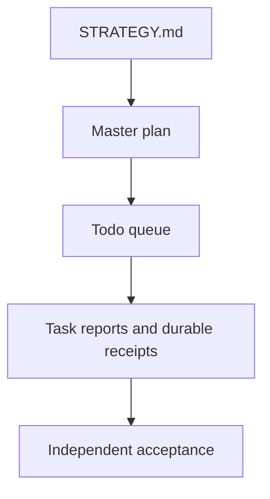

# Plans and evidence

## Active delivery authorities

- [Comprehensive plan](2026-09-28-comprehensive-agentdecompile-plan.md): consolidated scope, obligations, and acceptance criteria.
- [Todo queue](agentdecompile-todo.md): current execution queue. Each item points to its own evidence; do not maintain a separate rolling plan.
- [Strategy](../../STRATEGY.md): recovery order, concurrency, resource limits, and terminal proof.

No living plans or plan-maintenance skills are maintained. The former
`2026-08-30-corpus-semantic-pipeline-living-plan.md` artifact was removed; its
historical requirements remain represented in the master plan. The dated documents
below are Frozen design inputs and historical records, not active execution queues.
Current user instructions and the active authorities above govern conflicts.

## Design and implementation records

- [September 18–21 design scope](2026-09-27-weekend-design-scope.md): baseline designs, plans, brainstorms, diagrams, and named units.
- [Weekend program progress and live track](2026-09-27-implementation-progress-and-live-track.md): cross-matching and implementation history.
- [Weekend unit delivery ledger](2026-09-27-weekend-unit-delivery.json): source-qualified D/U records and their original acceptance spans.
- [Portable signatures and code caves](2026-09-21-portable-signatures-codecaves-generic-plan.md).
- [Distributed-compute design](2026-09-21-distributed-compute-design.md).
- [Recovery contracts and validation](2026-09-22-recovery-contracts-and-validation-plan.md).
- [Design package](2026-09-22-design-package.md).
- [Unified reversing workstation](2026-09-20-unified-reversing-workstation.md).
- [Recovery pipeline ladder](2026-09-08-0156-feat-recovery-pipeline-ladder-plan.md).
- [Portable signatures and Phasor export](2026-09-08-0225-feat-portable-signatures-phasor-export-plan.md).

Operator documentation starts at the [project README](../../README.md). The folder is design and implementation provenance; it does not create another mutable status system.
