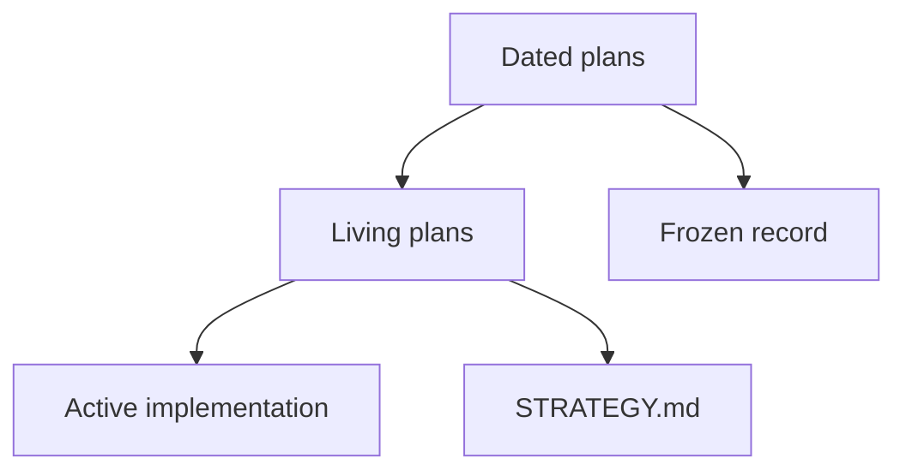

# Plans

Operator docs start at [README.md](../../README.md). Strategy: [STRATEGY.md](../../STRATEGY.md). This folder is implementer history, not a second user manual.

## Living

Update these when the work they name changes:

| Plan | Role |
|---|---|
| [September 18–21 design scope](2026-09-27-weekend-design-scope.md) | Governing baseline index: full weekend designs, plans, brainstorms, diagrams and named units; later packages refine rather than replace it |
| [Weekend program progress and usable live track](2026-09-27-implementation-progress-and-live-track.md) | Current progress/todo ledger for that full baseline and later adopted work; useful RE/cross-matching runs alongside implementation |
| [September 21 portable-signatures/codecaves plan](2026-09-21-portable-signatures-codecaves-generic-plan.md) | Full Phases 0–15 and D/U unit baseline; historical completion marks need current requalification |
| [September 21 distributed-compute design](2026-09-21-distributed-compute-design.md) | Required reusable compute/state foundation and adapters; scale follows a qualified local lane |
| [Session obligation audit](2026-09-22-session-obligation-audit.md) | Active goal: direct user directives, 110 contract/acceptance items, priorities and completion evidence |
| [Autonomous capability roadmap](2026-09-22-autonomous-capability-product-roadmap.md) | Current implementation roadmap: durable continuation through scenario automation, F12, captures, checkpoints and platform qualification |
| [2026-09-22-design-package.md](./2026-09-22-design-package.md) | Later recovery/acceptance contract consolidation and review closure; does not narrow the weekend baseline |
| [2026-09-22-recovery-contracts-and-validation-plan.md](./2026-09-22-recovery-contracts-and-validation-plan.md) | Current recovery-contract delta, reccmp/ReAgent integration and vanilla-runtime acceptance |
| [2026-09-20-unified-reversing-workstation.md](./2026-09-20-unified-reversing-workstation.md) | Frontend implementation; [consolidated user intent](../FRONTEND_INTENT.md) and [delivery evidence](../DELIVERY_STATUS.md), not a competing recovery ladder |
| [2026-09-08-0156-feat-recovery-pipeline-ladder-plan.md](./2026-09-08-0156-feat-recovery-pipeline-ladder-plan.md) | Historical ladder with current reconciliation; active package linked above |
| [2026-09-08-0225-feat-portable-signatures-phasor-export-plan.md](./2026-09-08-0225-feat-portable-signatures-phasor-export-plan.md) | Portable signatures + Phasor hook-pack export |
| [2026-07-24-perf-recovery-one-shot-living-plan.md](./2026-07-24-perf-recovery-one-shot-living-plan.md) | Historical G14–G16 fixes; cold-host wall-time acceptance measurement remains open |

The 2026-08-30 corpus living plan is historical. Do not rewrite its deltas.

## Reconciliation — 2026-09-20

[STRATEGY.md](../../STRATEGY.md) is the single pipeline/priority authority.
[RUNTIME_REUSE.md](../RUNTIME_REUSE.md) records existing export/catalog/loader
seams and missing runtime-readiness proof. The two September 8 plans retain
their original decisions below dated reconciliation notes; old matcher ordering,
test/restart recipes and completion criteria do not override current strategy
or [AGENTS.md](../../AGENTS.md). Whole-image acceptance remains unfinished.

## Current docs work

| Plan | Role |
|---|---|
| [2026-09-01-feat-user-facing-docs-consolidation-plan.md](./2026-09-01-feat-user-facing-docs-consolidation-plan.md) | Landing / how-to / hub rewrite (done on disk) |
| [2026-09-01-feat-secondary-docs-surfaces-plan.md](./2026-09-01-feat-secondary-docs-surfaces-plan.md) | TOOLS_LIST preamble, STRATEGY/VISION, skills, hubs, Web UI hero |
| [2026-09-01-feat-agent-internal-docs-plan.md](./2026-09-01-feat-agent-internal-docs-plan.md) | AGENTS / GEMINI / CLAUDE / tests / examples / prototype and audit hubs |

## Frozen

Every other file in this tree is a **dated record**. Preserve its source content
and dated operational evidence. Requirements inherited through the weekend scope
index remain binding even when their source is a dated record; record current
status and explicit supersession in the living ledgers. Do not rewrite old clone
URLs, tool counts or fixture names to imply a fresh run. Product stems and session
paths in those files are historical evidence, not current how-to.

New work gets a new dated plan. Do not run a repository-wide substitution script over this folder.

The September 22 [history-grounded maintainability extension](2026-09-22-history-grounded-maintainability-design.md)
connects recorded AgentDecompile, KotorPhasor and harness bottlenecks to concrete
implementation seams and future acceptance cases.

The [failure prevention and recovery specification](2026-09-22-failure-prevention-and-recovery-contracts.md)
is the mandatory resilience refinement, including control-plane failures and future
acceptance checks. See the [diagram artifacts](../dashboard-design/pipeline-diagram/README.md)
for the synchronized overview and companions.
