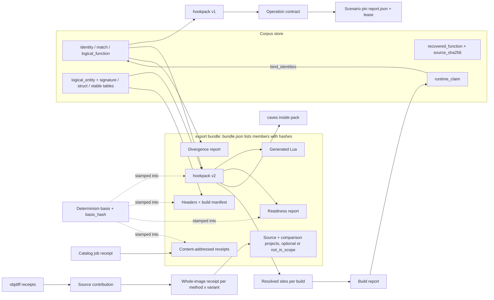

# Exports, outputs and result artifacts: complete inventory

Date: 2026-09-29. Status: **documentation-derived research input for a dashboard design.**
Nothing was run to produce it. No server, catalog action, test, build, database or
frontend source was read or executed. Only documentation was read: the root `*.md` files,
everything under `docs/` (including `docs/dashboard-design/pipeline-diagram/pipeline-model.json`
and the weekend unit ledger JSON), and the markdown under `skills/` and `.agents/skills/`.

Product, game and binary names are replaced with generic names: builds are `build-a` …
`build-d`, the corpus is `corpus-alpha`, the corpus database is `db/<corpus>.sqlite`, the
sibling native consumer is **the external runtime host**, and the donor dashboard is
**the donor corpus dashboard**. Repository tool names (Ghidra, BSim, objdiff, reccmp,
ReAgent, m2c) are kept. A few source documents have product names in their file paths;
those are cited as plain paths with a placeholder (`<donor>`, `<runtime-host>`,
`<engine>`) and are identified by their date prefix.

This inventory records what the documents *say*. A "delivered" row below means that a
cited receipt records bounded source/installed evidence. It never means the artifact is
live on the 8080 service: every 2026-09-27 receipt states that no 8080 listener existed
and nothing was activated ([DELIVERY_STATUS.md:200-201](../DELIVERY_STATUS.md),
[:216](../DELIVERY_STATUS.md), [living plan:112-113](../plans/2026-09-27-implementation-progress-and-live-track.md)).

## How to read this inventory

**Status words.**

- **delivered (bounded)**: an implementation receipt records source plus installed-package
  checks, or a historical observed run, for the named scope. Serving activation and live
  acceptance remain open unless the row says otherwise.
- **partial**: some source or synthetic evidence exists. The ledger or plan names the
  missing parts.
- **future**: design, plan or contract only. The weekend unit ledger starts every unit
  `unverified`, and historical checkmarks do not establish delivery
  ([STRATEGY.md:23-26](../../STRATEGY.md)).
- **reference**: an implementation CLI artifact documented for reference. The current
  mission says it is not an operating instruction ([AGENTS.md](../../AGENTS.md) "Recovery operations";
  [CRITICAL_PATH.md:3-7](../CRITICAL_PATH.md)).

**Claim tiers** follow VISION: Verified, Advisory, Context hint, Byte authoritative
([VISION.md:202-209](../../VISION.md)). The design system fixes the claim-boundary copy
used in the notes, for example "compile admits candidate, not replacement · floor ≠
recovered C · local zero ≠ full-image or behavior proof · exported plan ≠ live detour
permission · result exists ≠ independently accepted claim"
([70-copy.md:28](../design-system/project/guidelines/70-copy.md)).

**Pipeline-model node ids** come from
[`pipeline-model.json`](../dashboard-design/pipeline-diagram/pipeline-model.json). The
seven export-target nodes are at lines 1413-1510. When this inventory was written its
`catalog_verbs` map covered only eight verbs, for stages 1-7; the export verbs have since
been mapped to export nodes (consolidated plan §2.1, 2026-09-29). Stage 0, stage 8 and
every lane have no verb, and any verb missing from the map renders "stage: unmapped"
([pipeline-model.json `conventions.catalog_verbs`](../dashboard-design/pipeline-diagram/pipeline-model.json);
[consolidated plan:85-93](../dashboard-design/2026-09-21-consolidated-design-plan.md)).

**Unit ids.** `U…` and `D1`-`D9` are portable-plan units
([portable plan](../plans/2026-09-21-portable-signatures-codecaves-generic-plan.md);
[weekend unit ledger](../plans/2026-09-27-weekend-unit-delivery.json), 193 records).
`P0.3`, `P0.4`, `P1.x`, `P2`, `RC-xx`, `G1`-`G6` and `M0`-`M7` are the September 22-27
program identifiers from the [session audit](../plans/2026-09-22-session-obligation-audit.md),
[recovery contracts](../plans/2026-09-22-recovery-contracts-and-validation-plan.md),
[living plan](../plans/2026-09-27-implementation-progress-and-live-track.md) and
[roadmap](../plans/2026-09-22-autonomous-capability-product-roadmap.md). `F01`-`F35` are
[FRONTEND_INTENT](../FRONTEND_INTENT.md) requirements.

## Master table

Surface columns: **S** = static 8080 `/dashboard`; **R** = React `/react/` workstation;
**D** = designed in the design system only; **—** = no surface named in any document.

**Count.** 67 artifacts in 8 groups (A 10, B 11, C 9, D 13, E 14, F 5, G 3, H 2), counted
from the rows below. The table is authoritative; any other artifact count is derived from it
and is corrected to it.

| # | Artifact | Kind | Producer (verb/stage · node) | Units | Status | Surface today → gap |
|---|---|---|---|---|---|---|
| **A** | **Export bundle (portable-plan Phase 12)** | | | | | |
| A1 | Export bundle tree + `bundle.json` | export bundle | `corpus.export-bundle` (not yet present) · `export-target` | U87, U155, U148, U104 | future | — → PipelineMap export band (D, ExportTargetCard) only |
| A2 | `agentdecompile.hookpack/v1` pack | runtime pack | `corpus.export-hookpack` · lane-B / `export-hookpack` | D2, D8, U1-U3, U1b, U7 | delivered (bounded) | catalog only → no pack viewer |
| A3 | `agentdecompile.hookpack/v2` pack | runtime pack | `corpus.export-hookpack --format v2` · `export-hookpack` | U30, U44, U5-U5d, U11, U12, U24, U54 | future | — → D (ReadinessMatrix reads its coverage) |
| A4 | Generated Lua binding module | generated code | `corpus.export-lua-bindings` · `export-lua` | U88, U47, U13c | future | — |
| A5 | Per-build C/C++ headers + build manifest | headers | header producer (`build_types_header` path) · `export-headers` | U89, U11b, U32a, U33 | partial | — |
| A6 | Readiness report (`readiness/v1` JSON + human text) | report | `corpus.readiness-report` · `export-readiness` | U90, U81, U107 | future | — → D (`panel=readiness`, ReadinessMatrix) |
| A7 | Divergence report | report | `corpus.diff-builds` · `export-divergence` | U14-U17b, U39, U81, U106, U109 | future | review queue (S/R, source-staged) → per-kind deltas absent |
| A8 | Content-addressed receipts | receipts | every exporter · lane-D / `export-receipts` | U66, U5c, U110, U158 | future | — → D (receipt card, walkable provenance) |
| A9 | Source + comparison projects (C+floor, max-C, manifests, reccmp reports, image receipts) | recovered source tree | stages 3-8 · `export-projects` | P2, P2-f, R6, U152, U153 | partial | historical ZIP (S/R) → current variants absent |
| A10 | Named source-variant ZIP download | archive | source ZIP action (workbench) | F24 | partial (historical) | S/R download observed 2026-09-08 → current max-C ZIP open |
| **B** | **Parity, contribution and whole-image results** | | | | | |
| B1 | Whole-image acceptance receipt, 2 methods × 2 variants | acceptance | stage-8 / `gate-8` · `export-projects` | U62, U152, U153, RC-02, Delivery 7 | future (unproven) | — → D (VariantLedger, ImageDeltaMap) |
| B2 | objdiff comparison receipt / local-parity facts | parity receipt | `corpus.objdiff-check` · stage-7 / `gate-7` | U28, U64, U136 | delivered (existing path) | donor pages (real_c/byte_exact) → D (ObjectDiff) |
| B3 | Observed source-contribution record (exact placement) | contribution | `pe-coff-relocation-free-exact-placement-v1` · stage-7/8 | P0.4, RC-02 | delivered (bounded, `.9`) | — ("not a completed function") |
| B4 | Raw local observation receipts + reconciliation report | parity receipt | byte-exact producers + reconciliation consumer · stage-7 | P0.4 | delivered (bounded) | — (dashboard totals unqualified) |
| B5 | Fresh revalidation result | parity receipt | `corpus.source_revalidation.revalidate` · stage-7 | P0.4, RC-02 | delivered (bounded, `.13`) | — |
| B6 | Package verification output tree | rebuild artifact | `recover.verify-package` | P0.3 | delivered (bounded, `.14`) | — |
| B7 | Target-snapshot and target-consistency provenance on observations | provenance fields | three local-comparison producers | P0.4 | delivered (bounded) | — |
| B8 | PE export identity witness (`target-pe-export-name-at-va-v1`) | identity witness | ingestion evaluator | P0.4 | delivered (bounded) | S/R Evidence row (historical witness) |
| B9 | Proof ladder + proof campaign receipts | reports | `agentdecompile-cli reconstruct --autonomous` | — | reference | — |
| B10 | Source dump tree (`--dump-source`) | recovered source tree | `reconstruct --dump-source` | — | reference | — |
| B11 | Critical-path stage receipts | stage receipts | single-binary `reconstruct` checkpoints | — | reference | — |
| **C** | **Corpus store tables and match objects** | | | | | |
| C1 | `identity`, `match`, `logical_function`, `recovery_family` | per-entity tables | stage-1 cascade, `bind_identities` | D1-D9, U143 | partial (D3/D9) | donor pages; S/R functions/logical views |
| C2 | Match review queue object (U17 row) | review record | match-review backend | U17, U106, U109 | partial (source-staged) | S/R/workstation source, not mounted |
| C3 | Cross-place recipient candidate | candidate record | `corpus.cross-place` · stage-5 / `gate-5` | P1.4, U144 | delivered (bounded, `.15`) | — |
| C4 | `recovered_function`, `reuse_candidate`, `source_sha256` | per-entity tables | ingestion/collection | P0.4 | delivered (bounded) | S/R Evidence (digest check) |
| C5 | `logical_entity` (30 kinds), `logical_signature`, struct/field/vtable tables | per-entity tables | lanes A/B | U5, U22, U30-U45 | future | — → D (ReadinessMatrix, slots mode) |
| C6 | `runtime_claim` rows and build report | evidence rows | lane-C learn-the-build | U99, Ladder F | future | — |
| C7 | Calibration record | calibration | `corpus.calibrate-global` · stage-2 | U19, U69 | future (no receipt) | — |
| C8 | Validated linkable-region scaffold | region scaffold | `corpus.workspace` · stage-3 / `gate-3` | R2, RC-01, U152 | partial (synthetic) | — |
| C9 | Per-field fused knowledge (names/types/comments) | knowledge merge | lane-A | F07, F16 | partial | S/R names; D (NameProvenance, `panel=names`) |
| **D** | **Jobs, receipts, determinism and attestation** | | | | | |
| D1 | Catalog job receipts (`workbench-jobs`) with reservations | job receipts | every catalog action | P0.3, M0 | delivered (bounded) | S/R activity dock (unknown ownership) |
| D2 | Resource reconciliation report | report | `workbench.resource-reconciliation-report` | P0.3 | delivered (bounded) | catalog only |
| D3 | Acceptance record / ledger commit | acceptance | acceptance coordinator · `accept-4` | M0, RC-xx | future (design) | — → D (receipt card) |
| D4 | Determinism basis object + `basis_hash` | provenance | lane-D | U5c, U54, U25, U158 | partial (cascade basis only) | — → D (ProvenanceStamp basis) |
| D5 | Determinism gate results (export byte-diff, cascade harness) | gate result | `verify-determinism` · lane-D | U28(a)(e), U151 | partial | — |
| D6 | Attestation receipts (`corpus attest`) | attestation | `corpus attest` / `corpus-attest` lane | U28x, U168 | future | — |
| D7 | Verification cache manifests and cache identity | manifest | `corpus.verify-byteexact`, `corpus.seed-validation` | M0 | delivered (bounded) | catalog parameters only |
| D8 | Supervisor state (`.supervision`) | state | `corpus.recovery-orchestrator` | M0 | delivered (bounded) | S/R preparation "Recorded continuation decisions" |
| D9 | Preparation projection (admission spending, freshness, retry/wake) | projection | preparation views | L0.2-L0.5, P1.1 | delivered (bounded, not activated) | S/R preparation views |
| D10 | Scoped activity evidence projection | projection | activity SSE route | L0.2-L0.5 | delivered (bounded, `.10`) | S Explorer; R Explorer/Evidence |
| D11 | Failure record / task lifecycle | status record | coordinator | FP-xx, M0 | future (design) | — → D (FailureRecord, TaskLifecycle) |
| D12 | Starvation and hang metrics | metrics | both surfaces + receipts | U111 | future | — → D (StarvationMeter) |
| D13 | Delivery receipts, wheel provenance, unit ledger | delivery evidence | implementation process | all | delivered (docs) | docs only |
| **E** | **Ghidra-side, analysis and agent outputs** | | | | | |
| E1 | Ghidra project state + `program_binding` | project state | Ghidra / stage-0 · `lock-1` | F01-F03 | delivered (existing) | S/R Code Browser, project views |
| E2 | Ghidra knowledge cache (`func_knowledge`) | cache | batch decompile / knowledge store | — | delivered (existing) | donor knowledge panel |
| E3 | Ghidra exporter files (GZF, SARIF, C/C++ + header, XML, HTML, ASCII) | exports | MCP `export` | — | delivered | — (advanced action in spec) |
| E4 | Tier-1 batch outputs (decompile, GZF, BSim signatures, SAST SARIF, triage, external scans) | batch outputs | `run-batch-*`, triage tools | — | delivered (plans completed) | — |
| E5 | BSim database + ingest receipt + report state | similarity DB | `bsim-createdatabase` / `bsim-ingest` / `bsim-report` | U5d, U98, U169 | delivered (U5d/U169 future) | workbench Analyze menu; donor crossmatch panel |
| E6 | Native decompiler snapshot (`agentdecompile.native-snapshot/v0`) | snapshot | native SDK exporter / `gnsdk-batch` | — | partial | — |
| E7 | Context export tree (`export-context`) | dismantle tree | MCP `export-context` | F13 | delivered | — |
| E8 | Context-fusion placement and label proposals | proposals | acquisition (`acquisition/*.json`) | F14 | delivered | — |
| E9 | STABS extract `{id}.functions.json` | extract | `corpus.extract-stabs` · stage-1 | — | delivered | — |
| E10 | RE role artifacts (worker, critic, aggregator JSON) | agent artifacts | re-worker / re-critic / re-aggregator skills | — | delivered (skill contract) | — |
| E11 | Rewrite queue (`state/rewrite-queue.json`) | queue | rewrite worker | U146 | delivered (existing) | — |
| E12 | ReAgent schema-1 snapshot | provider input | `corpus.export-reagent-snapshot` | P1.3 | delivered (bounded) | catalog only |
| E13 | Normalized validation report (ReAgent / reccmp) | diagnostic proposal | `corpus.normalize-validation-report` | P1.3 | delivered (bounded) | catalog only |
| E14 | Managed-engine project reconstruction receipts | stage receipts | `reconstruct --<engine>-project-out` | — | reference | — |
| **F** | **Runtime reuse outputs (lane C)** | | | | | |
| F1 | Operation contract (`agentdecompile.operation-contract/v1`) | generated operation | `export-hookpack --operation-contract` | G1, M2 | partial (`.11`) | — |
| F2 | Scenario operation pin in `report.json` + prepared lease | runtime receipt | external runtime host harness | G3, M1 | partial | — |
| F3 | Per-entity × build runtime capability states | capability record | lane-C resolve/preflight | U46, U68, U72-U74 | future | — → D (RuntimeCapabilities, `panel=runtime`) |
| F4 | Cave plan templates (`caves[]`) | plan template | U12 inside the hookpack | U12, U57, U58, U100, U101 | future | — |
| F5 | Scenario, capture, clip, checkpoint and project bundles | runtime bundles | M1-M5 scenario runner | M1-M5 | future | — → D (MilestoneCard only) |
| **G** | **Distributed compute (lane E)** | | | | | |
| G1 | Content-addressed objects + signed partition-log records | grid records | `adgrid` | U120-U126 | future per ledger (plan marks ✔) | — |
| G2 | Materialized views (`grid_*`, similarity index) | views | `adgrid view materialize` | U123, U128, U169 | future | — |
| G3 | Fleet manifest objects | manifest | `adgrid fleet` | U129 | future | — |
| **H** | **Reports and context packs** | | | | | |
| H1 | Recovery report (`/report`, `panel=report`) | report | report service | F19, U90 | partial (donor page) | S route redirects; D (`panel=report`) |
| H2 | Agent context bundle / prompt evidence | context pack | context assembly | F21 | future (design) | — |

## Per-artifact notes

Each note gives identity, provenance, format and shape, claim tier, freshness and
determinism, status, surface today and gap. Relationships are summarized in the
[relationship section](#relationships-between-artifacts).

### A. Export bundle (portable-plan Phase 12)

The strategy names "the complete export bundle: portable `hookpack/v2`, generated Lua,
per-build headers, readiness/divergence and evidence, alongside recovered projects" as a
required deliverable ([STRATEGY.md:39-42](../../STRATEGY.md)). The living plan lists it as a
"required product output, not an optional runtime example"
([living plan:39](../plans/2026-09-27-implementation-progress-and-live-track.md)). The bundle
table is at [portable plan:1682-1697](../plans/2026-09-21-portable-signatures-codecaves-generic-plan.md).
Ambiguous and contested records "remain structured outputs and refuse unsafe use"; they do
not wait for human triage ([STRATEGY.md:41-42](../../STRATEGY.md);
[FRONTEND_INTENT.md:435](../FRONTEND_INTENT.md)).

#### A1. Export bundle and `bundle.json`

- **Identity:** export bundle. One deterministic output tree.
- **Provenance:** future verb `corpus.export-bundle`, cataloged beside `export-hookpack`.
  Node `export-target` (lane B `feeds` it; lane D `gates` it). Units U87 (the verb), U155
  (bundle manifest stub, grid form), U148 (export slices/shards/merge), U104 (output-tree
  admission scope) ([portable plan:1699-1706](../plans/2026-09-21-portable-signatures-codecaves-generic-plan.md),
  [:2160](../plans/2026-09-21-portable-signatures-codecaves-generic-plan.md),
  [:1898-1903](../plans/2026-09-21-portable-signatures-codecaves-generic-plan.md)).
- **Format and shape:** content-addressed directory. `bundle.json` holds the basis, the
  corpus manifest hash and the artifact list with hashes. Every exporter runs in a fixed
  order.
- **Claim tier:** packages the member claims; adds none. It refuses to emit if any member
  fails its own verify gate. The recovered-source row is optional and, when absent,
  carries a `not_in_scope` receipt.
- **Freshness and determinism:** "re-run under the same basis → byte-identical bundle"
  (`export-target` subtitle, pipeline-model.json:1413-1419). Acceptance test
  `test_bundle_tree_byte_identical_under_one_basis` (U155).
- **Status:** future. Ledger U87 is unverified in all four dimensions
  ([ledger:9070](../plans/2026-09-27-weekend-unit-delivery.json)). "No aggregate bundle
  command located" ([living plan:612](../plans/2026-09-27-implementation-progress-and-live-track.md);
  [DELIVERY_STATUS.md:67-71](../DELIVERY_STATUS.md)).
- **Surface today:** none. The design system draws the seven export-target cards
  (ExportTargetCard, a print component with no live data;
  [ExportTargetCard](../design-system/project/components/ExportTargetCard/README.md)).
  **Gap:** no live bundle view, no member list with hashes and verify-gate outcome, and
  no `not_in_scope` rendering.

#### A2. `agentdecompile.hookpack/v1`

- **Identity:** portable runtime pack, version 1.
- **Provenance:** `corpus.export-hookpack` (CLI `agentdecompile-corpus export-hookpack --db
  … --out …`), advertised in the catalog ([USAGE.md:243-246](../../USAGE.md);
  [CORPUS_PIPELINE.md:72-74](../CORPUS_PIPELINE.md); [README.md:135-141](../../README.md)).
  Lane B `produces` `export-hookpack` (interpretation edge, pipeline-model.json:2580).
  Source rows: `logical_function` + `identity` + `func`
  (`docs/plans/2026-09-08-0225-feat-portable-signatures-<runtime-host>-export-plan.md`:98-120).
  Units: D2 (ordering of three SELECTs; site-key collision), D8 (rowid tie-breaks), U1
  (`image_base` + `sha256` + arch/bits), U2 (per-instance `expected_bytes`), U3 (site
  kind, `required`, field offset/size), U1b (adapter-key/alias map), U7 (VA→offset mapper).
- **Format and shape:** JSON, `format: agentdecompile.hookpack/v1`, `sites{}` keyed by
  logical site name, preferred signature (`signature.kind`, `none` when missing), per-build
  instances (slug + address as cache), optional 8-24 byte unique windows, site kinds,
  required flags, optional field offset/size, `adapter_key`, aliases, image base and
  stored/computed SHA-256 when available ([RUNTIME_REUSE.md:31-44](../RUNTIME_REUSE.md)).
  The CLI also takes `--site-policy`, `--adapter-map` and `--operation-contract`
  ([generated-operation receipt:26-28](../verification/2026-09-27-generated-operation-contract.md)).
  An empty store writes a valid pack with `sites: {}`.
- **Claim tier:** advisory runtime locator data. "An exported pack is not proof of a safe
  call or recovered source" ([USAGE.md:246](../../USAGE.md)). Exported signature strings
  alone do not establish portable resolution ([docs/corpus/README.md:26](../corpus/README.md)).
  A signature derived from the label-selected address proves presence only
  ([RUNTIME_REUSE.md:112-120](../RUNTIME_REUSE.md)). Raw export is "not automatically
  drop-in" ([STRATEGY.md:156](../../STRATEGY.md)).
- **Freshness and determinism:** Phase 0 exists to make the hookpack byte-reproducible
  ([portable plan:555-559](../plans/2026-09-21-portable-signatures-codecaves-generic-plan.md)).
  The export entry refuses stale stamped cascade state under basis
  `phase0.4+key:content_sha256+dep:content_sha256_16`
  ([D3 receipt](../verification/2026-09-27-d3-destination-scope.md)).
- **Status:** delivered (bounded) as v1. D2/D8 unverified in the ledger. The v1 command
  "needs qualification of its output ownership"
  ([living plan:618-620](../plans/2026-09-27-implementation-progress-and-live-track.md)).
  Catalog listing does not prove an export succeeded ([RUNTIME_REUSE.md:31](../RUNTIME_REUSE.md)).
- **Surface today:** catalog command only. `export-hookpack` lacks `mutating`,
  `identity_scope` and `long_running` flags, so pause cannot drain it
  ([consolidated plan:476-480](../dashboard-design/2026-09-21-consolidated-design-plan.md)).
  **Gap:** no pack summary (sites, builds, coverage, pack hash), no per-site locator
  view, no "last exported / basis" stamp.

#### A3. `agentdecompile.hookpack/v2`

- **Identity:** the full portable runtime pack; "v1 cannot carry this".
- **Provenance:** `export-hookpack` behind `--format v2`, defaulting to v1 until the
  consumer's refuse-on-unknown (U23) lands. Node `export-hookpack` ("every entity kind,
  locator families, per-build coverage, ABI blocks, caves, integrity ranges, basis, pack
  hash", pipeline-model.json:1421-1432). Produced by U1-U3, U5-U5d, U11, U30, U44, U45,
  U24, U54; caves only from U12 ([portable plan:1689](../plans/2026-09-21-portable-signatures-codecaves-generic-plan.md)).
- **Format and shape:** root `format`, `basis`, `pack_sha256`, `corpus_manifest_hash`;
  `binaries[]` (slug, content_sha256, image_base, arch, bits, format, endian,
  pointer_size, wchar_width, compiler_spec, this_kind, reloc_table_present, unpack_state,
  cfg_instrumented, basis_hash, toolchain); `entities[]` (30 kinds) with key,
  `previous_keys`, kind, required, shape, `abi{}`, ordered `locators[]` (14 locator kinds,
  `portable` false only for module_rva/section_offset, uniqueness, verify, coverage),
  structural, callers, callees, neighbours, `instances[]` (`resolved_by`, `status`,
  `detourable`, `reason`), `status{build → rollup}`, `divergence{}`; `caves[]`
  ([portable plan:658-704](../plans/2026-09-21-portable-signatures-codecaves-generic-plan.md)).
- **Claim tier:** closed status set per member and entity × build: `resolved(member) |
  pinned(member) | degraded(member, reason) | ambiguous | unresolved | contested`;
  `observed_status` separate. Identity ≠ locator. Consumers refuse unknown formats.
- **Freshness and determinism:** U24 pack-level sha256 over canonical bytes; consumer
  refuses hash mismatch, unknown basis or wrong target sha256
  ([portable plan:1056-1061](../plans/2026-09-21-portable-signatures-codecaves-generic-plan.md)).
  U25 re-baseline writes a new pack version plus a supersession receipt and keeps the
  prior pack loadable ([:1062-1068](../plans/2026-09-21-portable-signatures-codecaves-generic-plan.md)).
  U26 signature ⇄ identity conflicts mark the site `contested` and emit
  `identity_locator_conflict` ([:1069-1076](../plans/2026-09-21-portable-signatures-codecaves-generic-plan.md)).
- **Status:** future. "Changing the format label would not implement v2"
  ([living plan:617-618](../plans/2026-09-27-implementation-progress-and-live-track.md)).
- **Surface today:** none. Surface ownership: 8080 is required for every artifact of this
  plan, and 5174 is never the only place a field exists
  ([portable plan:706-726](../plans/2026-09-21-portable-signatures-codecaves-generic-plan.md)).
  **Gap:** entity catalog browser, locator family per entity, pack integrity/basis
  display, supersession history.

#### A4. Generated Lua binding module

- **Identity:** generated code module, one `require`-able module per corpus.
- **Provenance:** `corpus.export-lua-bindings`, consuming `hookpack/v2` only, never the
  store. Node `export-lua` (pipeline-model.json:1434-1447). Unit U88; lint U47; call stubs
  depend on U13c ([portable plan:1707-1721](../plans/2026-09-21-portable-signatures-codecaves-generic-plan.md)).
- **Format and shape:** named roots, typed struct accessor tables, entry/handle helpers,
  table/bitfield/string helpers, typed call stubs from the ABI block, hook helpers per site
  kind, `describe(entity)`. **No literal address anywhere.**
- **Claim tier:** every getter/setter/entry/handle raises `error({status, entity,
  members_tried})` on any non-`resolved` status; only `describe()` returns. Stubs are
  refused for low-confidence ABIs. Generated code is not a live permission.
- **Freshness and determinism:** sorted emission, no timestamps; reproducible from the pack
  alone. U28(l): the module passes U47's lint and resolves every fixture entity.
- **Status:** future. "No pack-v2-only Lua generator/command located"
  ([living plan:613](../plans/2026-09-27-implementation-progress-and-live-track.md));
  ledger U88 unverified ([ledger:9152](../plans/2026-09-27-weekend-unit-delivery.json)).
- **Surface today:** none. **Gap:** module listing per corpus, `describe()` preview per
  entity, lint result, pack hash it was generated from.

#### A5. Per-build C/C++ headers and build manifest

- **Identity:** headers plus a build manifest.
- **Provenance:** U89 extends the existing header producer (`build_types_header`) from
  U32a field rows and U11 ABI blocks; also U11b, U33. Node `export-headers`
  (pipeline-model.json:1449-1460) ([portable plan:1722-1726](../plans/2026-09-21-portable-signatures-codecaves-generic-plan.md)).
- **Format and shape:** per-build headers with exact layouts (`_sizecheck_` asserts),
  prototypes with conventions and storage, vtable slot enums, constants and enums; opaque
  unknown spans; manifest naming build hash, toolchain identity and basis.
- **Claim tier:** evidenced per-build layout facts. A shared logical ID does not make a
  layout portable ([FRONTEND_INTENT.md:289-290](../FRONTEND_INTENT.md)); pointer-width
  scaling is only a search hint ([STRATEGY.md:138](../../STRATEGY.md)).
- **Freshness and determinism:** basis carried in the manifest; export byte-diff gate.
- **Status:** partial. The existing producer "strips layout assertions; acquisition
  flattens pointer/composite/union information"
  ([living plan:614](../plans/2026-09-27-implementation-progress-and-live-track.md)). The
  ledger's partial evidence for U89 is the synthetic `recovered_project_manifest.py`
  schema (`agentdecompile.recovered-project/v1`), not the header path
  ([ledger:9234](../plans/2026-09-27-weekend-unit-delivery.json)). DELIVERY_STATUS instead
  attributes the partial prerequisite to "the legacy header path"
  ([DELIVERY_STATUS.md:67-71](../DELIVERY_STATUS.md)). Treat both as partial.
- **Surface today:** none. **Gap:** header browser per build, size-check results,
  manifest (build hash, toolchain, basis).

#### A6. Readiness report (`readiness/v1`)

- **Identity:** report (JSON plus human-readable text); "what a user reads first".
- **Provenance:** `corpus.readiness-report` (U90), consuming the pack's coverage matrices;
  U81 `corpus.coverage-by-entity`. Node `export-readiness` (pipeline-model.json:1462-1475);
  lane A `feeds` it (which build donated which field) and lane C `feeds` it (which ladder
  member resolved each) ([portable plan:1727-1734](../plans/2026-09-21-portable-signatures-codecaves-generic-plan.md),
  [:1655-1660](../plans/2026-09-21-portable-signatures-codecaves-generic-plan.md)).
- **Format and shape:** per entity × build closed status (`resolved(member)`,
  `pinned(member)`, `degraded(member, reason)`, `ambiguous`, `unresolved`, `contested`) plus
  `observed_status`; per build: unpack state, CFG, integrity checks, endianness, pointer
  width, missing L2/L3 adapters; plain-language "what you can do on this build".
- **Claim tier:** locator readiness only. Locator status, observed status and
  identity-edge state are separate axes and never summed
  ([ReadinessMatrix](../design-system/project/components/ReadinessMatrix/README.md)).
- **Freshness and determinism:** validates against `readiness/v1` (U28(l)); U107
  acceptance: matrix rows equal U90's JSON row for row.
- **Status:** future. "No readiness/v1 coverage projection/command located"
  ([living plan:615](../plans/2026-09-27-implementation-progress-and-live-track.md);
  [ledger:9332](../plans/2026-09-27-weekend-unit-delivery.json)).
- **Surface today:** none. Designed as `ws=evidence&panel=readiness` (ReadinessMatrix,
  EntityBuildCard) and U107 inside the corpus-first Logical view
  ([portable plan:1920-1924](../plans/2026-09-21-portable-signatures-codecaves-generic-plan.md);
  [location-schema.json:11-21](../design-system/project/location-schema.json)).
  **Gap:** everything; the matrix is design only
  ([linked views:4](../dashboard-design/2026-09-29-linked-views-and-accessibility.md)).

#### A7. Divergence report

- **Identity:** report of cross-build classification.
- **Provenance:** U14 (`corpus/divergence.py`), U15 classify/store/gate, U16 per-logical
  rollup, U17 display object, U17b CLI gate, U39 per-kind divergence, U81
  `corpus.diff-builds A B`. Node `export-divergence` (pipeline-model.json:1477-1488);
  lane B `produces` it (interpretation edge, pipeline-model.json:2588).
- **Format and shape:** per entity 3-way class `1↔1 structural match` / `1↔N
  split-or-inlined candidate` / `diverged, no confident counterpart`; integer components
  (`nodes_only_in_A/B`, `edge_symdiff`, `neighborhood_symdiff`, `size_A/B`); field-map,
  slot and table deltas between any two builds
  ([portable plan:548-554](../plans/2026-09-21-portable-signatures-codecaves-generic-plan.md)).
- **Claim tier:** "SAY so and SHOW it — never fake a match"; nothing propagates silently
  (lane-B card 4). Divergent pairs land as `status='review'` and are refused for
  propagation (U28(n)).
- **Freshness and determinism:** integers and cross-multiplied rational thresholds, never
  floats; thresholds are versioned parameters in the basis. Re-baseline reports the delta
  rather than overwriting (U25).
- **Status:** future (U14-U17b, U39 unverified).
- **Surface today:** the match-review queue exists in source across the workstation,
  static `/dashboard` and full app, paged by match ID, but is staged/synthetic only and
  not mounted ([DELIVERY_STATUS.md:14-35](../DELIVERY_STATUS.md)). U106 (U17 fields on
  8080) and U109 (5174 Compare tab) are future. **Gap:** divergence class, components,
  `thresholds_version`, `producing_channel` columns; per-kind deltas; per-pair Compare.

#### A8. Content-addressed receipts

- **Identity:** receipts for every artifact.
- **Provenance:** U66 (required), U5c, U110, U158 (basis projection per kind). Node
  `export-receipts` (pipeline-model.json:1490-1501); lane D `produces` it
  (interpretation edge, :2716).
- **Format and shape:** keyed by `hash(inputs + basis)` where basis is the kind's declared
  projection; carries full `basis_hash` and `{stable_key, build, operation, member,
  outcome}` for replay ([portable plan:1527-1534](../plans/2026-09-21-portable-signatures-codecaves-generic-plan.md)).
- **Claim tier:** a record of an operation's outcome. A receipt is reusable only while its
  relevant dependency hashes remain valid ([STRATEGY.md:132](../../STRATEGY.md)); cached
  receipts guide reuse and never substitute for the terminal fresh rebuild
  ([STRATEGY.md:214](../../STRATEGY.md)).
- **Freshness and determinism:** identical-basis re-run is a cache hit; a basis change in a
  field the kind does not consume is also a hit.
- **Status:** future (U66 unverified, [ledger:7464](../plans/2026-09-27-weekend-unit-delivery.json)).
  Today's receipts are the heterogeneous families in groups B and D.
- **Surface today:** none as a unified class. Designed: receipt card, `%` go-to prefix,
  walkable provenance fact → receipt → job → stage → changed entities (F32, U180),
  derive/backfill replay (U110) ([35-linked-views.md:14-15](../design-system/project/guidelines/35-linked-views.md);
  [consolidated plan:377-381](../dashboard-design/2026-09-21-consolidated-design-plan.md)).
  **Gap:** receipt identity/hash, basis, reuse vs fresh, invalidation reason.

#### A9. Source + comparison projects

- **Identity:** recovered C / source tree, per selected build or family, in two variants.
- **Provenance:** STRATEGY stages 3-8 (program scope). Node `export-projects`
  (pipeline-model.json:1503-1510: "byte-accurate C+floor and max-C with manifests · reccmp
  reports + independent image receipts"); stage-7 and stage-8 `produce` it
  (interpretation edges, :2764, :2772). R6 "repeated projects"
  ([recovery contracts:212](../plans/2026-09-22-recovery-contracts-and-validation-plan.md));
  P2 "relocatable project output" ([living plan:816-817](../plans/2026-09-27-implementation-progress-and-live-track.md));
  P2-f `recovered_project_manifest.py` (`agentdecompile.recovered-project/v1`: per-unit
  source/provenance/toolchain/placement) ([living plan:155-156](../plans/2026-09-27-implementation-progress-and-live-track.md)).
- **Format and shape:** source fragments, compilation groups, headers,
  dependency/toolchain manifests and evidence; original binaries remain external inputs
  ([recovery contracts:146-153](../plans/2026-09-22-recovery-contracts-and-validation-plan.md)).
  Each variant has build instructions, toolchain identity and exact verification status
  ([portable plan:1693](../plans/2026-09-21-portable-signatures-codecaves-generic-plan.md)).
- **Claim tier:** two separately measured variants. Floor bytes never count toward
  recovered C; never borrow one variant's receipt for the other
  ([STRATEGY.md:214](../../STRATEGY.md)). Comparator (reccmp) reports and fresh
  whole-file reconstruction receipts are kept separate.
- **Freshness and determinism:** packaging rechecks source digests and writes exact bytes;
  stale source is a reported exclusion ([freshness receipt](../verification/2026-09-26-recovered-source-freshness.md)).
- **Status:** partial. The project manifest module has 34 synthetic tests and no consumer
  ([living plan:155-160](../plans/2026-09-27-implementation-progress-and-live-track.md)).
  No fresh compiler/linker/whole-file proof for either variant
  ([PROTOTYPE_OUTCOMES.md:19](../PROTOTYPE_OUTCOMES.md)).
- **Surface today:** donor pages show real_c versus byte_exact and a round-trip panel
  that keeps assembly and C/C++ package manifests separate
  (`docs/dashboard-design/2026-09-20-<donor>-capability-inventory.md`:129-133).
  **Gap:** per-project manifest view, variant split, reccmp report view, image receipts.

#### A10. Named source-variant ZIP download

- **Identity:** archive of a complete named source variant (F24).
- **Provenance:** the workbench source ZIP action (whole-program C through the shared
  native exporter, durable one-target batch surface)
  ([react-workbench verification:142-169](../verification/2026-09-08-react-workbench.md)).
- **Format and shape:** ZIP with manifest, provenance, build instructions and precise
  verification status; full inventory and missing-source manifests with explicit reasons;
  assembly substrate separated; captured file hashes.
- **Claim tier:** "Export without pretending missing files or ASM floors are recovered C"
  ([FRONTEND_INTENT.md:209](../FRONTEND_INTENT.md)); a source ZIP is not full-image
  acceptance ([FRONTEND_INTENT.md:343-344](../FRONTEND_INTENT.md)). The archive is not an
  atomic snapshot across concurrent writers.
- **Freshness and determinism:** refuses a changed target; replay of a persisted key
  prevents duplicate export after refresh.
- **Status:** partial (historical). A 2026-09-08 run downloaded a native archive in both
  UIs, on non-8080 ports that the current mission forbids. "The current max-C ZIP" is
  still open; a historical byte-accurate build ZIP "is not a current max-C source archive"
  ([DELIVERY_STATUS.md:327-331](../DELIVERY_STATUS.md);
  [PROTOTYPE_OUTCOMES.md:20](../PROTOTYPE_OUTCOMES.md)). Acceptance: "Requested variant's
  complete available source/build manifest; missing/unverified/floor contributions
  disclosed" ([FRONTEND_INTENT.md:469](../FRONTEND_INTENT.md)).
- **Surface today:** download control in both UIs (historical receipt). **Gap:** variant
  choice (C+floor vs max-C), disclosure of floor/missing counts before download, delivery
  receipt.

### B. Parity, contribution and whole-image results

#### B1. Whole-image acceptance receipt

- **Identity:** whole-image acceptance, the terminal deliverable.
- **Provenance:** stage-8 "Whole-image byte identity", gate-8 "whole-file hash equality"
  (pipeline-model.json:420-460). No catalog verb ("goal, not a new verb",
  [docs/corpus/README.md:21](../corpus/README.md)). Units: U62 (the C/D seam:
  `binaries[].sha256` **is** the stage-8 whole-file identity), U152 place-check/splice/join,
  U153 closure-based terminal receipt; RC-02; Delivery 7.
- **Format and shape:** Cartesian `method = reconstruction | original_style_build` ×
  `variant = byte_accurate_with_floor | max_c`; each cell has its own input, layout,
  contribution and whole-file receipt
  ([recovery contracts:343-347](../plans/2026-09-22-recovery-contracts-and-validation-plan.md)).
  Required fact: fresh run, original/output hashes and sizes, complete current source
  manifest ([:93](../plans/2026-09-22-recovery-contracts-and-validation-plan.md)).
  Differing regions localize to headers, layout, imports, relocations, resources or
  function/data regions ([FRONTEND_INTENT.md:174](../FRONTEND_INTENT.md)).
- **Claim tier:** the only terminal fact. Per-function objdiff-0 is necessary, not
  sufficient; an unchanged round trip proves infrastructure only; copied floor bytes may
  preserve equality but never earn compiler-produced credit
  (`compilerProducedWholeImage` stays false for a preserved-floor image)
  ([STRATEGY.md:210-214](../../STRATEGY.md);
  [source contribution receipt:45](../verification/2026-09-27-source-contribution.md)).
- **Freshness and determinism:** requires a fresh compiler/toolchain run on the complete
  current source; cached receipts never substitute.
- **Status:** future. "Until a build produces a file whose hash equals the shipped binary,
  whole-image recovery is unproven" ([STRATEGY.md:210](../../STRATEGY.md)). U152 has only
  synthetic COFF roundtrip evidence ([ledger:15570](../plans/2026-09-27-weekend-unit-delivery.json)).
- **Surface today:** none. Designed: VariantLedger (four cells, "reused receipt · not a
  fresh rebuild", "whole-image recovery unproven") and ImageDeltaMap at
  `ws=recovery&panel=report` ([VariantLedger](../design-system/project/components/VariantLedger/README.md);
  [ImageDeltaMap](../design-system/project/components/ImageDeltaMap/README.md)).
  **Gap:** all four cells and the delta map.

#### B2. objdiff comparison receipt and local-parity facts

- **Identity:** objdiff report / parity receipt per function or region.
- **Provenance:** `corpus.objdiff-check` (stage-7; the only stage-7 catalog verb in the
  model); `verify-byte-accuracy` CLI; `run-decomp-match` for m2c/objdiff/permuter
  ([CORPUS_PIPELINE.md:66-70](../CORPUS_PIPELINE.md);
  [TOOLS_LIST.md:1402-1420](../../TOOLS_LIST.md)). U64 recompile-and-diff ABI check;
  U136 parity lane.
- **Format and shape:** separate facts with states `not_run`, `passed`, `failed`,
  `unknown`, `unsupported`, `stale` for compilation, ABI checks, behavioral tests, local
  match, linked match, replacement contribution, whole-file equality
  ([recovery contracts:75-94](../plans/2026-09-22-recovery-contracts-and-validation-plan.md)).
  Proven functions land in `verified/` ([CRITICAL_PATH.md:125-136](../CRITICAL_PATH.md)).
- **Claim tier:** "local zero ≠ full-image or behavior proof" (gate-7). Verified readable
  C needs relocation-aware objdiff 0 against validated targets
  ([STRATEGY.md:115](../../STRATEGY.md)). `real_c=1` records compilation only
  ([STRATEGY.md:134](../../STRATEGY.md)).
- **Freshness and determinism:** match cache skips only on exact `(targetSha256, entry,
  sourceSha256, compilerProfile, compilerLane)` ([CRITICAL_PATH.md:140](../CRITICAL_PATH.md)).
- **Status:** delivered as an existing path; its acceptance semantics are being tightened
  by B3-B7.
- **Surface today:** the donor recovery panel computes `real_c` and `byte_exact`
  separately (`docs/dashboard-design/2026-09-20-<donor>-capability-inventory.md`:131).
  **Gap:** ObjectDiff grid (target vs candidate, relocation-aware rows, "compiled from rN;
  source is rM") is design only ([ObjectDiff](../design-system/project/components/ObjectDiff/README.md)).

#### B3. Observed source-contribution record

- **Identity:** contribution observation (linked, exact placement).
- **Provenance:** backend `pe-coff-relocation-free-exact-placement-v1` with an independent
  final-writer evaluator; P0.4/RC-02 ([source contribution receipt:1-24](../verification/2026-09-27-source-contribution.md)).
- **Format and shape:** source/object/toolchain evidence, one COFF code section placed
  into a reserved PE region; selected-function coverage requires exact producer
  database, binary, address and size.
- **Claim tier:** discarded or overwritten candidates earn zero credit even when fallback
  bytes are equal. Trust is process-local; imported JSON stays diagnostic.
- **Freshness and determinism:** changes to source/object/target/output withdraw only the
  affected claims.
- **Status:** delivered (bounded) in `.9`, 149 installed tests
  ([DELIVERY_STATUS.md:182-189](../DELIVERY_STATUS.md)). Supported subset excludes
  relocations, COMDAT, LTCG, data and external dependencies.
- **Surface today:** "The dashboard does not turn them into completed functions"; the
  scoped evidence row shows "unavailable placed-source contribution" on this serving route
  ([live evidence receipt:17-20](../verification/2026-09-27-live-evidence.md)).
  **Gap:** contribution map (object → emitted range) view.

#### B4. Raw local observation receipts and reconciliation report

- **Identity:** parity receipts plus a reconciliation report.
- **Provenance:** byte-exact producers and the reconciliation consumer; P0.4
  ([raw local observations:14-31](../verification/2026-09-27-raw-local-observations.md)).
- **Format and shape:** `rawEqual` (complete raw equality) distinct from `ok`/`maskedEqual`
  (relocation-masked diagnostic); source path/digest, whole-target snapshot, region
  address/offset/size/digest, comparison policy. Report count `rawLocalObservedC`;
  compatibility alias `byteExactRecoveredC`; `exactPlacementHashEqual: null`.
- **Claim tier:** a raw local observation; "does not certify semantic identity, current
  toolchain, linked contribution or a full rebuilt image". Masked equality counts zero.
- **Freshness and determinism:** receipt order controls supersession; a later negative
  withdraws an earlier observation; positives withdraw on cache loss or dependency
  invalidation and republish only after restoration.
- **Status:** delivered (bounded), 67 tests ([DELIVERY_STATUS.md:252-257](../DELIVERY_STATUS.md)).
- **Surface today:** "Dashboard variant/permuter totals use a separate aggregation route and
  have not been qualified" ([raw local observations:63-65](../verification/2026-09-27-raw-local-observations.md)).
  **Gap:** counters must use `rawLocalObservedC` and show the alias caveat.

#### B5. Fresh revalidation result

- **Identity:** fresh parity result after process loss.
- **Provenance:** `corpus.source_revalidation.revalidate`; P0.4/RC-02
  ([fresh revalidation receipt:9-40](../verification/2026-09-27-fresh-source-revalidation.md)).
- **Format and shape:** bounded recipe (≤256 KiB JSON, ≤32 candidates); new opaque objects
  passed to the reconstruction writer and matching-status consumer.
- **Claim tier:** saved recipes request work; saved audits never restore authority. A
  changed candidate is rejected while a valid sibling is credited.
- **Status:** delivered (bounded) in `.13`, 60 installed checks
  ([DELIVERY_STATUS.md:89-99](../DELIVERY_STATUS.md)).
- **Surface today:** none. **Gap:** "fresh vs reused" marking on every parity fact
  (ProvenanceStamp).

#### B6. Package verification output tree

- **Identity:** rebuild artifact (compiled verification output).
- **Provenance:** catalog action `recover.verify-package`; P0.3.
- **Format and shape:** reserved output tree; versioned native Clang profile; separate C
  and C++ compilation results and process-lifetime evidence
  ([native verify ownership:8-20](../verification/2026-09-27-native-verify-ownership.md)).
- **Claim tier:** compilation success alone cannot release ownership, and is not source
  verification.
- **Status:** delivered (bounded) in `.14`, 139 installed checks
  ([DELIVERY_STATUS.md:73-87](../DELIVERY_STATUS.md)).
- **Surface today:** activity dock job only. **Gap:** per-package compile results.

#### B7. Target-snapshot and target-consistency provenance

- **Identity:** provenance fields on every local comparison.
- **Provenance:** the three local-comparison producers and ingestion
  ([target snapshot receipt](../verification/2026-09-27-target-snapshot-provenance.md);
  [DELIVERY_STATUS.md:235-244](../DELIVERY_STATUS.md)).
- **Format and shape:** captured whole-image SHA-256, location, length, mapper
  diagnostics; compared region address/offset/size/digest.
- **Claim tier:** the bytes supplied at the time; not current-file proof and not semantic
  identity. Seed raw equality no longer accepts prefixes.
- **Status:** delivered (bounded), 100 and 129 tests.
- **Surface today:** none. **Gap:** show snapshot digest and "not rechecked" on facts.

#### B8. PE export identity witness

- **Identity:** identity witness `target-pe-export-name-at-va-v1`.
- **Provenance:** ingestion evaluator (ordinary and seed ingestion); P0.4.
- **Format and shape:** outcome `accepted-target-pe-export` or `target-local-only` with a
  structured reason; persisted status/reason/evidence independent of `logical_id`
  ([PE export identity receipt:8-31](../verification/2026-09-27-target-pe-export-identity.md)).
- **Claim tier:** one independent named witness for supported PE32/PE32+ exports; a false
  name over identical bytes stays local only. Not cross-build equivalence.
- **Status:** delivered (bounded), 124 tests ([DELIVERY_STATUS.md:259-265](../DELIVERY_STATUS.md)).
- **Surface today:** static Explorer and React Evidence show "a coherent historical PE
  export witness, explicitly target-not-rechecked", `accepted:false`
  ([live evidence receipt:10-24](../verification/2026-09-27-live-evidence.md)). Not
  activated.

#### B9. Proof ladder and proof campaign receipts

- **Identity:** reports.
- **Provenance:** single-binary `reconstruct --autonomous` (implementation reference).
- **Format and shape:** `proof-ladder.json` (numerator, `functionsToNextRung`),
  `facts/proof-target-queue.json`, `state/proof-campaign.json`,
  `state/proof-campaign-loop.json`, `state/proof-campaign-history.jsonl`; named terminal
  statuses `near-miss`, `readability-blocked`, `bridge-failed`, `empty-queue`,
  `budget-stop` with `claimBoundary` ([CRITICAL_PATH.md:54-64](../CRITICAL_PATH.md),
  [:169-174](../CRITICAL_PATH.md)).
- **Claim tier:** near-miss metadata never counts toward the numerator; neither terminal
  criterion completes corpus recovery.
- **Status:** reference (historical smoke).
- **Surface today:** none.

#### B10. Source dump tree

- **Identity:** recovered C / source tree (single binary).
- **Provenance:** `agentdecompile-cli reconstruct --dump-source` / `--dump-source-only`
  (implementation reference).
- **Format and shape:** `README.md`, `MANIFEST.json`, `CLAIMS.md`, `Port/CODE/…`
  (readable modules), `verified/` (full-object proofs), `verified/code-slice/`,
  `advisory/ghidra/` ([CRITICAL_PATH.md:125-143](../CRITICAL_PATH.md)).
- **Claim tier:** never promote inline asm, `_emit`, `.incbin` or byte-copy sources into
  `verified/`; names/types/module paths are advisory unless objdiff reports
  `differences==0`.
- **Freshness and determinism:** fresh mode requires `analysisBinarySha256` agreement;
  leftovers only with `--dump-allow-leftovers` (digest gating disabled)
  ([CRITICAL_PATH.md:105-122](../CRITICAL_PATH.md)).
- **Status:** reference. The source-recovery skill warns: "Do not treat leftover target/
  receipts as this run's source" ([skills/source-recovery/SKILL.md:3](../../skills/source-recovery/SKILL.md)).
- **Surface today:** none.

#### B11. Critical-path stage receipts

- **Identity:** per-stage receipts.
- **Format and shape:** `analysis-target.json` (includes `terminalStatus: blocked:toolchain`
  on unpack failure), `binary-inventory.json`, `function-candidates.json`,
  `facts/enrich-receipt.json`, `facts/readability-repair-queue.json`,
  `facts/symbol-provenance.json`, `state/*-run.json`, `state/mcp-tool-seq-last.json`,
  `state/mismatch-class-last.json`, `source-generation/summary.json`,
  `source-synthesis/summary.json`, `source-synthesis/{accepted,code-slice-matches,source-shape-matches}.jsonl`,
  `stage-timings.json` ([CRITICAL_PATH.md:47-66](../CRITICAL_PATH.md), [:105-116](../CRITICAL_PATH.md),
  [:176-178](../CRITICAL_PATH.md)).
- **Status:** reference. **Surface today:** none.

### C. Corpus store tables and match objects

#### C1. `identity`, `match`, `logical_function`, `recovery_family`

- **Identity:** per-entity identity/match/logical_function tables.
- **Provenance:** stage-1 evidence-fusion cascade (`corpus.extract-stabs` →
  `corpus.match-pair`), `bind_identities`; gate-1 "candidate ≠ acceptance". D1-D9 fix
  ordering; U143 delta binders (grid).
- **Format and shape:** logical entity → implementation variant → physical instance;
  `logical_id` is not a VA ([README.md:135](../../README.md)).
- **Claim tier:** "Similarity proposes; independent evidence accepts"
  ([STRATEGY.md:197](../../STRATEGY.md)). A `logical_id` never establishes source
  interchangeability or ABI/layout compatibility ([STRATEGY.md:71](../../STRATEGY.md)).
  Unresolved/ambiguous counts stay visible ([STRATEGY.md:118](../../STRATEGY.md)).
- **Freshness and determinism:** cascade harness compares these as sorted canonical
  row-sets including `match.id` (lane-D card 2). `recovery_family` derives from
  `content_sha256` (D9). Withdrawing a seed invalidates unsupported descendants.
- **Status:** partial. D3 destination-scoped demotion accepted in `.16`; D9 five backfill
  cases qualified; D1 source partial; D2 and D4-D8 unverified
  ([ledger:294](../plans/2026-09-27-weekend-unit-delivery.json),
  [:893](../plans/2026-09-27-weekend-unit-delivery.json)).
  Historical mis-demoted rows remain uncorrected.
- **Surface today:** functions/logical/review share `/dashboard/functions`
  ([CORPUS_PIPELINE.md:84-86](../CORPUS_PIPELINE.md)); donor logical pages
  (`docs/dashboard-design/2026-09-20-<donor>-capability-inventory.md`:102-108).
  **Gap:** identity-edge state (candidate/accepted/rejected/unresolved) as its own axis;
  basis revision shown.

#### C2. Match review queue object (U17 row)

- **Identity:** review record.
- **Provenance:** match-review backend (`match_review.py`, `match_review_schema.py`), U17,
  U106 (8080), U109 (5174 Compare) ([living plan:464](../plans/2026-09-27-implementation-progress-and-live-track.md)).
- **Format and shape:** `match_id, run, src_binary_slug, src_addr, src_name, dst…`,
  `relation`, `divergence_class`, `components`, `thresholds_version`,
  `producing_channel`, `reason`, total ORDER BY
  ([portable plan:954-962](../plans/2026-09-21-portable-signatures-codecaves-generic-plan.md),
  [:1916-1919](../plans/2026-09-21-portable-signatures-codecaves-generic-plan.md)).
  Token- and selection-bound decisions; HTTP 202 pending; paged by match ID.
- **Claim tier:** review is an override applied afterwards, never a gate
  ([FRONTEND_INTENT.md:435](../FRONTEND_INTENT.md)).
- **Status:** partial. Source in all three UIs, 90 backend and 23 frontend tests; not
  mounted; Vite bundle stale ([DELIVERY_STATUS.md:14-31](../DELIVERY_STATUS.md)).
  Match-review freshness repair is queued ([living plan:567-604](../plans/2026-09-27-implementation-progress-and-live-track.md)).
- **Surface today:** S/R/workstation source only. **Gap:** U17 fields, master-detail
  review (U186), starvation age of oldest unreviewed row (U111).

#### C3. Cross-place recipient candidate

- **Identity:** candidate record (propagation).
- **Provenance:** `corpus.cross-place` (stage-5, gate-5 "candidate distribution ≠ accepted
  source"); P1.4; U144 grid placement objects.
- **Format and shape:** immutable, recipient-specific candidate with provenance; first
  provider supports a native PE constant-leaf subset
  ([cross-place receipt:7-27](../verification/2026-09-27-cross-place-admission.md)).
- **Claim tier:** does not count as source acceptance or recovery; preserves accepted
  recipient C and assembly floors. Logical identity or an old address-only receipt does
  not authorize reuse.
- **Status:** delivered (bounded) in `.15`, 203 installed checks; no live propagation run;
  watch stops after 128 qualification keys ([DELIVERY_STATUS.md:37-65](../DELIVERY_STATUS.md)).
- **Surface today:** none. Designed: propagation drawn as the field change from donor to
  recipient only after its receipt ([consolidated plan:373-376](../dashboard-design/2026-09-21-consolidated-design-plan.md)).

#### C4. `recovered_function`, `reuse_candidate`, `source_sha256`

- **Identity:** per-entity tables of recovered candidates.
- **Provenance:** ingestion and collection; AGENTS requires inspecting
  `recovered_function`, `reuse_candidate` and `identity` first.
- **Format and shape:** candidates keyed by `(program, name, binary_id, addr, path,
  source_sha256)`; nullable `source_sha256` from the producer's observation
  ([PE export identity receipt:33-44](../verification/2026-09-27-target-pe-export-identity.md);
  [freshness receipt](../verification/2026-09-26-recovered-source-freshness.md)).
- **Claim tier:** old rows stay unbound; restoration rows are "reused/unverified" even when
  the digest matches ([USAGE.md:352-369](../../USAGE.md)). Collection moves stale prior
  verified output under `unverified/`.
- **Status:** delivered (bounded), 51 and 84 tests ([DELIVERY_STATUS.md:218-228](../DELIVERY_STATUS.md)).
- **Surface today:** Evidence row "recorded region bytes, with a bounded current
  source-digest check" ([live evidence receipt:14-16](../verification/2026-09-27-live-evidence.md)).
  **Gap:** reused vs fresh label on every row; unbound legacy count.

#### C5. `logical_entity` and the entity-coverage tables

- **Identity:** per-entity tables beyond functions.
- **Provenance:** U30 (`logical_entity`, `identity.kind`; "THE single identity schema"),
  U5 (`logical_signature`), U32/U32a-d (`ghidra_field`, `logical_struct`,
  `struct_instance`, `field_corr`), U33 (`vtable`), U41 (data items), U22 (schema
  migration: `func_param`, `func_bsim`, `match.divergence`, `func.mask_pattern`) ([portable plan:1150-1300](../plans/2026-09-21-portable-signatures-codecaves-generic-plan.md)).
- **Format and shape:** 30 entity kinds (pack enum), per-build coverage keyed by build slug.
- **Claim tier:** per-build layouts; unknown spans opaque.
- **Status:** future (all unverified).
- **Surface today:** none. Designed: ReadinessMatrix slots mode (`type=…::vtable`).

#### C6. `runtime_claim` rows and build report

- **Identity:** evidence rows from runtime.
- **Provenance:** U99 learn-the-build; lane-C card 4; Ladder F
  ([portable plan:1874-1877](../plans/2026-09-21-portable-signatures-codecaves-generic-plan.md)).
- **Format and shape:** per member, per entity resolution results as a build report;
  corpus ingests `runtime_claim` rows, never `identity`; `bind_identities` promotes or
  rejects (receipt + delete).
- **Claim tier:** provisional claims; "never promotes source parity"; contradictions may
  lower accepted coverage.
- **Freshness and determinism:** pure function of image + pack + basis.
- **Status:** future. **Surface today:** none.

#### C7. Calibration record

- **Identity:** calibration (stage-2 output, "part of the basis").
- **Provenance:** `corpus.calibrate-global`; U19 toolchain profile, U69 platform/ABI
  descriptor.
- **Claim tier:** scoped hypotheses; record build/library/translation-unit/function scope
  ([STRATEGY.md:198](../../STRATEGY.md)).
- **Status:** future (no receipt cited). **Surface today:** none.

#### C8. Validated linkable-region scaffold

- **Identity:** region scaffold (stage-3 output), plus assembly-floor files.
- **Provenance:** `corpus.workspace`; gate-3 "round trip + independent linked-image
  oracle"; R2; RC-01; U152; P2 `coff_fixup_roundtrip.py`.
- **Format and shape:** original image hash, offsets/RVAs, extent, arch, byte hash,
  boundary evidence, reconstructed fixups, unwind/TLS metadata, extraction/emitter
  versions, emitted object hash, placement recipe, linked-image comparison receipt
  ([recovery contracts:55-65](../plans/2026-09-22-recovery-contracts-and-validation-plan.md)).
- **Claim tier:** "floor ≠ recovered C"; an unchanged round trip certifies machinery only.
- **Status:** partial (synthetic). R2 "Not implemented by this change"; the COFF roundtrip
  module has 17 synthetic tests and no consumer.
- **Surface today:** none.

#### C9. Per-field fused knowledge

- **Identity:** knowledge merge (lane A).
- **Provenance:** lane-A (pipeline-model.json:463); name precedence human → STABS/debug →
  symbols → Ghidra → placeholders ([STRATEGY.md:144-148](../../STRATEGY.md)).
- **Format and shape:** merged names/types/comments per field with origin, rejected
  alternatives and conflicts; a receipt per merged field.
- **Claim tier:** human naming preference changes display name, not layout evidence.
- **Status:** partial (no specific receipt). **Surface today:** designed as
  `panel=names` (NameProvenance) ([location-schema.json:11-21](../design-system/project/location-schema.json)).

### D. Jobs, receipts, determinism and attestation

#### D1. Catalog job receipts

- **Identity:** job receipts (`workbench-jobs` receipt store).
- **Provenance:** every catalog action; P0.3.
- **Format and shape:** `resourceDisposition`, `resourceKeys`, `ownershipUnresolved`;
  fsynced admission intent; receipt versions ([USAGE.md:316-335](../../USAGE.md);
  [quarantine receipt:9-31](../verification/2026-09-22-quarantine-and-provider-reports.md)).
- **Claim tier:** a finished job is not a match ([README.md:28](../../README.md)); a zero
  exit records a completed pass, never recovery acceptance ([USAGE.md:267](../../USAGE.md)).
- **Status:** delivered (bounded), 126 checks.
- **Surface today:** both activity surfaces show unknown ownership; React suppresses retry
  for quarantined jobs. **Gap:** ActivityRecord "Targets" vs "Changed" lines, StageChip
  ([linked views:243-244](../dashboard-design/2026-09-29-linked-views-and-accessibility.md)).

#### D2. Resource reconciliation report

- **Identity:** report. Provenance: `workbench.resource-reconciliation-report` (read) and
  `workbench.resource-reconcile` (repair), `job_id` input.
- **Claim tier:** repairs only a stale reservation with a durably committed qualified
  release; failed scientific work stays failed
  ([reconciliation receipt:9-20](../verification/2026-09-22-reconciliation-and-cache-package.md)).
- **Status:** delivered (bounded), 153 checks. **Surface today:** catalog only.

#### D3. Acceptance record and ledger commit

- **Identity:** acceptance record.
- **Provenance:** acceptance coordinator; node `accept-4` "Independent acceptance, short
  commit" (pipeline-model.json:1757); feeds `cap-5A`/`cap-5B` independently.
- **Format and shape:** `proposal_id`, `attempt_id`, `generation`, `claim_kind`,
  `claim_scope`, `subject_manifest`, `dependency_versions`, `policy_revision`,
  `verifier_identity`, `observations`, `raw_artifact_digests`, `assumptions`, `bounds`,
  `unsupported`, `outcome`, `reason_codes`, `supersedes`, `accepted_at`,
  `transaction_id` ([task acceptance design:55-64](../plans/2026-09-22-task-acceptance-and-continuation-design.md)).
- **Claim tier:** producers cannot self-promote; contested proposals stay contested.
- **Status:** future (design); parts exist in B3-B5 consumers.
- **Surface today:** none. Designed: receipt card, FactStrip, ProvenanceStamp.

#### D4. Determinism basis object and `basis_hash`

- **Identity:** provenance object stamped into every pack, header, report and receipt
  (lane-D outputs).
- **Provenance:** U54 lands it; U5c emits it; U158 per-kind projection; U25 re-baseline.
- **Format and shape:** `basis_version`, decoder, analyzer (version, processor-spec hash,
  compiler-spec ids, options hash, timeout policy, loader revision), algorithm and
  masking-rule versions, threshold params, filler set, external channels, sorted
  `data_packs[]`, seeds, `toolchain_identity_hash`, `corpus_manifest_hash`; per binary
  `basis_hash = sha256(basis minus corpus_manifest_hash)`
  ([portable plan:466-490](../plans/2026-09-21-portable-signatures-codecaves-generic-plan.md)).
- **Claim tier:** "Deterministic" is only meaningful relative to a declared basis; export
  refuses unknown, empty or mixed bases.
- **Status:** partial. Only the cascade basis revision (`phase0.4…`, with retained
  `phase0.3`) is recorded ([D3 receipt](../verification/2026-09-27-d3-destination-scope.md)).
- **Surface today:** none. **Gap:** basis on every artifact; mixed-basis refusal message;
  supersession history.

#### D5. Determinism gate results

- **Identity:** gate results "pass / first differing key" (lane-D card 2).
- **Provenance:** `verify-determinism` (read-only on temp copies, U104); U28(a) export
  byte-diff; U28(e) cascade harness over three layouts plus key-stability; U151 receipt
  gate plus anonymisation grep.
- **Status:** partial. The committed cascade fixture runs in the D3/D9 selections; U151
  evidence is a synthetic absolute-path-leak check only
  ([ledger:15447](../plans/2026-09-27-weekend-unit-delivery.json)).
- **Surface today:** none.

#### D6. Attestation receipts

- **Identity:** attestation against the real corpus.
- **Provenance:** `corpus attest` (cataloged read-only, U28x); grid `corpus-attest` lane
  (U168) ([portable plan:1114-1123](../plans/2026-09-21-portable-signatures-codecaves-generic-plan.md),
  [:2150](../plans/2026-09-21-portable-signatures-codecaves-generic-plan.md)).
- **Format and shape:** sorted JSON receipts, one per verb, build slugs hashed, stored
  outside the repo, diffed against the previous attestation; exit 0 same, 3 changed, 4
  hang or failure; overruns reported as `hang` with verb and elapsed time.
- **Claim tier:** regression detector on a copy-on-write copy; never the live file.
- **Status:** future ([ledger:4285](../plans/2026-09-27-weekend-unit-delivery.json)).
- **Surface today:** none.

#### D7. Verification cache manifests

- **Identity:** manifest (compiler dependency closure).
- **Provenance:** `corpus.verify-byteexact` `cache-input-manifest`;
  `corpus.seed-validation` `compile-input-manifest`.
- **Format and shape:** JSON `{complete: true, files: [...], environment: [...]}`, paths
  relative to the manifest ([USAGE.md:272-290](../../USAGE.md), [:371-384](../../USAGE.md)).
- **Claim tier:** completeness is asserted by the provider; incomplete closure withholds
  cached positives (`cache-basis-incomplete`).
- **Status:** delivered (bounded). **Surface today:** parameters only.

#### D8. Supervisor state

- **Identity:** state in the output directory's `.supervision` folder.
- **Provenance:** `corpus.recovery-orchestrator` (`input-basis`, `max-failed-exits`,
  backoff) ([USAGE.md:252-271](../../USAGE.md)).
- **Claim tier:** unknown prior launches remain `needs_reconciliation`.
- **Status:** delivered (bounded). **Surface today:** both preparation views show
  "Recorded continuation decisions".

#### D9. Preparation projection

- **Identity:** projection of admission spending, allowance, allocation revision,
  freshness and retry/wake reasons.
- **Provenance:** preparation views; `workbench.prepare.maxActionAdmissions`,
  `workbench.workflow-control` `admission-budget` ([USAGE.md:386-396](../../USAGE.md)).
- **Status:** delivered (bounded, not activated) ([DELIVERY_STATUS.md:166-178](../DELIVERY_STATUS.md)).
- **Surface today:** static and React preparation views.

#### D10. Scoped activity evidence projection

- **Identity:** projection of three independent rows per selected target.
- **Format and shape:** recorded region bytes (source-digest check), historical PE export
  witness (target not rechecked), unavailable placed-source contribution; every row
  `accepted:false`; no combined score.
- **Status:** delivered (bounded) in `.10` ([DELIVERY_STATUS.md:127-136](../DELIVERY_STATUS.md)).
- **Surface today:** static Explorer, React Explorer/Workstation Evidence (not activated).

#### D11. Failure record and task lifecycle

- **Identity:** status records (FailureRecord, TaskLifecycle).
- **Provenance:** coordinator; `lifecycle_states` and `crosswalks` in the model are design
  interpretations, never the runtime state machine.
- **Format and shape:** stable reason, affected scope, evidence freshness,
  attempts/budget, recovery action, wake condition ([FRONTEND_INTENT.md:607-626](../FRONTEND_INTENT.md)).
- **Status:** future (design). **Surface today:** designed components only.

#### D12. Starvation and hang metrics

- **Identity:** metrics (age of oldest unreviewed review row, oldest waiting lane,
  longest-running job against deadline), emitted in receipts.
- **Provenance:** U111 ([portable plan:1937-1941](../plans/2026-09-21-portable-signatures-codecaves-generic-plan.md)).
- **Status:** future. **Surface today:** none; designed StarvationMeter.

#### D13. Delivery receipts, wheel provenance and the unit ledger

- **Identity:** delivery evidence, not product output: `docs/verification/*.md`, wheel
  SHA-256 and member provenance manifests, the weekend unit ledger
  (`agentdecompile.weekend-unit-delivery/v1`) and the 110-item contract register (100
  unverified, 8 partial, 1 superseded, 1 achieved)
  ([living plan:693-695](../plans/2026-09-27-implementation-progress-and-live-track.md)).
- **Claim tier:** requirement status is separate from delivery; historical checkmarks do
  not establish delivery.
- **Surface today:** docs only. A dashboard that tracks product readiness would need this
  ledger as a data source.

### E. Ghidra-side, analysis and agent outputs

#### E1. Ghidra project state and `program_binding`

- **Identity:** Ghidra project state (`.gpr` or shared repository), analysis DB per program.
- **Provenance:** stage-0 "Open · add · resume"; `lock-1` "writes to one Ghidra program's
  analysis DB"; `checkin-program`. Bind loaded projects through `program_binding`
  ([AGENTS.md](../../AGENTS.md) "Discover and reuse first").
- **Claim tier:** context; an empty UI is not permission to analyze again.
- **Status:** delivered (existing). **Surface today:** Code Browser, project views.
  **Gap:** F02 `.gpr` export "must contain the promised project data"
  ([FRONTEND_INTENT.md:81-84](../FRONTEND_INTENT.md)).

#### E2. Ghidra knowledge cache

- **Identity:** knowledge cache (`ghidra_knowledge.sqlite`, `func_knowledge` rows keyed
  `(program, entry_hex)`).
- **Claim tier:** advisory; the schema has no original-image digest.
- **Surface today:** donor knowledge panel (coverage, missing-program gaps)
  (`docs/dashboard-design/2026-09-20-<donor>-capability-inventory.md`:149).

#### E3. Ghidra exporter files

- **Identity:** exports via the MCP `export` tool: GZF, SARIF 2.1.0, C/C++ (with header,
  types, globals), XML, HTML, ASCII ([IMPORT_EXPORT_GUIDE.md:83-92](../IMPORT_EXPORT_GUIDE.md);
  [TOOLS_LIST.md:551-583](../../TOOLS_LIST.md)).
- **Format and shape:** response `{action, format, outputPath, success, resultsCollected,
  apiClass}` ([IMPORT_EXPORT_GUIDE.md:309-320](../IMPORT_EXPORT_GUIDE.md)).
- **Claim tier:** advisory decompiler output; an empty SARIF means check selection and
  binding, not reanalysis ([USAGE.md:140](../../USAGE.md)). Format selects an exporter,
  not the recovery language ([guide inventory:97](../dashboard-design/2026-09-20-ghidra-guide-capability-inventory.md)).
- **Status:** delivered. **Surface today:** none named; spec keeps export as an advanced
  action ([guide inventory:103-106](../dashboard-design/2026-09-20-ghidra-guide-capability-inventory.md)).

#### E4. Tier-1 batch outputs

- **Identity:** `run-batch-decompile` (`decompiledFiles`, `callgraphFiles`),
  `run-batch-export-gzf` (`gzfs/{bin_proj_name}.gzf`), `run-batch-bsim-signatures`
  (`signatureFiles`), `run-batch-sast-scan` (`sarifFiles`), file triage and external
  re-scan bundle; each returns `counts` and `suggestedTierEscalation`
  ([batch GZF plan:30-33](../plans/2026-05-30-lfg-run-batch-export-gzf-c2bc.md);
  [batch BSim plan:31-32](../plans/2026-05-30-lfg-run-batch-bsim-signatures-c2bc.md);
  [batch decompile plan:30-31](../plans/2026-05-30-lfg-run-batch-decompile-c2bc.md);
  [batch SAST plan:31-32](../plans/2026-05-30-lfg-run-batch-sast-scan-c2bc.md)).
- **Status:** delivered (plans `status: completed`). **Surface today:** none.

#### E5. BSim database, ingest receipt and report state

- **Identity:** BSim database (PostgreSQL datadir), receipt
  `agentdecompile-bsim-ingest.json` with per-program `results`, report state.
- **Provenance:** `bsim-createdatabase`, `bsim-ingest`, `bsim-report`
  ([.agents/skills/bsim-corpus/SKILL.md:20-48](../../.agents/skills/bsim-corpus/SKILL.md);
  [TOOLS_LIST.md:1733-1790](../../TOOLS_LIST.md)). U5d persists BSim vectors as a
  first-class identity channel; U98 offline residue attack; U169 similarity view.
- **Format and shape:** report states only `missing_datadir`, `no_postgres`,
  `no_bsim_database`, `empty_database`, `populated` (N executables by name and arch),
  `database_unreachable`.
- **Claim tier:** one identity witness; "Starting PostgreSQL is not ingest"; not objdiff.
- **Status:** delivered (tools); U5d/U98/U169 future.
- **Surface today:** workbench **Analyze → Ingest repository into BSim / Report BSim
  database**; donor crossmatch panel shows BSim status and logs. **Gap:** report state
  word per datadir, per-program ingest progress.

#### E6. Native decompiler snapshot

- **Identity:** snapshot, schema `agentdecompile.native-snapshot/v0`.
- **Provenance:** native SDK exporter; `gnsdk-batch … --output results.jsonl`
  ([native SDK plan:22](../plans/2026-09-08-2330-feat-ghidra-native-sdk-plan.md),
  [:62](../plans/2026-09-08-2330-feat-ghidra-native-sdk-plan.md),
  [:83](../plans/2026-09-08-2330-feat-ghidra-native-sdk-plan.md),
  [:189](../plans/2026-09-08-2330-feat-ghidra-native-sdk-plan.md);
  [STRATEGY.md:160-164](../../STRATEGY.md)).
- **Format and shape:** `manifest.json` (`export_requires_java_decompile: true`,
  `total_bytes`), `functions/<addr>.xml`, the Java C oracle.
- **Claim tier:** a native/Java mismatch is a bug, not a tolerance.
- **Status:** partial (living plan). **Surface today:** none.

#### E7. Context export tree

- **Identity:** dismantle tree from MCP `export-context`: `manifest.json`, `tree.json`,
  `TREE.md`, `LLM_CONTEXT.*`, `extracted/` ([TOOLS_LIST.md:587-613](../../TOOLS_LIST.md)).
- **Claim tier:** advisory substrate context, not recovered source identity.
- **Status:** delivered. **Surface today:** none; F13 acquisition tree is required.

#### E8. Context-fusion placement and label proposals

- **Identity:** `acquisition/placement.json` (placed / unplaced / conflicts / skipped) and
  `acquisition/propose-labels.json` (address-keyed rename proposals, **not applied**)
  ([CONTEXT_FUSION.md:41-42](../CONTEXT_FUSION.md)).
- **Claim tier:** advisory until objdiff ([USAGE.md:118-120](../../USAGE.md)).
- **Status:** delivered. **Surface today:** none; F14 requires unplaced/conflicting
  evidence to stay inspectable.

#### E9. STABS extract

- **Identity:** `{id}.functions.json` from Mach-O STABS, the donor layout
  ([CORPUS_PIPELINE.md:89-95](../CORPUS_PIPELINE.md)). Producer `corpus.extract-stabs`
  (stage-1). **Status:** delivered. **Surface today:** STABS/source paths are donor
  dashboard scope ([FRONTEND_INTENT.md:228-233](../FRONTEND_INTENT.md)).

#### E10. RE role artifacts

- **Identity:** worker JSON artifact (binary_fingerprint, build, logical_id, address,
  name, signature, calls, arguments, returns, evidence, confidence, gaps …), critic review
  record (verdict `confirmed | disputed | insufficient_evidence`, checks, issues),
  aggregator merged artifacts ([.agents/skills/re-worker/SKILL.md:35-60](../../.agents/skills/re-worker/SKILL.md);
  [.agents/skills/re-critic/SKILL.md:33-50](../../.agents/skills/re-critic/SKILL.md);
  [.agents/skills/re-aggregator/SKILL.md](../../.agents/skills/re-aggregator/SKILL.md)).
- **Claim tier:** confidence and convergence are advisory, never proof or propagation
  authority.
- **Status:** delivered (skill contract). **Surface today:** none.

#### E11. Rewrite queue

- **Identity:** `state/rewrite-queue.json` (schema `agentdecompile.rewrite-queue.v1`)
  ([.agents/skills/agentdecompile-rewrite-worker/SKILL.md:18](../../.agents/skills/agentdecompile-rewrite-worker/SKILL.md);
  [donated compute design:61](../plans/2026-09-08-donated-compute-work-exchange.md)).
- **Claim tier:** "A generated candidate never establishes parity."
- **Status:** delivered (existing). **Surface today:** none.

#### E12. ReAgent schema-1 snapshot

- **Identity:** provider input proposal.
- **Provenance:** `corpus.export-reagent-snapshot` (`kb`, `program`, `address`,
  `destination`, `max_functions`); marked mutating ([USAGE.md:339-350](../../USAGE.md)).
- **Format and shape:** selected `func_knowledge` rows, row/file hashes, explicit gaps;
  manifest published last; `binary_binding: unverified`.
- **Claim tier:** "A cache program name is not verified original-binary identity."
- **Status:** delivered (bounded) with real pinned-consumer evidence
  ([ReAgent export receipt](../verification/2026-09-22-reagent-cache-export.md)).
- **Surface today:** catalog only.

#### E13. Normalized validation report

- **Identity:** diagnostic proposal from ReAgent benchmark or reccmp compare JSON.
- **Provenance:** `corpus.normalize-validation-report` (read-only; CLI exit 2
  `invalid_output`) ([USAGE.md:302-313](../../USAGE.md)).
- **Format and shape:** raw report hash, `recovery_accepted=false`,
  `provenance_verified=false`, unknown execution state; reccmp scope and unknown
  denominator retained.
- **Claim tier:** "neither a similarity percentage nor ReAgent GREEN is whole-file
  equality" ([STRATEGY.md:203](../../STRATEGY.md)).
- **Status:** delivered (bounded). P1.3 catalog execution of reccmp/ReAgent is blocked
  ([living plan:176-177](../plans/2026-09-27-implementation-progress-and-live-track.md)).
- **Surface today:** catalog only.

#### E14. Managed-engine project reconstruction receipts

- **Identity:** stage receipts `<engine>/probe.json`, `plan.json`, asset-export,
  managed-decompile, compose, validate, repair receipts, and an editor-openable project
  (documented in the engine-project reconstruction page under `docs/`).
- **Claim tier:** facts and decisions split across receipts; inert (`skipped`) for PE/ELF.
- **Status:** reference. **Surface today:** none.

### F. Runtime reuse outputs (lane C)

Runtime outputs never count as recovered source ([RUNTIME_REUSE.md:7-10](../RUNTIME_REUSE.md)).
Readiness states stay separate: discovered → identity-supported → resolved →
installable/installed → call-observed → behavior-observed ([RUNTIME_REUSE.md:88-91](../RUNTIME_REUSE.md)).

#### F1. Operation contract

- **Identity:** generated operation (`agentdecompile.operation-contract/v1`).
- **Provenance:** `export-hookpack --operation-contract`; G1; M2 preparation.
- **Format and shape:** exact target slug/SHA-256, unique adapter roles, calling
  convention/pointer width, units, engine-thread constraint, lifetime rule, inverse,
  independent-observation requirement; per role: logical site, adapter key, address,
  logical ID, byte window, raw-image digest actually checked
  ([generated-operation receipt:10-28](../verification/2026-09-27-generated-operation-contract.md)).
- **Claim tier:** "a target-bound handoff, not an instruction to inject or invoke".
- **Status:** partial (`.11`, 42 checks) ([DELIVERY_STATUS.md:155-164](../DELIVERY_STATUS.md);
  [living plan:755](../plans/2026-09-27-implementation-progress-and-live-track.md)).
- **Surface today:** none.

#### F2. Scenario operation pin and prepared lease

- **Identity:** runtime receipt in the external runtime host (`report.json` with an
  `[operation]` pin; stage lock; prepared manifest lease).
- **Format and shape:** `id`, `operation_contract_sha256`, `target_sha256`,
  `deployed_script_sha256`, `fixture_sha256`, `runtime_sha256`
  ([effective scenario receipt:9-25](../verification/2026-09-27-effective-scenario-admission.md)).
- **Status:** partial (G3; 65 offline tests; no game run) ([DELIVERY_STATUS.md:138-153](../DELIVERY_STATUS.md)).
- **Surface today:** none.

#### F3. Runtime capability states per entity × build

- **Identity:** capability record: located, readable, callable, detourable, writable;
  predicates bytes / identity / operation (`contract-bytes`, `contract-identity`,
  `contract-operation`).
- **Provenance:** lane-C cards 1-2; U46, U68, U72-U74.
- **Claim tier:** accepted binding = presence AND identity AND current dependencies; a
  byte signature cannot authenticate the semantic label ([STRATEGY.md:83-86](../../STRATEGY.md)).
- **Status:** future. **Surface today:** designed RuntimeCapabilities at
  `ws=evidence&panel=runtime` ([RuntimeCapabilities](../design-system/project/components/RuntimeCapabilities/README.md)).

#### F4. Cave plan templates

- **Identity:** `caves[]` in `hookpack/v2`; U12 is the only producer, "no separate
  artifact, no second verb" ([portable plan:878-893](../plans/2026-09-21-portable-signatures-codecaves-generic-plan.md)).
- **Format and shape:** `{id, claim{pack_sha, cave_id, build_sha256}, anchor, offset,
  capacity, arch, original_bytes, relocation_rules, restoration, candidates[],
  coverage[]}`; Ladder B outcomes `no_placement` / `unsupported_dynamic_code`.
- **Claim tier:** "exported plan ≠ live detour permission" (lane-B card 5). A cave
  inventory is not an installable patch ([RUNTIME_REUSE.md:37](../RUNTIME_REUSE.md)).
- **Status:** future. **Surface today:** none.

#### F5. Scenario, capture, clip, checkpoint and project bundles

- **Identity:** runtime bundles (M1-M5).
- **Format and shape:** scenario bundle pins configured/deployed source, runtime, fixture
  manifests, observer, recorder, cleanup ownership; checkpoints identify save schema,
  build/runtime, script state, world epoch; clips only under a declared recording policy
  ([roadmap:103-120](../plans/2026-09-22-autonomous-capability-product-roadmap.md)).
  Prepared bundle states: preparing → verified → launchable
  ([20-state-vocabularies.md:125](../design-system/project/guidelines/20-state-vocabularies.md)).
- **Claim tier:** behavior, capture integrity and presentation are separate predicates.
- **Status:** future (M1-M7 have no terminal acceptance,
  [living plan:716-727](../plans/2026-09-27-implementation-progress-and-live-track.md)).
- **Surface today:** none (MilestoneCard is a print component).

### G. Distributed compute (lane E)

- **G1 objects and records.** sha256 write-once objects; signed chained partition-log
  records `{prev_hash, kind, task_id, node_key, sig, ts, payload_hash}` with kinds
  `task-offered`, `intent`, `result-proposed`, `result-verified`, `result-refuted`,
  `result-timeout`, `artifact-pinned`, `pin-divergence`, `checkpoint-index`, `snapshot`,
  plus delta kinds `identity-merge`, `bsim-merge`, `image-registered`, `basis-stamped`,
  `export-merge` ([distributed design:94](../plans/2026-09-21-distributed-compute-design.md),
  [:110](../plans/2026-09-21-distributed-compute-design.md), [:269](../plans/2026-09-21-distributed-compute-design.md)).
  Claim: "result exists ≠ independently accepted claim"; donated `.obj`/`.bin` never
  evidence (lane-E card 4).
- **G2 materialized views.** `grid_*` tables, similarity index; "materialize twice →
  identical dump"; view-stale is a named state with an age (lane-E card 5).
- **G3 fleet manifest.** `adgrid fleet up/down/status/replace`, manifest as objects (U129).
- **Status:** the portable plan marks U120-U125 with ✔ and commit ids
  ([portable plan:1995-2048](../plans/2026-09-21-portable-signatures-codecaves-generic-plan.md)),
  but the ledger records every grid unit unverified, and lane-E says "implementation status
  belongs to delivery evidence, not this design diagram". Treat as future. F26 requires
  showing leased work, limits, ownership and returned evidence
  ([FRONTEND_INTENT.md:211](../FRONTEND_INTENT.md)). **Surface today:** none.

### H. Reports and context packs

- **H1 recovery report.** `/report` (optionally `AGENT_DECOMPILE_REPORT_HTML`) is served
  on the MCP HTTP listener and legacy routes redirect to `ws=recovery&panel=report`
  ([CORPUS_PIPELINE.md:116-122](../CORPUS_PIPELINE.md);
  [location-schema.json:101](../design-system/project/location-schema.json)). The designed
  report panel holds "VariantLedger, rebuild comparisons, readiness and divergence
  reports". The donor report shows recent byte-identical recovered rows without counting
  copied bytes as C. The 2026-09-08 Recovery view moved to project-scoped status because
  an unscoped historical report showed missing files as errors
  ([react-workbench verification:173-177](../verification/2026-09-08-react-workbench.md)).
  Status: partial. Gap: the report must be scoped to the active project and show source
  and age on every figure ([PROTOTYPE_OUTCOMES.md:26](../PROTOTYPE_OUTCOMES.md)).
- **H2 agent context bundle.** F21: bounded provenance-preserving bundles; inspect the
  prompt before external transmission ([FRONTEND_INTENT.md:206](../FRONTEND_INTENT.md)).
  Status: future (design). Surface: none.

## Relationships between artifacts

Relationship list, with sources:

1. **The bundle contains its members.** `bundle.json` lists basis, corpus manifest hash
   and each artifact with its hash: hookpack v2, Lua, headers + manifest, readiness,
   divergence, receipts, and optional source variants (absent with `not_in_scope`) (U87).
   The bundle is refused if any member fails its own verify gate.
2. **Basis → every artifact.** The basis object is stamped into every pack, header, report
   and receipt; lane D gates every export (pipeline-model edges `lane-D gates
   export-target`, `lane-D produces export-receipts`, :2708, :2716).
3. **Store → packs → derived exports.** v1 reads `logical_function` + `identity` + `func`;
   v2 adds `logical_entity` and the struct/vtable/signature tables; Lua reads **only**
   the v2 pack (U88); the readiness report reads the pack's coverage matrices (U90);
   headers read field rows and ABI blocks (U89); divergence reads the U14-U16 stored
   classification.
4. **Fact → receipt → job → stage → changed entities (walkable provenance, F32/U180).**
   Receipts carry `{stable_key, build, operation, member, outcome}` (U66) so both
   surfaces replay the same deltas (U110). A job record lists "Targets" separately from
   the "Changed" entities its receipts recorded. StageChip maps a job's verb to a node;
   unmapped verbs read "stage: unmapped".
5. **Parity chain.** objdiff/local receipt (B2, B4) → source contribution (B3) →
   whole-image receipt per method × variant (B1) → source + comparison project (A9). In
   the UI: VariantLedger cell → ImageDeltaMap region → Listing + ObjectDiff pair.
6. **Source digest chain.** Producer observation `sourceSha256` → coverage JSONL →
   `recovered_function.source_sha256` → readable-source packager → `verified/` or
   `unverified/` (C4, A10).
7. **Runtime chain.** Hookpack (selected target, pack hash) → operation contract (G1) →
   scenario pin in `report.json` → prepared lease (G3) → future live mutation receipt.
   Separately, pack v2 → resolved sites (which ladder member) → build report →
   `runtime_claim` → `bind_identities` → `identity` (Ladder F).
8. **External provider chain.** `func_knowledge` → ReAgent snapshot (manifest last) →
   external ReAgent plan report → `normalize-validation-report` → diagnostic proposal
   with `recovery_accepted=false`.
9. **BSim chain.** Ghidra repository → `bsim-ingest` (receipt
   `agentdecompile-bsim-ingest.json`) → BSim DB → `bsim-report` state → one identity
   witness in the cascade (future U5d `func_bsim`; U169 similarity view from verified
   `bsim-merge` objects).
10. **Grid chain.** `result-proposed` → `result-verified`/`result-refuted` →
    view applier → `grid_*` / `identity` / receipts views (future).
11. **Invalidation.** A withdrawn seed or changed dependency marks descendant claims stale
    and removes current export references; historical receipts stay immutable
    ([task acceptance design:76-81](../plans/2026-09-22-task-acceptance-and-continuation-design.md)).
    A basis change produces a new pack version plus a supersession receipt (U25).

## Findings for the dashboard design

1. **These artifact families have no surface at all.** Bundle and `bundle.json`, Lua
   module, headers + manifest, divergence per-kind deltas, determinism gate results,
   attestation receipts, basis/supersession history, cave plans, operation contracts and
   scenario pins, grid records/views, native snapshots, context-export/fusion outputs,
   Ghidra exporter files, Tier-1 batch outputs, RE role artifacts and the rewrite queue.
2. **Designed but not delivered.** ReadinessMatrix, VariantLedger, ImageDeltaMap,
   ObjectDiff, RuntimeCapabilities, OutcomeTag, EvidenceRail, receipt card, StageChip,
   ActivityRecord and the PipelineMap export band are design-system components only
   ([linked views:4](../dashboard-design/2026-09-29-linked-views-and-accessibility.md)).
3. **Surfaces that exist in source today** (none activated on 8080): preparation views
   with continuation decisions and admission accounting (D8, D9), the activity dock with
   unknown ownership (D1), scoped activity evidence rows (D10, B8, C4), match review (C2),
   the historical source ZIP download (A10), BSim ingest/report menu items (E5), and the
   donor corpus pages carried into `/dashboard` (C1, H1).
4. **Claim-tier fields every export row needs.** Fresh vs reused receipt; basis revision;
   verify-gate outcome; the variant (C+floor vs max-C) and method; floor byte count; the
   named non-success outcome (`absent`, `inlined_only`, `ambiguous`, `unsupported`,
   `insufficient_evidence`, `budget_exhausted`, `contested`, `unresolved`,
   `no_placement`, `unsupported_dynamic_code`, `missing_adapter`)
   ([OutcomeTag](../design-system/project/components/OutcomeTag/README.md)); and the
   claim-boundary sentence from [70-copy.md:28](../design-system/project/guidelines/70-copy.md).
5. **Inconsistencies to resolve before design.**
   - U89 partial evidence: the ledger cites a synthetic manifest module; DELIVERY_STATUS
     cites the legacy header path. Neither is the header producer U89 names.
   - The portable plan marks D1-D7 "landed" and U120-U125 ✔, while the ledger keeps them
     unverified. The dashboard must show ledger state, not plan checkmarks.
   - Export verbs (`export-hookpack`, future `export-bundle`, `export-lua-bindings`,
     `readiness-report`, `diff-builds`) are not in `catalog_verbs`, so their jobs would
     read "stage: unmapped" until a mapping decision is recorded. *Resolved 2026-09-29:* the
     [consolidated plan §2.1](../dashboard-design/2026-09-21-consolidated-design-plan.md#21-canonical-stage-order-recovery)
     maps them to export nodes, recorded in `catalog_verbs` with a chip label ("export · hookpack").
   - `export-hookpack`, `backfill`, `verify-determinism` and `attest` lack admission flags
     (U104), so a pause control cannot yet name or drain export work.
   - `byteExactRecoveredC` survives as a compatibility alias for a raw local count (B4);
     any counter using that name must be relabelled. *Resolved for the design 2026-09-29:*
     [70-copy](../design-system/project/guidelines/70-copy.md) fixes the label "raw local
     observations" with its claim line.
   - The historical source ZIP evidence ran on ports the current mission forbids; it is
     historical evidence, not a current delivery receipt.
