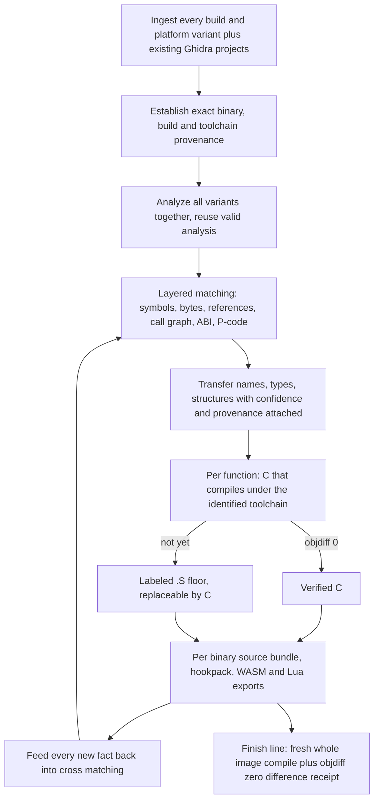
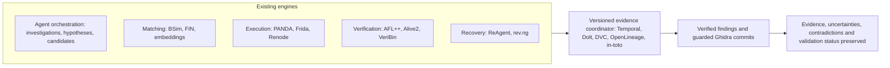

# AgentDecompile Entrypoint

**Point an agent here. It leaves able to reverse engineer a program family, not just a function.**

This folder is the front door for any AI agent (Claude Code, Codex, Cursor, Gemini CLI,
VS Code Copilot, Windsurf, OpenCode, or any MCP client). It sets the agent up against the
existing AgentDecompile MCP server, hands it the operating rules, names every tool in the
curated reverse-engineering stack, and tells it what a finished result looks like and what
it is not allowed to claim.

[Quick start](#quick-start) · [How it works](#how-agentdecompile-works) · [What you can analyze](#what-you-can-analyze) · [The stack](#the-stack) · [The five gaps](#the-five-gaps) · [Methodology and fallbacks](RECOVERY_LOOP.md) · [Coordinator](COORDINATOR.md) · [FAQ](#faq)

> Operational authority stays with [AGENTS.md](../AGENTS.md); pipeline policy stays with
> [STRATEGY.md](../STRATEGY.md). Nothing in this folder overrides either. When they and this
> folder disagree, they win and this folder has a bug.

## What this is for

AgentDecompile takes compiled programs, especially related builds and platform variants
of the same software, and recovers the software behind them systematically. It treats the
binaries as one connected corpus: work out which functions correspond across builds, use
that shared evidence to carry names, types, structures and other findings between them,
and turn the analysis into readable source whose relationship to the original executable
is **checked, not assumed**.

That is a higher-level goal than Ghidra's. Ghidra helps an analyst inspect and decompile
one program. AgentDecompile automates the wider recovery loop across many programs:

- build a cross-binary model of the family,
- recover matching C (and C++ where the evidence supports it),
- preserve assembly where source is not yet recovered, clearly labeled and replaceable,
- produce outputs you can rebuild and extend the software with: portable function
  identification, WASM-ready code, and safe code-injection and modding data.

The core result is not "decompiler text". It is a growing, evidence-backed reconstruction
of the program family plus the artifacts needed to reproduce or extend it. That is the
intended system. It is not a claim that the full pipeline is already complete; see
[Status](#status-what-exists-and-what-does-not).

## Quick start

### Set up your agent

You need Python 3.10+ and a checkout of this repository. The setup script **proposes**
changes, shows you the diff, and writes nothing until you pass `--apply`. It backs up any
file it touches.

```bash
# From the repository root. Replace claude-code with: codex, cursor, gemini, vscode,
# windsurf, opencode, or generic (prints the MCP entry for any other client).
python3 entrypoint/setup/setup_agent.py --agent claude-code --project /path/to/your/workspace

# Review the proposed diff, then:
python3 entrypoint/setup/setup_agent.py --agent claude-code --project /path/to/your/workspace --apply
```

Setup does three things and nothing else:

1. Adds an `agentdecompile` MCP server entry to the client's config, pointing at the
   **existing** listener `http://127.0.0.1:8080/mcp` (override with `--server-url`). It
   starts no process, opens no port, and never restarts a server. If a client can only
   speak stdio, `--transport stdio` emits the documented
   `agentdecompile-proxy --transport stdio --backend-url …` compatibility entry.
2. Appends a short, fenced instruction block to the client's instruction file
   (`CLAUDE.md`, `AGENTS.md`, `.cursor/rules/…`, `GEMINI.md`, `.github/copilot-instructions.md`,
   `.windsurfrules`) that tells the agent to read [AGENT_BOOTSTRAP.md](AGENT_BOOTSTRAP.md)
   before any reversing work. Skipped when the workspace is this repository, which already
   has `AGENTS.md`.
3. Records what it changed and where the backups are.

Then restart the agent (or reload its MCP servers) and check the environment:

```bash
python3 entrypoint/setup/doctor.py            # read-only probe of the curated stack
python3 entrypoint/setup/doctor.py --json     # machine-readable
```

The doctor never installs, starts, or modifies anything. It reports which engines are
reachable, which evidence tier each one unlocks, and which named gaps stay open on this
machine.

### Ask your agent

Starter prompts live in [prompts/](prompts/). Paste one, or say it in your own words:

- "Read `entrypoint/AGENT_BOOTSTRAP.md`, then triage `game.exe` and tell me what the
  cheapest sufficient evidence tier is before you open anything in Ghidra."
- "Treat these four builds as one corpus. Register them, identify the debug donor, and
  show me the identity coverage with ambiguous pairs left unresolved."
- "Recover `CSWBattleManager::ApplyDamage` on the donor build as C that compiles under the
  identified toolchain and passes objdiff. If it will not, give me the labeled `.S` fallback
  and the exact compiler receipt."
- "Export the hookpack for the current corpus and list every site whose expected bytes are
  missing. Do not call any of them safe."
- "Where is the evidence insufficient? Say so instead of picking a side."

### Use the terminal

Recovery operations go through the existing **8080** workbench and `GET /api/v1/actions`.
Inspect the advertised action parameters and submit work through that catalog. The CLI
entry points (`agentdecompile-corpus`, `agentdecompile-recover`, `agentdecompile-cli
reconstruct`, `scripts/decomp-cli.sh`) are implementation references documented in
[USAGE.md](../USAGE.md), [CORPUS_PIPELINE.md](../docs/CORPUS_PIPELINE.md) and
[CRITICAL_PATH.md](../docs/CRITICAL_PATH.md). They are not a license to bypass the catalog,
start alternate ports, or duplicate another owner's compiler, Wine or Ghidra writer.

```bash
curl -s http://127.0.0.1:8080/health
curl -s http://127.0.0.1:8080/api/v1/actions | python3 -m json.tool | head -80
uv run agentdecompile-cli --server-url http://127.0.0.1:8080/mcp tool --list-tools
```

### Update

```bash
git pull
python3 entrypoint/setup/setup_agent.py --agent <client> --project <workspace>          # shows only what changed
python3 entrypoint/setup/setup_agent.py --agent <client> --project <workspace> --apply
python3 entrypoint/setup/doctor.py
```

Setup is idempotent: an unchanged entry produces an empty diff, and the fenced instruction
block is replaced in place rather than appended twice.

## How AgentDecompile works



Three rules make the loop honest:

1. **A match is a transfer channel, not proof.** Confidence and provenance travel with
   every carried fact. Ambiguous relationships stay unresolved instead of being promoted.
2. **Claim tiers never blur.** Verified, readable/compiling, advisory, context hint and
   byte-authoritative are different things ([METHODOLOGY.md](../METHODOLOGY.md) §4). A
   finished job, compiling C, copied bytes, a runtime call or a screenshot is not verified
   recovery.
3. **Partial work must pay.** A failed stage narrows evidence and lowers the tier. It does
   not erase prior output or justify re-running analysis that already exists.

The full method, fallback ladder and export contract are in [RECOVERY_LOOP.md](RECOVERY_LOOP.md).

## What you can analyze

| Target | Primary engines | Notes |
|---|---|---|
| Native PE / ELF / Mach-O, single binary | Ghidra via AgentDecompile MCP, objdiff, clang/MSVC/Wine toolchains | `agentdecompile-cli reconstruct` reference; see [CRITICAL_PATH.md](../docs/CRITICAL_PATH.md) |
| Related builds and platform variants (the main case) | Corpus pipeline, BSim, BinDiff, FIN, VexIR2Vec, kotorxid identity store | Register every build; mark the STABS/DWARF build as donor; see [CORPUS_PIPELINE.md](../docs/CORPUS_PIPELINE.md) |
| .NET / IL assemblies | `ilspycmd` (installed separately) | Not a pip extra |
| Firmware and embedded images | Renode, avatar², PANDA, Ghidra | Functional models, not physical timing |
| Running processes and runtime behavior | Frida, PANDA record/replay, KotorPhasor adapters | Runtime calls never count as recovered source ([RUNTIME_REUSE.md](../docs/RUNTIME_REUSE.md)) |
| Graphics engines | RenderDoc, apitrace | RenderDoc has no D3D9/10 or legacy OpenGL compatibility support; apitrace covers older APIs |
| JavaScript / Electron, Android APKs, packet captures | REA as an optional peer MCP server | Outside this repository's recovery bar; its findings enter as context hints |

Formats are detected from the binary and profiles derive from format and stem. Do not
hardcode product binaries into generic defaults.

## The stack

Everything below is curated, not reinvented. The engineering we actually add is the
[coordinator](COORDINATOR.md). Full detail, install hints and the honest integration
status of each entry live in [STACK.md](STACK.md) and the machine-readable
[stack.json](stack.json) that `doctor.py` reads.

### Retained core

Ghidra and this repository's MCP server and corpus pipeline, Ghidra Server (RMI over SSL,
not HTTP), ghidra-rpc, BSim, BinDiff, VexIR2Vec, objdiff, ReAgent, rev.ng, PANDA, avatar²,
Renode, Frida, AFL++, angr, Alive2, DVC, in-toto.

### The eight additions

Ranked by how much previously missing capability each one introduces.

| # | Project | Why it is needed | What remains |
|---|---|---|---|
| 1 | **FIN** | Identifies function inlining explicitly using debug information, so one source function that became part of another binary function is modeled as such instead of mis-matched one-to-one | Needs suitable debug info; cannot resolve arbitrary stripped binaries |
| 2 | **BinKit 2.0** | Ground-truth similarity datasets across 8 architectures, 23 compilers, 6 optimization levels and 371,928 binaries. Calibrates matcher accuracy instead of trusting scores | Does not represent every proprietary compiler or optimization |
| 3 | **VeriBin** | Binary-level behavioral comparison by symbolic execution, built for judging patch safety. Adds a verification route that does not require recovered source first | Designed for patch analysis, not arbitrary whole-program equivalence |
| 4 | **CounterTV** | Compares optimized x86 assembly against LLVM IR by semantic alignment and equivalence checking, complementing Alive2's IR-to-IR validation | Architecture, solver and supported-semantics limits |
| 5 | **Dolt** | Version-controlled SQL with branches, merges and explicit row and schema conflicts. The right substrate for persistent function identities and competing agent findings | Cannot decide which conflicting interpretation is correct |
| 6 | **Temporal** | Durable workflows, retry policies and execution history for thousands of analysis jobs and interrupted work | Retried activities can run more than once; writes must be idempotent |
| 7 | **OpenLineage** | Standard relationships between jobs, inputs, outputs, versions and test results, with custom metadata facets | Does not evaluate the truth of a reverse-engineering hypothesis |
| 8 | **Sigstore Cosign** | Signs and verifies evidence artifacts and attestations so records can be checked for authenticity and tampering | A signed wrong conclusion is still wrong |

### Conditional additions

**SBridge** (source-to-binary control-block matching) and the **binary2source matching
under function inlining** dataset and method. Both address one-to-many correspondences that
ordinary one-to-one diffing misses. Include them when the corpus has candidate source or
heavy inlining.

### Specialized, not installed everywhere

**RenderDoc** and **apitrace** for graphics-engine analysis. **STOKE** as a research
reference for x86-64 instruction-level equivalence and synthesis only; its maintainers call
it a non-production prototype with no active development, so it is never a validation
dependency. **vSim** and **Co2FuLL** as benchmark comparators for semantic-value extraction
and LLM-assisted similarity verification, promoted to production matchers only after they
beat the existing ones on an independent corpus.

## The five gaps

| Gap | Curated solution | Remaining limitation |
|---|---|---|
| Cross-build identity | BSim + FIN + BinKit + VexIR2Vec + BinDiff | Ambiguous identities, missing code, function splitting and merging |
| Hardware fidelity | PANDA + avatar² + Renode + real-hardware traces | Unmodeled device behavior and exact physical timing |
| Semantic correctness | ReAgent + AFL++ + angr + Alive2 + VeriBin + CounterTV | Proof coverage, incompatible semantics, external side effects |
| Research provenance | DVC + OpenLineage + in-toto + Cosign | Semantic truth still needs evidence-specific verification |
| Concurrent agents | Ghidra Server + ghidra-rpc + Dolt + Temporal | Conflicting conclusions need explicit arbitration |

The component capabilities are documented by their projects. Their interoperation as one
system still has to be implemented and tested here.

One finding matters for everyone attaching agents to Ghidra: **Ghidra's transaction model
is not fully isolated.** Concurrent transactions may join an existing transaction as
sub-transactions and share its rollback behavior. Attaching many autonomous writers to one
live program is therefore not automatically safe. Keep one writer per corpus, project and
toolchain, serialize authoritative commits through the coordinator, and let read-only
agents fan out freely.

## The integration layer we actually build

Rather than another general-purpose RE agent, the missing component is an **evidence and
validation coordinator**. It sits between the engines and the Ghidra project:



It needs exactly five pieces of new application logic, specified in
[COORDINATOR.md](COORDINATOR.md): an **identity graph**, an **evidence contract**, a
**validation gate**, a **conflict arbiter** and a **capability router**. Everything else is
delegated to the projects above.

## What we export

The useful deliverable is a complete per-binary source bundle, not a list of matched
functions. [RECOVERY_LOOP.md](RECOVERY_LOOP.md#what-we-export) has the contract; in brief:

| Product | Contains | Its own validation |
|---|---|---|
| Source bundle (per binary) | C and labeled `.S` coverage, function map, cross-binary correspondences, symbols/types/structures with provenance, portable signatures, compiler and objdiff receipts | Compile under the identified toolchain; objdiff per function; fresh whole-image receipt for the terminal claim |
| Hookpack (`hookpack/v2`) | Codecave and hook locations, calling details, per-build instances, expected bytes | Independent target identity plus live ABI/layout/lifetime checks; a generated hook description is not safe runtime behavior |
| WASM-ready code and integration artifacts | Recovered units prepared for a WASM target with their import and export surface | Builds and behaves under its own test harness; separate from byte parity |
| Lua-facing interfaces | Generated bindings and headers where a Lua host exists | Host-side load and call checks |

A source bundle is not a verified whole-image build. An assembly fallback is not recovered
source. A hookpack row is not permission to patch.

## What genuinely cannot be completely solved

| Limit | Why it remains |
|---|---|
| Universal program equivalence | Undecidable in general. Restricted program classes can be proven equivalent under defined semantics |
| Perfect logical-source recovery | Compilation erases names, types, boundaries, branches and the difference between several source implementations. The original may not be uniquely recoverable |
| Perfect hardware reproduction | Exact timing, undocumented peripheral behavior and physical effects need models or physical observation. Renode's peripheral models are functional, not physically exact |
| Automatic resolution of ambiguous evidence | Two explanations can fit every observation. Confidence scores and majority votes do not create the missing evidence |

These limits do not prevent very high practical accuracy. They mean completeness must be
defined against an explicit target, supported platform set and verification contract, not
as an absolute property of every conceivable executable. An agent must be able to conclude
**insufficient evidence** rather than manufacture certainty.

## Status: what exists and what does not

- Implemented here: the MCP server and tool surface, the corpus pipeline stages, BSim
  ingest, objdiff-gated per-function proof, the `kotorxid.sqlite` identity store,
  `corpus.export-hookpack` (v1 pack), the 8080 workbench and action catalog.
- Curated but not integrated: FIN, BinKit, VeriBin, CounterTV, Dolt, Temporal,
  OpenLineage, Cosign, SBridge, the inlining dataset, vSim, Co2FuLL. `doctor.py` probes
  for them; nothing in the pipeline calls them yet.
- Proposed: the coordinator in [COORDINATOR.md](COORDINATOR.md).
- Not yet implemented end-to-end: the fresh whole-image compile plus objdiff
  zero-difference receipt route. Current evidence says so. The honest priority is to
  improve reuse and early error detection while closing that proof gap, not to claim the
  pipeline is complete.

## FAQ

**Does setup start the server?** No. It writes client configuration that points at the
existing listener and nothing else. If 8080 is unavailable, diagnose ownership and report
the blocker; do not switch ports or kill whatever is on it.

**Can I run this against a binary I do not own?** Only analyze software you own or are
authorized to examine. See [Disclaimer](#disclaimer).

**Why not just use REA?** REA is a strong general inspector across app behavior down to
native binaries, and it works well as a peer for JavaScript, .NET, APK and capture targets.
AgentDecompile's goal is narrower and deeper: cross-build identity, compile-and-objdiff
gated source, and reproducible exports for a program family.

**Why so many "is not" sentences?** Because every incident in this project's history came
from a weaker claim being read as a stronger one. The vocabulary is the safety mechanism.

**Where do I report what the agent did?** State exactly what was and was not verified, with
receipts. Reused evidence is labeled reused. A vague "continue" never authorizes
publication, and PRs to public or third-party upstreams need explicit approval.

## Documentation map

| Read | For |
|---|---|
| [AGENT_BOOTSTRAP.md](AGENT_BOOTSTRAP.md) | The first file an agent reads: order of operations and rules |
| [RECOVERY_LOOP.md](RECOVERY_LOOP.md) | Methodology, fallback ladder, exports, finish line |
| [COORDINATOR.md](COORDINATOR.md) | The five pieces of new logic and how they wrap the stack |
| [STACK.md](STACK.md) / [stack.json](stack.json) | Every tool, its role, limits and integration status |
| [setup/README.md](setup/README.md) | Setup and doctor script reference |
| [prompts/](prompts/) | Starter prompts per phase |
| [../AGENTS.md](../AGENTS.md), [../STRATEGY.md](../STRATEGY.md), [../METHODOLOGY.md](../METHODOLOGY.md), [../VISION.md](../VISION.md) | Operational authority, pipeline policy, principles, charter |
| [../docs/INDEX.md](../docs/INDEX.md) | Everything else |

## Disclaimer

AgentDecompile is for lawful research, education, interoperability, preservation and
analysis of software you own or are authorized to examine. Third-party tools named here
keep their own licenses; this repository grants no licenses or keys for commercial tools.
Static inspection reads files without running them. Runtime capture runs the target under
your permissions. Get this software only from its official repository.

License: see [LICENSE](../LICENSE).
