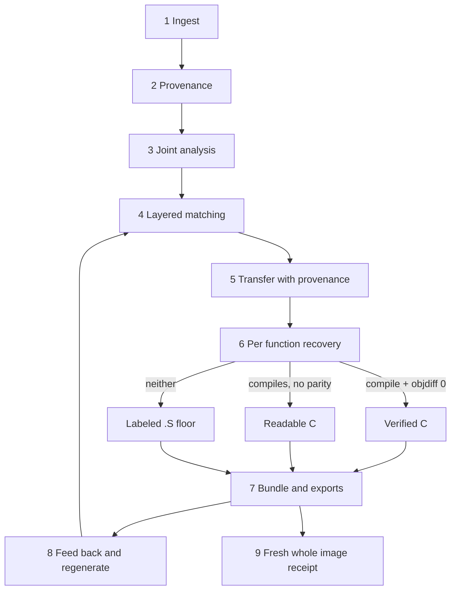

# The recovery loop: methodology, fallbacks, exports, finish line

This page says how an agent works a program family from ingest to a rebuildable bundle,
what it does when a step fails, what it exports, and what counts as done. It restates the
intent in operating terms; [STRATEGY.md](../STRATEGY.md) owns matcher order and acceptance,
[METHODOLOGY.md](../METHODOLOGY.md) owns the principles, [AGENTS.md](../AGENTS.md) owns
operations. Where they differ from this page, they win.

## 1. Ingest everything

Bring in every build and platform variant you have, plus any existing Ghidra project data
for them. Nothing is analyzed in isolation when a sibling exists. Keep session data on NVMe
(`/home/brunner56/...` or `/tmp`), not MyBook. The upstream donor checkout is read-only.

Fallback: a variant you cannot load still gets registered with its hash, format and what
blocked it. A missing variant narrows the evidence; it does not stop the corpus.

## 2. Establish exact provenance

Record binary identity (hashes, format, sections, imports, timestamps), build identity
(version strings, PDB/STABS/DWARF paths, link order hints) and toolchain identity
(compiler family, version, optimization, ABI, runtime). Corroborate binary, source and
toolchain identity against each other before trusting any one of them.

Fallback: when the toolchain is uncertain, carry competing toolchain hypotheses as named
calibration profiles and let compile and diff results eliminate them. Solve this global
uncertainty before local uncertainty; local source search cannot converge while the
compiler assumption is wrong.

## 3. Analyze all variants together

Open existing analyzed projects and reuse their analysis. Run the missing analysis only
where none exists and only after ownership checks. Keep one writer per corpus, project and
toolchain. Read-only agents may fan out.

Fallback: if the only analysis available is stale or partially invalid, invalidate just the
affected dependencies (bytes, types, callees, toolchain, analysis evidence) and keep the rest.

## 4. Match with layered evidence

Evidence, in the order STRATEGY sets:

1. Symbols and debug metadata (STABS, DWARF, PDB, export tables)
2. Bytes and instruction structure (exact and masked)
3. References: strings, constants, data, imports
4. Call-graph relationships and neighborhood propagation
5. ABI: calling convention, stack frame, parameter shape
6. Decompiler and P-code features: BSim, VexIR2Vec embeddings, BinDiff
7. Inlining-aware correspondences: FIN where debug info exists, SBridge and the
   binary2source-under-inlining method where candidate source or heavy inlining exists
8. Second opinions on diagnosed residue only

Calibrate matcher thresholds against BinKit ground truth for the relevant architecture and
compiler family rather than trusting raw scores. A proposed match is a way to transfer and
compare knowledge, not proof. Record the evidence layers that agreed, the ones that
disagreed, and the ones that were not available.

Fallback: an ambiguous pair stays ambiguous and visible. Do not break ties by score or
vote. "Insufficient evidence" is a valid, recorded outcome.

## 5. Transfer, with confidence and provenance attached

Carry names, types, structures, comments and verified source across matched functions.
Every carried fact keeps its source build, source evidence, matcher and confidence. A
transferred name is a context hint on the recipient until the recipient proves it.

Fallback: a transfer that breaks the recipient's compile or parity is recorded as a
contradiction against the match, which lowers the match, not the evidence.

## 6. Recover each function

**Target:** readable C that compiles under the correct, identified toolchain and matches the
original function bytes under the project's objdiff and proof rules. Names follow the
conventions in [AGENT_BOOTSTRAP.md](AGENT_BOOTSTRAP.md#7-write-with-the-projects-names).

**Order of attempts** (deterministic before creative):

1. Verified sibling source via identity, re-proven on this build
2. Compiler and profile variation of an existing candidate
3. Mechanical transforms and known idioms
4. Structural correction from the diff shape (type layout, calling convention, inlining,
   boundary)
5. Bounded model-assisted rewrite as a challenger lane, every attempt compiled and recorded

**Fallback ladder:**

| Outcome | Export | Label | Replaceable |
|---|---|---|---|
| Compiles, objdiff 0 | `.c` | Verified | Only by a re-verified change |
| Compiles, objdiff > 0 | `.c` in advisory folder | Readable / compiling | Yes |
| Does not compile | attempt receipts only | Advisory | Yes |
| Any of the above pending | `.S` preserving machine code and calling boundary | Assembly floor, byte-authoritative | Yes, by recovered C |

The `.S` floor is never counted as recovered source. `__asm`, naked functions, `_emit` and
`.byte` bodies are not recovered source and are not copied as such.

**C++** is a parallel aspiration where the evidence (RTTI, vtables, mangled names,
constructor patterns) and compiler behavior support it. It must not be inferred from a
C-level match.

**Continue compiling after every change** and keep the exact compiler output, objdiff
mismatch class and attempt history, so a late failure does not waste a batch and the next
move is chosen from diff shape rather than from a scalar "wrong".

## 7. Build the bundle and the exports

See [What we export](#what-we-export).

## 8. Feed every new fact back

Each verified function, confirmed type, new signature or eliminated toolchain hypothesis
re-enters matching. Regenerate affected outputs automatically and only those: changed
dependencies invalidate affected work, not the corpus.

## 9. The finish line

A fresh, full-image compile plus an objdiff zero-difference receipt against the shipped
executable, with C+assembly-floor and max-C variants separately measured. Function-slice
matches, historical receipts, assembly fallbacks and source presence do not substitute for
it. A stock linker will not reproduce section order, virtual addresses, padding, headers,
import tables or relocations unless placement is enforced; that exact-placement gap is part
of the problem. Current evidence shows this route is not implemented end-to-end. The honest
priority is better reuse and earlier error detection while closing that gap, not claiming
completion.

## What we export

The deliverable is a complete per-binary source bundle. Each export below is a distinct
product with its own validation; none inherits another's.

### Per-binary source bundle

| Part | Contents |
|---|---|
| `src/` | Recovered C (and C++ where proven) by module, compiling under the identified toolchain |
| `asm/` | Labeled `.S` floor for everything not yet recovered, with calling boundary and required data |
| `function-map` | Every function: address, size, logical_id, claim tier, source file, receipt ids |
| `correspondences` | Cross-binary links with evidence layers, confidence, contradictions and unresolved pairs |
| `symbols/`, `types/` | Names, structures, enums and fields with provenance per fact |
| `signatures/` | Portable signatures that find functions across builds without fixed addresses |
| `receipts/` | Compiler invocations and output, objdiff results, attempt history, tool versions |
| `provenance` | Binary, build and toolchain identity; DVC/in-toto/OpenLineage records; Cosign signatures where configured |

### Hookpack (`hookpack/v2`)

Codecave and hook locations, calling details, per-build instances, expected bytes and
adapter keys for DLL and library injection. Validation: independent target identity
predicates plus live ABI, layout, lifetime, ownership and policy checks at install time.
Raw memory writes validate nothing; a cave inventory is not an installable patch.

### WASM-ready code and integration artifacts

Recovered units prepared for a WASM target with their import and export surface and the
glue needed to host them. Validation: builds and behaves under its own harness. This is
separate from byte parity against the native image.

### Lua-facing interfaces

Generated bindings, headers and operation descriptions where a Lua host exists. Validation:
host-side load, call and inverse checks against the same revision the help text names.

### What an export is not

An assembly fallback is not safe runtime behavior. A generated hook description is not a
tested patch. A source bundle is not a verified whole-image build. A runtime call that
succeeds proves nothing about recovered-source parity.

## Reporting

For every batch: what was ingested, what was reused (labeled reused), what was matched and
at which layers, what was verified with receipt ids, what fell back to `.S`, what remained
insufficient, and the single next bounded action. Separate liveness, durable results and
accepted goal progress. A file, heartbeat or job completion alone is not acceptance.
