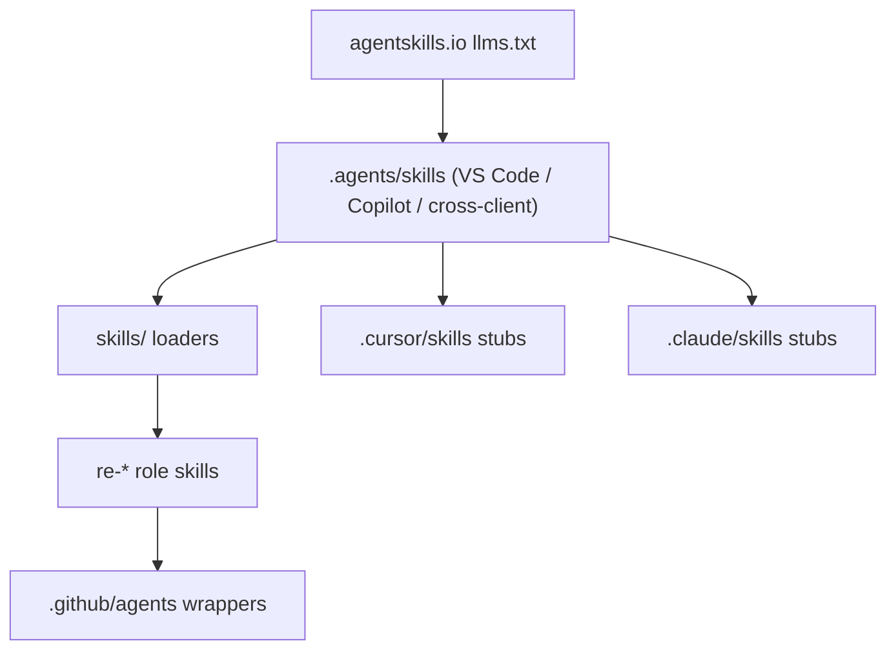

# AgentDecompile skills

Operations follow [AGENTS](../AGENTS.md); pipeline priorities and acceptance follow
[STRATEGY](../STRATEGY.md). Skills route work; they do not supply competing policy.

User docs start at [README.md](../README.md), [USAGE.md](../USAGE.md), and [docs/INDEX.md](../docs/INDEX.md). Authoring: `.agents/skills/skill-authoring`.



| Page | Rule we apply |
|---|---|
| [Specification](https://agentskills.io/specification.md) | `name` = folder; `description` ≤ 1024; optional license/compatibility/metadata |
| [Quickstart](https://agentskills.io/skill-creation/quickstart.md) | VS Code lists `/skills` from `.agents/skills/<name>/SKILL.md` |
| [Client implementation](https://agentskills.io/client-implementation/adding-skills-support.md) | Scan `.agents/skills/` plus client dirs; catalog is name+description only |
| [Optimizing descriptions](https://agentskills.io/skill-creation/optimizing-descriptions.md) | `Use this skill when…`; `evals/triggers.json` train/validation |
| [Evaluating skills](https://agentskills.io/skill-creation/evaluating-skills.md) | `evals/evals.json` prompts + assertions |
| [Using scripts](https://agentskills.io/skill-creation/using-scripts.md) | Bundled `scripts/` with `--help`, no TTY |
| [Best practices](https://agentskills.io/skill-creation/best-practices.md) | Project gotchas; lean bodies; progressive disclosure |
| [Clients](https://agentskills.io/clients.md) | Cursor, Copilot, Claude Code, Gemini CLI, OpenCode, … |

## Catalog

Bodies live in `.agents/skills/<name>/`. `skills/`, `.cursor/skills/` and
`.claude/skills/` use loaders; vendored web-design guidance retains its sync contract.
Resolve links relative to each loader, never back to itself. Copilot role wrappers
load these same bodies. Confidence/convergence is advisory, never proof or an
automatic propagation threshold.

| Skill | Use when |
|---|---|
| `skill-authoring` | Adding or reviewing skills / Copilot agent wrappers |
| `source-recovery` | Recovered C, objdiff, `--dump-source`, rematch, reconstruct |
| `workbench-operator` | `/dashboard` dogfood or workbench UX |
| `bsim-corpus` | BSim database / ingest / report |
| `tiered-re-analysis` | Picking Tier 0–3 tools before Ghidra MCP |
| `mcp-debugging` | MCP session, transport, or tool-routing failures |
| `lfg` | Continue authorized work from STRATEGY and existing evidence |
| `re-planner` / `re-worker` / `re-critic` / `re-aggregator` | Multi-agent RE roles |
| `agentdecompile-server-env` | Attach existing 8080, environment, bind, sessions |
| `agentdecompile-entrypoint` | New agent onboarding: client setup, stack doctor, recovery loop, exports |

`agentdecompile-rewrite-worker` and `agentdecompile-server-env` have canonical
bodies under `.agents/skills/` and Claude loaders. Migrated `source-command-*`
skills route to the current command guidance. The project plugin connects by native
HTTP to existing 8080; it starts no process and does not modify global MCP defaults.

General-development validation reference (do not run during the current mission):

```bash
python3 scripts/validate-agent-skills.py
python3 skills/skill-authoring/scripts/check-evals.py
```
